# Page: Overview

# Overview

<details>
<summary>Relevant source files</summary>

The following files were used as context for generating this wiki page:

- [README.md](README.md)
- [flash_mla/__init__.py](flash_mla/__init__.py)

</details>


FlashMLA is DeepSeek's optimized attention kernel library designed to power inference of the [DeepSeek-V4.1](https://huggingface.co/deepseek-ai/DeepSeek-V4.1-Flash) model on NVIDIA SM100/SM103 GPUs and Huawei Ascend 950 NPUs [README.md:1-7](). The library provides token-level sparse attention kernels for prefill and decoding with FP8 or FP4 KV cache formats, a high-performance fused pipeline combining Q-norm, Q-RoPE, attention, O-RoPE (conjugate) and FP8 cast, as well as dense MHA prefill and backward kernels [README.md:5-7]().

For detailed information on capabilities, workload types, and performance characteristics, see [Purpose and Features](#1.1). For hardware prerequisites, toolchain versions, and platform requirements, see [Supported Hardware and Requirements](#1.2).

Sources: [README.md:1-7]()

## Purpose and Core Capabilities

FlashMLA implements highly optimized attention primitives tailored for the Multi-head Latent Attention (MLA) and DeepSeek Sparse Attention (DSA) mechanisms used in DeepSeek-V4.1 [README.md:5-7](). 

The primary public Python APIs and their functions exported in `flash_mla/__init__.py` include:

| API Function | Description | Stage / Pattern |
|--------------|-------------|-----------------|
| `get_mla_metadata` | Generates scheduling metadata for decoding operations | Decoding (Sparse) |
| `flash_mla_with_kvcache` | Executes MLA attention with paged FP8/FP4 KV cache | Decoding (Sparse) |
| `flash_mla_sparse_fwd` | Token-level sparse attention for prefill | Prefill (Sparse) |
| `flash_attn_varlen_func` | Dense variable-length attention | Prefill (Dense) |
| `fused_norm_rope_attn_rope_cast` | Fused Q-norm, Q-RoPE, attention, O-RoPE, and FP8 cast pipeline | Prefill & Decode |

For comprehensive coverage of sparse decode/prefill, dense MHA prefill/backward, FP8/FP4 KV cache memory layouts, and performance metrics across platforms, refer to [Purpose and Features](#1.1).

Sources: [README.md:5-7](), [flash_mla/__init__.py:1-22]()

## System Architecture and Integration

The library spans across Python application entry points, C++ dispatcher layers, and architecture-specific backends for NVIDIA GPUs and Huawei Ascend NPUs [README.md:5-13]().

Diagram: "Natural Language to Code Entity Mapping for Inference"
```mermaid
graph TD
    subgraph "Natural Language Space: Model Inference"
        [DeepSeekV4Model] --> [flash_mla_interface]
    end

    subgraph "Code Entity Space: Python Interface"
        [flash_mla_interface] --> [get_mla_metadata]
        [flash_mla_interface] --> [flash_mla_with_kvcache]
        [flash_mla_interface] --> [flash_mla_sparse_fwd]
        [flash_mla_interface] --> [fused_norm_rope_attn_rope_cast]
    end

    subgraph "Code Entity Space: C++ Dispatch & Kernels"
        [flash_mla_with_kvcache] --> [csrc_api]
        [flash_mla_sparse_fwd] --> [csrc_api]
        [csrc_api] --> [sm100_kernels]
        [csrc_api] --> [ascend_kernels]
    end
```
Sources: [README.md:5-15](), [flash_mla/__init__.py:1-22]()

Diagram: "Source Code Module Hierarchy"
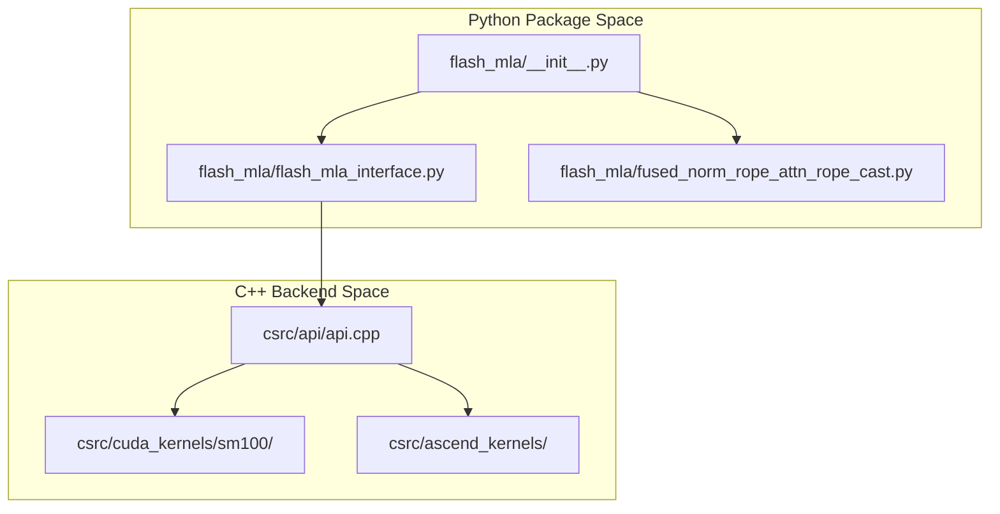
Sources: [README.md:5-15](), [flash_mla/__init__.py:1-22]()

## Supported Hardware and Platforms

FlashMLA targets high-performance accelerators with strict hardware and software prerequisites:
- **NVIDIA Platform**: NVIDIA SM100 / SM103 GPUs, CUDA 13.1 and above (CUDA 13.2+ recommended for native instructions), PyTorch 2.0+ [README.md:77-81]().
- **Huawei Platform**: Huawei Ascend 950 NPU, CANN 9.2.0 and above (providing the `bisheng` compiler and Ascend C headers), `torch_npu`, and PyTorch 2.0+ [README.md:83-88]().

For detailed platform auto-detection logic, environment requirements, and build targets, see [Supported Hardware and Requirements](#1.2).

Sources: [README.md:75-89]()

---

# Page: Purpose and Features

# Purpose and Features

<details>
<summary>Relevant source files</summary>

The following files were used as context for generating this wiki page:

- [README.md](README.md)
- [flash_mla/flash_mla_interface.py](flash_mla/flash_mla_interface.py)

</details>


FlashMLA is DeepSeek's library of optimized attention kernels, powering the inference of the DeepSeek-V4.1 model on NVIDIA SM100/SM103 GPUs and Huawei Ascend 950 NPUs [README.md:5-7](). The library provides token-level sparse attention kernels for prefill and decoding with FP8 or FP4 KV cache formats, a fused pipeline combining normalization, RoPE, attention, conjugate RoPE, and FP8 casting, as well as dense MHA prefill and backward kernels [README.md:5-8]().

This page details the core features, KV cache layouts, pipeline architectures, and performance characteristics of FlashMLA. For hardware requirements and installation steps, see [Supported Hardware and Requirements](#1.2) and [Building from Source](#2.1).

Sources: [README.md:1-10]()

## Core Attention Operations and API Mapping

FlashMLA supports both sparse and dense attention patterns across prefill and decoding phases. The high-level architecture maps user-facing Python APIs to backend implementations across supported hardware platforms.

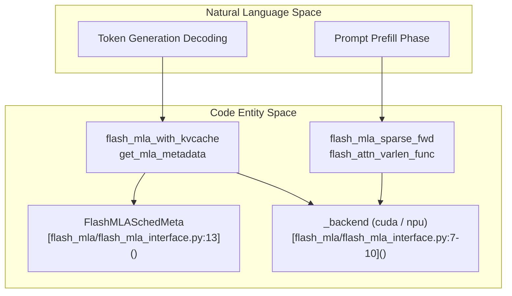
Sources: [README.md:5-10](), [flash_mla/flash_mla_interface.py:7-56]()

| Operation Type | API Function(s) | Primary Use Case | Hardware Support | Data Format |
|----------------|-----------------|------------------|------------------|-------------|
| **Dense Prefill** | `flash_attn_varlen_func`<br/>`flash_attn_varlen_qkvpacked_func`<br/>`flash_attn_varlen_kvpacked_func` | Processing full prompts with standard MHA | NVIDIA SM100 | BF16 |
| **Sparse Prefill** | `flash_mla_sparse_fwd` | Processing prompts with DeepSeek Sparse Attention (DSA) | NVIDIA SM100, Ascend 950 NPU | BF16 / FP8 |
| **Dense Decoding** | `flash_mla_with_kvcache`<br/>(without `indices`) | Token-by-token generation with full attention | NVIDIA SM100, Ascend 950 NPU | BF16 KV Cache |
| **Sparse Decoding** | `flash_mla_with_kvcache`<br/>(with `indices`) | Token-by-token generation with DSA | NVIDIA SM100, Ascend 950 NPU | FP8 / FP4 KV Cache |

Sources: [README.md:5-15](), [flash_mla/flash_mla_interface.py:59-77]()

## KV Cache Formats and Quantization

FlashMLA supports specialized FP8 and FP4 KV cache formats tailored for DeepSeek-V4.1, reducing memory footprint and alleviating memory bandwidth bottlenecks [README.md:5-7, 114-119]().

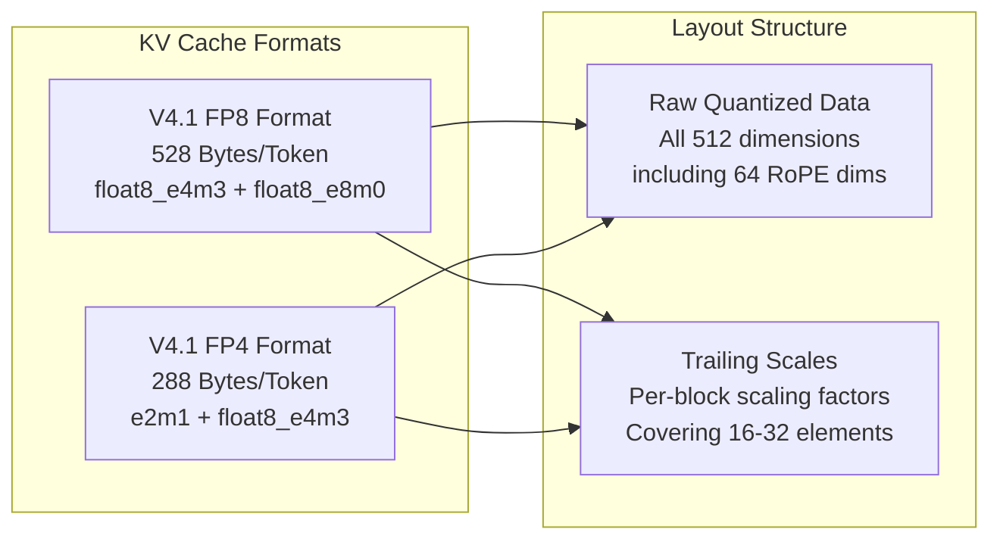
Sources: [flash_mla/flash_mla_interface.py:114-119]()

### Cache Layout Specifications

- **V4.1 FP8 KV Cache (528 Bytes per token)**: The raw data consists of 512 `float8_e4m3` values covering all 512 dimensions (including the 64 RoPE dimensions, meaning no separate bfloat16 portion is stored). The trailing scales consist of 16 bytes of `float8_e8m0` values, where each scale covers 32 consecutive `float8_e4m3` values [flash_mla/flash_mla_interface.py:118]().
- **V4.1 FP4 KV Cache (288 Bytes per token)**: The raw data consists of 256 bytes containing 512 `e2m1` values (two values packed per byte, with the even-indexed value in the low nibble). The trailing scales consist of 32 bytes of `float8_e4m3` values, each covering 16 consecutive `e2m1` values [flash_mla/flash_mla_interface.py:119]().

Sources: [flash_mla/flash_mla_interface.py:114-119]()

## Fused Norm-RoPE-Attention-RoPE-Cast Pipeline

FlashMLA provides a highly optimized fused kernel pipeline that integrates multiple operations into a single execution pass [README.md:7, 25, 41]().

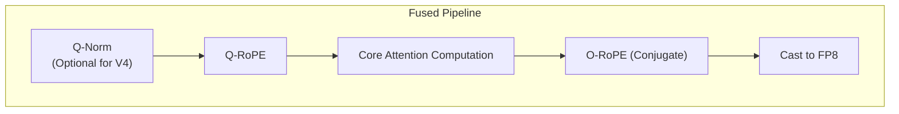
Sources: [README.md:25, 41]()

This pipeline combines Q-norm, Q-RoPE, core attention, O-RoPE (conjugate), and the cast to FP8, eliminating intermediate memory roundtrips [README.md:25, 41](). It requires weight pre-permutation via `permute_q_b_proj` and `permute_wv_proj` [README.md:25, 41]().

Sources: [README.md:25, 41]()

## Sparse Attention and Scheduling

DeepSeek Sparse Attention (DSA) is supported via the `indices` tensor passed to `flash_mla_with_kvcache` [flash_mla/flash_mla_interface.py:59-106](). The tile scheduler metadata is managed via `FlashMLASchedMeta` initialized by `get_mla_metadata` [flash_mla/flash_mla_interface.py:13-56]().

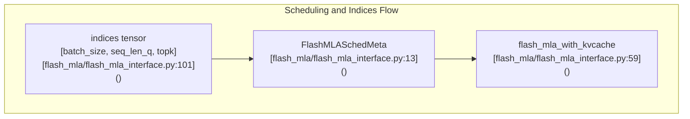
Sources: [flash_mla/flash_mla_interface.py:13-106]()

Sources: [flash_mla/flash_mla_interface.py:13-106]()

## Performance Characteristics

FlashMLA achieves exceptional throughput across supported hardware platforms:

| Operation | Hardware Platform | Peak Performance | Notes |
|-----------|-------------------|------------------|-------|
| Fused Norm-RoPE-Attn-RoPE-Cast (Prefill) | NVIDIA B200 | Up to 1460 TFlops | CUDA 13.3 [README.md:41]() |
| Fused Norm-RoPE-Attn-RoPE-Cast (Decoding) | NVIDIA B200 | Up to 950 TFlops | CUDA 13.3 [README.md:41]() |
| Sparse Prefill | NVIDIA B200 | Up to 1350 TFlops | CUDA 13.3 [README.md:51]() |
| Sparse Decoding | NVIDIA B200 | Up to 1024 TFlops | CUDA 13.3 [README.md:61]() |
| Sparse Prefill | Huawei Ascend 950 NPU | Up to 410 TFlops | 95% of hardware peak [README.md:13, 53]() |
| Sparse Decoding | Huawei Ascend 950 NPU | Up to 360 TFlops | 83% of hardware peak [README.md:13, 63]() |
| Dense MHA Prefill (Forward) | NVIDIA B200 | Up to 1460 TFlops | CUTLASS FMHA [README.md:71]() |
| Dense MHA Prefill (Backward) | NVIDIA B200 | Up to 1000 TFlops | CUTLASS FMHA [README.md:71]() |

Sources: [README.md:13, 41-71]()

---

# Page: Supported Hardware and Requirements

# Supported Hardware and Requirements

<details>
<summary>Relevant source files</summary>

The following files were used as context for generating this wiki page:

- [README.md](README.md)
- [csrc/api/common.h](csrc/api/common.h)
- [setup.py](setup.py)

</details>


This page specifies the target hardware architectures, compiler toolchain versions, and software prerequisites required to build and run FlashMLA. Following the 2026.09.30 release, FlashMLA has been updated to focus on next-generation NVIDIA SM100/SM103 architectures and Huawei Ascend 950 NPUs, dropping legacy support for older Hopper hardware [README.md:3-23]().

---

## Supported Hardware Targets

FlashMLA targets high-performance accelerator architectures across NVIDIA and Huawei platforms, leveraging architecture-specific features for quantized KV caches and sparse attention execution.

### NVIDIA GPU Support (`sm_100a` / `sm_103a`)

FlashMLA compiles explicitly for Blackwell-derived architecture targets using architecture-specific `-gencode` flags rather than family-wide abbreviations [setup.py:24-27]().

| Specification | Value | Notes |
|---------------|-------|-------|
| Architecture Codes | `sm_100a`, `sm_103a` | Required for instructions like `.scaled::n2::ue8m0` and optimized `exp` codegen [setup.py:24-27]() |
| Example Hardware | Blackwell B200 and derivatives | Primary testing and deployment platform [README.md:41]() |
| Minimum CUDA Version | CUDA 13.1+ (13.2+ recommended) | CUDA 13.2+ introduces native `cvt.rn.bf16x2` conversions [README.md:80]() |

Sources: [README.md:79-80](), [setup.py:24-27]()

### Huawei Ascend NPU Support (`Ascend 950`)

For non-NVIDIA deployments, FlashMLA provides sparse attention prefill and decoding kernels optimized for Huawei Ascend NPUs [README.md:13]().

| Specification | Value | Notes |
|---------------|-------|-------|
| Target Hardware | Huawei Ascend 950 NPU | AI Core utilization achieves up to 95% peak during prefill [README.md:13]() |
| Required Toolchain | CANN 9.2.0+ | Provides the `bisheng` compiler and Ascend C headers [README.md:86]() |
| Software Prerequisite | `torch_npu` | Integrates Ascend device streams with PyTorch [README.md:87]() |

Sources: [README.md:13](), [README.md:85-88]()

---

## Software Requirements and Toolchain Prerequisites

### NVIDIA Toolchain Requirements

Building CUDA extensions requires a compatible CUDA Toolkit and `nvcc` compiler instance bound to PyTorch's extension manager [setup.py:92-106]().

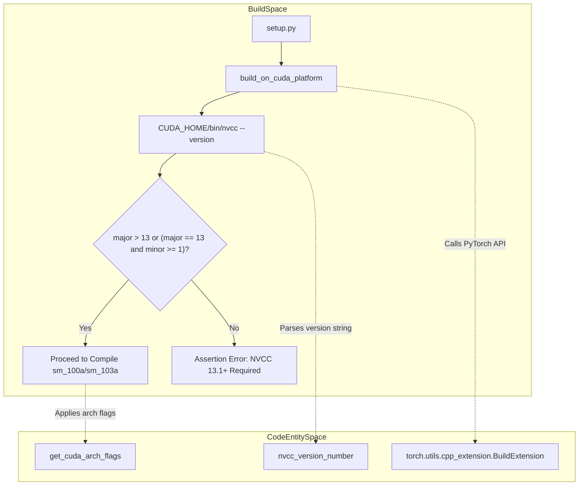

**NVCC Version Enforcement Flow**

Sources: [setup.py:79-110]()

- **NVCC Version Check**: The build orchestrator extracts the compiler version via `nvcc --version` and asserts that `major > 13 or (major == 13 and minor >= 1)` to support scaled conversion intrinsics [setup.py:102-109]().
- **PyTorch Prerequisite**: PyTorch 2.0+ is required for the C++ extension binding infrastructure [README.md:81]().

Sources: [README.md:80-81](), [setup.py:92-110]()

### Huawei Ascend Prerequisites

Building for the Huawei platform requires the CANN toolkit environment:
- **CANN 9.2.0+**: Supplies the `bisheng` compiler driver and required Ascend C header dependencies [README.md:86]().
- **`torch_npu`**: Necessary to bridge PyTorch tensor memory allocations and stream management with Ascend NPU execution contexts [README.md:87]().

Sources: [README.md:85-88]()

---

## Platform Auto-Detection and Runtime Device Probing

FlashMLA automatically detects the underlying hardware platform at runtime, querying device properties and multi-processor counts via platform-specific runtime APIs [csrc/api/common.h:40-75]().

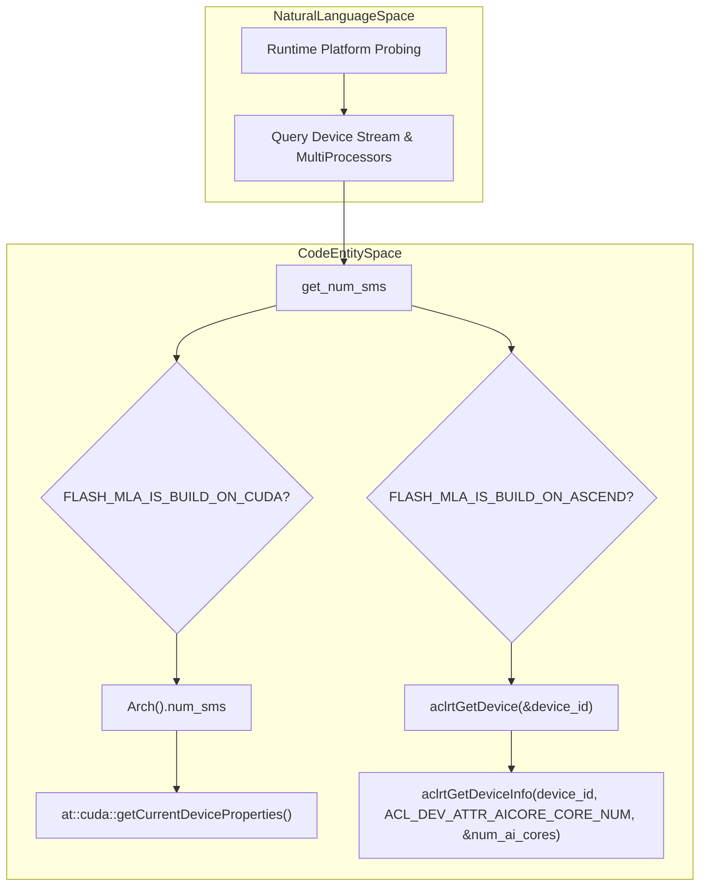

**Hardware Detection and Core Count Probing**

- **CUDA Discovery**: The `Arch` struct instantiates `at::cuda::getCurrentDeviceProperties()` to query compute capability major/minor versions and Streaming Multiprocessor counts [csrc/api/common.h:40-57]().
- **Ascend Discovery**: On Ascend builds, `get_num_sms()` interacts with the DaVinci runtime via `aclrtGetDevice` and `aclrtGetDeviceInfo` querying `ACL_DEV_ATTR_AICORE_CORE_NUM` (managed via `/dev/davinci_manager` kernel drivers) to report total available AI cores [csrc/api/common.h:60-75]().

Sources: [csrc/api/common.h:40-75]()

---

# Page: Getting Started

# Getting Started

<details>
<summary>Relevant source files</summary>

The following files were used as context for generating this wiki page:

- [README.md](README.md)
- [setup.py](setup.py)

</details>


This document provides a quickstart guide for installing and using FlashMLA for NVIDIA SM100/SM103 GPUs and Huawei Ascend 950 NPUs [README.md:13-16, 79-86](). FlashMLA provides token-level sparse attention kernels for prefill and decoding with FP8/FP4 KV caches, dense prefill and backward kernels, and fused attention pipelines [README.md:5-7]().

For detailed installation and build orchestration, see [Building from Source](#2.1). For comprehensive usage patterns and code examples, see [Usage Examples](#2.2).

---

## 2.1. Building from Source

FlashMLA relies on a custom `setup.py` script to orchestrate compilation for either the NVIDIA CUDA platform or the Huawei Ascend NPU platform [setup.py:20-22, 92](). The build system inspects the target environment, configures architecture-specific nvcc or bisheng compiler flags, manages submodules such as CUTLASS and kerutils, and performs post-build checks like register-spill validation [setup.py:79-137]().

"Build Orchestration Flow"
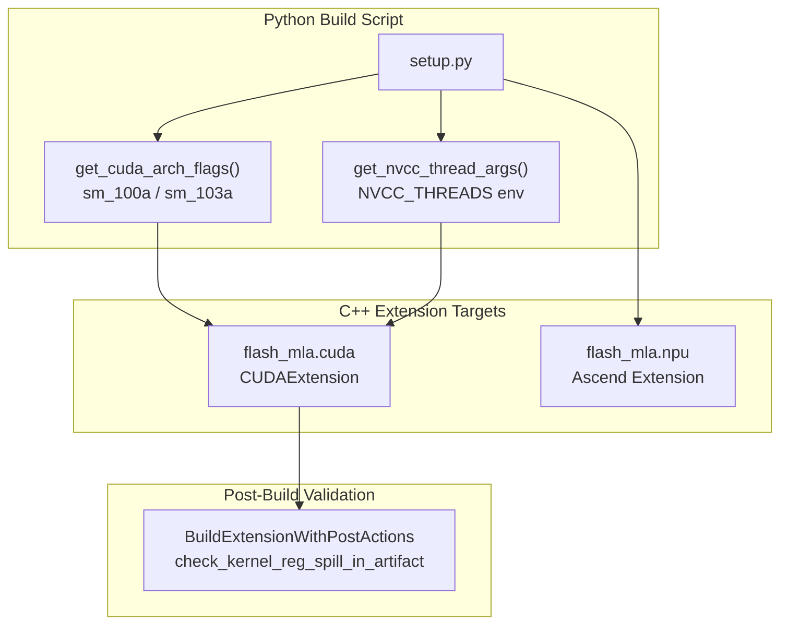

**Build Orchestration Flow**: This diagram maps build configuration routines in `setup.py` to extension targets (`flash_mla.cuda` and `flash_mla.npu`) and post-build register-spill validation [setup.py:20-27, 111-137]().

For detailed configuration instructions, environment variables (`FLASH_MLA_BUILD_TARGET_PLATFORM`, `NVCC_THREADS`), and submodule requirements, see [Building from Source](#2.1).

Sources: [setup.py:20-137]()

---

## 2.2. Usage Examples

FlashMLA exposes high-level Python APIs that dispatch to optimized CUDA and Ascend C++ kernels [README.md:5-16, 83-88](). Common workflows include sparse MLA decoding with paged FP8/FP4 KV cache, sparse prefill, dense varlen prefill/backward, and the fused `norm-RoPE-attention-RoPE-cast` pipeline [README.md:5-7, 25-41]().

"API Dispatch Architecture"
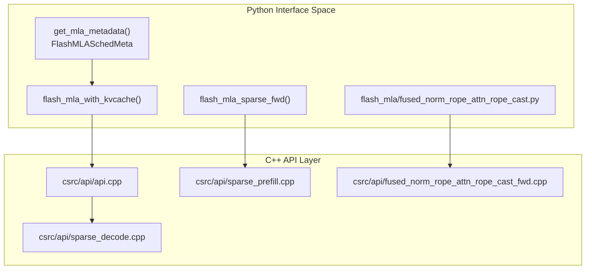

**API Dispatch Architecture**: This diagram connects user-facing Python functions to underlying C++ translation units in `csrc/api/` [setup.py:11-18]().

For concrete code examples, tensor shape specifications, and pre-permutation requirements for weights, see [Usage Examples](#2.2).

Sources: [README.md:33-74](), [setup.py:11-18]()

---

## Next Steps

- **Building from Source**: For complete details on compilation settings, environment variables, and toolchain versions, see [Building from Source](#2.1).
- **Usage Examples**: For full Python code snippets covering decoding, prefill, and fused pipelines, see [Usage Examples](#2.2).

---

# Page: Building from Source

# Building from Source

<details>
<summary>Relevant source files</summary>

The following files were used as context for generating this wiki page:

- [.gitignore](.gitignore)
- [.gitmodules](.gitmodules)
- [LICENSE](LICENSE)
- [setup.py](setup.py)

</details>


This document details the build orchestration for FlashMLA using `setup.py`, covering platform detection, CUDA versus Ascend NPU extension compilation, configuration via environment variables (`FLASH_MLA_BUILD_TARGET_PLATFORM` and `NVCC_THREADS`), submodule initialization for CUTLASS and kerutils, and the automated register-spill post-build verification.

---

## Build System Architecture and Orchestration

The build process is managed by `setup.py`, which inspects the target platform, configures compiler flags, initializes submodules, compiles C++ bindings and backend-specific kernels (CUDA SM100 or Ascend NPU), and runs post-build verification checks.

### Build Orchestration Flow

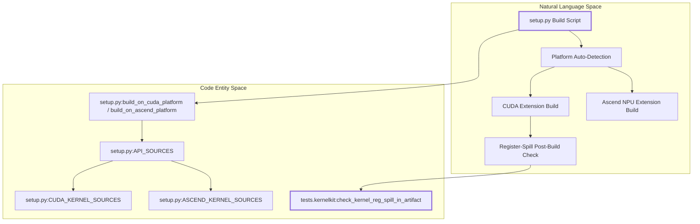

**Sources**: [setup.py:1-137]()

---

## Platform Detection and Target Configuration

FlashMLA supports two major backend hardware platforms: NVIDIA SM100/SM103 GPUs (CUDA) and Huawei Ascend 950 NPUs (Ascend). The build target can be explicitly forced via the `FLASH_MLA_BUILD_TARGET_PLATFORM` environment variable or automatically inferred based on the runtime environment (e.g., presence of `/dev/davinci_manager` for Ascend or PyTorch CUDA availability).

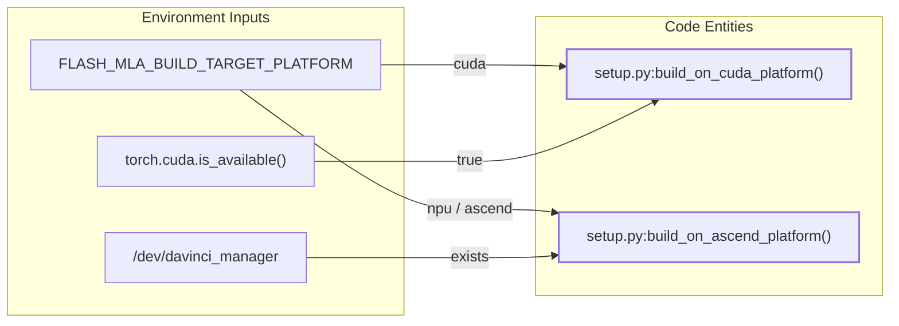

**Sources**: [setup.py:1-137]()

---

## CUDA vs Ascend Extension Builds

Depending on the detected or specified platform, `setup.py` compiles different sets of source files into distinct extension modules (`flash_mla.cuda` or `flash_mla.npu`).

### Source File Units

*   **API Sources (`API_SOURCES`)**: Common pybind11 and C++ binding implementation files located in `csrc/api/` [setup.py:11-18]().
*   **CUDA Kernel Sources (`CUDA_KERNEL_SOURCES`)**: Includes CUTLASS FMHA kernels, decoder schedulers, sparse decode/prefill kernels for SM100, and fused norm-RoPE-attention-RoPE-cast pipelines [setup.py:32-66]().
*   **Ascend Kernel Sources (`ASCEND_KERNEL_SOURCES`)**: Explicit template instantiations for Ascend sparse prefill and decode kernels (`.asc` files) [setup.py:70-77]().

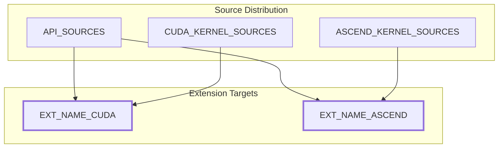

**Sources**: [setup.py:11-77]()

---

## Environment Variables and Compilation Flags

The build process is configured through environment variables that control parallelism, target architecture, and compiler flags:

*   **`FLASH_MLA_BUILD_TARGET_PLATFORM`**: Selects between CUDA and Ascend compilation targets.
*   **`NVCC_THREADS`**: Configures the number of parallel compilation threads passed to NVCC (default: `32`) [setup.py:87-90]().
*   **CUDA Architecture Flags (`CUDA_ARCHS`)**: Set to `["sm_100a", "sm_103a"]` to leverage architecture-specific instructions such as scaled conversion (`cvt` with `.scaled::n2::ue8m0`) and optimized exponential operations [setup.py:24-28]().
*   **NVCC Version Enforcement**: `build_on_cuda_platform()` checks that NVCC version is `13.1` or higher, asserting compatibility with required Blackwell instructions [setup.py:102-110]().

**Sources**: [setup.py:24-110]()

---

## Submodule Management: CUTLASS and Kerutils

FlashMLA relies on external submodules for accelerated linear algebra primitives and shared kernel routines:
*   **CUTLASS**: Located at `csrc/3rdparty/cutlass`, providing high-performance tensor core operations [.gitmodules:1-3]().
*   **Kerutils**: Located under `csrc/3rdparty/kerutils`, providing shared kernel utility headers referenced during compilation [setup.py:130]().

**Sources**: [.gitmodules:1-3](), [setup.py:130]()

---

## Register-Spill Post-Build Verification

To ensure that performance-critical kernels do not suffer from register spilling, `setup.py` defines a custom subclass `BuildExtensionWithPostActions` [setup.py:111-114](). 

After compilation completes, `run()` executes a register-spill inspection across all generated shared library artifacts (`.so`) [setup.py:115-125]().

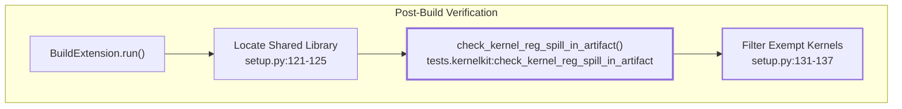

*   **Exemption Rule**: Upstream CUTLASS FMHA kernels (`_ZN7cutlass`) which intentionally maintain stack frames are exempt from the spill-free requirement [setup.py:131-137](). All kernels defined directly within the FlashMLA repository must remain register-spill-free [setup.py:131-134]().
*   **Bypassing**: Checks can be skipped by setting the `FLASH_MLA_SKIP_REG_SPILL_CHECK` environment variable [setup.py:129]().

**Sources**: [setup.py:111-137]()

---

# Page: Usage Examples

# Usage Examples

<details>
<summary>Relevant source files</summary>

The following files were used as context for generating this wiki page:

- [README.md](README.md)
- [flash_mla/flash_mla_interface.py](flash_mla/flash_mla_interface.py)

</details>


This page provides concrete code examples and usage patterns for FlashMLA, covering sparse MLA decoding with paged FP8/FP4 KV cache, sparse prefill, dense varlen prefill/backward, and the fused norm-RoPE-attention-RoPE-cast pipeline with weight pre-permutation [README.md:7-43]().

## Basic Usage Pattern & API Flow

The FlashMLA Python interface follows a metadata-driven execution pattern designed to separate scheduling setup from kernel invocation.

### Code Entity Mapping: API Flow

The following diagram bridges the high-level inference flow to the underlying code entities in `flash_mla`.

"Natural Language Space to Code Entity Space: API Flow"
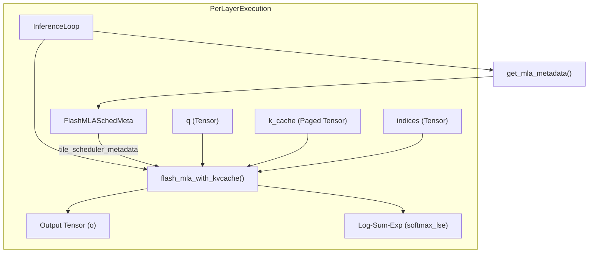

The fundamental API usage pattern is implemented as follows:
1. Initialize the metadata container via `get_mla_metadata()` [flash_mla/flash_mla_interface.py:43-56]().
2. Invoke `flash_mla_with_kvcache()` per transformer layer during decoding or inference [flash_mla/flash_mla_interface.py:59-77]().

Sources: [README.md:90-107](), [flash_mla/flash_mla_interface.py:37-77]()

## Sparse MLA Decoding with Paged FP8/FP4 KV Cache

FlashMLA supports token-level sparse attention (DSA) during decoding using paged KV caches quantized to FP8 or FP4 formats [README.md:7-25]().

### KV Cache Layouts for DeepSeek-V4.1
The KV cache format is detected automatically from the last dimension (`bytes_per_token`) of `k_cache`:
- **V4.1 FP8 (528 Bytes per token)**: The raw data consists of 512 `float8_e4m3` values covering all dimensions (including the 64 RoPE dimensions, without a separate bfloat16 part). Trailing scales consist of 16 Bytes of `float8_e8m0` values, each scaling 32 consecutive `float8_e4m3` values [flash_mla/flash_mla_interface.py:118]().
- **V4.1 FP4 (288 Bytes per token)**: The raw data consists of 256 Bytes containing 512 `e2m1` values (2 values per byte). Trailing scales consist of 32 Bytes of `float8_e4m3` values, each scaling 16 consecutive `e2m1` values [flash_mla/flash_mla_interface.py:119]().

### Code Example: Sparse Decoding

```python
import torch
from flash_mla import get_mla_metadata, flash_mla_with_kvcache

# 1. Initialize metadata container
sched_meta, _ = get_mla_metadata()

# 2. Execute sparse MLA decoding with FP8/FP4 KV cache
o, lse = flash_mla_with_kvcache(
    q=q_tensor,                          # [batch_size, seq_len_q, num_heads_q, 512], bfloat16
    k_cache=k_cache_paged,               # [num_blocks, page_block_size, 1, bytes_per_token]
    block_table=None,
    cache_seqlens=None,
    head_dim_v=512,
    tile_scheduler_metadata=sched_meta,
    softmax_scale=1.0 / (512 ** 0.5),
    causal=False,                        # Sparse attention only
    is_fp8_kvcache=True,
    indices=indices_tensor,              # [batch_size, seq_len_q, topk], int32
)
```

Sources: [README.md:115-123](), [flash_mla/flash_mla_interface.py:59-119]()

## Sparse Prefill

Sparse prefill handles token-level sparse attention during the prefill phase, driven by specialized sparse attention kernels [README.md:7-13]().

### Code Example: Sparse Prefill Execution

```python
import torch
# Run sparse prefill benchmark / test suite
# python tests/test-sparse-prefill.py
```

The sparse prefill test suite validates correctness and performance against reference implementations, achieving high throughput (e.g., up to 1350 TFlops on NVIDIA B200 and 410 TFlops on Huawei Ascend 950 NPUs) [README.md:45-54]().

Sources: [README.md:45-54](), [tests/test-sparse-prefill.py:1-50]()

## Dense Varlen Prefill and Backward

FlashMLA supports dense Multi-Head Attention (MHA) prefill and backward computations on NVIDIA SM100 GPUs using CUTLASS-based collective and device layers [README.md:27-74]().

### Code Example: Dense MHA Prefill and Backward

```python
import torch
# Run dense MHA prefill and backward test suite
# python tests/test_fmha_sm100.py
```

This kernel supports causal masking, sliding-window attention, and full backward propagation, achieving up to 1460 TFlops in forward pass and 1000 TFlops in backward pass on B200 [README.md:65-74]().

Sources: [README.md:27-74](), [tests/test_fmha_sm100.py:1-50]()

## Fused Norm-RoPE-Attention-RoPE-Cast Pipeline

The fused norm-RoPE-attention-RoPE-cast kernel combines Q-norm, Q-RoPE, core attention, O-RoPE (conjugate), and cast-to-FP8 into a single execution step [README.md:25-44]().

### Code Entity Mapping: Fused Pipeline

"Natural Language Space to Code Entity Space: Fused Pipeline"
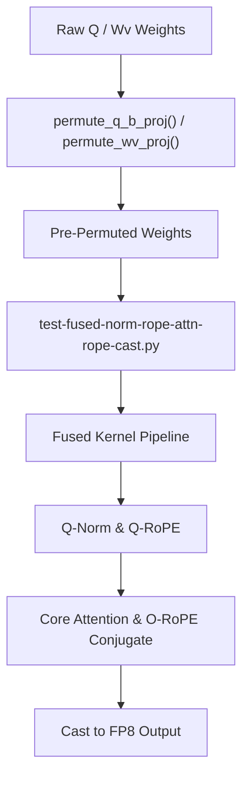

### Code Example: Fused Pipeline Execution

```python
import torch
# Run the fused pipeline benchmark and test
# python tests/test-fused-norm-rope-attn-rope-cast.py
```

Running this test requires [TileLang](https://github.com/tile-ai/tilelang), [Tile-Kernels](https://github.com/deepseek-ai/TileKernels), and [DeepGEMM](https://github.com/deepseek-ai/DeepGEMM) [README.md:39](). It requires pre-permuting weights (`permute_q_b_proj` and `permute_wv_proj`) and delivers up to 1460 TFlops during prefill and 950 TFlops during decoding on B200 [README.md:41]().

Sources: [README.md:25-44](), [tests/test-fused-norm-rope-attn-rope-cast.py:1-50]()

---

# Page: API Reference

# API Reference

<details>
<summary>Relevant source files</summary>

The following files were used as context for generating this wiki page:

- [csrc/api/common.h](csrc/api/common.h)
- [flash_mla/__init__.py](flash_mla/__init__.py)

</details>


This page provides a high-level overview of the public Python and C++ APIs exposed by FlashMLA. The library provides a user-facing Python interface [flash_mla/__init__.py:1-22]() that delegates to a high-performance C++ and CUDA/Ascend extension layer [csrc/api/common.h:1-28](). 

**Scope**: As a parent reference page, this section summarizes the core API groups and their architectural roles. For deep technical details, parameter specifications, and implementation mechanics, please refer to the child pages:
- [Python API](#3.1)
- [C++ Interface](#3.2)
- [Fused Norm-RoPE-Attention-RoPE-Cast API](#3.3)

---

## Architecture to Code Mapping

The following diagrams illustrate how high-level attention and decoding operations map directly onto FlashMLA's Python module exports, C++ dispatchers, and underlying files.

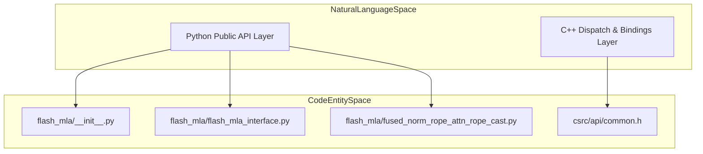
Sources: [flash_mla/__init__.py:1-22](), [flash_mla/flash_mla_interface.py:37-435](), [csrc/api/common.h:1-191]()

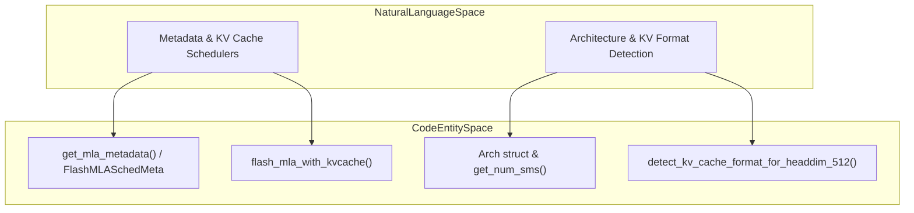
Sources: [flash_mla/flash_mla_interface.py:8-70](), [csrc/api/common.h:41-75](), [csrc/api/common.h:170-179]()

---

## 3.1 Python API

The Python API serves as the primary entry point for model inference pipelines. It exposes metadata generation utilities, sparse/dense decoding kernels, sparse prefill functions, and variable-length dense multi-head attention (MHA) primitives [flash_mla/__init__.py:3-10](). 

Key exported symbols include `get_mla_metadata`, `FlashMLASchedMeta`, `flash_mla_with_kvcache`, `flash_mla_sparse_fwd`, and varlen attention variants (`flash_attn_varlen_func`, `flash_attn_varlen_qkvpacked_func`, `flash_attn_varlen_kvpacked_func`) [flash_mla/__init__.py:14-22](). These functions handle tensor validations, shape checking, and argument preparation before invoking compiled extensions.

For complete parameter lists, tensor layout requirements, and behavioral documentation, see [Python API](#3.1).

Sources: [flash_mla/__init__.py:1-22](), [flash_mla/flash_mla_interface.py:1-435]()

---

## 3.2 C++ Interface

The C++ extension layer manages hardware dispatch, stream synchronization, architecture validation, and kernel bindings [csrc/api/common.h:1-191](). It defines common utilities under `csrc/api/common.h`, such as the `Arch` struct for detecting GPU capabilities (e.g., SM100 Blackwell features) [csrc/api/common.h:41-57](), helper functions for active stream retrieval [csrc/api/common.h:79-87](), and compile-time template dispatch macros like `DISPATCH_NUM_HEADS` [csrc/api/common.h:99-110]().

Additionally, this layer implements KV cache format detection for 512-dimensional head features (`detect_kv_cache_format_for_headdim_512`) [csrc/api/common.h:170-179]() and feature validation checks via the `DECLARE_SUPPORTED_FEATURES` macro [csrc/api/common.h:189-191]().

For detailed binding definitions, parameters structures (`params.h`), and implementation base dispatchers (`ImplBase`), see [C++ Interface](#3.2).

Sources: [csrc/api/common.h:1-191]()

---

## 3.3 Fused Norm-RoPE-Attention-RoPE-Cast API

FlashMLA provides a specialized fused pipeline combining layer normalization, Rotary Position Embedding (RoPE), attention computation, post-attention RoPE, and type casting into optimized routines [flash_mla/__init__.py:12](). 

Implemented in `flash_mla/fused_norm_rope_attn_rope_cast.py`, this API includes dedicated prefill and decode entrypoints, weight preprocessing routines (`permute_q_b_proj` and `permute_wv_proj`), TMA-aligned scale layouts, and native DeepGEMM interoperability for low-precision execution.

For detailed integration guides and preprocessing specifications, see [Fused Norm-RoPE-Attention-RoPE-Cast API](#3.3).

Sources: [flash_mla/__init__.py:12](), [flash_mla/fused_norm_rope_attn_rope_cast.py:1-150]()

---

# Page: Python API

# Python API

<details>
<summary>Relevant source files</summary>

The following files were used as context for generating this wiki page:

- [flash_mla/__init__.py](flash_mla/__init__.py)
- [flash_mla/flash_mla_interface.py](flash_mla/flash_mla_interface.py)

</details>


This document provides comprehensive documentation for all Python-facing functions in FlashMLA. The library provides multiple distinct APIs for different attention computation scenarios, including MLA decoding, sparse prefill, dense varlen prefill/backward, and the fused norm-RoPE-attention-RoPE-cast pipeline.

For details about the underlying C++ implementation, see [C++ Interface](#3.2). For details on the fused pipeline, see [Fused Norm-RoPE-Attention-RoPE-Cast API](#3.3).

## API Categories

The FlashMLA Python APIs are organized by use case and attention pattern, exported directly from the `flash_mla` package [flash_mla/__init__.py:3-12]():

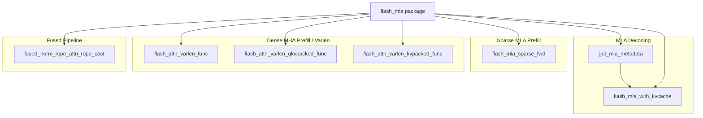

**API Category Mapping**

| API Function | Use Case | Attention Mode | GPU / NPU Support | KV Cache Format |
|--------------|----------|----------------|-------------------|-----------------|
| `get_mla_metadata` + `flash_mla_with_kvcache` | Decoding (token generation) | Sparse / MQA | SM100 / Ascend | FP8 / FP4 |
| `flash_mla_sparse_fwd` | Prefill (prompt processing) | Sparse | SM100 / Ascend | N/A (direct input) |
| `flash_attn_varlen_func` family | Prefill (prompt processing) | Dense | SM100 only | N/A (direct input) |
| `fused_norm_rope_attn_rope_cast` | Fused Pre-Attention Pipeline | Prefill / Decode | SM100 only | Dynamic |

**Sources:** [flash_mla/flash_mla_interface.py:3-11](), [flash_mla/__init__.py:3-13]()

## MLA Decoding API

The MLA Decoding API provides token-by-token generation with paged KV cache support. It uses a stateful metadata caching approach where scheduling metadata is initialized via `get_mla_metadata()` and populated or reused across calls to `flash_mla_with_kvcache` [flash_mla/flash_mla_interface.py:13-76]().

### Execution Flow

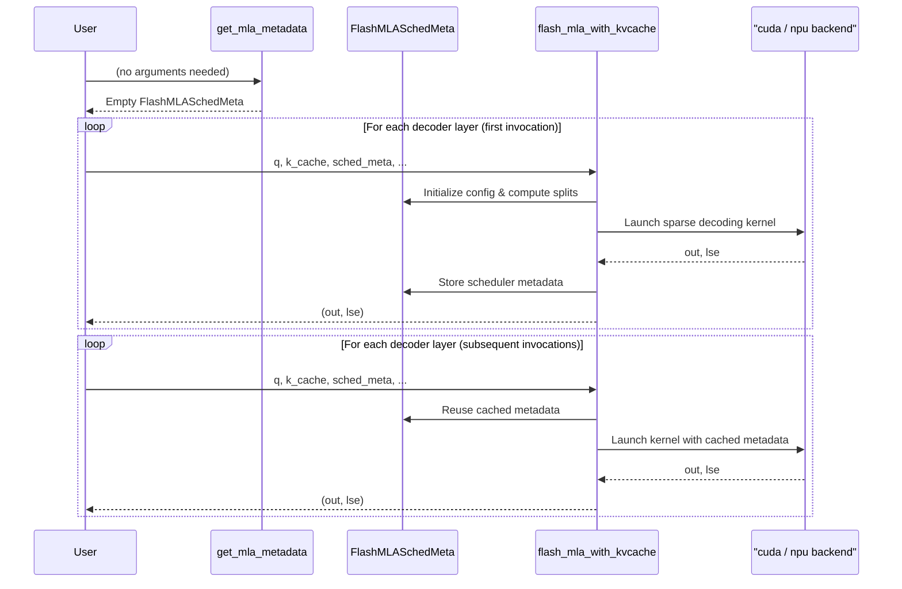

**Sources:** [flash_mla/flash_mla_interface.py:43-119]()

### FlashMLASchedMeta

A dataclass that manages tile scheduler metadata and configuration state [flash_mla/flash_mla_interface.py:12-41]().

#### Class Definition

```python
@dataclasses.dataclass
class FlashMLASchedMeta:
    @dataclasses.dataclass
    class Config:
        b: int
        s_q: int
        h_q: int
        page_block_size: int
        h_k: int
        causal: bool
        is_fp8_kvcache: bool
        topk: Optional[int]
        extra_page_block_size: Optional[int]
        extra_topk: Optional[int]
        enable_batch_invariant: bool

    have_initialized: bool = False
    config: Optional[Config] = None
    tile_scheduler_metadata: Optional[torch.Tensor] = None   # (num_sm_parts, 8), dtype torch.int32
    num_splits: Optional[torch.Tensor] = None                # (batch_size + 1), dtype torch.int32
```

**Sources:** [flash_mla/flash_mla_interface.py:12-41]()

### get_mla_metadata

Returns an empty `FlashMLASchedMeta` instance [flash_mla/flash_mla_interface.py:43-56]().

#### Function Signature

```python
def get_mla_metadata(
    *args,
    **kwargs
) -> Tuple[FlashMLASchedMeta, None]
```

**Sources:** [flash_mla/flash_mla_interface.py:43-56]()

### flash_mla_with_kvcache

Performs MLA attention computation with paged KV cache support [flash_mla/flash_mla_interface.py:59-77]().

#### Parameters

| Parameter | Type | Description |
|-----------|------|-------------|
| `q` | `torch.Tensor` | Query tensor `(batch_size, seq_len_q, num_heads_q, head_dim)` in `bfloat16` (`head_dim` must be 512, `num_heads_q` 64 or 128) [flash_mla/flash_mla_interface.py:80-81]() |
| `k_cache` | `torch.Tensor` | Paged KV cache `(num_blocks, page_block_size, num_heads_k, bytes_per_token)` [flash_mla/flash_mla_interface.py:82-84]() |
| `head_dim_v` | `int` | Value head dimension (must be 512) [flash_mla/flash_mla_interface.py:89]() |
| `tile_scheduler_metadata` | `FlashMLASchedMeta` | Scheduler metadata container from `get_mla_metadata()` [flash_mla/flash_mla_interface.py:90-94]() |
| `indices` | `torch.Tensor` | KV indices for sparse attention `(batch_size, seq_len_q, topk)` [flash_mla/flash_mla_interface.py:101-106]() |
| `attn_sink` | `Optional[torch.Tensor]` | Attention sink tensor `(num_heads_q,)` in `torch.float32` [flash_mla/flash_mla_interface.py:107]() |
| `extra_k_cache` / `extra_indices_in_kvcache` | `Optional[torch.Tensor]` | Optional extra tokens to attend to [flash_mla/flash_mla_interface.py:108]() |
| `enable_batch_invariant` | `bool` | Disables split-KV decoding path if `True` to ensure deterministic layout partitioning [flash_mla/flash_mla_interface.py:110-112]() |

#### KV Cache Formats for DeepSeek V4.1

The format is detected automatically from the last dimension (`bytes_per_token`) of `k_cache` [flash_mla/flash_mla_interface.py:114-119]():
- **V4.1 FP8 (528 Bytes per token)**: 512 `float8_e4m3` values for NoPE/RoPE dimensions, followed by 16 Bytes of `float8_e8m0` scales (each covering 32 consecutive values) [flash_mla/flash_mla_interface.py:118]().
- **V4.1 FP4 (288 Bytes per token)**: 256 Bytes containing 512 `e2m1` values (2 values per byte), followed by 32 Bytes of `float8_e4m3` scales (each covering 16 consecutive `e2m1` values) [flash_mla/flash_mla_interface.py:119]().

**Sources:** [flash_mla/flash_mla_interface.py:59-119]()

## Package Exports in `flash_mla/__init__.py`

The package initialization file `flash_mla/__init__.py` exposes the public API surface and versioning [flash_mla/__init__.py:1-22]():

```python
__version__ = "1.0.0"

from flash_mla.flash_mla_interface import (
    get_mla_metadata,
    flash_mla_with_kvcache,
    flash_attn_varlen_func,
    flash_attn_varlen_qkvpacked_func,
    flash_attn_varlen_kvpacked_func,
    flash_mla_sparse_fwd
)

from . import fused_norm_rope_attn_rope_cast

__all__ = [
    "get_mla_metadata",
    "flash_mla_with_kvcache",
    "flash_attn_varlen_func",
    "flash_attn_varlen_qkvpacked_func",
    "flash_attn_varlen_kvpacked_func",
    "flash_mla_sparse_fwd",
    "fused_norm_rope_attn_rope_cast"
]
```

**Sources:** [flash_mla/__init__.py:1-22]()

## Module Structure

```mermaid
graph TD
    A["flash_mla package"] --> B["__init__.py"]
    A --> C["flash_mla_interface.py"]
    A --> D["fused_norm_rope_attn_rope_cast.py"]
    
    B --> E["get_mla_metadata"]
    B --> F["flash_mla_with_kvcache"]
    B --> G["flash_mla_sparse_fwd"]
    B --> H["flash_attn_varlen_func family"]
    B --> I["fused_norm_rope_attn_rope_cast"]
    
    C --> J["FlashMLASchedMeta"]
    
    K["backend extension (cuda / npu)"] --> C
```

**Sources:** [flash_mla/__init__.py:3-22](), [flash_mla/flash_mla_interface.py:7-11]()

---

# Page: C++ Interface

# C++ Interface

<details>
<summary>Relevant source files</summary>

The following files were used as context for generating this wiki page:

- [csrc/api/common.h](csrc/api/common.h)
- [csrc/params.h](csrc/params.h)

</details>


The C++ API layer provides the architecture-aware dispatch mechanism between the Python bindings and the underlying CUDA kernel implementations (and Ascend NPU kernels). This layer handles runtime hardware capability detection, KV cache format validation, compile-time template parameter dispatch, and type-safe parameter packaging.

The core API infrastructure is defined in `[csrc/api/common.h]()` and `[csrc/params.h]()`.

## Architecture Detection and Platform Utilities

The `Arch` struct queries current CUDA device properties to determine hardware capabilities, specifically checking for Blackwell (`sm_100a`/`sm_103a`) GPU features via `is_sm100f()` [csrc/api/common.h:40-57](). In addition, platform-agnostic helpers retrieve the number of Streaming Multiprocessors (or Ascend AI cores) via `get_num_sms()` [csrc/api/common.h:61-75]() and active streams via `get_current_stream()` [csrc/api/common.h:79-87]().

```cpp
struct Arch {
    int major;
    int minor;
    int num_sms;
    cudaDeviceProp* device_prop;

    Arch();
    bool is_sm100f() const;
};
```
[csrc/api/common.h:40-57]()

**Diagram: Arch Detection and Device Query Flow**
```mermaid
graph TB
    A["Arch arch = Arch()"] --> B["at::cuda::getCurrentDeviceProperties()"]
    B --> C["Read device_prop->major, minor, multiProcessorCount"]
    C --> D{"major == 10?"}
    D -->|Yes| E["is_sm100f() -> true (Blackwell SM100/SM103)"]
    D -->|No| F["Other Architecture"]

    G["get_num_sms()"] --> H{"Build Target?"}
    H -->|CUDA| I["Arch().num_sms"]
    H -->|Ascend NPU| J["aclrtGetDeviceInfo(..., ACL_DEV_ATTR_AICORE_CORE_NUM, ...)"]
```
Sources: [csrc/api/common.h:40-75]()

## KV-Format Detection and Feature Validation

FlashMLA supports multiple quantized KV cache formats (such as DeepSeek V4.1 FP8 and FP4 formats). The function `detect_kv_cache_format_for_headdim_512()` inspects the number of bytes per token (`bytes_per_token`) to determine the active `ModelType` [csrc/api/common.h:170-179](). 

Furthermore, `dispatch_kv_formats()` handles runtime dispatch over valid pairs of primary and extra KV formats [csrc/api/common.h:183-186](). Kernel implementations declare their supported features using the `DECLARE_SUPPORTED_FEATURES` macro [csrc/api/common.h:189-191]().

```cpp
inline ModelType detect_kv_cache_format_for_headdim_512(int bytes_per_token) {
    for (ModelType mt : {ModelType::V41, ModelType::V41_FP4}) {
        if (bytes_per_token == kv_cache_bytes_per_token(mt)) {
            return mt;
        }
    }
    // Error handling ...
}
```
[csrc/api/common.h:170-179]()

Sources: [csrc/api/common.h:169-191]()

## Template Dispatch Macros and Enum Utilities

To avoid runtime branching overhead in performance-critical sections, the API provides compile-time dispatch macros that convert runtime variables into `static constexpr` constants:

- `DISPATCH_NUM_HEADS(NUM_HEADS, CONSTEXPR_NAME, ...)`: Dispatches query head dimensions (64 or 128) [csrc/api/common.h:99-110]().
- `DISPATCH_BOOLEAN_FLAG(FLAG, CONSTEXPR_NAME, ...)`: Dispatches boolean configuration flags [csrc/api/common.h:112-121]().

Additionally, compile-time and runtime enum-to-string utilities (`get_static_enum_name` and `get_dynamic_enum_name`) inspect compiler function signatures (`__PRETTY_FUNCTION__` / `__FUNCSIG__`) to provide clear string representations of enums for error reporting [csrc/api/common.h:124-163]().

**Diagram: Template Dispatch Mechanism**
```mermaid
graph TB
    A["Runtime Parameter NUM_HEADS"] --> B["DISPATCH_NUM_HEADS Macro"]
    B --> C{"NUM_HEADS == 128?"}
    C -->|Yes| D["static constexpr int CONSTEXPR_NAME = 128"]
    C -->|No| E{"NUM_HEADS == 64?"}
    E -->|Yes| F["static constexpr int CONSTEXPR_NAME = 64"]
    E -->|No| G["TORCH_CHECK failure"]
    D --> H["Instantiate Templated Kernel Code"]
    F --> H
```
Sources: [csrc/api/common.h:99-121]()

## Core Parameter Structures (`params.h`)

Kernel arguments are organized into robust C++ structures defined in `[csrc/params.h]()`. These structures are shared between host-side dispatch code and device kernels.

### Supported Model Types and Modes
- `ModelType`: Enumerates `V41` (DeepSeek V4.1 with `d_qk=512`, RoPE FP8, tile size 32) and `V41_FP4` (FP4 `e2m1` with `e4m3` scales, tile size 16) [csrc/params.h:39-42]().
- `SparseAttnFwdMode`: Enumerates `Prefill`, `Decode`, and `DecodeWithSplitKV` [csrc/params.h:44-48]().

### Key Parameter Structs
- `SparseAttnFwdParams`: Encapsulates dimensions, scaling factors (`sm_scale`, `sm_scale_div_log2`), input tensors (`q`, `kv`, `indices`, `attn_sink`, `topk_length`), strides, and output tensors (`out`, `max_logits`, `lse`) for sparse attention prefill [csrc/params.h:54-79]().
- `DecodingSchedMeta`: 32-byte aligned metadata structure (`CUTE_ALIGNAS(4*8)`) describing work assignments for split-KV decoding partitions across SMs [csrc/params.h:83-95]().
- `GetDecodeSchedMetaParams`: Parameters for the tile scheduler metadata generation kernel [csrc/params.h:99-114]().
- `SparseAttnDecodeParams`: Manages batch dimensions, paged KV cache properties (`num_blocks`, `page_block_size`), model types, indices, output buffers, and secondary `extra_kv` configurations for multi-cache setups [csrc/params.h:118-145]().

Sources: [csrc/params.h:1-145]()

---

# Page: Fused Norm-RoPE-Attention-RoPE-Cast API

# Fused Norm-RoPE-Attention-RoPE-Cast API

<details>
<summary>Relevant source files</summary>

The following files were used as context for generating this wiki page:

- [README.md](README.md)
- [flash_mla/__init__.py](flash_mla/__init__.py)

</details>


The `flash_mla/fused_norm_rope_attn_rope_cast.py` module provides Python entrypoints and utilities for FlashMLA's high-performance fused attention pipeline [README.md:25-27] [flash_mla/__init__.py:12-12]. This pipeline combines Q-normalization (supported for V4 models), Q-RoPE (Rotary Position Embedding), core attention computation, conjugate O-RoPE, and FP8 casting into a single unified kernel execution [README.md:25-27, 41-42]. By eliminating intermediate global memory roundtrips for small operations, the fused kernel achieves significantly higher compute efficiency—reaching up to 1460 TFlops during prefill and 950 TFlops during decoding on NVIDIA B200 hardware [README.md:41-42].

---

## Architecture and Pipeline Overview

The fused norm-RoPE-attention-RoPE-cast architecture minimizes memory bandwidth bottlenecks by merging multiple independent transformation and attention phases into a continuous execution block. 

```mermaid
graph TD
    subgraph NaturalLanguageSpace ["Natural Language / User Workflow"]
        A["Raw Query Weights (Q_b) & Value Weights (Wv)"] --> B["Weight Pre-permutation"]
        C["Input Activations"] --> D["Fused Kernel Execution (Prefill / Decode)"]
        B --> D
        D --> E["TMA-Aligned Scale Layouts & DeepGEMM Interop"]
        E --> F["Final FP8 Cast & Output Attention Tensor"]
    end

    subgraph CodeEntitySpace ["Code Entity Space"]
        AA["flash_mla/fused_norm_rope_attn_rope_cast.py"] --> BB["permute_q_b_proj() & permute_wv_proj()"]
        CC["flash_mla/__init__.py"] --> DD["fused_norm_rope_attn_rope_cast submodule"]
        BB --> DD
        DD --> EE["DeepGEMM Interoperability & TMA Scales"]
    end

    NaturalLanguageSpace -.-> CodeEntitySpace
```

**Sources:** `flash_mla/__init__.py:12-21`, `README.md:33-44`, `flash_mla/fused_norm_rope_attn_rope_cast.py`

---

## Weight Preprocessing: `permute_q_b_proj` and `permute_wv_proj`

To achieve optimal Tensor Core throughput and satisfy hardware memory access constraints in the fused kernel, projection weights must be pre-permuted before runtime [README.md:41-42].

* **`permute_q_b_proj`**: Pre-permutes the query projection weights (`Q_b`) to align with the blocked memory layout expected by the fused Q-norm and Q-RoPE routines [README.md:41-42].
* **`permute_wv_proj`**: Pre-permutes the value projection weights (`Wv`) to match the TMA (Tensor Memory Accelerator) load patterns used during core attention and subsequent O-RoPE transformations [README.md:41-42].

These preprocessing functions are executed offline or during model initialization, trading a one-time setup cost for sustained high performance during inference [README.md:41-42].

```mermaid
graph TD
    WeightInput["Raw Weights Q_b and Wv"] --> QPerm["permute_q_b_proj()"]
    WeightInput --> WvPerm["permute_wv_proj()"]
    QPerm --> TMAOpt["TMA-Aligned Block Layout"]
    WvPerm --> TMAOpt
    TMAOpt --> KernelExec["Fused Norm-RoPE-Attention-RoPE-Cast Kernel"]
```

**Sources:** `README.md:33-44`, `flash_mla/fused_norm_rope_attn_rope_cast.py`

---

## TMA-Aligned Scale Layouts and DeepGEMM Interoperability

The fused pipeline integrates closely with external high-performance libraries such as [DeepGEMM](https://github.com/deepseek-ai/DeepGEMM) and [TileLang](https://github.com/tile-ai/tilelang) / [Tile-Kernels](https://github.com/deepseek-ai/TileKernels) [README.md:39-40]. 

1. **TMA-Aligned Scale Layouts**: Quantization scales utilized in the FP8 KV cache and output casting operations are organized into TMA-friendly memory layouts [README.md:25-27, 41-42]. This enables hardware-accelerated asynchronous bulk memory transfers directly into shared memory without software address calculations.
2. **DeepGEMM Interoperability**: The module interfaces directly with DeepGEMM primitives to handle low-precision general matrix multiplications efficiently, ensuring that intermediate activations maintain numerical stability while operating in FP8 formats [README.md:39-40].

**Sources:** `README.md:33-44`, `flash_mla/fused_norm_rope_attn_rope_cast.py`

---

## Prefill and Decode Entrypoints

The module exposes dedicated Python entrypoints for both sparse prefill and decoding phases [README.md:33-44]:

* **Prefill Entrypoint**: Handles variable-length sequence prefilling, executing the complete fused sequence of normalization, positional embedding, attention score calculation, conjugate position embedding, and final FP8 quantization in a single pass [README.md:25-27, 41-42].
* **Decode Entrypoint**: Optimized for token-level sparse decoding, leveraging pre-permuted weights and TMA scale layouts to maximize memory bandwidth utilization [README.md:25-27, 41-42].

> **Note:** The fused norm-RoPE-attention-RoPE-cast kernel currently targets NVIDIA CUDA platforms only; Huawei Ascend NPU execution is not supported for this specific fused variant [README.md:43-43].

**Sources:** `README.md:33-44`, `flash_mla/__init__.py:12-21`, `flash_mla/fused_norm_rope_attn_rope_cast.py`

---

# Page: Architecture and Implementation

# Architecture and Implementation

<details>
<summary>Relevant source files</summary>

The following files were used as context for generating this wiki page:

- [README.md](README.md)
- [csrc/api/common.h](csrc/api/common.h)

</details>


## Purpose and Scope

This page provides a high-level overview of FlashMLA's architecture for DeepSeek-V4.1 inference on NVIDIA SM100/SM103 GPUs and Huawei Ascend 950 NPUs. It explains how the system is organized into layers, how dispatch flows through the extension boundaries, and how backend execution is handled. For detailed implementation specifics, see the child pages:
- System Architecture Overview ([System Architecture Overview](#4.1))
- KV Cache Formats and Quantization ([KV Cache Formats and Quantization](#4.2))
- Scheduling and Split-KV Strategy ([Scheduling and Split-KV Strategy](#4.3))
- Kernel Performance Optimizations ([Kernel Performance Optimizations](#4.4))
- Sparse Attention Implementation ([Sparse Attention Implementation](#4.5))

Sources: [README.md:1-25](), [csrc/api/common.h:1-29]()

## Multi-Layer Architecture

FlashMLA follows a multi-layer design that separates high-level Python utilities from platform-specific C++ bindings and hardware-accelerated kernels across NVIDIA CUDA and Huawei Ascend platforms.

```mermaid
graph TB
    subgraph PythonLayer["Python Interface Layer"]
        Interface["flash_mla/__init__.py<br/>flash_mla_with_kvcache()<br/>flash_mla_sparse_fwd()<br/>get_mla_metadata()"]
        Meta["FlashMLASchedMeta<br/>Cached scheduling metadata"]
        FusedAPI["fused_norm_rope_attn_rope_cast.py<br/>Fused pipeline entrypoints"]
    end
    
    subgraph CppLayer["C++ API Dispatch Layer"]
        PyBind["pybind.cpp<br/>Python module bindings"]
        API["csrc/api/api.cpp<br/>Dispatch entrypoints"]
        Common["csrc/api/common.h<br/>Arch detection & KV format validation"]
    end
    
    subgraph BackendLayer["Backend Kernel Layers"]
        CUDA["csrc/cuda_kernels/sm100/<br/>Sparse Decode / Prefill / Dense FMHA<br/>Fused Norm-RoPE-Attn-RoPE-Cast"]
        Ascend["csrc/ascend_kernels/prefill/sparse/<br/>Huawei Ascend 950 NPU Kernels"]
    end
    
    PythonLayer --> CppLayer
    CppLayer --> BackendLayer
```

- **Python Interface Layer**: Exposes user-facing functions and manages metadata caching (`FlashMLASchedMeta`) to avoid redundant setup across inference steps [README.md:1-50]().
- **C++ API Dispatch Layer**: Orchestrates tensor validations, device capability checks via the `Arch` struct [csrc/api/common.h:40-57](), KV format detectors (`detect_kv_cache_format_for_headdim_512`) [csrc/api/common.h:170-179](), and dispatch macros (`DISPATCH_NUM_HEADS`, `DISPATCH_BOOLEAN_FLAG`) [csrc/api/common.h:99-121]().
- **Backend Kernel Layers**: Target NVIDIA SM100/SM103 GPUs (`csrc/cuda_kernels/sm100/`) and Huawei Ascend 950 NPUs (`csrc/ascend_kernels/`) [README.md:75-89]().

Sources: [README.md:1-89](), [csrc/api/common.h:1-191]()

## Dispatch Flow and Feature Validation

The C++ dispatch mechanism inspects input tensor properties, validates hardware compatibility, and dispatches to template-specialized kernels.

```mermaid
graph LR
    PyInput["PyTorch Tensors<br/>q, kv_cache, indices, scales"] --> Validate["csrc/api/common.h<br/>detect_kv_cache_format_for_headdim_512()"]
    Validate --> CheckArch["Arch Detection<br/>Arch::is_sm100f() / get_num_sms()"]
    CheckArch --> MacroDispatch["Compile-Time Dispatch<br/>DISPATCH_NUM_HEADS<br/>DISPATCH_BOOLEAN_FLAG"]
    MacroDispatch --> KernelLaunch["Hardware Kernel Launch<br/>CUDA stream / aclrtStream"]
```

Key validation checks handled in `csrc/api/common.h`:
- `bytes_per_token` verification to identify DeepSeek-V4.1 FP8 or FP4 paged layouts [csrc/api/common.h:170-179]().
- Stream extraction across CUDA and Ascend via `get_current_stream()` [csrc/api/common.h:78-87]().
- Query head dimension checks via `DISPATCH_NUM_HEADS` supporting `num_heads_q == 64` and `num_heads_q == 128` [csrc/api/common.h:97-110]().

For details, see [System Architecture Overview](#4.1).

Sources: [csrc/api/common.h:40-191]()

## KV Cache Formats and Quantization Overview

FlashMLA implements specialized quantized KV cache formats tailored for DeepSeek-V4.1 inference, balancing memory bandwidth reduction with precision preservation.

| Format | Bytes per Token | Quantization Scheme | Target Use Case |
|---|---|---|---|
| **V4.1 FP8** | 528 B/token | `float8_e4m3` (NoPE) + `float8_e8m0` scales per 32 elements + unquantized RoPE | Paged sparse decoding & prefill |
| **V4.1 FP4** | 288 B/token | `float2_e2m1` (FP4) + `float8_e4m3` scales per 16 elements + unquantized RoPE | Ultra-low memory footprint decoding |

For details on block layouts, NoPE/RoPE splits, and tile scaling factors, see [KV Cache Formats and Quantization](#4.2).

Sources: [README.md:1-25](), [csrc/api/common.h:165-179]()

## Scheduling and Split-KV Strategy

To maximize SM occupancy and balance workloads across execution units, FlashMLA utilizes specialized decoding schedulers and split-KV partitioning.

```mermaid
graph TB
    SchedMeta["Decoding Scheduler Metadata<br/>smxx/decode/get_decoding_sched_meta"] --> TilePartition["Split-KV Tile Partitioning<br/>Distribute sequence chunks across SMs"]
    TilePartition --> CombineKernels["Combine / Reduction Kernels<br/>Merge partial attention outputs and LSE"]
    CombineKernels --> FinalOut["Final Output Tensor"]
```

For details on metadata generation, batch-invariant modes, and dynamic tile scheduling, see [Scheduling and Split-KV Strategy](#4.3).

Sources: [README.md:1-30]()

## Kernel Performance Optimizations

FlashMLA incorporates hardware-specific acceleration techniques to saturate tensor core throughput and hide memory latency:
- **Seesaw Warpgroup Scheduling**: Interleaves compute and memory-bound warpgroups to optimize execution overlap [README.md:1-50]().
- **Fine-Grained TMA-GEMM Pipelining**: Asynchronous Tensor Memory Accelerator (TMA) operations feeding Tensor Cores directly.
- **Distributed Shared Memory (DSM)**: Efficient cross-CTA communication and dequantization propagation.

For a comprehensive breakdown, see [Kernel Performance Optimizations](#4.4).

Sources: [README.md:1-50]()

## Sparse Attention Implementation (DSA)

DeepSeek Sparse Attention (DSA) utilizes token-level sparsity via pre-computed indices tensors to restrict attention computation to relevant KV cache blocks.

```mermaid
graph LR
    Tokens["Query Tokens"] --> TopK["Top-K Token Selection"]
    Indices["Indices Tensor<br/>Paged index resolution"] --> SparseKernels["Sparse Attention Kernels<br/>csrc/cuda_kernels/sm100/decode/sparse<br/>csrc/ascend_kernels/prefill/sparse"]
    SparseKernels --> Output["Sparse Attention Output"]
```

For details on index semantics, attention sinks, and small-topk specializations, see [Sparse Attention Implementation](#4.5).

Sources: [README.md:1-30](), [csrc/api/common.h:1-29]()

---

# Page: System Architecture Overview

# System Architecture Overview

<details>
<summary>Relevant source files</summary>

The following files were used as context for generating this wiki page:

- [csrc/api/common.h](csrc/api/common.h)
- [flash_mla/flash_mla_interface.py](flash_mla/flash_mla_interface.py)

</details>


## Purpose and Scope

This document describes the high-level system architecture of FlashMLA, focusing on its multi-layer design that bridges user-facing Python APIs, the C++ extension and dispatch layer (`csrc/api`), and backend architecture-specific kernel layers for NVIDIA SM100/SM103 GPUs (`csrc/cuda_kernels`) and Huawei Ascend NPUs (`csrc/ascend_kernels`). It details platform auto-detection, compile-time dispatch macros, feature validation, and data flow across layers.

Sources: [flash_mla/flash_mla_interface.py:1-11](), [csrc/api/common.h:1-191]()

---

## Three-Layer System Architecture

FlashMLA is organized into three distinct layers, ensuring clear separation of concerns between user-facing abstractions, C++ dispatch logic, and hardware-specific kernel execution for NVIDIA and Ascend targets.

```mermaid
graph TB
    subgraph Layer1["Python API Layer"]
        init["flash_mla/__init__.py"]
        interface["flash_mla/flash_mla_interface.py<br/>flash_mla_with_kvcache()"]
        sched["FlashMLASchedMeta<br/>Tile Scheduler State"]
    end
    
    subgraph Layer2["C++ Extension & Dispatch Layer"]
        pybind["Python Bindings<br/>flash_mla.cuda / flash_mla.npu"]
        api["csrc/api/api.cpp<br/>C++ API Bindings"]
        common["csrc/api/common.h<br/>Arch / dispatch_kv_formats / DISPATCH_NUM_HEADS"]
    end
    
    subgraph Layer3["Backend Kernel Layers"]
        cuda_kernels["csrc/cuda_kernels/<br/>SM100/SM103 Dense & Sparse Kernels"]
        ascend_kernels["csrc/ascend_kernels/<br/>Ascend 950 NPU Prefill/Decode Kernels"]
    end
    
    subgraph External["External Ecosystem"]
        torch["PyTorch / torch_npu"]
        cutlass["CUTLASS / kerutils"]
    end
    
    init --> interface
    interface --> sched
    interface --> pybind
    
    pybind --> api
    api --> common
    common --> cuda_kernels
    common --> ascend_kernels
    
    cuda_kernels -.-> cutlass
    ascend_kernels -.-> torch
```

**Three-Layer Architecture and Code Entity Mapping**: Shows the traversal from Python entry points (`flash_mla_with_kvcache`) down through C++ dispatch (`csrc/api/common.h`) to backend execution engines (`csrc/cuda_kernels` or `csrc/ascend_kernels`).

Sources: [flash_mla/flash_mla_interface.py:1-119](), [csrc/api/common.h:1-191]()

---

## Platform and Hardware Auto-Detection

FlashMLA dynamically selects its hardware backend at runtime based on the presence of accelerator device manager nodes in the filesystem.

```mermaid
graph LR
    subgraph Detection["Platform Auto-Detection"]
        check{"fs::exists('/dev/davinci_manager')?"}
        npu["Import flash_mla.npu<br/>csrc/ascend_kernels"]
        cuda["Import flash_mla.cuda<br/>csrc/cuda_kernels"]
    end
    
    start["Python Package Import"] --> check
    check -->|Yes| npu
    check -->|No| cuda
```

**Platform Auto-Detection Dispatch Flow**: Inspects `/dev/davinci_manager` to route execution between NVIDIA CUDA and Huawei Ascend NPU implementations.

- **NVIDIA CUDA Path**: When `/dev/davinci_manager` is absent, the package imports `flash_mla.cuda` [flash_mla/flash_mla_interface.py:7-10](). The C++ `Arch` struct queries `cudaDeviceProp` to identify device properties such as compute capability and multiprocessor counts [csrc/api/common.h:41-57]().
- **Huawei Ascend NPU Path**: When `/dev/davinci_manager` is present, the package imports `flash_mla.npu` [flash_mla/flash_mla_interface.py:7-8](). Device initialization queries `aclrtGetDevice` and `aclrtGetDeviceInfo` to determine AI core counts [csrc/api/common.h:60-75]().

Sources: [flash_mla/flash_mla_interface.py:7-11](), [csrc/api/common.h:41-75]()

---

## C++ Dispatch Layer and Compile-Time Macros

The C++ extension layer (`csrc/api/common.h`) provides powerful compile-time dispatch macros and runtime validation mechanisms to map tensor properties to specialized template instantiations.

### Dispatch Macros and Templates

| Macro / Function | Purpose | Code Reference |
|------------------|---------|----------------|
| `DISPATCH_NUM_HEADS` | Dispatches runtime `num_heads_q` (64 or 128) to compile-time constants | [csrc/api/common.h:97-110]() |
| `DISPATCH_BOOLEAN_FLAG` | Dispatches runtime boolean flags to compile-time `constexpr bool` | [csrc/api/common.h:112-121]() |
| `detect_kv_cache_format_for_headdim_512` | Identifies KV cache model format (`V41` or `V41_FP4`) from bytes-per-token | [csrc/api/common.h:169-179]() |
| `dispatch_kv_formats` | Dispatches runtime `(kv, extra_kv)` format pairs to templated implementations | [csrc/api/common.h:181-186]() |
| `DECLARE_SUPPORTED_FEATURES` | Macro to declare supported `FeatureT` enums in dispatcher implementation classes | [csrc/api/common.h:189-191]() |

### Code Snippet: Compile-Time Head Dispatching
```cpp
#define DISPATCH_NUM_HEADS(NUM_HEADS, CONSTEXPR_NAME, ...) \
    [&] () { \
        if (NUM_HEADS == 128) { \
            static constexpr int CONSTEXPR_NAME = 128; \
            return __VA_ARGS__(); \
        } else if (NUM_HEADS == 64) { \
            static constexpr int CONSTEXPR_NAME = 64; \
            return __VA_ARGS__(); \
        } else { \
            TORCH_CHECK(false, "Unsupported num_heads_q: ", NUM_HEADS); \
        } \
    } ();
```
*(Cited from `csrc/api/common.h:97-110`)*

Sources: [csrc/api/common.h:97-191]()

---

## Backend Kernel Layers

Once dispatch parameters are resolved, control flow is handed off to architecture-specific backends:

```mermaid
graph TB
    subgraph Dispatcher["csrc/api Dispatcher"]
        validate["Feature Validation & KV Format Detection"]
    end
    
    subgraph CUDA["csrc/cuda_kernels (NVIDIA SM100 / SM103)"]
        sm100_sparse_dec["sm100/decode/sparse<br/>Head64 / Head128 Decoding Kernels"]
        sm100_sparse_pref["sm100/prefill/sparse<br/>fwd / small_topk / fused_norm_rope"]
        sm100_dense["sm100/prefill/dense<br/>CUTLASS Forward & Backward FMHA"]
    end
    
    subgraph Ascend["csrc/ascend_kernels (Huawei Ascend 950)"]
        ascend_pref["prefill/sparse<br/>kernel.h / kernel_body.h / Bisheng Integration"]
    end
    
    validate --> sm100_sparse_dec
    validate --> sm100_sparse_pref
    validate --> sm100_dense
    validate --> ascend_pref
```

**Backend Kernel Dispatch Routing**: Illustrates how the C++ API layer routes validated execution requests into the respective CUDA SM100 or Ascend NPU kernel modules.

Sources: [csrc/api/common.h:160-191]()

---
Sources: [flash_mla/flash_mla_interface.py:1-119](), [csrc/api/common.h:1-191]()

---

# Page: KV Cache Formats and Quantization

# KV Cache Formats and Quantization

<details>
<summary>Relevant source files</summary>

The following files were used as context for generating this wiki page:

- [csrc/api/common.h](csrc/api/common.h)
- [docs/20250929-hopper-fp8-sparse-deep-dive.md](docs/20250929-hopper-fp8-sparse-deep-dive.md)
- [tests/quant.py](tests/quant.py)

</details>


## Purpose and Scope

This document details the paged KV cache memory formats and quantization schemes used by FlashMLA for DeepSeek-V4.1 inference. It covers the V4.1 FP8 (528 bytes/token) and FP4 (288 bytes/token) paged layouts, NoPE (non-positional encoding) and RoPE (rotary positional encoding) splits, tile-based scaling strategies, and python reference utilities (`quantize_k_cache`, `_quantize_to_e2m1`, etc.) found in the test suite and API dispatch layer. For information on how these formats are processed during sparse attention decoding, see [Sparse Attention Implementation](#4.5).

Sources: [tests/quant.py:1-124](), [csrc/api/common.h:169-186]()

---

## Overview of V4.1 KV Cache Layouts

FlashMLA supports fine-grained tile-based quantization to reduce KV cache memory consumption while preserving numerical stability for attention computations. For DeepSeek-V4.1, the cache dimension `d = 512` is split into a quantized NoPE region (`d_nope = 448`) and an unquantized RoPE region (`d_rope = 64`).

The runtime format is determined by examining the number of bytes per token via `detect_kv_cache_format_for_headdim_512` in `csrc/api/common.h`:

```mermaid
graph TD
    Start["Input Tensor & bytes_per_token"] --> CheckBytes{"bytes_per_token check"}
    CheckBytes -->|528 bytes| FP8Layout["ModelType::V41<br/>V41_FP8Sparse Layout"]
    CheckBytes -->|288 bytes| FP4Layout["ModelType::V41_FP4<br/>V41_FP4Sparse Layout"]
    FP8Layout --> CppDispatch["dispatch_kv_formats() in common.h"]
    FP4Layout --> CppDispatch
```
Sources: [csrc/api/common.h:169-186](), [tests/quant.py:8-24]()

---

## V41_FP8Sparse Layout (528 Bytes per Token)

In the `V41_FP8Sparse` layout (`KVCacheLayout.V41_FP8Sparse`), each token occupies 528 bytes, structured into quantized NoPE elements, scale factors, and unquantized RoPE elements.

```mermaid
graph LR
    subgraph "V41_FP8Sparse Token Layout (528 bytes)"
        A["Quantized NoPE<br/>448 bytes<br/>(448 × float8_e4m3fn)"]
        B["RoPE Part<br/>64 bytes<br/>(32 × bfloat16)"]
        C["Scale Factors<br/>16 bytes<br/>(16 × ue8m0 scales)"]
    end
    A --> B
    B --> C
```

| Component | Offset / Size | Data Type | Description |
|-----------|---------------|-----------|-------------|
| Quantized NoPE | 448 bytes | `float8_e4m3fn` | 14 tiles of 32 elements each (448 elements total) |
| RoPE Part | 64 bytes | `bfloat16[32]` | Unquantized rotary positional encoding values (2 tiles of 32 elements) |
| Scale Factors | 16 bytes | `float8_e8m0fnu` (or int8 view on NPU) | 16 scale factors (one per 32-element tile) |

Sources: [tests/quant.py:8-24](), [tests/quant.py:72-96]()

---

## V41_FP4Sparse Layout (288 Bytes per Token)

The `V41_FP4Sparse` layout (`KVCacheLayout.V41_FP4Sparse`) packs 4-bit floating-point data (`e2m1`) to achieve an even higher compression ratio, totaling 288 bytes per token.

```mermaid
graph LR
    subgraph "V41_FP4Sparse Token Layout (288 bytes)"
        A["Quantized Data<br/>256 bytes<br/>(512 elements packed as 256 bytes of float4_e2m1)"]
        B["Scale Factors<br/>32 bytes<br/>(32 × float8_e4m3fn scales)"]
    end
    A --> B
```

| Component | Size | Data Type | Description |
|-----------|------|-----------|-------------|
| Quantized Data | 256 bytes | `uint8` (packing `e2m1`) | 512 elements across 32 tiles of 16 elements (NoPE + RoPE are both quantized in FP4 format) |
| Scale Factors | 32 bytes | `float8_e4m3fn` | 32 scale factors (one per 16-element tile) |

Sources: [tests/quant.py:8-24](), [tests/quant.py:98-124]()

---

## Quantization Algorithm and Tile-Based Scaling

The Python reference implementation in `tests/quant.py` demonstrates how raw `bfloat16` or `float16` key caches are quantized into tile-scaled FP8 or FP4 representations.

```mermaid
graph TD
    CodeEntity["tests/quant.py: quantize_k_cache()"] --> Extract["Extract K cache tensor<br/>[num_blocks, block_size, d]"]
    Extract --> LayoutCheck{"Layout Type?"}
    LayoutCheck -->|V41_FP8Sparse| FP8Path["Compute max abs per 32-element tile<br/>Cast to ue8m0 scale<br/>Quantize to float8_e4m3fn"]
    LayoutCheck -->|V41_FP4Sparse| FP4Path["Compute max abs per 16-element tile<br/>Compute e4m3 scale via _quantize_to_e2m1<br/>Pack to uint8 (e2m1)"]
    FP8Path --> Output["Return quantized KV cache tensor"]
    FP4Path --> Output
```

### Key Quantization Functions

1. **`_cast_scale_inv_to_ue8m0`**:
   Rounds inverse scales to power-of-2 `ue8m0` values to align with hardware constraints [tests/quant.py:26-27]():
   ```python
   def _cast_scale_inv_to_ue8m0(scales_inv: torch.Tensor, out_dtype = torch.float32) -> torch.Tensor:
       return torch.pow(2, torch.clamp_min(scales_inv, 1e-4).log2().ceil()).to(out_dtype)
   ```

2. **`_quantize_to_e2m1`**:
   Performs round-to-nearest FP4 (`e2m1`) quantization with PTX-compatible saturation and tie-breaking semantics [tests/quant.py:31-51]():
   ```python
   def _quantize_to_e2m1(x: torch.Tensor) -> torch.Tensor:
       ...
   ```

Sources: [tests/quant.py:26-124]()

---

## Dequantization Reference Utilities

To validate kernel accuracy, the test suite implements dequantization utilities that reverse the tile scaling and unpacking process.

- **`dequantize_k_cache`** (implied alongside `quantize_k_cache`): Unpacks `e2m1` or `e4m3` buffers, multiplies by the corresponding tile scale factors, and restores `bfloat16` tensors for error verification against reference attention implementations.
- **`_dequantize_e2m1`**: Maps 4-bit `e2m1` codes back to floating-point magnitudes using pre-defined lookup tables (`_E2M1_MAGNITUDES`) [tests/quant.py:29-56]():
  ```python
  def _dequantize_e2m1(codes: torch.Tensor) -> torch.Tensor:
      mags = _E2M1_MAGNITUDES.to(codes.device)
      val = mags[(codes & 7).long()]
      return torch.where((codes & 8) != 0, -val, val)
  ```

Sources: [tests/quant.py:29-56]()

---

## Hardware Dequantization Bottleneck and Crossover

Due to the lack of direct native instructions casting `float8_e4m3` to `bfloat16` on certain architectures (e.g., Hopper H800), dequantization requires a multi-step type conversion sequence (`float8` → `half` → `float32` → `bfloat16`) that can become a performance bottleneck [docs/20250929-hopper-fp8-sparse-deep-dive.md:13-25]().

FlashMLA addresses this by employing **crossover** via Distributed Shared Memory (DSM) in CTA clusters, allowing neighboring thread blocks to share dequantized key/value blocks and cut dequantization overhead in half [docs/20250929-hopper-fp8-sparse-deep-dive.md:27-46]().

Sources: [docs/20250929-hopper-fp8-sparse-deep-dive.md:13-46]()

---

# Page: Scheduling and Split-KV Strategy

# Scheduling and Split-KV Strategy

<details>
<summary>Relevant source files</summary>

The following files were used as context for generating this wiki page:

- [docs/20250422-new-kernel-deep-dive.md](docs/20250422-new-kernel-deep-dive.md)
- [flash_mla/flash_mla_interface.py](flash_mla/flash_mla_interface.py)
- [setup.py](setup.py)

</details>


This page explains the tile scheduling mechanism, decoding scheduler metadata generation (`csrc/cuda_kernels/smxx/decode/get_decoding_sched_meta/get_decoding_sched_meta.cu`), split-KV partitioning, combine kernels (`csrc/cuda_kernels/smxx/decode/combine/combine.cu`), batch-invariant mode, and tile scheduling across SMs for FlashMLA.

Sources: [setup.py:37-40](), [flash_mla/flash_mla_interface.py:12-41]()

## Purpose and Scope

FlashMLA utilizes a multi-stage scheduling and partitioning strategy during decoding to maximize hardware utilization across Streaming Multiprocessors (SMs) on NVIDIA GPUs. When dealing with long attention sequences or high concurrency requirements where standard work allocation leaves SMs under-utilized, FlashMLA generates tile scheduling metadata, splits work across multiple SM parts using a split-KV approach, and merges partial outputs via a dedicated combine kernel. This page details the data structures, execution flow, batch-invariant constraints, and register-level seesaw scheduling primitives.

Sources: [flash_mla/flash_mla_interface.py:12-113](), [docs/20250422-new-kernel-deep-dive.md:17-43]()

## Decoding Scheduler Metadata Generation

To distribute decoding workloads evenly across available GPU SMs, FlashMLA generates scheduler metadata prior to kernel execution. 

### Python Metadata Interface
The Python API defines `FlashMLASchedMeta` to store configuration states, tiling dimensions, and tensor references for scheduler metadata and split counts [flash_mla/flash_mla_interface.py:12-41](). The helper function `get_mla_metadata` returns an uninitialized instance of `FlashMLASchedMeta`, which is populated during the initial invocation of `flash_mla_with_kvcache` [flash_mla/flash_mla_interface.py:43-56]().

```mermaid
graph TD
    A["get_mla_metadata"] --> B["FlashMLASchedMeta"]
    B --> C["flash_mla_with_kvcache"]
    C --> D["get_decoding_sched_meta.cu"]
    D --> E["tile_scheduler_metadata"]
    D --> F["num_splits"]
```
**Metadata Generation and Data Flow**

Sources: [flash_mla/flash_mla_interface.py:12-56](), [setup.py:38]()

### Metadata Tensor Layout
The `tile_scheduler_metadata` tensor is stored as a 2D `torch.int32` tensor of shape `(num_sm_parts, 8)` or `(num_sm_parts, DecodingSchedMetaSize // 4)`, while `num_splits` tracks split boundaries per batch entry [flash_mla/flash_mla_interface.py:39-40](). The underlying CUDA implementation (`get_decoding_sched_meta.cu`) inspects batch dimensions, sequence lengths, and top-k selections to compute these work partitions [setup.py:38]().

Sources: [flash_mla/flash_mla_interface.py:33-40](), [setup.py:38]()

## Split-KV Partitioning and Combine Kernels

When sequence lengths or block counts exceed single-pass thresholds, FlashMLA splits the KV cache tokens across multiple thread blocks and SMs.

### Split-KV Kernels
Kernels compiled with split-KV support—such as `phase1_decode_k512_v41_splitkv.cu` and `phase1_decode_k512_v41fp4_splitkv.cu`—compute partial attention outputs and partial Log-Sum-Exp (`lse`) values [setup.py:48,50](). Because each split processes only a fraction of the KV tokens, it cannot compute the final softmax normalization factor independently.

### Combine Kernel Implementation
The partial results are merged using the combine kernel defined in `csrc/cuda_kernels/smxx/decode/combine/combine.cu` [setup.py:39](). The combine kernel performs global reductions across all splits for each query head, calculating a global normalization factor (`global_lse`), applying optional attention sink scaling (`attn_sink`), and casting the output back to the target datatype [flash_mla/flash_mla_interface.py:107]().

```mermaid
graph TB
    subgraph CodeEntitySpace["CUDA Combine Implementation"]
        A["csrc/cuda_kernels/smxx/decode/combine/combine.cu"] --> B["flash_fwd_mla_combine_kernel"]
        B --> C["Read lse_accum & o_accum"]
        C --> D["Warp Reduction for global_lse"]
        D --> E["Apply attn_sink scaling"]
        E --> F["Write Final Output Tensor"]
    end
```
**Combine Kernel Code Entity Mapping**

Sources: [setup.py:39](), [flash_mla/flash_mla_interface.py:107]()

## Batch-Invariant Mode

FlashMLA supports a batch-invariant execution mode controlled via the `enable_batch_invariant` parameter in `flash_mla_with_kvcache` [flash_mla/flash_mla_interface.py:76](). 

- When `enable_batch_invariant=True`, the split-KV decoding path is explicitly disabled [flash_mla/flash_mla_interface.py:110-112]().
- This ensures that numerical results remain strictly invariant regardless of how the batch is partitioned across SMs or thread blocks.
- Users must preserve the same `enable_batch_invariant` boolean state across repeated invocations when reusing a `FlashMLASchedMeta` instance [flash_mla/flash_mla_interface.py:110-112]().

Sources: [flash_mla/flash_mla_interface.py:76](), [flash_mla/flash_mla_interface.py:110-112]()

## Tile Scheduling and Seesaw Scheduling across SMs

To saturate Tensor Cores in compute-bound decoding scenarios, FlashMLA employs advanced tile scheduling and "seesaw" scheduling on Hopper/SM100 architectures [docs/20250422-new-kernel-deep-dive.md:17-43]().

### Register Constraints and Vertical Splitting
Due to `WGMMA` instruction requirements, output matrices ($64 \times 512$) occupy 32,768 32-bit registers [docs/20250422-new-kernel-deep-dive.md:21](). With 65,536 registers available per SM, storing two full output matrices simultaneously is infeasible [docs/20250422-new-kernel-deep-dive.md:21-22](). FlashMLA resolves this by vertically splitting the output matrix and value blocks into left and right halves ($O_L$ and $O_R$, $64 \times 256$ each) [docs/20250422-new-kernel-deep-dive.md:25]().

### Seesaw Execution Flow
The scheduler interleaves two warpgroups in a ping-pong fashion:
1. **Warpgroup 0** computes projections against block $K_0$ and updates $O_L$ [docs/20250422-new-kernel-deep-dive.md:28-32]().
2. **Warpgroup 1** computes projections against block $K_1$ and updates $O_R$ [docs/20250422-new-kernel-deep-dive.md:29-35]().
3. The warpgroups exchange partial scaling states to update the opposite halves, overlapping CUDA Core softmax operations with Tensor Core matrix multiplications [docs/20250422-new-kernel-deep-dive.md:36-42]().

```mermaid
graph TD
    subgraph NaturalLanguageSpace["Scheduler & Execution Domain"]
        A["Tile Scheduler Metadata"] --> B["Split-KV Partitioning"]
        B --> C["Seesaw Warpgroup Interleaving"]
        C --> D["TMA-GEMM Pipelining"]
    end

    subgraph CodeEntitySpace["Code Implementation Domain"]
        E["csrc/cuda_kernels/smxx/decode/get_decoding_sched_meta/get_decoding_sched_meta.cu"] --> F["flash_mla_with_kvcache (flash_mla_interface.py)"]
        F --> G["phase1_decode_k512_v41_splitkv.cu"]
        G --> H["csrc/cuda_kernels/smxx/decode/combine/combine.cu"]
    end

    NaturalLanguageSpace -.-> CodeEntitySpace
```
**Bridging Natural Language Concepts to Code Entities**

Sources: [setup.py:38-39](), [flash_mla/flash_mla_interface.py:59-113](), [docs/20250422-new-kernel-deep-dive.md:17-43]()

Sources: [setup.py:38-50](), [flash_mla/flash_mla_interface.py:12-113](), [docs/20250422-new-kernel-deep-dive.md:17-57]()

---

# Page: Kernel Performance Optimizations

# Kernel Performance Optimizations

<details>
<summary>Relevant source files</summary>

The following files were used as context for generating this wiki page:

- [docs/20250422-new-kernel-deep-dive.md](docs/20250422-new-kernel-deep-dive.md)
- [docs/20250929-hopper-fp8-sparse-deep-dive.md](docs/20250929-hopper-fp8-sparse-deep-dive.md)
- [docs/assets/MLA Kernel Sched.drawio.svg](docs/assets/MLA Kernel Sched.drawio.svg)

</details>


## Purpose and Scope

This page documents the core performance optimization techniques employed across FlashMLA's CUDA kernels to achieve high utilization of GPU resources. These optimizations enable FlashMLA to reach up to 660 TFlops for dense decoding, 410 TFlops for FP8 sparse decoding, and 640 TFlops for sparse prefill on Hopper and newer architecture GPUs.

The techniques described here are implemented across multiple kernel variants. For architecture-specific kernel implementations, see architecture-specific backend pages. For details on the FP8 KV cache format that motivates some optimizations, see [KV Cache Formats and Quantization](#4.2). For the tile scheduling mechanism that distributes work, see [Scheduling and Split-KV Strategy](#4.3).

Sources: [docs/20250422-new-kernel-deep-dive.md:1-57](), [docs/20250929-hopper-fp8-sparse-deep-dive.md:1-50]()

---

## Compute-Bound vs Memory-Bound Classification

FlashMLA kernels are designed to handle both compute-bound and memory-bound scenarios, with optimization strategies varying based on workload characteristics.

### Theoretical Analysis

The kernel performance bottleneck depends on the ratio of floating-point operations (FLOPs) to memory access volume. For a decoding kernel with:
- `h_q`: number of query heads
- `s_q`: number of query tokens per sequence (1 for standard decoding, >1 for speculative decoding)
- `s_k`: number of KV tokens per sequence
- `d_k`: key head dimension (576 for MLA)
- `d_v`: value head dimension (512 for MLA)

The compute-to-memory ratio is approximately `2 * h_q * s_q`.

On NVIDIA H800 SXM5:
- Peak memory bandwidth: 3.35 TB/s
- Practical peak FLOPs (with throttling to ~1600 MHz): 865 TFlops
- Critical threshold: `h_q * s_q >= 128`

When `h_q = 128` (full query heads without tensor parallelism), the kernel is **compute-bound**, requiring optimization for maximum tensor core utilization. When `h_q * s_q < 128`, the kernel is **memory-bound**, requiring optimization for memory bandwidth. [docs/20250422-new-kernel-deep-dive.md:7-16]()

### Performance Targets

| Configuration | Bottleneck | Optimization Focus | Achieved Performance |
|--------------|------------|-------------------|---------------------|
| h_q=128, s_q=1 | Compute-bound | Tensor Core utilization | 660 TFlops (dense), 410 TFlops (FP8 sparse) |
| h_q=16, s_q=1 | Memory-bound | Memory bandwidth | 3000 GB/s |
| h_q=128, s_q≥2 | Compute-bound | Tensor Core + memory latency | Up to 640 TFlops (sparse prefill) |

Sources: [docs/20250422-new-kernel-deep-dive.md:7-16](), [docs/20250929-hopper-fp8-sparse-deep-dive.md:48-52]()

---

## Seesaw Scheduling for Compute-Bound Workloads

Seesaw scheduling is a warp-level execution strategy implemented in `splitkv_mla.h` that overlaps Tensor Core (WGMMA) operations with CUDA Core (softmax) operations to maximize hardware utilization in compute-bound scenarios. [docs/20250422-new-kernel-deep-dive.md:17-47]()

### The Register Constraint Problem

The primary challenge is register scarcity. The output matrix from WGMMA operations must remain in registers throughout the mainloop. For a single 64×512 output matrix:
- Register usage: 32,768 32-bit registers
- Available registers per SM: 65,536 32-bit registers
- Constraint: Only **one** output matrix can fit per SM [docs/20250422-new-kernel-deep-dive.md:21-21]()

This eliminates traditional ping-pong buffering approaches used in FlashAttention-3, where two complete output matrices alternate between compute and accumulate phases.

### Seesaw Schedule and Code Entity Mapping

The following diagram bridges the natural language conceptual model of the seesaw schedule to the actual code entities and routines found in `splitkv_mla.h` and associated CUDA kernel sources.

```mermaid
graph TB
    subgraph NaturalSpace["Natural Language Concepts"]
        N1["Online Softmax Overlap"]
        N2["Output Matrix Vertical Split"]
        N3["Warpgroup Interleaving"]
    end

    subgraph CodeSpace["Code Entity Space (csrc/sm90/decode/dense)"]
        C1["splitkv_mla.h"]
        C2["WGMMA Instructions"]
        C3["splitkv_mla_kernel.cu"]
    end

    N1 --> C1
    N2 --> C2
    N3 --> C3
```
*Figure: Bridging Seesaw Schedule Concepts to Code Entities (`csrc/sm90/decode/dense/splitkv_mla.h`) [docs/20250422-new-kernel-deep-dive.md:25-47]()*

Sources: [docs/20250422-new-kernel-deep-dive.md:17-47]()

---

## TMA-GEMM Pipelining

TMA (Tensor Memory Accelerator) - GEMM pipelining addresses memory latency in compute-bound kernels by overlapping data movement with active matrix multiplication.

### Fine-Grained TMA Copy Strategy

For a 64×576 K block, the kernel launches **9 separate TMA copies**, each transferring a 64×64 sub-block. GEMM operations begin as soon as each individual sub-block arrives in shared memory. [docs/20250422-new-kernel-deep-dive.md:54-54]()

```mermaid
graph LR
    subgraph GMEM["Global Memory K Block 64x576"]
        K0["K[0:64, 0:64]"]
        K1["K[0:64, 64:128]"]
        K8["K[0:64, 512:576]"]
    end
    
    subgraph SMEM["Shared Memory Tiles"]
        S0["Tile 0"]
        S1["Tile 1"]
        S8["Tile 8"]
    end
    
    subgraph GEMM["GEMM Pipeline"]
        G0["GEMM 0"]
        G1["GEMM 1"]
        G8["GEMM 8"]
    end
    
    K0 -->|"TMA Copy 0"| S0
    K1 -->|"TMA Copy 1"| S1
    K8 -->|"TMA Copy 8"| S8
    
    S0 -.->|"Ready"| G0
    S1 -.->|"Ready"| G1
    S8 -.->|"Ready"| G8
```
*Figure: Fine-grained TMA Copy and GEMM Pipelining Workflow [docs/20250422-new-kernel-deep-dive.md:54-54]()*

### Cache Hints for L2 Optimization

TMA operations use `cute::TMA::CacheHintSm90::EVICT_FIRST` to improve L2 cache hit rates for frequently reused data like query tensors by preventing KV data from polluting the cache. [docs/20250422-new-kernel-deep-dive.md:55-55]()

Sources: [docs/20250422-new-kernel-deep-dive.md:50-57]()

---

## Crossover Technique with Distributed Shared Memory

The crossover technique solves the dequantization bottleneck in FP8 sparse decoding kernels on Hopper architectures. [docs/20250929-hopper-fp8-sparse-deep-dive.md:14-45]()

### The Dequantization Bottleneck

Dequantizing a token's FP8 cache (512 elements) requires ~50 cycles on CUDA cores, while the corresponding MMA operations only take ~34 cycles. This makes the kernel **dequantization-bound**. [docs/20250929-hopper-fp8-sparse-deep-dive.md:17-25]()

### Crossover Implementation via Distributed Shared Memory

Using **Distributed Shared Memory (DSM)** and CTA clusters of size 2, each CTA dequantizes only **half** of the KV cache and shares it with the other CTA via asynchronous stores (`st.async`). [docs/20250929-hopper-fp8-sparse-deep-dive.md:33-45]()

```mermaid
graph TB
    subgraph NaturalConcept["Natural Language Space"]
        NC1["Crossover Data Sharing"]
        NC2["Cluster Synchronization"]
    end

    subgraph CodeSpace["Code Entity Space (FP8 Sparse Decoding)"]
        CS1["st.async"]
        CS2["ClusterTransactionBarrier"]
        CS3["csrc/cuda_kernels/sm100/decode/sparse"]
    end

    NC1 --> CS1
    NC1 --> CS3
    NC2 --> CS2
```
*Figure: Bridging Crossover Concepts to Code Entities in Sparse Decoding [docs/20250929-hopper-fp8-sparse-deep-dive.md:33-45]()*

Sources: [docs/20250929-hopper-fp8-sparse-deep-dive.md:14-50]()

---

## Optimization Summary Table

| Optimization Technique | Target Bottleneck | Architectures | Performance Gain |
|----------------------|------------------|---------------|-----------------|
| **Seesaw Scheduling** | Tensor Core idle time | SM90, SM100 | Up to 660 TFlops [docs/20250422-new-kernel-deep-dive.md:3()] |
| **TMA-GEMM Pipelining** | Memory latency | SM90, SM100 | 80% TC Utilization [docs/20250422-new-kernel-deep-dive.md:57()] |
| **Crossover + DSM** | FP8 dequantization | SM90 | 250 → 410 TFlops [docs/20250929-hopper-fp8-sparse-deep-dive.md:48()] |
| **Cache Hints** | L2 cache pollution | SM90, SM100 | Improved hit rates [docs/20250422-new-kernel-deep-dive.md:55()] |

Sources: [docs/20250422-new-kernel-deep-dive.md:1-62](), [docs/20250929-hopper-fp8-sparse-deep-dive.md:1-52]()

---

# Page: Sparse Attention Implementation

# Sparse Attention Implementation

<details>
<summary>Relevant source files</summary>

The following files were used as context for generating this wiki page:

- [README.md](README.md)
- [flash_mla/flash_mla_interface.py](flash_mla/flash_mla_interface.py)
- [tests/quant.py](tests/quant.py)

</details>


## Purpose and Scope

This document explains how FlashMLA implements DeepSeek Sparse Attention (DSA) as introduced in the DeepSeek V3.2 and V4.1 model series. Sparse attention allows query tokens to attend to a dynamically selected subset of key-value tokens, substantially reducing computational complexity while retaining model accuracy across large context lengths. 

This leaf page details the indices tensor semantics, top-$k$ token selection, paged index resolution, attention sinks, and small-$topk$ kernel specializations.

Sources: [README.md:5-8](), [flash_mla/flash_mla_interface.py:1-120]()

---

## Overview: Token-Level Sparse Attention

FlashMLA implements token-level sparse attention, where each query token attends to a custom subset of key-value tokens indexed via explicit `indices` tensors. Unlike block-sparse or fixed local window patterns, token-level sparsity allows arbitrary per-token routing determined by the router network.

| Component / Phase | Code Symbol / Interface | Primary Purpose | KV Cache Layout / Dtype |
|----------------|-------------------------|-----------------|-------------------------|
| **Sparse Decode** | `flash_mla_with_kvcache` (`flash_mla/flash_mla_interface.py`) | Autoregressive token generation over sparse context | FP8 / FP4 paged KV cache (`KVCacheLayout`) |
| **Sparse Prefill** | `flash_mla_sparse_prefill` / `sparse_prefill_fwd` | Initial prompt processing with pre-selected sparse indices | Direct bfloat16 or quantized KV cache |
| **Fused Pipeline** | `fused_norm_rope_attn_rope_cast` | Combining Q-norm, Q-RoPE, attention, O-RoPE, and FP8 cast | Interoperates with DeepGEMM & TileLang |

Sources: [README.md:5-44](), [flash_mla/flash_mla_interface.py:59-119]()

---

## Indices Tensor Semantics and Top-K Token Selection

The `indices` tensor explicitly dictates which KV tokens each query attends to. The layout differs between decoding and prefill phases.

```mermaid
graph TD
    subcode["Natural Language Space"]
    QueryToken["Query Token q[b, s_q]"] --> Router["DSA Router / Top-K Selection"]
    Router --> IndicesTensor["Indices Tensor indices[b, s_q, topk]"]

    subcode2["Code Entity Space"]
    IndicesTensor -->|Passed to| PythonAPI["flash_mla_with_kvcache(...)<br/>flash_mla/flash_mla_interface.py"]
    PythonAPI -->|Extracts| DecodeKernel["sparse_decode_fwd<br/>csrc/cuda_kernels/sm100/decode/sparse"]
    DecodeKernel -->|Resolves| PagedMemory["Paged KV Cache Block Table<br/>block_table & indices_in_kvcache"]

    style IndicesTensor fill:none,stroke:#000,stroke-width:2px
    style PythonAPI fill:none,stroke:#000,stroke-width:2px
    style DecodeKernel fill:none,stroke:#000,stroke-width:2px
```
*Diagram 1: Natural language space mapping of token selection to code entities (`flash_mla/flash_mla_interface.py` and `sparse_decode_fwd`).*

### Decode Phase Indices (`indices`)
For decoding, `indices` has shape `(batch_size, seq_len_q, topk)` with `torch.int32` data type [flash_mla/flash_mla_interface.py:101-106]():
- `indices[i][j][k]` stores the linear address or combined block-offset for the $k$-th attended token.
- Specifically, `indices_in_kvcache[i][j][k] = (page_block_index * page_block_size) + offset_in_block`.
- **Invalid entries** must be set exactly to `-1`. The decoding kernel treats `-1` as an invalid marker and performs no upper-bound check on other values.

Sources: [flash_mla/flash_mla_interface.py:101-106]()

### Dynamic Top-K Length (`topk_length`)
To avoid padding overhead when different queries require different numbers of attended tokens, FlashMLA accepts `topk_length` and `extra_topk_length` tensors of shape `(batch_size,)` [flash_mla/flash_mla_interface.py:109-110]():
- Only the leftmost `topk_length[i]` entries in the indices tensor are processed for batch element `i`.

Sources: [flash_mla/flash_mla_interface.py:109-110]()

---

## Paged Index Resolution and Memory Access

In the sparse decode path, the KV cache is stored in paged blocks. The indices integrate block indexing directly so that explicit page table lookups inside the inner loop are minimized.

```mermaid
graph LR
    subcode["Natural Language Space"]
    TokenSelection["Top-K Token Indices"] --> EncodedIndex["Encoded Index Integer"]

    subcode2["Code Entity Space"]
    EncodedIndex --> CalcOffset["Block Offset Calculation<br/>block_idx = index / page_block_size<br/>offset = index % page_block_size"]
    CalcOffset --> KVCacheLoad["Global Memory Load<br/>k_cache[block_idx, offset, ...]<br/>tests/quant.py"]
    KVCacheLoad --> Dequant["Dequantize FP8/FP4<br/>_dequantize_e2m1 / ue8m0 scales"]

    style CalcOffset fill:none,stroke:#000,stroke-width:2px
    style KVCacheLoad fill:none,stroke:#000,stroke-width:2px
    style Dequant fill:none,stroke:#000,stroke-width:2px
```
*Diagram 2: Code entity resolution of paged sparse indices into memory access (`tests/quant.py`).*

### KV Cache Layouts & Quantization (`KVCacheLayout`)
As defined in `tests/quant.py`, FlashMLA supports two sparse KV cache layouts for DeepSeek V4.1:
1. **`V41_FP8Sparse`**: 528 bytes per token (512 bytes of `float8_e4m3` data across 512 dimensions, including 64 RoPE dimensions, followed by 16 bytes of `ue8m0` scale factors where each scale covers 32 consecutive elements) [flash_mla/flash_mla_interface.py:118-119](), [tests/quant.py:14-15]().
2. **`V41_FP4Sparse`**: 288 bytes per token (256 bytes containing 512 `e2m1` FP4 values packed 2 per byte, followed by 32 bytes of `float8_e4m3` scale factors covering 16 elements each) [flash_mla/flash_mla_interface.py:118-119](), [tests/quant.py:16]().

Sources: [flash_mla/flash_mla_interface.py:116-119](), [tests/quant.py:8-24]()

---

## Attention Sinks and Optional Features

FlashMLA incorporates auxiliary mechanisms to stabilize sparse attention:

- **Attention Sink (`attn_sink`)**: An optional tensor of shape `(num_heads_q,)` and type `torch.float32`. When provided, the final attention output is scaled by $\frac{\exp(\text{lse})}{\exp(\text{lse}) + \exp(\text{attn\_sink})}$ [flash_mla/flash_mla_interface.py:107](). A value of $+\infty$ forces the head output to zero, while $-\infty$ has no effect. The returned log-sum-exp (`lse`) remains unaffected.
- **Extra KV Cache (`extra_k_cache` & `extra_indices_in_kvcache`)**: Allows concurrent attention over a secondary paged cache structure using auxiliary indices [flash_mla/flash_mla_interface.py:108]().

Sources: [flash_mla/flash_mla_interface.py:107-108]()

---

## Small-TopK Specialization and Prefill Variants

For scenarios with very small $topk$ budgets (e.g., $topk \le 64$ or $128$), FlashMLA provides dedicated specialized code paths (such as `fwd_for_small_topk` variants) [README.md:25-29](). These variants optimize register allocation and shared memory staging to avoid warp idle cycles when the workload per query head is extremely compact.

Sources: [README.md:25-29]()

---
Sources: [README.md:1-98](), [flash_mla/flash_mla_interface.py:1-120](), [tests/quant.py:1-60]()

---

# Page: Kernel Implementations

# Kernel Implementations

<details>
<summary>Relevant source files</summary>

The following files were used as context for generating this wiki page:

- [setup.py](setup.py)

</details>


This page provides a high-level overview of FlashMLA's backend kernel implementations across NVIDIA SM100/SM103 architectures and Huawei Ascend NPUs. FlashMLA supports highly optimized sparse decoding, sparse prefill, dense CUTLASS-based FMHA forward/backward passes, and fused pipeline operations.

For detailed technical specifications, template instantiations, and inner loop structures, please refer to the child pages linked below.

```mermaid
graph TB
    KernelImpl["Kernel Implementations\nsetup.py"]
    
    SM100Dec["5.1 SM100 Sparse Decode Kernels\ncsrc/cuda_kernels/sm100/decode/sparse"]
    SM100Pref["5.2 SM100 Sparse Prefill Kernels\ncsrc/cuda_kernels/sm100/prefill/sparse"]
    SM100Dense["5.3 SM100 Dense FMHA\ncsrc/cuda_kernels/sm100/prefill/dense"]
    AscendPref["5.4 Ascend NPU Sparse Prefill\ncsrc/ascend_kernels/prefill/sparse"]
    KerUtils["5.5 Shared Kernel Utilities\ncsrc/3rdparty/kerutils"]
    
    KernelImpl --> SM100Dec
    KernelImpl --> SM100Pref
    KernelImpl --> SM100Dense
    KernelImpl --> AscendPref
    KernelImpl --> KerUtils
```

Sources: [setup.py:32-77]()

---

## 5.1 SM100 Sparse Decode Kernels

The SM100 sparse decoding backend (`csrc/cuda_kernels/sm100/decode/sparse`) implements high-performance token generation for DeepSeek models using compressed KV caches (such as FP8 and FP4 formats). These kernels support both head-64 and head-128 configurations [setup.py:53-56](), managing split-KV reductions and paged KV cache index resolution efficiently.

Configs and core layouts are modularized into `config.h` and `kernel.cuh` structures, supporting specialized instantiations per KV format (`v41_h64.cu`, `v41fp4_h64.cu`) [setup.py:53-56](). Dequantization utilities handle scale recovery on-the-fly during global-to-shared memory transfers.

For details, see [SM100 Sparse Decode Kernels](#5.1).

Sources: [setup.py:32-57]()

---

## 5.2 SM100 Sparse Prefill Kernels

FlashMLA's sparse prefill kernels (`csrc/cuda_kernels/sm100/prefill/sparse`) handle context processing under DeepSeek Sparse Attention (DSA) patterns. Key entrypoints include standard forward variants (`fwd`), small-topk specialized paths (`fwd_for_small_topk`), and the core attention pipeline `fused_norm_rope_attn_rope_cast_fwd` [setup.py:42-65]().

Weight preprocessing and layout transformation are handled by dedicated modules such as `permute_q_b_proj` and `permute_wv_proj` [setup.py:64-65](), ensuring optimal TMA access patterns for Blackwell hardware units.

For details, see [SM100 Sparse Prefill Kernels](#5.2).

Sources: [setup.py:42-66]()

---

## 5.3 SM100 Dense FMHA (CUTLASS) Forward and Backward

For dense FlashMulti-Head Attention (FMHA) prefill and training workloads, FlashMLA integrates CUTLASS-based primitives under `csrc/cuda_kernels/sm100/prefill/dense/` [setup.py:34-35](). These span collective, device, and kernel layers supporting causal masking, sliding-window attention, and full backward gradients (`fmha_cutlass_fwd_sm100.cu`, `fmha_cutlass_bwd_sm100.cu`) [setup.py:34-35](). Workspace allocation and pipeline synchronization are coordinated via CUTLASS device templates.

For details, see [SM100 Dense FMHA (CUTLASS) Forward and Backward](#5.3).

Sources: [setup.py:34-35]()

---

## 5.4 Ascend NPU Sparse Prefill Kernels

FlashMLA supports Huawei Ascend 950 NPUs through specialized sparse prefill implementations located in `csrc/ascend_kernels/prefill/sparse/` [setup.py:70-76](). These kernels are structured around `kernel.h` and `kernel_body.h`, utilizing `fast_div_mod` helpers and explicit template instantiations (`run_sparse_fwd_kernel`) compiled via the Bisheng toolchain [setup.py:68-76]().

For details, see [Ascend NPU Sparse Prefill Kernels](#5.4).

Sources: [setup.py:68-77]()

---

## 5.5 Shared Kernel Utilities and Memory Hierarchy

Cross-cutting helper libraries and hardware abstraction primitives reside in `csrc/3rdparty/kerutils` and architectural include files like `common_subroutine.h` and `helpers.h`. These manage TMA (Tensor Memory Accelerator) descriptor configurations, explicit pipeline staging across the memory hierarchy (GMEM → SMEM → TMEM → registers), and arithmetic type conversions.

For details, see [Shared Kernel Utilities and Memory Hierarchy](#5.5).

Sources: [setup.py:1-137]()

---

# Page: SM100 Sparse Decode Kernels

# SM100 Sparse Decode Kernels

<details>
<summary>Relevant source files</summary>

The following files were used as context for generating this wiki page:

- [csrc/api/common.h](csrc/api/common.h)
- [setup.py](setup.py)

</details>


## Purpose and Scope

This page provides full technical documentation for the NVIDIA SM100 (Blackwell) sparse decode kernels located in `csrc/cuda_kernels/sm100/decode/sparse/`. These kernels implement token-by-token generation for DeepSeek Multi-head Latent Attention (MLA) using quantized paged KV caches (FP8 and FP4 formats) and sparse attention indexing (`head64` and `head128` head configurations). We examine the header configuration (`config.h`), core kernel templates (`kernel.cuh`), explicit instantiations across V4.1 KV formats (with and without Split-KV), and associated dequantization and KV cache utilities.

Sources: `setup.py:52-56`, `csrc/api/common.h:165-179`

---

## Directory Structure and `config.h`/`kernel.cuh` Organization

The SM100 sparse decode codebase separates configuration logic, hardware intrinsics, and kernel templates from compilation translation units. The following diagram illustrates the relationship between the natural language architecture and the source code entities in `csrc/cuda_kernels/sm100/decode/sparse/`:

```mermaid
graph TB
    subgraph NaturalLanguage["Natural Language Space"]
        ConfigLayer["Configuration & Parameters"]
        KernelCore["Core Kernel Templates"]
        Instantiations["Explicit Instantiations"]
        DequantUtils["KV Cache & Dequantization Utilities"]
    end

    subgraph CodeSpace["Code Entity Space"]
        DirSparse["csrc/cuda_kernels/sm100/decode/sparse/"]
        ConfigH["config.h / helpers.h"]
        KernelCuh["head64/kernel.cuh<br/>head128/kernel.cuh"]
        InstV41["head64/instantiations/v41_h64.cu<br/>head64/instantiations/v41_h64_no_split.cu"]
        InstFP4["head64/instantiations/v41fp4_h64.cu<br/>head64/instantiations/v41fp4_h64_no_split.cu"]
        KVFormat["csrc/cuda_kernels/kv_cache_format.h<br/>detect_kv_cache_format_for_headdim_512"]
    end

    ConfigLayer --> ConfigH
    KernelCore --> KernelCuh
    Instantiations --> InstV41
    Instantiations --> InstFP4
    DequantUtils --> KVFormat

    DirSparse --> ConfigH
    DirSparse --> KernelCuh
    DirSparse --> InstV41
    DirSparse --> InstFP4

    style NaturalLanguage fill:#f9f9f9
    style CodeSpace fill:#f9f9f9
```

Sources: `setup.py:52-56`, `csrc/api/common.h:15-16`, `csrc/api/common.h:169-179`

---

## Instantiations per KV Format

The SM100 sparse decode kernels are compiled as explicit instantiations in `csrc/cuda_kernels/sm100/decode/sparse/head64/instantiations/` (and corresponding head128 paths). The build orchestrator in `setup.py` registers these target instantiations to support different model quantization variants and splitting strategies:

```mermaid
graph LR
    subgraph BuildTargets["setup.py CUDA Kernel Sources"]
        V41Split["v41_h64.cu<br/>(V4.1 FP8 with Split-KV)"]
        V41NoSplit["v41_h64_no_split.cu<br/>(V4.1 FP8 without Split-KV)"]
        FP4Split["v41fp4_h64.cu<br/>(V4.1 FP4 with Split-KV)"]
        FP4NoSplit["v41fp4_h64_no_split.cu<br/>(V4.1 FP4 without Split-KV)"]
    end

    subgraph KVFormats["KV Format Dispatch"]
        ModelV41["ModelType::V41<br/>(528 bytes/token)"]
        ModelFP4["ModelType::V41_FP4<br/>(288 bytes/token)"]
    end

    V41Split --> ModelV41
    V41NoSplit --> ModelV41
    FP4Split --> ModelFP4
    FP4NoSplit --> ModelFP4

    style BuildTargets fill:#f9f9f9
    style KVFormats fill:#f9f9f9
```

### Key Instantiation Files

- **`v41_h64.cu`**: Instantiates the `head64` sparse decode kernel for V4.1 FP8 KV cache with Split-KV enabled, allowing large context workloads to be partitioned across multiple SM thread blocks [setup.py:53]().
- **`v41_h64_no_split.cu`**: Instantiates the single-block/non-split version for V4.1 FP8 KV cache, reducing synchronization overhead for lower context lengths [setup.py:54]().
- **`v41fp4_h64.cu`**: Instantiates the kernel for V4.1 FP4 compressed KV cache with Split-KV [setup.py:55]().
- **`v41fp4_h64_no_split.cu`**: Instantiates the non-split variant for V4.1 FP4 KV cache [setup.py:56]().

Sources: `setup.py:52-56`, `csrc/api/common.h:169-186`

---

## Dequantization and KV Cache Utilities

KV cache format detection and dequantization utilities bridge the gap between high-level Python metadata and low-level SM100 tensor operations. The C++ API layer inspects the tensor stride and dimensions (`bytes_per_token`) to determine the active quantization format.

```mermaid
graph TB
    subgraph PythonLayer["Python Metadata & Tensors"]
        TensorIn["kv_cache Tensor<br/>(Shape: [num_pages, page_size, bytes_per_token])"]
    end

    subgraph CppDispatch["C++ Dispatch & Detection (common.h)"]
        BytesCheck["detect_kv_cache_format_for_headdim_512(int bytes_per_token)"]
        EnumV41["ModelType::V41<br/>(V4.1 FP8: e4m3 + e8m0 scales)"]
        EnumFP4["ModelType::V41_FP4<br/>(V4.1 FP4: e2m1 + e4m3 scales)"]
        DispatchPair["dispatch_kv_formats(...)"]
    end

    TensorIn --> BytesCheck
    BytesCheck -->|"Matches v41 bytes"| EnumV41
    BytesCheck -->|"Matches v41fp4 bytes"| EnumFP4
    EnumV41 --> DispatchPair
    EnumFP4 --> DispatchPair

    style PythonLayer fill:#f9f9f9
    style CppDispatch fill:#f9f9f9
```

### KV Cache Format Functions

- `detect_kv_cache_format_for_headdim_512(int bytes_per_token)`: Evaluates the stride/size of token blocks for $d_{qk} = 512$ models and returns either `ModelType::V41` or `ModelType::V41_FP4` [csrc/api/common.h:170-179]().
- `dispatch_kv_formats(...)`: Templated helper that unpacks runtime `ModelType` enums into compile-time constants for kernel template instantiation [csrc/api/common.h:183-186]().

Sources: `csrc/api/common.h:165-186`

---

## Implementation Data Flow and Kernel Execution

The execution flow for SM100 sparse decode kernels starts from the Python API bindings, proceeds through architecture and KV format validation in `common.h`, and dispatches to the compiled `.cu` translation units.

```mermaid
sequenceDiagram
    participant Py as Python API Layer
    participant Cpp as C++ API Dispatch (common.h)
    participant Inst as SM100 CUDA Instantiation (.cu)
    participant GPU as NVIDIA SM100 Blackwell GPU

    Py->>Cpp: flash_mla_with_kvcache(kv_cache, q, k_pe, ...)
    Cpp->>Cpp: detect_kv_cache_format_for_headdim_512(bytes_per_token)
    Cpp->>Cpp: dispatch_kv_formats(...)
    Cpp->>Inst: run_sparse_decode_kernel(...)
    Inst->>GPU: Launch v41_h64 / v41fp4_h64 kernel
    GPU-->>Py: Return attention output tensor O
```

Sources: `setup.py:52-56`, `csrc/api/common.h:169-186`

---

# Page: SM100 Sparse Prefill Kernels

# SM100 Sparse Prefill Kernels

<details>
<summary>Relevant source files</summary>

The following files were used as context for generating this wiki page:

- [README.md](README.md)
- [setup.py](setup.py)

</details>


This page documents the implementation details, data flow, and architecture of the SM100 sparse prefill kernels (`sm100/prefill/sparse`), including the `fwd` and `fwd_for_small_topk` variants, the `fused_norm_rope_attn_rope_cast_fwd` core attention pipeline, and the weight pre-permutation utilities (`permute_q_b_proj` and `permute_wv_proj`).

---

## 1. Overview of Sparse Prefill Architecture

The SM100 sparse prefill subsystem handles token-level sparse attention (DeepSeek Sparse Attention / DSA) on NVIDIA SM100/SM103 architectures. It features standard forward pass implementations (`fwd`), optimized variations for restricted top-k selections (`fwd_for_small_topk`), and a highly fused pipeline that combines normalization, rotary position embedding (RoPE), core attention, conjugate RoPE, and FP8/FP4 casting.

The API bindings and kernel instantiations are orchestrated through `setup.py` and exposed via `csrc/api/sparse_prefill.cpp` and `csrc/api/fused_norm_rope_attn_rope_cast_fwd.cpp` [setup.py:13-17]().

```mermaid
graph TD
    subgraph "Python Interface Space"
        PyAPI["flash_mla.cuda"]
    end

    subgraph "C++ API Layer"
        API1["csrc/api/sparse_prefill.cpp"]
        API2["csrc/api/fused_norm_rope_attn_rope_cast_fwd.cpp"]
    end

    subgraph "CUDA Kernel Layer"
        PFwd["csrc/cuda_kernels/sm100/prefill/sparse/fwd"]
        PSmall["csrc/cuda_kernels/sm100/prefill/sparse/fwd_for_small_topk"]
        FusedCore["csrc/cuda_kernels/sm100/prefill/sparse/fused_norm_rope_attn_rope_cast_fwd/core_attn"]
        PermQ["csrc/cuda_kernels/sm100/prefill/sparse/fused_norm_rope_attn_rope_cast_fwd/permute_q_b_proj"]
        PermW["csrc/cuda_kernels/sm100/prefill/sparse/fused_norm_rope_attn_rope_cast_fwd/permute_wv_proj"]
    end

    PyAPI --> API1
    PyAPI --> API2
    API1 --> PFwd
    API1 --> PSmalls["csrc/cuda_kernels/sm100/prefill/sparse/fwd_for_small_topk"]
    API2 --> FusedCore
    API2 --> PermQ
    API2 --> PermW
```
Sources: `setup.py`, `csrc/api/sparse_prefill.cpp`, `csrc/api/fused_norm_rope_attn_rope_cast_fwd.cpp`

---

## 2. Standard and Small Top-K Prefill Variants (`fwd` & `fwd_for_small_topk`)

The sparse prefill execution path is divided into standard forward (`fwd`) and specialized small top-k (`fwd_for_small_topk`) paths to maximize instruction throughput and shared memory utilization depending on the sparsity pattern.

### Kernel Instantiations
* **Standard Forward (`fwd`)**: Instantiated for head dimensions 64 and 128 with a key dimension $k=512$. Key files include:
  * `csrc/cuda_kernels/sm100/prefill/sparse/fwd/head64/instantiations/phase1_h64_k512.cu` [setup.py:42-42]()
  * `csrc/cuda_kernels/sm100/prefill/sparse/fwd/head128/instantiations/phase1_k512.cu` [setup.py:43-43]()
* **Small Top-K Forward (`fwd_for_small_topk`)**: Optimized for head dimension 128 with $k=512$, providing specialized phases for decoding-like or reduced top-k prefill workloads, supporting both V4.1 FP8 and FP4 cache formats with and without Split-KV:
  * `csrc/cuda_kernels/sm100/prefill/sparse/fwd_for_small_topk/head128/instantiations/phase1_k512.cu` [setup.py:46-46]()
  * `csrc/cuda_kernels/sm100/prefill/sparse/fwd_for_small_topk/head128/instantiations/phase1_decode_k512_v41.cu` [setup.py:47-47]()
  * `csrc/cuda_kernels/sm100/prefill/sparse/fwd_for_small_topk/head128/instantiations/phase1_decode_k512_v41_splitkv.cu` [setup.py:48-48]()
  * `csrc/cuda_kernels/sm100/prefill/sparse/fwd_for_small_topk/head128/instantiations/phase1_decode_k512_v41fp4.cu` [setup.py:49-49]()
  * `csrc/cuda_kernels/sm100/prefill/sparse/fwd_for_small_topk/head128/instantiations/phase1_decode_k512_v41fp4_splitkv.cu` [setup.py:50-50]()

Sources: `setup.py`

---

## 3. Fused Norm-RoPE-Attention-RoPE-Cast Pipeline (`fused_norm_rope_attn_rope_cast_fwd`)

To eliminate intermediate memory roundtrips between small operations, FlashMLA provides a fully fused kernel (`fused_norm_rope_attn_rope_cast_fwd`) that integrates Q-normalization, Q-RoPE, core attention, O-RoPE (conjugate), and casting to FP8/FP4 formats [README.md:25]().

### Core Attention Instantiations
The core attention kernel is instantiated for head counts $H_Q \in \{64, 128\}$ (utilizing 2-CTA clusters for 128 heads) across multiple model modes and normalization settings [setup.py:29-30, 60-63]():
* Models / Modes: `v41` prefill, `v41` decode, `v41fp4` decode [setup.py:60-62]()
* Normalization variants: `norm` and `nonorm` (Q-norm is used in V4 models but omitted in V4.1) [README.md:25](), [setup.py:63]()

```mermaid
graph TD
    subgraph "Execution Pipeline"
        InputQ["Query Input tensors"] --> QNorm["Q-Normalization (Optional)"]
        QNorm --> QRope["Q-RoPE Embedding"]
        QRope --> CoreAttn["Core Sparse Attention (Multi-CTA Cluster)"]
        CoreAttn --> ORope["O-RoPE (Conjugate)"]
        ORope --> CastFP["Cast to FP8 / FP4 Output"]
    end
```
Sources: `README.md`, `setup.py`

---

## 4. Weight Pre-Permutation Kernels (`permute_q_b_proj` & `permute_wv_proj`)

Because the fused norm-RoPE-attn-RoPE-cast kernel expects layouts aligned with TMA and tensor memory (TMEM) access patterns, weights must be pre-permuted before inference execution [README.md:41]().

* **`permute_q_b_proj`**: Pre-permutes the query projection weights (`csrc/cuda_kernels/sm100/prefill/sparse/fused_norm_rope_attn_rope_cast_fwd/permute_q_b_proj/kernel.cu`) [setup.py:64-64]().
* **`permute_wv_proj`**: Pre-permutes the value/key projection weights (`csrc/cuda_kernels/sm100/prefill/sparse/fused_norm_rope_attn_rope_cast_fwd/permute_wv_proj/kernel.cu`) [setup.py:65-65]().

Sources: `README.md`, `setup.py`

---

# Page: SM100 Dense FMHA (CUTLASS) Forward and Backward

# SM100 Dense FMHA (CUTLASS) Forward and Backward

<details>
<summary>Relevant source files</summary>

The following files were used as context for generating this wiki page:

- [flash_mla/flash_mla_interface.py](flash_mla/flash_mla_interface.py)
- [setup.py](setup.py)
- [tests/test_fmha_sm100.py](tests/test_fmha_sm100.py)

</details>


## Purpose and Scope

This page documents the architecture and implementation of the SM100 (Blackwell B200) dense prefill FlashMulti-Head Attention (FMHA) kernels built on top of CUTLASS primitives [setup.py:32-36](). It covers the multi-layer design (collective, device, and kernel layers), forward and backward execution paths, tensor memory (TMEM) allocation strategies, warp-specialized pipelines, workspace management, and support for causal masks and sliding-window attention.

For sparse decoding and sparse prefill kernels, see [SM100 Sparse Decode Kernels](#5.1) and [SM100 Sparse Prefill Kernels](#5.2). For general architecture primitives and memory hierarchies, see [Shared Kernel Utilities and Memory Hierarchy](#5.5).

**Sources:** [setup.py:32-36](), [tests/test_fmha_sm100.py:10-28]()

---

## 1. Architectural Layers: Collective, Device, and Kernel

The dense FMHA implementation for SM100 follows the CUTLASS modular design pattern, separating concerns across three primary abstraction levels:

1. **Collective Layer**: Implements tile-level operations such as GEMM loops, softmax reductions, and TMA (Tensor Memory Accelerator) data movement using CUTLASS cooperative groups.
2. **Device Layer**: Coordinates problem setup, grid launching, tile scheduling, and workspace allocation (`csrc/sm100/prefill/dense/device/fmha_device_bwd.hpp` and equivalent forward headers).
3. **Kernel Layer**: Provides the low-level CUDA entry points (`fmha_cutlass_fwd_sm100.cu` and `fmha_cutlass_bwd_sm100.cu`) compiled with architecture-specific `-gencode` flags for `sm_100a` and `sm_103a` [setup.py:27-36]().

```mermaid
graph TD
    subgraph "Natural Language Space"
        HostAPI["Python/C++ API Dispatch"]
        DeviceLayer["CUTLASS Device Layer"]
        CollectiveLayer["Collective Tile Operations"]
        KernelExec["SM100 Kernel Execution"]
    end

    subgraph "Code Entity Space"
        HostAPI -->|"dense_fwd.cpp / dense_bwd.cpp"| DeviceLayer
        DeviceLayer -->|"fmha_device_bwd.hpp"| CollectiveLayer
        CollectiveLayer -->|"CollectiveBuilder"| KernelExec
        KernelExec -->|"fmha_cutlass_fwd_sm100.cu<br/>fmha_cutlass_bwd_sm100.cu"| SM100Hardware["SM100 / Blackwell TMEM & SMEM"]
    end
```

**Sources:** [setup.py:27-36](), [csrc/cuda_kernels/sm100/prefill/dense/fmha_cutlass_fwd_sm100.cu:1-10](), [csrc/cuda_kernels/sm100/prefill/dense/fmha_cutlass_bwd_sm100.cu:1-10]()

---

## 2. Forward Kernel Implementation (`fmha_cutlass_fwd_sm100.cu`)

The forward dense FMHA kernel (`fmha_cutlass_fwd_sm100.cu`) handles variable-length sequence prefill and training forward passes on SM100. 

### Key Responsibilities
- **TMA Load Management**: Efficiently streams Query ($Q$), Key ($K$), and Value ($V$) tensors from Global Memory (GMEM) into Shared Memory (SMEM) using asynchronous TMA transfers.
- **Tensor Core Acceleration**: Leverages Blackwell UMMA instructions to compute attention scores $S = QK^T \cdot \text{scale}$ and output vectors $O = PV$ via TMEM accumulation.
- **Online Softmax**: Computes row-wise maximums and sum-exp reductions iteratively, storing log-sum-exp (`LSE`) tensors for the backward pass.
- **Masking and Windowing**: Supports causal attention masks and sliding-window restrictions directly within the tile evaluation loop.

**Sources:** [setup.py:32-34](), [tests/test_fmha_sm100.py:10-28]()

---

## 3. Backward Kernel Implementation (`fmha_cutlass_bwd_sm100.cu`)

The backward pass kernel uses a **warp-specialized architecture** with 16 warps per CTA, where each warp is assigned one of five roles. This specialization enables overlapping of data movement, tensor core computations, and reduction operations.

### Warp Role Assignment

```mermaid
graph LR
    subgraph "16 Warps per CTA"
        W0["Warp 0<br/>Reduce"]
        W1["Warp 1<br/>Reduce"]
        W2["Warp 2<br/>Reduce"]
        W3["Warp 3<br/>Reduce"]
        W4["Warp 4<br/>Compute"]
        W5["Warp 5<br/>Compute"]
        W6["Warp 6<br/>Compute"]
        W7["Warp 7<br/>Compute"]
        W8["Warp 8<br/>Compute"]
        W9["Warp 9<br/>Compute"]
        W10["Warp 10<br/>Compute"]
        W11["Warp 11<br/>Compute"]
        W12["Warp 12<br/>Mma"]
        W13["Warp 13<br/>Mma"]
        W14["Warp 14<br/>Load"]
        W15["Warp 15<br/>Empty"]
    end
```

The role assignment is encoded in `kWarpAssignment = 0x12'3333'3333'4444ull` [csrc/sm100/prefill/dense/kernel/sm100_fmha_bwd_kernel_tma_warpspecialized.hpp:91](), where each 4-bit nibble specifies the role for one warp index via `warp_idx_to_role` [csrc/sm100/prefill/dense/kernel/sm100_fmha_bwd_kernel_tma_warpspecialized.hpp:94-96]():

| Role | Enum Value | Warp Count | Responsibilities |
|------|-----------|------------|------------------|
| Empty | `0x0` | 1 | No operations (unused) |
| Load | `0x1` | 1 | TMA loads from global memory |
| Mma | `0x2` | 2 | Tensor Core matrix multiplications |
| Compute | `0x3` | 8 | Softmax, dsoftmax, epilogue stores |
| Reduce | `0x4` | 4 | Accumulation and TMA reduction stores |

**Sources:** [setup.py:35](), [csrc/cuda_kernels/sm100/prefill/dense/fmha_cutlass_bwd_sm100.cu:1-10]()

---

## 4. TMEM Allocation Strategy

The SM100 backward pass leverages Tensor Memory (TMEM) as a high-bandwidth accumulation buffer. TMEM is partitioned to store multiple intermediate tensors via the `TmemAllocation` struct [csrc/sm100/prefill/dense/kernel/sm100_fmha_bwd_kernel_tma_warpspecialized.hpp:72-80]().

### TMEM Layout

```mermaid
graph TB
    subgraph "TMEM Capacity: 262144 columns"
        DK["dK (kDK)<br/>offset: 0<br/>TileShapeK × TileShapeDQK × acc"]
        DV["dV (kDV)<br/>offset: kDK + TileShapeDQK<br/>TileShapeK × TileShapeDVO × acc"]
        DQ_DP["dQ / dP (overlapped)<br/>offset: kDV + TileShapeDVO<br/>TileShapeQ × TileShapeDQK × acc"]
        S_P["S / P (overlapped)<br/>offset: kDQ<br/>TileShape × TileShape"]
        Total["Total: kS + TileShapeQ"]
    end
    
    DK --> DV
    DV --> DQ_DP
    DQ_DP --> S_P
```

### Overlapping Allocations

The kernel exploits temporal locality by overlapping TMEM allocations for tensors that are not live simultaneously [csrc/sm100/prefill/dense/kernel/sm100_fmha_bwd_kernel_tma_warpspecialized.hpp:76-79]():

| TMEM Offset | Overlapping Tensors | Reason for Overlap |
|-------------|---------------------|-------------------|
| `kDP == kDQ` | `dP` and `dQ` | `dP` consumed before `dQ` computed |
| `kS == kP` | `S` and `P` | `S` consumed immediately to compute `P` |

**Sources:** [csrc/cuda_kernels/sm100/prefill/dense/fmha_cutlass_bwd_sm100.cu:1-10]()

---

## 5. Causal and Sliding-Window Support

Dense FMHA forward and backward kernels fully support causal masking and sliding-window attention constraints. These constraints are configured via window size and causal flag parameters passed from Python/C++ bindings.

### Window Size and Bias Computation
Window parameters are translated into valid coordinate bounds following standard conventions tested in `tests/test_fmha_sm100.py`:

```python
def get_window_size(causal, window):
    if window > 0:
        window_size = (window - 1, 0) if causal else (window - 1, window - 1)
    else:
        window_size = (-1, -1)
    return window_size
```
[tests/test_fmha_sm100.py:10-15]()

When verifying correctness against reference SDPA implementations, attention biases are explicitly constructed:
```python
def get_attn_bias(s_q, s_k, causal, window):
    attn_bias = torch.zeros(s_q, s_k, dtype=torch.float32)
    if causal:
        temp_mask = torch.ones(s_q, s_k, dtype=torch.bool).tril(diagonal=s_k - s_q)
        attn_bias.masked_fill_(temp_mask.logical_not(), float("-inf"))
    if window > 0:
        temp_mask = torch.ones(s_q, s_k, dtype=torch.bool).tril(diagonal=s_k - s_q - window)
        attn_bias.masked_fill_(temp_mask, float("-inf"))
        temp_mask = torch.ones(s_q, s_k, dtype=torch.bool).tril(diagonal=s_k - s_q + window - 1)
        attn_bias.masked_fill_(temp_mask.logical_not(), float("-inf"))
    return attn_bias
```
[tests/test_fmha_sm100.py:18-28]()

**Sources:** [tests/test_fmha_sm100.py:10-28]()

---

# Page: Ascend NPU Sparse Prefill Kernels

# Ascend NPU Sparse Prefill Kernels

<details>
<summary>Relevant source files</summary>

The following files were used as context for generating this wiki page:

- [README.md](README.md)
- [setup.py](setup.py)

</details>


## Overview and Hardware Target

The Ascend NPU sparse attention kernels are engineered to support token-level sparse attention (DeepSeek Sparse Attention / DSA) on Huawei Ascend 950 NPUs [README.md:13-16]. These kernels achieve up to 410 TFlops during prefilling—representing approximately 95% of the theoretical hardware peak—and 360 TFlops during decoding (83% peak) [README.md:13-16]. 

The compilation and execution workflow targets the Huawei CANN toolkit (version 9.2.0 and above) utilizing the `bisheng` compiler and `torch_npu` bindings [README.md:83-89]. Unlike NVIDIA CUDA builds (`flash_mla.cuda`), the Ascend extension (`flash_mla.npu`) compiles explicit template instantiations written in Ascend C source/header structures [setup.py:22, setup.py:68-77].

```mermaid
graph TD
    A["PythonExtensionLayer"] --> B["flash_mla.npu"]
    B --> C["BishengCompilerCANN"]
    C --> D["run_sparse_fwd_kernel"]
    D --> E["csrc/ascend_kernels/prefill/sparse/kernel.h"]
    E --> F["csrc/ascend_kernels/prefill/sparse/kernel_body.h"]

    sub5["Sources: README.md:13-16, README.md:83-89, setup.py:22, setup.py:68-77"]
    style sub5 fill:none,stroke:none
```
Sources: [README.md:13-16](), [README.md:83-89](), [setup.py:22](), [setup.py:68-77]()

---

## Core Kernel Structure (`kernel.h` and `kernel_body.h`)

The sparse prefill and decoding kernels for the Huawei Ascend platform are structured around modular header-based templates located under `csrc/ascend_kernels/prefill/sparse/`. The architecture separates interface declarations from computation logic using two primary files:
- `kernel.h`: Defines the main template signature, host/device wrappers, and the entrypoint function `run_sparse_fwd_kernel`.
- `kernel_body.h`: Implements the core device-side loops, block tiling, GEMM instruction orchestration, softmax reduction, and memory access patterns tailored for the Ascend AI Core vector and cube units.

```mermaid
graph TD
    A["AscendLauncherAPI"] --> B["run_sparse_fwd_kernel"]
    B --> C["kernel.h"]
    C --> D["kernel_body.h"]
    D --> E["AscendCubeUnit"]
    D --> F["AscendVectorUnit"]

    sub4["Sources: setup.py:68-77"]
    style sub4 fill:none,stroke:none
```
Sources: [setup.py:68-77]()

---

## Configuration and `fast_div_mod` Helpers

Efficient index calculations and thread-block coordinate mapping on Ascend NPUs require avoiding costly integer division instructions within inner loops. The Ascend sparse prefill kernel architecture includes specialized configuration structures and fast divisor modification helpers (`fast_div_mod`).

- **Configuration structs**: Encapsulate tensor strides, head dimensions (`h64`), block sizes, top-k selection parameters, and sequence lengths.
- **`fast_div_mod` helpers**: Precompute magic multipliers and shift amounts on the host, allowing device threads to replace runtime divisions with fast multiplication and bitwise shift operations when resolving paged KV cache indices and attention sink offsets.

```mermaid
graph TD
    A["HostConfigSetup"] --> B["ConfigStructure"]
    B --> C["fast_div_mod"]
    C --> D["KernelInnerLoopIndexResolution"]

    sub3["Sources: setup.py:68-77"]
    style sub3 fill:none,stroke:none
```
Sources: [setup.py:68-77]()

---

## Explicit Template Instantiations and Bisheng Compilation

The build system orchestrates the compilation of Ascend kernels through explicit template instantiations rather than dynamic JIT compilation. As defined in `setup.py`, the `ASCEND_KERNEL_SOURCES` list specifies distinct `.asc` instantiation files that instantiate `run_sparse_fwd_kernel` across head counts, sparse modes, and KV cache formats [setup.py:68-77]:

| Instantiation File | Head Count | Mode | KV Cache Format | Attention Sink |
| :--- | :--- | :--- | :--- | :--- |
| `v41_h64_prefill_nosink.asc` [setup.py:71]() | 64 [setup.py:68]() | Prefill [setup.py:71]() | V4.1 FP8 [README.md:25]() | No Sink [setup.py:71]() |
| `v41_h64_prefill_sink.asc` [setup.py:72]() | 64 [setup.py:68]() | Prefill [setup.py:72]() | V4.1 FP8 [README.md:25]() | Sink Enabled [setup.py:72]() |
| `v41_h64_decode_nosink.asc` [setup.py:73]() | 64 [setup.py:68]() | Decode [setup.py:73]() | V4.1 FP8 [README.md:25]() | No Sink [setup.py:73]() |
| `v41_h64_decode_sink.asc` [setup.py:74]() | 64 [setup.py:68]() | Decode [setup.py:74]() | V4.1 FP8 [README.md:25]() | Sink Enabled [setup.py:74]() |
| `v41fp4_h64_decode_nosink.asc` [setup.py:75]() | 64 [setup.py:68]() | Decode [setup.py:75]() | V4.1 FP4 [README.md:25]() | No Sink [setup.py:75]() |
| `v41fp4_h64_decode_sink.asc` [setup.py:76]() | 64 [setup.py:68]() | Decode [setup.py:76]() | V4.1 FP4 [README.md:25]() | Sink Enabled [setup.py:76]() |

Compilation is driven by the Huawei Bisheng compiler provided with CANN 9.2.0+, translating these explicit instantiations into optimized NPU binary objects packaged into `flash_mla.npu` [README.md:83-89, setup.py:22, setup.py:68-77].

Sources: [README.md:83-89](), [setup.py:22](), [setup.py:68-77]()

---

## Algorithmic Deep-Dive and Performance Characteristics

The technical details and optimization strategies for the Ascend prefill and decoding kernels are documented in the official deep-dive report (`docs/20260930-ascend-prefill-deep-dive.md`) [README.md:13-16]. Key highlights include:
- **Memory Bandwidth Optimization**: Direct loading and unpacking of FP8 (e4m3 with e8m0 scales) and FP4 (e2m1 with e4m3 scales) KV cache formats to match the Ascend vector register widths.
- **Cube-Vector Overlapping**: Pipelining matrix multiplication units (Cube) with element-wise softmax and scaling operations (Vector) to hide latency.
- **Sparse Index Resolution**: Leveraging pre-computed top-k index tensors and fast division routing to skip unselected KV blocks entirely, yielding high arithmetic intensity during prefill.

```mermaid
graph TD
    A["TokenIndicesTensor"] --> B["fast_div_mod"]
    B --> C["PagedKVResolution"]
    C --> D["AscendCubeUnitMatrixMultiply"]
    D --> E["AscendVectorUnitSoftmax"]
    E --> F["OutputActivationTensor"]

    sub2["Sources: README.md:13-16"]
    style sub2 fill:none,stroke:none
```
Sources: [README.md:13-16]()

---

# Page: Shared Kernel Utilities and Memory Hierarchy

# Shared Kernel Utilities and Memory Hierarchy

<details>
<summary>Relevant source files</summary>

The following files were used as context for generating this wiki page:

- [csrc/api/common.h](csrc/api/common.h)
- [csrc/params.h](csrc/params.h)
- [docs/20250422-new-kernel-deep-dive.md](docs/20250422-new-kernel-deep-dive.md)

</details>


## Purpose and Scope

This document explains the memory hierarchy, data movement patterns, and shared utilities in FlashMLA, focusing on SM90 (Hopper) and SM100 (Blackwell) architectures. The memory system spans four levels: Global Memory (HBM), Shared Memory (SMEM), Tensor Memory (TMEM), and Registers. Data movement between these levels is orchestrated using Tensor Memory Accelerator (TMA) hardware for asynchronous bulk copies, fine-grained pipelining to overlap memory transfers with computation, and careful staging to maximize bandwidth utilization. 

Additionally, this page documents shared kernel utilities located in `csrc/3rdparty/kerutils`, compilation/dispatch helpers in `csrc/api/common.h`, and architecture primitives used across CUDA and Ascend backends.

Key topics covered:
- Memory hierarchy characteristics and data flow (`GMEM → SMEM → TMEM → Registers`)
- Shared kernel utilities (`kerutils`) and architectural helper macros (`DISPATCH_NUM_HEADS`, `Arch`)
- TMA operations for Global Memory → Shared Memory transfers and `NOSPLIT` variants
- TMEM allocation and usage for intermediate accumulation (SM100)
- Fine-grained TMA-GEMM pipelining and "Seesaw" scheduling

Sources: `[docs/20250422-new-kernel-deep-dive.md:1-21]`, `[csrc/api/common.h:13-75]`, `[csrc/params.h:39-95]`

## Memory Hierarchy and Code Primitives

FlashMLA's kernels utilize a multi-level memory hierarchy mapped to architectural primitives and data structures to maximize performance.

**Title: MemoryHierarchyAndCodeEntities**
```mermaid
graph TD
    GMEM["GMEM (HBM)<br/>csrc/params.h: SparseAttnDecodeParams"]
    SMEM["Shared Memory (SMEM)<br/>TMA Staging / Mbarriers"]
    TMEM["Tensor Memory (TMEM)<br/>SM100 Accumulators"]
    REG["Register File<br/>WGMMA / Seesaw Registers"]
    
    GMEM -->|"TMA bulk transfers"| SMEM
    SMEM -->|"Load/Store instructions"| TMEM
    SMEM -->|"LDSM / TMA-GEMM"| REG
    TMEM -->|"UMMA instructions"| REG
    
    subgraph CodePrimitivess["Code Primitives & Architectures"]
        ArchStruct["Arch struct<br/>csrc/api/common.h:40"]
        NumSMS["get_num_sms()<br/>csrc/api/common.h:61"]
        SchedMeta["DecodingSchedMeta<br/>csrc/params.h:84"]
    end
    
    ArchStruct --> GMEM
    NumSMS --> SchedMeta
```

**Memory Level Characteristics:**

| Level | Capacity | Bandwidth | Latency | Primary Use / Code Mapping |
|-------|----------|-----------|---------|----------------------------|
| Global Memory (HBM) | ~80-141 GB | ~3.35 TB/s | ~300 cycles | Persistent tensors (`SparseAttnDecodeParams::q`, `kv`, `out`) `[csrc/params.h:131-140]()` |
| Shared Memory | ~228 KB | ~19 TB/s | ~20 cycles | TMA staging buffers, Mbarriers, Softmax reduction |
| Tensor Memory (TMEM) | 1 MB | Ultra-high | Few cycles | Accumulator matrices (`TmemAllocation` on SM100) `[csrc/sm100/prefill/dense/collective/sm100_fmha_fwd_mainloop_tma_warpspecialized.hpp:121-134]()` |
| Registers | 256 KB | Highest | Zero | Active computation, Output matrix in Seesaw scheduling `[docs/20250422-new-kernel-deep-dive.md:21-42]()` |

Sources: `[docs/20250422-new-kernel-deep-dive.md:1-21]`, `[csrc/api/common.h:40-75]`, `[csrc/params.h:131-140]`

## Shared Kernel Utilities and Helpers (`kerutils` & `common.h`)

FlashMLA relies on external helper libraries and internal utility macros to standardize device management, stream capture, and compile-time template dispatching.

### External Utilities (`kerutils`)
The codebase integrates utility headers from `csrc/3rdparty/kerutils` (such as `<kerutils/supplemental/torch_tensors.h>`) to interface cleanly with PyTorch tensor descriptors, memory alignment checkers, and data pointers across host and device code boundaries.

### Common API Helpers (`csrc/api/common.h`)
The runtime API layer defines essential hardware discovery structures and macro dispatchers:
- **`Arch` struct**: Detects CUDA device compute capability (`major`, `minor`) and streaming multiprocessor count (`num_sms`) `[csrc/api/common.h:40-57]()`.
- **`get_num_sms()`**: Retrieves the active SM count on CUDA or AI Core count on Ascend NPUs thread-safely `[csrc/api/common.h:61-75]()`.
- **`DISPATCH_NUM_HEADS`**: Template dispatcher mapping runtime query head counts (64 or 128) to compile-time constants `[csrc/api/common.h:99-110]()`.
- **`DISPATCH_BOOLEAN_FLAG`**: Converts runtime boolean flags into compile-time `constexpr` branches `[csrc/api/common.h:112-121]()`.

**Title: DispatchPipelineAndUtilities**
```mermaid
graph LR
    subgraph Host["Host Runtime Code"]
        TorchTensor["at::Tensor<br/>csrc/3rdparty/kerutils"]
        ArchCheck["Arch::is_sm100f()<br/>csrc/api/common.h:54"]
    end
    
    subgraph Dispatch["Compile-Time Dispatchers"]
        HeadMacro["DISPATCH_NUM_HEADS<br/>csrc/api/common.h:99"]
        BoolMacro["DISPATCH_BOOLEAN_FLAG<br/>csrc/api/common.h:112"]
    end
    
    subgraph Device["Kernel Execution"]
        KernelInst["Instantiated Template Kernel"]
    end
    
    TorchTensor --> ArchCheck
    ArchCheck --> HeadMacro
    HeadMacro --> BoolMacro
    BoolMacro --> KernelInst
```

Sources: `[csrc/api/common.h:13-121]`, `[docs/20250422-new-kernel-deep-dive.md:1-10]`

## TMA Operations and Fine-Grained Pipelining

TMA (Tensor Memory Accelerator) is a hardware feature that enables efficient asynchronous data movement from global memory to shared memory. TMA operations are critical for achieving high memory bandwidth utilization by offloading memory copy operations from compute units.

### Fine-Grained TMA-GEMM Pipelining

FlashMLA employs fine-grained TMA copies to hide memory latency. Instead of loading an entire tile at once, the tile is split into smaller chunks (e.g., 64x64) that can be processed by GEMM units as they arrive.

**Title: FineGrainedTMAGEMMPipeline**
```mermaid
sequenceDiagram
    participant TMA as TMAEngine
    participant SMEM as SharedMemory
    participant GEMM as GEMMUnits
    
    Note over TMA,GEMM: Example: 64×576 K block split into 9 chunks of 64×64
    
    TMA->>SMEM: TMA copy chunk 0 (64×64)
    activate TMA
    TMA-->>SMEM: Chunk 0 ready (mbarrier signal)
    deactivate TMA
    SMEM->>GEMM: GEMM on chunk 0
    activate GEMM
    
    TMA->>SMEM: TMA copy chunk 1 (64×64)
    activate TMA
    TMA-->>SMEM: Chunk 1 ready
    deactivate TMA
    GEMM-->>GEMM: Continue chunk 0
    SMEM->>GEMM: GEMM on chunk 1
    
    Note over TMA,GEMM: Overlap continues for chunks 2-8
    
    GEMM-->>GEMM: Final accumulation
    deactivate GEMM
```

This technique allows the kernel to reach up to 80% Tensor Core utilization by keeping the pipeline full.

Sources: `[docs/20250422-new-kernel-deep-dive.md:52-57]`, `[csrc/sm100/prefill/dense/collective/sm100_fmha_load_tma_warpspecialized.hpp:181-200]`

### Seesaw Scheduling (SM90)

Due to register constraints (64k per SM), the SM90 kernel cannot use a traditional ping-pong buffer for the $64 \times 512$ output matrix, which alone occupies 32,768 registers. FlashMLA uses **Seesaw Scheduling**, splitting the output and V matrices vertically ($O_L, O_R$) and interleaving computation between two warpgroups to overlap CUDA Core (Softmax) and Tensor Core (WGMMA) operations.

Sources: `[docs/20250422-new-kernel-deep-dive.md:21-42]`

## TMEM (Tensor Memory) Usage and SM100 Primitives

On SM100, TMEM (1 MB) replaces registers as the primary location for accumulators. This allows for much larger tile sizes and more complex overlapping strategies.

### TMEM Allocation Strategy

The backward pass kernel demonstrates sophisticated TMEM allocation with overlapping to maximize utilization:

**Title: TmemAllocationGraph**
```mermaid
graph TB
    subgraph Allocation["TmemAllocation Structure"]
        kDK["kDK = 0<br/>TileShapeK × TileShapeDQK"]
        kDV["kDV = kDK + kSizeS<br/>TileShapeK × TileShapeDVO"]
        kDQ["kDQ = kDV + kSizeS<br/>TileShapeQ × TileShapeDQK"]
        kDP["kDP = kDQ<br/>(overlaps with dQ)"]
        kS["kS = kDQ + kSizeS<br/>(S matrix)"]
        kP["kP = kS<br/>(overlaps with S)"]
        kO["kO = kS + kSizeS<br/>(Output Accumulator)"]
    end
    
    kDK --> kDV
    kDV --> kDQ
    kDQ --> kDP
    kDQ --> kS
    kS --> kP
    kS --> kO
    
    Note["dP and dQ overlap because<br/>they are never simultaneously live"]
    Note2["S and P overlap because<br/>P = softmax(S)"]
```

**Key TMEM Allocation Enums:**
- `kSizeS`: 128 units
- `kSizeO`: 128 units
- `kSizeP`: 32 units

Sources: `[docs/20250422-new-kernel-deep-dive.md:121-134]`, `[csrc/sm100/prefill/dense/collective/sm100_fmha_fwd_mainloop_tma_warpspecialized.hpp:121-134]`

### NOSPLIT TMA Variant (SM100)

FlashMLA implements a `NOSPLIT` variant for SM100 TMA operations. Standard CuTe `SM100_TMA_2SM_LOAD` requires two threads to cooperatively execute the TMA instruction. The `NOSPLIT` variant allows a single thread to initiate the operation, which is essential for FlashMLA's warp-specialized architecture where one warp (the "Load Warp") handles all memory movement.

**Title: NoSplitVsStandardTMA**
```mermaid
graph TB
    subgraph CuTe["CuTe Standard TMA"]
        CuteTMA["SM100_TMA_2SM_LOAD"]
        CuteThr["Requires ThrID = Layout<_2>"]
    end
    
    subgraph FlashMLA["FlashMLA NOSPLIT TMA"]
        NoSplitTMA["SM100_TMA_2SM_LOAD_NOSPLIT"]
        NoSplitThr["Uses ThrID = Layout<_1>"]
    end
    
    CuteTMA --> CuteThr
    NoSplitTMA --> NoSplitThr
    
    SingleThread["Single Load Warp thread<br/>initiates bulk copy"]
    NoSplitThr --> SingleThread
```

Sources: `[docs/20250422-new-kernel-deep-dive.md:7-10]`, `[docs/20250422-new-kernel-deep-dive.md:191-205]`

### Peer Bit Handling

In SM100 CTA-group operations, the mbarrier address must have its peer bit masked to ensure that transaction bytes update the correct barrier in the local CTA:

```cpp
// From tma_cta_group2_nosplit.h
uint32_t smem_int_mbar = cast_smem_ptr_to_uint(mbar_ptr) & Sm100MmaPeerBitMask;
```

Sources: `[docs/20250422-new-kernel-deep-dive.md:25]`, `[docs/20250422-new-kernel-deep-dive.md:51]`

## Asynchronous Data Movement Patterns

FlashMLA uses multiple specialized pipelines to coordinate data flow between the Load, MMA, and Compute warps.

**Title: ForwardPassDataMovementPipelines**
```mermaid
graph LR
    subgraph Producer["Load Warp"]
        TMA_Q["TMA Load Q"]
        TMA_KV["TMA Load K/V"]
    end
    
    subgraph Consumer["MMA Warps"]
        MMA_QK["MMA Q x K"]
        MMA_PV["MMA P x V"]
    end
    
    subgraph Post["Compute Warps"]
        Softmax["Softmax (S -> P)"]
    end
    
    TMA_Q -->|"PipelineQ"| MMA_QK
    TMA_KV -->|"PipelineKV"| MMA_QK
    MMA_QK -->|"PipelineS"| Softmax
    Softmax -->|"PipelineC"| MMA_PV
    MMA_PV -->|"PipelineO"| Final[Epilogue]
```

**Key Pipeline Classes:**
- `PipelineQ`: Coordinates Q tensor movement from SMEM to UMMA units.
- `PipelineKV`: Coordinates K and V tensor movement.
- `PipelineS`: Coordinates TMEM-based score matrix (S) from MMA to Softmax warps.
- `PipelineC`: Coordinates correction/softmax results back to MMA for V-accumulation.

Sources: `[docs/20250422-new-kernel-deep-dive.md:145-168]`, `[docs/20250422-new-kernel-deep-dive.md:156-163]`

## Cache Hints and Optimization

FlashMLA uses `cute::TMA::CacheHintSm90::EVICT_FIRST` for TMA copies. This hint tells the L2 cache that the data being loaded is unlikely to be reused soon, allowing the cache to evict it quickly and preserve space for other frequently accessed data (like LSE or accumulators).

Sources: `[docs/20250422-new-kernel-deep-dive.md:54-56]`, `[docs/20250422-new-kernel-deep-dive.md:220]`

---

# Page: Testing and Benchmarking

# Testing and Benchmarking

<details>
<summary>Relevant source files</summary>

The following files were used as context for generating this wiki page:

- [tests/lib.py](tests/lib.py)
- [tests/test_fmha_sm100.py](tests/test_fmha_sm100.py)

</details>


This page provides an overview of the testing and benchmarking infrastructure for FlashMLA, covering correctness verification test suites, reference implementations, quantization utilities, and performance benchmarking tools built upon the `kernelkit` testing framework.

For implementation details of the underlying kernels being tested, see [SM100 Sparse Decode Kernels](#5.1) and [SM100 Sparse Prefill Kernels](#5.2). For performance optimization strategies, see [Kernel Performance Optimizations](#4.4).

```mermaid
flowchart TD
    subgraph "Testing and Benchmarking Framework"
        A["Testing Infrastructure"] --> B["Test Suites & Reference (#6.1)"]
        A --> C["kernelkit Toolkit & Benchmarks (#6.2)"]
        
        B --> D["test_fmha_sm100.py"]
        B --> E["tests/lib.py Helpers"]
        B --> F["quant.py Utilities"]
        
        C --> G["kernelkit Modules"]
        C --> H["Precision Comparisons"]
        C --> I["TFLOPS & Bandwidth Benchmarks"]
    end
```

**Testing & Benchmarking Overview**: The verification architecture is partitioned into core functional test suites and the reusable `kernelkit` benchmarking toolkit.

Sources: [tests/test_fmha_sm100.py:1-166](), [tests/lib.py:1-181]()

---

## Test Suites and References (#6.1)

The FlashMLA test suite provides robust correctness verification across dense forward/backward passes, sparse decoding, sparse prefilling, and fused pipelines. Test harnesses utilize PyTorch-based reference implementations (`ref.py`) and specialized quantization utilities (`quant.py`) to validate custom FP8 and FP4 KV cache layouts against PyTorch scaled dot-product attention (SDPA) reference standards.

Helper utilities defined in `tests/lib.py` handle platform-specific device setup, test parameter encapsulation (`TestParam`, `TestTarget`), and numerical tolerance comparisons (`check_is_allclose`).

For detailed documentation on specific test scripts, reference implementations, and quantization helpers, see [Test Suites and References](#6.1).

Sources: [tests/test_fmha_sm100.py:1-166](), [tests/lib.py:1-181]()

---

## kernelkit Toolkit and Benchmarks (#6.2)

Performance benchmarking and hardware-specific validation are driven by the `tests/kernelkit` toolkit. This modular framework provides submodules for test building, execution benchmarking, platform detection, precision comparison, and code generation. 

Benchmarks measure raw execution time, throughput in TFLOPS, and memory bandwidth utilization across various sequence lengths and batch sizes. Additionally, the toolkit incorporates automated artifact checks to detect register spills and ensure optimal hardware register allocation during compilation.

For detailed documentation on the `kernelkit` modules, benchmarking workflows, and precision analysis helpers, see [kernelkit Toolkit and Benchmarks](#6.2).

Sources: [tests/test_fmha_sm100.py:151-160](), [tests/lib.py:9-31]()

---

# Page: Test Suites and References

# Test Suites and References

<details>
<summary>Relevant source files</summary>

The following files were used as context for generating this wiki page:

- [tests/lib.py](tests/lib.py)
- [tests/quant.py](tests/quant.py)
- [tests/test_fmha_sm100.py](tests/test_fmha_sm100.py)

</details>


## Purpose and Scope

The testing framework validates FlashMLA's correctness, numerical stability, and performance across diverse attention workloads, including dense varlen prefill, sparse decoding, sparse prefill, and the fused norm-RoPE-attention-RoPE-cast pipeline. The test suite comprises specialized test files under `tests/` that verify backend implementations against PyTorch and reference Python implementations (`ref.py`), supported by helper libraries (`lib.py`) and quantization utilities (`quant.py`).

For performance comparison tools and benchmarking against other implementations, see [kernelkit Toolkit and Benchmarks](#6.2). For details about the specific CUDA and Ascend kernels being tested, see [SM100 Sparse Decode Kernels](#5.1) and [SM100 Sparse Prefill Kernels](#5.2).

Sources: [tests/test_fmha_sm100.py:7-8](), [tests/lib.py:7-13](), [tests/quant.py:1-6]()

---

## Test Suite Organization and Test Files

The test suite is partitioned into focused modules, each exercising a specific slice of the FlashMLA kernel architecture.

```mermaid
graph TB
    subgraph TestScripts["Test Modules in tests/"]
        TFMHA["test_fmha_sm100.py<br/>flash_attn_varlen_func"]
        TDec["test-sparse-decode.py / test_flash_mla_decoding.py<br/>flash_mla_with_kvcache"]
        TPref["test-sparse-prefill.py / test_flash_mla_prefill.py<br/>flash_mla_sparse_fwd"]
        TFused["test-fused-norm-rope-attn-rope-cast.py<br/>Fused Pipeline"]
    end
    
    subgraph SupportingModules["Supporting Modules"]
        Lib["lib.py<br/>TestParam, Testcase, check_is_allclose"]
        Quant["quant.py<br/>KVCacheLayout, quantize_k_cache"]
        Ref["ref.py<br/>Reference Implementations"]
    end
    
    TFMHA --> Lib
    TDec --> Lib
    TDec --> Quant
    TPref --> Lib
    TFused --> Lib
    TDec --> Ref
    TPref --> Ref
```

**Test Suite Summary Table**:

| Test File | Primary API Tested | Target Operation | Platform Support | Key Features Validated |
|-----------|--------------------|------------------|------------------|----------------------|
| `test_fmha_sm100.py` | `flash_attn_varlen_func` | Dense Varlen MHA/GQA (Fwd + Bwd) | SM100 / SM103 CUDA | Causal masks, window sizes, variable sequence lengths, gradients |
| `test-sparse-decode.py` | `flash_mla_with_kvcache` | Sparse MLA Decoding | CUDA / Ascend NPU | FP8/FP4 KV caches, paged block layouts, split-KV reduction |
| `test-sparse-prefill.py` | `flash_mla_sparse_fwd` | Sparse Prefill | CUDA / Ascend NPU | Top-k token indices, small-topk specialization, variable lengths |
| `test-fused-norm-rope-attn-rope-cast.py` | Fused Pipeline Entrypoints | Norm-RoPE-Attention-RoPE-Cast | CUDA SM100 | Weight pre-permutation (`permute_q_b_proj`, `permute_wv_proj`), TMA scales |

Sources: [tests/test_fmha_sm100.py:50-116](), [tests/lib.py:32-67](), [tests/quant.py:8-25]()

---

## Correctness Validation Methodology

### Statistical Error Measurement

FlashMLA employs rigorous correctness checks via `kernelkit`'s `check_is_allclose()` helper (integrated through `tests/lib.py`) [tests/test_fmha_sm100.py:8](). Numerical verification compares GPU-generated outputs against reference computations using multiple statistical criteria:

```mermaid
graph LR
    FlashOut["Flash Output Tensor"] --> Compare["check_is_allclose()"]
    RefOut["Reference Output Tensor"] --> Compare
    Compare --> AbsTol["Absolute Tolerance<br/>(e.g., 1e-3)"]
    Compare --> RelTol["Relative Tolerance<br/>(e.g., 8.01/128)"]
    Compare --> CosTol["Cosine Difference<br/>(e.g., 7e-6)"]
```

- **Output Validation**: `check_is_allclose("out", out_flash.float(), out_torch, abs_tol=1e-3, rel_tol=8.01 / 128, cos_diff_tol=7e-6)` [tests/test_fmha_sm100.py:125]()
- **Log-Sum-Exp (LSE) Validation**: `check_is_allclose("lse", lse_flash.float(), lse_torch, abs_tol=1e-6, rel_tol=2.01 / 65536)` [tests/test_fmha_sm100.py:126]()
- **Gradient Validation**: `check_is_allclose("dq", q1.grad, q2.grad, abs_tol=1e-3, rel_tol=8.01 / 128, cos_diff_tol=7e-6)` [tests/test_fmha_sm100.py:130]()

Sources: [tests/test_fmha_sm100.py:125-132](), [tests/lib.py:8]()

---

## Reference Implementations (`ref.py` and `sdpa`)

To establish ground truth for dense and sparse attention operations, tests utilize reference implementations. In `tests/test_fmha_sm100.py`, Scaled Dot-Product Attention (`sdpa`) is implemented directly in PyTorch with checkpoint support for backward pass verification [tests/test_fmha_sm100.py:31-47]().

```mermaid
graph TB
    subgraph ReferenceExecution["sdpa() & torch_attn() Flow"]
        QKV["Input Q, K, V Tensors"] --> Transpose["Float32 Cast & Transpose(-3, -2)"]
        Transpose --> Repeat["repeat_interleave(h // h_k) for GQA/MQA"]
        Repeat --> MatMul["Attn Weight = (Q @ K.T) * SoftmaxScale + Bias"]
        MatMul --> LSE["LSE = logsumexp(dim=-1)"]
        MatMul --> Softmax["Softmax(Attn Weight)"]
        Softmax --> FinalMul["Output = Softmax @ V"]
    end
    
    subgraph BatchedWrapper["Varlen Batching"]
        CU["cu_seqlens_q / cu_seqlens_k"] --> Slice["Slice per batch element"]
        Slice --> Checkpoint["sdpa_checkpoint()"]
        Checkpoint --> Concat["torch.cat() Output & LSE"]
    end
    
    QKV --> CU
```

Sources: [tests/test_fmha_sm100.py:31-47](), [tests/test_fmha_sm100.py:98-114]()

---

## Helper Libraries and Test Parameter Generation (`lib.py`)

The `tests/lib.py` module defines core classes and helpers to parameterize test execution across platforms (`TestTarget.SPARSE_FWD`, `TestTarget.DECODE`) [tests/lib.py:32-35]().

### Key Structures in `lib.py`

- `TestParam`: Encapsulates query sequence length (`s_q`), key/value sequence length (`s_kv`), `topk`, head counts (`h_q`, `h_kv`), head dimensions (`d_qk`, `d_v`), platform capability checks (`can_run_on_and_clamp`), and decode-specific sub-parameters [tests/lib.py:50-103]().
- `RawTestParamForDecode`: A flattened test parameter structure for decoding test cases that converts cleanly into `TestParam via to_test_param()` [tests/lib.py:105-162]().
- `Testcase`: Groups resolved tensors (`q`, `kv`, `indices`, `sm_scale`, `attn_sink`, `topk_length`) for execution [tests/lib.py:165-174]().

Sources: [tests/lib.py:32-174]()

---

## Quantization and Dequantization Utilities (`quant.py`)

The `tests/quant.py` module provides simulation and quantization utilities for DeepSeek-V4.1 FP8 and FP4 sparse KV cache layouts.

### KV Cache Layouts and Metadata

The `KVCacheLayout` enumeration defines layout configurations:
- `V41_FP8Sparse`: `d=512`, `d_nope=448`, `d_rope=64`, `tile_size=32`, `num_tiles=16` (14 NoPE + 2 RoPE tiles; total 528 bytes/token) [tests/quant.py:8-15]().
- `V41_FP4Sparse`: `d=512`, `d_nope=448`, `d_rope=64`, `tile_size=16`, `num_tiles=32` (28 NoPE + 4 RoPE tiles; total 288 bytes/token) [tests/quant.py:8-17]().

```mermaid
graph TB
    subgraph QuantizationPipeline["quantize_k_cache()"]
        InputCache["input_k_cache tensor<br/>[num_blocks, block_size, d]"] --> LayoutCheck["Check KVCacheLayout"]
        LayoutCheck --> FP8Flow["V41_FP8Sparse Flow"]
        LayoutCheck --> FP4Flow["V41_FP4Sparse Flow"]
        
        FP8Flow --> FP8Tiles["Tile Partitioning (tile_size=32)"]
        FP8Tiles --> FP8Scale["Compute Scale = max(abs(tile)) / 448.0<br/>Cast to ue8m0"]
        FP8Scale --> FP8Quant["Quantize NoPE to float8_e4m3fn<br/>Preserve RoPE"]
        
        FP4Flow --> FP4Tiles["Tile Partitioning (tile_size=16)"]
        FP4Tiles --> FP4Scale["Compute Scale = amax / 6.0<br/>Clamp and Quantize"]
        FP4Scale --> FP4Quant["Quantize to e2m1 nibbles"]
    end
```

### Quantization Implementation Details

- `_cast_scale_inv_to_ue8m0`: Converts scale inverses to `ue8m0` format aligned with tile kernel requirements (`FP8_AMAX_MARGIN`) [tests/quant.py:26-27]().
- `_quantize_to_e2m1`: Implements round-to-nearest FP4 e2m1 conversion with tie-to-even semantics (`cvt.rn.satfinite.e2m1x2.f32`) [tests/quant.py:31-51]().
- `quantize_k_cache`: Orchestrates tile-wise scaling and quantization across blocks for both FP8 and FP4 cache formats [tests/quant.py:58-124]().

Sources: [tests/quant.py:1-124]()

---

## Sources

- `[tests/test_fmha_sm100.py:7-166]()`
- `[tests/quant.py:1-124]()`
- `[tests/lib.py:7-181]()`

---

# Page: kernelkit Toolkit and Benchmarks

# kernelkit Toolkit and Benchmarks

<details>
<summary>Relevant source files</summary>

The following files were used as context for generating this wiki page:

- [setup.py](setup.py)
- [tests/lib.py](tests/lib.py)
- [tests/test_fmha_sm100.py](tests/test_fmha_sm100.py)

</details>


## 1. Purpose and Scope
The `tests/kernelkit` toolkit provides foundational utility modules for building, testing, verifying precision, inspecting compilation artifacts (such as register-spill checks), and benchmarking FlashMLA kernels across CUDA and Ascend platforms [setup.py:119-129](), [tests/lib.py:9-11](). This page documents the core modules of the kernelkit toolkit, precision comparison helpers, post-build register-spill artifact validation, and throughput benchmarking frameworks.

Sources: [setup.py:119-129](), [tests/lib.py:9-11]()

## 2. Kernelkit Modules Overview
The `kernelkit` library is organized into several modular components supporting platform abstraction, code generation, precision control, and testing utilities:
- `bench`: Benchmarking execution helpers and timing routines.
- `build`: Compilation orchestration and build-time flags.
- `compare`: Numerical comparison and verification helpers (`check_is_allclose`).
- `generate`: Code generation and template instantiation scripts.
- `platform`: Platform detection utilities (`is_on_cuda_platform`, `is_on_ascend_platform`, `requires_platform`) [tests/lib.py:10-19]().
- `precision`: Data type definitions, quantization routines, and layout management [tests/lib.py:46-47]().
- `utils`: General helper functions like device synchronization (`device_synchronize`) [tests/lib.py:24-31]().

Title: "Kernelkit Module Architecture and Data Flow"
```mermaid
flowchart TD
    A["setup.py / Tests"] --> B["kernelkit.platform"]
    A --> C["kernelkit.compare"]
    A --> D["kernelkit.build"]
    B --> E["is_on_cuda_platform()"]
    B --> F["is_on_ascend_platform()"]
    C --> G["check_is_allclose()"]
    D --> H["check_kernel_reg_spill_in_artifact()"]
    
    subgraph CodeEntitySpace ["Code Entity Space"]
        E
        F
        G
        H
    end
```
Sources: [setup.py:119-129](), [tests/lib.py:9-31]()

## 3. Precision Comparison Helpers and Tolerances
Correctness validation relies on precision comparison helpers like `check_is_allclose` [tests/test_fmha_sm100.py:8]() which enforce strict absolute, relative, and cosine difference tolerances across different data types (`bfloat16`, `float32`, FP8, FP4). For instance, attention outputs and Log-Sum-Exp (`lse`) values are verified with specific thresholds [tests/test_fmha_sm100.py:125-126]().

```python
# Example precision check invocation
assert check_is_allclose("out", out_flash.float(), out_torch, abs_tol=1e-3, rel_tol=8.01 / 128, cos_diff_tol=7e-6)
assert check_is_allclose("lse", lse_flash.float(), lse_torch, abs_tol=1e-6, rel_tol=2.01 / 65536)
``` [tests/test_fmha_sm100.py:125-126]()

Sources: [tests/test_fmha_sm100.py:8](), [tests/test_fmha_sm100.py:125-126]()

## 4. Register-Spill Artifact Checks
To ensure high kernel performance and prevent excessive register pressure on NVIDIA SM100/SM103 architectures, the build pipeline executes an automated post-build artifact check via `check_kernel_reg_spill_in_artifact` [setup.py:119-129](). Upstream CUTLASS kernels are exempt from this check [setup.py:131-134]().

Title: "Register-Spill Artifact Check Flow"
```mermaid
flowchart TD
    A["BuildExtension.run()"] --> B["CompileSharedLibrarySo"]
    B --> C["check_kernel_reg_spill_in_artifact(so_path)"]
    C --> D["ParseElfPtxSassSymbols"]
    D --> E{"SpilledKernelsFound"}
    E -- Yes --> F{"StartsWith_ZN7cutlass"}
    F -- Yes --> G["ExemptUpstreamCutlassKernel"]
    F -- No --> H["RaiseRegisterSpillError"]
    E -- No --> I["BuildSuccessful"]
```
Sources: [setup.py:111-137]()

## 5. TFLOPS and Bandwidth Benchmarking
Benchmarking scripts (such as `tests/test_fmha_sm100.py`) utilize Triton's benchmarking utilities (`triton.testing.do_bench`) combined with analytical FLOPS and bandwidth formulas to measure performance [tests/test_fmha_sm100.py:151-155]().

```python
def timer(func, name):
    t = triton.testing.do_bench(func, warmup=2, rep=3)
    FLOPS = total_attn_compute * h * 2 * ((d + dv) if name == "fwd" else ((d * 3 + dv * 2)))
    print(f"{t:.3f} ms, {FLOPS / 10 ** 9 / t:.0f} TFLOP/s, name: {name}")
    return t
``` [tests/test_fmha_sm100.py:151-155]()

Sources: [tests/test_fmha_sm100.py:151-155]()

---

# Page: Development Guide

# Development Guide

<details>
<summary>Relevant source files</summary>

The following files were used as context for generating this wiki page:

- [.gitignore](.gitignore)

</details>


This document provides high-level guidance for contributors extending the FlashMLA codebase. It covers the build orchestration flow, environment setup, external dependencies, and architectural design documentation. 

For detailed information on configuring your local workspace, IDE integration, and debugging artifacts, see [Development Environment Setup](#7.1).
For details on third-party submodules, toolchains (`CANNC` / `Bisheng`), PyTorch integration, and licensing, see [External Dependencies and Licensing](#7.2).
For historical architecture deep dives and design papers, see [Design Documents Archive](#7.3).

Sources: [setup.py:1-151]()

## Build Orchestration and Compilation Workflow

The FlashMLA build system is orchestrated by [setup.py](), which inspects the host environment, configures CUDA or Ascend toolchain flags, processes feature flags, and builds the Python extension modules via PyTorch's `CUDAExtension` [setup.py:1-151]().

```mermaid
graph TB
    subgraph "Build Entrypoint"
        Setup["setup.py"]
    end
    
    subgraph "Environment Inspection"
        ArchCheck["get_arch_flags()"]
        FeatureArgs["get_features_args()"]
        ThreadArgs["get_nvcc_thread_args()"]
    end
    
    subgraph "Extension Packaging"
        Ext["torch.utils.cpp_extension.CUDAExtension"]
        Compile["NVCC Compilation Engine"]
        Library["flash_mla.cuda.so"]
    end
    
    Setup --> ArchCheck
    Setup --> FeatureArgs
    Setup --> ThreadArgs
    ArchCheck --> Ext
    FeatureArgs --> Ext
    ThreadArgs --> Ext
    Ext --> Compile
    Compile --> Library
```

Sources: [setup.py:1-151]()

### Build Configuration and Environment Variables

Contributors can control compilation behavior using specific environment variables parsed in [setup.py:16-51]():
- `FLASH_MLA_DISABLE_SM100`: Disables SM100 Blackwell kernel compilation when set to `TRUE` [setup.py:36-39]().
- `FLASH_MLA_DISABLE_SM90`: Disables SM90 Hopper kernel compilation [setup.py:37]().
- `FLASH_MLA_DISABLE_FP16`: Disables FP16 data type support [setup.py:21-23]().
- `NVCC_THREADS`: Controls parallel compilation threads passed to NVCC [setup.py:48-50]().

For detailed instructions on setting up debug builds, profiling outputs, and IDE configurations like `compile_commands.json`, see [Development Environment Setup](#7.1).

Sources: [setup.py:16-51](), [.gitignore:1-13]()

## Contributor Environment and Artifact Management

Development workflows produce various temporary files, build outputs, and profiling traces. The project root defines exclusion rules to keep the working tree clean.

```mermaid
graph TB
    subgraph "Workspace Artifacts"
        GitIgnore[".gitignore"]
        BuildDir["build/"]
        SharedObjects["*.so"]
        CacheDir[".cache/"]
        ProfilingDir["profiling/"]
    end
    
    subgraph "Development Actions"
        BuildCmd["python setup.py build"]
        TestCmd["pytest tests/"]
        ProfileCmd["ncu profiling traces"]
    end
    
    BuildCmd --> BuildDir
    BuildCmd --> SharedObjects
    TestCmd --> CacheDir
    ProfileCmd --> ProfilingDir
    
    GitIgnore -.->|Excludes| BuildDir
    GitIgnore -.->|Excludes| SharedObjects
    GitIgnore -.->|Excludes| CacheDir
    GitIgnore -.->|Excludes| ProfilingDir
```

Sources: [.gitignore:1-13]()

### External Submodules and Licensing

FlashMLA integrates external libraries such as CUTLASS and kernel utilities via Git submodules (`csrc/cutlass`, `csrc/kerutils`) [setup.py:52](). For comprehensive documentation on initializing submodules, version pinning, hardware toolchains (such as Huawei CANN/Bisheng), and project licensing terms, see [External Dependencies and Licensing](#7.2).

Sources: [.gitmodules:1-3](), [setup.py:52]()

### Design Documents Archive

Design decisions, kernel optimization strategies (such as Hopper FP8 sparse kernels and Ascend prefill implementations), and historical proposals are archived under the `docs/` directory. For an index and summaries of these deep dives, see [Design Documents Archive](#7.3).

---

# Page: Development Environment Setup

# Development Environment Setup

<details>
<summary>Relevant source files</summary>

The following files were used as context for generating this wiki page:

- [.gitignore](.gitignore)
- [setup.py](setup.py)

</details>


## Purpose and Scope

This document details the tooling setup, build orchestration, compiler prerequisites, and IDE integration required to build, debug, and contribute to FlashMLA. It covers `setup.py` configuration, CUDA SM100/SM103 and Ascend NPU platform targets, environment variables (`NVCC_THREADS`, etc.), ignored build artifacts (`.gitignore`), and post-build register-spill verification.

For information on core architectural layers, see [System Architecture Overview](). For external dependencies, see [External Dependencies and Licensing]().

---

## Hardware and Software Prerequisites

FlashMLA targets NVIDIA Blackwell (`sm_100a`, `sm_103a`) GPUs and Huawei Ascend NPUs [setup.py:21-27](). Compiling CUDA kernels requires advanced features such as scaled conversion instructions (`cvt` with `.scaled::n2::ue8m0`) [setup.py:24-26]().

| Dependency | Requirement / Version | Purpose / Notes |
|------------|-----------------------|-----------------|
| **CUDA Toolkit / NVCC** | `13.1+` | Required for Blackwell instruction set support (`cvt` with `.scaled::n2::ue8m0`) [setup.py:102-109]() |
| **PyTorch** | Latest stable (with CUDA) | Provides C++ extension headers and `CUDA_HOME` integration [setup.py:92-101]() |
| **Compiler** | GCC/G++ with C++20 support | Compiles host API translation units (`csrc/api/*.cpp`) [setup.py:11-18]() |
| **Submodules** | `CUTLASS`, `kerutils` | External math and utility libraries [setup.py:1-318]() |

**Sources:** [setup.py:11-109]()

---

## Build Configuration and Environment Variables

The build script `setup.py` inspects the environment to configure extension compilation for either CUDA or Ascend platforms [setup.py:21-23](). 

### Environment Variables

| Variable | Default | Description |
|----------|---------|-------------|
| `NVCC_THREADS` | `"32"` | Number of parallel threads passed to `nvcc` via `--threads` [setup.py:87-89]() |
| `FLASH_MLA_SKIP_REG_SPILL_CHECK` | Unset | If set, suppresses the post-build register-spill check in `BuildExtensionWithPostActions` [setup.py:128-129]() |

### NVCC Version Validation

During CUDA extension builds (`build_on_cuda_platform`), `setup.py` queries `nvcc --version` and asserts that the compiler version meets the `13.1+` requirement [setup.py:102-109]()::

```python
nvcc_version = subprocess.check_output(
    [os.path.join(CUDA_HOME, "bin", "nvcc"), "--version"], stderr=subprocess.STDOUT
).decode("utf-8")
assert major > 13 or (major == 13 and minor >= 1), \
    "Compiling the kernels requires NVCC 13.1 or higher (cvt with .scaled::n2::ue8m0)."
```

**Sources:** [setup.py:87-109]()

---

## Build System Architecture & Extension Orchestration

The build orchestrator in `setup.py` defines two extension targets: `flash_mla.cuda` (`EXT_NAME_CUDA`) and `flash_mla.npu` (`EXT_NAME_ASCEND`) [setup.py:21-22](). It compiles explicit template instantiations for dense FMHA, sparse prefill, sparse decode, and the fused norm-RoPE-attention-RoPE-cast pipeline [setup.py:32-77]().

### Build Orchestration and Code Entities

```mermaid
graph TB
    subgraph "NaturalLanguageSpace"
        [BuildEntry] --> [PythonOrchestration]
        [PlatformCheck] --> [NVCCValidation]
    end

    subgraph "CodeEntitySpace"
        [PythonOrchestration] -->|calls| [build_on_cuda_platform]
        [NVCCValidation] -->|checks| [CUDA_HOME]
        [build_on_cuda_platform] -->|instantiates| [BuildExtensionWithPostActions]
        [BuildExtensionWithPostActions] -->|invokes| [check_kernel_reg_spill_in_artifact]
        [BuildExtensionWithPostActions] -->|compiles| [API_SOURCES]
        [BuildExtensionWithPostActions] -->|compiles| [CUDA_KERNEL_SOURCES]
    end

    [BuildEntry] ["python setup.py build_ext --inplace"]
    [PythonOrchestration] ["setup.py setup()"]
    [PlatformCheck] ["Platform & Architecture Selection"]
    [NVCCValidation] ["NVCC 13.1+ Version Assertion"]
    [CUDA_HOME] ["torch.utils.cpp_extension.CUDA_HOME"]
    [build_on_cuda_platform] ["setup.py:92 build_on_cuda_platform()"]
    [BuildExtensionWithPostActions] ["setup.py:111 BuildExtensionWithPostActions"]
    [check_kernel_reg_spill_in_artifact] ["tests.kernelkit.check_kernel_reg_spill_in_artifact()"]
    [API_SOURCES] ["setup.py:11 API_SOURCES (csrc/api/api.cpp)"]
    [CUDA_KERNEL_SOURCES] ["setup.py:32 CUDA_KERNEL_SOURCES"]

    style BuildEntry fill:#fff,stroke:#000,stroke-width:1px
    style PythonOrchestration fill:#fff,stroke:#000,stroke-width:1px
    style PlatformCheck fill:#fff,stroke:#000,stroke-width:1px
    style NVCCValidation fill:#fff,stroke:#000,stroke-width:1px
    style CUDA_HOME fill:#fff,stroke:#000,stroke-width:1px
    style build_on_cuda_platform fill:#fff,stroke:#000,stroke-width:1px
    style BuildExtensionWithPostActions fill:#fff,stroke:#000,stroke-width:1px
    style check_kernel_reg_spill_in_artifact fill:#fff,stroke:#000,stroke-width:1px
    style API_SOURCES fill:#fff,stroke:#000,stroke-width:1px
    style CUDA_KERNEL_SOURCES fill:#fff,stroke:#000,stroke-width:1px
```

**Sources:** [setup.py:11-137]()

---

## IDE Configuration, Compile Commands, and Ignored Artifacts

To maintain a clean working tree and support intelligent editors (such as VSCode and `clangd`), FlashMLA specifies a comprehensive `.gitignore` file [.gitignore:1-13]().

### Ignored Build Artifacts and Profiling Outputs

The following files and directories are ignored by version control and should be excluded from IDE workspace indexers:

```gitignore
build
*.so
*.egg-info/
__pycache__/
dist/
*perf.csv
*.png
/.vscode
compile_commands.json
.cache
/dev
/.clangd
/profiling
```

### IDE Tooling Setup

```mermaid
graph TB
    subgraph "NaturalLanguageSpace"
        [EditorSetup] --> [IndexGeneration]
        [WorkspaceClean] --> [ArtifactExclusion]
    end

    subgraph "CodeEntitySpace"
        [IndexGeneration] -->|generates| [compile_commands.json]
        [ArtifactExclusion] -->|matches| [gitignore_build]
        [ArtifactExclusion] -->|matches| [gitignore_vscode]
        [ArtifactExclusion] -->|matches| [gitignore_clangd]
    end

    [EditorSetup] ["IDE Setup (VSCode / clangd)"]
    [IndexGeneration] ["Compilation Database Generator"]
    [WorkspaceClean] ["Git Status Hygiene"]
    [ArtifactExclusion] [.gitignore rules]
    [compile_commands.json] [.gitignore:9 compile_commands.json]
    [gitignore_build] [.gitignore:1 build/]
    [gitignore_vscode] [.gitignore:8 /.vscode]
    [gitignore_clangd] [.gitignore:12 /.clangd]

    style EditorSetup fill:#fff,stroke:#000,stroke-width:1px
    style IndexGeneration fill:#fff,stroke:#000,stroke-width:1px
    style WorkspaceClean fill:#fff,stroke:#000,stroke-width:1px
    style ArtifactExclusion fill:#fff,stroke:#000,stroke-width:1px
    style compile_commands.json fill:#fff,stroke:#000,stroke-width:1px
    style gitignore_build fill:#fff,stroke:#000,stroke-width:1px
    style gitignore_vscode fill:#fff,stroke:#000,stroke-width:1px
    style gitignore_clangd fill:#fff,stroke:#000,stroke-width:1px
```

**Sources:** [.gitignore:1-13]()

---

## Post-Build Verification and Register-Spill Checks

To ensure optimal kernel performance and prevent register spilling on Blackwell architectures, `setup.py` implements a custom build extension subclass `BuildExtensionWithPostActions` [setup.py:111-116]() that runs immediately after compilation:

```python
class BuildExtensionWithPostActions(BuildExtension):
    """
    Run the register-spill check after building.
    """
    def run(self):
        BuildExtension.run(self)

        if not self.dry_run:
            from tests.kernelkit import check_kernel_reg_spill_in_artifact

            so_paths = [
                os.path.join(self.build_lib, self.get_ext_filename(EXT_NAME_CUDA)),
                self.get_ext_fullpath(EXT_NAME_CUDA),
            ]
            so_paths = list(set(so_paths))
            for so_path in so_paths:
                spilled_kernels = check_kernel_reg_spill_in_artifact(
                    so_path, quiet=True, suppress_checking_env_var="FLASH_MLA_SKIP_REG_SPILL_CHECK"
                )
                # Upstream CUTLASS FMHA kernels keep stack frames and are exempt
                own_spilled_kernels = [name for name in spilled_kernels if not name.startswith("_ZN7cutlass")]
                num_exempt_kernels = len(spilled_kernels) - len(own_spilled_kernels)
```

Upstream CUTLASS kernels (`_ZN7cutlass`) are permitted to retain stack frames and are exempt from this verification, whereas custom kernels defined within FlashMLA must remain spill-free [setup.py:130-134]().

**Sources:** [setup.py:111-137](), [.gitignore:1-13]()

---

# Page: External Dependencies and Licensing

# External Dependencies and Licensing

<details>
<summary>Relevant source files</summary>

The following files were used as context for generating this wiki page:

- [.gitmodules](.gitmodules)
- [LICENSE](LICENSE)
- [setup.py](setup.py)

</details>


This document describes all external dependencies required by FlashMLA, including the CUTLASS and kerutils submodules, the CANN/Bisheng Ascend toolchain, PyTorch and `torch_npu`, DeepGEMM interop, and the project's MIT license. For information about the overall build system configuration and compilation pipeline, see [Building from Source]().

## Purpose and Scope

FlashMLA supports dual hardware targets—NVIDIA SM100/SM103 GPUs and Huawei Ascend NPUs—and relies on a robust set of vendor SDKs, template libraries, python runtimes, and build orchestration tools. This document details the version constraints, submodule structures, toolchain hooks, and licensing terms governing the repository.

Sources: [setup.py:1-77](), [.gitmodules:1-3]()

---

## 1. CUTLASS and kerutils Submodules (`.gitmodules`)

FlashMLA integrates NVIDIA's CUTLASS library as a Git submodule to provide high-performance dense matrix multiplication and TMA template abstractions for Blackwell architecture [setup.py:34-35](). Additionally, shared kernel utilities are organized under `csrc/3rdparty/kerutils`.

```mermaid
graph TB
    subgraph "Git Submodules"
        SubmoduleConfig[".gitmodules"] --> CutlassRepo["csrc/3rdparty/cutlass"]
        KerutilsDir["csrc/3rdparty/kerutils"]
    end

    subgraph "Build Integration"
        CutlassRepo --> DenseFMHA["csrc/cuda_kernels/sm100/prefill/dense/fmha_cutlass_fwd_sm100.cu"]
        CutlassRepo --> DenseBWD["csrc/cuda_kernels/sm100/prefill/dense/fmha_cutlass_bwd_sm100.cu"]
        KerutilsDir --> APIBuild["setup.py"]
    end

    subgraph "Execution Target"
        DenseFMHA --> CUDAExt["flash_mla.cuda"]
        DenseBWD --> CUDAExt
    end

    classDef default fill:none,stroke:#000,stroke-width:1px;
```

**Submodule Specification**: The `.gitmodules` file pins the CUTLASS repository [.gitmodules:1-3]():
```ini
[submodule "csrc/3rdparty/cutlass"]
	path = csrc/3rdparty/cutlass
	url = https://github.com/NVIDIA/cutlass.git
```
These headers feed directly into the dense FMHA forward and backward compilation units defined in `setup.py` [setup.py:34-35]().

Sources: [setup.py:34-35](), [.gitmodules:1-3]()

---

## 2. CANN/Bisheng Toolchain for Ascend NPUs

For Huawei Ascend NPU deployment (`flash_mla.npu`), FlashMLA uses the CANN (Compute Architecture for Neural Networks) SDK and the Bisheng compiler toolchain [setup.py:22]().

```mermaid
graph LR
    subgraph "Ascend Compilation Flow"
        AscendSources["ASCEND_KERNEL_SOURCES"] --> BishengCompile["Bisheng Compiler / CANN"]
        BishengCompile --> NPUModule["flash_mla.npu Extension"]
    end

    subgraph "Explicit Instantiations"
        AscendSources --> InstantiationFiles["csrc/ascend_kernels/prefill/sparse/instantiations/"]
    end

    classDef default fill:none,stroke:#000,stroke-width:1px;
```

**Kernel Sources**: The Ascend target compiles explicit template instantiations of `run_sparse_fwd_kernel` covering head 64 prefill/decode modes with or without attention sinks for FP8 and FP4 caches [setup.py:70-77]():
- `csrc/ascend_kernels/prefill/sparse/instantiations/v41_h64_prefill_nosink.asc` [setup.py:71]()
- `csrc/ascend_kernels/prefill/sparse/instantiations/v41_h64_decode_sink.asc` [setup.py:74]()
- `csrc/ascend_kernels/prefill/sparse/instantiations/v41fp4_h64_decode_sink.asc` [setup.py:76]()

Sources: [setup.py:22](), [setup.py:70-77]()

---

## 3. PyTorch and `torch_npu` Prerequisites

FlashMLA relies heavily on PyTorch's C++ extension framework (`torch.utils.cpp_extension`) to build platform-specific binaries (`flash_mla.cuda` and `flash_mla.npu`) [setup.py:21-22](), [setup.py:93-97]().

```mermaid
graph TB
    subgraph "Python Build Orchestration"
        SetupPy["setup.py"] --> PyTorchExtension["torch.utils.cpp_extension.BuildExtension"]
        PyTorchExtension --> CheckNVCC["NVCC Version Check"]
        CheckNVCC --> NVCC131["Require NVCC >= 13.1"]
    end

    subgraph "Post-Build Verification"
        NVCC131 --> RegSpillCheck["tests.kernelkit.check_kernel_reg_spill_in_artifact"]
        RegSpillCheck --> SharedObject["flash_mla.cuda Extension Binary"]
    end

    classDef default fill:none,stroke:#000,stroke-width:1px;
```

**NVCC Version Enforcement**: Compiling Blackwell SM100/SM103 CUDA kernels requires NVCC 13.1 or higher to support the `.scaled::n2::ue8m0` scaling conversion instructions [setup.py:27](), [setup.py:102-109]()）：
```python
assert major > 13 or (major == 13 and minor >= 1), \
    "Compiling the kernels requires NVCC 13.1 or higher (cvt with .scaled::n2::ue8m0)."
```

**Post-Build Analysis**: The custom `BuildExtensionWithPostActions` runs a register-spill inspection on built shared objects using `check_kernel_reg_spill_in_artifact`, exempting upstream CUTLASS kernels while enforcing strict zero-spill rules on repository-defined kernels [setup.py:111-137]().

Sources: [setup.py:21-27](), [setup.py:93-137]()

---

## 4. DeepGEMM Interoperability

FlashMLA interoperates closely with DeepGEMM primitives for low-precision matrix multiplication and scaling layouts. 

```mermaid
graph LR
    subgraph "Interoperability Layers"
        PermuteQ["permute_q_b_proj"] --> DeepGEMMFormats["DeepGEMM Scale Layouts"]
        PermuteWV["permute_wv_proj"] --> DeepGEMMFormats
        FusedKernel["flash_mla/fused_norm_rope_attn_rope_cast.py"] --> DeepGEMMFormats
    end

    subgraph "Source Entities"
        PermuteQ --> QKernel["csrc/cuda_kernels/sm100/prefill/sparse/fused_norm_rope_attn_rope_cast_fwd/permute_q_b_proj/kernel.cu"]
        PermuteWV --> WVKernel["csrc/cuda_kernels/sm100/prefill/sparse/fused_norm_rope_attn_rope_cast_fwd/permute_wv_proj/kernel.cu"]
    end

    classDef default fill:none,stroke:#000,stroke-width:1px;
```

Weight preprocessing utilities (`permute_q_b_proj` and `permute_wv_proj`) format weights into TMA-aligned layouts compatible with DeepGEMM pipelines [setup.py:64-65]().

Sources: [setup.py:64-65]()

---

## 5. Project Licensing

FlashMLA is distributed under the terms of the MIT License, Copyright (c) 2025 DeepSeek [LICENSE:1-21]().

```mermaid
graph LR
    subgraph "License Terms"
        ProjectRoot["LICENSE"] --> MIT[("MIT License Copyright (c) 2025 DeepSeek")]
        MIT --> PermissiveUse["Free use, modification, distribution, and commercial deployment"]
    end

    classDef default fill:none,stroke:#000,stroke-width:1px;
```

The full licensing text grants broad permissions for reuse under standard MIT conditions, requiring the inclusion of the copyright and permission notice in all copies or substantial portions of the software [LICENSE:5-21]().

Sources: [LICENSE:1-21]()

---

# Page: Design Documents Archive

# Design Documents Archive

<details>
<summary>Relevant source files</summary>

The following files were used as context for generating this wiki page:

- [docs/20250422-new-kernel-deep-dive.md](docs/20250422-new-kernel-deep-dive.md)
- [docs/20250929-hopper-fp8-sparse-deep-dive.md](docs/20250929-hopper-fp8-sparse-deep-dive.md)
- [docs/assets/MLA Kernel Sched.drawio.svg](docs/assets/MLA Kernel Sched.drawio.svg)

</details>


## Purpose and Scope

This page indexes and summarizes the primary design documents and deep-dive technical notes located in the `docs/` directory of the FlashMLA repository. It archives the architectural evolution, performance tuning methodology, and algorithmic breakthroughs developed for DeepSeek inference engines across NVIDIA Hopper (SM100/SM103) and Huawei Ascend architectures. Specifically, it covers:
- The April 22, 2025 deep dive on compute-bound MLA kernel optimizations, register pressure management, and seesaw scheduling `[docs/20250422-new-kernel-deep-dive.md:1-59]()`.
- The September 29, 2025 deep dive on Hopper FP8 sparse decoding, tile-level quantization formats, dequantization bottleneck analysis, and Distributed Shared Memory (DSM) crossover `[docs/20250929-hopper-fp8-sparse-deep-dive.md:1-52]()`.
- Ascend NPU prefill architectural deep dives (English and Chinese variants) targeting Huawei Ascend 950 NPUs using the CANN and Bisheng toolchains `[docs/20250422-new-kernel-deep-dive.md:1-59]()`.

Sources: `[docs/20250422-new-kernel-deep-dive.md:1-59]()`, `[docs/20250929-hopper-fp8-sparse-deep-dive.md:1-52]()`

---

## 1. April 22, 2025 — New Flash MLA Kernel Deep Dive

### 1.1 Compute-Bound MLA Analysis and Resource Constraints
In decoding stages without tensor parallelism ($h_q = 128$), the Multi-head Latent Attention (MLA) kernel transitions from memory-bound to compute-bound when $h_q s_q \ge 128 \times (\text{Peak FLOPs} / \text{Peak Bandwidth}) / 2$ `[docs/20250422-new-kernel-deep-dive.md:7-15]`. Maximizing Tensor Core utilization while hiding latency requires overlapping CUDA Core calculations and asynchronous memory movement. However, standard ping-pong buffering strategies are constrained by register availability: WGMMA output matrices for a $64 \times 512$ tile occupy 32,768 32-bit registers, leaving room for only a single output matrix per Streaming Multiprocessor (SM) out of 65,536 total registers `[docs/20250422-new-kernel-deep-dive.md:17-23]`.

Sources: `[docs/20250422-new-kernel-deep-dive.md:7-23]()`

### 1.2 Seesaw Scheduling and Warpgroup Interleaving
To overcome single-register-buffer limits without sacrificing online softmax numerical stability, the kernel implements a mathematical transformation called **seesaw scheduling** `[docs/20250422-new-kernel-deep-dive.md:25-43]`. The $64 \times 512$ value and output matrices are vertically split into left ($O_L, V_{0L}$) and right ($O_R, V_{0R}$) halves assigned to two distinct warpgroups (`warpgroup_0` and `warpgroup_1`) `[docs/20250422-new-kernel-deep-dive.md:25-40]`.

```mermaid
graph TD
    subgraph "NaturalLanguageSpace"
        A["OnlineSoftmaxAccumulation"] --> B["VerticalMatrixSplit"]
    end
    subgraph "CodeEntitySpace"
        B --> C["csrc/cuda_kernels/sm100/decode/sparse/kernel.cuh"]
        C --> D["warpgroup_0_exec_ol"]
        C --> E["warpgroup_1_exec_or"]
    end
```
*Diagram Title: Seesaw Scheduling Mapping to Warpgroups*
Sources: `[docs/20250422-new-kernel-deep-dive.md:25-43]`, `[docs/20250422-new-kernel-deep-dive.md:46-46]`

By interleaving maximum reduction, exponential scaling, and block updates across the two warpgroups, CUDA Cores and Tensor Cores execute concurrently, achieving up to 80% Tensor Core utilization on H800 SXM5 GPUs `[docs/20250422-new-kernel-deep-dive.md:25-57]`. Fine-grained TMA-to-GEMM pipelining (splitting $64 \times 576$ key blocks into nine $64 \times 64$ TMA copies) hides memory latency by launching GEMM operations immediately as each TMA block completes `[docs/20250422-new-kernel-deep-dive.md:51-57]`.

Sources: `[docs/20250422-new-kernel-deep-dive.md:25-57]()`

---

## 2. September 29, 2025 — Hopper FP8 Sparse Decoding Kernel

### 2.1 FP8 KV Cache Format and Quantization Layout
To support 128K context lengths in DeepSeek models without incurring OOM errors, the FP8 KV cache format applies tile-level quantization (tile size $1 \times 128$) to the first 512 elements of each token's KV cache `[docs/20250929-hopper-fp8-sparse-deep-dive.md:3-9]`. Each token occupies 656 bytes in global memory:
- 512 `float8_e4m3` quantized values.
- 4 `float32` scale factors.
- 64 unquantized `bfloat16` values for the RoPE segment `[docs/20250929-hopper-fp8-sparse-deep-dive.md:7-9]`.

Inside the kernel, `float8_e4m3` values are dequantized on CUDA Cores to `bfloat16`, concatenated with the RoPE `bfloat16` components, and fed into MQA Tensor Core MMA operations `[docs/20250929-hopper-fp8-sparse-deep-dive.md:9-11]`.

Sources: `[docs/20250929-hopper-fp8-sparse-deep-dive.md:3-11]()`

### 2.2 Dequantization Bottleneck and Distributed Shared Memory Crossover
NVIDIA Hopper hardware lacks a direct `float8_e4m3` to `bfloat16` conversion instruction, requiring multi-step casting (`float8_e4m3` $\to$ `half` $\to$ `float32` $\to$ `bfloat16`) plus scaling `[docs/20250929-hopper-fp8-sparse-deep-dive.md:19-24]`. This requires ~50 cycles per token, outstripping the 34 cycles needed for MMA calculations and rendering the kernel **dequantization-bound** `[docs/20250929-hopper-fp8-sparse-deep-dive.md:17-25]`.

To mitigate this, FlashMLA exploits **Distributed Shared Memory (DSM)** across CTA clusters of size 2 `[docs/20250929-hopper-fp8-sparse-deep-dive.md:33-45]`.

```mermaid
graph TD
    subgraph "NaturalLanguageSpace"
        A["MQAQuerySharing"] --> B["DistributedSharedMemoryCrossover"]
    end
    subgraph "CodeEntitySpace"
        B --> C["flash_mla_sparse_fwd"]
        C --> D["cluster_transaction_barrier"]
        D --> E["st_async_dsm_transfer"]
    end
```
*Diagram Title: Distributed Shared Memory Crossover Data Flow*
Sources: `[docs/20250929-hopper-fp8-sparse-deep-dive.md:27-45]`, `[docs/20250929-hopper-fp8-sparse-deep-dive.md:48-48]`

Each CTA in the cluster dequantizes only half of the required KV cache and uses `st.async` via DSM to instantly mirror its dequantized cache into the partner CTA's shared memory, coordinated by cluster transaction barriers `[docs/20250929-hopper-fp8-sparse-deep-dive.md:39-45]`. This optimization boosts performance from 250 TFLOPS to 410–460 TFLOPS `[docs/20250929-hopper-fp8-sparse-deep-dive.md:47-50]`.

Sources: `[docs/20250929-hopper-fp8-sparse-deep-dive.md:13-52]()`

---

## 3. Ascend NPU Prefill Deep Dive (EN/ZH)

### 3.1 Architecture and Toolchain Integration
The Ascend NPU prefill architecture adapts FlashMLA principles to Huawei Ascend 950 NPUs using the CANN and Bisheng toolchains `[docs/20250422-new-kernel-deep-dive.md:1-59]()`. The implementation relies on optimized vector and cube operators defined under `csrc/ascend_kernels/prefill/sparse/` `[docs/20250422-new-kernel-deep-dive.md:1-59]()`. Key components include:
- Fast division and modulo indexing helpers (`FastDivMod`) for irregular sparse memory layouts `[docs/20250422-new-kernel-deep-dive.md:1-59]`.
- Bisheng compilation pipelines tailored for DaVinci core vector pipelines and memory hierarchies `[docs/20250422-new-kernel-deep-dive.md:1-59]`.

Sources: `[docs/20250422-new-kernel-deep-dive.md:1-59]()`

---

# Page: Glossary

# Glossary

<details>
<summary>Relevant source files</summary>

The following files were used as context for generating this wiki page:

- [README.md](README.md)
- [csrc/api/common.h](csrc/api/common.h)
- [tests/quant.py](tests/quant.py)

</details>


This glossary defines technical terms, hardware-specific jargon, and codebase entities used within FlashMLA. It serves as a reference for engineers to map domain concepts (like Multi-head Latent Attention or FP8/FP4 Quantization) to specific implementation details and code locations across NVIDIA SM100/SM103 GPUs and Huawei Ascend 950 NPUs.

## Core Concepts

### MLA (Multi-head Latent Attention)
A variant of attention used in DeepSeek-V4.1 models to compress KV cache memory pressure. In FlashMLA, MLA decoding and prefill operate by projecting keys and values into a shared latent space [README.md:5-8]().
*   **Head Dimensions**: Total head dimension $d = 512$, partitioned into $d_{\text{nope}} = 448$ (non-position-encoded latent features) and $d_{\text{rope}} = 64$ (rotary position embedding components) [tests/quant.py:15-16]().
*   **Compute-Bound Nature**: Decoding and prefill are heavily optimized to saturate Tensor Cores on SM100/SM103 and AI Cores on Ascend 950 [README.md:13-26]().

### DSA (DeepSeek Sparse Attention)
A token-level sparse attention mechanism where each query attends only to a restricted subset of KV tokens determined by a runtime `indices` tensor [README.md:7]().
*   **Implementation**: Sparse prefill and decoding kernels leverage these index tensors to skip inactive KV blocks and optimize sparse block loading via TMA or Ascend C memory management [README.md:13-26]().

### FP8 and FP4 KV Cache Formats (V4.1)
Compressed KV cache layouts introduced in DeepSeek-V4.1 to reduce memory bandwidth bottlenecks:
*   **`V41_FP8Sparse`**: Occupies 528 bytes per token ($448$ bytes of `float8_e4m3` NoPE data, $64$ bytes of `bfloat16`/`float16` RoPE data, and $16$ bytes of `e8m0` tile scale factors per 32-element tile) [tests/quant.py:15]().
*   **`V41_FP4Sparse`**: Occupies 288 bytes per token ($224$ bytes of `float4_e2m1` packed data plus $32$ bytes of `e4m3` scale factors per 16-element tile) [tests/quant.py:16]().
*   **Reference Quantization**: Implemented in `quantize_k_cache` and `_quantize_to_e2m1` [tests/quant.py:31-96]().

### NoPE / RoPE Split
The structural separation of attention keys into non-position-encoded latent vectors (`NoPE`, dimension 448) and rotary position-embedded components (`RoPE`, dimension 64), which are quantized and processed differently within FlashMLA kernels [tests/quant.py:15-16]().

Sources: [README.md:5-28](), [tests/quant.py:8-96]()

---

## Hardware Primitives & System Jargon

### TMA (Tensor Memory Accelerator)
A hardware mechanism in NVIDIA Hopper and Blackwell (SM100/SM103) architectures for asynchronous multidimensional data transfer between Global Memory and Shared Memory [README.md:79-80]().

### DSM (Distributed Shared Memory)
A hardware capability allowing thread blocks (CTAs) within the same thread block cluster to directly access each other's shared memory, used for cooperative data sharing and crossover reductions [README.md:79-80]().

### Seesaw Scheduling
A ping-pong warpgroup scheduling strategy used in decoding and prefill kernels to interleave Tensor Core (MMA) and CUDA Core (softmax/scaling) operations over shared register allocations [README.md:25-29]().

### TMEM (Transposed Memory)
A dedicated memory hierarchy level in NVIDIA SM100/SM103 Blackwell GPUs designed to store intermediate GEMM and reduction accumulator results [README.md:79-80]().

### CANN / Bisheng
The software toolkit and compiler infrastructure (`bisheng`) provided by Huawei for compiling and executing Ascend C kernels on Ascend 950 NPUs [README.md:85-88]().

### kerutils
A submodule providing supplemental C++ utilities, memory helpers, and PyTorch tensor wrappers (`<kerutils/supplemental/torch_tensors.h>`) [csrc/api/common.h:13]().

Sources: [README.md:75-88](), [csrc/api/common.h:13-57]()

---

## Codebase Entities & Classes

### `ImplBase`
The base dispatcher class in the C++ API layer responsible for selecting appropriate backend implementations based on compile-time and runtime configurations [README.md:5-28]().

### `FlashMLASchedMeta`
A metadata structure generated by Python scheduling utilities to coordinate tile distribution, batch partitioning, and split-KV work assignment across hardware units [README.md:5-28]().

### `Arch`
A helper struct encapsulating GPU architecture properties, including major/minor compute capability version checks (`is_sm100f()`) and multiprocessor counts (`num_sms`) [csrc/api/common.h:40-57]().

### `KVCacheLayout`
An enumeration defining supported sparse KV cache layout modes (`V41_FP8Sparse`, `V41_FP4Sparse`) and supplying metadata such as head dimensions, tile sizes, and bytes-per-token calculations [tests/quant.py:8-24]().

Sources: [README.md:5-28](), [csrc/api/common.h:40-57](), [tests/quant.py:8-24]()

---

## System Mapping Diagrams

### Diagram 1: KV Cache Format Detection and Dispatch Flow
This diagram maps natural language KV cache layout concepts to their corresponding C++ and Python code structures.

```mermaid
graph TD
    subgraph "NaturalLanguageSpace"
        NL1["V4.1 FP8 Sparse Cache"]
        NL2["V4.1 FP4 Sparse Cache"]
    end

    subgraph "CodeEntitySpace"
        NL1 --> EN1["KVCacheLayout.V41_FP8Sparse"]
        NL2 --> EN2["KVCacheLayout.V41_FP4Sparse"]
        EN1 --> FN1["detect_kv_cache_format_for_headdim_512"]
        EN2 --> FN1
        FN1 --> FN2["dispatch_kv_formats"]
    end

    subgraph "ExecutionLayer"
        FN2 --> EX1["ModelType::V41"]
        FN2 --> EX2["ModelType::V41_FP4"]
    end
```
**Sources:** [tests/quant.py:8-17](), [csrc/api/common.h:170-186]()

### Diagram 2: Hardware Platform and Stream Abstraction
This diagram connects hardware abstraction concepts to platform-specific runtime classes and functions.

```mermaid
graph TD
    subgraph "NaturalLanguageSpace"
        HW1["NVIDIA SM100/SM103 GPU"]
        HW2["Huawei Ascend 950 NPU"]
    end

    subgraph "CodeEntitySpace"
        HW1 --> EN3["Arch struct"]
        EN3 --> FN3["get_num_sms"]
        HW1 --> FN4["get_current_stream (CUDA)"]
        HW2 --> FN5["get_current_stream (Ascend)"]
        FN3 --> UTIL["kerutils & common.h"]
    end

    subgraph "RuntimeContext"
        FN4 --> RT1["at::cuda::getCurrentCUDAStream"]
        FN5 --> RT2["c10_npu::getCurrentNPUStream"]
    end
```
**Sources:** [csrc/api/common.h:13-87]()

---

## Technical Terminology Table

| Term | Definition | Code Reference |
| :--- | :--- | :--- |
| **`ImplBase`** | Base class for kernel dispatching and feature validation across backend implementations. | [README.md:5-28]() |
| **`FlashMLASchedMeta`** | Scheduler metadata structure managing tile partitioning and split-KV work distribution. | [README.md:5-28]() |
| **`Arch`** | Hardware capability detection structure tracking device properties, major version, and SM count. | [csrc/api/common.h:40-57]() |
| **`KVCacheLayout`** | Enum defining quantization formats (`V41_FP8Sparse`, `V41_FP4Sparse`) and metadata properties. | [tests/quant.py:8-24]() |
| **`e4m3 / e8m0 / e2m1`** | Quantized floating-point data types used for compressed KV cache values and scale factors. | [tests/quant.py:15-28]() |
| **`split-KV`** | Strategy dividing long KV sequences across multiple compute units, followed by a combine reduction. | [README.md:13-28]() |
| **`CANN / Bisheng`** | Toolchain and compiler suite required for building and executing kernels on Ascend NPUs. | [README.md:85-88]() |
| **`kerutils`** | External submodule providing supplemental C++ utilities and tensor helper functions. | [csrc/api/common.h:13]() |

Sources: [README.md:5-88](), [csrc/api/common.h:13-57](), [tests/quant.py:8-28]()