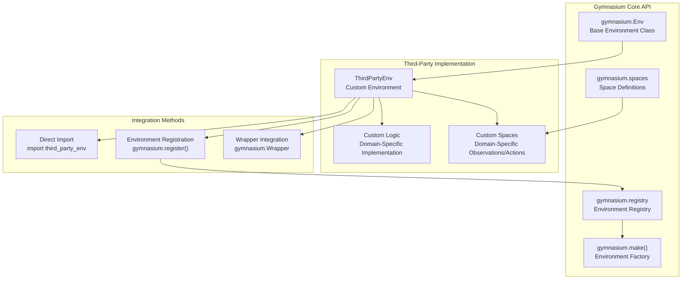
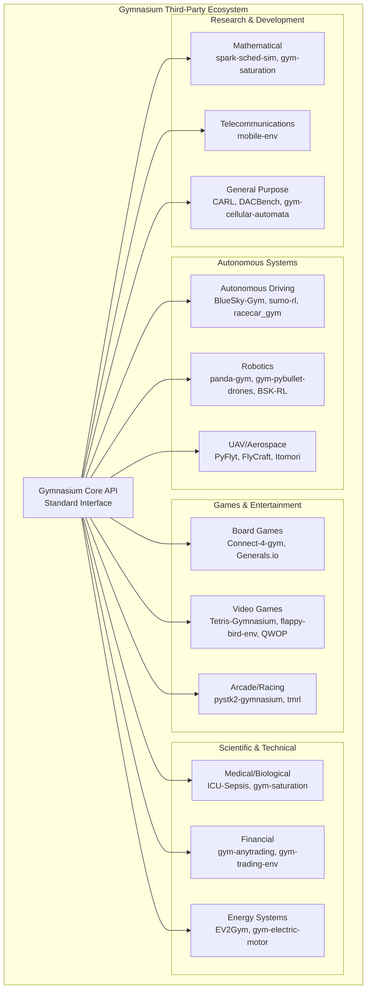
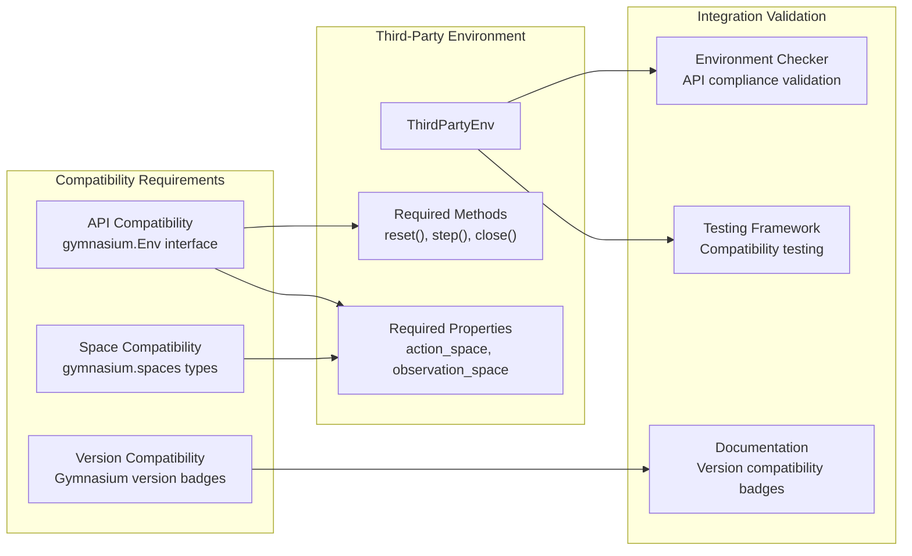
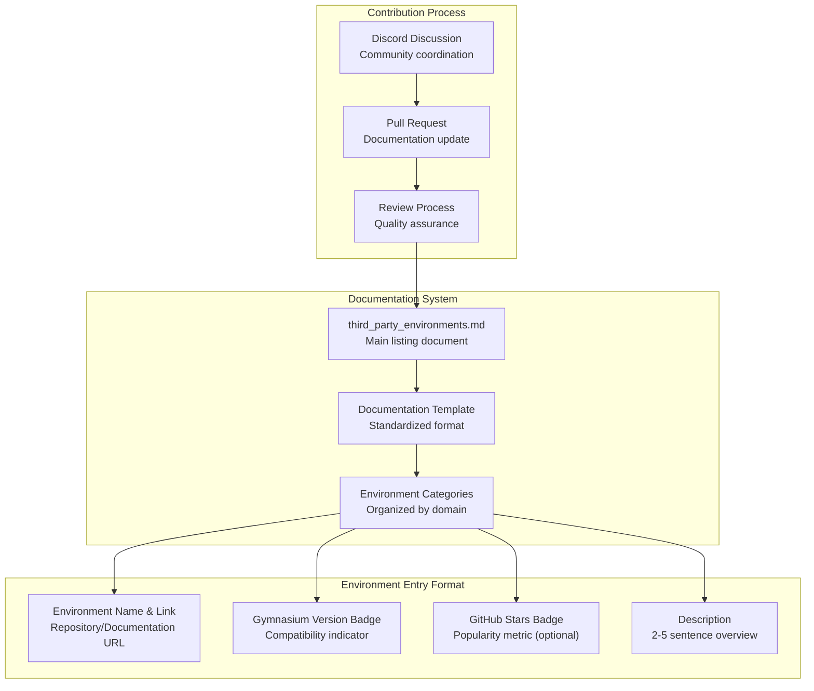
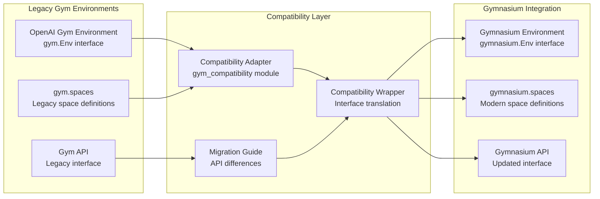

<!-- source: DeepWiki mcp.deepwiki.com · repo Farama-Foundation/Gymnasium · page 5.6 Third Party Environments · fetched 2026-10-14 -->

# Third Party Environments

Relevant source files

The following files were used as context for generating this wiki page:

- [docs/_scripts/gen_gifs.py](docs/_scripts/gen_gifs.py)
- [docs/_scripts/gen_mds.py](docs/_scripts/gen_mds.py)
- [docs/_scripts/linkcheck.py](docs/_scripts/linkcheck.py)
- [docs/environments/atari/beam_rider.md](docs/environments/atari/beam_rider.md)
- [docs/environments/atari/elevator_action.md](docs/environments/atari/elevator_action.md)
- [docs/environments/atari/fishing_derby.md](docs/environments/atari/fishing_derby.md)
- [docs/environments/atari/freeway.md](docs/environments/atari/freeway.md)
- [docs/environments/atari/frostbite.md](docs/environments/atari/frostbite.md)
- [docs/environments/atari/gopher.md](docs/environments/atari/gopher.md)
- [docs/environments/atari/gravitar.md](docs/environments/atari/gravitar.md)
- [docs/environments/atari/kung_fu_master.md](docs/environments/atari/kung_fu_master.md)
- [docs/environments/atari/phoenix.md](docs/environments/atari/phoenix.md)
- [docs/environments/atari/solaris.md](docs/environments/atari/solaris.md)
- [docs/environments/atari/space_invaders.md](docs/environments/atari/space_invaders.md)
- [docs/environments/mujoco.md](docs/environments/mujoco.md)
- [docs/environments/third_party_environments.md](docs/environments/third_party_environments.md)
- [docs/tutorials/third-party-tutorials.md](docs/tutorials/third-party-tutorials.md)

## Purpose and Scope

This document covers third-party environments that extend the Gymnasium ecosystem beyond the built-in environment collections. Third-party environments are external packages that implement the Gymnasium API to provide specialized domains and use cases not covered by the core library.

For information about built-in environments, see [Environment Categories](#5). For details about the core environment API that third-party environments must implement, see [Env Class](#2.1). For environment registration mechanics, see [Environment Registration](#4).

## Integration with Gymnasium API

Third-party environments integrate with Gymnasium by implementing the standard `gymnasium.Env` interface. This allows them to be used seamlessly with existing reinforcement learning code while providing specialized functionality for specific domains.

### Core Integration Architecture

Sources: [docs/environments/third_party_environments.md:1-438]()

### Environment Categories

The third-party environment ecosystem spans multiple specialized domains, each providing unique challenges and applications for reinforcement learning research.

Sources: [docs/environments/third_party_environments.md:48-344]()

## Environment Registration and Compatibility

Third-party environments can be integrated into the Gymnasium ecosystem through multiple approaches, each with different levels of integration and compatibility requirements.

### Integration Approaches

| Integration Method | Use Case | Requirements | Example |
|-------------------|----------|--------------|---------|
| Direct Import | Simple usage, custom environments | Implement `gymnasium.Env` | `import custom_env; env = custom_env.MyEnv()` |
| Registration | Integration with `gymnasium.make()` | Call `gymnasium.register()` | `gymnasium.register(id="CustomEnv-v0", entry_point="custom_env:MyEnv")` |
| Wrapper-based | Adapting existing environments | Implement `gymnasium.Wrapper` | `env = CustomWrapper(base_env)` |

### Compatibility Requirements

Third-party environments must maintain compatibility with the Gymnasium API to ensure proper integration:

Sources: [docs/environments/third_party_environments.md:53-344]()

## Documentation and Contribution System

The third-party environment documentation system provides a structured way to discover and evaluate external environments. The documentation includes version compatibility information, descriptions, and links to source repositories.

### Documentation Structure

Each third-party environment entry follows a standardized format that includes:

- **Environment Name and Link**: Direct link to the environment's repository or documentation
- **Gymnasium Version Dependency Badge**: Indicates compatible Gymnasium versions
- **GitHub Stars Badge**: Optional popularity indicator
- **Description**: Brief 2-5 sentence explanation of the environment's purpose and capabilities

Sources: [docs/environments/third_party_environments.md:25-44]()

### Farama Foundation Ecosystem

The documentation distinguishes between third-party environments and first-party environments maintained by the Farama Foundation. First-party environments include specialized packages that extend the core Gymnasium functionality while maintaining official support.

**First-Party Environment Projects:**
- **Minigrid**: Gridworld environments for discrete control tasks ([Minigrid](https://minigrid.farama.org))
- **Gymnasium-Robotics**: Robotics environments with goal-conditioned tasks ([Gymnasium-Robotics](https://robotics.farama.org))
- **Miniworld**: 3D navigation environments ([Miniworld](https://miniworld.farama.org))
- **MiniWoB++**: Web interaction environments ([MiniWoB++](https://miniwob.farama.org))
- **Arcade Learning Environment**: Classic arcade game environments ([Arcade Learning Environment](https://github.com/Farama-Foundation/Arcade-Learning-Environment))
- **ViZDoom**: Doom-based environments ([ViZDoom](https://vizdoom.farama.org))
- **Metaworld**: Meta-learning robotics benchmarks ([Metaworld](https://metaworld.farama.org))
- **HighwayEnv**: Autonomous driving scenarios ([HighwayEnv](https://highway-env.farama.org))
- **stable-retro**: Retro game environments ([stable-retro](https://github.com/Farama-Foundation/stable-retro))

**Alternative API Projects:**
- **PettingZoo**: Multi-agent reinforcement learning ([PettingZoo](https://pettingzoo.farama.org))
- **Minari**: Offline reinforcement learning datasets ([Minari](https://minari.farama.org))
- **MO-Gymnasium**: Multi-objective reinforcement learning ([MO-Gymnasium](https://mo-gymnasium.farama.org))
- **Gymnasium-Robotics**: Goal-conditioned reinforcement learning ([Gymnasium-Robotics](https://robotics.farama.org))

Sources: [docs/environments/third_party_environments.md:7-23]()

## Legacy Gym Compatibility

Many third-party environments were originally developed for the legacy OpenAI Gym library. The documentation provides guidance on compatibility and migration considerations for these environments.

### Gym-to-Gymnasium Migration

Sources: [docs/environments/third_party_environments.md:346-438]()

---

