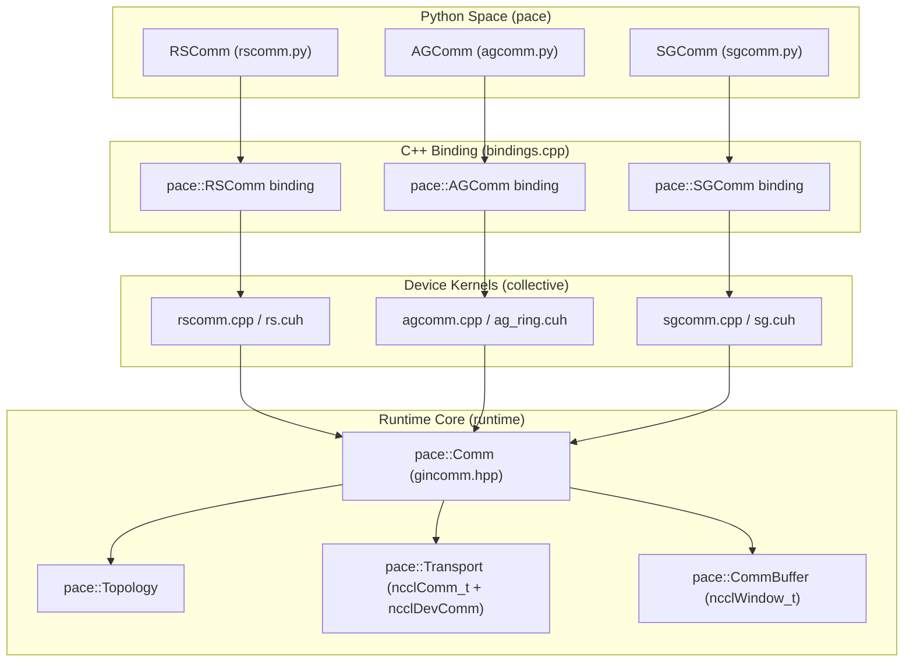
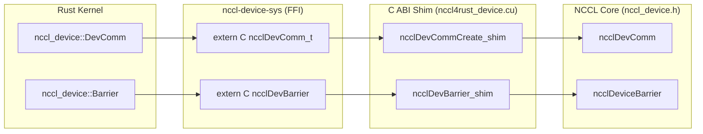

<!-- source: DeepWiki mcp.deepwiki.com · repo NVIDIA/nccl · page 10.5 Additional Community Contributions: NIIN, PACE, and nccl4rust · fetched 2026-10-28 -->

# Additional Community Contributions: NIIN, PACE, and nccl4rust

Relevant source files

The following files were used as context for generating this wiki page:

- [contrib/nccl4rust/README.md](contrib/nccl4rust/README.md)
- [contrib/nccl4rust/crates/nccl-device-sys/src/lib.rs](contrib/nccl4rust/crates/nccl-device-sys/src/lib.rs)
- [contrib/nccl4rust/crates/nccl-device/README.md](contrib/nccl4rust/crates/nccl-device/README.md)
- [contrib/nccl4rust/crates/nccl-device/src/lib.rs](contrib/nccl4rust/crates/nccl-device/src/lib.rs)
- [contrib/nccl4rust/crates/nccl-sys/README.md](contrib/nccl4rust/crates/nccl-sys/README.md)
- [contrib/nccl4rust/crates/nccl-sys/src/lib.rs](contrib/nccl4rust/crates/nccl-sys/src/lib.rs)
- [contrib/nccl4rust/crates/nccl/Cargo.toml](contrib/nccl4rust/crates/nccl/Cargo.toml)
- [contrib/nccl4rust/crates/nccl/src/config.rs](contrib/nccl4rust/crates/nccl/src/config.rs)
- [contrib/nccl4rust/crates/nccl/src/device.rs](contrib/nccl4rust/crates/nccl/src/device.rs)
- [contrib/nccl4rust/crates/nccl/src/lib.rs](contrib/nccl4rust/crates/nccl/src/lib.rs)
- [contrib/nccl4rust/crates/nccl/src/memory.rs](contrib/nccl4rust/crates/nccl/src/memory.rs)
- [contrib/nccl4rust/shim/nccl4rust_device.cu](contrib/nccl4rust/shim/nccl4rust_device.cu)
- [contrib/nccl4rust/shim/nccl4rust_device.h](contrib/nccl4rust/shim/nccl4rust_device.h)
- [contrib/nccl4rust/tests/cuda-oxide-smoke/README.md](contrib/nccl4rust/tests/cuda-oxide-smoke/README.md)
- [contrib/nccl4rust/tests/cuda-oxide-smoke/src/main.rs](contrib/nccl4rust/tests/cuda-oxide-smoke/src/main.rs)
- [contrib/nccl4rust/tests/runtime-smoke/README.md](contrib/nccl4rust/tests/runtime-smoke/README.md)
- [contrib/nccl4rust/tests/runtime-smoke/src/main.rs](contrib/nccl4rust/tests/runtime-smoke/src/main.rs)
- [contrib/niin/.gitignore](contrib/niin/.gitignore)
- [contrib/niin/Makefile](contrib/niin/Makefile)
- [contrib/niin/examples/hello_put_signal.cu](contrib/niin/examples/hello_put_signal.cu)
- [contrib/niin/include/niin/atomics.h](contrib/niin/include/niin/atomics.h)
- [contrib/niin/include/niin/collectives.h](contrib/niin/include/niin/collectives.h)
- [contrib/niin/include/niin/config.h](contrib/niin/include/niin/config.h)
- [contrib/niin/include/niin/context.h](contrib/niin/include/niin/context.h)
- [contrib/niin/include/niin/host.h](contrib/niin/include/niin/host.h)
- [contrib/niin/include/niin/nvshmem_host.h](contrib/niin/include/niin/nvshmem_host.h)
- [contrib/niin/include/niin/query.h](contrib/niin/include/niin/query.h)
- [contrib/niin/include/niin/rma.h](contrib/niin/include/niin/rma.h)
- [contrib/niin/include/niin/signaling.h](contrib/niin/include/niin/signaling.h)
- [contrib/niin/include/niin/stream.h](contrib/niin/include/niin/stream.h)
- [contrib/niin/include/niin/sync.h](contrib/niin/include/niin/sync.h)
- [contrib/niin/perftest/Makefile](contrib/niin/perftest/Makefile)
- [contrib/niin/perftest/common/perftest.h](contrib/niin/perftest/common/perftest.h)
- [contrib/niin/perftest/device/pt-to-pt/shmem_get_latency.cu](contrib/niin/perftest/device/pt-to-pt/shmem_get_latency.cu)
- [contrib/niin/perftest/device/pt-to-pt/shmem_p_latency.cu](contrib/niin/perftest/device/pt-to-pt/shmem_p_latency.cu)
- [contrib/niin/perftest/device/pt-to-pt/shmem_put_bw.cu](contrib/niin/perftest/device/pt-to-pt/shmem_put_bw.cu)
- [contrib/niin/perftest/device/pt-to-pt/shmem_put_latency.cu](contrib/niin/perftest/device/pt-to-pt/shmem_put_latency.cu)
- [contrib/niin/perftest/device/pt-to-pt/shmem_put_signal_latency.cu](contrib/niin/perftest/device/pt-to-pt/shmem_put_signal_latency.cu)
- [contrib/niin/test/.gitignore](contrib/niin/test/.gitignore)
- [contrib/niin/test/TESTING.md](contrib/niin/test/TESTING.md)
- [contrib/niin/test/compat/run_nvshmem_tests.sh](contrib/niin/test/compat/run_nvshmem_tests.sh)
- [contrib/niin/test/compat/utils.h](contrib/niin/test/compat/utils.h)
- [contrib/pace/.gitignore](contrib/pace/.gitignore)
- [contrib/pace/README.md](contrib/pace/README.md)
- [contrib/pace/csrc/bindings.cpp](contrib/pace/csrc/bindings.cpp)
- [contrib/pace/csrc/collective/ag/ag_ring.cu](contrib/pace/csrc/collective/ag/ag_ring.cu)
- [contrib/pace/csrc/collective/ag/ag_ring.cuh](contrib/pace/csrc/collective/ag/ag_ring.cuh)
- [contrib/pace/csrc/collective/ag/ag_zero_sm.cu](contrib/pace/csrc/collective/ag/ag_zero_sm.cu)
- [contrib/pace/csrc/collective/ag/ag_zero_sm.cuh](contrib/pace/csrc/collective/ag/ag_zero_sm.cuh)
- [contrib/pace/csrc/collective/ag/agcomm.cpp](contrib/pace/csrc/collective/ag/agcomm.cpp)
- [contrib/pace/csrc/collective/rs/rs.cu](contrib/pace/csrc/collective/rs/rs.cu)
- [contrib/pace/csrc/collective/rs/rs.cuh](contrib/pace/csrc/collective/rs/rs.cuh)
- [contrib/pace/csrc/collective/rs/rscomm.cpp](contrib/pace/csrc/collective/rs/rscomm.cpp)
- [contrib/pace/csrc/collective/sg/sgcomm.cpp](contrib/pace/csrc/collective/sg/sgcomm.cpp)
- [contrib/pace/csrc/runtime/commoncomm.cpp](contrib/pace/csrc/runtime/commoncomm.cpp)
- [contrib/pace/csrc/runtime/gincomm.hpp](contrib/pace/csrc/runtime/gincomm.hpp)
- [contrib/pace/pace/ag/agcomm.py](contrib/pace/pace/ag/agcomm.py)
- [contrib/pace/pace/rs/rscomm.py](contrib/pace/pace/rs/rscomm.py)
- [contrib/pace/pace/sg/sgcomm.py](contrib/pace/pace/sg/sgcomm.py)
- [contrib/pace/pace/utils.py](contrib/pace/pace/utils.py)
- [contrib/pace/test/test_ag.py](contrib/pace/test/test_ag.py)

This page describes three significant community contributions located in the `contrib/` directory of the NCCL repository. These projects extend NCCL's capabilities into high-level PGAS programming models, fused collective engines for Deep Learning, and modern systems programming languages.

## 1. NIIN: NVSHMEM Implemented In NCCL

**NIIN** (NVSHMEM Implemented In NCCL) is a header-only implementation of the NVSHMEM-compatible API built entirely on top of NCCL’s low-level abstractions, specifically Symmetric Memory (LSA), GPU-Initiated Networking (GIN), and device-side barriers.

### Architecture and Implementation
NIIN provides a subset of the NVSHMEM API that allows GPU kernels to perform one-sided Remote Memory Access (RMA) and synchronization without CPU involvement. It maps NVSHMEM concepts to NCCL entities:

*   **Symmetric Heap:** Implemented using NCCL's symmetric memory windows (`ncclWindow_t`).
*   **Device Networking:** Leverages the GIN (GPU-Initiated Networking) device API for `put`, `get`, and `signal` operations.
*   **Synchronization:** Uses NCCL device-side barriers and LSA-backed memory for quiescence and completion.

### Key Components
*   **Host API:** Managed via `niin/host.h` and `niin/nvshmem_host.h`, providing initialization routines that wrap `ncclComm_t` and `ncclWindow_t` setup.
*   **Device API:** Defined in `niin/rma.h`, `niin/signaling.h`, and `niin/sync.h`. These headers translate NVSHMEM-style calls (e.g., `nvshmem_put`) into `ncclGin` device primitives.
*   **Query Interface:** `niin/query.h` provides rank and size information derived from the underlying NCCL communicator.

**Sources:** [contrib/niin/include/niin/host.h](), [contrib/niin/include/niin/rma.h](), [contrib/niin/include/niin/signaling.h]()

---

## 2. PACE: Parallelism-Aware Collective Engine

**PACE** is a fused collective engine designed to eliminate "glue" memory operations (layout conversion, dtype casting, scatter/gather) that typically surround communication in LLM training and inference. It is implemented as a PyTorch C++ extension that links statically to NCCL.

### Fused Execution Model
PACE structures collectives into three fused stages to minimize HBM passes:
1.  **Prologue:** Handles multi-tensor input, on-the-wire dtype conversion (e.g., `fp32` to `bf16`), and strided reads for Ulysses-CP.
2.  **Communication:** Pipelined data movement using SM-resident kernels or resource-lean **0-SM** (stream-based) and **1-SM** variants.
3.  **Epilogue:** Lays received data out in the format expected by the next compute kernel (e.g., token-major vs rank-major).

### Code Entity Map
The following diagram bridges the Python user-facing API to the internal C++ runtime components.

**PACE System Mapping**

**Sources:** [contrib/pace/README.md:64-90](), [contrib/pace/csrc/runtime/gincomm.hpp:20-89](), [contrib/pace/csrc/bindings.cpp:42-70]()

### Implementation Details
*   **Comm Class:** The central `pace::Comm` object in `gincomm.hpp` manages four concerns: `Topology`, `Transport` (NCCL handles), `CommBuffer` (symmetric memory), and `LaunchContext` (CUDA streams) [contrib/pace/csrc/runtime/gincomm.hpp:91-130]().
*   **0-SM Path:** The `AGComm` implementation includes a `ag_zero_sm` path that uses a single ring-depth dimension and can be captured into a CUDA graph to reduce CPU overhead [contrib/pace/csrc/collective/ag/agcomm.cpp:58-80]().
*   **Strided SG:** The `ScatterGather` kernel in `sgcomm.cpp` supports non-contiguous input tensors for Ulysses-CP, provided they meet 16-byte alignment and specific stride requirements [contrib/pace/csrc/collective/sg/sgcomm.cpp:119-130]().

**Sources:** [contrib/pace/csrc/runtime/gincomm.hpp](), [contrib/pace/csrc/collective/ag/agcomm.cpp](), [contrib/pace/csrc/collective/sg/sgcomm.cpp](), [contrib/pace/pace/utils.py]()

---

## 3. nccl4rust: Experimental Rust Bindings

`nccl4rust` provides a Rust interface to NCCL's host and device APIs. It follows the "CUDA-Oxide" pattern, which splits raw FFI bindings from safe, idiomatic Rust wrappers.

### Crate Structure
| Crate | Purpose |
|---|---|
| `nccl-sys` | Bindgen-generated raw host ABI [contrib/nccl4rust/README.md:22-22](). |
| `nccl` | Rust-style host wrappers with RAII ownership [contrib/nccl4rust/README.md:23-23](). |
| `nccl-device-sys` | `no_std` declarations for the device shim [contrib/nccl4rust/README.md:24-24](). |
| `nccl-device` | Typed wrappers for `DevComm`, `Team`, `Window`, and barriers [contrib/nccl4rust/README.md:25-25](). |

### Device-Side "CUDA-Oxide" Flow
Rust GPU kernels cannot directly consume NCCL's C++ templates. `nccl4rust` uses a C ABI shim (`shim/nccl4rust_device.cu`) to bridge the gap.

**Rust-to-NCCL Device Mapping**

**Sources:** [contrib/nccl4rust/README.md:3-8](), [contrib/nccl4rust/crates/nccl/src/device.rs:56-103]()

### Implementation Details
*   **DeviceCommRequirements:** The `DeviceCommRequirements` struct in `device.rs` provides a builder-style API to configure GIN connection types, LSA barrier counts, and memory requirements for the device communicator [contrib/nccl4rust/crates/nccl/src/device.rs:65-103]().
*   **RAII Communicators:** The `nccl` crate ensures that `ncclComm_t` handles are properly destroyed via the `Drop` trait, and manages the `UniqueId` bootstrap process safely [contrib/nccl4rust/README.md:132-147]().
*   **LTOIR Build:** The device shim is compiled into LLVM Link-Time Optimization Intermediate Representation (`.ltoir`) to allow the Rust compiler to inline NCCL device calls into GPU kernels [contrib/nccl4rust/README.md:154-168]().

**Sources:** [contrib/nccl4rust/README.md](), [contrib/nccl4rust/crates/nccl/src/device.rs](), [contrib/nccl4rust/crates/nccl/src/lib.rs]()

---

