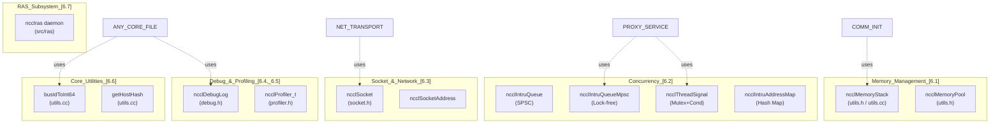
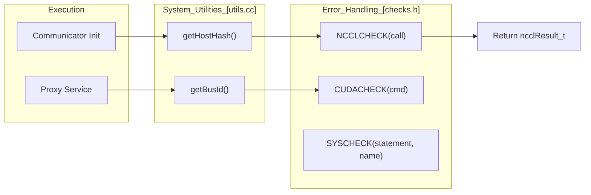

<!-- source: DeepWiki mcp.deepwiki.com · repo NVIDIA/nccl · page 6 Infrastructure and Utilities · fetched 2026-10-28 -->

# Infrastructure and Utilities

Relevant source files

The following files were used as context for generating this wiki page:

- [src/include/debug.h](src/include/debug.h)
- [src/include/utils.h](src/include/utils.h)
- [src/misc/utils.cc](src/misc/utils.cc)

## Purpose and Scope

This document describes the core infrastructure and utility systems that support NCCL's operation. These components provide fundamental services such as memory management, concurrency primitives, socket abstraction, debugging facilities, profiling, and common helper functions used throughout the codebase.

For information about transport-specific infrastructure (bootstrap, sockets, proxy service), see [Transport Layer](#5). For device-side execution infrastructure, see [Device-Side Execution](#7). For build system infrastructure, see [Build System](#8).

**Sources:** [src/include/utils.h:1-25](), [src/misc/utils.cc:1-16]()

---

## Overview

NCCL's infrastructure layer provides several categories of functionality:

| Category | Purpose | Key Components |
|----------|---------|----------------|
| **Memory Management** | Efficient allocation strategies for host memory | `ncclMemoryStack`, `ncclMemoryPool` |
| **Concurrency Primitives** | Lock-free and intrusive data structures | `ncclIntruQueue`, `ncclIntruQueueMpsc`, `ncclThreadSignal` |
| **Socket Abstraction** | Platform-agnostic socket operations | `ncclSocket` API |
| **Debug & Logging** | Configurable logging and diagnostics | `ncclDebugLog`, subsystem filtering |
| **Profiler Plugin** | Performance instrumentation hooks | `ncclProfiler_t` plugin interface |
| **Core Utilities** | Common helpers and system functions | Hash functions, bus ID conversion, time utilities |
| **RAS** | Reliability and Serviceability | `ncclras` daemon, health monitoring |

These systems are designed to minimize overhead while providing the flexibility needed for NCCL's diverse execution environments (single-node, multi-node, different network fabrics, etc.).

**Sources:** [src/include/utils.h:132-196](), [src/misc/utils.cc:18-82](), [src/include/checks.h:14-156]()

---

## Infrastructure Architecture

### Bridging Code Entities to System Roles

The following diagram maps high-level infrastructure roles to the specific code entities (structs, functions, and files) that implement them.

**Sources:** [src/include/utils.h:132-196](), [src/misc/utils.cc:27-71](), [src/include/checks.h:148-156]()

### Utility and Check Macro Flow

NCCL uses a robust macro-based error checking system defined in `checks.h` to propagate results across infrastructure boundaries.

**Sources:** [src/include/checks.h:14-22](), [src/include/checks.h:58-66](), [src/include/checks.h:148-156](), [src/misc/utils.cc:63-71]()

---

## Memory Management (6.1)

NCCL uses specialized allocation strategies to minimize overhead and fragmentation in host-side memory management.

*   **ncclMemoryStack**: A bump-pointer allocator using a "hunk/frame" model. It provides fast LIFO ordered allocation [src/include/utils.h:123-131](). Frames allow bulk deallocation via `ncclMemoryStackPush` and `ncclMemoryStackPop`; popping a frame restores the stack pointer to its state when the frame was pushed [src/include/utils.h:136-137]().
*   **ncclMemoryPool**: A free-list of fixed-size allocations. It is an error for a pool to hold objects of differing sizes or alignments [src/include/utils.h:145-151](). It typically uses a `ncclMemoryStack` as its backing memory source during allocation [src/include/utils.h:157-158]().

For details, see [Memory Management](#6.1).

**Sources:** [src/include/utils.h:123-161]()

---

## Concurrency Primitives (6.2)

NCCL relies on intrusive data structures to avoid dynamic memory allocation during performance-critical paths, especially in the proxy service.

*   **ncclIntruQueue**: A singly-linked list queue where the next pointer is a member of the object itself, specified via template arguments [src/include/utils.h:163-172]().
*   **ncclIntruQueueMpsc**: A multi-producer single-consumer queue that utilizes atomic operations for thread-safe enqueuing without mutex locks [src/include/utils.h:173-174]().
*   **ncclThreadSignal**: A synchronization primitive wrapping a `std::mutex` and `std::condition_variable` for thread signaling [src/include/utils.h:21-22]().

For details, see [Concurrency Primitives](#6.2).

**Sources:** [src/include/utils.h:163-196]()

---

## Socket Abstraction Layer (6.3)

The socket layer provides a unified, platform-agnostic API for network communication. This layer underpins both the bootstrap process and the standard TCP network transport.

*   **ncclSocket**: The core structure representing a network socket [src/include/utils.h:46-51]().
*   **API Functions**: Includes `ncclSocketInit`, `ncclSocketListen`, `ncclSocketConnect`, `ncclSocketAccept`, `ncclSocketSend`, and `ncclSocketRecv`.
*   **State Management**: Tracks socket state to handle non-blocking operations and platform differences between Linux and Windows.

For details, see [Socket Abstraction Layer](#6.3).

**Sources:** [src/include/utils.h:46-55](), [src/misc/utils.cc:189-216]()

---

## Debug and Logging (6.4)

NCCL provides a sophisticated logging system, `ncclDebugLog`, controlled by environment variables.

*   **Levels**: `ncclDebugLevel` (set via `NCCL_DEBUG`) determines verbosity, ranging from `NONE` to `TRACE` [src/include/debug.h:20]().
*   **Subsystems**: `ncclDebugMask` (set via `NCCL_DEBUG_SUBSYS`) allows filtering logs by component, such as `INIT`, `COLL`, `P2P`, `NET`, or `PROXY` [src/include/debug.h:21]().
*   **Macros**: The system provides `WARN`, `INFO`, and `TRACE` macros for consistent log formatting and conditional execution based on the current level/mask [src/include/debug.h:51-87]().

For details, see [Debug and Logging](#6.4).

**Sources:** [src/include/debug.h:20-97](), [src/include/checks.h:153-154]()

---

## Profiler Plugin (6.5)

The profiler system allows external plugins to intercept and record NCCL events for performance analysis.

*   **Interface**: Defined by the `ncclProfiler_t` versioned struct contract.
*   **Event Lifecycle**: Tracks events across API calls, kernel launches, and proxy operations via `startEvent` and `stopEvent` hooks.
*   **Time Tracking**: Infrastructure provides high-resolution timing utilities such as `clockNano()` [src/include/utils.h:66-69]().

For details, see [Profiler Plugin](#6.5).

**Sources:** [src/include/utils.h:66-69]()

---

## Core Definitions and Utilities (6.6)

General-purpose helpers and system definitions used throughout the library.

*   **PCI/Hardware**: Functions for converting between PCI Bus IDs and 64-bit integers (`busIdToInt64`, `int64ToBusId`) and querying device compute capability (`ncclCudaCompCap`) [src/misc/utils.cc:18-48]().
*   **Hashing**: `getHostHash()` and `getPidHash()` provide unique identifiers for nodes and processes, essential for rank rendezvous and resource isolation [src/misc/utils.cc:117-187]().
*   **Network Parsing**: `parseStringList()` handles parsing network interface prefixes and ports from environment strings like `NCCL_SOCKET_IFNAME` [src/misc/utils.cc:189-216]().
*   **Math Helpers**: Includes integer math utilities like `gcd`, `log2i`, and `compareInts` [src/include/utils.h:56-108]().

For details, see [Core Definitions and Utilities](#6.6).

**Sources:** [src/include/utils.h:31-108](), [src/misc/utils.cc:18-216]()

---

## RAS: Reliability, Availability, and Serviceability (6.7)

The RAS subsystem monitors the health and serviceability of the NCCL runtime environment.

*   **ncclras Daemon**: A background process that monitors hardware health and peer connectivity.
*   **Host Identification**: Utilizes `getHostHash()` to identify unique nodes across bare-metal and containerized environments [src/misc/utils.cc:155-159]().
*   **Environment Overrides**: Allows overriding host identification via the `NCCL_HOSTID` environment variable [src/misc/utils.cc:125-129]().

For details, see [RAS: Reliability, Availability, and Serviceability](#6.7).

**Sources:** [src/misc/utils.cc:117-159]()

---

