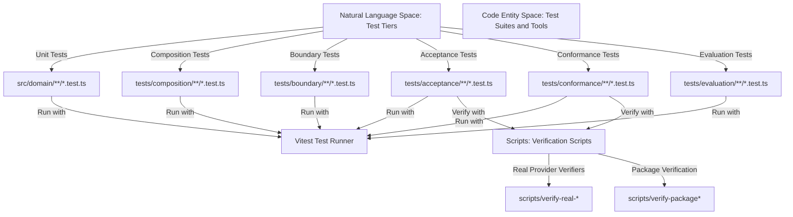
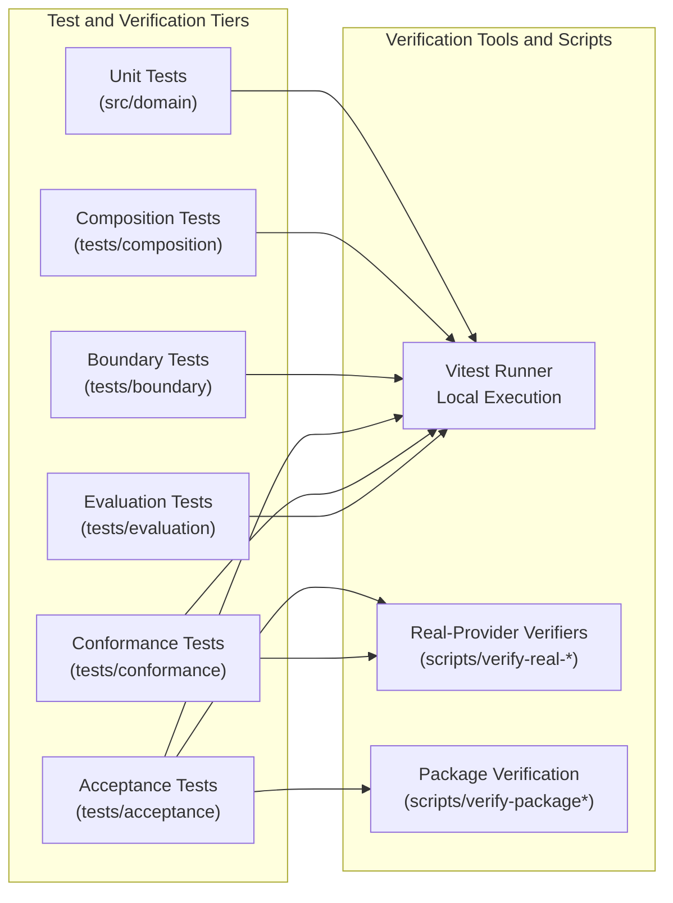

<!-- source: DeepWiki mcp.deepwiki.com · repo morluto/rea · page 8 Testing and Verification · fetched 2026-10-09 -->

# Testing and Verification

Relevant source files

The following files were used as context for generating this wiki page:

- [.github/pull_request_template.md](.github/pull_request_template.md)
- [.github/workflows/ci.yml](.github/workflows/ci.yml)
- [.github/workflows/regen-generated.yml](.github/workflows/regen-generated.yml)
- [.gitignore](.gitignore)
- [AGENTS.md](AGENTS.md)
- [CONTRIBUTING.md](CONTRIBUTING.md)
- [docs/testing.md](docs/testing.md)
- [docs/tool-design.md](docs/tool-design.md)
- [scripts/generate-mcp-tool-catalog.mjs](scripts/generate-mcp-tool-catalog.mjs)
- [tests/acceptance/applications/runtime.test.ts](tests/acceptance/applications/runtime.test.ts)
- [tests/boundary/mcp/toolRegistrationOptions.test.ts](tests/boundary/mcp/toolRegistrationOptions.test.ts)
- [tests/process-global/vitestConfiguration.test.ts](tests/process-global/vitestConfiguration.test.ts)
- [tsconfig.build.json](tsconfig.build.json)
- [tsconfig.json](tsconfig.json)
- [turbo.json](turbo.json)
- [vitest.config.ts](vitest.config.ts)

REA employs a comprehensive testing and verification strategy to ensure correctness and robustness across its layered architecture. This strategy encompasses a variety of test tiers, simulated environments with fakes and fixtures, and real-provider verification workflows. The approach balances fast local feedback with trustworthy end-to-end validation involving production tools like Hopper and Ghidra.

---

## Test Strategy Overview

The testing approach spans these core tiers:

- **Boundary Tests:** Verify exactly one real production boundary such as filesystem, process, network, browser, CLI, or provider. This includes MCP transport-level boundaries exercised in isolated, in-memory sessions with explicit cleanup.

- **Composition Tests:** Assemble provider-neutral sessions and registries, exercising application-layer wiring without crossing real external boundaries.

- **Unit Tests (Module Tests):** Test a single domain, service, or adapter module’s public surface in isolation without constructing sessions or launching subprocesses.

- **Acceptance Tests:** Exercise compiled CLI or MCP journeys, invoking integrated or injected providers to validate real usage scenarios end-to-end.

- **Conformance Tests:** Use source-built, capability-parameterized shared corpora for diverse target formats like C, ObjC, Swift, napi, Ghidra, IDA, and native code. These check contract compliance, replay logic, and trust gates.

- **Evaluation Tests:** Verify deterministic evaluator parsing, scoring, and analytical report generation.

The testing code is grouped in Vitest projects reflecting these tiers to control dependencies, runtime isolation, worker concurrency, and test lifecycle. Real provider verification executes as separate `npm run verify:*` scripts to maintain hermetic lanes and platform-native requirements.

---

### Vitest Testing Configuration

Vitest drives the deterministic automated tests, with configuration in `vitest.config.ts` setting up the following projects:

| Tier            | Location Pattern                                  | Isolation Type | Max Workers | Notes                                              |
|-----------------|-------------------------------------------------|----------------|-------------|----------------------------------------------------|
| domain          | `src/{contracts,domain}/**/*.test.ts`            | threads        | ≤2          | Pure, provider-neutral code, no process-global state. |
| services        | `src/application/**/*.test.ts`                    | threads        | ≤2          | Uses recording ports; no process-global state.      |
| adapters        | `src/*.test.ts`, `src/{artifacts,browser,...}/**/*.test.ts` | forks          | ≤2          | Covers provider adapters and boundary layers.       |
| composition     | `tests/composition/**/*.test.ts`                  | threads        | ≤2          | Provider-neutral session and registry wiring.       |
| boundary        | `tests/boundary/**/*.test.ts` (excluding MCP/process-boundary) | forks          | ≤2          | Focuses on a single production boundary.            |
| process-boundary| `tests/boundary/process/**/*.test.ts`              | forks          | ≤2          | Serialized lane due to shared host resources.       |
| mcp-boundary    | `tests/boundary/mcp/**/*.test.ts`                  | threads        | ≤2          | Each file manages in-memory MCP session lifecycle.  |
| acceptance      | `tests/acceptance/**/*.test.ts`                     | forks          | ≤2          | Exercises compiled CLI or MCP journeys.              |
| process-global  | `tests/process-global/**/*.test.ts`                 | forks          | ≤2          | For tests with process-global state dependencies.   |
| conformance     | `tests/conformance/**/*.test.ts`                    | threads        | ≤2          | Uses source-built conformance input corpora.        |
| evaluation      | `tests/evaluation/**/*.test.ts`                     | threads        | ≤2          | Deterministic evaluator and scoring tests.          |

The config ensures consistent temp directory setup, bounded concurrency, and tailored isolation depending on test scope requirements. Coverage thresholds and retry behavior are likewise tuned per project tier.

For the full Vitest config, see `vitest.config.ts` [vitest.config.ts:1-172]().

---

## Test Components in Context

Below is a diagram bridging the natural language testing tiers and their primary code or script artifacts, illustrating the coverage and responsibilities each test and verification lane holds.

**Testing Tiers mapped to Code Entities and Scripts**

---

## Fake and Fixture Usage

To support fast and deterministic test runs, the project uses fakes and fixtures liberally:

- **Fake Provider Seams:** e.g., `fakeHopper`, `fakeGhidra`, `fakeCdpBrowser` provide simulated provider backends for boundary and composition tests. This avoids launching real external processes and limits nondeterminism.

- **Fixtures:** Tested data comes from carefully maintained static corpora to ensure stable test conditions. Examples include decompiled binaries, JavaScript/Electron apps snapshots, and managed assembly fixtures.

- **MCP Harnesses:** Sessions created in-memory simulate client-server exchanges at the protocol layer, enabling transport-layer coverage without a real network.

These are explained in detail on the Unit, Boundary, and Composition Tests child page.

---

## Real-Provider Verification

Beyond simulated environments, REA validates critical code paths and contracts through real-tool verifications:

- **Real Hopper Verification:** Requires installed Hopper Disassembler with supported OS and environment; exercises binary analyses with genuine Hopper bridge calls for accuracy assurance.

- **Real Ghidra Verification:** Uses headless Ghidra instances and bridge protocols to check real-world capability compliance.

- **Real Browser and Native UI Verification:** Involve tests using actual browser and platform UI components to verify observation, capture, and native integration.

- **Package Verification:** Runs smoke tests on the npm-distributed tarball ensuring the CLI and MCP servers start cleanly and behave as expected without the development environment.

These workflows exist as separate `npm run verify:*` scripts in the `scripts/` directory, isolating resource-heavy or environment-sensitive tests from daily developer local runs.

---

## Continuous Integration and Quality Gates

REA’s CI pipeline, defined mainly in `.github/workflows/ci.yml`, runs test shards in parallel covering all Vitest projects to merge coverage, timing, and JUnit reports. Checks include:

- Static analysis: lint, dead code, dependency analysis.
- Format checks and typechecking.
- Test coverage thresholds.
- Parallel test shard execution with retry controls.
- Verification of test discovery and temporary directory hygiene.

Pre-commit and pre-push Git hooks automatically run fast linting and formatting to maintain code quality.

---

## Further Reading

This page is an overview. For detailed guides on each test tier and verification suite, see:

- [Unit, Boundary and Composition Tests](#8.1) — Vitest setup, fake provider boundaries, MCP harnesses, contract snapshot and schema tests.
- [Conformance Fixtures and Trust Gates](#8.2) — Source-built corpora setup, fixture build and verify scripts, trust gate logic.
- [Real-Provider and Package Verification](#8.3) — Scripts for verifying real Hopper, Ghidra, browsers, native UI, Windows native, and package smoke tests.

---

# Summary Diagram: Testing Strategy Layers and Artifacts

---

# Summary

REA’s testing framework uses layered Vitest projects aligned to test depth and boundary isolation. Fast local feedback happens with fakes and fixtures, while real-provider executions occur in isolated scripts requiring specialized environments. The entire system integrates into robust CI pipelines ensuring high standards for test coverage, contract fidelity, and release quality.

This careful stratification enables confident changes, provider evolutions, and modular growth without compromising reproducible correctness across the complex REA ecosystem.

---

**Sources:**  
- [vitest.config.ts:1-172]()  
- [docs/testing.md:1-106]()  
- [CONTRIBUTING.md:13-118]()  
- [tests/boundary/mcp/toolRegistrationOptions.test.ts:1-104]()  
- [.github/workflows/ci.yml:1-196]()

---

