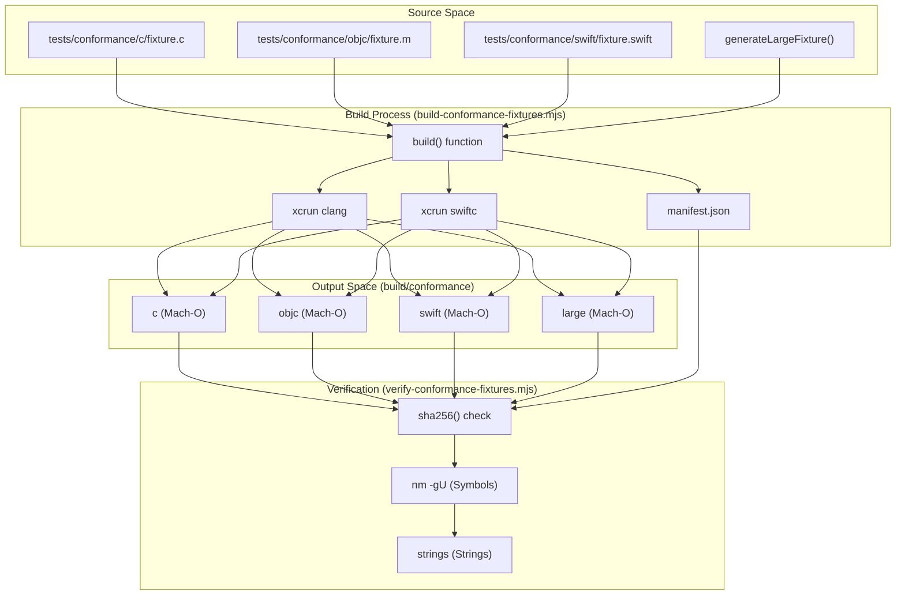
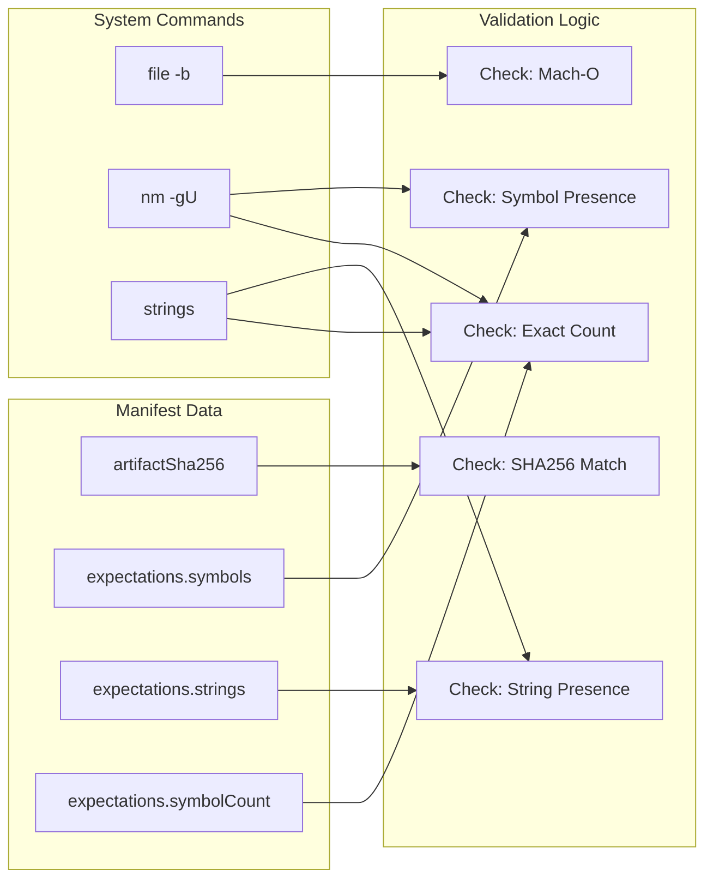
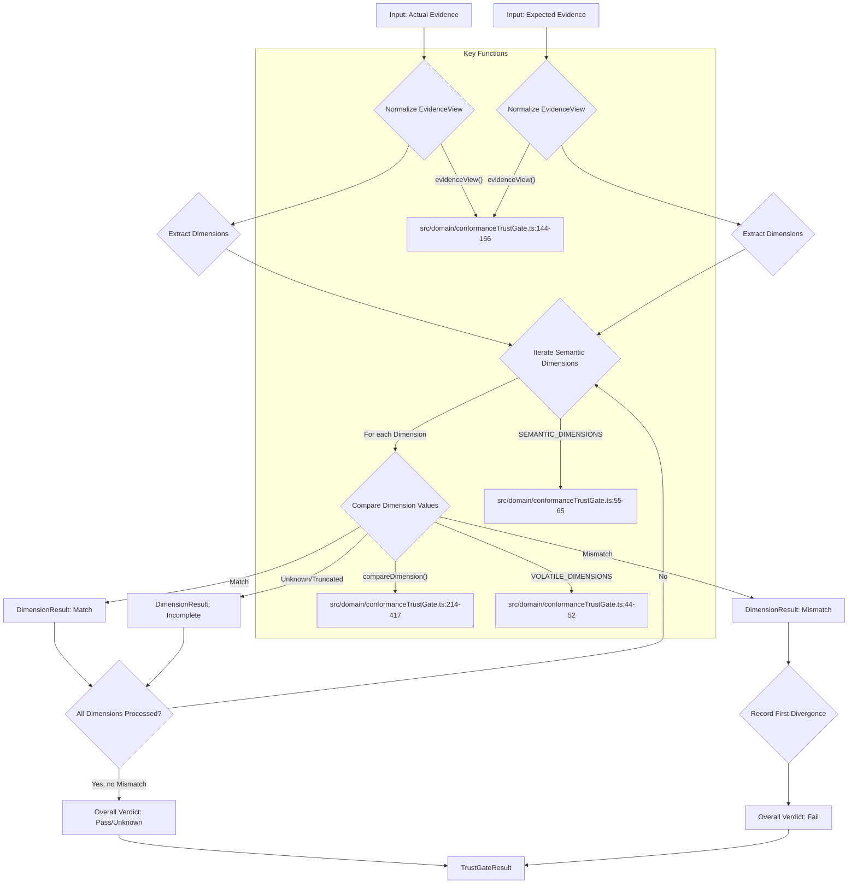

<!-- source: DeepWiki mcp.deepwiki.com · repo morluto/rea · page 8.2 Conformance Fixtures and Trust Gates · fetched 2026-10-09 -->

# Conformance Fixtures and Trust Gates

<details>
<summary>Relevant source files</summary>

The following files were used as context for generating this wiki page:

- [.github/workflows/real-hopper-linux.yml](.github/workflows/real-hopper-linux.yml)
- [.github/workflows/real-hopper.yml](.github/workflows/real-hopper.yml)
- [docs/mcp-contracts.md](docs/mcp-contracts.md)
- [docs/product-catalog.json](docs/product-catalog.json)
- [docs/verification/managed-conformance-manifest.json](docs/verification/managed-conformance-manifest.json)
- [scripts/build-conformance-fixtures.mjs](scripts/build-conformance-fixtures.mjs)
- [scripts/lib/conformance-fixtures.d.mts](scripts/lib/conformance-fixtures.d.mts)
- [scripts/lib/conformance-fixtures.mjs](scripts/lib/conformance-fixtures.mjs)
- [scripts/lib/real-hopper-fixture.d.mts](scripts/lib/real-hopper-fixture.d.mts)
- [scripts/lib/real-hopper-fixture.mjs](scripts/lib/real-hopper-fixture.mjs)
- [scripts/lib/real-hopper-semantic.d.mts](scripts/lib/real-hopper-semantic.d.mts)
- [scripts/verify-real-hopper-linux.mjs](scripts/verify-real-hopper-linux.mjs)
- [skills/reverse-engineer-anything/SKILL.md](skills/reverse-engineer-anything/SKILL.md)
- [skills/reverse-engineer-anything/references/native-and-artifacts.md](skills/reverse-engineer-anything/references/native-and-artifacts.md)
- [src/domain/conformancePackage.ts](src/domain/conformancePackage.ts)
- [src/domain/conformanceReplay.ts](src/domain/conformanceReplay.ts)
- [src/domain/conformanceTrustGate.ts](src/domain/conformanceTrustGate.ts)
- [src/native/parsers/codesign.ts](src/native/parsers/codesign.ts)
- [src/native/parsers/dyldInfo.ts](src/native/parsers/dyldInfo.ts)
- [tests/boundary/cli/nativeSignatureCli.test.ts](tests/boundary/cli/nativeSignatureCli.test.ts)
- [tests/boundary/filesystem/setupSkill.test.ts](tests/boundary/filesystem/setupSkill.test.ts)
- [tests/boundary/providers/native/nativeInventory.golden.test.ts](tests/boundary/providers/native/nativeInventory.golden.test.ts)
- [tests/conformance/providers/conformanceFixtures.test.ts](tests/conformance/providers/conformanceFixtures.test.ts)
- [tests/conformance/providers/conformanceReplay.test.ts](tests/conformance/providers/conformanceReplay.test.ts)
- [tests/conformance/providers/conformanceTrustGate.test.ts](tests/conformance/providers/conformanceTrustGate.test.ts)
- [tests/fixtures/nativeCommands.ts](tests/fixtures/nativeCommands.ts)

</details>


This page details REA's conformance fixture system, which provides source-built corpora for various languages (C, Objective-C, Swift, NAPI) and analysis targets (Ghidra, IDA, native binaries). It covers the build and verification scripts, the logic for conformance replay, and the trust gate mechanisms that ensure the reliability and consistency of analysis results.

## Source-Built Conformance Corpora

The REA conformance fixture system provides a set of source-built Mach-O binaries that serve as semantic oracles for testing REA providers (such as the Hopper Bridge) [tests/conformance/README.md:1-6](). These fixtures ensure that tool outputs for symbols, strings, and cross-references remain consistent across toolchain versions and platform updates.

## System Architecture

The fixture system consists of versioned source code, a generation script, and a verification script that uses native macOS tools (`nm`, `strings`, `file`) to validate the resulting artifacts [scripts/verify-conformance-fixtures.mjs:22-30]().

### Data Flow: Source to Verified Artifact

The following diagram illustrates how source files are transformed into compiled Mach-O binaries and validated against a manifest.

**Fixture Compilation and Validation Flow**

**Sources:** [scripts/build-conformance-fixtures.mjs:42-177](), [scripts/verify-conformance-fixtures.mjs:17-49](), [tests/conformance/README.md:3-9]()

## Fixture Categories

REA maintains several categories of fixtures to exercise different aspects of the analysis engine:

| Fixture Name | Language | Purpose | Key Expectations |
| :--- | :--- | :--- | :--- |
| `c` | C | Basic call graph and global variable analysis | `_rea_entry`, `_rea_branch`, `_rea_leaf` [scripts/build-conformance-fixtures.mjs:48-49]() |
| `objc` | Objective-C | Class, protocol, and selector metadata | `_OBJC_CLASS_$_REAWidget`, `REAWidgetDelegate` [scripts/build-conformance-fixtures.mjs:117-118]() |
| `swift` | Swift | Mangled names, protocols, and structs | `REAService`, `REAProtocol`, `REARecord` [scripts/build-conformance-fixtures.mjs:161-167]() |
| `napi` | C | Node.js native addon symbol patterns | `_napi_register_module_v1`, `reaProbeOne` [scripts/build-conformance-fixtures.mjs:136-137]() |
| `large` | C (Generated) | Pagination boundary testing (1,205 functions) | `_rea_page_0000` to `_rea_page_1204` [scripts/lib/conformance-fixtures.mjs:3-15]() |
| `version-v1/v2` | C | Diffing and versioned analysis | Added symbol `_rea_added` in v2 [scripts/build-conformance-fixtures.mjs:80]() |

**Sources:** [scripts/build-conformance-fixtures.mjs:42-172](), [tests/conformance/README.md:11-16]()

## Build Implementation

The build process is managed by `build-conformance-fixtures.mjs`. It uses `xcrun` to locate `clang` and `swiftc` and applies specific flags to disable optimizations and inlining, ensuring the resulting binary structure matches the source intent [scripts/build-conformance-fixtures.mjs:27-39]().

### Key Functions

- **`build(name, sources, args, options)`**: The core compilation wrapper. It reads source contents, executes the compiler, calculates SHA-256 hashes for both source and artifact, and appends metadata to the manifest [scripts/build-conformance-fixtures.mjs:194-223]().
- **`sourceDigest(sources)`**: Generates a deterministic hash of all source files involved in a fixture by sorting them by path before hashing [scripts/lib/conformance-fixtures.mjs:24-30](). This ensures that input ordering does not affect the digest [tests/conformance/providers/conformanceFixtures.test.ts:16]().

**Sources:** [scripts/build-conformance-fixtures.mjs:194-223](), [scripts/lib/conformance-fixtures.mjs:24-30](), [tests/conformance/providers/conformanceFixtures.test.ts:16]()

## Pagination Boundary Testing (`large.c`)

The `large` fixture is generated programmatically to contain exactly 1,205 functions and strings [scripts/lib/conformance-fixtures.mjs:3-8](). This specific number is chosen to test pagination boundaries for providers that might default to 500 or 1,000 items per request [tests/conformance/README.md:12-14]().

- **Generation**: The `generateLargeFixture` function creates `rea_inventory_NNNN` functions, each containing a unique string and returning its index [scripts/lib/conformance-fixtures.mjs:18-23]().
- **Verification**: `verify-conformance-fixtures.mjs` uses `verifyCount` to ensure the compiled binary contains exactly 1,205 occurrences of the expected prefixes in its symbol table and string sections [scripts/verify-conformance-fixtures.mjs:59-68]().

**Sources:** [scripts/lib/conformance-fixtures.mjs:8-23](), [scripts/verify-conformance-fixtures.mjs:37-48](), [tests/conformance/providers/conformanceFixtures.test.ts:11-16]()

## Verification Logic

The `verify-conformance-fixtures.mjs` script performs post-build validation to ensure the environment is correctly producing Mach-O binaries [scripts/verify-conformance-fixtures.mjs:23-24]().

**Verification Constraints Diagram**

**Sources:** [scripts/verify-conformance-fixtures.mjs:17-49](), [scripts/verify-conformance-fixtures.mjs:59-68]()

## Versioning and Manifests

Only source files are versioned in the repository. The `build/conformance/` directory, including the `manifest.json`, is ignored by version control and must be generated locally [tests/conformance/README.md:8-9]().

The `manifest.json` includes:
- **`schemaVersion`**: Currently `1` [scripts/build-conformance-fixtures.mjs:180]().
- **`platform` & `architecture`**: Captures the environment where fixtures were built [scripts/build-conformance-fixtures.mjs:181-182]().
- **`compiler` metadata**: Stores the path, version, and exact arguments used for every fixture [scripts/build-conformance-fixtures.mjs:220]().
- **`artifactSha256`**: Used to verify that the binary on disk matches the one recorded at build time [scripts/build-conformance-fixtures.mjs:214]().

**Sources:** [scripts/build-conformance-fixtures.mjs:179-192](), [scripts/verify-conformance-fixtures.mjs:12-14](), [tests/conformance/README.md:4-9]()

## Conformance Replay and Trust Gates

REA employs a sophisticated conformance replay and trust gate system to validate the output of its analysis providers. This system ensures that the results produced by various tools (e.g., Hopper, Ghidra, native macOS tools) are consistent with expected behavior and do not diverge unexpectedly.

### Conformance Manifests

Conformance manifests, such as `docs/verification/managed-conformance-manifest.json` [docs/verification/managed-conformance-manifest.json:1-201](), define a set of claims and scenarios that REA providers must satisfy. Each manifest specifies:
- **`manifest_id`**: A unique identifier for the manifest [docs/verification/managed-conformance-manifest.json:2]().
- **`verifier`**: The ID and version of the verifier responsible for evaluating the claims [docs/verification/managed-conformance-manifest.json:3-6]().
- **`environment`**: The platform, architecture, and runtime for which the claims are valid [docs/verification/managed-conformance-manifest.json:7-11]().
- **`skill_digests`**: SHA-256 hashes of the skills being verified, ensuring that the skill under test matches the expected version [docs/verification/managed-conformance-manifest.json:12-17](). For example, the `reverse-engineer-anything` skill is referenced [docs/verification/managed-conformance-manifest.json:15-16]().
- **`claims`**: An array of individual claims, each with a `claim_id`, `scenario`, `artifact_sha256s`, and the `provider` responsible for the claim [docs/verification/managed-conformance-manifest.json:19-200]().

These manifests are crucial for defining the expected behavior of REA's analysis capabilities, especially for managed code analysis [docs/verification/managed-conformance-manifest.json:20-199]().

### Trust Gate Logic

The `conformanceTrustGate.ts` module [src/domain/conformanceTrustGate.ts:1-417]() defines the core logic for evaluating conformance claims. A trust gate compares actual analysis results against expected outcomes, dimension by dimension.

**Key Concepts:**
- **`dimensionResultSchema`**: Describes the result of comparing a single dimension (e.g., `exit_code`, `stdout`, `filesystem`) [src/domain/conformanceTrustGate.ts:9-14](). It includes a `status` (match, mismatch, unknown, truncated) and a `message` [src/domain/conformanceTrustGate.ts:11-12]().
- **`trustGateResultSchema`**: Represents the overall verdict for a scenario, which can be `pass`, `unknown`, or `fail` [src/domain/conformanceTrustGate.ts:28-38](). If the verdict is `fail`, it includes `first_divergence` details [src/domain/conformanceTrustGate.ts:35-37]().
- **Volatile Dimensions**: Certain dimensions are inherently volatile (e.g., `timing`, `timestamp`, `pid`, `duration_ms`) and are excluded from strict comparison to avoid noise [src/domain/conformanceTrustGate.ts:44-52]().
- **Semantic Dimensions**: These dimensions carry critical semantic content and are strictly evaluated (e.g., `exit_code`, `stdout`, `stderr`, `filesystem`, `process`) [src/domain/conformanceTrustGate.ts:55-65]().
- **`EvidenceView`**: A normalized representation of evidence, extracting `values`, `evidence_ids`, `status`, and `unknown_scopes` for comparison [src/domain/conformanceTrustGate.ts:69-74]().
- **Incomplete Status**: The system tracks various forms of incompleteness, such as `truncated` or `unknown` status, which can affect the trust gate verdict [src/domain/conformanceTrustGate.ts:105-128]().

**Trust Gate Evaluation Flow**

**Sources:** [src/domain/conformanceTrustGate.ts:9-38](), [src/domain/conformanceTrustGate.ts:44-65](), [src/domain/conformanceTrustGate.ts:69-74](), [src/domain/conformanceTrustGate.ts:105-128](), [src/domain/conformanceTrustGate.ts:144-166](), [src/domain/conformanceTrustGate.ts:214-417]()

### Conformance Replay

The conformance replay mechanism, implemented in `conformanceReplay.ts` [src/domain/conformanceReplay.ts:1-100](), allows for re-executing a scenario and comparing its output against a stored oracle. This is critical for continuous integration and ensuring that changes to providers or the core REA system do not introduce regressions.

The `ConformanceReplay` class [src/domain/conformanceReplay.ts:10-100]() takes a `VerifierContract` and a `ConformancePackage` to perform the replay. It uses the `evaluateTrustGate` function [src/domain/conformanceTrustGate.ts:214-417]() to compare the actual and expected results.

**Conformance Replay Workflow**
```mermaid
graph TD
    A[Conformance Manifest] --> B{Load Claims};
    B --> C[Select Claim (e.g., managed.application-graph-projection)];
    C --> D{Retrieve Scenario Details};
    D --> E[Execute Scenario with Provider];
    E --> F[Capture Actual Evidence];
    G[Stored Oracle Evidence] --> H{Normalize Oracle};
    F --> I{Normalize Actual};
    H & I --> J{Evaluate Trust Gate (compareDimension)};
    J --> K[TrustGateResult (Pass/Fail/Unknown)];
    K --> L[Report Conformance Status];

    subgraph "Code Entities"
        A -- "docs/verification/managed-conformance-manifest.json" --> docs_verification_managed_conformance_manifest_json_1_201[docs/verification/managed-conformance-manifest.json:1-201];
        B -- "ConformancePackage" --> src_domain_conformancePackage_ts_1_100[src/domain/conformancePackage.ts:1-100];
        E -- "Provider Execution" --> src_domain_conformanceReplay_ts_10_100[src/domain/conformanceReplay.ts:10-100];
        J -- "evaluateTrustGate()" --> src_domain_conformanceTrustGate_ts_214_417[src/domain/conformanceTrustGate.ts:214-417];
        K -- "TrustGateResult" --> src_domain_conformanceTrustGate_ts_28_38[src/domain/conformanceTrustGate.ts:28-38];
    end
```
**Sources:** [docs/verification/managed-conformance-manifest.json:1-201](), [src/domain/conformancePackage.ts:1-100](), [src/domain/conformanceReplay.ts:10-100](), [src/domain/conformanceTrustGate.ts:28-38](), [src/domain/conformanceTrustGate.ts:214-417]()

### Real-Provider Verification

The conformance system is integrated with real-provider verification scripts, such as `scripts/verify-real-hopper-linux.mjs` [scripts/verify-real-hopper-linux.mjs:1-32]() and `.github/workflows/real-hopper.yml` [real-hopper.yml:1-36](). These scripts:
1. Set up a clean environment.
2. Install the REA CLI in isolation.
3. Execute conformance tests against a real instance of a provider (e.g., Hopper) using the generated fixtures and conformance manifests.
4. The `REA_HOPPER_CONFORMANCE_MANIFEST_PATH` environment variable [real-hopper-linux.yml:54]() points to the manifest used for verification.

This ensures that the REA system functions correctly with actual analysis tools in a production-like environment, providing a strong trust gate for releases.

**Sources:** [scripts/verify-real-hopper-linux.mjs:1-32](), [.github/workflows/real-hopper.yml:1-35](), [.github/workflows/real-hopper-linux.yml:54]()

---

