# Page: REA Overview

# REA Overview

<details>
<summary>Relevant source files</summary>

The following files were used as context for generating this wiki page:

- [.release-please-manifest.json](.release-please-manifest.json)
- [CHANGELOG.md](CHANGELOG.md)
- [README.md](README.md)
- [README_ar.md](README_ar.md)
- [README_ja.md](README_ja.md)
- [README_ko.md](README_ko.md)
- [README_zh.md](README_zh.md)
- [docs/architecture.mermaid](docs/architecture.mermaid)
- [docs/mcp-contracts.md](docs/mcp-contracts.md)
- [docs/product-catalog.json](docs/product-catalog.json)
- [docs/verification/managed-conformance-manifest.json](docs/verification/managed-conformance-manifest.json)
- [package-lock.json](package-lock.json)
- [package.json](package.json)
- [skills/reverse-engineer-anything/SKILL.md](skills/reverse-engineer-anything/SKILL.md)
- [skills/reverse-engineer-anything/references/native-and-artifacts.md](skills/reverse-engineer-anything/references/native-and-artifacts.md)
- [src/generatedPackageMetadata.ts](src/generatedPackageMetadata.ts)
- [tests/boundary/filesystem/setupSkill.test.ts](tests/boundary/filesystem/setupSkill.test.ts)

</details>


REA (Reverse Engineer Anything) is a local-only CLI and Model Context Protocol (MCP) server designed to provide coding agents with advanced reverse engineering capabilities. It enables analysis of native binaries, managed assemblies, JavaScript/Electron applications, browsers, Android packages, and firmware. REA helps developers understand how features work at a low level and facilitates building interoperable implementations.

The project aims to bridge high-level agentic workflows with low-level static and dynamic analysis by integrating with various analysis providers like Hopper Disassembler, Ghidra, JADX, and Playwright [README.md:52]().

## Core Purpose

REA addresses the "black box" problem in software development, where source code is unavailable. It provides a systematic way for agents to:
1.  **Decompile**: Recover readable pseudo-code and assembly from binaries [README.md:66-68]().
2.  **Understand**: Trace execution flows, cross-references, and call graphs to explain how features or algorithms work [README.md:68-69]().
3.  **Recreate**: Translate observed logic into new code tailored to a different technology stack, UI, or requirements [README.md:69-70]().

## Architecture Layers

REA is structured as a layered ESM TypeScript application where dependencies flow inward from adapters to the core domain logic. This design ensures modularity and maintainability.

**Diagram: REA Layered Architecture**
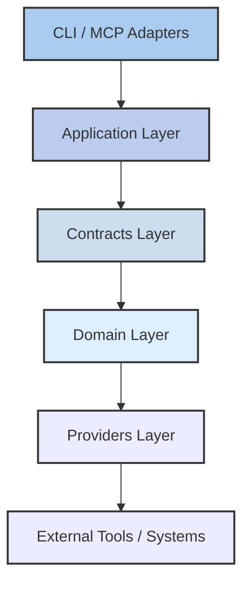
Sources: [README.md:52](), [package.json:32-34]()

## Tool Catalog

REA exposes a comprehensive set of tools to agents and CLI users, categorized by their function and target. The `product-catalog.json` lists 133 tools across various families [docs/product-catalog.json:13-228]().

**Diagram: REA Tool Families and Counts**
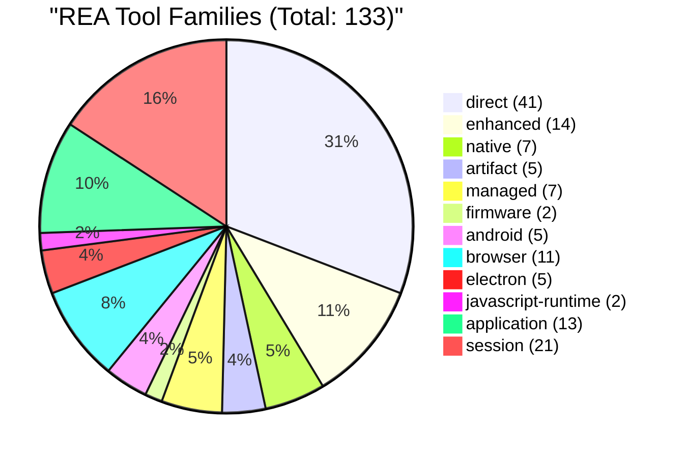
Sources: [docs/product-catalog.json:13-228]()

## Integration with Coding Agents

REA is designed to integrate seamlessly with various AI coding assistants, providing them with the ability to perform reverse engineering tasks. The `rea setup` command registers REA with supported agents and installs matching workflow instructions [README.md:53-55]().

**Diagram: Agent Integration and MCP Flow**
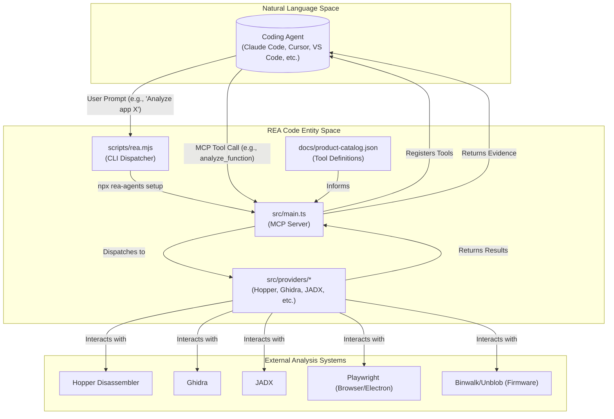
Sources: [README.md:53-55](), [README.md:70-86](), [package.json:32-34](), [docs/product-catalog.json:13-228]()

## Navigation Guide

This wiki is organized to help you move from initial setup to deep architectural understanding.

### Getting Started
This page covers how to install REA via `npx` or `npm`, run `rea setup` to configure agents and analysis providers, and use `rea doctor` for diagnostics. It also details how to connect various coding agents like Claude Code, Codex, Cursor, Gemini, and VS Code. For details, see [Getting Started](#1.1).
Sources: [README.md:58-64](), [README.md:70-86](), [README.md:100-102]()

### Configuration Reference
This section provides a detailed reference for REA's configuration options, including environment variables, the `AppConfig` and `parseConfig` mechanisms, client configuration documents, identity and product catalog digests, and paths for cache and state management. For details, see [Configuration Reference](#1.2).
Sources: [skills/reverse-engineer-anything/SKILL.md:5-7]()

### Setup, Doctor and Uninstall Internals
This page delves into the internal workings of REA's setup, doctor, and uninstall processes. It explains the plan/apply state machine used by `runSetup`, the roles of `SetupHost` and `SetupSkill`, how `Doctor` performs diagnostics and checks client registration status, and the mechanics of `Uninstall`. For details, see [Setup, Doctor and Uninstall Internals](#1.3).
Sources: [README.md:100-102](), [README.md:160-162]()

---

# Page: Getting Started

# Getting Started

<details>
<summary>Relevant source files</summary>

The following files were used as context for generating this wiki page:

- [.github/workflows/pages.yml](.github/workflows/pages.yml)
- [docs/.vitepress/config.ts](docs/.vitepress/config.ts)
- [docs/android-analysis.md](docs/android-analysis.md)
- [docs/firmware-analysis.md](docs/firmware-analysis.md)
- [docs/index.md](docs/index.md)
- [docs/installation.md](docs/installation.md)
- [docs/roadmap.md](docs/roadmap.md)
- [docs/windows-ghidra-p0.md](docs/windows-ghidra-p0.md)
- [src/application/Doctor.test.ts](src/application/Doctor.test.ts)
- [src/application/DoctorDiagnostics.ts](src/application/DoctorDiagnostics.ts)
- [src/application/Setup.fixture.ts](src/application/Setup.fixture.ts)
- [src/application/Setup.initialSnapshot.test.ts](src/application/Setup.initialSnapshot.test.ts)
- [src/application/Setup.recovery.test.ts](src/application/Setup.recovery.test.ts)
- [src/application/SetupClientConfiguration.ts](src/application/SetupClientConfiguration.ts)
- [src/application/SetupHost.ts](src/application/SetupHost.ts)
- [src/application/SetupPlan.ts](src/application/SetupPlan.ts)
- [src/application/SetupSkill.ts](src/application/SetupSkill.ts)
- [src/application/SetupTypes.ts](src/application/SetupTypes.ts)
- [src/cli/browserCommands.ts](src/cli/browserCommands.ts)
- [src/cli/interactiveSetup.ts](src/cli/interactiveSetup.ts)
- [src/cli/setupCommands.ts](src/cli/setupCommands.ts)
- [src/domain/runtimeVersion.ts](src/domain/runtimeVersion.ts)
- [tests/boundary/cli/cliSetup.test.ts](tests/boundary/cli/cliSetup.test.ts)

</details>


This page provides a technical guide for installing and configuring REA. It covers the idempotent setup workflow, environment verification, and integration with Model Context Protocol (MCP) clients like Claude Code, Codex, Cursor, Gemini, and VS Code.

## Prerequisites

REA supports various operating systems and Node.js versions. Specific providers may have additional requirements.

| Requirement | Minimum Version | Verification Command |
| :--- | :--- | :--- |
| **Operating System** | macOS 12+, Ubuntu 24.04+, Fedora 41+, 64-bit Arch Linux, CachyOS, or experimental Windows x64 | `uname -a` or `sw_vers -productVersion` |
| **Node.js** | 22.x (>=22.19), 24.x (>=24.11), or 26+ | `node --version` |
| **Hopper Disassembler** | v4 or v5 (macOS/Linux) | `rea doctor` |
| **Ghidra** | 12.1.x (Windows/Linux/macOS) | `rea doctor` |
| **JDK** | 17+ (for JADX), 21+ (for Ghidra 12.1.x) | `java -version` |

Sources: [docs/installation.md:39](), [docs/windows-ghidra-p0.md:13-16](), [src/application/DoctorDiagnostics.ts:108-120](), [docs/android-analysis.md:13-14](), [docs/roadmap.md:48-51]()

## Installation and Setup

The primary entry point for configuration is the `setup` command. This command is designed to be idempotent and safe for execution by both humans and AI agents.

### Automated Setup
To perform a complete installation including dependencies and client configuration, use `npx`:

```bash
npx rea-agents setup
```

To explicitly request the latest release:
```bash
npx rea-agents@latest setup
```

For unattended package downloads, add `--yes` before the package name. Note that this does not approve REA's setup changes, which require separate approval.
```bash
npx --yes rea-agents@latest setup
```

To install globally for a shell-visible `rea` command:
```bash
npm install --global rea-agents
```

An optional `curl` wrapper can also install the global npm package:
```bash
curl -fsSL https://raw.githubusercontent.com/morluto/rea/main/install.sh | bash
```
This script prints version, runtime, npm command, and destination before installing. It starts `rea setup` if a controlling terminal exists, otherwise it prints the command to run later. Options can be passed with `bash -s --`:
```bash
curl -fsSL https://raw.githubusercontent.com/morluto/rea/main/install.sh | \
  bash -s -- --dry-run
```
Supported options are `--version <semver>`, `--dry-run`, `--no-setup`, `--no-prompt`, and `--verbose`.
Sources: [docs/installation.md:9-11](), [docs/installation.md:19-22](), [docs/installation.md:26-27](), [docs/installation.md:44-46](), [docs/installation.md:49-51](), [docs/installation.md:54-63]()

### Skill-only Installation
To install only the agent instructions and bundled references without REA MCP registration or analysis engines, use `skills add`:
```bash
npx skills add morluto/rea --skill reverse-engineer-anything
```
This allows for conditional connection of the skill.
Sources: [docs/installation.md:86-90]()

### Setup Logic Flow
The `runSetup` function coordinates the environment preparation. It utilizes a `SetupHost` interface to abstract side effects, allowing for both production execution and unit testing. The process involves discovering the current state, planning actions, confirming with the user (if interactive), and then applying the changes.

**Data Flow: Setup Workflow**
Title: Setup Logic Flow (`runSetup`)
```mermaid
graph TD
    A[Start `runSetup`] --> B{Discover Setup State};
    B --> C{Plan Setup Actions};
    C --> D{Is Interactive?};
    D -- Yes --> E{Confirm Interactive Setup};
    D -- No --> F{Apply Setup Actions};
    E --> F;
    F --> G[Return Setup Result];

    subgraph "Discovery (`discoverSetupState`)"
        B --> B1[Initial Doctor Report];
        B --> B2[Detect Clients];
        B --> B3[Check Skill Needs Install];
        B --> B4[Determine Hopper Install Need];
        B1 & B2 & B3 & B4 --> B_out[SetupDiscovery];
    end

    subgraph "Planning (`planSetupActions`)"
        C --> C1[Filter Selected Clients];
        C --> C2[Inspect Client Configurations];
        C --> C3[Generate Client Plans];
        C --> C4[Generate Hopper Plan];
        C --> C5[Generate Skill Plan];
        C1 & C2 & C3 & C4 & C5 --> C_out[PlannedActions];
    end

    subgraph "Application (`applySetupActions`)"
        F --> F1[Install Hopper (if planned)];
        F --> F2[Configure Clients (if planned)];
        F --> F3[Install Skill (if planned)];
        F1 & F2 & F3 --> F_out[AppliedResults];
    end

    B_out --> C;
    C_out --> D;
    F_out --> G;
```
Sources: [src/application/SetupPlan.ts:34-115](), [src/application/SetupPlan.ts:118-131](), [src/application/Setup.recovery.test.ts:10-10](), [src/application/Setup.initialSnapshot.test.ts:10-10]()

## Verifying the Environment (`rea doctor`)

The `doctor` command performs a non-mutating check of the system state. It is used both as a standalone CLI tool and as the final verification step in the setup process.

```bash
rea doctor
```
To check readiness for a specific client, provider, or skill:
```bash
rea doctor --client codex --provider ghidra --skill
```
The `doctor` command returns a `healthy` boolean and a list of `DoctorCheck` objects, indicating the status of various components.

### Implementation: `DoctorHost`
The `Doctor` module, specifically `collectDoctorDiagnostics` [src/application/DoctorDiagnostics.ts:26-54](), gathers diagnostics from the `DoctorHost` interface. This includes checks for Node.js version, host operating system, and the presence and version of analysis engines like Hopper and Ghidra.

The `findHopper` function [src/application/DoctorDiagnostics.ts:123-141]() identifies the Hopper binary by searching several candidate locations in order:
1.  `configuredHopperPath` (from environment variables like `HOPPER_LAUNCHER_PATH`).
2.  The default macOS path: `/Applications/Hopper Disassembler.app/Contents/MacOS/hopper`.
3.  The default Linux path: `/opt/hopper/bin/Hopper`.
4.  User-local Linux Hopper path: `~/.local/share/hopper/Hopper`.
5.  Manual Hopper paths provided by the host.
6.  Homebrew cask path via `brew --prefix --cask hopper-disassembler`.

### Diagnostics Table
The `runDoctor` function returns a `healthy` boolean and a list of `DoctorCheck` objects.

| Check Name | Success Condition | Code Entity |
| :--- | :--- | :--- |
| `node` | Version >= 22.19, 24.11, or 26+ | `host.nodeVersion` |
| `host` | Supported OS (macOS 12+, Linux (Ubuntu 24.04+, Fedora 41+, Arch, CachyOS), Windows x64) | `host.macosVersion()`, `host.linuxDistribution()`, `host.platform`, `host.architecture` |
| `hopper` | Executable binary found | `host.executable(path)` |
| `hopper-version` | Supported Linux Hopper version | `host.supportedLinuxHopper(path)` |
| `hopper-demo-runtime` | Hopper demo runtime available | `host.hopperDemoRuntimeAvailable()` |
| `ilspycmd` | Configured and runnable `ilspycmd` | `host.ilspyCmdVersion(path)` |
| `ghidra` | Configured and runnable Ghidra | `host.ghidraVersion(path)` |
| `jadx` | Configured and runnable JADX | `host.jadxVersion(path)` |
| `target` | (Optional) Valid binary target | `host.validTarget(path)` |
| `skill:identity` | Installed REA skill identity is aligned | `installedSkillIdentity()` |

Sources: [src/application/DoctorDiagnostics.ts:96-100](), [src/application/DoctorDiagnostics.ts:102-120](), [src/application/DoctorDiagnostics.ts:152-170](), [src/application/DoctorDiagnostics.ts:173-187](), [src/application/DoctorDiagnostics.ts:190-193](), [src/application/Doctor.test.ts:109-127](), [src/application/Doctor.test.ts:129-146](), [src/application/Doctor.test.ts:194-208]()

## MCP Client Integration

REA integrates with coding agents by modifying their local MCP configuration files. This process is handled by `configureClientConfiguration` [src/application/SetupClientConfiguration.ts:51-56]().

### Supported Agents
`rea setup` can configure the following clients for REA's local MCP server:

| Client             | `--client` value |
| :----------------- | :--------------- |
| Claude Code        | `claude_code`    |
| Claude Desktop     | `claude_desktop` |
| Codex              | `codex`          |
| Cursor             | `cursor`         |
| Gemini CLI         | `gemini_cli`     |
| Windsurf           | `windsurf`       |
| Devin              | `devin`          |
| OpenCode           | `opencode`       |
| Antigravity        | `antigravity`    |
| GitHub Copilot CLI | `copilot_cli`    |
| Command Code       | `commandcode`    |
| VS Code            | `vscode`         |

For OpenCode, setup writes the V1 `mcp.rea` entry. If OpenCode V2's native `mcp.servers` table is already in use, setup registers REA there instead.
Sources: [docs/installation.md:119-132](), [docs/installation.md:134-137]()

### Transactional Configuration
To ensure stability, REA follows a strict update protocol for client configuration files (e.g., `claude_desktop_config.json`, `mcp.json`):
1.  **Resolve Transaction Path**: Determine the safe path for the configuration file, handling potential symlinks or unsafe paths. [src/application/SetupClientConfiguration.ts:185-193]()
2.  **Read Original**: Load existing configuration content. [src/application/SetupClientConfiguration.ts:73-75]()
3.  **Parse**: Parse the content into a `ClientConfigurationDocument`. [src/application/SetupClientConfiguration.ts:78-84]()
4.  **Determine Desired State**: Construct the desired MCP server entry for REA. [src/application/SetupClientConfiguration.ts:89-94]()
5.  **Check Alignment**: If the current configuration already matches the desired state, no changes are made. [src/application/SetupClientConfiguration.ts:95-95]()
6.  **Backup**: If changes are needed, create a `.rea.backup` file of the original content. [src/application/SetupClientConfiguration.ts:96-102]()
7.  **Merge**: Inject the `rea` server definition into the `mcpServers` key, potentially removing legacy entries. [src/application/SetupClientConfiguration.ts:104-113]()
8.  **Atomic Write**: Write the new configuration back to disk using `writeFileAtomic` for atomicity. [src/application/SetupClientConfiguration.ts:115-126]()
9.  **Verification**: Read the file back and parse it to ensure the write was successful and the configuration is valid and aligned. If not, the backup is restored. [src/application/SetupClientConfiguration.ts:133-146]()

### Code Entity Mapping: Client Configuration
Title: Configuration Space to File System Space
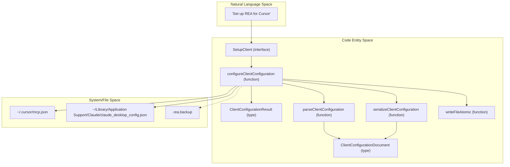
Sources: [src/application/SetupClientConfiguration.ts:1-11](), [src/application/SetupClientConfiguration.ts:51-56](), [src/application/SetupClientConfiguration.ts:60-151]()

## Environment Variables

While `setup` automates configuration, the following variables can be used to override default behavior or provide paths to optional providers:

| Variable | Purpose |
| :--- | :--- |
| `HOPPER_LAUNCHER_PATH` | Explicit path to the Hopper executable. Used by `Doctor` and injected into MCP configs. |
| `GHIDRA_INSTALL_DIR` | Path to the Ghidra installation directory. |
| `JAVA_HOME` | Path to the Java Development Kit (JDK) installation. Required for Ghidra and JADX. |
| `REA_JADX_MCP_JAR` | Path to the `jadx-headless-mcp-0.7.1-all.jar` for Android analysis. |
| `REA_JADX_HEAP_MIB` | Sets the maximum heap size for JADX in MiB. |
| `REA_JADX_ACTIVE_PROCESSOR_COUNT` | Sets the number of active processors for JADX. |
| `REA_ANALYSIS_PROVIDER` | Specifies the default analysis provider (e.g., `ghidra`). |
| `REA_LOG_LEVEL` | Controls verbosity (`debug`, `info`, `warn`, `error`). |
| `NONINTERACTIVE` | Set to `1` during Homebrew installation to prevent blocking. |
| `JAVA_TOOL_OPTIONS`, `JDK_JAVA_OPTIONS`, `_JAVA_OPTIONS` | Standard Java environment options for JVM arguments. |

Sources: [src/application/SetupHost.ts:63-66](), [src/application/DoctorDiagnostics.ts:159-163](), [docs/windows-ghidra-p0.md:43-44](), [docs/android-analysis.md:20-23](), [docs/android-analysis.md:136-139](), [docs/android-analysis.md:140-141](), [docs/android-analysis.md:143-145]()

## Connecting to Agents

Once setup is complete, the REA toolset is available via the Model Context Protocol.

### Claude Code, Claude Desktop, Codex, Cursor, Gemini CLI, Windsurf, Devin, OpenCode, Antigravity, GitHub Copilot CLI, Command Code, VS Code
After running `rea setup`, these agents will detect the new `rea` server defined in their configuration. You may need to restart the agent for changes to take effect. For Cursor, you can verify the connection in the "Features" -> "MCP" settings pane.

### Manual Configuration
For other MCP-compatible clients, add the following entry to your configuration, adjusting `command` and `args` as necessary for your installation:

```json
{
  "mcpServers": {
    "rea": {
      "command": "npx",
      "args": ["-y", "rea-agents@latest", "mcp"],
      "env": {
        "REA_ANALYSIS_PROVIDER": "ghidra",
        "GHIDRA_INSTALL_DIR": "C:\\tools\\ghidra_12.1.4_PUBLIC",
        "JAVA_HOME": "C:\\tools\\jdk-21"
      }
    }
  }
}
```
The `command` and `args` are resolved by `setupRegistrationCommand` [src/application/SetupHost.ts:33-45]() to point to the `rea` CLI's `mcp` subcommand. The `env` block can be used to specify provider-specific environment variables.
Sources: [docs/installation.md:119-132](), [docs/windows-ghidra-p0.md:67-78](), [src/application/SetupHost.ts:33-45]()

## Optional Providers

REA supports "bring-your-own" analysis providers. `rea setup` can help configure paths for some of these.

### Hopper Disassembler
REA can install Hopper on macOS and supported Linux distributions. If Hopper is already installed, `rea setup` can detect and use it.
Sources: [docs/installation.md:150-153](), [src/application/SetupPlan.ts:54-64]()

### Ghidra
`rea setup` can save verified paths for an existing Ghidra installation in agent configurations. REA does not install or upgrade Ghidra or Java.
Sources: [docs/installation.md:150-153](), [docs/windows-ghidra-p0.md:30-31]()

### JADX (for Android Analysis)
For Android APK analysis, REA wraps an existing headless JADX engine. You need to supply a full JDK 17 or newer and `jadx-headless-mcp 0.7.1`. These are configured via environment variables like `REA_JADX_MCP_JAR` and `JAVA_HOME`.
Sources: [docs/android-analysis.md:13-14](), [docs/android-analysis.md:19-23]()

## Maintenance Commands

REA provides commands for updating and uninstalling the tool.

### Update (`rea update`)
The `update` command updates the REA installation and verifies the installed release.
```bash
rea update
```
This command is registered via `registerMaintenanceCommands` [src/cli/setupCommands.ts:145-161]() and executed by `runUpdate` [src/cli/setupCommands.ts:153-157]().
Sources: [src/cli/setupCommands.ts:145-161]()

### Uninstall (`rea uninstall`)
The `uninstall` command removes REA-owned agent configuration and skill files.
```bash
rea uninstall
```
To also remove REA caches and state:
```bash
rea uninstall --purge-data
```
This command is registered via `registerMaintenanceCommands` [src/cli/setupCommands.ts:127-143]() and executed by `runUninstall` [src/cli/setupCommands.ts:141-141]().
Sources: [src/cli/setupCommands.ts:127-143]()

---

# Page: Configuration Reference

# Configuration Reference

<details>
<summary>Relevant source files</summary>

The following files were used as context for generating this wiki page:

- [scripts/verify-package-environment.d.mts](scripts/verify-package-environment.d.mts)
- [scripts/verify-package-environment.mjs](scripts/verify-package-environment.mjs)
- [src/application/ClientConfigurationDocument.test.ts](src/application/ClientConfigurationDocument.test.ts)
- [src/application/ClientConfigurationDocument.ts](src/application/ClientConfigurationDocument.ts)
- [src/application/ClientRegistrationStatus.ts](src/application/ClientRegistrationStatus.ts)
- [src/application/SupportedClients.ts](src/application/SupportedClients.ts)
- [src/application/Uninstall.ts](src/application/Uninstall.ts)
- [src/cliCommandNames.ts](src/cliCommandNames.ts)
- [src/cliLogging.test.ts](src/cliLogging.test.ts)
- [src/cliLogging.ts](src/cliLogging.ts)
- [src/config.ts](src/config.ts)
- [src/contracts/toolContracts.ts](src/contracts/toolContracts.ts)
- [src/contracts/toolEffects.ts](src/contracts/toolEffects.ts)
- [src/identity.ts](src/identity.ts)
- [src/logger.ts](src/logger.ts)
- [src/main.ts](src/main.ts)
- [src/server/createServer.ts](src/server/createServer.ts)
- [src/server/registerSessionTools.ts](src/server/registerSessionTools.ts)
- [tests/boundary/cli/projectedErrorStatus.test.ts](tests/boundary/cli/projectedErrorStatus.test.ts)
- [tests/boundary/filesystem/clientConfigurationBom.test.ts](tests/boundary/filesystem/clientConfigurationBom.test.ts)
- [tests/boundary/filesystem/clientConfigurationDialects.test.ts](tests/boundary/filesystem/clientConfigurationDialects.test.ts)
- [tests/boundary/filesystem/clientLifecycle.test.ts](tests/boundary/filesystem/clientLifecycle.test.ts)

</details>


The REA configuration system manages how the application interacts with various analysis providers, validates target files, and handles logging. Configuration is primarily driven by environment variables, which are parsed and validated into a type-safe `AppConfig` object at the application's composition root. It also covers client configuration documents and dialects, identity/product catalog digests, cache and state paths, and logging levels.

## Configuration Data Flow

The configuration process begins at the entry point (`src/main.ts`) where the process environment is passed to a validator. This validator ensures that all required paths are present (or defaults are applied) and that complex types like JSON-encoded arguments are correctly formed.

### Configuration Lifecycle Diagram

This diagram illustrates how environment variables are transformed into the `AppConfig` entity used by the `BinarySession` and `McpServer`.

"Configuration Flow: Environment to Runtime"
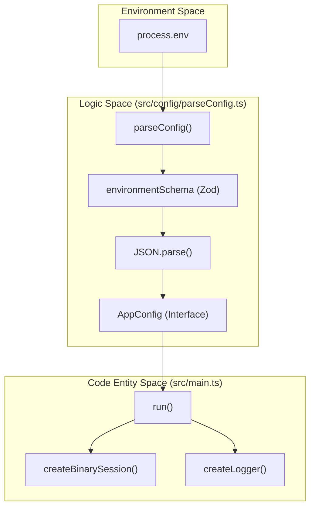

**Sources:** [src/config.ts:2](), [src/main.ts:8](), [src/main.ts:54-61]()

---

## Environment Variables Reference

REA uses the following environment variables to control its behavior. These are parsed by `parseConfig` [src/config/parseConfig.ts:34-67]().

| Variable | Type | Default | Description |
| :--- | :--- | :--- | :--- |
| `REA_LOG_LEVEL` | Enum | `info` | Logging verbosity: `trace`, `debug`, `info`, `warn`, `error`, `fatal`, `silent`. [src/config/parseConfig.ts:23-26]() |
| `REA_ANALYSIS_PROVIDER` | String | `auto` | Specifies the preferred analysis provider (e.g., `hopper`, `ghidra`, `auto`). [src/config/parseConfig.ts:7-11]() |
| `REA_HOPPER_PATH` | String | `/Applications/Hopper Disassembler.app/Contents/MacOS/hopper` | Path to the Hopper Disassembler CLI executable. [src/config/parseConfig.ts:12-16]() |
| `REA_GHIDRA_PATH` | String | `undefined` | Path to the Ghidra `analyzeHeadless` executable. [src/config/parseConfig.ts:17-21]() |
| `REA_JADX_MCP_JAR` | String | `undefined` | Path to the JADX MCP bridge JAR for Android analysis. [src/config/parseConfig.ts:27-31]() |
| `REA_BINWALK_COMMAND` | String | `undefined` | Path to the `binwalk` command for firmware analysis. [src/config/parseConfig.ts:32-36]() |
| `REA_UNBLOB_COMMAND` | String | `undefined` | Path to the `unblob` command for firmware extraction. [src/config/parseConfig.ts:37-41]() |
| `REA_BROWSER_EXECUTABLE` | String | `undefined` | Path to a specific browser executable for web analysis. [src/config/parseConfig.ts:42-46]() |
| `REA_WAKARU_COMMAND` | String | `undefined` | Path to the `wakaru` command for JavaScript recovery. [src/config/parseConfig.ts:47-51]() |
| `REA_CACHE_PATH` | String | `~/.rea/cache` | Path to the directory used for caching analysis results. [src/config/parseConfig.ts:52-56]() |
| `REA_STATE_PATH` | String | `~/.rea/state` | Path to the directory used for persistent application state. [src/config/parseConfig.ts:57-61]() |
| `REA_PRODUCT_CATALOG_DIGEST` | String | `undefined` | SHA-256 digest of the expected product catalog. [src/config/parseConfig.ts:62-66]() |
| `REA_IDENTITY_DIGEST` | String | `undefined` | SHA-256 digest of the expected identity configuration. [src/config/parseConfig.ts:67]() |
| `REA_REFERENCE_SECRET_PATTERNS_JSON` | JSON Array | `[]` | JSON-encoded array of glob patterns for secret files in reference sources. [src/config/parseConfig.ts:67]() |

**Sources:** [src/config/parseConfig.ts:7-67]()

---

## The AppConfig Interface

The `AppConfig` interface represents the validated, internal state of the application's configuration. It is defined as a `readonly` structure to prevent runtime mutations.

```typescript
export interface AppConfig {
  readonly logLevel: LogLevel;
  readonly analysisProvider: AnalysisProviderSelection;
  readonly hopperPath: string | undefined;
  readonly ghidraPath: string | undefined;
  readonly jadxMcpJar: string | undefined;
  readonly binwalkCommand: string | undefined;
  readonly unblobCommand: string | undefined;
  readonly browserExecutable: string | undefined;
  readonly wakaruCommand: string | undefined;
  readonly cachePath: string;
  readonly statePath: string;
  readonly productCatalogDigest: string | undefined;
  readonly identityDigest: string | undefined;
  readonly referenceSecretPatterns: readonly string[];
}
```

**Sources:** [src/config/types.ts:5-18]()

---

## Validation Logic (`parseConfig`)

Validation is implemented using the `zod` library. The `parseConfig` function performs validation on environment variables [src/config/parseConfig.ts:67]().

1.  **Schema Validation**: The `environmentSchema` validates basic types and enums for all environment variables [src/config/parseConfig.ts:8-67]().
2.  **JSON Parsing**: If `REA_REFERENCE_SECRET_PATTERNS_JSON` is provided, it is parsed via `JSON.parse()` [src/config/parseConfig.ts:67]().
3.  **Path Resolution**: `cachePath` and `statePath` are resolved relative to the user's home directory if not absolute [src/config/parseConfig.ts:67]().

If any step fails, the function returns a `Result.err` containing a `ConfigurationError` [src/config/parseConfig.ts:67]().

### Configuration Mapping to Code Entities

"Mapping Config to Internal Logic"
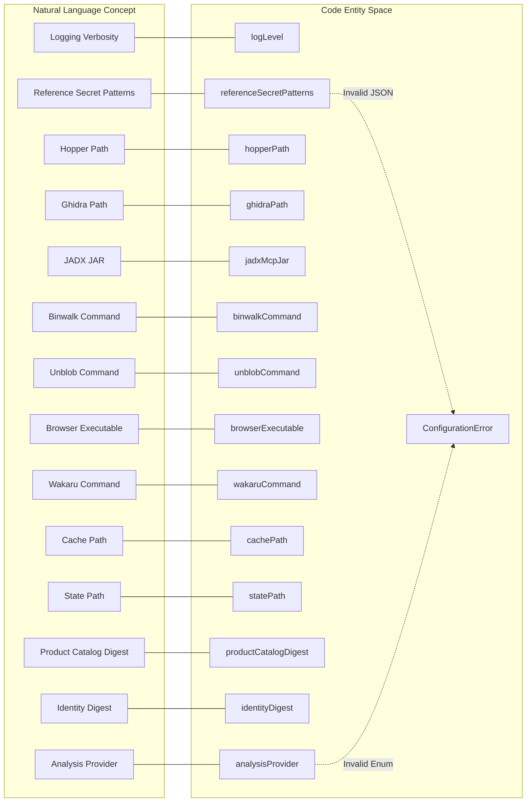

**Sources:** [src/config/parseConfig.ts:67](), [src/domain/analysisErrorBase.ts:10-10]()

---

## Client Configuration Documents and Dialects

REA interacts with various client applications (e.g., VS Code, OpenCode, Cursor) by registering itself as an MCP server in their configuration files. These client configurations can be in different formats (JSON, JSONC, TOML) and have different structures, referred to as "dialects".

The `ClientConfigurationDocument` interface [src/application/ClientConfigurationDocument.ts:26-38]() represents a parsed client configuration file, providing access to the document itself, the specific server table where REA registers, its path within the document, and the detected dialect.

### Client Configuration Parsing

The `parseClientConfiguration` function [src/application/ClientConfigurationDocument.ts:100-139]() is responsible for parsing the raw text of a client's configuration file into a `ClientConfigurationDocument`. It handles different formats (`toml`, `json`, `jsonc`) and identifies the correct location for MCP server registrations.

Key aspects:
*   **Format Detection**: Based on the `ClientConfigurationFormat` [src/application/ClientConfigurationDocument.ts:14]() (e.g., `"toml"`, `"opencode"`, `"vscode"`).
*   **Server Key Resolution**: `clientConfigurationServersKey` [src/application/ClientConfigurationDocument.ts:63-76]() determines the top-level key for MCP server registrations (e.g., `"mcp_servers"` for TOML, `"mcp"` for OpenCode, `"servers"` for VS Code).
*   **Dialect Handling**: Specifically for OpenCode, it distinguishes between `opencode` (V1) and `opencode_v2` dialects [src/application/ClientConfigurationDocument.ts:110-138](), which have different structures for their server tables.
*   **Legacy Servers**: It can identify and preserve "legacy" server entries that might exist alongside newer formats [src/application/ClientConfigurationDocument.ts:134-137]().

### Client Configuration Diagram

"Client Configuration Document Processing"
```mermaid
graph TD
    A[Client Config File Text] --> B{parseClientConfiguration(text, format)}
    B --> C{Parse Document (TOML/JSONC)}
    C --> D{Determine serversKey}
    D --> E{Extract Servers Table}
    E --> F{Detect Dialect (e.g., opencode_v2)}
    F --> G[ClientConfigurationDocument]

    G --"document"--> H[Original Document]
    G --"servers"--> I[MCP Servers Table]
    G --"serversPath"--> J[Path to Servers Table]
    G --"dialect"--> K[ClientRegistrationDialect]
    G --"legacyServers"--> L[Legacy MCP Servers]

    style A fill:#ace,stroke:#333,stroke-width:2px
    style G fill:#ace,stroke:#333,stroke-width:2px
```

**Sources:**
*   [src/application/ClientConfigurationDocument.ts:14]()
*   [src/application/ClientConfigurationDocument.ts:26-38]()
*   [src/application/ClientConfigurationDocument.ts:63-76]()
*   [src/application/ClientConfigurationDocument.ts:100-139]()
*   [tests/boundary/filesystem/clientConfigurationDialects.test.ts:73-78]()

---

## Identity and Product Catalog Digests

REA uses SHA-256 digests to ensure the integrity and consistency of its identity and product catalog. These digests can be specified via environment variables:
*   `REA_PRODUCT_CATALOG_DIGEST`: Expected digest for the product catalog [src/config/parseConfig.ts:62-66]().
*   `REA_IDENTITY_DIGEST`: Expected digest for the identity configuration [src/config/parseConfig.ts:67]().

These digests are part of the `AppConfig` [src/config/types.ts:17-18]() and can be used for verification during startup or setup processes to prevent tampering or ensure a specific version of the configuration is loaded.

**Sources:**
*   [src/config/parseConfig.ts:62-67]()
*   [src/config/types.ts:17-18]()

---

## Cache and State Paths

REA manages local data in two primary locations, configurable via environment variables:
*   `REA_CACHE_PATH`: Specifies the directory for caching analysis results and temporary files [src/config/parseConfig.ts:52-56](). This path defaults to `~/.rea/cache` if not provided and is resolved to an absolute path [src/config/parseConfig.ts:67]().
*   `REA_STATE_PATH`: Specifies the directory for persistent application state, such as session information or provider configurations [src/config/parseConfig.ts:57-61](). This path defaults to `~/.rea/state` if not provided and is resolved to an absolute path [src/config/parseConfig.ts:67]().

These paths are crucial for the application's operation and are managed by the `systemUninstallHost` for cleanup during uninstallation [src/application/Uninstall.ts:116-119]().

**Sources:**
*   [src/config/parseConfig.ts:52-61]()
*   [src/config/parseConfig.ts:67]()
*   [src/application/Uninstall.ts:116-119]()

---

## Logging Configuration

Logging is handled by `pino`. The `REA_LOG_LEVEL` environment variable determines the threshold for log output [src/config/parseConfig.ts:23-26]().

*   **Destination**: In MCP mode, logs are directed to `stderr` (file descriptor 2) to avoid corrupting the `stdout` stream used for JSON-RPC communication [src/logger.ts:16-28]().
*   **Redaction**: Sensitive fields such as `token`, `params`, and `arguments` are automatically redacted to prevent leaking binary data or credentials into log files [src/logger.ts:21-28]().
*   **Logger Creation**: The `createLogger` function [src/logger.ts:28]() initializes the logger based on the configured `logLevel`.

**Sources:**
*   [src/config/parseConfig.ts:23-26]()
*   [src/logger.ts:16-28]()
*   [src/logger.ts:21-28]()
*   [src/logger.ts:28]()

---

## Error Handling

When `parseConfig` encounters an invalid configuration, it returns a `ConfigurationError`. In the main entry point, this error is caught, and the application exits with a non-zero status code after printing the error tag and message to `stderr`.

```typescript
const config = parseConfig(dependencies.env);
if (!config.ok) {
  dependencies.writeStderr(`${projectAnalysisError(config.error).message}\n`);
  return 1;
}
```

**Sources:** [src/main.ts:54-58](), [src/config/parseConfig.ts:67]()

---

# Page: Setup, Doctor and Uninstall Internals

# Setup, Doctor and Uninstall Internals

<details>
<summary>Relevant source files</summary>

The following files were used as context for generating this wiki page:

- [scripts/verify-package-environment.d.mts](scripts/verify-package-environment.d.mts)
- [scripts/verify-package-environment.mjs](scripts/verify-package-environment.mjs)
- [scripts/verify-package.mjs](scripts/verify-package.mjs)
- [src/application/ClientConfigurationDocument.test.ts](src/application/ClientConfigurationDocument.test.ts)
- [src/application/ClientConfigurationDocument.ts](src/application/ClientConfigurationDocument.ts)
- [src/application/ClientRegistrationStatus.ts](src/application/ClientRegistrationStatus.ts)
- [src/application/DirectAnalysis.ts](src/application/DirectAnalysis.ts)
- [src/application/Doctor.test.ts](src/application/Doctor.test.ts)
- [src/application/Doctor.ts](src/application/Doctor.ts)
- [src/application/DoctorDiagnostics.ts](src/application/DoctorDiagnostics.ts)
- [src/application/Setup.fixture.ts](src/application/Setup.fixture.ts)
- [src/application/Setup.initialSnapshot.test.ts](src/application/Setup.initialSnapshot.test.ts)
- [src/application/Setup.recovery.test.ts](src/application/Setup.recovery.test.ts)
- [src/application/Setup.ts](src/application/Setup.ts)
- [src/application/SetupHost.ts](src/application/SetupHost.ts)
- [src/application/SetupPlan.ts](src/application/SetupPlan.ts)
- [src/application/SetupSkill.ts](src/application/SetupSkill.ts)
- [src/application/SetupTypes.ts](src/application/SetupTypes.ts)
- [src/application/SupportedClients.ts](src/application/SupportedClients.ts)
- [src/application/Uninstall.ts](src/application/Uninstall.ts)
- [src/cli.ts](src/cli.ts)
- [src/cliEvidenceCommands.ts](src/cliEvidenceCommands.ts)
- [src/domain/runtimeVersion.ts](src/domain/runtimeVersion.ts)
- [src/identity.ts](src/identity.ts)
- [tests/boundary/filesystem/clientConfigurationBom.test.ts](tests/boundary/filesystem/clientConfigurationBom.test.ts)
- [tests/boundary/filesystem/clientConfigurationDialects.test.ts](tests/boundary/filesystem/clientConfigurationDialects.test.ts)
- [tests/boundary/filesystem/clientLifecycle.test.ts](tests/boundary/filesystem/clientLifecycle.test.ts)

</details>


This page details the internal workings of REA's setup, doctor, and uninstall processes. It covers the state machine used by `runSetup`, the roles of `SetupHost` and `SetupSkill`, how `Doctor` performs diagnostics and reports client registration status, and the mechanics of `Uninstall`. The goal is to provide a deep technical understanding of these core lifecycle operations.

## Setup Internals

The `runSetup` function orchestrates the setup process, which involves discovering the current state of the system, planning necessary actions, and then applying those actions. It operates as a state machine, moving through discovery, planning, and application phases, with optional interactive confirmation steps.

### Setup State Machine (`runSetup`)

The `runSetup` function [src/application/Setup.ts:27-31]() is the entry point for the setup process. It takes `SetupOptions`, a `SetupHost` implementation, and an optional `SetupConfirmation` callback.

The process begins by checking for unsupported host environments using `hostRemediation` [src/application/Setup.ts:44-45](). If the host is unsupported, the setup fails.

Next, it discovers the initial setup state, including the current Hopper path and provider environment, either from a provided initial state or by querying the `SetupHost` [src/application/Setup.ts:46-53]().

The core discovery phase is handled by `discoverSetupState` [src/application/Setup.ts:54-64](), which identifies detected clients, default clients, and whether the REA skill needs installation.

Based on the discovery, `runSetup` determines which clients are selected for configuration. This can be influenced by `options.clientIds`, `options.readinessScope.clients`, `options.allDetectedClients`, or interactive selection if `confirm` is provided [src/application/Setup.ts:65-78]().

If interactive selection is enabled, `planSetupActions` is called to generate a preliminary set of actions for user confirmation [src/application/Setup.ts:90-94](). The user's decision (`SetupConfirmationDecision`) then refines the `selectedClientIds` and `installSkill` flags [src/application/Setup.ts:108-137]().

After selection, `planSetupActions` is called again with the resolved client IDs and skill installation status to generate the final `plannedActions` [src/application/Setup.ts:139-146](). This plan includes actions like installing Hopper, installing the REA skill, and configuring clients.

If `options.dryRun` is true, the function returns the planned actions without applying them [src/application/Setup.ts:166-174]().

Otherwise, if `approved` is not already true (e.g., from `options.approved`), and a `confirm` callback is provided, the user is prompted for approval of the planned actions [src/application/Setup.ts:176-195]().

Finally, the `plannedActions` are iterated, and each action is applied. For each action, a `SetupProgressEvent` is emitted, and the `host` performs the actual operation (e.g., `host.installHopper()`, `host.installSkill()`, `host.configureClient()`) [src/application/Setup.ts:200-240]().

The `runSetup` function returns a `SetupResult` indicating the status (`"complete"`, `"cancelled"`, `"failed"`, `"planned"`), the `plannedActions`, `appliedActions`, configured `clients`, and a `doctor` summary [src/application/Setup.ts:400-410]().

```mermaid
graph TD
    A[runSetup] --> B{Check Host Remediation?};
    B -- Yes --> C[Fail Setup];
    B -- No --> D[Discover Initial State];
    D --> E[Discover Setup State (discoverSetupState)];
    E --> F{Interactive Selection?};
    F -- Yes --> G[Plan Selection Actions];
    G --> H{Confirm Selection?};
    H -- Yes --> I[Refine Selection];
    H -- No --> J[Cancel Setup];
    F -- No --> I;
    I --> K[Plan Final Actions (planSetupActions)];
    K --> L{Blocker Detected?};
    L -- Yes --> C;
    L -- No --> M{Dry Run?};
    M -- Yes --> N[Return Planned Actions];
    M -- No --> O{Approved?};
    O -- No --> P{Interactive Approval?};
    P -- Yes --> Q{Confirm Approval?};
    Q -- Yes --> R[Apply Actions];
    Q -- No --> J;
    P -- No --> J;
    O -- Yes --> R;
    R --> S[Return Setup Result];
    C --> S;
    J --> S;
    N --> S;

    subgraph "Key Functions"
        E["discoverSetupState(host, providerEnvironment, ...)" src/application/SetupPlan.ts:34-115]
        G["planSetupActions(discovery, host, providerEnvironment, ...)" src/application/SetupPlan.ts:119-147]
        K["planSetupActions(discovery, host, providerEnvironment, ...)" src/application/SetupPlan.ts:139-146]
        R["Apply Actions (host.installHopper, host.installSkill, host.configureClient)" src/application/Setup.ts:200-240]
    end
```
Sources: [src/application/Setup.ts:27-410](), [src/application/SetupPlan.ts:34-115](), [src/application/SetupPlan.ts:119-147]()

### `SetupHost` and `SetupSkill`

`SetupHost` [src/application/SetupTypes.ts:8-13]() is an interface that abstracts the underlying system operations required for setup. The `systemSetupHost` [src/application/SetupHost.ts:23-25]() provides a concrete implementation for the current operating environment.

Key responsibilities of `SetupHost` include:
*   `doctor()`: Runs diagnostics to assess the system's health and readiness [src/application/SetupTypes.ts:8]().
*   `initialSetupState()`: Provides an initial snapshot of the setup state [src/application/SetupTypes.ts:8]().
*   `hopperPath()`: Determines the path to the Hopper disassembler [src/application/SetupTypes.ts:8]().
*   `installHopper()`: Installs Hopper [src/application/SetupTypes.ts:8]().
*   `uninstallHopper()`: Uninstalls Hopper [src/application/SetupTypes.ts:8]().
*   `installSkill()`: Installs the REA skill [src/application/SetupTypes.ts:8]().
*   `uninstallSkill()`: Uninstalls the REA skill [src/application/SetupTypes.ts:8]().
*   `supportedClients()`: Lists supported client integrations [src/application/SetupTypes.ts:8]().
*   `detectedClients()`: Lists detected client integrations [src/application/SetupTypes.ts:8]().
*   `inspectClientConfiguration()`: Inspects a client's configuration [src/application/SetupTypes.ts:8]().
*   `configureClient()`: Configures a client [src/application/SetupTypes.ts:8]().
*   `unconfigureClient()`: Unconfigures a client [src/application/SetupTypes.ts:8]().

The `SetupSkill` [src/application/SetupSkill.ts:1-10]() module handles the installation and uninstallation of the REA skill. The skill is essentially the REA CLI itself, registered with clients.

*   `installSkill()`: Installs the REA skill by creating a symlink to the `rea` executable in a well-known location (e.g., `~/.rea/bin`) and adding this location to the user's PATH [src/application/SetupSkill.ts:12-40](). It also ensures the `rea` executable is present and executable.
*   `uninstallSkill()`: Removes the symlink and cleans up the skill installation directory [src/application/SetupSkill.ts:42-60]().

```mermaid
graph TD
    A[SetupHost Interface] --> B{systemSetupHost()};
    B --> C[Concrete SetupHost Implementation];

    C --> C1[doctor()];
    C --> C2[installHopper()];
    C --> C3[installSkill()];
    C --> C4[configureClient()];
    C --> C5[uninstallSkill()];
    C --> C6[unconfigureClient()];

    C3 --> D[SetupSkill.installSkill()];
    C5 --> E[SetupSkill.uninstallSkill()];

    D --> F[Create symlink to 'rea' executable];
    D --> G[Add to PATH];
    E --> H[Remove symlink];
    E --> I[Clean up skill directory];
```
Sources: [src/application/SetupTypes.ts:8-13](), [src/application/SetupHost.ts:23-25](), [src/application/SetupSkill.ts:1-10](), [src/application/SetupSkill.ts:12-40](), [src/application/SetupSkill.ts:42-60]()

### Client Configuration Documents and Dialects

REA integrates with various coding agents (clients) by modifying their configuration files to register the REA MCP server. This involves understanding different configuration file formats and structures, referred to as "dialects."

The `ClientConfigurationDocument` [src/application/ClientConfigurationDocument.ts:26-38]() interface represents a parsed client configuration file, providing access to the document itself, the `servers` table where REA registers its MCP server, the path to this table, and the `dialect` of the configuration.

`ClientConfigurationFormat` [src/application/ClientConfigurationDocument.ts:14]() defines the supported formats, such as `"toml"`, `"opencode"`, and `"vscode"`.

The `parseClientConfiguration` function [src/application/ClientConfigurationDocument.ts:100-138]() is responsible for parsing the raw text of a client's configuration file into a `ClientConfigurationDocument`. It handles different formats (TOML, JSON/JSONC) and identifies the correct location for MCP server registrations. For OpenCode, it specifically handles both V1 (`mcp.<name>`) and V2 (`mcp.servers`) dialects, ensuring compatibility and proper merging.

`clientConfigurationServersKey` [src/application/ClientConfigurationDocument.ts:63-76]() determines the top-level key used for MCP server registrations based on the client's format (e.g., `"mcp_servers"` for TOML, `"mcp"` for OpenCode, `"servers"` for VS Code).

`withClientServers` [src/application/ClientConfigurationDocument.ts:154-165]() updates the `servers` table within a `ClientConfigurationDocument` and reconstructs the full document, preserving comments and other unrelated settings.

The `configureClientConfiguration` function [src/application/SetupClientConfiguration.ts:12-13]() (not fully shown, but referenced in tests) uses these utilities to read, modify, and write client configuration files. It also handles creating backups before making changes.

```mermaid
graph TD
    A[Client Configuration File (Text)] --> B{parseClientConfiguration(text, format)};
    B --> C[ClientConfigurationDocument];

    C --> C1[document: Record<string, unknown>];
    C --> C2[servers: Record<string, unknown>];
    C --> C3[serversPath: readonly string[]];
    C --> C4[dialect: ClientRegistrationDialect];
    C --> C5[legacyServers: Record<string, unknown>];

    C1 --> D{clientConfigurationServersKey(format)};
    D --> E[Key (e.g., "mcp", "servers", "mcp_servers")];

    F[New Server Configuration] --> G{withClientServers(parsedDoc, newServers, removeLegacy?)};
    G --> H[Updated Document (Record<string, unknown>)];
    H --> I{serializeClientConfiguration(updatedDoc, format, originalText?, editedPaths?)};
    I --> J[Updated Client Configuration File (Text)];

    subgraph "ClientConfigurationDocument.ts"
        B
        C
        D
        E
        F
        G
        H
        I
    end
```
Sources: [src/application/ClientConfigurationDocument.ts:26-38](), [src/application/ClientConfigurationDocument.ts:14](), [src/application/ClientConfigurationDocument.ts:100-138](), [src/application/ClientConfigurationDocument.ts:63-76](), [src/application/ClientConfigurationDocument.ts:154-165](), [tests/boundary/filesystem/clientConfigurationDialects.test.ts:65-66]()

## Doctor Internals

The `doctor` command provides diagnostics about the REA environment, including system health, provider readiness, and client registration status. It's a read-only operation designed to identify and suggest remediations for potential issues.

### `DoctorHost` and `DoctorReport`

The `runDoctor` function [src/application/Doctor.ts:154-184]() is the main entry point for diagnostics. It takes an optional `target` path, a `DoctorHost` implementation, and a `DoctorScope` to narrow down the checks.

The `DoctorHost` [src/application/Doctor.ts:74-96]() interface defines the capabilities required for diagnostics, abstracting system-specific details. The `systemDoctorHost` [src/application/Doctor.ts:156]() provides the concrete implementation.

Key responsibilities of `DoctorHost` include:
*   `platform`, `architecture`, `nodeVersion`, `homeDirectory`: Basic system information [src/application/Doctor.ts:75-78]().
*   `macosVersion()`, `linuxDistribution()`: OS-specific version and distribution details [src/application/Doctor.ts:79-80]().
*   `validTarget()`, `inspectTarget()`: Checks for binary target validity [src/application/Doctor.ts:81-82]().
*   `executable()`: Checks if a path is an executable [src/application/Doctor.ts:86]().
*   `supportedLinuxHopper()`, `linuxDemoRuntimeCheck()`: Hopper-specific checks for Linux [src/application/Doctor.ts:87-88]().
*   `brewHopperPath()`, `manualHopperPaths()`: Discovers Hopper installation paths [src/application/Doctor.ts:89-90]().
*   `providerInspections()`: Gathers diagnostics from analysis providers [src/application/Doctor.ts:91]().
*   `installationPaths()`: Lists REA installation paths [src/application/Doctor.ts:92]().
*   `installedSkillIdentity()`: Provides details about the installed REA skill [src/application/Doctor.ts:93]().
*   `clientRegistrations()`: Retrieves the status of client registrations [src/application/Doctor.ts:94]().

The `runDoctor` function first calls `collectDoctorDiagnostics` [src/application/Doctor.ts:160]() to gather general system and provider-related checks. It then calls `collectDoctorIdentity` [src/application/Doctor.ts:163]() to collect information about the REA installation, skill, and client registrations.

The results are aggregated into a `DoctorReport` [src/application/Doctor.ts:106-116](), which includes:
*   `healthy`: Overall health status.
*   `environment_healthy`: Health of the environment.
*   `scope`: The `DoctorScopeReport` indicating which checks were performed.
*   `scope_checks`, `informational_checks`: Categorized diagnostic checks.
*   `hopperPath`, `providerInspections`: Details about Hopper and other providers.
*   `checks`: All collected `DoctorCheck` items.
*   `identity`: `DoctorIdentity` details about the REA installation.

Each `DoctorCheck` [src/application/Doctor.ts:37-50]() provides a `name`, `ok` status, `classification` (e.g., `"healthy"`, `"missing_dependency"`), `detail`, and `remediation` message.

### Client Registration Status

The `Doctor` command reports on the status of client registrations. This is crucial for understanding if coding agents are correctly configured to use REA.

`readClientRegistrationStatuses` [src/application/ClientRegistrationStatus.ts:12-13]() is a key function that scans for supported clients and checks their configuration files for REA's MCP server registration. It returns a list of `ClientRegistrationStatus` objects.

A `ClientRegistrationStatus` [src/application/ClientRegistrationStatus.ts:19-30]() includes:
*   `client`: The name of the client (e.g., "vscode", "opencode").
*   `state`: The status of the registration (`"aligned"`, `"stale"`, `"invalid"`, `"missing"`).
*   `command`: The command registered for the MCP server.
*   `remediation`: A message suggesting how to fix issues.

The `isOwnedClientRegistrationCommand` function [src/application/ClientRegistrationIdentity.ts:10-12]() determines if a registered command belongs to REA, typically by checking if it matches the `PRODUCT_IDENTITY.mcpCommand` [src/identity.ts:13](). This is important for `uninstall` to only remove REA-owned registrations.

The `DoctorIdentity` [src/application/Doctor.ts:125-147]() within the `DoctorReport` includes a `registrations` array, providing a summary of all detected client registration statuses [src/application/Doctor.ts:146]().

```mermaid
graph TD
    A[runDoctor(target?, host, scope?)] --> B[collectDoctorDiagnostics(target, host)];
    A --> C[collectDoctorIdentity(host)];

    B --> D[Diagnostic Checks (DoctorCheck[])];
    C --> E[DoctorIdentity];
    E --> E1[cli_package_version];
    E --> E2[expected_skill_version];
    E --> E3[skill: { state, remediation }];
    E --> E4[registrations: ClientRegistrationStatus[]];

    E4 --> F[readClientRegistrationStatuses(home)];
    F --> G[Scan client config files];
    G --> H[Check for PRODUCT_IDENTITY.mcpServerKey];
    H --> I[isOwnedClientRegistrationCommand(command)];
    I --> J[Determine ClientRegistrationStatus (aligned, stale, invalid, missing)];

    D & E --> K[scopeDoctorChecks(...)];
    K --> L[DoctorReport];
    L --> L1[healthy];
    L --> L2[environment_healthy];
    L --> L3[checks: DoctorCheck[]];
    L --> L4[identity: DoctorIdentity];
```
Sources: [src/application/Doctor.ts:154-184](), [src/application/Doctor.ts:74-96](), [src/application/Doctor.ts:156](), [src/application/Doctor.ts:160](), [src/application/Doctor.ts:163](), [src/application/Doctor.ts:106-116](), [src/application/Doctor.ts:37-50](), [src/application/ClientRegistrationStatus.ts:12-13](), [src/application/ClientRegistrationStatus.ts:19-30](), [src/application/ClientRegistrationIdentity.ts:10-12](), [src/identity.ts:13](), [src/application/Doctor.ts:125-147](), [src/application/Doctor.ts:146]()

## Uninstall Internals

The `uninstall` command removes REA-owned state from the system, including client registrations, the REA skill, and cached data. It aims to be idempotent and provides detailed feedback on what was removed or retained.

### `runUninstall` and `UninstallHost`

The `runUninstall` function [src/application/Uninstall.ts:87-106]() is the main entry point for the uninstall process. It takes a `purgeData` boolean (to indicate whether to remove cache and state directories) and an `UninstallHost` implementation.

The `UninstallHost` [src/application/Uninstall.ts:78-83]() interface abstracts the file system and client interaction for uninstallation. The `systemUninstallHost` [src/application/Uninstall.ts:109-119]() provides the concrete implementation.

Key responsibilities of `UninstallHost` include:
*   `clients()`: Lists all supported clients [src/application/Uninstall.ts:80]().
*   `removeClient()`: Removes REA's registration from a specific client [src/application/Uninstall.ts:81]().
*   `removeSkill()`: Uninstalls the REA skill [src/application/Uninstall.ts:82]().
*   `purgeData()`: Removes REA's cache and state directories [src/application/Uninstall.ts:83]().

The `runUninstall` function iterates through all detected clients and calls `host.removeClient()` for each [src/application/Uninstall.ts:91-92](). It then calls `host.removeSkill()` [src/application/Uninstall.ts:93](). If `purgeData` is true, it calls `host.purgeData()` [src/application/Uninstall.ts:94]().

The function returns an `UninstallResult` [src/application/Uninstall.ts:55-58]() which contains a `status` (`"complete"` or `"failed"`) and a list of `UninstallItem` [src/application/Uninstall.ts:48-52]() objects. Each `UninstallItem` describes the outcome for a specific component (e.g., client, skill, cache) with a `name`, `status` (`"removed"`, `"retained"`, `"skipped"`, `"failed"`), and `detail` message.

### Removing Client Registrations

The `removeClient` function [src/application/Uninstall.ts:122-200]() is responsible for removing REA's MCP server registration from a client's configuration file.

1.  **Path Resolution**: It first resolves the client's configuration file path using `resolveUninstallConfigPath` [src/application/Uninstall.ts:133]().
2.  **Read Configuration**: It attempts to read the configuration file [src/application/Uninstall.ts:136-146](). If the file is missing, the client is skipped. If it's unreadable or malformed, it reports a failure.
3.  **Parse Configuration**: The `parseClientConfiguration` function [src/application/Uninstall.ts:148-157]() is used to parse the file, handling different formats and dialects.
4.  **Identify REA Registration**: It checks for the presence of REA's MCP server key (`PRODUCT_IDENTITY.mcpServerKey`) in both the native `servers` table and any legacy OpenCode V1 locations [src/application/Uninstall.ts:158-161]().
5.  **Ownership Check**: It uses `isOwnedRegistration` [src/application/Uninstall.ts:164-168]() (which internally calls `isOwnedClientRegistrationCommand` [src/application/ClientRegistrationIdentity.js:10-12]()) to ensure that the registration was indeed created by REA. If not, it's retained.
6.  **Remove Registration**: If an REA-owned registration is found, it's removed from the parsed document [src/application/Uninstall.ts:175-176]().
7.  **Backup and Write**: Before writing the modified configuration, a backup of the original file is created [src/application/Uninstall.ts:186-188](). The `withClientServers` [src/application/Uninstall.ts:177-181]() and `serializeClientConfiguration` [src/application/ClientConfigurationDocument.ts:182-190]() functions are used to reconstruct and write the updated configuration, preserving comments and formatting.
8.  **Cleanup Backup**: If the write is successful, the backup file is removed [src/application/Uninstall.ts:201-203]().

### Removing Skill and Data

*   **`removeSkill()`**: This function, implemented by `removeManagedSkills` [src/application/Uninstall.ts:115](), removes the REA skill installation. This typically involves deleting the symlink created during setup and the associated directory (e.g., `~/.rea/bin`).
*   **`purgeData()`**: This function, implemented by `systemUninstallHost` [src/application/Uninstall.ts:116-119](), removes REA's cache and state directories (e.g., `~/.rea/cache` and `~/.rea/state`). It uses `removeManagedPath` [src/application/Uninstall.ts:209-229]() to perform the removal, which includes checks for path ownership and symbolic links to prevent accidental deletion of user data.

```mermaid
graph TD
    A[runUninstall(purgeData, host)] --> B[host.clients()];
    B --> C{For each client};
    C --> D[host.removeClient(client)];
    D --> D1[removeClient(client, fileSystem)];
    D1 --> D2[Read config file];
    D2 --> D3[Parse config (parseClientConfiguration)];
    D3 --> D4[Identify REA registration (PRODUCT_IDENTITY.mcpServerKey)];
    D4 --> D5[Check ownership (isOwnedRegistration)];
    D5 -- Owned --> D6[Remove registration];
    D6 --> D7[Backup original config];
    D7 --> D8[Write updated config (serializeClientConfiguration)];
    D8 --> D9[Remove backup];
    D5 -- Not Owned --> D10[Retain registration];
    D10 --> D11[Return UninstallItem (retained)];
    D9 --> D12[Return UninstallItem (removed)];
    D11 --> F;
    D12 --> F;
    D -- Failed --> F[Return UninstallItem (failed)];

    A --> E[host.removeSkill()];
    E --> E1[removeManagedSkills(home, fileSystem)];
    E1 --> E2[Remove symlink and skill directory];
    E2 --> F;

    A -- purgeData=true --> G[host.purgeData()];
    G --> G1[removeManagedPath(~/.rea/cache)];
    G --> G2[removeManagedPath(~/.rea/state)];
    G1 & G2 --> F;

    F --> H[Aggregate UninstallItems];
    H --> I[UninstallResult];
```
Sources: [src/application/Uninstall.ts:87-106](), [src/application/Uninstall.ts:78-83](), [src/application/Uninstall.ts:109-119](), [src/application/Uninstall.ts:91-92](), [src/application/Uninstall.ts:93](), [src/application/Uninstall.ts:94](), [src/application/Uninstall.ts:55-58](), [src/application/Uninstall.ts:48-52](), [src/application/Uninstall.ts:122-200](), [src/application/Uninstall.ts:133](), [src/application/Uninstall.ts:136-146](), [src/application/Uninstall.ts:148-157](), [src/application/Uninstall.ts:158-161](), [src/application/Uninstall.ts:164-168](), [src/application/ClientRegistrationIdentity.js:10-12](), [src/application/Uninstall.ts:175-176](), [src/application/Uninstall.ts:186-188](), [src/application/Uninstall.ts:177-181](), [src/application/ClientConfigurationDocument.ts:182-190](), [src/application/Uninstall.ts:201-203](), [src/application/Uninstall.ts:115](), [src/application/Uninstall.ts:116-119](), [src/application/Uninstall.ts:209-229]()

---

# Page: Architecture

# Architecture

<details>
<summary>Relevant source files</summary>

The following files were used as context for generating this wiki page:

- [.github/pull_request_template.md](.github/pull_request_template.md)
- [.github/workflows/ci.yml](.github/workflows/ci.yml)
- [.github/workflows/regen-generated.yml](.github/workflows/regen-generated.yml)
- [.gitignore](.gitignore)
- [.oxlintrc.json](.oxlintrc.json)
- [AGENTS.md](AGENTS.md)
- [CONTRIBUTING.md](CONTRIBUTING.md)
- [docs/architecture.mermaid](docs/architecture.mermaid)
- [docs/capability-migration.md](docs/capability-migration.md)
- [docs/testing.md](docs/testing.md)
- [docs/tool-design.md](docs/tool-design.md)
- [scripts/generate-mcp-tool-catalog.mjs](scripts/generate-mcp-tool-catalog.mjs)
- [scripts/lib/catalog-builders.mjs](scripts/lib/catalog-builders.mjs)
- [scripts/lib/catalog-core.mjs](scripts/lib/catalog-core.mjs)
- [scripts/lib/module-boundaries.d.mts](scripts/lib/module-boundaries.d.mts)
- [scripts/lib/module-boundaries.mjs](scripts/lib/module-boundaries.mjs)
- [scripts/verify-package-install.mjs](scripts/verify-package-install.mjs)
- [src/application/ReconstructionObligationCandidates.ts](src/application/ReconstructionObligationCandidates.ts)
- [src/application/ReconstructionObligationLedger.authority.test.ts](src/application/ReconstructionObligationLedger.authority.test.ts)
- [src/cliEnvironmentSeam.test.ts](src/cliEnvironmentSeam.test.ts)
- [src/contracts/contractSnapshot.test.ts](src/contracts/contractSnapshot.test.ts)
- [src/contracts/toolContracts.test.ts](src/contracts/toolContracts.test.ts)
- [src/contracts/toolOutputSchemaGroups.ts](src/contracts/toolOutputSchemaGroups.ts)
- [src/ida/IdaProviderCapabilities.ts](src/ida/IdaProviderCapabilities.ts)
- [tests/boundary/cli/productCatalog.test.ts](tests/boundary/cli/productCatalog.test.ts)
- [tests/boundary/mcp/toolRegistrationOptions.test.ts](tests/boundary/mcp/toolRegistrationOptions.test.ts)
- [tests/evaluation/moduleBoundaries.test.ts](tests/evaluation/moduleBoundaries.test.ts)
- [tsconfig.json](tsconfig.json)
- [turbo.json](turbo.json)

</details>


REA is a layered ESM TypeScript application. It exposes reverse-engineering tools through a CLI and an MCP (Model Context Protocol) server. The architecture is designed with a strict inward-flowing dependency model, meaning that lower layers (Domain, Contracts) are independent of higher-level execution environments (CLI, MCP Server). This structure ensures modularity and testability.

This page provides a high-level overview of REA's layered architecture, its dependency rules, module boundary enforcement, and data flow. For detailed information on each layer, refer to the linked child pages.

## Layered Architecture Overview

The system is organized into distinct layers, with dependencies flowing inward from pure domain logic through contracts, providers, application workflows, and finally to CLI/MCP adapters. This structure is explicitly enforced to maintain separation of concerns and prevent circular dependencies.

### Architecture Layers and Their Responsibilities

```mermaid
graph TD
    subgraph "Entry Points"
        DISPATCH["scripts/rea.mjs<br/>Executable dispatcher<br/>routes mcp / one-shot"]
        CLI["src/cli.ts + src/cli/<br/>One-shot CLI adapter<br/>setup, diagnostics, analysis, decompilation"]
        MAIN["src/main.ts + src/main/<br/>MCP stdio server adapter<br/>config, session, process lifetime"]
    end

    subgraph "Adapters"
        SERVER["src/server/<br/>MCP request translation<br/>createServer, tool registration, toolResult"]
        INSTALL["src/cli/ + src/application/Setup*<br/>Host installation adapters"]
    end

    subgraph "Application Layer"
        APP["src/application/<br/>Shared CLI/MCP workflows<br/>enhanced analysis and investigations"]
        SESSION["SessionProviderRouter + BinarySession<br/>one immutable deep binding per target"]
        REGISTRY["AnalysisProviderRegistry<br/>sorted deep candidates<br/>deterministic selection, no fallback"]
        RECORDS["src/application/investigation/<br/>composed InvestigationRecords + narrow ports<br/>EvidenceLedger and Unknown ownership"]
        SNAPSHOT["BinarySessionRecords + AnalysisSnapshotCache<br/>binary target/profile snapshots"]
        JS_RECON["src/application/javascript/ + src/artifacts/javascript/<br/>JavaScript artifact reconstruction"]
    end

    subgraph "Provider Layers"
        HOPPER["src/hopper/<br/>Hopper launch & Unix-socket protocol"]
        GHIDRA["src/ghidra/<br/>Ghidra discovery, profile & function analysis"]
        IDA["src/ida/<br/>Upstream MCP contract adaptation"]
        AUX["src/artifacts/ + src/native/<br/>disjoint artifact and native capabilities"]
        BROWSER["src/browser/<br/>CDP / Playwright capture"]
        JS_CODEC["src/javascript/sourceMaps/<br/>pinned upstream map codec"]
        INSPECTOR["src/inspector/<br/>passive V8 Inspector discovery and capture"]
        DOTNET["src/dotnet/<br/>Managed static metadata provider"]
        FIRMWARE["src/firmware/<br/>Binwalk / Unblob adapters"]
        ANDROID["src/android/<br/>Static APK adapter"]
        REFERENCE["src/reference/<br/>Filesystem reference-source reader"]
    end

    subgraph "Provider Process Foundation"
        PROCESS["src/process/<br/>owned process groups, private roots<br/>deadlines, bounded file reads and diagnostics, cleanup"]
        WINDOWS["src/windows/<br/>Windows host boundary adapters"]
        WINDOWS_NATIVE["native/windows/src/<br/>Node-API implementation"]
    end

    subgraph "Contracts Layer"
        CONTRACTS["src/contracts/<br/>Caller-visible schemas for analysis, managed, browser, Electron, application, and session tools"]
        ERRORS["src/contracts/errorSchemas.ts<br/>Shared analysis error schemas"]
    end

    subgraph "Domain Layer"
        DOMAIN["src/domain/<br/>Pure side-effect-free modules<br/>evidence, comparisons, application graphs"]
    end

    subgraph "Configuration"
        CONFIG["src/config.ts + src/config/<br/>Zod-validated env parsing<br/>provider settings and origins"]
    end

    subgraph "Tests"
        TESTS["tests/<br/>Vitest suite<br/>fixtures/ holds fake launcher, bridge, and CDP seams"]
    end

    subgraph "Evaluation"
        EVALUATION["src/evaluation/<br/>Agent release evaluation<br/>session transcript scoring"]
    end

    subgraph "Bridges (External Process)"
        HOPPER_BRIDGE["bridge/hopper_bridge.py<br/>Runs inside Hopper<br/>adapts operations to Hopper Python API"]
        GHIDRA_BRIDGE["bridge/ghidra/ReaGhidraBridge.java<br/>Packaged HeadlessScript<br/>inventory, decompiler, references, CFG"]
        IDA_MCP["External ida-pro-mcp<br/>GUI proxy or database supervisor"]
    end

    DISPATCH --> CLI
    DISPATCH --> MAIN
    MAIN --> CONFIG
    MAIN --> SERVER
    MAIN --> APP
    CLI --> APP
    MAIN --> COMPOSITION["src/composition/<br/>fresh typed provider and session factories"]
    CLI --> COMPOSITION
    SERVER --> COMPOSITION
    COMPOSITION --> SESSION
    APP --> FIRMWARE
    FIRMWARE --> PROCESS
    FIRMWARE --> CONTRACTS
    APP --> ANDROID
    ANDROID --> PROCESS
    ANDROID --> CONTRACTS
    ANDROID --> DOMAIN
    CLI --> ERRORS
    APP --> SESSION
    SESSION --> REGISTRY
    SESSION --> SNAPSHOT
    SNAPSHOT --> RECORDS
    APP --> RECORDS
    SERVER --> RECORDS
    RECORDS --> DOMAIN
    COMPOSITION --> HOPPER
    COMPOSITION --> GHIDRA
    COMPOSITION --> IDA
    COMPOSITION --> AUX
    IDA --> IDA_MCP
    IDA --> CONTRACTS
    IDA --> DOMAIN
    SESSION --> AUX
    APP --> JS_RECON
    APP --> INSTALL
    SERVER --> CONTRACTS
    SERVER --> APP
    APP --> BROWSER
    APP --> JS_CODEC
    JS_CODEC --> PROCESS
    JS_CODEC --> DOMAIN
    APP --> INSPECTOR
    INSPECTOR --> BROWSER
    INSPECTOR --> DOMAIN
    APP --> DOTNET
    DOTNET --> DOMAIN
    HOPPER --> HOPPER_BRIDGE
    GHIDRA --> GHIDRA_BRIDGE
    HOPPER --> PROCESS
    GHIDRA --> PROCESS
    GHIDRA --> WINDOWS
    PROCESS --> WINDOWS
    WINDOWS --> WINDOWS_NATIVE
    APP --> PROCESS
    APP --> DOMAIN
    JS_RECON --> AUX
    JS_RECON --> DOMAIN
    APP --> REFERENCE
    REFERENCE --> DOMAIN
    CONTRACTS --> DOMAIN
    HOPPER --> DOMAIN
    GHIDRA --> DOMAIN
    AUX --> DOMAIN
    BROWSER --> DOMAIN
    PROCESS --> DOMAIN
    TESTS -.-> MAIN
    TESTS -.-> HOPPER
    TESTS -.-> GHIDRA
    TESTS -.-> IDA
    TESTS -.-> PROCESS
    TESTS -.-> BROWSER
    TESTS -.-> EVALUATION
    TESTS -.-> ERRORS
```

**Sources:** [AGENTS.md:20-22](), [docs/architecture.mermaid:1-70]()

## Dependency Rules and Module Boundaries

REA enforces strict dependency rules to maintain its layered architecture. Dependencies flow inward, meaning a module in a higher layer (e.g., `src/application/`) can import from a lower layer (e.g., `src/domain/`), but not vice-versa. This is explicitly stated in the `AGENTS.md` guidelines [AGENTS.md:20-22]() and enforced by module boundary checks [tests/evaluation/moduleBoundaries.test.ts:1-31]().

Key rules include:
- `src/domain/` owns pure provider-neutral semantics.
- `src/contracts/` owns caller-visible schemas and the canonical tool inventory.
- Provider-specific code (e.g., `src/hopper/`, `src/ghidra/`) must remain isolated and not leak into domain or application layers.
- `src/application/` composes shared CLI/MCP workflows.
- `src/server/` translates MCP requests.
- `src/cli.ts` and `src/main.ts` are the CLI and MCP entry points.

The `npm run verify:module-boundaries` command parses source imports and checks their resolved layer, rejecting violations [docs/capability-migration.md:63-69]().

**Sources:** [AGENTS.md:20-29](), [docs/capability-migration.md:63-69](), [tests/evaluation/moduleBoundaries.test.ts:1-31]()

## Data Flow

Data flows through the layers, starting from user input via CLI or MCP, processed by the application layer, and potentially interacting with provider layers to perform analysis. Results are then returned through the application and adapter layers. Canonical data structures and schemas are defined in the Contracts and Domain layers to ensure consistency.

For example, the `src/generatedMcpToolCatalog.ts` file, which is build-generated and gitignored [AGENTS.md:28-28](), represents a key data flow artifact, ensuring that the MCP server has an up-to-date inventory of available tools and their contracts.

**Sources:** [AGENTS.md:27-28](), [scripts/lib/catalog-core.mjs:35-114]()

---

## Architectural Layers (Detailed Overview)

### 2.1 Entry Points and Dispatching
The `scripts/rea.mjs` dispatcher serves as the initial entry point for all REA operations. It determines whether to launch the MCP server via `src/main.ts` or execute a one-shot CLI command via `src/cli.ts`. This dispatcher ensures that the correct execution environment is set up based on the invocation method. The `src/main.ts` module handles the MCP stdio adapter, managing the server's startup, transport, and shutdown, while `src/cli.ts` is responsible for command registration and handling CLI-specific output and JSON input/status.

For details, see [Entry Points and Dispatching](#2.1).

**Sources:** [docs/architecture.mermaid:3-5](), [AGENTS.md:24-24]()

### 2.2 Domain Layer
The `src/domain/` directory contains pure, provider-neutral modules that define the core semantics and data structures of REA. This layer includes fundamental concepts like the `Result` type for robust error handling, canonical digests for data integrity, evidence schemas, binary target definitions, comparison and normalization logic, call path representations, error projection, and Unicode ordering. These modules are designed to be side-effect-free and independent of any specific provider implementation.

For details, see [Domain Layer](#2.2).

**Sources:** [AGENTS.md:22-22](), [docs/architecture.mermaid:54-56]()

### 2.3 Contracts and Tool Catalog
The `src/contracts/` layer defines the caller-visible schemas and the canonical inventory of tools. This includes `ToolContract` definitions, tool effects and annotations, and output schema groups. The system generates an MCP tool catalog (`src/generatedMcpToolCatalog.ts`) and a `product-catalog.json` based on these contracts. This layer is crucial for ensuring consistent communication between REA and external agents, and it includes mechanisms for capability migration and contract snapshot tests to prevent regressions.

For details, see [Contracts and Tool Catalog](#2.3).

**Sources:** [AGENTS.md:22-22](), [AGENTS.md:27-28](), [scripts/lib/catalog-core.mjs:35-114]()

### 2.4 Application Layer
The `src/application/` layer orchestrates shared CLI/MCP workflows. It manages binary sessions, `DirectAnalysis` operations, and an analysis snapshot cache. This layer is responsible for the provider registry and evaluation, capability inventory, artifact inventory and graph construction, and reference source import. It composes functionalities from lower layers to provide higher-level analysis capabilities.

For details, see [Application Layer](#2.4).

**Sources:** [AGENTS.md:23-23](), [docs/architecture.mermaid:20-26]()

### 2.5 Server Layer (MCP Adapter)
The `src/server/` layer is responsible for adapting REA's internal logic to the MCP. It includes the `createServer` assembly, which registers various tool modules (official, enhanced, session, artifact, managed, electron, investigation, application). This layer handles the mapping of internal `ToolResult` objects to the MCP protocol, manages prompts, and defines tool registration options.

For details, see [Server Layer (MCP Adapter)](#2.5).

**Sources:** [AGENTS.md:24-24](), [docs/architecture.mermaid:13-14]()

---

# Page: Entry Points and Dispatching

# Entry Points and Dispatching

<details>
<summary>Relevant source files</summary>

The following files were used as context for generating this wiki page:

- [docs/error-contract.schema.json](docs/error-contract.schema.json)
- [scripts/rea.mjs](scripts/rea.mjs)
- [src/browser/PlaywrightScenarioActions.test.ts](src/browser/PlaywrightScenarioActions.test.ts)
- [src/cli/browserAdvancedCommands.ts](src/cli/browserAdvancedCommands.ts)
- [src/cli/electronCommands.ts](src/cli/electronCommands.ts)
- [src/cli/firmwareCommands.ts](src/cli/firmwareCommands.ts)
- [src/cliBrowserScenarioCommands.ts](src/cliBrowserScenarioCommands.ts)
- [src/cliJsonInput.ts](src/cliJsonInput.ts)
- [src/cliJsonInputStatus.test.ts](src/cliJsonInputStatus.test.ts)
- [src/cliOutput.ts](src/cliOutput.ts)
- [src/contracts/errorSchemas.ts](src/contracts/errorSchemas.ts)
- [src/contracts/sessionLifecycleInputs.ts](src/contracts/sessionLifecycleInputs.ts)
- [src/contracts/sessionPathInputs.test.ts](src/contracts/sessionPathInputs.test.ts)
- [src/contracts/sessionStatusContract.ts](src/contracts/sessionStatusContract.ts)
- [src/domain/firmware/firmwareAnalysis.ts](src/domain/firmware/firmwareAnalysis.ts)
- [src/main/shutdown.ts](src/main/shutdown.ts)
- [src/main/startup.ts](src/main/startup.ts)
- [src/main/transport.ts](src/main/transport.ts)
- [src/server/registerManagedTools.ts](src/server/registerManagedTools.ts)
- [src/server/registerManagedWorkflowTools/types.ts](src/server/registerManagedWorkflowTools/types.ts)
- [tests/acceptance/nonBinaryComposition.test.ts](tests/acceptance/nonBinaryComposition.test.ts)
- [tests/boundary/cli/browserCli.test.ts](tests/boundary/cli/browserCli.test.ts)
- [tests/boundary/cli/cliOutput.test.ts](tests/boundary/cli/cliOutput.test.ts)
- [tests/boundary/cli/dispatcher.test.ts](tests/boundary/cli/dispatcher.test.ts)
- [tests/boundary/cli/jsonInputStatus.test.ts](tests/boundary/cli/jsonInputStatus.test.ts)
- [tests/boundary/filesystem/cliJsonInput.test.ts](tests/boundary/filesystem/cliJsonInput.test.ts)
- [tests/boundary/filesystem/directAnalysisPermissions.test.ts](tests/boundary/filesystem/directAnalysisPermissions.test.ts)
- [tests/boundary/mcp/shutdown.test.ts](tests/boundary/mcp/shutdown.test.ts)
- [tests/composition/analysis-sessions/investigationRecords.test.ts](tests/composition/analysis-sessions/investigationRecords.test.ts)
- [tests/process-global/cliJsonInputStatus.test.ts](tests/process-global/cliJsonInputStatus.test.ts)

</details>


REA provides three primary entry points to facilitate interaction via coding agents (MCP), direct terminal usage (CLI), and internal script routing. The system is designed around a shared `BinarySession` that manages the lifecycle of the Hopper Disassembler bridge.

## The Dispatcher: `scripts/rea.mjs`

The `scripts/rea.mjs` file serves as the universal binary entry point. It is responsible for routing the execution flow based on command-line arguments before the heavy TypeScript-transpiled modules are fully loaded.

- **MCP Routing**: If the first argument is `--mcp` or the command is simply `mcp`, it imports and invokes the `runEntrypoint` function from `dist/main.js` [scripts/rea.mjs:14-15, 30-32]().
- **MCP Doctor Routing**: If the command is `mcp doctor`, it imports and invokes `runProductionMcpDoctorCli` from `dist/mcpDoctor.js` [scripts/rea.mjs:16, 33-39]().
- **CLI Routing**: For all other commands (e.g., `setup`, `analyze`, `doctor`), it imports `createCli` from `dist/cli.js` and passes the arguments to the Incur-based CLI handler, also handling output sanitization and validation via `dist/cliOutput.js` [scripts/rea.mjs:40-63]().
- **Runtime Check**: Before any module is loaded, `scripts/rea.mjs` checks for the existence of compiled runtime files (`dist/main.js`, `dist/cli.js`, `dist/cliOutput.js`, `dist/mcpDoctor.js`). If missing, it prints an error message and exits with code 1 [scripts/rea.mjs:24-28, 66-85]().

### Entry Point Flow
The following diagram illustrates how a command is dispatched from the shell to the specific runtime implementation.

**Title: Entry Point Dispatch Logic**
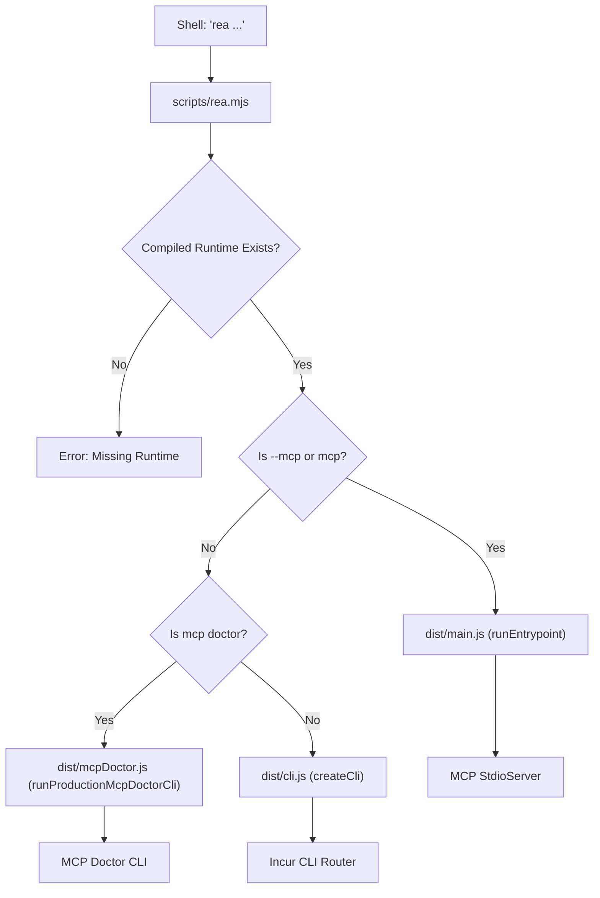
Sources: [scripts/rea.mjs:5-63](), [scripts/rea.mjs:66-85]()

---

## MCP Stdio Adapter: `src/main.ts`

The `src/main.ts` module implements the long-lived Model Context Protocol (MCP) server. It acts as the bridge between an AI agent (like Claude Desktop) and the Hopper instance.

### Initialization and Session Startup
1. **Config Parsing**: It parses environment variables (e.g., `HOPPER_TARGET_PATH`) into an `AppConfig` object [src/main/startup.ts:22-26]().
2. **Session Creation**: It initializes a `BinarySession` using the `createBinarySession` wiring utility [src/main/startup.ts:26]().
3. **Initial Target**: If `HOPPER_TARGET_PATH` is provided in the environment, the server attempts to open that binary immediately before starting the transport [src/main/startup.ts:26]().
4. **Transport**: It establishes the MCP `serveStdio` transport, registering tools via `createServer` [src/main/transport.ts:47-52]().

### Process Lifetime and Shutdown
The adapter installs idempotent shutdown handlers for `SIGINT`, `SIGTERM`, and `stdin` EOF. This ensures that the `BinarySession` is closed, which in turn shuts down the Hopper bridge and cleans up Unix sockets [src/main/shutdown.ts:61-74]().

Sources: [src/main/startup.ts:21-26](), [src/main/transport.ts:47-52](), [src/main/shutdown.ts:61-74]()

---

## One-Shot CLI: `src/cli.ts`

The `src/cli.ts` module defines the terminal interface using the `incur` library. Unlike the MCP adapter, CLI commands are typically "one-shot"—they open a session, perform an action, and close the session immediately.

### Command Registration
The `createCli` function [src/cli.ts:15]() initializes the Incur CLI instance. Various `register*Commands` functions are then called to add specific command groups:
- `registerCoreCommands` [src/cli.ts:20]()
- `registerSetupCommands` [src/cli.ts:21]()
- `registerArtifactCommands` [src/cli.ts:22]()
- `registerManagedCommands` [src/cli.ts:23]()
- `registerFirmwareCommands` [src/cli/firmwareCommands.ts:15]()
- `registerBrowserCommands` [src/cli/browserAdvancedCommands.ts:15]()
- `registerElectronCommands` [src/cli/electronCommands.ts:29]()
- `registerApplicationCommands` [src/cli.ts:27]()
- `registerEvidenceCommands` [src/cli.ts:28]()

### JSON Input and Output Handling
CLI commands frequently accept JSON input and produce JSON output.
- **JSON Input**: The `parseCliJsonInput` function [src/cliJsonInput.ts:10]() handles parsing inline JSON strings or reading JSON from a specified file path. It also includes logic to differentiate between malformed inline JSON and non-existent file paths [src/cliJsonInput.ts:17-34]().
- **Path Resolution**: `resolveCliJsonPaths` [src/cliJsonInput.ts:44]() is used to resolve relative paths within JSON input objects to absolute paths, ensuring consistency with MCP contracts that expect absolute paths [src/cliJsonInput.ts:44-50](). For example, in `capture_browser_scenario`, the `executable_path` for the browser is resolved [src/cliBrowserScenarioCommands.ts:36-37](). Similarly, firmware paths are resolved before validation [src/cli/firmwareCommands.ts:43]().
- **Output Sanitization**: `sanitizeCliOutput` [src/cliOutput.ts:136]() removes internal validator details from CLI output, especially for `VALIDATION_ERROR` messages, to present a user-friendly error message [src/cliOutput.ts:145-162]().
- **Output Argument Validation**: `validateCliOutputArguments` [src/cliOutput.ts:88]() checks for incompatible output arguments, such as using `--token-limit` with structured output formats like JSON or YAML, which could corrupt the output [src/cliOutput.ts:95-103]().

### Example CLI Command Registration
The following diagram illustrates the registration of a specific CLI command, `capture-browser-scenario`.

**Title: CLI Command Registration Example**
```mermaid
graph TD
    A[src/cli.ts] --> B{createCli()}
    B --> C[registerBrowserCommands]
    C --> D[registerBrowserScenarioCommands]
    D --> E{cli.command("capture-browser-scenario")}
    E --> F[args: inputJson]
    E --> G[run: logCliCommand(...)]
    G --> H[parseCliJsonInput(args.inputJson)]
    H -- "ok: true" --> I[resolveCliJsonPaths(input.value, [["browser", "executable_path"]])]
    I --> J[browserScenarioSchema.safeParse(...)]
    J -- "success: true" --> K[captureBrowserScenario(...)]
    J -- "success: false" --> L[cliError(AnalysisInputError)]
    K -- "ok: true" --> M[Return result.value]
    K -- "ok: false" --> L
```
Sources: [src/cli.ts:15-28](), [src/cliBrowserScenarioCommands.ts:20-52](), [src/cliJsonInput.ts:10](), [src/cliJsonInput.ts:44]()

---

## The Dispatching Core: `BinarySession`

The `BinarySession` class in `src/application/BinarySession.ts` is the central coordinator for both entry points. It manages the `AnalysisClient` lifecycle and ensures that only one Hopper bridge is active at a time.

### Session Management Implementation
- **Serialization**: All target transitions (opening/closing) are serialized using a promise chain (`#transition`) to prevent race conditions during Hopper bridge teardown [src/application/BinarySession.ts:43, 152-159]().
- **Draining**: Before closing a client, the session waits for all pending tool executions to complete via `#drainCalls` [src/application/BinarySession.ts:103, 161-163]().
- **Restoration**: If a new target fails to open, the session attempts to restore the previous valid client [src/application/BinarySession.ts:85-90, 165-175]().

### Natural Language to Code Entity Mapping
The following diagram bridges the conceptual "Session" to the specific classes and functions that implement it.

**Title: Session Management Entity Map**
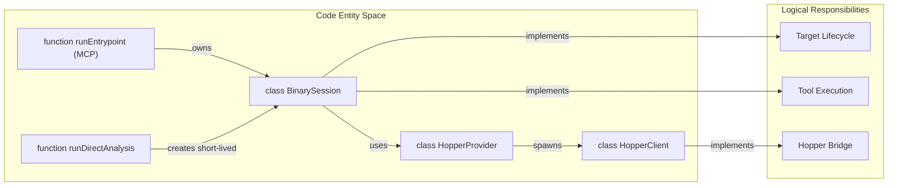
Sources: [src/application/BinarySession.ts:39-47](), [src/application/runtime.ts:11-16](), [src/hopper/HopperProvider.ts:3](), [src/main/startup.ts:26](), [src/application/DirectAnalysis.ts:21]()

### Execution State Table
| Method | Description | Implementation Detail |
| :--- | :--- | :--- |
| `open()` | Opens or switches the active binary. | Serializes via `#transition` [src/application/BinarySession.ts:58-96](). |
| `execute()` | Runs a Hopper tool command. | Waits for active transitions before dispatching [src/application/BinarySession.ts:134-150](). |
| `close()` | Shuts down the bridge. | Drains pending calls and closes the `AnalysisClient` [src/application/BinarySession.ts:99-107](). |
| `status()` | Returns session metadata. | Returns `BinaryTarget` info (path, sha256, format) [src/application/BinarySession.ts:110-122](). |

Sources: [src/application/BinarySession.ts:18-29, 39-150]()

---

# Page: Domain Layer

# Domain Layer

<details>
<summary>Relevant source files</summary>

The following files were used as context for generating this wiki page:

- [docs/javascript-artifact-reconstruction.md](docs/javascript-artifact-reconstruction.md)
- [scripts/lib/real-hopper-inventory.mjs](scripts/lib/real-hopper-inventory.mjs)
- [src/application/ArtifactInventory/classify.ts](src/application/ArtifactInventory/classify.ts)
- [src/application/ArtifactInventory/reader.ts](src/application/ArtifactInventory/reader.ts)
- [src/contracts/toolOutputSchemaPrimitives.ts](src/contracts/toolOutputSchemaPrimitives.ts)
- [src/domain/analysisSnapshot.ts](src/domain/analysisSnapshot.ts)
- [src/domain/artifactGraph.ts](src/domain/artifactGraph.ts)
- [src/domain/binaryTarget.ts](src/domain/binaryTarget.ts)
- [src/domain/bundleComparison.test.ts](src/domain/bundleComparison.test.ts)
- [src/domain/bundleComparison.ts](src/domain/bundleComparison.ts)
- [src/domain/callPath.test.ts](src/domain/callPath.test.ts)
- [src/domain/callPath.ts](src/domain/callPath.ts)
- [src/domain/canonicalDigest.test.ts](src/domain/canonicalDigest.test.ts)
- [src/domain/canonicalDigest.ts](src/domain/canonicalDigest.ts)
- [src/domain/comparisonSemantics.ts](src/domain/comparisonSemantics.ts)
- [src/domain/comparisonStatus.test.ts](src/domain/comparisonStatus.test.ts)
- [src/domain/comparisonStatus.ts](src/domain/comparisonStatus.ts)
- [src/domain/evidence.ts](src/domain/evidence.ts)
- [src/domain/evidenceCompletionLedger.ts](src/domain/evidenceCompletionLedger.ts)
- [src/domain/functionComparison.test.ts](src/domain/functionComparison.test.ts)
- [src/domain/functionComparisonNormalization.ts](src/domain/functionComparisonNormalization.ts)
- [src/domain/functionComparisonSchemas.ts](src/domain/functionComparisonSchemas.ts)
- [src/domain/peInspection.ts](src/domain/peInspection.ts)
- [tests/boundary/providers/managed/managedArmMachine.test.ts](tests/boundary/providers/managed/managedArmMachine.test.ts)

</details>


The **Domain Layer** contains the pure, side-effect-free logic of REA. It defines the core data structures, error algebra, and boundary parsers used to transform raw data from Hopper or the filesystem into typed entities. This layer has no dependencies on the network, disk (except for target validation), or the Hopper bridge protocol implementation.

## Core Result and Error Algebra

REA uses a functional approach to error handling via a `Result` type and a tagged error class hierarchy. This ensures that expected failures (like a missing file or a Hopper timeout) are handled explicitly by the compiler.

### Result Type
The `Result<T, E>` type is a discriminated union used to represent the outcome of operations without throwing exceptions.
- `ok(value)`: Wraps a successful value [[src/domain/result.ts:7-7]()]
- `err(error)`: Wraps a failure [[src/domain/result.ts:10-10]()]

### Analysis Error Hierarchy
All domain-specific errors inherit from `AnalysisError`, which uses a `_tag` property for type-safe narrowing [[src/domain/errors.ts:1-4]()].

| Error Class | Tag | Purpose |
| :--- | :--- | :--- |
| `AnalysisError` | (abstract) | Base class for all expected failures [[src/domain/errors.ts:2-4]()] |
| `HopperError` | (abstract) | Base for errors originating from the Hopper provider [[src/domain/errors.ts:7-7]()] |
| `HopperTimeoutError` | `HopperTimeoutError` | Hopper failed to respond within the deadline [[src/domain/errors.ts:15-21]()] |
| `HopperProtocolError` | `HopperProtocolError` | Malformed JSON or NDJSON from the bridge [[src/domain/errors.ts:33-35]()] |
| `HopperRemoteError` | `HopperRemoteError` | Hopper's Python API returned an explicit error [[src/domain/errors.ts:38-47]()] |
| `BinaryTargetError` | `BinaryTargetError` | Failure to resolve or validate a binary path [[src/domain/errors.ts:83-92]()] |

**Sources:** [[src/domain/result.ts:1-10]()] [[src/domain/errors.ts:1-92]()]

---

## Binary Target Resolution

The `BinaryTarget` module handles the identification and validation of analysis targets before they are passed to Hopper. This includes resolving macOS `.app` bundles to their internal executables and selecting the correct architecture slice from FAT Mach-O binaries.

### Target Parsing Flow
The `parseExecutableHeader` function performs a multi-step validation to ensure Hopper launches with non-interactive loader arguments [[src/domain/binaryTarget.ts:29-48]()].

#### Target Selection Logic
1.  **Bundle Resolution**: If the path is a `.app` directory, it reads `Contents/Info.plist` to find the `CFBundleExecutable` [[src/domain/binaryTarget.ts:96-117]()].
2.  **Security Checks**: It ensures the executable name is safe and does not escape the bundle via symlinks [[src/domain/binaryTarget.ts:118-143]()].
3.  **Metadata Extraction**: It reads the file header (Mach-O, ELF, or PE) to determine the architecture [[src/domain/binaryTarget.ts:29-48]()].
4.  **Loader Arguments**: It generates deterministic flags (e.g., `--aarch64`, `--intel-64`) so Hopper does not show a selection dialog [[src/domain/binaryTarget.ts:88-96]()].

### Binary Target Relationships
The following diagram associates the logical target resolution steps with the code entities responsible for them.

"Binary Target Resolution Flow"
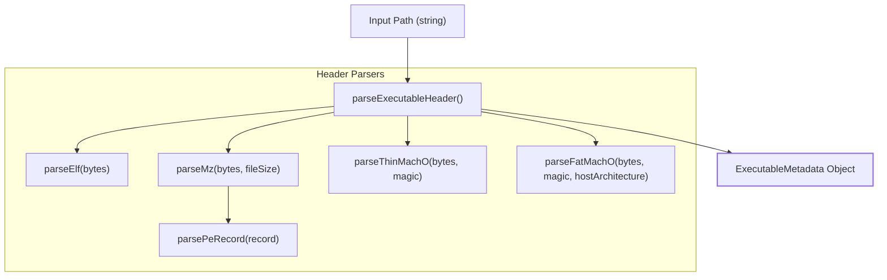

**Sources:** [[src/domain/binaryTarget.ts:29-48]()] [[src/domain/binaryTarget.ts:50-64]()] [[src/domain/binaryTarget.ts:67-104]()] [[src/domain/binaryTarget.ts:106-118]()] [[src/domain/binaryTarget.ts:121-142]()] [[src/domain/binaryTarget.ts:145-174]()]

---

## Boundary Parsers (hopperValues.ts)

Hopper's Python bridge returns raw JSON values that often vary in shape (e.g., sometimes a map, sometimes a list, sometimes wrapped in a property). `hopperValues.ts` uses `Zod` to normalize these into stable TypeScript interfaces.

### Normalized Interfaces
- `AddressedName`: A standard pair of hex `address` and string `name` [[src/domain/hopperValues.ts:7-10]()].
- `AddressedPage`: Pagination metadata including `items`, `nextOffset`, and `hasMore` [[src/domain/hopperValues.ts:18-22]()].
- `SegmentSummary`: Details for binary segments (`name`, `start`, `end`) [[src/domain/hopperValues.ts:12-16]()].

### Key Parsing Functions
| Function | Input Shape | Output |
| :--- | :--- | :--- |
| `parseProcedures` | `{ procedures: { "0x1": "fn" } }` or map | `AddressedName[]` [[src/domain/hopperValues.ts:58-74]()] |
| `parseNames` | `[{ address, name }]` or map | `AddressedName[]` [[src/domain/hopperValues.ts:77-96]()] |
| `parseAddressedPage` | `{ items, next_offset, has_more }` | `AddressedPage` [[src/domain/hopperValues.ts:41-55]()] |
| `parseListCount` | Any list, map, or `{ total: N }` | `number` [[src/domain/hopperValues.ts:134-151]()] |

**Sources:** [[src/domain/hopperValues.ts:7-22]()] [[src/domain/hopperValues.ts:41-151]()]

---

## Symbol Analysis

The `symbolAnalysis.ts` module provides pure functions for filtering and categorizing symbols based on language-specific mangling conventions (Swift and Objective-C).

### Supported Analyses
- **Swift Classes**: Identifies symbols containing the `_TtC` mangling prefix [[src/domain/symbolAnalysis.ts:8-20]()].
- **Objective-C Classes**: Filters for `OBJC_CLASS`, `OBJC_$_CLASS`, or `_OBJC_` markers and deduplicates them by name [[src/domain/symbolAnalysis.ts:23-41]()].
- **Swift Type Categorization**: Groups symbols into `classes` (`_TtC`), `structs` (`_TtV`), `enums` (`_TtO`), `protocols` (`_TtP`), and `extensions` (`_TtE`) [[src/domain/symbolAnalysis.ts:58-94]()].

**Sources:** [[src/domain/symbolAnalysis.ts:7-94]()]

---

## Evidence Schema

The `evidence.ts` module defines a strict schema for analysis observations. This ensures that every tool output includes deterministic metadata about the artifact and the operation performed.

### Evidence Structure
The `Evidence` object contains:
- `subject`: Path, SHA-256, format, and architecture of the binary [[src/domain/evidence.ts:20-51]()].
- `provider`: Identity of the analysis provider (e.g., Hopper, Ghidra) [[src/domain/evidence.ts:15-19]()].
- `operation`: The name of the tool or analysis performed [[src/domain/evidence.ts:91-91]()].
- `parameters`: The input arguments used for the tool [[src/domain/evidence.ts:92-92]()].
- `normalized_result`: The actual data returned by the analysis, normalized to a stable schema [[src/domain/evidence.ts:94-94]()].
- `confidence`: How the evidence was obtained (e.g., `observed`, `derived`, `inferred`) [[src/domain/evidence.ts:95-95]()].
- `authority`: The source of the evidence (e.g., `shipped-artifact`, `external-service`) [[src/domain/evidence.ts:70-75]()].
- `limitations`: Any known limitations or caveats of the observation [[src/domain/evidence.ts:98-98]()].

### Evidence Generation Flow
The following diagram shows how raw analysis results are wrapped into the formal Evidence schema.

"Evidence Construction Flow"
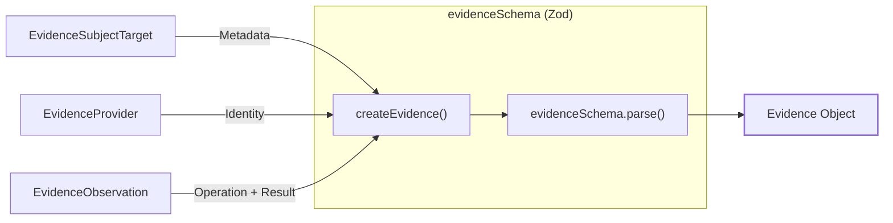

**Sources:** [[src/domain/evidence.ts:15-19]()] [[src/domain/evidence.ts:20-51]()] [[src/domain/evidence.ts:70-75]()] [[src/domain/evidence.ts:86-102]()] [[src/domain/evidence.ts:128-130]()] [[src/domain/evidence.ts:146-151]()] [[src/domain/evidence.ts:155-174]()]

---

## Canonical Digests and Comparison

The domain layer provides utilities for creating canonical digests of JSON values and comparing structured data. This is crucial for detecting changes in analysis results and ensuring deterministic behavior.

### Canonical Digest
The `digestCanonicalValue` function generates a SHA-256 hash of a JSON-serializable value after canonicalizing it. This ensures that semantically equivalent JSON objects (e.g., with reordered keys) produce the same digest.
The implementation processes JSON incrementally to avoid memory issues with very large objects [[src/domain/canonicalDigest.ts:4-23]()].

"Canonical Digest Process"
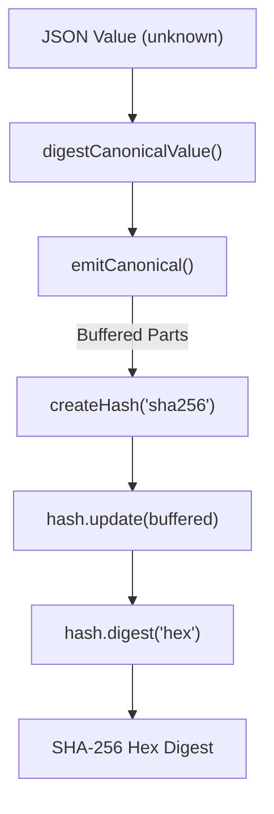

**Sources:** [[src/domain/canonicalDigest.ts:4-23]()] [[src/domain/canonicalDigest.ts:27-85]()] [[src/domain/canonicalDigest.test.ts:16-20]()] [[src/domain/canonicalDigest.test.ts:58-63]()] [[src/domain/canonicalDigest.test.ts:65-70]()]

### Function Comparison Normalization
The `functionComparisonNormalization.ts` module provides functions to normalize `FunctionSnapshot` objects for comparison. This involves projecting specific aspects of a function (e.g., name, signature, control flow graph, references) into a canonical form.

- `identityProjection`: Extracts name, signature, and sorted local variable descriptions [[src/domain/functionComparisonNormalization.ts:10-16]()].
- `normalizeCfg`: Normalizes the control flow graph by ordering basic blocks by address and representing successors as indices [[src/domain/functionComparisonNormalization.ts:41-77]()].
- `referenceProjection`: Collects and sorts incoming and outgoing references, citing source and target procedure names [[src/domain/functionComparisonNormalization.ts:79-91]()].
- `commentProjection`: Extracts and normalizes comments, converting addresses to offsets relative to the procedure's start [[src/domain/functionComparisonNormalization.ts:136-147]()].
- `sorted`: A utility function to sort arrays of arbitrary values by their canonical JSON representation, handling Unicode collation ties [[src/domain/functionComparisonNormalization.ts:179-192]()].

The `functionMatch` function determines if two functions match based on their names, considering auto-generated names as ambiguous [[src/domain/functionComparisonNormalization.ts:18-38]()].

**Sources:** [[src/domain/functionComparisonNormalization.ts:10-16]()] [[src/domain/functionComparisonNormalization.ts:18-38]()] [[src/domain/functionComparisonNormalization.ts:41-77]()] [[src/domain/functionComparisonNormalization.ts:79-91]()] [[src/domain/functionComparisonNormalization.ts:136-147]()] [[src/domain/functionComparisonNormalization.ts:179-192]()] [[src/domain/functionComparison.test.ts:106-131]()] [[src/domain/functionComparison.test.ts:134-155]()] [[src/domain/functionComparison.test.ts:187-202]()]

### Bundle Comparison
The `bundleComparison.ts` module provides functionality to compare two `EvidenceBundle` objects. It identifies added, removed, and changed evidence records and residual unknowns.

- `compareBundles`: The main function that takes two evidence bundles and a list of explicit record pairs, then returns a detailed comparison result [[src/domain/bundleComparison.ts:85-122]()].
- `bundleComparisonInputSchema`: Defines the expected input for bundle comparison, including paths to bundles and optional record pairs [[src/domain/bundleComparison.ts:26-37]()].
- `bundleComparisonResultSchema`: Describes the output, including a summary of changes, individual change records, and limitations [[src/domain/bundleComparison.ts:56-74]()].

**Sources:** [[src/domain/bundleComparison.ts:26-37]()] [[src/domain/bundleComparison.ts:56-74]()] [[src/domain/bundleComparison.ts:85-122]()] [[src/domain/bundleComparison.ts:125-192]()]

---

## Call Path Analysis

The `callPath.ts` module implements algorithms to reconstruct and analyze call paths between functions based on `analyze_function` evidence.

### Call Graph Representation
A `CallGraph` class is used to represent the directed caller-to-callee relationships. It stores successors and predecessors for each function address [[src/domain/callPath.ts:18-49]()].

### Pathfinding Algorithm
The `buildCallPath` function takes a set of `analyze_function` evidence records, a start function, and a goal function. It constructs a call graph and then uses a breadth-first search-like approach to find the shortest paths from the start to the goal.

1.  **Prepare Graph**: `prepareCallGraph` parses `FunctionSnapshot` evidence and creates a `CallGraph` instance [[src/domain/callPath.ts:147-155]()]. It also validates that all snapshots belong to the same artifact and provider [[src/domain/callPath.ts:173-193]()].
2.  **Calculate Distances**: `distancesToGoal` performs a reverse BFS from the goal to find the shortest distance (in hops) from any reachable node to the goal [[src/domain/callPath.ts:52-70]()].
3.  **Enumerate Paths**: If a path exists, `enumeratePaths` (not fully shown in provided code, but implied by `buildCallPath`'s usage) reconstructs all shortest paths.
4.  **Result Generation**: The function returns a `CallPathResult` indicating whether a path was found, the shortest number of hops, the paths themselves, and any limitations (e.g., functions without evidence) [[src/domain/callPath.ts:81-129]()].

"Call Path Reconstruction Flow"
```mermaid
graph TD
    Input["CallPathInput (start, goal, functions)"] --> buildCP["buildCallPath()"]
    buildCP --> prepareCG["prepareCallGraph()"]
    prepareCG --> parseS["parseSnapshots()"]
    parseS --> assertC["assertCompatible()"]
    prepareCG --> createG["createGraph()"]
    
    createG --> CG["CallGraph"]
    CG --> distancesTG["distancesToGoal()"]
    distancesTG --> enumerateP["enumeratePaths()"]
    enumerateP --> citeP["citePath()"]
    
    citeP --> CPR["CallPathResult"]
    
    style CPR stroke-width:2px
```

**Sources:** [[src/domain/callPath.ts:18-49]()] [[src/domain/callPath.ts:52-70]()] [[src/domain/callPath.ts:81-129]()] [[src/domain/callPath.ts:147-155]()] [[src/domain/callPath.ts:157-171]()] [[src/domain/callPath.ts:173-193]()] [[src/domain/callPath.ts:195-208]()] [[src/domain/callPath.test.ts:65-89]()] [[src/domain/callPath.test.ts:101-114]()] [[src/domain/callPath.test.ts:184-199]()]

---

## Error Projection

The `analysisErrorProjectionSchema` in `src/contracts/errorSchemas.ts` (not fully provided, but referenced) defines a standardized way to represent errors that occur during analysis. This ensures that errors from various providers are consistently structured for client consumption.

The `PROVIDER_REJECTION_CODES` enum [[src/contracts/toolOutputSchemaPrimitives.ts:14-16]()] and `providerRejectionCode` schema [[src/contracts/toolOutputSchemaPrimitives.ts:172-174]()] are used to categorize why a provider might be unavailable or reject a target. This allows for structured error reporting and client-side remediation suggestions.

**Sources:** [[src/contracts/toolOutputSchemaPrimitives.ts:14-16]()] [[src/contracts/toolOutputSchemaPrimitives.ts:172-174]()]

---

## Unicode Ordering

The `canonicalOrdering.ts` module (not provided, but referenced by `functionComparisonNormalization.ts`) provides utilities for comparing strings based on their Unicode code points. This is used in `functionComparisonNormalization.ts` to ensure deterministic sorting of collections when their canonical JSON representations are identical but the underlying string values might differ due to Unicode normalization forms (e.g., composed vs. decomposed characters).

The `compareCodePoints` function is used as a tie-breaker in sorting algorithms to ensure stable ordering across different environments or string representations [[src/domain/functionComparisonNormalization.ts:188-189]()].

**Sources:** [[src/domain/functionComparisonNormalization.ts:188-189]()] [[src/domain/functionComparison.test.ts:176-209]()]

---

# Page: Contracts and Tool Catalog

# Contracts and Tool Catalog

<details>
<summary>Relevant source files</summary>

The following files were used as context for generating this wiki page:

- [.oxlintrc.json](.oxlintrc.json)
- [docs/capability-migration.md](docs/capability-migration.md)
- [docs/mcp-contracts.md](docs/mcp-contracts.md)
- [docs/product-catalog.json](docs/product-catalog.json)
- [docs/verification/managed-conformance-manifest.json](docs/verification/managed-conformance-manifest.json)
- [scripts/lib/catalog-builders.mjs](scripts/lib/catalog-builders.mjs)
- [scripts/lib/catalog-core.mjs](scripts/lib/catalog-core.mjs)
- [scripts/lib/module-boundaries.d.mts](scripts/lib/module-boundaries.d.mts)
- [scripts/lib/module-boundaries.mjs](scripts/lib/module-boundaries.mjs)
- [scripts/verify-package-install.mjs](scripts/verify-package-install.mjs)
- [skills/reverse-engineer-anything/SKILL.md](skills/reverse-engineer-anything/SKILL.md)
- [skills/reverse-engineer-anything/references/native-and-artifacts.md](skills/reverse-engineer-anything/references/native-and-artifacts.md)
- [src/application/EnhancedTools.ts](src/application/EnhancedTools.ts)
- [src/application/ReconstructionObligationCandidates.ts](src/application/ReconstructionObligationCandidates.ts)
- [src/application/ReconstructionObligationLedger.authority.test.ts](src/application/ReconstructionObligationLedger.authority.test.ts)
- [src/cliEnvironmentSeam.test.ts](src/cliEnvironmentSeam.test.ts)
- [src/contracts/contractSnapshot.test.ts](src/contracts/contractSnapshot.test.ts)
- [src/contracts/enhancedInputs.ts](src/contracts/enhancedInputs.ts)
- [src/contracts/sessionToolSchemas.ts](src/contracts/sessionToolSchemas.ts)
- [src/contracts/toolContractExamples.ts](src/contracts/toolContractExamples.ts)
- [src/contracts/toolContracts.test.ts](src/contracts/toolContracts.test.ts)
- [src/contracts/toolOutputSchemaGroups.ts](src/contracts/toolOutputSchemaGroups.ts)
- [src/contracts/toolOutputSchemas.ts](src/contracts/toolOutputSchemas.ts)
- [src/domain/browserScenario.test.ts](src/domain/browserScenario.test.ts)
- [src/domain/browserScenarioValues.ts](src/domain/browserScenarioValues.ts)
- [src/domain/hopperValues.ts](src/domain/hopperValues.ts)
- [src/domain/result.ts](src/domain/result.ts)
- [src/domain/symbolAnalysis.ts](src/domain/symbolAnalysis.ts)
- [src/ida/IdaProviderCapabilities.ts](src/ida/IdaProviderCapabilities.ts)
- [src/server/toolRegistrationOptions.ts](src/server/toolRegistrationOptions.ts)
- [tests/boundary/cli/productCatalog.test.ts](tests/boundary/cli/productCatalog.test.ts)
- [tests/boundary/filesystem/setupSkill.test.ts](tests/boundary/filesystem/setupSkill.test.ts)
- [tests/evaluation/moduleBoundaries.test.ts](tests/evaluation/moduleBoundaries.test.ts)

</details>


This page details the structure and management of tool contracts within REA, including their inventory, annotations, output schemas, and how they are aggregated into the generated tool catalog. It also covers the `product-catalog.json` file, capability migration, and contract snapshot tests.

## ToolContract Inventory

REA defines a comprehensive set of `ToolContract`s, which are essentially specifications for the tools available in the system. Each `ToolContract` describes a tool's name, title, description, input schema, output schema, and annotations. These contracts are central to how REA understands and interacts with its various analysis capabilities.

The `ToolContract`s are organized into different modules based on their functionality. For example, `officialToolContracts.ts` [src/contracts/officialToolContracts.ts]() defines contracts for direct bridge tools, `enhancedToolContracts.ts` [src/contracts/enhancedToolContracts.ts]() for composed workflows, and `sessionToolContracts.ts` [src/contracts/sessionToolContracts.ts]() for session management.

The `scripts/lib/catalog-core.mjs` [scripts/lib/catalog-core.mjs:35-114]() script is responsible for loading all these tool contracts from their respective compiled source modules. It uses `SOURCE_PATHS` [scripts/lib/catalog-core.mjs:35-114]() to identify the location of each contract module.

### Tool Registration Options

When tools are registered with the MCP (Multi-Client Protocol) server, their `ToolContract`s are projected into a format suitable for SDK registration. The `toolRegistrationOptions` function [src/server/toolRegistrationOptions.ts:5-19]() extracts the `title`, `description`, `inputSchema`, `outputSchema`, and `annotations` from a `ToolContract` to create the registration payload. The `inputSchema` is further processed by `toolInputSchemaWithMetadata` [src/server/toolRegistrationOptions.ts:10]() to include additional metadata.

Sources:
- [src/contracts/toolContracts.test.ts]()
- [src/server/toolRegistrationOptions.ts:5-19]()
- [src/contracts/toolOutputSchemas.ts:1-2]()
- [scripts/lib/catalog-core.mjs:35-114]()

## Tool Effects and Annotations

`ToolContract`s include `annotations` [src/server/toolRegistrationOptions.ts:18]() which provide additional metadata about the tool's behavior or effects. These annotations can describe various aspects, such as whether a tool modifies the analysis environment, requires specific provider capabilities, or has side effects.

For example, the `EnhancedTools` class [src/application/EnhancedTools.ts:50-51]() composes direct provider operations into bounded reverse-engineering tools. Its methods, like `execute` [src/application/EnhancedTools.ts:53-126]() and `executeValidated` [src/application/EnhancedTools.ts:129-173](), handle the dispatching of various enhanced tools, each with its own input schema and potential effects.

Sources:
- [src/server/toolRegistrationOptions.ts:18]()
- [src/application/EnhancedTools.ts:50-51]()
- [src/application/EnhancedTools.ts:53-126]()
- [src/application/EnhancedTools.ts:129-173]()

## Output Schema Groups

Tool output schemas are organized into groups to promote reusability and consistency. The `toolOutputSchemas.ts` [src/contracts/toolOutputSchemas.ts:1-2]() file exports both primitive schema types and schema groups. These groups define common structures for different types of analysis results, such as `functionDossierSchema` [src/domain/hopperValues.ts:17-20]() for function information or `nativeApiBoundarySchema` [src/domain/hopperValues.ts:6-9]() for native API boundaries.

The `functionBodySchema` [src/domain/hopperValues.ts:66-152]() is a detailed example of an output schema, defining the structure for reporting observed function-body ranges, including provenance, byte counts, and contiguity information. This schema also includes superRefine logic to ensure data integrity and consistency.

Sources:
- [src/contracts/toolOutputSchemas.ts:1-2]()
- [src/domain/hopperValues.ts:17-20]()
- [src/domain/hopperValues.ts:6-9]()
- [src/domain/hopperValues.ts:66-152]()

## Generated MCP Tool Catalog

The MCP tool catalog is a comprehensive inventory of all available tools, generated from the `ToolContract`s. This catalog is crucial for clients to discover and understand the capabilities of the REA server.

The `product-catalog.json` [docs/product-catalog.json]() file serves as a snapshot of the generated tool catalog. It lists all tools, categorized by families (e.g., "direct", "enhanced", "native", "artifact", "managed", "firmware", "android", "browser", "electron", "javascript-runtime", "application", "session"), along with their counts. It also includes metadata about the REA package, SDK versions, and a `skill_version` [docs/product-catalog.json:11]().

The `catalog_digest` [skills/reverse-engineer-anything/SKILL.md:7]() in `SKILL.md` ensures that the skill's advertised capabilities match the actual generated catalog. The `digest` function [scripts/lib/catalog-core.mjs:15-21]() in `catalog-core.mjs` calculates a stable SHA-256 digest of the canonicalized JSON representation of the catalog, allowing for verification of catalog integrity.

### Tool Catalog Generation Process

The generation of the MCP tool catalog involves:
1.  **Loading Contracts**: All `ToolContract`s are loaded from their respective modules using `loadSources` [scripts/lib/catalog-core.mjs:117-124]().
2.  **Aggregation**: The loaded contracts are aggregated into a single catalog structure.
3.  **Digest Calculation**: A stable digest of the catalog is computed using `canonicalize` and SHA-256 hashing [scripts/lib/catalog-core.mjs:15-21]().
4.  **Output**: The catalog is written to `product-catalog.json` [docs/product-catalog.json]() and its digest is used in `SKILL.md` [skills/reverse-engineer-anything/SKILL.md:7]().

### Diagram: Tool Catalog Generation
```mermaid
graph TD
    A[ToolContract Modules] --> B{scripts/lib/catalog-core.mjs::loadSources};
    B -- "Loads all contracts" --> C[Aggregated Tool Contracts];
    C --> D{scripts/lib/catalog-core.mjs::digest};
    D -- "Calculates SHA-256 digest" --> E[Catalog Digest];
    C --> F[product-catalog.json];
    E --> G[skills/reverse-engineer-anything/SKILL.md];
    F -- "Tool inventory" --> H[MCP Server];
    G -- "Catalog verification" --> H;
```
Sources:
- [docs/product-catalog.json]()
- [skills/reverse-engineer-anything/SKILL.md:7]()
- [scripts/lib/catalog-core.mjs:15-21]()
- [scripts/lib/catalog-core.mjs:117-124]()

## `product-catalog.json`

The `product-catalog.json` [docs/product-catalog.json]() file is a machine-readable inventory of all tools and providers available in REA. It contains:
-   **Package Information**: `name`, `version`, `sdk` versions, and `skill_version` [docs/product-catalog.json:3-11]().
-   **Tools**: A list of tool families, each with an `id`, `surface`, `count`, and an array of `tools` [docs/product-catalog.json:13-228](). This provides a structured overview of all available tools.
-   **Providers**: A list of `providers` [docs/product-catalog.json:231-234](), each with an `id` and `name`.

This file is essential for clients and agents to understand the capabilities offered by the REA server without needing to parse individual contract definitions.

Sources:
- [docs/product-catalog.json]()

## Capability Migration and Contract Snapshot Tests

REA employs a rigorous approach to managing capability changes and ensuring contract stability through migration guidelines and snapshot testing.

### Capability Migration

The `docs/capability-migration.md` [docs/capability-migration.md]() document outlines the process for incremental capability migration. Key principles include:
-   **Preserving Ownership**: Clearly defining responsibilities for analyst semantics, contracts, producer parsing, shared workflows, and subprocess ownership [docs/capability-migration.md:9-20]().
-   **Migrate Before Generalizing**: Emphasizing concrete migration steps before abstracting common patterns [docs/capability-migration.md:28-39]().
-   **Checks Before and After a Move**: Utilizing tools like `npm run verify:test-discovery` and `npm run verify:module-boundaries` to enforce module boundaries and prevent unintended dependencies [docs/capability-migration.md:46-77](). The `inspectModuleBoundaries` function [tests/evaluation/moduleBoundaries.test.ts:11-30]() is used in tests to verify these boundaries.

### Contract Snapshot Tests

Contract snapshot tests are a critical part of ensuring the stability of tool contracts. These tests capture the current state of the contracts and compare them against a previously recorded snapshot. Any deviation indicates a change in the contract, which must be reviewed and approved. This prevents accidental breaking changes to the API.

The `src/contracts/contractSnapshot.test.ts` [src/contracts/contractSnapshot.test.ts]() file likely contains these tests, ensuring that the input and output schemas, as well as other contract properties, remain consistent across releases.

### Diagram: Module Boundary Enforcement
```mermaid
graph TD
    A[src/domain] --> B[src/contracts];
    B --> C[src/application];
    C --> D[src/server];
    C --> E[src/cli];
    F[src/composition] --> C;
    F --> D;
    G[src/providers] --> F;

    style A fill:#fff,stroke:#333,stroke-width:2px
    style B fill:#fff,stroke:#333,stroke-width:2px
    style C fill:#fff,stroke:#333,stroke-width:2px
    style D fill:#fff,stroke:#333,stroke-width:2px
    style E fill:#fff,stroke:#333,stroke-width:2px
    style F fill:#fff,stroke:#333,stroke-width:2px
    style G fill:#fff,stroke:#333,stroke-width:2px

    subgraph "Module Boundary Enforcement"
        direction LR
        A -- "Pure, provider-neutral" --> B;
        B -- "Named public contracts" --> C;
        C -- "Shared workflows" --> D;
        C -- "Shared workflows" --> E;
        F -- "Concrete provider construction" --> C;
        F -- "Concrete provider construction" --> D;
        G -- "Producer parsing, external protocols" --> F;
    end
```
Sources:
- [docs/capability-migration.md]()
- [tests/evaluation/moduleBoundaries.test.ts:11-30]()
- [src/contracts/contractSnapshot.test.ts]()
- [.oxlintrc.json:55-66]()
- [.oxlintrc.json:69-93]()

---

# Page: Application Layer

# Application Layer

<details>
<summary>Relevant source files</summary>

The following files were used as context for generating this wiki page:

- [src/application/AnalysisProvider.ts](src/application/AnalysisProvider.ts)
- [src/application/ArtifactGraphConstruction.test.ts](src/application/ArtifactGraphConstruction.test.ts)
- [src/application/ArtifactGraphConstruction.ts](src/application/ArtifactGraphConstruction.ts)
- [src/application/ArtifactInventory/scanReader.ts](src/application/ArtifactInventory/scanReader.ts)
- [src/application/ArtifactInventory/types.ts](src/application/ArtifactInventory/types.ts)
- [src/application/CapabilityInventory.ts](src/application/CapabilityInventory.ts)
- [src/application/ReferenceSourceImport.ts](src/application/ReferenceSourceImport.ts)
- [src/application/ReferenceSourceImportTypes.ts](src/application/ReferenceSourceImportTypes.ts)
- [src/application/binary/AbortablePromise.ts](src/application/binary/AbortablePromise.ts)
- [src/application/binary/AnalysisClientCleanup.ts](src/application/binary/AnalysisClientCleanup.ts)
- [src/application/binary/AnalysisProviderEvaluation.ts](src/application/binary/AnalysisProviderEvaluation.ts)
- [src/application/binary/AnalysisProviderRegistry.test.ts](src/application/binary/AnalysisProviderRegistry.test.ts)
- [src/application/binary/AnalysisProviderRegistry.ts](src/application/binary/AnalysisProviderRegistry.ts)
- [src/application/binary/AnalysisSnapshotCache.test.ts](src/application/binary/AnalysisSnapshotCache.test.ts)
- [src/application/binary/AnalysisSnapshotCache.ts](src/application/binary/AnalysisSnapshotCache.ts)
- [src/catalogIdentity.ts](src/catalogIdentity.ts)
- [src/cli/referenceSourceImportStatus.ts](src/cli/referenceSourceImportStatus.ts)
- [src/cliReferenceSourceImportStatus.test.ts](src/cliReferenceSourceImportStatus.test.ts)
- [src/contracts/officialToolContracts.ts](src/contracts/officialToolContracts.ts)
- [src/domain/referenceSourceGraph.ts](src/domain/referenceSourceGraph.ts)
- [tests/boundary/cli/referenceSourceImportStatus.test.ts](tests/boundary/cli/referenceSourceImportStatus.test.ts)
- [tests/boundary/filesystem/artifactDirectoryIdentity.test.ts](tests/boundary/filesystem/artifactDirectoryIdentity.test.ts)
- [tests/boundary/filesystem/artifactInventoryEntryOrder.test.ts](tests/boundary/filesystem/artifactInventoryEntryOrder.test.ts)
- [tests/boundary/filesystem/asarInventoryContainment.test.ts](tests/boundary/filesystem/asarInventoryContainment.test.ts)
- [tests/boundary/mcp/artifactEntryOrderMcp.test.ts](tests/boundary/mcp/artifactEntryOrderMcp.test.ts)
- [tests/boundary/mcp/enhancedTools.01-lists-the-complete-target-open.test.ts](tests/boundary/mcp/enhancedTools.01-lists-the-complete-target-open.test.ts)
- [tests/boundary/mcp/officialTools.test.ts](tests/boundary/mcp/officialTools.test.ts)
- [tests/boundary/mcp/serverIdentity.test.ts](tests/boundary/mcp/serverIdentity.test.ts)
- [tests/boundary/mcp/serverLifecycleMcp.test.ts](tests/boundary/mcp/serverLifecycleMcp.test.ts)
- [tests/fixtures/artifactEntryOrder.ts](tests/fixtures/artifactEntryOrder.ts)

</details>


The Application Layer provides a shared runtime for the CLI and MCP adapters. It manages the lifecycle of analysis sessions, composes low-level Hopper operations into high-level "Enhanced Tools," and provides idempotent system utilities for environment diagnostics and automated configuration.

## Session Management

The core of the application layer is the `BinarySession`, which maintains the state of a single active analysis target. Because Hopper dispatches work on a dedicated Python thread and requires a bridge teardown to switch binaries, `BinarySession` serializes all target transitions to prevent race conditions [src/application/BinarySession.ts:34-37]().

### BinarySession Lifecycle
1.  **Open**: Parses the `BinaryTarget`, drains any pending calls to the previous target, closes the old bridge, and initializes a new `AnalysisClient` [src/application/BinarySession.ts:64-95]().
2.  **Execute**: Proxies tool calls to the active client. If a transition is in progress, calls wait for the transition to settle [src/application/BinarySession.ts:134-150]().
3.  **Restore**: If a switch to a new binary fails, the session attempts to recreate the previous target's client to avoid leaving the system in a broken state [src/application/BinarySession.ts:165-175]().
4.  **Close**: Drains calls and shuts down the bridge [src/application/BinarySession.ts:99-107]().

### Session Data Flow
The following diagram illustrates how the `BinarySession` manages the transition between two different binary targets.

**Binary Target Transition Flow**
```mermaid
sequenceDiagram
    participant A as Adapter (CLI/MCP)
    participant S as "BinarySession"
    participant C1 as "AnalysisClient (Target A)"
    participant C2 as "AnalysisClient (Target B)"

    A->>S: open(path_B)
    S->>S: #serialize() (locks transition)
    S->>S: #drainCalls()
    S->>C1: close()
    destroy C1
    S->>C2: createClient(target_B)
    S->>C2: execute("health")
    C2-->>S: ok
    S-->>A: ok(target_B)
    Note over S: transition lock released
```
Sources: [src/application/BinarySession.ts:39-206](), [src/application/AnalysisProvider.ts:20-22]()

## Enhanced Tools Composition

The `EnhancedTools` class composes the 31 "official" proxy tools into 8 high-level workflows. These tools handle complex logic such as recursive call graph traversal, batching decompilation requests, and language-specific symbol analysis (Swift/Objective-C).

| Tool | Implementation Logic |
| :--- | :--- |
| `get_call_graph` | Recursively calls `procedure_callees` or `procedure_callers` up to a specified depth [src/application/EnhancedTools.ts:142-202](). |
| `batch_decompile` | Maps multiple addresses to concurrent `procedure_pseudo_code` calls [src/application/EnhancedTools.ts:116-140](). |
| `swift_classes` | Fetches all procedures and filters them using `discoverSwiftClasses` domain logic [src/application/EnhancedTools.ts:99-104](). |
| `trace_feature` | Scans strings for a pattern, finds XREFs to those strings, and maps them to containing procedures [src/application/EnhancedTools.ts:211-255](). |

Sources: [src/application/EnhancedTools.ts:34-255](), [src/contracts/enhancedInputs.ts:3-3]()

## System Diagnostics and Setup

REA includes a diagnostic engine (`Doctor`) and an idempotent installer (`Setup`) to ensure the host environment (macOS, Node.js, Hopper, Homebrew) is correctly configured.

### The Doctor Utility
The `runDoctor` function executes a series of `DoctorCheck` operations. It probes for the Hopper binary in several locations:
1.  The `HOPPER_LAUNCHER_PATH` environment variable [src/application/Doctor.ts:70]().
2.  Standard `/Applications` paths [src/application/Doctor.ts:149]().
3.  Homebrew cask prefix via `brew --prefix --cask hopper-disassembler` [src/application/Doctor.ts:133-142]().

### The Setup Workflow
The `runSetup` function provides a "one-click" configuration experience. It is designed to be safe for use by coding agents by reporting `needs_human` instead of blocking on interactive prompts [src/application/Setup.ts:59-62]().

**Setup Implementation Details:**
*   **Idempotency**: Checks if Homebrew, Hopper, or configuration keys already exist before attempting mutation [src/application/Setup.ts:76-143]().
*   **Atomic Updates**: When configuring MCP clients (Claude/Cursor), it creates a `.rea.backup` file before performing an atomic write [src/application/Setup.ts:198-210]().
*   **Validation**: Performs a "readback" check after writing JSON configs to ensure the file remains valid and the changes were persisted [src/application/Setup.ts:27-36]().

Sources: [src/application/Doctor.ts:40-103](), [src/application/Setup.ts:76-143](), [tests/setupConfig.test.ts:16-35]()

## Runtime Wiring

The `runtime.ts` module serves as the dependency injection point for the application. It connects the `BinarySession` to the concrete `HopperProvider`.

**Runtime Composition Diagram**
```mermaid
graph TD
    subgraph "Application Layer"
        BS["BinarySession (src/application/BinarySession.ts)"]
        ET["EnhancedTools (src/application/EnhancedTools.ts)"]
        DA["runDirectAnalysis (src/application/DirectAnalysis.ts)"]
    end

    subgraph "Hopper Layer"
        HP["HopperProvider (src/hopper/HopperProvider.ts)"]
    end

    subgraph "Entry Points"
        CLI["cli.ts"]
        MCP["main.ts (MCP Server)"]
    end

    CLI --> DA
    DA --> BS
    MCP --> BS
    BS --> HP
    ET --> BS
```
Sources: [src/application/runtime.ts:11-16](), [src/application/DirectAnalysis.ts:12-37](), [src/cli.ts:15-73]()

## Direct Analysis (CLI Mode)

For one-shot commands like `rea analyze <path>`, the `runDirectAnalysis` function manages a transient session. Unlike the MCP server which keeps the bridge open, `DirectAnalysis` follows a strict "Open -> Execute -> Close" pattern to ensure no background processes are left running after the CLI exits [src/application/DirectAnalysis.ts:12-37](). It also wraps the output in the `Evidence` schema, associating the result with the binary's SHA-256 hash [src/application/DirectAnalysis.ts:28-32]().

Sources: [src/application/DirectAnalysis.ts:12-37](), [src/domain/evidence.ts:5-5]()

## Analysis Snapshot Cache

The `AnalysisSnapshotCache` [src/application/binary/AnalysisSnapshotCache.ts]() stores results of analysis operations to avoid redundant computations. It partitions cached data by `BinaryTarget`, `AnalysisProfileCommitment`, and `ProviderIdentity` [src/application/binary/AnalysisSnapshotCache.ts:100-102]().

Key aspects:
*   **Partitioning**: Snapshots are stored in a nested map structure, ensuring that results from different targets, profiles, or providers do not conflict [src/application/binary/AnalysisSnapshotCache.ts:100-102]().
*   **Cacheability**: The `isSnapshotCacheable` function determines if an operation's result can be cached. Operations that require explicit document or address parameters are generally cacheable, while those without such specificity are not [src/application/binary/AnalysisSnapshotCache.ts:19-20](). For example, `list_strings` is not cacheable without a `document` parameter, but `address_name` is cacheable with both `document` and `address` [src/application/binary/AnalysisSnapshotCache.test.ts:28-43]().
*   **Integrity**: When importing a snapshot, the cache verifies that the `EvidenceBundle` matches the expected `AnalysisExecution` to prevent tampering [src/application/binary/AnalysisSnapshotCache.ts:150-152]().
*   **Limitations**: Cached results are marked with a `local REA analysis snapshot` limitation to indicate their provenance [src/application/binary/AnalysisSnapshotCache.ts:160-161]().

**Analysis Snapshot Cache Structure**
```mermaid
graph TD
    subgraph "AnalysisSnapshotCache"
        C["Cache (Map<TargetKey, Map<ProfileKey, Map<ProviderKey, Map<OperationKey, AnalysisExecution>>>>)"]
    end

    T["BinaryTarget"]
    P["AnalysisProfileCommitment"]
    Pr["ProviderIdentity"]
    O["AnalysisOperation + Parameters"]
    E["AnalysisExecution"]

    T -- "TargetKey" --> C
    P -- "ProfileKey" --> C
    Pr -- "ProviderKey" --> C
    O -- "OperationKey" --> C
    C -- "stores" --> E
```
Sources: [src/application/binary/AnalysisSnapshotCache.ts](), [src/application/binary/AnalysisSnapshotCache.test.ts:22-168]()

## Provider Registry and Evaluation

The `AnalysisProviderRegistry` [src/application/binary/AnalysisProviderRegistry.ts]() manages the collection of available `AnalysisProvider` instances. It allows for dynamic registration and selection of providers based on their capabilities and the analysis target.

Key functions:
*   `registerProvider`: Adds a new `AnalysisProvider` to the registry [src/application/binary/AnalysisProviderRegistry.ts:26-28]().
*   `resolveProvider`: Selects the most suitable provider for a given `BinaryTarget` and `AnalysisProfileCommitment`. This involves evaluating provider capabilities and compatibility [src/application/binary/AnalysisProviderRegistry.ts:30-32]().
*   `allProviders`: Returns all registered providers [src/application/binary/AnalysisProviderRegistry.ts:34-36]().

The `AnalysisProviderEvaluation` module [src/application/binary/AnalysisProviderEvaluation.ts]() contains the logic for determining which provider is best suited for a given task. This involves:
*   **Capability Matching**: Checking if a provider declares the necessary `CapabilityDescriptor` for an operation [src/application/binary/AnalysisProviderEvaluation.ts:100-102]().
*   **Profile Resolution**: Providers can offer `resolveAnalysisProfile` to determine specific analysis settings for a target [src/application/AnalysisProvider.ts:174-177]().
*   **Target Compatibility**: Ensuring the provider can handle the specific `BinaryTarget` (e.g., architecture, format) [src/application/binary/AnalysisProviderEvaluation.ts:100-102]().

**Provider Registry and Evaluation Flow**
```mermaid
graph TD
    subgraph "Application Layer"
        APR["AnalysisProviderRegistry"]
        APE["AnalysisProviderEvaluation"]
        BS["BinarySession"]
    end

    AP["AnalysisProvider"]
    BT["BinaryTarget"]
    APC["AnalysisProfileCommitment"]
    CD["CapabilityDescriptor"]

    APR -- "registers" --> AP
    BS -- "requests provider for" --> BT
    BS -- "requests provider for" --> APC
    APR -- "uses" --> APE
    APE -- "evaluates" --> AP
    APE -- "checks" --> CD
    APE -- "returns best" --> AP
    AP -- "creates" --> AC["AnalysisClient"]
    BS --> AC
```
Sources: [src/application/binary/AnalysisProviderRegistry.ts](), [src/application/binary/AnalysisProviderEvaluation.ts](), [src/application/AnalysisProvider.ts:174-177]()

## Capability Inventory

The `buildCapabilityInventory` function [src/application/CapabilityInventory.ts:127-189]() constructs a comprehensive list of all available tools and their current availability status. This inventory is crucial for the client to understand what operations can be performed and why certain tools might be unavailable.

Key aspects:
*   **Tool Contracts**: It iterates through `TOOL_CONTRACTS` [src/catalogIdentity.ts:17]() to get a baseline of all known tools.
*   **Provider Descriptors**: It incorporates `ProviderDescriptor` objects from the active session status, which indicate what operations individual providers support [src/application/CapabilityInventory.ts:133-135]().
*   **Availability Policy**: An `AvailabilityPolicy` [src/application/CapabilityInventory.ts:33-46]() is applied to determine if certain features (e.g., process capture, firmware inspection) are enabled, influencing tool availability.
*   **Client Requirements**: `clientRequirementsFor` [src/application/CapabilityInventory.ts:145-147]() checks if the connected client supports the necessary features for a tool. If not, the tool is marked as unavailable with a `client_capability_missing` reason [src/application/CapabilityInventory.ts:168-174]().
*   **Enhanced Tool Requirements**: The `ENHANCED_REQUIREMENTS` constant [src/application/CapabilityInventory.ts:81-109]() defines dependencies between enhanced tools and official tools, ensuring that an enhanced tool is only available if its underlying official tools are also available.

**Capability Inventory Construction**
```mermaid
graph TD
    subgraph "Application Layer"
        BCI["buildCapabilityInventory"]
        AF["availabilityFor"]
    end

    TC["TOOL_CONTRACTS (src/contracts/toolContracts.ts)"]
    SS["Session Status (JsonValue)"]
    AP["AvailabilityPolicy"]
    CF["ClientFeatureAvailability"]
    PD["ProviderDescriptor"]
    ER["ENHANCED_REQUIREMENTS"]
    CR["clientRequirementsFor"]
    TA["ToolAvailability[]"]

    BCI -- "reads" --> TC
    BCI -- "parses" --> SS
    BCI -- "uses" --> AP
    BCI -- "uses" --> CF
    SS -- "extracts" --> PD
    BCI -- "calls" --> AF
    AF -- "checks" --> PD
    AF -- "checks" --> ER
    BCI -- "calls" --> CR
    BCI -- "produces" --> TA
```
Sources: [src/application/CapabilityInventory.ts:127-189](), [src/application/CapabilityInventory.ts:81-109](), [src/catalogIdentity.ts:17](), [src/application/CapabilityInventory.ts:145-147]()

## Artifact Inventory and Graph Construction

The `ArtifactInventory` module is responsible for scanning artifacts (like ZIP files, ASAR archives, or directories) and constructing a graph representation of their contents. This graph (`ArtifactNode`s and `ArtifactEdge`s) provides a canonical, content-addressed identity for each file and directory within an artifact.

Key functions and concepts:
*   `scanReader`: Recursively traverses an `ArtifactReader` (e.g., `ZipArtifactReader`, `AsarArtifactReader`) to discover entries [src/application/ArtifactInventory/scanReader.ts:56-64]().
*   `createOccurrence`: Creates a `MutableOccurrence` for each entry, representing its logical path and initial metadata [src/application/ArtifactGraphConstruction.ts:39-59]().
*   `digestArtifactEntry`: Hashes the content of file entries to generate SHA-256 digests, which form the basis of content-addressed `ArtifactNode` IDs [src/application/ArtifactInventory/scanReader.ts:184-199]().
*   `createArtifactNode`: Creates an `ArtifactNode` with a content-addressed `artifact_id` based on its SHA-256 hash and other properties [src/application/ArtifactGraphConstruction.ts:153-172]().
*   `materializeDirectoryNodes`: Assigns canonical IDs to directories based on the sorted list of their children's names and artifact IDs. This ensures that directory identity is stable even if child order changes in the archive [src/application/ArtifactGraphConstruction.ts:72-115]().
*   `compareDirectoryChildNames`: Provides a deterministic sorting order for directory children, crucial for stable directory hashing [src/application/ArtifactGraphConstruction.ts:61-70]().
*   `PendingIntegrityContradiction`: Records instances where an artifact's declared SHA-256 hash does not match the observed hash, indicating potential tampering or corruption [src/application/ArtifactInventory/scanReader.ts:27-33]().

**Artifact Inventory and Graph Construction Flow**
```mermaid
graph TD
    subgraph "Artifact Inventory"
        SR["scanReader (src/application/ArtifactInventory/scanReader.ts)"]
        CO["createOccurrence (src/application/ArtifactGraphConstruction.ts)"]
        DAE["digestArtifactEntry (src/application/ArtifactInventory/scanReader.ts)"]
        CAN["createArtifactNode (src/application/ArtifactGraphConstruction.ts)"]
        MDN["materializeDirectoryNodes (src/application/ArtifactGraphConstruction.ts)"]
    end

    AR["ArtifactReader"]
    AE["ArtifactEntry"]
    MO["MutableOccurrence"]
    AN["ArtifactNode"]
    AG["ArtifactGraph"]
    PIC["PendingIntegrityContradiction"]

    SR -- "reads entries from" --> AR
    AR -- "yields" --> AE
    AE -- "transformed to" --> MO
    MO -- "content hashed by" --> DAE
    DAE -- "creates" --> AN
    SR -- "collects" --> MO
    SR -- "collects" --> AN
    SR -- "identifies" --> PIC
    MDN -- "processes" --> MO
    MDN -- "creates/updates" --> AN
    SR -- "outputs" --> AG
```
Sources: [src/application/ArtifactInventory/scanReader.ts](), [src/application/ArtifactGraphConstruction.ts](), [tests/boundary/filesystem/artifactDirectoryIdentity.test.ts:81-183]()

## Reference Source Import

The `importReferenceSource` function [src/application/ReferenceSourceImport.ts:133-188]() imports a directory of source code into a `HistoricalSourceGraph`. This graph captures the structure, content, and relationships within the source code, enabling semantic analysis and comparison.

Key steps:
*   **Policy Preparation**: `prepareReferenceSourceImport` applies policies to identify ignored files (e.g., secrets, caller-excluded paths) [src/application/ReferenceSourceImport.ts:137-138]().
*   **Source Reading**: `readReferenceSource` reads the file system, respecting exclusion rules [src/application/ReferenceSourceImport.ts:155-159]().
*   **VCS Integration**: `readReferenceSourceVcs` extracts version control system (VCS) information (e.g., Git head, dirty status) [src/application/ReferenceSourceImport.ts:160-161]().
*   **Entry Parsing**: `parseReferenceSourceEntries` processes the raw file entries, identifies languages, and extracts relationships (imports, references) [src/application/ReferenceSourceImport.ts:180-181]().
*   **Deduplication and Normalization**: Relationships and parse failures are deduplicated and sorted for deterministic graph construction [src/application/ReferenceSourceImport.ts:185-186]().
*   **Graph Creation**: `createHistoricalSourceGraph` constructs the final `HistoricalSourceGraph` from the processed entries, relationships, and metadata [src/domain/referenceSourceGraph.ts:9]().
*   **Inventory State**: The `deriveInventoryState` function determines if the imported graph is `complete`, `partial`, or `unknown` based on the presence of limitations, exclusions, or unhashed content [src/application/ReferenceSourceImport.ts:87-115]().

**Reference Source Import Flow**
```mermaid
graph TD
    subgraph "Reference Source Import"
        IRS["importReferenceSource (src/application/ReferenceSourceImport.ts)"]
        PRSI["prepareReferenceSourceImport (src/application/ReferenceSourceImportPolicy.ts)"]
        RRS["readReferenceSource (src/reference/ReferenceSourceReader.ts)"]
        RRSV["readReferenceSourceVcs (src/application/ReferenceSourceVcsAdapter.ts)"]
        PRSE["parseReferenceSourceEntries (src/application/ReferenceSourceImportEntries.ts)"]
        DDR["deduplicateRelationships (src/application/ReferenceSourceImport.ts)"]
        NHSPF["normalizeHistoricalSourceParseFailures (src/application/ReferenceSourceImport.ts)"]
        CHSG["createHistoricalSourceGraph (src/domain/referenceSourceGraph.ts)"]
        DIS["deriveInventoryState (src/application/ReferenceSourceImport.ts)"]
    end

    RSIO["ReferenceSourceImportOptions"]
    PP["PreparedPolicy"]
    RR["ReadResult"]
    VCS["VCSInfo"]
    E["Entries"]
    R["Relationships"]
    PF["ParseFailures"]
    L["Limitations"]
    HSG["HistoricalSourceGraph"]

    RSIO -- "configures" --> PRSI
    PRSI -- "outputs" --> PP
    IRS -- "uses" --> PP
    IRS -- "calls" --> RRS
    IRS -- "calls" --> RRSV
    RRS -- "outputs" --> RR
    RRSV -- "outputs" --> VCS
    IRS -- "calls" --> PRSE
    PRSE -- "inputs" --> RR
    PRSE -- "outputs" --> E, R, PF, L
    IRS -- "calls" --> DDR
    DDR -- "inputs" --> R
    DDR -- "outputs" --> R
    IRS -- "calls" --> NHSPF
    NHSPF -- "inputs" --> PF
    NHSPF -- "outputs" --> PF
    IRS -- "calls" --> DIS
    DIS -- "inputs" --> E, R, PF, L
    IRS -- "calls" --> CHSG
    CHSG -- "inputs" --> E, R, PF, L, VCS, PP
    CHSG -- "outputs" --> HSG
    IRS -- "returns" --> HSG
```
Sources: [src/application/ReferenceSourceImport.ts](), [src/domain/referenceSourceGraph.ts:9](), [src/application/ReferenceSourceImport.ts:87-115]()

---

# Page: Server Layer (MCP Adapter)

# Server Layer (MCP Adapter)

<details>
<summary>Relevant source files</summary>

The following files were used as context for generating this wiki page:

- [docs/mcp-prompts.md](docs/mcp-prompts.md)
- [src/cliCommandNames.ts](src/cliCommandNames.ts)
- [src/cliJavaScriptRuntimeCommands.ts](src/cliJavaScriptRuntimeCommands.ts)
- [src/config.ts](src/config.ts)
- [src/contracts/managed/managedToolContracts.ts](src/contracts/managed/managedToolContracts.ts)
- [src/contracts/promptContracts.test.ts](src/contracts/promptContracts.test.ts)
- [src/contracts/promptContracts.ts](src/contracts/promptContracts.ts)
- [src/contracts/sessionToolContracts.ts](src/contracts/sessionToolContracts.ts)
- [src/contracts/toolContracts.ts](src/contracts/toolContracts.ts)
- [src/contracts/toolEffects.ts](src/contracts/toolEffects.ts)
- [src/domain/inputIssueProjection.test.ts](src/domain/inputIssueProjection.test.ts)
- [src/domain/inputIssueProjection.ts](src/domain/inputIssueProjection.ts)
- [src/domain/localPath.ts](src/domain/localPath.ts)
- [src/main.ts](src/main.ts)
- [src/server/createServer.ts](src/server/createServer.ts)
- [src/server/registerElectronTools.ts](src/server/registerElectronTools.ts)
- [src/server/registerEnhancedTools.ts](src/server/registerEnhancedTools.ts)
- [src/server/registerInvestigationTools.ts](src/server/registerInvestigationTools.ts)
- [src/server/registerJavaScriptRuntimeObservationTools.ts](src/server/registerJavaScriptRuntimeObservationTools.ts)
- [src/server/registerOfficialTools.ts](src/server/registerOfficialTools.ts)
- [src/server/registerSessionTools.ts](src/server/registerSessionTools.ts)
- [src/server/toolResult.ts](src/server/toolResult.ts)
- [tests/boundary/cli/processCli.test.ts](tests/boundary/cli/processCli.test.ts)
- [tests/boundary/mcp/electronMcp.test.ts](tests/boundary/mcp/electronMcp.test.ts)
- [tests/boundary/mcp/outputSchemaSemanticConstraints.test.ts](tests/boundary/mcp/outputSchemaSemanticConstraints.test.ts)
- [tests/boundary/mcp/serverWorkflowMcp.test.ts](tests/boundary/mcp/serverWorkflowMcp.test.ts)
- [tests/boundary/mcp/sessionMcp.test.ts](tests/boundary/mcp/sessionMcp.test.ts)
- [tests/boundary/mcp/toolSchemaValidity.test.ts](tests/boundary/mcp/toolSchemaValidity.test.ts)

</details>


The Server Layer acts as the interface between the Model Context Protocol (MCP) and the REA application logic. It is responsible for assembling the `McpServer` instance, registering tools from various providers, and translating domain results into MCP-compliant responses.

## Core Assembly: `createServer`

The `createServer` function is the primary entry point for constructing the MCP server. It determines the server's capabilities and instructions based on whether a `BinarySession` is provided.

- **Fixed-Target Mode**: If `session` is `undefined`, the server assumes a fixed analysis target (provided via environment variables). It registers 43 tools (Official + Enhanced) [tests/boundary/mcp/sessionMcp.test.ts:59-60]().
- **Session Mode**: If a `BinarySession` is provided, the server registers 46 tools, adding target lifecycle management (open/close/status). This mode allows the LLM to switch between different binaries during a single execution [tests/boundary/mcp/sessionMcp.test.ts:59-60]().

The `createServer` function also handles the dynamic availability of optional providers and features, which influences the `SessionAvailability` policy [src/server/createServer.ts:75-112](). This policy is then used to determine which tools are available to the client.

### Server Initialization Flow
The following diagram illustrates how `createServer` wires the internal components.

**Server Assembly and Wiring**
```mermaid
graph TD
    subgraph "Server Layer"
        CS["createServer(analysis, session?, options)"]
        RO["registerOfficialTools"]
        RE["registerEnhancedTools"]
        RS["registerSessionTools"]
        RA["registerArtifactTools"]
        RM["registerManagedTools"]
        RMW["registerManagedWorkflowTools"]
        RN["registerNativeTools"]
        RF["registerFirmwareTools"]
        RAn["registerAndroidTools"]
        RB["registerBrowserTools"]
        RBS["registerBrowserScenarioTool"]
        RJS["registerJavaScriptRecoveryTool"]
        RJR["registerJavaScriptRuntimeObservationTools"]
        REl["registerElectronTools"]
        RWS["registerWebScriptTool"]
        RWM["registerWebModuleTool"]
        RWSL["registerWebSourceLocationTool"]
        RWR["registerWebRuntimeTools"]
        RInv["registerInvestigationTools"]
        RApp["registerApplicationTools"]
RGP["registerGuidedPrompts"]
        TR["toCallToolResult"]
    end

    subgraph "Application Layer"
        AP["AnalysisOperationPort"]
        BS["BinarySessionPort"]
        ET["EnhancedTools"]
        FAS["FirmwareAnalysisService"]
        AAS["AndroidAnalysisService"]
        JRS["JavaScriptRecoveryService"]
        WMTS["WebModuleTraceService"]
        WSLS["WebSourceLocationService"]
        WRS["WebRuntimeService"]
        BO["BrowserObservationPort"]
        BSC["BrowserScenarioCapturePort"]
        EO["ElectronObservationPort"]
        EAO["ElectronActiveObservationPort"]
        JRO["JavaScriptRuntimeObservationPort"]
    end

    subgraph "MCP SDK"
        MS["McpServer Instance"]
    end

    CS --> MS
    CS --> RO
    CS --> RE
    CS --> RS
    CS --> RA
    CS --> RM
    CS --> RMW
    CS --> RN
    CS --> RF
    CS --> RAn
    CS --> RB
    CS --> RBS
    CS --> RJS
    CS --> RJR
    CS --> REl
    CS --> RWS
    CS --> RWM
    CS --> RWSL
    CS --> RWR
    CS --> RInv
    CS --> RApp
    CS --> RGP

    RO -- "proxies to" --> AP
    RE -- "proxies to" --> AP & ET
    RS -- "proxies to" --> BS
    RA -- "proxies to" --> AP
    RM -- "proxies to" --> AP
    RMW -- "proxies to" --> AP
    RN -- "proxies to" --> AP
    RF -- "proxies to" --> FAS
    RAn -- "proxies to" --> AAS
    RB -- "proxies to" --> BO
    RBS -- "proxies to" --> BSC
    RJS -- "proxies to" --> JRS
    RJR -- "proxies to" --> JRO
    REl -- "proxies to" --> EO & EAO
    RWS -- "proxies to" --> AP
    RWM -- "proxies to" --> WMTS
    RWSL -- "proxies to" --> WSLS
    RWR -- "proxies to" --> WRS
    RInv -- "proxies to" --> BS
    RApp -- "proxies to" --> AP
    
    RO & RE & RS & RA & RM & RMW & RN & RF & RAn & RB & RBS & RJS & RJR & REl & RWS & RWM & RWSL & RWR & RInv & RApp -- "maps output via" --> TR
```
**Sources:** [src/server/createServer.ts:1-117](), [src/server/registerApplicationTools.ts:1-10](), [src/server/registerArtifactTools.ts:1-10](), [src/server/registerBrowserScenarioTool.ts:1-10](), [src/server/registerBrowserTools.ts:1-10](), [src/server/registerWebScriptTool.ts:1-10](), [src/server/registerWebModuleTool.ts:1-10](), [src/server/registerWebSourceLocationTool.ts:1-10](), [src/server/registerWebRuntimeTools.ts:1-10](), [src/server/registerJavaScriptRecoveryTool.ts:1-10](), [src/server/registerElectronTools.ts:1-10](), [src/server/registerEnhancedTools.ts:1-10](), [src/server/registerJavaScriptRuntimeObservationTools.ts:1-10](), [src/server/registerManagedTools.ts:1-10](), [src/server/registerFirmwareTools.ts:1-10](), [src/server/registerAndroidTools.ts:1-10](), [src/server/registerManagedWorkflowTools.ts:1-10](), [src/server/registerNativeTools.ts:1-10](), [src/server/registerOfficialTools.ts:1-10](), [src/server/registerPrompts.ts:1-10](), [src/server/registerSessionTools.ts:1-10]()

## Tool Registration Modules

REA organizes its toolset into several distinct registration functions, each handling a specific category of functionality. The `TOOL_CONTRACTS` array in [src/contracts/toolContracts.ts:21-38]() provides a complete ordered public inventory of all tools.

### 1. Official Tools (`registerOfficialTools`)
Registers tools that map directly to core analysis operations. These tools use the `OFFICIAL_TOOL_CONTRACTS` to define their schema and parameters [src/contracts/toolContracts.ts:22]().
- **Argument Projection**: The `projectOfficialArguments` function ensures that input from the MCP client matches the expected `JsonValue` structure required by the `AnalysisOperationPort` [src/server/registerOfficialTools.ts:133-151]().
- **Evidence Creation**: Successful results are wrapped in an "Evidence" object using `createEvidence`, which attaches metadata about the `activeTarget` (SHA256, path, etc.) to the tool output [src/server/registerOfficialTools.ts:78-91]().

### 2. Enhanced Tools (`registerEnhancedTools`)
Registers composed workflows (e.g., `analyze_function`, `trace_feature`) that coordinate multiple analysis operations. These tools are defined in `ENHANCED_TOOL_CONTRACTS` [src/contracts/toolContracts.ts:23]().
- **Implementation**: It instantiates the `EnhancedTools` class and registers each tool [src/server/registerEnhancedTools.ts:47-187]().
- **Validation**: Inputs are strictly validated against the `ToolContract`'s input schema before being passed to the service [src/server/registerEnhancedTools.ts:71-74]().

### 3. Session Tools (`registerSessionTools`)
Registers tools that manage the `BinarySession` lifecycle, including `open_binary`, `close_binary`, and `binary_session` [src/contracts/toolContracts.ts:37]().
- **Target Switching**: These tools allow the server to transition between different binary files or Hopper databases [src/server/registerSessionTools.ts:157-186]().
- **Status Reporting**: The `binary_session` tool provides the current state of the analysis session, including the loaded architecture and SHA256 hash [src/server/registerSessionTools.ts:148-154]().
- **Process Capture**: Includes `capture_process_scenario` for recording process execution and `recordProcessResidualUnknowns` for tracking unobserved behavior [src/server/registerSessionTools.ts:86-127]().

### 4. Artifact Tools (`registerArtifactTools`)
Registers tools for inspecting and extracting artifacts, defined in `ARTIFACT_TOOL_CONTRACTS` [src/contracts/toolContracts.ts:25]().

### 5. Managed Tools (`registerManagedTools`, `registerManagedWorkflowTools`)
Registers tools for analyzing managed code, including `MANAGED_TOOL_CONTRACTS` and `MANAGED_WORKFLOW_TOOL_CONTRACTS` [src/contracts/toolContracts.ts:26](), [src/contracts/toolContracts.ts:29]().

### 6. Electron Tools (`registerElectronTools`)
Registers tools for Electron application analysis, using `ELECTRON_TOOL_CONTRACTS` [src/contracts/toolContracts.ts:31]().

### 7. Investigation Tools (`registerInvestigationTools`)
Registers tools for complex investigation workflows, such as `find_changed_behavior`, `build_call_path`, and `correlate_static_and_runtime` [src/server/registerInvestigationTools.ts:29-48](). These tools operate on existing evidence within the session.

### 8. Application Tools (`registerApplicationTools`)
Registers tools for application-level analysis, defined in `APPLICATION_TOOL_CONTRACTS` [src/contracts/toolContracts.ts:33]().

### 9. Firmware Tools (`registerFirmwareTools`)
Registers tools for firmware analysis, using `FIRMWARE_TOOL_CONTRACTS` [src/contracts/toolContracts.ts:27]().

### 10. Android Tools (`registerAndroidTools`)
Registers tools for Android application analysis, using `ANDROID_TOOL_CONTRACTS` [src/contracts/toolContracts.ts:28]().

### 11. Browser Tools (`registerBrowserTools`, `registerBrowserScenarioTool`)
Registers tools for browser observation and scenario capture, using `BROWSER_PROVIDER_TOOL_CONTRACTS` [src/contracts/toolContracts.ts:30]().

### 12. JavaScript Runtime Tools (`registerJavaScriptRuntimeObservationTools`, `registerWebScriptTool`, `registerWebModuleTool`, `registerWebSourceLocationTool`, `registerWebRuntimeTools`, `registerJavaScriptRecoveryTool`)
Registers tools for JavaScript runtime observation, web script analysis, module tracing, source location mapping, web runtime inspection, and JavaScript recovery. These are defined across `JAVASCRIPT_RUNTIME_OBSERVATION_TOOL_CONTRACTS`, `WEB_SCRIPT_TOOL_CONTRACTS`, `WEB_MODULE_TOOL_CONTRACTS`, `WEB_SOURCE_LOCATION_TOOL_CONTRACTS`, `WEB_RUNTIME_TOOL_CONTRACTS`, and `JAVASCRIPT_RECOVERY_TOOL_CONTRACTS` [src/contracts/toolContracts.ts:32](), [src/contracts/toolContracts.ts:34](), [src/contracts/toolContracts.ts:35](), [src/contracts/toolContracts.ts:36](), [src/contracts/toolContracts.ts:13]().

### 13. Native Tools (`registerNativeTools`)
Registers tools for native binary analysis, using `NATIVE_TOOL_CONTRACTS` [src/contracts/toolContracts.ts:24]().

### Tool Registration Options
The `toolRegistrationOptions` function generates MCP-specific options for each tool, including `readOnlyHint`, `destructiveHint`, `idempotentHint`, and `openWorldHint`, derived from the `ToolEffects` defined in [src/contracts/toolEffects.ts:1-12]() [src/server/toolRegistrationOptions.ts:1-19](). These hints provide valuable context to MCP clients about the nature of the tool's operation.

**Sources:** [src/server/registerOfficialTools.ts:16-25](), [src/server/registerEnhancedTools.ts:44-50](), [src/server/registerSessionTools.ts:130-155](), [src/contracts/toolContracts.ts:21-38](), [src/server/toolRegistrationOptions.ts:1-19](), [src/contracts/toolEffects.ts:1-12]()

## Tool Result Mapping (`toCallToolResult`)

The `toCallToolResult` function serves as the boundary between REA's internal `Result<T, E>` type and the MCP `CallToolResult` format.

### Translation Logic
| Source State | MCP Representation | Details |
| :--- | :--- | :--- |
| `ok(value)` | `content` (text) + `structuredContent` | The value is formatted as a string for `content` and preserved as JSON for `structuredContent` [src/server/toolResult.ts:46-49](). |
| `err(error)` | `isError: true` | The error `_tag` and `message` are returned as text content. Sensitive stack traces are omitted [src/server/toolResult.ts:19-27](). |
| Contract Mismatch | `isError: true` | If the analysis output does not match the `outputSchema` in the `ToolContract`, a `HopperProtocolError` is returned [src/server/toolResult.ts:35-44](). |

**Sources:** [src/server/toolResult.ts:13-57]()

## Guided Prompts (`registerGuidedPrompts`)

REA exposes several provider-neutral investigation workflows through the MCP `prompts` capability. These guided prompts complement the generated tool catalog by offering structured starting points for common analysis tasks.

### Prompt Inventory
The `PROMPT_CONTRACTS` array in [src/contracts/promptContracts.ts:94-402]() defines the available prompts, including:
- `investigate_feature`
- `compare_application_versions`
- `verify_reconstruction`
- `trace_crash`
- `audit_residual_unknowns`
- `prepare_bounded_process_capture`

Each prompt contract specifies its `name`, `title`, `description`, `objective`, `arguments` (with `description`, `required` status, and optional `completion` kind), and `steps` (listing suggested tools and instructions) [src/contracts/promptContracts.ts:29-36]().

### Prompt Rendering
The `renderGuidedPrompt` function formats a `PromptContract` and its arguments into a human-readable string, including an objective, requested context, optional starting points, and "Evidence discipline" rules [src/contracts/promptContracts.ts:60-91]().

### Session-Aware Completion
MCP `completion/complete` provides session-aware suggestions for optional prompt arguments. These suggestions are live projections of the current session, including:
- **Document**: From `list_documents` [src/contracts/promptContracts.ts:92-102]().
- **Procedure**: From `list_procedures` inventory [src/contracts/promptContracts.ts:92-102]().
- **Provider**: Configured provider identities [src/contracts/promptContracts.ts:92-102]().
- **Evidence**: IDs from the current session ledger [src/contracts/promptContracts.ts:92-102]().
- **Process capture**: IDs for retained process capture evidence [src/contracts/promptContracts.ts:92-102]().
- **Artifact manifest/occurrence**: IDs from retained artifact inventories [src/contracts/promptContracts.ts:92-102]().
- **Residual unknown**: Current non-resolved unknown heads [src/contracts/promptContracts.ts:92-102]().

Completion suggestions are Unicode-normalized, case-insensitive prefix matches, deduplicated and sorted for deterministic results [docs/mcp-prompts.md:103-107]().

**Sources:** [src/server/registerPrompts.ts:1-10](), [src/contracts/promptContracts.ts:29-36](), [src/contracts/promptContracts.ts:60-91](), [src/contracts/promptContracts.ts:94-402](), [docs/mcp-prompts.md:1-110]()

## Tool Execution Lifecycle

Every tool execution is wrapped in a logging and telemetry wrapper to monitor performance and reliability.

**Tool Call Sequence**
```mermaid
sequenceDiagram
    participant C as MCP Client (Claude/Cursor)
    participant S as McpServer (REA)
    participant L as logToolExecution
    participant A as Analysis Layer
    participant P as Provider Bridge

    C->>S: callTool(name, arguments)
    S->>L: execute(name, input)
    Note over L: Record performance.now()
    L->>A: analysis.execute(name, args)
    A->>P: Provider-specific call (e.g., Hopper, Ghidra, CDP)
    P-->>A: Result
    A-->>L: Result<Value, Error>
    Note over L: Log durationMs and status
    L-->>S: Result
    S-->>C: CallToolResult
```

### Logging and Telemetry
The `logToolExecution` function captures:
- **Duration**: The time taken for the tool to complete in milliseconds [src/server/toolLogging.ts:15]().
- **Status**: Whether the tool succeeded (`info`) or failed (`warn`) [src/server/toolLogging.ts:12-19]().
- **Safety**: It explicitly avoids logging caller inputs to prevent leaking sensitive binary data or logic into the server logs [src/server/toolLogging.ts:4]().

**Sources:** [src/server/toolLogging.ts:5-21](), [src/server/registerOfficialTools.ts:117-129]()

---

# Page: Tool and CLI Reference

# Tool and CLI Reference

<details>
<summary>Relevant source files</summary>

The following files were used as context for generating this wiki page:

- [docs/mcp-contracts.md](docs/mcp-contracts.md)
- [docs/product-catalog.json](docs/product-catalog.json)
- [docs/verification/managed-conformance-manifest.json](docs/verification/managed-conformance-manifest.json)
- [skills/reverse-engineer-anything/SKILL.md](skills/reverse-engineer-anything/SKILL.md)
- [skills/reverse-engineer-anything/references/native-and-artifacts.md](skills/reverse-engineer-anything/references/native-and-artifacts.md)
- [src/application/DirectAnalysisDependencies.ts](src/application/DirectAnalysisDependencies.ts)
- [src/cli/coreAnalysisCommands.ts](src/cli/coreAnalysisCommands.ts)
- [src/cli/coreBinaryCommands.ts](src/cli/coreBinaryCommands.ts)
- [src/cli/coreNativeCommands.ts](src/cli/coreNativeCommands.ts)
- [tests/boundary/filesystem/setupSkill.test.ts](tests/boundary/filesystem/setupSkill.test.ts)

</details>


REA provides a comprehensive set of tools and CLI commands for analyzing various binary targets, managed assemblies, JavaScript/Electron applications, browsers, Android packages, and firmware. This page offers a high-level overview of these capabilities, organized by tool family, and links to child pages for detailed information.

The system currently exposes a total of 133 tools, as indicated in the `product-catalog.json` [docs/product-catalog.json:12-13](), and approximately 88 CLI commands. These tools are categorized into families based on their functionality and the type of target they operate on.

### Tool Architecture

All tools in REA are defined using a formal `ToolContract`. This contract acts as the single source of truth for the tool's identity, providing:
- **Name and Description**: Human-readable identifiers and agent guidance.
- **Kind**: Classification as `official-proxy`, `enhanced`, or `session` [docs/product-catalog.json:17-18]().
- **Input/Output Schemas**: Zod-based validation for both incoming arguments and outgoing results.
- **Annotations**: Metadata hints (e.g., `readOnlyHint`, `destructiveHint`) that help the LLM understand the side effects of a tool call.

#### Tool Metadata Mapping
The following diagram illustrates how natural language tool calls are mapped to the internal `ToolContract` and eventually to the underlying analysis providers.

```mermaid
graph TD
    subgraph "Natural Language Space (LLM)"
        A["Agent Intent: 'Decompile function main'"]
    end

    subgraph "Code Entity Space (REA Server)"
        B["Tool Name: 'procedure_pseudo_code'"]
        C["ToolContract"]
        D["InputSchema (Zod)"]
        E["OutputSchema (Zod)"]
        F["Provider Registry"]
        G["Tool Dispatcher"]

        B --> C
        C --> D
        C --> E
        C --> F
        F --> G
    end

    subgraph "Analysis Provider (e.g., Ghidra, Hopper)"
        H["Provider Bridge (e.g., bridge/ghidra/*.java, bridge/hopper_bridge.py)"]
        I["Provider API (e.g., Ghidra API, Hopper Python API)"]
    end

    A -- "MCP Tool Call" --> B
    D -- "Validation" --> G
    G -- "Execute via Provider" --> H
    H -- "Interact" --> I
    I -- "Result" --> E
```
Sources: [docs/product-catalog.json:12-228](), [src/application/DirectAnalysisDependencies.ts:6-12]()

---

### Tool Families

REA's tools are organized into several families, each addressing specific analysis needs. The `product-catalog.json` [docs/product-catalog.json:12-228]() lists these families and their associated tools.

#### 1. Direct Tools (41 Tools)
These tools provide a direct bridge to the underlying analysis provider's core functionalities, such as reading memory, listing basic blocks, or setting comments. They are fundamental for granular interaction with a binary.
For details, see [Official Proxy Tools](#3.1).
Sources: [docs/product-catalog.json:16-61]()

#### 2. Enhanced Workflow Tools (14 Tools)
Enhanced tools compose multiple direct tool calls or integrate advanced analysis techniques to provide higher-level insights and automate complex workflows. These tools often involve budgeting and pagination for large results.
For details, see [Enhanced Workflow Tools](#3.2).
Sources: [docs/product-catalog.json:63-82]()

#### 3. Native Tools (7 Tools)
These tools are specific to native binary analysis, often leveraging platform-specific capabilities like inspecting Mach-O files, demangling Swift symbols, or observing native UI interactions.
Sources: [docs/product-catalog.json:84-96]()

#### 4. Artifact Tools (5 Tools)
Artifact tools focus on inspecting and extracting contents from various package formats, such as application bundles, ZIP archives, or keyed archives.
Sources: [docs/product-catalog.json:98-108]()

#### 5. Managed Tools (7 Tools)
Managed tools are designed for analyzing .NET assemblies, including inspecting members, comparing managed code across versions, and verifying managed-native boundaries.
Sources: [docs/product-catalog.json:110-121]()

#### 6. Firmware Tools (2 Tools)
These tools assist in analyzing firmware images, including extracting firmware components and inspecting regions.
Sources: [docs/product-catalog.json:125-128]()

#### 7. Android Tools (5 Tools)
Android-specific tools enable inspection of APK packages, classes, methods, and tracing references within Android applications.
Sources: [docs/product-catalog.json:130-140]()

#### 8. Browser Tools (11 Tools)
Browser tools facilitate observation and analysis of web applications, including capturing scenarios, inspecting web pages, and analyzing web bundles.
Sources: [docs/product-catalog.json:142-158]()

#### 9. Electron Tools (5 Tools)
Electron tools are tailored for analyzing Electron applications, allowing for scenario capture, page inspection, and reconciliation of JavaScript runtimes.
Sources: [docs/product-catalog.json:160-170]()

#### 10. JavaScript Runtime Tools (2 Tools)
These tools provide capabilities for observing and listing targets within JavaScript runtimes.
Sources: [docs/product-catalog.json:172-179]()

#### 11. Application Tools (13 Tools)
Application tools focus on higher-level application analysis, such as projecting application graphs, comparing versions, recovering JavaScript sources, and tracing application features.
Sources: [docs/product-catalog.json:181-198]()

#### 12. Session Tools (21 Tools)
Session tools manage the lifecycle of analysis sessions, including opening and closing binaries, comparing artifacts, and managing evidence bundles.
For details, see [Session and Evidence Tools](#3.3).
Sources: [docs/product-catalog.json:200-227]()

---

### CLI Command Surface

REA provides a rich command-line interface (CLI) that mirrors many of its tool capabilities. CLI commands are registered per domain, offering direct access to analysis functions without requiring an MCP client.

The CLI commands are organized into categories such as core analysis, utility, artifact, managed, firmware, browser, electron, android, application, setup, and evidence. For example, `rea inspect-native-load-image` [src/cli/coreNativeCommands.ts:20-42]() and `rea read-bytes` [src/cli/coreNativeCommands.ts:43-73]() are core native analysis commands. The `rea analyze` command can intelligently route to `analyze_javascript_application` if the target is a JavaScript application [src/cli/coreBinaryCommands.ts:113-121]().

CLI commands adhere to JSON input conventions and project errors and status consistently.
For details on how CLI commands are registered and their input/output conventions, see [CLI Command Surface](#3.4).
Sources: [src/cli/coreAnalysisCommands.ts:7-13](), [src/cli/coreBinaryCommands.ts:18-28](), [src/cli/coreNativeCommands.ts:15-20]()

---

### Pagination and Limits
To ensure stability and prevent excessive resource consumption, tools that return lists of items (like `list_names` or `list_strings`) follow a strict pagination convention:
- **Default Limit**: Many tools, such as `trace_native_values`, have default limits for nodes, edges, and functions [src/cli/coreNativeCommands.ts:111-142]().
- **Response Metadata**: Paged results include `next_offset` and `has_more` fields to guide the agent through exhaustive searches.

### Tool Execution Flow
The following diagram illustrates the general flow of a tool call, from the CLI to the underlying analysis.

```mermaid
graph TD
    subgraph "CLI"
        A["rea analyze /path/to/app"]
        B["rea decompile /path/to/binary 0x12345"]
    end

    subgraph "REA CLI Dispatch"
        C["registerCoreAnalysisCommands"]
        D["runRoutedOverview (for 'analyze')"]
        E["runDirectAnalysis (for 'decompile')"]
    end

    subgraph "REA Application Layer"
        F["BinaryTarget Resolution"]
        G["BinarySession"]
        H["ToolContract Lookup"]
        I["Provider Selection"]
    end

    subgraph "Analysis Provider"
        J["GhidraProvider"]
        K["HopperProvider"]
        L["ManagedStaticProvider"]
        M["JADXProvider"]
    end

    A -- "CLI Command" --> C
    B -- "CLI Command" --> C
    C -- "Routes 'analyze'" --> D
    C -- "Routes 'decompile'" --> E
    D -- "Determines Target Type" --> F
    E -- "Prepares Direct Analysis" --> F
    F -- "Opens Binary" --> G
    G -- "Invokes Tool" --> H
    H -- "Selects Provider" --> I
    I -- "Dispatches to" --> J
    I -- "Dispatches to" --> K
    I -- "Dispatches to" --> L
    I -- "Dispatches to" --> M
```
Sources: [src/cli/coreAnalysisCommands.ts:7-13](), [src/cli/coreBinaryCommands.ts:40-50](), [src/cli/coreBinaryCommands.ts:72-101](), [src/cli/coreBinaryCommands.ts:104-133](), [src/cli/coreNativeCommands.ts:20-42](), [src/cli/coreNativeCommands.ts:43-73]()

---

# Page: Official Proxy Tools

# Official Proxy Tools (31 tools)

<details>
<summary>Relevant source files</summary>

The following files were used as context for generating this wiki page:

- [src/application/AnalysisProvider.ts](src/application/AnalysisProvider.ts)
- [src/contracts/officialToolContracts.ts](src/contracts/officialToolContracts.ts)
- [src/server/registerEnhancedTools.ts](src/server/registerEnhancedTools.ts)
- [src/server/registerOfficialTools.ts](src/server/registerOfficialTools.ts)
- [src/server/toolResult.ts](src/server/toolResult.ts)
- [tests/boundary/mcp/officialTools.test.ts](tests/boundary/mcp/officialTools.test.ts)

</details>


The **Official Proxy Tools** are a set of Model Context Protocol (MCP) tools that provide a direct, low-latency bridge to underlying analysis providers like Hopper or Ghidra. Unlike "Enhanced Tools" which compose multiple operations, these tools generally map 1:1 to the provider's internal analysis engine, providing the raw primitives necessary for reverse engineering.

## Architecture and Data Flow

Official tools are registered via `registerOfficialTools` [src/server/registerOfficialTools.ts:35-46]() and operate by dispatching commands through the `AnalysisOperationPort` [src/application/AnalysisProvider.ts:71-75](). Every tool execution is wrapped in an "Evidence" envelope, which attaches metadata about the binary target (SHA-256, path, architecture) to the result [src/server/registerOfficialTools.ts:78-91]().

### Natural Language to Code Entity Mapping: Official Dispatch

```mermaid
graph TD
    subgraph "Natural Language Space"
        A["LLM Prompt: 'Show me the assembly for main'"]
    end

    subgraph "Code Entity Space"
        B["OFFICIAL_TOOL_CONTRACTS (name: 'procedure_assembly')"]
        C["registerOfficialTool()"]
        D["AnalysisOperationPort.execute()"]
        E["Provider Bridge (e.g., HopperClient, GhidraLauncher)"]
        F["Provider-specific implementation (e.g., bridge/hopper_bridge.py, bridge/ghidra/*.java)"]
    end

    A -->|"callTool('procedure_assembly', {procedure: 'main'})"| B
    B --> C
    C --> D
    D --> E
    E -->|"Provider-specific Protocol (e.g., NDJSON over Socket)"| F
```
Sources: [src/contracts/officialToolContracts.ts:39-40](), [src/server/registerOfficialTools.ts:49-98](), [src/application/AnalysisProvider.ts:71-75]()

## Tool Categories and Implementation

The tools are defined in `OFFICIAL_TOOL_CONTRACTS` [src/contracts/officialToolContracts.ts:39]() and use Zod schemas for strict input/output validation.

### 1. Navigation and State Tools
These tools interact with the provider's GUI state or provide basic linear navigation through the database.

| Tool Name | Purpose | Implementation Detail |
| :--- | :--- | :--- |
| `current_address` | Returns the provider's current cursor address. | [src/contracts/officialToolContracts.ts:76-79]() |
| `goto_address` | Moves the provider's GUI cursor to a hexadecimal address. | [src/contracts/officialToolContracts.ts:91-94]() |
| `next_address` | Returns the next analyzed object address after an explicit address or current cursor. | [src/contracts/officialToolContracts.ts:130-132]() |
| `prev_address` | Returns the previous analyzed object address. | [src/contracts/officialToolContracts.ts:133-136]() |
| `current_document` | Returns the document currently selected by REA's provider bridge. | [src/contracts/officialToolContracts.ts:88-90]() |

Sources: [src/contracts/officialToolContracts.ts:76-94](), [src/contracts/officialToolContracts.ts:130-136]()

### 2. Analysis Discovery (Paginated)
Tools that return lists of symbols, strings, or procedures. These use a standardized `pagination` schema (offset/limit) to handle large binaries.

```mermaid
graph LR
    subgraph "Pagination Schema"
        P["pagination"]
        O["offset (min 0)"]
        L["limit (max 500)"]
    end

    subgraph "Discovery Tools"
        T1["list_procedures"]
        T2["list_strings"]
        T3["list_names"]
    end

    P --- O
    P --- L
    T1 -.-> P
    T2 -.-> P
    T3 -.-> P
```
Sources: [src/contracts/officialToolContracts.ts:115-118](), [src/contracts/officialToolContracts.ts:126-129]()

### 3. Procedure Analysis
Detailed inspection of functions, including decompilation and cross-references.

*   **`procedure_pseudo_code`**: Returns the C-like decompiled output for a given symbol or address. [src/contracts/officialToolContracts.ts:186-189]()
*   **`procedure_assembly`**: Returns the raw disassembly instructions. [src/contracts/officialToolContracts.ts:178-181]()
*   **`procedure_info`**: Returns metadata including `basicblock_count`, `length`, and `locals`. [src/contracts/officialToolContracts.ts:182-185]()
*   **`xrefs`**: Returns a flat list of addresses referencing the target address. [src/contracts/officialToolContracts.ts:229-232]()

Sources: [src/contracts/officialToolContracts.ts:178-189](), [src/contracts/officialToolContracts.ts:229-232]()

### 4. Mutation Tools (Destructive)
Tools that modify the provider's analysis database. These are marked with `destructiveHint: true` in their annotations.

*   **`annotate_native_function`**: Atomically updates a function name and/or entry comments, returning a refreshed function dossier. [src/contracts/officialToolContracts.ts:41-44]()
*   **`set_address_name`**: Renames a symbol at an address. [src/contracts/officialToolContracts.ts:211-214]()
*   **`set_comment`**: Persists a regular analysis comment. [src/contracts/officialToolContracts.ts:219-222]()
*   **`set_bookmark`**: Authors a navigation aid in the document. [src/contracts/officialToolContracts.ts:215-218]()

Sources: [src/contracts/officialToolContracts.ts:41-44](), [src/contracts/officialToolContracts.ts:211-222]()

## Schema and Constraints

### Input Schema Logic
Official tools utilize `projectOfficialArguments` [src/server/registerOfficialTools.ts:133-151]() to ensure that optional arguments (like `document` or `address`) are projected as `null` when omitted, matching the expectations of the Python bridge.

Sources: [src/server/registerOfficialTools.ts:133-151]()

### Output Evidence Envelope
All results from official tools are wrapped in an `Evidence` object, defined in `toolOutputSchemas.ts`. This ensures that every piece of data provided to the LLM is cryptographically linked to a specific binary version. The `createEvidence` function [src/domain/evidence.ts:24-36]() is used to construct this envelope.

```typescript
// Simplified representation of the evidence structure
interface Evidence {
  schema_version: 1;
  artifact: {
      path: string;
      sha256: string;
      format: "hopper" | "mach-o" | "elf" | "pe";
      architecture: "x86" | "x86_64" | "arm" | "arm64" | null;
  } | null;
  operation: string;
  parameters: Readonly<Record<string, JsonValue>>;
  result: JsonValue; // The actual tool output
  analysisProfile?: AnalysisProfileCommitment;
  rawResult: JsonValue | null;
  limitations: readonly string[];
  locations: readonly EvidenceLocation[];
}
```
Sources: [src/server/registerOfficialTools.ts:78-91](), [src/domain/evidence.ts:24-36]()

## Known Provider API Limitations
The following limitations apply to the official tools due to the underlying provider APIs:
1.  **Segment Permissions**: In `list_segments`, the `writable` and `executable` fields may be `null` if the provider's public API does not expose these bits reliably. [src/contracts/officialToolContracts.ts:121-124]()
2.  **Reference Kinds**: In `procedure_references`, the `kind` of reference (e.g., Data, Call) might be `unavailable` depending on the provider. [src/contracts/officialToolContracts.ts:190-193]()
3.  **CFG Successors**: Successor information for basic blocks may be `unavailable` depending on the architecture's analysis depth and provider capabilities. [src/contracts/officialToolContracts.ts:174-177]()

Sources: [src/contracts/officialToolContracts.ts:121-124](), [src/contracts/officialToolContracts.ts:174-177](), [src/contracts/officialToolContracts.ts:190-193]()

---

# Page: Enhanced Workflow Tools

# Enhanced Workflow Tools

<details>
<summary>Relevant source files</summary>

The following files were used as context for generating this wiki page:

- [scripts/lib/real-hopper-inventory.mjs](scripts/lib/real-hopper-inventory.mjs)
- [src/application/EnhancedTools.ts](src/application/EnhancedTools.ts)
- [src/contracts/enhancedInputs.ts](src/contracts/enhancedInputs.ts)
- [src/contracts/toolOutputSchemas.ts](src/contracts/toolOutputSchemas.ts)
- [src/domain/callPath.test.ts](src/domain/callPath.test.ts)
- [src/domain/callPath.ts](src/domain/callPath.ts)
- [src/domain/hopperValues.ts](src/domain/hopperValues.ts)
- [src/domain/result.ts](src/domain/result.ts)
- [src/domain/symbolAnalysis.ts](src/domain/symbolAnalysis.ts)

</details>


The **Enhanced Workflow Tools** layer in REA provides high-level, composed workflows that aggregate multiple low-level provider operations into a single logical action. Unlike "Official Proxy Tools" which map 1:1 to a provider's API, enhanced tools handle complex logic such as recursive call-graph traversal, pattern-based symbol analysis for Swift/Objective-C, and feature tracing across binary segments.

## Architecture and Data Flow

Enhanced tools are implemented in the `EnhancedTools` application service [src/application/EnhancedTools.ts:50-51](). They consume the `AnalysisOperationPort` [src/application/EnhancedTools.ts:4-6]() to communicate with the underlying analysis providers.

### Composition Logic
The `EnhancedTools` class serves as an orchestrator. It executes sequences of official tools, handles pagination automatically to provide exhaustive results (e.g., `#allProcedures` [src/application/EnhancedTools.ts:251-260]()), and applies domain-specific parsers to the raw results. The `execute` method [src/application/EnhancedTools.ts:53-125]() dispatches calls based on the `EnhancedToolName`, while `executeValidated` [src/application/EnhancedTools.ts:128-173]() handles already parsed inputs.

### Natural Language to Code Entity Mapping

The following diagram illustrates how high-level analyst requests (Natural Language Space) are decomposed into specific code entities and provider operations (Code Entity Space).

**Tool Dispatch and Composition Flow**
```mermaid
graph TD
    subgraph "Natural Language Space (Analyst)"
        REQ_SWIFT["'Show me all Swift classes matching Auth'"]
        REQ_TRACE["'Trace where the /api/login string is used'"]
        REQ_CALLPATH["'Find call path from main to target_func'"]
    end

    subgraph "Application Layer (src/application/EnhancedTools.ts)"
        DISPATCH_EXECUTE["EnhancedTools.execute()"]
        SWIFT_ANALYSIS["#analyzeSwiftTypes()"]
        TRACE_FEATURE["traceLiteralFeature()"]
        TRACE_CALLPATH["traceCallPath()"]
    end

    subgraph "Code Entity Space (Provider Operations)"
        LIST_PROC["list_procedures"]
        LIST_STR["list_strings"]
        XREFS["xrefs"]
        ANALYZE_FUNC["analyze_function"]
        SYMBOL_ANALYSIS["categorizeSwiftTypes()"]
    end

    REQ_SWIFT --> DISPATCH_EXECUTE
    REQ_TRACE --> DISPATCH_EXECUTE
    REQ_CALLPATH --> DISPATCH_EXECUTE

    DISPATCH_EXECUTE -- "name: analyze_swift_types" --> SWIFT_ANALYSIS
    DISPATCH_EXECUTE -- "name: trace_feature" --> TRACE_FEATURE
    DISPATCH_EXECUTE -- "name: trace_call_path" --> TRACE_CALLPATH
    
    SWIFT_ANALYSIS --> LIST_PROC
    LIST_PROC --> SYMBOL_ANALYSIS
    
    TRACE_FEATURE --> LIST_STR
    TRACE_FEATURE --> XREFS
    
    TRACE_CALLPATH --> ANALYZE_FUNC
```
**Sources:** [src/application/EnhancedTools.ts:53-125](), [src/application/EnhancedTools.ts:148-170](), [src/domain/symbolAnalysis.ts:47-81]()

---

## Tool Reference

### 1. `analyze_function`
Provides a comprehensive view of a procedure by aggregating metadata, disassembly, and relationship data.
*   **Implementation:** Dispatches directly to the provider's `analyze_function` operation. It allows for parameter overrides like `include_assembly` and character limits. The input schema is defined in `enhancedInputSchemas.analyze_function` [src/contracts/enhancedInputs.ts:39-41]().
*   **Data Flow:** `EnhancedTools.#executeFunctionAnalysis` [src/application/EnhancedTools.ts:74-75]() calls `this.#call("analyze_function", ...)` [src/application/EnhancedTools.ts:336-340]().

### 2. `binary_overview`
Generates a summary of the binary, including segment layouts and counts of procedures, names, and strings.
*   **Implementation:** Sequentially calls `list_segments`, `list_procedures` (with count), `list_names`, and `list_strings` [src/application/EnhancedTools.ts:233-249]().
*   **Budgeting:** Uses `parseListCount` [src/domain/hopperValues.ts:201-207]() to extract totals without fetching all items.

### 3. `batch_decompile`
Decompiles multiple addresses in parallel.
*   **Implementation:** Maps an array of addresses to concurrent `procedure_pseudo_code` calls [src/application/EnhancedTools.ts:122-138]().
*   **Constraint:** The input `addresses` array is validated by `enhancedInputSchemas.batch_decompile` [src/contracts/enhancedInputs.ts:16-20]().

### 4. `get_call_graph`
Recursively traverses callers or callees to build a tree of a specific depth.
*   **Implementation:** Uses a queue-based BFS (Breadth-First Search) to explore relationships [src/application/EnhancedTools.ts:154-200]().
*   **Logic:** For each node, it calls `procedure_callees` or `procedure_callers` and tracks discovered addresses to avoid cycles [src/application/EnhancedTools.ts:193-199](). The input schema `enhancedInputSchemas.get_call_graph` specifies the `address` and `direction` [src/contracts/enhancedInputs.ts:21-24]().

### 5. `trace_call_path`
Reconstructs the shortest call paths between a `start` and `goal` function based on provided `analyze_function` evidence.
*   **Implementation:** This tool leverages the `buildCallPath` function [src/domain/callPath.ts:81-130]() which constructs a `CallGraph` [src/domain/callPath.ts:18-49]() from `FunctionSnapshot` evidence [src/domain/callPath.ts:10-12](). It then performs a search to find the shortest paths.
*   **Data Flow:** `EnhancedTools.execute` dispatches to `traceCallPath` [src/application/EnhancedTools.ts:165-170](). The `CallPathInput` schema [src/domain/callPath.ts:1-8]() defines the `start`, `goal`, and `functions` (evidence) parameters.
*   **Example:** The test suite `src/domain/callPath.test.ts` demonstrates various scenarios, including finding shortest paths, handling cycles, and deep function chains [src/domain/callPath.test.ts:64-89](), [src/domain/callPath.test.ts:135-152](), [src/domain/callPath.test.ts:184-199]().

### 6. Swift/Objective-C Class Analysis (`analyze_swift_types`, `get_objc_classes`, `get_objc_protocols`)
These tools analyze Swift and Objective-C metadata by scanning procedure names for mangled symbols or specific prefixes.
*   **`analyze_swift_types`**:
    *   **Implementation:** Fetches all procedures via `list_procedures` and passes them to `categorizeSwiftTypes` [src/application/EnhancedTools.ts:204-210]().
    *   **Domain Logic:** `categorizeSwiftTypes` [src/domain/symbolAnalysis.ts:47-81]() uses prefixes like `_TtC` (classes), `_TtV` (structs), `_TtO` (enums), `_TtP` (protocols), and `_TtE` (extensions) to categorize Swift symbols. It supports filtering by `category` and `pattern` [src/contracts/enhancedInputs.ts:25-36]().
*   **`get_objc_classes`**:
    *   **Implementation:** Fetches all names and applies `discoverObjcClasses` [src/application/EnhancedTools.ts:140-141]().
    *   **Domain Logic:** `discoverObjcClasses` [src/domain/symbolAnalysis.ts:5-20]() identifies Objective-C classes by looking for `OBJC_CLASS` or `OBJC_$_CLASS` in names. It supports pattern matching [src/contracts/enhancedInputs.ts:14-15]().
*   **`get_objc_protocols`**:
    *   **Implementation:** Fetches all names and applies `discoverObjcProtocols` [src/application/EnhancedTools.ts:142-143]().
    *   **Domain Logic:** `discoverObjcProtocols` [src/domain/symbolAnalysis.ts:23-35]() identifies Objective-C and Swift protocols by looking for `OBJC_PROTOCOL` or `_TtP` in names.

### 7. `find_xrefs_to_name`
Resolves a name to an address and then finds all cross-references to it.
*   **Implementation:** Calls `list_names` with a filter, then `xrefs` on the resulting address [src/application/EnhancedTools.ts:223-231](). The input schema `enhancedInputSchemas.find_xrefs_to_name` requires a `name` [src/contracts/enhancedInputs.ts:37-37]().

### 8. `trace_feature`
A "super-tool" that searches for a query (string or symbol) and immediately finds its callers to provide context.
*   **Implementation:**
    1.  Searches for strings and names matching the query [src/application/EnhancedTools.ts:276-285]().
    2.  For each match, it resolves the address and finds cross-references [src/application/EnhancedTools.ts:311-316]().
    3.  Resolves the containing procedure for each reference to show *where* the feature is being used [src/application/EnhancedTools.ts:317-325]().
    *   **Data Flow:** `EnhancedTools.execute` dispatches to `traceLiteralFeature` [src/application/EnhancedTools.ts:158-164](). The input schema `enhancedInputSchemas.trace_feature` defines `query` and `case_sensitive` [src/contracts/enhancedInputs.ts:3-6]().

---

## Technical Implementation Details

### Multi-Step Composition
The following diagram shows the internal sequence for `trace_feature`, demonstrating how it bridges from a string search to code structure.

**Feature Tracing Logic Flow**
```mermaid
sequenceDiagram
    participant E as EnhancedTools
    participant AP as AnalysisOperationPort
    participant DL as DomainLayer
    
    E->>AP: call("list_strings", query)
    AP-->>E: Result<string_list>
    E->>AP: call("list_names", query)
    AP-->>E: Result<name_list>
    
    Note over E: Combine results into TraceMatches
    
    E->>AP: call("xrefs", address_of_match)
    AP-->>E: Result<xrefs_list>
    
    loop for each xref
        E->>AP: call("resolve_containing_procedure", xref_address)
        AP-->>E: Result<procedure_identity>
    end
    
    E-->>DL: Return TraceResults
```
**Sources:** [src/application/EnhancedTools.ts:262-334](), [src/domain/symbolAnalysis.ts:1-18]()

### Pagination and Budgeting
To prevent timeouts and memory exhaustion, enhanced tools use strict limits defined in `enhancedInputs.ts` and within the implementation:
*   **`inspect_native_dispatch_metadata`**: Max 20,000 records [src/contracts/enhancedInputs.ts:11-13]().
*   **`batch_decompile`**: No explicit limit in schema, but implementation may have implicit concurrency limits [src/contracts/enhancedInputs.ts:16-20]().
*   **`trace_native_ui_action`**: `max_depth` (0-32), `max_nodes` (1-2,000), `max_edges` (1-5,000) [src/contracts/enhancedInputs.ts:54-64]().

### Error Handling
Enhanced tools wrap provider errors in a `Result` type [src/domain/result.ts:4-10](). If a sub-step fails (e.g., a specific decompile fails in a batch), the tool often continues processing other items but includes the error message in the output for that specific entry [src/application/EnhancedTools.ts:135](). The `AnalysisCancelledError` and `AnalysisOutputError` are specific error types handled [src/application/EnhancedTools.ts:10-12]().

| Tool Name | Key Dependency | Primary Domain Parser |
| :--- | :--- | :--- |
| `analyze_swift_types` | `list_procedures` | `categorizeSwiftTypes` [src/domain/symbolAnalysis.ts:47-81]() |
| `get_objc_classes` | `list_names` | `discoverObjcClasses` [src/domain/symbolAnalysis.ts:5-20]() |
| `get_objc_protocols` | `list_names` | `discoverObjcProtocols` [src/domain/symbolAnalysis.ts:23-35]() |
| `get_call_graph` | `procedure_callees`/`procedure_callers` | `parseRelatedAddresses` [src/domain/hopperValues.ts:21-23]() |
| `binary_overview` | `list_segments` | `parseSegments` [src/domain/hopperValues.ts:22-23]() |
| `trace_call_path` | `analyze_function` | `buildCallPath` [src/domain/callPath.ts:81-130]() |

**Sources:** [src/application/EnhancedTools.ts:1-20](), [src/contracts/enhancedInputs.ts:1-67](), [src/domain/hopperValues.ts:1-23](), [src/domain/symbolAnalysis.ts:1-81](), [src/domain/callPath.ts:1-378]()

---

# Page: Session and Evidence Tools

# Session and Evidence Tools

<details>
<summary>Relevant source files</summary>

The following files were used as context for generating this wiki page:

- [src/application/EvidenceBundleCommands.ts](src/application/EvidenceBundleCommands.ts)
- [src/application/EvidenceInputResolver.test.ts](src/application/EvidenceInputResolver.test.ts)
- [src/application/binary/BinarySessionRecords.ts](src/application/binary/BinarySessionRecords.ts)
- [src/application/investigation/EvidenceLedger.residualUnknown.test.ts](src/application/investigation/EvidenceLedger.residualUnknown.test.ts)
- [src/application/investigation/EvidenceLedger.test.ts](src/application/investigation/EvidenceLedger.test.ts)
- [src/application/investigation/EvidenceLedger.ts](src/application/investigation/EvidenceLedger.ts)
- [src/application/investigation/InvestigationRecords.test.ts](src/application/investigation/InvestigationRecords.test.ts)
- [src/application/investigation/InvestigationRecords.ts](src/application/investigation/InvestigationRecords.ts)
- [src/application/investigation/UnknownEvidence.ts](src/application/investigation/UnknownEvidence.ts)
- [src/contracts/managed/managedToolContracts.ts](src/contracts/managed/managedToolContracts.ts)
- [src/contracts/sessionToolContracts.ts](src/contracts/sessionToolContracts.ts)
- [src/contracts/sessionToolSchemas.ts](src/contracts/sessionToolSchemas.ts)
- [src/contracts/toolContractExamples.ts](src/contracts/toolContractExamples.ts)
- [src/domain/browserScenario.test.ts](src/domain/browserScenario.test.ts)
- [src/domain/browserScenarioValues.ts](src/domain/browserScenarioValues.ts)
- [src/domain/evidenceBundle.test.ts](src/domain/evidenceBundle.test.ts)
- [src/domain/evidenceBundle.ts](src/domain/evidenceBundle.ts)
- [src/domain/inputIssueProjection.test.ts](src/domain/inputIssueProjection.test.ts)
- [src/domain/inputIssueProjection.ts](src/domain/inputIssueProjection.ts)
- [src/domain/localPath.ts](src/domain/localPath.ts)
- [tests/boundary/cli/processCli.test.ts](tests/boundary/cli/processCli.test.ts)
- [tests/boundary/mcp/outputSchemaSemanticConstraints.test.ts](tests/boundary/mcp/outputSchemaSemanticConstraints.test.ts)
- [tests/boundary/mcp/sessionMcp.test.ts](tests/boundary/mcp/sessionMcp.test.ts)
- [tests/boundary/mcp/toolSchemaValidity.test.ts](tests/boundary/mcp/toolSchemaValidity.test.ts)
- [tests/composition/analysis-sessions/binarySession.test.ts](tests/composition/analysis-sessions/binarySession.test.ts)

</details>


This page details the lifecycle of binary analysis sessions, the management of unknown findings, and the import/export/comparison of evidence bundles within REA. It covers the `open_binary`, `close_binary`, and `binary_session` tools, as well as the `record_unknown`, `update_unknown`, `list_unknowns`, `export_evidence_bundle`, `import_evidence_bundle`, and `compare_bundles` commands.

## The BinarySession Lifecycle

The `BinarySession` class in [src/application/binary/BinarySession.ts]() manages the state transitions of the underlying analysis provider process. It ensures that only one binary is being analyzed at a time and handles the complexities of tearing down and rebuilding the bridge during target switches.

### Serialized Transitions
Because analysis providers (like Hopper or Ghidra) are often bound to a specific process and communication channel, transitions (opening or closing a binary) must be serialized. The `BinarySession` uses a promise chain (`#transition`) to ensure that a new `open` request waits for any pending transitions to settle [src/application/binary/BinarySession.ts:43-43](), [src/application/binary/BinarySession.ts:152-159]().

### Safe Target Switching
If an attempt to open a new binary fails (e.g., a corrupt file or provider launch error), `BinarySession` attempts to restore the previous session rather than leaving the server in a broken state [src/application/binary/BinarySession.ts:83-87]().

### Call Draining
Before a session is closed or switched, the system waits for all active tool executions to complete. This is managed by the `#calls` set, which tracks pending `execute` promises [src/application/binary/BinarySession.ts:44-44](), [src/application/binary/BinarySession.ts:143-150]().

**Sources:** [src/application/binary/BinarySession.ts:39-150](), [tests/composition/analysis-sessions/binarySession.test.ts:100-107]()

## Tool Reference

### Session Management Tools

| Tool Name | Purpose | Key Output Fields |
| :--- | :--- | :--- |
| `open_binary` | Open a local executable, application bundle, archive, JavaScript, source map, plist, or analysis database after validation. | `path`, `sha256`, `format`, `loaderArgs` |
| `close_binary` | Optionally write a provider-neutral analysis snapshot, then close the active target and every provider resource. | `ok: true` |
| `binary_session` | Report the complete current target, provider, capability availability, client-feature, analysis, and server-identity status. | `open`, `path`, `kind`, `architecture`, `capabilities` |

#### `open_binary`
The `open_binary` tool takes a file path and performs several steps:
1.  **Validation**: Calls `parseBinaryTarget` to resolve the path, check for Mach-O slices, and calculate a SHA-256 hash [src/application/binary/BinarySession.ts:67-72]().
2.  **Cleanup**: Closes any existing bridge after draining active calls [src/application/binary/BinarySession.ts:77-80]().
3.  **Launch**: Uses the `AnalysisClientFactory` to spawn a new provider process [src/application/binary/BinarySession.ts:81-81]().
4.  **Health Check**: Executes a `health` operation to verify the bridge is responsive before confirming success [src/application/binary/BinarySession.ts:82-82]().

#### `close_binary`
Idempotently shuts down the current analysis bridge. If no binary is open, it returns success immediately [src/application/binary/BinarySession.ts:99-107]().

#### `binary_session`
Provides metadata about the current target. This is useful for the LLM to verify which file is currently being analyzed and what its architecture is (e.g., `x86_64` vs `aarch64`) [src/application/binary/BinarySession.ts:110-122](). It also reports the capabilities available for the current session [tests/boundary/mcp/sessionMcp.test.ts:143-149]().

**Sources:** [src/contracts/sessionToolContracts.ts:66-80](), [src/server/registerSessionTools.ts:16-75]()

### Unknown Registry Tools

REA maintains an "unknown registry" to track residual unknowns identified during analysis or investigation. These tools allow for recording, updating, listing, and verifying the resolution of these unknowns.

| Tool Name | Purpose | Key Input Fields | Key Output Fields |
| :--- | :--- | :--- | :--- |
| `record_unknown` | Record a new residual unknown, optionally linking it to a specific binary target. | `question`, `severity`, `domain`, `supporting_evidence_ids`, `contradicting_evidence_ids`, `required_authority`, `required_confidence`, `required_environment`, `recommended_probes`, `relationships` | `unknown_id`, `revision`, `scope_digest` |
| `update_unknown` | Update the status or resolution of an existing residual unknown. | `unknown_id`, `expected_revision`, `status`, `severity`, `supporting_evidence_ids`, `contradicting_evidence_ids`, `required_authority`, `required_confidence`, `required_environment`, `recommended_probes`, `relationships`, `resolution` | `unknown_id`, `revision`, `scope_digest` |
| `list_unknowns` | List residual unknowns, optionally filtered by status, severity, or domain. | `status`, `severity`, `domain` | Array of `ResidualUnknown` objects |
| `verify_unknown_resolution` | Revalidate the resolution of a specific unknown, ensuring all supporting evidence is still present and valid. | `unknown_id` | `unknown_id`, `status`, `resolution_valid` |

The `InvestigationRecords` class [src/application/investigation/InvestigationRecords.ts]() manages the lifecycle of unknowns. When an unknown is recorded or updated, a corresponding `rea.residual-unknown-mutation` evidence record is created [src/application/investigation/UnknownEvidence.ts:13-20](). This ensures an auditable history of changes to unknowns.

**Sources:** [src/contracts/sessionToolContracts.ts:131-171](), [src/domain/residualUnknown.ts:1-10](), [src/application/investigation/InvestigationRecords.test.ts:35-120]()

### Evidence Bundle Tools

Evidence bundles are canonical, byte-stable JSON files that encapsulate all evidence records and unknown findings related to an investigation. These tools facilitate the management and comparison of these bundles.

| Tool Name | Purpose | Key Input Fields | Key Output Fields |
| :--- | :--- | :--- | :--- |
| `export_evidence_bundle` | Atomically write the session's deterministic Evidence bundle to the requested local path. | `path`, `overwrite` | `path` |
| `import_evidence_bundle` | Read the JSON bundle at the supplied local path, validate every Evidence ID and canonical manifest, then atomically merge it. | `path` | `recordsAdded`, `unknownsAdded`, `changed`, `metadataChanged` |
| `compare_bundles` | Compare two canonical Evidence bundles by exact record membership, explicit one-to-one observation pairs, and complete residual-unknown revision histories. | `left_bundle_path`, `right_bundle_path` | `left_only`, `right_only`, `changed` |

The `createEvidenceBundle` function [src/domain/evidenceBundle.ts:49-104]() projects records and unknowns into a deterministic bundle, ensuring consistent ordering. `parseEvidenceBundle` [src/domain/evidenceBundle.ts:186-199]() validates the integrity and canonical form of imported bundles.

**Sources:** [src/contracts/sessionToolContracts.ts:49-62](), [src/contracts/sessionToolContracts.ts:81-90](), [src/contracts/sessionToolContracts.ts:112-116](), [src/domain/evidenceBundle.ts:36-44](), [src/domain/evidenceBundle.test.ts:1-10]()

## Architecture and Data Flow

The following diagrams illustrate how session and evidence tools bridge the gap between Natural Language requests and the underlying code entities.

### Natural Language Space to Code Entity Space: Session Transition

This diagram shows the transition from an MCP tool call to the `BinarySession` logic.

```mermaid
graph TD
    subgraph "Natural Language Space"
        UserNL["'Open the binary at /usr/bin/ls'"]
        UserNL2["'Close the current binary'"]
        UserNL3["'What is the current session status?'"]
    end

    subgraph "Code Entity Space: src/server/registerSessionTools.ts"
        OpenTool["registerTool('open_binary')"]
        CloseTool["registerTool('close_binary')"]
        SessionTool["registerTool('binary_session')"]
        ToResult["toCallToolResult()"]
    end

    subgraph "Code Entity Space: src/application/binary/BinarySession.ts"
        SessionOpen["BinarySession.open(path)"]
        SessionClose["BinarySession.close()"]
        SessionStatus["BinarySession.status()"]
        DrainCalls["#drainCalls()"]
        RestorePrevious["#restore(previous)"]
    end

    subgraph "Code Entity Space: src/domain/binaryTarget.ts"
        ParseBinaryTarget["parseBinaryTarget()"]
    end

    UserNL --> OpenTool
    OpenTool --> SessionOpen
    SessionOpen --> ParseBinaryTarget
    SessionOpen --> DrainCalls
    SessionOpen -- "If Failure" --> RestorePrevious
    SessionOpen --> ToResult

    UserNL2 --> CloseTool
    CloseTool --> SessionClose
    SessionClose --> DrainCalls
    SessionClose --> ToResult

    UserNL3 --> SessionTool
    SessionTool --> SessionStatus
    SessionStatus --> ToResult

    style UserNL fill:#e0e8f0,stroke:#333,stroke-width:2px
    style UserNL2 fill:#e0e8f0,stroke:#333,stroke-width:2px
    style UserNL3 fill:#e0e8f0,stroke:#333,stroke-width:2px
```
Sources: [src/server/registerSessionTools.ts:17-47](), [src/application/binary/BinarySession.ts:58-96](), [src/application/binary/BinarySession.ts:99-107](), [src/application/binary/BinarySession.ts:110-122]()

### Natural Language Space to Code Entity Space: Evidence Management

This diagram illustrates the flow for managing evidence bundles and unknowns.

```mermaid
graph TD
    subgraph "Natural Language Space"
        UserExport["'Export evidence to /tmp/bundle.json'"]
        UserImport["'Import evidence from /tmp/bundle.json'"]
        UserCompare["'Compare bundles A and B'"]
        UserRecordUnknown["'Record unknown: Is this function safe?'"]
        UserUpdateUnknown["'Update unknown unk_123 to resolved'"]
        UserListUnknowns["'List open unknowns'"]
    end

    subgraph "Code Entity Space: src/server/registerSessionTools.ts"
        ExportTool["registerTool('export_evidence_bundle')"]
        ImportTool["registerTool('import_evidence_bundle')"]
        CompareTool["registerTool('compare_bundles')"]
        RecordUnknownTool["registerTool('record_unknown')"]
        UpdateUnknownTool["registerTool('update_unknown')"]
        ListUnknownsTool["registerTool('list_unknowns')"]
        VerifyUnknownTool["registerTool('verify_unknown_resolution')"]
        ToResult["toCallToolResult()"]
    end

    subgraph "Code Entity Space: src/application/EvidenceBundleCommands.ts"
        ExportCmd["exportEvidenceBundle(path, overwrite)"]
        ImportCmd["importEvidenceBundle(path)"]
        CompareCmd["compareEvidenceBundles(left, right)"]
    end

    subgraph "Code Entity Space: src/application/investigation/InvestigationRecords.ts"
        RecordUnknown["InvestigationRecords.recordUnknown(...)"]
        UpdateUnknown["InvestigationRecords.updateUnknown(...)"]
        ListUnknowns["InvestigationRecords.listUnknowns(...)"]
        VerifyUnknown["InvestigationRecords.verifyUnknownResolution(...)"]
        ExportBundle["InvestigationRecords.exportEvidenceBundle()"]
        MergeBundle["InvestigationRecords.mergeEvidenceBundle(...)"]
    end

    subgraph "Code Entity Space: src/domain/evidenceBundle.ts"
        CreateBundle["createEvidenceBundle(...)"]
        ParseBundle["parseEvidenceBundle(...)"]
    end

    UserExport --> ExportTool
    ExportTool --> ExportCmd
    ExportCmd --> ExportBundle
    ExportBundle --> CreateBundle
    ExportCmd --> ToResult

    UserImport --> ImportTool
    ImportTool --> ImportCmd
    ImportCmd --> ParseBundle
    ImportCmd --> MergeBundle
    MergeBundle --> ToResult

    UserCompare --> CompareTool
    CompareTool --> CompareCmd
    CompareCmd --> ParseBundle
    CompareCmd --> ToResult

    UserRecordUnknown --> RecordUnknownTool
    RecordUnknownTool --> RecordUnknown
    RecordUnknown --> ToResult

    UserUpdateUnknown --> UpdateUnknownTool
    UpdateUnknownTool --> UpdateUnknown
    UpdateUnknown --> ToResult

    UserListUnknowns --> ListUnknownsTool
    ListUnknownsTool --> ListUnknowns
    ListUnknowns --> ToResult

    style UserExport fill:#e0e8f0,stroke:#333,stroke-width:2px
    style UserImport fill:#e0e8f0,stroke:#333,stroke-width:2px
    style UserCompare fill:#e0e8f0,stroke:#333,stroke-width:2px
    style UserRecordUnknown fill:#e0e8f0,stroke:#333,stroke-width:2px
    style UserUpdateUnknown fill:#e0e8f0,stroke:#333,stroke-width:2px
    style UserListUnknowns fill:#e0e8f0,stroke:#333,stroke-width:2px
```
Sources: [src/server/registerSessionTools.ts:77-150](), [src/application/EvidenceBundleCommands.ts:1-10](), [src/application/investigation/InvestigationRecords.ts:1-10](), [src/domain/evidenceBundle.ts:49-104](), [src/domain/evidenceBundle.ts:186-199]()

### System Component Mapping: Tool Inventory

This diagram shows how the `createServer` function determines which tools to expose based on the presence of a `BinarySession`.

```mermaid
graph DT
    subgraph "Server Assembly: src/server/createServer.ts"
        CS["createServer(analysis, session?)"]
    end

    subgraph "Tool Groups"
        Official["registerOfficialTools"]
        Enhanced["registerEnhancedTools"]
        SessionTools["registerSessionTools"]
        InvestigationTools["registerInvestigationTools"]
        ApplicationTools["registerApplicationTools"]
    end

    subgraph "Inventory Result"
        InvBase["Base Tools (e.g., 43 tools)"]
        InvSession["Session-enabled Tools (e.g., 50+ tools)"]
    end

    CS --> Official
    CS --> Enhanced
    CS --> InvestigationTools
    CS --> ApplicationTools
    CS -- "If session exists" --> SessionTools
    
    Official & Enhanced & InvestigationTools & ApplicationTools --> InvBase
    Official & Enhanced & InvestigationTools & ApplicationTools & SessionTools --> InvSession
```
Sources: [tests/boundary/mcp/sessionMcp.test.ts:118-129](), [src/server/createServer.ts:1-10]() (conceptual, actual tool count varies)

## Implementation Details

### `BinarySessionPort`
The `BinarySession` implements the `BinarySessionPort` interface, which extends `AnalysisOperationPort`. This allows the session to act as a transparent proxy for analysis tools: if a tool is called, the session ensures the transition is finished and then forwards the call to the active `AnalysisClient` [src/application/binary/BinarySession.ts:18-29](), [src/application/binary/BinarySession.ts:134-150]().

### Error Handling
If a tool is executed while no binary is open, the session returns a `NoBinaryOpenError` (`_tag: "NoBinaryOpenError"`) [src/application/binary/BinarySession.ts:142-142](). If a transition is cancelled via an `AbortSignal`, it returns a `HopperCancelledError` [src/application/binary/BinarySession.ts:66-66](). Input validation errors are projected using `projectInputIssues` [src/domain/inputIssueProjection.ts:5-8](), providing detailed, secret-safe feedback to the caller [src/domain/inputIssueProjection.test.ts:8-24]().

### `InvestigationRecords`
The `InvestigationRecords` class [src/application/investigation/InvestigationRecords.ts]() is central to managing evidence and unknowns. It provides methods for:
*   `recordEvidence`: Stores new evidence records [src/application/investigation/InvestigationRecords.ts:100-102]().
*   `recordUnknown`: Records a new unknown, optionally scoped to a binary target [src/application/investigation/InvestigationRecords.ts:110-112]().
*   `updateUnknown`: Modifies an existing unknown, incrementing its revision [src/application/investigation/InvestigationRecords.ts:120-122]().
*   `listUnknowns`: Retrieves unknowns based on various filters [src/application/investigation/InvestigationRecords.ts:124-126]().
*   `exportEvidenceBundle`: Creates a canonical `EvidenceBundle` from the current state [src/application/investigation/InvestigationRecords.ts:130-132]().
*   `mergeEvidenceBundle`: Incorporates records and unknowns from an external bundle [src/application/investigation/InvestigationRecords.ts:134-136]().

This class ensures that all operations maintain the integrity and provenance of the evidence ledger.

**Sources:** [src/application/binary/BinarySession.ts:1-206](), [src/domain/errors.ts:1-10](), [src/application/investigation/InvestigationRecords.ts:1-10](), [src/domain/inputIssueProjection.ts:1-123]()

---

# Page: CLI Command Surface

# CLI Command Surface

<details>
<summary>Relevant source files</summary>

The following files were used as context for generating this wiki page:

- [docs/user-visible-errors.csv](docs/user-visible-errors.csv)
- [install.sh](install.sh)
- [src/application/AppBundleExecutable.ts](src/application/AppBundleExecutable.ts)
- [src/application/BinaryTargetResolver.ts](src/application/BinaryTargetResolver.ts)
- [src/application/DirectAnalysisDependencies.ts](src/application/DirectAnalysisDependencies.ts)
- [src/browser/PlaywrightScenarioActions.test.ts](src/browser/PlaywrightScenarioActions.test.ts)
- [src/cli/coreAnalysisCommands.ts](src/cli/coreAnalysisCommands.ts)
- [src/cli/coreBinaryCommands.ts](src/cli/coreBinaryCommands.ts)
- [src/cli/coreNativeCommands.ts](src/cli/coreNativeCommands.ts)
- [src/cli/electronCommands.ts](src/cli/electronCommands.ts)
- [src/cli/firmwareCommands.ts](src/cli/firmwareCommands.ts)
- [src/cli/utilityCommands.ts](src/cli/utilityCommands.ts)
- [src/cliBrowserScenarioCommands.ts](src/cliBrowserScenarioCommands.ts)
- [src/cliJsonInput.ts](src/cliJsonInput.ts)
- [src/contracts/sessionLifecycleInputs.ts](src/contracts/sessionLifecycleInputs.ts)
- [src/contracts/sessionPathInputs.test.ts](src/contracts/sessionPathInputs.test.ts)
- [src/contracts/sessionStatusContract.ts](src/contracts/sessionStatusContract.ts)
- [src/domain/analysisErrorPresentation.ts](src/domain/analysisErrorPresentation.ts)
- [src/domain/analysisErrorProjection.ts](src/domain/analysisErrorProjection.ts)
- [src/domain/binaryTargetTypes.ts](src/domain/binaryTargetTypes.ts)
- [src/domain/firmware/firmwareAnalysis.ts](src/domain/firmware/firmwareAnalysis.ts)
- [src/native/NativeMacOSProvider.ts](src/native/NativeMacOSProvider.ts)
- [tests/acceptance/nonBinaryComposition.test.ts](tests/acceptance/nonBinaryComposition.test.ts)
- [tests/boundary/cli/nativePlistSelectionFailureCli.test.ts](tests/boundary/cli/nativePlistSelectionFailureCli.test.ts)
- [tests/boundary/filesystem/binaryTarget.test.ts](tests/boundary/filesystem/binaryTarget.test.ts)
- [tests/boundary/filesystem/cliJsonInput.test.ts](tests/boundary/filesystem/cliJsonInput.test.ts)
- [tests/boundary/filesystem/installScript.test.ts](tests/boundary/filesystem/installScript.test.ts)
- [tests/boundary/providers/native/nativeProvider.test.ts](tests/boundary/providers/native/nativeProvider.test.ts)

</details>


This page details how REA's Command Line Interface (CLI) commands are structured and registered across different domains, including core analysis, utility, artifact, managed, firmware, browser, Electron, Android, application, setup, and evidence. It also covers conventions for JSON input and how errors and status are projected to the user.

## Command Registration by Domain

REA organizes its CLI commands into logical domains, each handled by specific registration functions. This modular approach ensures maintainability and clear separation of concerns.

### Core Analysis Commands

Core analysis commands are fundamental operations for binary analysis. They are registered by `registerCoreAnalysisCommands` [src/cli/coreAnalysisCommands.ts:20-22] and include tools for inspecting procedures, strings, names, segments, and performing searches and cross-references.

### Utility Commands

Utility commands provide general-purpose functionalities, such as listing provider capabilities and status, and native macOS-specific inspections. These are registered by `registerUtilityCommands` [src/cli/utilityCommands.ts:24-28] and include operations like `capabilities`, `providers`, `inspect-macho`, `inspect-signature`, `list-architectures`, `inspect-plist`, and `demangle-swift`.

For example, the `observe-native-ui` and `capture-native-ui-scenario` commands are registered here [src/cli/utilityCommands.ts:31-113]. These commands allow interaction with native application UIs.

Sources:
* [src/cli/utilityCommands.ts:24-28]()
* [src/cli/utilityCommands.ts:31-113]()

### Artifact Commands

Artifact commands deal with the inspection and extraction of various archive and artifact formats. These are registered by `registerArtifactCommands` [src/cli/coreAnalysisCommands.ts:20-22] and include operations like `inspect-zip`, `extract-zip`, `inspect-asar`, `extract-asar`, `inspect-dmg`, `extract-dmg`, `inspect-pkg`, `extract-pkg`, `inspect-javascript`, `inspect-source-map`, and `inspect-plist`.

### Managed (.NET) Commands

Managed commands focus on analyzing .NET binaries. They are registered by `registerManagedCommands` [src/cli/coreAnalysisCommands.ts:20-22] and provide tools for inspecting managed assemblies, types, methods, and comparing managed artifacts.

### Firmware Commands

Firmware commands are used for inspecting and extracting firmware images. These are registered by `registerFirmwareCommands` [src/cli/firmwareCommands.ts:16-18] and include `inspect-firmware-regions` and `extract-firmware`.

Sources:
* [src/cli/firmwareCommands.ts:16-18]()

### Browser Commands

Browser commands facilitate interaction with web browsers, primarily through Playwright scenarios. The `capture-browser-scenario` command is registered by `registerBrowserScenarioCommands` [src/cliBrowserScenarioCommands.ts:19-22]. This command takes a JSON input describing the scenario to execute.

Sources:
* [src/cliBrowserScenarioCommands.ts:19-22]()

### Electron Commands

Electron commands are designed for inspecting and interacting with Electron applications. These are registered by `registerElectronCommands` [src/cli/electronCommands.ts:29-37] and include `list-electron-targets`, `inspect-electron-page`, `capture-electron-scenario`, and `analyze-javascript-application`.

Sources:
* [src/cli/electronCommands.ts:29-37]()

### Android Commands

Android commands provide functionality for analyzing Android packages (APKs). These are registered by `registerAndroidCommands` [src/cli/coreAnalysisCommands.ts:20-22] and include `inspect-apk` and `extract-apk`.

### Application Commands

Application commands are higher-level workflows that combine multiple analysis steps, such as analyzing JavaScript applications. The `analyze-javascript-application` command is registered by `registerJavaScriptApplicationCommand` [src/cli/electronCommands:172-175].

Sources:
* [src/cli/electronCommands:172-175]()

### Setup Commands

Setup commands are used for initial configuration and diagnostics of the REA environment. These are registered by `registerSetupCommands` [src/cli/coreAnalysisCommands.ts:20-22] and include `setup`, `doctor`, and `uninstall`. The `install.sh` script [install.sh:118-118] also triggers `rea setup` after installation.

Sources:
* [install.sh:118-118]()

### Evidence Commands

Evidence commands manage the collection, import, and export of analysis evidence. These are registered by `registerEvidenceCommands` [src/cli/coreAnalysisCommands.ts:20-22] and include `import-evidence-bundle` and `export-evidence-bundle`.

## CLI Command Registration Flow

The following diagram illustrates the overall flow of how CLI commands are registered within REA.

```mermaid
graph TD
    A[src/cli.ts] --> B{registerAllCliCommands}
    B --> C[registerCoreAnalysisCommands]
    B --> D[registerUtilityCommands]
    B --> E[registerArtifactCommands]
    B --> F[registerManagedCommands]
    B --> G[registerFirmwareCommands]
    B --> H[registerBrowserScenarioCommands]
    B --> I[registerElectronCommands]
    B --> J[registerAndroidCommands]
    B --> K[registerSetupCommands]
    B --> L[registerEvidenceCommands]

    C --> C1["core analysis commands (e.g., `rea list-procedures`)"]
    D --> D1["utility commands (e.g., `rea capabilities`, `rea inspect-macho`)"]
    E --> E1["artifact commands (e.g., `rea inspect-zip`)"]
    F --> F1["managed commands (e.g., `rea inspect-managed-assembly`)"]
    G --> G1["firmware commands (e.g., `rea inspect-firmware-regions`)"]
    H --> H1["browser commands (e.g., `rea capture-browser-scenario`)"]
    I --> I1["electron commands (e.g., `rea list-electron-targets`)"]
    J --> J1["android commands (e.g., `rea inspect-apk`)"]
    K --> K1["setup commands (e.g., `rea setup`, `rea doctor`)"]
    L --> L1["evidence commands (e.g., `rea import-evidence-bundle`)"]

    style A fill:#f9f,stroke:#333,stroke-width:2px
    style B fill:#f9f,stroke:#333,stroke-width:2px
```
Sources:
* [src/cli/coreAnalysisCommands.ts:13]()
* [src/cli/utilityCommands.ts:24-28]()
* [src/cli/firmwareCommands.ts:16-18]()
* [src/cliBrowserScenarioCommands.ts:19-22]()
* [src/cli/electronCommands.ts:29-37]()

## JSON Input Conventions

Many REA CLI commands accept JSON input, either directly as an inline string or from a file path. This allows for complex and structured parameters to be passed to analysis operations.

The `parseCliJsonInput` function [src/cliJsonInput.ts:10-16] is responsible for parsing this input. It first attempts to parse the input string as inline JSON. If that fails, it treats the input as a file path and attempts to read and parse the JSON content from that file.

```mermaid
graph TD
    A[CLI Command Input String] --> B{parseCliJsonInput(value, operation)}
    B --> C{Is `value` inline JSON?}
    C -- Yes --> D[Parse inline JSON]
    C -- No --> E[Treat `value` as file path]
    E --> F[Read file content]
    F --> G[Parse file content as JSON]
    D --> H{Parsed JSON}
    G --> H
    H --> I[Return { ok: true, value: parsedJson }]
    B -- Error --> J[Return { ok: false, error: JsonValue }]
```
Sources:
* [src/cliJsonInput.ts:10-16]()

### Path Resolution in JSON Input

For certain commands, JSON input may contain paths that need to be resolved relative to the current working directory. The `resolveCliJsonPaths` function [src/cliJsonInput.ts:44-51] handles this by taking a parsed JSON object and a list of key paths. It recursively traverses the JSON structure and resolves string values at the specified key paths to absolute paths. This is crucial because internal MCP contracts often require absolute paths.

For example, in `capture-electron-scenario`, `executable_path`, `application_path`, and `application_root` are resolved [src/cli/electronCommands.ts:60-64]. Similarly, `executable_path` for browser scenarios is resolved [src/cliBrowserScenarioCommands.ts:36-37].

```mermaid
graph TD
    A[Raw JSON Input] --> B{parseCliJsonInput}
    B --> C[Parsed JSON Object]
    C --> D{resolveCliJsonPaths(parsedJson, pathsToResolve)}
    D --> E{Iterate over `pathsToResolve`}
    E --> F{resolveJsonPath(currentValue, keys)}
    F --> G[Resolve string path to absolute path]
    G --> H[Updated JSON Object]
    H --> I[Validated Input Schema]
```
Sources:
* [src/cliJsonInput.ts:44-51]()
* [src/cli/electronCommands.ts:60-64]()
* [src/cliBrowserScenarioCommands.ts:36-37]()

### Absolute Path Requirements

Many input schemas, particularly for session management and artifact handling, explicitly require absolute local file paths. This is enforced by `isAbsoluteLocalPath` [src/contracts/sessionLifecycleInputs.ts:10-13] and validated using Zod schemas. Examples include `snapshot_path` and `path` in `openBinaryInputSchema` [src/contracts/sessionLifecycleInputs.ts:31-40], `exportEvidenceBundleInputSchema` [src/contracts/sessionPathInputs.test.ts:56-59], `managedArtifactInputSchema` [src/contracts/sessionPathInputs.test.ts:81-84], and firmware input schemas [src/contracts/sessionPathInputs.test.ts:161-164].

Sources:
* [src/contracts/sessionLifecycleInputs.ts:10-13]()
* [src/contracts/sessionLifecycleInputs.ts:31-40]()
* [src/contracts/sessionPathInputs.test.ts:56-59]()
* [src/contracts/sessionPathInputs.test.ts:81-84]()
* [src/contracts/sessionPathInputs.test.ts:161-164]()

## Error and Status Projection

REA aims to provide clear and actionable feedback to the user, especially when errors occur. The `projectAnalysisError` function [src/domain/analysisErrorProjection.ts:1-1] is central to this, transforming internal `AnalysisError` objects into a user-friendly JSON representation.

The `docs/user-visible-errors.csv` [docs/user-visible-errors.csv:1-25] document outlines various error types, their triggers, and proposed user-facing messages, ensuring consistency and helpfulness.

Common error types projected include:
*   `AnalysisCapabilityUnavailableError`: When a requested analysis is not available for the current target or provider [docs/user-visible-errors.csv:2-2] [src/native/NativeMacOSProvider.ts:108-115].
*   `ProviderAdapterError`: When an analysis provider encounters an internal failure [docs/user-visible-errors.csv:3-3].
*   `AnalysisOutputError`: When the output from an analysis cannot be parsed [docs/user-visible-errors.csv:6-6] [src/native/NativeMacOSProvider.ts:192-195].
*   `BinaryTargetError`: When the specified binary target cannot be opened or is invalid [docs/user-visible-errors.csv:10-10] [src/application/BinaryTargetResolver.ts:12-12].
*   `AnalysisInputError`: When the input parameters for an analysis are invalid [docs/user-visible-errors.csv:20-20] [src/cli/utilityCommands.ts:122-124].

The `logCliCommand` function [src/cli/utilityCommands.ts:73-73] wraps command execution, ensuring that errors are caught and projected consistently.

Sources:
* [src/domain/analysisErrorProjection.ts:1-1]()
* [docs/user-visible-errors.csv:1-25]()
* [src/native/NativeMacOSProvider.ts:108-115]()
* [src/native/NativeMacOSProvider.ts:192-195]()
* [src/application/BinaryTargetResolver.ts:12-12]()
* [src/cli/utilityCommands.ts:122-124]()
* [src/cli/utilityCommands.ts:73-73]()

### Example Error Projection

When an `AnalysisInputError` occurs due to invalid JSON input, the `invalidNativeUiScenarioInput` helper function [src/cli/utilityCommands.ts:118-124] is used to format the error for CLI output. This function leverages `projectAnalysisError` to provide a structured error message.

```json
{
  "error": "Application workflow failed",
  "analysis_error": {
    "kind": "input-validation",
    "operation": "capture_native_ui_scenario",
    "issues": [
      {
        "path": ["steps"],
        "reason": "invalid_format",
        "expected": "JSON"
      }
    ]
  }
}
```
Sources:
* [src/cli/utilityCommands.ts:118-124]()

---

# Page: Analysis Providers

# Analysis Providers

<details>
<summary>Relevant source files</summary>

The following files were used as context for generating this wiki page:

- [docs/adr/0001-provider-selection-and-analysis-profiles.md](docs/adr/0001-provider-selection-and-analysis-profiles.md)
- [docs/adr/0002-controlled-replay-authority-and-sandbox.md](docs/adr/0002-controlled-replay-authority-and-sandbox.md)
- [docs/adr/0003-managed-code-evidence-and-provider-boundary.md](docs/adr/0003-managed-code-evidence-and-provider-boundary.md)
- [docs/adr/README.md](docs/adr/README.md)
- [docs/javascript-application-workflows.md](docs/javascript-application-workflows.md)
- [docs/managed-code-analysis.md](docs/managed-code-analysis.md)
- [docs/native-investigation.md](docs/native-investigation.md)
- [docs/provider-evaluation.md](docs/provider-evaluation.md)
- [src/android/JadxMcpTransport.ts](src/android/JadxMcpTransport.ts)
- [src/application/AnalysisProvider.ts](src/application/AnalysisProvider.ts)
- [src/cli/androidCommands.ts](src/cli/androidCommands.ts)
- [src/composition/android.ts](src/composition/android.ts)
- [src/contracts/officialToolContracts.ts](src/contracts/officialToolContracts.ts)
- [src/process/ProviderProcess.ts](src/process/ProviderProcess.ts)
- [tests/boundary/android/jadxIntegration.test.ts](tests/boundary/android/jadxIntegration.test.ts)
- [tests/boundary/android/jadxMcpTransport.test.ts](tests/boundary/android/jadxMcpTransport.test.ts)
- [tests/boundary/mcp/officialTools.test.ts](tests/boundary/mcp/officialTools.test.ts)
- [tests/boundary/providers/managed/managedMemberComparisonFromMetadata.test.ts](tests/boundary/providers/managed/managedMemberComparisonFromMetadata.test.ts)
- [tests/fixtures/android/jadx.ts](tests/fixtures/android/jadx.ts)
- [tests/fixtures/captureGhidraLaunch.cmd](tests/fixtures/captureGhidraLaunch.cmd)
- [tests/fixtures/captureGhidraLaunch.mjs](tests/fixtures/captureGhidraLaunch.mjs)

</details>


REA employs a "bring-your-own" provider model, allowing integration with various analysis engines. This page provides a high-level overview of how these providers are identified, how their capabilities are described, the mechanisms for their selection and analysis profiles, their process ownership, and the assets found in the `bridge/` directory. Detailed information for each specific provider is available on their respective child pages.

## Provider Identity and Capability Descriptors

Each analysis provider in REA has a unique identity, comprising an `id`, `name`, and `version` [src/application/AnalysisProvider.ts:122-126](). This identity is crucial for tracking provenance and ensuring consistent analysis results. Providers declare their capabilities through `CapabilityDescriptor` objects [src/application/AnalysisProvider.ts:160-168](). These descriptors detail the operations a provider can perform, their availability, and any associated effects such as whether they mutate artifacts, launch processes, or access the network [src/application/AnalysisProvider.ts:139-147, 160-168]().

The `AnalysisOperation` type defines the closed set of operations that provider-backed analysis sessions can accept, encompassing official tools, enhanced tools, native tools, artifact analysis, and managed tools [src/application/AnalysisProvider.ts:24-30](). This structured approach ensures that REA can understand and dispatch requests to the appropriate provider based on its declared capabilities.

## Provider Selection and Analysis Profiles

The selection of an analysis provider is a deterministic process, as outlined in [ADR-0001: Provider selection and analysis profiles](docs/adr/0001-provider-selection-and-analysis-profiles.md) [docs/adr/0001-provider-selection-and-analysis-profiles.md:1-14](). Instead of a simple composite model, REA uses an `AnalysisProviderRegistry` to manage candidate deep providers like Hopper and Ghidra [docs/adr/0001-provider-selection-and-analysis-profiles.md:88-93](). This registry handles discovery, target-support evaluation, option parsing, and profile resolution. Once a provider is selected, it is bound to an active target for its lifetime, preventing silent failovers between providers [docs/adr/0001-provider-selection-and-analysis-profiles.md:36-37, 104-105]().

An `AnalysisProfileCommitment` captures the selected provider, its version, and normalized semantic analysis settings [src/application/AnalysisProvider.ts:8-8](). This commitment is vital for snapshot compatibility and ensuring that analyses of the same bytes yield consistent results across different runs or environments [docs/adr/0001-provider-selection-and-analysis-profiles.md:45-46]().

The following diagram illustrates the high-level flow of provider selection and binding:

```mermaid
graph TD
    subgraph "REA System"
        A[AnalysisProviderRegistry] --> B{Provider Candidates};
        B -- "Hopper, Ghidra, etc." --> C[Target-Free Discovery];
        C --> D{Target Support Evaluation};
        D --> E[Option Parsing];
        E --> F[Profile Resolution];
        F --> G[One Selected Binding];
        G -- "Bound Deep Provider" --> H[BinarySession];
        H -- "Auxiliary Providers" --> I[CompositeProvider];
        I -- "Disjoint Operations" --> H;
    end

    style A fill:#ace,stroke:#333,stroke-width:2px
    style B fill:#f9f,stroke:#333,stroke-width:2px
    style C fill:#ace,stroke:#333,stroke-width:2px
    style D fill:#ace,stroke:#333,stroke-width:2px
    style E fill:#ace,stroke:#333,stroke-width:2px
    style F fill:#ace,stroke:#333,stroke-width:2px
    style G fill:#ace,stroke:#333,stroke-width:2px
    style H fill:#ace,stroke:#333,stroke-width:2px
    style I fill:#ace,stroke:#333,stroke-width:2px
```
Sources:
- [docs/adr/0001-provider-selection-and-analysis-profiles.md:1-14]()
- [docs/adr/0001-provider-selection-and-analysis-profiles.md:36-37]()
- [docs/adr/0001-provider-selection-and-analysis-profiles.md:45-46]()
- [docs/adr/0001-provider-selection-and-analysis-profiles.md:88-93]()
- [docs/adr/0001-provider-selection-and-analysis-profiles.md:104-105]()
- [src/application/AnalysisProvider.ts:8-8]()
- [src/application/AnalysisProvider.ts:122-126]()
- [src/application/AnalysisProvider.ts:139-147]()
- [src/application/AnalysisProvider.ts:160-168]()
- [src/application/AnalysisProvider.ts:24-30]()

## Process Ownership

Many analysis providers operate as external processes. REA takes ownership of these processes to ensure proper lifecycle management, including startup, shutdown, and cleanup. The `spawnOwnedProviderProcess` function is responsible for launching provider processes, either in an owned Windows job or a dedicated POSIX process group [src/process/ProviderProcess.ts:132-135](). This ensures that all child processes are properly tracked and terminated, even if the main REA process crashes.

The `ProviderProcessSupervisor` monitors the spawned processes, capturing their stdout and stderr for diagnostics and managing their lifecycle [src/process/ProviderProcess.ts:190-192](). This includes handling termination signals and ensuring that resources are released. For example, the `JadxMcpTransport` uses this mechanism to manage the JADX process, ensuring that it's properly acquired and closed [src/android/JadxMcpTransport.ts:59-62, 101-105]().

```mermaid
graph TD
    subgraph "REA Process"
        A[AnalysisClient] --> B[spawnOwnedProviderProcess];
        B --> C{Platform Check};
        C -- "Windows" --> D[WindowsOwnedProcess];
        C -- "POSIX" --> E[spawn (detached)];
        D --> F[SpawnedOwnedProviderProcess];
        E --> F;
        F --> G[ProviderProcessSupervisor];
        G -- "Monitors" --> H[Provider Process];
        G -- "Diagnostics" --> I[ProviderProcessDiagnostic];
        G -- "Cleanup" --> J[cleanupOwnedProcessGroup];
    end

    style A fill:#ace,stroke:#333,stroke-width:2px
    style B fill:#ace,stroke:#333,stroke-width:2px
    style C fill:#f9f,stroke:#333,stroke-width:2px
    style D fill:#ace,stroke:#333,stroke-width:2px
    style E fill:#ace,stroke:#333,stroke-width:2px
    style F fill:#ace,stroke:#333,stroke-width:2px
    style G fill:#ace,stroke:#333,stroke-width:2px
    style H fill:#f9f,stroke:#333,stroke-width:2px
    style I fill:#ace,stroke:#333,stroke-width:2px
    style J fill:#ace,stroke:#333,stroke-width:2px
```
Sources:
- [src/android/JadxMcpTransport.ts:59-62]()
- [src/android/JadxMcpTransport.ts:101-105]()
- [src/process/ProviderProcess.ts:132-135]()
- [src/process/ProviderProcess.ts:190-192]()

## `bridge/` Directory Assets

The `bridge/` directory contains various assets that facilitate communication and interaction with external analysis providers. These assets often include:

*   **Python scripts:** For providers like Hopper, Python scripts (`bridge/hopper_bridge.py`) are used to launch the analysis engine and establish communication, often via Unix sockets. For details, see [Hopper Provider](#4.1).
*   **Java code:** For Ghidra, Java bridge code (`bridge/ghidra/*.java`) is used to interact with the Ghidra headless analyzer. For details, see [Ghidra Provider](#4.2).
*   **Native helpers:** For macOS, native helpers might be used to interact with system services or specific frameworks. For details, see [Apple / Native macOS Provider](#4.3).
*   **Configuration files:** These might include settings or manifests required by the external tools.

These bridge assets are crucial for abstracting away the complexities of interacting with diverse external tools, allowing REA to maintain a consistent interface for analysis operations.

## Specific Analysis Providers

REA supports a range of analysis providers, each tailored to specific binary types or analysis needs. For detailed information on each provider, refer to their dedicated child pages:

*   **[Hopper Provider](#4.1)**: Focuses on Hopper integration, including its client protocol and process management.
*   **[Ghidra Provider](#4.2)**: Details the headless Ghidra launch, Java bridge, and its capabilities.
*   **[Apple / Native macOS Provider](#4.3)**: Covers native macOS analysis using tools like `otool` and `xcrun`, and parsing Apple-specific metadata.
*   **[Managed (.NET) Provider](#4.4)**: Explains the analysis of .NET PE/CLI artifacts, including metadata inspection and member comparison.
*   **[Android, Firmware and IDA Providers](#4.5)**: Describes the integration with JADX for Android APKs, `binwalk`/`unblob` for firmware, and the IDA Pro provider.

---

# Page: Hopper Provider

# Hopper Provider

<details>
<summary>Relevant source files</summary>

The following files were used as context for generating this wiki page:

- [bridge/hopper_bridge.py](bridge/hopper_bridge.py)
- [scripts/hopper-demo-x11.py](scripts/hopper-demo-x11.py)
- [src/application/LinuxHopper.test.ts](src/application/LinuxHopper.test.ts)
- [src/application/LinuxHopper.ts](src/application/LinuxHopper.ts)
- [src/browser/BrowserProcessStartup.ts](src/browser/BrowserProcessStartup.ts)
- [src/domain/hopperStartupFailure.ts](src/domain/hopperStartupFailure.ts)
- [src/ghidra/GhidraResponseBuffer.test.ts](src/ghidra/GhidraResponseBuffer.test.ts)
- [src/ghidra/GhidraResponseBuffer.ts](src/ghidra/GhidraResponseBuffer.ts)
- [src/hopper/BridgeLauncher.ts](src/hopper/BridgeLauncher.ts)
- [src/hopper/HopperClient.ts](src/hopper/HopperClient.ts)
- [src/hopper/HopperDiagnostics.ts](src/hopper/HopperDiagnostics.ts)
- [src/hopper/HopperRequestQueue.ts](src/hopper/HopperRequestQueue.ts)
- [src/hopper/HopperResponseStream.test.ts](src/hopper/HopperResponseStream.test.ts)
- [src/hopper/HopperResponseStream.ts](src/hopper/HopperResponseStream.ts)
- [src/hopper/LinuxPrivateDisplayProbe.ts](src/hopper/LinuxPrivateDisplayProbe.ts)
- [src/hopper/protocol.ts](src/hopper/protocol.ts)
- [src/javascript/recovery/WakaruCommand.test.ts](src/javascript/recovery/WakaruCommand.test.ts)
- [src/javascript/recovery/WakaruCommand.ts](src/javascript/recovery/WakaruCommand.ts)
- [tests/boundary/providers/hopper/hopperClient.cleanup.test.ts](tests/boundary/providers/hopper/hopperClient.cleanup.test.ts)
- [tests/boundary/providers/hopper/hopperClient.protocol.test.ts](tests/boundary/providers/hopper/hopperClient.protocol.test.ts)
- [tests/boundary/providers/hopper/linuxPrivateDisplay.test.ts](tests/boundary/providers/hopper/linuxPrivateDisplay.test.ts)
- [tests/fixtures/fakeHopper.mjs](tests/fixtures/fakeHopper.mjs)
- [tests/fixtures/hopperBridgeFacadeProbe.py](tests/fixtures/hopperBridgeFacadeProbe.py)
- [tests/fixtures/x11ProbeOutput.py](tests/fixtures/x11ProbeOutput.py)

</details>


This page details the `HopperProvider`, which integrates REA with Hopper Disassembler. It covers the `HopperClient`'s role in managing the Unix-socket NDJSON protocol, the request queue, and response stream. It also explains the `BridgeLauncher`'s injection mechanism, bootstrap process, and specific handling for Linux X11/private displays. The core Python bridge script, `bridge/hopper_bridge.py`, is also examined.

## The Hopper Bridge

The Hopper Bridge is a Python-based adapter that executes directly within Hopper Disassembler's dedicated Python thread. It serves as the low-level execution engine for all analysis tasks, providing a secure, authenticated, and structured interface between the REA Node.js environment and Hopper's internal SDK.

The bridge is implemented in `bridge/hopper_bridge.py` [bridge/hopper_bridge.py:1-6]() and is designed to operate within the constraints of Hopper's public Python API while maintaining a robust communication channel via Unix sockets and NDJSON (Newline Delimited JSON).

## Bridge Execution Environment

The bridge does not run as a standalone process. Instead, it is injected into a Hopper instance using Hopper's `--python` command-line argument. To ensure security and thread safety, the bridge follows a specific lifecycle:

1.  **Injection**: The `HopperApplicationLauncher` creates a `bootstrap.py` script that defines the connection parameters (`REA_SOCKET`, `REA_TOKEN`) and then executes the main bridge script [src/hopper/BridgeLauncher.ts:125-127]().
2.  **Thread Affinity**: All Hopper API calls are kept on the initial execution thread. Moving these calls to background worker threads within Python can cause Hopper to deadlock [bridge/hopper_bridge.py:1-6]().
3.  **Authentication**: Every connection requires an HMAC-based handshake using a random bearer token generated by the `HopperClient` [src/hopper/HopperClient.ts:91-91, 114-114]().

### Bridge Component Interaction
This diagram illustrates how the Node.js `HopperClient` interacts with the Python `hopper_bridge.py` inside the Hopper process.

```mermaid
graph TD
    subgraph "Node.js Process (REA)"
        HC["HopperClient (src/hopper/HopperClient.ts)"]
        BL["HopperApplicationLauncher (src/hopper/BridgeLauncher.ts)"]
    end

    subgraph "Hopper Disassembler Process"
        subgraph "Hopper Python Thread"
            HB["hopper_bridge.py (bridge/hopper_bridge.py)"]
            BS["bootstrap.py (Generated)"]
            API["Hopper SDK API (Internal)"]
        end
    end

    HC -- "1. Requests Launch" --> BL
    BL -- "2. Writes bootstrap.py" --> BS
    BL -- "3. Spawns Hopper with --python bootstrap.py" --> BS
    BS -- "4. Executes hopper_bridge.py" --> HB
    HC -- "5. NDJSON over Unix Socket" --> HB
    HB -- "6. Calls" --> API
```
**Sources:** [src/hopper/HopperClient.ts:81-91](), [src/hopper/BridgeLauncher.ts:125-127](), [bridge/hopper_bridge.py:1-6]()

## The NDJSON Protocol

Communication between REA and the bridge uses a request-response pattern over a Unix domain socket. Each message is a single line of JSON.

-   **Requests**: Contain an incrementing numeric `id`, a `method` name, and a `params` object, along with an authentication `token` [src/hopper/HopperClient.ts:125-125]().
-   **Responses**: Contain the matching `id` and either a `result` or an `error` object [src/hopper/protocol.ts:27-40]().
-   **Events**: The bridge can also send `event` messages, such as `progress` updates or `diagnostic` errors, associated with a request `id` [src/hopper/protocol.ts:43-77]().

The `HopperResponseStream` [src/hopper/HopperResponseStream.ts:14-14]() handles incremental parsing of incoming NDJSON chunks, buffering them until a newline is encountered and then validating the message against the protocol schema [src/hopper/HopperResponseStream.ts:20-31]().

### Request Queue and Response Stream

The `HopperClient` manages concurrent requests using a `HopperRequestQueue` [src/hopper/HopperRequestQueue.ts:1-1]() and processes responses with a `HopperResponseStream` [src/hopper/HopperResponseStream.ts:14-14]().

```mermaid
graph TD
    A[HopperClient.callTool()] --> B{HopperRequestQueue.enqueue()};
    B --> C{Socket.write(NDJSON Request)};
    C --> D[Hopper Bridge (hopper_bridge.py)];
    D --> E{Socket.on('data')};
    E --> F{HopperResponseStream.push(chunk)};
    F --> G{HopperResponseStream.acceptLine()};
    G --> H{HopperClient.#acceptBridgeMessage()};
    H --> I{HopperRequestQueue.resolve() / reject()};
```
**Sources:** [src/hopper/HopperClient.ts:116-137](), [src/hopper/HopperRequestQueue.ts:1-1](), [src/hopper/HopperResponseStream.ts:14-14]()

## Dispatch and Operations

The core of the bridge is the `_dispatch` function (internal to `hopper_bridge.py`). It receives incoming JSON requests, validates the authentication token, and routes the request to the appropriate Python helper function.

### Implemented Operations
The bridge implements over 30 operations that map directly to Hopper's SDK. Common operations include:
-   **Navigation**: `goto_address`, `get_current_address`.
-   **Analysis**: `procedure_pseudo_code`, `procedure_assembly`, `list_procedures`.
-   **Metadata**: `set_comment`, `set_address_name`, `bookmarks`.
-   **Search**: `search_strings`, `search_procedures`.

### Data Projection
Because Hopper's Python objects (like `Address` or `Segment`) cannot be directly serialized to JSON, the bridge uses a `_json_safe` utility to project these values into standard primitives (strings, numbers, lists, and dicts) [bridge/hopper_bridge.py:165-173]().

## Linux X11/Private Display Handling

On Linux, Hopper requires an X11 display. To ensure a consistent and isolated environment, REA can launch Hopper on a private X11 display using `Xvfb` and `xauth`. This is managed by the `LinuxPrivateDisplayProbe` [src/hopper/LinuxPrivateDisplayProbe.ts:20-23]() and orchestrated by the `HopperApplicationLauncher` [src/hopper/BridgeLauncher.ts:169-170]().

The `scripts/hopper-demo-x11.py` script [scripts/hopper-demo-x11.py:1-1]() is used to:
-   Probe for available X11 display strategies.
-   Launch `Xvfb` and configure `xauth` for a private display.
-   Activate the Hopper demo dialog if present, allowing headless operation.
-   Verify the Hopper launcher's SHA256 digest to ensure a supported build [scripts/hopper-demo-x11.py:22-25]().

This mechanism ensures that Hopper can run in a headless or background mode without interfering with the user's primary display.

## Known Hopper API Limitations

The bridge is designed to be "truthful"—it explicitly reports when the Hopper API lacks specific information rather than returning deceptive default values.

| Feature | Limitation | Bridge Behavior |
| :--- | :--- | :--- |
| **Segment Permissions** | Hopper's public API does not expose W^X bits reliably. | Returns `None` for `writable`/`executable` and marks `permissions` as `_unavailable` [bridge/hopper_bridge.py:600-605](). |
| **Reference Kinds** | The SDK provides XREFs but does not classify them (e.g., Data vs. Code). | Returns `kind: _unavailable` in reference lists [bridge/hopper_bridge.py:481-482](). |
| **CFG Edges** | Basic block successors are not always available via the public `BasicBlock` API. | Marks `successors` as `_unavailable` instead of returning an empty list [bridge/hopper_bridge.py:524-524](). |

**Sources:** [bridge/hopper_bridge.py:481-482](), [bridge/hopper_bridge.py:524-524](), [bridge/hopper_bridge.py:600-605]()

## Code Entity Mapping
This table maps conceptual bridge actions to the specific Python functions and Node.js classes that implement them.

| Concept | Code Entity (Python) | Code Entity (Node.js) |
| :--- | :--- | :--- |
| **Process Launch** | `bootstrap.py` | `HopperApplicationLauncher` [src/hopper/BridgeLauncher.ts:103-107]() |
| **Request Routing** | `_dispatch` [bridge/hopper_bridge.py:700-700]() | `HopperClient.#requests` [src/hopper/HopperClient.ts:84-84, 116-130]() |
| **Address Resolution** | `_address` [bridge/hopper_bridge.py:201-201]() | `HopperClient.callTool` [src/hopper/HopperClient.ts:300-300]() |
| **Decompilation** | `procedure_pseudo_code` [bridge/hopper_bridge.py:800-800]() | `HopperClient.callTool("procedure_pseudo_code", ...)` [src/hopper/HopperClient.ts:300-300]() |
| **JSON Sanitization** | `_json_safe` [bridge/hopper_bridge.py:165-165]() | `parseBridgeMessageLine` [src/hopper/protocol.ts:86-86]() |

**Sources:** [bridge/hopper_bridge.py:165-173](), [bridge/hopper_bridge.py:201-201](), [bridge/hopper_bridge.py:700-700](), [bridge/hopper_bridge.py:800-800](), [src/hopper/HopperClient.ts:84-84](), [src/hopper/HopperClient.ts:116-130](), [src/hopper/HopperClient.ts:300-300](), [src/hopper/BridgeLauncher.ts:103-107](), [src/hopper/protocol.ts:86-86]()

---

# Page: Ghidra Provider

# Ghidra Provider

<details>
<summary>Relevant source files</summary>

The following files were used as context for generating this wiki page:

- [bridge/ghidra/ReaGhidraBridge.java](bridge/ghidra/ReaGhidraBridge.java)
- [native/windows/README.md](native/windows/README.md)
- [native/windows/src/authority.hpp](native/windows/src/authority.hpp)
- [native/windows/src/filesystem.cc](native/windows/src/filesystem.cc)
- [native/windows/src/process.cc](native/windows/src/process.cc)
- [scripts/verify-packaged-ghidra-windows.mjs](scripts/verify-packaged-ghidra-windows.mjs)
- [scripts/verify-windows-native.mjs](scripts/verify-windows-native.mjs)
- [src/application/ReconstructionObligationCandidates.test.ts](src/application/ReconstructionObligationCandidates.test.ts)
- [src/browser/CdpSafeMetadata.ts](src/browser/CdpSafeMetadata.ts)
- [src/cliBrowserContext.ts](src/cliBrowserContext.ts)
- [src/cliHostInputs.test.ts](src/cliHostInputs.test.ts)
- [src/ghidra/GhidraAnnotations.test.ts](src/ghidra/GhidraAnnotations.test.ts)
- [src/ghidra/GhidraClient.ts](src/ghidra/GhidraClient.ts)
- [src/ghidra/GhidraClientTypes.ts](src/ghidra/GhidraClientTypes.ts)
- [src/ghidra/GhidraDiagnostics.ts](src/ghidra/GhidraDiagnostics.ts)
- [src/ghidra/GhidraLauncher.ts](src/ghidra/GhidraLauncher.ts)
- [src/ghidra/GhidraLoadImageAttest.ts](src/ghidra/GhidraLoadImageAttest.ts)
- [src/ghidra/GhidraProvider.behavior.test.ts](src/ghidra/GhidraProvider.behavior.test.ts)
- [src/ghidra/GhidraProvider.ts](src/ghidra/GhidraProvider.ts)
- [src/ghidra/GhidraProviderCapabilities.ts](src/ghidra/GhidraProviderCapabilities.ts)
- [src/ghidra/GhidraProviderClient.ts](src/ghidra/GhidraProviderClient.ts)
- [src/ghidra/GhidraSessionValues.ts](src/ghidra/GhidraSessionValues.ts)
- [src/ghidra/GhidraSocketConnection.ts](src/ghidra/GhidraSocketConnection.ts)
- [src/ghidra/GhidraTargetSnapshot.ts](src/ghidra/GhidraTargetSnapshot.ts)
- [src/ghidra/GhidraTransport.ts](src/ghidra/GhidraTransport.ts)
- [src/ghidra/extensions/GhidraExtensions.test.ts](src/ghidra/extensions/GhidraExtensions.test.ts)
- [src/ghidra/extensions/nativeaot/NativeAotReport.ts](src/ghidra/extensions/nativeaot/NativeAotReport.ts)
- [src/hopper/HopperProvider.test.ts](src/hopper/HopperProvider.test.ts)
- [src/hopper/HopperProvider.ts](src/hopper/HopperProvider.ts)
- [src/windows/WindowsOwnedProcess.ts](src/windows/WindowsOwnedProcess.ts)
- [tests/boundary/browser/cdpSafeMetadata.test.ts](tests/boundary/browser/cdpSafeMetadata.test.ts)
- [tests/boundary/filesystem/clientRegistrationStatus.test.ts](tests/boundary/filesystem/clientRegistrationStatus.test.ts)
- [tests/boundary/filesystem/referenceSourceFailureDetails.test.ts](tests/boundary/filesystem/referenceSourceFailureDetails.test.ts)
- [tests/boundary/mcp/ghidraMcpHarness.ts](tests/boundary/mcp/ghidraMcpHarness.ts)
- [tests/boundary/providers/ghidra/ghidraClient.test.ts](tests/boundary/providers/ghidra/ghidraClient.test.ts)
- [tests/boundary/providers/ghidra/ghidraLauncher.test.ts](tests/boundary/providers/ghidra/ghidraLauncher.test.ts)
- [tests/boundary/providers/native/nativeTextRobustness.test.ts](tests/boundary/providers/native/nativeTextRobustness.test.ts)
- [tests/fixtures/fakeGhidra.mjs](tests/fixtures/fakeGhidra.mjs)
- [tests/fixtures/processReactiveScenario.mjs](tests/fixtures/processReactiveScenario.mjs)

</details>


The Ghidra Provider integrates Ghidra as a headless analysis backend for REA. This page details the architecture, implementation, and data flow for launching Ghidra, communicating with it via a Java bridge, and leveraging its capabilities within REA. It covers the `GhidraLauncher` for headless execution, the Java bridge implementation, socket-based transport, response buffering, provider capabilities, Ghidra annotations, NativeAOT extensions, and considerations for packaged Ghidra on Windows.

## Ghidra Headless Launch

The `GhidraHeadlessLauncher` class [src/ghidra/GhidraLauncher.ts:77-77]() is responsible for initiating a headless Ghidra analysis session. It orchestrates the creation of a temporary runtime environment, prepares session-specific configuration, and executes Ghidra's `analyzeHeadless` script.

### Launch Process

1.  **Runtime Environment Setup**: A private runtime directory is created for each Ghidra session [src/ghidra/GhidraLauncher.ts:90-90](). This directory contains all necessary files for the session, including project files, logs, and the session descriptor.
2.  **Extension Snapshotting**: Configured Ghidra extensions are snapshotted into the runtime directory [src/ghidra/GhidraLauncher.ts:91-94]().
3.  **Session Descriptor**: A JSON descriptor file is written to the runtime directory [src/ghidra/GhidraLauncher.ts:95-110](). This file contains critical session parameters such as:
    *   `transport`: The communication method (e.g., `unix-socket`, `authenticated-loopback-tcp`) [src/ghidra/GhidraLauncher.ts:98-98]().
    *   `endpoint_path`: The path to the socket for communication [src/ghidra/GhidraLauncher.ts:99-99]().
    *   `token`: An authentication token for secure communication [src/ghidra/GhidraLauncher.ts:100-100]().
    *   `run_id`: A unique identifier for the analysis run [src/ghidra/GhidraLauncher.ts:101-101]().
    *   `target_sha256`: SHA-256 hash of the binary being analyzed [src/ghidra/GhidraLauncher.ts:102-102]().
    *   `provider_version`: Version of the Ghidra provider [src/ghidra/GhidraLauncher.ts:103-103]().
    *   `profile_digest`: Digest of the analysis profile used [src/ghidra/GhidraLauncher.ts:104-104]().
    *   `analysis_extensions`: List of active extensions [src/ghidra/GhidraLauncher.ts:105-107]().
4.  **Headless Arguments Construction**: The `ghidraHeadlessArguments` function [src/ghidra/GhidraLauncher.ts:113-126]() constructs the command-line arguments for `analyzeHeadless`. These arguments include:
    *   Project root and name.
    *   Target binary path.
    *   Path to the Java bridge script (`ReaGhidraBridge.java`).
    *   Path to the session descriptor.
    *   Paths for Ghidra's log and the script's log.
    *   Specific loader and processor options for DOS MZ/COM binaries [tests/boundary/providers/ghidra/ghidraLauncher.test.ts:91-115](), [tests/boundary/providers/ghidra/ghidraLauncher.test.ts:119-136]().
    *   Flags for read-only import and project deletion after analysis [tests/boundary/providers/ghidra/ghidraLauncher.test.ts:134-135]().
5.  **Command Execution**: The `ghidraHeadlessCommand` function [src/ghidra/GhidraLauncher.ts:127-134]() determines the actual command and arguments to execute, handling platform-specific details (e.g., wrapping Windows batch scripts with `cmd.exe`) [tests/boundary/providers/ghidra/ghidraLauncher.test.ts:161-185]().
6.  **Process Spawning**: `spawnOwnedProviderProcess` [src/ghidra/GhidraLauncher.ts:135-150]() is used to launch Ghidra as an owned process, ensuring proper cleanup. The environment variables are set up to isolate Ghidra's runtime, including `JAVA_HOME`, `HOME`, `TMPDIR`, and `XDG_*` paths [tests/boundary/providers/ghidra/ghidraLauncher.test.ts:46-81]().
7.  **Ownership Tracking**: A file detailing process ownership (PID, run ID, parent PID, ownership kind) is written [src/ghidra/GhidraLauncher.ts:151-163]() to facilitate robust process management and cleanup.

### Ghidra Headless Launch Flow

```mermaid
graph TD
    A[GhidraHeadlessLauncher.launch()] --> B{Create Runtime Dirs};
    B --> C{Snapshot Extensions};
    C --> D{Write Session Descriptor};
    D --> E{Construct Headless Arguments};
    E --> F{Determine Headless Command};
    F --> G[spawnOwnedProviderProcess()];
    G --> H{Write Process Ownership Info};
    H --> I[Return GhidraLaunch Object];
```
Sources: [src/ghidra/GhidraLauncher.ts:84-175]()

## Java Bridge (`bridge/ghidra/*.java`)

The core of the Ghidra integration is the Java bridge, implemented primarily in `ReaGhidraBridge.java` [bridge/ghidra/ReaGhidraBridge.java:99-99](). This script runs within the headless Ghidra instance and acts as a server, communicating with the REA client.

### Bridge Initialization

1.  **Argument Parsing**: The bridge expects a single argument: the path to the session descriptor file [bridge/ghidra/ReaGhidraBridge.java:160-162]().
2.  **Descriptor Reading**: It reads and parses the session descriptor, extracting transport details, authentication token, and other session parameters [bridge/ghidra/ReaGhidraBridge.java:163-164]().
3.  **Descriptor Cleanup**: On POSIX systems, the descriptor file is deleted after reading to prevent residue [bridge/ghidra/ReaGhidraBridge.java:168-171]().
4.  **Program Context**: It ensures that a program is loaded within Ghidra; otherwise, it reports an error [bridge/ghidra/ReaGhidraBridge.java:173-173]().
5.  **Decompiler Setup**: A `DecompInterface` is initialized for pseudocode generation [bridge/ghidra/ReaGhidraBridge.java:153-153]().
6.  **Extension Loading**: Custom analysis extensions are loaded and initialized [bridge/ghidra/ReaGhidraBridge.java:154-154]().

### Communication Protocol

The bridge implements a JSON-RPC-like protocol over a socket.

1.  **Socket Server**: Based on the `transport` specified in the descriptor, the bridge creates either a Unix domain socket or a TCP loopback socket [bridge/ghidra/ReaGhidraBridge.java:10-15]().
2.  **Request Handling Loop**: It enters a loop, accepting client connections and processing incoming requests [bridge/ghidra/ReaGhidraBridge.java:200-200]().
3.  **Request Format**: Each request is a JSON object with `id`, `token`, `method`, and `params` fields [bridge/ghidra/ReaGhidraBridge.java:113-117]().
4.  **Authentication**: The `token` in the request is validated against the session token [bridge/ghidra/ReaGhidraBridge.java:210-212]().
5.  **Method Dispatch**: The `method` field determines which Ghidra operation to perform (e.g., `list_procedures`, `procedure_pseudo_code`, `read_bytes`) [bridge/ghidra/ReaGhidraBridge.java:214-214]().
6.  **Response Format**: Responses are JSON objects containing `id`, `ok` (boolean), and either `result` (on success) or `error` (on failure) [bridge/ghidra/ReaGhidraBridge.java:220-220]().

### Key Bridge Operations

The `ReaGhidraBridge` supports a wide range of operations, including:

*   **Inventory**: `list_names`, `list_procedures`, `list_segments`, `list_strings` [bridge/ghidra/ReaGhidraBridge.java:127-130]().
*   **Procedure Analysis**: `procedure_address`, `resolve_containing_procedure`, `search_procedures`, `analyze_function`, `procedure_assembly`, `procedure_callees`, `procedure_callers`, `procedure_info`, `procedure_pseudo_code`, `read_function_instructions` [bridge/ghidra/ReaGhidraBridge.java:131-142]().
*   **Data Inspection**: `read_bytes`, `address_to_file_offset`, `inspect_native_instruction`, `inspect_native_data_type` [bridge/ghidra/ReaGhidraBridge.java:122-123](), [bridge/ghidra/ReaGhidraBridge.java:143-144]().
*   **Cross-References**: `procedure_references`, `xrefs` [bridge/ghidra/ReaGhidraBridge.java:146-147]().
*   **Annotations**: `annotate_native_function` [bridge/ghidra/ReaGhidraBridge.java:120-120]().
*   **Session Management**: `ping`, `shutdown` [bridge/ghidra/ReaGhidraBridge.java:124-125]().

### Java Bridge Request-Response Flow

```mermaid
sequenceDiagram
    participant C as REA Client (GhidraClient)
    participant B as Ghidra Bridge (ReaGhidraBridge.java)
    participant G as Ghidra Headless

    C->>B: Connect to Socket (Unix/TCP)
    loop Request-Response Cycle
        C->>B: Send JSON Request (id, token, method, params)
        B->>B: Validate Token
        alt Token Valid
            B->>G: Call Ghidra API (e.g., getFunction, decompile)
            G-->>B: Return Ghidra API Result
            B->>B: Format Result as JSON
            B-->>C: Send JSON Response (id, ok, result)
        else Token Invalid
            B-->>C: Send JSON Error Response (id, ok=false, error)
        end
    end
    C->>B: Send Shutdown Request
    B->>B: Close Ghidra Project
    B->>B: Close Socket
    B->>G: Exit
```
Sources: [bridge/ghidra/ReaGhidraBridge.java:199-220]()

## Socket Transport and Response Buffering

Communication between the REA client (`GhidraClient`) and the Ghidra Java bridge occurs over a socket. This transport mechanism is designed for reliability and efficiency.

### Transport Kinds

REA supports two primary transport mechanisms for Ghidra:

1.  **Unix Domain Sockets**: Used on POSIX systems (Linux, macOS) for efficient inter-process communication on the same host [src/ghidra/GhidraTransport.ts:10-10](). The `endpointPath` refers to a file system path.
2.  **Authenticated Loopback TCP**: Used on Windows, or as a fallback. This uses `127.0.0.1` and a dynamically assigned port. Authentication is handled via a shared secret token [src/ghidra/GhidraTransport.ts:11-11](). The `endpointPath` refers to a file containing the host and port.

### `GhidraClient` Socket Management

The `GhidraClient` [src/ghidra/GhidraClient.ts:24-24]() manages the connection to the Ghidra bridge:

1.  **Endpoint Resolution**: For TCP, it reads the host and port from the `endpointPath` file [src/ghidra/GhidraClient.ts:200-200]().
2.  **Connection Establishment**: It establishes a `net.Socket` connection to the determined endpoint [src/ghidra/GhidraSocketConnection.ts:40-40]().
3.  **Request Serialization**: JSON requests are serialized and sent over the socket, terminated by a newline [src/ghidra/GhidraSocketConnection.ts:100-100]().
4.  **Response Buffering**: Incoming data from the socket is buffered. The `GhidraSocketConnection` [src/ghidra/GhidraSocketConnection.ts:24-24]() accumulates chunks until a newline character is encountered, indicating a complete JSON response [src/ghidra/GhidraSocketConnection.ts:110-118]().
5.  **Response Deserialization**: Complete lines are parsed as JSON [src/ghidra/GhidraSocketConnection.ts:119-119]().
6.  **Request-Response Matching**: Each request is assigned a unique ID. Responses are matched to their corresponding requests using this ID [src/ghidra/GhidraSocketConnection.ts:120-120]().
7.  **Error Handling**: The client handles various connection errors, malformed responses, and protocol violations [src/ghidra/GhidraSocketConnection.ts:121-121]().

### Response Buffering Mechanism

The `GhidraSocketConnection` employs a robust buffering strategy:

*   **Accumulation**: Raw socket data chunks are appended to an internal buffer [src/ghidra/GhidraSocketConnection.ts:110-110]().
*   **Line Extraction**: The buffer is continuously scanned for newline characters (`\n`). Each segment ending in a newline is treated as a complete message [src/ghidra/GhidraSocketConnection.ts:111-111]().
*   **Partial Messages**: If a newline is not found, the data remains in the buffer, awaiting subsequent chunks [src/ghidra/GhidraSocketConnection.ts:118-118]().
*   **Fragmented Responses**: The system is designed to handle fragmented JSON responses, where a single JSON object might arrive across multiple TCP packets [tests/boundary/providers/ghidra/ghidraClient.test.ts:161-191]().

## Provider Capabilities

The `GhidraProvider` [src/ghidra/GhidraProvider.ts:55-55]() exposes a set of capabilities that define the analysis operations it can perform. These capabilities are declared in `GhidraProviderCapabilities.ts` [src/ghidra/GhidraProviderCapabilities.ts:1-1]().

### Core Capabilities

The `CAPABILITIES` array [src/ghidra/GhidraProviderCapabilities.ts:14-14]() lists the operations supported by the Ghidra provider, including:

*   `ping`: Check bridge liveness.
*   `shutdown`: Gracefully terminate the Ghidra session.
*   `inspect_native_load_image`: Get details about the loaded binary.
*   `read_bytes`: Read raw bytes from memory.
*   `address_to_file_offset`: Convert virtual address to file offset.
*   `address_name`: Resolve name at an address.
*   `list_documents`, `list_names`, `list_procedures`, `list_segments`, `list_strings`: Inventory various program elements.
*   `procedure_address`, `resolve_containing_procedure`, `search_procedures`, `search_strings`: Locate procedures and strings.
*   `annotate_native_function`: Apply annotations to functions.
*   `inspect_native_data_type`, `inspect_native_instruction`: Inspect data types and instructions.
*   `resolve_native_call_targets`: Resolve call targets.
*   `analyze_function`: Perform detailed function analysis.
*   `procedure_assembly`, `procedure_callees`, `procedure_callers`, `procedure_info`, `procedure_pseudo_code`, `read_function_instructions`: Retrieve function-specific details.
*   `procedure_references`, `xrefs`: Get cross-references.

### Windows-Specific Capabilities

On Windows, due to the reliance on NativeAOT extensions and specific process isolation mechanisms, a slightly different set of capabilities (`windowsP0Capabilities`) is exposed [src/ghidra/GhidraProviderCapabilities.ts:10-10](), which includes `inspect_native_load_image_attest` for enhanced load image verification. The provider checks for Windows native authority [src/ghidra/GhidraProvider.ts:82-83]() and adjusts its availability accordingly.

### Target Support

The `inspectTargetSupport` method [src/ghidra/GhidraProvider.ts:110-155]() determines if Ghidra can analyze a given `BinaryTarget`.

*   **Executable Only**: Ghidra primarily supports executable targets [src/ghidra/GhidraProvider.ts:124-128]().
*   **Architecture Support**: It supports `x86`, `x86_64`, `arm`, and `arm64` architectures [src/ghidra/GhidraProvider.ts:141-148]().
*   **Mach-O Universal Binaries**: Ghidra v1 has limitations with universal Mach-O binaries, requiring thinned slices for analysis [src/ghidra/GhidraProvider.ts:135-140]().
*   **DOS MZ/COM**: Special handling for DOS MZ/COM targets is provided, committing specific loaders and real-mode languages in the analysis profile [src/ghidra/GhidraProvider.behavior.test.ts:97-124]().

### Analysis Profile Resolution

The `resolveAnalysisProfile` method [src/ghidra/GhidraProvider.ts:157-184]() constructs an `AnalysisProfileCommitment` for a given target. This profile includes:

*   Target format, architecture, loader, language ID, and compiler spec ID.
*   Specific parameters for jump table evidence (`typed-case-default-blocks-v1`) and decompiler jump loads [src/ghidra/GhidraProvider.behavior.test.ts:68-71]().
*   Function body evidence (`complete-inclusive-ranges-v1`) [src/ghidra/GhidraProvider.behavior.test.ts:92-94]().
*   Integration of `analysis_extensions` into the profile parameters [src/ghidra/GhidraProvider.ts:179-182]().

## Annotations

The Ghidra provider supports annotating native functions, which is crucial for enriching the analysis results with external information. The `annotate_native_function` operation [src/ghidra/GhidraProviderCapabilities.ts:20-20]() allows REA to provide Ghidra with structured data about functions.

### Annotation Data Model

Annotations are represented as JSON objects with specific fields:

*   `address`: The starting address of the function to annotate.
*   `name`: The new name for the function.
*   `comment`: A comment to apply to the function.
*   `signature`: A C-style function signature.
*   `tags`: A list of string tags.
*   `call_convention`: The calling convention.
*   `return_type`: The return type.
*   `parameters`: An array of parameter objects, each with `name`, `type`, and `storage` (register or stack offset).

### Implementation in `ReaGhidraBridge.java`

The `annotateNativeFunction` method in `ReaGhidraBridge.java` [bridge/ghidra/ReaGhidraBridge.java:2490-2490]() handles the application of these annotations:

1.  **Function Lookup**: It resolves the function at the given address [bridge/ghidra/ReaGhidraBridge.java:2496-2496]().
2.  **Name Update**: If a `name` is provided, it attempts to rename the function [bridge/ghidra/ReaGhidraBridge.java:2500-2500]().
3.  **Comment Update**: If a `comment` is provided, it sets the function's comment [bridge/ghidra/ReaGhidraBridge.java:2504-2504]().
4.  **Signature Application**: If a `signature` is provided, it parses and applies the signature, including return type, calling convention, and parameters [bridge/ghidra/ReaGhidraBridge.java:2508-2508](). This involves:
    *   Parsing the signature string into its components.
    *   Resolving data types within Ghidra's data type manager.
    *   Setting the function's prototype.
5.  **Tagging**: If `tags` are provided, they are applied to the function [bridge/ghidra/ReaGhidraBridge.java:2512-2512]().

### Annotation Example

```json
{
  "address": "0x1000",
  "name": "my_custom_function",
  "comment": "This function handles important logic.",
  "signature": "int __cdecl my_custom_function(int a, char *b)",
  "tags": ["custom", "important"],
  "call_convention": "cdecl",
  "return_type": "int",
  "parameters": [
    { "name": "a", "type": "int", "storage": "stack:0x4" },
    { "name": "b", "type": "char*", "storage": "register:ecx" }
  ]
}
```
Sources: [src/ghidra/GhidraAnnotations.test.ts:10-10]()

## NativeAOT Extensions

REA extends Ghidra's capabilities with custom analysis extensions, particularly for handling NativeAOT binaries. These extensions are implemented in Java and loaded by the `ReaGhidraBridge`.

### Extension Mechanism

1.  **`GhidraExtension` Interface**: REA defines a `GhidraExtension` interface [src/ghidra/extensions/GhidraExtensions.ts:24-24]() that describes an extension, including its name, version, and a path to its JAR file.
2.  **Snapshotting**: During Ghidra launch, specified extensions are snapshotted into the Ghidra runtime directory [src/ghidra/GhidraLauncher.ts:91-94]().
3.  **Bridge Loading**: The `ReaGhidraBridge` initializes `ReaGhidraExtensions` [bridge/ghidra/ReaGhidraBridge.java:154-154](), which is responsible for dynamically loading and executing these extensions.
4.  **Extension Execution**: Extensions can register callbacks or provide custom analysis routines that the bridge can invoke during its operation.

### NativeAOT Report Extension

A notable extension is the `NativeAotReport` [src/ghidra/extensions/nativeaot/NativeAotReport.ts:1-1]() extension, designed to extract specific metadata from .NET NativeAOT compiled binaries. This extension aims to:

*   **Identify NativeAOT Artifacts**: Detect characteristics of NativeAOT compilation.
*   **Extract Metadata**: Parse specific sections or patterns within the binary to recover .NET metadata that might be embedded or inferred.
*   **Generate Reports**: Produce structured reports detailing the identified .NET components, types, and methods, even in a native context.

This extension enhances REA's ability to analyze complex binaries that combine native code with managed runtime components.

## Windows Packaged Ghidra

Running Ghidra on Windows introduces specific considerations, especially when dealing with packaged installations and process isolation.

### Windows Native Authority

REA leverages a native Windows addon (`WindowsNativeLoader`) [scripts/verify-windows-native.mjs:27-29]() to achieve robust process ownership and filesystem isolation. This is critical for:

*   **Process Tree Management**: Ensuring that all child processes spawned by Ghidra are properly tracked and terminated [src/windows/WindowsOwnedProcess.ts:1-1]().
*   **Job Objects**: Utilizing Windows Job Objects to group and manage processes, providing a strong isolation boundary [native/windows/src/process.cc:10-10]().
*   **Filesystem Security**: Applying specific DACLs (Discretionary Access Control Lists) to runtime directories to prevent unauthorized access or modification by the Ghidra process [native/windows/src/filesystem.cc:124-127](). This includes preventing reparse point conversions on pinned ancestors [scripts/verify-windows-native.mjs:151-164]().

### Packaged Ghidra Verification

The `scripts/verify-packaged-ghidra-windows.mjs` script [scripts/verify-packaged-ghidra-windows.mjs:1-1]() is used to verify the correct functioning of Ghidra when installed as a package on Windows. This script performs checks such as:

*   **Installation Path**: Verifying that Ghidra can be located and launched from its installed directory.
*   **Java Runtime**: Ensuring that the correct Java runtime is detected and used by Ghidra.
*   **Headless Execution**: Confirming that `analyzeHeadless.bat` executes successfully and the bridge script can communicate.
*   **Process Isolation**: Validating that Ghidra runs within the expected process boundaries and does not interfere with other system resources.
*   **Filesystem Access**: Testing that Ghidra can read its input binary and write to its designated temporary directories, while being restricted from other areas.

These verification steps ensure that the Ghidra provider is reliable and secure in a Windows environment.

Sources:
- [src/ghidra/GhidraLauncher.ts:1-446]()
- [src/ghidra/GhidraProvider.ts:1-265]()
- [src/hopper/HopperProvider.ts:1-242]()
- [tests/boundary/providers/ghidra/ghidraLauncher.test.ts:1-261]()
- [bridge/ghidra/ReaGhidraBridge.java:1-3278]()
- [src/ghidra/GhidraProvider.behavior.test.ts:1-860]()
- [tests/fixtures/fakeGhidra.mjs:1-334]()
- [src/browser/CdpSafeMetadata.ts:1-362]()
- [tests/boundary/providers/ghidra/ghidraClient.test.ts:1-643]()
- [native/windows/src/filesystem.cc:1-549]()
- [scripts/verify-windows-native.mjs:1-526]()
- [tests/boundary/browser/cdpSafeMetadata.test.ts:1-292]()
- [src/ghidra/GhidraClient.ts]()
- [src/ghidra/GhidraDiagnostics.ts]()
- [src/ghidra/GhidraProviderCapabilities.ts]()
- [scripts/verify-packaged-ghidra-windows.mjs]()
- [tests/boundary/providers/native/nativeTextRobustness.test.ts]()
- [src/ghidra/GhidraLoadImageAttest.ts]()
- [tests/boundary/mcp/ghidraMcpHarness.ts]()
- [src/ghidra/GhidraProviderClient.ts]()
- [src/ghidra/GhidraClientTypes.ts]()
- [tests/boundary/filesystem/clientRegistrationStatus.test.ts]()
- [src/ghidra/GhidraAnnotations.test.ts]()
- [tests/fixtures/processReactiveScenario.mjs]()
- [src/cliBrowserContext.ts]()
- [src/hopper/HopperProvider.test.ts]()
- [src/cliHostInputs.test.ts]()
- [src/ghidra/GhidraSessionValues.ts]()
- [src/ghidra/extensions/GhidraExtensions.test.ts]()
- [src/ghidra/extensions/nativeaot/NativeAotReport.ts]()
- [src/ghidra/GhidraTargetSnapshot.ts]()
- [src/ghidra/GhidraTransport.ts]()
- [src/application/ReconstructionObligationCandidates.test.ts]()
- [tests/boundary/filesystem/referenceSourceFailureDetails.test.ts]()
- [src/windows/WindowsOwnedProcess.ts]()
- [native/windows/src/process.cc]()
- [native/windows/README.md]()
- [native/windows/src/authority.hpp]()
- [src/ghidra/GhidraSocketConnection.ts]()

---

# Page: Apple / Native macOS Provider

# Apple / Native macOS Provider

<details>
<summary>Relevant source files</summary>

The following files were used as context for generating this wiki page:

- [bridge/native/NativeUIChildren.swift](bridge/native/NativeUIChildren.swift)
- [bridge/native/ReaNativeUI.swift](bridge/native/ReaNativeUI.swift)
- [docs/apple-application-analysis.md](docs/apple-application-analysis.md)
- [scripts/verify-native-ui.mjs](scripts/verify-native-ui.mjs)
- [skills/reverse-engineer-anything/references/javascript-applications.md](skills/reverse-engineer-anything/references/javascript-applications.md)
- [src/application/AppBundleExecutable.ts](src/application/AppBundleExecutable.ts)
- [src/application/BinaryTargetResolver.ts](src/application/BinaryTargetResolver.ts)
- [src/cli/utilityCommands.ts](src/cli/utilityCommands.ts)
- [src/domain/apple/interfaceBuilderGraph.ts](src/domain/apple/interfaceBuilderGraph.ts)
- [src/domain/apple/interfaceBuilderKeyedArchive.ts](src/domain/apple/interfaceBuilderKeyedArchive.ts)
- [src/domain/binaryTargetTypes.ts](src/domain/binaryTargetTypes.ts)
- [src/domain/native/nativeUiObservation.ts](src/domain/native/nativeUiObservation.ts)
- [src/domain/propertyListKeys.test.ts](src/domain/propertyListKeys.test.ts)
- [src/domain/propertyListKeys.ts](src/domain/propertyListKeys.ts)
- [src/native/AppleDispatchCoverage.ts](src/native/AppleDispatchCoverage.ts)
- [src/native/AppleDispatchMetadata.test.ts](src/native/AppleDispatchMetadata.test.ts)
- [src/native/AppleDispatchMetadata.ts](src/native/AppleDispatchMetadata.ts)
- [src/native/AppleMachoSelection.ts](src/native/AppleMachoSelection.ts)
- [src/native/AppleObjcCategories.ts](src/native/AppleObjcCategories.ts)
- [src/native/AppleObjcDispatchFacets.ts](src/native/AppleObjcDispatchFacets.ts)
- [src/native/AppleObjcProperties.ts](src/native/AppleObjcProperties.ts)
- [src/native/AppleObjcProtocols.ts](src/native/AppleObjcProtocols.ts)
- [src/native/AppleSwiftDispatchFacets.ts](src/native/AppleSwiftDispatchFacets.ts)
- [src/native/NativeMacOSProvider.ts](src/native/NativeMacOSProvider.ts)
- [src/native/NativeMachoInspection.ts](src/native/NativeMachoInspection.ts)
- [src/native/NativeUiHelperRuntime.ts](src/native/NativeUiHelperRuntime.ts)
- [src/native/NativeUiObservation.test.ts](src/native/NativeUiObservation.test.ts)
- [src/native/NativeUiObservation.ts](src/native/NativeUiObservation.ts)
- [src/native/parsers/echoedPath.test.ts](src/native/parsers/echoedPath.test.ts)
- [src/native/parsers/echoedPath.ts](src/native/parsers/echoedPath.ts)
- [src/native/parsers/otool.ts](src/native/parsers/otool.ts)
- [src/native/parsers/plist.test.ts](src/native/parsers/plist.test.ts)
- [src/native/parsers/plist.ts](src/native/parsers/plist.ts)
- [tests/boundary/cli/nativeMachoEchoedPathCli.test.ts](tests/boundary/cli/nativeMachoEchoedPathCli.test.ts)
- [tests/boundary/cli/nativePlistCli.test.ts](tests/boundary/cli/nativePlistCli.test.ts)
- [tests/boundary/cli/nativePlistPrototypeKeyCli.test.ts](tests/boundary/cli/nativePlistPrototypeKeyCli.test.ts)
- [tests/boundary/cli/nativePlistSelectionFailureCli.test.ts](tests/boundary/cli/nativePlistSelectionFailureCli.test.ts)
- [tests/boundary/filesystem/binaryTarget.test.ts](tests/boundary/filesystem/binaryTarget.test.ts)
- [tests/boundary/filesystem/interfaceBuilderBundle.test.ts](tests/boundary/filesystem/interfaceBuilderBundle.test.ts)
- [tests/boundary/providers/native/nativeLoadKinds.golden.test.ts](tests/boundary/providers/native/nativeLoadKinds.golden.test.ts)
- [tests/boundary/providers/native/nativeNumericPermissions.test.ts](tests/boundary/providers/native/nativeNumericPermissions.test.ts)
- [tests/boundary/providers/native/nativeProvider.test.ts](tests/boundary/providers/native/nativeProvider.test.ts)
- [tests/boundary/providers/native/nativeSelectedArchitecture.test.ts](tests/boundary/providers/native/nativeSelectedArchitecture.test.ts)
- [tests/conformance/native/keyed-archive-hierarchy.swift](tests/conformance/native/keyed-archive-hierarchy.swift)
- [tests/conformance/native/native-ui-children/main.swift](tests/conformance/native/native-ui-children/main.swift)
- [tests/fixtures/interface-builder/MacFixture.storyboard](tests/fixtures/interface-builder/MacFixture.storyboard)

</details>


The Native macOS Provider (`NativeMacOSProvider`) is responsible for interacting with macOS-specific tools and APIs to extract detailed information from Apple binaries and applications. This includes parsing Mach-O executables, decoding Apple-specific metadata (Objective-C and Swift dispatch information), analyzing Interface Builder archives, and observing native UI elements. It leverages command-line utilities like `xcrun`, `otool`, `codesign`, and `plutil`, and includes custom parsers for their output.

Sources:
- [src/native/NativeMacOSProvider.ts:69-90]()
- [src/native/NativeMacOSProvider.ts:107-151]()
- [src/native/NativeMacOSProvider.ts:160-174]()

## NativeMacOSProvider and XcrunCommandRunner

The `NativeMacOSProvider` class [src/native/NativeMacOSProvider.ts:69-90]() serves as the entry point for macOS-specific analysis. It instantiates an `XcrunCommandRunner` [src/native/NativeMacOSProvider.ts:73-73]() to execute command-line tools. The provider exposes capabilities defined in `NativeMacOSProviderMetadata.ts` [src/native/NativeMacOSProviderMetadata.ts:3-4]() and creates `NativeMacOSClient` instances for specific binary targets.

The `XcrunCommandRunner` [src/native/CommandRunner.ts:51-51]() is a key component that abstracts the execution of native macOS command-line tools. It handles tool resolution (using `xcrun` to find tool paths), command execution, and capturing standard output and error streams. It also implements caching for successful tool resolutions and provides cancellation support via `AbortSignal` [src/native/CommandRunner.ts:100-100]().

```mermaid
graph TD
    A[NativeMacOSProvider] --> B{createClient(BinaryTarget)}
    B --> C[NativeMacOSClient]
    C --> D{execute(AnalysisOperation, Parameters)}
    D -- "inspect_macho, inspect_plist, etc." --> E[#dispatch()]
    D -- "inspect_native_dispatch_metadata" --> F[inspectAppleDispatchMetadata()]
    D -- "observe_native_ui, capture_native_ui_scenario" --> G[observeNativeUi()]
    E --> H[XcrunCommandRunner]
    F --> H
    G --> H
    H -- "executes native commands" --> I(macOS Command Line Tools: otool, codesign, plutil, etc.)
    I -- "output" --> H
    H -- "parsed output" --> E, F, G
```

**Key Functions/Classes:**
- `NativeMacOSProvider` [src/native/NativeMacOSProvider.ts:69-90](): The main provider class.
- `XcrunCommandRunner` [src/native/CommandRunner.ts:51-51](): Executes native commands, handles tool resolution and output capture.
- `NativeMacOSClient` [src/native/NativeMacOSProvider.ts:92-97](): Client for a specific binary target, dispatches operations to internal handlers.
- `NativeCommandCapture` [src/native/CommandRunner.ts:16-21](): Represents the result of a native command execution, including stdout, stderr, and exit code.

Sources:
- [src/native/NativeMacOSProvider.ts:69-90]()
- [src/native/NativeMacOSProvider.ts:73-73]()
- [src/native/NativeMacOSProvider.ts:92-97]()
- [src/native/NativeMacOSProvider.ts:107-151]()
- [src/native/NativeMacOSProvider.ts:160-174]()
- [src/native/NativeMacOSProviderMetadata.ts:3-4]()
- [src/native/CommandRunner.ts:16-21]()
- [src/native/CommandRunner.ts:51-51]()
- [src/native/CommandRunner.ts:71-86]()
- [tests/boundary/providers/native/nativeProvider.test.ts:71-87]()

## Mach-O Inspection (`inspect_macho`)

The `inspect_macho` operation provides a comprehensive analysis of Mach-O binaries. It orchestrates calls to various command-line tools and parses their output to construct a structured representation of the Mach-O file.

**Data Flow:**
1. `NativeMacOSClient` receives an `inspect_macho` operation [src/native/NativeMacOSProvider.ts:203-207]().
2. It calls `inspectNativeMacho` [src/native/NativeMachoInspection.ts:54-56]() with the binary target and a command runner context.
3. `inspectNativeMacho` executes a series of native commands:
    - `file -b`: To determine basic file type and endianness [src/native/NativeMachoInspection.ts:37-38]().
    - `lipo -detailed_info`: To list architectures in a FAT Mach-O [src/native/NativeMachoInspection.ts:38-39]().
    - `otool -h -l`: To parse load commands, segments, and sections [src/native/NativeMachoInspection.ts:41-42]().
    - `nm -gjU`: To extract symbols [src/native/NativeMachoInspection.ts:43-43]().
    - `dyld_info -imports` and `dyld_info -exports`: To get dynamic linker information [src/native/NativeMachoInspection.ts:44-45]().
    - `dwarfdump --uuid`: To extract UUID [src/native/NativeMachoInspection.ts:46-46]().
    - `vtool -show-build` (optional): For build metadata [src/native/NativeMachoInspection.ts:49-49]().
4. The output from these commands is then parsed by dedicated functions:
    - `parseLipoArchitectures` [src/native/parsers/lipo.ts:10-10]() for `lipo` output.
    - `parseOtoolLoadCommands` [src/native/parsers/otool.ts:57-57]() for `otool` output.
    - `parseDyldSymbols` [src/native/parsers/dyldInfo.ts:10-10]() for `dyld_info` output.
5. `normalizeMacho` [src/native/NativeMachoInspection.ts:125-129]() aggregates and normalizes the parsed data into a structured `inspectMachoSchema` [src/domain/native/nativeInspection.ts:10-10]() object.
6. The result includes the normalized data, provenance (list of executed commands), and any limitations encountered during analysis (e.g., `vtool` unavailability) [src/native/NativeMachoInspection.ts:117-122]().

```mermaid
graph TD
    A[NativeMacOSClient.execute("inspect_macho")] --> B{inspectNativeMacho(context)}
    B --> C1[Run "file -b"]
    B --> C2[Run "lipo -detailed_info"]
    B --> C3[Run "otool -h -l"]
    B --> C4[Run "nm -gjU"]
    B --> C5[Run "dyld_info -imports"]
    B --> C6[Run "dyld_info -exports"]
    B --> C7[Run "dwarfdump --uuid"]
    B --> C8[Run "vtool -show-build" (optional)]

    C1 --> D1[Parse file output]
    C2 --> D2[parseLipoArchitectures]
    C3 --> D3[parseOtoolLoadCommands]
    C4 --> D4[Parse nm output]
    C5 --> D5[parseDyldSymbols (imports)]
    C6 --> D6[parseDyldSymbols (exports)]
    C7 --> D7[Parse dwarfdump output]
    C8 --> D8[Parse vtool output]

    D1 & D2 & D3 & D4 & D5 & D6 & D7 & D8 --> E[normalizeMacho]
    E --> F[inspectMachoSchema.parse]
    F --> G[Return NativeMachoObservation]
```

**Key Functions/Classes:**
- `inspectNativeMacho` [src/native/NativeMachoInspection.ts:54-56](): Orchestrates the Mach-O inspection process.
- `parseOtoolLoadCommands` [src/native/parsers/otool.ts:57-57](): Parses `otool -l` output for load commands, segments, and sections.
- `parseDyldSymbols` [src/native/parsers/dyldInfo.ts:10-10](): Parses `dyld_info` output for imports and exports.
- `parseLipoArchitectures` [src/native/parsers/lipo.ts:10-10](): Parses `lipo -detailed_info` output.
- `parseCodeSignature` [src/native/parsers/codesign.ts:10-10](): Parses `codesign -d --verbose=4` output.
- `normalizeMacho` [src/native/NativeMachoInspection.ts:125-129](): Consolidates and normalizes data from various tool outputs.
- `inspectMachoSchema` [src/domain/native/nativeInspection.js:5-5](): Zod schema for the normalized Mach-O inspection result.

Sources:
- [src/native/NativeMacOSProvider.ts:203-207]()
- [src/native/NativeMachoInspection.ts:37-39]()
- [src/native/NativeMachoInspection.ts:41-46]()
- [src/native/NativeMachoInspection.ts:49-49]()
- [src/native/NativeMachoInspection.ts:54-56]()
- [src/native/NativeMachoInspection.ts:117-122]()
- [src/native/NativeMachoInspection.ts:125-129]()
- [src/native/parsers/codesign.ts:10-10]()
- [src/native/parsers/dyldInfo.ts:10-10]()
- [src/native/parsers/lipo.ts:10-10]()
- [src/native/parsers/otool.ts:57-57]()
- [src/domain/native/nativeInspection.js:5-5]()
- [tests/boundary/providers/native/nativeProvider.test.ts:123-160]()

## Plist Parsing (`inspect_plist`)

The `inspect_plist` operation decodes Apple Property List (plist) files, which are commonly used for application configuration (`Info.plist`). It handles both XML and binary plist formats and addresses challenges with large integer representation in JSON.

**Data Flow:**
1. `NativeMacOSClient` receives an `inspect_plist` operation [src/native/NativeMacOSProvider.ts:203-207]().
2. It uses `plutil` to convert the plist to JSON and XML formats.
3. `plistJsonNeedsNumberTypes` [src/native/parsers/plist.ts:66-77]() checks if the JSON output contains numbers that might lose precision when parsed by standard JSON parsers (e.g., large integers).
4. If such numbers are detected or if the plist cannot be expressed as JSON (e.g., contains `data` or `date` types), `parsePlistXml` [src/native/parsers/plist.ts:133-136]() is used to parse the XML output. This function leverages `parseXmlPropertyList` [src/domain/propertyListKeys.ts:13-13]() and `projectPlistValue` [src/domain/apple/plistValue.ts:10-10]() to handle complex types and preserve exact integer values.
5. Otherwise, `parsePlistJson` [src/native/parsers/plist.ts:85-88]() is used to parse the JSON output, with special handling for large integers by comparing with the XML representation.
6. Both parsing functions extract `PlistBundleMetadata` [src/native/parsers/plist.ts:19-24]() (identifier, executable, name, version) and report any limitations encountered during parsing.

```mermaid
graph TD
    A[NativeMacOSClient.execute("inspect_plist")] --> B{Run plutil -convert json}
    B --> C{Check plistJsonNeedsNumberTypes}
    C -- "true (or JSON conversion fails)" --> D[Run plutil -convert xml1]
    C -- "false" --> E[parsePlistJson(json_output)]
    D --> F[parsePlistXml(xml_output)]
    F --> G[projectPlistBundle]
    E --> G
    G --> H[Return ParsedPlist]
```

**Key Functions/Classes:**
- `parsePlistJson` [src/native/parsers/plist.ts:85-88](): Parses `plutil` JSON output, handling large integers.
- `parsePlistXml` [src/native/parsers/plist.ts:133-136](): Parses `plutil` XML output for complex plist types.
- `plistJsonNeedsNumberTypes` [src/native/parsers/plist.ts:66-77](): Detects if JSON parsing might lose number precision.
- `parseXmlPropertyList` [src/domain/propertyListKeys.ts:13-13](): Decodes XML property lists.
- `projectPlistValue` [src/domain/apple/plistValue.ts:10-10](): Projects decoded plist values into a canonical form.
- `PlistBundleMetadata` [src/native/parsers/plist.ts:19-24](): Interface for extracted bundle metadata.

Sources:
- [src/native/NativeMacOSProvider.ts:203-207]()
- [src/native/parsers/plist.ts:19-24]()
- [src/native/parsers/plist.ts:66-77]()
- [src/native/parsers/plist.ts:85-88]()
- [src/native/parsers/plist.ts:133-136]()
- [src/domain/apple/plistValue.ts:10-10]()
- [src/domain/propertyListKeys.ts:13-13]()
- [tests/boundary/cli/nativePlistCli.test.ts:66-128]()
- [tests/boundary/cli/nativePlistCli.test.ts:134-180]()

## Apple Dispatch Metadata (Objective-C/Swift)

The `inspect_native_dispatch_metadata` operation extracts Objective-C and Swift dispatch metadata directly from Mach-O binaries without executing them. This involves parsing Mach-O load commands, segments, and sections to locate and interpret metadata structures.

**Data Flow:**
1. `NativeMacOSClient` receives an `inspect_native_dispatch_metadata` operation [src/native/NativeMacOSProvider.ts:107-151]().
2. It calls `inspectAppleDispatchMetadata` [src/native/AppleDispatchMetadata.ts:165-170]() which reads the binary file directly.
3. `decodeAppleDispatchMetadata` [src/native/AppleDispatchMetadata.ts:24-29]() is invoked to perform the actual decoding.
4. This function first parses the Mach-O layout using `parseMachoLayout` [src/native/AppleMachoSelection.ts:10-10]() to identify segments and sections.
5. It then parses pointer fixups using `parsePointerFixups` [src/native/AppleMachoFixups.ts:10-10]() to correctly interpret rebased and bound pointers.
6. `decodeObjcDispatchFacets` [src/native/AppleObjcDispatchFacets.ts:10-10]() extracts Objective-C classes, methods, properties, and protocols by traversing the `__DATA_CONST` and `__DATA` segments.
7. `decodeSwiftDispatchFacets` [src/native/AppleSwiftDispatchFacets.ts:10-10]() and `decodeSwiftClassVtables` [src/native/AppleSwiftVtables.ts:10-10]() extract Swift type information, vtables, and dispatch tables.
8. A `DispatchRecordBudget` [src/native/AppleDispatchMetadata.ts:77-89]() is used to limit the number of records processed, preventing excessive memory usage for large binaries.
9. `pushDispatchCoverage` [src/native/AppleDispatchCoverage.ts:10-10]() records the coverage and any failures during metadata extraction.
10. The result is validated against `objcSwiftMetadataSchema` [src/domain/native/objcSwiftMetadata.js:5-5]().

```mermaid
graph TD
    A[NativeMacOSClient.execute("inspect_native_dispatch_metadata")] --> B{inspectAppleDispatchMetadata(target, maxRecords)}
    B --> C[Read Binary File]
    C --> D{decodeAppleDispatchMetadata(bytes, maxRecords)}
    D --> D1[parseMachoLayout]
    D --> D2[parsePointerFixups]
    D --> D3[decodeObjcDispatchFacets]
    D --> D4[decodeSwiftDispatchFacets]
    D --> D5[decodeSwiftClassVtables]
    D1 & D2 & D3 & D4 & D5 --> E[Aggregate Results]
    E --> F[pushDispatchCoverage]
    F --> G[objcSwiftMetadataSchema.parse]
    G --> H[Return ObjcSwiftMetadata]
```

**Key Functions/Classes:**
- `inspectAppleDispatchMetadata` [src/native/AppleDispatchMetadata.ts:165-170](): Entry point for dispatch metadata inspection.
- `decodeAppleDispatchMetadata` [src/native/AppleDispatchMetadata.ts:24-29](): Decodes Objective-C and Swift metadata from raw bytes.
- `parseMachoLayout` [src/native/AppleMachoSelection.ts:10-10](): Parses Mach-O header and load commands to determine layout.
- `parsePointerFixups` [src/native/AppleMachoFixups.ts:10-10](): Resolves rebased and bound pointers.
- `decodeObjcDispatchFacets` [src/native/AppleObjcDispatchFacets.ts:10-10](): Extracts Objective-C metadata.
- `decodeSwiftDispatchFacets` [src/native/AppleSwiftDispatchFacets.ts:10-10](): Extracts Swift dispatch metadata.
- `decodeSwiftClassVtables` [src/native/AppleSwiftVtables.ts:10-10](): Extracts Swift class vtable information.
- `DispatchRecordBudget` [src/native/AppleDispatchMetadata.ts:77-89](): Manages the number of records processed to prevent resource exhaustion.
- `objcSwiftMetadataSchema` [src/domain/native/objcSwiftMetadata.js:5-5](): Zod schema for the Objective-C/Swift metadata result.

Sources:
- [src/native/AppleDispatchMetadata.ts:24-29]()
- [src/native/AppleDispatchMetadata.ts:77-89]()
- [src/native/AppleDispatchMetadata.ts:107-151]()
- [src/native/AppleDispatchMetadata.ts:165-170]()
- [src/native/AppleMachoFixups.ts:10-10]()
- [src/native/AppleMachoSelection.ts:10-10]()
- [src/native/AppleObjcDispatchFacets.ts:10-10]()
- [src/native/AppleSwiftDispatchFacets.ts:10-10]()
- [src/native/AppleSwiftVtables.ts:10-10]()
- [src/native/AppleDispatchCoverage.ts:10-10]()
- [src/domain/native/objcSwiftMetadata.js:5-5]()
- [tests/boundary/providers/native/nativeLoadKinds.golden.test.ts:10-10]()

## Interface Builder and Keyed-Archive Decoding

The `analyzeInterfaceBuilderBundle` function [src/artifacts/apple/InterfaceBuilderAnalysis.js:10-10]() is responsible for analyzing Interface Builder (NIB/Storyboard) files within an Apple application bundle. These files often contain NSKeyedArchiver data, which needs to be decoded to understand the UI hierarchy and actions.

**Data Flow:**
1. `analyzeInterfaceBuilderBundle` is called with a `bundlePath` and `targetSha256` [src/artifacts/apple/InterfaceBuilderAnalysis.js:10-10]().
2. It scans the bundle for `.nib` and `.storyboardc` directories.
3. For each discovered NIB/Storyboard, it reads `objects.nib` files, which are typically NSKeyedArchiver encoded.
4. The `buildBinary` function from the `plist` library [tests/boundary/filesystem/interfaceBuilderBundle.test.ts:59-64]() is used to create binary plist data for testing, simulating the output of Interface Builder compilation.
5. The `encodeNibArchiveFixture` [src/artifacts/apple/NibArchive.fixture.js:10-10]() function helps in creating test fixtures for NIB archives.
6. The decoded keyed archive data is then processed to construct a graph of UI elements, their properties, and connections (e.g., target-action relationships) [tests/boundary/filesystem/interfaceBuilderBundle.test.ts:174-201]().

**Key Functions/Classes:**
- `analyzeInterfaceBuilderBundle` [src/artifacts/apple/InterfaceBuilderAnalysis.js:10-10](): Analyzes Interface Builder bundles.
- `keyedArchiveHierarchy` [tests/boundary/filesystem/interfaceBuilderBundle.test.ts:26-65](): A test utility to build a binary plist representing a keyed archive hierarchy.
- `encodeNibArchiveFixture` [src/artifacts/apple/NibArchive.fixture.js:10-10](): Creates test fixtures for NIB archives.
- `buildBinary` [tests/boundary/filesystem/interfaceBuilderBundle.test.ts:59-64](): From the `plist` library, used to create binary plist data.

Sources:
- [src/artifacts/apple/InterfaceBuilderAnalysis.js:10-10]()
- [src/artifacts/apple/NibArchive.fixture.js:10-10]()
- [tests/boundary/filesystem/interfaceBuilderBundle.test.ts:26-65]()
- [tests/boundary/filesystem/interfaceBuilderBundle.test.ts:59-64]()
- [tests/boundary/filesystem/interfaceBuilderBundle.test.ts:174-201]()

## Native UI Observation via Swift Helper

The `observe_native_ui` and `capture_native_ui_scenario` operations allow for dynamic observation and interaction with native macOS application UIs. This is achieved by launching a Swift helper process that uses Accessibility APIs.

**Data Flow:**
1. `NativeMacOSClient` receives `observe_native_ui` or `capture_native_ui_scenario` operations [src/native/NativeMacOSProvider.ts:160-174]().
2. It calls `observeNativeUi` [src/native/NativeUiObservation.ts:10-10]() with the target binary, operation, and parameters (e.g., PID, window ID, screenshot, accessibility tree options, max nodes).
3. `observeNativeUi` launches a Swift helper process (`ReaNativeUI`) [src/native/NativeUiObservation.ts:10-10]() (defined in `bridge/native/ReaNativeUI.swift` [bridge/native/ReaNativeUI.swift:1-1]()).
4. The Swift helper uses macOS Accessibility APIs to:
    - Identify and select the target application window.
    - Capture screenshots of the selected window.
    - Read the accessibility tree of the window, including UI element properties and hierarchy.
    - Execute declarative AX actions or waits for scenarios.
5. The helper communicates the observed UI data back to the main process.
6. The `nativeUiScenarioInputSchema` [src/domain/native/nativeUiObservation.js:15-15]() validates the input for scenario capture.

**Key Functions/Classes:**
- `observeNativeUi` [src/native/NativeUiObservation.ts:10-10](): Orchestrates the native UI observation process.
- `ReaNativeUI.swift` [bridge/native/ReaNativeUI.swift:1-1](): The Swift helper application that interacts with macOS Accessibility APIs.
- `nativeUiScenarioInputSchema` [src/domain/native/nativeUiObservation.js:15-15](): Zod schema for validating native UI scenario input.
- `registerUtilityCommands` [src/cli/utilityCommands.ts:24-28](): Registers CLI commands for `observe-native-ui` and `capture-native-ui-scenario`.

Sources:
- [src/native/NativeMacOSProvider.ts:160-174]()
- [src/native/NativeUiObservation.ts:10-10]()
- [src/domain/native/nativeUiObservation.js:15-15]()
- [src/cli/utilityCommands.ts:24-28]()
- [bridge/native/ReaNativeUI.swift:1-1]()
- [tests/boundary/cli/nativeMachoEchoedPathCli.test.ts:10-10]()
- [tests/conformance/native/native-ui-children/main.swift:1-1]()

---

# Page: Managed (.NET) Provider

# Managed (.NET) Provider

<details>
<summary>Relevant source files</summary>

The following files were used as context for generating this wiki page:

- [docs/adr/0001-provider-selection-and-analysis-profiles.md](docs/adr/0001-provider-selection-and-analysis-profiles.md)
- [docs/adr/0002-controlled-replay-authority-and-sandbox.md](docs/adr/0002-controlled-replay-authority-and-sandbox.md)
- [docs/adr/0003-managed-code-evidence-and-provider-boundary.md](docs/adr/0003-managed-code-evidence-and-provider-boundary.md)
- [docs/adr/README.md](docs/adr/README.md)
- [docs/javascript-application-workflows.md](docs/javascript-application-workflows.md)
- [docs/managed-code-analysis.md](docs/managed-code-analysis.md)
- [docs/native-investigation.md](docs/native-investigation.md)
- [docs/provider-evaluation.md](docs/provider-evaluation.md)
- [scripts/verify-package-managed.mjs](scripts/verify-package-managed.mjs)
- [src/dotnet/ManagedArtifactFailures.test.ts](src/dotnet/ManagedArtifactFailures.test.ts)
- [src/dotnet/ManagedArtifactInspector.test.ts](src/dotnet/ManagedArtifactInspector.test.ts)
- [src/dotnet/ManagedCilDecoding.test.ts](src/dotnet/ManagedCilDecoding.test.ts)
- [src/dotnet/ManagedMemberInspector.test.ts](src/dotnet/ManagedMemberInspector.test.ts)
- [src/dotnet/ManagedMemberInspector.ts](src/dotnet/ManagedMemberInspector.ts)
- [src/dotnet/ManagedMemberInspectorCore.ts](src/dotnet/ManagedMemberInspectorCore.ts)
- [src/dotnet/ManagedMemberInstructionDecoder.ts](src/dotnet/ManagedMemberInstructionDecoder.ts)
- [src/dotnet/ManagedMemberRows.ts](src/dotnet/ManagedMemberRows.ts)
- [src/dotnet/ManagedMetadataHeaps.ts](src/dotnet/ManagedMetadataHeaps.ts)
- [src/dotnet/ManagedMetadataInventory.ts](src/dotnet/ManagedMetadataInventory.ts)
- [src/dotnet/ManagedMetadataInventoryRows.ts](src/dotnet/ManagedMetadataInventoryRows.ts)
- [src/dotnet/ManagedMethodBodyReader.ts](src/dotnet/ManagedMethodBodyReader.ts)
- [src/dotnet/ManagedNativeBoundaryHelpers.ts](src/dotnet/ManagedNativeBoundaryHelpers.ts)
- [src/dotnet/ManagedNativeBoundaryInspector.test.ts](src/dotnet/ManagedNativeBoundaryInspector.test.ts)
- [src/dotnet/ManagedNativeBoundaryInspector.ts](src/dotnet/ManagedNativeBoundaryInspector.ts)
- [src/dotnet/ManagedPeReader.ts](src/dotnet/ManagedPeReader.ts)
- [src/dotnet/ManagedStaticProvider.ts](src/dotnet/ManagedStaticProvider.ts)
- [src/dotnet/ManagedStaticProviderMetadata.ts](src/dotnet/ManagedStaticProviderMetadata.ts)
- [tests/boundary/providers/managed/managedMemberComparison.test.ts](tests/boundary/providers/managed/managedMemberComparison.test.ts)
- [tests/boundary/providers/managed/managedMemberComparisonFromMetadata.test.ts](tests/boundary/providers/managed/managedMemberComparisonFromMetadata.test.ts)
- [tests/boundary/providers/managed/managedStaticProvider.test.ts](tests/boundary/providers/managed/managedStaticProvider.test.ts)

</details>


REA provides comprehensive inspection capabilities for .NET PE/CLI artifacts without requiring code execution. This allows for identification of assemblies, detailed inspection of metadata and Common Intermediate Language (CIL), comparison of members across different builds, and analysis of declared native calls. The managed code analysis focuses on static inspection and does not involve runtime execution [docs/managed-code-analysis.md:3-5]().

The managed provider implements several tools to address key questions about .NET artifacts:
1.  **Artifact Identification**: Determine the exact artifact and its managed deployment form.
2.  **Metadata and CIL Inspection**: Examine admitted metadata and CIL bytes.
3.  **Reconstruction and Inference**: Reconstruct or infer source-like or behavioral structure.
4.  **Build Comparison**: Identify findings that remain consistent across exact-build checks or structural comparisons.
5.  **Native Analysis Requirements**: Pinpoint areas requiring native analysis or runtime evidence beyond static inspection.

The ordinary workflow typically concludes after addressing the fourth question, as static analysis never loads or executes the target code [docs/managed-code-analysis.md:47-58]().

## ManagedStaticProvider

The `ManagedStaticProvider` is the primary entry point for managed code analysis within REA. It offers a suite of tools for inspecting various aspects of .NET assemblies. These tools are exposed as MCP (Multi-Capability Provider) commands and corresponding CLI commands [docs/managed-code-analysis.md:9-22]().

The `ManagedStaticProvider` implements the following core functionalities:
*   `inspect_managed_artifact`: Identifies an artifact and its managed deployment form [docs/managed-code-analysis.md:11]().
*   `inspect_managed_members`: Inspects types, signatures, method bodies, calls, and field access [docs/managed-code-analysis.md:12]().
*   `inspect_managed_native_boundaries`: Lists declared native calls and native implementation indicators [docs/managed-code-analysis.md:13]().
*   `compare_managed_members`: Compares members across builds and maps build-local tokens [docs/managed-code-analysis.md:14]().
*   `verify_managed_native_boundaries`: Checks native call declarations against supplied export or function evidence [docs/managed-code-analysis.md:15]().
*   `import_managed_reconstruction`: Imports decompiled code against verified static member identities [docs/managed-code-analysis.md:16]().
*   `project_managed_application_graph`: Adds managed findings to an application graph [docs/managed-code-analysis.md:17]().

These tools are designed to operate on PE/CLI bytes and their metadata/CIL without loading the assembly. The provider reports observed implementation markers and unavailable facts, but it does not unpack .NET single-file hosts, decode IL2CPP metadata, or infer NativeAOT identity from a native PE [docs/managed-code-analysis.md:32-37]().

### ManagedStaticProvider Architecture
The `ManagedStaticProvider` orchestrates calls to various internal modules responsible for parsing and analyzing different parts of a .NET assembly.

```mermaid
graph TD
    A[ManagedStaticProvider] --> B{inspect_managed_artifact}
    A --> C{inspect_managed_members}
    A --> D{inspect_managed_native_boundaries}
    A --> E{compare_managed_members}
    A --> F{verify_managed_native_boundaries}
    A --> G{import_managed_reconstruction}
    A --> H{project_managed_application_graph}

    B --> B1[ManagedArtifactInspector]
    C --> C1[ManagedMemberInspector]
    D --> D1[ManagedNativeBoundaryInspector]
    E --> E1[managedMemberComparison]

    subgraph Core Parsing
        B1 --> P1[ManagedPeReader]
        C1 --> P1
        D1 --> P1
        P1 --> P2[ManagedMetadataLayout]
        P1 --> P3[ManagedMetadataInventory]
        P2 --> P4[ManagedMetadataHeaps]
        P3 --> P4
        C1 --> P5[ManagedMethodBodyReader]
        P5 --> P6[ManagedMemberInstructionDecoder]
    end

    subgraph Comparison Logic
        E1 --> C1
        E1 --> P4
    end

    subgraph Native Boundary Helpers
        D1 --> NB1[ManagedNativeBoundaryHelpers]
        NB1 --> P4
        NB1 --> P3
    end
```
Title: ManagedStaticProvider Internal Structure
Sources:
- [src/dotnet/ManagedStaticProvider.ts]()
- [src/dotnet/ManagedArtifactInspector.ts]()
- [src/dotnet/ManagedMemberInspector.ts]()
- [src/dotnet/ManagedNativeBoundaryInspector.ts]()
- [src/domain/managed/managedMemberComparison.js]()
- [src/dotnet/ManagedPeReader.ts]()
- [src/dotnet/ManagedMetadataLayout.ts]()
- [src/dotnet/ManagedMetadataInventory.ts]()
- [src/dotnet/ManagedMetadataHeaps.ts]()
- [src/dotnet/ManagedMethodBodyReader.ts]()
- [src/dotnet/ManagedMemberInstructionDecoder.ts]()
- [src/dotnet/ManagedNativeBoundaryHelpers.ts]()

## ManagedPeReader

The `ManagedPeReader` module is responsible for parsing the Portable Executable (PE) file format, which is the container for .NET assemblies. It extracts crucial information about the PE structure, including section headers, data directories, and the Common Language Infrastructure (CLI) header [src/dotnet/ManagedPeReader.ts:33-45]().

Key functionalities of `ManagedPeReader`:
*   **PE Header Parsing**: Reads the PE signature, COFF header, and optional header to determine machine architecture, section count, and characteristics [src/dotnet/ManagedPeReader.ts:220-228]().
*   **Section Mapping**: Maps Relative Virtual Addresses (RVAs) to file offsets, allowing access to data within PE sections [src/dotnet/ManagedPeReader.ts:124-147]() and [src/dotnet/ManagedPeReader.ts:43-44]().
*   **CLI Header Extraction**: Locates and parses the CLI header, which contains essential metadata about the managed assembly, such as metadata root RVA, flags, and entry point [src/dotnet/ManagedPeReader.ts:157-216]().
*   **Error Handling**: Catches and reports parsing failures using `ManagedReaderFailure` [src/dotnet/ManagedPeReader.ts:3-5]().

The `readManagedPeLayout` function is the main entry point for parsing a PE file [src/dotnet/ManagedPeReader.ts:370-377](). It performs initial validation and then delegates to helper functions to read different parts of the PE structure.

```mermaid
graph TD
    A[readManagedPeLayout] --> B{Read DOS Header}
    B --> C{Read PE Signature}
    C --> D{Read COFF Header}
    D --> E{Read Optional Header}
    E --> F{Read Section Headers}
    F --> G{Map RVAs to Offsets}
    G --> H{Read CLI Header (if present)}
    H --> I[ManagedPeLayout Object]

    subgraph Error Handling
        A -- "ManagedReaderFailure" --> J[Report Issue]
    end
```
Title: ManagedPeReader Data Flow
Sources:
- [src/dotnet/ManagedPeReader.ts:370-377]()
- [src/dotnet/ManagedPeReader.ts:220-228]()
- [src/dotnet/ManagedPeReader.ts:230-238]()
- [src/dotnet/ManagedPeReader.ts:240-260]()
- [src/dotnet/ManagedPeReader.ts:262-300]()
- [src/dotnet/ManagedPeReader.ts:124-147]()
- [src/dotnet/ManagedPeReader.ts:157-216]()
- [src/dotnet/ManagedPeReader.ts:3-5]()

## Metadata Heaps and Inventory Rows

After the PE structure is parsed, the `ManagedMetadataLayout` and `ManagedMetadataInventory` modules work together to interpret the .NET metadata.

### ManagedMetadataLayout
The `ManagedMetadataLayout` module is responsible for understanding the structure of the metadata root and its streams (e.g., `#Strings`, `#US`, `#GUID`, `#Blob`, `#~`). It determines the sizes of various indices and the layout of metadata tables [src/dotnet/ManagedMetadataLayout.ts:11-12]().

Key aspects:
*   **Metadata Root Parsing**: Reads the metadata root signature, version string, and stream headers [src/dotnet/ManagedMetadataLayout.ts:100-119]().
*   **Stream Layout**: Identifies the offsets and sizes of the different metadata streams [src/dotnet/ManagedMetadataLayout.ts:121-160]().
*   **Index Sizing**: Calculates the size of indices used to reference rows in metadata tables and entries in heaps, which can vary based on the number of rows/entries [src/dotnet/ManagedMetadataLayout.ts:162-200]().

### ManagedMetadataInventory
The `ManagedMetadataInventory` module builds an inventory of the metadata tables. It iterates through each metadata table (e.g., `TypeDef`, `MethodDef`, `FieldDef`, `ImplMap`) and records their row counts and offsets [src/dotnet/ManagedMetadataInventory.ts:11-12]().

Key aspects:
*   **Table Row Counts**: Determines the number of rows in each metadata table [src/dotnet/ManagedMetadataInventory.ts:100-109]().
*   **Table Offsets**: Calculates the starting offset of each table within the `#~` stream [src/dotnet/ManagedMetadataInventory.ts:111-120]().
*   **Metadata Token Generation**: Provides utilities to construct metadata tokens (e.g., `0x02000001` for the first `TypeDef` row) [src/dotnet/ManagedMetadataHeaps.ts:17-18]().
*   **Heap Access**: Offers functions to read data from the `#Strings`, `#US`, `#GUID`, and `#Blob` heaps [src/dotnet/ManagedMetadataHeaps.ts:20-21]().

These modules are foundational for all subsequent managed code analysis, as they provide the means to navigate and interpret the metadata tables and heaps.

## Member Inspector and CIL Decoding

The `ManagedMemberInspector` is responsible for extracting detailed information about types, fields, and methods from the metadata tables. It leverages the `ManagedMetadataLayout` and `ManagedMetadataInventory` to read specific rows and interpret their contents.

### Member Inspection
The `inspectManagedMembersBytes` function in `ManagedMemberInspector.ts` orchestrates the parsing of types, fields, methods, and member references [src/dotnet/ManagedMemberInspector.ts:127-130]().

*   **Types**: `parseTypes` extracts information about defined types, including their names, namespaces, and ranges of associated fields and methods [src/dotnet/ManagedMemberRows.ts:193-205]().
*   **Fields**: `parseFields` extracts field definitions, including flags, names, and signatures [src/dotnet/ManagedMemberRows.ts:27-68]().
*   **Methods**: `parseMethods` extracts method definitions, including RVAs, implementation flags, names, and signatures [src/dotnet/ManagedMemberRows.ts:140-188]().
*   **Member References**: `parseMemberRefs` extracts references to members defined in other modules or assemblies [src/dotnet/ManagedMemberRows.ts:71-131]().

### CIL Decoding
For methods, the `ManagedMemberInspector` also decodes the Common Intermediate Language (CIL) instructions within their method bodies. This is handled by the `ManagedMethodBodyReader` and `ManagedMemberInstructionDecoder` modules.

*   **Method Body Reading**: `methodBody` in `ManagedMethodBodyReader.ts` reads the CIL method body from the PE file, handling different method body formats (tiny or fat) and extracting local variable signatures and exception handling clauses [src/dotnet/ManagedMethodBodyReader.ts:11-12]().
*   **Instruction Decoding**: `decodeInstructions` in `ManagedMemberInstructionDecoder.ts` iterates through the CIL byte stream and decodes each instruction, identifying its opcode, operand kind, and operand value [src/dotnet/ManagedMemberInstructionDecoder.ts:11-12](). This process also identifies call targets and field access targets, which are then used to build call graphs and field access graphs [src/dotnet/ManagedMemberRows.ts:199-216]().

```mermaid
graph TD
    A[inspectManagedMembersBytes] --> B[readManagedPeLayout]
    B --> C[readManagedMetadataLayout]
    C --> D[readManagedMetadataInventory]
    D --> E[parseTypes]
    D --> F[parseFields]
    D --> G[parseMethods]
    D --> H[parseMemberRefs]

    G --> G1[methodBody]
    G1 --> G2[decodeInstructions]

    G2 -- "Call Targets" --> I[ManagedCallEdge]
    G2 -- "Field Access Targets" --> J[ManagedFieldAccess]

    E --> K[TypeRange]
    F --> L[ManagedField]
    G --> M[ManagedMethod]
    H --> N[ManagedMemberRef]

    I --> O[ManagedMemberInspection Result]
    J --> O
    K --> O
    L --> O
    M --> O
    N --> O
```
Title: Member Inspection and CIL Decoding Flow
Sources:
- [src/dotnet/ManagedMemberInspector.ts:127-130]()
- [src/dotnet/ManagedMemberRows.ts:193-205]()
- [src/dotnet/ManagedMemberRows.ts:27-68]()
- [src/dotnet/ManagedMemberRows.ts:140-188]()
- [src/dotnet/ManagedMemberRows.ts:71-131]()
- [src/dotnet/ManagedMethodBodyReader.ts:11-12]()
- [src/dotnet/ManagedMemberInstructionDecoder.ts:11-12]()
- [src/dotnet/ManagedMemberRows.ts:199-216]()

## Native Boundary Inspection

The `ManagedNativeBoundaryInspector` focuses on identifying and reporting declarations that bridge managed code to native code. This includes P/Invoke (Platform Invoke) declarations and indicators of ReadyToRun or mixed-mode assemblies [src/dotnet/ManagedNativeBoundaryInspector.ts:127-130]().

Key functionalities:
*   **P/Invoke Import Parsing**: `parseImplMaps` extracts information from the `ImplMap` metadata table, which describes P/Invoke declarations. This includes the imported function name, the target native module, and calling convention details [src/dotnet/ManagedNativeBoundaryHelpers.ts:134-208]().
*   **Module Reference Parsing**: `parseModuleRefs` extracts references to external modules (e.g., DLLs) from the `ModuleRef` table [src/dotnet/ManagedNativeBoundaryHelpers.ts:38-58]().
*   **Native Implementation Indicators**: It identifies methods or fields that are declared as native implementations based on their flags and P/Invoke associations [src/dotnet/ManagedNativeBoundaryHelpers.ts:30]().
*   **CLI Native Header Analysis**: Extracts information from the CLI header related to native code, such as `ready_to_run_signature` and `managed_native_header_rva`, which indicate the presence of pre-compiled native code [src/dotnet/ManagedNativeBoundaryHelpers.ts:191]().
*   **Limitations Reporting**: Explicitly states that the inspection only covers managed declarations and does not verify the existence of native exports or thunks [src/dotnet/ManagedNativeBoundaryInspector.ts:87-88]().

The `inspectManagedNativeBoundariesBytes` function is the main entry point for this analysis [src/dotnet/ManagedNativeBoundaryInspector.ts:127-130](). It builds a comprehensive report of all identified native boundary declarations.

```mermaid
graph TD
    A[inspectManagedNativeBoundariesBytes] --> B[readManagedPeLayout]
    B --> C[readBoundaryInventory]
    C --> D[parseModuleRefs]
    C --> E[parseFields]
    C --> F[parseMethods]
    D,E,F --> G[parseImplMaps]
    E,F,G --> H[nativeImplementations]
    B --> I[cliNative]
    D,G,H,I --> J[buildNativeBoundaryInspection]
    J --> K[ManagedNativeBoundaryInspection Result]
```
Title: Native Boundary Inspection Flow
Sources:
- [src/dotnet/ManagedNativeBoundaryInspector.ts:127-130]()
- [src/dotnet/ManagedNativeBoundaryInspector.ts:132-139]()
- [src/dotnet/ManagedNativeBoundaryHelpers.ts:38-58]()
- [src/dotnet/ManagedNativeBoundaryHelpers.ts:60-89]()
- [src/dotnet/ManagedNativeBoundaryHelpers.ts:91-123]()
- [src/dotnet/ManagedNativeBoundaryHelpers.ts:134-208]()
- [src/dotnet/ManagedNativeBoundaryHelpers.ts:30]()
- [src/dotnet/ManagedNativeBoundaryHelpers.ts:191]()
- [src/dotnet/ManagedNativeBoundaryInspector.ts:87-88]()

## Member Comparison Across Builds

The `compareManagedMembers` function provides a robust mechanism for comparing managed members (types, methods, fields) between two different builds of an assembly. This is crucial for identifying changes, additions, or removals, even when members have been renamed or reordered [tests/boundary/providers/managed/managedMemberComparisonFromMetadata.test.ts:6-8]().

Key aspects of the comparison logic:
*   **Matching Algorithm**: The primary matching strategy is based on exact CIL and signature. If CIL differs but the signature is identical, it's considered a change. Names alone are explicitly not used as a primary matching basis [tests/boundary/providers/managed/managedMemberComparisonFromMetadata.test.ts:31-51]().
*   **Comparison Tiers**: The comparison proceeds through several tiers to establish matches:
    1.  **Exact CIL/Signature**: The strongest match, indicating no change in implementation or signature.
    2.  **Exact Signature**: Indicates a change in CIL but an identical signature.
    3.  **Declared Type, Name, and Signature**: A fallback for methods where CIL or signature might have minor differences but the overall declaration is similar.
    4.  **Structural Shape**: A weaker inference based on the overall structure of the member.
*   **Status Classification**: Each member is classified as `unchanged`, `changed`, `added`, `removed`, or `unknown` [tests/boundary/providers/managed/managedMemberComparisonFromMetadata.test.ts:38]().
*   **Limitations and Uncertainty**: The comparison explicitly reports limitations, such as when structural matches cannot be inferred due to undecoded signature fields or when members remain `unknown` due to incomplete metadata in one of the inputs [tests/boundary/providers/managed/managedMemberComparisonFromMetadata.test.ts:120-155]().
*   **Schema Validation**: The comparison results are validated against `managedMemberComparisonResultSchema` to ensure consistency and correctness [tests/boundary/providers/managed/managedMemberComparisonFromMetadata.test.ts:52-57]().

The comparison process is designed to be resilient to common build-time variations and provides detailed insights into the nature of changes between assembly versions.

```mermaid
graph TD
    A[compareManagedMembers(Left, Right)] --> B{Inspect Left Members}
    A --> C{Inspect Right Members}

    B --> B1[Left ManagedMemberInspection]
    C --> C1[Right ManagedMemberInspection]

    B1, C1 --> D{Match Members by Exact CIL/Signature}
    D --> E{Match Remaining by Exact Signature}
    E --> F{Match Remaining by Declared Type, Name, Signature}
    F --> G{Match Remaining by Structural Shape}

    G --> H[Classify Members: Unchanged, Changed, Added, Removed, Unknown]
    H --> I[Generate Comparison Result]

    subgraph Limitations and Validation
        I --> J[Report Limitations (e.g., undecoded signatures)]
        I --> K[Validate against managedMemberComparisonResultSchema]
    end
```
Title: Managed Member Comparison Workflow
Sources:
- [tests/boundary/providers/managed/managedMemberComparisonFromMetadata.test.ts:6-8]()
- [tests/boundary/providers/managed/managedMemberComparisonFromMetadata.test.ts:31-51]()
- [tests/boundary/providers/managed/managedMemberComparisonFromMetadata.test.ts:38]()
- [tests/boundary/providers/managed/managedMemberComparisonFromMetadata.test.ts:120-155]()
- [tests/boundary/providers/managed/managedMemberComparisonFromMetadata.test.ts:52-57]()

---

# Page: Android, Firmware and IDA Providers

# Android, Firmware and IDA Providers

<details>
<summary>Relevant source files</summary>

The following files were used as context for generating this wiki page:

- [.github/workflows/pages.yml](.github/workflows/pages.yml)
- [docs/.vitepress/config.ts](docs/.vitepress/config.ts)
- [docs/android-analysis.md](docs/android-analysis.md)
- [docs/firmware-analysis.md](docs/firmware-analysis.md)
- [docs/index.md](docs/index.md)
- [docs/installation.md](docs/installation.md)
- [docs/roadmap.md](docs/roadmap.md)
- [docs/windows-ghidra-p0.md](docs/windows-ghidra-p0.md)
- [src/android/JadxAnalysis.ts](src/android/JadxAnalysis.ts)
- [src/android/JadxConfiguration.ts](src/android/JadxConfiguration.ts)
- [src/android/JadxMcpTransport.ts](src/android/JadxMcpTransport.ts)
- [src/android/JadxProvider.ts](src/android/JadxProvider.ts)
- [src/android/JadxRelease.ts](src/android/JadxRelease.ts)
- [src/android/JadxSession.ts](src/android/JadxSession.ts)
- [src/browser/PlaywrightScenarioActions.test.ts](src/browser/PlaywrightScenarioActions.test.ts)
- [src/cli/androidCommands.ts](src/cli/androidCommands.ts)
- [src/cli/electronCommands.ts](src/cli/electronCommands.ts)
- [src/cli/firmwareCommands.ts](src/cli/firmwareCommands.ts)
- [src/cliBrowserScenarioCommands.ts](src/cliBrowserScenarioCommands.ts)
- [src/cliJsonInput.ts](src/cliJsonInput.ts)
- [src/composition/android.ts](src/composition/android.ts)
- [src/contracts/sessionLifecycleInputs.ts](src/contracts/sessionLifecycleInputs.ts)
- [src/contracts/sessionPathInputs.test.ts](src/contracts/sessionPathInputs.test.ts)
- [src/contracts/sessionStatusContract.ts](src/contracts/sessionStatusContract.ts)
- [src/domain/android/androidApplication.ts](src/domain/android/androidApplication.ts)
- [src/domain/browserObservationSchemas.ts](src/domain/browserObservationSchemas.ts)
- [src/domain/browserSession.ts](src/domain/browserSession.ts)
- [src/domain/firmware/firmwareAnalysis.ts](src/domain/firmware/firmwareAnalysis.ts)
- [src/domain/webMcpDiscovery.ts](src/domain/webMcpDiscovery.ts)
- [src/domain/webScreenshot.ts](src/domain/webScreenshot.ts)
- [src/process/ProviderProcess.ts](src/process/ProviderProcess.ts)
- [tests/acceptance/nonBinaryComposition.test.ts](tests/acceptance/nonBinaryComposition.test.ts)
- [tests/boundary/android/jadxConfiguration.test.ts](tests/boundary/android/jadxConfiguration.test.ts)
- [tests/boundary/android/jadxIntegration.test.ts](tests/boundary/android/jadxIntegration.test.ts)
- [tests/boundary/android/jadxMcpTransport.test.ts](tests/boundary/android/jadxMcpTransport.test.ts)
- [tests/boundary/filesystem/cliJsonInput.test.ts](tests/boundary/filesystem/cliJsonInput.test.ts)
- [tests/composition/android/application.test.ts](tests/composition/android/application.test.ts)
- [tests/fixtures/android/jadx.ts](tests/fixtures/android/jadx.ts)
- [tests/fixtures/captureGhidraLaunch.cmd](tests/fixtures/captureGhidraLaunch.cmd)
- [tests/fixtures/captureGhidraLaunch.mjs](tests/fixtures/captureGhidraLaunch.mjs)

</details>


This page details the implementation of providers for Android application analysis using JADX, firmware inspection and extraction using `binwalk` and `unblob`, and the capabilities offered by the IDA Pro provider. It covers the architecture, data flow, and key components involved in integrating these tools into REA.

## Android Provider (JADX)

The Android provider leverages JADX for static analysis of Android Package Kits (APKs) and Java Archive (JAR) files. It enables inspection of package contents, class structures, and decompiled code.

### Architecture and Data Flow

The `JadxProvider` [src/android/JadxProvider.ts]() acts as the interface between REA's application layer and the JADX tool. It manages the lifecycle of JADX processes and handles communication.

1.  **Initialization**: When an Android analysis operation is requested, `AndroidAnalysisService` [src/application/android/AndroidAnalysisService.js]() creates a `JadxProvider` instance.
2.  **Session Management**: The `JadxProvider` maintains `JadxSession` [src/android/JadxSession.ts]() instances. Each session corresponds to a specific APK/JAR and JADX engine configuration. Sessions are retired if the APK bytes, JADX engine bytes, or JVM options change [tests/boundary/android/jadxIntegration.test.ts:90-121](). Idle sessions are also retired after a timeout [tests/boundary/android/jadxIntegration.test.ts:123-150]().
3.  **JADX Process Launch**: The `JadxSession` launches a JADX process using `JadxMcpTransport` [src/android/JadxMcpTransport.ts](). This transport establishes a Unix socket (or equivalent on Windows) for NDJSON communication.
4.  **Command Execution**: Analysis requests (e.g., `inspect_android_package`, `inspect_android_class`) are serialized into NDJSON and sent to the JADX process.
5.  **Result Processing**: JADX processes the command and sends back NDJSON results. `JadxMcpTransport` deserializes these results, and `JadxAnalysis` [src/android/JadxAnalysis.ts]() maps them to REA's `AndroidAnalysisResult` schema.

#### JADX Provider Data Flow
```mermaid
graph TD
    A[REA Application Layer] --> B{AndroidAnalysisService};
    B --> C{JadxProvider};
    C --> D{JadxSession};
    D -- "Launches JADX process" --> E[JadxMcpTransport];
    E -- "NDJSON over Unix Socket" --> F[JADX Process];
    F -- "NDJSON over Unix Socket" --> E;
    E -- "Deserializes results" --> D;
    D -- "Maps to AndroidAnalysisResult" --> C;
    C --> B;
    B --> A;
```
Sources:
- [src/android/JadxProvider.ts]()
- [src/application/android/AndroidAnalysisService.js]()
- [src/android/JadxSession.ts]()
- [src/android/JadxMcpTransport.ts]()
- [src/android/JadxAnalysis.ts]()
- [tests/boundary/android/jadxIntegration.test.ts:90-121]()
- [tests/boundary/android/jadxIntegration.test.ts:123-150]()

### Key Components

*   **`JadxProvider`** [src/android/JadxProvider.ts](): Manages JADX sessions, ensuring that the correct JADX engine and JVM options are used for each analysis request. It handles the creation and retirement of `JadxSession` instances.
*   **`JadxSession`** [src/android/JadxSession.ts](): Represents an active JADX analysis session for a specific Android target. It manages the underlying JADX process and its communication channel. It ensures that the JADX engine is launched with the correct JVM arguments and environment variables [tests/boundary/android/jadxIntegration.test.ts:109-118]().
*   **`JadxMcpTransport`** [src/android/JadxMcpTransport.ts](): Handles the low-level communication with the JADX process. It uses NDJSON over a Unix socket (or named pipe on Windows) for efficient message passing. It also manages the input and output streams of the JADX process.
*   **`AndroidAnalysisService`** [src/application/android/AndroidAnalysisService.js](): The application-level service that orchestrates Android analysis. It uses the `JadxProvider` to execute analysis operations and returns structured results.
*   **`JadxConfiguration`** [src/android/JadxConfiguration.ts](): Defines the configuration for launching JADX, including JVM options, JADX JAR path, and other settings. It ensures that the JADX engine is launched with appropriate memory limits and other parameters [tests/boundary/android/jadxIntegration.test.ts:64-66]().
*   **`hashAndroidFile`** [src/android/AndroidTargetSnapshot.js:8-8](): Used to compute the SHA-256 hash of Android files (APKs/JARs) to detect changes and manage session retirement.
*   **`snapshotAndroidEngine`** [src/android/AndroidTargetSnapshot.js:9-9](): Verifies the integrity of the JADX engine JAR by comparing its hash against the expected value, rejecting analysis if the bytes have changed [tests/boundary/android/jadxIntegration.test.ts:19-37]().

### CLI Commands

The Android provider exposes several CLI commands through `registerAndroidCommands` [src/cli/androidCommands.ts]():

*   `inspect-android-package`: Inspects the manifest and basic information of an APK.
*   `inspect-android-class`: Decompiles and inspects a specific class within an APK.
*   `search-android-classes`: Searches for classes matching a query within an APK. This supports case-sensitive searches [tests/boundary/android/jadxIntegration.test.ts:152-175]().

All Android CLI commands require absolute local paths for the APK/JAR files [src/contracts/sessionPathInputs.test.ts:176-183]().

## Firmware Provider

The firmware provider integrates `binwalk` and `unblob` for inspecting and extracting regions from firmware images.

### Architecture and Data Flow

The `FirmwareAnalysisService` [src/application/firmware/FirmwareAnalysisService.js]() orchestrates firmware analysis. It uses `createFirmwareAnalysisProvider` [src/composition/firmware.js]() to obtain a provider instance that wraps `binwalk` and `unblob`.

1.  **Initialization**: `FirmwareAnalysisService` is instantiated with a firmware analysis provider.
2.  **Command Execution**: When a firmware operation (e.g., `inspect_firmware_regions`, `extract_firmware`) is requested, the service executes it through the provider.
3.  **Tool Invocation**: The provider invokes `binwalk` for region inspection and `unblob` for extraction. These tools are run as external processes.
4.  **Result Processing**: The output from `binwalk` or `unblob` is parsed and mapped to REA's `FirmwareAnalysisResult` schema [src/domain/firmware/firmwareAnalysis.ts]().

#### Firmware Provider Data Flow
```mermaid
graph TD
    A[REA Application Layer] --> B{FirmwareAnalysisService};
    B --> C{FirmwareAnalysisProvider};
    C -- "Invokes binwalk/unblob" --> D[External Firmware Tools (binwalk/unblob)];
    D -- "Tool Output" --> C;
    C -- "Parses and maps results" --> B;
    B --> A;
```
Sources:
- [src/application/firmware/FirmwareAnalysisService.js]()
- [src/composition/firmware.js]()
- [src/domain/firmware/firmwareAnalysis.ts]()

### Key Components

*   **`FirmwareAnalysisService`** [src/application/firmware/FirmwareAnalysisService.js](): The application-level service for firmware analysis. It dispatches requests to the underlying provider.
*   **`createFirmwareAnalysisProvider`** [src/composition/firmware.js](): A factory function that creates the concrete firmware analysis provider, potentially configuring it based on the environment.
*   **`binwalk`**: An external tool used for identifying file signatures and extracting embedded files from firmware images.
*   **`unblob`**: An external tool used for extracting contents from various binary formats, often used in conjunction with `binwalk`.

### CLI Commands

The firmware provider exposes CLI commands through `registerFirmwareCommands` [src/cli/firmwareCommands.ts]():

*   `inspect-firmware-regions`: Inspects firmware signature candidates without performing extraction [src/cli/firmwareCommands.ts:35-45]().
*   `extract-firmware`: Extracts selected firmware bytes and returns verified files and provenance [src/cli/firmwareCommands.ts:46-100](). This command supports specifying an offset, length, maximum depth, output byte budget, and output file budget.

All firmware CLI commands require absolute local paths for the firmware image and output directory [src/contracts/sessionPathInputs.test.ts:159-183](). CLI paths are resolved against the operator's working directory before validation [src/cli/firmwareCommands.ts:42-43]().

## IDA Pro Provider

The IDA Pro provider integrates with IDA Pro for native binary analysis. While the full implementation details are not provided in the given context, the capability surface is described.

### Capability Surface

The IDA Pro provider aims to offer a similar set of analysis capabilities as the Ghidra and Hopper providers. This includes:

*   **Basic Binary Information**: Listing procedures, strings, names, and segments.
*   **Code Inspection**: Decompilation (pseudocode) and assembly views of procedures.
*   **Cross-references**: Identifying references to code and data.
*   **Symbol Management**: Reading and setting comments, managing bookmarks.
*   **Memory Access**: Reading bytes from specific addresses.

The IDA provider, like other native providers, would likely involve:

*   **`IDALauncher`**: A component responsible for launching IDA Pro in a headless or script-driven mode.
*   **Bridge Script**: A Python script (or similar) running within IDA Pro to expose its API over a communication channel (e.g., Unix socket, named pipe).
*   **`IDAClient`**: A client in REA that communicates with the IDA bridge script, sending commands and receiving results.
*   **`IDAProvider`**: The main provider class that manages IDA sessions and translates REA's analysis requests into IDA-specific commands.

The `open_binary` and `close_binary` operations, defined by `openBinaryInputSchema` [src/contracts/sessionLifecycleInputs.ts:31-40]() and `closeBinaryInputSchema` [src/contracts/sessionLifecycleInputs.ts:43-46](), would be used to manage IDA Pro analysis sessions. These schemas enforce the use of absolute local paths for binary targets and analysis snapshots [src/contracts/sessionPathInputs.test.ts:128-140]().

### Process Ownership and Security

Similar to the Ghidra provider on Windows [docs/windows-ghidra-p0.md:117-141](), the IDA provider would likely employ robust process ownership and security mechanisms:

*   **Job Objects (Windows)**: On Windows, IDA processes would be assigned to Job Objects to ensure proper cleanup and resource isolation [src/process/ProviderProcess.ts:142-163]().
*   **Protected DACLs**: Access Control Lists (DACLs) would be used to restrict access to runtime directories and communication channels.
*   **Authenticated IPC**: Communication with the IDA process would use authenticated Inter-Process Communication (IPC) to prevent unauthorized access.
*   **Snapshotting**: The binary target would be snapshotted to an immutable, private location before analysis to ensure integrity and prevent tampering during the analysis process.

### IDA Provider Capability Surface
```mermaid
graph TD
    A[REA Application Layer] --> B{IDAProvider};
    B -- "open_binary(path, provider_id)" --> C[IDALauncher];
    C -- "Launches IDA Pro" --> D[IDA Pro Process];
    D -- "IDA Bridge Script (Python)" --> E[IPC Channel (e.g., Unix Socket)];
    E -- "Commands/Results (NDJSON)" --> F[IDAClient];
    F --> B;
    B -- "list_procedures" --> F;
    B -- "procedure_pseudo_code" --> F;
    B -- "read_bytes" --> F;
    B -- "close_binary(snapshot_path)" --> F;
    F --> D;
    D -- "Terminates" --> C;
```
Sources:
- [src/contracts/sessionLifecycleInputs.ts:31-40]()
- [src/contracts/sessionLifecycleInputs.ts:43-46]()
- [src/contracts/sessionPathInputs.test.ts:128-140]()
- [docs/windows-ghidra-p0.md:117-141]()
- [src/process/ProviderProcess.ts:142-163]()

Sources:
- [src/android/JadxProvider.ts]()
- [src/application/android/AndroidAnalysisService.js]()
- [src/android/JadxSession.ts]()
- [src/android/JadxMcpTransport.ts]()
- [src/android/JadxAnalysis.ts]()
- [src/android/JadxConfiguration.ts]()
- [src/android/AndroidTargetSnapshot.js:8-8]()
- [src/android/AndroidTargetSnapshot.js:9-9]()
- [src/cli/androidCommands.ts]()
- [src/contracts/sessionPathInputs.test.ts:176-183]()
- [tests/boundary/android/jadxIntegration.test.ts:19-37]()
- [tests/boundary/android/jadxIntegration.test.ts:64-66]()
- [tests/boundary/android/jadxIntegration.test.ts:90-121]()
- [tests/boundary/android/jadxIntegration.test.ts:123-150]()
- [tests/boundary/android/jadxIntegration.test.ts:152-175]()
- [src/application/firmware/FirmwareAnalysisService.js]()
- [src/composition/firmware.js]()
- [src/domain/firmware/firmwareAnalysis.ts]()
- [src/cli/firmwareCommands.ts]()
- [src/contracts/sessionPathInputs.test.ts:159-183]()
- [src/cli/firmwareCommands.ts:42-43]()
- [src/contracts/sessionLifecycleInputs.ts:31-40]()
- [src/contracts/sessionLifecycleInputs.ts:43-46]()
- [src/contracts/sessionPathInputs.test.ts:128-140]()
- [docs/windows-ghidra-p0.md:117-141]()
- [src/process/ProviderProcess.ts:142-163]()

---

# Page: Artifacts and Packages

# Artifacts and Packages

<details>
<summary>Relevant source files</summary>

The following files were used as context for generating this wiki page:

- [scripts/verify-package-artifact.mjs](scripts/verify-package-artifact.mjs)
- [src/application/ArtifactExtraction.ts](src/application/ArtifactExtraction.ts)
- [src/application/ArtifactGraphConstruction.test.ts](src/application/ArtifactGraphConstruction.test.ts)
- [src/application/ArtifactGraphConstruction.ts](src/application/ArtifactGraphConstruction.ts)
- [src/application/ArtifactInventory.ts](src/application/ArtifactInventory.ts)
- [src/application/ArtifactInventory/scanReader.ts](src/application/ArtifactInventory/scanReader.ts)
- [src/application/ArtifactInventory/types.ts](src/application/ArtifactInventory/types.ts)
- [src/application/AuthorizedArtifactInventory.ts](src/application/AuthorizedArtifactInventory.ts)
- [src/artifacts/ArtifactProvider.ts](src/artifacts/ArtifactProvider.ts)
- [src/cli/artifactCommands.ts](src/cli/artifactCommands.ts)
- [src/contracts/artifactToolContracts.ts](src/contracts/artifactToolContracts.ts)
- [src/domain/artifactInspection.ts](src/domain/artifactInspection.ts)
- [src/server/registerArtifactTools.ts](src/server/registerArtifactTools.ts)
- [tests/boundary/filesystem/artifactDirectoryIdentity.test.ts](tests/boundary/filesystem/artifactDirectoryIdentity.test.ts)
- [tests/boundary/filesystem/artifactInventoryEntryOrder.test.ts](tests/boundary/filesystem/artifactInventoryEntryOrder.test.ts)
- [tests/boundary/filesystem/asarInventoryContainment.test.ts](tests/boundary/filesystem/asarInventoryContainment.test.ts)
- [tests/boundary/mcp/artifactEntryOrderMcp.test.ts](tests/boundary/mcp/artifactEntryOrderMcp.test.ts)
- [tests/boundary/providers/native/artifactProvider.extraction.test.ts](tests/boundary/providers/native/artifactProvider.extraction.test.ts)
- [tests/fixtures/artifactEntryOrder.ts](tests/fixtures/artifactEntryOrder.ts)

</details>


REA provides robust capabilities for inspecting, inventorying, and extracting contents from various package formats and directories. This includes specialized readers for common archive types, a system for constructing a content-addressed graph of artifacts, and mechanisms for safe extraction and integrity verification. The core idea is to represent the contents of an artifact as a graph of nodes and occurrences, allowing for detailed analysis and comparison.

This page offers a high-level overview of REA's artifact handling. For in-depth technical details on specific components, please refer to the linked child pages.

## Artifact Readers

REA implements specialized readers for various artifact formats, enabling efficient and reliable access to their contents. These readers handle the intricacies of each format, providing a unified interface for the artifact inventory system. This includes support for:

*   **Zip archives**: Handled by `ZipArtifactReader` [src/artifacts/ZipArtifactReader.ts]().
*   **ASAR archives**: Processed by `AsarArtifactReader` [src/artifacts/AsarArtifactReader.ts](), which also supports streaming entries.
*   **DMG images**: Managed by `NativeDmgArtifactReader` [src/artifacts/apple/NativeDmgArtifactReader.ts]().
*   **Directories**: Treated as artifacts by `DirectoryArtifactReader` [src/artifacts/DirectoryArtifactReader.ts]().

These readers are designed with considerations for backpressure, cancellation, and handling FIFO races to ensure robust operation.

For details, see [Artifact Readers](#5.1).

Sources:
- [src/artifacts/ArtifactProvider.ts:29]()
- [src/artifacts/AsarArtifactReader.ts]()
- [src/artifacts/DirectoryArtifactReader.ts]()
- [src/artifacts/ZipArtifactReader.ts]()
- [src/artifacts/apple/NativeDmgArtifactReader.ts]()

## Artifact Inventory and Graph Construction

The `ArtifactProvider` [src/artifacts/ArtifactProvider.ts:39-57]() is responsible for managing artifact-related operations. A key function is `inventoryArtifact` [src/application/ArtifactInventory.ts:24-33](), which scans a given input path and constructs a detailed `ArtifactInventoryResult` [src/domain/artifactGraph.ts]() representing the artifact's contents. This process involves:

1.  **Scanning and Classification**: The `scanArtifactInventory` [src/application/ArtifactInventory.ts:36-43]() function, which internally calls `scanCanonicalArtifactInventory` [src/application/ArtifactInventory/scanCanonical.js](), reads the artifact's entries. Each entry is classified by its `entry_kind` (e.g., "file", "directory", "slice") [src/application/ArtifactGraphConstruction.ts:18]().
2.  **Graph Construction**: The `scanReader` [src/application/ArtifactInventory/scanReader.ts:57-90]() function iterates through artifact entries, creating `MutableOccurrence` [src/application/ArtifactGraphConstruction.ts:13-26]() objects for each. These occurrences are then used to build a graph of `ArtifactNode` [src/domain/artifactGraph.ts]() and `ArtifactOccurrence` [src/domain/artifactGraph.ts]() objects, representing the content-addressed identity and logical paths within the artifact. Directories are materialized as nodes, and their identities are derived from their children, ensuring consistent comparison even with reordered or implicit directories [src/application/ArtifactGraphConstruction.ts:72-115]().
3.  **Authorized Inventory**: The `scanAuthorizedArtifactInventory` [src/application/AuthorizedArtifactInventory.ts:10-16]() function ensures that the input path is resolved and authorized before scanning, preventing unauthorized access.
4.  **Entry Ordering Determinism**: The inventory process ensures deterministic ordering of entries, which is crucial for consistent artifact comparisons [tests/boundary/mcp/artifactEntryOrderMcp.test.ts:18-67]().

### Artifact Graph Structure

The artifact graph consists of `ArtifactNode`s and `ArtifactOccurrence`s.

```mermaid
graph TD
    A[ArtifactInventoryResult] --> B{manifest};
    A --> C{nodes};
    A --> D{occurrences};
    A --> E{edges};

    D --> F[ArtifactOccurrence];
    C --> G[ArtifactNode];

    F -- "artifact_id" --> G;
    F -- "parent_occurrence_id" --> F;
    E -- "source_id" --> F;
    E -- "target_id" --> F;

    subgraph "Artifact Node (Content-Addressed Identity)"
        G -- "sha256" --> H[Content Hash];
        G -- "kind" --> I[e.g., "container", "executable", "file"];
        G -- "format" --> J[e.g., "zip", "asar", "mach-o"];
        G -- "size" --> K[Size in bytes];
    end

    subgraph "Artifact Occurrence (Logical Path)"
        F -- "occurrence_id" --> L[Unique ID];
        F -- "logical_path" --> M[Path within artifact];
        F -- "entry_kind" --> N[e.g., "file", "directory", "slice"];
        F -- "hash_status" --> O[e.g., "verified", "mismatched", "unavailable"];
    end
```
**Diagram: Artifact Inventory Result Structure**

Sources:
- [src/artifacts/ArtifactProvider.ts:39-57]()
- [src/application/ArtifactGraphConstruction.ts:13-26]()
- [src/application/ArtifactGraphConstruction.ts:72-115]()
- [src/application/ArtifactInventory.ts:24-33]()
- [src/application/ArtifactInventory.ts:36-43]()
- [src/application/ArtifactInventory/scanCanonical.js]()
- [src/application/ArtifactInventory/scanReader.ts:57-90]()
- [src/application/AuthorizedArtifactInventory.ts:10-16]()
- [src/domain/artifactGraph.ts]()
- [tests/boundary/mcp/artifactEntryOrderMcp.test.ts:18-67]()

## Artifact Extraction

REA provides a secure and controlled mechanism for extracting artifact contents. The `extractArtifact` function [src/application/ArtifactExtraction.ts:36-92]() is responsible for materializing selected regular files from an artifact into a fresh, exclusively owned temporary directory.

Key features of artifact extraction include:

*   **Safe Output**: Extraction occurs into a `SafeOutputTree` [src/artifacts/SafeOutputTree.ts](), which prevents traversal and symlink escapes, never overwrites existing files, and ensures proper cleanup.
*   **Integrity Verification**: During extraction, the integrity of the extracted files is verified against the artifact graph's content hashes.
*   **Cancellation and Backpressure**: The extraction process supports cancellation via `AbortSignal` and handles backpressure during stream operations.
*   **Tool Contract**: The `extract_artifact` tool contract [src/contracts/artifactToolContracts.ts:65-68]() defines the interface for this operation, ensuring consistent behavior across different contexts.

```mermaid
graph TD
    A[User Request] --> B(CLI Command: extract-artifact);
    B --> C(runProviderAnalysis);
    C --> D{ArtifactProvider.execute("extract_artifact")};
    D --> E(createArtifactExtractionDestination);
    E --> F(extractArtifact);
    F --> G(scanArtifactInventory);
    G --> H(createReader);
    H --> I(SafeOutputTree.create);
    I --> J{Iterate Artifact Entries};
    J -- "file/slice" --> K(reader.open);
    K --> L(output.write);
    L --> M(ExtractedOccurrence);
    J -- "directory" --> N(Skip);
    M --> O(createExtractionResult);
    O --> P[ArtifactExtractionResult];
    P -- "output_root" --> Q(Temporary Directory);
    P -- "extraction_manifest" --> R(Extraction Metadata);
    P -- "artifacts" --> S(List of Extracted Files);
    F -- "success" --> I_commit(output.commit);
    F -- "failure" --> I_rollback(output.rollback);
```
**Diagram: Artifact Extraction Workflow**

Sources:
- [src/application/ArtifactExtraction.ts:36-92]()
- [src/artifacts/SafeOutputTree.ts]()
- [src/contracts/artifactToolContracts.ts:65-68]()
- [src/cli/artifactCommands.ts:150-169]()
- [tests/boundary/providers/native/artifactProvider.extraction.test.ts:45-137]()

## Binary Target Resolution

REA's artifact handling also includes sophisticated binary target resolution, particularly for executable files within packages. This involves:

*   **`parseBinaryTarget`**: This function [src/domain/binaryTarget.ts]() is central to identifying and classifying binary files.
*   **App Bundle Resolution**: For macOS `.app` bundles, REA can identify the main executable and other relevant components.
*   **FAT Mach-O Slice Selection**: When dealing with universal (FAT) Mach-O binaries, REA can select the appropriate architecture slice for analysis.
*   **Header Parsing**: It parses ELF, PE, and Mach-O headers to extract crucial metadata about the binary.
*   **SHA-256 Hashing**: Content hashing (SHA-256) is used to uniquely identify binary targets and ensure integrity.
*   **Loader Arguments and Safety Checks**: The system also considers loader arguments and performs various safety checks to ensure that the identified binary target is suitable for analysis.

For details, see [Binary Target Resolution](#5.3).

Sources:
- [src/domain/binaryTarget.ts]()

---

# Page: Artifact Readers

# Artifact Readers

<details>
<summary>Relevant source files</summary>

The following files were used as context for generating this wiki page:

- [.husky/pre-commit](.husky/pre-commit)
- [.husky/pre-push](.husky/pre-push)
- [knip.json](knip.json)
- [scripts/scan-todos.mjs](scripts/scan-todos.mjs)
- [src/application/ArtifactInventory/scanCanonical.ts](src/application/ArtifactInventory/scanCanonical.ts)
- [src/artifacts/ArtifactReader.ts](src/artifacts/ArtifactReader.ts)
- [src/artifacts/AsarArtifactReader.ts](src/artifacts/AsarArtifactReader.ts)
- [src/artifacts/AsarEntryStream.ts](src/artifacts/AsarEntryStream.ts)
- [src/artifacts/DirectoryArtifactReader.ts](src/artifacts/DirectoryArtifactReader.ts)
- [src/artifacts/NativeDmgArtifactReader.ts](src/artifacts/NativeDmgArtifactReader.ts)
- [src/artifacts/ZipArtifactReader.ts](src/artifacts/ZipArtifactReader.ts)
- [src/process/ExecFileOutput.test.ts](src/process/ExecFileOutput.test.ts)
- [src/process/ExecFileOutput.ts](src/process/ExecFileOutput.ts)
- [tests/boundary/filesystem/asarInventoryFreshness.test.ts](tests/boundary/filesystem/asarInventoryFreshness.test.ts)
- [tests/boundary/filesystem/asarStreamingAllocation.test.ts](tests/boundary/filesystem/asarStreamingAllocation.test.ts)
- [tests/boundary/filesystem/directoryArtifactReaderFifoRace.test.ts](tests/boundary/filesystem/directoryArtifactReaderFifoRace.test.ts)
- [tests/boundary/filesystem/javascriptArtifactContentIdentity.test.ts](tests/boundary/filesystem/javascriptArtifactContentIdentity.test.ts)
- [tests/boundary/providers/native/artifactProvider.directoryErrors.test.ts](tests/boundary/providers/native/artifactProvider.directoryErrors.test.ts)
- [tests/boundary/providers/native/nativeDmgArtifactReader.test.ts](tests/boundary/providers/native/nativeDmgArtifactReader.test.ts)
- [tests/boundary/providers/native/zipBackpressureCancellation.test.ts](tests/boundary/providers/native/zipBackpressureCancellation.test.ts)
- [tests/fixtures/directoryReaderFifoProbe.mjs](tests/fixtures/directoryReaderFifoProbe.mjs)

</details>


This page details the implementation of various artifact readers within REA, which are responsible for abstracting the complexities of different archive and filesystem formats. These readers provide a unified interface (`ArtifactReader`) for iterating over entries and streaming their contents, enabling REA to analyze diverse binary targets. The focus is on `ZipArtifactReader`, `AsarArtifactReader`, `NativeDmgArtifactReader`, and `DirectoryArtifactReader`, including their mechanisms for handling entry streaming, backpressure, cancellation, and race conditions.

## ArtifactReader Interface

The core abstraction for reading artifacts is the `ArtifactReader` interface [src/artifacts/ArtifactReader.ts](). This interface defines methods for iterating over artifact entries and opening individual entries as readable streams.

```typescript
interface ArtifactReader {
  readonly format: ArtifactFormat;
  entries(signal?: AbortSignal): AsyncIterable<ArtifactEntry>;
  open(entry: ArtifactEntry, signal?: AbortSignal): Promise<Readable>;
  close(): Promise<void>;
  provenance(): readonly ArtifactCommand[];
}
```

The `ArtifactEntry` type describes a single item within an artifact, providing metadata such as its path, kind (file, directory, symlink), declared size, and other format-specific attributes.

Sources:
* [src/artifacts/ArtifactReader.ts]()

## ZipArtifactReader

The `ZipArtifactReader` [src/artifacts/ZipArtifactReader.ts:44-106]() is responsible for reading entries from ZIP archives, including Zip64 formats. It leverages the `@zip.js/zip.js` library for underlying ZIP file parsing.

### Implementation Details

The `ZipArtifactReader` uses a `NodeFileReader` [src/artifacts/ZipArtifactReader.ts:15-41]() to interact with the underlying file system. This custom reader extends `@zip.js/zip.js`'s `Reader` class to provide Node.js `FileHandle` based file access.

Key aspects of its implementation include:
*   **Lazy Initialization**: The `NodeFileReader` opens the file handle only when `init()` is called, typically by the `ZipReader` when it needs to access the archive.
*   **Entry Iteration**: The `entries()` method [src/artifacts/ZipArtifactReader.ts:59-78]() uses `this.#reader.getEntriesGenerator()` to asynchronously iterate over all entries in the ZIP archive. It maps each `Entry` object from `@zip.js/zip.js` to an `ArtifactEntry`, handling different entry kinds (files, directories, symlinks) and extracting relevant metadata like `declaredSize`, `compressedSize`, and `executable` flags.
*   **Entry Streaming**: The `open()` method [src/artifacts/ZipArtifactReader.ts:80-95]() retrieves the corresponding `Entry` object and then calls `extractStream()` [src/artifacts/ZipArtifactReader.ts:108-150]() to create a `Readable` stream for the entry's content.
*   **Integrity Checks**: The `ZipReader` is configured with `checkSignature: true` and `checkOverlappingEntry: true` [src/artifacts/ZipArtifactReader.ts:54-56]() to ensure the integrity of the ZIP archive and prevent issues with overlapping entries.
*   **Cancellation and Backpressure**: The `extractStream()` function [src/artifacts/ZipArtifactReader.ts:108-150]() is designed to handle cancellation via `AbortSignal` and backpressure during streaming. It uses a `PassThrough` stream as the output and a `WritableStream` to consume data from `entry.getData()`. If the `signal` is aborted, the `output` stream is destroyed with an `ArtifactReaderFailure` of reason `cancelled`. Backpressure is managed by pausing the `WritableStream` when the `PassThrough` buffer is full, waiting for a 'drain' event.

### Backpressure and Cancellation

The `extractStream` function [src/artifacts/ZipArtifactReader.ts:108-150]() demonstrates robust handling of backpressure and cancellation:
*   **Cancellation**: An `AbortController` is used internally to propagate cancellation requests to `entry.getData()`. An `onAbort` listener [src/artifacts/ZipArtifactReader.ts:111-118]() on the external `signal` destroys the output stream with a `cancelled` failure.
*   **Backpressure**: The `WritableStream`'s `write` method [src/artifacts/ZipArtifactReader.ts:129-133]() checks if `output.write()` returns `false`, indicating backpressure. If so, it awaits the `drain` event on the `output` stream, ensuring that the producer (ZIP extraction) does not overwhelm the consumer.

```mermaid
graph TD
    A[Consumer requests stream] --> B{ZipArtifactReader.open()};
    B --> C[extractStream()];
    C --> D[PassThrough output stream];
    C --> E[WritableStream writable];
    E --> F[entry.getData(writable)];
    F -- Chunks --> E;
    E -- write() --> D;
    D -- Data --> A;

    subgraph Cancellation
        G[AbortSignal signal] --> H{signal.addEventListener("abort", onAbort)};
        H -- onAbort() --> I[controller.abort()];
        I --> F;
        H -- onAbort() --> J[output.destroy("cancelled")];
        J --> A;
    end

    subgraph Backpressure
        E -- output.write() returns false --> K[await once(output, "drain")];
        K --> E;
    end
```
**Diagram: ZipArtifactReader Stream Flow with Backpressure and Cancellation**

Sources:
* [src/artifacts/ZipArtifactReader.ts:15-41]()
* [src/artifacts/ZipArtifactReader.ts:44-106]()
* [src/artifacts/ZipArtifactReader.ts:54-56]()
* [src/artifacts/ZipArtifactReader.ts:59-78]()
* [src/artifacts/ZipArtifactReader.ts:80-95]()
* [src/artifacts/ZipArtifactReader.ts:108-150]()
* [src/artifacts/ZipArtifactReader.ts:111-118]()
* [src/artifacts/ZipArtifactReader.ts:129-133]()
* [tests/boundary/providers/native/zipBackpressureCancellation.test.ts]()

## AsarArtifactReader and Entry Streaming

The `AsarArtifactReader` [src/artifacts/AsarArtifactReader.ts:22-31]() provides read access to Electron ASAR archives. It uses the `@electron/asar` library for parsing ASAR headers and listing entries.

### Implementation Details

*   **ASAR Header and Entry Metadata**: The `entries()` method [src/artifacts/AsarArtifactReader.ts:33-104]() first calls `uncache(this.path)` [src/artifacts/AsarArtifactReader.ts:39]() to ensure it reads the freshest archive data, as `@electron/asar` caches headers by path. It then uses `listPackage()` [src/artifacts/AsarArtifactReader.ts:40]() to get a list of all paths and `getRawHeader()` [src/artifacts/AsarArtifactReader.ts:43]() to determine the header size. For each listed path, `statFile()` [src/artifacts/AsarArtifactReader.ts:65]() retrieves detailed metadata, which is then mapped to an `ArtifactEntry`.
*   **Unpacked Entries**: ASAR archives can contain "unpacked" entries, which are stored as separate files alongside the `.asar` archive in a `<archive>.unpacked` directory. The `AsarArtifactReader` handles these by opening them directly from the filesystem using `this.#openUnpackedEntry()` [src/artifacts/AsarArtifactReader.ts:128]().
*   **Packed Entries**: For packed entries, the `open()` method [src/artifacts/AsarArtifactReader.ts:107-187]() calculates the byte offset and size within the ASAR archive using the metadata obtained from `statFile()`. It then opens the ASAR file itself and creates a `Readable` stream for the specific byte range.
*   **`readValidatedAsarEntry`**: Both packed and unpacked entry streams are piped through `readValidatedAsarEntry()` [src/artifacts/AsarEntryStream.ts:15-78](). This function wraps the raw stream, validating that the observed bytes match the `expectedBytes` (declared size) and handling cancellation. It also contextualizes filesystem errors into `ArtifactReaderFailure` objects.
*   **Path Normalization**: The `toArtifactPath()` helper [src/artifacts/AsarArtifactReader.ts:60]() ensures that paths within the `ArtifactEntry` use portable forward slashes, while preserving literal backslashes in filenames on POSIX systems, as `@electron/asar` uses the host's path separator.
*   **Integrity Checks**: The reader performs checks to ensure that the entry metadata has not changed since inventorying [src/artifacts/AsarArtifactReader.ts:120-124]() and that the entry's byte range is within the archive's bounds [src/artifacts/AsarArtifactReader.ts:164-171]().

### FIFO Race Handling

The `AsarArtifactReader` implicitly handles FIFO (First-In, First-Out) race conditions by ensuring that the inventory process is fresh and that subsequent `open` calls validate against the inventoried metadata. The `uncache(this.path)` call [src/artifacts/AsarArtifactReader.ts:39]() at the beginning of `entries()` is crucial for this, as it clears any cached ASAR headers, forcing a re-read of the archive's structure if it has been modified on disk. This prevents the reader from operating on stale metadata.

```mermaid
graph TD
    A[AsarArtifactReader.entries()] --> B{uncache(this.path)};
    B --> C[listPackage(this.path)];
    C --> D[statFile() for each entry];
    D --> E[Yield ArtifactEntry];

    F[AsarArtifactReader.open(entry)] --> G{Validate entry metadata against stored state};
    G -- Unpacked Entry --> H[openUnpackedFile()];
    G -- Packed Entry --> I[open(archivePath) + createReadStream(range)];
    H --> J[readValidatedAsarEntry()];
    I --> J;
    J --> K[Return Readable Stream];

    subgraph readValidatedAsarEntry
        L[Source Stream] --> M{Iterate chunks};
        M -- Validate size --> N[Yield chunk];
        N --> O[Output Stream];
        M -- Cancellation --> P[Destroy stream with "cancelled" failure];
        M -- Size Mismatch --> Q[Destroy stream with "integrity" failure];
    end
```
**Diagram: AsarArtifactReader Flow**

Sources:
* [src/artifacts/AsarArtifactReader.ts:22-31]()
* [src/artifacts/AsarArtifactReader.ts:33-104]()
* [src/artifacts/AsarArtifactReader.ts:39]()
* [src/artifacts/AsarArtifactReader.ts:60]()
* [src/artifacts/AsarArtifactReader.ts:65]()
* [src/artifacts/AsarArtifactReader.ts:107-187]()
* [src/artifacts/AsarArtifactReader.ts:120-124]()
* [src/artifacts/AsarArtifactReader.ts:128]()
* [src/artifacts/AsarArtifactReader.ts:164-171]()
* [src/artifacts/AsarEntryStream.ts:15-78]()
* [tests/boundary/filesystem/asarInventoryFreshness.test.ts]()
* [tests/boundary/filesystem/asarStreamingAllocation.test.ts]()
* [tests/boundary/filesystem/javascriptArtifactContentIdentity.test.ts]()

## NativeDmgArtifactReader

The `NativeDmgArtifactReader` [src/artifacts/NativeDmgArtifactReader.ts:81-91]() is a macOS-specific reader for Disk Image (DMG) files. It uses the `hdiutil` command-line utility to attach and detach DMG images.

### Implementation Details

*   **macOS-only**: This reader explicitly checks `process.platform !== "darwin"` [src/artifacts/NativeDmgArtifactReader.ts:99]() and throws an `ArtifactReaderFailure` if used on other operating systems.
*   **`NativeDmgHost`**: It abstracts the execution of `hdiutil` commands through the `NativeDmgHost` interface [src/artifacts/NativeDmgArtifactReader.ts:35-46](). The default implementation `systemHost` [src/artifacts/NativeDmgArtifactReader.ts:48-78]() uses `execFileOutput()` [src/process/ExecFileOutput.ts:12-36]() to run `hdiutil`.
*   **Attachment Lifecycle**:
    *   `create()`: The static `create` method [src/artifacts/NativeDmgArtifactReader.ts:94-107]() is the entry point. It first calls `hdiutil verify` [src/artifacts/NativeDmgArtifactReader.ts:181]() to check the DMG's integrity.
    *   **Temporary Mount Point**: It creates a temporary directory using `mkdtemp()` [src/artifacts/NativeDmgArtifactReader.ts:183]() to serve as the mount root.
    *   **`hdiutil attach`**: It then executes `hdiutil attach` [src/artifacts/NativeDmgArtifactReader.ts:186-197]() with `readonly`, `nobrowse`, and `plist` flags, specifying the temporary mount root. The `plist` output is parsed using `plist.parse()` and validated against `attachOutputSchema` [src/artifacts/NativeDmgArtifactReader.ts:18-25]() to extract `dev-entry` and `mount-point` information.
    *   **`DirectoryArtifactReader` Delegation**: Once attached, it creates an internal `DirectoryArtifactReader` [src/artifacts/NativeDmgArtifactReader.ts:109]() pointing to the DMG's mount point. All subsequent `entries()` and `open()` calls are delegated to this internal reader.
*   **Detachment**: The `close()` method [src/artifacts/NativeDmgArtifactReader.ts:129-157]() iterates through all attached devices in reverse order and calls `hdiutil detach` [src/artifacts/NativeDmgArtifactReader.ts:133](). It also attempts to remove the temporary mount root. Robust error handling ensures that detachment failures are captured but do not prevent cleanup of other devices or the mount root.
*   **Provenance**: The `provenance()` method [src/artifacts/NativeDmgArtifactReader.ts:126-128]() records the `hdiutil` commands executed during the lifecycle, providing an audit trail.
*   **Error Handling**: It includes detailed error mapping from `hdiutil` exit codes and stderr messages to specific `ArtifactReaderFailure` reasons like `format`, `io`, `integrity`, and `unavailable` [src/artifacts/NativeDmgArtifactReader.ts:61-75]().

```mermaid
graph TD
    A[NativeDmgArtifactReader.create(path)] --> B{process.platform === "darwin"?};
    B -- No --> C[Throw "unavailable" failure];
    B -- Yes --> D[runChecked(hdiutil verify)];
    D --> E[mkdtemp(tmpdir, "rea-dmg-")];
    E --> F[runChecked(hdiutil attach)];
    F --> G{Parse attach output (plist)};
    G --> H[Extract dev-entries and mount-points];
    H --> I[Create DirectoryArtifactReader for mount-point];
    I --> J[Return NativeDmgArtifactReader instance];

    K[NativeDmgArtifactReader.entries()] --> L[Delegate to DirectoryArtifactReader.entries()];
    K --> M[Prefix entry paths with basename(dmgPath)];

    N[NativeDmgArtifactReader.open(entry)] --> O[Delegate to DirectoryArtifactReader.open()];

    P[NativeDmgArtifactReader.close()] --> Q{For each device in reverse order};
    Q --> R[runChecked(hdiutil detach device)];
    R -- Detach failure --> S[Check if device still attached (hdiutil info)];
    S -- Still attached --> T[Record detachFailure];
    Q --> U[rm(mountRoot, recursive: true)];
    U -- Cleanup failure --> V[Record detachFailure];
    T --> W[Throw ArtifactReaderFailure if detachFailure];
    V --> W;
```
**Diagram: NativeDmgArtifactReader Lifecycle**

Sources:
* [src/artifacts/NativeDmgArtifactReader.ts:18-25]()
* [src/artifacts/NativeDmgArtifactReader.ts:35-46]()
* [src/artifacts/NativeDmgArtifactReader.ts:48-78]()
* [src/artifacts/NativeDmgArtifactReader.ts:61-75]()
* [src/artifacts/NativeDmgArtifactReader.ts:81-91]()
* [src/artifacts/NativeDmgArtifactReader.ts:94-107]()
* [src/artifacts/NativeDmgArtifactReader.ts:99]()
* [src/artifacts/NativeDmgArtifactReader.ts:109]()
* [src/artifacts/NativeDmgArtifactReader.ts:126-128]()
* [src/artifacts/NativeDmgArtifactReader.ts:129-157]()
* [src/artifacts/NativeDmgArtifactReader.ts:133]()
* [src/artifacts/NativeDmgArtifactReader.ts:181]()
* [src/artifacts/NativeDmgArtifactReader.ts:183]()
* [src/artifacts/NativeDmgArtifactReader.ts:186-197]()
* [src/process/ExecFileOutput.ts:12-36]()
* [tests/boundary/providers/native/nativeDmgArtifactReader.test.ts]()

## DirectoryArtifactReader

The `DirectoryArtifactReader` [src/artifacts/DirectoryArtifactReader.ts:13-17]() provides a deterministic, non-symlink-following way to read entries from a local directory.

### Implementation Details

*   **Root Path Resolution**: The constructor stores the `root` path and immediately initiates `realpath(root)` [src/artifacts/DirectoryArtifactReader.ts:19-20]() to resolve its canonical path, ensuring consistency and preventing symlink traversal at the root level.
*   **Deterministic Traversal**: The `entries()` method [src/artifacts/DirectoryArtifactReader.ts:23-91]() performs a depth-first traversal of the directory. It uses a `pending` array to manage directories to visit.
    *   **Sorting**: Children within each directory are sorted alphabetically using `localeCompare()` [src/artifacts/DirectoryArtifactReader.ts:50]() to ensure deterministic ordering of entries, which is critical for reproducible analysis.
    *   **`lstat()`**: `lstat()` [src/artifacts/DirectoryArtifactReader.ts:56]() is used to get metadata for each entry, distinguishing between files, directories, and symlinks without following symlinks.
*   **Path Normalization**: Entry paths are generated relative to the canonical root path and use forward slashes (`/`) for portability [src/artifacts/DirectoryArtifactReader.ts:58]().
*   **Symlink Handling**: Symlinks are reported as `kind: "symlink"` [src/artifacts/DirectoryArtifactReader.ts:60]() and are not followed. A limitation is added to the `ArtifactEntry` indicating that the target was not disclosed [src/artifacts/DirectoryArtifactReader.ts:79-80]().
*   **`open()` Method**: The `open()` method [src/artifacts/DirectoryArtifactReader.ts:93-131]() opens a regular file using `fs/promises.open()` with `O_RDONLY | O_NOFOLLOW | O_NONBLOCK` flags to prevent following symlinks and ensure non-blocking I/O.
    *   **Integrity Check**: Before returning the stream, it performs an integrity check by calling `handle.stat()` [src/artifacts/DirectoryArtifactReader.ts:107]() and comparing the device and inode numbers (`sourceIdentity`) with the inventoried entry. This detects if the file has been replaced or modified since `entries()` was called, preventing FIFO race conditions.
*   **Error Context**: Helper functions `directoryIoFailure()` [src/artifacts/DirectoryArtifactReader.ts:142-160]() and `withDirectoryIoContext()` [src/artifacts/DirectoryArtifactReader.ts:162-173]() wrap filesystem operations to provide rich error context, including the operation, path, and original cause.
*   **Path Escaping Prevention**: `assertContainedDirectory()` [src/artifacts/DirectoryArtifactReader.ts:182-200]() is a critical safety check that ensures directory traversal does not escape the artifact root or follow unexpected symlinks, preventing directory traversal vulnerabilities.

### FIFO Race Handling

The `DirectoryArtifactReader` explicitly addresses FIFO race conditions during `open()`:
*   When `entries()` is called, it records the `device` and `inode` of each file in the `sourceIdentity` field of the `ArtifactEntry` [src/artifacts/DirectoryArtifactReader.ts:83-85]().
*   When `open()` is called for an `ArtifactEntry`, it re-`stat()`s the file and compares the current `device` and `inode` with the `sourceIdentity` stored in the `ArtifactEntry` [src/artifacts/DirectoryArtifactReader.ts:115-118]().
*   If these do not match, it means the file on disk has been replaced or modified since the inventory was taken, indicating a race condition. In this case, an `ArtifactReaderFailure` with reason `integrity` is thrown [src/artifacts/DirectoryArtifactReader.ts:120-123](). This ensures that REA always operates on the exact version of the file that was inventoried.

```mermaid
graph TD
    A[DirectoryArtifactReader.entries()] --> B{realpath(root)};
    B --> C[Initialize pending directories with canonical root];
    C --> D{Loop while pending directories exist};
    D --> E[Pop directory from pending];
    E --> F[opendir(directory)];
    F --> G[Read children, sort alphabetically];
    G --> H{For each child};
    H --> I[lstat(childPath)];
    I --> J{Determine kind (file, directory, symlink)};
    J -- File --> K[Yield ArtifactEntry with sourceIdentity (dev, ino)];
    J -- Directory --> L[Add to pending directories];
    J -- Symlink --> M[Yield ArtifactEntry with "symlink" kind and limitation];
    D --> D;

    N[DirectoryArtifactReader.open(entry)] --> O{entry.kind === "file"?};
    O -- No --> P[Throw "format" failure];
    O -- Yes --> Q[open(entry.adapterKey, O_NOFOLLOW)];
    Q --> R[handle.stat()];
    R --> S{Compare observed dev/ino with entry.sourceIdentity?};
    S -- Mismatch --> T[Throw "integrity" failure (FIFO race)];
    S -- Match --> U[Return handle.createReadStream()];
```
**Diagram: DirectoryArtifactReader Flow with FIFO Race Handling**

Sources:
* [src/artifacts/DirectoryArtifactReader.ts:13-17]()
* [src/artifacts/DirectoryArtifactReader.ts:19-20]()
* [src/artifacts/DirectoryArtifactReader.ts:23-91]()
* [src/artifacts/DirectoryArtifactReader.ts:50]()
* [src/artifacts/DirectoryArtifactReader.ts:56]()
* [src/artifacts/DirectoryArtifactReader.ts:58]()
* [src/artifacts/DirectoryArtifactReader.ts:60]()
* [src/artifacts/DirectoryArtifactReader.ts:79-80]()
* [src/artifacts/DirectoryArtifactReader.ts:83-85]()
* [src/artifacts/DirectoryArtifactReader.ts:93-131]()
* [src/artifacts/DirectoryArtifactReader.ts:107]()
* [src/artifacts/DirectoryArtifactReader.ts:115-118]()
* [src/artifacts/DirectoryArtifactReader.ts:120-123]()
* [src/artifacts/DirectoryArtifactReader.ts:142-160]()
* [src/artifacts/DirectoryArtifactReader.ts:162-173]()
* [src/artifacts/DirectoryArtifactReader.ts:182-200]()
* [tests/boundary/filesystem/directoryArtifactReaderFifoRace.test.ts]()
* [tests/boundary/providers/native/artifactProvider.directoryErrors.test.ts]()

## Backpressure and Cancellation

All `ArtifactReader` implementations are designed to support backpressure and cancellation through `AbortSignal`.

*   **Cancellation**: The `signal?: AbortSignal` parameter is passed to `entries()` and `open()` methods.
    *   Inside `entries()` loops, `abortIfNeeded(signal)` [src/artifacts/DirectoryArtifactReader.ts:29]() is called periodically to check if the signal has been aborted. If so, an `ArtifactReaderFailure` with reason `cancelled` is thrown, stopping the iteration.
    *   When opening streams, the `AbortSignal` is typically passed to underlying Node.js stream operations (e.g., `createReadStream` options) or used to destroy the stream directly if an abort occurs.
*   **Backpressure**: When streaming data, readers ensure that data producers do not overwhelm consumers. This is typically handled by:
    *   Using `PassThrough` streams and awaiting the `drain` event when `write()` returns `false` (as seen in `ZipArtifactReader`'s `extractStream` [src/artifacts/ZipArtifactReader.ts:131-132]()).
    *   Node.js's `Readable` streams, when created from file handles or iterators, inherently manage backpressure.

The `abortIfNeeded` utility function [src/artifacts/DirectoryArtifactReader.ts:175-180]() is a common pattern used across readers to check the `AbortSignal`'s state and throw a `cancelled` error if aborted.

Sources:
* [src/artifacts/DirectoryArtifactReader.ts:29]()
* [src/artifacts/DirectoryArtifactReader.ts:175-180]()
* [src/artifacts/ZipArtifactReader.ts:131-132]()

---

# Page: Artifact Inventory and Extraction

# Artifact Inventory and Extraction

<details>
<summary>Relevant source files</summary>

The following files were used as context for generating this wiki page:

- [scripts/verify-package-artifact.mjs](scripts/verify-package-artifact.mjs)
- [src/application/ArtifactExtraction.ts](src/application/ArtifactExtraction.ts)
- [src/application/ArtifactGraphConstruction.test.ts](src/application/ArtifactGraphConstruction.test.ts)
- [src/application/ArtifactGraphConstruction.ts](src/application/ArtifactGraphConstruction.ts)
- [src/application/ArtifactInventory.ts](src/application/ArtifactInventory.ts)
- [src/application/ArtifactInventory/scanReader.ts](src/application/ArtifactInventory/scanReader.ts)
- [src/application/ArtifactInventory/types.ts](src/application/ArtifactInventory/types.ts)
- [src/application/AuthorizedArtifactInventory.ts](src/application/AuthorizedArtifactInventory.ts)
- [src/application/binary/BinarySessionExecution.ts](src/application/binary/BinarySessionExecution.ts)
- [src/artifacts/ArtifactProvider.ts](src/artifacts/ArtifactProvider.ts)
- [src/cli/artifactCommands.ts](src/cli/artifactCommands.ts)
- [src/contracts/artifactToolContracts.ts](src/contracts/artifactToolContracts.ts)
- [src/domain/artifactInspection.ts](src/domain/artifactInspection.ts)
- [src/server/registerArtifactTools.ts](src/server/registerArtifactTools.ts)
- [tests/boundary/filesystem/artifactDirectoryIdentity.test.ts](tests/boundary/filesystem/artifactDirectoryIdentity.test.ts)
- [tests/boundary/filesystem/artifactInventoryEntryOrder.test.ts](tests/boundary/filesystem/artifactInventoryEntryOrder.test.ts)
- [tests/boundary/filesystem/asarInventoryContainment.test.ts](tests/boundary/filesystem/asarInventoryContainment.test.ts)
- [tests/boundary/mcp/artifactEntryOrderMcp.test.ts](tests/boundary/mcp/artifactEntryOrderMcp.test.ts)
- [tests/boundary/mcp/artifactMcp.test.ts](tests/boundary/mcp/artifactMcp.test.ts)
- [tests/boundary/providers/native/artifactProvider.extraction.test.ts](tests/boundary/providers/native/artifactProvider.extraction.test.ts)
- [tests/fixtures/artifactEntryOrder.ts](tests/fixtures/artifactEntryOrder.ts)

</details>


This page details REA's mechanisms for scanning, classifying, and extracting artifacts. It covers the `ArtifactInventory` process, which builds a content-addressed graph of an artifact's contents, ensuring deterministic ordering and integrity checks. It also describes `ArtifactExtraction`, which safely materializes artifact contents to the local filesystem, and the `ArtifactProvider` which exposes these capabilities via tool contracts and CLI commands.

## Artifact Inventory

The core of artifact inventory is the `inventoryArtifact` function [src/application/ArtifactInventory.ts:24-33](), which takes an `inputPath` and returns an `ArtifactInventoryResult`. This result is a comprehensive snapshot of the artifact's contents, including its manifest, nodes (representing individual files or directories), occurrences (representing logical paths within the artifact), and edges (representing relationships between nodes).

The process begins with `scanArtifactInventory` [src/application/ArtifactInventory.ts:36-43](), which resolves the real path of the input and then calls `scanCanonicalArtifactInventory` [src/application/ArtifactInventory.ts:42-42](). This function orchestrates the reading of the artifact and the construction of its graph.

### Data Flow for Artifact Inventory

The `scanReader` function [src/application/ArtifactInventory/scanReader.ts:56-90]() is central to traversing the artifact's entries. It iterates through each `ArtifactEntry` provided by an `ArtifactReader` (e.g., `ZipArtifactReader`, `AsarArtifactReader`, `DirectoryArtifactReader`).

For each entry, `createOccurrence` [src/application/ArtifactGraphConstruction.ts:39-59]() generates a `MutableOccurrence` representing the entry's logical path and metadata. If the entry is a file or slice and not encrypted, `digestArtifactEntry` [src/application/ArtifactInventory/scanReader.ts:184-199]() calculates its SHA-256 hash. This hash is then used to create an `ArtifactNode` [src/application/ArtifactGraphConstruction.ts:153-172]() which represents the content-addressed identity of the file.

Directories are handled specially by `materializeDirectoryNodes` [src/application/ArtifactGraphConstruction.ts:72-115](). This function ensures that directory identities are stable and deterministic, regardless of the order in which their children are encountered in the archive. It sorts children by name using `compareDirectoryChildNames` [src/application/ArtifactGraphConstruction.ts:61-70]() to achieve this.

The `ArtifactProvider` [src/artifacts/ArtifactProvider.ts:39-57]() implements the `AnalysisProvider` interface and exposes the `inspect_artifact` operation [src/contracts/artifactToolContracts.ts:60-63](). When this operation is called, the `ArtifactClient` [src/artifacts/ArtifactProvider.ts:59-175]() invokes `inspectArtifact` [src/artifacts/ArtifactProvider.ts:78-79](), which in turn uses `scanArtifactInventory` to perform the inventory.

#### Artifact Inventory Data Flow
```mermaid
graph TD
    A[User calls inspect-artifact CLI] --> B{ArtifactClient.execute("inspect_artifact")};
    B --> C[ArtifactProvider.inspectArtifact];
    C --> D[scanArtifactInventory(inputPath)];
    D --> E[scanCanonicalArtifactInventory(path)];
    E --> F{scanReader(reader)};
    F -- Iterates entries --> G[ArtifactReader.entries()];
    G -- For each entry --> H[createOccurrence];
    H --> I{digestArtifactEntry};
    I -- If file/slice --> J[hashReadable];
    J --> K[createArtifactNode];
    K --> L[Add node to context.nodes];
    H --> M[Add occurrence to context.occurrences];
    F -- After all entries --> N[materializeDirectoryNodes];
    N --> O[Create directory ArtifactNodes];
    O --> P[Update directory occurrences with artifact_id];
    E --> Q[Return ArtifactInventorySnapshot];
    Q --> R[artifactInventoryResultSchema.parse];
    R --> S[Return ArtifactInventoryResult];
```
Sources:
- [src/application/ArtifactInventory.ts:24-33]()
- [src/application/ArtifactInventory.ts:36-43]()
- [src/application/ArtifactInventory.ts:42-42]()
- [src/application/ArtifactInventory/scanReader.ts:56-90]()
- [src/application/ArtifactGraphConstruction.ts:39-59]()
- [src/application/ArtifactInventory/scanReader.ts:184-199]()
- [src/application/ArtifactGraphConstruction.ts:153-172]()
- [src/application/ArtifactGraphConstruction.ts:72-115]()
- [src/application/ArtifactGraphConstruction.ts:61-70]()
- [src/artifacts/ArtifactProvider.ts:39-57]()
- [src/contracts/artifactToolContracts.ts:60-63]()
- [src/artifacts/ArtifactProvider.ts:59-175]()
- [src/artifacts/ArtifactProvider.ts:78-79]()

### Entry Ordering Determinism

REA ensures deterministic ordering of artifact entries, which is crucial for consistent artifact identity and comparison. This is particularly important for virtual directories within archives.

The `compareDirectoryChildNames` function [src/application/ArtifactGraphConstruction.ts:61-70]() is used to sort child names within a directory. It uses `localeCompare` for collation and then falls back to UTF-16 code unit comparison for tie-breaking, ensuring a stable order. This deterministic ordering contributes to the stability of `artifact_id` generation for directories, as seen in tests like `tests/boundary/filesystem/artifactDirectoryIdentity.test.ts:110-129`().

The `materializeDirectoryNodes` function [src/application/ArtifactGraphConstruction.ts:72-115]() uses this comparison to create a canonical representation of directory contents, which in turn influences the `sha256` and `artifact_id` of the directory node. This ensures that two archives with the same files and directory structure, but different internal ordering of entries, will produce the same artifact graph.

Sources:
- [src/application/ArtifactGraphConstruction.ts:61-70]()
- [tests/boundary/filesystem/artifactDirectoryIdentity.test.ts:110-129]()
- [src/application/ArtifactGraphConstruction.ts:72-115]()

### Authorized Inventory and Integrity Policy

The `inspect_artifact` tool contract [src/contracts/artifactToolContracts.ts:60-63]() allows specifying an `integrity_policy` [src/contracts/artifactToolContracts.ts:11-13](). This policy dictates how REA behaves when declared artifact integrity (e.g., checksums embedded in the archive) does not match the observed bytes.

The default policy is `"fail"`, meaning any integrity mismatch will cause the inventory operation to fail. Alternatively, `"record-and-continue"` allows the operation to proceed, but explicitly marks the mismatched entries as untrusted. This is reflected in the `hash_status` of `MutableOccurrence` [src/application/ArtifactGraphConstruction.ts:23-23]() and `ArtifactOccurrence` [src/domain/artifactGraph.ts]().

The `resolveArtifactIntegrityPolicy` function [src/artifacts/ArtifactProvider.ts:36-36]() determines the effective policy. Integrity contradictions are captured as `PendingIntegrityContradiction` [src/application/ArtifactInventory/scanReader.ts:27-33]() objects during scanning.

Sources:
- [src/contracts/artifactToolContracts.ts:60-63]()
- [src/contracts/artifactToolContracts.ts:11-13]()
- [src/application/ArtifactGraphConstruction.ts:23-23]()
- [src/domain/artifactGraph.ts]()
- [src/artifacts/ArtifactProvider.ts:36-36]()
- [src/application/ArtifactInventory/scanReader.ts:27-33]()

## Artifact Extraction

`ArtifactExtraction` is the process of safely materializing the contents of an artifact to a local directory. The `extractArtifact` function [src/application/ArtifactExtraction.ts:36-93]() is the primary entry point for this operation.

### Data Flow for Artifact Extraction

1.  **Input and Inventory**: `extractArtifact` takes an `ArtifactExtractionInput` [src/application/ArtifactExtraction.ts:29-33]() which includes the `inputPath`, `inputFormat`, and `outputRoot`. It first performs an artifact inventory using `scanArtifactInventory` [src/application/ArtifactExtraction.ts:41-43]() to get a complete snapshot of the artifact's contents.
2.  **Selection**: It then filters the occurrences to select only regular files and slices that are not encrypted and are not the root directory [src/application/ArtifactExtraction.ts:44-51]().
3.  **Materialization**: The `materializeSelection` function [src/application/ArtifactExtraction.ts:108-182]() is responsible for writing the selected files to the `outputRoot`.
    *   It creates an `ArtifactReader` for the input artifact [src/application/ArtifactExtraction.ts:124-124]().
    *   A `SafeOutputTree` [src/application/ArtifactExtraction.ts:125-125]() is used to manage the output directory, ensuring that it's exclusively owned and preventing traversal or symlink escapes.
    *   It iterates through the entries provided by the `ArtifactReader` [src/application/ArtifactExtraction.ts:131-131]().
    *   For each selected entry, it opens a readable stream from the artifact [src/application/ArtifactExtraction.ts:144-144]() and writes its content to the `SafeOutputTree` [src/application/ArtifactExtraction.ts:145-150](), verifying the SHA-256 hash during the write operation.
    *   If any error occurs during extraction, `output.rollback()` [src/application/ArtifactExtraction.ts:179-179]() is called to clean up the partially extracted files.
4.  **Result**: Finally, `createExtractionResult` [src/application/ArtifactExtraction.ts:184-203]() constructs an `ArtifactExtractionResult` [src/domain/artifactGraph.ts]() which includes the manifest of the source artifact, the selected occurrences, and details about the extracted files.

#### Artifact Extraction Data Flow
```mermaid
graph TD
    A[User calls extract-artifact CLI] --> B{ArtifactClient.execute("extract_artifact")};
    B --> C[extractArtifact(input)];
    C --> D[scanArtifactInventory(sourcePath)];
    D --> E[Filter for extractable occurrences];
    E --> F[materializeSelection(input, sourcePath, inventory, selected)];
    F --> G[createReader(sourcePath, inputFormat)];
    F --> H[SafeOutputTree.create(outputRoot)];
    G -- Iterates entries --> I[ArtifactReader.entries()];
    I -- For each selected entry --> J[reader.open(entry)];
    J --> K[output.write(path, stream, sha256)];
    K --> L[Add to extracted list];
    L --> M[output.commit()];
    M --> N[createExtractionResult];
    N --> O[Return ArtifactExtractionResult];
    F -- On error --> P[output.rollback()];
```
Sources:
- [src/application/ArtifactExtraction.ts:36-93]()
- [src/application/ArtifactExtraction.ts:29-33]()
- [src/application/ArtifactExtraction.ts:41-43]()
- [src/application/ArtifactExtraction.ts:44-51]()
- [src/application/ArtifactExtraction.ts:108-182]()
- [src/application/ArtifactExtraction.ts:124-124]()
- [src/application/ArtifactExtraction.ts:125-125]()
- [src/application/ArtifactExtraction.ts:131-131]()
- [src/application/ArtifactExtraction.ts:144-144]()
- [src/application/ArtifactExtraction.ts:145-150]()
- [src/application/ArtifactExtraction.ts:179-179]()
- [src/application/ArtifactExtraction.ts:184-203]()
- [src/domain/artifactGraph.ts]()

## Artifact Tool Contracts and CLI

The `ArtifactProvider` [src/artifacts/ArtifactProvider.ts:39-57]() makes artifact analysis capabilities available through the Model Context Protocol (MCP) via `ToolContract`s. These contracts define the operations, their input schemas, and expected output schemas.

The `ARTIFACT_TOOL_CONTRACTS` array [src/contracts/artifactToolContracts.ts:58-88]() lists the available artifact-related tools:
*   `inspect_artifact`: Inspects an archive or application package, returning the complete content-addressed artifact graph.
*   `extract_artifact`: Extracts all regular files from an active archive or application package into a temporary directory.
*   `decode_interface_builder`: Decodes compiled storyboard and nib archives from Apple app bundles.
*   `inspect_keyed_archive`: Inspects Foundation `NSKeyedArchiver` plists within an app bundle.
*   `inspect_asset_catalog`: Inspects compiled `Assets.car` metadata in Apple app bundles.

These tool contracts are registered with the MCP server via `registerArtifactTools` [src/server/registerArtifactTools.ts]().

### CLI Commands

The `src/cli/artifactCommands.ts` file registers corresponding CLI commands for these artifact tools.
*   `inspect-artifact`: Registered by `registerInspectionCommand` [src/cli/artifactCommands.ts:171-199](). It takes a `path` to the artifact and an `integrity-policy` option.
*   `extract-artifact`: Registered by `registerExtractionCommand` [src/cli/artifactCommands.ts:150-169](). It takes a `path` and automatically creates a safe output directory using `createArtifactExtractionDestination` [src/cli/artifactCommands.ts:4-4]().
*   `decode-interface-builder`: Registered by `registerInterfaceBuilderCommand` [src/cli/artifactCommands.ts:96-147](). Takes an app bundle `path` and options for limiting the number of documents, objects, and connections.
*   `inspect-keyed-archive`: Registered directly in `registerArtifactCommands` [src/cli/artifactCommands.ts:18-58](). Takes a `path` to a plist or app bundle, an optional `archive` path within the bundle, and pagination options.
*   `inspect-asset-catalog`: Registered by `registerAssetCatalogCommand` [src/cli/artifactCommands.ts:61-94](). Takes an app bundle `path` and pagination options.

These CLI commands use `runProviderAnalysis` [src/cli/artifactCommands.ts:46-56]() to execute the corresponding MCP tool operations.

#### Artifact Tool Contracts and CLI Commands
```mermaid
graph TD
    subgraph "CLI Commands (src/cli/artifactCommands.ts)"
        CLI_inspect_artifact["rea inspect-artifact <path>"] --> A[registerInspectionCommand];
        CLI_extract_artifact["rea extract-artifact <path>"] --> B[registerExtractionCommand];
        CLI_decode_ib["rea decode-interface-builder <path>"] --> C[registerInterfaceBuilderCommand];
        CLI_inspect_keyed_archive["rea inspect-keyed-archive <path>"] --> D[registerArtifactCommands];
        CLI_inspect_asset_catalog["rea inspect-asset-catalog <path>"] --> E[registerAssetCatalogCommand];
    end

    subgraph "MCP Tool Contracts (src/contracts/artifactToolContracts.ts)"
        TC_inspect_artifact["inspect_artifact (ToolContract)"]
        TC_extract_artifact["extract_artifact (ToolContract)"]
        TC_decode_ib["decode_interface_builder (ToolContract)"]
        TC_inspect_keyed_archive["inspect_keyed_archive (ToolContract)"]
        TC_inspect_asset_catalog["inspect_asset_catalog (ToolContract)"]
    end

    subgraph "ArtifactProvider (src/artifacts/ArtifactProvider.ts)"
        AP_execute["ArtifactClient.execute(operation, parameters)"]
    end

    subgraph "Application Layer"
        App_inventoryArtifact["inventoryArtifact"]
        App_extractArtifact["extractArtifact"]
        App_analyzeIB["analyzeInterfaceBuilderBundle"]
        App_inspectKeyedArchive["inspectBundleKeyedArchive"]
        App_analyzeAssetCatalogs["analyzeAppleAssetCatalogs"]
    end

    A --> TC_inspect_artifact;
    B --> TC_extract_artifact;
    C --> TC_decode_ib;
    D --> TC_inspect_keyed_archive;
    E --> TC_inspect_asset_catalog;

    TC_inspect_artifact --> AP_execute;
    TC_extract_artifact --> AP_execute;
    TC_decode_ib --> AP_execute;
    TC_inspect_keyed_archive --> AP_execute;
    TC_inspect_asset_catalog --> AP_execute;

    AP_execute -- operation="inspect_artifact" --> App_inventoryArtifact;
    AP_execute -- operation="extract_artifact" --> App_extractArtifact;
    AP_execute -- operation="decode_interface_builder" --> App_analyzeIB;
    AP_execute -- operation="inspect_keyed_archive" --> App_inspectKeyedArchive;
    AP_execute -- operation="inspect_asset_catalog" --> App_analyzeAssetCatalogs;

    App_inventoryArtifact --> "Artifact Graph";
    App_extractArtifact --> "Extracted Files";
    App_analyzeIB --> "Interface Builder Graph";
    App_inspectKeyedArchive --> "Keyed Archive Graph";
    App_analyzeAssetCatalogs --> "Asset Catalog Metadata";
```
Sources:
- [src/artifacts/ArtifactProvider.ts:39-57]()
- [src/contracts/artifactToolContracts.ts:58-88]()
- [src/server/registerArtifactTools.ts]()
- [src/cli/artifactCommands.ts]()
- [src/cli/artifactCommands.ts:171-199]()
- [src/cli/artifactCommands.ts:150-169]()
- [src/cli/artifactCommands.ts:4-4]()
- [src/cli/artifactCommands.ts:96-147]()
- [src/cli/artifactCommands.ts:18-58]()
- [src/cli/artifactCommands.ts:61-94]()
- [src/cli/artifactCommands.ts:46-56]()

---

# Page: Binary Target Resolution

# Binary Target Resolution

<details>
<summary>Relevant source files</summary>

The following files were used as context for generating this wiki page:

- [src/application/AppBundleExecutable.ts](src/application/AppBundleExecutable.ts)
- [src/application/BinaryTargetResolver.ts](src/application/BinaryTargetResolver.ts)
- [src/cli/utilityCommands.ts](src/cli/utilityCommands.ts)
- [src/domain/binaryTarget.ts](src/domain/binaryTarget.ts)
- [src/domain/binaryTargetTypes.ts](src/domain/binaryTargetTypes.ts)
- [src/domain/peInspection.ts](src/domain/peInspection.ts)
- [src/native/NativeMacOSProvider.ts](src/native/NativeMacOSProvider.ts)
- [tests/boundary/cli/nativePlistSelectionFailureCli.test.ts](tests/boundary/cli/nativePlistSelectionFailureCli.test.ts)
- [tests/boundary/filesystem/binaryTarget.test.ts](tests/boundary/filesystem/binaryTarget.test.ts)
- [tests/boundary/providers/managed/managedArmMachine.test.ts](tests/boundary/providers/managed/managedArmMachine.test.ts)
- [tests/boundary/providers/native/nativeProvider.test.ts](tests/boundary/providers/native/nativeProvider.test.ts)

</details>


Binary target resolution is the process of identifying, validating, and classifying a local file or application bundle before it is passed to the analysis providers. This stage ensures that providers receive deterministic arguments, preventing interactive UI dialogs (such as architecture selection for FAT binaries) that would block the MCP agent.

## The BinaryTarget Interface

The resolution process produces a `BinaryTarget` object [src/domain/binaryTargetTypes.ts:29-67](). This structure acts as a canonical contract between the resolution logic and the analysis providers.

| Property | Type | Description |
| :--- | :--- | :--- |
| `path` | `string` | Canonical absolute path to the file. |
| `sourcePath` | `string` | The original path provided by the user, if different from `path`. |
| `bundleInfoPlist` | `string` | Path to the `Info.plist` if the target was resolved from an app bundle. |
| `sha256` | `string` | Deterministic SHA-256 hash of the file contents. |
| `kind` | `"executable" \| "database" \| "archive" \| "artifact"` | High-level classification of the target. |
| `format` | `"mach-o" \| "elf" \| "pe" \| "dos-mz" \| "dos-com" \| "analysis-database" \| "zip" \| "ipa" \| "apk" \| "msix" \| "appx" \| "asar" \| "dmg" \| "pkg" \| "plist" \| "javascript" \| "source-map"` | The detected binary container or artifact format. |
| `architecture` | `BinaryArchitecture` | The specific CPU slice selected (e.g., `arm64`, `x86_64`) for executables. |
| `availableArchitectures` | `readonly BinaryArchitecture[]` | All architectures found in a multi-architecture executable. |
| `executableRole` | `"application" \| "shared-library" \| "non-executable"` | For PE files, indicates its role. |
| `managed` | `boolean` | For PE files, indicates if it's a managed (.NET) assembly. |

Sources: [src/domain/binaryTargetTypes.ts:29-67]()

## Resolution Workflow

The entry point for this logic is `parseBinaryTarget` [src/application/BinaryTargetResolver.ts:40-46](). It performs a sequence of checks to transform a user-supplied string into a validated `BinaryTarget`.

### Data Flow: Resolution Pipeline

Title: Binary Target Resolution Data Flow
```mermaid
graph TD
    Input[("Input String (path)")] --> A[("resolve/realpath")]
    A --> B{Is .app or .ipa Directory?}
    B -- Yes --> C[resolveAppBundleExecutable()]
    B -- No --> D{Is DOS COM format hint?}
    D -- Yes --> E[validateDosComLength()]
    D -- No --> F{Is .hop or database kind?}
    F -- Yes --> G[Classify as analysis-database]
    F -- No --> H[detectArtifactFormat()]
    
    C --> I[Parse Info.plist]
    I --> J[Get CFBundleExecutable]
    J --> K{isSafeExecutableName?}
    K -- Yes --> L[Verify executable path within bundle]
    L --> M[Read executable metadata]
    
    E -- Ok --> N[Classify as dos-com]
    
    H -- Detected --> O[Classify as archive/artifact]
    H -- Not Detected --> M
    
    M --> P[readExecutableMetadata()]
    P --> Q{Magic Bytes}
    Q -- Mach-O Thin --> R[parseThinMachO()]
    Q -- Mach-O FAT --> S[parseFatMachO()]
    Q -- ELF --> T[parseElf()]
    Q -- DOS MZ --> U[parseMz()]
    
    S --> V[Select Host Architecture Slice]
    
    R --> W[Extract Arch/Format]
    T --> W
    U --> W
    V --> W
    
    G --> Z[Create BinaryTarget]
    N --> Z
    O --> Z
    W --> Z
    
    Z --> Output[("BinaryTarget Object")]
    
    style A fill:#ace,stroke:#333,stroke-width:2px
    style C fill:#ace,stroke:#333,stroke-width:2px
    style E fill:#ace,stroke:#333,stroke-width:2px
    style H fill:#ace,stroke:#333,stroke-width:2px
    style I fill:#ace,stroke:#333,stroke-width:2px
    style J fill:#ace,stroke:#333,stroke-width:2px
    style L fill:#ace,stroke:#333,stroke-width:2px
    style M fill:#ace,stroke:#333,stroke-width:2px
    style P fill:#ace,stroke:#333,stroke-width:2px
    style R fill:#ace,stroke:#333,stroke-width:2px
    style S fill:#ace,stroke:#333,stroke-width:2px
    style T fill:#ace,stroke:#333,stroke-width:2px
    style U fill:#ace,stroke:#333,stroke-width:2px
    style V fill:#ace,stroke:#333,stroke-width:2px
    style W fill:#ace,stroke:#333,stroke-width:2px
    style Z fill:#ace,stroke:#333,stroke-width:2px
```
Sources: [src/application/BinaryTargetResolver.ts:40-127](), [src/application/AppBundleExecutable.ts:45-62](), [src/domain/binaryTarget.ts:29-47]()

## App Bundle Resolution (macOS/iOS)

If the input path is identified as an application bundle (e.g., ending in `.app`), `resolveAppBundleExecutable` [src/application/AppBundleExecutable.ts:45-62]() is invoked to locate the primary executable within it.

1.  **Layout Detection**: It checks for common bundle layouts, specifically `Contents/Info.plist` (macOS) or `Info.plist` at the root (iOS-style, often found in extracted IPAs) [src/application/AppBundleExecutable.ts:22-31](). It also handles iOS apps installed on macOS, which are wrapped in a `Wrapper` directory [src/application/AppBundleExecutable.ts:94-109]().
2.  **Info.plist Parsing**: The `Info.plist` file is read. It supports both XML and binary Plist formats. Binary plists are decoded using `/usr/bin/plutil` [src/application/AppBundleExecutable.ts:167-179]().
3.  **Executable Extraction**: The `CFBundleExecutable` key is extracted from the plist to determine the executable's filename [src/application/AppBundleExecutable.ts:156-162]().
4.  **Security Checks**:
    *   `isSafeExecutableName`: Ensures the extracted executable name is safe, preventing directory traversal (`..`) or null-byte injections (`\0`) [src/application/AppBundleExecutable.ts:181-186]().
    *   **Path Confinement**: It verifies that the resolved executable's canonical path (`realpath`) remains strictly within the bundle's designated programs directory (e.g., `Contents/MacOS`) using `isPathWithinRoot` [src/application/AppBundleExecutable.ts:140-147](). This prevents symlink-based escapes [tests/boundary/filesystem/binaryTarget.test.ts:122-138]().

Sources: [src/application/AppBundleExecutable.ts:45-62](), [src/application/AppBundleExecutable.ts:167-179](), [src/application/AppBundleExecutable.ts:181-186](), [src/application/AppBundleExecutable.ts:140-147](), [tests/boundary/filesystem/binaryTarget.test.ts:122-138]()

## Header Parsing and Architecture Selection

To classify the binary and select the correct architecture, `parseExecutableHeader` [src/domain/binaryTarget.ts:29-47]() is used. This function reads a small prefix of the file to identify its format and architecture.

### Supported Executable Formats
*   **ELF**: Identified by the magic bytes `0x7f, 0x45, 0x4c, 0x46` [src/domain/binaryTarget.ts:37-38](). `parseElf` [src/domain/binaryTarget.ts:106-119]() extracts the machine type and endianness.
*   **PE (Windows)**: Identified by the `MZ` magic bytes [src/domain/binaryTarget.ts:39](). `parseMz` [src/domain/binaryTarget.ts:121-142]() first checks for the Windows PE header offset and then calls `parsePeRecord` [src/domain/binaryTarget.ts:145-174]() to extract architecture, executable role, and managed status.
*   **Mach-O (macOS)**:
    *   **Thin Mach-O**: Identified by magic bytes like `0xfeedface` or `0xcefaedfe` [src/domain/binaryTarget.ts:43](). `parseThinMachO` [src/domain/binaryTarget.ts:50-64]() extracts the architecture.
    *   **FAT Mach-O (Universal)**: Identified by magic bytes like `0xcafebabe` or `0xbebafeca` [src/domain/binaryTarget.ts:45](). `parseFatMachO` [src/domain/binaryTarget.ts:67-104]() lists all contained architectures.

### FAT Mach-O Slice Selection
For FAT Mach-O binaries, `parseFatMachO` [src/domain/binaryTarget.ts:67-104]() automatically selects the slice that matches the current host system's architecture (`process.arch`). This ensures that analysis tools receive a specific architecture, avoiding interactive prompts [src/domain/binaryTarget.ts:88-96](). If no compatible slice is found, an error is returned [src/domain/binaryTarget.ts:97-98]().

Title: Executable Header Parsing and Architecture Selection
```mermaid
graph TD
    A[("File Handle")] --> B{Read Initial Bytes}
    B --> C{Magic Bytes?}
    
    C -- 0x7f454c46 (ELF) --> D[parseElf()]
    C -- 0x4d5a (DOS MZ) --> E[parseMz()]
    C -- 0xfeedface/0xcefaedfe (Thin Mach-O) --> F[parseThinMachO()]
    C -- 0xcafebabe/0xbebafeca (FAT Mach-O) --> G[parseFatMachO()]
    C -- Other --> H[Error: Unsupported Format]
    
    E --> I{Windows Header Offset?}
    I -- Yes --> J[parsePeRecord()]
    I -- No --> K[parseDosMzHeader()]
    
    G --> L[List Architectures in FAT Header]
    L --> M{Host Architecture Match?}
    M -- Yes --> N[Select Matching Slice]
    M -- No --> O[Error: No Compatible Slice]
    
    D --> P[Extract Architecture]
    F --> P
    J --> P
    K --> P
    N --> P
    
    P --> Q[ExecutableMetadata]
```
Sources: [src/domain/binaryTarget.ts:29-47](), [src/domain/binaryTarget.ts:50-64](), [src/domain/binaryTarget.ts:67-104](), [src/domain/binaryTarget.ts:106-119](), [src/domain/binaryTarget.ts:121-142](), [src/domain/binaryTarget.ts:145-174]()

## Artifact and Package Detection

Beyond executables, `parseBinaryTarget` also identifies various artifact and package formats using `detectArtifactFormat` [src/application/BinaryTargetResolver.ts:149-183](). This involves checking file extensions and magic bytes.

*   **ZIP-based packages**: `hasZipSignature` [src/application/BinaryTargetResolver.ts:162]() checks for the ZIP magic bytes, and `zipPackageFormatForPath` [src/application/BinaryTargetResolver.ts:163]() further classifies based on extensions like `.apk`, `.msix`, `.appx`, `.ipa`.
*   **ASAR**: Identified by the `.asar` extension [src/application/BinaryTargetResolver.ts:188]().
*   **DMG**: Detected by the `.dmg` extension and a "koly" trailer magic [src/application/BinaryTargetResolver.ts:173-180]().
*   **PKG**: Detected by the `.pkg` extension and "xar!" magic [src/application/BinaryTargetResolver.ts:167-171]().
*   **Plist**: Identified by the `.plist` extension [src/application/BinaryTargetResolver.ts:189]().
*   **JavaScript/Source Map**: Identified by extensions like `.js`, `.mjs`, `.cjs`, `.map` [src/application/BinaryTargetResolver.ts:190-191]().

Sources: [src/application/BinaryTargetResolver.ts:149-183](), [src/application/BinaryTargetResolver.ts:162](), [src/application/BinaryTargetResolver.ts:163](), [src/application/BinaryTargetResolver.ts:188](), [src/application/BinaryTargetResolver.ts:173-180](), [src/application/BinaryTargetResolver.ts:167-171](), [src/application/BinaryTargetResolver.ts:189](), [src/application/BinaryTargetResolver.ts:190-191]()

## SHA-256 Hashing

Every `BinaryTarget` includes a SHA-256 hash calculated via a streaming read of the file using `sha256Handle` [src/application/BinaryTargetResolver.ts:73](). This hash is used by the `BinarySession` to track target transitions and ensure that analysis results are associated with the correct file version.

Sources: [src/application/BinaryTargetResolver.ts:73]()

## Safety Checks and Error Handling

The resolution process includes robust error handling:
*   **File System Access**: It first checks for read access (`constants.R_OK`) and resolves symlinks to their canonical paths (`realpath`) [src/application/BinaryTargetResolver.ts:48-50]().
*   **File Type Validation**: It verifies that the target is a regular file (`isFile()`) [src/application/BinaryTargetResolver.ts:58]().
*   **Error Classification**: If the target is unreadable, not a regular file, or an unsupported format, a `BinaryTargetError` [src/domain/configurationErrors.js:12]() is returned, containing the path and a descriptive reason derived from filesystem error codes (`ENOENT`, `EACCES`, `EISDIR`, etc.) [src/application/BinaryTargetResolver.ts:115-147]().

Sources: [src/application/BinaryTargetResolver.ts:48-50](), [src/application/BinaryTargetResolver.ts:58](), [src/domain/configurationErrors.js:12](), [src/application/BinaryTargetResolver.ts:115-147]()

---

# Page: Web, JavaScript and Runtime Observation

# Web, JavaScript and Runtime Observation

<details>
<summary>Relevant source files</summary>

The following files were used as context for generating this wiki page:

- [docs/browser-observation.md](docs/browser-observation.md)
- [docs/electron-observation.md](docs/electron-observation.md)
- [docs/javascript-application-graph.md](docs/javascript-application-graph.md)
- [docs/javascript-runtime-observation.md](docs/javascript-runtime-observation.md)
- [docs/javascript-runtime-reconciliation.md](docs/javascript-runtime-reconciliation.md)
- [src/browser/WebSourceMapFetcher.ts](src/browser/WebSourceMapFetcher.ts)
- [src/domain/javascript/javascriptSemanticAnalysis.ts](src/domain/javascript/javascriptSemanticAnalysis.ts)
- [src/domain/webBundleAnalyzer.test.ts](src/domain/webBundleAnalyzer.test.ts)
- [src/domain/webBundleAnalyzerAst.ts](src/domain/webBundleAnalyzerAst.ts)
- [src/domain/webBundleAnalyzerInspection.ts](src/domain/webBundleAnalyzerInspection.ts)
- [src/domain/webModuleImports.test.ts](src/domain/webModuleImports.test.ts)
- [src/domain/webModuleImports.ts](src/domain/webModuleImports.ts)
- [tests/boundary/browser/webSourceMapFetcher.test.ts](tests/boundary/browser/webSourceMapFetcher.test.ts)

</details>


This page provides a high-level overview of REA's capabilities for analyzing web applications, JavaScript code, and runtime environments. This includes observing browser behavior via the Chrome DevTools Protocol (CDP), capturing scenarios with Playwright and Electron, performing static and semantic analysis of JavaScript, and recovering source map information. These capabilities enable a comprehensive understanding of web-based applications, from their deployed bundles to their dynamic execution.

## CDP Browser Observation

REA can attach to a running Chrome-family browser using the Chrome DevTools Protocol (CDP) to passively observe web pages. This allows for the capture of various aspects of a web page, including DOM structure, accessibility nodes, scripts, network resources, storage fingerprints, and WebMCP declarations. REA's CDP integration focuses on passive observation rather than active browser automation.

For details, see [CDP Browser Observation](#6.1).

Sources:
- [docs/browser-observation.md]()

## Scenario Capture (Playwright and Electron)

Beyond passive observation, REA can actively drive browser and Electron environments to capture specific user scenarios. The `PlaywrightBrowserScenarioProvider` orchestrates browser interactions, recording events and artifacts throughout a defined scenario. For Electron applications, REA can launch and control the application, capturing IPC messages, window events, and process metrics. This provides a controlled and reproducible way to gather runtime evidence.

For details, see [Scenario Capture (Playwright and Electron)](#6.2).

Sources:
- [docs/electron-observation.md]()

## JavaScript Static and Semantic Analysis

REA provides robust capabilities for analyzing JavaScript code without execution. This includes parsing web bundles to identify module imports, routes, API endpoints, and vendor fingerprints using `analyzeCapturedWebBundle` [src/domain/webBundleAnalyzer.test.ts:5](). The system can also perform deeper semantic analysis to understand scopes, bindings, calls, and dataflow within JavaScript code using `analyzeJavaScriptSemantics` [src/domain/javascript/javascriptSemanticAnalysis.ts:67](). Furthermore, REA can trace and recover original source code from source maps, even when they are unavailable or partial [src/browser/WebSourceMapFetcher.ts:41-68]().

### JavaScript Analysis Flow
```mermaid
graph TD
    A["Web Page Inspection (WebPageInspection)"] --> B{{"analyzeCapturedWebBundle()"}};
    B --> C["Web Bundle Analysis (WebBundleAnalysis)"];
    C --> D["Observations (Chunks, Routes, Endpoints, WebMCP)"];
    C --> E["Inferences (Bundler, Framework)"];
    C --> F["Completeness (Parse Failures, Visited Nodes)"];
    C --> G["Source Maps (WebSourceMaps)"];
    G --> H{{"fetchWebSourceMaps()"}};
    H --> I["Original Sources"];
    H --> J["Original Module Edges"];
    H --> K["Mappings"];

    subgraph Static Analysis
        B
        C
        D
        E
        F
    end

    subgraph Source Map Recovery
        G
        H
        I
        J
        K
    end
```
Sources:
- [src/domain/webBundleAnalyzer.test.ts:5]()
- [src/domain/webBundleAnalyzerInspection.ts:46-71]()
- [src/browser/WebSourceMapFetcher.ts:41-68]()
- [src/domain/javascript/javascriptSemanticAnalysis.ts:67]()
- [src/domain/webModuleImports.ts:9-15]()

### Web Bundle Analysis Details

The `analyzeCapturedWebBundle` function [src/domain/webBundleAnalyzer.test.ts:5]() processes `WebPageInspection` data to extract various insights. It identifies static and dynamic module imports, API endpoints, and potential application routes. It also detects WebMCP tool declarations and infers bundler or framework usage. The analysis accounts for parsing errors and reports completeness metrics, including visited AST nodes and parse failures [src/domain/webBundleAnalyzer.test.ts:71-96]().

```mermaid
graph TD
    A["IncludedScript"] --> B{{"analyzeScript()"}};
    B --> C["parse() (Babel)"];
    C -- "AST" --> D{{"traverseJavaScriptAst()"}};
    D -- "Node" --> E{{"inspectNode()"}};

    E --> F{"ImportDeclaration / ExportAllDeclaration / ExportNamedDeclaration"};
    F -- "specifier" --> G["addEdge(kind: static_import)"];

    E --> H{"ImportExpression"};
    H -- "specifier" --> I["addEdge(kind: dynamic_import)"];

    E --> J{"CallExpression / NewExpression"};
    J -- "calleeName" --> K{"require / importScripts"};
    K -- "specifier" --> L["addEdge(kind: require / worker_import)"];

    J -- "calleeName" --> M{"Route Call Names (e.g., app.get)"};
    M -- "route" --> N["addFinding(collection: routes)"];

    J -- "endpointArgument" --> O["addFinding(collection: endpoints)"];

    J -- "modelContext.registerTool" --> P["addWebMcpDeclaration()"];

    E --> Q{"ObjectProperty (key: path/route)"};
    Q -- "value" --> R["addFinding(collection: routes)"];

    subgraph Analysis Accumulator
        G
        I
        L
        N
        O
        P
        R
    end
```
Sources:
- [src/domain/webBundleAnalyzerInspection.ts:46-71]()
- [src/domain/webBundleAnalyzerInspection.ts:73-108]()
- [src/domain/webBundleAnalyzerInspection.ts:110-167]()
- [src/domain/webBundleAnalyzerInspection.ts:169-184]()
- [src/domain/webBundleAnalyzer.test.ts:71-96]()

For details, see [JavaScript Static and Semantic Analysis](#6.3).

## Application Workflows and Version Comparison

REA can project an application graph from collected evidence, enabling advanced workflows like tracing application features and comparing different versions of an application. This involves correlating static analysis results with runtime observations, reconstructing JavaScript artifacts, and classifying reference sources. The `reconcile_javascript_runtime` tool [docs/javascript-runtime-reconciliation.md:3]() is central to combining static JavaScript Application Graphs with runtime captures from browsers, Electron pages, or Node/Electron V8 Inspector.

For details, see [Application Workflows and Version Comparison](#6.4).

Sources:
- [docs/javascript-runtime-reconciliation.md:3]()

---

# Page: CDP Browser Observation

# CDP Browser Observation

<details>
<summary>Relevant source files</summary>

The following files were used as context for generating this wiki page:

- [src/application/BrowserEvidence.ts](src/application/BrowserEvidence.ts)
- [src/application/ReconstructionObligationCandidates.test.ts](src/application/ReconstructionObligationCandidates.test.ts)
- [src/browser/CdpAuthorizedMainFrame.ts](src/browser/CdpAuthorizedMainFrame.ts)
- [src/browser/CdpBrowserProvider.ts](src/browser/CdpBrowserProvider.ts)
- [src/browser/CdpCaptureEvents.ts](src/browser/CdpCaptureEvents.ts)
- [src/browser/CdpCaptureStorage.ts](src/browser/CdpCaptureStorage.ts)
- [src/browser/CdpCaptureStorageFingerprints.ts](src/browser/CdpCaptureStorageFingerprints.ts)
- [src/browser/CdpConnection.ts](src/browser/CdpConnection.ts)
- [src/browser/CdpElectronInspection.ts](src/browser/CdpElectronInspection.ts)
- [src/browser/CdpElectronProvider.ts](src/browser/CdpElectronProvider.ts)
- [src/browser/CdpElectronScripts.ts](src/browser/CdpElectronScripts.ts)
- [src/browser/CdpElectronWorkers.ts](src/browser/CdpElectronWorkers.ts)
- [src/browser/CdpEndpoint.ts](src/browser/CdpEndpoint.ts)
- [src/browser/CdpObservationSession.ts](src/browser/CdpObservationSession.ts)
- [src/browser/CdpPageCapture.ts](src/browser/CdpPageCapture.ts)
- [src/browser/CdpSafeMetadata.ts](src/browser/CdpSafeMetadata.ts)
- [src/browser/CdpScreenshot.ts](src/browser/CdpScreenshot.ts)
- [src/browser/CdpTargetSession.ts](src/browser/CdpTargetSession.ts)
- [src/browser/CdpWebMcpDiscovery.ts](src/browser/CdpWebMcpDiscovery.ts)
- [src/cliObservationOptions.ts](src/cliObservationOptions.ts)
- [src/contracts/browserToolContracts.ts](src/contracts/browserToolContracts.ts)
- [src/domain/browserObservation.ts](src/domain/browserObservation.ts)
- [src/domain/webCaptureDiff.ts](src/domain/webCaptureDiff.ts)
- [src/ghidra/extensions/GhidraExtensions.test.ts](src/ghidra/extensions/GhidraExtensions.test.ts)
- [src/ghidra/extensions/nativeaot/NativeAotReport.ts](src/ghidra/extensions/nativeaot/NativeAotReport.ts)
- [tests/boundary/browser/cdpBrowserProvider.document_script.test.ts](tests/boundary/browser/cdpBrowserProvider.document_script.test.ts)
- [tests/boundary/browser/cdpBrowserProvider.indexed_db.test.ts](tests/boundary/browser/cdpBrowserProvider.indexed_db.test.ts)
- [tests/boundary/browser/cdpBrowserProvider.sensitive_data.test.ts](tests/boundary/browser/cdpBrowserProvider.sensitive_data.test.ts)
- [tests/boundary/browser/cdpCleanupCancellation.test.ts](tests/boundary/browser/cdpCleanupCancellation.test.ts)
- [tests/boundary/browser/cdpElectronProvider.test.ts](tests/boundary/browser/cdpElectronProvider.test.ts)
- [tests/boundary/browser/cdpObservationResourceTypes.test.ts](tests/boundary/browser/cdpObservationResourceTypes.test.ts)
- [tests/boundary/browser/cdpSafeMetadata.test.ts](tests/boundary/browser/cdpSafeMetadata.test.ts)
- [tests/boundary/browser/cdpScreenshotDocumentIdentity.test.ts](tests/boundary/browser/cdpScreenshotDocumentIdentity.test.ts)
- [tests/boundary/browser/webCaptureDiff.test.ts](tests/boundary/browser/webCaptureDiff.test.ts)
- [tests/boundary/filesystem/clientRegistrationStatus.test.ts](tests/boundary/filesystem/clientRegistrationStatus.test.ts)
- [tests/boundary/filesystem/referenceSourceFailureDetails.test.ts](tests/boundary/filesystem/referenceSourceFailureDetails.test.ts)
- [tests/boundary/providers/native/nativeTextRobustness.test.ts](tests/boundary/providers/native/nativeTextRobustness.test.ts)
- [tests/fixtures/fakeCdpBrowser.ts](tests/fixtures/fakeCdpBrowser.ts)
- [tests/fixtures/fakeCdpBrowserEvents.ts](tests/fixtures/fakeCdpBrowserEvents.ts)
- [tests/fixtures/fakeCdpBrowserResults.ts](tests/fixtures/fakeCdpBrowserResults.ts)
- [tests/fixtures/fakeCdpBrowserTypes.ts](tests/fixtures/fakeCdpBrowserTypes.ts)

</details>


This page details REA's capabilities for observing and analyzing web content via the Chrome DevTools Protocol (CDP). This includes discovering CDP endpoints and targets, capturing page state and events, fingerprinting storage, taking screenshots, discovering WebMCP tools, redacting sensitive metadata, and diffing captured data.

## CDP Endpoint and Target Discovery

REA connects to a running browser instance through its CDP endpoint. This endpoint is expected to be a local-only HTTP URL, typically on `127.0.0.1` or `::1` with an explicit port [src/domain/browserObservation.ts:52-84](). The `discoverCdpEndpoint` function [src/browser/CdpEndpoint.ts:66-70]() reads the `/json/version` and `/json/list` endpoints to retrieve browser version information and a list of available targets (pages, workers, etc.).

Each target includes an `id`, `type`, `title`, `url`, and an `attached` status. Importantly, it may also include a `webSocketDebuggerUrl` for direct communication with that specific target [src/browser/CdpEndpoint.ts:21-28](). REA validates these URLs to ensure they are loopback addresses.

```mermaid
graph TD
    A["User-owned Browser (e.g., Chrome)"] --> B["CDP Endpoint (http://127.0.0.1:9222)"]
    B -- "/json/version" --> C["Browser Version Info"]
    B -- "/json/list" --> D["List of Targets"]
    CdpBrowserProvider["CdpBrowserProvider.listTargets()"] --> B
    CdpBrowserProvider --> E[discoverCdpEndpoint()]
    E --> C
    E --> D
    E --> F[CdpEndpointDiscovery]
    F --> G[CdpWebSocketEndpoint]
    F --> H[CdpEndpointTarget[]]
    H --> I[Sanitized Target Title]
    H --> J[Target WebSocket (optional)]

    subgraph "CDP Endpoint"
        B
    end

    subgraph "REA Internal"
        E
        F
        G
        H
        I
        J
    end
```
**Figure 1: CDP Endpoint Discovery Flow**

Sources:
* [src/browser/CdpEndpoint.ts:66-70]()
* [src/browser/CdpEndpoint.ts:21-28]()
* [src/domain/browserObservation.ts:52-84]()

## Target Sessions and Page Capture

Once a target is identified, REA can establish a CDP session with it. The `CdpConnection` class [src/browser/CdpConnection.ts:24-25]() manages the WebSocket connection to the CDP endpoint, handling command sending and event reception. Commands are sent with an `id`, `method`, `params`, and an optional `sessionId` [src/browser/CdpConnection.ts:98-134](). Events received from the browser are dispatched to registered listeners [src/browser/CdpConnection.ts:69-73]().

The `capturePage` function [src/browser/CdpPageCapture.ts:70-72]() is central to capturing the state of a web page. It performs the following steps:
1.  Initializes `CdpCaptureEvents` to accumulate events during the capture [src/browser/CdpPageCapture.ts:74-75]().
2.  Registers an event listener on the `CdpConnection` to ingest CDP events [src/browser/CdpPageCapture.ts:75-78]().
3.  Authorizes the observation window and captures JSON response bodies [src/browser/CdpPageCapture.ts:103-104]().
4.  Identifies the authorized main frame using `authorizedMainFrame` [src/browser/CdpPageCapture.ts:105-111]().
5.  Captures frames, DOM, accessibility tree, scripts, resources, workers, and storage using dedicated functions like `captureFrames`, `captureDom`, `captureScripts`, `captureResources`, `captureWorkers`, and `captureStorage` [src/browser/CdpPageCapture.ts:113-149]().
6.  Checks for navigation during capture or origin violations to ensure a stable capture [src/browser/CdpPageCapture.ts:160-163]().
7.  Normalizes the captured data into a `WebPageInspection` object [src/browser/CdpPageCapture.ts:165-175]().

```mermaid
graph TD
    A[CdpBrowserProvider.inspectPage()] --> B[#capture()]
    B --> C[discoverCdpEndpoint()]
    B --> D[authorizeCdpTarget()]
    B --> E[openCdpTargetSession()]
    E --> F[CdpConnection.connect()]
    F --> G[capturePage()]
    G --> H[CdpCaptureEvents]
    G --> I[authorizedMainFrame()]
    G --> J[captureFrames()]
    G --> K[captureDom()]
    G --> L[captureAccessibility()]
    G --> M[captureScripts()]
    G --> N[captureResources()]
    G --> O[captureWorkers()]
    G --> P[captureStorage()]
    G --> Q[WebPageInspection]
    Q --> R[webPageInspectionSchema.parse()]
```
**Figure 2: Web Page Inspection Flow**

Sources:
* [src/browser/CdpConnection.ts:24-25]()
* [src/browser/CdpConnection.ts:98-134]()
* [src/browser/CdpConnection.ts:69-73]()
* [src/browser/CdpPageCapture.ts:70-72]()
* [src/browser/CdpPageCapture.ts:74-75]()
* [src/browser/CdpPageCapture.ts:75-78]()
* [src/browser/CdpPageCapture.ts:103-104]()
* [src/browser/CdpPageCapture.ts:105-111]()
* [src/browser/CdpPageCapture.ts:113-149]()
* [src/browser/CdpPageCapture.ts:160-163]()
* [src/browser/CdpPageCapture.ts:165-175]()

## Capture Events

The `CdpCaptureEvents` class [src/browser/CdpCaptureEvents.ts:17-18]() acts as an event accumulator during page capture. It ingests raw CDP events and normalizes their payloads. It maintains various state, including:
*   `scripts`: A map of captured scripts [src/browser/CdpCaptureEvents.ts:19]().
*   `executionContextFrames`: Maps execution contexts to frame IDs [src/browser/CdpCaptureEvents.ts:20]().
*   `network`: Tracks network requests and responses [src/browser/CdpCaptureEvents.ts:21]().
*   `console`: Stores console API calls [src/browser/CdpCaptureEvents.ts:22]().
*   `websockets`: Records WebSocket events [src/browser/CdpCaptureEvents.ts:23]().
*   `responseMetadata`: Collects metadata from HTTP responses [src/browser/CdpCaptureEvents.ts:24]().
*   `agentHints`: Gathers hints for potential agent interactions [src/browser/CdpCaptureEvents.ts:25]().
*   `completeness`: Tracks the completeness of various capture aspects [src/browser/CdpCaptureEvents.ts:26-31]().

The `ingest` method [src/browser/CdpCaptureEvents.ts:80-81]() dispatches events to specific handlers based on their method name (e.g., `Runtime.executionContextCreated`, `Debugger.scriptParsed`, `Network.requestWillBeSent`, `Page.frameNavigated`) [src/browser/CdpCaptureEvents.ts:82-120]().

Sources:
* [src/browser/CdpCaptureEvents.ts:17-18]()
* [src/browser/CdpCaptureEvents.ts:19]()
* [src/browser/CdpCaptureEvents.ts:20]()
* [src/browser/CdpCaptureEvents.ts:21]()
* [src/browser/CdpCaptureEvents.ts:22]()
* [src/browser/CdpCaptureEvents.ts:23]()
* [src/browser/CdpCaptureEvents.ts:24]()
* [src/browser/CdpCaptureEvents.ts:25]()
* [src/browser/CdpCaptureEvents.ts:26-31]()
* [src/browser/CdpCaptureEvents.ts:80-81]()
* [src/browser/CdpCaptureEvents.ts:82-120]()

## Storage Fingerprints

REA can capture storage fingerprints as part of the web page inspection. This is controlled by the `include_storage_keys` and `include_storage_fingerprints` input parameters [src/domain/browserObservation.ts:109-110](). The `captureStorage` function [src/browser/CdpPageCapture.ts:146-149]() is responsible for this. If `include_storage_keys` is not enabled, the `storage_keys` completeness aspect is excluded [src/browser/CdpPageCapture.ts:150-151]().

The `CdpCaptureStorageFingerprints` module handles the actual fingerprinting logic. It collects information about `localStorage`, `sessionStorage`, `indexedDB`, and `cookies`. For `indexedDB`, it can optionally include date keys [tests/fixtures/fakeCdpBrowserTypes.ts:76]().

Sources:
* [src/domain/browserObservation.ts:109-110]()
* [src/browser/CdpPageCapture.ts:146-149]()
* [src/browser/CdpPageCapture.ts:150-151]()
* [tests/fixtures/fakeCdpBrowserTypes.ts:76]()

## Screenshots

REA provides functionality to capture screenshots of web pages. The `captureCdpScreenshot` function [src/browser/CdpScreenshot.ts:19-21]() takes a screenshot of the specified target. It can capture the full page or just the viewport.

Screenshots can also be compared using `comparePngScreenshots` [src/browser/PngVisualDiff.ts:16-18](), which is used by the `compareWebScreenshots` tool [src/browser/CdpBrowserProvider.ts:38-42](). This allows for visual diffing between different captures.

Sources:
* [src/browser/CdpScreenshot.ts:19-21]()
* [src/browser/PngVisualDiff.ts:16-18]()
* [src/browser/CdpBrowserProvider.ts:38-42]()

## WebMCP Discovery

WebMCP (Web Machine Code Protocol) tools can be discovered within a web page. The `discoverWebMcp` function [src/browser/CdpWebMcpDiscovery.ts:20-22]() is responsible for this. It listens for `WebMCP.toolsAdded` and `WebMCP.toolsRemoved` events [tests/fixtures/fakeCdpBrowserEvents.ts:45-46]() to build an inventory of available tools.

The `WebMCP.enable` command [tests/fixtures/fakeCdpBrowserEvents.ts:26]() is sent to the browser to enable WebMCP event reporting. The discovered tools include metadata such as `name`, `description`, `frameId`, `backendNodeId`, `inputSchema`, `annotations`, and `stackTrace` [tests/fixtures/fakeCdpBrowserEvents.ts:47-70]().

```mermaid
graph TD
    A[CdpBrowserProvider.discoverWebMcpTools()] --> B[discoverWebMcp()]
    B --> C[openCdpTargetSession()]
    C --> D[CdpConnection.send("WebMCP.enable")]
    D -- "WebMCP.toolsAdded event" --> E[WebMcpDiscovery]
    D -- "WebMCP.toolsRemoved event" --> E
    E --> F[webMcpDiscoverySchema.parse()]
```
**Figure 3: WebMCP Discovery Flow**

Sources:
* [src/browser/CdpWebMcpDiscovery.ts:20-22]()
* [tests/fixtures/fakeCdpBrowserEvents.ts:45-46]()
* [tests/fixtures/fakeCdpBrowserEvents.ts:26]()
* [tests/fixtures/fakeCdpBrowserEvents.ts:47-70]()

## Safe Metadata Redaction

REA prioritizes privacy and security by redacting sensitive information from captured metadata. The `sanitizeBrowserUrl` function [src/domain/browserObservation.ts:163-164]() removes user information (username, password) from URLs while preserving other local data.

For response metadata, `safeResponseMetadata` [src/browser/CdpSafeMetadata.ts:14-19]() normalizes an allowlisted subset of headers and discards raw headers. It parses `Link` headers, `Content-Security-Policy` (CSP), and other security-related headers, redacting sensitive parts like nonces and hashes in CSP, and external origins [src/browser/CdpSafeMetadata.ts:23-62]().

```mermaid
graph TD
    A[Raw URL] --> B[sanitizeBrowserUrl()]
    B --> C[SanitizedBrowserUrl]

    D[Raw HTTP Response Headers] --> E[safeResponseMetadata()]
    E --> F[Normalized Headers]
    E --> G[Parsed Links (redacted external origins)]
    E --> H[Parsed CSP (redacted nonces/hashes, external origins)]
    E --> I[Agent Hints]
    F & G & H & I --> J[WebPageInspection.metadata]
```
**Figure 4: Metadata Redaction Flow**

Sources:
* [src/domain/browserObservation.ts:163-164]()
* [src/browser/CdpSafeMetadata.ts:14-19]()
* [src/browser/CdpSafeMetadata.ts:23-62]()

## Capture Diffing

REA supports comparing two browser captures to identify differences. The `compareBrowserCaptures` function [src/domain/browserCaptureComparison.ts:31-33]() takes two `WebPageInspection` objects and generates a `BrowserCaptureComparison`. This comparison highlights changes in frames, DOM, scripts, resources, and other captured aspects.

Similarly, `comparePngScreenshots` [src/browser/PngVisualDiff.ts:16-18]() is used to compare two screenshots, producing a visual diff. These diffing capabilities are crucial for tracking changes across different versions or states of a web application.

Sources:
* [src/domain/browserCaptureComparison.ts:31-33]()
* [src/browser/PngVisualDiff.ts:16-18]()

---

# Page: Scenario Capture (Playwright and Electron)

# Scenario Capture (Playwright and Electron)

<details>
<summary>Relevant source files</summary>

The following files were used as context for generating this wiki page:

- [docs/browser-scenario-contract.md](docs/browser-scenario-contract.md)
- [scripts/electron-active-hook.cjs](scripts/electron-active-hook.cjs)
- [src/browser/BrowserScenarioSessionPort.ts](src/browser/BrowserScenarioSessionPort.ts)
- [src/browser/CdpCaptureValues.ts](src/browser/CdpCaptureValues.ts)
- [src/browser/ElectronFileScope.ts](src/browser/ElectronFileScope.ts)
- [src/browser/PlaywrightBrowserScenarioProvider.test.ts](src/browser/PlaywrightBrowserScenarioProvider.test.ts)
- [src/browser/PlaywrightBrowserScenarioProvider.ts](src/browser/PlaywrightBrowserScenarioProvider.ts)
- [src/browser/PlaywrightElectronActiveActions.test.ts](src/browser/PlaywrightElectronActiveActions.test.ts)
- [src/browser/PlaywrightElectronActiveActions.ts](src/browser/PlaywrightElectronActiveActions.ts)
- [src/browser/PlaywrightElectronActiveProvider.ts](src/browser/PlaywrightElectronActiveProvider.ts)
- [src/browser/PlaywrightScenarioArtifacts.test.ts](src/browser/PlaywrightScenarioArtifacts.test.ts)
- [src/browser/PlaywrightScenarioArtifacts.ts](src/browser/PlaywrightScenarioArtifacts.ts)
- [src/browser/PlaywrightScenarioEvents.test.ts](src/browser/PlaywrightScenarioEvents.test.ts)
- [src/browser/PlaywrightScenarioEvents.ts](src/browser/PlaywrightScenarioEvents.ts)
- [src/browser/PlaywrightScenarioSession.ts](src/browser/PlaywrightScenarioSession.ts)
- [src/cliJavaScriptRuntimeCommands.ts](src/cliJavaScriptRuntimeCommands.ts)
- [src/contracts/browserScenarioToolContracts.ts](src/contracts/browserScenarioToolContracts.ts)
- [src/domain/browserScenario.ts](src/domain/browserScenario.ts)
- [src/domain/browserScenarioCapture.test.ts](src/domain/browserScenarioCapture.test.ts)
- [src/domain/browserScenarioCapture.ts](src/domain/browserScenarioCapture.ts)
- [src/domain/browserScenarioCaptureValues.ts](src/domain/browserScenarioCaptureValues.ts)
- [src/server/registerElectronTools.ts](src/server/registerElectronTools.ts)
- [src/server/registerInvestigationTools.ts](src/server/registerInvestigationTools.ts)
- [src/server/registerJavaScriptRuntimeObservationTools.ts](src/server/registerJavaScriptRuntimeObservationTools.ts)
- [tests/boundary/browser/electronActiveHook.test.ts](tests/boundary/browser/electronActiveHook.test.ts)
- [tests/boundary/mcp/browserScenarioMcp.test.ts](tests/boundary/mcp/browserScenarioMcp.test.ts)

</details>


This page details the implementation of browser scenario capture within REA, focusing on the `PlaywrightBrowserScenarioProvider` and its integration with Electron applications. It covers the lifecycle of scenario sessions, the structure of captured events and artifacts, the contract for defining browser scenarios, and the specific mechanisms for active observation of Electron applications, including the Electron file scope.

## PlaywrightBrowserScenarioProvider

The `PlaywrightBrowserScenarioProvider` is responsible for executing browser scenarios defined by the `BrowserScenario` contract. It leverages Playwright to launch or connect to a browser, perform a sequence of actions, and capture various artifacts and events during the scenario execution.

The provider is exposed through the `capture_browser_scenario` tool contract [src/contracts/browserScenarioToolContracts.ts](). The core logic resides in `PlaywrightBrowserScenarioProvider.ts` [src/browser/PlaywrightBrowserScenarioProvider.ts:1-338]().

The `lazyPlaywrightFactory` [src/browser/PlaywrightBrowserScenarioProvider.ts:34-42]() is a singleton factory that asynchronously loads and initializes `PlaywrightScenarioSessionFactory` [src/browser/PlaywrightScenarioSession.ts:9-11](). This factory is responsible for creating `PlaywrightScenarioSession` instances, which encapsulate the browser interaction.

```mermaid
graph TD
    A[capture_browser_scenario Tool] --> B{PlaywrightBrowserScenarioProvider};
    B --> C[lazyPlaywrightFactory];
    C --> D[PlaywrightScenarioSessionFactory];
    D --> E[PlaywrightScenarioSession];
    E --> F[Playwright (Browser Automation)];

    style A fill:#ace,stroke:#333,stroke-width:2px;
    style B fill:#ace,stroke:#333,stroke-width:2px;
    style C fill:#ace,stroke:#333,stroke-width:2px;
    style D fill:#ace,stroke:#333,stroke-width:2px;
    style E fill:#ace,stroke:#333,stroke-width:2px;
    style F fill:#ace,stroke:#333,stroke-width:2px;
```
**Title: Playwright Browser Scenario Provider Overview**
Sources:
- [src/browser/PlaywrightBrowserScenarioProvider.ts:34-42]()
- [src/browser/PlaywrightScenarioSession.ts:9-11]()
- [src/contracts/browserScenarioToolContracts.ts]()

### Scenario Sessions, Events, and Artifacts

A browser scenario execution is managed by a `PlaywrightScenarioSession` [src/browser/PlaywrightScenarioSession.ts:100-301](). This session handles the opening and closing of the browser, initialization of the page, and execution of individual actions.

The `PlaywrightScenarioSession.open` static method [src/browser/PlaywrightScenarioSession.ts:130-184]() is responsible for:
1. Resolving secrets from the scenario and environment using `BrowserScenarioSecrets.resolve` [src/browser/PlaywrightScenarioSession.ts:140-141]().
2. Opening the Playwright browser using `openPlaywrightScenarioBrowser` [src/browser/PlaywrightScenarioSession.ts:142]().
3. Initializing the page, including blocking service workers and installing storage seeds, via `initializePage` [src/browser/PlaywrightScenarioSession.ts:163-166]().
4. Setting up `PlaywrightScenarioEvents` [src/browser/PlaywrightScenarioSession.ts:167-175]() for event capture.

During scenario execution, `PlaywrightScenarioEvents` [src/browser/PlaywrightScenarioEvents.ts:50-330]() captures various browser events such as console messages, page errors, network requests/responses, websockets, frames, workers, popups, and downloads. These events are indexed by `sequence` and `step_index` [src/domain/browserScenarioCaptureValues.ts:123-125]() to attribute them to specific steps in the scenario. The `push` method [src/browser/PlaywrightScenarioEvents.ts:175-185]() adds new events to the internal `items` array.

Artifacts are captured at specific points in the scenario, typically after each step and at the end. The `capturePlaywrightStepArtifacts` function [src/browser/PlaywrightScenarioArtifacts.ts:183-211]() is responsible for capturing different types of artifacts based on the `requested` set:
- `screenshot`: Captures a PNG screenshot of the page [src/browser/PlaywrightScenarioArtifacts.ts:45-67]().
- `dom`: Captures the full HTML content of the page [src/browser/PlaywrightScenarioArtifacts.ts:69-80]().
- `accessibility`: Captures the accessibility tree of the page [src/browser/PlaywrightScenarioArtifacts.ts:82-93]().
- `url`: Captures the current URL of the page [src/browser/PlaywrightScenarioArtifacts.ts:202-206]().
- `history`: Captures the browser's navigation history [src/browser/PlaywrightScenarioArtifacts.ts:110-136]().
- `storage`: Captures cookies, local storage, and session storage [src/browser/PlaywrightScenarioArtifacts.ts:138-179]().

Each captured artifact is represented by a `captureStateSchema` [src/domain/browserScenarioCaptureValues.ts:30-46]() which indicates its state (e.g., `captured`, `not_requested`, `missing`, `truncated`). Text-based artifacts like DOM and accessibility are hashed and their byte length recorded using `textArtifact` [src/browser/PlaywrightScenarioArtifacts.ts:33-43]().

The overall result of a scenario capture is a `BrowserScenarioCapture` object [src/domain/browserScenarioCapture.ts:23-110](), which includes browser metadata, scenario details, duration, a list of `BrowserScenarioStep` objects, and all captured events. The `completeness` field [src/domain/browserScenarioCapture.ts:46]() indicates whether all requested artifacts and actions were successfully captured.

```mermaid
graph TD
    A[BrowserScenario] --> B[PlaywrightScenarioSession.open()];
    B --> C[openPlaywrightScenarioBrowser()];
    B --> D[initializePage()];
    B --> E[PlaywrightScenarioEvents];
    B --> F[PlaywrightScenarioSession];

    F -- "perform(action)" --> G[performPlaywrightScenarioAction()];
    F -- "capture(requested)" --> H[capturePlaywrightStepArtifacts()];

    E -- "push(event)" --> I[BrowserScenarioEvent[]];
    H --> J[BrowserStepArtifacts];

    G --> K[BrowserScenarioStepOutcome];
    K & J & I --> L[BrowserScenarioStep];
    L --> M[BrowserScenarioCapture];

    style A fill:#ace,stroke:#333,stroke-width:2px;
    style B fill:#ace,stroke:#333,stroke-width:2px;
    style C fill:#ace,stroke:#333,stroke-width:2px;
    style D fill:#ace,stroke:#333,stroke-width:2px;
    style E fill:#ace,stroke:#333,stroke-width:2px;
    style F fill:#ace,stroke:#333,stroke-width:2px;
    style G fill:#ace,stroke:#333,stroke-width:2px;
    style H fill:#ace,stroke:#333,stroke-width:2px;
    style I fill:#ace,stroke:#333,stroke-width:2px;
    style J fill:#ace,stroke:#333,stroke-width:2px;
    style K fill:#ace,stroke:#333,stroke-width:2px;
    style L fill:#ace,stroke:#333,stroke-width:2px;
    style M fill:#ace,stroke:#333,stroke-width:2px;
```
**Title: Scenario Session Data Flow**
Sources:
- [src/browser/PlaywrightScenarioSession.ts:100-301]()
- [src/browser/PlaywrightScenarioSession.ts:130-184]()
- [src/browser/PlaywrightScenarioSession.ts:140-141]()
- [src/browser/PlaywrightScenarioSession.ts:142]()
- [src/browser/PlaywrightScenarioSession.ts:163-166]()
- [src/browser/PlaywrightScenarioSession.ts:167-175]()
- [src/browser/PlaywrightScenarioEvents.ts:50-330]()
- [src/browser/PlaywrightScenarioEvents.ts:175-185]()
- [src/browser/PlaywrightScenarioArtifacts.ts:183-211]()
- [src/browser/PlaywrightScenarioArtifacts.ts:45-67]()
- [src/browser/PlaywrightScenarioArtifacts.ts:69-80]()
- [src/browser/PlaywrightScenarioArtifacts.ts:82-93]()
- [src/browser/PlaywrightScenarioArtifacts.ts:202-206]()
- [src/browser/PlaywrightScenarioArtifacts.ts:110-136]()
- [src/browser/PlaywrightScenarioArtifacts.ts:138-179]()
- [src/domain/browserScenarioCaptureValues.ts:30-46]()
- [src/browser/PlaywrightScenarioArtifacts.ts:33-43]()
- [src/domain/browserScenarioCapture.ts:23-110]()
- [src/domain/browserScenarioCapture.ts:46]()
- [src/domain/browserScenarioCaptureValues.ts:123-125]()

### Browser Scenario Contract

The `browserScenarioSchema` [src/domain/browserScenario.ts:140-143]() defines the strict, provider-neutral contract for a browser scenario. It is used by both the MCP server and the CLI command `capture-browser-scenario` [docs/browser-scenario-contract.md:3-5]().

Key components of the contract include:
- **`browser`**: Specifies how to interact with the browser (e.g., `launch` a new browser or `connect` to an existing CDP endpoint) [src/domain/browserScenario.ts:23-25]().
- **`start_url`**: The initial URL for the scenario [src/domain/browserScenario.ts:26-28]().
- **`actions`**: A required sequence of explicit browser actions to perform [src/domain/browserScenario.ts:31-33](). Actions include `click`, `fill`, `goto`, `wait_for`, `press`, `hover`, `check`, `uncheck`, `select_option`, `set_checked`, `set_input_files`, `wait_for_timeout`, `wait_for_url`, `wait_for_response`, `wait_for_request`, `wait_for_event`, `evaluate`, `focus`, `type`, `drag_and_drop`, `emulate_media`, `set_geolocation`, `set_extra_http_headers`, `set_offline`, `set_viewport`, `set_user_agent`, `set_device_scale_factor`, `set_color_scheme`, `set_permissions`, `set_timezone`, `set_locale`, `set_accept_language`, `set_bypass_csp`, `set_javascript_enabled`, `set_block_urls`, `set_ignore_https_errors`, `set_default_navigation_timeout`, `set_default_timeout`, `set_cache_enabled`, `set_bypass_service_worker`, `set_bypass_content_security_policy`, `set_bypass_cross_origin_isolation`, `set_bypass_same_origin_policy`, `set_bypass_web_security`, `set_bypass_web_security_for_origin`, `set_bypass_web_security_for_origins`, `set_bypass_web_security_for_all_origins` [src/domain/browserScenarioValues.js]().
- **`storage`**: Defines initial cookies, local storage, and session storage to seed the browser [src/domain/browserScenario.ts:34]().
- **`secrets`**: Optional environment variable references for sensitive values used in actions, URLs, or storage. These values are redacted in captured output [src/domain/browserScenario.ts:36-40]().
- **`capture`**: Specifies what artifacts and events to capture (e.g., `dom`, `screenshot`, `events`) and when (e.g., `after_each_step`, `at_end`) [src/domain/browserScenario.ts:41]().

The contract includes validation to ensure:
- Uniqueness of action step IDs, secret IDs, and secret environment variables [src/domain/browserScenario.ts:114-131]().
- All secret references in actions, URLs, and storage are declared [src/domain/browserScenario.ts:95-107]().

### Minimal and Interaction Examples

The documentation provides examples of minimal and interaction-focused scenarios [docs/browser-scenario-contract.md:24-90](). These examples demonstrate how to define a scenario to launch a browser, navigate to a URL, perform actions like clicking a button, waiting for specific DOM states, and capturing artifacts like DOM, accessibility tree, and URL.

## Electron Active Provider and Hook

REA provides specialized capabilities for observing Electron applications. The `capture_electron_scenario` tool [src/server/registerElectronTools.ts:54]() is registered to handle active observation of Electron applications. This tool uses the `ElectronActiveObservationPort` [src/server/registerElectronTools.ts:9]() and `captureElectronScenario` service [src/server/registerElectronTools.ts:10]() to perform the capture.

The `PlaywrightElectronActiveProvider` [src/browser/PlaywrightElectronActiveProvider.ts]() is the implementation for `ElectronActiveObservationPort`. It extends the `PlaywrightBrowserScenarioProvider` to specifically target Electron applications.

A key component of Electron active observation is the `electron-active-hook.cjs` script [scripts/electron-active-hook.cjs](). This script is designed to be injected into an Electron application's main process. It sets up a communication channel (via `process.send`) to report events and receive commands, effectively turning the Electron app into an observable target for REA.

The hook performs several critical functions:
- **Initializes communication**: Establishes a message-passing interface with the parent REA process.
- **Intercepts `app.whenReady()`**: Ensures that REA can inject its observation logic before the Electron app fully initializes.
- **Hooks `BrowserWindow` creation**: For every new `BrowserWindow`, it injects a preload script (`electron-active-preload.cjs`) and sets up event listeners to capture page-level events.
- **Exposes `electronActiveHook` global**: Makes a global object available in the Electron main process for REA to interact with.

```mermaid
graph TD
    A[REA MCP Server] --> B{capture_electron_scenario Tool};
    B --> C[ElectronActiveObservationService.captureElectronScenario()];
    C --> D[PlaywrightElectronActiveProvider];
    D --> E[Electron Application (Main Process)];
    E -- "Injects" --> F[electron-active-hook.cjs];
    F -- "Hooks BrowserWindow creation" --> G[BrowserWindow];
    G -- "Injects" --> H[electron-active-preload.cjs];
    H -- "Reports events" --> F;
    F -- "Communicates via process.send" --> E;
    E -- "Communicates with REA" --> D;

    style A fill:#ace,stroke:#333,stroke-width:2px;
    style B fill:#ace,stroke:#333,stroke-width:2px;
    style C fill:#ace,stroke:#333,stroke-width:2px;
    style D fill:#ace,stroke:#333,stroke-width:2px;
    style E fill:#ace,stroke:#333,stroke-width:2px;
    style F fill:#ace,stroke:#333,stroke-width:2px;
    style G fill:#ace,stroke:#333,stroke-width:2px;
    style H fill:#ace,stroke:#333,stroke-width:2px;
```
**Title: Electron Active Observation Flow**
Sources:
- [src/server/registerElectronTools.ts:54]()
- [src/server/registerElectronTools.ts:9]()
- [src/server/registerElectronTools.ts:10]()
- [src/browser/PlaywrightElectronActiveProvider.ts]()
- [scripts/electron-active-hook.cjs]()

## Electron File Scope

The `ElectronFileScope` [src/browser/ElectronFileScope.ts]() module provides utilities for managing files within the context of Electron applications. This is particularly relevant for scenarios where the Electron app needs to access specific files or directories, or where REA needs to interact with the app's file system.

It defines functions for:
- **`resolveElectronFileScope`**: Determines the appropriate file scope for an Electron application, considering factors like packaged vs. unpacked apps and development vs. production environments.
- **`getElectronFileScope`**: Retrieves the resolved file scope.

This file scope is crucial for ensuring that injected scripts, preload scripts, or other assets required for observation are correctly located and accessible by the Electron application, regardless of its packaging or execution context.

Sources:
- [src/browser/ElectronFileScope.ts]()

---

# Page: JavaScript Static and Semantic Analysis

# JavaScript Static and Semantic Analysis

<details>
<summary>Relevant source files</summary>

The following files were used as context for generating this wiki page:

- [src/application/javascript/JavaScriptArtifactGraphFindings.ts](src/application/javascript/JavaScriptArtifactGraphFindings.ts)
- [src/application/javascript/JavaScriptArtifactPathResolution.test.ts](src/application/javascript/JavaScriptArtifactPathResolution.test.ts)
- [src/application/javascript/JavaScriptArtifactPathResolution.ts](src/application/javascript/JavaScriptArtifactPathResolution.ts)
- [src/browser/WebSourceMapFetcher.ts](src/browser/WebSourceMapFetcher.ts)
- [src/domain/javascript/electronStaticAnalysisNative.ts](src/domain/javascript/electronStaticAnalysisNative.ts)
- [src/domain/javascript/javascriptAstFingerprint.ts](src/domain/javascript/javascriptAstFingerprint.ts)
- [src/domain/javascript/javascriptSemanticAnalysis.dataflow.test.ts](src/domain/javascript/javascriptSemanticAnalysis.dataflow.test.ts)
- [src/domain/javascript/javascriptSemanticAnalysis.member_depth.test.ts](src/domain/javascript/javascriptSemanticAnalysis.member_depth.test.ts)
- [src/domain/javascript/javascriptSemanticAnalysis.recoveredArguments.test.ts](src/domain/javascript/javascriptSemanticAnalysis.recoveredArguments.test.ts)
- [src/domain/javascript/javascriptSemanticAnalysis.rejection.test.ts](src/domain/javascript/javascriptSemanticAnalysis.rejection.test.ts)
- [src/domain/javascript/javascriptSemanticAnalysis.ts](src/domain/javascript/javascriptSemanticAnalysis.ts)
- [src/domain/javascript/javascriptSemanticCalls.ts](src/domain/javascript/javascriptSemanticCalls.ts)
- [src/domain/javascript/javascriptSemanticMemberMutations.ts](src/domain/javascript/javascriptSemanticMemberMutations.ts)
- [src/domain/javascript/javascriptSemanticProjection.ts](src/domain/javascript/javascriptSemanticProjection.ts)
- [src/domain/javascript/javascriptSemanticRequireOrigin.ts](src/domain/javascript/javascriptSemanticRequireOrigin.ts)
- [src/domain/javascript/javascriptSemanticTraversal.test.ts](src/domain/javascript/javascriptSemanticTraversal.test.ts)
- [src/domain/javascript/javascriptSemanticTraversal.ts](src/domain/javascript/javascriptSemanticTraversal.ts)
- [src/domain/javascript/javascriptSemanticValues.ts](src/domain/javascript/javascriptSemanticValues.ts)
- [src/domain/javascript/javascriptStaticAnalysis.member_path_depth.test.ts](src/domain/javascript/javascriptStaticAnalysis.member_path_depth.test.ts)
- [src/domain/javascript/javascriptStaticAnalysis.ts](src/domain/javascript/javascriptStaticAnalysis.ts)
- [src/domain/javascript/javascriptStaticAnalysisBundler.ts](src/domain/javascript/javascriptStaticAnalysisBundler.ts)
- [src/domain/javascript/javascriptStaticAnalysisHelpers.ts](src/domain/javascript/javascriptStaticAnalysisHelpers.ts)
- [src/domain/webBundleAnalyzer.test.ts](src/domain/webBundleAnalyzer.test.ts)
- [src/domain/webBundleAnalyzerAst.ts](src/domain/webBundleAnalyzerAst.ts)
- [src/domain/webBundleAnalyzerInspection.ts](src/domain/webBundleAnalyzerInspection.ts)
- [src/domain/webModuleImports.test.ts](src/domain/webModuleImports.test.ts)
- [src/domain/webModuleImports.ts](src/domain/webModuleImports.ts)
- [src/javascript/sourceMaps/TraceSourceMap.test.ts](src/javascript/sourceMaps/TraceSourceMap.test.ts)
- [src/javascript/sourceMaps/TraceSourceMap.ts](src/javascript/sourceMaps/TraceSourceMap.ts)
- [tests/boundary/browser/webSourceMapFetcher.test.ts](tests/boundary/browser/webSourceMapFetcher.test.ts)
- [tests/boundary/filesystem/javascriptSourceMapLocations.test.ts](tests/boundary/filesystem/javascriptSourceMapLocations.test.ts)

</details>


This page details REA's capabilities for static and semantic analysis of JavaScript code, focusing on web bundles. It covers Abstract Syntax Tree (AST) inspection, module import analysis, construction of a JavaScript semantic Intermediate Representation (IR), AST fingerprinting, bundler-specific adaptations, and source map tracing and recovery.

## Web Bundle Analyzer AST Inspection

The web bundle analyzer processes JavaScript code extracted from web pages to identify key characteristics such as module dependencies, API endpoints, routing information, and WebMCP (Web Model Context Protocol) declarations. This analysis is performed by traversing the AST of each JavaScript script.

The core logic resides in `analyzeCapturedWebBundle` [src/domain/webBundleAnalyzer.js:5-5](), which orchestrates the analysis of a `WebPageInspection` object. For each included script, `analyzeScript` [src/domain/webBundleAnalyzerInspection.ts:46-71]() is called. This function first attempts to parse the script's source code into an AST using `@babel/parser` [src/domain/webBundleAnalyzerInspection.ts:52-56](). If parsing fails, it increments `parseFailures` [src/domain/webBundleAnalyzerInspection.ts:60]() and skips further analysis for that script.

After successful parsing, `detectVendorFingerprints` [src/domain/webBundleAnalyzerInspection.ts:64]() is called to identify common JavaScript frameworks or bundlers. Then, `traverseJavaScriptAst` [src/domain/javascript/javascriptSemanticTraversal.ts:13-44]() is used to walk the AST, calling `inspectNode` [src/domain/webBundleAnalyzerInspection.ts:68]() for each node.

The `inspectNode` function [src/domain/webBundleAnalyzerInspection.ts:73-108]() identifies various patterns:
*   **Module Imports/Exports**: `ImportDeclaration`, `ExportAllDeclaration`, `ExportNamedDeclaration` [src/domain/webBundleAnalyzerInspection.ts:78-96]() and `ImportExpression` [src/domain/webBundleAnalyzerInspection.ts:97-104]() are analyzed to extract module specifiers and their types (static, dynamic).
*   **Routes**: `ObjectProperty` nodes are inspected for keys like `"path"` or `"route"` [src/domain/webBundleAnalyzerInspection.ts:170-184]().
*   **API Endpoints**: `CallExpression` and `NewExpression` nodes are analyzed to detect calls to `fetch`, `XMLHttpRequest.open`, `axios`, etc., extracting the endpoint URLs [src/domain/webBundleAnalyzerInspection.ts:152-161]().
*   **WebMCP Declarations**: Calls to `document.modelContext.registerTool` are identified to extract WebMCP tool definitions [src/domain/webBundleAnalyzerInspection.ts:162-166]().

All identified observations are accumulated in an `AnalysisAccumulator` [src/domain/webBundleAnalyzerInspection.ts:34-44]().

```mermaid
graph TD
    A["WebPageInspection (Input)"] --> B{{"analyzeCapturedWebBundle()"}};
    B --> C["For each script in WebPageInspection"];
    C --> D{{"analyzeScript(script, accumulator)"}};
    D --> E["Parse JavaScript source to AST (Babel)"];
    E -- "Parse Error" --> F["Increment parseFailures"];
    E -- "Success" --> G["Detect Vendor Fingerprints"];
    G --> H{{"traverseJavaScriptAst(AST, inspectNode)"}};
    H --> I{"inspectNode(node, accumulator)"};
    I -- "Import/Export Declaration" --> J["Add ChunkEdge"];
    I -- "ObjectProperty (path/route)" --> K["Add Route Finding"];
    I -- "CallExpression (fetch, xhr.open, etc.)" --> L["Add Endpoint Finding"];
    I -- "CallExpression (registerTool)" --> M["Add WebMCP Declaration"];
    H --> N["Increment visitedNodes"];
    D --> O["Update accumulator"];
    B --> P["WebBundleAnalysis (Output)"];

    style A fill:#ECEFF1,stroke:#333,stroke-width:2px
    style B fill:#D1C4E9,stroke:#673AB7,stroke-width:2px
    style D fill:#D1C4E9,stroke:#673AB7,stroke-width:2px
    style H fill:#D1C4E9,stroke:#673AB7,stroke-width:2px
    style I fill:#D1C4E9,stroke:#673AB7,stroke-width:2px
    style P fill:#ECEFF1,stroke:#333,stroke-width:2px
```
**Diagram: Web Bundle Analysis Data Flow**

Sources:
*   [src/domain/webBundleAnalyzer.test.ts:11-69]()
*   [src/domain/webBundleAnalyzer.js:5-5]()
*   [src/domain/webBundleAnalyzerInspection.ts:34-44]()
*   [src/domain/webBundleAnalyzerInspection.ts:46-71]()
*   [src/domain/webBundleAnalyzerInspection.ts:73-108]()
*   [src/domain/webBundleAnalyzerInspection.ts:152-161]()
*   [src/domain/webBundleAnalyzerInspection.ts:162-166]()
*   [src/domain/webBundleAnalyzerInspection.ts:170-184]()
*   [src/domain/javascript/javascriptSemanticTraversal.ts:13-44]()

## Module Imports

The analysis of module imports is a crucial part of understanding the structure of web bundles. The `webBundleAnalyzer` identifies various types of module dependencies:

*   **Static Imports**: `import ... from "specifier"` and `export ... from "specifier"` statements are captured as `static_import` edges [src/domain/webBundleAnalyzerInspection.ts:78-96]().
*   **Dynamic Imports**: `import("specifier")` expressions are captured as `dynamic_import` edges [src/domain/webBundleAnalyzerInspection.ts:97-104]().
*   **CommonJS `require`**: Calls to `require("specifier")` are captured as `require` edges [src/domain/webBundleAnalyzerInspection.ts:117-124]().
*   **Worker Imports**: Calls to `importScripts("specifier")` (used in Web Workers) are captured as `worker_import` edges [src/domain/webBundleAnalyzerInspection.ts:125-130]().

For each edge, the `specifier` is recorded, and if it's a URL-like specifier or a worker import, `resolveSpecifier` [src/domain/webBundleAnalyzerAst.ts:41-55]() attempts to resolve it against the script's base URL to provide a `resolved_url` [src/domain/webBundleAnalyzerInspection.ts:201-205]().

The `isUrlLikeModuleSpecifier` function [src/domain/webBundleAnalyzerAst.ts:35-39]() determines if a specifier looks like a URL (e.g., starts with `/`, `./`, `../`, or a protocol).

Sources:
*   [src/domain/webBundleAnalyzer.test.ts:33-44]()
*   [src/domain/webBundleAnalyzerAst.ts:35-39]()
*   [src/domain/webBundleAnalyzerAst.ts:41-55]()
*   [src/domain/webBundleAnalyzerInspection.ts:78-96]()
*   [src/domain/webBundleAnalyzerInspection.ts:97-104]()
*   [src/domain/webBundleAnalyzerInspection.ts:117-124]()
*   [src/domain/webBundleAnalyzerInspection.ts:125-130]()
*   [src/domain/webBundleAnalyzerInspection.ts:201-205]()

## JavaScript Semantic IR (Scopes, Bindings, Calls, Dataflow)

REA constructs a detailed JavaScript Semantic Intermediate Representation (IR) to capture the deeper meaning of the code beyond its syntax. This IR includes information about scopes, bindings, call sites, and data flow. The primary function for this is `analyzeJavaScriptSemantics` [src/domain/javascript/javascriptSemanticAnalysis.ts:10-10]().

### Scopes and Bindings

The semantic analysis identifies lexical scopes and the bindings (variables, functions, classes) declared within them.
*   `collectSemanticCallable` [src/domain/javascript/javascriptSemanticProjection.ts:39-63]() identifies functions, classes, and methods, assigning them unique `callableId`s and linking them to their containing and body scopes.
*   `immutableSemanticScopes` [src/domain/javascript/javascriptSemanticProjection.ts:153-165]() converts the mutable scope state into an immutable representation, including `scopeId`, `parentScopeId`, `kind`, `location`, and `bindingIds`.
*   `immutableSemanticBindings` [src/domain/javascript/javascriptSemanticProjection.ts:168-182]() evaluates and freezes bindings, capturing `bindingId`, `scopeId`, `name`, `kind`, `mutable` status, `definitions`, `value` (literal, object, unknown), and `provenance`.

### Calls and Dataflow

The analysis also tracks function calls and the flow of data.
*   `collectJavaScriptSemanticCalls` [src/domain/javascript/javascriptSemanticCalls.ts:64-124]() is responsible for recovering direct-call and lexical-capture candidates. It populates:
    *   `callSites`: Details about each function call or constructor invocation, including `callSiteId`, `kind` (call/construct), `callerCallableId`, `location`, `calleeCallableIds` (resolved targets), and `arguments`.
    *   `argumentFlows`: Tracks the flow of values from call arguments to function parameters.
    *   `callReturnFlows`: Tracks values returned from function calls.
    *   `callResultFlows`: Links the result of a call to the binding it's assigned to.
    *   `closureCaptures`: Identifies variables captured by closures.
    *   `frontiers`: Marks points where static analysis cannot fully resolve a call or data flow (e.g., dynamic property access, dynamic scope).
*   `collectCallSite` [src/domain/javascript/javascriptSemanticCalls.ts:127-174]() resolves the target callable(s) for a given call expression using `resolveLocalCallables` [src/domain/javascript/javascriptSemanticCallResolution.js:30-30]().
*   `collectCallResultFlow` [src/domain/javascript/javascriptSemanticCalls.ts:176-192]() identifies direct assignments of call results to variables.
*   `collectSemanticReferences` [src/domain/javascript/javascriptSemanticProjection.ts:96-150]() identifies all lexical references to identifiers, their `role` (read/write), and their `resolution` status (resolved, unbound, unknown).

```mermaid
graph TD
    A["JavaScript Source Code"] --> B{{"analyzeJavaScriptSemantics()"}};
    B --> C["Parse to AST"];
    C --> D{{"collectSemanticCallable()"}};
    C --> E{{"collectSemanticModuleLink()"}};
    C --> F{{"collectJavaScriptSemanticCalls()"}};
    C --> G{{"collectSemanticReferences()"}};
    D --> D1["Identify Functions, Classes, Methods"];
    D1 --> D2["Assign callableId, link to scopes"];
    E --> E1["Identify Import/Export relationships"];
    F --> F1["Identify Call Sites"];
    F1 --> F2["Resolve Call Targets"];
    F1 --> F3["Track Argument Flow"];
    F1 --> F4["Track Return Flow"];
    F1 --> F5["Track Call Result Flow"];
    F1 --> F6["Identify Closure Captures"];
    F1 --> F7["Identify Frontiers (dynamic calls, etc.)"];
    G --> G1["Identify Identifier References"];
    G1 --> G2["Determine Reference Role (read/write)"];
    G1 --> G3["Resolve Reference to Binding"];
    B --> H["JavaScript Semantic IR"];
    H --> H1["Scopes (immutableSemanticScopes)"];
    H --> H2["Bindings (immutableSemanticBindings)"];
    H --> H3["Callables"];
    H --> H4["Call Sites"];
    H --> H5["Data Flows (Argument, Return, Result)"];
    H --> H6["Closure Captures"];
    H --> H7["Frontiers"];
    H --> H8["Module Links"];
    H --> H9["References"];

    style A fill:#ECEFF1,stroke:#333,stroke-width:2px
    style B fill:#D1C4E9,stroke:#673AB7,stroke-width:2px
    style H fill:#ECEFF1,stroke:#333,stroke-width:2px
```
**Diagram: JavaScript Semantic Analysis Process**

Sources:
*   [src/domain/javascript/javascriptSemanticAnalysis.dataflow.test.ts:106-106]()
*   [src/domain/javascript/javascriptSemanticAnalysis.ts:10-10]()
*   [src/domain/javascript/javascriptSemanticCalls.ts:64-124]()
*   [src/domain/javascript/javascriptSemanticCalls.ts:127-174]()
*   [src/domain/javascript/javascriptSemanticCalls.ts:176-192]()
*   [src/domain/javascript/javascriptSemanticProjection.ts:39-63]()
*   [src/domain/javascript/javascriptSemanticProjection.ts:96-150]()
*   [src/domain/javascript/javascriptSemanticProjection.ts:153-165]()
*   [src/domain/javascript/javascriptSemanticProjection.ts:168-182]()
*   [src/domain/javascript/javascriptSemanticCallResolution.js:30-30]()

## AST Fingerprints

AST fingerprinting provides a rename-resistant way to identify code patterns without executing the code. The `fingerprintJavaScriptAst` function [src/domain/javascript/javascriptAstFingerprint.ts:17-26]() generates a SHA-256 hash of a canonical representation of the AST.

The process involves:
1.  Traversing the AST using `traverseJavaScriptAst` [src/domain/javascript/javascriptSemanticTraversal.js:13-44]().
2.  For each node, `semanticTokens` [src/domain/javascript/javascriptAstFingerprint.ts:44-65]() extracts a list of semantic tokens. These tokens include the node type, literal values (strings, numbers, booleans, regexps), operators, and property names (for member expressions and object properties).
3.  The collected tokens are then JSON-stringified and hashed using SHA-256.

This fingerprint can be used for various purposes, such as detecting code reuse, identifying known library functions, or tracking changes across different versions of a codebase.

Additionally, `collectJavaScriptExports` [src/domain/javascript/javascriptAstFingerprint.ts:29-41]() analyzes an AST node to find statically declared CommonJS/bundler export names. This is useful for understanding the public interface of a module.

Sources:
*   [src/domain/javascript/javascriptAstFingerprint.ts:17-26]()
*   [src/domain/javascript/javascriptAstFingerprint.ts:29-41]()
*   [src/domain/javascript/javascriptAstFingerprint.ts:44-65]()
*   [src/domain/javascript/javascriptSemanticTraversal.js:13-44]()

## Bundler Adapters

REA includes specific logic to understand and extract information from common JavaScript bundler outputs. This is primarily handled within the static analysis phase.

The `javascriptStaticAnalysisBundler.ts` module contains functions to recognize and parse bundler-specific structures. For example, `chunkRuntime` [src/domain/javascript/javascriptStaticAnalysisHelpers.ts:61-73]() identifies the runtime variable used by Webpack or Rspack for their chunk push operations. `moduleFactory` [src/domain/javascript/javascriptStaticAnalysisHelpers.ts:111-127]() extracts module factory functions from bundler-generated module tables.

These adaptations allow REA to:
*   Identify individual modules within a bundled file.
*   Extract module IDs and their corresponding factory functions.
*   Understand the module graph constructed by the bundler.
*   Recognize bundler-specific `require` calls.

This enables a more granular analysis of bundled applications, treating individual modules as distinct units rather than a single monolithic script.

Sources:
*   [src/domain/javascript/javascriptStaticAnalysisBundler.ts]()
*   [src/domain/javascript/javascriptStaticAnalysisHelpers.ts:61-73]()
*   [src/domain/javascript/javascriptStaticAnalysisHelpers.ts:111-127]()

## Source Map Tracing and Recovery (Wakaru)

Source maps are critical for understanding minified or transpiled JavaScript code by mapping it back to its original source. REA provides robust capabilities for fetching, validating, and utilizing source maps.

The `WebSourceMapFetcher.ts` module is responsible for this process.
*   `fetchWebSourceMaps` [src/browser/WebSourceMapFetcher.ts:40-69]() orchestrates the fetching of multiple source maps. It takes a list of `WebSourceMapRequest` objects, each containing `scriptKey`, `declaredUrl`, and `fetchUrl`.
*   For each request, `fetchOne` [src/browser/WebSourceMapFetcher.ts:71-114]() attempts to fetch the source map. It includes origin policy checks using `approvedUrl` [src/browser/WebSourceMapFetcher.ts:77-77]() and `fetchFollowingApprovedRedirects` [src/browser/WebSourceMapFetcher.ts:116-145]() to ensure only approved URLs are accessed and redirects stay within allowed origins.
*   After fetching, `normalizeSourceMap` [src/browser/WebSourceMapFetcher.ts:147-200]() validates the source map content using `validSourceMapEnvelope` [src/browser/WebSourceMapFetcher.ts:153-153]() and `isVersion3Map` [src/domain/sourceMapEnvelope.js:21-21](). It then uses `@jridgewell/trace-mapping` to parse the map and extract:
    *   `original_sources`: A list of original source files, potentially including their content as artifacts [src/browser/WebSourceMapFetcher.ts:161-173]().
    *   `mappings`: Detailed mappings between generated and original code locations [src/browser/WebSourceMapFetcher.ts:174-192]().
    *   `original_module_edges`: Module dependencies inferred from the original sources [src/browser/WebSourceMapFetcher.ts:193-193]().

The `TraceSourceMap` module [src/javascript/sourceMaps/TraceSourceMap.ts]() provides utilities for using these parsed source maps to trace locations from generated code back to original source code. This is crucial for presenting analysis results in the context of the developer's original source files.

The `reconstructJavaScriptArtifact` function [src/application/javascript/JavaScriptArtifactReconstruction.js:7-7]() (tested in `javascriptSourceMapLocations.test.ts`) leverages source map information to reconstruct a more complete view of the JavaScript artifact graph, including resolving paths to source map files and worker scripts.

```mermaid
graph TD
    A["WebSourceMapRequest[]"] --> B{{"fetchWebSourceMaps()"}};
    B --> C["For each request"];
    C --> D{{"fetchOne(request)"}};
    D -- "Policy Filtered" --> E["Return policy_filtered item"];
    D -- "Fetch Failed" --> F["Return fetch_failed item"];
    D -- "Success" --> G{{"normalizeSourceMap(text, fetchedUrl)"}};
    G -- "Invalid Map" --> H["Return invalid item"];
    G -- "Valid Map" --> I["Parse with @jridgewell/trace-mapping"];
    I --> J["Extract original_sources"];
    I --> K["Extract mappings"];
    I --> L["Extract original_module_edges"];
    J --> J1["Create WebTextArtifact for source content"];
    B --> M["WebSourceMaps (Output)"];
    M --> M1["status (included, partial, unavailable)"];
    M --> M2["items (WebSourceMapItem[])"];

    style A fill:#ECEFF1,stroke:#333,stroke-width:2px
    style B fill:#D1C4E9,stroke:#673AB7,stroke-width:2px
    style D fill:#D1C4E9,stroke:#673AB7,stroke-width:2px
    style G fill:#D1C4E9,stroke:#673AB7,stroke-width:2px
    style M fill:#ECEFF1,stroke:#333,stroke-width:2px
```
**Diagram: Web Source Map Fetching and Normalization**

Sources:
*   [src/browser/WebSourceMapFetcher.ts:40-69]()
*   [src/browser/WebSourceMapFetcher.ts:71-114]()
*   [src/browser/WebSourceMapFetcher.ts:116-145]()
*   [src/browser/WebSourceMapFetcher.ts:147-200]()
*   [src/domain/sourceMapEnvelope.js:21-21]()
*   [src/javascript/sourceMaps/TraceSourceMap.ts]()
*   [src/application/javascript/JavaScriptArtifactReconstruction.js:7-7]()
*   [tests/boundary/filesystem/javascriptSourceMapLocations.test.ts:10-43]()
*   [tests/boundary/browser/webSourceMapFetcher.test.ts:103-169]()

---

# Page: Application Workflows and Version Comparison

# Application Workflows and Version Comparison

<details>
<summary>Relevant source files</summary>

The following files were used as context for generating this wiki page:

- [.jscpd.json](.jscpd.json)
- [scripts/lib/browser-scenario-verifier.mjs](scripts/lib/browser-scenario-verifier.mjs)
- [src/application/ReferenceSourceImport.ts](src/application/ReferenceSourceImport.ts)
- [src/application/ReferenceSourceImportEntries.ts](src/application/ReferenceSourceImportEntries.ts)
- [src/application/ReferenceSourceImportTypes.ts](src/application/ReferenceSourceImportTypes.ts)
- [src/browser/PlaywrightScenarioBrowser.ts](src/browser/PlaywrightScenarioBrowser.ts)
- [src/cli/applicationCommands.ts](src/cli/applicationCommands.ts)
- [src/cli/referenceSourceImportStatus.ts](src/cli/referenceSourceImportStatus.ts)
- [src/cliReferenceSourceImportStatus.test.ts](src/cliReferenceSourceImportStatus.test.ts)
- [src/contracts/applicationToolContracts.ts](src/contracts/applicationToolContracts.ts)
- [src/domain/analysisSnapshot.test.ts](src/domain/analysisSnapshot.test.ts)
- [src/domain/mobileApplicationInvestigation.ts](src/domain/mobileApplicationInvestigation.ts)
- [src/domain/referenceSourceClassification.test.ts](src/domain/referenceSourceClassification.test.ts)
- [src/domain/referenceSourceClassification.ts](src/domain/referenceSourceClassification.ts)
- [src/domain/referenceSourceDockerfileLanguage.test.ts](src/domain/referenceSourceDockerfileLanguage.test.ts)
- [src/domain/referenceSourceGraph.ts](src/domain/referenceSourceGraph.ts)
- [src/domain/referenceSourceImportParsing.test.ts](src/domain/referenceSourceImportParsing.test.ts)
- [src/domain/referenceSourceImportParsing.ts](src/domain/referenceSourceImportParsing.ts)
- [src/domain/referenceSourceImportRecovery.test.ts](src/domain/referenceSourceImportRecovery.test.ts)
- [src/domain/referenceSourceRequireMembers.test.ts](src/domain/referenceSourceRequireMembers.test.ts)
- [src/domain/referenceSourceTestClassification.test.ts](src/domain/referenceSourceTestClassification.test.ts)
- [src/server/registerApplicationTools/projectMobileApplicationGraph.ts](src/server/registerApplicationTools/projectMobileApplicationGraph.ts)
- [tests/acceptance/applications/applicationEvidenceMcp.test.ts](tests/acceptance/applications/applicationEvidenceMcp.test.ts)
- [tests/acceptance/applications/applicationWorkflowCli.test.ts](tests/acceptance/applications/applicationWorkflowCli.test.ts)
- [tests/boundary/cli/referenceSourceImportStatus.test.ts](tests/boundary/cli/referenceSourceImportStatus.test.ts)
- [tests/boundary/filesystem/referenceSourceComputedRequire.test.ts](tests/boundary/filesystem/referenceSourceComputedRequire.test.ts)
- [tests/boundary/filesystem/referenceSourceDockerfileLanguage.test.ts](tests/boundary/filesystem/referenceSourceDockerfileLanguage.test.ts)
- [tests/boundary/filesystem/referenceSourceDynamicImports.test.ts](tests/boundary/filesystem/referenceSourceDynamicImports.test.ts)
- [tests/boundary/filesystem/referenceSourceImport.test.ts](tests/boundary/filesystem/referenceSourceImport.test.ts)
- [tests/boundary/filesystem/referenceSourceRecovery.test.ts](tests/boundary/filesystem/referenceSourceRecovery.test.ts)
- [tests/boundary/filesystem/referenceSourceTestFilenames.test.ts](tests/boundary/filesystem/referenceSourceTestFilenames.test.ts)
- [tests/composition/analysis-sessions/appleApplication.test.ts](tests/composition/analysis-sessions/appleApplication.test.ts)
- [tests/composition/javascript-applications/javascriptArtifactReconstruction.test.ts](tests/composition/javascript-applications/javascriptArtifactReconstruction.test.ts)
- [tests/composition/javascript-applications/javascriptBundlerAdapters.test.ts](tests/composition/javascript-applications/javascriptBundlerAdapters.test.ts)
- [tests/composition/javascript-applications/javascriptModuleRelationships.test.ts](tests/composition/javascript-applications/javascriptModuleRelationships.test.ts)
- [tests/conformance/providers/hopper/realHopperAssertions.test.ts](tests/conformance/providers/hopper/realHopperAssertions.test.ts)
- [tests/support/applicationSessionFixture.ts](tests/support/applicationSessionFixture.ts)

</details>


This page details REA's application-level workflows, focusing on how it projects application graphs, traces features, compares versions, and reconstructs JavaScript artifacts. It covers the implementation, data flow, and key functions involved in these processes, including reference source import and classification.

## Application Graph Projection

REA can project application graphs for various platforms, including Android and Apple applications. This involves taking authenticated inventory evidence and transforming it into a structured graph representation.

For Android applications, the `projectAndroidApplicationEvidence` function [src/cli/applicationCommands.ts:95-95]() is responsible for this projection. It takes an input conforming to `androidApplicationProjectionInputSchema` [src/contracts/applicationToolContracts.ts:20-21]() and produces an Android application graph. Similarly, `projectAppleApplicationEvidence` [src/cli/applicationCommands.ts:109-109]() handles Apple applications, using `appleApplicationProjectionInputSchema` [src/contracts/applicationToolContracts.ts:24-25]() as input.

These projection functions are exposed via the CLI as `project-android-application-graph` [src/cli/applicationCommands.ts:90-91]() and `project-apple-application-graph` [src/cli/applicationCommands.ts:104-105]().

### Android Application Manifest and Resources

The `mobileApplicationInvestigation.ts` [src/domain/mobileApplicationInvestigation.ts:1-177]() file defines the schemas and utility functions for analyzing mobile application artifacts.

The `androidManifestSchema` [src/domain/mobileApplicationInvestigation.ts:22-33]() describes the structure of an Android manifest, including package name, version information, SDK levels, permissions, activities, services, receivers, and providers.

Resources within a mobile artifact are classified by `classifyMobileResource` [src/domain/mobileApplicationInvestigation.ts:131-145]() based on their path and type, such as layouts, drawables, strings, assets, native libraries, and manifests.

#### Android Application Graph Projection Data Flow

```mermaid
graph TD
    A[Android Artifact] --> B{JADX Provider};
    B --> C[APK Inventory Evidence];
    C --> D{projectAndroidApplicationEvidence};
    D -- androidApplicationProjectionInputSchema --> E[Android Application Graph];
    E --> F[CLI Output / MCP Result];
```

Sources:
- [src/cli/applicationCommands.ts:90-101]()
- [src/contracts/applicationToolContracts.ts:20-21]()
- [src/domain/mobileApplicationInvestigation.ts:22-33]()
- [src/domain/mobileApplicationInvestigation.ts:131-145]()

## `trace_application_feature`

The `trace_application_feature` tool allows tracing a typed literal seed through an authenticated JavaScript Application Graph. This workflow is designed to understand the reachability and dependencies of specific features within an application.

The tool takes `traceApplicationFeatureRequestSchema` [src/contracts/applicationToolContracts.ts:10-11]() as input, which can include inline evidence or references to previously retained evidence. The output conforms to `applicationFeatureTraceResultSchema` [src/contracts/applicationToolContracts.ts:2-2]().

The core logic for this workflow is implemented in `traceApplicationFeatureEvidenceValidated` [src/cli/applicationCommands.ts:11-11](). It ensures that the input evidence is valid before proceeding with the trace.

### `trace_application_feature` Data Flow

```mermaid
graph TD
    A[User Input (CLI/MCP)] --> B{traceApplicationFeatureRequestSchema Validation};
    B -- Validated Input --> C{traceApplicationFeatureEvidenceValidated};
    C -- Application Graph Evidence --> D[Feature Trace Logic];
    D -- Traced Nodes/Edges --> E[applicationFeatureTraceResultSchema];
    E --> F[CLI Output / MCP Result];
```

Sources:
- [src/contracts/applicationToolContracts.ts:66-89]()
- [src/contracts/applicationToolContracts.ts:2-2]()
- [src/contracts/applicationToolContracts.ts:10-11]()
- [src/cli/applicationCommands.ts:43-47]()
- [tests/acceptance/applications/applicationEvidenceMcp.test.ts:52-67]()

## `compare_application_versions`

This tool compares two authenticated JavaScript Application Graph versions. It identifies changes such as added, removed, changed, ambiguous, and unknown entities. The comparison uses various identity tiers, including exact digest, module source digest, source-map identity, structural fingerprint, and non-module semantic keys.

The input to this tool is `compareApplicationVersionsRequestSchema` [src/contracts/applicationToolContracts.ts:8-8](), and the output is `applicationVersionComparisonResultSchema` [src/contracts/applicationToolContracts.ts:1-1](). The `compareApplicationVersionsEvidenceValidated` function [src/cli/applicationCommands.ts:8-8]() handles the validation and execution of this comparison.

### `compare_application_versions` Data Flow

```mermaid
graph TD
    A[User Input (CLI/MCP)] --> B{compareApplicationVersionsRequestSchema Validation};
    B -- Validated Input --> C{compareApplicationVersionsEvidenceValidated};
    C -- Left & Right Application Graph Evidence --> D[Comparison Logic];
    D -- Differences (Added, Removed, Changed) --> E[applicationVersionComparisonResultSchema];
    E --> F[CLI Output / MCP Result];
```

Sources:
- [src/contracts/applicationToolContracts.ts:111-136]()
- [src/contracts/applicationToolContracts.ts:1-1]()
- [src/contracts/applicationToolContracts.ts:8-8]()
- [src/cli/applicationCommands.ts:61-65]()
- [tests/acceptance/applications/applicationEvidenceMcp.test.ts:69-85]()

## `compare_source_to_bundle`

The `compare_source_to_bundle` tool compares a cryptographically committed `HistoricalSourceGraph` with authenticated JavaScript Application Graph Evidence. It uses signals like exact digest, source-map path, current path, suffix, and basename to classify files as unchanged, modified, removed, split, merged, duplicated, or unknown.

The input schema is `compareSourceToBundleRequestSchema` [src/contracts/applicationToolContracts.ts:9-9](), and the output schema is `sourceToBundleComparisonResultSchema` [src/contracts/applicationToolContracts.ts:5-5](). The `compareSourceToBundleEvidenceValidated` function [src/cli/applicationCommands.ts:9-9]() orchestrates this comparison.

### `compare_source_to_bundle` Data Flow

```mermaid
graph TD
    A[User Input (CLI/MCP)] --> B{compareSourceToBundleRequestSchema Validation};
    B -- Validated Input --> C{compareSourceToBundleEvidenceValidated};
    C -- HistoricalSourceGraph & Application Graph Evidence --> D[Comparison Logic];
    D -- File Status (Unchanged, Modified, Removed, etc.) --> E[sourceToBundleComparisonResultSchema];
    E --> F[CLI Output / MCP Result];
```

Sources:
- [src/contracts/applicationToolContracts.ts:141-149]()
- [src/contracts/applicationToolContracts.ts:5-5]()
- [src/contracts/applicationToolContracts.ts:9-9]()
- [src/cli/applicationCommands.ts:71-75]()
- [tests/acceptance/applications/applicationEvidenceMcp.test.ts:87-102]()

## Reference Source Import and Classification

The `importReferenceSource` function [src/application/ReferenceSourceImport.ts:133-135]() is central to importing a reference source directory into a committed historical source graph. This process is deterministic, parallel-safe, and avoids executing source code, hooks, git subprocesses, or network requests. It respects caller-defined policies for excluding paths, such as secrets or ignored files.

The import process involves several steps:
1.  **Preparation**: `prepareReferenceSourceImport` [src/application/ReferenceSourceImport.ts:137-137]() handles initial setup and policy application, identifying ignored files and secrets.
2.  **Reading Source**: `readReferenceSource` [src/application/ReferenceSourceImport.ts:156-159]() reads the file system, respecting exclusion rules.
3.  **VCS Information**: `readReferenceSourceVcs` [src/application/ReferenceSourceImport.ts:160-160]() gathers version control system (VCS) information (e.g., Git head and dirty status).
4.  **Entry Parsing**: `parseReferenceSourceEntries` [src/application/ReferenceSourceImport.ts:181-181]() processes the read entries, extracting relationships and identifying parse failures.
5.  **Deduplication and Normalization**: Relationships are deduplicated using `deduplicateRelationships` [src/application/ReferenceSourceImport.ts:44-56](), and parse failures are normalized by `normalizeHistoricalSourceParseFailures` [src/application/ReferenceSourceImport.ts:59-77]() for deterministic ordering and uniqueness.
6.  **Graph Creation**: Finally, `createHistoricalSourceGraph` [src/domain/referenceSourceGraph.ts:499-501]() constructs the `HistoricalSourceGraph` [src/domain/referenceSourceGraph.ts:217-217]() from the collected data, including provenance, entries, relationships, parse failures, exclusions, languages, manifests, and VCS information.

### Reference Source Classification

Files within the reference source are classified to understand their role (e.g., source code, test, config, manifest, documentation, generated, vendor, unknown). This classification is performed by functions defined in `src/domain/referenceSourceClassification.ts` [src/domain/referenceSourceClassification.ts:1-405]().

Key classification logic includes:
-   `CODE_EXTENSIONS` [src/domain/referenceSourceClassification.ts:17-40()]: A set of file extensions commonly associated with source code.
-   `LANGUAGE_BY_EXTENSION` [src/domain/referenceSourceClassification.ts:42-84()]: Maps file extensions to programming languages.
-   `MANIFEST_FILENAMES` [src/domain/referenceSourceClassification.ts:86-130()]: Identifies common manifest files (e.g., `package.json`, `CMakeLists.txt`).
-   `CONFIG_FILENAMES` [src/domain/referenceSourceClassification.ts:132-157()]: Recognizes configuration files (e.g., `.gitignore`, `tsconfig.json`).
-   `DOCUMENTATION_EXTENSIONS` [src/domain/referenceSourceClassification.ts:159-167()] and `DOCUMENTATION_FILENAMES` [src/domain/referenceSourceClassification.ts:169-196()]: For documentation files.
-   `GENERATED_DIRECTORY_NAMES` [src/domain/referenceSourceClassification.ts:198-222()] and `VENDOR_DIRECTORY_NAMES` [src/domain/referenceSourceClassification.ts:224-233()]: To identify generated or third-party code directories.
-   `filenameIsTest` [src/domain/referenceSourceClassification.ts:283-289()] and `filenameIsGenerated` [src/domain/referenceSourceClassification.ts:291-301()]: Functions to determine if a file is a test file or a generated file based on its name.

These classifications contribute to the `classifications` field of each `sourceEntrySchema` [src/domain/referenceSourceGraph.ts:109-113]() within the `HistoricalSourceGraph`.

### Reference Source Import Data Flow

```mermaid
graph TD
    A[Reference Source Directory] --> B{prepareReferenceSourceImport};
    B -- Policy/Exclusions --> C{readReferenceSource};
    C -- File System Entries --> D{readReferenceSourceVcs};
    D -- VCS Info --> E{parseReferenceSourceEntries};
    E -- Raw Entries, Relationships, Failures --> F{deduplicateRelationships};
    F -- Deduplicated Relationships --> G{normalizeHistoricalSourceParseFailures};
    G -- Normalized Failures --> H{createHistoricalSourceGraph};
    H -- Classified Entries, Relationships, Provenance --> I[HistoricalSourceGraph];
```

Sources:
- [src/application/ReferenceSourceImport.ts:133-135]()
- [src/application/ReferenceSourceImport.ts:137-137]()
- [src/application/ReferenceSourceImport.ts:156-159]()
- [src/application/ReferenceSourceImport.ts:160-160]()
- [src/application/ReferenceSourceImport.ts:181-181]()
- [src/application/ReferenceSourceImport.ts:44-56]()
- [src/application/ReferenceSourceImport.ts:59-77]()
- [src/domain/referenceSourceGraph.ts:499-501]()
- [src/domain/referenceSourceGraph.ts:217-217]()
- [src/domain/referenceSourceClassification.ts:1-405]()
- [src/domain/referenceSourceClassification.ts:17-40]()
- [src/domain/referenceSourceClassification.ts:42-84]()
- [src/domain/referenceSourceClassification.ts:86-130]()
- [src/domain/referenceSourceClassification.ts:132-157]()
- [src/domain/referenceSourceClassification.ts:159-167]()
- [src/domain/referenceSourceClassification.ts:169-196]()
- [src/domain/referenceSourceClassification.ts:198-222]()
- [src/domain/referenceSourceClassification.ts:224-233]()
- [src/domain/referenceSourceClassification.ts:283-289]()
- [src/domain/referenceSourceClassification.ts:291-301]()
- [src/domain/referenceSourceGraph.ts:109-113]()
- [tests/boundary/filesystem/referenceSourceImport.test.ts:143-176]()

## JavaScript Artifact Reconstruction

REA performs static and semantic analysis of JavaScript artifacts, including module import/export relationships and data flow. This is crucial for reconstructing the application's structure and behavior.

The `src/domain/referenceSourceImportParsing.ts` [src/domain/referenceSourceImportParsing.ts:1-366]() file contains the logic for parsing JavaScript/TypeScript files to extract import and export relationships. It uses `@babel/parser` [src/domain/referenceSourceImportParsing.ts:1-1]() to build an AST and then traverses it to identify various types of module relationships:
-   **Imports**: `isImportDeclaration` [src/domain/referenceSourceImportParsing.ts:126-133]() and `isExportNamedDeclaration` [src/domain/referenceSourceImportParsing.ts:136-144]() for ES module imports/exports.
-   **Requires**: `isRequireCallee` [src/domain/referenceSourceImportParsing.ts:185-201]() for CommonJS `require()` calls.
-   **Dynamic Imports**: `isImportCallee` [src/domain/referenceSourceImportParsing.ts:203-203]() for `import()` expressions.
-   **TypeScript Specifics**: `isTSImportEqualsDeclaration` [src/domain/referenceSourceImportParsing.ts:158-168]() and `isTSModuleDeclaration` [src/domain/referenceSourceImportParsing.ts:171-181]() for TypeScript-specific module declarations.

The `appendRelationship` function [src/domain/referenceSourceImportParsing.ts:100-117]() records these relationships, classifying them by `kind` (imports, requires, references, declares-module) and `resolution` (internal, external, unresolved, unknown).

This parsing is a key component of building the `HistoricalSourceGraph` and subsequently enabling workflows like `trace_application_feature` and `compare_application_versions` by providing a detailed understanding of the application's internal structure and dependencies.

Sources:
- [src/domain/referenceSourceImportParsing.ts:1-366]()
- [src/domain/referenceSourceImportParsing.ts:1-1]()
- [src/domain/referenceSourceImportParsing.ts:126-133]()
- [src/domain/referenceSourceImportParsing.ts:136-144]()
- [src/domain/referenceSourceImportParsing.ts:185-201]()
- [src/domain/referenceSourceImportParsing.ts:203-203]()
- [src/domain/referenceSourceImportParsing.ts:158-168]()
- [src/domain/referenceSourceImportParsing.ts:171-181]()
- [src/domain/referenceSourceImportParsing.ts:100-117]()

---

# Page: Evidence, Investigation and Reconstruction

# Evidence, Investigation and Reconstruction

<details>
<summary>Relevant source files</summary>

The following files were used as context for generating this wiki page:

- [src/application/EvidenceBundleCommands.ts](src/application/EvidenceBundleCommands.ts)
- [src/application/EvidenceBundleFiles.ts](src/application/EvidenceBundleFiles.ts)
- [src/application/EvidenceInputResolver.test.ts](src/application/EvidenceInputResolver.test.ts)
- [src/application/binary/BinarySessionRecords.ts](src/application/binary/BinarySessionRecords.ts)
- [src/application/investigation/EvidenceLedger.residualUnknown.test.ts](src/application/investigation/EvidenceLedger.residualUnknown.test.ts)
- [src/application/investigation/EvidenceLedger.test.ts](src/application/investigation/EvidenceLedger.test.ts)
- [src/application/investigation/EvidenceLedger.ts](src/application/investigation/EvidenceLedger.ts)
- [src/application/investigation/InvestigationRecords.test.ts](src/application/investigation/InvestigationRecords.test.ts)
- [src/application/investigation/InvestigationRecords.ts](src/application/investigation/InvestigationRecords.ts)
- [src/application/investigation/UnknownEvidence.ts](src/application/investigation/UnknownEvidence.ts)
- [src/contracts/investigationExamples.ts](src/contracts/investigationExamples.ts)
- [src/domain/changedBehavior.ts](src/domain/changedBehavior.ts)
- [src/domain/evidenceBundle.test.ts](src/domain/evidenceBundle.test.ts)
- [src/domain/evidenceBundle.ts](src/domain/evidenceBundle.ts)
- [src/domain/reconstructionVerification.functionSources.test.ts](src/domain/reconstructionVerification.functionSources.test.ts)
- [src/domain/reconstructionVerification.test.ts](src/domain/reconstructionVerification.test.ts)
- [src/domain/reconstructionVerification.ts](src/domain/reconstructionVerification.ts)
- [src/domain/reconstructionVerificationSchemas.ts](src/domain/reconstructionVerificationSchemas.ts)
- [src/domain/staticRuntimeCorrelation.ts](src/domain/staticRuntimeCorrelation.ts)
- [src/server/promptCompletion.ts](src/server/promptCompletion.ts)
- [src/server/registerProcessComparisonTool.ts](src/server/registerProcessComparisonTool.ts)
- [src/server/sessionToolPolicies.ts](src/server/sessionToolPolicies.ts)
- [tests/boundary/mcp/functionComparisonMcp.test.ts](tests/boundary/mcp/functionComparisonMcp.test.ts)
- [tests/boundary/mcp/processEvidenceIdentityMcp.test.ts](tests/boundary/mcp/processEvidenceIdentityMcp.test.ts)
- [tests/boundary/mcp/processTraceAdaptersParity.test.ts](tests/boundary/mcp/processTraceAdaptersParity.test.ts)
- [tests/boundary/mcp/serverUnknownsMcp.test.ts](tests/boundary/mcp/serverUnknownsMcp.test.ts)
- [tests/boundary/process/processCaptureTerminal.test.ts](tests/boundary/process/processCaptureTerminal.test.ts)
- [tests/composition/analysis-sessions/binarySession.test.ts](tests/composition/analysis-sessions/binarySession.test.ts)

</details>


This section provides a high-level overview of REA's epistemic model, which underpins how REA collects, stores, and reasons about information. It covers the core concepts of evidence records, the management of unknowns, and the mechanisms for verifying reconstructions and evaluating coverage. Detailed explanations and technical specifications for each topic are provided in the linked child pages.

## Evidence Model and Ledger
REA operates on a foundation of immutable evidence records. Each record captures a specific observation or derived fact about a binary target, including its provenance, parameters, and results. These records are stored and managed by an `EvidenceLedger` [src/application/investigation/EvidenceLedger.ts:36-36](), which ensures their integrity and provides mechanisms for deduplication and atomic import of `EvidenceBundle`s [src/application/investigation/EvidenceLedger.ts:63-154](). The ledger also tracks "unknown" evidence, representing gaps in understanding or contradictions that require further investigation. Evidence can be exported and imported as bundle files [src/application/EvidenceBundleFiles.ts:18-37](), allowing for sharing and comparison across different analysis sessions.

For details, see [Evidence Model and Ledger](#7.1).

## Reconstruction Verification and Obligations
REA provides tools to verify the accuracy and completeness of a "reconstruction," which is a model or understanding of a binary's behavior or structure. This involves comparing observed behavior (e.g., via process captures) with static analysis results, and evaluating how well they correlate. The `reconstructionVerification` [src/domain/reconstructionVerification.ts:74-120]() function assesses declared claims against collected evidence, identifying discrepancies or unresolved areas. The system also tracks `changedBehavior` [src/domain/changedBehavior.ts:115-157]() to highlight differences between versions or observed states. An "obligation ledger" (represented by `ResidualUnknown`s [src/domain/residualUnknown.js:13-14]()) records outstanding questions or required investigations, guiding the analysis process.

For details, see [Reconstruction Verification and Obligations](#7.2).

## Process Capture and Ownership
The `src/process` capture subsystem [src/server/registerProcessComparisonTool.ts:26-29]() is crucial for observing the dynamic behavior of binaries. This involves capturing detailed information about process execution, including filesystem interactions, network activity, and inter-process communication. REA ensures proper process ownership and command identity during these captures. Filesystem snapshots are taken to record the state before and after execution, enabling precise comparison. The system also handles cancellation and lifecycle management of captured processes, with specific considerations for Windows owned processes and native addons.

For details, see [Process Capture and Ownership](#7.3).

### Epistemic Model Overview
REA's epistemic model is centered around the concept of `Evidence` [src/domain/evidence.js:9-10](), which forms the basis for all analysis and reasoning. This evidence is collected, stored, and then used to verify claims and identify areas requiring further investigation.

```mermaid
graph TD
    subgraph "Natural Language Space"
        A["Evidence Records"]
        B["Unknowns"]
        C["Obligation Ledger"]
        D["Reconstruction Verification"]
        E["Changed Behavior"]
        F["Static/Runtime Correlation"]
        G["Process Capture"]
    end

    subgraph "Code Entity Space"
        H[/"Evidence" <br/> `src/domain/evidence.js` /]
        I[/"EvidenceLedger" <br/> `src/application/investigation/EvidenceLedger.ts` /]
        J[/"ResidualUnknown" <br/> `src/domain/residualUnknown.js` /]
        K[/"reconstructionVerification" <br/> `src/domain/reconstructionVerification.ts` /]
        L[/"changedBehavior" <br/> `src/domain/changedBehavior.ts` /]
        M[/"correlateStaticAndRuntime" <br/> `src/domain/staticRuntimeCorrelation.ts` /]
        N[/"compareProcessCaptures" <br/> `src/domain/process/processCapture.js` /]
        O[/"PROCESS_CAPTURE_EVIDENCE" <br/> `src/server/registerProcessComparisonTool.ts` /]
    end

    A --> H
    B --> J
    C --> J
    D --> K
    E --> L
    F --> M
    G --> N
    G --> O

    H -- "managed by" --> I
    J -- "managed by" --> I
    K -- "uses" --> I
    K -- "uses" --> J
    L -- "uses" --> H
    L -- "uses" --> N
    M -- "uses" --> H
    M -- "uses" --> N
    N -- "generates" --> H
    O -- "defines" --> N
```
Sources:
- [src/domain/evidence.js:9-10]()
- [src/application/investigation/EvidenceLedger.ts:36-36]()
- [src/domain/residualUnknown.js:13-14]()
- [src/domain/reconstructionVerification.ts:74-120]()
- [src/domain/changedBehavior.ts:115-157]()
- [src/domain/staticRuntimeCorrelation.ts:164-178]()
- [src/domain/process/processCapture.js:18-22]()
- [src/server/registerProcessComparisonTool.ts:26-29]()

### Evidence Flow and Unknown Management
The lifecycle of evidence and unknowns within REA involves recording, comparing, and resolving.

```mermaid
graph TD
    subgraph "Evidence Collection"
        A_NL["Raw Observations / Derived Facts"]
        B_CE["createEvidence()"]
        C_E["Evidence Record"]
    end

    subgraph "Evidence Ledger"
        D_EL["EvidenceLedger.record()"]
        E_EL["EvidenceLedger.import()"]
        F_EL["EvidenceLedger.export()"]
        G_EB["EvidenceBundle"]
    end

    subgraph "Unknown Management"
        H_RU["RecordUnknownInput"]
        I_RU["ResidualUnknown"]
        J_EL["EvidenceLedger.recordUnknown()"]
        K_EL["EvidenceLedger.updateUnknown()"]
        L_EL["EvidenceLedger.listUnknowns()"]
    end

    subgraph "Comparison and Verification"
        M_CP["compare_process_captures"]
        N_CC["compare_artifacts / compare_functions"]
        O_CB["findChangedBehavior()"]
        P_SRC["correlateStaticAndRuntime()"]
        Q_RV["verifyReconstruction()"]
    end

    A_NL --> B_CE
    B_CE --> C_E
    C_E --> D_EL
    C_E --> E_EL
    D_EL --> G_EB
    E_EL --> G_EB
    F_EL --> G_EB

    H_RU --> J_EL
    J_EL --> I_RU
    I_RU --> K_EL
    K_EL --> I_RU
    L_EL --> I_RU

    C_E -- "input to" --> M_CP
    C_E -- "input to" --> N_CC
    M_CP -- "generates" --> C_E
    N_CC -- "generates" --> C_E

    C_E -- "input to" --> O_CB
    O_CB -- "reports" --> I_RU
    C_E -- "input to" --> P_SRC
    P_SRC -- "reports" --> I_RU
    G_EB -- "input to" --> Q_RV
    Q_RV -- "reports" --> I_RU
```
Sources:
- [src/domain/evidence.js:7-11]()
- [src/application/investigation/EvidenceLedger.ts:36-36]()
- [src/application/investigation/EvidenceLedger.ts:41-60]()
- [src/application/investigation/EvidenceLedger.ts:63-154]()
- [src/application/investigation/EvidenceLedger.ts:157-163]()
- [src/application/investigation/EvidenceLedger.ts:178-181]()
- [src/application/investigation/EvidenceLedger.ts:200-203]()
- [src/application/investigation/EvidenceLedger.ts:219-222]()
- [src/domain/residualUnknown.js:13-14]()
- [src/domain/residualUnknown.js:15-19]()
- [src/server/registerProcessComparisonTool.ts:69-85]()
- [src/domain/changedBehavior.ts:115-157]()
- [src/domain/staticRuntimeCorrelation.ts:164-178]()
- [src/domain/reconstructionVerification.ts:74-120]()

---

# Page: Evidence Model and Ledger

# Evidence Model and Ledger

<details>
<summary>Relevant source files</summary>

The following files were used as context for generating this wiki page:

- [src/application/ArtifactInventory/classify.ts](src/application/ArtifactInventory/classify.ts)
- [src/application/ArtifactInventory/reader.ts](src/application/ArtifactInventory/reader.ts)
- [src/application/EvidenceBundleCommands.ts](src/application/EvidenceBundleCommands.ts)
- [src/application/EvidenceInputResolver.test.ts](src/application/EvidenceInputResolver.test.ts)
- [src/application/binary/BinarySessionRecords.ts](src/application/binary/BinarySessionRecords.ts)
- [src/application/investigation/EvidenceLedger.residualUnknown.test.ts](src/application/investigation/EvidenceLedger.residualUnknown.test.ts)
- [src/application/investigation/EvidenceLedger.test.ts](src/application/investigation/EvidenceLedger.test.ts)
- [src/application/investigation/EvidenceLedger.ts](src/application/investigation/EvidenceLedger.ts)
- [src/application/investigation/InvestigationRecords.test.ts](src/application/investigation/InvestigationRecords.test.ts)
- [src/application/investigation/InvestigationRecords.ts](src/application/investigation/InvestigationRecords.ts)
- [src/application/investigation/UnknownEvidence.ts](src/application/investigation/UnknownEvidence.ts)
- [src/contracts/toolOutputSchemaPrimitives.ts](src/contracts/toolOutputSchemaPrimitives.ts)
- [src/domain/analysisSnapshot.ts](src/domain/analysisSnapshot.ts)
- [src/domain/artifactGraph.ts](src/domain/artifactGraph.ts)
- [src/domain/evidence.ts](src/domain/evidence.ts)
- [src/domain/evidenceBundle.test.ts](src/domain/evidenceBundle.test.ts)
- [src/domain/evidenceBundle.ts](src/domain/evidenceBundle.ts)
- [tests/composition/analysis-sessions/binarySession.test.ts](tests/composition/analysis-sessions/binarySession.test.ts)

</details>


This page documents the **Evidence Model and Ledger** subsystem of REA (Reverse Engineer Anything). It covers the **evidence schema and provenance**, the **ledgers managing evidence and unknowns**, **investigation records**, **handling of unknown evidence**, **evidence bundle files**, and the **import/export/compare workflow for evidence bundles**. The intent is to explain how evidence is modeled, structured, and managed, including data flows and relevant classes and functions.

---

## 7.1.1 Evidence Model: Schema and Semantics

### Purpose and Overview

In REA, *Evidence* represents an immutable record of a public observation or assertion about an artifact or binary target, produced by an analysis provider. Such observations can cover a broad range of information—from static binary analysis results to runtime or provenance data.

Evidence records are strict, provider-neutral JSON envelopes with standardized fields and semantic identification. They include:

- **Static metadata**: provider identity, artifact subject, predicate, source environment.
- **Observation results**: raw and normalized results of an operation, parameters used.
- **Provenance and confidence**: authority, confidence level, limitations.
- **Source location(s)**: optional references to addresses, file offsets, or paths.
- **Cross-references**: links to related evidence by ID.

### Core Evidence Schema

Implemented in `src/domain/evidence.ts`, the core schema uses [zod](https://github.com/colinhacks/zod) for validation. Primary schemas include:

- **providerSchema**: identity of the analysis provider with ID, name, and version.
- **subjectSchema**: the artifact subject, including digest (sha256), format, architecture, and local path.
- **evidenceLocationSchema**: discriminated union type specifying locations of evidence within artifacts.
- **evidenceAuthoritySchema**: enumerates levels of trust (e.g., shipped artifact, controlled replay, analyst inference).
- **executionEnvironmentSchema**: the environment where observation was made (platform, isolation level).

The **evidenceBaseSchema** (lines 85-102) defines fields such as:

- `evidence_id`: a deterministic prefixed sha256 digest identifying the evidence record.
- `subject`: nullable artifact subject.
- `provider`: provider identity.
- `predicate_type`: string identifier describing the kind of observation.
- `operation`: name of producing operation.
- `parameters`: operation inputs.
- `raw_result` and `normalized_result`: JSON values representing the observation output.
- `confidence` and `authority`: subjective confidence and authority of the evidence.
- `limitations`: array of strings describing known limits of the evidence.
- `locations`: zero or more locations tied to the evidence.
- `evidence_links`: cross-reference evidence IDs.

These schemas ensure that evidence can be serialized, validated, and compared consistently.

### Evidence Identity and Projection

Each evidence’s **semantic identity** (its `evidence_id`) is a cryptographic digest derived from the normalized projection of its immutable components, including provider, subject digest, operation, parameters, and results. This makes the `evidence_id` a content-addressed reference for deduplication.

The function `parseEvidence()` (in `src/domain/evidence.ts`) parses and validates an Evidence record and enforces identity consistency via semantic projection.

---

## 7.1.2 Residual Unknowns: Handling Incomplete Knowledge

REA supports the notion of *Residual Unknowns*, which represent open questions or unknown facts in the investigation. These unknowns can evolve over time and are linked to evidence via *mutation evidence* records tracking their state history.

The `ResidualUnknown` domain entity is implemented in `src/domain/residualUnknown.ts` and includes:

- `unknown_id`: stable unique ID derived cryptographically from the unknown’s question and context.
- `revision`: a positive integer representing the version of a particular unknown.
- `status`: enumeration tracking investigation progress (e.g., open, investigating, resolved).
- Lists of supporting, contradicting, and mutation evidence IDs that provide or challenge the unknown.
- Relationships linking unknowns transitively (e.g., depends-on).

This design enables provenance of evolving hypotheses during analysis.

---

## 7.1.3 Evidence Bundles: Grouping and Canonicalization

### Structure

The *EvidenceBundle* aggregates arrays of:

- `artifacts`: immutable manifests of artifacts referenced by evidence.
- `providers`: identities of providers for the included evidence.
- `environments`: execution environments cited.
- `scenarios`: controlled replay scenarios (special authority).
- `captures`: process captures.
- `unknowns`: the set of residual unknowns.
- `records`: the main evidence records.

This structure is defined and validated by the `evidenceBundleSchema` in `src/domain/evidenceBundle.ts`.

### Creation and Projection

The function `createEvidenceBundle(records, unknowns)` produces a deterministic canonical form:

- Records are sorted by evidence ID.
- Artifacts, providers, and environments are de-duplicated and sorted.
- Unknowns are sorted by their IDs and revisions.

There is also `evidenceBundleForTarget(bundle, sha256)` to restrict a bundle to a specific artifact identified by sha256. It preserves comprehensive unknown histories rooted in that artifact.

### Validation

`parseEvidenceBundle(input)` parses and validates bundles, enforcing:

- No duplicate evidence IDs.
- Consistent unknown graphs (resolving dependencies and mutation evidence).
- Canonical JSON ordering to guarantee semantic integrity.

---

## 7.1.4 EvidenceLedger: Managing Records and Unknowns

### Overview

`EvidenceLedger` (class in `src/application/investigation/EvidenceLedger.ts`) manages a **session-owned, in-memory set of immutable evidence records and unknown revisions**.

Key responsibilities:

- **Idempotent recording of evidence:** Rejects conflicting records with the same evidence ID.
- **Atomic import of evidence bundles:** Validates and merges records and unknowns, rejecting partial or conflicting merges.
- **Unknown registry handling:** Manages the residual unknowns, their revisions and dependencies.
- **Consistency and integrity enforcement:** Uses cryptographic canonicalization to detect conflicts.

### Data Structures

- `#records = Map<string, Evidence>`: maps evidence_id to Evidence.
- `#unknownRevisions = Map<string, ResidualUnknown>`: tracks revisions by stable keys.
- `#unknownHeads = Map<string, ResidualUnknown>`: tracks current "head" unknown per unknown_id.

### Core Functions

- `record(input: Evidence)`: Adds a single evidence record, returning `"added"` or `"duplicate"`, or error on conflict.
- `import(input: unknown)`: Imports a full evidence bundle atomically, validating conflicts and unknown revisions. Returns metadata about records and unknowns added, and if metadata has changed requiring invalidation or update.
- `export()`: Exports current ledger state as an `EvidenceBundle` object.
- `get(evidenceId)`, `has(evidenceId)`: Queries evidence presence and retrieves detached copies.
- `recordUnknown(input: RecordUnknownInput, mutationEvidence: Evidence)`: Atomically creates a new residual unknown with linked mutation evidence.
- `updateUnknown(input: UpdateUnknownInput)`: Updates existing unknown metadata and verifies revisions.
- `listUnknowns(filter?)`: Lists unknowns optionally filtered by status or severity.
- `verifyUnknownResolution(unknownId)`: Validates the resolution of an unknown against criteria.

Internally, ledger uses consistent canonicalization via `canonicalize()` to compare evidence records and robust validation to guard from corruption.

---

## 7.1.5 Investigation Records

Investigation records wrap the EvidenceLedger and extend it to the binary session domain (`src/application/investigation/InvestigationRecords.ts`). They provide:

- Immutable detached reads and defensively copied storage.
- Preserving explicit unknown subjects and mutations.
- Rollback support if linked unknown validation fails.
- Optimistic concurrency control over unknowns via revision semantics.
- Support for external bundles merge and change detection.

Code tests demonstrate:

- Deduplication of evidence records.
- Updates and validation of unknowns.
- Importing and merging bundles with unknown-only or mixed content.
- Handling of revision conflicts and optimistic updates.

---

## 7.1.6 BinarySessionRecords and Session Integration

`BinarySessionRecords` (abstract class in `src/application/binary/BinarySessionRecords.ts`) acts as a compatibility facade combining:

- `InvestigationRecords` (evidence ledger and unknown store).
- `AnalysisSnapshotCache` (caching higher-level analysis snapshots).

It handles:

- Recording and querying evidence during sessions.
- Atomic import and export of evidence bundles and snapshots.
- Emitting change notifications on updates.
- Isolating snapshots per active binary target and analysis profile.

This ties the evidence provenance to a concrete binary session lifecycle.

---

## 7.1.7 Evidence Bundle File Handling and Commands

REA supports importing, exporting, and comparing evidence bundles via async commands wrapping ledger and file I/O:

- `importEvidenceBundleCommand(path)`: reads a JSON evidence bundle file, validates it, and merges it into a new ledger instance, returning import statistics.
- `exportEvidenceBundleCommand(sourcePath, outputPath, overwrite)`: reads a source bundle, validates it, and serializes it canonically to a specified output path.
- `compareEvidenceBundlesCommand({ leftPath, rightPath })`: reads and validates two bundles, then compares them semantically, returning a JSON diff result.

These commands use `readEvidenceBundle` and `writeEvidenceBundle` utilities to parse and serialize canonical JSON data and guard integrity.

---

## 7.1.8 Data Flow and Class Interaction Diagram

```mermaid
classDiagram
    class EvidenceLedger {
      - Map<string, Evidence> #records
      - Map<string, ResidualUnknown> #unknownRevisions
      - Map<string, ResidualUnknown> #unknownHeads
      + record(Evidence): Result<"added"|"duplicate", Error>
      + import(unknown): Result<EvidenceImportDelta, Error>
      + export(): EvidenceBundle
      + recordUnknown(RecordUnknownInput, Evidence): Result<ResidualUnknown, Error>
      + updateUnknown(UpdateUnknownInput): Result<ResidualUnknown, Error>
    }

    class InvestigationRecords {
      - EvidenceLedger records
      + recordEvidence(Evidence)
      + recordUnknown(RecordUnknownInput)
      + updateUnknown(UpdateUnknownInput)
      + listUnknowns(filter?)
      + evidenceById(string): Evidence
      + exportEvidenceBundle(): EvidenceBundle
      + mergeEvidenceBundle(bundle): Result
    }

    class BinarySessionRecords {
      - InvestigationRecords #records
      - AnalysisSnapshotCache #snapshot
      + recordEvidence(Evidence)
      + exportEvidenceBundle(): EvidenceBundle
      + importEvidenceBundle(bundle): Result
      + exportAnalysisSnapshot(): Result
      + importAnalysisSnapshot(snapshot): Result
    }

    class EvidenceBundle {
      + artifacts: ArtifactManifest[]
      + providers: ProviderManifest[]
      + environments: EnvironmentManifest[]
      + scenarios: ScenarioManifest[]
      + captures: CaptureManifest[]
      + unknowns: ResidualUnknown[]
      + records: Evidence[]
    }

    InvestigationRecords --> EvidenceLedger : uses >
    BinarySessionRecords --> InvestigationRecords : aggregates >
    BinarySessionRecords --> AnalysisSnapshotCache : aggregates >
    EvidenceLedger --> EvidenceBundle : exports/imports >
```

**Diagram explanation:**  
- `EvidenceLedger` is the core store of immutable evidence records and unknown revisions.  
- `InvestigationRecords` orchestrates ledger access and provides additional semantics.  
- `BinarySessionRecords` bridges evidence management with active analysis snapshots for session management.  
- Evidence bundles aggregate various manifests, unknowns, and evidence records for persistence and interchange.

Sources:  
`src/application/investigation/EvidenceLedger.ts:36-186`  
`src/application/investigation/InvestigationRecords.ts:30-155`  
`src/application/binary/BinarySessionRecords.ts:30-197`  
`src/domain/evidenceBundle.ts:1-201`  

---

## 7.1.9 Bridging Evidence Concepts to Code Entities

```mermaid
graph LR
  %% Natural language space as rectangles, code entities as round boxes
  subgraph Natural_Language_Space
    NL1["Evidence Record"]
    NL2["Residual Unknown (Open Question)"]
    NL3["Evidence Bundle File"]
    NL4["Evidence Ledger (Session Store)"]
    NL5["Binary Session Records"]
    NL6["Evidence Import/Export/Compare Commands"]
  end

  subgraph Code_Entity_Space
    CE1(["Evidence: `src/domain/evidence.ts`"])
    CE2(["ResidualUnknown: `src/domain/residualUnknown.ts`"])
    CE3(["evidenceBundleSchema and createEvidenceBundle: `src/domain/evidenceBundle.ts`"])
    CE4(["EvidenceLedger: `src/application/investigation/EvidenceLedger.ts`"])
    CE5(["BinarySessionRecords: `src/application/binary/BinarySessionRecords.ts`"])
    CE6(["EvidenceBundleCommands: `src/application/EvidenceBundleCommands.ts`"])
  end

  NL1 --> CE1
  NL2 --> CE2
  NL3 --> CE3
  NL4 --> CE4
  NL5 --> CE5
  NL6 --> CE6

  CE4 --> CE3
  CE5 --> CE4
  CE6 --> CE4
  CE6 --> CE3
```

**Diagram explanation:**  
- Natural language concepts align directly to domain or application classes and modules.  
- Evidence and unknowns are defined as domain schemas (`evidence.ts`, `residualUnknown.ts`).  
- Bundling and canonicalization live in `evidenceBundle.ts`.  
- Session ledger is implemented by `EvidenceLedger.ts`.  
- The session's combined record management is `BinarySessionRecords.ts`.  
- File I/O commands are exposed via `EvidenceBundleCommands.ts`.

Sources:  
`src/domain/evidence.ts`  
`src/domain/residualUnknown.ts`  
`src/domain/evidenceBundle.ts`  
`src/application/investigation/EvidenceLedger.ts`  
`src/application/binary/BinarySessionRecords.ts`  
`src/application/EvidenceBundleCommands.ts`  

---

## 7.1.10 Limitations and Provenance Considerations

- Evidence is **immutable** once recorded, enforcing content-addressed reproducibility.
- Conflicting records with the same ID are rejected to preserve consistency.
- Unknowns require tracking mutation evidence to evolve states safely.
- Bundles are validated in entirety before import to preserve ledger atomicity.
- Artifacts and providers are stored as detached manifests to minimize state bloat.
- Evidence relies on canonical JSON serialization (`canonicalize`) for identity.
- Current implementation does not support live editing of evidence; instead, new revisions and updates create new evidence with new IDs and revision tracking.
- Provenance is preserved by linking evidence to provider info, environment, and known limitations.

---

## 7.1.11 Summary

The **Evidence Model and Ledger** subsystem in REA offers a rigorous and immutable representation of analysis observations, tied cryptographically by semantic IDs. Its integration with residual unknowns supports managing questions and hypotheses in a controlled manner. The `EvidenceLedger` class manages the integrity and merging of these records within analysis sessions, supported by canonical bundling as JSON files for import, export, and comparison. The design ensures reproducibility and auditability in complex reverse engineering workflows.

---

# References and Sources

- `src/domain/evidence.ts:1-206`  
- `src/domain/evidenceBundle.ts:1-201`  
- `src/domain/residualUnknown.ts` (implied from usage, not shown)  
- `src/application/investigation/EvidenceLedger.ts:1-186`  
- `src/application/investigation/InvestigationRecords.ts:1-155`  
- `src/application/binary/BinarySessionRecords.ts:1-197`  
- `src/application/EvidenceBundleCommands.ts:1-80`  
- Test files validating ledger integrity and unknown management also referenced conceptually.

---

# Page: Reconstruction Verification and Obligations

# Reconstruction Verification and Obligations

<details>
<summary>Relevant source files</summary>

The following files were used as context for generating this wiki page:

- [src/application/EvidenceBundleFiles.ts](src/application/EvidenceBundleFiles.ts)
- [src/application/ReconstructionObligationAuthority.ts](src/application/ReconstructionObligationAuthority.ts)
- [src/application/ReconstructionObligationLedgerDiagnostics.ts](src/application/ReconstructionObligationLedgerDiagnostics.ts)
- [src/application/ReconstructionObligationLedgerEvaluation.ts](src/application/ReconstructionObligationLedgerEvaluation.ts)
- [src/application/ReconstructionObligationLedgerProjection.ts](src/application/ReconstructionObligationLedgerProjection.ts)
- [src/application/ReconstructionObligationLedgerService.ts](src/application/ReconstructionObligationLedgerService.ts)
- [src/application/ReconstructionObligationOriginalCases.ts](src/application/ReconstructionObligationOriginalCases.ts)
- [src/application/ReconstructionObligationPolicies.ts](src/application/ReconstructionObligationPolicies.ts)
- [src/contracts/investigationExamples.ts](src/contracts/investigationExamples.ts)
- [src/domain/bundleComparison.test.ts](src/domain/bundleComparison.test.ts)
- [src/domain/bundleComparison.ts](src/domain/bundleComparison.ts)
- [src/domain/changedBehavior.ts](src/domain/changedBehavior.ts)
- [src/domain/comparisonStatus.test.ts](src/domain/comparisonStatus.test.ts)
- [src/domain/comparisonStatus.ts](src/domain/comparisonStatus.ts)
- [src/domain/evidenceCompletionLedger.ts](src/domain/evidenceCompletionLedger.ts)
- [src/domain/functionComparison.test.ts](src/domain/functionComparison.test.ts)
- [src/domain/functionComparisonNormalization.ts](src/domain/functionComparisonNormalization.ts)
- [src/domain/functionComparisonSchemas.ts](src/domain/functionComparisonSchemas.ts)
- [src/domain/reconstructionCoverage.test.ts](src/domain/reconstructionCoverage.test.ts)
- [src/domain/reconstructionCoverage.ts](src/domain/reconstructionCoverage.ts)
- [src/domain/reconstructionCoverageEvaluation.ts](src/domain/reconstructionCoverageEvaluation.ts)
- [src/domain/reconstructionObligationLedgerSchemas.ts](src/domain/reconstructionObligationLedgerSchemas.ts)
- [src/domain/reconstructionVerification.functionSources.test.ts](src/domain/reconstructionVerification.functionSources.test.ts)
- [src/domain/reconstructionVerification.test.ts](src/domain/reconstructionVerification.test.ts)
- [src/domain/reconstructionVerification.ts](src/domain/reconstructionVerification.ts)
- [src/domain/reconstructionVerificationSchemas.ts](src/domain/reconstructionVerificationSchemas.ts)
- [src/domain/staticRuntimeCorrelation.ts](src/domain/staticRuntimeCorrelation.ts)
- [src/server/promptCompletion.ts](src/server/promptCompletion.ts)
- [src/server/registerApplicationTools/obligationLedger.ts](src/server/registerApplicationTools/obligationLedger.ts)
- [src/server/registerProcessComparisonTool.ts](src/server/registerProcessComparisonTool.ts)
- [src/server/sessionToolPolicies.ts](src/server/sessionToolPolicies.ts)
- [tests/boundary/mcp/functionComparisonMcp.test.ts](tests/boundary/mcp/functionComparisonMcp.test.ts)
- [tests/boundary/mcp/processEvidenceIdentityMcp.test.ts](tests/boundary/mcp/processEvidenceIdentityMcp.test.ts)
- [tests/boundary/mcp/processTraceAdaptersParity.test.ts](tests/boundary/mcp/processTraceAdaptersParity.test.ts)
- [tests/boundary/mcp/serverUnknownsMcp.test.ts](tests/boundary/mcp/serverUnknownsMcp.test.ts)
- [tests/boundary/process/processCaptureTerminal.test.ts](tests/boundary/process/processCaptureTerminal.test.ts)

</details>


This page details REA's mechanisms for verifying the accuracy and completeness of reconstructed artifacts and behaviors. It covers how REA evaluates `reconstructionVerification` results, identifies `changedBehavior`, correlates static and runtime observations, assesses `reconstructionCoverageEvaluation`, and manages the `obligationLedger` through authorities, policies, and projections.

## Reconstruction Verification
Reconstruction verification is the process of comparing a reconstructed artifact or behavior against a known good (original) version or a set of expectations. This is primarily handled by the `verifyReconstruction` function [src/domain/reconstructionVerification.ts:74-120]().

### Data Flow for `verifyReconstruction`
The `verifyReconstruction` function takes a `specificationInput` and a `bundleInput`.
1.  **Parse Specification**: The `specificationInput` is parsed into a `reconstructionSpecificationSchema` [src/domain/reconstructionVerification.ts:78](). This schema defines a set of `claims` that need to be evaluated.
2.  **Parse Evidence Bundle**: The `bundleInput` is parsed into an `EvidenceBundle` [src/domain/reconstructionVerification.ts:79](). This bundle contains all the `Evidence` records and `ResidualUnknown` entries relevant to the reconstruction.
3.  **Index Records and Unknowns**: The `Evidence` records from the bundle are indexed by their `evidence_id` for quick lookup [src/domain/reconstructionVerification.ts:80-83](). `ResidualUnknown` entries are processed to identify "heads" (the most recent or primary unknowns) using `reconstructionUnknownHeads` [src/domain/reconstructionVerification.ts:84]().
4.  **Evaluate Claims**: Each `claim` in the specification is evaluated by the `evaluateClaim` function [src/domain/reconstructionVerification.ts:86]().
5.  **Aggregate Results**: The results from each claim evaluation are aggregated to determine the overall status (`pass`, `fail`, `unknown`), and summaries are generated.
6.  **Generate Probes**: Based on the evaluation results and unresolved unknowns, `recommended_probes` are generated using `reconstructionProbes` [src/domain/reconstructionVerification.ts:91](). These probes suggest further actions to resolve uncertainties.
7.  **Output**: A `ReconstructionVerificationResult` is returned, containing the overall status, a summary, individual claim results, recommended probes, and any limitations.

### Key Functions and Classes

*   `verifyReconstruction(specificationInput, bundleInput)`: The main entry point for reconstruction verification [src/domain/reconstructionVerification.ts:74-120]().
*   `reconstructionSpecificationSchema`: Zod schema for defining the claims to be verified [src/domain/reconstructionVerificationSchemas.ts]().
*   `EvidenceBundle`: A collection of `Evidence` records and `ResidualUnknown` entries [src/domain/evidenceBundle.js:8-9]().
*   `evaluateClaim(claim, records, heads)`: Evaluates a single reconstruction claim [src/domain/reconstructionVerification.ts:122-177]().
    *   It retrieves the comparison `Evidence` record specified by `claim.comparison_evidence_id` [src/domain/reconstructionVerification.ts:127-131]().
    *   It validates the identity and source kinds of the comparison evidence [src/domain/reconstructionVerification.ts:132-149]().
    *   It determines the `observedStatus` of the claim based on the comparison result [src/domain/reconstructionVerification.ts:150]().
    *   It identifies `authorityLimitations` [src/domain/reconstructionVerification.ts:151]() and `reconstructionClaimUnknowns` [src/domain/reconstructionVerification.ts:152-155]() relevant to the claim.
    *   Finally, it classifies the claim's status (`pass`, `fail`, `unknown`) based on observed status, limitations, and unknowns [src/domain/reconstructionVerification.ts:157]().
*   `reconstructionVerificationResultSchema`: Zod schema for the output of the verification process [src/domain/reconstructionVerificationSchemas.js:27-30]().

### Example Claim Evaluation
A claim might assert that a specific function's pseudocode should remain unchanged between two versions of a binary. `evaluateClaim` would:
1.  Look up the `compare_functions` evidence record.
2.  Extract the comparison result for the "pseudocode" dimension.
3.  If the pseudocode is "changed", the claim would fail. If "unchanged", it passes. If there are relevant unknowns or limitations, the status might be "unknown".

```mermaid
graph TD
    A[specificationInput] --> B{reconstructionSpecificationSchema.parse};
    B --> C[Specification Claims];
    D[bundleInput] --> E{parseEvidenceBundle};
    E --> F[Evidence Records];
    E --> G[Residual Unknowns];
    F --> H{Index Records by ID};
    G --> I{reconstructionUnknownHeads};
    C -- For each claim --> J{evaluateClaim};
    J --> K[ClaimResult];
    K --> L{Aggregate Results};
    L --> M[Overall Status];
    L --> N[Summary];
    L --> O[Recommended Probes];
    L --> P[Evidence Links];
    M & N & O & P --> Q[ReconstructionVerificationResult];

    subgraph evaluateClaim Details
        J --> J1[Get comparison Evidence];
        J1 --> J2[Validate comparison identity];
        J1 --> J3[Validate source kinds];
        J1 --> J4[Determine observedStatus];
        J1 --> J5[Identify authorityLimitations];
        J1 --> J6[Identify relevant unknowns];
        J4 & J5 & J6 --> J7[Classify claim status];
        J7 --> K;
    end
```
Title: Reconstruction Verification Data Flow
Sources:
- [src/domain/reconstructionVerification.ts:74-120]()
- [src/domain/reconstructionVerification.ts:122-177]()
- [src/domain/reconstructionVerificationSchemas.ts]()
- [src/domain/evidenceBundle.js:8-9]()

## Changed Behavior
The `changedBehavior` analysis identifies and categorizes differences observed across various comparison evidence records, distinguishing between runtime observations and static analysis findings. The `findChangedBehavior` function [src/domain/changedBehavior.ts:115-157]() is the primary entry point.

### Data Flow for `findChangedBehavior`
1.  **Input Parsing**: The `comparisonsInput` is parsed using `changedBehaviorInputSchema` [src/domain/changedBehavior.ts:118-121](). This input is an array of `Evidence` records, each representing a comparison (e.g., process capture comparison, artifact comparison, function comparison).
2.  **Evidence Validation**: Each comparison `Evidence` record is parsed and validated by `parseComparisonEvidence` [src/domain/changedBehavior.ts:122-123](). This ensures the evidence is of an expected type (`compare_process_captures`, `compare_artifacts`, `compare_functions`) and meets specific criteria (e.g., `confidence: "derived"`, `authority: "analyst-inference"`) [src/domain/changedBehavior.ts:160-195]().
3.  **Finding Generation**: For each validated `Evidence` record, `findingsFor` extracts individual findings. These findings are categorized by `scope` (e.g., `runtime`, `static_candidate`) and `classification` (e.g., `observed_change`, `derived_relationship`, `contradiction`, `unresolved_branch`) [src/domain/changedBehavior.ts:127]().
4.  **Runtime Status Extraction**: `runtimeStatus` extracts the status of process capture comparisons, which are crucial for determining the overall `behavior_status` [src/domain/changedBehavior.ts:128]().
5.  **Aggregation and Summary**: The findings are aggregated, and a summary is generated, counting observed changes, static candidates, contradictions, and unresolved items [src/domain/changedBehavior.ts:134-139]().
6.  **Overall Behavior Status**: The `behaviorStatus` function determines the overall `behavior_status` based on the runtime statuses (e.g., `observed_changed`, `observed_unchanged`, `unknown`, `truncated`) [src/domain/changedBehavior.ts:133]().
7.  **Output**: A `ChangedBehaviorResult` is returned, including the overall status, summary, detailed findings, evidence links, and limitations.

### Key Functions and Classes

*   `findChangedBehavior(comparisonsInput)`: The main function for analyzing changed behavior [src/domain/changedBehavior.ts:115-157]().
*   `changedBehaviorInputSchema`: Zod schema for the input, an array of comparison `Evidence` [src/domain/changedBehavior.ts:21-24]().
*   `parseComparisonEvidence(input)`: Validates and parses individual comparison `Evidence` records [src/domain/changedBehavior.ts:160-195]().
*   `ChangedBehaviorResult`: The output schema, summarizing observed changes and static candidates [src/domain/changedBehavior.ts:42-84]().
*   `findingSchema`: Defines the structure of an individual finding, including its scope, dimension, and classification [src/domain/changedBehavior.ts:26-39]().

```mermaid
graph TD
    A[comparisonsInput] --> B{changedBehaviorInputSchema.parse};
    B --> C[Array of Comparison Evidence];
    C -- For each Evidence --> D{parseComparisonEvidence};
    D --> E[Validated Evidence];
    E -- For each Validated Evidence --> F{findingsFor};
    E -- For each Validated Evidence --> G{runtimeStatus};
    F --> H[Individual Findings];
    G --> I[Runtime Statuses];
    H --> J{Aggregate Findings};
    I --> K{behaviorStatus};
    J --> L[Summary];
    K --> M[Overall Behavior Status];
    L & M & H --> N[ChangedBehaviorResult];
```
Title: Changed Behavior Analysis Data Flow
Sources:
- [src/domain/changedBehavior.ts:115-157]()
- [src/domain/changedBehavior.ts:160-195]()
- [src/domain/changedBehavior.ts:21-24]()
- [src/domain/changedBehavior.ts:42-84]()
- [src/domain/changedBehavior.ts:26-39]()

## Static/Runtime Correlation
The `staticRuntimeCorrelation` module allows analysts to explicitly define and evaluate hypotheses about how static code changes correlate with observed runtime behavior changes. The `correlateStaticAndRuntime` function [src/domain/staticRuntimeCorrelation.ts:164-207]() performs this analysis.

### Data Flow for `correlateStaticAndRuntime`
1.  **Input Parsing**: The `input` is parsed using `staticRuntimeCorrelationInputSchema` [src/domain/staticRuntimeCorrelation.ts:167](). This schema expects arrays of `static_comparisons` (artifact or function comparisons), `runtime_comparisons` (process capture comparisons), and `mappings` that define the hypotheses.
2.  **Evidence Parsing and Validation**:
    *   `static_comparisons` are parsed by `parseStatic` [src/domain/staticRuntimeCorrelation.ts:168]().
    *   `runtime_comparisons` are parsed by `parseRuntime` [src/domain/staticRuntimeCorrelation.ts:169]().
    *   Uniqueness of evidence IDs is asserted [src/domain/staticRuntimeCorrelation.ts:170-171]().
3.  **Evidence Indexing**: The parsed static and runtime evidence records are indexed by their `evidence_id` for efficient lookup [src/domain/staticRuntimeCorrelation.ts:172-173]().
4.  **Correlation Evaluation**: Each `mapping` (hypothesis) is evaluated by the `correlate` function [src/domain/staticRuntimeCorrelation.ts:174-176]().
    *   `correlate` retrieves the relevant static and runtime comparison results based on the `mapping`'s selectors and dimensions.
    *   It determines the `observed_pattern` (e.g., `cochanged`, `static_only`, `runtime_only`, `both_unchanged`, `unknown`, `truncated`) by comparing the statuses of the static and runtime dimensions.
    *   It classifies the correlation as `hypothesis`, `contradiction`, or `unresolved_branch` based on whether the `observed_pattern` matches the `expected_pattern` defined in the hypothesis.
5.  **Aggregation and Summary**: The individual correlation results are aggregated. A summary counts hypotheses, contradictions, and unresolved correlations [src/domain/staticRuntimeCorrelation.ts:205-207]().
6.  **Overall Status**: The overall status (`correlated`, `contradicted`, `unknown`, `truncated`) is determined based on the presence of contradictions, unresolved items, or truncated observations [src/domain/staticRuntimeCorrelation.ts:196-204]().
7.  **Output**: A `StaticRuntimeCorrelationResult` is returned, containing the overall status, summary, detailed correlations, evidence links, and limitations.

### Key Functions and Classes

*   `correlateStaticAndRuntime(input)`: The main function for static/runtime correlation [src/domain/staticRuntimeCorrelation.ts:164-207]().
*   `staticRuntimeCorrelationInputSchema`: Zod schema defining the input, including static/runtime comparisons and mappings [src/domain/staticRuntimeCorrelation.ts:86-91]().
*   `mappingSchema`: Defines a single hypothesis, linking a static comparison selector to a runtime comparison dimension, specifying side alignment, and an expected pattern [src/domain/staticRuntimeCorrelation.ts:61-81]().
*   `correlationItemSchema`: Describes the result of evaluating a single mapping, including observed pattern and classification [src/domain/staticRuntimeCorrelation.ts:93-119]().
*   `StaticRuntimeCorrelationResult`: The output schema for the correlation analysis [src/domain/staticRuntimeCorrelation.ts:122-134]().

```mermaid
graph TD
    A[input] --> B{staticRuntimeCorrelationInputSchema.parse};
    B --> C[static_comparisons];
    B --> D[runtime_comparisons];
    B --> E[mappings];

    C -- For each --> F{parseStatic};
    D -- For each --> G{parseRuntime};

    F --> H[Static Evidence by ID];
    G --> I[Runtime Evidence by ID];

    E -- For each mapping --> J{correlate(mapping, H, I)};
    J --> K[CorrelationItem];

    K --> L{Aggregate CorrelationItems};
    L --> M[Summary];
    L --> N[Overall Status];
    M & N & K --> O[StaticRuntimeCorrelationResult];
```
Title: Static/Runtime Correlation Data Flow
Sources:
- [src/domain/staticRuntimeCorrelation.ts:164-207]()
- [src/domain/staticRuntimeCorrelation.ts:86-91]()
- [src/domain/staticRuntimeCorrelation.ts:61-81]()
- [src/domain/staticRuntimeCorrelation.ts:93-119]()
- [src/domain/staticRuntimeCorrelation.ts:122-134]()

## Reconstruction Coverage Evaluation
Reconstruction coverage evaluation assesses how well the current set of evidence and claims fulfills a defined reconstruction boundary. This is handled by the `evaluateReconstructionObligationLedger` function [src/application/ReconstructionObligationLedgerEvaluation.ts:50-134]().

### Data Flow for `evaluateReconstructionObligationLedger`
1.  **Input**: Takes `candidates` (potential obligations), an `EvidenceBundle`, a `manifest` (explicit bindings and contradictions), and `generationLimitations`.
2.  **Context Creation**: An `EvaluationContext` is created, indexing candidates, evidence, manifest bindings, and contradictions for efficient lookup [src/application/ReconstructionObligationLedgerEvaluation.ts:136-149]().
3.  **Orphan Manifest IDs**: Identifies any `obligation_id`s in the manifest that do not correspond to a candidate obligation [src/application/ReconstructionObligationLedgerEvaluation.ts:151-170]().
4.  **Evaluate Obligations**: Each `candidate` obligation is evaluated by `evaluateObligation` [src/application/ReconstructionObligationLedgerEvaluation.ts:68-70]().
    *   `evaluateObligation` checks for manifest bindings and contradictions.
    *   It assesses the `proofAuthoritySatisfies` [src/application/ReconstructionObligationAuthority.ts:29-61]() and `evidenceAuthoritySupportsProof` [src/application/ReconstructionObligationAuthority.ts:64-90]() for any proofs.
    *   It also checks `evidenceSupportsOriginalAuthority` [src/application/ReconstructionObligationAuthority.ts:93-109]() for original evidence.
    *   It generates diagnostics based on these checks and the obligation's status.
5.  **Dependency Diagnostics**: `applyDependencyDiagnostics` processes the evaluated obligations to identify issues related to dependencies between obligations [src/application/ReconstructionObligationLedgerEvaluation.ts:71-74]().
6.  **Graph Construction**: `ownershipGraph` and `dependencyGraph` are constructed from the evaluated obligations [src/application/ReconstructionObligationLedgerEvaluation.ts:75-92]().
7.  **Evidence Links and Limitations**: `obligationLedgerEvidenceLinks` [src/application/ReconstructionObligationLedgerProjection.ts]() and `ledgerLimitations` [src/application/ReconstructionObligationLedgerEvaluation.ts:172-191]() are generated.
8.  **Coverage and Summary**: `obligationLedgerCoverage` [src/application/ReconstructionObligationLedgerProjection.ts]() and `summarizeObligations` [src/application/ReconstructionObligationLedgerProjection.ts]() provide high-level metrics.
9.  **Overall Status**: `obligationLedgerStatus` [src/application/ReconstructionObligationLedgerProjection.ts]() determines the overall status of the ledger.
10. **Digest and Output**: A `closureDigest` is computed, and a `ReconstructionObligationLedger` is returned.

### Key Functions and Classes

*   `evaluateReconstructionObligationLedger(...)`: The main function for evaluating the obligation ledger [src/application/ReconstructionObligationLedgerEvaluation.ts:50-134]().
*   `ReconstructionObligationCandidate`: Represents a potential obligation to be fulfilled.
*   `ReconstructionObligationManifest`: Explicitly defines bindings and contradictions for obligations [src/domain/reconstructionObligationLedgerSchemas.js:10-11]().
*   `evaluateObligation(candidate, context)`: Evaluates a single obligation candidate [src/application/ReconstructionObligationLedgerEvaluation.ts:193-198]().
*   `proofAuthoritySatisfies(actual, required)`: Checks if an actual proof authority meets a required level [src/application/ReconstructionObligationAuthority.ts:29-61]().
*   `evidenceAuthoritySupportsProof(evidence, authority, expected)`: Verifies if evidence supports a declared proof authority [src/application/ReconstructionObligationAuthority.ts:64-90]().
*   `evidenceSupportsOriginalAuthority(evidence, authority)`: Checks if evidence supports the original authority boundary (static, runtime, process) [src/application/ReconstructionObligationAuthority.ts:93-109]().
*   `ReconstructionObligationLedger`: The output schema for the evaluated ledger [src/domain/reconstructionObligationLedgerSchemas.js:7-9]().

```mermaid
graph TD
    A[candidates] --> B{createEvaluationContext};
    C[bundle] --> B;
    D[manifest] --> B;
    E[generationLimitations] --> B;
    B --> F[EvaluationContext];

    F --> G{findOrphanManifestIds};
    G --> H[orphanManifestIds];

    F -- For each candidate --> I{evaluateObligation};
    I --> J[Evaluated Obligation];

    J --> K{applyDependencyDiagnostics};
    K --> L[Obligations with Diagnostics];

    L --> M[ownershipGraph];
    L --> N[dependencyGraph];
    L --> O[obligationLedgerEvidenceLinks];
    L --> P[summarizeObligations];
    L --> Q[obligationLedgerStatus];

    H & E --> R[ledgerLimitations];

    Q & R --> S[Overall Status];
    P --> T[Summary];
    O --> U[Evidence Links];

    S & T & U & M & N & L & R --> V[ReconstructionObligationLedger];
```
Title: Reconstruction Coverage Evaluation Data Flow
Sources:
- [src/application/ReconstructionObligationLedgerEvaluation.ts:50-134]()
- [src/application/ReconstructionObligationLedgerEvaluation.ts:136-149]()
- [src/application/ReconstructionObligationLedgerEvaluation.ts:151-170]()
- [src/application/ReconstructionObligationLedgerEvaluation.ts:68-70]()
- [src/application/ReconstructionObligationAuthority.ts:29-61]()
- [src/application/ReconstructionObligationAuthority.ts:64-90]()
- [src/application/ReconstructionObligationAuthority.ts:93-109]()
- [src/domain/reconstructionObligationLedgerSchemas.js:7-9]()
- [src/application/ReconstructionObligationLedgerEvaluation.ts:71-74]()
- [src/application/ReconstructionObligationLedgerEvaluation.ts:75-92]()
- [src/application/ReconstructionObligationLedgerProjection.ts]()
- [src/application/ReconstructionObligationLedgerEvaluation.ts:172-191]()
- [src/application/ReconstructionObligationLedgerProjection.ts]()
- [src/application/ReconstructionObligationLedgerProjection.ts]()
- [src/application/ReconstructionObligationLedgerProjection.ts]()

## Obligation Ledger Authority, Policies, and Projection
The obligation ledger tracks the status of reconstruction obligations, ensuring that claims are backed by sufficient evidence and authority.

### Authority
The `ReconstructionObligationAuthority.ts` module defines how different levels of authority are established and verified.

*   **Proof Authority**: `proofAuthoritySatisfies` [src/application/ReconstructionObligationAuthority.ts:29-61]() determines if an actual proof (e.g., `unit`, `integration`, `protocol`) meets a required level. For example, an `integration` test can satisfy a `unit` requirement, but not vice-versa.
*   **Evidence Authority**: `evidenceAuthoritySupportsProof` [src/application/ReconstructionObligationAuthority.ts:64-90]() checks if a given `Evidence` record has the necessary `confidence` (`observed`) and `authority` (e.g., `shipped-artifact`, `controlled-replay`) to serve as a proof for a specific `ProofAuthority`. It also verifies that the evidence is a `rea.reconstruction-proof` and its result indicates success for the relevant obligation.
*   **Original Authority**: `evidenceSupportsOriginalAuthority` [src/application/ReconstructionObligationAuthority.ts:93-109]() verifies if an `Evidence` record observes the original artifact or behavior at the required boundary (`static`, `runtime`, `process`). For instance, `static` authority requires `shipped-artifact` evidence, while `runtime` and `process` require `controlled-replay` or `external-service`.

### Policies
Policies govern how obligations are bound, contradicted, and diagnosed.

*   **Manifest Bindings and Contradictions**: The `ReconstructionObligationManifest` [src/domain/reconstructionObligationLedgerSchemas.js:10-11]() allows explicit declaration of `bindings` (linking an obligation to an owner) and `contradictions` (declaring that an obligation is contradicted by specific evidence). These are processed by `groupManifestBindings` and `groupManifestContradictions` [src/application/ReconstructionObligationLedgerDiagnostics.ts:21-22]().
*   **Diagnostics**: The `ReconstructionObligationLedgerDiagnostics.ts` module provides functions like `addObligationDiagnostic` [src/application/ReconstructionObligationLedgerDiagnostics.ts:19]() to record issues during evaluation. These diagnostics can include missing proofs, insufficient authority, or contradictions.
*   **Original Cases**: `originalCasesFor` [src/application/ReconstructionObligationOriginalCases.ts:28-30]() identifies the original evidence records relevant to an obligation, and `originalCaseDiagnostics` [src/application/ReconstructionObligationOriginalCases.ts:32-34]() generates diagnostics if these original cases are missing or have insufficient authority.

### Projection
The `ReconstructionObligationLedgerProjection.ts` module provides functions to summarize and project the state of the obligation ledger.

*   `summarizeObligations(obligations)`: Provides a high-level summary of the obligations, counting passed, failed, unknown, and contradicted obligations [src/application/ReconstructionObligationLedgerProjection.ts:37-49]().
*   `obligationLedgerStatus(obligations)`: Determines the overall status of the ledger (e.g., `passed`, `failed`, `unknown`) [src/application/ReconstructionObligationLedgerProjection.ts:51-60]().
*   `obligationLedgerCoverage(hasLimitations)`: Indicates the completeness of the coverage evaluation [src/application/ReconstructionObligationLedgerProjection.ts:62-69]().
*   `obligationReports(obligations)`: Generates detailed reports for each obligation, including its status, diagnostics, and relevant evidence [src/application/ReconstructionObligationLedgerProjection.ts:71-80]().
*   `obligationLedgerEvidenceLinks(obligations, manifest)`: Collects all evidence IDs linked to the obligations and manifest entries [src/application/ReconstructionObligationLedgerProjection.ts:82-91]().
*   `digestObligationLedgerValue(value)`: Computes a canonical digest of the ledger's state for integrity checking [src/application/ReconstructionObligationLedgerProjection.ts:29-35]().

```mermaid
graph TD
    subgraph Authority
        A[Proof Authority] --> A1{proofAuthoritySatisfies};
        B[Evidence Record] --> B1{evidenceAuthoritySupportsProof};
        B --> B2{evidenceSupportsOriginalAuthority};
    end

    subgraph Policies
        C[ReconstructionObligationManifest] --> C1{groupManifestBindings};
        C --> C2{groupManifestContradictions};
        D[Obligation Evaluation] --> D1{addObligationDiagnostic};
        D --> D2{originalCasesFor};
        D2 --> D3{originalCaseDiagnostics};
    end

    subgraph Projection
        E[Evaluated Obligations] --> E1{summarizeObligations};
        E --> E2{obligationLedgerStatus};
        E --> E3{obligationReports};
        E --> E4{obligationLedgerEvidenceLinks};
        F[Ledger State] --> F1{digestObligationLedgerValue};
        G[hasLimitations] --> E5{obligationLedgerCoverage};
    end
```
Title: Obligation Ledger Authority, Policies, and Projection
Sources:
- [src/application/ReconstructionObligationAuthority.ts:29-61]()
- [src/application/ReconstructionObligationAuthority.ts:64-90]()
- [src/application/ReconstructionObligationAuthority.ts:93-109]()
- [src/domain/reconstructionObligationLedgerSchemas.js:10-11]()
- [src/application/ReconstructionObligationLedgerDiagnostics.ts:21-22]()
- [src/application/ReconstructionObligationLedgerDiagnostics.ts:19]()
- [src/application/ReconstructionObligationOriginalCases.ts:28-30]()
- [src/application/ReconstructionObligationOriginalCases.ts:32-34]()
- [src/application/ReconstructionObligationLedgerProjection.ts:37-49]()
- [src/application/ReconstructionObligationLedgerProjection.ts:51-60]()
- [src/application/ReconstructionObligationLedgerProjection.ts:62-69]()
- [src/application/ReconstructionObligationLedgerProjection.ts:71-80]()
- [src/application/ReconstructionObligationLedgerProjection.ts:82-91]()
- [src/application/ReconstructionObligationLedgerProjection.ts:29-35]()

---

# Page: Process Capture and Ownership

# Process Capture and Ownership

<details>
<summary>Relevant source files</summary>

The following files were used as context for generating this wiki page:

- [docs/process-capture.md](docs/process-capture.md)
- [native/windows/README.md](native/windows/README.md)
- [native/windows/src/authority.hpp](native/windows/src/authority.hpp)
- [native/windows/src/filesystem.cc](native/windows/src/filesystem.cc)
- [native/windows/src/process.cc](native/windows/src/process.cc)
- [scripts/verify-packaged-ghidra-windows.mjs](scripts/verify-packaged-ghidra-windows.mjs)
- [scripts/verify-windows-native.mjs](scripts/verify-windows-native.mjs)
- [src/process/ProcessCommandIdentity.ts](src/process/ProcessCommandIdentity.ts)
- [src/process/ProcessOwnership.ts](src/process/ProcessOwnership.ts)
- [src/process/ProcessOwnershipIdentity.ts](src/process/ProcessOwnershipIdentity.ts)
- [src/process/ProcessOwnershipObservation.ts](src/process/ProcessOwnershipObservation.ts)
- [src/process/ProcessOwnershipProcessTree.ts](src/process/ProcessOwnershipProcessTree.ts)
- [src/windows/WindowsOwnedProcess.ts](src/windows/WindowsOwnedProcess.ts)
- [tests/boundary/process/filesystemSnapshotFifoRace.test.ts](tests/boundary/process/filesystemSnapshotFifoRace.test.ts)
- [tests/boundary/process/processCaptureCapability.ts](tests/boundary/process/processCaptureCapability.ts)
- [tests/boundary/process/processCaptureLifecycle.test.ts](tests/boundary/process/processCaptureLifecycle.test.ts)
- [tests/fixtures/filesystemSnapshotFifoProbe.mjs](tests/fixtures/filesystemSnapshotFifoProbe.mjs)
- [tests/fixtures/processSnapshotCancellation.mjs](tests/fixtures/processSnapshotCancellation.mjs)

</details>


This page details REA's process capture subsystem, focusing on how it manages process ownership, command identity, filesystem snapshots, and the lifecycle of captured processes including cancellation and cleanup. It also covers the specifics of Windows-owned processes and the native addon used for low-level interactions.

## Process Capture Subsystem Overview

The process capture subsystem in REA allows for the execution of a command and the recording of bounded evidence about its behavior. This includes terminal output, scheduled interactions, process lifetime, and selected filesystem state. It's designed for comparing two runs of the same scenario, such as an authority build versus a reconstruction. The captured command runs with the current user's permissions and inherits the host environment, with explicit overrides applied from the scenario. It's important to note that this is not a sandbox; filesystem observation paths only define what REA snapshots, not what the process can read or write [docs/process-capture.md:9-12]().

Currently, capturing new scenarios requires Linux or macOS due to the reliance on a native PTY backend. Native Windows capture is not yet supported for new scenarios because the PTY adapter does not verify descendant cleanup [docs/process-capture.md:16-19](). However, comparing existing capture evidence is available on Windows.

### Capturing a Command

To capture a command, a JSON scenario file is provided to the CLI [docs/process-capture.md:36-69](). The scenario defines the `executable`, `arguments`, `working_directory`, `environment` overrides, `filesystem_observation_paths`, terminal settings, timed `events`, and various timeouts.

**Process Scenario Example:**
```json
{
  "executable": "node",
  "arguments": ["./signup.mjs"],
  "working_directory": ".",
  "environment": { "APP_MODE": "test" },
  "filesystem_observation_paths": ["./state"],
  "terminal": { "columns": 80, "rows": 24, "scrollback": 1000 },
  "events": [
    {
      "type": "input",
      "at_ms": 250,
      "data": "user@example.test\r",
      "sensitive": true
    },
    { "type": "resize", "at_ms": 500, "columns": 100, "rows": 30 },
    { "type": "signal", "at_ms": 1000, "signal": "SIGINT" }
  ],
  "timeout_ms": 30000,
  "idle_timeout_ms": 30000,
  "settle_ms": 100
}
```
[docs/process-capture.md:49-69]()

The capture output includes raw PTY output, rendered terminal states, interaction dispatch outcomes, exit reasons, sampled process-tree observations, and settlement status. If filesystem paths are specified, REA records `files_before` and `files_after` snapshots, classifying entries as created, deleted, modified, or unchanged [docs/process-capture.md:81-85]().

Sources:
- [docs/process-capture.md:9-12]()
- [docs/process-capture.md:16-19]()
- [docs/process-capture.md:36-69]()
- [docs/process-capture.md:81-85]()

## Process Ownership and Command Identity

REA establishes "ownership" over launched processes to ensure proper cleanup and to prevent interference from unrelated processes. This ownership is primarily managed through a `runId` token injected into the process environment [src/process/ProcessOwnership.ts:155-159]().

The `OwnedProcessGroup` interface defines the necessary identity proof for REA to signal an owned process group. It includes a `runId`, `leaderPid`, `processGroupId`, and optional `expectedCommand` and `expectedParentPid` for verification [src/process/ProcessOwnership.ts:14-24]().

### Process Table and Lineage

The `ProcessTableEntry` interface represents a single entry from an operating system's process table snapshot, containing `pid`, `parentPid`, `processGroupId`, `state`, and `command` [src/process/ProcessOwnership.ts:26-33]().

`OwnedProcessLineage` captures the token-verified lineage of an owned process, including the `runId`, `launcherPid`, `launcherParentPid`, `processGroupId`, and a list of its `descendants` [src/process/ProcessOwnership.ts:36-45]().

The `ProcessOwnershipHost` interface provides a narrow operating-system seam for inspecting processes and signaling groups. It defines methods like `listProcesses()`, `environment(pid)`, and `signalGroup(processGroupId, signal)` [src/process/ProcessOwnership.ts:65-70](). The `createSystemProcessOwnershipHost()` function provides a concrete implementation for the current platform [src/process/ProcessOwnershipObservation.ts:148-192]().

**Process Ownership Data Flow**
```mermaid
graph TD
    A[REA Application] --> B{ProcessOwnershipHost};
    B -- "listProcesses()" --> C[OS Process Table];
    B -- "environment(pid)" --> D[Process Environment Variables];
    B -- "signalGroup(processGroupId, signal)" --> E[OS Signal Mechanism];
    C -- "ProcessTableEntry[]" --> F[liveProcesses()];
    F -- "Filtered Processes" --> G{observeOwnedProcessGroupWithHost()};
    G -- "OwnedProcessGroup" --> H[readProcessRunId()];
    H -- "REA_PROCESS_RUN_ID" --> I{Verification Logic};
    I -- "status: 'verified' | 'unavailable'" --> J[ProcessGroupObservation];
    G -- "OwnedProcessGroup" --> K{observeOwnedProcessLineageWithHost()};
    K -- "OwnedProcessLineage" --> L[ProcessLineageObservation];
    style A fill:#ace,stroke:#333,stroke-width:2px;
    style B fill:#f9f,stroke:#333,stroke-width:2px;
    style C fill:#afa,stroke:#333,stroke-width:2px;
    style D fill:#afa,stroke:#333,stroke-width:2px;
    style E fill:#afa,stroke:#333,stroke-width:2px;
    style F fill:#fcc,stroke:#333,stroke-width:2px;
    style G fill:#f9f,stroke:#333,stroke-width:2px;
    style H fill:#fcc,stroke:#333,stroke-width:2px;
    style I fill:#fcc,stroke:#333,stroke-width:2px;
    style J fill:#ace,stroke:#333,stroke-width:2px;
    style K fill:#f9f,stroke:#333,stroke-width:2px;
    style L fill:#ace,stroke:#333,stroke-width:2px;
```
Sources:
- [src/process/ProcessOwnership.ts:14-24]()
- [src/process/ProcessOwnership.ts:26-33]()
- [src/process/ProcessOwnership.ts:36-45]()
- [src/process/ProcessOwnership.ts:65-70]()
- [src/process/ProcessOwnership.ts:155-159]()
- [src/process/ProcessOwnershipObservation.ts:148-192]()

### Command Identity Matching

The `matchesOwnedProcessCommand()` function handles matching process-table command text, specifically accounting for macOS executable-name normalization [src/process/ProcessCommandIdentity.ts:4-27](). This is crucial for reliably identifying the launcher process across different operating systems.

Sources:
- [src/process/ProcessCommandIdentity.ts:4-27]()

## Filesystem Snapshots

Filesystem snapshots are a critical part of process capture, recording the state of specified directories before and after a process execution. This allows REA to classify changes (created, deleted, modified, unchanged) [docs/process-capture.md:81-85]().

The `snapshotRoots()` function is responsible for creating these snapshots [tests/boundary/process/processCaptureLifecycle.test.ts:11](). It's designed to handle various filesystem scenarios, including external symlinks, where it records metadata without following the target [tests/boundary/process/processCaptureLifecycle.test.ts:24-46]().

A specific test case `filesystemSnapshotFifoRace.test.ts` ensures that the snapshot mechanism does not block when an observed regular file is replaced by a FIFO (named pipe) [tests/boundary/process/filesystemSnapshotFifoRace.test.ts:13-15](). This involves a probe that attempts to hash a file that is replaced by a FIFO, expecting the hash operation to be rejected rather than hanging [tests/fixtures/filesystemSnapshotFifoProbe.mjs:21-22]().

Sources:
- [docs/process-capture.md:81-85]()
- [tests/boundary/process/processCaptureLifecycle.test.ts:11]()
- [tests/boundary/process/processCaptureLifecycle.test.ts:24-46]()
- [tests/boundary/process/filesystemSnapshotFifoRace.test.ts:13-15]()
- [tests/fixtures/filesystemSnapshotFifoProbe.mjs:21-22]()

## Cancellation and Lifecycle

The lifecycle of a captured process includes robust handling of timeouts and explicit cancellation. The `captureProcessScenario()` function manages this lifecycle [tests/boundary/process/processCaptureLifecycle.test.ts:10]().

When a process times out, the `exit.reason` in the capture result is "timeout", and a cleanup is performed on the owned process group and temporary root [tests/boundary/process/processCaptureLifecycle.test.ts:66-70]().

Explicit cancellation, typically via an `AbortController`, results in the `captureProcessScenario()` call returning an error with a "cancelled" reason [tests/boundary/process/processCaptureLifecycle.test.ts:84-86]().

Cancellation can occur at different stages, including during the initial or final filesystem snapshot. The system classifies these cancellations appropriately [tests/boundary/process/processCaptureLifecycle.test.ts:90-120](), [tests/boundary/process/processCaptureLifecycle.test.ts:124-158](). It also distinguishes between caller cancellation and other filesystem errors, ensuring that non-cancellation errors are preserved [tests/boundary/process/processCaptureLifecycle.test.ts:162-192]().

**Process Capture Lifecycle**
```mermaid
graph TD
    A[Start CaptureProcessScenario] --> B{Parse Process Scenario};
    B --> C{Initial Filesystem Snapshot};
    C -- "Cancellation Signal" --> D[Cancellation Error];
    C --> E[Launch Process];
    E -- "Process Events (Input, Resize, Signal)" --> F[Record Interactions];
    E -- "Timeout" --> G[Timeout Cleanup];
    E -- "Process Exit" --> H[Final Filesystem Snapshot];
    H -- "Cancellation Signal" --> I[Cancellation Error];
    H --> J[Process Cleanup];
    J --> K[Generate Capture Evidence];
    K --> L[End Capture];

    style A fill:#ace,stroke:#333,stroke-width:2px;
    style B fill:#f9f,stroke:#333,stroke-width:2px;
    style C fill:#fcc,stroke:#333,stroke-width:2px;
    style D fill:#f00,stroke:#333,stroke-width:2px;
    style E fill:#f9f,stroke:#333,stroke-width:2px;
    style F fill:#fcc,stroke:#333,stroke-width:2px;
    style G fill:#fcc,stroke:#333,stroke-width:2px;
    style H fill:#fcc,stroke:#333,stroke-width:2px;
    style I fill:#f00,stroke:#333,stroke-width:2px;
    style J fill:#fcc,stroke:#333,stroke-width:2px;
    style K fill:#ace,stroke:#333,stroke-width:2px;
    style L fill:#ace,stroke:#333,stroke-width:2px;
```
Sources:
- [tests/boundary/process/processCaptureLifecycle.test.ts:10]()
- [tests/boundary/process/processCaptureLifecycle.test.ts:66-70]()
- [tests/boundary/process/processCaptureLifecycle.test.ts:84-86]()
- [tests/boundary/process/processCaptureLifecycle.test.ts:90-120]()
- [tests/boundary/process/processCaptureLifecycle.test.ts:124-158]()
- [tests/boundary/process/processCaptureLifecycle.test.ts:162-192]()

## Windows Owned Processes and Native Addon

For Windows, REA utilizes a native addon to manage process ownership and filesystem interactions. This is particularly important for robust cleanup and ensuring the integrity of filesystem snapshots.

The `cleanupWindowsProcessTree()` function provides a bounded P0 cleanup mechanism for terminating a process tree on Windows, using `taskkill.exe` [src/process/ProcessOwnership.ts:110-128](). This is a temporary measure until a native authority verifies Job Object creation, membership, and cleanup semantics [src/process/ProcessOwnership.ts:106-109]().

The `WindowsProcessTreeHost` interface defines the `terminateTree(rootPid)` method for this purpose [src/process/ProcessOwnership.ts:73-75]().

The native addon, implemented in C++ (e.g., `native/windows/src/process.cc`, `native/windows/src/filesystem.cc`), provides low-level access to Windows APIs. For filesystem operations, it includes functions like `openFile()` for opening files with specific access rights and `identity()` for retrieving stable 128-bit Windows file identities [native/windows/src/filesystem.cc:63-94](), [native/windows/src/filesystem.cc:96-121](). It enforces strict validation for paths, supporting only absolute local NTFS drive paths and rejecting reparse points (junctions, symlinks) within observed paths to prevent unexpected behavior [native/windows/src/filesystem.cc:17-38](), [native/windows/src/filesystem.cc:50-55]().

The `scripts/verify-windows-native.mjs` script is a conformance test that verifies the behavior of the Windows native authority. It tests file opening, identity retrieval, snapshot ownership, and ensures that operations like renaming a directory with an open handle are rejected, demonstrating the robustness of the native controls [scripts/verify-windows-native.mjs:82-100](), [scripts/verify-windows-native.mjs:111-141](), [scripts/verify-windows-native.mjs:146-149]().

**Windows Native Addon Interactions**
```mermaid
graph TD
    A[REA Node.js Process] --> B{WindowsNativeLoader.js};
    B -- "requireWindowsNativeAuthority()" --> C[Native Addon (process.cc, filesystem.cc)];
    C -- "call('process_spawn', ...)" --> D[Windows OS Process APIs];
    C -- "call('open', path)" --> E[Windows OS Filesystem APIs];
    C -- "call('read', handle, ...)" --> E;
    C -- "call('close', handle)" --> E;
    C -- "call('runtime_create', ...)" --> F[WindowsPrivateRuntime];
    F -- "snapshot(path, ...)" --> E;
    D -- "Process Creation/Management" --> G[Owned Windows Processes];
    E -- "File Operations" --> H[Windows Filesystem];
    G -- "Process Lifetime" --> I[Process Cleanup (taskkill.exe)];
    I --> D;

    style A fill:#ace,stroke:#333,stroke-width:2px;
    style B fill:#f9f,stroke:#333,stroke-width:2px;
    style C fill:#fcc,stroke:#333,stroke-width:2px;
    style D fill:#afa,stroke:#333,stroke-width:2px;
    style E fill:#afa,stroke:#333,stroke-width:2px;
    style F fill:#f9f,stroke:#333,stroke-width:2px;
    style G fill:#ace,stroke:#333,stroke-width:2px;
    style H fill:#ace,stroke:#333,stroke-width:2px;
    style I fill:#fcc,stroke:#333,stroke-width:2px;
```
Sources:
- [src/process/ProcessOwnership.ts:106-109]()
- [src/process/ProcessOwnership.ts:110-128]()
- [src/process/ProcessOwnership.ts:73-75]()
- [native/windows/src/filesystem.cc:63-94]()
- [native/windows/src/filesystem.cc:96-121]()
- [native/windows/src/filesystem.cc:17-38]()
- [native/windows/src/filesystem.cc:50-55]()
- [scripts/verify-windows-native.mjs:82-100]()
- [scripts/verify-windows-native.mjs:111-141]()
- [scripts/verify-windows-native.mjs:146-149]()

---

# Page: Testing and Verification

# Testing and Verification

<details>
<summary>Relevant source files</summary>

The following files were used as context for generating this wiki page:

- [.github/pull_request_template.md](.github/pull_request_template.md)
- [.github/workflows/ci.yml](.github/workflows/ci.yml)
- [.github/workflows/regen-generated.yml](.github/workflows/regen-generated.yml)
- [.gitignore](.gitignore)
- [AGENTS.md](AGENTS.md)
- [CONTRIBUTING.md](CONTRIBUTING.md)
- [docs/testing.md](docs/testing.md)
- [docs/tool-design.md](docs/tool-design.md)
- [scripts/generate-mcp-tool-catalog.mjs](scripts/generate-mcp-tool-catalog.mjs)
- [tests/acceptance/applications/runtime.test.ts](tests/acceptance/applications/runtime.test.ts)
- [tests/boundary/mcp/toolRegistrationOptions.test.ts](tests/boundary/mcp/toolRegistrationOptions.test.ts)
- [tests/process-global/vitestConfiguration.test.ts](tests/process-global/vitestConfiguration.test.ts)
- [tsconfig.build.json](tsconfig.build.json)
- [tsconfig.json](tsconfig.json)
- [turbo.json](turbo.json)
- [vitest.config.ts](vitest.config.ts)

</details>


REA employs a comprehensive testing and verification strategy to ensure correctness and robustness across its layered architecture. This strategy encompasses a variety of test tiers, simulated environments with fakes and fixtures, and real-provider verification workflows. The approach balances fast local feedback with trustworthy end-to-end validation involving production tools like Hopper and Ghidra.

---

## Test Strategy Overview

The testing approach spans these core tiers:

- **Boundary Tests:** Verify exactly one real production boundary such as filesystem, process, network, browser, CLI, or provider. This includes MCP transport-level boundaries exercised in isolated, in-memory sessions with explicit cleanup.

- **Composition Tests:** Assemble provider-neutral sessions and registries, exercising application-layer wiring without crossing real external boundaries.

- **Unit Tests (Module Tests):** Test a single domain, service, or adapter module’s public surface in isolation without constructing sessions or launching subprocesses.

- **Acceptance Tests:** Exercise compiled CLI or MCP journeys, invoking integrated or injected providers to validate real usage scenarios end-to-end.

- **Conformance Tests:** Use source-built, capability-parameterized shared corpora for diverse target formats like C, ObjC, Swift, napi, Ghidra, IDA, and native code. These check contract compliance, replay logic, and trust gates.

- **Evaluation Tests:** Verify deterministic evaluator parsing, scoring, and analytical report generation.

The testing code is grouped in Vitest projects reflecting these tiers to control dependencies, runtime isolation, worker concurrency, and test lifecycle. Real provider verification executes as separate `npm run verify:*` scripts to maintain hermetic lanes and platform-native requirements.

---

### Vitest Testing Configuration

Vitest drives the deterministic automated tests, with configuration in `vitest.config.ts` setting up the following projects:

| Tier            | Location Pattern                                  | Isolation Type | Max Workers | Notes                                              |
|-----------------|-------------------------------------------------|----------------|-------------|----------------------------------------------------|
| domain          | `src/{contracts,domain}/**/*.test.ts`            | threads        | ≤2          | Pure, provider-neutral code, no process-global state. |
| services        | `src/application/**/*.test.ts`                    | threads        | ≤2          | Uses recording ports; no process-global state.      |
| adapters        | `src/*.test.ts`, `src/{artifacts,browser,...}/**/*.test.ts` | forks          | ≤2          | Covers provider adapters and boundary layers.       |
| composition     | `tests/composition/**/*.test.ts`                  | threads        | ≤2          | Provider-neutral session and registry wiring.       |
| boundary        | `tests/boundary/**/*.test.ts` (excluding MCP/process-boundary) | forks          | ≤2          | Focuses on a single production boundary.            |
| process-boundary| `tests/boundary/process/**/*.test.ts`              | forks          | ≤2          | Serialized lane due to shared host resources.       |
| mcp-boundary    | `tests/boundary/mcp/**/*.test.ts`                  | threads        | ≤2          | Each file manages in-memory MCP session lifecycle.  |
| acceptance      | `tests/acceptance/**/*.test.ts`                     | forks          | ≤2          | Exercises compiled CLI or MCP journeys.              |
| process-global  | `tests/process-global/**/*.test.ts`                 | forks          | ≤2          | For tests with process-global state dependencies.   |
| conformance     | `tests/conformance/**/*.test.ts`                    | threads        | ≤2          | Uses source-built conformance input corpora.        |
| evaluation      | `tests/evaluation/**/*.test.ts`                     | threads        | ≤2          | Deterministic evaluator and scoring tests.          |

The config ensures consistent temp directory setup, bounded concurrency, and tailored isolation depending on test scope requirements. Coverage thresholds and retry behavior are likewise tuned per project tier.

For the full Vitest config, see `vitest.config.ts` [vitest.config.ts:1-172]().

---

## Test Components in Context

Below is a diagram bridging the natural language testing tiers and their primary code or script artifacts, illustrating the coverage and responsibilities each test and verification lane holds.

**Testing Tiers mapped to Code Entities and Scripts**

```mermaid
graph TD
    NL1["Natural Language Space: Test Tiers"]
    CE1["Code Entity Space: Test Suites and Tools"]
    SC1["Scripts: Verification Scripts"]

    NL1 -->|Unit Tests| CE1_domain["src/domain/**/*.test.ts"]
    NL1 -->|Composition Tests| CE1_composition["tests/composition/**/*.test.ts"]
    NL1 -->|Boundary Tests| CE1_boundary["tests/boundary/**/*.test.ts"]
    NL1 -->|Acceptance Tests| CE1_acceptance["tests/acceptance/**/*.test.ts"]
    NL1 -->|Conformance Tests| CE1_conformance["tests/conformance/**/*.test.ts"]
    NL1 -->|Evaluation Tests| CE1_evaluation["tests/evaluation/**/*.test.ts"]
    
    CE1_domain -->|Run with| CE1_vitest["Vitest Test Runner"]
    CE1_composition -->|Run with| CE1_vitest
    CE1_boundary -->|Run with| CE1_vitest
    CE1_acceptance -->|Run with| CE1_vitest
    CE1_conformance -->|Run with| CE1_vitest
    CE1_evaluation -->|Run with| CE1_vitest

    SC1 -->|Real Provider Verifiers| scripts_real["scripts/verify-real-*"]
    SC1 -->|Package Verification| scripts_package["scripts/verify-package*"]

    CE1_acceptance -->|Verify with| SC1
    CE1_conformance -->|Verify with| SC1
```

---

## Fake and Fixture Usage

To support fast and deterministic test runs, the project uses fakes and fixtures liberally:

- **Fake Provider Seams:** e.g., `fakeHopper`, `fakeGhidra`, `fakeCdpBrowser` provide simulated provider backends for boundary and composition tests. This avoids launching real external processes and limits nondeterminism.

- **Fixtures:** Tested data comes from carefully maintained static corpora to ensure stable test conditions. Examples include decompiled binaries, JavaScript/Electron apps snapshots, and managed assembly fixtures.

- **MCP Harnesses:** Sessions created in-memory simulate client-server exchanges at the protocol layer, enabling transport-layer coverage without a real network.

These are explained in detail on the Unit, Boundary, and Composition Tests child page.

---

## Real-Provider Verification

Beyond simulated environments, REA validates critical code paths and contracts through real-tool verifications:

- **Real Hopper Verification:** Requires installed Hopper Disassembler with supported OS and environment; exercises binary analyses with genuine Hopper bridge calls for accuracy assurance.

- **Real Ghidra Verification:** Uses headless Ghidra instances and bridge protocols to check real-world capability compliance.

- **Real Browser and Native UI Verification:** Involve tests using actual browser and platform UI components to verify observation, capture, and native integration.

- **Package Verification:** Runs smoke tests on the npm-distributed tarball ensuring the CLI and MCP servers start cleanly and behave as expected without the development environment.

These workflows exist as separate `npm run verify:*` scripts in the `scripts/` directory, isolating resource-heavy or environment-sensitive tests from daily developer local runs.

---

## Continuous Integration and Quality Gates

REA’s CI pipeline, defined mainly in `.github/workflows/ci.yml`, runs test shards in parallel covering all Vitest projects to merge coverage, timing, and JUnit reports. Checks include:

- Static analysis: lint, dead code, dependency analysis.
- Format checks and typechecking.
- Test coverage thresholds.
- Parallel test shard execution with retry controls.
- Verification of test discovery and temporary directory hygiene.

Pre-commit and pre-push Git hooks automatically run fast linting and formatting to maintain code quality.

---

## Further Reading

This page is an overview. For detailed guides on each test tier and verification suite, see:

- [Unit, Boundary and Composition Tests](#8.1) — Vitest setup, fake provider boundaries, MCP harnesses, contract snapshot and schema tests.
- [Conformance Fixtures and Trust Gates](#8.2) — Source-built corpora setup, fixture build and verify scripts, trust gate logic.
- [Real-Provider and Package Verification](#8.3) — Scripts for verifying real Hopper, Ghidra, browsers, native UI, Windows native, and package smoke tests.

---

# Summary Diagram: Testing Strategy Layers and Artifacts

```mermaid
flowchart LR
    subgraph TestLayers ["Test and Verification Tiers"]
      Unit["Unit Tests\n(src/domain)"]
      Composition["Composition Tests\n(tests/composition)"]
      Boundary["Boundary Tests\n(tests/boundary)"]
      Acceptance["Acceptance Tests\n(tests/acceptance)"]
      Conformance["Conformance Tests\n(tests/conformance)"]
      Evaluation["Evaluation Tests\n(tests/evaluation)"]
    end

    subgraph Tools ["Verification Tools and Scripts"]
      Vitest["Vitest Runner\nLocal Execution"]
      VerifyScripts["Real-Provider Verifiers\n(scripts/verify-real-*)"]
      PackageScripts["Package Verification\n(scripts/verify-package*)"]
    end

    Unit --> Vitest
    Composition --> Vitest
    Boundary --> Vitest
    Acceptance --> Vitest
    Conformance --> Vitest
    Evaluation --> Vitest

    Acceptance --> VerifyScripts
    Conformance --> VerifyScripts
    Acceptance --> PackageScripts
```

---

# Summary

REA’s testing framework uses layered Vitest projects aligned to test depth and boundary isolation. Fast local feedback happens with fakes and fixtures, while real-provider executions occur in isolated scripts requiring specialized environments. The entire system integrates into robust CI pipelines ensuring high standards for test coverage, contract fidelity, and release quality.

This careful stratification enables confident changes, provider evolutions, and modular growth without compromising reproducible correctness across the complex REA ecosystem.

---

**Sources:**  
- [vitest.config.ts:1-172]()  
- [docs/testing.md:1-106]()  
- [CONTRIBUTING.md:13-118]()  
- [tests/boundary/mcp/toolRegistrationOptions.test.ts:1-104]()  
- [.github/workflows/ci.yml:1-196]()

---

# Page: Unit, Boundary and Composition Tests

# Unit, Boundary and Composition Tests

<details>
<summary>Relevant source files</summary>

The following files were used as context for generating this wiki page:

- [.oxlintrc.json](.oxlintrc.json)
- [docs/capability-migration.md](docs/capability-migration.md)
- [scripts/lib/catalog-builders.mjs](scripts/lib/catalog-builders.mjs)
- [scripts/lib/catalog-core.mjs](scripts/lib/catalog-core.mjs)
- [scripts/lib/module-boundaries.d.mts](scripts/lib/module-boundaries.d.mts)
- [scripts/lib/module-boundaries.mjs](scripts/lib/module-boundaries.mjs)
- [scripts/verify-package-install.mjs](scripts/verify-package-install.mjs)
- [src/application/ReconstructionObligationCandidates.ts](src/application/ReconstructionObligationCandidates.ts)
- [src/application/ReconstructionObligationLedger.authority.test.ts](src/application/ReconstructionObligationLedger.authority.test.ts)
- [src/browser/CdpAuthorizedMainFrame.ts](src/browser/CdpAuthorizedMainFrame.ts)
- [src/browser/CdpBrowserProvider.ts](src/browser/CdpBrowserProvider.ts)
- [src/browser/CdpCaptureEvents.ts](src/browser/CdpCaptureEvents.ts)
- [src/browser/CdpConnection.ts](src/browser/CdpConnection.ts)
- [src/browser/CdpElectronInspection.ts](src/browser/CdpElectronInspection.ts)
- [src/browser/CdpElectronProvider.ts](src/browser/CdpElectronProvider.ts)
- [src/browser/CdpElectronScripts.ts](src/browser/CdpElectronScripts.ts)
- [src/browser/CdpElectronWorkers.ts](src/browser/CdpElectronWorkers.ts)
- [src/browser/CdpObservationSession.ts](src/browser/CdpObservationSession.ts)
- [src/browser/CdpPageCapture.ts](src/browser/CdpPageCapture.ts)
- [src/browser/CdpTargetSession.ts](src/browser/CdpTargetSession.ts)
- [src/browser/CdpWebMcpDiscovery.ts](src/browser/CdpWebMcpDiscovery.ts)
- [src/cliEnvironmentSeam.test.ts](src/cliEnvironmentSeam.test.ts)
- [src/contracts/contractSnapshot.test.ts](src/contracts/contractSnapshot.test.ts)
- [src/contracts/managed/managedToolContracts.ts](src/contracts/managed/managedToolContracts.ts)
- [src/contracts/sessionToolContracts.ts](src/contracts/sessionToolContracts.ts)
- [src/contracts/toolContracts.test.ts](src/contracts/toolContracts.test.ts)
- [src/contracts/toolOutputSchemaGroups.ts](src/contracts/toolOutputSchemaGroups.ts)
- [src/domain/inputIssueProjection.test.ts](src/domain/inputIssueProjection.test.ts)
- [src/domain/inputIssueProjection.ts](src/domain/inputIssueProjection.ts)
- [src/domain/localPath.ts](src/domain/localPath.ts)
- [src/ida/IdaProviderCapabilities.ts](src/ida/IdaProviderCapabilities.ts)
- [tests/acceptance/applications/runtime.test.ts](tests/acceptance/applications/runtime.test.ts)
- [tests/boundary/browser/cdpCleanupCancellation.test.ts](tests/boundary/browser/cdpCleanupCancellation.test.ts)
- [tests/boundary/cli/processCli.test.ts](tests/boundary/cli/processCli.test.ts)
- [tests/boundary/cli/productCatalog.test.ts](tests/boundary/cli/productCatalog.test.ts)
- [tests/boundary/mcp/outputSchemaSemanticConstraints.test.ts](tests/boundary/mcp/outputSchemaSemanticConstraints.test.ts)
- [tests/boundary/mcp/sessionMcp.test.ts](tests/boundary/mcp/sessionMcp.test.ts)
- [tests/boundary/mcp/toolSchemaValidity.test.ts](tests/boundary/mcp/toolSchemaValidity.test.ts)
- [tests/evaluation/moduleBoundaries.test.ts](tests/evaluation/moduleBoundaries.test.ts)
- [tests/fixtures/fakeCdpBrowser.ts](tests/fixtures/fakeCdpBrowser.ts)
- [tests/process-global/vitestConfiguration.test.ts](tests/process-global/vitestConfiguration.test.ts)
- [tsconfig.build.json](tsconfig.build.json)
- [vitest.config.ts](vitest.config.ts)

</details>


This page details the setup and strategy for unit, boundary, and composition tests within the REA codebase. These tests ensure the correctness of individual components, the integrity of module boundaries, and the proper orchestration of multiple components. The focus is on Vitest configuration, testing against fake seams (like `fakeHopper`, `fakeGhidra`, `fakeCdpBrowser`), MCP harnesses, and contract/schema validity checks.

## Vitest Configuration and Test Tiers

The REA test suite uses **Vitest** and is configured to run tests in distinct "projects" or tiers, each with specific `include` patterns, worker pools, and isolation settings. This allows for efficient parallel execution and appropriate resource management for different test types.

The `vitest.config.ts` file defines these projects:
- `domain`: Pure domain and contract modules. [vitest.config.ts:18-26]()
- `services`: Application layer services using recording ports. [vitest.config.ts:27-35]()
- `adapters`: Tests for various provider adapters. [vitest.config.ts:36-44]()
- `composition`: Tests for how components are assembled. [vitest.config.ts:45-50]()
- `boundary`: Tests against external seams, excluding MCP and process-related tests. [vitest.config.ts:51-60]()
- `process-boundary`: Specific boundary tests for process-tree observations, run serially. [vitest.config.ts:61-70]()
- `mcp-boundary`: Boundary tests for MCP sessions, reusing the server graph. [vitest.config.ts:71-79]()
- `acceptance`: End-to-end acceptance tests. [vitest.config.ts:80-85]()
- `process-global`: Tests that might affect global process state. [vitest.config.ts:86-91]()
- `conformance`: Tests against a set of known good inputs. [vitest.config.ts:92-97]()
- `evaluation`: Tests for code quality and architectural constraints, such as module boundaries. [vitest.config.ts:98-103]()

Each project specifies its `pool` (threads or forks) and `maxWorkers` to optimize execution. For example, `domain` and `services` tests run in `threads` with `isolate: false` because they are pure or use recording ports and don't have process-global state, reducing startup overhead. [vitest.config.ts:20-35]() `adapters` and `boundary` tests often use `forks` for better isolation when interacting with external resources or processes. [vitest.config.ts:42-43,58-59]()

### Vitest Project Configuration
```mermaid
graph TD
    A[vitest.config.ts] --> B{Test Projects};
    B --> B1[domain];
    B --> B2[services];
    B --> B3[adapters];
    B --> B4[composition];
    B --> B5[boundary];
    B --> B6[process-boundary];
    B --> B7[mcp-boundary];
    B --> B8[acceptance];
    B --> B9[process-global];
    B --> B10[conformance];
    B --> B11[evaluation];

    subgraph Project Details
        B1 -- "include: src/{contracts,domain}/**/*.test.ts" --> P1[Pool: threads, Isolate: false];
        B2 -- "include: src/application/**/*.test.ts" --> P2[Pool: threads, Isolate: false];
        B3 -- "include: src/*.test.ts, src/{artifacts,...}/**/*.test.ts" --> P3[Pool: forks];
        B4 -- "include: tests/composition/**/*.test.ts" --> P4[Pool: threads];
        B5 -- "include: tests/boundary/**/*.test.ts" --> P5[Pool: forks];
        B6 -- "include: tests/boundary/process/**/*.test.ts" --> P6[Pool: forks, File Parallelism: false, Sequence: 1];
        B7 -- "include: tests/boundary/mcp/**/*.test.ts" --> P7[Pool: threads, Isolate: false];
        B8 -- "include: tests/acceptance/**/*.test.ts" --> P8[Pool: forks];
        B9 -- "include: tests/process-global/**/*.test.ts" --> P9[Pool: forks];
        B10 -- "include: tests/conformance/**/*.test.ts" --> P10[Pool: threads];
        B11 -- "include: tests/evaluation/**/*.test.ts" --> P11[Pool: threads];
    end
```
Sources: [vitest.config.ts:17-103]()

## Boundary Tests Against Fake Seams

Boundary tests are crucial for verifying interactions with external systems or complex internal components without relying on their actual availability or full functionality. This is achieved by using "fake" implementations that mimic the behavior of real systems.

### Fake CDP Browser (`fakeCdpBrowser`)

The `fakeCdpBrowser` fixture [tests/fixtures/fakeCdpBrowser.ts]() simulates a Chrome DevTools Protocol (CDP) enabled browser. It sets up a real HTTP and WebSocket server to respond to CDP commands and emit events, allowing the `CdpConnection` and related modules to be tested in isolation.

Key features of `fakeCdpBrowser`:
- **HTTP Server**: Responds to `/json/version` and `/json/list` endpoints, mimicking browser discovery. [tests/fixtures/fakeCdpBrowser.ts:44-71]()
- **WebSocket Server**: Handles CDP command messages, records them, and sends back configurable results or errors. [tests/fixtures/fakeCdpBrowser.ts:88-133]()
- **Configurable Behavior**: Allows injecting custom command results, errors, event emissions, and even simulating malformed messages or disconnections. [tests/fixtures/fakeCdpBrowser.ts:95-117,185-197]()
- **Event Emission**: Provides methods to `emitRawMessage` or `emitEvent` to simulate asynchronous browser events. [tests/fixtures/fakeCdpBrowser.ts:146-151]()

This fake is used to test modules like `CdpPageCapture` [src/browser/CdpPageCapture.ts]() and `CdpObservationSession` [src/browser/CdpObservationSession.ts]() without launching a real browser.

### Fake CDP Browser Interaction Flow
```mermaid
sequenceDiagram
    participant T as "Test (e.g., cdpCleanupCancellation.test.ts)"
    participant F as "fakeCdpBrowser (tests/fixtures/fakeCdpBrowser.ts)"
    participant C as "CdpConnection (src/browser/CdpConnection.ts)"
    participant P as "CdpPageCapture (src/browser/CdpPageCapture.ts)"

    T->>F: startFakeCdpBrowser()
    F-->>T: { endpoint, browserWebSocketUrl, ... }
    T->>C: connect(browserWebSocketUrl)
    C->>F: WebSocket CONNECT
    F-->>C: WebSocket OPEN
    T->>P: capturePage(context)
    P->>C: send("Page.enable", ...)
    C->>F: WebSocket MESSAGE (CDP Command)
    F->>F: Record Command
    F-->>C: WebSocket MESSAGE (CDP Result)
    C-->>P: Command Result
    F->>C: WebSocket MESSAGE (CDP Event)
    C->>P: Event Callback
    P->>C: send("Page.getFrameTree", ...)
    C->>F: WebSocket MESSAGE (CDP Command)
    F-->>C: WebSocket MESSAGE (CDP Result)
    P-->>T: CapturedPage
    T->>F: close()
    F->>F: Terminate Sockets, Close HTTP/WS Servers
```
Sources: [tests/fixtures/fakeCdpBrowser.ts:16-162](), [src/browser/CdpPageCapture.ts:69-95](), [src/browser/CdpConnection.ts:39-60]()

### Other Fake Seams and Fixtures

- **`fakeHopper` / `fakeGhidra`**: These fixtures simulate the Hopper and Ghidra analysis providers, respectively. They are used to test the provider client implementations and ensure the bridge protocol is correctly handled, including error conditions and concurrent requests.
- **JADX Fixtures**: For Android analysis, JADX fixtures provide mock APK structures or responses to test the `JadxProvider` without requiring a full JADX installation.

## MCP Harnesses

MCP (Model Context Protocol) harnesses are used to test the REA server's interaction with an MCP client. These harnesses set up an in-memory MCP server and client, allowing for comprehensive testing of tool invocation, session management, and error handling.

The `createSessionMcpHarness` function [tests/boundary/mcp/sessionMcpHarness.ts]() is a key utility for these tests. It sets up:
- A temporary directory for binary targets.
- A `TestBinarySession` with a mock `AnalysisProvider`.
- An REA server created with `createServer`. [tests/boundary/mcp/sessionMcp.test.ts:59]()
- An MCP client using `InMemoryTransport` for direct communication. [tests/boundary/mcp/sessionMcp.test.ts:60-63]()

This setup allows tests to simulate a full MCP workflow, including:
- Opening and closing binaries. [tests/boundary/mcp/sessionMcp.test.ts:67-71,188-192]()
- Switching between binary targets. [tests/boundary/mcp/sessionMcp.test.ts:194-200]()
- Listing available tools and their descriptions. [tests/boundary/mcp/sessionMcp.test.ts:118-126]()
- Calling tools and verifying their results and side effects. [tests/boundary/mcp/sessionMcp.test.ts:131-133]()
- Managing unknown evidence and its resolution. [tests/boundary/mcp/sessionMcp.test.ts:153-178]()

### MCP Session Workflow Test
```mermaid
sequenceDiagram
    participant T as "Test (sessionMcp.test.ts)"
    participant H as "createSessionMcpHarness"
    participant S as "REA Server (createServer)"
    participant C as "MCP Client"
    participant B as "BinarySession"
    participant P as "Mock AnalysisProvider"

    T->>H: createSessionMcpHarness(dir, provider)
    H->>B: createTestBinarySession(P)
    H->>S: createServer(B)
    H->>C: new Client(InMemoryTransport)
    H->>S: connect(InMemoryTransport)
    H-->>T: { mcp: C, ... }

    T->>C: listTools()
    C->>S: "list_tools"
    S-->>C: Tool Catalog
    C-->>T: Tool List

    T->>C: callTool("open_binary", { path: "first.hop" })
    C->>S: "open_binary"
    S->>B: open(target)
    B->>P: open(target)
    P-->>B: Result.ok
    B-->>S: Result.ok
    S-->>C: ToolResult
    C-->>T: ToolResult

    T->>C: callTool("binary_session")
    C->>S: "binary_session"
    S->>B: getSessionStatus()
    B-->>S: Session Status
    S-->>C: ToolResult
    C-->>T: ToolResult

    T->>C: callTool("close_binary")
    C->>S: "close_binary"
    S->>B: close()
    B->>P: close()
    P-->>B: Result.ok
    B-->>S: Result.ok
    S-->>C: ToolResult
    C-->>T: ToolResult
```
Sources: [tests/boundary/mcp/sessionMcp.test.ts:110-183](), [tests/boundary/mcp/sessionMcpHarness.ts:15-40]()

## Contract Snapshot and Schema Validity Tests

These tests ensure the stability and correctness of REA's public API contracts, including tool input/output schemas and tool effects.

### Contract Snapshot Tests

The `src/contracts/contractSnapshot.test.ts` file contains tests that verify the structure and properties of `ToolContract` definitions.
- **Tool Effect Auditing**: It asserts that every published tool has an explicitly defined set of `TOOL_EFFECTS`, preventing any heuristic fallbacks. [src/contracts/contractSnapshot.test.ts:66-87]()
- **Annotation Verification**: Checks specific annotations like `openWorldHint` for tools like `capture_process_scenario` [src/contracts/contractSnapshot.test.ts:109-114]() and `destructiveHint` for `export_evidence_bundle`. [src/contracts/contractSnapshot.test.ts:117-132]()
- **Input Schema Structure**: Verifies that complex input schemas, such as `compare_web_captures`, correctly advertise alternatives on an object root rather than using `oneOf` at the top level, ensuring better client usability. [src/contracts/contractSnapshot.test.ts:28-64]()

### Schema Validity Tests

The `tests/boundary/mcp/toolSchemaValidity.test.ts` file (not fully shown, but implied by context) uses `ajv` to validate that the generated JSON schemas for tool inputs and outputs are valid against the JSON Schema Draft 2020-12 specification. This ensures that external clients can reliably parse and validate tool arguments and results.

Additionally, `tests/boundary/mcp/outputSchemaSemanticConstraints.test.ts` (not fully shown) verifies semantic constraints within output schemas, ensuring that the data produced by tools adheres to expected logical rules beyond just structural validity.

### Tool Contract Verification Flow
```mermaid
graph TD
    A[ToolContract Definitions] --> B{contractSnapshot.test.ts};
    B --> B1[Verify TOOL_EFFECTS for all tools];
    B --> B2[Check specific tool annotations (e.g., openWorldHint, destructiveHint)];
    B --> B3[Validate input schema structure (e.g., compare_web_captures alternatives)];

    A --> C{toolSchemaValidity.test.ts};
    C --> C1[Generate JSON Schema from Zod];
    C --> C2[Validate generated schema against Draft 2020-12 using AJV];

    A --> D{toolOutputSchemaSemanticConstraints.test.ts};
    D --> D1[Verify semantic rules within output schemas];
```
Sources: [src/contracts/contractSnapshot.test.ts:28-132](), [src/contracts/toolContracts.test.ts:181-184]()

---

# Page: Conformance Fixtures and Trust Gates

# Conformance Fixtures and Trust Gates

<details>
<summary>Relevant source files</summary>

The following files were used as context for generating this wiki page:

- [.github/workflows/real-hopper-linux.yml](.github/workflows/real-hopper-linux.yml)
- [.github/workflows/real-hopper.yml](.github/workflows/real-hopper.yml)
- [docs/mcp-contracts.md](docs/mcp-contracts.md)
- [docs/product-catalog.json](docs/product-catalog.json)
- [docs/verification/managed-conformance-manifest.json](docs/verification/managed-conformance-manifest.json)
- [scripts/build-conformance-fixtures.mjs](scripts/build-conformance-fixtures.mjs)
- [scripts/lib/conformance-fixtures.d.mts](scripts/lib/conformance-fixtures.d.mts)
- [scripts/lib/conformance-fixtures.mjs](scripts/lib/conformance-fixtures.mjs)
- [scripts/lib/real-hopper-fixture.d.mts](scripts/lib/real-hopper-fixture.d.mts)
- [scripts/lib/real-hopper-fixture.mjs](scripts/lib/real-hopper-fixture.mjs)
- [scripts/lib/real-hopper-semantic.d.mts](scripts/lib/real-hopper-semantic.d.mts)
- [scripts/verify-real-hopper-linux.mjs](scripts/verify-real-hopper-linux.mjs)
- [skills/reverse-engineer-anything/SKILL.md](skills/reverse-engineer-anything/SKILL.md)
- [skills/reverse-engineer-anything/references/native-and-artifacts.md](skills/reverse-engineer-anything/references/native-and-artifacts.md)
- [src/domain/conformancePackage.ts](src/domain/conformancePackage.ts)
- [src/domain/conformanceReplay.ts](src/domain/conformanceReplay.ts)
- [src/domain/conformanceTrustGate.ts](src/domain/conformanceTrustGate.ts)
- [src/native/parsers/codesign.ts](src/native/parsers/codesign.ts)
- [src/native/parsers/dyldInfo.ts](src/native/parsers/dyldInfo.ts)
- [tests/boundary/cli/nativeSignatureCli.test.ts](tests/boundary/cli/nativeSignatureCli.test.ts)
- [tests/boundary/filesystem/setupSkill.test.ts](tests/boundary/filesystem/setupSkill.test.ts)
- [tests/boundary/providers/native/nativeInventory.golden.test.ts](tests/boundary/providers/native/nativeInventory.golden.test.ts)
- [tests/conformance/providers/conformanceFixtures.test.ts](tests/conformance/providers/conformanceFixtures.test.ts)
- [tests/conformance/providers/conformanceReplay.test.ts](tests/conformance/providers/conformanceReplay.test.ts)
- [tests/conformance/providers/conformanceTrustGate.test.ts](tests/conformance/providers/conformanceTrustGate.test.ts)
- [tests/fixtures/nativeCommands.ts](tests/fixtures/nativeCommands.ts)

</details>


This page details REA's conformance fixture system, which provides source-built corpora for various languages (C, Objective-C, Swift, NAPI) and analysis targets (Ghidra, IDA, native binaries). It covers the build and verification scripts, the logic for conformance replay, and the trust gate mechanisms that ensure the reliability and consistency of analysis results.

## Source-Built Conformance Corpora

The REA conformance fixture system provides a set of source-built Mach-O binaries that serve as semantic oracles for testing REA providers (such as the Hopper Bridge) [tests/conformance/README.md:1-6](). These fixtures ensure that tool outputs for symbols, strings, and cross-references remain consistent across toolchain versions and platform updates.

## System Architecture

The fixture system consists of versioned source code, a generation script, and a verification script that uses native macOS tools (`nm`, `strings`, `file`) to validate the resulting artifacts [scripts/verify-conformance-fixtures.mjs:22-30]().

### Data Flow: Source to Verified Artifact

The following diagram illustrates how source files are transformed into compiled Mach-O binaries and validated against a manifest.

**Fixture Compilation and Validation Flow**
```mermaid
graph TD
    subgraph "Source Space"
        S1["tests/conformance/c/fixture.c"]
        S2["tests/conformance/objc/fixture.m"]
        S3["tests/conformance/swift/fixture.swift"]
        S4["generateLargeFixture()"]
    end

    subgraph "Build Process (build-conformance-fixtures.mjs)"
        B1["build() function"]
        C1["xcrun clang"]
        C2["xcrun swiftc"]
        M1["manifest.json"]
    end

    subgraph "Output Space (build/conformance)"
        A1["c (Mach-O)"]
        A2["objc (Mach-O)"]
        A3["swift (Mach-O)"]
        A4["large (Mach-O)"]
    end

    subgraph "Verification (verify-conformance-fixtures.mjs)"
        V1["sha256() check"]
        V2["nm -gU (Symbols)"]
        V3["strings (Strings)"]
    end

    S1 & S2 & S3 & S4 --> B1
    B1 --> C1 & C2
    C1 & C2 --> A1 & A2 & A3 & A4
    B1 --> M1
    A1 & A2 & A3 & A4 & M1 --> V1
    V1 --> V2 --> V3
```
**Sources:** [scripts/build-conformance-fixtures.mjs:42-177](), [scripts/verify-conformance-fixtures.mjs:17-49](), [tests/conformance/README.md:3-9]()

## Fixture Categories

REA maintains several categories of fixtures to exercise different aspects of the analysis engine:

| Fixture Name | Language | Purpose | Key Expectations |
| :--- | :--- | :--- | :--- |
| `c` | C | Basic call graph and global variable analysis | `_rea_entry`, `_rea_branch`, `_rea_leaf` [scripts/build-conformance-fixtures.mjs:48-49]() |
| `objc` | Objective-C | Class, protocol, and selector metadata | `_OBJC_CLASS_$_REAWidget`, `REAWidgetDelegate` [scripts/build-conformance-fixtures.mjs:117-118]() |
| `swift` | Swift | Mangled names, protocols, and structs | `REAService`, `REAProtocol`, `REARecord` [scripts/build-conformance-fixtures.mjs:161-167]() |
| `napi` | C | Node.js native addon symbol patterns | `_napi_register_module_v1`, `reaProbeOne` [scripts/build-conformance-fixtures.mjs:136-137]() |
| `large` | C (Generated) | Pagination boundary testing (1,205 functions) | `_rea_page_0000` to `_rea_page_1204` [scripts/lib/conformance-fixtures.mjs:3-15]() |
| `version-v1/v2` | C | Diffing and versioned analysis | Added symbol `_rea_added` in v2 [scripts/build-conformance-fixtures.mjs:80]() |

**Sources:** [scripts/build-conformance-fixtures.mjs:42-172](), [tests/conformance/README.md:11-16]()

## Build Implementation

The build process is managed by `build-conformance-fixtures.mjs`. It uses `xcrun` to locate `clang` and `swiftc` and applies specific flags to disable optimizations and inlining, ensuring the resulting binary structure matches the source intent [scripts/build-conformance-fixtures.mjs:27-39]().

### Key Functions

- **`build(name, sources, args, options)`**: The core compilation wrapper. It reads source contents, executes the compiler, calculates SHA-256 hashes for both source and artifact, and appends metadata to the manifest [scripts/build-conformance-fixtures.mjs:194-223]().
- **`sourceDigest(sources)`**: Generates a deterministic hash of all source files involved in a fixture by sorting them by path before hashing [scripts/lib/conformance-fixtures.mjs:24-30](). This ensures that input ordering does not affect the digest [tests/conformance/providers/conformanceFixtures.test.ts:16]().

**Sources:** [scripts/build-conformance-fixtures.mjs:194-223](), [scripts/lib/conformance-fixtures.mjs:24-30](), [tests/conformance/providers/conformanceFixtures.test.ts:16]()

## Pagination Boundary Testing (`large.c`)

The `large` fixture is generated programmatically to contain exactly 1,205 functions and strings [scripts/lib/conformance-fixtures.mjs:3-8](). This specific number is chosen to test pagination boundaries for providers that might default to 500 or 1,000 items per request [tests/conformance/README.md:12-14]().

- **Generation**: The `generateLargeFixture` function creates `rea_inventory_NNNN` functions, each containing a unique string and returning its index [scripts/lib/conformance-fixtures.mjs:18-23]().
- **Verification**: `verify-conformance-fixtures.mjs` uses `verifyCount` to ensure the compiled binary contains exactly 1,205 occurrences of the expected prefixes in its symbol table and string sections [scripts/verify-conformance-fixtures.mjs:59-68]().

**Sources:** [scripts/lib/conformance-fixtures.mjs:8-23](), [scripts/verify-conformance-fixtures.mjs:37-48](), [tests/conformance/providers/conformanceFixtures.test.ts:11-16]()

## Verification Logic

The `verify-conformance-fixtures.mjs` script performs post-build validation to ensure the environment is correctly producing Mach-O binaries [scripts/verify-conformance-fixtures.mjs:23-24]().

**Verification Constraints Diagram**
```mermaid
graph LR
    subgraph "Manifest Data"
        M_SHA["artifactSha256"]
        M_SYM["expectations.symbols"]
        M_STR["expectations.strings"]
        M_CNT["expectations.symbolCount"]
    end

    subgraph "System Commands"
        CMD_FILE["file -b"]
        CMD_NM["nm -gU"]
        CMD_STRINGS["strings"]
    end

    subgraph "Validation Logic"
        V_TYPE["Check: Mach-O"]
        V_HASH["Check: SHA256 Match"]
        V_SYM["Check: Symbol Presence"]
        V_STR["Check: String Presence"]
        V_CNT["Check: Exact Count"]
    end

    M_SHA --> V_HASH
    CMD_FILE --> V_TYPE
    CMD_NM --> V_SYM & V_CNT
    CMD_STRINGS --> V_STR & V_CNT
    M_SYM --> V_SYM
    M_STR --> V_STR
    M_CNT --> V_CNT
```
**Sources:** [scripts/verify-conformance-fixtures.mjs:17-49](), [scripts/verify-conformance-fixtures.mjs:59-68]()

## Versioning and Manifests

Only source files are versioned in the repository. The `build/conformance/` directory, including the `manifest.json`, is ignored by version control and must be generated locally [tests/conformance/README.md:8-9]().

The `manifest.json` includes:
- **`schemaVersion`**: Currently `1` [scripts/build-conformance-fixtures.mjs:180]().
- **`platform` & `architecture`**: Captures the environment where fixtures were built [scripts/build-conformance-fixtures.mjs:181-182]().
- **`compiler` metadata**: Stores the path, version, and exact arguments used for every fixture [scripts/build-conformance-fixtures.mjs:220]().
- **`artifactSha256`**: Used to verify that the binary on disk matches the one recorded at build time [scripts/build-conformance-fixtures.mjs:214]().

**Sources:** [scripts/build-conformance-fixtures.mjs:179-192](), [scripts/verify-conformance-fixtures.mjs:12-14](), [tests/conformance/README.md:4-9]()

## Conformance Replay and Trust Gates

REA employs a sophisticated conformance replay and trust gate system to validate the output of its analysis providers. This system ensures that the results produced by various tools (e.g., Hopper, Ghidra, native macOS tools) are consistent with expected behavior and do not diverge unexpectedly.

### Conformance Manifests

Conformance manifests, such as `docs/verification/managed-conformance-manifest.json` [docs/verification/managed-conformance-manifest.json:1-201](), define a set of claims and scenarios that REA providers must satisfy. Each manifest specifies:
- **`manifest_id`**: A unique identifier for the manifest [docs/verification/managed-conformance-manifest.json:2]().
- **`verifier`**: The ID and version of the verifier responsible for evaluating the claims [docs/verification/managed-conformance-manifest.json:3-6]().
- **`environment`**: The platform, architecture, and runtime for which the claims are valid [docs/verification/managed-conformance-manifest.json:7-11]().
- **`skill_digests`**: SHA-256 hashes of the skills being verified, ensuring that the skill under test matches the expected version [docs/verification/managed-conformance-manifest.json:12-17](). For example, the `reverse-engineer-anything` skill is referenced [docs/verification/managed-conformance-manifest.json:15-16]().
- **`claims`**: An array of individual claims, each with a `claim_id`, `scenario`, `artifact_sha256s`, and the `provider` responsible for the claim [docs/verification/managed-conformance-manifest.json:19-200]().

These manifests are crucial for defining the expected behavior of REA's analysis capabilities, especially for managed code analysis [docs/verification/managed-conformance-manifest.json:20-199]().

### Trust Gate Logic

The `conformanceTrustGate.ts` module [src/domain/conformanceTrustGate.ts:1-417]() defines the core logic for evaluating conformance claims. A trust gate compares actual analysis results against expected outcomes, dimension by dimension.

**Key Concepts:**
- **`dimensionResultSchema`**: Describes the result of comparing a single dimension (e.g., `exit_code`, `stdout`, `filesystem`) [src/domain/conformanceTrustGate.ts:9-14](). It includes a `status` (match, mismatch, unknown, truncated) and a `message` [src/domain/conformanceTrustGate.ts:11-12]().
- **`trustGateResultSchema`**: Represents the overall verdict for a scenario, which can be `pass`, `unknown`, or `fail` [src/domain/conformanceTrustGate.ts:28-38](). If the verdict is `fail`, it includes `first_divergence` details [src/domain/conformanceTrustGate.ts:35-37]().
- **Volatile Dimensions**: Certain dimensions are inherently volatile (e.g., `timing`, `timestamp`, `pid`, `duration_ms`) and are excluded from strict comparison to avoid noise [src/domain/conformanceTrustGate.ts:44-52]().
- **Semantic Dimensions**: These dimensions carry critical semantic content and are strictly evaluated (e.g., `exit_code`, `stdout`, `stderr`, `filesystem`, `process`) [src/domain/conformanceTrustGate.ts:55-65]().
- **`EvidenceView`**: A normalized representation of evidence, extracting `values`, `evidence_ids`, `status`, and `unknown_scopes` for comparison [src/domain/conformanceTrustGate.ts:69-74]().
- **Incomplete Status**: The system tracks various forms of incompleteness, such as `truncated` or `unknown` status, which can affect the trust gate verdict [src/domain/conformanceTrustGate.ts:105-128]().

**Trust Gate Evaluation Flow**
```mermaid
graph TD
    A[Input: Actual Evidence] --> B{Normalize EvidenceView};
    C[Input: Expected Evidence] --> D{Normalize EvidenceView};

    B --> E{Extract Dimensions};
    D --> F{Extract Dimensions};

    E & F --> G{Iterate Semantic Dimensions};
    G -- "For each Dimension" --> H{Compare Dimension Values};
    H -- "Match" --> I[DimensionResult: Match];
    H -- "Mismatch" --> J[DimensionResult: Mismatch];
    H -- "Unknown/Truncated" --> K[DimensionResult: Incomplete];

    J --> L{Record First Divergence};
    L --> M[Overall Verdict: Fail];

    I & K --> N{All Dimensions Processed?};
    N -- "Yes, no Mismatch" --> O[Overall Verdict: Pass/Unknown];
    N -- "No" --> G;

    O --> P[TrustGateResult];
    M --> P;

    subgraph "Key Functions"
        B & D -- "evidenceView()" --> src_domain_conformanceTrustGate_ts_144_166[src/domain/conformanceTrustGate.ts:144-166];
        H -- "compareDimension()" --> src_domain_conformanceTrustGate_ts_214_417[src/domain/conformanceTrustGate.ts:214-417];
        G -- "SEMANTIC_DIMENSIONS" --> src_domain_conformanceTrustGate_ts_55_65[src/domain/conformanceTrustGate.ts:55-65];
        H -- "VOLATILE_DIMENSIONS" --> src_domain_conformanceTrustGate_ts_44_52[src/domain/conformanceTrustGate.ts:44-52];
    end
```
**Sources:** [src/domain/conformanceTrustGate.ts:9-38](), [src/domain/conformanceTrustGate.ts:44-65](), [src/domain/conformanceTrustGate.ts:69-74](), [src/domain/conformanceTrustGate.ts:105-128](), [src/domain/conformanceTrustGate.ts:144-166](), [src/domain/conformanceTrustGate.ts:214-417]()

### Conformance Replay

The conformance replay mechanism, implemented in `conformanceReplay.ts` [src/domain/conformanceReplay.ts:1-100](), allows for re-executing a scenario and comparing its output against a stored oracle. This is critical for continuous integration and ensuring that changes to providers or the core REA system do not introduce regressions.

The `ConformanceReplay` class [src/domain/conformanceReplay.ts:10-100]() takes a `VerifierContract` and a `ConformancePackage` to perform the replay. It uses the `evaluateTrustGate` function [src/domain/conformanceTrustGate.ts:214-417]() to compare the actual and expected results.

**Conformance Replay Workflow**
```mermaid
graph TD
    A[Conformance Manifest] --> B{Load Claims};
    B --> C[Select Claim (e.g., managed.application-graph-projection)];
    C --> D{Retrieve Scenario Details};
    D --> E[Execute Scenario with Provider];
    E --> F[Capture Actual Evidence];
    G[Stored Oracle Evidence] --> H{Normalize Oracle};
    F --> I{Normalize Actual};
    H & I --> J{Evaluate Trust Gate (compareDimension)};
    J --> K[TrustGateResult (Pass/Fail/Unknown)];
    K --> L[Report Conformance Status];

    subgraph "Code Entities"
        A -- "docs/verification/managed-conformance-manifest.json" --> docs_verification_managed_conformance_manifest_json_1_201[docs/verification/managed-conformance-manifest.json:1-201];
        B -- "ConformancePackage" --> src_domain_conformancePackage_ts_1_100[src/domain/conformancePackage.ts:1-100];
        E -- "Provider Execution" --> src_domain_conformanceReplay_ts_10_100[src/domain/conformanceReplay.ts:10-100];
        J -- "evaluateTrustGate()" --> src_domain_conformanceTrustGate_ts_214_417[src/domain/conformanceTrustGate.ts:214-417];
        K -- "TrustGateResult" --> src_domain_conformanceTrustGate_ts_28_38[src/domain/conformanceTrustGate.ts:28-38];
    end
```
**Sources:** [docs/verification/managed-conformance-manifest.json:1-201](), [src/domain/conformancePackage.ts:1-100](), [src/domain/conformanceReplay.ts:10-100](), [src/domain/conformanceTrustGate.ts:28-38](), [src/domain/conformanceTrustGate.ts:214-417]()

### Real-Provider Verification

The conformance system is integrated with real-provider verification scripts, such as `scripts/verify-real-hopper-linux.mjs` [scripts/verify-real-hopper-linux.mjs:1-32]() and `.github/workflows/real-hopper.yml` [real-hopper.yml:1-36](). These scripts:
1. Set up a clean environment.
2. Install the REA CLI in isolation.
3. Execute conformance tests against a real instance of a provider (e.g., Hopper) using the generated fixtures and conformance manifests.
4. The `REA_HOPPER_CONFORMANCE_MANIFEST_PATH` environment variable [real-hopper-linux.yml:54]() points to the manifest used for verification.

This ensures that the REA system functions correctly with actual analysis tools in a production-like environment, providing a strong trust gate for releases.

**Sources:** [scripts/verify-real-hopper-linux.mjs:1-32](), [.github/workflows/real-hopper.yml:1-35](), [.github/workflows/real-hopper-linux.yml:54]()

---

# Page: Real-Provider and Package Verification

# Real-Provider and Package Verification

<details>
<summary>Relevant source files</summary>

The following files were used as context for generating this wiki page:

- [.github/workflows/real-browser.yml](.github/workflows/real-browser.yml)
- [bridge/native/NativeUIChildren.swift](bridge/native/NativeUIChildren.swift)
- [bridge/native/ReaNativeUI.swift](bridge/native/ReaNativeUI.swift)
- [scripts/fixtures/browser-verifier-site.mjs](scripts/fixtures/browser-verifier-site.mjs)
- [scripts/fixtures/page-cdp-proxy.mjs](scripts/fixtures/page-cdp-proxy.mjs)
- [scripts/lib/browser-dom-destinations-e2e.mjs](scripts/lib/browser-dom-destinations-e2e.mjs)
- [scripts/lib/browser-verifier-assertions.mjs](scripts/lib/browser-verifier-assertions.mjs)
- [scripts/lib/real-hopper-semantic.mjs](scripts/lib/real-hopper-semantic.mjs)
- [scripts/verify-browser-dom-destinations.mjs](scripts/verify-browser-dom-destinations.mjs)
- [scripts/verify-native-ui.mjs](scripts/verify-native-ui.mjs)
- [scripts/verify-package.mjs](scripts/verify-package.mjs)
- [scripts/verify-real-browser.mjs](scripts/verify-real-browser.mjs)
- [scripts/verify-real-ghidra-assertions.mjs](scripts/verify-real-ghidra-assertions.mjs)
- [scripts/verify-real-ghidra-function.mjs](scripts/verify-real-ghidra-function.mjs)
- [scripts/verify-real-ghidra.mjs](scripts/verify-real-ghidra.mjs)
- [scripts/verify-real-hopper.mjs](scripts/verify-real-hopper.mjs)
- [src/application/DirectAnalysis.ts](src/application/DirectAnalysis.ts)
- [src/application/Doctor.ts](src/application/Doctor.ts)
- [src/application/Setup.ts](src/application/Setup.ts)
- [src/browser/CdpCaptureDocuments.baseUrl.test.ts](src/browser/CdpCaptureDocuments.baseUrl.test.ts)
- [src/browser/CdpCaptureDocuments.ts](src/browser/CdpCaptureDocuments.ts)
- [src/cli.ts](src/cli.ts)
- [src/cliEvidenceCommands.ts](src/cliEvidenceCommands.ts)
- [src/domain/native/nativeUiObservation.ts](src/domain/native/nativeUiObservation.ts)
- [src/ghidra/GhidraDefaults.ts](src/ghidra/GhidraDefaults.ts)
- [src/native/NativeUiHelperRuntime.ts](src/native/NativeUiHelperRuntime.ts)
- [src/native/NativeUiObservation.test.ts](src/native/NativeUiObservation.test.ts)
- [src/native/NativeUiObservation.ts](src/native/NativeUiObservation.ts)
- [tests/conformance/ghidra/inventory.c](tests/conformance/ghidra/inventory.c)
- [tests/conformance/native/native-ui-children/main.swift](tests/conformance/native/native-ui-children/main.swift)

</details>


This section documents the end-to-end verification strategies used to ensure REA functions correctly when interacting with live provider instances (Hopper, Ghidra, Browser, Native UI) and when distributed as a packed NPM artifact. Unlike unit tests, these verifiers exercise the full system, including process injection, socket communication, and external configuration mutation.

## 1. Real-Provider End-to-End Verification

### 1.1. Hopper Verification (`scripts/verify-real-hopper.mjs`)

The `scripts/verify-real-hopper.mjs` script performs a full integration test by launching a real instance of Hopper Disassembler and exercising the MCP server against actual binaries.

#### 1.1.1. Requirements and Setup
The verifier requires two distinct Mach-O binaries to test session transitions and target switching. These are provided via environment variables:
*   `HOPPER_TARGET_PATH`: The primary binary for initial analysis.
*   `HOPPER_SECOND_TARGET_PATH`: A secondary binary used to verify that the session can close the first target and open another without leaking state.

The script snapshots existing Hopper processes before starting to ensure that `cleanup()` only terminates instances spawned by the verifier [scripts/verify-real-hopper.mjs:50-52]().

#### 1.1.2. Tool Exercise Sequence
The verifier connects to the MCP server via `StdioClientTransport` [scripts/verify-real-hopper.mjs:6-7]() and executes a sequence of operations to validate the bridge:

| Step | Tool / Action | Purpose |
| :--- | :--- | :--- |
| 1 | `listTools` | Validates that all tools are exposed [scripts/verify-real-hopper.mjs:219-224](). |
| 2 | `binary_session` | Confirms the server starts in a "no-target" state [scripts/verify-real-hopper.mjs:227-232](). |
| 3 | `open_binary` | Triggers `BridgeLauncher` to inject `hopper_bridge.py` into a new Hopper process [scripts/verify-real-hopper.mjs:233-237](). |
| 4 | Metadata Tools | Calls `list_documents`, `binary_overview`, and `list_segments` to verify basic document state [scripts/verify-real-hopper.mjs:238-249](). |
| 5 | Analysis Tools | Resolves a procedure address and calls `analyze_function` to verify pseudocode generation and XREFs [scripts/verify-real-hopper.mjs:191-215](). |
| 6 | Target Switch | Closes the first binary and opens `targetB` to ensure session isolation [scripts/verify-real-hopper.mjs:250-262]().

#### 1.1.3. Safety and Cleanup
The verifier monitors `stderr` for unsafe diagnostics. Any log entry with a level $\ge$ 40 (Error/Fatal) or malformed JSON results in a verification failure [scripts/verify-real-hopper.mjs:270-286](). Upon completion, the script identifies and kills the specific Hopper PIDs it created [scripts/verify-real-hopper.mjs:480-494]().

Sources:
* [scripts/verify-real-hopper.mjs:1-506]()

### 1.2. Ghidra Verification (`scripts/verify-real-ghidra.mjs`)

The `scripts/verify-real-ghidra.mjs` script verifies the integration with a real Ghidra installation. It compiles various C/assembly fixtures and then uses the Ghidra provider to analyze them.

#### 1.2.1. Requirements and Setup
The script requires the `GHIDRA_INSTALL_DIR` environment variable to be set to the absolute path of an extracted Ghidra release [scripts/verify-real-ghidra.mjs:46-50](). It also checks for the correct Ghidra version [scripts/verify-real-ghidra.mjs:64-65](). Depending on the `--cross-format` or `--aarch64-jump-table` arguments, it verifies the presence of `clang`, `lld`, and `lld-link` compilers/linkers [scripts/verify-real-ghidra.mjs:98-119]().

The script compiles several fixtures:
*   `inventory.c` into a debug binary, a stripped binary, and an object file for layout analysis [scripts/verify-real-ghidra.mjs:121-136]().
*   `cross-format.c` and `relative-switch.S` into various cross-compiled targets (e.g., AArch64 ELF, Windows PE, Mach-O) if `--cross-format` or `--aarch64-jump-table` are specified [scripts/verify-real-ghidra.mjs:138-200]().

#### 1.2.2. Analysis Sequence
The verifier uses `GhidraHeadlessLauncher` [scripts/verify-real-ghidra.mjs:18]() to start Ghidra and `GhidraClient` [scripts/verify-real-ghidra.mjs:12]() to interact with it. It performs the following checks:
*   **Session Management**: Asserts that a session can be opened and closed [scripts/verify-real-ghidra-assertions.mjs:10-12]().
*   **Inventory Operations**: Verifies `list_procedures`, `list_segments`, `list_strings`, `list_data_types`, and `list_symbols` [scripts/verify-real-ghidra-inventory.mjs:10-12]().
*   **Function Analysis**: Checks `procedure_pseudo_code`, `procedure_assembly`, `analyze_function`, `xrefs`, `procedure_callers`, `procedure_callees` [scripts/verify-real-ghidra-function.mjs:10-12]().
*   **Data Type and Value Tracing**: Verifies `inspect_native_data_type` and `trace_native_values` [scripts/verify-real-ghidra-function.mjs:10-12]().
*   **Cross-Format Analysis**: If enabled, it analyzes binaries compiled for different architectures and formats to ensure Ghidra's cross-platform capabilities are correctly exposed [scripts/verify-real-ghidra.mjs:300-302]().
*   **Switch Table Recognition**: Specifically tests Ghidra's ability to recognize and analyze switch tables in AArch64 binaries [scripts/verify-real-ghidra.mjs:303-305]().

#### 1.2.3. Cleanup
The script removes the temporary fixture root directory upon completion [scripts/verify-real-ghidra.mjs:540-541]().

Sources:
* [scripts/verify-real-ghidra.mjs:1-545]()
* [scripts/verify-real-ghidra-assertions.mjs]()
* [scripts/verify-real-ghidra-inventory.mjs]()
* [scripts/verify-real-ghidra-function.mjs]()

### 1.3. Browser Verification (`scripts/verify-real-browser.mjs`)

The `scripts/verify-real-browser.mjs` script performs end-to-end verification of REA's browser observation capabilities using a real Chrome/Chromium instance.

#### 1.3.1. Requirements and Setup
The script launches a headless Chrome/Chromium instance [scripts/verify-real-browser.mjs:56-75]() and a local web server (`browser-verifier-site.mjs`) [scripts/verify-real-browser.mjs:53]() to serve test content. It also sets environment variables for scenario secrets [scripts/verify-real-browser.mjs:45-47]().

#### 1.3.2. CDP Observation
It uses `CdpBrowserProvider` [scripts/verify-real-browser.mjs:89]() to connect to the browser's DevTools Protocol (CDP) endpoint. It performs the following observations:
*   **Basic Page Inspection**: `inspectPage` to capture network requests, storage, and basic DOM information, asserting that sensitive data is redacted by default [scripts/verify-real-browser.mjs:91-127]().
*   **Detailed Page Inspection**: `inspectPage` with `include_script_sources`, `include_accessibility_text`, `include_json_body_shapes`, and `include_websocket_shapes` to verify deeper data capture [scripts/verify-real-browser.mjs:129-161]().
*   **Web Bundle Analysis**: `analyzeBundle` to perform static and semantic analysis of JavaScript bundles, including source map fetching [scripts/verify-real-browser.mjs:163-173]().
*   **Capture Comparison**: `compareCaptures` to verify that stable capture identities reconcile across different observation depths [scripts/verify-real-browser.mjs:175-186]().
*   **Screenshot Capture**: `captureScreenshot` to verify visual capture capabilities [scripts/verify-real-browser.mjs:188-197]().
*   **Scenario Capture**: Uses `PlaywrightBrowserScenarioProvider` [scripts/verify-real-browser.mjs:10]() to capture user interactions and verify event coverage [scripts/verify-real-browser.mjs:200-210]().

#### 1.3.3. Cleanup
The script ensures that the spawned browser process is killed and temporary profiles are removed [scripts/verify-real-browser.mjs:490-491]().

Sources:
* [scripts/verify-real-browser.mjs:1-503]()
* [scripts/fixtures/browser-verifier-site.mjs]()
* [scripts/lib/browser-verifier-assertions.mjs]()
* [scripts/lib/browser-scenario-verifier.mjs]()

### 1.4. Native UI Verification (`scripts/verify-native-ui.mjs`)

The `scripts/verify-native-ui.mjs` script verifies REA's ability to observe and interact with native macOS UI elements.

#### 1.4.1. Requirements and Setup
This script is macOS-specific [scripts/verify-native-ui.mjs:11-13](). It compiles a Swift helper (`NativeUIChildren.swift`) [scripts/verify-native-ui.mjs:21-33]() to test JSON serialization boundaries and then compiles a test application (`ui.swift`) [scripts/verify-native-ui.mjs:78-83]() into a `.app` bundle. It then launches this application [scripts/verify-native-ui.mjs:86-90]() and waits for it to report its process ID and window ID [scripts/verify-native-ui.mjs:91-100]().

#### 1.4.2. UI Observation and Interaction
The script uses `observeNativeUi` [src/native/NativeUiObservation.ts:10]() to:
*   **Observe Initial State**: Captures the initial UI state of the test application [scripts/verify-native-ui.mjs:108-110](). It checks for accessibility permissions and throws an error if denied, unless explicitly allowed for diagnostic purposes [scripts/verify-native-ui.mjs:111-121]().
*   **Simulate Interaction**: Finds a specific button ("Increment REA fixture") [scripts/verify-native-ui.mjs:124-127]() and then uses `capture_native_ui_scenario` to simulate a click on it, verifying that the UI state changes as expected (e.g., "REA fixture incremented" text appears) [scripts/verify-native-ui.mjs:128-151]().
*   **CLI Parity**: Executes the same scenario via the `rea capture-native-ui-scenario` CLI command to ensure parity between the programmatic API and the CLI [scripts/verify-native-ui.mjs:152-181]().

#### 1.4.3. Implementation Details
The native UI observation relies on a Swift helper (`ReaNativeUI.swift`) [bridge/native/ReaNativeUI.swift:1-171]() which is compiled on-the-fly by `createNativeUiHelperRuntime` [src/native/NativeUiHelperRuntime.ts:11-71](). This helper uses macOS Accessibility APIs (`AXUIElement`) and ScreenCaptureKit to interact with and observe UI elements.

#### 1.4.4. Cleanup
The temporary application bundle and compiled helpers are removed [scripts/verify-native-ui.mjs:199-200]().

Sources:
* [scripts/verify-native-ui.mjs:1-207]()
* [src/native/NativeUiHelperRuntime.ts:1-71]()
* [bridge/native/ReaNativeUI.swift:1-171]()
* [src/native/NativeUiObservation.ts:1-10]()

### 1.5. Windows Native Verification (`scripts/verify-windows-native.mjs`)

This script is not provided in the given file contents. However, based on the naming convention, it would likely perform similar end-to-end verification for Windows-specific native analysis capabilities, potentially involving tools like WinDbg, Process Monitor, or other Windows APIs.

## 2. Package Verification (`scripts/verify-package.mjs`)

The `scripts/verify-package.mjs` script ensures that the NPM artifact (`.tgz`) is self-contained, correctly structured, and functions in an isolated environment. This script orchestrates a series of sub-verifiers.

### 2.1. Isolated Environment Construction
To prevent mutation of the developer's machine, the script creates a `workspace` in `tmpdir()` [scripts/verify-package.mjs:30-31](). It then calls `verifyPackageEnvironment` [scripts/verify-package.mjs:41-45]() to set up a controlled environment, including:
*   **Fake `HOME`**: Redirects configuration files for agents like Claude and Cursor.
*   **Mock Binaries**: Provides dummy implementations of system commands (e.g., `brew`, `sw_vers`, `npx`) to test environment detection and MCP registration without side effects.

### 2.2. Verification Steps

The `verify-package.mjs` script executes a sequence of verification modules:

1.  **`verifyPackagePack`**: Creates the NPM tarball (`.tgz`) and performs basic checks on its contents [scripts/verify-package.mjs:39]().
2.  **`verifyPackageEnvironment`**: Sets up the isolated environment for subsequent tests [scripts/verify-package.mjs:40-45]().
3.  **`verifyPackageInstall`**: Installs the packed tarball into a local prefix and verifies the CLI's basic functionality [scripts/verify-package.mjs:46-52]().
4.  **`verifyPackageUpdate`**: Tests the `rea update` command within the isolated environment [scripts/verify-package.mjs:53-64]().
5.  **MCP Startup Probes**: Measures and profiles the MCP server's startup time and module loading [scripts/verify-package.mjs:65-81]().
6.  **`verifyPackageDiscovery`**: Verifies that the CLI can discover available providers and setup hosts [scripts/verify-package.mjs:82-86]().
7.  **`verifyPackageArtifactAndElectron`**: Tests artifact handling and Electron-specific capabilities [scripts/verify-package.mjs:87-91]().
8.  **`verifyManaged`**: Verifies managed code analysis capabilities [scripts/verify-package.mjs:92-96]().
9.  **`verifyUnknownProvider`**: Ensures graceful handling of unknown providers [scripts/verify-package.mjs:97-100]().
10. **`verifyPackagePlatform`**: Verifies platform-specific functionalities [scripts/verify-package.mjs:101-104]().
11. **`verifyPackageCapabilitiesAndSearch`**: Checks that the CLI correctly reports capabilities and search functionality [scripts/verify-package.mjs:105-108]().
12. **`verifyPackageEvidence`**: Tests evidence import/export and comparison [scripts/verify-package.mjs:109-114]().
13. **`verifyPackageSetup`**: Runs `rea setup` to verify its idempotency, configuration integrity, and failure recovery [scripts/verify-package.mjs:115-129]().
    *   **Idempotency**: Runs `rea setup` twice. The second run must report `ready` with zero actions, confirming the setup logic is idempotent.
    *   **Configuration Integrity**: Verifies that client configuration files (e.g., `claude_desktop_config.json`, Cursor's `mcp.json`) are updated correctly and backups are created.
    *   **Failure Recovery**: Intentionally corrupts a config file and verifies that `rea setup` handles the error gracefully without deleting the malformed input.
14. **`verifyPackageMcp`**: Starts the packaged MCP server and connects a test client to verify:
    *   The server exposes the expected number of tools [scripts/verify-package.mjs:137]().
    *   Calling a tool without an active binary session returns a proper `isError` result instead of crashing.

### 2.3. Cleanup
The script ensures that the temporary tarball and workspace directory are removed [scripts/verify-package.mjs:140-141]().

Sources:
* [scripts/verify-package.mjs:1-142]()
* [src/application/Setup.ts:1-198]()
* [src/cli.ts:1-73]()
* [src/application/DirectAnalysis.ts:1-182]()
* [src/cliEvidenceCommands.ts:1-71]()

## 3. Implementation Data Flow

### Diagram: Package Verification Flow
This diagram illustrates the overall flow of `verify-package.mjs` and its sub-verifiers.

Title: Package Verification Orchestration
```mermaid
graph TD
    subgraph "Host Environment"
        OS["Operating System"]
        TMPDIR["Temporary Directory (tmpdir())"]
    end

    subgraph "Verification Script (scripts/verify-package.mjs)"
        VP["verify-package.mjs"]
        VPP["verifyPackagePack"]
        VPE["verifyPackageEnvironment"]
        VPI["verifyPackageInstall"]
        VPU["verifyPackageUpdate"]
        MSP["measureMcpStartup / profileMcpModuleLoading"]
        VPD["verifyPackageDiscovery"]
        VPAE["verifyPackageArtifactAndElectron"]
        VM["verifyManaged"]
        VUP["verifyUnknownProvider"]
        VPPF["verifyPackagePlatform"]
        VPCS["verifyPackageCapabilitiesAndSearch"]
        VPEV["verifyPackageEvidence"]
        VPS["verifyPackageSetup"]
        VPM["verifyPackageMcp"]
    end

    subgraph "Isolated Workspace (in tmpdir())"
        W["Workspace Root"]
        EVIDENCEROOT["evidence/"]
        REFERENCEROOT["reference-source/"]
        PREFIX["prefix/ (npm install target)"]
        CLI_BIN["cli (rea executable)"]
        PACKAGE_RUNNER_CLI["packageRunnerCli (npx rea)"]
        MOCK_ENV["Mocked Environment Variables"]
        CONFIG_FILES["Agent Config Files (e.g., .claude, .cursor)"]
    end

    subgraph "REA Components Under Test"
        REA_CLI["REA CLI (installed)"]
        MCP_SERVER["MCP Server (installed)"]
        PROVIDERS["Providers (Hopper, Ghidra, etc.)"]
        SETUP_LOGIC["Setup Logic (runSetup)"]
        DOCTOR_LOGIC["Doctor Logic (runDoctor)"]
    end

    OS --> TMPDIR
    TMPDIR --> W

    VP --> VPP
    VPP -->|Creates tarball| W
    VP --> VPE
    VPE -->|Sets up| MOCK_ENV
    VPE -->|Creates| EVIDENCEROOT
    VPE -->|Creates| REFERENCEROOT
    VP --> VPI
    VPI -->|Installs tarball to| PREFIX
    VPI -->|Provides| CLI_BIN
    VPI -->|Provides| PACKAGE_RUNNER_CLI
    VP --> VPU
    VPU -->|Tests update of| PREFIX
    VP --> MSP
    MSP -->|Executes| CLI_BIN
    MSP -->|Interacts with| MCP_SERVER
    VP --> VPD
    VPD -->|Uses| CLI_BIN
    VPD -->|Interacts with| DOCTOR_LOGIC
    VP --> VPAE
    VPAE -->|Uses| CLI_BIN
    VP --> VM
    VM -->|Uses| CLI_BIN
    VP --> VUP
    VUP -->|Uses| CLI_BIN
    VP --> VPPF
    VPPF -->|Uses| CLI_BIN
    VP --> VPCS
    VPCS -->|Uses| CLI_BIN
    VP --> VPEV
    VPEV -->|Uses| CLI_BIN
    VPEV -->|Reads/Writes| EVIDENCEROOT
    VPEV -->|Reads/Writes| REFERENCEROOT
    VP --> VPS
    VPS -->|Uses| CLI_BIN
    VPS -->|Uses| PACKAGE_RUNNER_CLI
    VPS -->|Interacts with| SETUP_LOGIC
    VPS -->|Modifies| CONFIG_FILES
    VP --> VPM
    VPM -->|Uses| CLI_BIN
    VPM -->|Interacts with| MCP_SERVER
    MCP_SERVER --> PROVIDERS

    CLI_BIN --> REA_CLI
    REA_CLI --> SETUP_LOGIC
    REA_CLI --> DOCTOR_LOGIC
    REA_CLI --> MCP_SERVER
    SETUP_LOGIC --> CONFIG_FILES

    W -- Cleanup --> OS
```
Sources:
* [scripts/verify-package.mjs:1-142]()
* [src/application/Setup.ts:1-198]()
* [src/application/Doctor.ts:1-184]()

### Diagram: Real-Hopper Verification Flow
The following diagram illustrates how `verify-real-hopper.mjs` orchestrates the MCP Client to exercise the Bridge.

Title: Real-Hopper Verification Flow
```mermaid
graph TD
    subgraph "Verification Process"
        V["scripts/verify-real-hopper.mjs"]
        MC["MCP Client (@modelcontextprotocol/client)"]
    end

    subgraph "REA System Under Test"
        MAIN["dist/main.js (MCP Server)"]
        BL["BridgeLauncher (src/hopper/BridgeLauncher.ts)"]
        HC["HopperClient (dist/hopper/HopperClient.js)"]
    end

    subgraph "External Process"
        H["Hopper Disassembler (real application)"]
        BP["hopper_bridge.py (injected)"]
    end

    V -->|1. Start MCP Server| MAIN
    V -->|2. Connect via StdioClientTransport| MC
    MC -->|3. callTool("open_binary")| MAIN
    MAIN -->|4. launch()| BL
    BL -->|5. Inject hopper_bridge.py into| H
    H -->|6. Loads and runs| BP
    BP -->|7. Establishes Unix socket connection| HC
    V -->|8. Exercise various Hopper tools (e.g., list_procedures, analyze_function)| MC
    MC -->|9. JSON-RPC Request| HC
    HC -->|10. Transmits via Unix socket| BP
    BP -->|11. Calls Hopper SDK API| H
    H -->|12. Returns result| BP
    BP -->|13. Transmits result| HC
    HC -->|14. Returns result| MC
    MC -->|15. Result to verifier| V
    V -->|16. callTool("close_binary")| MC
    MC -->|17. Request close| MAIN
    MAIN -->|18. Terminates Hopper process| H
    V -->|19. Cleanup (kill remaining PIDs)| H
```
Sources:
* [scripts/verify-real-hopper.mjs:6-7]()
* [scripts/verify-real-hopper.mjs:137-173]()
* [scripts/verify-real-hopper.mjs:480-494]()

## 4. Bridge Truthfulness Requirements
A specific suite of tests in `tests/bridgeTruthfulness.test.ts` ensures that the bridge does not "hallucinate" or simplify data in ways that mislead the LLM.

| Constraint | Implementation Detail |
| :--- | :--- |
| **CFG Successors** | Must use `_unavailable()` if Hopper cannot provide them, rather than returning an empty array `[]` `[tests/bridgeTruthfulness.test.ts:11-14]()`. |
| **Permissions** | Must return `None` for segment permissions that are not explicitly provided by the API, avoiding false `False` values `[tests/bridgeTruthfulness.test.ts:16-22]()`. |
| **Reference Kinds** | Must use raw Hopper containment and reference APIs without attempting to guess the "kind" of reference (e.g., Data vs. Code) if the API doesn't classify them `[tests/bridgeTruthfulness.test.ts:24-31]()`. |

Sources:
* `[tests/bridgeTruthfulness.test.ts:1-33]()`

---

# Page: CI/CD, Release and Website

# CI/CD, Release and Website

<details>
<summary>Relevant source files</summary>

The following files were used as context for generating this wiki page:

- [.github/pull_request_template.md](.github/pull_request_template.md)
- [.github/workflows/ci.yml](.github/workflows/ci.yml)
- [.github/workflows/regen-generated.yml](.github/workflows/regen-generated.yml)
- [.github/workflows/release.yml](.github/workflows/release.yml)
- [.gitignore](.gitignore)
- [AGENTS.md](AGENTS.md)
- [CONTRIBUTING.md](CONTRIBUTING.md)
- [docs/testing.md](docs/testing.md)
- [docs/tool-design.md](docs/tool-design.md)
- [release-please-config.json](release-please-config.json)
- [scripts/generate-mcp-tool-catalog.mjs](scripts/generate-mcp-tool-catalog.mjs)
- [scripts/verify-published-package.mjs](scripts/verify-published-package.mjs)
- [tests/boundary/mcp/toolRegistrationOptions.test.ts](tests/boundary/mcp/toolRegistrationOptions.test.ts)
- [tests/conformance/readmeConsistency.test.ts](tests/conformance/readmeConsistency.test.ts)
- [tests/conformance/releaseConfiguration.test.ts](tests/conformance/releaseConfiguration.test.ts)
- [tsconfig.json](tsconfig.json)
- [turbo.json](turbo.json)

</details>


This page provides a high-level overview of the automation pipelines that ensure the quality and delivery of the REA project. REA utilizes GitHub Actions to execute a comprehensive suite of static analysis, testing, and automated release workflows, alongside managing its documentation and marketing websites.

## CI Pipeline Overview

The Continuous Integration (CI) pipeline is triggered on every push and pull request to the `main` branch [.github/workflows/ci.yml:4-7](). It consists of several parallel jobs designed to validate code integrity, maintain style consistency, and prevent technical debt. For details, see [CI Pipeline and Code Quality Gates](#9.1).

### Quality Assurance Jobs
The pipeline executes the following checks in parallel:
*   **Conventional PR title**: Ensures pull request titles adhere to Conventional Commits for `release-please` compatibility [.github/workflows/ci.yml:17-31]().
*   **Changes Classification**: Determines if code changes require full CI runs or if only documentation/non-code changes are present [.github/workflows/ci.yml:33-60]().
*   **Static checks**: Runs `npm run check:ci` which includes type checking, linting, and other static analysis tools like `oxlint`, `knip`, `jscpd`, and `scan-todos` [.github/workflows/ci.yml:62-84]().
*   **Test shards**: Divides the test suite into multiple shards for parallel execution, speeding up feedback [.github/workflows/ci.yml:86-117]().
*   **Build package**: Compiles the REA package using `npm run build:cached` and uploads the `dist` directory as an artifact [.github/workflows/ci.yml:119-137]().
*   **Test (coverage + timing)**: Merges test reports from shards, calculates coverage, and identifies slow tests [.github/workflows/ci.yml:139-196]().

### Testing and Documentation
The pipeline also handles automated test execution and documentation verification:
*   **Conformance**: Verifies that REA's behavior aligns with expected outcomes against a set of conformance fixtures. This includes checks for README consistency and release configuration [.github/workflows/ci.yml:200-220](), [tests/conformance/readmeConsistency.test.ts:1-104](), [tests/conformance/releaseConfiguration.test.ts:1-10]().
*   **Windows Native**: Builds and tests Windows-specific native components [.github/workflows/ci.yml:222-242]().
*   **Package E2E**: Performs end-to-end tests on the packaged REA artifact to ensure it installs and functions correctly [.github/workflows/ci.yml:244-264]().
*   **Docs**: Builds and verifies the documentation site, ensuring all links are valid and content is correctly rendered [.github/workflows/ci.yml:266-286]().

For a detailed breakdown of each job and the pre-commit hooks that mirror these checks locally, see [CI Pipeline and Code Quality Gates](#9.1).

**CI Pipeline Job Graph**
```mermaid
graph TD
    A[Trigger: push/PR] --> B{Conventional PR title};
    A --> C{Classify changes};

    C -- code changes --> D[Static checks];
    C -- code changes --> E[Build package];

    E --> F[Test shard (1/4)];
    E --> G[Test shard (2/4)];
    E --> H[Test shard (3/4)];
    E --> I[Test shard (4/4)];

    D --> J[Conformance];
    E --> J;

    J --> K[Windows Native];
    E --> K;

    K --> L[Package E2E];
    E --> L;

    L --> M[Docs];
    E --> M;

    F & G & H & I --> N[Test (coverage + timing)];

    N --> O[All CI Jobs Complete];
    M --> O;
```
Sources: [.github/workflows/ci.yml:1-475]()

---

## Release Process

REA follows an automated release strategy using `release-please`. This system manages versioning and changelog generation based on Conventional Commits. For details, see [Release Process](#9.2).

### Automated Versioning
The `release-please` job monitors the `main` branch for merged pull requests [.github/workflows/release.yml:3-5](). Based on the commit types (e.g., `feat`, `fix`), it automatically:
1.  Updates the version in `.release-please-manifest.json` [release-please-config.json:1-20]().
2.  Generates or updates the `CHANGELOG.md`.
3.  Creates a GitHub Release and tags the repository [.github/workflows/release.yml:13-31]().
4.  Regenerates release documentation, specifically `docs/product-catalog.json`, and commits it back to the release PR [.github/workflows/release.yml:39-91](). This ensures the canonical tool catalog is always up-to-date with the release.

### NPM Publishing
Once a release is created by `release-please`, a secondary `publish` job is triggered [.github/workflows/release.yml:92-95](). This job:
*   Builds the project, including Windows native components [.github/workflows/release.yml:111-115]().
*   Verifies the packaged release before publishing using `npm run verify:package` [.github/workflows/release.yml:117-118]().
*   Publishes the package to the npm registry with public access [.github/workflows/release.yml:120-129]().
*   Verifies the published CLI from npm by installing it in a temporary directory and running basic commands like `rea --help` and `rea --llms` [.github/workflows/release.yml:131-159](). It also checks the update mechanism by attempting to update a previously installed version of REA to the newly published one [.scripts/verify-published-package.mjs:93-193]().
*   A `publish-mcp` job also runs to verify package and registry metadata versions after publishing [.github/workflows/release.yml:160-174]().

For details on conventional commit categories and the maintainer checklist, see [Release Process](#9.2).

**Release Workflow Diagram**
```mermaid
graph TD
    A[Push to main branch] --> B(release-please job);
    B -- Creates PR for new release --> C{Release PR created?};
    C -- Yes --> D[Checkout Release PR];
    D --> E[Install dependencies];
    E --> F[Regenerate docs/product-catalog.json];
    F --> G[Commit canonical release catalog to PR];
    G --> H{Release created?};
    H -- Yes --> I[Publish to npm job];
    I --> J[Build Windows native];
    J --> K[Verify packaged release];
    K --> L[npm publish];
    L --> M[Verify published CLI from npm];
    M --> N[Publish to MCP Registry job];
```
Sources: [.github/workflows/release.yml:1-196](), [release-please-config.json:1-20](), [.github/pull_request_template.md:1-73](), [scripts/verify-published-package.mjs:1-214]()

---

## Documentation Site and Website

REA maintains a comprehensive documentation site and a marketing website to serve different purposes. For details, see [Documentation Site and Website](#9.3).

### Documentation Site
The documentation site, located in the `docs/` directory, is built using VitePress. It hosts guides, API references, and detailed explanations of REA's features and architecture.
*   The site uses Markdown files for content [CONTRIBUTING.md:30-31]().
*   It can be run locally for live editing with `npm run docs:dev` [CONTRIBUTING.md:32-33]().
*   The `docs:build` command checks the production build and links, and `docs:preview` allows previewing the built site [CONTRIBUTING.md:33-34]().
*   The site is deployed to GitHub Pages at `https://morluto.github.io/rea/` [CONTRIBUTING.md:30-31]().
*   Navigation is configured in `docs/.vitepress/config.ts` [CONTRIBUTING.md:36-36]().
*   Generated reference documents, such as the MCP tool catalog, are managed by `npm run docs:generate` [CONTRIBUTING.md:38-38]().

### Marketing Website
The `website/public` directory contains static assets for a marketing website. This site showcases REA's capabilities, provides "get started" information, and potentially hosts figures and style guides. The `website/public/examples/notes-example.zip` is a generated download for the website and is ignored by Git [.gitignore:49-50]().

**Documentation and Website Workflow**
```mermaid
graph TD
    A[Markdown files in docs/] --> B(VitePress build);
    B --> C{Documentation Site};
    C --> D[Deployed to GitHub Pages];

    E[Static assets in website/public/] --> F{Marketing Website};
    F --> G[Showcases, Guides, Get Started];

    H[scripts/generate-mcp-tool-catalog.mjs] --> I[src/generatedMcpToolCatalog.ts];
    I --> J[docs/product-catalog.json];
    J --> B;

    K[CI/CD Workflows] --> L[docs:check task];
    L --> B;
```
Sources: [CONTRIBUTING.md:29-44](), [.gitignore:49-50](), [scripts/generate-mcp-tool-catalog.mjs:1-201](), [AGENTS.md:27-28](), [turbo.json:111-130]()

---

# Page: CI Pipeline and Code Quality Gates

# CI Pipeline and Code Quality Gates

<details>
<summary>Relevant source files</summary>

The following files were used as context for generating this wiki page:

- [.github/pull_request_template.md](.github/pull_request_template.md)
- [.github/workflows/ci.yml](.github/workflows/ci.yml)
- [.github/workflows/regen-generated.yml](.github/workflows/regen-generated.yml)
- [.gitignore](.gitignore)
- [.husky/pre-commit](.husky/pre-commit)
- [.husky/pre-push](.husky/pre-push)
- [.oxlintrc.json](.oxlintrc.json)
- [AGENTS.md](AGENTS.md)
- [CONTRIBUTING.md](CONTRIBUTING.md)
- [docs/capability-migration.md](docs/capability-migration.md)
- [docs/testing.md](docs/testing.md)
- [docs/tool-design.md](docs/tool-design.md)
- [knip.json](knip.json)
- [scripts/generate-mcp-tool-catalog.mjs](scripts/generate-mcp-tool-catalog.mjs)
- [scripts/lib/catalog-builders.mjs](scripts/lib/catalog-builders.mjs)
- [scripts/lib/catalog-core.mjs](scripts/lib/catalog-core.mjs)
- [scripts/lib/module-boundaries.d.mts](scripts/lib/module-boundaries.d.mts)
- [scripts/lib/module-boundaries.mjs](scripts/lib/module-boundaries.mjs)
- [scripts/scan-todos.mjs](scripts/scan-todos.mjs)
- [scripts/verify-package-install.mjs](scripts/verify-package-install.mjs)
- [src/application/ReconstructionObligationCandidates.ts](src/application/ReconstructionObligationCandidates.ts)
- [src/application/ReconstructionObligationLedger.authority.test.ts](src/application/ReconstructionObligationLedger.authority.test.ts)
- [src/artifacts/AsarArtifactReader.ts](src/artifacts/AsarArtifactReader.ts)
- [src/artifacts/AsarEntryStream.ts](src/artifacts/AsarEntryStream.ts)
- [src/cliEnvironmentSeam.test.ts](src/cliEnvironmentSeam.test.ts)
- [src/contracts/contractSnapshot.test.ts](src/contracts/contractSnapshot.test.ts)
- [src/contracts/toolContracts.test.ts](src/contracts/toolContracts.test.ts)
- [src/contracts/toolOutputSchemaGroups.ts](src/contracts/toolOutputSchemaGroups.ts)
- [src/ida/IdaProviderCapabilities.ts](src/ida/IdaProviderCapabilities.ts)
- [tests/boundary/cli/productCatalog.test.ts](tests/boundary/cli/productCatalog.test.ts)
- [tests/boundary/filesystem/asarInventoryFreshness.test.ts](tests/boundary/filesystem/asarInventoryFreshness.test.ts)
- [tests/boundary/filesystem/asarStreamingAllocation.test.ts](tests/boundary/filesystem/asarStreamingAllocation.test.ts)
- [tests/boundary/filesystem/directoryArtifactReaderFifoRace.test.ts](tests/boundary/filesystem/directoryArtifactReaderFifoRace.test.ts)
- [tests/boundary/filesystem/javascriptArtifactContentIdentity.test.ts](tests/boundary/filesystem/javascriptArtifactContentIdentity.test.ts)
- [tests/boundary/mcp/toolRegistrationOptions.test.ts](tests/boundary/mcp/toolRegistrationOptions.test.ts)
- [tests/evaluation/moduleBoundaries.test.ts](tests/evaluation/moduleBoundaries.test.ts)
- [tests/fixtures/directoryReaderFifoProbe.mjs](tests/fixtures/directoryReaderFifoProbe.mjs)
- [tsconfig.json](tsconfig.json)
- [turbo.json](turbo.json)

</details>


The REA CI pipeline is designed to ensure code quality, maintainability, and reliability through a series of parallel automated checks. It enforces strict type safety, detects code duplication, monitors technical debt, and validates test coverage thresholds before any code is merged into the `main` branch.

## Pipeline Architecture

The pipeline is implemented via GitHub Actions and triggered on every push or pull request to the `main` branch [ .github/workflows/ci.yml:3-7 ](). It consists of several distinct jobs that run in parallel on `ubuntu-latest` environments [ .github/workflows/ci.yml:16-476 ](). The `concurrency` setting ensures that only one CI run is active for a given pull request, canceling in-progress runs if a new commit is pushed [ .github/workflows/ci.yml:9-11 ]().

### Data Flow and Job Execution

The following diagram illustrates how the CI pipeline processes the codebase from a pull request to a successful build.

**CI Job Flow**
```mermaid
graph TD
    PR["Pull Request / Push"] --> Changes[("Classify changes")]
    Changes -- "code changes" --> Static["Static checks"]
    Changes -- "code changes" --> Build["Build package"]
    Changes -- "docs changes" --> Docs["Docs build & check"]

    Static --> TestDiscovery["Verify test discovery"]
    Static --> FormatCheck["Format check"]
    Static --> CheckCI["npm run check:ci"]

    CheckCI --> Typecheck["Typecheck"]
    CheckCI --> Lint["Lint (Oxlint)"]
    CheckCI --> Knip["Dead Code (Knip)"]
    CheckCI --> Jscpd["Duplicates (JSCPD)"]
    CheckCI --> ScanTodos["Tech Debt (scan:todos)"]
    
    Build --> TestShard1["Test shard (1/4)"]
    Build --> TestShard2["Test shard (2/4)"]
    Build --> TestShard3["Test shard (3/4)"]
    Build --> TestShard4["Test shard (4/4)"]

    TestShard1 & TestShard2 & TestShard3 & TestShard4 --> Test["Test (coverage + timing)"]

    Test --> Conformance["Conformance fixtures"]
    Test --> WindowsNative["Windows native"]
    Test --> PackageE2E["Package E2E"]

    Static & Test & Conformance & WindowsNative & PackageE2E & Docs --> Result{"All Pass?"}
    Result -- Yes --> Success["CI Green"]
    Result -- No --> Failure["CI Red"]

    subgraph "Pre-merge Checks"
        PRTitle["Conventional PR title"]
    end
    PR --> PRTitle
```
Sources: [ .github/workflows/ci.yml:1-476 ]()

## CI Job Details

### 1. Pre-merge Checks
*   **Conventional PR title**: For pull requests, this job validates that the PR title adheres to Conventional Commits specifications, which is crucial for `release-please` to generate changelogs correctly [ .github/workflows/ci.yml:17-31 ]().

### 2. Change Classification
*   **Classify changes**: This job determines if the changes in a pull request affect code or only documentation. This classification is used to conditionally run subsequent jobs, skipping expensive code-related checks if only documentation has changed [ .github/workflows/ci.yml:33-60 ]().

### 3. Static Analysis and Quality (`static` job)
This job runs various static checks to ensure code quality and adherence to standards.
*   **Require successful change classification**: Ensures that the `changes` job completed successfully before proceeding [ .github/workflows/ci.yml:68-71 ]().
*   **`npm run check:ci`**: This script orchestrates several static analysis tools:
    *   **Typecheck**: Uses `tsc` to verify TypeScript integrity across the project, including `src`, `tests`, and `scripts` [ turbo.json:28-42 ]().
    *   **Lint (Oxlint)**: Employs `oxlint` for high-performance linting. It enforces complexity limits (max 20), function length (max 100 lines), and parameter counts (max 4) [ .oxlintrc.json:4-18 ]().
    *   **Dead Code (Knip)**: Uses `knip` to identify unused files, exports, and dependencies. It specifically monitors entry points like `src/main.ts`, `src/cli.ts`, and `src/contracts/errorSchemas.ts` [ knip.json:3-8 ]().
    *   **Duplicate Code (JSCPD)**: Scans for structural code duplication with a strict 3% threshold [ .jscpd.json:2 ]().
    *   **Tech Debt Scan (`scan:todos`)**: Runs `scripts/scan-todos.mjs` to track and report `TODO` and `FIXME` comments in the codebase [ turbo.json:90-96 ]().
*   **Verify test discovery**: Runs `npm run verify:test-discovery` to ensure all test files are correctly discovered by Vitest and that there are no overlapping project ownerships [ .github/workflows/ci.yml:81 ](), [ docs/capability-migration.md:48-54 ]().
*   **Format check**: If only documentation changes are detected, this job runs `npm run format:check` to ensure formatting consistency [ .github/workflows/ci.yml:83-84 ]().

Sources: [ .github/workflows/ci.yml:63-84 ](), [ .oxlintrc.json:1-33 ](), [ knip.json:1-29 ](), [ .jscpd.json:1-17 ](), [ turbo.json:28-96 ](), [ docs/capability-migration.md:48-54 ]()

### 4. Build (`build` job)
*   **Build package**: This job compiles the REA package using `npm run build:cached`. The `build:cached` script leverages Turborepo's caching mechanism to speed up builds by only rebuilding tasks whose inputs have changed [ .github/workflows/ci.yml:130 ](), [ turbo.json:4-26 ]().
*   **Upload artifact**: The compiled `dist` directory is uploaded as an artifact named `rea-dist` for use by subsequent jobs [ .github/workflows/ci.yml:131-136 ]().

Sources: [ .github/workflows/ci.yml:118-136 ](), [ turbo.json:4-26 ]()

### 5. Testing and Coverage (`test-shard` and `test` jobs)
Testing is split into sharded execution and a final merge/reporting step.
*   **Test shards**: The `test-shard` job runs Vitest tests in parallel across four shards (1/4, 2/4, 3/4, 4/4) to reduce overall test execution time [ .github/workflows/ci.yml:85-117 ](). Each shard downloads the `rea-dist` artifact, generates the MCP tool catalog, and runs its portion of the tests [ .github/workflows/ci.yml:101-107 ](). Test reports are uploaded as artifacts [ .github/workflows/ci.yml:108-116 ]().
*   **Test (coverage + timing)**: This job merges the test reports from all shards, calculates overall test coverage, and summarizes the slowest test files [ .github/workflows/ci.yml:138-196 ]().
    *   **Coverage Thresholds**: The pipeline enforces minimum coverage: 65% statements, 60% branches, 60% functions, and 68% lines [ vitest.config.ts:12-17 ]().
    *   **Artifacts**: JUnit results are uploaded as an action artifact (`test-results.xml`) and retained for 7 days [ .github/workflows/ci.yml:178 ]().

Sources: [ .github/workflows/ci.yml:85-196 ](), [ vitest.config.ts:1-21 ]()

### 6. Conformance (`conformance` job)
*   **Conformance fixtures**: This job runs `npm run verify:conformance` to execute conformance tests against source-built fixtures. These tests ensure that REA's analysis results match expected outputs for various binary formats and providers [ .github/workflows/ci.yml:200-210 ](), [ docs/testing.md:23 ]().

Sources: [ .github/workflows/ci.yml:198-210 ](), [ docs/testing.md:23 ]()

### 7. Windows Native Verification (`windows-native` job)
*   **Windows native**: This job runs `npm run verify:windows-native` on a Windows environment to verify native Windows-specific functionalities and integrations [ .github/workflows/ci.yml:212-222 ]().

Sources: [ .github/workflows/ci.yml:212-222 ]()

### 8. Package E2E Verification (`package-e2e` job)
*   **Package E2E**: This job runs `npm run verify:package` to perform end-to-end tests on the packaged REA artifact, ensuring that the installed package functions correctly in a real-world scenario [ .github/workflows/ci.yml:224-234 ]().

Sources: [ .github/workflows/ci.yml:224-234 ]()

### 9. Documentation (`docs` job)
*   **Docs build & check**: This job builds the documentation site and performs checks to ensure its integrity and correctness [ .github/workflows/ci.yml:236-246 ]().

Sources: [ .github/workflows/ci.yml:236-246 ]()

## Turborepo Task Caching

Turborepo is used to optimize the CI pipeline by caching task outputs. This means that if a task's inputs (defined in `turbo.json`) have not changed since the last run, Turborepo will restore the outputs from its cache instead of re-executing the task. This significantly speeds up subsequent CI runs and local development.

**Turborepo Task Caching Example (`build` task)**
```json
{
  "$schema": "https://turborepo.dev/schema.json",
  "tasks": {
    "build": {
      "inputs": [
        ".nvmrc",
        "package.json",
        "package-lock.json",
        "scripts/check-dependency-install.mjs",
        "scripts/clean-build-output.mjs",
        "scripts/generate-mcp-tool-catalog.mjs",
        "scripts/generate-package-metadata.mjs",
        "scripts/lib/generated-file.mjs",
        "skills/reverse-engineer-anything/SKILL.md",
        "src/**/*.ts",
        "!src/**/*.test.ts",
        "!src/**/*.fixture.ts",
        "!src/generatedMcpToolCatalog.ts",
        "tsconfig.json",
        "tsconfig.build.json"
      ],
      "outputs": [
        "dist/**",
        ".cache/tsconfig.build.tsbuildinfo",
        "src/generatedMcpToolCatalog.ts"
      ]
    },
    // ... other tasks
  }
}
```
The `inputs` array specifies all files and patterns that, if changed, would invalidate the cache for the `build` task. The `outputs` array specifies the files and directories that are produced by the `build` task and should be cached [ turbo.json:4-26 ]().

Sources: [ turbo.json:1-132 ]()

## Module Boundary Checks

REA enforces strict module boundaries to maintain its layered architecture and prevent unwanted dependencies. This is crucial for keeping provider-specific code out of domain and application layers, as described in `AGENTS.md` [ AGENTS.md:22-23 ]().

The `scripts/lib/module-boundaries.mjs` script is responsible for inspecting module imports and ensuring they adhere to the defined architectural layers. This check runs as part of the CI pipeline and can also be run locally via `npm run verify:module-boundaries` [ docs/capability-migration.md:64-69 ]().

**Module Boundary Enforcement Example**
```mermaid
graph TD
    Domain["src/domain/"]
    Contracts["src/contracts/"]
    Providers["src/hopper/, src/ghidra/, etc."]
    Application["src/application/"]
    Composition["src/composition/"]
    Server["src/server/"]
    CLI["src/cli.ts"]

    Domain --> Contracts
    Contracts --> Application
    Providers --> Application
    Composition --> Providers
    Application --> Server
    Application --> CLI

    style Domain fill:#fff,stroke:#333,stroke-width:2px
    style Contracts fill:#fff,stroke:#333,stroke-width:2px
    style Providers fill:#fff,stroke:#333,stroke-width:2px
    style Application fill:#fff,stroke:#333,stroke-width:2px
    style Composition fill:#fff,stroke:#333,stroke-width:2px
    style Server fill:#fff,stroke:#333,stroke-width:2px
    style CLI fill:#fff,stroke:#333,stroke-width:2px

    subgraph "Allowed Dependencies"
        Domain --> Contracts
        Contracts --> Application
        Providers --> Application
        Composition --> Providers
        Application --> Server
        Application --> CLI
    end

    subgraph "Disallowed Dependencies (Examples)"
        Application --X Domain
        Server --X Application
        Providers --X Domain
        CLI --X Application
    end
```
For instance, `src/domain/` modules are not allowed to import from `src/application/` or provider-specific directories [ tests/evaluation/moduleBoundaries.test.ts:72-73 ](). Similarly, `src/application/` modules cannot import concrete provider implementations directly, but `src/composition/` can [ tests/evaluation/moduleBoundaries.test.ts:43-47 ]().

Sources: [ AGENTS.md:22-23 ](), [ docs/capability-migration.md:64-69 ](), [ tests/evaluation/moduleBoundaries.test.ts:1-350 ](), [ scripts/lib/module-boundaries.mjs:1-100 ]()

## Pre-commit Hooks

To catch errors before they reach the remote repository, REA utilizes Husky and `lint-staged`.

**Commit Verification Sequence**
```mermaid
sequenceDiagram
    participant Dev as Developer
    participant Husky as .husky/pre-commit
    participant LS as lint-staged
    participant TSC as tsc (typecheck)

    Dev->>Husky: git commit
    Husky->>LS: Run lint-staged
    LS-->>LS: oxlint --fix (staged files)
    LS-->>LS: prettier --write (staged files)
    Husky->>TSC: npm run typecheck
    TSC-->>Dev: Commit Allowed / Rejected
```
Sources: [ .husky/pre-commit:1-3 ](), [ CONTRIBUTING.md:70-74 ]()

### Implementation Details
*   **Husky**: Triggered on `pre-commit`, it runs `lint-staged` followed by a full project `typecheck` [ .husky/pre-commit:1-3 ]().
*   **Lint-Staged**: Configured to run `oxlint` and `prettier` only on files currently being committed, ensuring style consistency without checking the entire project every time [ CONTRIBUTING.md:70-74 ]().

## Code Quality Configurations

| Tool | Config File | Enforcement |
| :--- | :--- | :--- |
| **TypeScript** | `tsconfig.json` | `strict: true`, no implicit returns, no unchecked indexed access [ tsconfig.json:12-17 ]() |
| **Oxlint** | `.oxlintrc.json` | Plugins: `typescript`, `import`, `unicorn`. Max depth: 4 [ .oxlintrc.json:3-6 ]() |
| **Knip** | `knip.json` | Rejects unused exports, types, and enum members [ knip.json:22-27 ]() |
| **JSCPD** | `.jscpd.json` | Min 5 lines and 50 tokens to qualify as duplication [ .jscpd.json:14-15 ]() |
| **Vitest** | `vitest.config.ts` | Uses `v8` provider, retries failed tests twice [ vitest.config.ts:6-10 ]() |

Sources: [ tsconfig.json:1-24 ](), [ .oxlintrc.json:1-33 ](), [ knip.json:1-29 ](), [ .jscpd.json:1-17 ](), [ vitest.config.ts:1-21 ]()

---

# Page: Release Process

# Release Process

<details>
<summary>Relevant source files</summary>

The following files were used as context for generating this wiki page:

- [.github/workflows/release.yml](.github/workflows/release.yml)
- [.release-please-manifest.json](.release-please-manifest.json)
- [CHANGELOG.md](CHANGELOG.md)
- [README.md](README.md)
- [README_ar.md](README_ar.md)
- [README_ja.md](README_ja.md)
- [README_ko.md](README_ko.md)
- [README_zh.md](README_zh.md)
- [package-lock.json](package-lock.json)
- [package.json](package.json)
- [release-please-config.json](release-please-config.json)
- [scripts/verify-published-package.mjs](scripts/verify-published-package.mjs)
- [src/generatedPackageMetadata.ts](src/generatedPackageMetadata.ts)
- [tests/conformance/readmeConsistency.test.ts](tests/conformance/readmeConsistency.test.ts)
- [tests/conformance/releaseConfiguration.test.ts](tests/conformance/releaseConfiguration.test.ts)

</details>


REA utilizes an automated release workflow powered by **release-please**. This system manages versioning, generates changelogs from Conventional Commits, and handles the publishing of the `rea-agents` package to the npm registry.

## Automated Versioning Workflow

The release process is divided into two distinct stages: version management via Pull Request and the automated publication job.

### Stage 1: Release Please (PR Generation)
When changes are merged into the `main` branch, the `release-please` job in [.github/workflows/release.yml:15-31]() triggers. It analyzes the commit history since the last release tag to determine the next version number (SemVer).

1.  **Changelog Generation**: It updates `CHANGELOG.md` by grouping commits into categories based on their type [release-please-config.json:5-14]().
2.  **Manifest Update**: It updates the version in `.release-please-manifest.json` [.release-please-manifest.json:2-2]() and `package.json`.
3.  **Pull Request**: It opens (or updates) a "Release PR". Merging this PR signals that the release is ready.
4.  **Generated Documentation**: If a Release PR is created, the workflow checks out the PR branch, installs dependencies, and regenerates release documentation via `npm run docs:generate` [.github/workflows/release.yml:32-53](). This ensures `docs/product-catalog.json` is canonical for the release [.github/workflows/release.yml:55-91]().

### Stage 2: Publication
Once the Release PR is merged, the `release-please` job outputs `release_created: true` [.github/workflows/release.yml:22-22](). This triggers the `publish` job [.github/workflows/release.yml:93-159](), which performs the following:
1.  **Environment Setup**: Configures Node.js and the npm registry URL [.github/workflows/release.yml:103-107]().
2.  **Build Windows Native Controls**: Installs the necessary toolchain and builds the bundled Windows native controls, then verifies the artifact [.github/workflows/release.yml:111-115]().
3.  **Verify Packaged Release**: Runs `npm run verify:package` to ensure the package integrity before publishing [.github/workflows/release.yml:117-118]().
4.  **Publish**: Checks if the version is already published. If not, it executes `npm publish --access public` to distribute the package [.github/workflows/release.yml:121-129]().
5.  **Verify Published CLI**: After publishing, it attempts to install and run the newly published `rea-agents` package from npm to verify its functionality, including `rea --help`, `rea --llms`, and a more comprehensive verification script `scripts/verify-published-package.mjs` [.github/workflows/release.yml:131-158](). This step includes retries to account for npm registry propagation delays.
6.  **Publish to MCP Registry**: A separate `publish-mcp` job is triggered if the release was created and the npm publish was successful [.github/workflows/release.yml:161-164](). This job checks out the release tag and verifies package and registry metadata versions [.github/workflows/release.yml:169-174]().

### Release Data Flow
The following diagram illustrates the transition from commit to published artifact.

**Release Pipeline Flow**
```mermaid
graph TD
    subgraph "GitHub Actions (release.yml)"
        A["Push to main"] --> B["release-please job"]
        B -- "Analyzes Commits" --> C{"Release PR exists?"}
        C -- "No" --> D["Create Release PR"]
        C -- "Yes" --> E["Update Release PR"]
        D -- "PR created" --> F_DOCS["Regenerate release documentation (docs:generate)"]
        E -- "PR updated" --> F_DOCS
        F_DOCS --> G_COMMIT["Commit canonical release catalog"]
        G_COMMIT --> H_PUSH["Push to PR branch"]

        I["Merge Release PR"] --> J["release-please job"]
        J -- "release_created: true" --> K["publish job"]

        K --> L["npm ci"]
        L --> M["Build Windows native controls"]
        M --> N["Verify packaged release (verify:package)"]
        N --> O["npm publish --access public"]
        O --> P["Verify published CLI from npm"]
        P --> Q["publish-mcp job"]
    end
```
Sources: [.github/workflows/release.yml:1-196](), [release-please-config.json:1-21]()

## Conventional Commits

The versioning logic depends on the format of commit messages. REA follows the Conventional Commits specification.

| Commit Type | Changelog Section | SemVer Impact |
| :--- | :--- | :--- |
| `feat` | Features | Minor (0.x.0) |
| `fix` | Bug Fixes | Patch (0.0.x) |
| `perf` | Performance Improvements | Patch (0.0.x) |
| `refactor` | Code Refactoring | Patch (0.0.x) |
| `docs` | Documentation | Patch (0.0.x) |
| `ci` | Continuous Integration | Patch (0.0.x) |
| `test` | Tests | Patch (0.0.x) |
| `chore` | (Hidden) | Patch (0.0.x) |

Any commit containing `BREAKING CHANGE` in the footer or a `!` after the type (e.g., `feat!:`) will trigger a Major version bump.

Sources: [release-please-config.json:5-14](), [CHANGELOG.md:1-55]()

## Verification and Safety

Before a release is finalized, the codebase undergoes rigorous verification to ensure the package integrity.

### Package Verification Script
The `scripts/verify-published-package.mjs` script is used to smoke-test the actual npm tarball in an isolated environment. This ensures that:
*   **No Bytecode Leakage**: It checks that `__pycache__` or `.pyc` files are not included in the package [scripts/verify-published-package.mjs:31-37]().
*   **Isolated Execution**: It creates a temporary workspace with a fake `HOME` and `PATH` to ensure the CLI doesn't rely on local development files [scripts/verify-published-package.mjs:38-80]().
*   **Tool Integrity**: It spins up an MCP client and verifies that exactly 46 tools are exposed by the server [scripts/verify-published-package.mjs:164-165]().
*   **Idempotency**: It runs the `setup` command twice to ensure it is idempotent and correctly handles existing configurations [scripts/verify-published-package.mjs:100-109]().

**Package Verification Logic**
```mermaid
graph TD
    subgraph "verify-published-package.mjs"
        START["npm pack"] --> TMP["Create mkdtemp() workspace"]
        TMP --> INSTALL["npm install --global --prefix [tmp]"]
        INSTALL --> CLI_CHECK["Run 'rea doctor' & 'rea --help'"]
        CLI_CHECK --> MCP_CHECK["Connect StdioClientTransport"]
        MCP_CHECK --> TOOL_COUNT["Assert client.listTools() == 46"]
        TOOL_COUNT --> CLEANUP["rm -rf workspace"]
    end
```
Sources: [scripts/verify-published-package.mjs:20-185]()

### README Consistency and Release Configuration Tests
The `tests/conformance/readmeConsistency.test.ts` file contains tests to ensure that the `README.md` and its localized versions (`README_zh.md`, `README_ja.md`, `README_ko.md`, `README_ar.md`) are consistent with the project's configuration and facts.
These tests verify:
*   **MCP Server Configuration**: The `mcpServers` configuration in JSON examples within the READMEs correctly points to the `rea-agents` package and its `mcp` command [.github/workflows/release.yml:145-146](), [tests/conformance/readmeConsistency.test.ts:29-42]().
*   **System Requirements**: The READMEs accurately list Node.js, macOS, Ubuntu, Fedora, Arch Linux, and CachyOS requirements [tests/conformance/readmeConsistency.test.ts:43-48]().
*   **Supported Clients**: All `SUPPORTED_CLIENT_DEFINITIONS` are mentioned in the READMEs [tests/conformance/readmeConsistency.test.ts:49-50]().
*   **CLI Onboarding Paths**: Both `npx rea-agents setup` and `npm install --global rea-agents` followed by `rea setup` are discoverable in the English README [tests/conformance/readmeConsistency.test.ts:55-64]().
*   **Installation Documentation Links**: Links to `docs/installation.md` are present and the installation guide documents specific commands like `curl -fsSL ... install.sh` and `rea setup --install-hopper` [tests/conformance/readmeConsistency.test.ts:66-77]().
*   **Setup Freshness and Rollback**: The installation documentation explicitly mentions `npx rea-agents@latest setup` and `npm exec ... rea setup` for freshness and rollback [tests/conformance/readmeConsistency.test.ts:79-87]().
*   **MCP Registry Path**: The documentation correctly states the MCP Registry installation path as `io.github.morluto/rea` [tests/conformance/readmeConsistency.test.ts:90-104]().

The `tests/conformance/releaseConfiguration.test.ts` file also includes tests to ensure that the `package.json` version matches the `PACKAGE_METADATA` in `src/generatedPackageMetadata.ts` and the `.release-please-manifest.json` file. This ensures internal consistency of version numbers across different configuration files.

**README Consistency and Release Configuration Test Flow**
```mermaid
graph TD
    subgraph "tests/conformance/readmeConsistency.test.ts"
        A[Start Test] --> B{Read README.md and localized versions}
        B --> C{Verify MCP Server Config}
        C --> D{Verify System Requirements}
        D --> E{Verify Supported Clients}
        E --> F{Verify CLI Onboarding Paths}
        F --> G{Verify Installation Doc Links}
        G --> H{Verify Setup Freshness/Rollback}
        H --> I{Verify MCP Registry Path}
        I --> J[End Test]
    end

    subgraph "tests/conformance/releaseConfiguration.test.ts"
        K[Start Test] --> L{Read package.json}
        L --> M{Read generatedPackageMetadata.ts}
        M --> N{Read .release-please-manifest.json}
        N --> O{Assert package.json version == PACKAGE_METADATA version}
        O --> P{Assert package.json version == release-please-manifest version}
        P --> Q[End Test]
    end
```
Sources: [tests/conformance/readmeConsistency.test.ts:1-105](), [tests/conformance/releaseConfiguration.test.ts:1-15](), [package.json:4-4](), [src/generatedPackageMetadata.ts:4-4](), [.release-please-manifest.json:2-2]()

## Maintainer Release Checklist

While the process is automated, maintainers should follow this checklist when preparing a release:

1.  **Review Conventional Commits**: Ensure recent commits use the correct prefixes (`feat`, `fix`, etc.) to trigger the intended version bump.
2.  **Verify CI Green**: Ensure the standard CI pipeline (Typecheck, Lint, Test) is passing on the `main` branch [.github/workflows/ci.yml:1-111]().
3.  **Inspect Release PR**: When `release-please` opens the PR, review the generated `CHANGELOG.md` [CHANGELOG.md:1-55]() to ensure all significant changes are captured.
4.  **Local Smoke Test**: (Optional) Run `node scripts/verify-published-package.mjs` locally to confirm the package builds and installs correctly.
5.  **Merge Release PR**: Merging the PR will automatically trigger the npm publication.
6.  **Verify npm**: Confirm the new version is available via `npm view rea-agents version`.

Sources: [.github/workflows/release.yml:12-164](), [scripts/verify-published-package.mjs:1-193]()

---

# Page: Documentation Site and Website

# Documentation Site and Website

<details>
<summary>Relevant source files</summary>

The following files were used as context for generating this wiki page:

- [.github/workflows/pages.yml](.github/workflows/pages.yml)
- [.github/workflows/website-check.yml](.github/workflows/website-check.yml)
- [.github/workflows/website-pages.yml](.github/workflows/website-pages.yml)
- [docs/.vitepress/config.ts](docs/.vitepress/config.ts)
- [docs/android-analysis.md](docs/android-analysis.md)
- [docs/firmware-analysis.md](docs/firmware-analysis.md)
- [docs/index.md](docs/index.md)
- [docs/installation.md](docs/installation.md)
- [docs/roadmap.md](docs/roadmap.md)
- [docs/windows-ghidra-p0.md](docs/windows-ghidra-p0.md)
- [scripts/verify-website.py](scripts/verify-website.py)
- [website/AGENTS.md](website/AGENTS.md)
- [website/README.md](website/README.md)
- [website/evidence/guide-examples.md](website/evidence/guide-examples.md)
- [website/figures.md](website/figures.md)
- [website/public/assets/figures/dx-ball-sound-pan-investigation.svg](website/public/assets/figures/dx-ball-sound-pan-investigation.svg)
- [website/public/assets/main.js](website/public/assets/main.js)
- [website/public/assets/styles.css](website/public/assets/styles.css)
- [website/public/get-started/index.html](website/public/get-started/index.html)
- [website/public/guides/browser/index.html](website/public/guides/browser/index.html)
- [website/public/guides/index.html](website/public/guides/index.html)
- [website/public/guides/javascript/index.html](website/public/guides/javascript/index.html)
- [website/public/guides/native/index.html](website/public/guides/native/index.html)
- [website/public/index.html](website/public/index.html)
- [website/public/showcase/dx-ball/index.html](website/public/showcase/dx-ball/index.html)
- [website/public/showcase/index.html](website/public/showcase/index.html)
- [website/public/showcase/notion/index.html](website/public/showcase/notion/index.html)
- [website/public/showcase/th04/index.html](website/public/showcase/th04/index.html)
- [website/style-guide.md](website/style-guide.md)

</details>


This page details the implementation and structure of REA's documentation site and public website. It covers the VitePress-based documentation, the static marketing website, the style guide, figure generation, and the GitHub Pages deployment workflows.

## Documentation Site (VitePress)

The primary documentation for REA is built using VitePress. This site provides comprehensive guides and references for developers and users.

### Configuration

The VitePress configuration is managed in `docs/.vitepress/config.ts` [docs/.vitepress/config.ts](). This file defines the site's title, description, theme, and navigation structure.

### Content Structure

The documentation content is written in Markdown files within the `docs/` directory. The `docs/index.md` [docs/index.md]() serves as the homepage for the documentation. Specific topics like installation are covered in `docs/installation.md` [docs/installation.md]().

Sources:
- `docs/.vitepress/config.ts`
- `docs/index.md`
- `docs/installation.md`

## Public Static Website

The public-facing website, located in `website/public/`, is a static site designed to showcase REA's capabilities, provide getting started guides, and present case studies. It is built using plain HTML, CSS, and a small amount of JavaScript, without a frontend bundler or npm dependencies for the public assets.

### Website Structure

The website's content is organized into several key pages:
- `website/public/index.html` [website/public/index.html](): The product introduction and overview of case studies.
- `website/public/showcase/index.html` [website/public/showcase/index.html](): An index of all case studies.
- `website/public/showcase/dx-ball/index.html` [website/public/showcase/dx-ball/index.html](): Details the DX-Ball sound-pan investigation.
- `website/public/showcase/notion/index.html` [website/public/showcase/notion/index.html](): Explores Notion's Electron clipboard bridge.
- `website/public/showcase/th04/index.html` [website/public/showcase/th04/index.html](): Focuses on TH04's bullet-angle calculation.
- `website/public/get-started/index.html` [website/public/get-started/index.html](): Guides users through agent setup and initial CLI usage.
- `website/public/guides/` [website/public/guides/index.html](): A hub for various guides, including native, JavaScript/Electron, and browser examples.
- `website/public/examples/`: Contains downloadable Electron source and an interactive Notes browser app.
- `website/public/assets/`: Stores shared styles, interactions, favicon, and explanatory figures.

Navigation and asset paths are relative, ensuring the site functions correctly whether hosted at the root or a project path like `/rea/` on GitHub Pages [website/README.md:38-40]().

### Styling and Interactivity

The website's visual presentation is defined in `website/public/assets/styles.css` [website/public/assets/styles.css](). This CSS file establishes a light color scheme, typography, and layout for various components like headers, buttons, and code blocks.

Key CSS variables define the color palette:
- `--ink`: `#20252b` (main text color)
- `--muted`: `#5b6570` (secondary text color)
- `--line`: `#e0e5e9` (border color)
- `--soft`: `#f4f6f8` (background for soft elements)
- `--accent`: `#294f82` (accent color for links)
- `--page`: `#ffffff` (page background)
[website/public/assets/styles.css:3-8]()

Interactivity, such as the "Copy" buttons for code snippets and the "Back to top" link, is handled by `website/public/assets/main.js` [website/public/assets/main.js](). The "Back to top" link appears after scrolling and uses smooth scrolling when reduced motion is disabled [website/README.md:68-71]().

### Content Guidelines

The `website/README.md` [website/README.md:1-145]() and `website/style-guide.md` [website/style-guide.md]() provide detailed guidelines for content creation. Key principles include:
- **Direct and Specific Copy**: Explaining tasks and results before listing tool names [website/README.md:43-44]().
- **Matching Setup Commands**: Ensuring setup commands and runtime requirements align with the released package [website/README.md:44-45]().
- **Core Learning Path**: Keeping essential learning content within the site, while external links can point to repositories for source, issues, or evidence [website/README.md:45-47]().
- **Example Prompts**: Agent terminals display example prompts, not transcripts of past investigations [website/README.md:62-63]().
- **Figures**: Explanatory figures are maintained as SVG source, with initial layouts generated by an image generation tool [website/README.md:81-83](). They provide an overview, while REA requests, assembly, and C code remain selectable HTML text [website/README.md:83-84]().

### Example Data and Fixtures

The `website/evidence/guide-examples.md` [website/evidence/guide-examples.md]() records the published REA package, example digests, and observed results used in the guides.
The Notes Electron fixture is used for static analysis, and Electron is not a prerequisite for following that example [website/README.md:50-52](). The Notes browser app runs in local preview and generates a CSV download [website/README.md:52-53]().

The Electron guide provides a ZIP file containing six source files from `notes-example/`. This ZIP is generated by `scripts/prepare-website.py` [scripts/prepare-website.py]() with fixed timestamps and permissions, and its entries are verified to match the current source [website/README.md:54-60]().

### Case Studies

The website features detailed case studies:
- **DX-Ball**: Reconstructing the sound-pan calculation from a 1996 Windows game [website/public/showcase/dx-ball/index.html:45-57](). Figures and findings refer to a specific checkpoint (`a55dca27ec0a07018c1b2c95ae2be027f7d8c3c4`) [website/README.md:73-75]().
- **Notion**: Tracing Notion's Electron clipboard bridge and rich clipboard format [website/public/showcase/notion/index.html]().
- **TH04**: Inspecting the 16-bit DOS bullet-angle calculation [website/public/showcase/th04/index.html:39-43]().

Sources:
- `website/public/index.html`
- `website/public/showcase/index.html`
- `website/public/showcase/dx-ball/index.html`
- `website/public/showcase/notion/index.html`
- `website/public/showcase/th04/index.html`
- `website/public/get-started/index.html`
- `website/public/guides/index.html`
- `website/public/examples/`
- `website/public/assets/styles.css`
- `website/public/assets/main.js`
- `website/README.md`
- `website/style-guide.md`
- `website/evidence/guide-examples.md`
- `scripts/prepare-website.py`

## Website Preparation and Verification

The website content is prepared and verified using Python scripts.

### Local Preview

To preview the website locally, navigate to the repository root and run:
```sh
python3 scripts/prepare-website.py
python3 -m http.server 4173 --bind 127.0.0.1 --directory website/public
```
This serves the `website/public` directory, allowing for live edits and browser refreshes [website/README.md:17-22]().

### Preparation Script

The `scripts/prepare-website.py` [scripts/prepare-website.py]() script is responsible for generating necessary assets, such as the downloadable ZIP for the Electron guide, ensuring fixed timestamps and permissions [website/README.md:54-57]().

### Verification Script

The `scripts/verify-website.py` [scripts/verify-website.py]() script performs checks on the website content, including local links, HTML fragments, and SVG XML [website/README.md:117-118](). These checks can be run locally:
```sh
python3 scripts/prepare-website.py
python3 scripts/verify-website.py
```
[website/README.md:122-124]()

Sources:
- `scripts/prepare-website.py`
- `scripts/verify-website.py`
- `website/README.md`

## GitHub Pages Workflows

The deployment of the public website to GitHub Pages is managed by specific GitHub Actions workflows.

### Deployment Workflow

The `.github/workflows/website-pages.yml` [website-pages.yml]() workflow is responsible for preparing and deploying only the `website/public` directory. This workflow is manually triggered and restricted to the `main` branch, preventing ordinary pushes and pull requests from publishing the site [website/README.md:112-114]().

### Website Check Workflow

A separate workflow, `.github/workflows/website-check.yml` [website-check.yml](), runs checks only for pull requests that modify the `website/` directory, the verification script, or workflow definitions. These checks do not install npm dependencies and run before each manual deployment [website/README.md:115-118]().

### Legacy VitePress Build

The `.github/workflows/pages.yml` [pages.yml]() is a separate, manual-only VitePress build. It does not include a Pages artifact upload or deployment job, ensuring that documentation updates do not inadvertently replace the public website [website/README.md:126-130]().

### Deployment Process

After a site is approved and merged, the deployment involves selecting **GitHub Actions** under the repository's **Settings → Pages → Build and deployment**, then running **Publish REA** [website/README.md:132-133]().

Sources:
- `.github/workflows/website-pages.yml`
- `.github/workflows/website-check.yml`
- `.github/workflows/pages.yml`
- `website/README.md`

## Diagrams

### Website Content Flow
```mermaid
graph TD
    A[website/public/index.html] --> B{Product Introduction}
    A --> C{Case Study Overviews}
    C --> C1[website/public/showcase/index.html]
    C1 --> C1a[website/public/showcase/dx-ball/index.html]
    C1 --> C1b[website/public/showcase/notion/index.html]
    C1 --> C1c[website/public/showcase/th04/index.html]
    B --> D[website/public/get-started/index.html]
    D --> D1{Agent Setup}
    D --> D2{CLI Usage}
    B --> E[website/public/guides/index.html]
    E --> E1[website/public/guides/native/index.html]
    E --> E2[website/public/guides/javascript/index.html]
    E --> E3[website/public/guides/browser/index.html]
    E --> E4[website/public/examples/]
    F[website/public/assets/] --> F1{styles.css}
    F --> F2{main.js}
    F --> F3{figures/}
    F1 -- "Styling" --> A
    F2 -- "Interactivity" --> A
    F3 -- "Visuals" --> A
```
Sources:
- `website/public/index.html`
- `website/public/showcase/index.html`
- `website/public/showcase/dx-ball/index.html`
- `website/public/showcase/notion/index.html`
- `website/public/showcase/th04/index.html`
- `website/public/get-started/index.html`
- `website/public/guides/index.html`
- `website/public/guides/native/index.html`
- `website/public/guides/javascript/index.html`
- `website/public/guides/browser/index.html`
- `website/public/examples/`
- `website/public/assets/styles.css`
- `website/public/assets/main.js`
- `website/README.md`

### GitHub Pages Deployment Workflow
```mermaid
graph TD
    A[Developer pushes to main] --> B{Pull Request to main}
    B -- "Changes in website/ or scripts/" --> C[".github/workflows/website-check.yml"]
    C -- "Verification Passed" --> D{Merge to main}
    D -- "Manual Trigger" --> E[".github/workflows/website-pages.yml"]
    E --> F[scripts/prepare-website.py]
    F --> G[website/public/]
    G --> H[GitHub Pages Deployment]
    H -- "Serves" --> I[Public Website]
    J[".github/workflows/pages.yml"] -- "VitePress Build (No Deploy)" --> K{VitePress Artifacts}
    K -- "Not deployed" --> I
```
Sources:
- `.github/workflows/website-pages.yml`
- `.github/workflows/website-check.yml`
- `.github/workflows/pages.yml`
- `scripts/prepare-website.py`
- `website/public/`
- `website/README.md`

---

# Page: Glossary

# Glossary

<details>
<summary>Relevant source files</summary>

The following files were used as context for generating this wiki page:

- [.github/pull_request_template.md](.github/pull_request_template.md)
- [.github/workflows/ci.yml](.github/workflows/ci.yml)
- [.github/workflows/regen-generated.yml](.github/workflows/regen-generated.yml)
- [.gitignore](.gitignore)
- [.release-please-manifest.json](.release-please-manifest.json)
- [AGENTS.md](AGENTS.md)
- [CHANGELOG.md](CHANGELOG.md)
- [CONTRIBUTING.md](CONTRIBUTING.md)
- [README.md](README.md)
- [README_ar.md](README_ar.md)
- [README_ja.md](README_ja.md)
- [README_ko.md](README_ko.md)
- [README_zh.md](README_zh.md)
- [docs/mcp-contracts.md](docs/mcp-contracts.md)
- [docs/product-catalog.json](docs/product-catalog.json)
- [docs/testing.md](docs/testing.md)
- [docs/tool-design.md](docs/tool-design.md)
- [docs/verification/managed-conformance-manifest.json](docs/verification/managed-conformance-manifest.json)
- [package-lock.json](package-lock.json)
- [package.json](package.json)
- [scripts/generate-mcp-tool-catalog.mjs](scripts/generate-mcp-tool-catalog.mjs)
- [skills/reverse-engineer-anything/SKILL.md](skills/reverse-engineer-anything/SKILL.md)
- [skills/reverse-engineer-anything/references/native-and-artifacts.md](skills/reverse-engineer-anything/references/native-and-artifacts.md)
- [src/cliCommandNames.ts](src/cliCommandNames.ts)
- [src/config.ts](src/config.ts)
- [src/contracts/toolContracts.ts](src/contracts/toolContracts.ts)
- [src/contracts/toolEffects.ts](src/contracts/toolEffects.ts)
- [src/generatedPackageMetadata.ts](src/generatedPackageMetadata.ts)
- [src/main.ts](src/main.ts)
- [src/server/createServer.ts](src/server/createServer.ts)
- [src/server/registerSessionTools.ts](src/server/registerSessionTools.ts)
- [tests/boundary/filesystem/setupSkill.test.ts](tests/boundary/filesystem/setupSkill.test.ts)
- [tests/boundary/mcp/toolRegistrationOptions.test.ts](tests/boundary/mcp/toolRegistrationOptions.test.ts)
- [tsconfig.json](tsconfig.json)
- [turbo.json](turbo.json)

</details>


This page defines the technical terms, abbreviations, and domain concepts used throughout the REA codebase. It serves as a reference for onboarding engineers to understand how high-level reverse engineering concepts map to specific implementation details in the code.

## Core System Terms

| Term | Definition | Code Pointer |
| :--- | :--- | :--- |
| **REA** | Reverse Engineer Anything. The overarching project name, a local-only CLI + MCP server for analyzing various binary types. | `[README.md:5-5]()` |
| **MCP** | Model Context Protocol. The standard REA uses to expose its tools to AI agents like Claude or Cursor. | `[package.json:22-22]()`, `[README.md:7-7]()` |
| **Evidence** | Structured data representing observations, inferences, and limitations from an analysis. It's a core part of REA's epistemic model. | `[README.md:52-52]()`, `[skills/reverse-engineer-anything/SKILL.md:28-28]()` |
| **Unknown** | A specific type of evidence record indicating a gap in knowledge or an unresolvable aspect of an analysis. | `[skills/reverse-engineer-anything/SKILL.md:68-68]()` |
| **BYO provider** | "Bring Your Own" provider. Refers to REA's model where users provide their own installations of analysis tools like Ghidra, IDA, JADX, Binwalk, or Unblob, which REA then integrates with. | `[AGENTS.md:5-5]()`, `[skills/reverse-engineer-anything/SKILL.md:42-43]()` |
| **ToolContract** | The formal definition of an MCP tool, including its name, description, and Zod-validated input/output schemas. | `[src/contracts/toolContracts.ts:35-42]()` |
| **ToolEffects** | Annotations on `ToolContract` definitions that describe side effects or specific behaviors of a tool, such as whether it modifies the target or requires a session. | `[src/contracts/toolEffects.ts:1-10]()` |
| **BinaryTarget** | A validated local file (Executable, Mach-O, ELF, PE) or Hopper database (`.hop`) that REA can analyze. | `[src/domain/binaryTarget.ts:28-36]()` |
| **AnalysisSnapshot** | A cached representation of analysis results for a specific binary target, allowing for faster retrieval and comparison. | `[src/application/analysisSnapshotCache.ts:1-10]()` |
| **Obligation Ledger** | A record of outstanding tasks or requirements for reconstruction verification, tracking what needs to be confirmed or resolved. | `[docs/product-catalog.json:186-186]()` |
| **CDP** | Chrome DevTools Protocol. Used by REA for browser observation and interaction, enabling dynamic analysis of web applications. | `[src/browser/cdp.ts:1-10]()` |
| **ASAR** | Atom Shell Archive. A simple, concatenative archive format used by Electron to package application code. REA can inspect and extract these. | `[package-lock.json:15-15]()`, `[skills/reverse-engineer-anything/SKILL.md:79-79]()` |
| **CIL/PE** | Common Intermediate Language (CIL) is the bytecode for .NET applications. Portable Executable (PE) is the file format for executables in Windows, often containing CIL for .NET assemblies. REA's managed provider analyzes these. | `[src/dotnet/managedPeReader.ts:1-10]()` |
| **NativeAOT** | Native Ahead-of-Time compilation for .NET, which compiles CIL directly to native code, making it behave more like a traditional native binary. REA's Ghidra provider can integrate with optional NativeAOT metadata recovery. | `[CHANGELOG.md:14-14]()`, `[skills/reverse-engineer-anything/SKILL.md:94-95]()` |
| **JADX** | A DEX to Java decompiler. REA integrates with JADX for static analysis of Android APKs. | `[CHANGELOG.md:8-8]()`, `[skills/reverse-engineer-anything/SKILL.md:43-43]()` |
| **Binwalk/Unblob** | Tools used by REA for firmware analysis, specifically for identifying and extracting embedded filesystems and executable code from firmware images. | `[CHANGELOG.md:10-10]()`, `[skills/reverse-engineer-anything/SKILL.md:90-91]()` |
| **Conformance Trust Gate** | A mechanism in REA's testing framework that verifies the correctness and consistency of analysis results against a known corpus of binaries and expected outputs. | `[AGENTS.md:12-12]()` |
| **Skill** | A set of instructions and capabilities provided to an AI coding assistant, enabling it to use REA's tools and workflows. | `[README.md:72-72]()`, `[skills/reverse-engineer-anything/SKILL.md:1-10]()` |
| **Product Catalog Digest** | A SHA-256 hash of the generated MCP tool catalog, used for versioning and integrity checking of the available tools and their schemas. | `[skills/reverse-engineer-anything/SKILL.md:7-7]()` |

## Technical Concepts & Implementation

### 1. The Hopper Bridge Protocol
REA communicates with Hopper using an **NDJSON** (Newline Delimited JSON) protocol over a Unix Domain Socket.

*   **NDJSON Framing**: Every request and response is a single line of JSON followed by a newline `\n`.
*   **Request Correlation**: Requests include a numeric `id` which the bridge mirrors in the response to allow concurrent execution.
*   **Authentication**: Secured via `REA_TOKEN`, a 32-byte random hex string generated by the `HopperClient` and validated by the bridge using `hmac`.

**Bridge Communication Flow**
```mermaid
sequenceDiagram
    participant C as HopperClient (Node.js)
    participant B as hopper_bridge.py (Python)
    participant H as Hopper SDK

    Note over C, B: Unix Socket @ /tmp/rea-XXXX/bridge.sock
    C->>B: {"id": 1, "method": "health", "params": {}}
    B->>H: Check Document/API state
    H-->>B: API Ready
    B-->>C: {"id": 1, "result": {"name": "Hopper", "version": "5.x"}}
    
    Note over C, B: Tool Execution
    C->>B: {"id": 2, "method": "procedure_pseudo_code", "params": {"address": "0x1000"}}
    B->>H: getProcedureAtAddress(0x1000).decompile()
    H-->>B: C-like Pseudo-code
    B-->>C: {"id": 2, "result": "void sub_1000() { ... }"}
```
**Sources:** `[src/hopper/HopperClient.ts:54-61]()`, `[bridge/hopper_bridge.py:1-12]()`, `[src/hopper/protocol.ts:1-22]()`

### 2. Binary Target Resolution
Before launching Hopper, REA performs "Natural Language to Path" resolution. This includes:
*   **App Bundle Support**: If a user provides `Notes.app`, REA parses `Info.plist` to find the `CFBundleExecutable` and validates that it resides safely within `Contents/MacOS`.
*   **Architecture Selection**: For FAT (Universal) Mach-O binaries, REA automatically selects the slice matching the host's `process.arch` to avoid interactive prompts in Hopper.

**Target Resolution Mapping**
```mermaid
graph TD
    Input["Input String (e.g. '/Apps/Notes.app')"] --> Parser["parseBinaryTarget()"]
    Parser --> Bundle["resolveAppBundle()"]
    Bundle --> Plist["Read Info.plist (XML/Binary)"]
    Plist --> ExecName["CFBundleExecutable"]
    ExecName --> Header["readExecutableMetadata()"]
    Header --> MachO["Mach-O / ELF / PE / Hopper"]
    MachO --> Target["BinaryTarget Object"]

    subgraph "Code Entities"
        Parser["src/domain/binaryTarget.ts:43"]
        Bundle["src/domain/binaryTarget.ts:96"]
        Header["src/domain/binaryTarget.ts:188"]
    end
```
**Sources:** `[src/domain/binaryTarget.ts:43-88]()`, `[src/domain/binaryTarget.ts:96-144]()`, `[src/domain/binaryTarget.ts:188-204]()`

### 3. Tool Classification
REA organizes its tools into distinct `ToolKind` categories, as defined in the `product-catalog.json`.

| Kind | Description | Implementation |
| :--- | :--- | :--- |
| `official-proxy` | Direct 1:1 mappings to Hopper Python API functions. | `[src/contracts/toolContracts.ts:56]()` |
| `enhanced` | High-level workflows that compose multiple bridge calls (e.g., `analyze_function` combines info, assembly, and pseudo-code). | `[src/contracts/enhancedInputs.ts:4-38]()` |
| `session` | Tools for managing the REA lifecycle, such as `open_binary` and `close_binary`. | `[src/server/registerSessionTools.ts:1-10]()` |
| `native-provider` | Tools specific to the native macOS provider, interacting with `xcrun` and Mach-O binaries. | `[docs/product-catalog.json:84-96]()` |
| `artifact-provider` | Tools for inspecting and extracting contents from various archive formats. | `[docs/product-catalog.json:99-107]()` |
| `managed` | Tools for analyzing .NET assemblies (CIL/PE). | `[docs/product-catalog.json:110-121]()` |
| `firmware-provider` | Tools for firmware analysis using Binwalk/Unblob. | `[docs/product-catalog.json:124-128]()` |
| `android-provider` | Tools for Android APK analysis using JADX. | `[docs/product-catalog.json:131-140]()` |
| `browser-provider` | Tools for web browser observation via CDP. | `[docs/product-catalog.json:143-158]()` |
| `electron-provider` | Tools for Electron application inspection. | `[docs/product-catalog.json:161-169]()` |
| `javascript-runtime` | Tools for observing JavaScript runtimes. | `[docs/product-catalog.json:172-177]()` |
| `application-workflow` | Higher-level workflows that combine multiple tools to achieve application-level analysis, comparison, or reconstruction. | `[docs/product-catalog.json:180-199]()` |

**Sources:** `[src/contracts/toolContracts.ts:32-42]()`, `[src/contracts/enhancedInputs.ts:4-38]()`, `[docs/product-catalog.json:12-228]()`

### 4. MCP Tool Catalog Generation
The `product-catalog.json` file, which lists all available tools and their classifications, is a generated artifact. It is built from the `ToolContract` definitions and other metadata within the codebase.

**Tool Catalog Generation Flow**
```mermaid
graph TD
    A[ToolContract Definitions] --> B(scripts/generate-mcp-tool-catalog.mjs)
    C[ToolEffect Annotations] --> B
    D[Package Metadata] --> B
    B --> E(docs/product-catalog.json)
    E --> F[MCP Server Tool Registration]
    E --> G[Skill Metadata (SKILL.md)]

    subgraph "Code Entities"
        A["src/contracts/toolContracts.ts"]
        C["src/contracts/toolEffects.ts"]
        D["src/generatedPackageMetadata.ts"]
        B["scripts/generate-mcp-tool-catalog.mjs"]
        E["docs/product-catalog.json"]
        F["src/server/createServer.ts"]
        G["skills/reverse-engineer-anything/SKILL.md"]
    end
```
**Sources:** `[scripts/generate-mcp-tool-catalog.mjs:1-10]()`, `[src/contracts/toolContracts.ts:1-10]()`, `[src/contracts/toolEffects.ts:1-10]()`, `[src/generatedPackageMetadata.ts:1-9]()`, `[docs/product-catalog.json:1-11]()`, `[src/server/createServer.ts:1-10]()`, `[skills/reverse-engineer-anything/SKILL.md:5-7]()`

## Domain Vocabulary

### Analysis Entities
*   **Procedure**: A function or routine identified by the disassembler. Often referred to as `sub_XXXX` if no symbol name is available. `[bridge/hopper_bridge.py:75-81]()`
*   **Xref (Cross-reference)**: A link between code/data. `incoming` xrefs show what calls a function; `outgoing` xrefs show what a function calls. `[bridge/hopper_bridge.py:124-165]()`
*   **Segment/Section**: Logical divisions of a binary (e.g., `__TEXT` for code, `__DATA` for variables). `[src/contracts/toolContracts.ts:56]()`
*   **Pseudo-code**: A high-level, C-like representation of assembly code generated by Hopper's decompiler. `[src/contracts/toolContracts.ts:56]()`

### Error Algebra
REA uses a tagged error system for deterministic error handling without `try/catch` ambiguity.
*   **`AnalysisError`**: The base class for all expected failures. `[src/domain/errors.ts:2-4]()`
*   **`Result<T, E>`**: A container that is either `ok` with a value or `err` with an `AnalysisError`. `[src/domain/result.ts:1-10]()`
*   **`HopperProcessError`**: Specifically indicates that the underlying Hopper process crashed or was killed. `[src/domain/errors.ts:50-56]()`

**Sources:** `[src/domain/errors.ts:1-92]()`, `[src/domain/result.ts:1-10]()`

### Pagination
Tools that return lists (like `list_procedures` or `list_strings`) use a standard pagination object:
*   **`offset`**: Starting index.
*   **`limit`**: Number of items to return (max 500).
*   **`has_more`**: Boolean indicating if more data is available.
*   **`next_offset`**: The value to use for the next call's `offset`.

**Sources:** `[src/contracts/toolContracts.ts:19-22]()`, `[bridge/hopper_bridge.py:158-160]()`