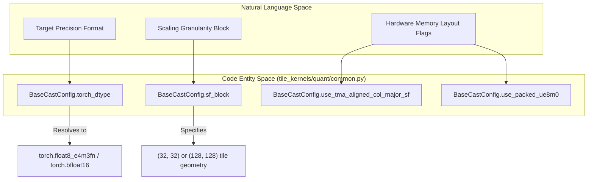
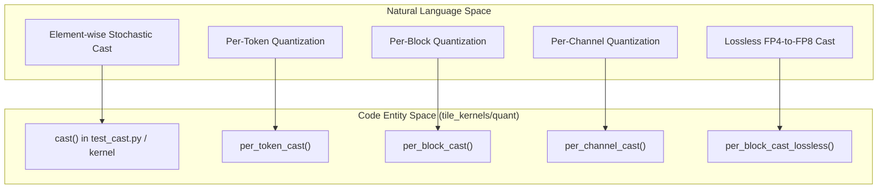
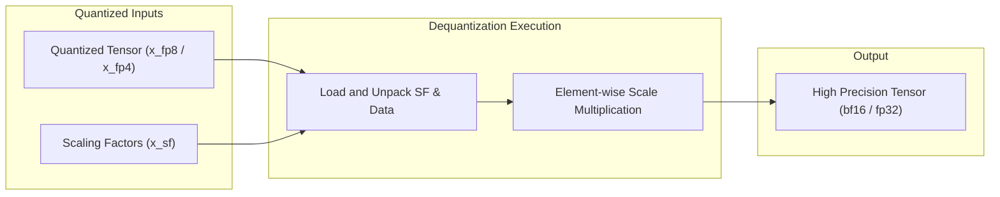

<!-- source: DeepWiki mcp.deepwiki.com · repo deepseek-ai/TileKernels · page 6.1 Cast and Dequantization Kernels · fetched 2026-10-30 -->

# Cast and Dequantization Kernels

Relevant source files

The following files were used as context for generating this wiki page:

- [tests/quant/test_cast.py](tests/quant/test_cast.py)
- [tests/quant/test_cast_back.py](tests/quant/test_cast_back.py)
- [tests/quant/test_per_block_cast.py](tests/quant/test_per_block_cast.py)
- [tests/quant/test_per_block_cast_lossless.py](tests/quant/test_per_block_cast_lossless.py)
- [tests/quant/test_per_channel_cast.py](tests/quant/test_per_channel_cast.py)
- [tests/quant/test_per_token_cast.py](tests/quant/test_per_token_cast.py)
- [tests/quant/test_per_token_cast_and_cast_back.py](tests/quant/test_per_token_cast_and_cast_back.py)

This page serves as the technical reference for the cast and dequantization subsystem within `tile_kernels/quant/`. It covers high-performance TileLang kernels for converting between high-precision formats (BF16, FP32) and quantized formats (such as FP8/E4M3, FP4/E2M1, and E5M6), supporting granularities including per-token, per-block, and per-channel casting. It also documents the configuration dataclasses (`quant/common.py`, `quant/types.py`), scaling factor (SF) layouts, stochastic rounding implementations, and round-trip verification kernels.

---

## Configuration Dataclasses (`quant/common.py` and `quant/types.py`)

The quantization pipeline relies on a structured configuration hierarchy to abstract target data types, block geometries, and memory layouts. 

### Core Dataclasses
- **`BaseCastConfig`**: Defines the foundational quantization parameters, including the target `torch_dtype`, scaling block size (`sf_block`), and flags for layout modifications like TMA alignment or UE8M0 packing [tile_kernels/quant/common.py:20-38]().
- **`CastInputConfig`**: Inherits from `BaseCastConfig` and configures parameters for input tensors that already carry or require scaling factors [tile_kernels/quant/common.py:40-43]().
- **`CastOutputConfig`**: Inherits from `BaseCastConfig` and adds parameters for output tensors, such as power-of-two SF rounding and custom clamping bounds [tile_kernels/quant/common.py:45-60]().

### Natural Language to Code Entity Mapping: Configuration

Sources: [tile_kernels/quant/common.py:20-60]()

---

## Scaling Factor (SF) Layouts and Helpers

Scaling factors can be arranged in multiple layouts depending on hardware accelerator constraints (e.g., NVIDIA Hopper TMA requirements):

1. **Row-Major**: Traditional layout where contiguous elements along a row share an SF.
2. **TMA-Aligned Column-Major**: Re-strided column-major layout optimized for asynchronous Tensor Memory Accelerator tensor loading [tile_kernels/quant/common.py:130-138]().
3. **Packed UE8M0**: An 8-bit unsigned format (1 sign/exponent bit scheme depending on packaging) packed tightly into `int32` storage words [tile_kernels/quant/common.py:135-137]().

### SF Utility Functions

| Utility Function | Description | Source Reference |
| :--- | :--- | :--- |
| `load_sf` | Macro to load SF from a strided tensor based on configuration. | [tile_kernels/quant/common.py:227-248]() |
| `store_sf` | Macro to store SF into memory, applying UE8M0 packing when requested. | [tile_kernels/quant/common.py:251-270]() |
| `get_sf_shape` | Computes physical tensor shapes for SF given token/hidden dimensions. | [tile_kernels/quant/common.py:130-138]() |
| `alloc_scaling_factors` | Allocates properly aligned `torch.Tensor` instances for SF buffers. | [tile_kernels/quant/common.py:141-166]() |
| `cast_epilogue` | Handles post-processing views (e.g., `int32` reinterpret) post-kernel execution. | [tile_kernels/quant/common.py:168-193]() |

Sources: [tile_kernels/quant/common.py:130-270]()

---

## Forward Cast Kernels

Forward quantization kernels map high-precision inputs into lower-precision representations while computing or applying scaling factors.

### Natural Language to Code Entity Mapping: Forward Cast Operations

Sources: [tests/quant/test_cast.py:13-146](), [tests/quant/test_per_token_cast.py:30-162](), [tests/quant/test_per_block_cast.py:71-105](), [tests/quant/test_per_channel_cast.py:84-103](), [tests/quant/test_per_block_cast_lossless.py:48-56]()

### 1. `cast` (with Stochastic Rounding)
The basic `cast` kernel supports converting between `fp32`, `bf16`, and `e4m3`. When `stochastic_rounding=True`, pseudo-random bits are added to the mantissa before truncation to eliminate rounding bias in low-precision training [tests/quant/test_cast.py:41-48](). It saturates finite overflow and infinities while preserving NaNs [tests/quant/test_cast.py:62-67]().

### 2. `per_token_cast`
Computes scaling factors independently per token (row-wise), mapping activation tensors into FP8 or FP4 formats [tests/quant/test_per_token_cast.py:109-117](). It supports non-contiguous memory layouts and can operate with precomputed scaling factors via `per_token_cast_with_precomputed_sf` [tests/quant/test_per_token_cast.py:132-155]().

### 3. `per_block_cast`
Performs 2D block-level quantization (e.g., 32x32 or 128x128 blocks), utilizing two-stage shared memory reductions to find the absolute maximum (`amax`) per block [tests/quant/test_per_block_cast.py:40-72](). It exposes auxiliary modes like `per_block_cast_with_sf_only` to compute scaling factors without rewriting the data payload [tests/quant/test_per_block_cast.py:102-105]().

### 4. `per_channel_cast`
Quantizes tensor columns independently using block sizes structured along the channel dimension, often paired with transposition operations for weight matrices [tests/quant/test_per_channel_cast.py:84-92]().

### 5. `per_block_cast_lossless`
Performs a bit-exact, lossless transformation from FP4 (`e2m1`) to FP8 (`e4m3`) by adjusting exponent bits and scaling factor configurations directly without dequantizing back to floating-point space [tests/quant/test_per_block_cast_lossless.py:48-56]().

Sources: 
- [tests/quant/test_cast.py:1-146]()
- [tests/quant/test_per_block_cast.py:1-124]()
- [tests/quant/test_per_block_cast_lossless.py:1-127]()
- [tests/quant/test_per_channel_cast.py:1-126]()
- [tests/quant/test_per_token_cast.py:1-167]()

---

## Dequantization and Round-Trip Kernels

Dequantization operations restore quantized data back to high-precision (`bf16` or `fp32`) representations for subsequent layer computations.

Sources: [tests/quant/test_cast_back.py:37-64]()

### 1. `cast_back` and `per_token_cast_back`
- **`cast_back`**: Reconstructs high-precision tensors from arbitrary block-quantized layouts and scaling factors [tests/quant/test_cast_back.py:54-62]().
- **`per_token_cast_back`**: Optimized specifically for row/token-granularity dequantization paths [tests/quant/test_cast_back.py:28-38]().
- Also includes specialized bit-unpacking routines such as `e5m6_to_float` for packed 12-bit formats.

### 2. `per_token_cast_and_cast_back`
An in-place or direct round-trip utility (`per_token_cast_and_cast_back`) that performs token-wise quantization followed immediately by dequantization. This is heavily utilized in activation compression and simulation testing pipelines to verify numerical error bounds and bias characteristics [tests/quant/test_per_token_cast_and_cast_back.py:59-67]().

Sources: [tests/quant/test_cast_back.py:1-173](), [tests/quant/test_per_token_cast_and_cast_back.py:1-102]()

---

