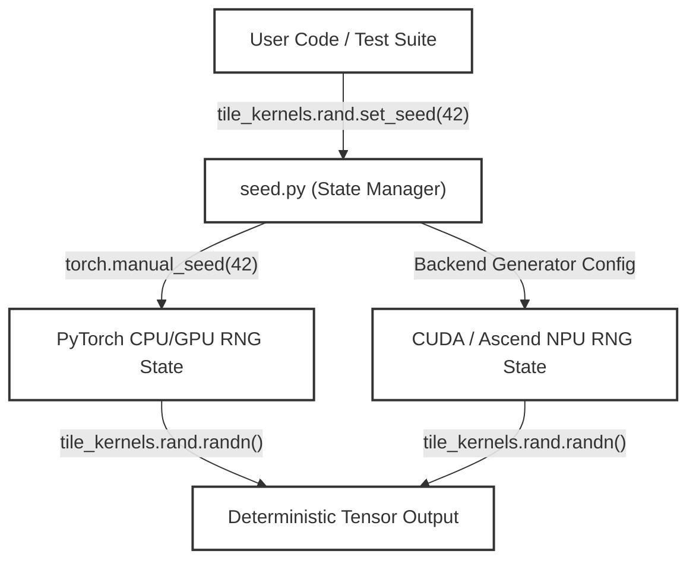
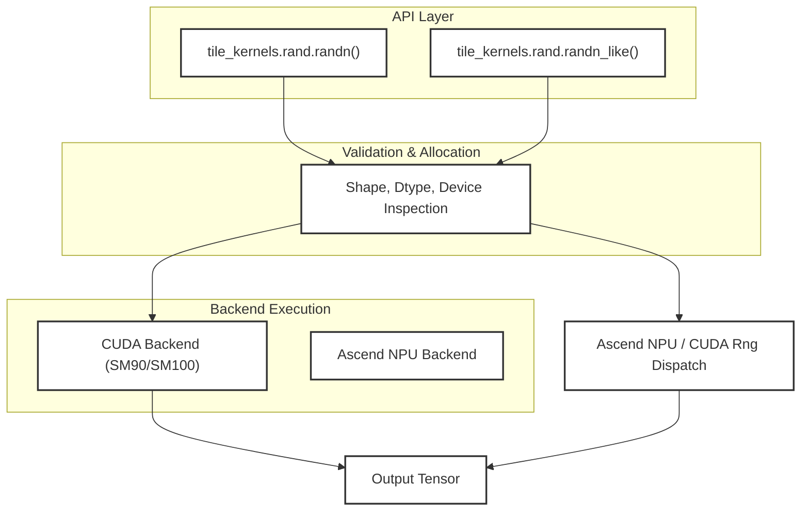

<!-- source: DeepWiki mcp.deepwiki.com · repo deepseek-ai/TileKernels · page 7.1 Random Number Generation (rand) · fetched 2026-10-30 -->

# Random Number Generation (rand)

Relevant source files

The following files were used as context for generating this wiki page:

- [tests/rand/test_randn.py](tests/rand/test_randn.py)

## Purpose and Scope

The `tile_kernels/rand/` subsystem provides high-performance, deterministic random number generation for the TileKernels framework. It supports multi-backend execution (CUDA and Ascend NPU) and is primarily utilized for deterministic test data generation, weight initialization, and stochastic operations. This page details seed management, the `randn` API, distribution validation, and benchmarking procedures as implemented in the test suites and auxiliary modules.

Sources: [tests/rand/test_randn.py:1-92]()

---

## Seed Management (`seed.py`)

Deterministic behavior across diverse hardware backends (CUDA SM90/SM100 and Ascend NPU) requires centralized seed management. The `tile_kernels.rand.set_seed()` function ensures that both PyTorch-level random state and backend-specific kernel generators are synchronized to the exact same seed value.

### Key Behavioral Aspects:
- **State Synchronization**: Calling `tile_kernels.rand.set_seed(seed)` propagates the seed value to PyTorch (`torch.manual_seed`) and any internal generator states [tests/rand/test_randn.py:17-24]().
- **Reproducibility**: As verified in unit tests, resetting the seed yields identical tensor outputs across successive calls with matching shapes and dtypes [tests/rand/test_randn.py:17-41]().

*Diagram 1: Seed management and state propagation flow linking `tile_kernels.rand.set_seed` to backend generators.*

Sources: [tests/rand/test_randn.py:17-41]()

---

## Randn Kernel API (`randn` and `randn_like`)

The random normal generation API mimics PyTorch's factory functions while routing execution through optimized TileLang/backend kernels where applicable.

### Supported API Signatures:
- `tile_kernels.rand.randn(shape, dtype, device)`: Allocates and populates a new tensor of the specified `shape`, `dtype` (`bfloat16`, `float32`), and `device` with normally distributed random numbers [tests/rand/test_randn.py:30-32]().
- `tile_kernels.rand.randn_like(input)`: Convenience wrapper that matches the shape, dtype, and device of an existing reference tensor `input` [tests/rand/test_randn.py:35]().

*Diagram 2: Control flow for `randn` and `randn_like` through validation and backend dispatch.*

Sources: [tests/rand/test_randn.py:27-41]()

---

## Test Coverage and Distribution Validation

The random number generation module is accompanied by rigorous statistical and functional tests located in `tests/rand/test_randn.py`.

### Test Suite Structure:
1. **`test_set_seed_resets_torch_seed`**: Validates that resetting the seed guarantees identical tensor outputs between independent generation blocks [tests/rand/test_randn.py:17-24]().
2. **`test_randn_seed`**: Confirms shape, dtype, and device preservation for `randn_like` relative to input templates across `bfloat16` and `float32` dtypes [tests/rand/test_randn.py:27-41]().
3. **`test_randn_distribution`**: Validates numerical stability (no NaNs or infinities) across edge-case shapes (e.g., 1-element, prime dimensions, large sequence lengths like `16384`) and checks statistical convergence (mean near `0.0`, std deviation near `1.0`, and positive ratio near `0.5` within a `0.02` tolerance for large tensors $\ge 10^6$ elements) [tests/rand/test_randn.py:43-70]().
4. **`test_randn_benchmark`**: Evaluates kernel performance and calculates effective memory bandwidth (`bandwidth_gbs`) across varying shapes and dtypes using `benchmark_timer` and `benchmark_record` fixtures [tests/rand/test_randn.py:72-92]().

| Test Function | Target Dtypes | Key Assertions / Metrics | Sources |
| :--- | :--- | :--- | :--- |
| `test_set_seed_resets_torch_seed` | N/A | `torch.equal(first, repeated)` | [tests/rand/test_randn.py:17-24]() |
| `test_randn_seed` | `bfloat16`, `float32` | Shape, dtype, device equality & reproducibility | [tests/rand/test_randn.py:27-41]() |
| `test_randn_distribution` | `bfloat16`, `float32` | `torch.isfinite()`, Mean ($\approx 0$), Std ($\approx 1$) | [tests/rand/test_randn.py:43-70]() |
| `test_randn_benchmark` | `bfloat16`, `float32` | Execution time ($\mu s$), Bandwidth (GB/s) | [tests/rand/test_randn.py:72-92]() |

Sources: [tests/rand/test_randn.py:1-92]()

---

