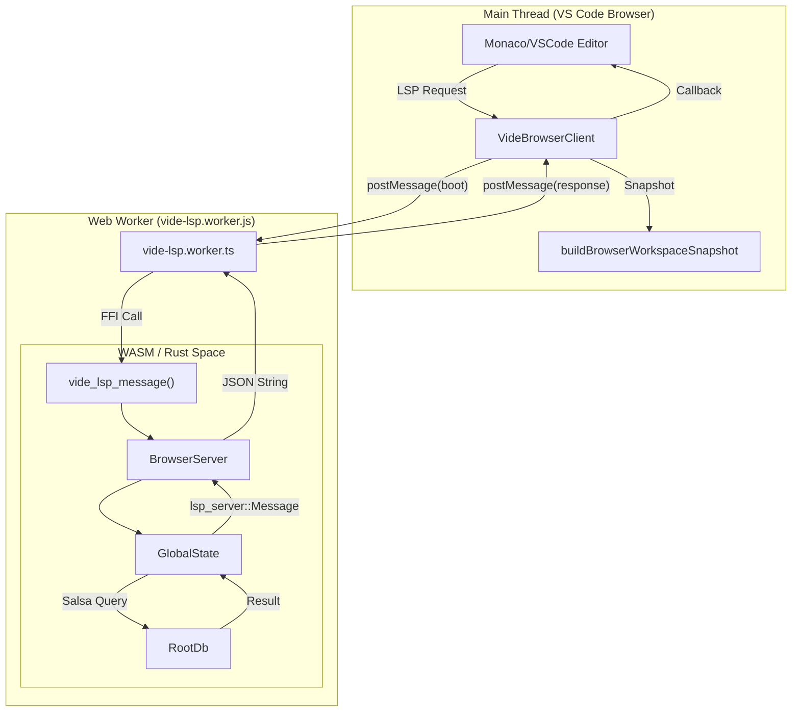
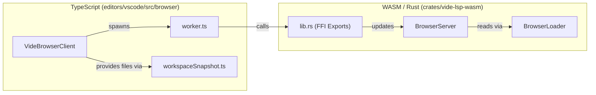

<!-- source: DeepWiki mcp.deepwiki.com · repo pascal-lab/vide · page 8 Browser / WASM Support · fetched 2026-10-12 -->

# Browser / WASM Support

Relevant source files

The following files were used as context for generating this wiki page:

- [.github/ci-modules.yml](.github/ci-modules.yml)
- [Cargo.toml](Cargo.toml)
- [editors/vscode/LICENSE](editors/vscode/LICENSE)
- [editors/vscode/package-lock.json](editors/vscode/package-lock.json)
- [editors/vscode/package.json](editors/vscode/package.json)
- [editors/vscode/scripts/copy-web-assets.ts](editors/vscode/scripts/copy-web-assets.ts)
- [editors/vscode/src/browser/client.ts](editors/vscode/src/browser/client.ts)
- [editors/vscode/src/browser/worker.ts](editors/vscode/src/browser/worker.ts)
- [editors/vscode/src/browser/workspaceSnapshot.ts](editors/vscode/src/browser/workspaceSnapshot.ts)
- [editors/vscode/tsconfig.browser.json](editors/vscode/tsconfig.browser.json)
- [editors/vscode/tsconfig.json](editors/vscode/tsconfig.json)

The Vide language server is designed to run natively in the browser via WebAssembly (WASM). This capability enables the **Vide Playground**, an interactive online IDE, and allows the Vide VS Code extension to function in web environments (like github.dev) without a remote backend. The architecture leverages Emscripten to compile the Rust-based server and the C++ Slang parser into a single WASM module.

## High-Level Architecture

The browser integration consists of a specialized server wrapper, a Web Worker to ensure UI responsiveness, and a TypeScript client that communicates via the Language Server Protocol (LSP).

### Browser / WASM Component Overview
| Component | Responsibility | Implementation |
| :--- | :--- | :--- |
| **`vide-lsp-wasm`** | Rust crate providing C FFI exports for the WASM module. | [Cargo.toml:14-14]() |
| **`BrowserServer`** | Manages the `GlobalState` and LSP session within the WASM environment. | [editors/vscode/src/browser/client.ts:60-63]() |
| **`vide-lsp.worker.ts`** | A Web Worker that hosts the WASM module and runs the polling loop. | [editors/vscode/src/browser/client.ts:50-52]() |
| **`VideBrowserClient`** | TypeScript facade for managing worker lifecycle and LSP communication. | [editors/vscode/src/browser/client.ts:30-30]() |
| **`BrowserWorkspaceSnapshot`** | Captures the state of the browser filesystem to initialize the WASM VFS. | [editors/vscode/src/browser/workspaceSnapshot.ts:17-21]() |

### System Data Flow
The following diagram illustrates how an LSP request from the VS Code Browser UI reaches the Rust logic in the WASM module.

**LSP Message Flow (UI to WASM)**

Sources: [editors/vscode/src/browser/client.ts:42-56](), [editors/vscode/src/browser/client.ts:58-80](), [editors/vscode/src/browser/workspaceSnapshot.ts:23-25]()

## WASM Server Entry Points
The core of the browser support is the `vide-lsp-wasm` crate, which adapts the standard Vide server logic for a single-threaded environment.

- **FFI Interface**: The crate exports C-compatible functions such as `vide_lsp_message`, `vide_lsp_poll`, and `vide_lsp_write_file`. These allow the JavaScript worker to push LSP messages into the server and synchronize virtual file contents [editors/vscode/src/browser/client.ts:73-75]().
- **Worker Lifecycle**: The `vide-lsp.worker.ts` script initializes the WASM runtime and enters a polling loop, checking for server responses to send back to the main thread [editors/vscode/src/browser/worker.ts:1-4]().
- **Resource Management**: String memory shared across the FFI boundary is managed via `vide_free_string` to prevent leaks in the WASM heap.

For details, see [WASM Server Entry Points](#8.1).

## Playground and Online Experience
The Vide online experience is powered by the same WASM core used in the VS Code browser extension.

- **Workspace Mirroring**: The `BrowserWorkspaceSnapshot` utility scans the browser's virtual filesystem to create a `WorkerWorkspaceFile` manifest, ensuring the WASM server has access to all project files [editors/vscode/src/browser/workspaceSnapshot.ts:26-52]().
- **Build Pipeline**: A custom build script `copy-web-assets.ts` orchestrates the movement of compiled WASM binaries (`vide-core.wasm`) and their JS glue code into the extension's distribution folder [editors/vscode/scripts/copy-web-assets.ts:6-8]().
- **Client Middleware**: The `VideBrowserClient` includes middleware to handle browser-specific behaviors, such as confirming renames that might collide across the virtual filesystem [editors/vscode/src/browser/client.ts:153-177]().

For details, see [Playground and Online Experience](#8.2).

### Component Association Map

**Code Entity Mapping**

Sources: [editors/vscode/src/browser/client.ts:30-56](), [editors/vscode/src/browser/workspaceSnapshot.ts:23-25](), [editors/vscode/scripts/copy-web-assets.ts:8-9]()

## Build Configuration
The WASM build is integrated into the workspace and CI/CD pipelines:
1.  **Target**: Compiles to `wasm32-unknown-emscripten` to leverage the Slang C++ parser.
2.  **Asset Distribution**: Web assets are staged in `dist/browser/wasm` [editors/vscode/scripts/copy-web-assets.ts:7-7]().
3.  **Feature Flags**: The `server-file-watcher` feature is explicitly disabled for WASM builds, as the browser environment uses a push-based VFS model rather than OS-level notifications [Cargo.toml:141-142]().

Sources: [Cargo.toml:139-142](), [editors/vscode/package.json:31-31](), [editors/vscode/scripts/copy-web-assets.ts:1-30]()

---

