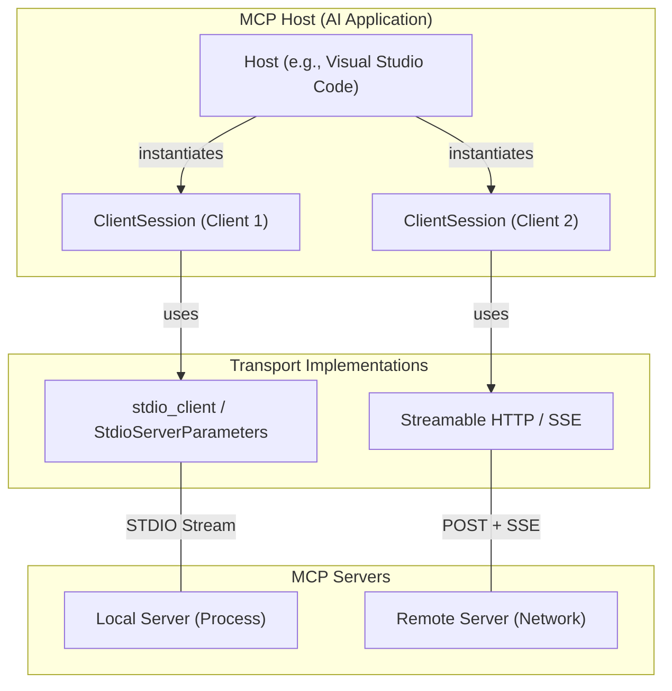
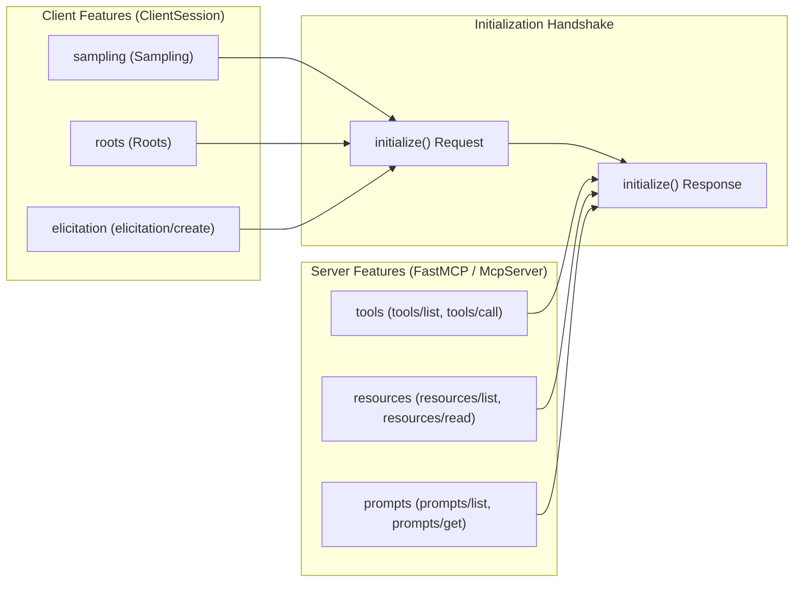

<!-- source: DeepWiki mcp.deepwiki.com · repo modelcontextprotocol/modelcontextprotocol · page 4.2 Client Integration Patterns · fetched 2026-10-21 -->

# Client Integration Patterns

<details>
<summary>Relevant source files</summary>

The following files were used as context for generating this wiki page:

- [docs/docs/develop/build-client.mdx](docs/docs/develop/build-client.mdx)
- [docs/docs/develop/build-server.mdx](docs/docs/develop/build-server.mdx)
- [docs/docs/develop/build-with-agent-skills.mdx](docs/docs/develop/build-with-agent-skills.mdx)
- [docs/docs/develop/clients/client-best-practices.mdx](docs/docs/develop/clients/client-best-practices.mdx)
- [docs/docs/develop/connect-local-servers.mdx](docs/docs/develop/connect-local-servers.mdx)
- [docs/docs/develop/connect-remote-servers.mdx](docs/docs/develop/connect-remote-servers.mdx)
- [docs/docs/learn/architecture.mdx](docs/docs/learn/architecture.mdx)
- [docs/docs/learn/client-concepts.mdx](docs/docs/learn/client-concepts.mdx)
- [docs/docs/learn/server-concepts.mdx](docs/docs/learn/server-concepts.mdx)
- [docs/docs/sdk.mdx](docs/docs/sdk.mdx)
- [docs/images/claude-add-files-connectors-and-more.png](docs/images/claude-add-files-connectors-and-more.png)
- [docs/images/claude-desktop-hamburger-menu-icon.png](docs/images/claude-desktop-hamburger-menu-icon.png)
- [docs/images/programmatic-tool-calling.svg](docs/images/programmatic-tool-calling.svg)
- [docs/images/progressive-discovery.svg](docs/images/progressive-discovery.svg)
- [docs/images/quickstart-remote/4-select-resources-menu.png](docs/images/quickstart-remote/4-select-resources-menu.png)
- [docs/images/quickstart-remote/5-select-prompts-resources.png](docs/images/quickstart-remote/5-select-prompts-resources.png)
- [docs/images/quickstart-remote/6-configure-tools.png](docs/images/quickstart-remote/6-configure-tools.png)
- [docs/images/quickstart-tools.png](docs/images/quickstart-tools.png)

</details>


## Purpose and Scope

This page documents how MCP servers integrate with various client applications. It covers configuration patterns, transport selection, capability negotiation, and client-specific setup procedures. This material focuses on the practical integration of MCP servers into existing client applications like Claude Desktop, IDEs, and custom implementations.

For information about the MCP client implementations themselves, see [Available SDKs and Language Support](#6.2). For details about building MCP servers, see [Building MCP Servers](#5.1).

## Overview of Client Integration

MCP clients are instantiated by host applications (like Claude Desktop or an IDE) to communicate with particular MCP servers [docs/docs/learn/client-concepts.mdx:6-9](). The host application manages the user experience, while the client handles protocol-level communication [docs/docs/learn/client-concepts.mdx:8-9]().

### Bridging Natural Language to Code Entities: Client Architecture
The following diagram illustrates how the conceptual "MCP Host" maps to specific code entities and transport implementations within the SDKs.


Sources: [docs/docs/learn/architecture.mdx:31-61](), [docs/docs/develop/build-client.mdx:106-148]()

## Configuration Patterns

### Local Server Configuration (STDIO)
Most desktop clients use a JSON configuration file to define local MCP servers. The configuration typically includes a friendly name, a command to execute, and an array of arguments [docs/docs/develop/connect-local-servers.mdx:130-139]().

**Example: `claude_desktop_config.json`**
```json
{
  "mcpServers": {
    "filesystem": {
      "command": "npx",
      "args": [
        "-y",
        "@modelcontextprotocol/server-filesystem",
        "/Users/username/Desktop"
      ],
      "env": {
        "CUSTOM_VAR": "value"
      }
    }
  }
}
```
Sources: [docs/docs/develop/connect-local-servers.mdx:94-108](), [docs/docs/tools/debugging.mdx:132-146]()

### Remote Server Configuration (HTTP)
Remote servers are connected via URLs. In clients like Claude.ai, these are added as "Custom Connectors" [docs/docs/develop/connect-remote-servers.mdx:16-18](). The URL must include the protocol (https:) and any necessary path components [docs/docs/develop/connect-remote-servers.mdx:54-55]().

## Transport Selection and Setup

### STDIO Transport (Local)
Used for direct process communication on the same machine [docs/docs/learn/architecture.mdx:97-99](). 
- **Implementation**: In the Python SDK, this is handled via `stdio_client` using `StdioServerParameters` to define the command and arguments [docs/docs/develop/build-client.mdx:140-146]().
- **Best Practice**: Servers must never write to `stdout` for logging, as it corrupts JSON-RPC messages. Use `stderr` or a logging library [docs/docs/develop/build-server.mdx:48-55]().

### Streamable HTTP Transport (Remote)
Used for internet-hosted services, enabling access to cloud APIs and multi-user deployments [docs/docs/develop/build-with-agent-skills.mdx:62-66]().
- **Implementation**: Uses HTTP POST for client-to-server messages and Server-Sent Events (SSE) for server-to-client streaming [docs/docs/learn/architecture.mdx:98-101]().
- **Authentication**: Remote servers commonly use OAuth, API keys, or username/password combinations [docs/docs/develop/connect-remote-servers.mdx:68-69]().

## Capability Negotiation

During the `initialize` request, the client and server exchange "Capabilities" to determine supported features [docs/docs/learn/architecture.mdx:111-115]().

### Bridging Capabilities to Code Primitives
The following diagram maps protocol capabilities to the underlying SDK methods and UI concepts.


Sources: [docs/docs/learn/client-concepts.mdx:14-18](), [docs/docs/learn/server-concepts.mdx:14-18](), [docs/docs/develop/build-client.mdx:150-156]()

### Progressive Discovery
Clients implement progressive discovery by showing visual indicators only after a successful connection [docs/docs/develop/connect-local-servers.mdx:152-168]().
- **Tool Browsing**: Users can view available tools in a "Manage connectors" or "Add files" menu [docs/docs/develop/connect-local-servers.mdx:161-168]().
- **Dynamic Updates**: Roots can be updated dynamically with `roots/list_changed` notifications [docs/docs/learn/client-concepts.mdx:122-123]().

## Client-Specific Integration Patterns

### Claude Desktop
- **Config Location (macOS)**: `~/Library/Application Support/Claude/claude_desktop_config.json` [docs/docs/develop/connect-local-servers.mdx:84]()
- **Config Location (Windows)**: `%APPDATA%\Claude\claude_desktop_config.json` [docs/docs/develop/connect-local-servers.mdx:85]()
- **Usage**: Claude requires explicit approval for each tool execution [docs/docs/develop/connect-local-servers.mdx:46-47]().

### Web Clients (Claude.ai)
- **Mechanism**: Connect via "Custom Connectors" in the browser settings [docs/docs/develop/connect-remote-servers.mdx:34-36]().
- **Auth Flow**: Users follow authentication prompts provided by the server, which may redirect to third-party providers [docs/docs/develop/connect-remote-servers.mdx:77-78]().

## Debugging and Testing Tools

### MCP Inspector
The Inspector is the primary tool for testing servers before integrating them with a full host application [docs/docs/tools/inspector.mdx:6-7]().
- **Usage**: `npx @modelcontextprotocol/inspector <command> <args>` [docs/docs/tools/inspector.mdx:15-16]().
- **Features**: Supports testing `tools/call`, `resources/read`, and `prompts/get` interactively [docs/docs/tools/inspector.mdx:91-110]().

### Common Integration Issues
1. **Working Directory**: Clients may launch servers with an undefined working directory; always use absolute paths in configs [docs/docs/tools/debugging.mdx:98-107]().
2. **STDIO Corruption**: Writing to `stdout` (e.g., via `print()`) breaks the JSON-RPC stream [docs/docs/develop/build-server.mdx:48-50]().
3. **Environment Variables**: Servers launched via stdio inherit a limited environment; explicit `env` configuration is often required for API keys or custom paths [docs/docs/tools/debugging.mdx:129-146]().

Sources: [docs/docs/tools/debugging.mdx:90-185](), [docs/docs/tools/inspector.mdx:8-20](), [docs/docs/develop/build-server.mdx:48-55]()

---

