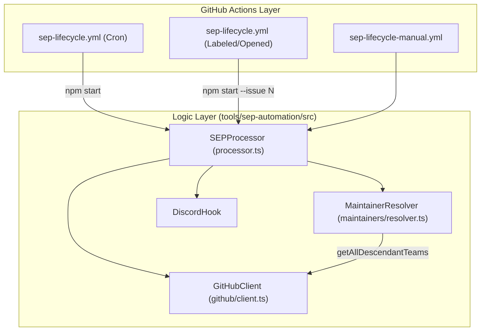
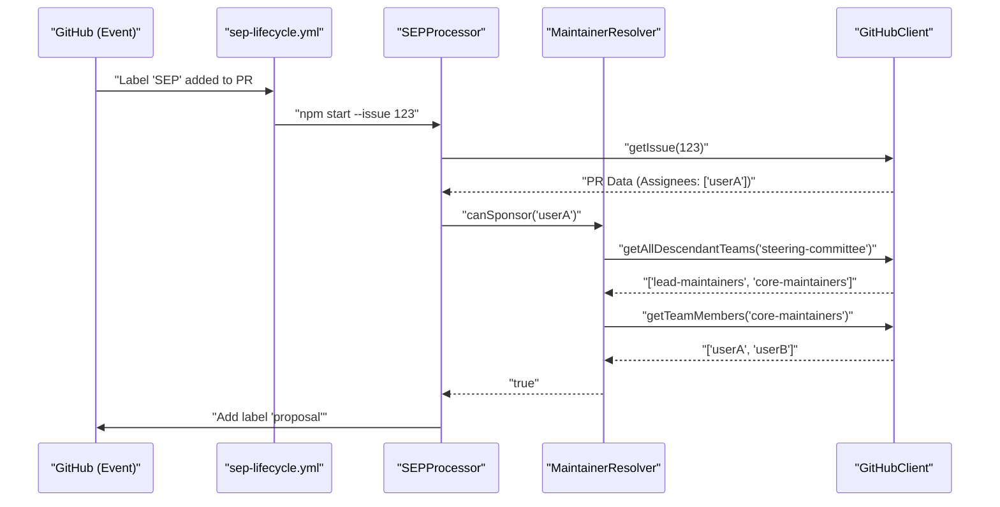

<!-- source: DeepWiki mcp.deepwiki.com · repo modelcontextprotocol/modelcontextprotocol · page 7.6 SEP Lifecycle Automation Tool · fetched 2026-10-21 -->

# SEP Lifecycle Automation Tool

Relevant source files

The following files were used as context for generating this wiki page:

- [.github/workflows/blog-preview.yml](.github/workflows/blog-preview.yml)
- [.github/workflows/cut-release.yml](.github/workflows/cut-release.yml)
- [.github/workflows/deploy-blog.yml](.github/workflows/deploy-blog.yml)
- [.github/workflows/main.yml](.github/workflows/main.yml)
- [.github/workflows/markdown-format.yml](.github/workflows/markdown-format.yml)
- [.github/workflows/publish-release.yml](.github/workflows/publish-release.yml)
- [.github/workflows/render-seps.yml](.github/workflows/render-seps.yml)
- [.github/workflows/sep-lifecycle-manual.yml](.github/workflows/sep-lifecycle-manual.yml)
- [.github/workflows/sep-lifecycle.yml](.github/workflows/sep-lifecycle.yml)
- [.github/workflows/slash-commands.yml](.github/workflows/slash-commands.yml)
- [.github/workflows/stage-blog.yml](.github/workflows/stage-blog.yml)
- [tools/sep-automation/package-lock.json](tools/sep-automation/package-lock.json)
- [tools/sep-automation/package.json](tools/sep-automation/package.json)
- [tools/sep-automation/src/config.ts](tools/sep-automation/src/config.ts)
- [tools/sep-automation/src/github/client.ts](tools/sep-automation/src/github/client.ts)
- [tools/sep-automation/src/github/types.ts](tools/sep-automation/src/github/types.ts)
- [tools/sep-automation/src/index.ts](tools/sep-automation/src/index.ts)
- [tools/sep-automation/src/maintainers/resolver.ts](tools/sep-automation/src/maintainers/resolver.ts)
- [tools/sep-automation/src/processor.ts](tools/sep-automation/src/processor.ts)
- [tools/sep-automation/src/sep/analyzer.ts](tools/sep-automation/src/sep/analyzer.ts)
- [tools/sep-automation/test/unit/config.test.ts](tools/sep-automation/test/unit/config.test.ts)

The `tools/sep-automation` utility is a TypeScript-based application designed to manage the Specification Enhancement Process (SEP) lifecycle automatically. It enforces governance rules, manages GitHub labels and assignments, and provides community notifications via Discord [tools/sep-automation/package.json:1-11]().

## Overview

The tool operates by scanning GitHub Issues and Pull Requests for SEP-related labels and content. It ensures that every SEP has a valid sponsor from the steering committee, manages state transitions (e.g., from `proposal` to `draft`), and pings inactive participants to maintain momentum in the protocol evolution [tools/sep-automation/src/processor.ts:1-15]().

### Key Responsibilities
- **Sponsorship Enforcement**: Verifies that SEPs are assigned to members of the `steering-committee` or its descendant teams [.github/workflows/sep-lifecycle.yml:95-101](), [tools/sep-automation/src/maintainers/resolver.ts:9-12]().
- **Lifecycle State Management**: Automates transitions between `proposal`, `draft`, `in-review`, and `accepted` based on repository activity and labeling [.github/workflows/slash-commands.yml:34-41]().
- **Notification & Reporting**: Sends summaries of SEP activity to Discord and generates logs for maintainer review [.github/workflows/sep-lifecycle.yml:103-112]().
- **Staleness Tracking**: Identifies SEPs that have lacked activity and pings the relevant stakeholders [tools/sep-automation/src/processor.ts:1-15]().

## System Architecture

The automation tool is structured into functional handlers managed by a central `SEPProcessor`.

### Code Entity Space to Logic Mapping

The following diagram maps the high-level automation logic to the specific TypeScript classes and GitHub Actions that implement them.

**SEP Automation Component Map**

**Sources:** [.github/workflows/sep-lifecycle.yml:1-13](), [.github/workflows/sep-lifecycle-manual.yml:3-9](), [tools/sep-automation/src/processor.ts:1-15](), [tools/sep-automation/src/maintainers/resolver.ts:14-25]().

## Implementation Details

### MaintainerResolver
The `MaintainerResolver` class is responsible for determining who is authorized to sponsor a SEP. It defines the `steering-committee` as the `SPONSOR_ROOT_TEAM` [tools/sep-automation/src/maintainers/resolver.ts:12]().

- **Dynamic Team Discovery**: It uses `github.getAllDescendantTeams` to find all sub-teams under the steering committee [tools/sep-automation/src/maintainers/resolver.ts:46-49]().
- **Membership Caching**: To avoid hitting GitHub API rate limits, it caches the set of valid sponsors in `sponsorSet` [tools/sep-automation/src/maintainers/resolver.ts:31-35]().
- **Sponsorship Validation**: The `canSponsor` method checks if a specific GitHub username belongs to the discovered sponsor teams [tools/sep-automation/src/maintainers/resolver.ts:101-104]().

### SEPProcessor
The `SEPProcessor` acts as the orchestrator. When executed, it:
1.  Loads the configuration (e.g., target repository, Discord webhook URL) [.github/workflows/sep-lifecycle.yml:95-103]().
2.  Fetches issues or PRs labeled with `SEP` [.github/workflows/sep-lifecycle.yml:18-33]().
3.  Delegates state-specific logic to sub-handlers (TransitionHandler, PingHandler).
4.  Reports outcomes via `DiscordHook`.

### Data Flow: SEP Event Processing

The diagram below illustrates how a labeling event on GitHub triggers the automation tool to validate sponsorship.

**Sponsorship Validation Flow**

**Sources:** [.github/workflows/sep-lifecycle.yml:84-95](), [tools/sep-automation/src/maintainers/resolver.ts:43-67](), [tools/sep-automation/src/maintainers/resolver.ts:101-104]().

## GitHub Actions Integration

The automation is integrated via three primary workflows:

| Workflow | Trigger | Purpose |
| :--- | :--- | :--- |
| `sep-lifecycle.yml` | `schedule` (Weekly), `labeled`, `opened` | Primary automation runner for state transitions and pings [.github/workflows/sep-lifecycle.yml:3-12](). |
| `sep-lifecycle-manual.yml` | `workflow_dispatch` | Allows maintainers to manually trigger a full sweep or process a specific issue with a `dry_run` option [.github/workflows/sep-lifecycle-manual.yml:4-14](). |
| `slash-commands.yml` | `issue_comment` | Handles `/lgtm`, `/hold`, and label cleanup (removing `in-review`, `draft`, `proposal` on acceptance) [.github/workflows/slash-commands.yml:17-41](). |

### Execution Modes
- **Single Issue Mode**: Triggered by event-driven GHA. The tool is invoked with `--issue <number>` to process only the affected item [.github/workflows/sep-lifecycle.yml:88-91]().
- **Full Sweep Mode**: Triggered by the weekly cron job. The tool scans all open SEPs to identify staleness or missing sponsors [.github/workflows/sep-lifecycle.yml:92-94]().

## Configuration and Environment

The tool requires several environment variables and secrets to function within GitHub Actions:

- `APP_ID` / `APP_PRIVATE_KEY`: Used for GitHub App authentication, providing `read:org` permissions to check team memberships [.github/workflows/sep-lifecycle.yml:96-98]().
- `MAINTAINERS_TEAM`: Set to `core-maintainers` [.github/workflows/sep-lifecycle.yml:101]().
- `DISCORD_WEBHOOK_URL`: Destination for weekly summaries and urgent alerts [.github/workflows/sep-lifecycle.yml:103]().
- `DRY_RUN`: When set to `true`, the tool logs intended actions without making API writes [.github/workflows/sep-lifecycle-manual.yml:50-54]().

**Sources:** [.github/workflows/sep-lifecycle.yml:1-113](), [.github/workflows/sep-lifecycle-manual.yml:1-81](), [tools/sep-automation/src/maintainers/resolver.ts:1-126](), [tools/sep-automation/src/processor.ts:1-15]().

---

