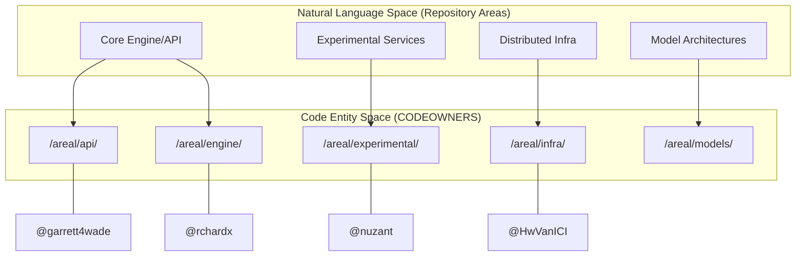
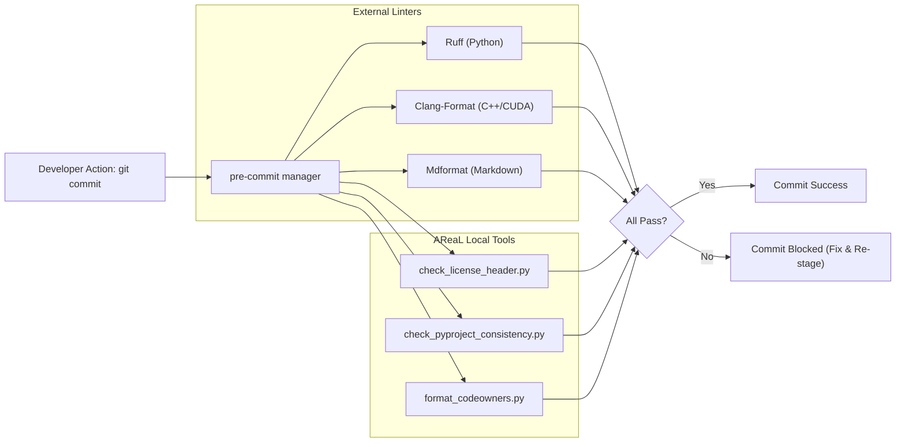

<!-- source: DeepWiki mcp.deepwiki.com · repo areal-project/AReaL · page 12.2 Contributing & Governance · fetched 2026-10-21 -->

# Contributing & Governance

Relevant source files

The following files were used as context for generating this wiki page:

- [.agents/skills/commit-conventions/SKILL.md](.agents/skills/commit-conventions/SKILL.md)
- [.agents/skills/review-pr/MIGRATION.md](.agents/skills/review-pr/MIGRATION.md)
- [.agents/skills/review-pr/SKILL.md](.agents/skills/review-pr/SKILL.md)
- [.agents/skills/review-pr/references/review-pr-domains-and-signals.md](.agents/skills/review-pr/references/review-pr-domains-and-signals.md)
- [.agents/skills/review-pr/references/review-pr-templates.md](.agents/skills/review-pr/references/review-pr-templates.md)
- [.agents/skills/review-pr/sync_review_pr_refs.py](.agents/skills/review-pr/sync_review_pr_refs.py)
- [.claude/commands/create-pr.md](.claude/commands/create-pr.md)
- [.claude/commands/gen-commit-msg.md](.claude/commands/gen-commit-msg.md)
- [.claude/data/review-pr-domains-and-signals.md](.claude/data/review-pr-domains-and-signals.md)
- [.claude/skills/commit-conventions/SKILL.md](.claude/skills/commit-conventions/SKILL.md)
- [.github/CODEOWNERS](.github/CODEOWNERS)
- [.github/DISCUSSION_TEMPLATE/ideas.yml](.github/DISCUSSION_TEMPLATE/ideas.yml)
- [.github/DISCUSSION_TEMPLATE/show-and-tell.yml](.github/DISCUSSION_TEMPLATE/show-and-tell.yml)
- [.github/ISSUE_TEMPLATE/bug.md](.github/ISSUE_TEMPLATE/bug.md)
- [.github/ISSUE_TEMPLATE/feature.md](.github/ISSUE_TEMPLATE/feature.md)
- [.github/ISSUE_TEMPLATE/refactor.md](.github/ISSUE_TEMPLATE/refactor.md)
- [.github/ruleset.json](.github/ruleset.json)
- [.opencode/skills/commit-conventions/SKILL.md](.opencode/skills/commit-conventions/SKILL.md)
- [.pre-commit-config.yaml](.pre-commit-config.yaml)
- [CODE_OF_CONDUCT.md](CODE_OF_CONDUCT.md)
- [GOVERNANCE.md](GOVERNANCE.md)
- [areal/tools/format_codeowners.py](areal/tools/format_codeowners.py)

This page details the technical standards, contribution workflows, and organizational structure of the AReaL project. It covers the automated enforcement of code quality through pre-commit hooks, the "Conventional Commits" standard for version control, and the multi-tier governance model that manages the repository.

## 1. Governance & Roles

AReaL follows a multi-tiered governance structure designed to balance community contributions with stable technical leadership.

### 1.1 Project Roles
The project defines four primary roles for participants:
*   **Contributors:** Anyone who participates via issues, PRs, or discussions. They must adhere to the [CODE_OF_CONDUCT.md:1-13]().
*   **Maintainers:** Individuals with write access responsible for PR reviews and technical guidance. Merging a PR requires at least **two maintainer approvals** [GOVERNANCE.md:13-18]().
*   **Lead Maintainer (BDFL):** Wei Fu (@garrett4wade) serves as the BDFL. The Lead Maintainer has final authority on technical deadlocks and holds administrator privileges to bypass approval requirements for trivial changes (e.g., typos, dependency bumps) [GOVERNANCE.md:36-44]().
*   **Community Moderators:** The maintainers serve as moderators for enforcing the Code of Conduct [GOVERNANCE.md:46-50]().

### 1.2 Decision-Making & PR Policy
The project operates on a consensus-seeking model. Mechanical enforcement of these rules is handled via GitHub branch protection and rulesets.

| Rule Type | Requirement | Implementation |
| :--- | :--- | :--- |
| **Approvals** | 2 Maintainers | `required_approving_review_count: 2` in `ruleset.json` [/.github/ruleset.json:25]() |
| **Code Ownership** | 1 Code Owner | `require_code_owner_review: true` in `ruleset.json` [/.github/ruleset.json:27]() |
| **Linear History** | No merge commits | `required_linear_history` in `ruleset.json` [/.github/ruleset.json:21]() |
| **Status Checks** | `pre-commit` must pass | `required_status_checks` in `ruleset.json` [/.github/ruleset.json:33-40]() |

**Sources:** [GOVERNANCE.md:52-68](), [/.github/ruleset.json:1-43]()

---

## 2. Contribution Workflow

AReaL enforces a strict "Fork and Pull Request" workflow.

### 2.1 Code Ownership (CODEOWNERS)
The project uses a `.github/CODEOWNERS` file to automatically assign reviewers based on the modified file paths. A custom tool, `areal/tools/format_codeowners.py`, lints this file to ensure every path has at least two owners to avoid single points of failure [areal/tools/format_codeowners.py:105-110]().

**Entity Mapping: Path to Owner**

**Sources:** [/.github/CODEOWNERS:1-35](), [areal/tools/format_codeowners.py:4-21]()

### 2.2 Conventional Commits
All commits must follow the [Conventional Commits](https://www.conventionalcommits.org) specification. This is enforced by the `conventional-pre-commit` hook [/.pre-commit-config.yaml:126-143]().

The format is: `<type>(<scope>): <subject>`

**Scope Inference Rules:**
Scopes are strictly mapped to directory structures to maintain consistency:
*   `areal/engine/` -> `engine`
*   `areal/trainer/` -> `trainer`
*   `areal/infra/` -> `infra`
*   `areal/models/` -> `models`
*   `areal/experimental/` -> `archon`

**Sources:** [.agents/skills/commit-conventions/SKILL.md:19-71](), [.claude/commands/create-pr.md:222-253]()

---

## 3. Pre-commit Hooks & Standards

AReaL utilizes `pre-commit` to run a suite of linters and formatters locally before any code is committed.

### 3.1 Toolchain Configuration
The configuration in `.pre-commit-config.yaml` defines the following primary checks:

| Tool | ID | Purpose | Target Files |
| :--- | :--- | :--- | :--- |
| **Ruff** | `ruff` | Python linting and auto-fix | `.py`, `.ipynb` |
| **Ruff Format** | `ruff-format` | Python code formatting | `.py`, `.ipynb` |
| **Clang Format** | `clang-format` | C++/CUDA formatting (Google style) | `.cpp`, `.cu`, `.h` |
| **Mdformat** | `mdformat` | Markdown formatting (GFM) | `.md` |
| **Custom** | `check-license-header` | Ensures SPDX license headers | `areal/*.py` |
| **Custom** | `uv-lock` | Regenerates lockfiles on `pyproject` change | `pyproject.toml` |

### 3.2 Implementation Logic
The pre-commit hooks are categorized into standard mirrors and local scripts. Local scripts located in `areal/tools/` perform project-specific validation.

**Data Flow: Commit Validation**

**Sources:** [/.pre-commit-config.yaml:5-124](), [areal/tools/check_license_header.py:108-111]()

---

## 4. Code of Conduct

The project adopts the **Contributor Covenant 3.0**.

### 4.1 Enforcement Ladder
Moderators use a graduated enforcement system to address violations:
1.  **Warning:** Private written warning for single incidents [CODE_OF_CONDUCT.md:90-94]().
2.  **Temporarily Limited Activities:** Cooldown period and restricted communication [CODE_OF_CONDUCT.md:95-105]().
3.  **Temporary Suspension:** Conditions-based return from suspension [CODE_OF_CONDUCT.md:106-114]().
4.  **Permanent Ban:** Removal from all community spaces for repeated or severe violations [CODE_OF_CONDUCT.md:115-124]().

### 4.2 Reporting
Violations should be reported to the project maintainer at `fuwth17@gmail.com` [CODE_OF_CONDUCT.md:70-71]().

**Sources:** [CODE_OF_CONDUCT.md:1-132](), [GOVERNANCE.md:76-79]()

---

