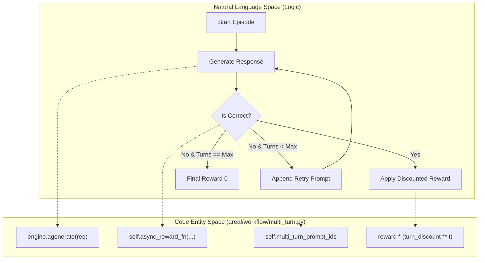
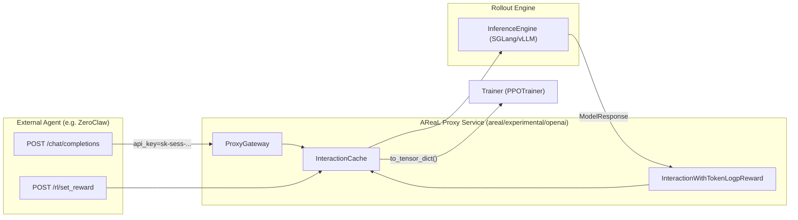

<!-- source: DeepWiki mcp.deepwiki.com · repo areal-project/AReaL · page 6.2 Multi-Turn & Agentic Workflows · fetched 2026-10-21 -->

# Multi-Turn & Agentic Workflows

<details>
<summary>Relevant source files</summary>

The following files were used as context for generating this wiki page:

- [areal/experimental/inference_service/data_proxy/tokenizer_proxy.py](areal/experimental/inference_service/data_proxy/tokenizer_proxy.py)
- [areal/experimental/openai/__init__.py](areal/experimental/openai/__init__.py)
- [areal/experimental/openai/cache.py](areal/experimental/openai/cache.py)
- [areal/experimental/openai/client.py](areal/experimental/openai/client.py)
- [areal/experimental/openai/proxy/server.py](areal/experimental/openai/proxy/server.py)
- [areal/experimental/openai/tool_call_parser.py](areal/experimental/openai/tool_call_parser.py)
- [areal/experimental/openai/types.py](areal/experimental/openai/types.py)
- [areal/experimental/workflow/multi_turn_v2.py](areal/experimental/workflow/multi_turn_v2.py)
- [areal/utils/hf_utils.py](areal/utils/hf_utils.py)
- [areal/workflow/anthropic/math_agent.py](areal/workflow/anthropic/math_agent.py)
- [areal/workflow/langchain/math_agent.py](areal/workflow/langchain/math_agent.py)
- [areal/workflow/multi_turn.py](areal/workflow/multi_turn.py)
- [areal/workflow/openai/math_agent.py](areal/workflow/openai/math_agent.py)
- [areal/workflow/rlvr.py](areal/workflow/rlvr.py)
- [areal/workflow/vision_rlvr.py](areal/workflow/vision_rlvr.py)
- [docs/en/tutorial/agentic_rl.md](docs/en/tutorial/agentic_rl.md)
- [docs/en/tutorial/online_proxy.md](docs/en/tutorial/online_proxy.md)
- [docs/zh/tutorial/online_proxy.md](docs/zh/tutorial/online_proxy.md)
- [examples/countdown/reward_score.py](examples/countdown/reward_score.py)
- [examples/docs/debug/cmp_rollout.py](examples/docs/debug/cmp_rollout.py)
- [examples/experimental/inference_service/README.md](examples/experimental/inference_service/README.md)
- [examples/openclaw/README.md](examples/openclaw/README.md)
- [examples/scaffolding/search_scaffolding.py](examples/scaffolding/search_scaffolding.py)
- [examples/scaffolding/tests/test_worker.py](examples/scaffolding/tests/test_worker.py)
- [examples/scaffolding/workflow.py](examples/scaffolding/workflow.py)
- [examples/tir/README.md](examples/tir/README.md)
- [examples/tir/tests/test_tir.py](examples/tir/tests/test_tir.py)
- [examples/tir/tir_workflow.py](examples/tir/tir_workflow.py)
- [examples/tir/tool_manager.py](examples/tir/tool_manager.py)
- [examples/tir/tools/__init__.py](examples/tir/tools/__init__.py)
- [examples/tir/tools/base.py](examples/tir/tools/base.py)
- [examples/tir/tools/calculator_tool.py](examples/tir/tools/calculator_tool.py)
- [examples/tir/tools/python_tool.py](examples/tir/tools/python_tool.py)
- [tests/test_examples.py](tests/test_examples.py)

</details>


This page details AReaL's support for complex, non-linear rollout structures, including multi-turn retry loops, Tool-Integrated Reasoning (TIR), and the experimental agentic RL infrastructure that enables training on external interactions via an OpenAI-compatible gateway.

## Multi-Turn Workflows & Retry Loops

The `MultiTurnWorkflow` class implements a "retry until correct" strategy. It is designed for tasks where a verifiable reward function can provide immediate feedback on correctness, allowing the model to correct its own errors within a single episode.

### Implementation Details
The workflow manages a loop that continues until either a positive reward is achieved or the `max_turns` limit is reached [areal/workflow/multi_turn.py:76-76]().

*   **Turn Discounting**: To encourage efficiency, rewards are decayed by a `turn_discount` factor (geometric discount) for every additional turn required to reach the correct answer [areal/workflow/multi_turn.py:118-120]().
*   **Prompt Amendment**: If a turn results in an incorrect answer (reward == 0), the workflow appends a correction prompt to the conversation history. This prompt instructs the model to re-read the question and check for errors [areal/workflow/multi_turn.py:46-56]().
*   **Data Aggregation**: All turns are concatenated into a single trajectory. Input tokens from subsequent turns are masked in the `loss_mask` to ensure the trainer only calculates gradients for the model's generated responses [areal/workflow/multi_turn.py:103-106]().

### Workflow State Transition
The following diagram illustrates the transition from the logical multi-turn loop to the specific code entities in `MultiTurnWorkflow`.

**Diagram: Multi-Turn Loop to Code Entity Mapping**

Sources: [areal/workflow/multi_turn.py:58-135]()

---

## Tool-Integrated Reasoning (TIR)

The `TIRWorkflow` enables models to interact with external tools (e.g., Python interpreters, calculators) during the reasoning process. This is often used for "Reasoning-Action" (ReAct) style trajectories.

### Key Components
1.  **ToolManager**: Manages the lifecycle of tools, including initialization, execution, and cleanup [examples/tir/tir_workflow.py:72-74](). It supports remote sandboxes (e.g., via Daytona) to ensure isolated execution [examples/tir/tir_workflow.py:110-112]().
2.  **State Machine**: The workflow tracks whether it is `waiting_for_tool_start`. It uses regex or token matching to detect tool call markers (e.g., `\n```python`) in the model's output [examples/tir/tir_workflow.py:159-161]().
3.  **Output Injection**: When a tool call is completed, the result is formatted (e.g., inside an `output` markdown block) and appended to the context for the next generation turn [examples/tir/tir_workflow.py:92-99]().

### Multi-Round Execution
The `_multi_round_response` method handles the iterative generation and tool execution loop [examples/tir/tir_workflow.py:147-171](). It continues until:
*   The model generates a final answer marker [examples/tir/tir_workflow.py:198-199]().
*   The `max_turns` limit is reached [examples/tir/tir_workflow.py:171-171]().
*   The maximum sequence length is exceeded [examples/tir/tir_workflow.py:172-173]().

Sources: [examples/tir/tir_workflow.py:47-205]()

---

## Agentic RL & ArealOpenAI Client

For complex agentic scenarios where the agent logic resides outside the AReaL process (e.g., a Discord bot or a legacy agent framework), AReaL provides an "online" mode. This exposes a **Proxy Gateway** that speaks the OpenAI Chat Completions protocol.

### Interaction Management
The `ArealOpenAI` client (and the underlying `InteractionCache`) is used to bridge external API calls to AReaL's internal rollout workers.

*   **InteractionCache**: A specialized `OrderedDict` that stores `InteractionWithTokenLogpReward` objects [areal/experimental/openai/cache.py:13-13](). It automatically reconstructs parent-child relationships between turns by matching message prefixes [areal/experimental/openai/cache.py:112-162]().
*   **Reward Propagation**: The `apply_reward_discount` method propagates a single terminal reward backward through all turns in a session [areal/experimental/openai/cache.py:55-84]().
*   **Token-Level Tracking**: Unlike standard OpenAI clients, this infrastructure captures `logprobs` and `input_tokens` for every turn, which are required for PPO/GRPO training [areal/experimental/openai/types.py:143-163]().

### Online Mode Data Flow
The following diagram maps the HTTP communication to the internal code components.

**Diagram: Online Proxy Gateway to Code Entity Mapping**


### Key Classes in Agentic RL
| Class | File | Responsibility |
| :--- | :--- | :--- |
| `InteractionCache` | [areal/experimental/openai/cache.py:13]() | Manages session history and parent-child turn resolution. |
| `InteractionWithTokenLogpReward` | [areal/experimental/openai/types.py:36]() | Dataclass holding OpenAI-style messages alongside RL-required tensors. |
| `apply_reward_discount` | [areal/experimental/openai/cache.py:55]() | Implements backward reward propagation across turns. |
| `process_tool_calls` | [areal/experimental/openai/tool_call_parser.py:221]() | Parses model strings into OpenAI tool call objects for the proxy. |

Sources: [areal/experimental/openai/cache.py:1-106](), [areal/experimental/openai/types.py:1-193](), [docs/en/tutorial/online_proxy.md:27-63]()

---

