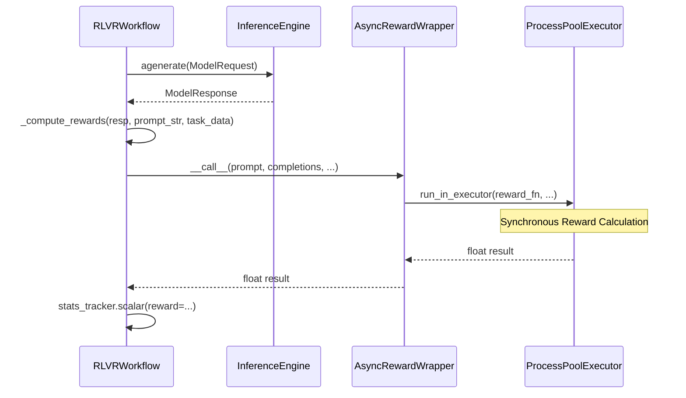
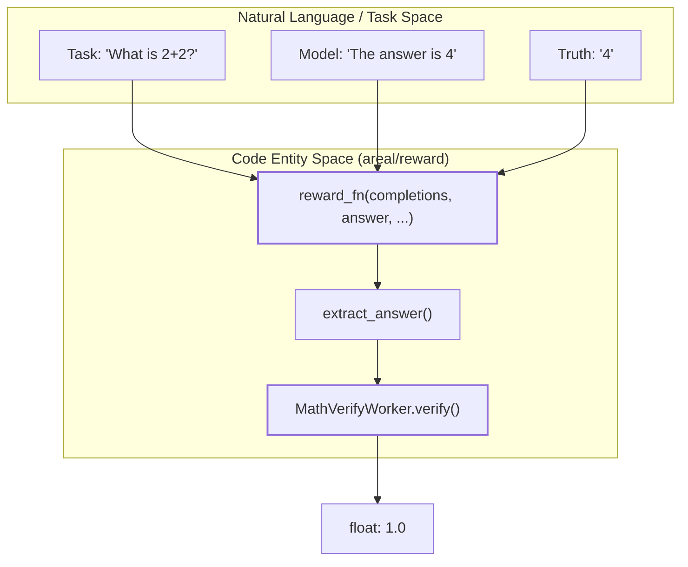

<!-- source: DeepWiki mcp.deepwiki.com · repo areal-project/AReaL · page 7.2 Reward Functions · fetched 2026-10-21 -->

# Reward Functions

<details>
<summary>Relevant source files</summary>

The following files were used as context for generating this wiki page:

- [areal/api/reward_api.py](areal/api/reward_api.py)
- [areal/experimental/inference_service/data_proxy/tokenizer_proxy.py](areal/experimental/inference_service/data_proxy/tokenizer_proxy.py)
- [areal/reward/__init__.py](areal/reward/__init__.py)
- [areal/reward/clevr_count_70k.py](areal/reward/clevr_count_70k.py)
- [areal/reward/geometry3k.py](areal/reward/geometry3k.py)
- [areal/utils/hf_utils.py](areal/utils/hf_utils.py)
- [areal/workflow/multi_turn.py](areal/workflow/multi_turn.py)
- [areal/workflow/rlvr.py](areal/workflow/rlvr.py)
- [areal/workflow/vision_rlvr.py](areal/workflow/vision_rlvr.py)
- [examples/scaffolding/search_scaffolding.py](examples/scaffolding/search_scaffolding.py)
- [examples/scaffolding/tests/test_worker.py](examples/scaffolding/tests/test_worker.py)
- [examples/scaffolding/workflow.py](examples/scaffolding/workflow.py)
- [examples/tir/tir_workflow.py](examples/tir/tir_workflow.py)

</details>


Reward functions in AReaL are responsible for evaluating model completions against ground truth data or specific constraints. The system is designed for **Reinforcement Learning from Verifiable Rewards (RLVR)**, where rewards are typically binary (0 or 1) or scalar values derived from objective correctness (e.g., math verification, program execution, or tool-call status).

## Reward Interface and Execution

The primary interface for reward computation is defined in `areal.api.reward_api`. A standard reward function follows a specific signature that allows it to be integrated into various rollout workflows.

### The `reward_fn` Signature
A standard reward function expects the following arguments:
- `prompt`: The task string.
- `completions`: The model-generated response string.
- `prompt_ids`: Token IDs of the prompt.
- `completion_ids`: Token IDs of the completion.
- `**kwargs`: Additional task data (e.g., `answer`, `solution`, `images`).

[areal/api/reward_api.py:41-60]()

### AsyncRewardWrapper
To prevent reward computation (which may involve complex parsing or external execution) from blocking the asynchronous rollout loop, AReaL uses the `AsyncRewardWrapper`. This wrapper manages a `ProcessPoolExecutor` to run reward functions in parallel across multiple CPU cores.

Key features include:
- **Automatic Scaling**: Heuristically calculates `max_workers` based on CPU and GPU counts to avoid oversubscription [areal/api/reward_api.py:83-89]().
- **Timeout Handling**: Enforces a `timeout_seconds` (default 15s) to prevent hung processes from stalling training [areal/api/reward_api.py:154-157]().
- **Fault Tolerance**: Automatically detects and recreates `BrokenProcessPool` instances [areal/api/reward_api.py:119-136]().
- **Instance Management**: Uses a shared executor pool across instances with reference counting for clean shutdown [areal/api/reward_api.py:70-72]().

### Reward Data Flow
The following diagram illustrates how rewards are triggered within a `RolloutWorkflow`.

**Reward Execution Sequence**

Sources: [areal/workflow/rlvr.py:83-137](), [areal/api/reward_api.py:138-170]()

---

## Built-in Reward Implementations

AReaL provides several built-in reward functions for common reasoning and vision tasks. These are lazily imported via `areal.reward` [areal/reward/__init__.py:133-148]().

| Reward Function | Dataset Target | Logic |
| :--- | :--- | :--- |
| `gsm8k_reward_fn` | GSM8K | Math expression extraction and verification. |
| `geometry3k_reward_fn` | Geometry3K | Multi-choice or numeric geometry answer verification. |
| `clevr_count_70k_reward_fn` | CLEVR-Count | Regex extraction of bracketed numbers `[x]` for visual counting. |

### Math Verification System
For mathematical reasoning, AReaL utilizes the `MathVerifyWorker`. It wraps the `math_verify` library to provide thread-safe parsing and comparison of LaTeX and numeric expressions [areal/reward/__init__.py:31-50]().

- **Precision Control**: Configurable significant digits for floating point comparisons [areal/reward/__init__.py:55]().
- **Anchor Handling**: Can be configured to extract any number or only those following anchors like "The answer is" [areal/reward/__init__.py:59-65]().
- **Timeout Protection**: Uses a `ThreadPoolExecutor` to wrap the underlying library calls, protecting against infinite loops in complex parsers [areal/reward/__init__.py:91-97]().

---

## Workflow Integration

Rewards are invoked differently depending on the complexity of the task (e.g., single-turn vs. multi-turn tool use).

### Standard RLVR Workflow
In `RLVRWorkflow` and `VisionRLVRWorkflow`, rewards are computed immediately after the inference engine returns the completion. The result is stored in a `rewards` tensor and sent to the trainer [areal/workflow/rlvr.py:162-177]().

### Multi-Turn and Tool-Integrated Reasoning (TIR)
In multi-turn scenarios, rewards can serve as termination signals or feedback:
- **Retry Logic**: In `MultiTurnWorkflow`, a 0.0 reward triggers a retry loop where the model is prompted to "check previous errors" [areal/workflow/multi_turn.py:76-118]().
- **Discounting**: Multi-turn rewards are often multiplied by a `turn_discount` to encourage faster solving [areal/workflow/multi_turn.py:120]().
- **Tool Rewards**: In `TIRWorkflow`, rewards are computed after the final turn or when an `<answer>` tag is detected [examples/tir/tir_workflow.py:198-210]().

---

## Implementing Custom Rewards

To implement a custom verifiable reward, create a function that adheres to the `reward_fn` signature and register it or import it dynamically.

### Implementation Example: CLEVR-Count
The following logic demonstrates a simple verifiable reward using regex:

```python
def clevr_count_70k_reward_fn(completions, answer, **kwargs) -> float:
    # 1. Extract the predicted answer from completion string
    match = re.findall(r"\[([0-9\.]+)\]", completions)
    sol = match[-1] if match else None
    
    # 2. Compare against ground truth 'answer' from dataset
    if sol and sol.strip() == answer.strip():
        return 1.0
    return 0.0
```
Sources: [areal/reward/clevr_count_70k.py:10-32]()

### Dynamic Loading
Workflows support loading reward functions via string paths (e.g., `my_module.my_reward_fn`). The `RolloutWorkflow` uses `import_from_string` to resolve these at runtime [areal/workflow/rlvr.py:143-145]().

**Reward Logic to Code Mapping**

Sources: [areal/reward/__init__.py:91-110](), [areal/reward/clevr_count_70k.py:18-32]()

### Scaffolding Reward Controllers
For complex agentic tasks, AReaL uses a `RewardController` within the scaffolding framework. The `RLVRRewardController` acts as a bridge between the agent's interaction trace and the standard reward functions [examples/scaffolding/workflow.py:145](). In advanced cases, like `SearchScaffoldingWorkflow`, an `LLMJudgeController` can be used to evaluate answers using a separate LLM call instead of deterministic logic [examples/scaffolding/search_scaffolding.py:162-164]().

Sources: [examples/scaffolding/workflow.py:142-152](), [examples/scaffolding/search_scaffolding.py:159-176]()

---

