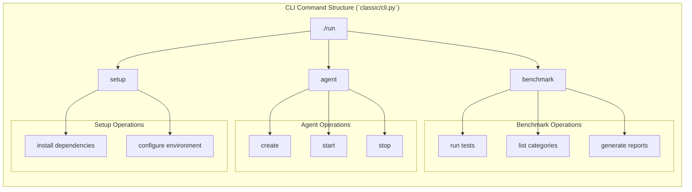
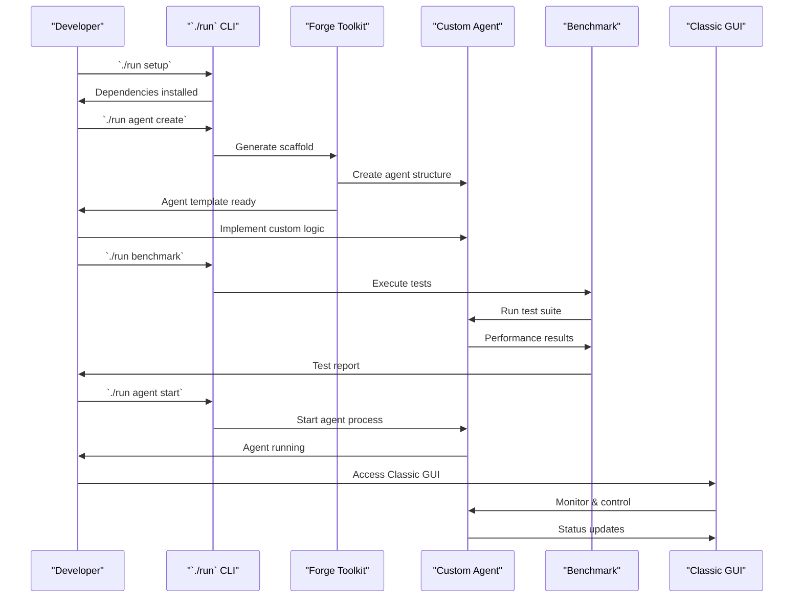

<!-- source: DeepWiki mcp.deepwiki.com · repo Significant-Gravitas/AutoGPT · page 4 Classic AutoGPT · fetched 2026-10-26 -->

# Classic AutoGPT

<details>
<summary>Relevant source files</summary>

The following files were used as context for generating this wiki page:

- [.github/ISSUE_TEMPLATE/1.bug.yml](.github/ISSUE_TEMPLATE/1.bug.yml)
- [.github/ISSUE_TEMPLATE/2.feature.yml](.github/ISSUE_TEMPLATE/2.feature.yml)
- [.github/PULL_REQUEST_TEMPLATE.md](.github/PULL_REQUEST_TEMPLATE.md)
- [.gitignore](.gitignore)
- [CODE_OF_CONDUCT.md](CODE_OF_CONDUCT.md)
- [CONTRIBUTING.md](CONTRIBUTING.md)
- [LICENSE](LICENSE)
- [README.md](README.md)
- [docs/content/code-of-conduct.md](docs/content/code-of-conduct.md)
- [docs/content/contributing.md](docs/content/contributing.md)

</details>


Classic AutoGPT represents the original, MIT-licensed components of the AutoGPT ecosystem, providing tools and frameworks for building, testing, and managing AI agents. Unlike the modern AutoGPT Platform (see [AutoGPT Platform](#3)), Classic AutoGPT is designed for developers who want to create custom agents from scratch, evaluate agent performance, and experiment with agent development workflows. It is important to note that this is unsupported legacy code, primarily maintained for educational purposes.

The Classic components include the Forge agent development toolkit, the Benchmark performance testing framework, and a unified CLI for managing all development workflows.

## Overview

Classic AutoGPT consists of primary components that work together to provide an agent development environment. These components are licensed under the MIT License, distinguishing them from the Polyform Shield License used for the `autogpt_platform` folder [README.md:132-133]().

```mermaid
graph TB
    subgraph "Classic AutoGPT Development Environment (MIT Licensed)"
        CLI["CLI<br/>`./run` command<br/>Main Entry Point"]
        
        subgraph "Development Tools"
            FORGE["Forge<br/>Agent Development Toolkit<br/>Boilerplate & Templates"]
            BENCH["Benchmark<br/>`agbenchmark`<br/>Performance Testing"]
            CLASSIC_GUI["AutoGPT Classic GUI<br/>(Legacy Frontend)"]
        end
        
        subgraph "Agent Ecosystem"
            AGENTS["Custom Agents<br/>Forge-based Implementations"]
            TESTS["Test Suites<br/>Performance Challenges"]
            PROTOCOL["Agent Protocol<br/>Standardized Communication"]
        end
        
        subgraph "External Dependencies"
            PYPI["PyPI<br/>`agbenchmark` package"]
            DOCKER["Docker<br/>Containerization"]
            LLM_APIS["LLM APIs<br/>OpenAI, Anthropic"]
        end
    end
    
    %% CLI orchestrates all tools
    CLI --> FORGE
    CLI --> BENCH
    CLI --> CLASSIC_GUI
    
    %% Development workflow
    FORGE --> AGENTS
    AGENTS --> BENCH
    BENCH --> TESTS
    CLASSIC_GUI --> AGENTS
    
    %% Protocol communication
    AGENTS -.-> PROTOCOL
    CLASSIC_GUI -.-> PROTOCOL
    BENCH -.-> PROTOCOL
    
    %% External integrations
    BENCH --> PYPI
    AGENTS --> LLM_APIS
    CLI --> DOCKER
    
    style "Classic AutoGPT Development Environment (MIT Licensed)" fill:#f9f9f9
    style "Development Tools" fill:#e8f4fd
    style "Agent Ecosystem" fill:#f0f8e8
    style "External Dependencies" fill:#fff3e0
```

Sources: [README.md:132-133](), [LICENSE:13-18]()

## Architecture

The Classic AutoGPT architecture follows a modular design where each component serves a specific role in the agent development lifecycle. This section provides a high-level overview; for detailed information, refer to the child pages.

```mermaid
graph TD
    subgraph "Development Workflow"
        START["Developer Starts"]
        SETUP["`./run setup`<br/>Install Dependencies"]
        CREATE["`./run agent create`<br/>Generate Agent Scaffold"]
        DEVELOP["Edit Agent Code<br/>Implement Logic"]
        TEST["`./run benchmark`<br/>Run Performance Tests"]
        DEPLOY["`./run agent start`<br/>Launch Agent"]
        UI_INTERACT["Access Classic GUI<br/>Monitor & Control"]
    end
    
    subgraph "Core Components (classic)"
        CLI_PY["`classic/cli.py`<br/>Command Router"]
        FORGE_TOOLKIT["`classic/forge/`<br/>Agent Templates<br/>Boilerplate Code"]
        BENCHMARK_SUITE["`classic/benchmark/`<br/>`agbenchmark`<br/>Test Framework"]
        FRONTEND_APP["`classic/frontend/`<br/>AutoGPT Classic GUI"]
    end
    
    subgraph "Agent Protocol Layer"
        AGENT_SERVER["Agent HTTP Server<br/>Protocol Endpoints"]
        PROTOCOL_SPEC["Agent Protocol Standard<br/>REST API Specification"]
    end
    
    subgraph "Runtime Environment"
        AGENT_PROCESS["Agent Process<br/>Custom Implementation"]
        WEB_SERVER["Frontend Server<br/>React Dev Server"]
        BENCHMARK_RUNNER["Benchmark Runner<br/>Test Execution"]
    end
    
    %% Workflow connections
    START --> SETUP
    SETUP --> CREATE
    CREATE --> DEVELOP
    DEVELOP --> TEST
    TEST --> DEPLOY
    DEPLOY --> UI_INTERACT
    
    %% Component mapping
    SETUP --> CLI_PY
    CREATE --> FORGE_TOOLKIT
    TEST --> BENCHMARK_SUITE
    UI_INTERACT --> FRONTEND_APP
    
    %% Protocol layer
    AGENT_PROCESS --> AGENT_SERVER
    AGENT_SERVER --> PROTOCOL_SPEC
    FRONTEND_APP --> PROTOCOL_SPEC
    BENCHMARK_SUITE --> PROTOCOL_SPEC
    
    %% Runtime
    DEPLOY --> AGENT_PROCESS
    UI_INTERACT --> WEB_SERVER
    TEST --> BENCHMARK_RUNNER
```

Sources: [README.md:132-133](), [LICENSE:13-18]()

## Component Architecture

### CLI Integration

The unified CLI (`./run`) serves as the central orchestration point for all Classic AutoGPT operations. It provides commands for setup, agent creation, agent execution, and benchmark testing. For details, see [CLI](#4.3).

| Command | Purpose | Target Component |
|---------|---------|------------------|
| `./run setup` | Install system dependencies | System configuration |
| `./run agent create` | Generate new agent scaffold | Forge toolkit |
| `./run agent start` | Launch agent process | Agent runtime |
| `./run benchmark` | Execute performance tests | Benchmark suite |
| Frontend access | Web-based agent control | AutoGPT Classic GUI |



Sources: [README.md:132-133](), [LICENSE:13-18]()

### Forge Development Toolkit

Forge provides the foundational toolkit for agent development, handling boilerplate code and providing templates for creating new agents that adhere to the Agent Protocol standard. For details, see [Forge](#4.1).

```mermaid
graph TB
    subgraph "Forge Architecture (`classic/forge/`)"
        FORGE_CORE["`classic/forge/`<br/>Core Toolkit"]
        
        subgraph "Agent Templates"
            SCAFFOLD["Agent Scaffold<br/>Basic Structure"]
            BOILERPLATE["Boilerplate Code<br/>Common Patterns"]
            EXAMPLES["Example Agents<br/>Reference Implementations"]
        end
        
        subgraph "Development Tools"
            TUTORIALS["Tutorials<br/>Step-by-step Guides"]
            COMPONENTS["Reusable Components<br/>Individual Modules"]
            PROTOCOLS["Protocol Integration<br/>Agent Protocol Support"]
        end
        
        subgraph "Generated Agents"
            CUSTOM_AGENT["Custom Agent<br/>Developer Implementation"]
            AGENT_CONFIG["Agent Configuration<br/>Settings & Parameters"]
            AGENT_LOGIC["Agent Logic<br/>Custom Behavior"]
        end
    end
    
    FORGE_CORE --> SCAFFOLD
    FORGE_CORE --> BOILERPLATE
    FORGE_CORE --> EXAMPLES
    
    SCAFFOLD --> CUSTOM_AGENT
    BOILERPLATE --> AGENT_CONFIG
    EXAMPLES --> AGENT_LOGIC
    
    TUTORIALS -.-> CUSTOM_AGENT
    COMPONENTS -.-> AGENT_LOGIC
    PROTOCOLS -.-> AGENT_CONFIG
```

Sources: [README.md:132-133](), [LICENSE:13-18]()

### Benchmark Testing Framework

The benchmark system, `agbenchmark`, provides standardized testing and evaluation for agent performance. It allows developers to run agents against a suite of challenges and generate reports. For details, see [Benchmark (agbenchmark)](#4.2).

```mermaid
graph TD
    subgraph "Benchmark System (`classic/benchmark/`)"
        AGBENCHMARK["`agbenchmark`<br/>PyPI Package"]
        
        subgraph "Test Framework"
            TEST_SUITE["Test Suite<br/>Performance Challenges"]
            TEST_CATEGORIES["Test Categories<br/>Grouped Evaluations"]
            TEST_RUNNER["Test Runner<br/>Execution Engine"]
        end
        
        subgraph "Protocol Integration"
            AGENT_PROTOCOL["Agent Protocol<br/>Standard Communication"]
            PROTOCOL_CLIENT["Protocol Client<br/>Test Interface"]
        end
        
        subgraph "Evaluation System"
            METRICS["Performance Metrics<br/>Scoring System"]
            REPORTS["Test Reports<br/>Result Analysis"]
            COMPARISON["Agent Comparison<br/>Benchmarking"]
        end
        
        subgraph "Test Environment"
            ISOLATED_ENV["Isolated Environment<br/>Controlled Testing"]
            REPRODUCIBLE["Reproducible Tests<br/>Consistent Results"]
        end
    end
    
    AGBENCHMARK --> TEST_SUITE
    AGBENCHMARK --> TEST_RUNNER
    
    TEST_RUNNER --> PROTOCOL_CLIENT
    PROTOCOL_CLIENT --> AGENT_PROTOCOL
    
    TEST_SUITE --> METRICS
    METRICS --> REPORTS
    REPORTS --> COMPARISON
    
    TEST_RUNNER --> ISOLATED_ENV
    ISOLATED_ENV --> REPRODUCIBLE
```

Sources: [README.md:132-133](), [LICENSE:13-18]()

### AutoGPT Classic GUI

The `classic/frontend` directory contains the AutoGPT Classic GUI, a legacy web-based interface for agent control and monitoring. This component is also MIT-licensed [README.md:132-133]().

```mermaid
graph TB
    subgraph "AutoGPT Classic GUI (`classic/frontend/`)"
        FRONTEND_APP["`classic/frontend/`<br/>React Application"]
        
        subgraph "User Interface"
            AGENT_CONTROL["Agent Control<br/>Start/Stop/Monitor"]
            AGENT_STATUS["Agent Status<br/>Runtime Information"]
            INTERACTION["Agent Interaction<br/>Communication Interface"]
        end
        
        subgraph "Protocol Communication"
            PROTOCOL_CLIENT_UI["Protocol Client<br/>UI Communication"]
            AGENT_PROTOCOL_UI["Agent Protocol<br/>Standard Interface"]
            HTTP_CLIENT["HTTP Client<br/>REST API Calls"]
        end
        
        subgraph "Agent Compatibility"
            REPO_AGENTS["Repository Agents<br/>Built-in Compatibility"]
            EXTERNAL_AGENTS["External Agents<br/>Protocol-compliant"]
            FORGE_AGENTS["Forge Agents<br/>Custom Implementations"]
        end
    end
    
    FRONTEND_APP --> AGENT_CONTROL
    FRONTEND_APP --> AGENT_STATUS
    FRONTEND_APP --> INTERACTION
    
    AGENT_CONTROL --> PROTOCOL_CLIENT_UI
    PROTOCOL_CLIENT_UI --> AGENT_PROTOCOL_UI
    AGENT_PROTOCOL_UI --> HTTP_CLIENT
    
    HTTP_CLIENT -.-> REPO_AGENTS
    HTTP_CLIENT -.-> EXTERNAL_AGENTS
    HTTP_CLIENT -.-> FORGE_AGENTS
```

Sources: [README.md:132-133](), [LICENSE:13-18]()

## Development Workflow

Classic AutoGPT supports a complete development workflow from agent creation to performance evaluation.



Sources: [README.md:132-133](), [LICENSE:13-18]()

## Agent Protocol Integration

All Classic AutoGPT components communicate through the standardized Agent Protocol, ensuring compatibility and interoperability. This protocol defines the API for agents to interact with clients like the benchmark system or the GUI. For details, see [Agent Protocol](#7.3).

| Component | Protocol Role | Communication Method |
|-----------|---------------|---------------------|
| Forge Agents | Protocol Server | HTTP endpoints |
| Benchmark | Protocol Client | REST API calls |
| AutoGPT Classic GUI | Protocol Client | WebSocket + REST |
| External Agents | Protocol Server | Standard compliance |

```mermaid
graph LR
    subgraph "Agent Protocol Standard"
        PROTOCOL_SPEC["Agent Protocol<br/>agentprotocol.ai"]
        
        subgraph "Protocol Endpoints"
            AGENT_INFO["`/agent`<br/>Agent Information"]
            TASK_CREATE["`/task`<br/>Create Task"]
            TASK_EXECUTE["`/task/{id}/execute`<br/>Execute Step"]
            TASK_STATUS["`/task/{id}`<br/>Task Status"]
        end
        
        subgraph "Client Implementations"
            BENCH_CLIENT["Benchmark Client<br/>Test Automation"] 
            GUI_CLIENT["Classic GUI Client<br/>User Interface"]
            CLI_CLIENT["CLI Client<br/>Command Interface"]
        end
        
        subgraph "Server Implementations"
            FORGE_SERVER["Forge Agent<br/>Custom Implementation"]
            REPO_SERVER["Original AutoGPT Agent<br/>Built-in Agent"]
            EXTERNAL_SERVER["External Agent<br/>Third-party"]
        end
    end
    
    PROTOCOL_SPEC --> AGENT_INFO
    PROTOCOL_SPEC --> TASK_CREATE
    PROTOCOL_SPEC --> TASK_EXECUTE
    PROTOCOL_SPEC --> TASK_STATUS
    
    BENCH_CLIENT --> PROTOCOL_SPEC
    GUI_CLIENT --> PROTOCOL_SPEC
    CLI_CLIENT --> PROTOCOL_SPEC
    
    PROTOCOL_SPEC --> FORGE_SERVER
    PROTOCOL_SPEC --> REPO_SERVER
    PROTOCOL_SPEC --> EXTERNAL_SERVER
```

Sources: [README.md:132-133](), [LICENSE:13-18]()

---

