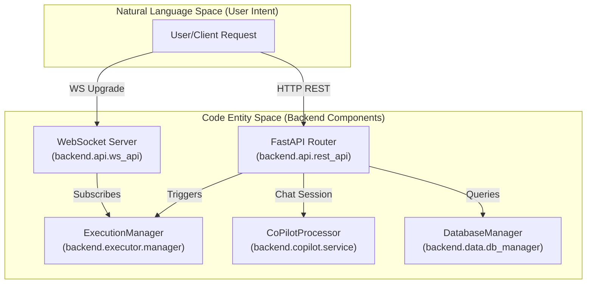
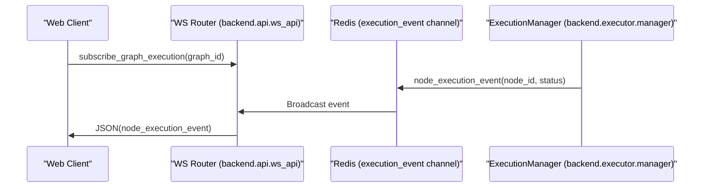

<!-- source: DeepWiki mcp.deepwiki.com · repo Significant-Gravitas/AutoGPT · page 7 API Reference · fetched 2026-10-26 -->

# 7. API Reference

Relevant source files

The following files were used as context for generating this wiki page:

- [autogpt_platform/backend/backend/api/conftest.py](autogpt_platform/backend/backend/api/conftest.py)
- [autogpt_platform/backend/backend/api/external/fastapi_app.py](autogpt_platform/backend/backend/api/external/fastapi_app.py)
- [autogpt_platform/backend/backend/api/external/v1/routes.py](autogpt_platform/backend/backend/api/external/v1/routes.py)
- [autogpt_platform/backend/backend/api/external/v1/routes_test.py](autogpt_platform/backend/backend/api/external/v1/routes_test.py)
- [autogpt_platform/backend/backend/api/features/admin/diagnostics_admin_routes.py](autogpt_platform/backend/backend/api/features/admin/diagnostics_admin_routes.py)
- [autogpt_platform/backend/backend/api/features/chat/routes.py](autogpt_platform/backend/backend/api/features/chat/routes.py)
- [autogpt_platform/backend/backend/api/features/chat/routes_test.py](autogpt_platform/backend/backend/api/features/chat/routes_test.py)
- [autogpt_platform/backend/backend/api/features/library/routes/presets.py](autogpt_platform/backend/backend/api/features/library/routes/presets.py)
- [autogpt_platform/backend/backend/api/rest_api.py](autogpt_platform/backend/backend/api/rest_api.py)
- [autogpt_platform/backend/backend/copilot/db.py](autogpt_platform/backend/backend/copilot/db.py)
- [autogpt_platform/backend/backend/copilot/db_test.py](autogpt_platform/backend/backend/copilot/db_test.py)
- [autogpt_platform/backend/backend/copilot/model.py](autogpt_platform/backend/backend/copilot/model.py)
- [autogpt_platform/backend/backend/copilot/model_test.py](autogpt_platform/backend/backend/copilot/model_test.py)
- [autogpt_platform/backend/backend/data/db_manager.py](autogpt_platform/backend/backend/data/db_manager.py)
- [autogpt_platform/frontend/src/app/(platform)/copilot/CopilotPage.tsx](autogpt_platform/frontend/src/app/(platform)/copilot/CopilotPage.tsx)
- [autogpt_platform/frontend/src/app/(platform)/copilot/components/ChatContainer/ChatContainer.tsx](autogpt_platform/frontend/src/app/(platform)/copilot/components/ChatContainer/ChatContainer.tsx)
- [autogpt_platform/frontend/src/app/(platform)/copilot/components/ChatMessagesContainer/ChatMessagesContainer.tsx](autogpt_platform/frontend/src/app/(platform)/copilot/components/ChatMessagesContainer/ChatMessagesContainer.tsx)
- [autogpt_platform/frontend/src/app/(platform)/copilot/components/ChatMessagesContainer/__tests__/ChatMessagesContainer.test.tsx](autogpt_platform/frontend/src/app/(platform)/copilot/components/ChatMessagesContainer/__tests__/ChatMessagesContainer.test.tsx)
- [autogpt_platform/frontend/src/app/(platform)/copilot/components/ChatMessagesContainer/__tests__/LoadMoreSentinel.test.tsx](autogpt_platform/frontend/src/app/(platform)/copilot/components/ChatMessagesContainer/__tests__/LoadMoreSentinel.test.tsx)
- [autogpt_platform/frontend/src/app/(platform)/copilot/helpers/__tests__/convertChatSessionToUiMessages.test.ts](autogpt_platform/frontend/src/app/(platform)/copilot/helpers/__tests__/convertChatSessionToUiMessages.test.ts)
- [autogpt_platform/frontend/src/app/(platform)/copilot/helpers/convertChatSessionToUiMessages.ts](autogpt_platform/frontend/src/app/(platform)/copilot/helpers/convertChatSessionToUiMessages.ts)
- [autogpt_platform/frontend/src/app/(platform)/copilot/useChatSession.ts](autogpt_platform/frontend/src/app/(platform)/copilot/useChatSession.ts)
- [autogpt_platform/frontend/src/app/(platform)/copilot/useCopilotPage.ts](autogpt_platform/frontend/src/app/(platform)/copilot/useCopilotPage.ts)
- [autogpt_platform/frontend/src/app/(platform)/copilot/useLoadMoreMessages.ts](autogpt_platform/frontend/src/app/(platform)/copilot/useLoadMoreMessages.ts)
- [autogpt_platform/frontend/src/app/api/openapi.json](autogpt_platform/frontend/src/app/api/openapi.json)

This page provides a high-level technical overview of the AutoGPT Platform APIs, including RESTful endpoints, WebSocket communication, and the Agent Protocol implementation. The platform architecture separates core management (REST) from real-time execution feedback (WebSockets).

For detailed endpoint schemas, see [REST API](#7.1). For real-time protocol details, see [WebSocket API](#7.2).

## API Overview

The AutoGPT backend is a FastAPI-based application that exposes several functional areas via structured routes.

### Service Mapping

Sources: [autogpt_platform/backend/backend/api/rest_api.py:1-50](), [autogpt_platform/backend/backend/data/db_manager.py:171-190]()

## REST API

The REST API is organized into functional modules (features) and versioned routes.

*   **V1 Routes**: Core operations for Agent Graphs, Node Executions, and User Credits.
*   **V2 Routes**: Extended services including the Marketplace (Store), Agent Library, and Admin Diagnostics.
*   **Copilot API**: Specialized endpoints for streaming chat sessions and tool-augmented LLM interactions.

### Copilot Chat Endpoints
The Copilot system uses a dedicated router for managing stateful chat sessions and streaming responses via Server-Sent Events (SSE).

| Method | Endpoint | Code Reference |
| :--- | :--- | :--- |
| `POST` | `/api/chat/sessions` | [autogpt_platform/backend/backend/api/features/chat/routes.py:32]() |
| `POST` | `/api/chat/sessions/{id}/stream` | [autogpt_platform/backend/backend/api/features/chat/routes.py:194]() |
| `PATCH` | `/api/chat/sessions/{id}/title` | [autogpt_platform/backend/backend/api/features/chat/routes.py:37]() |

For full request/response schemas, see [REST API](#7.1).

## WebSocket API

The WebSocket API is primarily used for subscribing to graph execution events. When a graph is executed, the `ExecutionManager` publishes events to a Redis-backed event bus, which the WebSocket server broadcasts to subscribed clients.

### Real-time Event Flow

For protocol message types and heartbeat details, see [WebSocket API](#7.2).

Sources: [autogpt_platform/backend/backend/data/db_manager.py:48-69](), [autogpt_platform/frontend/src/app/api/openapi.json:109-131]()

## Agent Protocol

AutoGPT implements the [Agent Protocol](https://agentprotocol.ai) standard to ensure interoperability with the broader AI engineering ecosystem. This allows AutoGPT agents to be benchmarked and interacted with using standard tooling.

For implementation details and compatibility, see [Agent Protocol](#7.3).

## Block Schemas

Every block in the AutoGPT library defines a strict JSON Schema for its inputs and outputs. These schemas drive the frontend "Agent Builder" UI and validate data flow during execution.

### Schema Discovery
The backend provides an endpoint to export all registered block schemas and their associated cost estimates.

| Endpoint | Purpose |
| :--- | :--- |
| `/api/admin/blocks/cost-estimates` | Aggregate per-block average credits-per-execution. |

For a reference of all available blocks, see [Block Schemas](#7.4).

Sources: [autogpt_platform/backend/backend/api/features/admin/diagnostics_admin_routes.py:10-15](), [autogpt_platform/frontend/src/app/api/openapi.json:10-14]()

## Error Handling and Diagnostics

The API utilizes standard HTTP status codes combined with a diagnostic layer for monitoring system health.

*   **Orphaned Executions**: The system tracks executions that have been "stuck" in a running or queued state for more than 24 hours.
*   **Cleanup Endpoints**: Admin-only routes exist to force-release stuck execution slots.

Sources: [autogpt_platform/backend/backend/api/features/chat/routes.py:142-162](), [autogpt_platform/frontend/src/app/api/openapi.json:133-155]()

---

