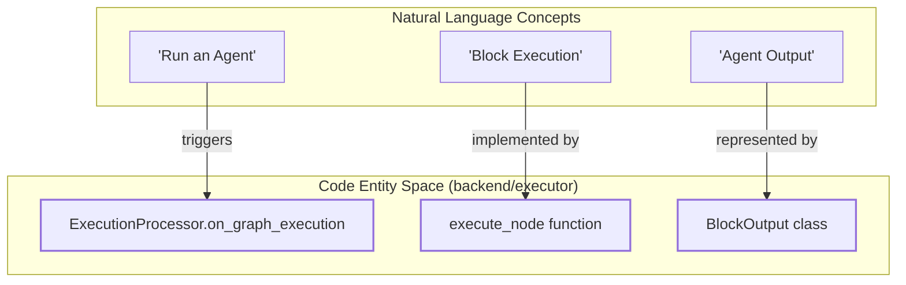
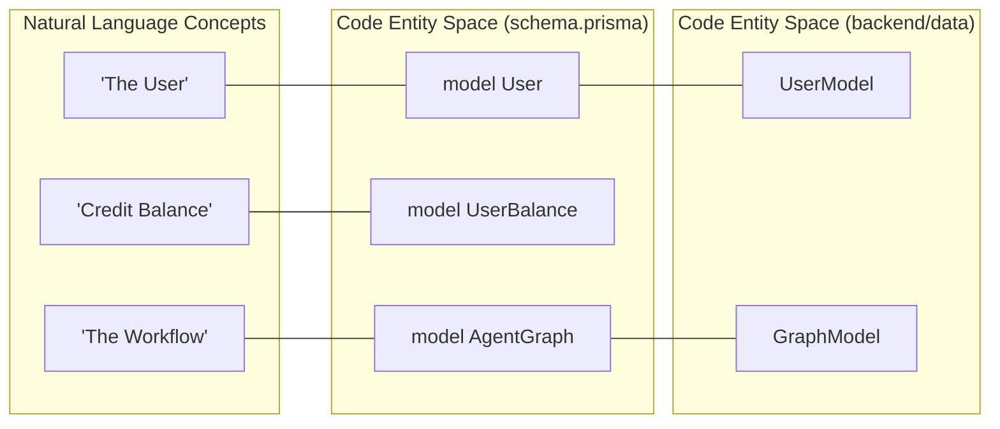
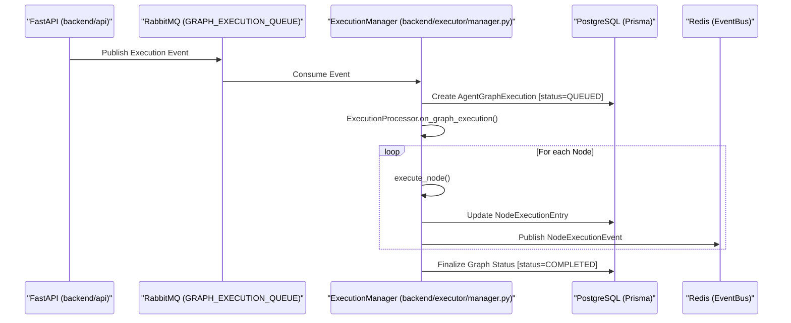

<!-- source: DeepWiki mcp.deepwiki.com · repo Significant-Gravitas/AutoGPT · page 8 Glossary · fetched 2026-10-26 -->

# Glossary

Relevant source files

The following files were used as context for generating this wiki page:

- [.github/ISSUE_TEMPLATE/1.bug.yml](.github/ISSUE_TEMPLATE/1.bug.yml)
- [.github/ISSUE_TEMPLATE/2.feature.yml](.github/ISSUE_TEMPLATE/2.feature.yml)
- [.github/PULL_REQUEST_TEMPLATE.md](.github/PULL_REQUEST_TEMPLATE.md)
- [.gitignore](.gitignore)
- [CODE_OF_CONDUCT.md](CODE_OF_CONDUCT.md)
- [CONTRIBUTING.md](CONTRIBUTING.md)
- [LICENSE](LICENSE)
- [README.md](README.md)
- [autogpt_platform/backend/backend/api/features/subscription_routes_test.py](autogpt_platform/backend/backend/api/features/subscription_routes_test.py)
- [autogpt_platform/backend/backend/api/features/v1.py](autogpt_platform/backend/backend/api/features/v1.py)
- [autogpt_platform/backend/backend/blocks/agent.py](autogpt_platform/backend/backend/blocks/agent.py)
- [autogpt_platform/backend/backend/blocks/llm.py](autogpt_platform/backend/backend/blocks/llm.py)
- [autogpt_platform/backend/backend/blocks/test/test_llm.py](autogpt_platform/backend/backend/blocks/test/test_llm.py)
- [autogpt_platform/backend/backend/copilot/baseline/service.py](autogpt_platform/backend/backend/copilot/baseline/service.py)
- [autogpt_platform/backend/backend/copilot/baseline/service_unit_test.py](autogpt_platform/backend/backend/copilot/baseline/service_unit_test.py)
- [autogpt_platform/backend/backend/copilot/config.py](autogpt_platform/backend/backend/copilot/config.py)
- [autogpt_platform/backend/backend/copilot/config_test.py](autogpt_platform/backend/backend/copilot/config_test.py)
- [autogpt_platform/backend/backend/copilot/constants.py](autogpt_platform/backend/backend/copilot/constants.py)
- [autogpt_platform/backend/backend/copilot/executor/processor.py](autogpt_platform/backend/backend/copilot/executor/processor.py)
- [autogpt_platform/backend/backend/copilot/model_normalize_test.py](autogpt_platform/backend/backend/copilot/model_normalize_test.py)
- [autogpt_platform/backend/backend/copilot/rate_limit.py](autogpt_platform/backend/backend/copilot/rate_limit.py)
- [autogpt_platform/backend/backend/copilot/rate_limit_test.py](autogpt_platform/backend/backend/copilot/rate_limit_test.py)
- [autogpt_platform/backend/backend/copilot/sdk/e2e_compaction_test.py](autogpt_platform/backend/backend/copilot/sdk/e2e_compaction_test.py)
- [autogpt_platform/backend/backend/copilot/sdk/p0_guardrails_test.py](autogpt_platform/backend/backend/copilot/sdk/p0_guardrails_test.py)
- [autogpt_platform/backend/backend/copilot/sdk/response_adapter.py](autogpt_platform/backend/backend/copilot/sdk/response_adapter.py)
- [autogpt_platform/backend/backend/copilot/sdk/response_adapter_test.py](autogpt_platform/backend/backend/copilot/sdk/response_adapter_test.py)
- [autogpt_platform/backend/backend/copilot/sdk/retry_scenarios_test.py](autogpt_platform/backend/backend/copilot/sdk/retry_scenarios_test.py)
- [autogpt_platform/backend/backend/copilot/sdk/service.py](autogpt_platform/backend/backend/copilot/sdk/service.py)
- [autogpt_platform/backend/backend/copilot/sdk/service_test.py](autogpt_platform/backend/backend/copilot/sdk/service_test.py)
- [autogpt_platform/backend/backend/copilot/sdk/session_persistence_test.py](autogpt_platform/backend/backend/copilot/sdk/session_persistence_test.py)
- [autogpt_platform/backend/backend/copilot/service.py](autogpt_platform/backend/backend/copilot/service.py)
- [autogpt_platform/backend/backend/copilot/session_cleanup.py](autogpt_platform/backend/backend/copilot/session_cleanup.py)
- [autogpt_platform/backend/backend/copilot/stream_registry.py](autogpt_platform/backend/backend/copilot/stream_registry.py)
- [autogpt_platform/backend/backend/copilot/stream_registry_test.py](autogpt_platform/backend/backend/copilot/stream_registry_test.py)
- [autogpt_platform/backend/backend/copilot/tools/run_block.py](autogpt_platform/backend/backend/copilot/tools/run_block.py)
- [autogpt_platform/backend/backend/copilot/tools/run_block_test.py](autogpt_platform/backend/backend/copilot/tools/run_block_test.py)
- [autogpt_platform/backend/backend/data/block.py](autogpt_platform/backend/backend/data/block.py)
- [autogpt_platform/backend/backend/data/block_cost_config.py](autogpt_platform/backend/backend/data/block_cost_config.py)
- [autogpt_platform/backend/backend/data/credit.py](autogpt_platform/backend/backend/data/credit.py)
- [autogpt_platform/backend/backend/data/credit_subscription_test.py](autogpt_platform/backend/backend/data/credit_subscription_test.py)
- [autogpt_platform/backend/backend/data/execution.py](autogpt_platform/backend/backend/data/execution.py)
- [autogpt_platform/backend/backend/data/graph.py](autogpt_platform/backend/backend/data/graph.py)
- [autogpt_platform/backend/backend/data/model.py](autogpt_platform/backend/backend/data/model.py)
- [autogpt_platform/backend/backend/executor/manager.py](autogpt_platform/backend/backend/executor/manager.py)
- [autogpt_platform/backend/backend/executor/utils.py](autogpt_platform/backend/backend/executor/utils.py)
- [autogpt_platform/backend/backend/executor/utils_test.py](autogpt_platform/backend/backend/executor/utils_test.py)
- [autogpt_platform/backend/backend/util/exceptions.py](autogpt_platform/backend/backend/util/exceptions.py)
- [autogpt_platform/backend/backend/util/feature_flag.py](autogpt_platform/backend/backend/util/feature_flag.py)
- [autogpt_platform/backend/backend/util/settings.py](autogpt_platform/backend/backend/util/settings.py)
- [autogpt_platform/backend/schema.prisma](autogpt_platform/backend/schema.prisma)
- [autogpt_platform/frontend/src/app/(platform)/profile/(user)/credits/components/SubscriptionTierSection/SubscriptionTierSection.tsx](autogpt_platform/frontend/src/app/(platform)/profile/(user)/credits/components/SubscriptionTierSection/SubscriptionTierSection.tsx)
- [autogpt_platform/frontend/src/app/(platform)/profile/(user)/credits/components/SubscriptionTierSection/__tests__/SubscriptionTierSection.test.tsx](autogpt_platform/frontend/src/app/(platform)/profile/(user)/credits/components/SubscriptionTierSection/__tests__/SubscriptionTierSection.test.tsx)
- [autogpt_platform/frontend/src/app/(platform)/profile/(user)/credits/components/SubscriptionTierSection/helpers.ts](autogpt_platform/frontend/src/app/(platform)/profile/(user)/credits/components/SubscriptionTierSection/helpers.ts)
- [autogpt_platform/frontend/src/app/(platform)/profile/(user)/credits/components/SubscriptionTierSection/useSubscriptionTierSection.ts](autogpt_platform/frontend/src/app/(platform)/profile/(user)/credits/components/SubscriptionTierSection/useSubscriptionTierSection.ts)
- [autogpt_platform/frontend/src/app/(platform)/profile/(user)/credits/page.tsx](autogpt_platform/frontend/src/app/(platform)/profile/(user)/credits/page.tsx)
- [autogpt_platform/frontend/src/lib/autogpt-server-api/types.ts](autogpt_platform/frontend/src/lib/autogpt-server-api/types.ts)
- [docs/content/code-of-conduct.md](docs/content/code-of-conduct.md)
- [docs/content/contributing.md](docs/content/contributing.md)
- [docs/integrations/block-integrations/llm.md](docs/integrations/block-integrations/llm.md)
- [docs/integrations/block-integrations/misc.md](docs/integrations/block-integrations/misc.md)

This page provides a comprehensive reference for terms, jargon, and technical concepts specific to the AutoGPT codebase. It is designed to assist onboarding engineers in navigating the dual-architecture of the repository.

## Core Product Definitions

| Term | Definition |
| :--- | :--- |
| **AutoGPT Platform** | The modern, graph-based AI agent builder and execution environment located in `autogpt_platform/`. Licensed under Polyform Shield [README.md:129-130](). |
| **AutoGPT Classic** | The legacy MIT-licensed autonomous agent, benchmark, and forge tools located in `classic/` [README.md:132-133](). |
| **Copilot** | An AI-powered chat interface that allows users to build, edit, and run agents using natural language. It utilizes the Claude Agent SDK for sophisticated tool use [autogpt_platform/backend/backend/copilot/sdk/service.py:1-27](). |

---

## Platform Domain Terms

### Graph Architecture
The Platform represents AI agents as Directed Acyclic Graphs (DAGs).

*   **Agent Graph**: A collection of nodes and links defining an automation workflow [autogpt_platform/backend/backend/data/graph.py:10-15]().
*   **Node**: A specific instance of a Block within a graph, containing configuration (`input_default`) and metadata [autogpt_platform/backend/backend/data/graph.py:104-112]().
*   **Link**: A connection between a source node's output and a sink node's input [autogpt_platform/backend/backend/data/graph.py:82-88]().
*   **Block**: A reusable, atomic unit of logic (e.g., `AITextGeneratorBlock`, `DiscordPostBlock`). Defined in `backend/blocks/` [autogpt_platform/backend/backend/data/graph.py:123-132]().

### Execution Lifecycle
*   **Graph Execution**: A single run of an Agent Graph. Tracked via `AgentGraphExecution` in the database [autogpt_platform/backend/backend/data/execution.py:168-189]().
*   **Node Execution**: The execution of a single block within a graph run. Includes input/output snapshots and status [autogpt_platform/backend/backend/data/execution.py:23-27]().
*   **Execution Manager**: The backend service responsible for orchestrating graph runs, managing queues, and handling node dependencies [autogpt_platform/backend/backend/executor/manager.py:123-136]().

### Financials & Infrastructure
*   **Credits**: The internal currency used to pay for block executions. 100 credits typically equal $1.00 [autogpt_platform/backend/backend/util/settings.py:147-149]().
*   **Block Cost**: The price (in credits) to run a specific block, often calculated based on tokens, run time, or fixed fees [autogpt_platform/backend/backend/data/block_cost_config.py:108-110]().
*   **Credentials**: Sensitive API keys or OAuth tokens managed by the `IntegrationCredentialsManager` to allow blocks to access external services [autogpt_platform/backend/backend/executor/manager.py:46-47]().

---

## Technical Concept Mapping

### Natural Language Space to Code Entity Space: Execution Flow
This diagram bridges user-facing execution concepts to the underlying class implementations.

**Sources:** [autogpt_platform/backend/backend/executor/manager.py:129-149](), [autogpt_platform/backend/backend/data/block.py:26-27]()

### Natural Language Space to Code Entity Space: Data Modeling
Mapping high-level data concepts to the Prisma schema and Pydantic models.

**Sources:** [autogpt_platform/backend/schema.prisma:17-82](), [autogpt_platform/backend/backend/data/graph.py:10-15](), [autogpt_platform/backend/backend/data/credit.py:20-21]()

---

## Jargon & Abbreviations

| Abbreviation | Full Term | Context |
| :--- | :--- | :--- |
| **HITL** | Human-In-The-Loop | Safety settings requiring user approval before a block executes [autogpt_platform/backend/backend/data/graph.py:57-62](). |
| **MCP** | Model Context Protocol | A standard for connecting LLMs to external tools and data, used in `MCPToolBlock` [autogpt_platform/backend/backend/executor/manager.py:24-25](). |
| **SSRF** | Server-Side Request Forgery | Security checks performed on URL inputs in blocks like `ExtractWebsiteContentBlock` [autogpt_platform/backend/backend/util/settings.py:99-102](). |
| **SSE** | Server-Sent Events | The protocol used for streaming Copilot chat responses to the frontend [autogpt_platform/backend/backend/copilot/sdk/service.py:98-117](). |
| **TTL** | Time To Live | Used in Redis for execution counters and locks [autogpt_platform/backend/backend/executor/manager.py:41-41](). |

---

## System Components Interaction

The following diagram illustrates the interaction between the Platform's core backend services during a graph execution.

**Sources:** [autogpt_platform/backend/backend/executor/manager.py:123-149](), [autogpt_platform/backend/backend/data/execution.py:135-165](), [autogpt_platform/backend/backend/executor/utils.py:84-94]()