# Page: Overview

# Overview

<details>
<summary>Relevant source files</summary>

The following files were used as context for generating this wiki page:

- [README.md](README.md)
- [src/litserve/__about__.py](src/litserve/__about__.py)
- [src/litserve/python_client.py](src/litserve/python_client.py)
- [tests/conftest.py](tests/conftest.py)
- [tests/e2e/test_e2e.py](tests/e2e/test_e2e.py)
- [tests/simple_server.py](tests/simple_server.py)
- [tests/simple_server_diff_port.py](tests/simple_server_diff_port.py)

</details>


## Purpose and Scope

This document provides a high-level introduction to the LitServe framework, its core architectural components, and primary use cases. LitServe is a lightweight AI inference server designed to deploy machine learning models and build complete AI systems with minimal configuration. 

For detailed implementation guides on specific components, see [Core Concepts](#2). For installation and setup instructions, see [Installation & Quick Start](#1.1). For detailed architectural patterns, see [Architecture Overview](#1.2).

## What is LitServe

LitServe is a Python framework for building custom inference engines with expert control. Unlike rigid serving engines like vLLM (designed for specific model types), LitServe provides low-level control to serve any model type—vision, audio, text, multi-modal—and define exactly how inference works. This includes custom batching, caching, streaming, routing, multi-model orchestration, and custom logic.

Built on FastAPI, LitServe is optimized for AI workloads and delivers 2× faster throughput through specialized multi-worker handling. The framework is designed for building inference APIs, agents, chatbots, MCP servers, RAG systems, and complex pipelines without MLOps overhead.

### Core Value Proposition

- **Full control**: Define custom inference logic rather than conforming to rigid abstractions
- **Any model type**: Support PyTorch, TensorFlow, JAX, and any Python-based model
- **No MLOps overhead**: Pure Python implementation without YAML configuration or infrastructure glue
- **Performance optimized**: 2× faster than plain FastAPI with specialized AI workload handling
- **Flexible deployment**: Self-host or deploy to Lightning AI cloud with GPU autoscaling

**Sources:** [README.md:1-75](), [src/litserve/__about__.py:20]()

## Core Architecture

LitServe follows a modular architecture where user-defined models integrate with the framework through the `LitAPI` abstraction, while `LitServer` orchestrates request processing and HTTP handling.

### System Components

**Figure 1: Core Architecture and Code Entity Mapping**

```mermaid
graph TB
    subgraph User["User Code"]
        UserLitAPI["User's LitAPI subclass<br/>Example: SimpleLitAPI"]
        UserModel["User's model<br/>self.model in setup()"]
    end
    
    subgraph Core["LitServe Core (src/litserve)"]
        LitAPI["LitAPI base class<br/>src/litserve/api.py"]
        LitServer["LitServer orchestrator<br/>src/litserve/server.py"]
        FastAPIApp["FastAPI() app instance<br/>self.app in LitServer"]
    end
    
    subgraph Loops["Processing Loops (src/litserve/loops)"]
        SingleLoop["SingleLoop<br/>loops/single.py"]
        BatchedLoop["BatchedLoop<br/>loops/batched.py"]
        StreamingLoop["StreamingLoop<br/>loops/streaming.py"]
        BatchedStreamLoop["BatchedStreamingLoop<br/>loops/batched_streaming.py"]
        ContBatchLoop["ContinuousBatchingLoop<br/>loops/continuous_batching.py"]
    end
    
    subgraph Specs["API Specs (src/litserve/specs)"]
        LitSpec["LitSpec base<br/>specs/base.py"]
        OpenAISpec["OpenAISpec<br/>specs/openai.py"]
        EmbedSpec["OpenAIEmbeddingSpec<br/>specs/openai.py"]
    end
    
    subgraph Transport["Communication (src/litserve)"]
        ReqQueue["request_queue<br/>multiprocessing.Queue"]
        Transport["message_transport<br/>MessageTransport"]
        RespBuffer["response_buffer<br/>asyncio.Queue"]
    end
    
    UserLitAPI -->|"extends"| LitAPI
    UserLitAPI -->|"loads"| UserModel
    LitServer -->|"instantiates"| UserLitAPI
    LitServer -->|"creates"| FastAPIApp
    LitServer -->|"spawns workers with"| SingleLoop
    LitServer -->|"spawns workers with"| BatchedLoop
    LitServer -->|"spawns workers with"| StreamingLoop
    LitServer -->|"spawns workers with"| BatchedStreamLoop
    LitServer -->|"spawns workers with"| ContBatchLoop
    
    LitServer -->|"creates"| ReqQueue
    LitServer -->|"creates"| Transport
    LitServer -->|"creates"| RespBuffer
    
    UserLitAPI -->|"optional"| LitSpec
    LitSpec -->|"subclassed by"| OpenAISpec
    LitSpec -->|"subclassed by"| EmbedSpec
    
    FastAPIApp -->|"POST /predict"| ReqQueue
    FastAPIApp -->|"GET /health"| UserLitAPI
```

**Sources:** [tests/simple_server.py:20-31](), [tests/conftest.py:43-54](), [src/litserve/api.py](), [src/litserve/server.py](), [src/litserve/loops/](), [src/litserve/specs/]()

### Request Processing Pipeline

**Figure 2: Method Call Flow with Code Entities**

```mermaid
sequenceDiagram
    participant Client
    participant App as "FastAPI app<br/>(LitServer.app)"
    participant Queue as "request_queue<br/>(mp.Queue)"
    participant Worker as "Worker Process"
    participant Loop as "LitLoop.run()"
    participant API as "LitAPI Instance"
    
    Client->>App: "POST /predict"
    App->>Queue: "queue.put(request, uid)"
    
    Note over Worker: "Spawned via mp.Process"
    
    Worker->>Queue: "queue.get()"
    Queue->>Worker: "request, uid"
    
    Worker->>Loop: "run(lit_api, request_queue, ...)"
    
    Loop->>API: "decode_request(request)"
    API-->>Loop: "decoded input"
    
    alt "max_batch_size > 1"
        Loop->>API: "batch([inputs])"
        API-->>Loop: "batched tensor"
    end
    
    Loop->>API: "predict(input)"
    API-->>Loop: "output"
    
    alt "max_batch_size > 1"
        Loop->>API: "unbatch(output)"
        API-->>Loop: "[individual outputs]"
    end
    
    Loop->>API: "encode_response(output)"
    API-->>Loop: "response dict"
    
    Worker->>App: "transport.send(uid, response)"
    App->>Client: "HTTP 200 + JSON"
```

**Sources:** [tests/simple_server.py:20-36](), [tests/conftest.py:43-54](), [README.md:87-107](), [src/litserve/server.py](), [src/litserve/loops/]()

## Key Components Overview

| Component | File Location | Core Responsibilities | Key Methods/Attributes |
|-----------|---------------|----------------------|----------------------|
| **`LitAPI`** | `src/litserve/api.py` | Abstract base class for model logic | `setup(device)`, `predict(x)`, `decode_request(request)`, `encode_response(output)`, `batch(inputs)`, `unbatch(outputs)` |
| **`LitServer`** | `src/litserve/server.py` | Orchestration and HTTP server | `__init__(lit_api, accelerator, devices)`, `run(port)`, `app` (FastAPI instance) |
| **`SingleLoop`** | `src/litserve/loops/single.py` | Sequential request processing | `run(lit_api, request_queue, message_transport)` |
| **`BatchedLoop`** | `src/litserve/loops/batched.py` | Batched request processing | `run()`, batch collection with `max_batch_size` and `batch_timeout` |
| **`StreamingLoop`** | `src/litserve/loops/streaming.py` | Generator-based streaming | `run()`, handles generator yields from `predict()` |
| **`LitSpec`** | `src/litserve/specs/base.py` | Protocol specification base | `decode_request()`, `encode_response()`, `add_endpoint()` |
| **`OpenAISpec`** | `src/litserve/specs/openai.py` | OpenAI Chat Completions API | `/v1/chat/completions`, `/v1/models` endpoints |
| **`MessageTransport`** | `src/litserve/transport.py` | IPC for worker responses | `send(uid, response)`, `recv()` |

### Core Workflow

1. **Initialization**: User instantiates `LitServer(lit_api_instance)` with their `LitAPI` subclass
2. **Server Start**: `LitServer.run(port)` spawns worker processes via `multiprocessing.Process`
3. **Worker Setup**: Each worker calls `lit_api.setup(device)` to load models onto assigned GPU/CPU
4. **Request Routing**: FastAPI `POST /predict` endpoint puts requests into `multiprocessing.Queue`
5. **Loop Processing**: Workers run selected loop (`SingleLoop`, `BatchedLoop`, etc.) that calls `decode_request()` → `predict()` → `encode_response()`
6. **Response Delivery**: Responses sent via `MessageTransport` back to FastAPI for HTTP response

**Sources:** [tests/simple_server.py:20-36](), [tests/conftest.py:43-101](), [README.md:87-108](), [src/litserve/api.py](), [src/litserve/server.py]()

## Deployment Options

### Self-Hosted Deployment

```bash
# Direct Python execution (development)
python server.py  # Starts uvicorn server on port 8000

# Lightning CLI deployment (self-hosted with tooling)
lightning deploy server.py

# Client code generation
# Auto-generates client.py for testing when server starts
```

When `LitServer.run(port=8000)` is called, it:
1. Spawns worker processes via `multiprocessing.Process`
2. Starts FastAPI with uvicorn on specified port
3. Optionally generates `client.py` with sample HTTP requests

**Sources:** [tests/simple_server.py:34-36](), [tests/simple_server_diff_port.py:32-34](), [src/litserve/python_client.py:1-8]()

### Lightning AI Cloud Deployment

```bash
# Deploy with managed infrastructure
lightning deploy server.py --cloud
```

### Feature Comparison

| Feature | Self-Hosted (`python server.py`) | Lightning AI Cloud |
|---------|----------------------------------|-------------------|
| **Core Features** | | |
| Batching (`max_batch_size`) | ✅ | ✅ |
| Streaming (`stream=True`) | ✅ | ✅ |
| GPU acceleration (`accelerator="cuda"`) | ✅ (requires GPU hardware) | ✅ (H100s from $1.75/hr) |
| OpenAI compatibility (`OpenAISpec`) | ✅ | ✅ |
| MCP integration (`MCP` class) | ✅ | ✅ |
| Multi-worker (`workers_per_device`) | ✅ | ✅ |
| **Infrastructure** | | |
| Load balancing | ❌ Manual setup | ✅ Built-in |
| GPU autoscaling | ❌ Manual | ✅ Auto scale up/down |
| Scale-to-zero | ❌ | ✅ Serverless |
| Authentication | ❌ DIY | ✅ Token/password |
| Monitoring & logs | ❌ DIY | ✅ Built-in observability |
| SLA uptime guarantee | ❌ | ✅ 99.995% |

**Sources:** [README.md:196-249](), [README.md:110-119]()

### Testing Your Server

```bash
# Auto-generated client (created by LitServer.run())
python client.py

# Manual curl test
curl -X POST http://127.0.0.1:8000/predict \
  -H "Content-Type: application/json" \
  -d '{"input": 4.0}'

# Expected response: {"output": 16.0}
```

**Sources:** [tests/e2e/test_e2e.py:64-69](), [tests/e2e/test_e2e.py:122-124](), [src/litserve/python_client.py:1-8]()

## Framework Capabilities

LitServe provides specialized support for common AI deployment patterns:

- **Multi-model systems**: Single API can orchestrate multiple models, databases, and external services
- **Streaming responses**: Real-time generation for LLM chat and text completion use cases  
- **Batching strategies**: Dynamic batching with configurable timeouts for throughput optimization
- **OpenAI compatibility**: Drop-in replacement for OpenAI API endpoints
- **MCP integration**: Model Context Protocol support for AI agent frameworks
- **Hardware acceleration**: Automatic GPU detection and device allocation

For implementation details on these features, see [Advanced Features](#4). For protocol-specific guides, see [API Specifications](#3).

**Sources:** [README.md:147-161](), [README.md:198-237]()

---

# Page: Installation & Quick Start

# Installation & Quick Start

<details>
<summary>Relevant source files</summary>

The following files were used as context for generating this wiki page:

- [README.md](README.md)
- [pyproject.toml](pyproject.toml)
- [src/litserve/__about__.py](src/litserve/__about__.py)
- [src/litserve/python_client.py](src/litserve/python_client.py)
- [tests/conftest.py](tests/conftest.py)
- [tests/e2e/test_e2e.py](tests/e2e/test_e2e.py)
- [tests/simple_server.py](tests/simple_server.py)
- [tests/simple_server_diff_port.py](tests/simple_server_diff_port.py)
- [tests/unit/test_cli.py](tests/unit/test_cli.py)
- [tests/unit/test_mcp.py](tests/unit/test_mcp.py)

</details>


This page provides installation instructions and basic examples to get started with LitServe. It covers installing the framework, creating your first API, and running a basic server. For detailed API specifications and advanced features, see [API Specifications](#3) and [Advanced Features](#4).

## Installation

### Requirements

LitServe requires Python 3.10 or higher and runs on Linux, macOS, and Windows.

**Sources:** [pyproject.toml:14]()

### Install via pip

Install the latest stable version:

```bash
pip install litserve
```

This installs core dependencies:
- `fastapi>=0.112` - HTTP framework
- `pyzmq>=22.0.0` - High-performance message transport
- `uvicorn[standard]>=0.29.0` - ASGI server

**Sources:** [README.md:75-79](), [pyproject.toml:31-35]()

### Verify Installation

```python
import litserve as ls
print(ls.__version__)
```

**Sources:** [src/litserve/__about__.py:14]()

## Core Concepts

LitServe is built around two main abstractions that work together to create AI inference servers:

### Core Architecture

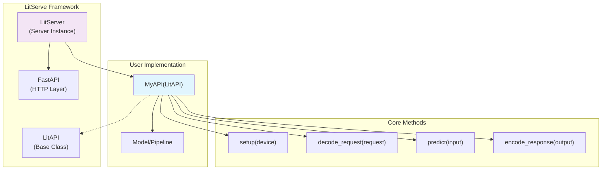

**Sources:** [tests/simple_server.py:20-32](), [README.md:75-96]()

### Request Processing Flow

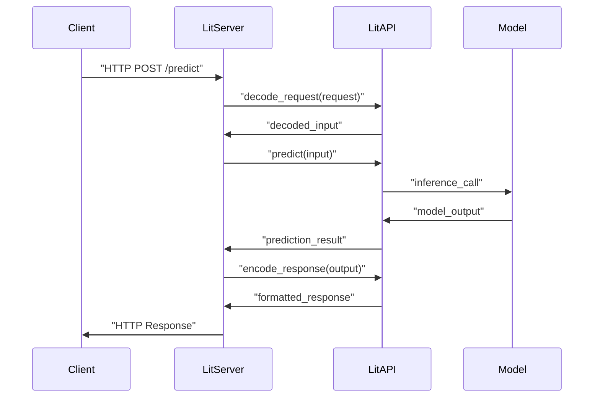

**Sources:** [tests/simple_server.py:24-31](), [README.md:84-90]()

## Your First Server

### Example 1: Multi-Model Inference Pipeline

This example demonstrates using multiple models in a single inference pipeline:

```python
import litserve as ls

# Define the API by extending LitAPI
class InferenceEngine(ls.LitAPI):
    def setup(self, device):
        # Initialize any number of models, databases, etc.
        self.text_model = lambda x: x**2
        self.vision_model = lambda x: x**3

    def predict(self, request):
        x = request["input"]    
        # Perform calculations using both models
        a = self.text_model(x)
        b = self.vision_model(x)
        c = a + b
        return {"output": c}

if __name__ == "__main__":
    # Configure server with batching, streaming, GPU support, etc.
    server = ls.LitServer(InferenceEngine(), accelerator="auto")
    server.run(port=8000)
```

**Sources:** [README.md:87-108]()

### Example 2: AI Agent with External API

This example shows building an agent that fetches data and queries an LLM:

```python
import re, requests, openai
import litserve as ls

class NewsAgent(ls.LitAPI):
    def setup(self, device):
        self.openai_client = openai.OpenAI(api_key="OPENAI_API_KEY")

    def predict(self, request):
        website_url = request.get("website_url", "https://text.npr.org/")
        website_text = re.sub(r'<[^>]+>', ' ', requests.get(website_url).text)

        # Ask the LLM about the news
        llm_response = self.openai_client.chat.completions.create(
           model="gpt-3.5-turbo", 
           messages=[{"role": "user", "content": f"Based on this, what is the latest: {website_text}"}],
        )
        output = llm_response.choices[0].message.content.strip()
        return {"output": output}

if __name__ == "__main__":
    server = ls.LitServer(NewsAgent())
    server.run(port=8000)
```

**Sources:** [README.md:128-151]()

### Key Components

LitServe consists of two main abstractions:

| Component | Purpose | When It Runs |
|-----------|---------|--------------|
| `LitAPI` | Base class defining inference logic | Extended by user |
| `LitServer` | HTTP server that orchestrates workers | Instantiated once |
| `setup(device)` | Initialize models, load weights | Once per worker on startup |
| `predict(x)` | Core inference computation | Every request |
| `decode_request(request)` | Parse HTTP request (optional) | Every request |
| `encode_response(output)` | Format HTTP response (optional) | Every request |

**Sources:** [tests/simple_server.py:20-32](), [tests/conftest.py:43-54]()

## Running the Server

### Local Development

Start the server directly with Python:

```bash
python server.py
```

The server starts on `http://127.0.0.1:8000` by default and automatically generates a `client.py` file for testing.

**Sources:** [README.md:116-118](), [tests/e2e/test_e2e.py:64-69]()

### Using the Lightning CLI

Alternative deployment using Lightning tooling:

```bash
# Local deployment with Lightning tooling
lightning deploy server.py

# Deploy to Lightning AI cloud with autoscaling
lightning deploy server.py --cloud
```

**Sources:** [README.md:110-114](), [README.md:202-204]()

### Generated Client File

LitServe automatically creates a `client.py` file when the server starts, which you can use immediately:

```bash
python client.py
```

This provides a quick way to test your API. The generated file is a template that you can customize.

**Sources:** [tests/e2e/test_e2e.py:66-69](), [src/litserve/python_client.py:1-8]()

## Testing Your Server

### Method 1: Auto-Generated Client

Use the automatically generated `client.py`:

```bash
python client.py
```

Expected output:
```
Status: 200
Response:
 {"output":16.0}
```

**Sources:** [tests/e2e/test_e2e.py:66-69](), [src/litserve/python_client.py:1-8]()

### Method 2: curl

Test the `/predict` endpoint directly:

```bash
curl -X POST http://127.0.0.1:8000/predict \
     -H "Content-Type: application/json" \
     -d '{"input": 4.0}'
```

Expected response:
```json
{"output": 16.0}
```

**Sources:** [README.md:122-124](), [tests/e2e/test_e2e.py:87-89]()

### Method 3: Python Requests Library

For programmatic testing:

```python
import requests

response = requests.post(
    "http://127.0.0.1:8000/predict", 
    json={"input": 4.0}
)
print(f"Status: {response.status_code}")
print(f"Response: {response.json()}")
```

**Sources:** [tests/e2e/test_e2e.py:87-89]()

### Method 4: News Agent Example

For the news agent from Example 2:

```bash
curl -X POST http://127.0.0.1:8000/predict \
     -H "Content-Type: application/json" \
     -d '{"website_url": "https://text.npr.org/"}'
```

**Sources:** [README.md:152-155]()

## Server Configuration

### Basic Configuration

The `LitServer` constructor accepts various configuration parameters:

```python
server = ls.LitServer(
    InferencePipeline(),
    accelerator="auto",    # Device selection: "auto", "cpu", "cuda", "mps"
    devices=1,             # Number of devices to use
    timeout=10,            # Request timeout in seconds
    workers_per_device=1   # Workers per device for parallelism
)
```

**Sources:** [tests/simple_server.py:35](), [tests/conftest.py:130]()

### Common Parameters

| Parameter | Description | Default | Example |
|-----------|-------------|---------|---------|
| `accelerator` | Device type | `"auto"` | `"cpu"`, `"cuda"`, `"mps"` |
| `devices` | Number of devices | `1` | `1`, `2`, `4` |
| `timeout` | Request timeout (seconds) | `30` | `10`, `60` |
| `workers_per_device` | Workers per device | `1` | `2`, `4` |
| `max_batch_size` | Enable batching | `1` | `8`, `16`, `32` |
| `batch_timeout` | Max batch wait time | `0.0` | `0.05`, `0.1` |

**Sources:** [tests/conftest.py:130]()

### Port Configuration

Specify a custom port when running the server:

```python
server.run(port=8080)
```

The default port is `8000`.

**Sources:** [tests/simple_server_diff_port.py:34](), [tests/e2e/test_e2e.py:72-82]()

### Configuration Examples

#### GPU Server
```python
server = ls.LitServer(
    MyAPI(),
    accelerator="cuda",
    devices=2
)
```

#### Batched Server
```python
api = MyAPI(max_batch_size=16, batch_timeout=0.05)
server = ls.LitServer(api, accelerator="auto")
```

**Sources:** [tests/conftest.py:130]()

## Next Steps

- For detailed API customization, see [LitAPI](#2.1)
- For server configuration options, see [LitServer](#2.2)
- For OpenAI-compatible APIs, see [OpenAI Chat Completions API](#3.1)
- For production deployment guides, see [Docker Deployment](#4.6)

**Sources:** [README.md:147-158]()

---

# Page: Architecture Overview

# Architecture Overview

<details>
<summary>Relevant source files</summary>

The following files were used as context for generating this wiki page:

- [README.md](README.md)
- [src/litserve/server.py](src/litserve/server.py)
- [tests/conftest.py](tests/conftest.py)
- [tests/e2e/test_e2e.py](tests/e2e/test_e2e.py)

</details>


This document explains the overall system architecture of LitServe, including its core components, request processing pipeline, and multi-process execution model. LitServe is designed as a high-performance AI model serving framework that transforms AI models into production-ready APIs with automatic scaling, batching, streaming, and multi-GPU support.

For specific implementation details of core classes, see [LitAPI](#2.1) and [LitServer](#2.2). For processing strategies, see [Processing Loops](#2.3). For API compatibility layers, see [API Specifications](#3).

## System Components Overview

LitServe consists of several key architectural layers that work together to provide high-performance AI model serving:

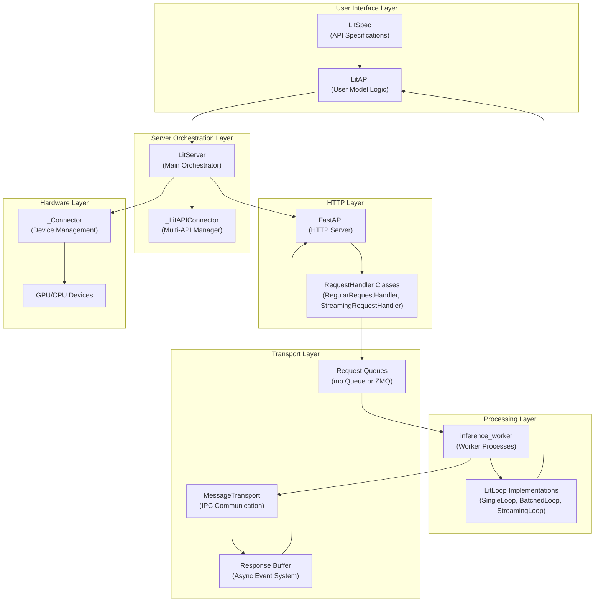

**Sources:** [src/litserve/server.py:1-1439](), [src/litserve/api.py:1-404](), [src/litserve/specs/base.py:1-85]()

## Core Architecture Pattern

LitServe follows a two-tier abstraction pattern where users implement `LitAPI` for model logic while `LitServer` handles all infrastructure concerns:

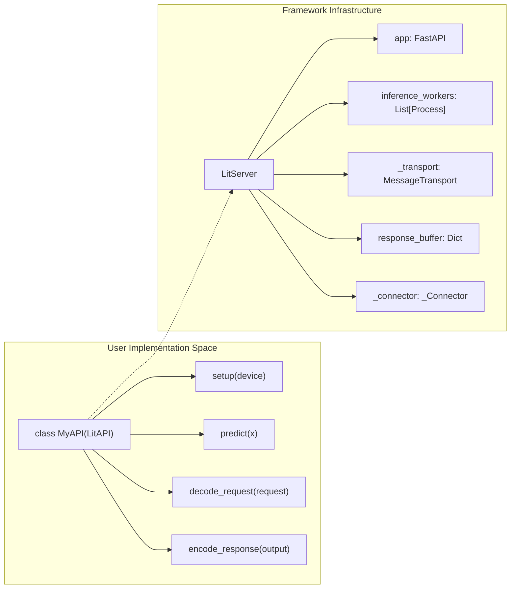

The `LitAPI` class provides required methods (`setup`, `predict`) and optional methods for customization. The `LitServer` class manages the complete serving infrastructure including HTTP handling, worker processes, and inter-process communication.

**Sources:** [src/litserve/api.py:32-404](), [src/litserve/server.py:384-1439]()

## Request Processing Pipeline

LitServe implements a multi-stage request processing pipeline that handles HTTP requests through worker processes:

### HTTP Request Flow

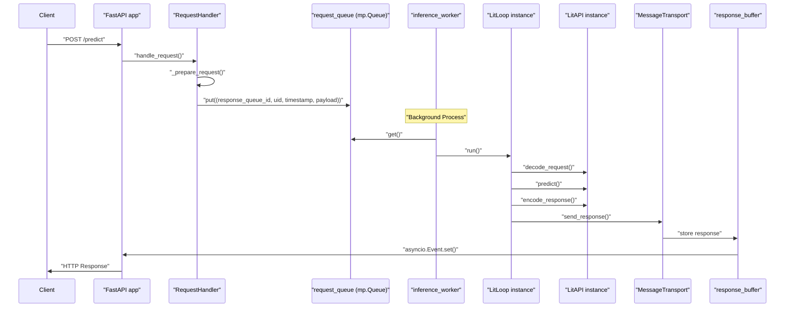

**Sources:** [src/litserve/server.py:302-382](), [src/litserve/server.py:794-827]()

### Processing Loop Integration

The system supports multiple processing strategies through the `LitLoop` abstraction, automatically selected based on API configuration:

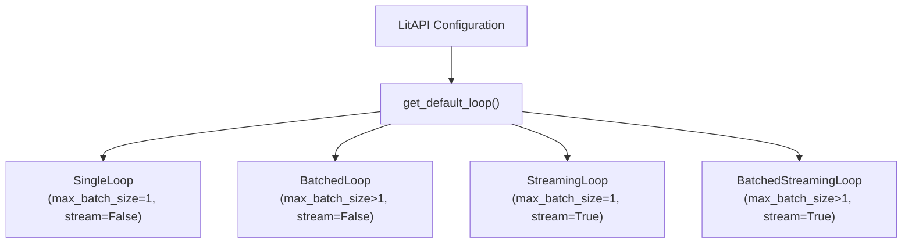

**Sources:** [src/litserve/api.py:376-381]()

## Multi-Process Architecture

LitServe uses a multi-process architecture to achieve high performance and fault isolation:

### Process Structure

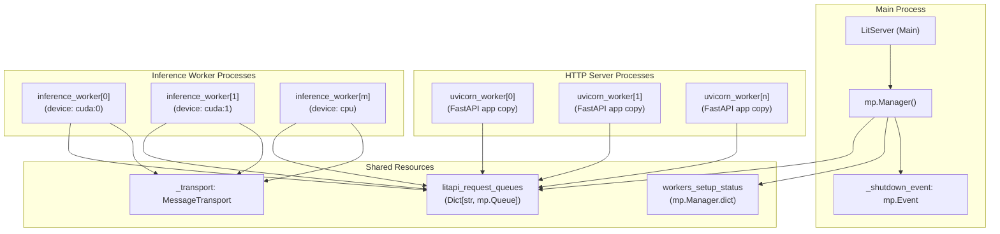

### Worker Launch Configuration

The system calculates worker distribution based on hardware configuration:

| Configuration | Example Result |
|---|---|
| `accelerator="cuda", devices=2, workers_per_device=2` | `["cuda:0", "cuda:0", "cuda:1", "cuda:1"]` |
| `accelerator="cpu", workers_per_device=4` | `["cpu", "cpu", "cpu", "cpu"]` |
| `accelerator="auto", devices="auto"` | Auto-detected based on available hardware |

**Sources:** [src/litserve/server.py:780-793](), [src/litserve/server.py:1033-1048](), [src/litserve/server.py:1324-1330]()

## Transport Layer

The transport layer handles inter-process communication between HTTP servers and inference workers through the `MessageTransport` abstraction:

### Transport Configuration

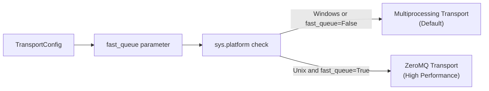

### Message Flow

The transport layer manages asynchronous message passing with response buffering:

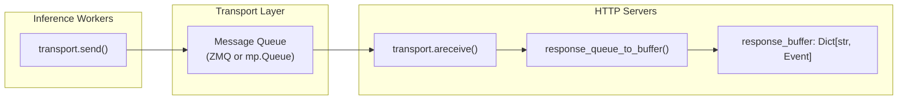

**Sources:** [src/litserve/server.py:772-773](), [src/litserve/server.py:790-792](), [src/litserve/server.py:127-177]()

## API Specifications System

LitServe supports multiple API specifications through the `LitSpec` abstraction, enabling compatibility with standard APIs like OpenAI:

### Specification Architecture

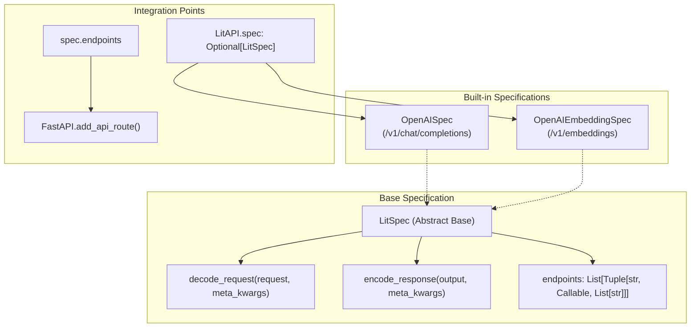

### Specification Setup Process

When a `LitAPI` has an associated `LitSpec`, the server performs additional setup:

1. **Pre-setup**: `spec.pre_setup(lit_api)` configures the specification
2. **Server setup**: `spec.setup(server)` connects spec to server resources  
3. **Endpoint registration**: `spec.endpoints` are registered with FastAPI
4. **Request override**: Spec's `decode_request`/`encode_response` override API methods

**Sources:** [src/litserve/specs/base.py:21-85](), [src/litserve/server.py:992-1001](), [src/litserve/api.py:329-340]()

---

# Page: Core Concepts

# Core Concepts

<details>
<summary>Relevant source files</summary>

The following files were used as context for generating this wiki page:

- [README.md](README.md)
- [src/litserve/api.py](src/litserve/api.py)
- [src/litserve/server.py](src/litserve/server.py)
- [src/litserve/specs/base.py](src/litserve/specs/base.py)
- [tests/conftest.py](tests/conftest.py)
- [tests/e2e/test_e2e.py](tests/e2e/test_e2e.py)

</details>


This page introduces the fundamental abstractions that form the foundation of LitServe: `LitAPI`, `LitServer`, processing loops, and the transport layer. These components work together to transform AI models into production-ready inference servers.

**Scope**: This page provides a conceptual overview of the core system architecture. For implementation details, see:
- [LitAPI](#2.1) - Deep dive into the API abstraction
- [LitServer](#2.2) - Server configuration and lifecycle
- [Processing Loops](#2.3) - Request processing patterns
- [Transport Layer & IPC](#2.4) - Inter-process communication

## System Architecture Overview

LitServe is built on a multi-process architecture where user-defined inference logic (`LitAPI`) runs in separate worker processes orchestrated by a central server (`LitServer`). This design enables parallel inference execution, hardware acceleration, and automatic optimizations.

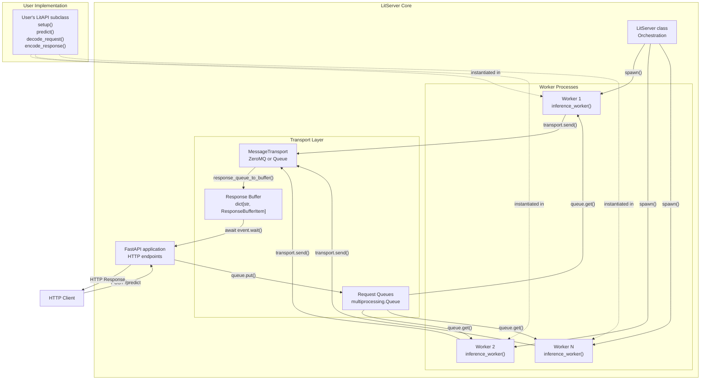

**Sources**: [src/litserve/server.py:405-657](), [src/litserve/loops/base.py:1-50]()

## The LitAPI Abstraction

`LitAPI` is the abstract base class that defines the inference pipeline. Users subclass it to implement model-specific logic while LitServe handles infrastructure concerns.

### LitAPI Methods and Lifecycle

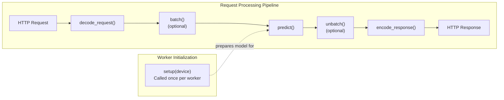

**Key Methods**:

| Method | Required | Purpose | Called When |
|--------|----------|---------|-------------|
| `setup(device)` | Yes | Load model and resources | Worker process starts |
| `predict(x)` | Yes | Run inference | Every request |
| `decode_request(request)` | No | Transform HTTP to model input | Every request (before predict) |
| `encode_response(output)` | No | Transform model output to HTTP | Every request (after predict) |
| `batch(inputs)` | No | Combine multiple inputs | When `max_batch_size > 1` |
| `unbatch(output)` | No | Split batched output | When `max_batch_size > 1` |

**Configuration Properties**:

```python
# From src/litserve/api.py:139-149
LitAPI(
    max_batch_size=1,        # Enable batching (> 1)
    batch_timeout=0.0,       # Max wait time for batch
    api_path="/predict",     # HTTP endpoint path
    stream=False,            # Enable streaming responses
    enable_async=False,      # Enable async methods
    spec=None,              # API specification (e.g., OpenAISpec)
    loop=None               # Custom processing loop
)
```

**Sources**: [src/litserve/api.py:33-130](), [src/litserve/api.py:139-194](), [src/litserve/api.py:245-346]()

### LitAPI Class Hierarchy

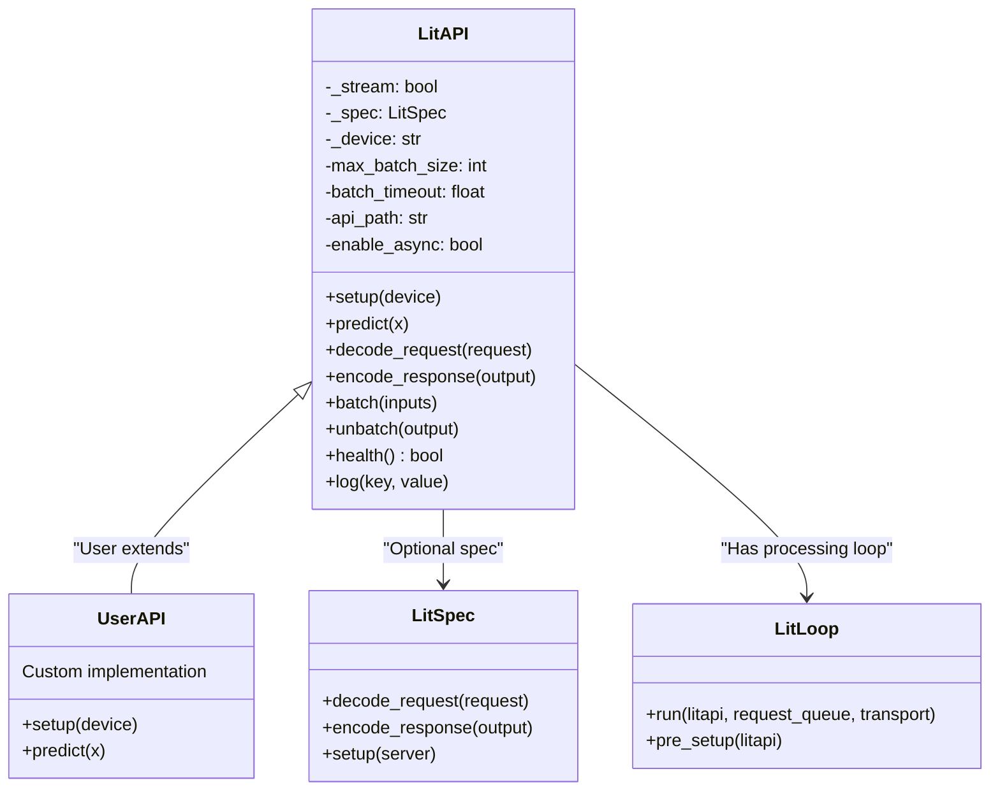

**Sources**: [src/litserve/api.py:33-448]()

## The LitServer Orchestrator

`LitServer` is responsible for server initialization, worker management, queue setup, and HTTP endpoint registration. It transforms a `LitAPI` instance into a running inference server.

### LitServer Architecture

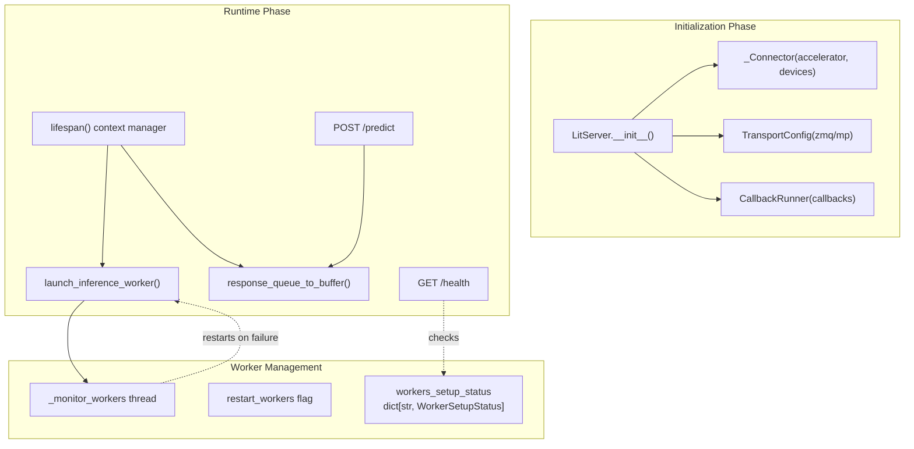

**Key Components**:

| Component | Type | Purpose | Location |
|-----------|------|---------|----------|
| `_Connector` | Class | Hardware detection and device management | [src/litserve/connector.py]() |
| `TransportConfig` | Class | Configure IPC mechanism (ZeroMQ/Queue) | [src/litserve/transport/factory.py]() |
| `CallbackRunner` | Class | Execute lifecycle callbacks | [src/litserve/callbacks/base.py]() |
| `inference_worker` | Function | Worker process entry point | [src/litserve/loops/base.py]() |
| `workers_setup_status` | Dict | Track worker initialization state | [src/litserve/server.py:846]() |

**Sources**: [src/litserve/server.py:405-830](), [src/litserve/server.py:831-901]()

### LitServer Configuration

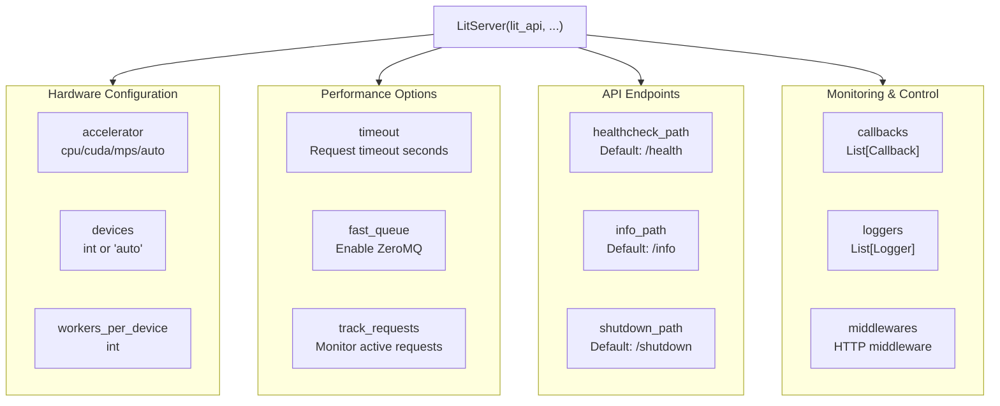

**Configuration Parameters**:

- **Hardware**: Controls device allocation and worker spawning ([src/litserve/server.py:659-686]())
- **Performance**: Optimizations for throughput and latency ([src/litserve/server.py:665-678]())
- **Endpoints**: Customize server endpoints ([src/litserve/server.py:666-669]())
- **Monitoring**: Lifecycle hooks and metrics ([src/litserve/server.py:674-677]())

**Sources**: [src/litserve/server.py:659-830]()

## Processing Loops

Processing loops implement the request processing logic. LitServe automatically selects the appropriate loop based on `LitAPI` configuration (`stream`, `max_batch_size`, `enable_async`).

### Loop Selection Logic

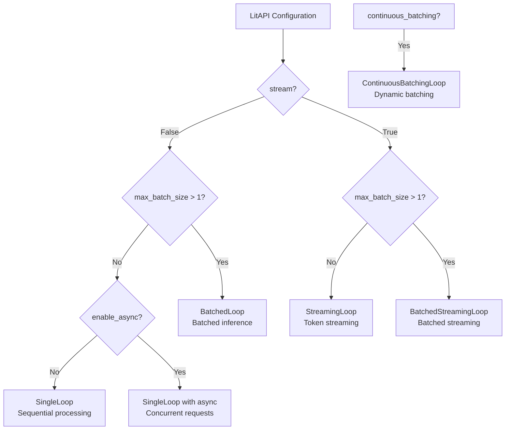

**Loop Types**:

| Loop Class | Batching | Streaming | Async | Use Case |
|------------|----------|-----------|-------|----------|
| `SingleLoop` | No | No | Optional | Simple request-response |
| `BatchedLoop` | Yes | No | No | GPU batch inference |
| `StreamingLoop` | No | Yes | Optional | Token-by-token generation |
| `BatchedStreamingLoop` | Yes | Yes | No | Batched streaming (LLMs) |
| `ContinuousBatchingLoop` | Dynamic | Yes | No | Advanced LLM serving |

**Sources**: [src/litserve/loops/loops.py](), [src/litserve/api.py:419-425]()

### Loop Execution Flow

```mermaid
sequenceDiagram
    participant Queue as "Request Queue<br/>multiprocessing.Queue"
    participant Loop as "LitLoop<br/>(SingleLoop/BatchedLoop/etc.)"
    participant LitAPI as "LitAPI Instance"
    participant Transport as "MessageTransport"
    
    loop Request Processing
        Queue->>Loop: "queue.get()"
        Note over Loop: "Extract uid, timestamp, payload"
        
        Loop->>LitAPI: "decode_request(payload)"
        LitAPI-->>Loop: "decoded_input"
        
        alt Batching Enabled
            Loop->>Loop: "Collect batch"
            Loop->>LitAPI: "batch(inputs)"
            LitAPI-->>Loop: "batched_input"
        end
        
        Loop->>LitAPI: "predict(input)"
        LitAPI-->>Loop: "output"
        
        alt Batching Enabled
            Loop->>LitAPI: "unbatch(output)"
            LitAPI-->>Loop: "individual_outputs"
        end
        
        Loop->>LitAPI: "encode_response(output)"
        LitAPI-->>Loop: "response"
        
        Loop->>Transport: "send(uid, response, status)"
    end
```

**Sources**: [src/litserve/loops/base.py:1-100]()

## Transport Layer and IPC

The transport layer manages communication between the FastAPI process and worker processes. It handles request distribution and response collection using queues and message passing.

### Transport Components

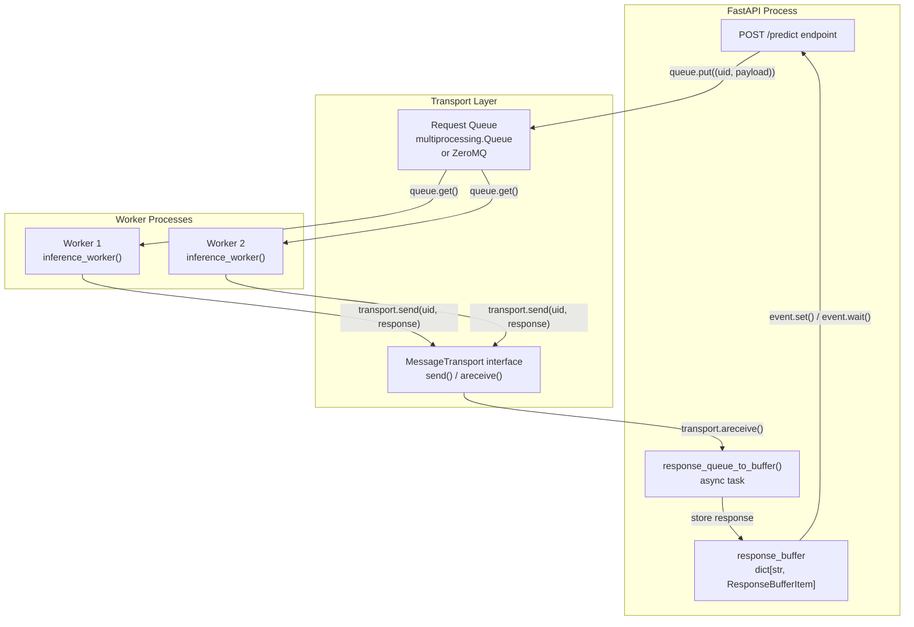

**Key Classes**:

| Class | Location | Purpose |
|-------|----------|---------|
| `ResponseBufferItem` | [src/litserve/utils.py]() | Container for response data and synchronization |
| `MessageTransport` | [src/litserve/transport/base.py]() | Abstract transport interface |
| `TransportConfig` | [src/litserve/transport/factory.py]() | Factory for creating transport instances |

**Sources**: [src/litserve/server.py:97-191](), [src/litserve/transport/]()

### ResponseBufferItem Structure

```python
# Response coordination object
# From src/litserve/utils.py
class ResponseBufferItem:
    event: asyncio.Event          # Signal when response ready
    response: Optional[tuple]     # Non-streaming response
    response_queue: deque         # Streaming response chunks
    worker_id: Optional[int]      # Which worker handled request
```

The `ResponseBufferItem` enables async coordination between the FastAPI process and worker processes:

1. FastAPI creates an entry with a unique `uid` before submitting request
2. Worker processes send responses via transport with the `uid`
3. `response_queue_to_buffer()` task receives responses and populates the buffer
4. FastAPI awaits the `event` to be set, then retrieves the response

**Sources**: [src/litserve/utils.py](), [src/litserve/server.py:97-131]()

## Request Flow Through the System

```mermaid
sequenceDiagram
    participant Client
    participant FastAPI as "FastAPI<br/>POST /predict"
    participant RequestQueue as "Request Queue"
    participant Worker as "Worker Process<br/>inference_worker()"
    participant Transport as "MessageTransport"
    participant Buffer as "response_buffer"
    
    Client->>FastAPI: "HTTP POST /predict"
    FastAPI->>FastAPI: "uid = uuid.uuid4()"
    FastAPI->>Buffer: "Create ResponseBufferItem(event)"
    FastAPI->>RequestQueue: "put((uid, timestamp, payload))"
    
    RequestQueue->>Worker: "get((uid, timestamp, payload))"
    
    Worker->>Worker: "decode_request(payload)"
    Worker->>Worker: "predict(input)"
    Worker->>Worker: "encode_response(output)"
    
    Worker->>Transport: "send(uid, response, status)"
    Transport->>Buffer: "Store response for uid"
    Buffer->>Buffer: "event.set()"
    
    FastAPI->>Buffer: "await event.wait()"
    FastAPI->>Buffer: "pop(uid)"
    FastAPI->>Client: "HTTP Response"
```

**Key Steps**:

1. **Request Submission**: FastAPI handler generates UID and queues request ([src/litserve/server.py:294-309]())
2. **Worker Processing**: Worker dequeues, processes through LitAPI pipeline ([src/litserve/loops/base.py]())
3. **Response Transport**: Worker sends response with UID via transport ([src/litserve/loops/base.py]())
4. **Response Collection**: Async task receives and buffers responses ([src/litserve/server.py:133-191]())
5. **Response Return**: FastAPI awaits event and returns to client ([src/litserve/server.py:316-342]())

**Sources**: [src/litserve/server.py:280-397](), [src/litserve/loops/base.py]()

## _LitAPIConnector Helper

The `_LitAPIConnector` class manages one or more `LitAPI` instances, providing utilities for setup, validation, and configuration management.

```mermaid
classDiagram
    class _LitAPIConnector {
        +lit_apis: list[LitAPI]
        +pre_setup()
        +set_request_timeout(timeout)
        +any_stream() bool
        +set_logger_queue(queue)
        +get_mcp_tools() list
        -_detect_path_collision()
    }
    
    class LitAPI {
        +setup(device)
        +predict(x)
    }
    
    class LitServer {
        +litapi_connector: _LitAPIConnector
    }
    
    _LitAPIConnector o-- LitAPI : "manages 1+"
    LitServer --> _LitAPIConnector : "uses"
```

**Key Methods**:

- `pre_setup()`: Initializes all LitAPI instances before workers spawn ([src/litserve/server.py:247-253]())
- `set_request_timeout(timeout)`: Validates and applies timeout configuration ([src/litserve/server.py:254-261]())
- `any_stream()`: Checks if any API uses streaming ([src/litserve/server.py:265-266]())
- `_detect_path_collision()`: Ensures no duplicate API paths ([src/litserve/server.py:240-245]())

**Multi-API Support**: When multiple `LitAPI` instances are provided, each gets its own endpoint and can have different configurations (batching, streaming, etc.).

**Sources**: [src/litserve/server.py:208-278]()

## Request Handler Pattern

LitServe uses separate handlers for regular and streaming requests, following a strategy pattern:

```mermaid
classDiagram
    class BaseRequestHandler {
        <<abstract>>
        +lit_api: LitAPI
        +server: LitServer
        +_prepare_request(request)
        +_submit_request(payload)
        +handle_request(request)*
    }
    
    class RegularRequestHandler {
        +handle_request(request) Response
        +_handle_error_response(response)
    }
    
    class StreamingRequestHandler {
        +handle_request(request) StreamingResponse
    }
    
    BaseRequestHandler <|-- RegularRequestHandler
    BaseRequestHandler <|-- StreamingRequestHandler
    
    RegularRequestHandler --> LitAPI : "uses"
    StreamingRequestHandler --> LitAPI : "uses"
```

**Handler Selection**: Based on `lit_api.stream`:
- `stream=False` → `RegularRequestHandler` returns complete response ([src/litserve/server.py:316-368]())
- `stream=True` → `StreamingRequestHandler` returns `StreamingResponse` ([src/litserve/server.py:370-397]())

**Sources**: [src/litserve/server.py:280-397]()

## Summary

The core concepts of LitServe work together to provide a scalable inference serving framework:

1. **LitAPI**: User-defined inference logic with standardized lifecycle methods
2. **LitServer**: Orchestrates workers, queues, and HTTP endpoints
3. **Processing Loops**: Automatically selected based on configuration to handle request patterns
4. **Transport Layer**: Efficient IPC using queues and async coordination

This architecture enables:
- Parallel inference across multiple workers
- Automatic batching and streaming
- Hardware acceleration (GPU, MPS)
- Async request handling
- Minimal user code changes

For detailed information on each component, see the child pages: [LitAPI](#2.1), [LitServer](#2.2), [Processing Loops](#2.3), and [Transport Layer & IPC](#2.4).

**Sources**: [src/litserve/server.py:1-1333](), [src/litserve/api.py:1-448](), [README.md:1-278]()

---

# Page: LitAPI

# LitAPI

<details>
<summary>Relevant source files</summary>

The following files were used as context for generating this wiki page:

- [README.md](README.md)
- [src/litserve/api.py](src/litserve/api.py)
- [src/litserve/specs/base.py](src/litserve/specs/base.py)
- [tests/conftest.py](tests/conftest.py)
- [tests/e2e/test_e2e.py](tests/e2e/test_e2e.py)

</details>


## Purpose and Scope

This page documents the `LitAPI` class, the core abstraction users extend to define model serving logic in LitServe. `LitAPI` provides a structured interface for implementing the complete inference pipeline: model initialization, request decoding, prediction, and response encoding. It handles automatic optimization selection based on configuration (batching, streaming, async processing) without requiring users to manage infrastructure details.

For information about how `LitAPI` instances are orchestrated by the server, see [LitServer](#2.2). For details on processing loop selection and execution, see [Processing Loops](#2.3). For API specification customization (e.g., OpenAI compatibility), see [API Specifications](#3).

## Class Overview

`LitAPI` is an abstract base class defined in [src/litserve/api.py:33]() that users extend to implement custom inference logic. The class uses a metaclass `_TimedInitMeta` for performance monitoring during initialization.

```mermaid
classDiagram
    class LitAPI {
        <<abstract>>
        +int max_batch_size
        +float batch_timeout
        +str api_path
        +bool stream
        +bool enable_async
        +LitSpec spec
        +MCP mcp
        +setup(device)
        +decode_request(request, kwargs)
        +predict(x, kwargs)*
        +encode_response(output, kwargs)
        +batch(inputs)
        +unbatch(output)
        +health()
        +log(key, value)
        -_validate_async_methods()
        -_unbatch_stream(output_stream)
        -_unbatch_no_stream(output)
    }
    
    class SimpleLitAPI {
        +setup(device)
        +decode_request(request)
        +predict(x)
        +encode_response(output)
    }
    
    class StreamingLitAPI {
        +setup(device)
        +predict(x)
        +encode_response(output)
    }
    
    class BatchedLitAPI {
        +setup(device)
        +batch(inputs)
        +predict(x)
        +unbatch(output)
        +encode_response(output)
    }
    
    LitAPI <|-- SimpleLitAPI
    LitAPI <|-- StreamingLitAPI
    LitAPI <|-- BatchedLitAPI
```

**Sources:** [src/litserve/api.py:33-448](), [tests/conftest.py:43-101]()

## Core Request Processing Workflow

The `LitAPI` methods are called in a specific sequence by the processing loop to handle each request. The exact flow depends on configuration (batching, streaming) but follows this general pattern:

```mermaid
sequenceDiagram
    participant Loop as "Processing Loop"
    participant API as "LitAPI Instance"
    participant Model as "User Model"
    
    Note over Loop,Model: "One-time setup per worker"
    Loop->>API: "setup(device)"
    API->>Model: "Load model to device"
    Model-->>API: "Model ready"
    
    Note over Loop,Model: "Per-request processing"
    Loop->>API: "decode_request(request, **kwargs)"
    API-->>Loop: "decoded_input"
    
    alt Batching enabled (max_batch_size > 1)
        Loop->>API: "batch([input1, input2, ...])"
        API-->>Loop: "batched_input"
    end
    
    Loop->>API: "predict(input, **kwargs)"
    API->>Model: "Run inference"
    Model-->>API: "raw_output"
    
    alt Streaming (stream=True)
        API-->>Loop: "yield token1"
        API-->>Loop: "yield token2"
        API-->>Loop: "yield tokenN"
    else Non-streaming
        API-->>Loop: "output"
    end
    
    alt Batching enabled
        Loop->>API: "unbatch(output)"
        API-->>Loop: "[output1, output2, ...]"
    end
    
    Loop->>API: "encode_response(output, **kwargs)"
    API-->>Loop: "http_response"
```

**Sources:** [src/litserve/api.py:40-44](), [README.md:87-108]()

## Initialization and Configuration

The `__init__` method [src/litserve/api.py:139-194]() accepts configuration parameters that control processing behavior:

| Parameter | Type | Default | Description |
|-----------|------|---------|-------------|
| `max_batch_size` | `int` | `1` | Maximum number of requests to batch together. Must be > 0. |
| `batch_timeout` | `float` | `0.0` | Maximum wait time (seconds) to fill a batch. Must be >= 0. |
| `api_path` | `str` | `"/predict"` | URL endpoint path. Must start with `/`. |
| `stream` | `bool` | `False` | Enable streaming responses via generators. |
| `loop` | `Union[str, LitLoop]` | `"auto"` | Processing loop selection. Use `"auto"` for automatic selection. |
| `spec` | `Optional[LitSpec]` | `None` | API specification for protocol compatibility (e.g., `OpenAISpec`). |
| `mcp` | `Optional[MCP]` | `None` | Model Context Protocol integration for tool registration. |
| `enable_async` | `bool` | `False` | Enable async/await for concurrent processing. |

Configuration validation occurs during initialization [src/litserve/api.py:152-193]():
- Validates `max_batch_size > 0` and `batch_timeout >= 0`
- Warns if `batch()` and `unbatch()` are implemented but `max_batch_size == 1`
- Validates `api_path` starts with `/`
- Validates async method implementations if `enable_async=True`

**Sources:** [src/litserve/api.py:139-194](), [src/litserve/api.py:195-243]()

## Required Methods

### setup(device)

Called once per worker to initialize resources. This is where models should be loaded and moved to the appropriate device.

```python
def setup(self, device):
    """Setup the model so it can be called in `predict`."""
    # Load model, connect to databases, initialize resources
    pass
```

**Method signature:** [src/litserve/api.py:245-247]()

**Parameters:**
- `device` (str): Device identifier (e.g., `"cuda:0"`, `"cpu"`, `"mps:0"`)

**Usage:** Models should be loaded here, not in `__init__`, to ensure proper device placement in multi-worker environments.

**Example from tests:** [tests/conftest.py:44-45]()
```python
def setup(self, device):
    self.model = lambda x: x**2
```

### predict(x, **kwargs)

Runs model inference. Must be implemented by all subclasses. For streaming APIs, this should be a generator that yields outputs incrementally.

```python
def predict(self, x, **kwargs):
    """Run the model on the input and return or yield the output."""
    raise NotImplementedError("predict is not implemented")
```

**Method signature:** [src/litserve/api.py:270-282]()

**Parameters:**
- `x`: Input data (decoded from request). For batched APIs, this is a batched input.
- `**kwargs`: Additional context populated by specs

**Returns:**
- Non-batched, non-streaming: Single output
- Batched, non-streaming: List/array where each element corresponds to one input
- Streaming: Generator yielding output tokens/chunks

**Important:** When batching is enabled (`max_batch_size > 1`), `predict` receives batched input and must return a list-like structure with one output per input [src/litserve/api.py:272-279]().

**Sources:** [src/litserve/api.py:270-282](), [tests/conftest.py:50-51](), [tests/conftest.py:64-66]()

## Optional Methods

### decode_request(request, **kwargs)

Transforms the HTTP request payload into model input format. If not implemented, returns the request unchanged. If a `LitSpec` is configured, delegates to `spec.decode_request()`.

**Method signature:** [src/litserve/api.py:249-253]()

**Default behavior:** Returns request as-is or delegates to spec

**Example:** [tests/conftest.py:47-48]()
```python
def decode_request(self, request: Request):
    return request["input"]
```

### encode_response(output, **kwargs)

Transforms model output into HTTP response format. For streaming APIs, should yield formatted chunks. If a `LitSpec` is configured, delegates to `spec.encode_response()`.

**Method signature:** [src/litserve/api.py:337-345]()

**Default behavior:** Returns output as-is or delegates to spec

**Example:** [tests/conftest.py:53-54]()
```python
def encode_response(self, output) -> Response:
    return {"output": output}
```

### batch(inputs)

Combines multiple inputs into a single batched input for efficient GPU processing. Default implementation handles PyTorch tensors and NumPy arrays via `torch.stack()` or `numpy.stack()`.

**Method signature:** [src/litserve/api.py:255-268]()

**Default behavior:** 
- Detects PyTorch tensors via `__torch_function__` and applies `torch.stack()`
- Detects NumPy arrays by class name and applies `numpy.stack()`
- Otherwise returns input list unchanged

### unbatch(output)

Splits batched output back into individual outputs. Must match the batching strategy. For streaming APIs, uses `_unbatch_stream()`. For non-streaming, uses `_unbatch_no_stream()`.

**Method signature:** [src/litserve/api.py:314-335]()

**Default behavior:** Set during `pre_setup()` [src/litserve/api.py:372-375]()
- Streaming: `_unbatch_stream()` yields lists from each output chunk
- Non-streaming: `_unbatch_no_stream()` converts output to list with warnings for incorrect types

**Important:** When batching, `predict` must return a list-like structure. Common mistakes warned by `_unbatch_no_stream()` [src/litserve/api.py:284-308]():
- Returning a dict with arrays instead of list of dicts
- Returning a string instead of list of strings
- Returning a set instead of list

**Correct batched output format:**
```python
# Correct: List of individual outputs
[output1, output2, output3]

# Incorrect: Dict with batched values
{"key1": [val1, val2, val3], "key2": [val4, val5, val6]}

# Correct alternative: List of dicts
[{"key1": val1, "key2": val4}, {"key1": val2, "key2": val5}, {"key1": val3, "key2": val6}]
```

**Sources:** [src/litserve/api.py:314-335](), [src/litserve/api.py:284-312]()

### health()

Custom health check for the `/health` endpoint. Can be synchronous or asynchronous. Default returns `True`.

**Method signature:** [src/litserve/api.py:404-417]()

**Returns:** `bool` or `Awaitable[bool]` - `True` if healthy, `False` otherwise

**Usage:** Extend to check model availability, external service connectivity, or resource constraints.

## Properties and Accessors

### Device Management

The `device` property [src/litserve/api.py:362-368]() is set by the server to indicate which device this worker is assigned to.

### Stream Property

The `stream` property [src/litserve/api.py:354-360]() controls whether the API uses streaming responses. Can be set directly or via `LitSpec`.

### Loop Selection

The `loop` property [src/litserve/api.py:419-429]() returns the processing loop. If set to `"auto"`, automatically selects the appropriate loop based on `stream`, `max_batch_size`, and `enable_async` using `get_default_loop()` [src/litserve/api.py:421-424]().

```mermaid
graph TB
    AutoDetect["loop == 'auto'"]
    CheckStream{"stream?"}
    CheckBatch{"max_batch_size > 1?"}
    CheckAsync{"enable_async?"}
    
    SingleLoop["SingleLoop"]
    BatchedLoop["BatchedLoop"]
    StreamingLoop["StreamingLoop"]
    BatchedStreamingLoop["BatchedStreamingLoop"]
    ContinuousBatchingLoop["ContinuousBatchingLoop"]
    
    AutoDetect --> CheckStream
    CheckStream -->|"False"| CheckBatch
    CheckStream -->|"True"| CheckBatch
    
    CheckBatch -->|"stream=False, batch=1"| CheckAsync
    CheckAsync -->|"False"| SingleLoop
    CheckAsync -->|"True"| SingleLoop
    
    CheckBatch -->|"stream=False, batch>1"| BatchedLoop
    CheckBatch -->|"stream=True, batch=1"| StreamingLoop
    CheckBatch -->|"stream=True, batch>1"| BatchedStreamingLoop
    
    Note1["If continuous_batching=True,<br/>uses ContinuousBatchingLoop"]
```

**Sources:** [src/litserve/api.py:419-429]()

### API Path

The `api_path` property [src/litserve/api.py:439-447]() returns the endpoint path. If a `LitSpec` is configured, returns `spec.api_path`, otherwise returns the configured `_api_path`.

### Spec Property

The `spec` property [src/litserve/api.py:431-437]() provides access to the configured `LitSpec` instance for API protocol customization.

## Logging and Monitoring

The `log(key, value)` method [src/litserve/api.py:387-396]() enables metrics tracking within API methods. Logs are queued to `_logger_queue` [src/litserve/api.py:382-385]() for collection by the server.

**Usage:**
```python
def predict(self, x):
    start = time.time()
    output = self.model(x)
    self.log("inference_time", time.time() - start)
    return output
```

If no logger is configured, emits a warning [src/litserve/api.py:389-395]().

**Sources:** [src/litserve/api.py:382-396]()

## Async Method Validation

When `enable_async=True`, the `_validate_async_methods()` method [src/litserve/api.py:195-243]() enforces async compatibility:

**Validation rules:**

| Method | Requirement | Error Type |
|--------|-------------|------------|
| `predict` | Must be async generator or async function | Error (raises `ValueError`) |
| `decode_request` | Should be async function or async generator | Warning (auto-asyncified) |
| `encode_response` | Should be async function or async generator | Warning (auto-asyncified) |

**Checks:** [src/litserve/api.py:201-217]()
- `asyncio.iscoroutinefunction()` - async function
- `inspect.isasyncgenfunction()` - async generator

**Error handling:** [src/litserve/api.py:219-243]()
- Warnings are emitted via `warnings.warn()`
- Errors are collected and raised as a single `ValueError` with all violations

**Sources:** [src/litserve/api.py:195-243]()

## Lifecycle and Pre-Setup

The `pre_setup(spec)` method [src/litserve/api.py:370-380]() is called by the server before worker initialization to configure internal state:

1. **Set default unbatch implementation** [src/litserve/api.py:372-375]():
   - `_default_unbatch = _unbatch_stream` if streaming
   - `_default_unbatch = _unbatch_no_stream` if non-streaming

2. **Configure spec** [src/litserve/api.py:377-380]():
   - Assigns spec to `_spec`
   - Sets `spec._max_batch_size`
   - Calls `spec.pre_setup(self)`

**Sources:** [src/litserve/api.py:370-380]()

## Internal Methods and Utilities

### format_encoded_response(data)

Formats the encoded response for wire transmission [src/litserve/api.py:347-352]():
- Dicts: Serialized to JSON with newline
- Pydantic BaseModels: Serialized via `model_dump_json()` with newline
- Other types: Returned as-is

### Continuous Batching Methods

For continuous batching loop support, subclasses must implement:
- `has_active_requests()` [src/litserve/api.py:398-399](): Returns whether there are in-flight requests
- `has_capacity()` [src/litserve/api.py:401-402](): Returns whether the API can accept more requests

These raise `NotImplementedError` by default and are only required for continuous batching.

**Sources:** [src/litserve/api.py:347-352](), [src/litserve/api.py:398-402]()

## Usage Patterns

### Basic Synchronous API

```python
# From tests/conftest.py:43-54
class SimpleLitAPI(LitAPI):
    def setup(self, device):
        self.model = lambda x: x**2
    
    def decode_request(self, request: Request):
        return request["input"]
    
    def predict(self, x):
        return self.model(x)
    
    def encode_response(self, output) -> Response:
        return {"output": output}
```

### Streaming API

```python
# From tests/conftest.py:57-72
class SimpleStreamAPI(LitAPI):
    def setup(self, device) -> None:
        self.sentence = "LitServe is streaming output"
    
    def decode_request(self, request: Request) -> str:
        return request["prompt"]
    
    def predict(self, x) -> Generator:
        output = f"prompt={x} generated_output={self.sentence}".split()
        yield from output
    
    def encode_response(self, output: Generator) -> Generator:
        for out in output:
            yield out.lower()
```

### Batched Streaming API

```python
# From tests/conftest.py:75-100
class SimpleBatchedStreamAPI(LitAPI):
    def setup(self, device) -> None:
        self.sentence = "LitServe is streaming output"
    
    def decode_request(self, request: Request) -> str:
        return request["prompt"]
    
    def batch(self, inputs):
        return inputs
    
    def predict(self, x) -> Generator:
        n = len(x)
        output = self.sentence.split()
        responses = [x]
        for out in output:
            responses.append([out] * n)
        yield from responses
    
    def encode_response(self, output: Generator) -> Generator:
        for out in output:
            yield [e.lower() for e in out]
    
    def unbatch(self, output):
        yield from output
```

**Sources:** [tests/conftest.py:43-101](), [README.md:87-117]()

## Integration with LitSpec

When a `LitSpec` is provided [src/litserve/api.py:158-159](), the spec's `stream` property overrides the API's stream setting. The spec can also override `decode_request` and `encode_response` to implement protocol-specific transformations (e.g., OpenAI format).

The `_spec` property is checked in:
- `decode_request()` [src/litserve/api.py:251-252](): Delegates to `spec.decode_request()` if spec exists
- `encode_response()` [src/litserve/api.py:343-344](): Delegates to `spec.encode_response()` if spec exists
- `api_path` property [src/litserve/api.py:441-442](): Returns `spec.api_path` if spec exists

**Sources:** [src/litserve/api.py:249-253](), [src/litserve/api.py:337-345](), [src/litserve/api.py:439-447]()

## MCP Integration

When an `MCP` instance is provided [src/litserve/api.py:191-193](), it is connected to the API via `mcp._connect(self)`. This enables Model Context Protocol tool registration for AI assistant integration.

**Sources:** [src/litserve/api.py:191-193]()

---

# Page: LitServer

# LitServer

<details>
<summary>Relevant source files</summary>

The following files were used as context for generating this wiki page:

- [README.md](README.md)
- [src/litserve/api.py](src/litserve/api.py)
- [src/litserve/server.py](src/litserve/server.py)
- [src/litserve/specs/base.py](src/litserve/specs/base.py)
- [tests/conftest.py](tests/conftest.py)
- [tests/e2e/test_e2e.py](tests/e2e/test_e2e.py)

</details>


LitServer is the main orchestrator class that transforms AI models into production-ready APIs with automatic scaling, batching, streaming, and multi-GPU support. It manages the complete server lifecycle, from initialization and worker process coordination to HTTP request handling and graceful shutdown.

This document covers LitServer's core functionality, configuration options, HTTP endpoints, and lifecycle management. For information about implementing model logic and custom specifications, see [LitAPI](#2.1) and [API Specifications](#3). For details about processing strategies and loops, see [Processing Loops](#2.3).

## Core Architecture & Responsibilities

LitServer serves as the central orchestrator that coordinates multiple components to provide a complete AI serving solution. It manages worker processes, handles HTTP routing through FastAPI, and provides production features like health checks, monitoring, and graceful shutdown.

### LitServer Class Structure

```mermaid
classDiagram
    class LitServer {
        +litapi_connector: _LitAPIConnector
        +app: FastAPI
        +response_buffer: Dict
        +_transport: MessageTransport
        +inference_workers_config: List
        +workers_setup_status: Dict
        +_callback_runner: CallbackRunner
        +_connector: _Connector
        +devices: List[str]
        +workers_per_device: int
        +timeout: float
        +track_requests: bool
        
        +__init__(lit_api, accelerator, devices, ...)
        +run(host, port, num_api_servers, ...)
        +launch_inference_worker(lit_api)
        +register_endpoints()
        +lifespan(app)
        +setup_auth()
        +data_streamer(q, data_available)
    }
    
    class _LitAPIConnector {
        +lit_apis: List[LitAPI]
        +pre_setup()
        +set_request_timeout(timeout)
        +any_stream()
        +set_logger_queue(queue)
        +get_mcp_tools()
    }
    
    class FastAPI {
        +response_queue_id: int
        +add_api_route()
        +get()
        +post()
    }
    
    class _Connector {
        +accelerator: str
        +devices: Union[int, str]
        +auto_select_accelerator()
    }
    
    class CallbackRunner {
        +trigger_event(event_type, ...)
    }
    
    LitServer --> _LitAPIConnector
    LitServer --> FastAPI
    LitServer --> _Connector
    LitServer --> CallbackRunner
    _LitAPIConnector --> "1..*" LitAPI
```

Sources: [src/litserve/server.py:384-793]()

### Component Responsibilities

| Component | Responsibility | Code Reference |
|-----------|---------------|----------------|
| `LitServer` | Main orchestrator, lifecycle management | [src/litserve/server.py:384]() |
| `_LitAPIConnector` | Manages one or more `LitAPI` instances | [src/litserve/server.py:194-264]() |
| `FastAPI` | HTTP server and routing | [src/litserve/server.py:753]() |
| `_Connector` | Hardware detection and device management | [src/litserve/server.py:770]() |
| `CallbackRunner` | Event handling and middleware | [src/litserve/server.py:771]() |
| `MessageTransport` | Inter-process communication | [src/litserve/server.py:51]() |

Sources: [src/litserve/server.py:194-793]()

## Configuration System

LitServer provides extensive configuration options for production deployments, organized into logical categories for hardware, performance, security, and monitoring.

### Hardware Configuration

```mermaid
graph TD
    subgraph "Hardware Detection"
        Accelerator["accelerator: auto|cpu|cuda|mps"]
        Devices["devices: auto|int"]
        WorkersPerDevice["workers_per_device: int"]
    end
    
    subgraph "_Connector"
        AutoSelect["auto_select_accelerator()"]
        DeviceList["self.devices: List[str]"]
        Config["inference_workers_config"]
    end
    
    Accelerator --> AutoSelect
    Devices --> AutoSelect
    AutoSelect --> DeviceList
    DeviceList --> Config
    WorkersPerDevice --> Config
```

Sources: [src/litserve/server.py:633-634](), [src/litserve/server.py:780-792]()

Key hardware configuration parameters:

- `accelerator`: Hardware type detection (`"auto"`, `"cpu"`, `"cuda"`, `"mps"`)
- `devices`: Number or selection of devices to use
- `workers_per_device`: Parallel worker processes per device

The `_Connector` class handles automatic hardware detection and creates device identifiers like `"cuda:0"`, `"cuda:1"` for GPU allocation.

### Performance & Scaling Configuration

| Parameter | Type | Default | Purpose |
|-----------|------|---------|---------|
| `timeout` | `float \| bool` | `30` | Request timeout in seconds |
| `fast_queue` | `bool` | `False` | Enable ZeroMQ for high throughput |
| `track_requests` | `bool` | `False` | Monitor active request counts |
| `max_payload_size` | `str \| int` | `None` | Maximum request size limit |

Sources: [src/litserve/server.py:636](), [src/litserve/server.py:648](), [src/litserve/server.py:644](), [src/litserve/server.py:643]()

### API Endpoint Configuration

```python
# Default endpoint paths
healthcheck_path: str = "/health"      # Health check endpoint
info_path: str = "/info"              # Server information
shutdown_path: str = "/shutdown"       # Graceful shutdown
enable_shutdown_api: bool = False      # Enable remote shutdown
disable_openapi_url: bool = False      # Disable OpenAPI schema
```

Sources: [src/litserve/server.py:637-640](), [src/litserve/server.py:649]()

## HTTP Endpoints

LitServer automatically registers several types of HTTP endpoints to provide a complete API server experience.

### Endpoint Registration Architecture

```mermaid
sequenceDiagram
    participant Init as "LitServer.__init__()"
    participant Register as "register_endpoints()"
    participant Internal as "_register_internal_endpoints()"
    participant API as "_register_api_endpoints()"
    participant FastAPI as "self.app"
    
    Init->>Register: Call during initialization
    Register->>Internal: Register system endpoints
    Internal->>FastAPI: "/", "/health", "/info", "/shutdown"
    Register->>API: For each LitAPI instance
    API->>FastAPI: Custom API endpoints
    
    Note over API,FastAPI: Dynamic route creation based on<br/>decode_request/encode_response signatures
```

Sources: [src/litserve/server.py:792](), [src/litserve/server.py:947-961]()

### System Endpoints

| Endpoint | Method | Purpose | Code Reference |
|----------|--------|---------|----------------|
| `/` | GET | Basic server status | [src/litserve/server.py:904-906]() |
| `/health` | GET | Worker readiness check | [src/litserve/server.py:908-918]() |
| `/info` | GET | Server configuration info | [src/litserve/server.py:920-934]() |
| `/shutdown` | POST | Graceful shutdown (optional) | [src/litserve/server.py:938-945]() |

### Health Check Implementation

The health endpoint performs comprehensive status verification:

```python
@self.app.get(self.healthcheck_path, dependencies=[Depends(self.setup_auth())])
async def health(request: Request) -> Response:
    nonlocal workers_ready
    if not workers_ready:
        workers_ready = all(v == WorkerSetupStatus.READY for v in self.workers_setup_status.values())
    
    lit_api_health_status = all(lit_api.health() for lit_api in self.litapi_connector)
    if workers_ready and lit_api_health_status:
        return Response(content="ok", status_code=200)
    
    return Response(content="not ready", status_code=503)
```

Sources: [src/litserve/server.py:908-918]()

### API Endpoint Registration

For each `LitAPI` instance, LitServer dynamically creates endpoints based on method signatures:

```python
def _register_api_endpoints(self, lit_api: LitAPI, request_type, response_type):
    # Create handlers based on streaming capability
    handler = StreamingRequestHandler(lit_api, self) if lit_api.stream else RegularRequestHandler(lit_api, self)
    
    # Create endpoint function
    async def endpoint_handler(request: request_type) -> response_type:
        return await handler.handle_request(request, request_type)
    
    # Register with FastAPI
    self.app.add_api_route(
        lit_api.api_path,
        endpoint_handler,
        methods=["POST"],
        dependencies=[Depends(self.setup_auth())]
    )
```

Sources: [src/litserve/server.py:965-983]()

## Lifecycle Management

LitServer manages a complex multi-process lifecycle involving worker coordination, transport setup, and graceful shutdown handling.

### Server Startup Sequence

```mermaid
sequenceDiagram
    participant User as "user_code"
    participant Server as "LitServer"
    participant Connector as "_LitAPIConnector"
    participant Transport as "MessageTransport"
    participant Workers as "inference_worker()"
    participant FastAPI as "FastAPI"
    
    User->>Server: __init__(lit_api, ...)
    Server->>Connector: _LitAPIConnector(lit_api)
    Connector->>Connector: pre_setup()
    
    User->>Server: run(port=8000)
    Server->>Transport: create_transport_from_config()
    Server->>Workers: launch_inference_worker() for each device
    Workers->>Workers: setup(device), load model
    Server->>FastAPI: uvicorn.run(app)
    
    Note over Workers: Background processes<br/>handle inference requests
    Note over FastAPI: HTTP server accepts<br/>client connections
```

Sources: [src/litserve/server.py:1200-1290]()

### Worker Process Management

The `launch_inference_worker` method creates one worker process per configured device:

```python
def launch_inference_worker(self, lit_api: LitAPI):
    process_list = []
    endpoint = lit_api.api_path.split("/")[-1]
    
    for worker_id, device in enumerate(self.inference_workers_config):
        self.workers_setup_status[f"{endpoint}_{worker_id}"] = WorkerSetupStatus.STARTING
        
        ctx = mp.get_context("spawn")
        process = ctx.Process(
            target=inference_worker,
            args=(
                lit_api,
                device,
                worker_id,
                self._get_request_queue(lit_api.api_path),
                self._transport,
                self.workers_setup_status,
                self._callback_runner,
            ),
        )
        process.start()
        process_list.append(process)
    return process_list
```

Sources: [src/litserve/server.py:794-827]()

### FastAPI Lifespan Management

The `lifespan` context manager coordinates startup and shutdown:

```python
@asynccontextmanager
async def lifespan(self, app: FastAPI):
    loop = asyncio.get_running_loop()
    
    # Start response buffer task
    future = response_queue_to_buffer(
        transport, self.response_buffer, app.response_queue_id, self.litapi_connector
    )
    task = loop.create_task(future)
    
    try:
        yield  # Server runs here
    finally:
        # Trigger shutdown callbacks
        self._callback_runner.trigger_event(EventTypes.ON_SERVER_END.value, litserver=self)
        
        # Cancel and cleanup tasks
        task.cancel()
        await asyncio.wait_for(task, timeout=1.0)
```

Sources: [src/litserve/server.py:829-866]()

## Request Processing Pipeline

LitServer implements a sophisticated request handling system that supports both regular and streaming responses through dedicated handler classes.

### Request Handler Architecture

```mermaid
graph TD
    subgraph "Request Handlers"
        BaseHandler["BaseRequestHandler<br/>(Abstract Base)"]
        RegularHandler["RegularRequestHandler"]
        StreamingHandler["StreamingRequestHandler"]
    end
    
    subgraph "Processing Methods"
        PrepareRequest["_prepare_request()"]
        SubmitRequest["_submit_request()"]
        HandleRequest["handle_request()"]
    end
    
    subgraph "Response Management"
        ResponseBuffer["response_buffer: Dict"]
        EventQueue["asyncio.Event"]
        StreamQueue["deque + asyncio.Event"]
    end
    
    BaseHandler --> RegularHandler
    BaseHandler --> StreamingHandler
    
    RegularHandler --> PrepareRequest
    RegularHandler --> SubmitRequest
    RegularHandler --> HandleRequest
    
    StreamingHandler --> PrepareRequest
    StreamingHandler --> SubmitRequest
    StreamingHandler --> HandleRequest
    
    HandleRequest --> ResponseBuffer
    ResponseBuffer --> EventQueue
    ResponseBuffer --> StreamQueue
```

Sources: [src/litserve/server.py:266-382]()

### Request Processing Flow

```mermaid
sequenceDiagram
    participant Client as "HTTP Client"
    participant FastAPI as "FastAPI Route"
    participant Handler as "RequestHandler"
    participant Queue as "Request Queue"
    participant Buffer as "response_buffer"
    participant Worker as "inference_worker"
    
    Client->>FastAPI: POST /predict
    FastAPI->>Handler: handle_request()
    Handler->>Handler: _prepare_request()
    Handler->>Queue: put((queue_id, uid, timestamp, payload))
    Handler->>Buffer: response_buffer[uid] = asyncio.Event()
    
    Note over Worker: Background process
    Worker->>Queue: get() request
    Worker->>Worker: decode → predict → encode
    Worker->>Buffer: Store response with uid
    
    Buffer->>Handler: Event.set() signals completion
    Handler->>Buffer: pop(uid) get response
    Handler->>FastAPI: Return response
    FastAPI->>Client: HTTP Response
```

Sources: [src/litserve/server.py:271-299](), [src/litserve/server.py:302-353]()

### Response Buffer Management

The response buffer handles both regular and streaming responses:

```python
async def response_queue_to_buffer(
    transport: MessageTransport,
    response_buffer: Dict[str, Union[Tuple[deque, asyncio.Event], asyncio.Event]],
    consumer_id: int,
    litapi_connector: "_LitAPIConnector",
):
    stream = litapi_connector.any_stream()
    if stream:
        # Handle streaming responses with deque
        while True:
            result = await transport.areceive(consumer_id)
            uid, (*response, _) = result
            stream_response_buffer, event = response_buffer[uid]
            stream_response_buffer.append(response)
            event.set()
    else:
        # Handle regular responses with direct assignment
        while True:
            result = await transport.areceive(consumer_id)
            uid, (*response, _) = result
            event = response_buffer.pop(uid)
            response_buffer[uid] = response
            event.set()
```

Sources: [src/litserve/server.py:127-177]()

## Multi-Process Architecture

LitServer employs a multi-process architecture to achieve high performance and isolation between the HTTP server and inference workers.

### Process Architecture Diagram

```mermaid
graph TB
    subgraph "Main Process"
        Server["LitServer"]
        FastAPI["FastAPI App"]
        ResponseBuffer["response_buffer"]
        Transport["MessageTransport"]
    end
    
    subgraph "API Server Processes"
        Server1["API Server 1<br/>uvicorn instance"]
        Server2["API Server 2<br/>uvicorn instance"]
        ServerN["API Server N<br/>uvicorn instance"]
    end
    
    subgraph "Inference Worker Processes"
        Worker1["Worker 1<br/>device: cuda:0"]
        Worker2["Worker 2<br/>device: cuda:1"]
        WorkerN["Worker N<br/>device: cpu"]
    end
    
    subgraph "Message Queues"
        RequestQueue["Request Queues<br/>(per API path)"]
        ResponseQueue["Response Transport<br/>(ZMQ or multiprocessing)"]
    end
    
    Server --> Server1
    Server --> Server2
    Server --> ServerN
    
    Server1 --> RequestQueue
    Server2 --> RequestQueue
    ServerN --> RequestQueue
    
    RequestQueue --> Worker1
    RequestQueue --> Worker2
    RequestQueue --> WorkerN
    
    Worker1 --> ResponseQueue
    Worker2 --> ResponseQueue
    WorkerN --> ResponseQueue
    
    ResponseQueue --> ResponseBuffer
    ResponseBuffer --> FastAPI
```

Sources: [src/litserve/server.py:1200-1290](), [src/litserve/server.py:794-827]()

### Worker Configuration and Device Assignment

Each worker process is assigned to a specific device based on the configuration:

```python
# Device configuration calculation
if accelerator == "cpu":
    self.devices = [accelerator]
elif accelerator in ["cuda", "mps"]:
    device_list = devices if isinstance(devices, int) else range(devices)
    self.devices = [self.device_identifiers(accelerator, device) for device in device_list]

# Worker process configuration
self.inference_workers_config = self.devices * self.workers_per_device
```

This creates worker assignments like:
- 2 GPUs × 3 workers = `["cuda:0", "cuda:0", "cuda:0", "cuda:1", "cuda:1", "cuda:1"]`
- 1 CPU × 4 workers = `["cpu", "cpu", "cpu", "cpu"]`

Sources: [src/litserve/server.py:782-791]()

### Message Transport Configuration

LitServer supports two transport mechanisms for inter-process communication:

| Transport | Use Case | Configuration |
|-----------|----------|---------------|
| Multiprocessing | Default, cross-platform | `fast_queue=False` |
| ZeroMQ | High throughput (>100 RPS) | `fast_queue=True` |

```python
self.transport_config = TransportConfig(transport_config="zmq" if self.use_zmq else "mp")
```

Sources: [src/litserve/server.py:791](), [src/litserve/server.py:743-745]()

---

# Page: Processing Loops

# Processing Loops

<details>
<summary>Relevant source files</summary>

The following files were used as context for generating this wiki page:

- [src/litserve/loops/base.py](src/litserve/loops/base.py)
- [src/litserve/loops/continuous_batching_loop.py](src/litserve/loops/continuous_batching_loop.py)
- [src/litserve/loops/loops.py](src/litserve/loops/loops.py)
- [src/litserve/loops/simple_loops.py](src/litserve/loops/simple_loops.py)
- [src/litserve/loops/streaming_loops.py](src/litserve/loops/streaming_loops.py)

</details>


Processing loops are the core execution engines that orchestrate request processing in LitServe. They manage the flow of requests through the LitAPI hooks and handle different processing strategies including single request processing, batching, streaming, and continuous batching. Each loop implements a specific request processing pattern optimized for different use cases.

For information about the LitAPI hooks that loops execute, see [LitAPI](#2.1). For details about the transport layer that loops use for communication, see [Transport Layer](#2.4).

## Loop Architecture

Processing loops form a hierarchical inheritance structure that provides both flexibility and code reuse. The base classes define common functionality while specific loop implementations handle different processing patterns.

### Loop Inheritance Hierarchy

```mermaid
classDiagram
    direction TB
    
    _BaseLoop <|-- LitLoop
    LitLoop <|-- DefaultLoop
    DefaultLoop <|-- SingleLoop
    DefaultLoop <|-- BatchedLoop
    DefaultLoop <|-- StreamingLoop
    DefaultLoop <|-- BatchedStreamingLoop
    LitLoop <|-- ContinuousBatchingLoop
    
    class _BaseLoop {
        <<abstract>>
        +pre_setup()
        +schedule_task()
        +run()
        +__call__()
    }
    
    class LitLoop {
        +kill()
        +get_batch_requests()
        +get_request()
        +put_response()
        +put_error_response()
    }
    
    class DefaultLoop {
        +pre_setup()
    }
    
    class SingleLoop {
        +run_single_loop()
        +_process_single_request()
        +_run_single_loop_with_async()
    }
    
    class BatchedLoop {
        +run_batched_loop()
    }
    
    class StreamingLoop {
        +run_streaming_loop()
        +run_streaming_loop_async()
        +_process_streaming_request()
    }
    
    class BatchedStreamingLoop {
        +run_batched_streaming_loop()
    }
    
    class ContinuousBatchingLoop {
        +add_request()
        +mark_completed()
        +has_capacity()
        +prefill()
        +step()
    }
```

**Sources:** [src/litserve/loops/base.py:145-438](), [src/litserve/loops/simple_loops.py:32-414](), [src/litserve/loops/streaming_loops.py:32-388](), [src/litserve/loops/continuous_batching_loop.py:53-295]()

## Request Processing Flow

All loops follow a similar pattern for processing requests, executing LitAPI hooks in a predefined order. The exact flow varies based on whether batching and streaming are enabled.

### Standard Processing Pipeline

```mermaid
sequenceDiagram
    participant RQ as request_queue
    participant Loop as "Processing Loop"
    participant API as LitAPI
    participant CB as CallbackRunner
    participant T as MessageTransport
    
    RQ->>Loop: "get request"
    Note over Loop: "Check timeout"
    
    Loop->>CB: "BEFORE_DECODE_REQUEST"
    Loop->>API: "decode_request(x_enc)"
    API-->>Loop: "decoded input"
    Loop->>CB: "AFTER_DECODE_REQUEST"
    
    alt Batching Enabled
        Loop->>API: "batch(inputs)"
        API-->>Loop: "batched input"
    end
    
    Loop->>CB: "BEFORE_PREDICT"
    Loop->>API: "predict(input)"
    API-->>Loop: "model output"
    Loop->>CB: "AFTER_PREDICT"
    
    alt Batching Enabled
        Loop->>API: "unbatch(output)"
        API-->>Loop: "individual outputs"
    end
    
    Loop->>CB: "BEFORE_ENCODE_RESPONSE"
    Loop->>API: "encode_response(output)"
    API-->>Loop: "encoded response"
    Loop->>CB: "AFTER_ENCODE_RESPONSE"
    
    Loop->>T: "put_response()"
```

**Sources:** [src/litserve/loops/simple_loops.py:74-109](), [src/litserve/loops/simple_loops.py:329-375]()

## Loop Types

LitServe provides several built-in loop implementations, each optimized for specific processing patterns and requirements.

### Standard Loops

| Loop Type | Use Case | Max Batch Size | Streaming | Async Support |
|-----------|----------|----------------|-----------|---------------|
| `SingleLoop` | Individual request processing | 1 | No | Yes |
| `BatchedLoop` | Batch processing for efficiency | >1 | No | No |
| `StreamingLoop` | Real-time response streaming | 1 | Yes | Yes |
| `BatchedStreamingLoop` | Batch processing with streaming | >1 | Yes | No |

### SingleLoop

The `SingleLoop` processes one request at a time and supports both synchronous and asynchronous execution. When `enable_async=True`, it can handle multiple requests concurrently using asyncio tasks.

```mermaid
flowchart TD
    Start["get_request()"] --> Timeout{"Check timeout"}
    Timeout -->|"Timed out"| Error["put_response(ERROR)"]
    Timeout -->|"Valid"| Decode["decode_request()"]
    
    Decode --> Predict["predict()"]
    Predict --> Encode["encode_response()"]
    Encode --> Response["put_response(OK)"]
    
    Error --> Start
    Response --> Start
```

**Sources:** [src/litserve/loops/simple_loops.py:32-287]()

### BatchedLoop

The `BatchedLoop` collects multiple requests into batches before processing, improving throughput for ML models that benefit from batch inference.

```mermaid
flowchart TD
    Start["get_batch_requests()"] --> CheckBatch{"Has batches?"}
    CheckBatch -->|"No"| Start
    CheckBatch -->|"Yes"| DecodeAll["decode_request() for each"]
    
    DecodeAll --> Batch["batch(inputs)"]
    Batch --> Predict["predict(batched_input)"]
    Predict --> Unbatch["unbatch(output)"]
    Unbatch --> EncodeAll["encode_response() for each"]
    EncodeAll --> ResponseAll["put_response() for each"]
    ResponseAll --> Start
```

**Sources:** [src/litserve/loops/simple_loops.py:289-414]()

### Streaming Loops

Streaming loops handle generator-based responses for real-time output delivery, supporting both individual and batched processing patterns.

**Sources:** [src/litserve/loops/streaming_loops.py:32-388]()

### Continuous Batching Loop

The `ContinuousBatchingLoop` implements advanced batching for iterative generation tasks, managing active sequences and their state across multiple generation steps.

```mermaid
stateDiagram-v2
    [*] --> Prefill: "New requests"
    Prefill --> Step: "Has active sequences"
    Step --> SendResponses: "Generate tokens"
    SendResponses --> CheckComplete: "For each sequence"
    CheckComplete --> MarkComplete: "If finished"
    CheckComplete --> Step: "If continuing"
    MarkComplete --> Prefill: "Add new requests"
    Prefill --> [*]: "No active sequences"
```

**Sources:** [src/litserve/loops/continuous_batching_loop.py:53-295]()

## Loop Selection

LitServe automatically selects the appropriate loop based on configuration parameters. The selection logic in `get_default_loop()` considers streaming, batching, and async requirements.

### Automatic Loop Selection Logic

```mermaid
flowchart TD
    Start["get_default_loop()"] --> AsyncCheck{"enable_async?"}
    
    AsyncCheck -->|"Yes"| AsyncBatch{"max_batch_size > 1?"}
    AsyncBatch -->|"Yes"| Error["ValueError: Async batching not supported"]
    AsyncBatch -->|"No"| AsyncStream{"stream?"}
    AsyncStream -->|"Yes"| StreamingLoop
    AsyncStream -->|"No"| SingleLoop
    
    AsyncCheck -->|"No"| Stream{"stream?"}
    Stream -->|"Yes"| StreamBatch{"max_batch_size > 1?"}
    StreamBatch -->|"Yes"| BatchedStreamingLoop
    StreamBatch -->|"No"| StreamingLoop
    
    Stream -->|"No"| Batch{"max_batch_size > 1?"}
    Batch -->|"Yes"| BatchedLoop
    Batch -->|"No"| SingleLoop
    
    StreamingLoop["StreamingLoop"]
    SingleLoop["SingleLoop"]
    BatchedLoop["BatchedLoop"]
    BatchedStreamingLoop["BatchedStreamingLoop"]
```

**Sources:** [src/litserve/loops/loops.py:29-58]()

## Context Injection

Processing loops support context injection, allowing LitAPI methods to access request-specific context data when needed.

### Context Flow

The `_inject_context()` and `_async_inject_context()` functions automatically inject context parameters into LitAPI methods that declare a `context` parameter in their signature.

```mermaid
sequenceDiagram
    participant Loop
    participant Injector as "_inject_context"
    participant API as "LitAPI Method"
    participant Spec as "LitSpec"
    
    Loop->>Spec: "populate_context(context, request)"
    Loop->>Injector: "_inject_context(context, method, args)"
    Injector->>Injector: "inspect.signature(method)"
    
    alt Method has context parameter
        Injector->>API: "method(*args, context=context)"
    else No context parameter
        Injector->>API: "method(*args)"
    end
    
    API-->>Injector: "result"
    Injector-->>Loop: "result"
```

**Sources:** [src/litserve/loops/base.py:44-91]()

## Worker Integration

Processing loops run within worker processes managed by the inference worker system. Each worker executes a single loop instance that processes requests from a shared queue.

### Worker Lifecycle

```mermaid
flowchart TD
    Start["inference_worker()"] --> Setup["lit_api.setup(device)"]
    Setup --> Status["Update worker status"]
    Status --> LoopSelect{"loop == 'auto'?"}
    
    LoopSelect -->|"Yes"| GetLoop["get_default_loop()"]
    LoopSelect -->|"No"| UseLoop["Use provided loop"]
    
    GetLoop --> Execute["loop.__call__()"]
    UseLoop --> Execute
    
    Execute --> ProcessLoop["Loop processes requests"]
    ProcessLoop --> Execute
```

**Sources:** [src/litserve/loops/loops.py:61-103]()

## Error Handling

All loops implement comprehensive error handling for different failure scenarios, including request timeouts, processing errors, and system interruptions.

### Error Response Types

| Error Type | HTTP Status | Response Method |
|------------|-------------|-----------------|
| Request Timeout | 504 | `put_response()` with `HTTPException(504)` |
| Processing Error | 500 | `put_error_response()` with pickled exception |
| HTTP Exception | Variable | `put_response()` with `PickleableHTTPException` |

**Sources:** [src/litserve/loops/simple_loops.py:57-73](), [src/litserve/loops/base.py:310-319]()

## Custom Loop Implementation

To implement a custom processing loop, extend the `_BaseLoop` class and implement the required methods. The loop must handle request retrieval, processing, and response delivery.

### Required Methods

- `run()`: Main processing logic
- `pre_setup()`: Validation and initialization (optional)
- `schedule_task()`: Background task setup for async loops (optional)

The custom loop should follow the established patterns for error handling, context injection, and callback triggering to maintain compatibility with the LitServe framework.

**Sources:** [src/litserve/loops/base.py:145-262]()

---

# Page: Standard Loops

# Standard Loops

<details>
<summary>Relevant source files</summary>

The following files were used as context for generating this wiki page:

- [src/litserve/loops/base.py](src/litserve/loops/base.py)
- [src/litserve/loops/simple_loops.py](src/litserve/loops/simple_loops.py)
- [src/litserve/loops/streaming_loops.py](src/litserve/loops/streaming_loops.py)

</details>


## Purpose and Scope

Standard loops implement the core request processing patterns for non-streaming workloads in LitServe. They handle the fundamental request-response cycle by dequeuing requests, processing them through the LitAPI methods, and sending responses back via the transport layer.

This page covers `SingleLoop` and `BatchedLoop` implementations. For streaming request processing, see [Streaming Loops](#2.3.2). For advanced iterative generation with state management, see [Continuous Batching Loop](#2.3.3).

## Loop Architecture

The standard loops inherit from `DefaultLoop` and implement the core processing patterns used by most LitServe applications:

```mermaid
classDiagram
    class DefaultLoop {
        +pre_setup()
        +get_batch_requests()
        +put_response()
        +put_error_response()
    }
    
    class SingleLoop {
        +run_single_loop()
        +_process_single_request()
        +_run_single_loop_with_async()
        +__call__()
    }
    
    class BatchedLoop {
        +run_batched_loop()
        +__call__()
    }
    
    DefaultLoop <|-- SingleLoop
    DefaultLoop <|-- BatchedLoop
    
    class LitAPI {
        +decode_request()
        +predict()
        +encode_response()
        +batch()
        +unbatch()
    }
    
    SingleLoop --> LitAPI : "processes individual requests"
    BatchedLoop --> LitAPI : "processes batched requests"
```

Sources: [src/litserve/loops/simple_loops.py:32-415](), [src/litserve/loops/base.py:24]()

## SingleLoop

The `SingleLoop` class processes requests individually, making it suitable for workloads where batching provides no performance benefit or where request processing must be isolated.

### Core Processing Flow

```mermaid
sequenceDiagram
    participant Queue as "request_queue"
    participant Loop as "SingleLoop"
    participant API as "LitAPI"
    participant Transport as "MessageTransport"
    participant Callbacks as "CallbackRunner"
    
    Loop->>Queue: get(timeout=1.0)
    Queue->>Loop: (response_queue_id, uid, timestamp, x_enc)
    
    Loop->>Loop: check timeout
    
    Loop->>Callbacks: trigger BEFORE_DECODE_REQUEST
    Loop->>API: decode_request(x_enc)
    API->>Loop: decoded_input
    Loop->>Callbacks: trigger AFTER_DECODE_REQUEST
    
    Loop->>Callbacks: trigger BEFORE_PREDICT
    Loop->>API: predict(decoded_input)
    API->>Loop: prediction_output
    Loop->>Callbacks: trigger AFTER_PREDICT
    
    Loop->>Callbacks: trigger BEFORE_ENCODE_RESPONSE
    Loop->>API: encode_response(prediction_output)
    API->>Loop: encoded_response
    Loop->>Callbacks: trigger AFTER_ENCODE_RESPONSE
    
    Loop->>Transport: send(response)
```

Sources: [src/litserve/loops/simple_loops.py:42-134]()

### Async Support

`SingleLoop` supports both synchronous and asynchronous execution modes based on the `enable_async` flag:

- **Sync mode**: Uses `run_single_loop()` for sequential request processing
- **Async mode**: Uses `_run_single_loop_with_async()` for concurrent request handling with asyncio tasks

The async implementation creates separate tasks for each request via `_process_single_request()`, enabling concurrent processing of multiple requests within a single worker process.

Sources: [src/litserve/loops/simple_loops.py:283-287](), [src/litserve/loops/simple_loops.py:206-270]()

### Timeout Handling

Requests are checked against `lit_api.request_timeout` before processing. Timed-out requests receive an HTTP 504 response:

```python
if (lit_api.request_timeout and lit_api.request_timeout != -1) and (
    time.monotonic() - timestamp > lit_api.request_timeout
):
    # Send timeout response
    self.put_response(transport, response_queue_id, uid, 
                     HTTPException(504, "Request timed out"), 
                     LitAPIStatus.ERROR, LoopResponseType.REGULAR)
```

Sources: [src/litserve/loops/simple_loops.py:57-73]()

## BatchedLoop

The `BatchedLoop` class accumulates requests into batches before processing, improving throughput for workloads that benefit from vectorized operations.

### Batch Collection and Processing

```mermaid
graph TD
    A["request_queue"] --> B["get_batch_requests()"]
    B --> C{"Batch Ready?"}
    C -->|Yes| D["Process Batch"]
    C -->|No| E["Continue Collecting"]
    E --> B
    
    D --> F["decode_request() for each"]
    F --> G["batch(decoded_inputs)"]
    G --> H["predict(batched_input)"]
    H --> I["unbatch(prediction_output)"]
    I --> J["encode_response() for each"]
    J --> K["Send Individual Responses"]
    
    subgraph "Batch Processing Pipeline"
        F
        G
        H
        I
        J
    end
```

Sources: [src/litserve/loops/simple_loops.py:290-396]()

### Batch Size Validation

The loop validates that `unbatch()` returns the same number of outputs as inputs to prevent response misalignment:

```python
if len(outputs) != num_inputs:
    logger.error(f"LitAPI.predict/unbatch returned {len(outputs)} outputs, "
                f"but expected {num_inputs}")
    raise HTTPException(500, detail="Batch size mismatch")
```

Sources: [src/litserve/loops/simple_loops.py:354-362]()

### Context Injection

Both loops support context injection, allowing LitAPI methods to access request-specific context data:

- **Single requests**: Context passed to individual `decode_request`, `predict`, and `encode_response` calls
- **Batched requests**: Separate context objects maintained for each request in the batch

Sources: [src/litserve/loops/simple_loops.py:75-84](), [src/litserve/loops/simple_loops.py:330-368]()

## Error Handling

Standard loops implement comprehensive error handling for different failure scenarios:

### HTTPException Handling
HTTP exceptions are caught and forwarded as proper HTTP responses with status codes preserved.

### General Exception Handling  
Unexpected exceptions are logged and converted to HTTP 500 responses via `put_error_response()`.

### Timeout Management
Both loops check request timestamps against `request_timeout` and automatically expire stale requests.

```mermaid
graph TD
    A["Request Processing"] --> B{"Exception Occurred?"}
    B -->|HTTPException| C["Forward HTTP Status"]
    B -->|General Exception| D["Log Error + HTTP 500"]
    B -->|Timeout| E["HTTP 504 Response"]
    B -->|Success| F["Normal Response"]
    
    C --> G["put_response()"]
    D --> H["put_error_response()"]
    E --> G
    F --> G
    
    G --> I["Transport.send()"]
    H --> I
```

Sources: [src/litserve/loops/simple_loops.py:111-133](), [src/litserve/loops/simple_loops.py:376-395]()

## Integration with LitServer

Standard loops are automatically selected by LitServer based on LitAPI configuration:

- `SingleLoop`: Used when `max_batch_size == 1` and `stream == False`
- `BatchedLoop`: Used when `max_batch_size > 1` and `stream == False`

The loops integrate with the broader LitServer architecture through:
- **Transport layer**: For receiving requests and sending responses
- **Callback system**: For lifecycle event notifications  
- **Worker processes**: Each worker runs one loop instance
- **Device management**: Loops operate within device-specific worker contexts

Sources: [src/litserve/loops/simple_loops.py:271-287](), [src/litserve/loops/simple_loops.py:397-415](), [tests/unit/test_loops.py:726-752]()

---

# Page: Streaming Loops

# Streaming Loops

<details>
<summary>Relevant source files</summary>

The following files were used as context for generating this wiki page:

- [src/litserve/loops/base.py](src/litserve/loops/base.py)
- [src/litserve/loops/simple_loops.py](src/litserve/loops/simple_loops.py)
- [src/litserve/loops/streaming_loops.py](src/litserve/loops/streaming_loops.py)

</details>


This document covers the streaming loop implementations in LitServe that handle real-time response generation, where responses are sent incrementally as they become available rather than waiting for complete processing. For standard non-streaming loops, see [Standard Loops](#2.3.1). For continuous batching with LLM-style generation, see [Continuous Batching Loop](#2.3.3).

## Overview

Streaming loops enable real-time response delivery by processing requests and yielding partial results incrementally. LitServe provides two streaming loop implementations: `StreamingLoop` for individual requests and `BatchedStreamingLoop` for batched streaming requests.

```mermaid
graph TB
    subgraph "Streaming Loop Selection"
        StreamConfig["stream=True"]
        BatchConfig["max_batch_size > 1"]
    end
    
    subgraph "Loop Implementations"
        StreamingLoop["StreamingLoop<br/>Individual streaming requests"]
        BatchedStreamingLoop["BatchedStreamingLoop<br/>Batched streaming requests"]
    end
    
    subgraph "User LitAPI Methods"
        Predict["predict()<br/>Returns generator"]
        Encode["encode_response()<br/>Processes generator"]
        Format["format_encoded_response()<br/>Final formatting"]
    end
    
    subgraph "Response Flow"
        Chunks["Response Chunks<br/>LitAPIStatus.OK"]
        Finish["Final Response<br/>LitAPIStatus.FINISH_STREAMING"]
    end
    
    StreamConfig --> BatchConfig
    BatchConfig -->|"No batching"| StreamingLoop
    BatchConfig -->|"With batching"| BatchedStreamingLoop
    
    StreamingLoop --> Predict
    BatchedStreamingLoop --> Predict
    Predict --> Encode
    Encode --> Format
    
    Format --> Chunks
    Chunks --> Finish
```

Sources: [src/litserve/loops/streaming_loops.py:32-383]()

## StreamingLoop

The `StreamingLoop` class handles individual streaming requests by processing each request independently and yielding responses incrementally.

### Core Processing Flow

```mermaid
sequenceDiagram
    participant Queue as "request_queue"
    participant Loop as "StreamingLoop"
    participant API as "LitAPI"
    participant Transport as "MessageTransport"
    participant Client as "Client"
    
    Queue->>Loop: "get(timeout=1.0)"
    Note over Queue,Loop: "(response_queue_id, uid, timestamp, x_enc)"
    
    Loop->>API: "decode_request(x_enc)"
    API-->>Loop: "decoded input"
    
    Loop->>API: "predict(input)"
    Note over API: "Returns generator"
    API-->>Loop: "prediction_generator"
    
    Loop->>API: "encode_response(prediction_generator)"
    Note over API: "Returns generator"
    API-->>Loop: "encoded_generator"
    
    loop "For each response chunk"
        Loop->>API: "format_encoded_response(chunk)"
        API-->>Loop: "formatted_chunk"
        Loop->>Transport: "put_response(..., LitAPIStatus.OK, STREAMING)"
        Transport->>Client: "Stream chunk"
    end
    
    Loop->>Transport: "put_response(..., LitAPIStatus.FINISH_STREAMING)"
    Transport->>Client: "End stream"
```

Sources: [src/litserve/loops/streaming_loops.py:33-122]()

### Implementation Details

The `StreamingLoop.run_streaming_loop()` method implements the main processing logic:

| Component | Purpose | Key Methods |
|-----------|---------|-------------|
| Request Retrieval | Get requests from shared queue | `request_queue.get(timeout=1.0)` |
| Context Management | Handle request context | `lit_spec.populate_context()` |
| Decoding | Parse request payload | `lit_api.decode_request()` |
| Prediction | Generate streaming response | `lit_api.predict()` (returns generator) |
| Encoding | Format response stream | `lit_api.encode_response()` (processes generator) |
| Response Delivery | Send chunks to client | `put_response()` with `LoopResponseType.STREAMING` |

The loop processes generators returned by `predict()` and `encode_response()`:

```mermaid
graph LR
    subgraph "Generator Chain"
        PredictGen["predict() generator<br/>Yields prediction chunks"]
        EncodeGen["encode_response() generator<br/>Yields encoded chunks"]
        FormatChunk["format_encoded_response()<br/>Final chunk formatting"]
    end
    
    subgraph "Response Delivery"
        Chunk["Individual Chunk<br/>LitAPIStatus.OK"]
        Final["Stream End<br/>LitAPIStatus.FINISH_STREAMING"]
    end
    
    PredictGen --> EncodeGen
    EncodeGen --> FormatChunk
    FormatChunk --> Chunk
    Chunk --> Final
```

Sources: [src/litserve/loops/streaming_loops.py:67-102]()

### Async Support

`StreamingLoop` supports asynchronous processing through `run_streaming_loop_async()` and `_process_streaming_request()`:

- Uses `asyncio.create_task()` for concurrent request processing
- Handles async generators from `predict()` and `encode_response()`
- Maintains pending tasks to prevent garbage collection
- Wraps specs with `spec.as_async()` for async compatibility

Sources: [src/litserve/loops/streaming_loops.py:192-266]()

## BatchedStreamingLoop

The `BatchedStreamingLoop` combines request batching with streaming responses, processing multiple requests together while still delivering incremental results.

### Batched Streaming Flow

```mermaid
graph TB
    subgraph "Request Batching"
        Collate["collate_requests()<br/>Batch multiple requests"]
        BatchInputs["Batched Inputs<br/>List of decoded requests"]
    end
    
    subgraph "Batch Processing"
        APIBatch["lit_api.batch()<br/>Prepare batch for prediction"]
        Predict["lit_api.predict()<br/>Returns batch generator"]
        APIUnbatch["lit_api.unbatch()<br/>Split batch results"]
    end
    
    subgraph "Response Distribution"
        BatchIter["Batch Iterator<br/>Yields response batches"]
        IndividualResponses["Individual Responses<br/>Distributed to original requests"]
    end
    
    Collate --> BatchInputs
    BatchInputs --> APIBatch
    APIBatch --> Predict
    Predict --> APIUnbatch
    APIUnbatch --> BatchIter
    BatchIter --> IndividualResponses
```

Sources: [src/litserve/loops/streaming_loops.py:269-383]()

### Batch Response Processing

The `run_batched_streaming_loop()` method processes batched streaming responses:

1. **Request Collation**: Uses `collate_requests()` to gather multiple requests into batches
2. **Batch Preparation**: Calls `lit_api.batch()` to prepare batched input
3. **Prediction**: `lit_api.predict()` returns a generator for the entire batch
4. **Unbatching**: `lit_api.unbatch()` splits batch results into per-request streams
5. **Response Distribution**: Iterates through batch responses and sends to individual clients

The key difference from standard batching is that `predict()` returns a generator, and `unbatch()` processes this generator to yield batches of responses:

```python
# Conceptual flow in BatchedStreamingLoop
y_iter = lit_api.predict(batched_input)  # Returns generator
unbatched_iter = lit_api.unbatch(y_iter)  # Processes generator
y_enc_iter = lit_api.encode_response(unbatched_iter)  # Encodes responses

# y_enc_iter yields batches: [[response-1, response-2], [response-1, response-2]]
for y_batch in y_enc_iter:
    for response_queue_id, y_enc, uid in zip(response_queue_ids, y_batch, uids):
        # Send individual response chunk
        self.put_response(transport, response_queue_id, uid, y_enc, ...)
```

Sources: [src/litserve/loops/streaming_loops.py:320-343]()

## Response Handling

Both streaming loops use consistent response handling patterns:

### Response Types and Status

| Status | Purpose | When Used |
|--------|---------|-----------|
| `LitAPIStatus.OK` | Normal response chunk | Each streaming response |
| `LitAPIStatus.FINISH_STREAMING` | End of stream | Final response in sequence |
| `LitAPIStatus.ERROR` | Error occurred | Exception handling |

### Response Transport

All responses use `LoopResponseType.STREAMING` to indicate streaming behavior:

```mermaid
graph LR
    subgraph "Response Processing"
        FormatResp["format_encoded_response()<br/>Final formatting"]
        PutResponse["put_response()<br/>Send to transport"]
        Transport["MessageTransport<br/>Deliver to client"]
    end
    
    subgraph "Status Flow"
        ChunkStatus["LitAPIStatus.OK<br/>Response chunk"]
        FinishStatus["LitAPIStatus.FINISH_STREAMING<br/>End stream"]
    end
    
    FormatResp --> PutResponse
    PutResponse --> Transport
    ChunkStatus --> PutResponse
    FinishStatus --> PutResponse
```

Sources: [src/litserve/loops/streaming_loops.py:91-98](), [src/litserve/loops/streaming_loops.py:334-343]()

## Error Handling and Timeouts

Streaming loops implement comprehensive error handling:

### Timeout Management
- Checks `lit_api.request_timeout` against request timestamp
- Sends `HTTPException(504, "Request timed out")` for expired requests
- Uses `LitAPIStatus.ERROR` with `LoopResponseType.STREAMING`

### Exception Handling
- Catches `HTTPException` and forwards to client
- Logs general exceptions with request context
- Uses `put_error_response()` for consistent error delivery

Sources: [src/litserve/loops/streaming_loops.py:49-65](), [src/litserve/loops/streaming_loops.py:103-122]()

---

# Page: Continuous Batching Loop

# Continuous Batching Loop

<details>
<summary>Relevant source files</summary>

The following files were used as context for generating this wiki page:

- [src/litserve/loops/base.py](src/litserve/loops/base.py)
- [src/litserve/loops/continuous_batching_loop.py](src/litserve/loops/continuous_batching_loop.py)
- [src/litserve/loops/loops.py](src/litserve/loops/loops.py)

</details>


This document covers the `ContinuousBatchingLoop` implementation in LitServe, which provides continuous batching capabilities for LLM-style token generation and streaming workloads. This loop is specifically designed for scenarios where multiple sequences need to be processed concurrently with incremental token generation.

For information about standard request processing loops, see [Standard Loops](#2.3.1). For streaming without continuous batching, see [Streaming Loops](#2.3.2). For the broader processing loop architecture, see [Processing Loops](#2.3).

## Overview

The `ContinuousBatchingLoop` is designed for Large Language Model (LLM) inference patterns where:
- Multiple sequences are processed concurrently in batches
- Each sequence generates tokens incrementally over multiple steps
- New requests can be added to the batch while existing sequences are still generating
- Completed sequences are removed from the batch dynamically

Unlike traditional batching where all requests in a batch start and finish together, continuous batching allows for dynamic batch composition with sequences at different stages of completion.

**Continuous Batching Request Lifecycle**

```mermaid
graph TD
    subgraph "Request Processing Flow"
        A["New Request"] --> B["decode_request()"]
        B --> C["add_request()"]
        C --> D["Add to active_sequences"]
        D --> E["Batch Processing Loop"]
        
        E --> F["step() - Generate Token"]
        F --> G["encode_response()"]
        G --> H["Send Streaming Response"]
        H --> I{"has_finished()?"}
        
        I -->|No| F
        I -->|Yes| J["mark_completed()"]
        J --> K["Remove from Batch"]
        
        L["Additional Requests"] --> M["prefill()"]
        M --> N["Add to Batch if Capacity"]
        N --> E
    end
    
    subgraph "Active State Management"
        O["active_sequences Dict"]
        P["response_queue_ids Dict"]
        Q["Batch Capacity Check"]
    end
    
    D --> O
    C --> P
    E --> Q
    Q --> M
```

Sources: [src/litserve/loops/continuous_batching_loop.py:53-295]()

## Architecture Components

The continuous batching system consists of two main classes and several key data structures:

**Core Components**

| Component | Type | Purpose |
|-----------|------|---------|
| `ContinuousBatchingLoop` | Base Class | Abstract implementation requiring custom `step()` method |
| `DefaultContinuousBatchingLoop` | Concrete Class | Default implementation using `predict()` and `has_finished()` |
| `Output` | Data Class | Represents output from a single generation step |
| `active_sequences` | Dict[str, Dict] | Tracks state of all active sequences |
| `response_queue_ids` | Dict[str, int] | Maps request UIDs to response queues |

**Class Hierarchy and Key Methods**

```mermaid
graph TB
    subgraph "Base Classes"
        A["LitLoop"]
        B["ContinuousBatchingLoop"]
        C["DefaultContinuousBatchingLoop"]
    end
    
    subgraph "Key Methods"
        D["add_request()"]
        E["mark_completed()"]
        F["has_capacity()"]
        G["prefill()"]
        H["step()"]
        I["run()"]
    end
    
    subgraph "Required LitAPI Methods"
        J["decode_request()"]
        K["encode_response()"]
        L["step() OR predict()"]
        M["has_finished()"]
        N["has_active_requests()"]
        O["has_capacity()"]
    end
    
    A --> B
    B --> C
    B --> D
    B --> E
    B --> F
    B --> G
    B --> H
    B --> I
    
    C --> J
    C --> K
    C --> L
    C --> M
    C --> N
    C --> O
    
    style B fill:#f9f9f9
    style C fill:#e1f5fe
```

Sources: [src/litserve/loops/continuous_batching_loop.py:53-295]()

## Request Lifecycle Management

### Adding New Requests

The `add_request()` method handles incorporating new requests into the active batch:

```mermaid
sequenceDiagram
    participant RQ as Request Queue
    participant CB as ContinuousBatchingLoop
    participant API as LitAPI
    participant AS as active_sequences
    
    RQ->>CB: New request (uid, input)
    CB->>CB: Check has_capacity()
    CB->>API: decode_request(input)
    API-->>CB: decoded_input
    CB->>AS: Store sequence state
    Note over AS: active_sequences[uid] = {<br/>input: decoded_input,<br/>current_length: 0,<br/>generated_sequence: []}
    CB->>CB: Store response_queue_id mapping
```

Sources: [src/litserve/loops/continuous_batching_loop.py:105-109](), [src/litserve/loops/continuous_batching_loop.py:240-244]()

### Batch Processing Step

Each processing step generates tokens for all active sequences:

```mermaid
graph LR
    subgraph "Step Processing"
        A["Active Sequences"] --> B["Batch Inputs"]
        B --> C["step() or predict()"]
        C --> D["New Tokens"]
        D --> E["Update Sequences"]
        E --> F["Check Completion"]
        F --> G["Send Responses"]
        G --> H["Remove Completed"]
    end
    
    subgraph "State Updates"
        I["generated_sequence.append()"]
        J["current_length += 1"]
        K["has_finished() check"]
    end
    
    E --> I
    E --> J
    F --> K
```

Sources: [src/litserve/loops/continuous_batching_loop.py:245-286]()

## Implementation Variants

### Base ContinuousBatchingLoop

The base class requires implementing a custom `step()` method and provides maximum flexibility:

**Required LitAPI Methods:**
- `step(prev_outputs) -> List[Output]`: Custom token generation logic
- `add_request(uid, request)`: Add request to internal state
- `has_active_requests() -> bool`: Check if any sequences are active
- `has_capacity() -> bool`: Check if more requests can be added

### DefaultContinuousBatchingLoop

The default implementation uses standard `predict()` and `has_finished()` methods:

**Required LitAPI Methods:**
- `predict(inputs, generated_sequences) -> List[tokens]`: Generate next tokens
- `has_finished(uid, token, max_length) -> bool`: Check sequence completion
- `decode_request()`: Standard request decoding
- `encode_response()`: Standard response encoding

**Sequence State Management:**

| Field | Type | Purpose |
|-------|------|---------|
| `input` | Any | Decoded request input |
| `current_length` | int | Current sequence length |
| `generated_sequence` | List | All generated tokens |

Sources: [src/litserve/loops/continuous_batching_loop.py:239-295]()

## Asynchronous Request Scheduling

The loop uses asynchronous scheduling to handle new requests while processing active sequences:

**Prefill and Scheduling Flow**

```mermaid
graph TD
    subgraph "Main Processing"
        A["run() - Main Loop"]
        B["step() - Process Active Sequences"]
        C["Send Responses"]
        D["Update State"]
    end
    
    subgraph "Background Scheduling"
        E["schedule_task()"]
        F["prefill()"]
        G["Get New Requests"]
        H["Check Capacity"]
        I["Add to Active Batch"]
        J["Queue Pending Requests"]
    end
    
    A --> B
    B --> C
    C --> D
    D --> A
    
    E --> F
    F --> G
    G --> H
    H -->|Has Capacity| I
    H -->|No Capacity| J
    I --> F
    J --> F
    
    E -.->|Background Task| A
```

Sources: [src/litserve/loops/continuous_batching_loop.py:152-177](), [src/litserve/loops/continuous_batching_loop.py:120-150]()

## Error Handling and Completion

### Request Completion

Sequences are marked as completed when:
- `has_finished()` returns `True`
- Maximum sequence length is reached
- An error occurs during processing

The `mark_completed()` method handles cleanup:
- Removes sequence from `active_sequences`
- Removes mapping from `response_queue_ids`
- Sends final streaming response with `FINISH_STREAMING` status

### Error Propagation

Errors during processing trigger cleanup for all active sequences:
- Error responses sent to all tracked request queues
- All state dictionaries cleared
- Loop continues with fresh state

Sources: [src/litserve/loops/continuous_batching_loop.py:110-115](), [src/litserve/loops/continuous_batching_loop.py:230-237]()

## Configuration Requirements

The continuous batching loop requires specific configuration:

- **Streaming must be enabled**: `LitServe(..., stream=True)`
- **Max batch size**: Controls maximum concurrent sequences
- **Max sequence length**: Prevents runaway generation
- **Request timeout**: Handles stale requests in queue

**Validation and Setup**

The `pre_setup()` method validates required methods and configuration:

```python
# Required validation checks from pre_setup()
if not lit_api.stream:
    raise ValueError("Continuous batching loop requires streaming to be enabled")

if not hasattr(lit_api, "step") and not hasattr(lit_api, "predict"):
    raise ValueError("Missing step() or predict() method")

if not hasattr(lit_api, "has_finished"):
    raise ValueError("Missing has_finished() method")
```

Sources: [src/litserve/loops/continuous_batching_loop.py:74-104]()

---

# Page: Transport Layer & IPC

# Transport Layer & IPC

<details>
<summary>Relevant source files</summary>

The following files were used as context for generating this wiki page:

- [src/litserve/server.py](src/litserve/server.py)
- [src/litserve/utils.py](src/litserve/utils.py)

</details>


## Purpose and Scope

The Transport Layer & IPC (Inter-Process Communication) system manages message passing between LitServe's HTTP servers and inference workers. It provides a queue-based architecture for distributing requests to workers and coordinating responses back to FastAPI endpoints. This layer abstracts the underlying IPC mechanism (multiprocessing.Queue or ZeroMQ) and handles both streaming and non-streaming response patterns.

For worker lifecycle management, see [Worker Management](#2.5). For processing loop details, see [Processing Loops](#2.3).

**Sources:** [src/litserve/server.py:54](), [src/litserve/transport/factory.py]()

## Architecture Overview

The transport layer implements a multi-producer, multi-consumer queue system where FastAPI servers submit requests to shared queues, workers process them, and responses flow back through a transport layer to response buffers.

```mermaid
graph TB
    subgraph "FastAPI Servers (Consumers)"
        API1["FastAPI Server 0<br/>response_queue_id=0"]
        API2["FastAPI Server 1<br/>response_queue_id=1"]
        APIN["FastAPI Server N<br/>response_queue_id=N"]
    end
    
    subgraph "Request Distribution"
        RQ["litapi_request_queues<br/>{api_path: mp.Queue}"]
    end
    
    subgraph "Inference Workers (Producers)"
        W1["Worker 0<br/>worker_id=0"]
        W2["Worker 1<br/>worker_id=1"]
        WN["Worker N<br/>worker_id=N"]
    end
    
    subgraph "Response Transport"
        Transport["_transport<br/>MessageTransport"]
    end
    
    subgraph "Response Coordination"
        RB["response_buffer<br/>{uid: ResponseBufferItem}"]
    end
    
    API1 -->|"put(queue_id, uid, time, payload)"| RQ
    API2 -->|"put(queue_id, uid, time, payload)"| RQ
    APIN -->|"put(queue_id, uid, time, payload)"| RQ
    
    RQ -->|"get()"| W1
    RQ -->|"get()"| W2
    RQ -->|"get()"| WN
    
    W1 -->|"send(uid, response, type, worker_id)"| Transport
    W2 -->|"send(uid, response, type, worker_id)"| Transport
    WN -->|"send(uid, response, type, worker_id)"| Transport
    
    Transport -->|"areceive(consumer_id)"| RB
    
    RB -->|"event.set()"| API1
    RB -->|"event.set()"| API2
    RB -->|"event.set()"| APIN
```

**Sources:** [src/litserve/server.py:98-191](), [src/litserve/server.py:806](), [src/litserve/server.py:1113-1128]()

## Transport Configuration

Transport configuration is managed through the `TransportConfig` class and factory pattern. The system supports two transport backends: multiprocessing.Queue (default) and ZeroMQ (fast_queue).

```mermaid
graph LR
    subgraph "Configuration"
        TC["TransportConfig<br/>transport_config: str<br/>manager: mp.Manager<br/>num_consumers: int"]
    end
    
    subgraph "Factory"
        Factory["create_transport_from_config()"]
    end
    
    subgraph "Implementations"
        MPQueue["MultiprocessingQueue<br/>manager.Queue()"]
        ZMQ["ZeroMQTransport<br/>ipc://path"]
    end
    
    TC -->|"config"| Factory
    Factory -->|"if 'mp'"| MPQueue
    Factory -->|"if 'zmq'"| ZMQ
    
    MPQueue -->|"implements"| MTI["MessageTransport"]
    ZMQ -->|"implements"| MTI
```

| Parameter | Type | Description |
|-----------|------|-------------|
| `transport_config` | `str` | Backend type: `"mp"` or `"zmq"` |
| `manager` | `mp.Manager` | Multiprocessing manager instance |
| `num_consumers` | `int` | Number of FastAPI server processes |

The transport is initialized in `LitServer._init_manager()`:

[src/litserve/server.py:1113-1128]()
```python
def _init_manager(self, num_api_servers: int):
    manager = mp.Manager()
    self.transport_config.manager = manager
    self.transport_config.num_consumers = num_api_servers
    # ...
    self._transport = create_transport_from_config(self.transport_config)
    return manager
```

The `use_zmq` flag controls backend selection:

[src/litserve/server.py:804](), [src/litserve/server.py:826]()

**Sources:** [src/litserve/server.py:54](), [src/litserve/server.py:804-826](), [src/litserve/server.py:1113-1128]()

## Request Queue System

Request queues are per-API-path, shared multiprocessing queues that distribute work to inference workers. Each `LitAPI` instance gets its own queue identified by `api_path`.

### Queue Creation

[src/litserve/server.py:1120-1122]()
```python
for lit_api in self.litapi_connector:
    self.litapi_request_queues[lit_api.api_path] = manager.Queue()
```

### Request Submission

Requests are submitted with a tuple containing: `(response_queue_id, uid, timestamp, payload)`

```mermaid
sequenceDiagram
    participant Client
    participant FastAPI
    participant Handler as "RequestHandler"
    participant Queue as "Request Queue"
    participant Worker
    
    Client->>FastAPI: HTTP POST /predict
    FastAPI->>Handler: handle_request()
    Handler->>Handler: generate uid
    Handler->>Queue: put((queue_id, uid, time.monotonic(), payload))
    Note over Queue: Blocks until worker available
    Worker->>Queue: get()
    Worker->>Worker: process request
```

The submission logic in `BaseRequestHandler._submit_request()`:

[src/litserve/server.py:294-309]()
```python
async def _submit_request(self, payload: dict) -> tuple[str, asyncio.Event]:
    request_queue = self.server._get_request_queue(self.lit_api.api_path)
    response_queue_id = self.server.app.response_queue_id
    uid = str(uuid.uuid4())
    
    self.server._callback_runner.trigger_event(
        EventTypes.ON_REQUEST.value,
        active_requests=self.server.active_requests,
        litserver=self.server,
    )
    
    request_queue.put((response_queue_id, uid, time.monotonic(), payload))
    logger.debug(f"Submitted request uid={uid}")
    return uid, response_queue_id
```

**Sources:** [src/litserve/server.py:294-309](), [src/litserve/server.py:1120-1122](), [src/litserve/server.py:1043-1044]()

## Response Buffer System

The response buffer coordinates asynchronous response delivery from workers back to FastAPI handlers. Each request gets a `ResponseBufferItem` stored by its unique ID (`uid`).

### ResponseBufferItem Structure

[src/litserve/utils.py:352-357]()
```python
@dataclasses.dataclass
class ResponseBufferItem:
    event: asyncio.Event          # Signals response availability
    response_queue: Optional[deque] = None  # For streaming responses
    worker_id: Optional[int] = None        # Tracks which worker processed
    response: Optional[Any] = None         # For regular responses
```

| Field | Type | Purpose |
|-------|------|---------|
| `event` | `asyncio.Event` | Synchronization primitive; set when response is ready |
| `response_queue` | `Optional[deque]` | Accumulates streaming response chunks |
| `worker_id` | `Optional[int]` | Identifies the worker that processed the request |
| `response` | `Optional[Any]` | Stores the complete response for non-streaming |

### Response Buffer Flow

```mermaid
graph TB
    subgraph "Request Handler"
        Submit["_submit_request()<br/>generate uid"]
        Create["Create ResponseBufferItem<br/>response_buffer[uid] = item"]
        Wait["await event.wait()"]
        Pop["Pop response_buffer[uid]"]
    end
    
    subgraph "response_queue_to_buffer Task"
        Listen["while True:<br/>await transport.areceive()"]
        Parse["Parse (uid, response, type, worker_id)"]
        Update["Update response_buffer[uid]"]
        Signal["event.set()"]
    end
    
    subgraph "Worker"
        Process["Process request"]
        Send["transport.send(uid, response, ...)"]
    end
    
    Submit --> Create
    Create --> Wait
    Process --> Send
    Send --> Listen
    Listen --> Parse
    Parse --> Update
    Update --> Signal
    Signal --> Wait
    Wait --> Pop
```

**Sources:** [src/litserve/utils.py:352-357](), [src/litserve/server.py:328-342](), [src/litserve/server.py:379-392]()

## Async Coordination with response_queue_to_buffer

The `response_queue_to_buffer()` function is a long-lived async task that continuously pulls messages from the transport and updates the response buffer. One task runs per FastAPI server process.

### Task Lifecycle

[src/litserve/server.py:902-939]()
```python
@asynccontextmanager
async def lifespan(self, app: FastAPI):
    loop = asyncio.get_running_loop()
    
    transport = self._transport
    future = response_queue_to_buffer(
        transport,
        self.response_buffer,
        app.response_queue_id,
        self.litapi_connector,
    )
    task = loop.create_task(future, name=f"response_queue_to_buffer-{app.response_queue_id}")
    
    try:
        yield
    finally:
        task.cancel()
        await asyncio.wait_for(task, timeout=1.0)
```

### Response Processing Logic

The function handles three response types:

```mermaid
graph TB
    Receive["await transport.areceive(consumer_id)"]
    Parse["Parse result:<br/>(uid, *response, type, worker_id)"]
    CheckStatus{"response[1] ==<br/>LitAPIStatus.START?"}
    SetWorker["response_buffer[uid].worker_id = worker_id"]
    CheckType{"response_type ==<br/>LoopResponseType.STREAMING?"}
    AppendQueue["response_buffer[uid].response_queue.append(response)"]
    SetResponse["response_buffer[uid].response = response"]
    SignalEvent["response_buffer[uid].event.set()"]
    
    Receive --> Parse
    Parse --> CheckStatus
    CheckStatus -->|Yes| SetWorker
    CheckStatus -->|No| CheckType
    SetWorker --> Receive
    CheckType -->|Yes| AppendQueue
    CheckType -->|No| SetResponse
    AppendQueue --> SignalEvent
    SetResponse --> SignalEvent
    SignalEvent --> Receive
```

The implementation for streaming responses:

[src/litserve/server.py:147-169]()
```python
stream = litapi_connector.any_stream()
if stream:
    while True:
        try:
            result = await transport.areceive(consumer_id)
            if result is None:
                continue
            
            uid, (*response, response_type, worker_id) = result
            
            if response[1] == LitAPIStatus.START:
                response_buffer[uid].worker_id = int(worker_id)
                continue
            
            response_buffer[uid].response_queue.append(response)
            response_buffer[uid].event.set()
        except asyncio.CancelledError:
            logger.debug("Response queue to buffer task was cancelled")
            break
```

**Sources:** [src/litserve/server.py:133-191](), [src/litserve/server.py:902-939]()

## MessageTransport Interface

The `MessageTransport` abstract base class defines the IPC contract. All transport implementations must provide `send()`, `areceive()`, and `close()` methods.

```mermaid
classDiagram
    class MessageTransport {
        <<interface>>
        +send(message: tuple)
        +areceive(consumer_id: int) tuple
        +close(send_sentinel: bool)
    }
    
    class MultiprocessingQueue {
        -manager: mp.Manager
        -queues: list[mp.Queue]
        +send(message: tuple)
        +areceive(consumer_id: int) tuple
        +close(send_sentinel: bool)
    }
    
    class ZeroMQTransport {
        -socket: zmq.Socket
        -address: str
        +send(message: tuple)
        +areceive(consumer_id: int) tuple
        +close(send_sentinel: bool)
    }
    
    MessageTransport <|-- MultiprocessingQueue
    MessageTransport <|-- ZeroMQTransport
```

### Transport Selection

| Backend | Flag | Use Case | Platform Support |
|---------|------|----------|------------------|
| multiprocessing.Queue | `fast_queue=False` | General purpose, <100 RPS | All platforms |
| ZeroMQ | `fast_queue=True` | High throughput, >100 RPS | Linux, macOS |

[src/litserve/server.py:773-775]()
```python
if sys.platform == "win32" and fast_queue:
    warnings.warn("ZMQ is not supported on Windows with LitServe. Disabling ZMQ.")
    fast_queue = False
```

**Sources:** [src/litserve/server.py:54](), [src/litserve/server.py:773-775](), [src/litserve/server.py:826]()

## Message Format

Messages passed through the transport layer follow a structured tuple format that includes routing information, response data, and metadata.

### Request Message Format

Sent from FastAPI to workers via request queue:

```
(response_queue_id: int, uid: str, timestamp: float, payload: dict)
```

| Field | Type | Purpose |
|-------|------|---------|
| `response_queue_id` | `int` | Identifies which FastAPI server to return to |
| `uid` | `str` | Unique request identifier (UUID4) |
| `timestamp` | `float` | `time.monotonic()` for timeout tracking |
| `payload` | `dict` | Decoded request data |

### Response Message Format

Sent from workers to FastAPI via transport:

```
(uid: str, response_data: Any, status: LitAPIStatus, response_type: LoopResponseType, worker_id: int)
```

| Field | Type | Values | Purpose |
|-------|------|--------|---------|
| `uid` | `str` | UUID4 | Matches request to response |
| `response_data` | `Any` | Encoded response | Actual response payload |
| `status` | `LitAPIStatus` | `OK`, `ERROR`, `FINISH_STREAMING`, `START` | Response status |
| `response_type` | `LoopResponseType` | `STREAMING`, `REGULAR` | Determines buffer handling |
| `worker_id` | `int` | Worker index | For monitoring and debugging |

### Status Codes

[src/litserve/utils.py:51-56]()
```python
class LitAPIStatus:
    START = "START"                    # Worker starting to process
    OK = "OK"                          # Successful response
    ERROR = "ERROR"                    # Error occurred
    FINISH_STREAMING = "FINISH_STREAMING"  # End of stream
```

**Sources:** [src/litserve/server.py:307](), [src/litserve/server.py:113](), [src/litserve/utils.py:51-60]()

## Streaming vs Regular Response Handling

The transport layer handles streaming and regular responses differently based on the `response_type` field.

### Regular Response Pattern

```mermaid
sequenceDiagram
    participant Handler
    participant Buffer as "response_buffer[uid]"
    participant Task as "response_queue_to_buffer"
    participant Transport
    participant Worker
    
    Handler->>Buffer: Create ResponseBufferItem(event)
    Handler->>Handler: await event.wait()
    Worker->>Transport: send((uid, data, OK, REGULAR, worker_id))
    Transport->>Task: areceive() -> result
    Task->>Task: uid, (*response, REGULAR, worker_id)
    Task->>Buffer: buffer[uid].response = response
    Task->>Buffer: buffer[uid].event.set()
    Buffer-->>Handler: event triggered
    Handler->>Buffer: pop response
```

[src/litserve/server.py:170-191]()

### Streaming Response Pattern

```mermaid
sequenceDiagram
    participant Handler
    participant Buffer as "response_buffer[uid]"
    participant Task as "response_queue_to_buffer"
    participant Transport
    participant Worker
    
    Handler->>Buffer: Create ResponseBufferItem(event, response_queue=deque())
    Handler->>Handler: Create StreamingResponse(data_streamer())
    
    loop For each chunk
        Worker->>Transport: send((uid, chunk, OK, STREAMING, worker_id))
        Transport->>Task: areceive() -> result
        Task->>Buffer: buffer[uid].response_queue.append(chunk)
        Task->>Buffer: buffer[uid].event.set()
        Buffer-->>Handler: event triggered
        Handler->>Handler: yield chunk from deque
    end
    
    Worker->>Transport: send((uid, None, FINISH_STREAMING, STREAMING, worker_id))
    Task->>Buffer: Append (None, FINISH_STREAMING)
    Handler->>Handler: Return from generator
```

[src/litserve/server.py:147-169]()

**Sources:** [src/litserve/server.py:133-191](), [src/litserve/server.py:370-396](), [src/litserve/server.py:945-966]()

## Consumer ID and Multi-Server Architecture

LitServe supports multiple FastAPI server processes, each identified by a `response_queue_id` (also called `consumer_id`). This enables parallel HTTP request handling.

```mermaid
graph TB
    subgraph "API Servers"
        S0["FastAPI Server<br/>response_queue_id=0<br/>task=response_queue_to_buffer(0)"]
        S1["FastAPI Server<br/>response_queue_id=1<br/>task=response_queue_to_buffer(1)"]
        SN["FastAPI Server<br/>response_queue_id=N<br/>task=response_queue_to_buffer(N)"]
    end
    
    subgraph "Transport Layer"
        T["_transport.areceive(consumer_id)<br/>Routes messages by consumer_id"]
    end
    
    subgraph "Workers"
        W["Workers send:<br/>(response_queue_id, uid, ...)"]
    end
    
    W --> T
    T -->|"consumer_id=0"| S0
    T -->|"consumer_id=1"| S1
    T -->|"consumer_id=N"| SN
```

### Assignment During Server Creation

[src/litserve/server.py:1444-1450]()
```python
for response_queue_id in range(num_uvicorn_servers):
    self.app.response_queue_id = response_queue_id
    for lit_api in self.litapi_connector:
        if lit_api.spec:
            lit_api.spec.response_queue_id = response_queue_id
```

Each FastAPI server process runs its own `response_queue_to_buffer()` task that only receives messages addressed to its `consumer_id`.

**Sources:** [src/litserve/server.py:1444-1492](), [src/litserve/server.py:133-137](), [src/litserve/server.py:1113-1128]()

## Transport Cleanup and Shutdown

Proper transport cleanup is critical during server shutdown to avoid hanging processes or lost messages.

### Shutdown Sequence

[src/litserve/server.py:1130-1184]()
```python
def _perform_graceful_shutdown(
    self,
    manager: mp.Manager,
    uvicorn_workers: dict[str, Union[mp.Process, threading.Thread]],
    shutdown_reason: str = "normal",
):
    logger.info("Shutting down LitServe...")
    
    # Handle transport closure based on shutdown reason
    if shutdown_reason == "keyboard_interrupt":
        logger.debug("KeyboardInterrupt detected - skipping transport cleanup to avoid hanging")
        self._transport.close(send_sentinel=False)
    else:
        self._transport.close(send_sentinel=True)
```

The `send_sentinel` parameter controls whether the transport sends sentinel values to unblock waiting consumers:

| Shutdown Reason | `send_sentinel` | Rationale |
|-----------------|-----------------|-----------|
| `"normal"` | `True` | Clean shutdown, send sentinels to unblock consumers |
| `"keyboard_interrupt"` | `False` | Avoid hang during forced shutdown |

### Transport Close Behavior

The `MessageTransport.close()` method:
1. Stops accepting new messages
2. Optionally sends sentinel values to all consumers
3. Closes underlying sockets/queues
4. Releases resources

**Sources:** [src/litserve/server.py:1130-1184](), [src/litserve/server.py:90-125]() (in test utils)

## Worker Restart and Transport Recovery

When `restart_workers=True`, the transport layer supports recovering from worker failures by tracking which worker processed each request.

```mermaid
graph TB
    Monitor["Worker Monitor Thread"]
    Check{"Worker alive?"}
    WorkerDied["Worker died"]
    UpdateBuffer["Update response_buffer<br/>for requests from dead worker"]
    SetError["Set (None, LitAPIStatus.ERROR)"]
    TriggerEvent["event.set()"]
    Restart["Launch new worker"]
    
    Monitor --> Check
    Check -->|No| WorkerDied
    Check -->|Yes| Monitor
    WorkerDied --> UpdateBuffer
    UpdateBuffer --> SetError
    SetError --> TriggerEvent
    TriggerEvent --> Restart
    Restart --> Monitor
```

[src/litserve/server.py:1534-1548]()
```python
for uid, resp in self.response_buffer.items():
    if resp.worker_id is None or resp.worker_id != worker_id:
        continue
    
    if resp.event.is_set():
        continue
    
    resp.response = (None, LitAPIStatus.ERROR)
    
    if resp.response_queue is not None:
        resp.response_queue.append((None, LitAPIStatus.ERROR))
    
    resp.event.set()
```

The `worker_id` field in `ResponseBufferItem` enables this tracking:

[src/litserve/server.py:115-117](), [src/litserve/server.py:157-159]()

**Sources:** [src/litserve/server.py:1509-1561](), [src/litserve/server.py:115-117](), [src/litserve/utils.py:352-357]()

---

# Page: Worker Management

# Worker Management

<details>
<summary>Relevant source files</summary>

The following files were used as context for generating this wiki page:

- [src/litserve/loops/continuous_batching_loop.py](src/litserve/loops/continuous_batching_loop.py)
- [src/litserve/loops/loops.py](src/litserve/loops/loops.py)
- [src/litserve/server.py](src/litserve/server.py)
- [src/litserve/utils.py](src/litserve/utils.py)

</details>


Worker management encompasses the lifecycle, status tracking, health monitoring, and error handling of worker processes in LitServe. Workers are isolated processes that execute model inference operations on designated devices. This system ensures reliable, concurrent request processing with automatic failure recovery.

For configuration of hardware and devices, see [Hardware Acceleration & Device Management](#4.2). For the processing logic that runs within workers, see [Processing Loops](#2.3).

---

## Worker Process Architecture

Worker processes are spawned using Python's multiprocessing module with the "spawn" context. Each worker runs the [`inference_worker`]() function, which initializes the `LitAPI` instance and enters a request processing loop.

**Worker Process Structure**

```mermaid
graph TB
    subgraph MainProcess["Main Process"]
        LitServer["LitServer"]
        Manager["mp.Manager()"]
        SharedDict["workers_setup_status<br/>(shared dict)"]
        RequestQueue["request_queue<br/>(mp.Queue)"]
        Transport["MessageTransport"]
    end
    
    subgraph Worker1["Worker Process 1"]
        InfWorker1["inference_worker()"]
        LitAPI1["LitAPI instance"]
        Loop1["LitLoop"]
    end
    
    subgraph Worker2["Worker Process 2"]
        InfWorker2["inference_worker()"]
        LitAPI2["LitAPI instance"]
        Loop2["LitLoop"]
    end
    
    subgraph WorkerN["Worker Process N"]
        InfWorkerN["inference_worker()"]
        LitAPIN["LitAPI instance"]
        LoopN["LitLoop"]
    end
    
    LitServer -->|"launch_inference_worker()"| Worker1
    LitServer -->|"launch_inference_worker()"| Worker2
    LitServer -->|"launch_inference_worker()"| WorkerN
    
    Manager --> SharedDict
    Manager --> RequestQueue
    
    Worker1 -->|"read/write"| SharedDict
    Worker2 -->|"read/write"| SharedDict
    WorkerN -->|"read/write"| SharedDict
    
    Worker1 -->|"get requests"| RequestQueue
    Worker2 -->|"get requests"| RequestQueue
    WorkerN -->|"get requests"| RequestQueue
    
    Worker1 -->|"send responses"| Transport
    Worker2 -->|"send responses"| Transport
    WorkerN -->|"send responses"| Transport
    
    InfWorker1 --> LitAPI1
    InfWorker1 --> Loop1
    InfWorker2 --> LitAPI2
    InfWorker2 --> Loop2
    InfWorkerN --> LitAPIN
    InfWorkerN --> LoopN
```

**Sources:** [src/litserve/server.py:831-865](), [src/litserve/server.py:867-900](), [src/litserve/loops/loops.py:61-108]()

---

## Worker Lifecycle

Workers progress through distinct lifecycle stages, from creation to termination. The lifecycle is coordinated between the main process and worker processes using shared state.

### Lifecycle States

The `WorkerSetupStatus` enum defines the possible worker states:

| State | Value | Description |
|-------|-------|-------------|
| `STARTING` | `"starting"` | Worker process has been spawned but not yet initialized |
| `READY` | `"ready"` | Worker has completed setup and is ready to process requests |
| `ERROR` | `"error"` | Worker encountered an error during setup and cannot serve requests |
| `FINISHED` | `"finished"` | Worker has completed execution and terminated |

**Sources:** [src/litserve/utils.py:137-142]()

### Lifecycle State Machine

```mermaid
stateDiagram-v2
    [*] --> STARTING: "launch_inference_worker()"
    
    STARTING --> READY: "setup() succeeds"
    STARTING --> ERROR: "setup() fails"
    
    READY --> Running: "Enter processing loop"
    
    Running --> READY: "Continue processing"
    Running --> ERROR: "Fatal error occurs"
    Running --> FINISHED: "Graceful shutdown"
    
    ERROR --> [*]: "Process terminates"
    FINISHED --> [*]: "Process terminates"
    
    ERROR --> STARTING: "restart_workers=True"
```

**Sources:** [src/litserve/loops/loops.py:79-90](), [src/litserve/utils.py:137-142]()

### Worker Spawning

Worker processes are spawned by `LitServer.launch_inference_worker()` or `LitServer.launch_single_inference_worker()`. Each worker is assigned a unique `worker_id` and a specific device for model execution.

**Spawning Process:**

1. **Status Initialization**: Worker status is set to `WorkerSetupStatus.STARTING` in the shared dict
2. **Process Creation**: A new process is created using `mp.get_context("spawn").Process()`
3. **Argument Passing**: The worker receives:
   - `lit_api`: The LitAPI instance to serve
   - `device`: Device identifier (e.g., "cuda:0", "cpu")
   - `worker_id`: Unique integer identifier
   - `request_queue`: Queue for receiving requests
   - `transport`: MessageTransport for sending responses
   - `workers_setup_status`: Shared dict for status tracking
   - `callback_runner`: For triggering lifecycle callbacks
   - `restart_workers`: Boolean flag for automatic restarts
4. **Process Start**: The process is started and added to the worker list

```mermaid
sequenceDiagram
    participant LS as "LitServer"
    participant MP as "mp.Process"
    participant Status as "workers_setup_status"
    participant Worker as "Worker Process"
    participant API as "LitAPI"
    
    LS->>Status: "Set status to STARTING"
    Note over Status: "workers_setup_status[endpoint_worker_id] = STARTING"
    
    LS->>MP: "Create Process(target=inference_worker, ...)"
    LS->>MP: "process.start()"
    
    MP->>Worker: "Spawn new process"
    
    Worker->>Worker: "Set LITSERVE_WORKER_ID env var"
    Note over Worker: "os.environ['LITSERVE_WORKER_ID'] = str(worker_id)"
    
    Worker->>API: "Trigger BEFORE_SETUP callback"
    Worker->>API: "Call setup(device)"
    
    alt "Setup succeeds"
        API-->>Worker: "Setup complete"
        Worker->>Status: "Set status to READY"
        Note over Status: "workers_setup_status[endpoint_worker_id] = READY"
        Worker->>API: "Trigger AFTER_SETUP callback"
        Worker->>Worker: "Enter processing loop"
    else "Setup fails"
        API-->>Worker: "Exception raised"
        Worker->>Status: "Set status to ERROR"
        Worker->>Worker: "Process exits"
    end
```

**Sources:** [src/litserve/server.py:831-865](), [src/litserve/server.py:867-900](), [src/litserve/loops/loops.py:71-90]()

### Worker Initialization

Within each worker process, the `inference_worker()` function performs initialization:

1. **Environment Setup**: Sets `LITSERVE_WORKER_ID` environment variable
2. **Pre-Setup Callback**: Triggers `EventTypes.BEFORE_SETUP`
3. **LitAPI Setup**: Calls `lit_api.setup(device)` to load models and resources
4. **Error Handling**: Catches setup exceptions and updates status to `ERROR`
5. **Post-Setup Callback**: Triggers `EventTypes.AFTER_SETUP`
6. **Status Update**: Sets worker status to `READY` in shared dict
7. **Loop Entry**: Selects and enters the appropriate `LitLoop` for processing requests

**Sources:** [src/litserve/loops/loops.py:71-108]()

---

## Worker Status Tracking

LitServe tracks worker status using a shared dictionary managed by `multiprocessing.Manager()`. This enables the main process to monitor worker health and coordinate startup.

### Status Dictionary Structure

The `workers_setup_status` dictionary uses keys in the format `"{endpoint}_{worker_id}"` to uniquely identify each worker:

```python
workers_setup_status = {
    "predict_0": WorkerSetupStatus.READY,
    "predict_1": WorkerSetupStatus.READY,
    "embed_0": WorkerSetupStatus.READY,
    "classify_0": WorkerSetupStatus.ERROR,
}
```

**Key Components:**
- **Key Format**: `"{endpoint}_{worker_id}"` where endpoint is derived from `lit_api.api_path.split("/")[-1]`
- **Value**: One of the `WorkerSetupStatus` enum values
- **Shared Access**: Both main process and worker processes can read/write

**Sources:** [src/litserve/server.py:846](), [src/litserve/server.py:881]()

### Status Verification

The main process verifies worker readiness using `verify_worker_status()`:

**Verification Logic:**

```mermaid
flowchart TD
    Start["verify_worker_status()"]
    Check{"Any worker<br/>status == READY?"}
    ErrorCheck{"Any worker<br/>status == ERROR?"}
    Wait["Sleep 0.05s"]
    Success["Log: Workers ready"]
    Fail["Raise RuntimeError"]
    
    Start --> Check
    Check -->|"No"| ErrorCheck
    Check -->|"Yes"| Success
    ErrorCheck -->|"Yes"| Fail
    ErrorCheck -->|"No"| Wait
    Wait --> Check
```

This method polls the status dictionary until at least one worker becomes ready or any worker enters error state. It prevents the server from accepting requests before workers are initialized.

**Sources:** [src/litserve/server.py:1106-1111]()

### Manager Initialization

The multiprocessing manager is initialized in `_init_manager()`:

1. **Manager Creation**: Creates `mp.Manager()` instance
2. **Transport Configuration**: Assigns manager to transport config
3. **Status Dictionary**: Creates shared `manager.dict()` for status tracking
4. **Shutdown Event**: Creates `manager.Event()` for coordinating shutdown
5. **Request Queues**: Creates `manager.Queue()` for each unique API path
6. **Logger Queue**: Creates queue if loggers are configured
7. **Transport Creation**: Instantiates the message transport

**Sources:** [src/litserve/server.py:1113-1128]()

---

## Worker Monitoring and Health

LitServe provides mechanisms for monitoring worker health and automatically recovering from failures.

### Health Check Endpoint

The `/health` endpoint (configurable via `healthcheck_path`) verifies worker readiness:

**Health Check Flow:**

```mermaid
flowchart TD
    Request["GET /health"]
    CheckWorkers{"All workers<br/>status == READY?"}
    CheckAPI["Call lit_api.health()"]
    CheckAPIResult{"lit_api.health()<br/>returns True?"}
    Ready["200 OK: 'ok'"]
    NotReady["503: 'not ready'"]
    
    Request --> CheckWorkers
    CheckWorkers -->|"No"| NotReady
    CheckWorkers -->|"Yes"| CheckAPI
    CheckAPI --> CheckAPIResult
    CheckAPIResult -->|"Yes"| Ready
    CheckAPIResult -->|"No"| NotReady
```

The health check performs two-level verification:
1. **Worker Status**: All workers must have `status == WorkerSetupStatus.READY`
2. **LitAPI Health**: Each `lit_api.health()` method must return `True` (or await if async)

**Sources:** [src/litserve/server.py:977-998]()

### Automatic Worker Restart

When `restart_workers=True`, workers automatically restart on fatal errors. This is implemented through the loop's error handling mechanism.

**Restart Mechanism:**

When a worker encounters an unrecoverable error in the processing loop:
1. The loop checks `loop._restart_workers` flag
2. If enabled, the worker exits with `os._exit(1)`
3. The exit code signals the main process to spawn a replacement worker
4. The new worker follows the standard initialization sequence

**Worker Restart Flow:**

```mermaid
sequenceDiagram
    participant Worker as "Worker Process"
    participant Loop as "LitLoop"
    participant Main as "Main Process"
    participant Monitor as "Worker Monitor"
    
    Worker->>Loop: "Process requests"
    Loop->>Loop: "Fatal error occurs"
    
    alt "restart_workers=True"
        Loop->>Worker: "os._exit(1)"
        Worker-->>Main: "Process exits"
        Monitor->>Monitor: "Detect worker death"
        Monitor->>Main: "launch_single_inference_worker()"
        Main->>Worker: "Spawn new worker"
        Worker->>Worker: "Initialize and setup"
    else "restart_workers=False"
        Loop->>Worker: "Log error and exit normally"
        Worker-->>Main: "Process exits"
    end
```

**Sources:** [src/litserve/server.py:685](), [src/litserve/server.py:809](), [src/litserve/server.py:859](), [src/litserve/server.py:894]()

### Worker Monitoring Thread

The `_start_worker_monitoring()` method spawns a background thread that continuously monitors worker processes and restarts failed workers.

**Monitoring Logic:**

1. **Polling**: Checks worker process `is_alive()` status every `monitor_interval` seconds (default: 2)
2. **Failure Detection**: If a worker process is not alive, it's marked for restart
3. **Restart**: Spawns a new worker using `launch_single_inference_worker()`
4. **Logging**: Records worker deaths and restarts
5. **Termination**: Stops monitoring when `_shutdown_event` is set

**Sources:** [src/litserve/server.py:1290-1340]()

---

## Worker Process Management

### Device Assignment

Each worker is assigned to a specific device during initialization. The device assignment is determined by `inference_workers_config`, which is computed as:

```python
self.inference_workers_config = self.devices * self.workers_per_device
```

For example, with `devices=["cuda:0", "cuda:1"]` and `workers_per_device=2`:
```python
inference_workers_config = ["cuda:0", "cuda:0", "cuda:1", "cuda:1"]
```

Worker 0 and 1 use "cuda:0", while worker 2 and 3 use "cuda:1".

**Sources:** [src/litserve/server.py:825]()

### Request Queue Association

Each unique `api_path` gets its own request queue:

```python
for lit_api in self.litapi_connector:
    self.litapi_request_queues[lit_api.api_path] = manager.Queue()
```

All workers serving the same `LitAPI` share the same request queue, enabling automatic load balancing.

**Sources:** [src/litserve/server.py:1121-1122]()

### Worker Process Attributes

| Attribute | Description |
|-----------|-------------|
| `target` | `inference_worker` function |
| `args` | Tuple of worker configuration |
| `name` | `"inference-worker"` |
| `daemon` | False (default) |

The worker process is not daemonized, allowing it to create its own child processes if needed.

**Sources:** [src/litserve/server.py:849-862]()

---

## Graceful Shutdown

Worker shutdown is coordinated through the `_perform_graceful_shutdown()` method, which ensures clean termination of all processes.

### Shutdown Sequence

```mermaid
sequenceDiagram
    participant Main as "Main Process"
    participant Shutdown as "_perform_graceful_shutdown()"
    participant Transport as "MessageTransport"
    participant Uvicorn as "Uvicorn Workers"
    participant Workers as "Inference Workers"
    participant Manager as "mp.Manager"
    
    Main->>Shutdown: "Initiate shutdown"
    
    Note over Shutdown: "Step 1: Close Transport"
    alt "KeyboardInterrupt"
        Shutdown->>Transport: "close(send_sentinel=False)"
    else "Normal shutdown"
        Shutdown->>Transport: "close(send_sentinel=True)"
    end
    
    Note over Shutdown: "Step 2: Terminate Uvicorn"
    Shutdown->>Uvicorn: "terminate()"
    Shutdown->>Uvicorn: "join(timeout=30)"
    
    alt "Still alive"
        Shutdown->>Uvicorn: "kill()"
    end
    
    Note over Shutdown: "Step 3: Terminate Workers"
    loop "For each worker"
        Shutdown->>Workers: "terminate()"
        Shutdown->>Workers: "join(timeout=5)"
        
        alt "Still alive"
            Shutdown->>Workers: "kill()"
        end
    end
    
    Note over Shutdown: "Step 4: Cleanup Manager"
    Shutdown->>Manager: "shutdown()"
```

**Sources:** [src/litserve/server.py:1130-1184]()

### Shutdown Phases

#### Phase 1: Transport Closure

The transport is closed first to stop workers from sending responses:
- **Keyboard Interrupt**: `send_sentinel=False` to avoid hanging
- **Normal Shutdown**: `send_sentinel=True` to signal workers cleanly

#### Phase 2: Uvicorn Termination

Uvicorn server processes (or threads) are terminated:
1. Call `terminate()` on each Uvicorn worker
2. Wait up to `uvicorn_graceful_timeout` seconds (default: 30)
3. Force kill with `kill()` if still alive

#### Phase 3: Inference Worker Termination

Inference workers are terminated:
1. Call `terminate()` on each worker process
2. Wait up to 5 seconds per worker
3. Force kill with `kill()` if still alive
4. Log each worker's termination status

#### Phase 4: Manager Cleanup

Finally, the multiprocessing manager is shut down to release shared resources.

**Sources:** [src/litserve/server.py:1136-1184]()

### Shutdown Event

The `_shutdown_event` (a `multiprocessing.Event`) coordinates shutdown across processes:

- **Set by**: Shutdown endpoint (if enabled) or KeyboardInterrupt handler
- **Checked by**: Worker monitoring thread to stop polling
- **Purpose**: Signal that the server is shutting down

**Sources:** [src/litserve/server.py:807](), [src/litserve/server.py:1118]()

---

## Worker Error Handling

Workers handle errors at multiple levels to ensure robust operation.

### Setup Errors

Errors during `lit_api.setup()` are caught in `inference_worker()`:

```mermaid
flowchart TD
    Setup["lit_api.setup(device)"]
    Success["Set status to READY"]
    Error["Log exception"]
    SetError["Set status to ERROR"]
    Exit["Process exits"]
    
    Setup -->|"Success"| Success
    Setup -->|"Exception"| Error
    Error --> SetError
    SetError --> Exit
```

When setup fails:
1. Exception is logged with traceback
2. Worker status is set to `WorkerSetupStatus.ERROR`
3. Worker process exits immediately
4. Main process detects error via `verify_worker_status()`
5. Server startup fails with `RuntimeError`

**Sources:** [src/litserve/loops/loops.py:80-85]()

### Runtime Errors

Errors during request processing are handled by the loop implementation:

1. **Error Capture**: Exception is caught in the loop
2. **Error Encoding**: Exception is serialized (pickled if necessary)
3. **Error Response**: Sent to client via transport with `LitAPIStatus.ERROR`
4. **Worker State**: 
   - If `restart_workers=False`: Worker continues processing
   - If `restart_workers=True`: Worker exits with `os._exit(1)`

**Sources:** Processing loop error handling varies by loop type. See [Processing Loops](#2.3) for details.

### Error Response Propagation

Errors are communicated from workers to the main process:

1. **Serialization**: Convert exception to `PickleableHTTPException` if needed
2. **Transport**: Send via `MessageTransport` with error status
3. **Buffer**: Store in `response_buffer` with `LitAPIStatus.ERROR`
4. **Handler**: Request handler detects error status and raises `HTTPException`

**Sources:** [src/litserve/utils.py:63-77](), [src/litserve/server.py:336-367]()

---

## Worker Configuration Summary

### Key Configuration Parameters

| Parameter | Default | Description |
|-----------|---------|-------------|
| `workers_per_device` | 1 | Number of worker processes per device |
| `devices` | "auto" | Device count or "auto" for all available |
| `accelerator` | "auto" | Hardware type: "cpu", "cuda", "mps", or "auto" |
| `restart_workers` | False | Enable automatic worker restart on failure |
| `timeout` | 30 | Request timeout in seconds |

**Sources:** [src/litserve/server.py:659-685]()

### Worker Count Calculation

Total number of workers = `len(devices) * workers_per_device`

Examples:
- CPU with `workers_per_device=4`: 4 workers on CPU
- 2 GPUs with `workers_per_device=2`: 4 workers total (2 per GPU)
- 4 GPUs with `workers_per_device=1`: 4 workers total (1 per GPU)

**Sources:** [src/litserve/server.py:825]()

---

# Page: API Specifications

# API Specifications

<details>
<summary>Relevant source files</summary>

The following files were used as context for generating this wiki page:

- [src/litserve/api.py](src/litserve/api.py)
- [src/litserve/specs/base.py](src/litserve/specs/base.py)
- [src/litserve/specs/openai.py](src/litserve/specs/openai.py)

</details>


API Specifications in LitServe provide standardized interfaces for common AI model serving protocols. They define request/response formats, validation rules, and endpoint behavior to ensure compatibility with existing AI frameworks and tools. Specifications handle the transformation between HTTP requests and model inputs/outputs, enabling seamless integration with clients like the OpenAI SDK.

For implementation details of specific APIs, see [OpenAI Chat Completions API](#3.1) and [OpenAI Embeddings API](#3.2). For creating your own specifications, see [Custom Specifications](#3.3). For the core LitAPI abstraction that uses these specifications, see [LitAPI](#2.1).

## Specification Architecture

API Specifications extend the base `LitSpec` class and integrate with `LitAPI` to provide protocol-specific behavior. The specification system operates as a layer between HTTP endpoints and model inference, handling request decoding, response encoding, and endpoint registration.

### Class Hierarchy

```mermaid
classDiagram
    class LitSpec {
        +api_path: str
        +stream: bool
        +decode_request(request, meta_kwargs)
        +encode_response(output, meta_kwargs)
        +pre_setup(lit_api: LitAPI)
        +setup(server: LitServer)
        +add_endpoint(path, endpoint, methods)
    }
    
    class OpenAISpec {
        +api_path: "/v1/chat/completions"
        +stream: True
        +decode_request(request: ChatCompletionRequest)
        +encode_response(output_generator)
        +chat_completion(request, background_tasks)
        +streaming_completion(request, pipe_responses)
        +non_streaming_completion(request, generator_list)
    }
    
    class OpenAIEmbeddingSpec {
        +api_path: "/v1/embeddings"
        +stream: False
        +decode_request(request: EmbeddingRequest)
        +encode_response(output)
    }
    
    class CustomSpec {
        +decode_request(request)
        +encode_response(output)
    }
    
    class _AsyncSpecWrapper {
        +_spec: LitSpec
        +decode_request(request, context_kwargs)
        +encode_response(output, context_kwargs)
    }
    
    LitSpec <|-- OpenAISpec
    LitSpec <|-- OpenAIEmbeddingSpec
    LitSpec <|-- CustomSpec
    LitSpec --> _AsyncSpecWrapper : "as_async()"
```

Sources: [src/litserve/specs/base.py:21-85](), [src/litserve/specs/openai.py:352-616]()

### Integration with LitAPI

```mermaid
sequenceDiagram
    participant Client
    participant LitServer
    participant LitSpec
    participant LitAPI
    participant Model
    
    Note over LitServer,LitAPI: Initialization Phase
    LitServer->>LitSpec: setup(server)
    LitSpec->>LitServer: add_endpoint(path, handler, methods)
    LitSpec->>LitAPI: pre_setup(lit_api)
    
    Note over Client,Model: Request Processing
    Client->>LitServer: HTTP Request
    LitServer->>LitSpec: endpoint handler
    LitSpec->>LitSpec: decode_request(request)
    LitSpec->>LitAPI: predict(decoded_input)
    LitAPI->>Model: inference
    Model->>LitAPI: raw_output
    LitAPI->>LitSpec: generator/output
    LitSpec->>LitSpec: encode_response(output)
    LitSpec->>Client: HTTP Response
```

Sources: [src/litserve/specs/base.py:40-44](), [src/litserve/specs/openai.py:363-377](), [src/litserve/api.py:329-340]()

## Base Specification Class

The `LitSpec` class defines the core interface that all specifications must implement. It provides abstract methods for request/response transformation and concrete methods for endpoint management and server integration.

### Core Methods

| Method | Purpose | Required |
|--------|---------|----------|
| `decode_request()` | Convert HTTP request to model input format | Yes |
| `encode_response()` | Convert model output to HTTP response format | Yes |
| `pre_setup()` | Validate and configure LitAPI before server startup | No |
| `setup()` | Connect specification to server resources | No |
| `add_endpoint()` | Register HTTP endpoints with the server | No |

### Async Support

Specifications support async operations through the `_AsyncSpecWrapper` class, which automatically wraps synchronous specifications for use with async LitAPI implementations.

```mermaid
graph TB
    subgraph "Sync Specification"
        LitSpec_sync["LitSpec"]
        decode_sync["decode_request()"]
        encode_sync["encode_response()"]
    end
    
    subgraph "Async Wrapper"
        AsyncWrapper["_AsyncSpecWrapper"]
        decode_async["async decode_request()"]
        encode_async["async encode_response()"]
    end
    
    subgraph "LitAPI Integration"
        LitAPI_class["LitAPI"]
        enable_async["enable_async: bool"]
    end
    
    LitSpec_sync --> AsyncWrapper : "as_async()"
    decode_sync --> decode_async : "delegates to"
    encode_sync --> encode_async : "delegates to"
    AsyncWrapper --> LitAPI_class
    enable_async --> AsyncWrapper : "when True"
```

Sources: [src/litserve/specs/base.py:68-85](), [src/litserve/specs/openai.py:422-423](), [src/litserve/specs/openai.py:612-616]()

## Built-in Specifications

LitServe includes several built-in specifications that provide compatibility with popular AI service APIs.

### OpenAI Chat Completions

The `OpenAISpec` class implements the OpenAI Chat Completions API format, supporting both streaming and non-streaming responses, tool calls, and multi-choice generation.

**Key Features:**
- Endpoint: `/v1/chat/completions`
- Request format: `ChatCompletionRequest`
- Response format: `ChatCompletionResponse` or `ChatCompletionChunk`
- Streaming support with Server-Sent Events
- Tool calling and function execution
- Multiple response choices (`n` parameter)

**Request/Response Models:**

| Model | Purpose | Key Fields |
|-------|---------|------------|
| `ChatCompletionRequest` | Incoming chat request | `messages`, `model`, `stream`, `tools` |
| `ChatMessage` | Individual message | `role`, `content`, `tool_calls` |
| `ChatCompletionResponse` | Non-streaming response | `choices`, `usage`, `model` |
| `ChatCompletionChunk` | Streaming response chunk | `choices`, `delta`, `finish_reason` |

### OpenAI Embeddings

The `OpenAIEmbeddingSpec` class provides vector embedding generation compatible with OpenAI's embeddings API format.

**Key Features:**
- Endpoint: `/v1/embeddings`
- Batch processing support
- Multiple encoding formats
- Usage tracking

Sources: [src/litserve/specs/openai.py:40-616]()

## Request Processing Pipeline

The specification system processes requests through a multi-stage pipeline that transforms HTTP requests into model inputs and converts model outputs back to HTTP responses.

### Data Flow

```mermaid
flowchart TD
    HTTP_Request["HTTP Request<br/>(Raw JSON)"]
    
    subgraph "Specification Layer"
        Validate["Request Validation<br/>(Pydantic Models)"]
        Decode["decode_request()<br/>(Spec-specific)"]
        Context["populate_context()<br/>(Extract metadata)"]
    end
    
    subgraph "LitAPI Layer"
        API_Decode["LitAPI.decode_request()"]
        Predict["LitAPI.predict()"]
        API_Encode["LitAPI.encode_response()"]
    end
    
    subgraph "Specification Layer Response"
        Spec_Encode["Spec.encode_response()"]
        Format["format_encoded_response()"]
        Stream_Check{"stream?"}
        SSE["Server-Sent Events"]
        JSON_Response["JSON Response"]
    end
    
    HTTP_Request --> Validate
    Validate --> Decode
    Decode --> Context
    Context --> API_Decode
    API_Decode --> Predict
    Predict --> API_Encode
    API_Encode --> Spec_Encode
    Spec_Encode --> Format
    Format --> Stream_Check
    Stream_Check -->|Yes| SSE
    Stream_Check -->|No| JSON_Response
```

Sources: [src/litserve/specs/openai.py:425-433](), [src/litserve/specs/openai.py:477-482](), [src/litserve/api.py:248-304]()

### Error Handling

Specifications implement protocol-specific error formatting to maintain compatibility with client SDKs. The OpenAI specification formats errors according to OpenAI's error response structure.

```mermaid
graph LR
    Exception["Exception"]
    HTTPException["HTTPException"]
    
    subgraph "OpenAI Error Format"
        ErrorFormatter["_openai_format_error()"]
        ErrorResponse["{<br/>  error: {<br/>    message: string,<br/>    type: 'internal',<br/>    code: 'internal_error'<br/>  }<br/>}"]
    end
    
    Exception --> ErrorFormatter
    HTTPException --> ErrorFormatter
    ErrorFormatter --> ErrorResponse
```

Sources: [src/litserve/specs/openai.py:332-349](), [src/litserve/specs/openai.py:567-570]()

## Validation and Compatibility

Specifications enforce compatibility requirements on LitAPI implementations through validation during the `pre_setup()` phase.

### OpenAI Specification Validation

The `OpenAISpec` validates that LitAPI methods use generators for streaming compatibility:

**Sync Mode Requirements:**
- `predict()` must be a generator function
- `encode_response()` must be a generator function (if overridden)
- No async methods allowed unless `enable_async=True`

**Async Mode Requirements:**
- `predict()` must be an async generator function
- `encode_response()` can be regular function or async generator
- `decode_request()` can be regular function or async function

Sources: [src/litserve/specs/openai.py:380-416](), [src/litserve/specs/openai.py:217-329]()

---

# Page: OpenAI Chat Completions API

# OpenAI Chat Completions API

<details>
<summary>Relevant source files</summary>

The following files were used as context for generating this wiki page:

- [src/litserve/api.py](src/litserve/api.py)
- [src/litserve/specs/base.py](src/litserve/specs/base.py)
- [src/litserve/specs/openai.py](src/litserve/specs/openai.py)

</details>


This document describes the `OpenAISpec` implementation, which provides OpenAI-compatible chat completion endpoints for LitServe. It enables LitServe models to be accessed using the OpenAI Python SDK, LangChain, LlamaIndex, and other tools that support the OpenAI API format.

For information about the OpenAI embeddings endpoint, see [OpenAI Embeddings API](#3.2). For creating custom specifications, see [Custom Specifications](#3.3). For the base LitSpec abstraction, see [API Specifications](#3).

## Overview

The `OpenAISpec` class extends `LitSpec` to implement the `/v1/chat/completions` endpoint following OpenAI's API specification. It handles request decoding, response encoding, streaming, tool calls, multimodal inputs, and usage tracking automatically.

**Key Features:**
- OpenAI-compatible `/v1/chat/completions` endpoint
- Streaming and non-streaming responses
- Function/tool calling support
- JSON mode with schema validation
- Multimodal inputs (text, images, audio)
- Automatic usage token tracking
- Async and sync mode support

**Initialization:**

```python
from litserve.specs.openai import OpenAISpec

spec = OpenAISpec()
api = MyLitAPI(spec=spec)
```

Sources: [src/litserve/specs/openai.py:358-368]()

## Architecture

```mermaid
graph TB
    Client["OpenAI SDK Client<br/>(or curl, LangChain)"]
    Endpoint["FastAPI Endpoint<br/>/v1/chat/completions"]
    OpenAISpec["OpenAISpec<br/>decode_request()<br/>encode_response()"]
    LitAPI["User's LitAPI<br/>predict() [generator]<br/>encode_response() [generator]"]
    
    subgraph "Request Flow"
        ChatReq["ChatCompletionRequest<br/>messages, model, stream, tools"]
        DecodeReq["decode_request()<br/>Extract messages"]
        Predict["predict(messages)<br/>Yield tokens/responses"]
        EncodeResp["encode_response(output)<br/>Yield ChatMessage"]
    end
    
    subgraph "Response Types"
        StreamResp["StreamingResponse<br/>ChatCompletionChunk<br/>Server-Sent Events"]
        NonStreamResp["ChatCompletionResponse<br/>Single JSON response"]
    end
    
    Client -->|"POST with ChatCompletionRequest"| Endpoint
    Endpoint --> OpenAISpec
    OpenAISpec --> ChatReq
    ChatReq --> DecodeReq
    DecodeReq --> LitAPI
    LitAPI --> Predict
    Predict --> EncodeResp
    EncodeResp --> OpenAISpec
    
    OpenAISpec -->|"stream=True"| StreamResp
    OpenAISpec -->|"stream=False"| NonStreamResp
    
    StreamResp --> Client
    NonStreamResp --> Client
```

Sources: [src/litserve/specs/openai.py:358-630]()

## Request and Response Models

The OpenAI specification uses Pydantic models to define the structure of requests and responses. These models ensure type safety and automatic validation.

### Core Request Model

The `ChatCompletionRequest` model defines the input format:

| Field | Type | Description | Default |
|-------|------|-------------|---------|
| `model` | `str` | Model identifier | `""` |
| `messages` | `list[ChatMessage]` | Conversation history | Required |
| `temperature` | `float` | Sampling temperature | `0.7` |
| `max_completion_tokens` | `int` | Maximum tokens to generate | `None` |
| `stream` | `bool` | Enable streaming | `False` |
| `tools` | `list[Tool]` | Available functions | `None` |
| `tool_choice` | `ToolChoice` | Tool selection mode | `auto` |
| `response_format` | `ResponseFormat` | Output format constraints | `None` |

Sources: [src/litserve/specs/openai.py:167-184]()

### Message Structure

```mermaid
graph LR
    ChatMessage["ChatMessage"]
    
    subgraph "Content Types"
        TextContent["TextContent<br/>type: 'text'<br/>text: str"]
        ImageContent["ImageContent<br/>type: 'image_url'<br/>image_url: ImageContentURL"]
        AudioContent["AudioContent<br/>type: 'input_audio'<br/>input_audio: InputAudio"]
    end
    
    subgraph "Message Properties"
        Role["role: str<br/>(system, user, assistant, tool)"]
        Content["content: str | list[Content]"]
        ToolCalls["tool_calls: list[ToolCall]"]
    end
    
    ChatMessage --> Role
    ChatMessage --> Content
    ChatMessage --> ToolCalls
    
    Content --> TextContent
    Content --> ImageContent
    Content --> AudioContent
```

Sources: [src/litserve/specs/openai.py:148-154](), [src/litserve/specs/openai.py:63-92]()

### Response Models

**Non-Streaming Response:**
- `ChatCompletionResponse`: Single response with full message
  - `id`: Unique completion ID
  - `choices`: List of `ChatCompletionResponseChoice`
  - `usage`: Token usage information

**Streaming Response:**
- `ChatCompletionChunk`: Incremental response chunks
  - `choices`: List of `ChatCompletionStreamingChoice` with `delta` field
  - Server-sent events format with `data: {json}\n\n`

Sources: [src/litserve/specs/openai.py:193-217]()

## LitAPI Integration Requirements

### Method Requirements

The `OpenAISpec` enforces strict requirements on LitAPI method implementations. All methods must use generators (yield statements) to support streaming.

```mermaid
graph TB
    PreSetup["OpenAISpec.pre_setup(lit_api)"]
    
    subgraph "Validation Checks"
        CheckPredictGen["inspect.isgeneratorfunction<br/>(lit_api.predict)"]
        CheckEncodeGen["inspect.isgeneratorfunction<br/>(lit_api.encode_response)"]
        AsyncCheck["enable_async validation"]
    end
    
    subgraph "Requirements"
        PredictReq["predict() must yield<br/>Cannot use return"]
        EncodeReq["encode_response() must yield<br/>If overridden"]
    end
    
    PreSetup --> CheckPredictGen
    PreSetup --> CheckEncodeGen
    PreSetup --> AsyncCheck
    
    CheckPredictGen -.validates.-> PredictReq
    CheckEncodeGen -.validates.-> EncodeReq
    
    CheckPredictGen -->|"Not generator"| Error["ValueError<br/>LITAPI_VALIDATION_MSG"]
    CheckEncodeGen -->|"Not generator"| Error
```

**Synchronous Mode Example:**

```python
class ExampleAPI(ls.LitAPI):
    def setup(self, device):
        self.model = load_model()
    
    def predict(self, x):
        # Must use yield, not return
        yield "Generated response"
    
    def encode_response(self, output):
        # Must yield ChatMessage
        yield ChatMessage(role="assistant", content=output)
```

Sources: [src/litserve/specs/openai.py:369-423](), [src/litserve/specs/openai.py:219-269]()

### Async Mode Requirements

When `enable_async=True`, different validation rules apply:

| Method | Requirement | Validation |
|--------|-------------|------------|
| `decode_request` | Can be sync or async | Warning if not async |
| `predict` | Must be async generator | Error if not |
| `encode_response` | Can be sync generator or async generator | Warning if not async |

The spec will automatically wrap non-async methods using the `_AsyncOpenAISpecWrapper`:

Sources: [src/litserve/specs/openai.py:389-422](), [src/litserve/specs/openai.py:626-630]()

## Chat Completion Endpoint

### Endpoint Registration

The spec registers two endpoints during `pre_setup`:

```mermaid
graph LR
    PreSetup["OpenAISpec.pre_setup()"]
    
    AddEndpoint1["add_endpoint()<br/>/v1/chat/completions<br/>POST"]
    AddEndpoint2["add_endpoint()<br/>/v1/chat/completions<br/>OPTIONS"]
    
    Handler1["chat_completion()<br/>Main handler"]
    Handler2["options_chat_completions()<br/>CORS preflight"]
    
    PreSetup --> AddEndpoint1
    PreSetup --> AddEndpoint2
    
    AddEndpoint1 --> Handler1
    AddEndpoint2 --> Handler2
```

Sources: [src/litserve/specs/openai.py:383-384]()

### Request Processing Flow

```mermaid
sequenceDiagram
    participant Client
    participant Endpoint as "chat_completion()"
    participant Queue as "request_queue"
    participant Buffer as "response_buffer"
    participant Worker as "Worker Process"
    
    Client->>Endpoint: ChatCompletionRequest
    
    Note over Endpoint: Generate UIDs for n responses
    
    loop For each n
        Endpoint->>Buffer: Create ResponseBufferItem<br/>(queue, event)
        Endpoint->>Queue: Put (uid, timestamp, request)
    end
    
    Endpoint->>Endpoint: await get_from_queues(uids)
    
    Worker->>Worker: Process request through LitAPI
    Worker->>Buffer: Put response chunks
    
    Buffer->>Endpoint: Stream response data
    
    alt stream=True
        Endpoint->>Client: StreamingResponse (SSE)
    else stream=False
        Endpoint->>Client: ChatCompletionResponse (JSON)
    end
```

Sources: [src/litserve/specs/openai.py:500-534]()

### Context Population

The spec populates the request context with all request parameters except `messages`:

```python
def populate_context(self, context, request):
    data = request.dict()
    data.pop("messages")  # Passed as main input
    context.update(data)   # temperature, tools, etc.
```

This allows LitAPI methods to access request metadata via `**kwargs`.

Sources: [src/litserve/specs/openai.py:431-434]()

## Streaming Support

### Streaming Response Generation

```mermaid
graph TB
    StreamCompletion["streaming_completion()<br/>async generator"]
    
    subgraph "Processing Loop"
        AZip["azip(*pipe_responses)<br/>Merge n response streams"]
        ProcessChunk["Process streaming_response<br/>for each choice"]
        BuildChunk["Build ChatCompletionChunk<br/>with ChoiceDelta"]
    end
    
    subgraph "Output Format"
        DataLine["data: {json}"]
        FinalChunk["data: {last_chunk with usage}"]
        DoneLine["data: [DONE]"]
    end
    
    StreamCompletion --> AZip
    AZip --> ProcessChunk
    ProcessChunk --> BuildChunk
    
    BuildChunk --> DataLine
    DataLine -.repeats.-> DataLine
    DataLine --> FinalChunk
    FinalChunk --> DoneLine
```

**Streaming Response Structure:**

Each chunk follows the Server-Sent Events (SSE) format:

```
data: {"id":"chatcmpl-abc123","object":"chat.completion.chunk",...}\n\n
data: {"id":"chatcmpl-abc123","choices":[{"delta":{"content":"Hello"},...}],...}\n\n
data: {"id":"chatcmpl-abc123","choices":[{"delta":{"content":" world"},...}],...}\n\n
data: {"id":"chatcmpl-abc123","choices":[{"delta":{},"finish_reason":"stop"}],"usage":{...}}\n\n
data: [DONE]\n\n
```

Sources: [src/litserve/specs/openai.py:536-584]()

### Non-Streaming Response Aggregation

For non-streaming requests (`stream=False`), the spec aggregates all chunks into a single response:

```mermaid
graph LR
    NonStream["non_streaming_completion()"]
    
    subgraph "Aggregation"
        IterChoices["Iterate n choices"]
        CollectMsgs["Collect message chunks"]
        JoinContent["Join content strings"]
        ExtractTools["Extract tool_calls"]
    end
    
    subgraph "Response"
        BuildResponse["ChatCompletionResponse"]
        Choices["choices: list[ChatCompletionResponseChoice]"]
        Usage["usage: sum(UsageInfo)"]
    end
    
    NonStream --> IterChoices
    IterChoices --> CollectMsgs
    CollectMsgs --> JoinContent
    CollectMsgs --> ExtractTools
    
    JoinContent --> BuildResponse
    ExtractTools --> BuildResponse
    BuildResponse --> Choices
    BuildResponse --> Usage
```

Sources: [src/litserve/specs/openai.py:586-623]()

## Advanced Features

### Tool and Function Calls

The spec supports OpenAI's function calling via the `tools` parameter:

**Request with Tools:**

```json
{
  "model": "gpt-4",
  "messages": [...],
  "tools": [
    {
      "type": "function",
      "function": {
        "name": "get_weather",
        "description": "Get weather for a location",
        "parameters": {...}
      }
    }
  ],
  "tool_choice": "auto"
}
```

**Response with Tool Calls:**

The LitAPI's `encode_response` should yield messages with `tool_calls`:

```python
def encode_response(self, output):
    yield ChatMessage(
        role="assistant",
        content=None,
        tool_calls=[
            ToolCall(
                id="call_abc123",
                type="function",
                function=FunctionCall(
                    name="get_weather",
                    arguments='{"location": "San Francisco"}'
                )
            )
        ]
    )
```

Sources: [src/litserve/specs/openai.py:94-121](), [src/litserve/specs/openai.py:610-611]()

### Response Format and JSON Mode

Three response format options are supported:

| Format | Class | Description |
|--------|-------|-------------|
| Text | `ResponseFormatText` | Standard text output (default) |
| JSON Object | `ResponseFormatJSONObject` | Ensures valid JSON |
| JSON Schema | `ResponseFormatJSONSchema` | Validates against schema |

**Example:**

```json
{
  "messages": [...],
  "response_format": {
    "type": "json_schema",
    "json_schema": {
      "name": "math_response",
      "schema": {
        "type": "object",
        "properties": {
          "answer": {"type": "number"}
        }
      }
    }
  }
}
```

Sources: [src/litserve/specs/openai.py:123-145]()

### Multimodal Content Support

The spec supports multiple content types within messages:

```mermaid
graph TB
    MessageContent["ChatMessage.content"]
    
    subgraph "Content Type Options"
        StringContent["str<br/>Simple text"]
        ListContent["list[Union[...]]<br/>Mixed content"]
    end
    
    subgraph "Supported Content Types"
        Text["TextContent<br/>type='text'<br/>text=str"]
        Image["ImageContent<br/>type='image_url'<br/>image_url=ImageContentURL"]
        Audio["AudioContent<br/>type='input_audio'<br/>input_audio=InputAudio"]
    end
    
    MessageContent --> StringContent
    MessageContent --> ListContent
    
    ListContent --> Text
    ListContent --> Image
    ListContent --> Audio
    
    Image --> ImageURL["url: str<br/>detail: auto|low|high"]
    Audio --> AudioData["data: base64 str<br/>format: wav|mp3"]
```

**Example with Image:**

```json
{
  "messages": [
    {
      "role": "user",
      "content": [
        {"type": "text", "text": "What's in this image?"},
        {
          "type": "image_url",
          "image_url": {
            "url": "data:image/jpeg;base64,...",
            "detail": "high"
          }
        }
      ]
    }
  ]
}
```

Sources: [src/litserve/specs/openai.py:63-92](), [src/litserve/specs/openai.py:148-154]()

## Usage Tracking

The spec automatically tracks and aggregates token usage information.

### Usage Information Model

```python
class UsageInfo(BaseModel):
    prompt_tokens: int = 0
    total_tokens: int = 0
    completion_tokens: Optional[int] = 0
```

The `UsageInfo` class implements `__add__` for aggregation across multiple responses.

Sources: [src/litserve/specs/openai.py:46-60]()

### Usage Extraction and Aggregation

```mermaid
graph TB
    LitAPIOutput["LitAPI.encode_response()<br/>Yield message dict"]
    
    ExtractUsage["extract_usage_info(output)<br/>Pop prompt_tokens, completion_tokens, total_tokens"]
    
    EncodeResponse["_encode_response()<br/>Add usage to message dict"]
    
    subgraph "Streaming"
        AggregateStream["Accumulate UsageInfo<br/>usage_info = sum(usage_infos)"]
        FinalChunk["Include usage in last chunk"]
    end
    
    subgraph "Non-Streaming"
        AggregateNonStream["Sum across all choices<br/>sum(usage_infos)"]
        SingleResponse["Include in ChatCompletionResponse"]
    end
    
    LitAPIOutput --> ExtractUsage
    ExtractUsage --> EncodeResponse
    
    EncodeResponse --> AggregateStream
    EncodeResponse --> AggregateNonStream
    
    AggregateStream --> FinalChunk
    AggregateNonStream --> SingleResponse
```

**In LitAPI Implementation:**

```python
def encode_response(self, output):
    yield {
        "role": "assistant",
        "content": output,
        "prompt_tokens": 10,
        "completion_tokens": 20,
        "total_tokens": 30
    }
```

Sources: [src/litserve/specs/openai.py:447-481](), [src/litserve/specs/openai.py:560-562](), [src/litserve/specs/openai.py:608-618]()

## Error Handling

### Error Formatting

The spec formats errors in OpenAI's error structure:

```python
def _openai_format_error(error: Exception):
    return "data: " + json.dumps({
        "error": {
            "message": error.detail if HTTPException else "Internal server error",
            "type": "internal",
            "param": None,
            "code": "internal_error"
        }
    })
```

### Error Propagation

```mermaid
graph TB
    Worker["Worker Process<br/>Exception during predict/encode"]
    
    Buffer["ResponseBufferItem<br/>Put (response, LitAPIStatus.ERROR)"]
    
    StreamHandler["streaming_completion()"]
    NonStreamHandler["non_streaming_completion()"]
    
    subgraph "Error Handling"
        CheckStatus["if status == LitAPIStatus.ERROR"]
        HTTPExc["isinstance(response, HTTPException)"]
        RaiseHTTP["raise HTTPException"]
        Format["_openai_format_error()"]
    end
    
    Worker --> Buffer
    Buffer --> StreamHandler
    Buffer --> NonStreamHandler
    
    StreamHandler --> CheckStatus
    NonStreamHandler --> CheckStatus
    
    CheckStatus --> HTTPExc
    HTTPExc -->|True| RaiseHTTP
    HTTPExc -->|False| RaiseHTTP
    
    StreamHandler --> Format
    Format --> SSEError["yield error in SSE format"]
```

Sources: [src/litserve/specs/openai.py:334-356](), [src/litserve/specs/openai.py:545-550](), [src/litserve/specs/openai.py:597-601]()

## Complete Usage Example

### Basic Chat API

```python
import litserve as ls
from litserve.specs.openai import OpenAISpec, ChatMessage

class SimpleChatAPI(ls.LitAPI):
    def setup(self, device):
        self.model = load_model(device)
    
    def decode_request(self, request):
        # request is ChatCompletionRequest
        return request.messages
    
    def predict(self, messages):
        # Must yield for OpenAISpec
        response = self.model.generate(messages)
        yield response
    
    def encode_response(self, output):
        # Must yield ChatMessage
        for chunk in output:
            yield ChatMessage(
                role="assistant",
                content=chunk,
                prompt_tokens=10,
                completion_tokens=5,
                total_tokens=15
            )

server = ls.LitServer(
    SimpleChatAPI(spec=OpenAISpec()),
    accelerator="cuda",
    devices=1
)
```

### Client Usage

```python
from openai import OpenAI

client = OpenAI(
    base_url="http://localhost:8000/v1",
    api_key="dummy"  # Not validated by default
)

# Non-streaming
response = client.chat.completions.create(
    model="gpt-3.5-turbo",
    messages=[
        {"role": "user", "content": "Hello!"}
    ]
)

# Streaming
stream = client.chat.completions.create(
    model="gpt-3.5-turbo",
    messages=[
        {"role": "user", "content": "Hello!"}
    ],
    stream=True
)

for chunk in stream:
    print(chunk.choices[0].delta.content, end="")
```

Sources: [src/litserve/specs/openai.py:358-630](), [src/litserve/api.py:106-117]()

---

# Page: OpenAI Embeddings API

# OpenAI Embeddings API

<details>
<summary>Relevant source files</summary>

The following files were used as context for generating this wiki page:

- [src/litserve/api.py](src/litserve/api.py)
- [src/litserve/specs/base.py](src/litserve/specs/base.py)
- [src/litserve/specs/openai_embedding.py](src/litserve/specs/openai_embedding.py)
- [tests/unit/test_litapi.py](tests/unit/test_litapi.py)
- [tests/unit/test_openai_embedding.py](tests/unit/test_openai_embedding.py)
- [tests/unit/test_specs.py](tests/unit/test_specs.py)

</details>


This page documents the `OpenAIEmbeddingSpec` class, which implements an OpenAI-compatible embeddings API endpoint at `/v1/embeddings`. This specification allows LitServe to serve embedding models using the OpenAI API format, enabling drop-in compatibility with OpenAI SDKs and clients.

For information about OpenAI chat completions, see [OpenAI Chat Completions API](#3.1). For creating custom specifications, see [Custom Specifications](#3.3).

## Overview

The `OpenAIEmbeddingSpec` class extends `LitSpec` to provide a standardized interface for serving text embedding models. It handles request parsing, response formatting, validation, and endpoint registration automatically.

**Key Features:**
- OpenAI-compatible `/v1/embeddings` endpoint
- Support for single and multiple input texts
- Automatic dimension validation
- Usage tracking (prompt tokens, total tokens)
- Server-side batching support
- Validation to prevent incompatible streaming operations

```mermaid
graph TB
    Client["Client (OpenAI SDK, curl)"]
    Endpoint["/v1/embeddings endpoint"]
    Spec["OpenAIEmbeddingSpec"]
    DecodeReq["decode_request()"]
    LitAPI["LitAPI.predict()"]
    EncodeResp["encode_response()"]
    Response["EmbeddingResponse"]
    
    Client -->|"POST EmbeddingRequest"| Endpoint
    Endpoint --> Spec
    Spec --> DecodeReq
    DecodeReq -->|"list[str] or str"| LitAPI
    LitAPI -->|"list[list[float]]"| EncodeResp
    EncodeResp --> Response
    Response -->|"JSON with embeddings + usage"| Client
    
    subgraph "OpenAIEmbeddingSpec Processing"
        DecodeReq
        EncodeResp
    end
```

**Sources:** [src/litserve/specs/openai_embedding.py:127-297]()

## Request and Response Models

### EmbeddingRequest

The `EmbeddingRequest` model defines the structure of incoming embedding requests:

| Field | Type | Required | Description |
|-------|------|----------|-------------|
| `input` | `Union[str, list[str], list[int], list[list[int]]]` | Yes | Text(s) to embed. Can be a single string or array of strings/tokens |
| `model` | `str` | Yes | Model identifier |
| `dimensions` | `int` | No | Desired embedding dimensions (if model supports it) |
| `encoding_format` | `Literal["float", "base64"]` | No | Format for embeddings. Default: `"float"` |
| `user` | `str` | No | User identifier for tracking |

The `EmbeddingRequest` class provides utility methods:
- `get_num_items()`: Returns the number of input items to process
- `ensure_list()`: Normalizes input to a list format

**Sources:** [src/litserve/specs/openai_embedding.py:41-58]()

### EmbeddingResponse

The response structure follows the OpenAI format:

```mermaid
graph LR
    EmbeddingResponse["EmbeddingResponse"]
    DataList["data: list[Embedding]"]
    Model["model: str"]
    Object["object: 'list'"]
    Usage["usage: UsageInfo"]
    
    EmbeddingResponse --> DataList
    EmbeddingResponse --> Model
    EmbeddingResponse --> Object
    EmbeddingResponse --> Usage
    
    DataList --> Embedding1["Embedding"]
    DataList --> EmbeddingN["..."]
    
    Embedding1 --> Index["index: int"]
    Embedding1 --> Vector["embedding: list[float]"]
    Embedding1 --> ObjType["object: 'embedding'"]
    
    Usage --> PromptTokens["prompt_tokens: int"]
    Usage --> TotalTokens["total_tokens: int"]
```

**Sources:** [src/litserve/specs/openai_embedding.py:60-76]()

### Embedding

Each embedding in the response contains:

| Field | Type | Description |
|-------|------|-------------|
| `index` | `int` | Position in the input array |
| `embedding` | `list[float]` | The embedding vector |
| `object` | `Literal["embedding"]` | Always set to `"embedding"` |

**Sources:** [src/litserve/specs/openai_embedding.py:60-64]()

### UsageInfo

Tracks token usage for billing/monitoring:

| Field | Type | Description |
|-------|------|-------------|
| `prompt_tokens` | `int` | Number of tokens in the input |
| `total_tokens` | `int` | Total tokens processed |

**Sources:** [src/litserve/specs/openai_embedding.py:66-69]()

## Implementation Architecture

### Initialization and Setup

The `OpenAIEmbeddingSpec` class initializes with a default API path:

```mermaid
sequenceDiagram
    participant User
    participant LitServer
    participant Spec as OpenAIEmbeddingSpec
    participant LitAPI
    participant FastAPI
    
    User->>LitServer: LitServer(api, spec=OpenAIEmbeddingSpec())
    LitServer->>Spec: pre_setup(lit_api)
    Spec->>Spec: Set api_path to "/v1/embeddings"
    Spec->>Spec: Validate LitAPI methods
    Spec->>Spec: add_endpoint("/v1/embeddings", POST)
    Spec->>Spec: add_endpoint("/v1/embeddings", GET)
    LitServer->>Spec: setup(server)
    Spec->>Spec: Connect to response_buffer, request_queue
    LitServer->>FastAPI: Register endpoints
```

**Sources:** [src/litserve/specs/openai_embedding.py:128-172]()

### Request Flow

```mermaid
graph TB
    Request["POST /v1/embeddings"]
    Endpoint["embeddings_endpoint()"]
    Validate["Validate request"]
    Queue["Put in request_queue"]
    ResponseBuffer["response_buffer[uid]"]
    Worker["Worker Process"]
    Decode["decode_request()"]
    Predict["LitAPI.predict()"]
    Encode["encode_response()"]
    Format["_handle_embedding_response()"]
    Response["EmbeddingResponse"]
    
    Request --> Endpoint
    Endpoint --> Validate
    Validate -->|"Check for client-side batching"| Queue
    Queue --> ResponseBuffer
    ResponseBuffer -->|"await event.wait()"| Worker
    Worker --> Decode
    Decode -->|"list[str]"| Predict
    Predict -->|"list[list[float]]"| Encode
    Encode --> Format
    Format --> Response
    Response -->|"HTTP 200"| Request
    
    Validate -->|"Error: batch conflict"| Error["HTTPException 400"]
```

**Sources:** [src/litserve/specs/openai_embedding.py:248-293]()

### decode_request Method

The `decode_request` method extracts the input field from the request:

```python
def decode_request(self, request: EmbeddingRequest, context_kwargs: Optional[dict] = None) -> list[str]:
    return request.input
```

This returns the raw input, which can be:
- A single string
- A list of strings
- Token IDs (list of integers)
- Multiple token sequences (list of lists)

**Sources:** [src/litserve/specs/openai_embedding.py:173-174]()

### encode_response Method

The `encode_response` method packages the model output with usage information:

```python
def encode_response(
    self, output: list[list[float]], context_kwargs: Optional[dict] = None
) -> Union[dict, EmbeddingResponse]:
    usage = {
        "prompt_tokens": context_kwargs.get("prompt_tokens", 0) if context_kwargs else 0,
        "total_tokens": context_kwargs.get("total_tokens", 0) if context_kwargs else 0,
    }
    return {"embeddings": output} | usage
```

The method expects:
- **Input**: `list[list[float]]` - embeddings from model
- **Output**: Dictionary with `"embeddings"` key and optional usage fields

**Sources:** [src/litserve/specs/openai_embedding.py:176-183]()

### Response Handling

The `_handle_embedding_response` method normalizes embeddings to the expected format:

```mermaid
graph TB
    Input["Model Output"]
    CheckType["Check type"]
    
    Input --> CheckType
    
    CheckType -->|"torch.Tensor"| CheckDim1["Check dimensions"]
    CheckType -->|"np.ndarray"| CheckDim2["Check dimensions"]
    CheckType -->|"list[float]"| ExpandDims["Expand to [[floats]]"]
    CheckType -->|"list[list[float]]"| ValidateCount
    
    CheckDim1 -->|"ndim==1"| ExpandTorch["Add batch dimension"]
    CheckDim1 -->|"ndim==2"| ToList1["Convert to list"]
    CheckDim2 -->|"ndim==1"| ExpandNumpy["Add batch dimension"]
    CheckDim2 -->|"ndim==2"| ToList2["Convert to list"]
    
    ExpandTorch --> ToList1
    ExpandNumpy --> ToList2
    ToList1 --> ValidateCount
    ToList2 --> ValidateCount
    ExpandDims --> ValidateCount
    
    ValidateCount -->|"len == num_items"| CreateResponse["Create list[Embedding]"]
    ValidateCount -->|"len != num_items"| Error["ValueError: mismatch"]
    
    CreateResponse --> Output["list[Embedding] with indices"]
```

**Key transformations:**
1. Expands single vectors (1D) to batched format (2D)
2. Converts PyTorch tensors and NumPy arrays to lists
3. Validates count matches requested items
4. Wraps each vector in an `Embedding` object with index

**Sources:** [src/litserve/specs/openai_embedding.py:206-246]()

## Validation

### Method Validation

The `pre_setup` method validates that the `LitAPI` implementation is compatible:

```mermaid
graph TB
    PreSetup["pre_setup(lit_api)"]
    CheckPredict["Is predict() a generator?"]
    CheckEncode["Is encode_response() a generator?"]
    Register["Register endpoints"]
    
    PreSetup --> CheckPredict
    CheckPredict -->|"Yes"| Error1["ValueError: no streaming"]
    CheckPredict -->|"No"| CheckEncode
    CheckEncode -->|"Yes (if overridden)"| Error2["ValueError: no streaming"]
    CheckEncode -->|"No"| Register
    
    Error1 -->|"Guidance"| Example1["Show EMBEDDING_API_EXAMPLE"]
    Error2 -->|"Guidance"| Example2["Show EMBEDDING_API_EXAMPLE"]
```

**Validation Rules:**
1. `predict()` must NOT be a generator (no `yield`)
2. Custom `encode_response()` must NOT be a generator
3. Embeddings are not sequential operations, so streaming is prohibited

**Sources:** [src/litserve/specs/openai_embedding.py:132-167]()

### Response Validation

The `_validate_response` method ensures the encoded response has the correct structure:

```python
def _validate_response(self, response: Union[dict, list[Embedding], Any]) -> None:
    if isinstance(response, list) and all(isinstance(item, Embedding) for item in response):
        return
    if not isinstance(response, (dict, EmbeddingResponse)):
        raise ValueError(f"Expected response to be a dictionary, but got type {type(response)}.")
    if "embeddings" not in response:
        raise ValueError("The response does not contain the key 'embeddings'.")
```

**Requirements:**
- Response must be a dictionary or list of `Embedding` objects
- Dictionary must contain `"embeddings"` key
- Optional `"prompt_tokens"` and `"total_tokens"` keys for usage tracking

**Sources:** [src/litserve/specs/openai_embedding.py:185-204]()

### Batching Constraints

Client-side batching (multiple inputs in one request) is incompatible with server-side batching:

```python
if num_items > 1 and self._max_batch_size > 1:
    raise HTTPException(
        status_code=400,
        detail=(
            "The OpenAIEmbedding spec does not support dynamic batching when client-side batching is used. "
            "To resolve this, either set `max_batch_size=1` or send a single input from the client."
        ),
    )
```

**Reason:** LitServe's batching expects one output per request, but client-side batching produces multiple outputs per request, creating a conflict.

**Sources:** [src/litserve/specs/openai_embedding.py:251-258]()

## Usage Patterns

### Basic Single Input

```python
import numpy as np
from litserve.specs import OpenAIEmbeddingSpec
import litserve as ls

class EmbedAPI(ls.LitAPI):
    def setup(self, device):
        self.model = load_embedding_model()
    
    def predict(self, inputs):
        # inputs is a single string
        embedding = self.model.embed(inputs)
        return np.array(embedding).tolist()

server = ls.LitServer(EmbedAPI(spec=OpenAIEmbeddingSpec()))
server.run()
```

**Request:**
```json
{
  "input": "Hello world",
  "model": "text-embedding-ada-002"
}
```

**Response:**
```json
{
  "object": "list",
  "data": [
    {
      "object": "embedding",
      "index": 0,
      "embedding": [0.1, 0.2, ..., 0.768]
    }
  ],
  "model": "text-embedding-ada-002",
  "usage": {
    "prompt_tokens": 0,
    "total_tokens": 0
  }
}
```

**Sources:** [src/litserve/specs/openai_embedding.py:78-100](), [tests/unit/test_openai_embedding.py:38-53]()

### Client-Side Batching (Multiple Inputs)

```python
class EmbedAPI(ls.LitAPI):
    def setup(self, device):
        self.model = load_embedding_model()
    
    def predict(self, inputs):
        # inputs is a list of strings
        embeddings = self.model.embed_batch(inputs)
        return embeddings  # list[list[float]]
```

**Request:**
```json
{
  "input": ["Text 1", "Text 2", "Text 3", "Text 4"],
  "model": "text-embedding-ada-002"
}
```

**Response:**
```json
{
  "object": "list",
  "data": [
    {"object": "embedding", "index": 0, "embedding": [...]},
    {"object": "embedding", "index": 1, "embedding": [...]},
    {"object": "embedding", "index": 2, "embedding": [...]},
    {"object": "embedding", "index": 3, "embedding": [...]}
  ],
  "model": "text-embedding-ada-002",
  "usage": {"prompt_tokens": 0, "total_tokens": 0}
}
```

**Sources:** [tests/unit/test_openai_embedding.py:83-99]()

### Server-Side Batching

```python
class BatchedEmbedAPI(ls.LitAPI):
    def setup(self, device):
        self.model = load_embedding_model().to(device)
    
    def predict(self, batch):
        # batch is a list of strings from multiple requests
        embeddings = self.model.embed_batch(batch)
        return embeddings.tolist()  # Returns list[list[float]]

# Enable server-side batching
api = BatchedEmbedAPI(max_batch_size=10, batch_timeout=0.1)
server = ls.LitServer(api, spec=OpenAIEmbeddingSpec())
```

**Important:** Each request must contain a single input when using server-side batching. LitServe will batch multiple requests together.

**Sources:** [src/litserve/specs/openai_embedding.py:102-124](), [tests/unit/test_openai_embedding.py:157-192]()

### With Usage Tracking

```python
class EmbedAPIWithUsage(ls.LitAPI):
    def setup(self, device):
        self.model = load_embedding_model()
        self.tokenizer = load_tokenizer()
    
    def encode_response(self, output, context_kwargs=None):
        # Count tokens from the original input
        if context_kwargs and "input_text" in context_kwargs:
            tokens = len(self.tokenizer.encode(context_kwargs["input_text"]))
        else:
            tokens = 0
        
        return {
            "embeddings": output,
            "prompt_tokens": tokens,
            "total_tokens": tokens
        }
```

The `encode_response` method can return usage information which will be included in the response.

**Sources:** [tests/unit/test_openai_embedding.py:102-119]()

### Custom API Path

```python
api = EmbedAPI(
    spec=OpenAIEmbeddingSpec(),
    api_path="/v2/embeddings"  # Custom path
)
server = ls.LitServer(api)
```

**Warning:** Custom API paths are supported but incompatible with the OpenAI SDK, which expects `/v1/embeddings`. A warning will be issued.

**Sources:** [src/litserve/specs/openai_embedding.py:136-143](), [tests/unit/test_openai_embedding.py:57-74]()

## Endpoint Registration

The spec registers two endpoints during `pre_setup`:

```mermaid
graph LR
    Spec["OpenAIEmbeddingSpec"]
    POST["POST /v1/embeddings"]
    GET["GET /v1/embeddings"]
    
    Spec -->|"add_endpoint()"| POST
    Spec -->|"add_endpoint()"| GET
    
    POST -->|"Handles"| Process["embeddings_endpoint()"]
    GET -->|"Handles"| Options["options_embeddings()"]
    
    Process --> RequestProcessing["Request processing"]
    Options --> CORS["Returns HTTP 200 (CORS)"]
```

**Endpoints:**
1. `POST /v1/embeddings` - Main embedding endpoint via `embeddings_endpoint()`
2. `GET /v1/embeddings` - OPTIONS handler via `options_embeddings()` for CORS support

**Sources:** [src/litserve/specs/openai_embedding.py:146-147](), [src/litserve/specs/openai_embedding.py:295-296]()

## Error Handling

### Common Errors

| Error | Status Code | Cause | Solution |
|-------|-------------|-------|----------|
| Client-side + server-side batching conflict | 400 | `max_batch_size > 1` with multiple inputs | Set `max_batch_size=1` or send single inputs |
| Missing `embeddings` key | 500 | `encode_response()` returns dict without `"embeddings"` | Include `"embeddings"` key in response dict |
| Non-dict output | 500 | `encode_response()` returns non-dict value | Return a dictionary with `"embeddings"` key |
| Dimension mismatch | 500 | Number of embeddings ≠ number of inputs | Ensure model returns one embedding per input |
| Streaming in predict | ValueError | `predict()` uses `yield` | Use `return` instead of `yield` |
| Streaming in encode | ValueError | Custom `encode_response()` uses `yield` | Use `return` instead of `yield` |

**Sources:** [src/litserve/specs/openai_embedding.py:185-240](), [tests/unit/test_openai_embedding.py:122-155]()

## Testing

The test suite demonstrates various usage scenarios:

```mermaid
graph TB
    TestSuite["Test Suite"]
    
    TestSuite --> SingleInput["test_openai_embedding_spec_with_single_input"]
    TestSuite --> MultiInput["test_openai_embedding_spec_with_multiple_inputs"]
    TestSuite --> Usage["test_openai_embedding_spec_with_usage"]
    TestSuite --> Validation["test_openai_embedding_spec_validation"]
    TestSuite --> Batching["test_openai_embedding_spec_with_batching"]
    TestSuite --> CustomPath["test_openai_embedding_spec_with_custom_api_path"]
    TestSuite --> Errors["test_openai_embedding_spec_with_non_dict_output"]
    TestSuite --> BatchConflict["test_batching_with_client_side_batching"]
    
    SingleInput --> Verify1["Verifies single embedding response"]
    MultiInput --> Verify2["Verifies multiple embeddings in response"]
    Usage --> Verify3["Verifies usage tracking"]
    Validation --> Verify4["Verifies generator validation"]
    Batching --> Verify5["Verifies server-side batching performance"]
    CustomPath --> Verify6["Verifies custom path + warning"]
    Errors --> Verify7["Verifies error messages"]
    BatchConflict --> Verify8["Verifies 400 error on conflict"]
```

**Key Test Fixtures:**
- `openai_embedding_request_data`: Single input request
- `openai_embedding_request_data_array`: Multiple input request
- `TestEmbedAPI`: Basic embedding API returning random embeddings
- `TestEmbedAPIWithUsage`: API with token usage tracking
- `TestOpenAIWithBatching`: API demonstrating server-side batching

**Sources:** [tests/unit/test_openai_embedding.py:1-212]()

## Integration with LitServer

```mermaid
graph TB
    subgraph "Server Initialization"
        LitAPI["LitAPI instance"]
        Spec["OpenAIEmbeddingSpec instance"]
        Server["LitServer"]
    end
    
    subgraph "Pre-Setup Phase"
        Validate["Validate LitAPI methods"]
        Register["Register endpoints"]
        SetPath["Set api_path"]
    end
    
    subgraph "Setup Phase"
        Connect["Connect to request_queue"]
        Buffer["Connect to response_buffer"]
        Transport["Connect to data_streamer"]
    end
    
    subgraph "Runtime"
        Endpoint["FastAPI /v1/embeddings"]
        Queue["Request queue"]
        Worker["Worker process"]
        Response["Response buffer"]
    end
    
    LitAPI --> Server
    Spec --> Server
    Server --> Validate
    Validate --> Register
    Register --> SetPath
    SetPath --> Connect
    Connect --> Buffer
    Buffer --> Transport
    Transport --> Endpoint
    Endpoint --> Queue
    Queue --> Worker
    Worker --> Response
```

**Initialization Flow:**
1. User creates `LitAPI` instance with `spec=OpenAIEmbeddingSpec()`
2. `LitServer` calls `spec.pre_setup(lit_api)` to validate and register endpoints
3. `LitServer` calls `spec.setup(server)` to connect spec to server infrastructure
4. Spec's `embeddings_endpoint` receives requests and coordinates with workers
5. Workers process requests using the spec's `decode_request` and `encode_response`

**Sources:** [src/litserve/specs/base.py:22-76](), [src/litserve/specs/openai_embedding.py:132-172]()

## Comparison with OpenAISpec

| Feature | OpenAIEmbeddingSpec | OpenAISpec |
|---------|---------------------|------------|
| Endpoint | `/v1/embeddings` | `/v1/chat/completions` |
| Streaming | Not supported (embeddings are non-sequential) | Supported (token-by-token) |
| Primary use case | Text embeddings | Chat completions |
| Input format | String or list of strings | Chat messages |
| Output format | Embedding vectors | Text responses |
| Batching | Server-side only (conflicts with client-side) | Both client and server-side |
| Tool calls | Not applicable | Supported |
| Usage tracking | `prompt_tokens`, `total_tokens` | `prompt_tokens`, `completion_tokens`, `total_tokens` |

**Sources:** [src/litserve/specs/openai_embedding.py:127-297](), [src/litserve/specs/openai.py:1-500]()

---

# Page: Custom Specifications

# Custom Specifications

<details>
<summary>Relevant source files</summary>

The following files were used as context for generating this wiki page:

- [src/litserve/api.py](src/litserve/api.py)
- [src/litserve/specs/base.py](src/litserve/specs/base.py)
- [src/litserve/specs/openai.py](src/litserve/specs/openai.py)

</details>


This page explains how to create custom API specifications by extending the `LitSpec` base class. Custom specs allow you to define non-standard API formats, implement proprietary protocols, or create domain-specific request/response transformations beyond the built-in OpenAI-compatible specifications.

For implementing OpenAI-compatible chat completions, see [OpenAI Chat Completions API](#3.1). For embeddings, see [OpenAI Embeddings API](#3.2). For general information about the specification system, see [API Specifications](#3).

---

## Overview

The `LitSpec` abstraction enables you to:

- Transform between external API formats and model-specific formats
- Register custom HTTP endpoints beyond `/predict`
- Validate `LitAPI` method implementations
- Populate request context with metadata
- Support both synchronous and asynchronous processing

**Sources:** [src/litserve/specs/base.py:22-77]()

---

## LitSpec Base Class

### Class Structure

The `LitSpec` base class defines the interface for all API specifications:

```mermaid
classDiagram
    class LitSpec {
        -_endpoints: list
        -api_path: str
        -_server: LitServer
        -_max_batch_size: int
        +response_buffer
        +request_queue
        +response_queue_id
        +stream: property
        +pre_setup(lit_api)
        +setup(server)
        +add_endpoint(path, endpoint, methods)
        +decode_request(request, meta_kwargs)*
        +encode_response(output, meta_kwargs)*
        +as_async() _AsyncSpecWrapper
    }
    
    class _AsyncSpecWrapper {
        -_spec: LitSpec
        +decode_request(request, context_kwargs) async
        +encode_response(output, context_kwargs) async
    }
    
    class OpenAISpec {
        +api_path: str
        +stream: property
        +pre_setup(lit_api)
        +setup(server)
        +decode_request(request, context_kwargs)
        +encode_response(output_generator, context_kwargs)
        +populate_context(context, request)
        +chat_completion(request, background_tasks) async
    }
    
    LitSpec <|-- OpenAISpec
    LitSpec --> _AsyncSpecWrapper : creates
```

**Sources:** [src/litserve/specs/base.py:22-77](), [src/litserve/specs/openai.py:358-429]()

### Required Abstract Methods

| Method | Purpose | Return Type |
|--------|---------|-------------|
| `decode_request(request, meta_kwargs)` | Transform HTTP request to model input | Any |
| `encode_response(output, meta_kwargs)` | Transform model output to HTTP response | Any (or Generator for streaming) |

**Sources:** [src/litserve/specs/base.py:61-73]()

### Initialization and State

The spec maintains internal state that connects it to the server infrastructure:

```mermaid
graph LR
    LitSpec["LitSpec Instance"]
    Server["LitServer"]
    ResponseBuffer["response_buffer<br/>dict[uid, ResponseBufferItem]"]
    RequestQueue["request_queue<br/>multiprocessing.Queue"]
    Endpoints["_endpoints<br/>list[(path, handler, methods)]"]
    
    LitSpec -->|"setup(server)"| Server
    Server -->|"provides"| ResponseBuffer
    Server -->|"provides"| RequestQueue
    LitSpec -->|"stores"| Endpoints
    LitSpec -.->|"_server (excluded from pickle)"| Server
```

**Sources:** [src/litserve/specs/base.py:25-38](), [src/litserve/specs/base.py:47-51]()

---

## Lifecycle and Methods

### Lifecycle Flow

```mermaid
sequenceDiagram
    participant User as "User Code"
    participant LitAPI as "LitAPI Instance"
    participant Spec as "Custom LitSpec"
    participant Server as "LitServer"
    participant Worker as "Worker Process"
    
    User->>Spec: __init__()
    User->>LitAPI: __init__(spec=spec)
    User->>Server: LitServer(lit_api)
    
    Server->>LitAPI: pre_setup(spec)
    LitAPI->>Spec: pre_setup(lit_api)
    Note over Spec: Validate LitAPI methods<br/>Register endpoints
    
    Server->>Spec: setup(server)
    Note over Spec: Connect to response_buffer<br/>Connect to request_queue
    
    loop Request Processing
        Worker->>Spec: decode_request(request, kwargs)
        Note over Spec: Transform external format<br/>to model input
        Worker->>LitAPI: predict(decoded_input)
        Worker->>Spec: encode_response(output, kwargs)
        Note over Spec: Transform model output<br/>to external format
    end
```

**Sources:** [src/litserve/specs/base.py:44-51](), [src/litserve/api.py:370-380]()

### Method Details

#### `pre_setup(lit_api: LitAPI)`

Called during server initialization, before worker processes spawn. Used for:

- Validating that `LitAPI` methods conform to spec requirements
- Registering custom endpoints via `add_endpoint`
- Setting the `api_path` attribute
- Performing compatibility checks

Example from `OpenAISpec`:

**Sources:** [src/litserve/specs/openai.py:369-422]()

#### `setup(server: LitServer)`

Called after `pre_setup` to connect the spec to server infrastructure:

- Receives `response_buffer` reference
- Receives `request_queue` reference
- Receives `data_streamer` function for async coordination

**Sources:** [src/litserve/specs/base.py:47-51]()

#### `add_endpoint(path: str, endpoint: Callable, methods: list[str])`

Registers a custom HTTP endpoint that will be added to the FastAPI application:

```python
self.add_endpoint("/v1/models", self.list_models, ["GET"])
self.add_endpoint("/v1/chat/completions", self.chat_completion, ["POST"])
self.add_endpoint("/v1/chat/completions", self.options_handler, ["OPTIONS"])
```

**Sources:** [src/litserve/specs/base.py:53-59](), [src/litserve/specs/openai.py:383-384]()

---

## Implementing decode_request

The `decode_request` method transforms the incoming HTTP request into the format expected by `LitAPI.predict`.

### Signature

```python
def decode_request(self, request, meta_kwargs: Optional[dict] = None):
    """Convert the request payload to model input.
    
    Args:
        request: The parsed request object (FastAPI/Pydantic model)
        meta_kwargs: Optional context dictionary for request metadata
        
    Returns:
        Input in the format expected by LitAPI.predict
    """
```

### Example: Custom JSON API

```python
from pydantic import BaseModel
from litserve.specs.base import LitSpec

class CustomRequest(BaseModel):
    text: str
    language: str
    max_length: int

class CustomSpec(LitSpec):
    def pre_setup(self, lit_api):
        self.api_path = "/v1/translate"
        self.add_endpoint(self.api_path, self.translate_endpoint, ["POST"])
    
    def decode_request(self, request: CustomRequest, meta_kwargs=None):
        # Extract relevant fields for model
        return {
            "input_text": request.text,
            "target_lang": request.language,
            "max_len": request.max_length
        }
```

### Integration with LitAPI

The decoded request flows into `LitAPI`:

```mermaid
graph LR
    HTTPRequest["HTTP Request<br/>(FastAPI)"]
    DecodeRequest["Spec.decode_request()"]
    ModelInput["Model Input Format"]
    Predict["LitAPI.predict()"]
    
    HTTPRequest -->|"request object"| DecodeRequest
    DecodeRequest -->|"transformed"| ModelInput
    ModelInput -->|"x parameter"| Predict
```

**Sources:** [src/litserve/specs/base.py:62-64](), [src/litserve/api.py:249-253]()

---

## Implementing encode_response

The `encode_response` method transforms model output into the HTTP response format.

### Signature

```python
def encode_response(self, output, meta_kwargs: Optional[dict] = None):
    """Convert model output to response payload.
    
    Args:
        output: The output from LitAPI.predict (or generator for streaming)
        meta_kwargs: Optional context dictionary
        
    Returns:
        Response object or Generator for streaming responses
    """
```

### Non-Streaming Example

```python
class CustomSpec(LitSpec):
    def encode_response(self, output, meta_kwargs=None):
        # output comes from LitAPI.predict
        return {
            "translated_text": output["text"],
            "confidence": output["score"],
            "model_version": "v2.1"
        }
```

### Streaming Example

For streaming responses, `encode_response` should be a generator:

```python
class StreamingCustomSpec(LitSpec):
    @property
    def stream(self):
        return True
    
    def encode_response(self, output_generator, meta_kwargs=None):
        for chunk in output_generator:
            yield {
                "chunk": chunk,
                "timestamp": time.time()
            }
```

**Sources:** [src/litserve/specs/base.py:66-73](), [src/litserve/specs/openai.py:483-488]()

---

## Context Population and Metadata

Specs can populate a context dictionary that gets passed to `LitAPI` methods as `**kwargs`. This enables passing request metadata through the processing pipeline.

### Context Flow

```mermaid
graph TB
    Request["HTTP Request"]
    PopulateContext["Spec.populate_context()"]
    Context["context_kwargs dict"]
    DecodeRequest["Spec.decode_request(**kwargs)"]
    Predict["LitAPI.predict(**kwargs)"]
    EncodeResponse["Spec.encode_response(**kwargs)"]
    
    Request --> PopulateContext
    PopulateContext -->|"extracts metadata"| Context
    Context -.->|"passed as **kwargs"| DecodeRequest
    Context -.->|"passed as **kwargs"| Predict
    Context -.->|"passed as **kwargs"| EncodeResponse
```

### Implementation Example

From `OpenAISpec`:

```python
def populate_context(self, context, request):
    data = request.dict()
    data.pop("messages")  # Remove main content, keep metadata
    context.update(data)  # temperature, top_p, model, etc.
```

This allows `LitAPI.predict` to access request parameters:

```python
class MyAPI(LitAPI):
    def predict(self, x, temperature=None, top_p=None, **kwargs):
        # Use temperature from request context
        return self.model.generate(x, temperature=temperature)
```

**Sources:** [src/litserve/specs/openai.py:431-434]()

---

## Validation Patterns

The `pre_setup` method is the appropriate place to validate that `LitAPI` methods conform to spec requirements.

### Validation Flow

```mermaid
graph TB
    PreSetup["Spec.pre_setup(lit_api)"]
    CheckMethods["Inspect LitAPI methods"]
    CheckPredict["Check predict() signature"]
    CheckEncode["Check encode_response()"]
    CheckAsync["Check async compatibility"]
    RaiseError["Raise ValueError"]
    Continue["Continue initialization"]
    
    PreSetup --> CheckMethods
    CheckMethods --> CheckPredict
    CheckMethods --> CheckEncode
    CheckMethods --> CheckAsync
    
    CheckPredict -->|"invalid"| RaiseError
    CheckEncode -->|"invalid"| RaiseError
    CheckAsync -->|"invalid"| RaiseError
    
    CheckPredict -->|"valid"| Continue
    CheckEncode -->|"valid"| Continue
    CheckAsync -->|"valid"| Continue
```

### Example: Validating Generator Methods

From `OpenAISpec`, which requires `predict` to be a generator:

```python
import inspect

class OpenAISpec(LitSpec):
    def pre_setup(self, lit_api):
        # Validate predict is a generator
        if not inspect.isgeneratorfunction(lit_api.predict):
            raise ValueError(
                "LitAPI.predict must be a generator (use yield) "
                "when using OpenAISpec"
            )
        
        # Validate encode_response if overridden
        is_original = (
            lit_api.encode_response.__code__ 
            is LitAPI.encode_response.__code__
        )
        if not is_original and not inspect.isgeneratorfunction(lit_api.encode_response):
            raise ValueError(
                "LitAPI.encode_response must be a generator "
                "when overridden with OpenAISpec"
            )
```

**Sources:** [src/litserve/specs/openai.py:418-422]()

### Example: Async Validation

```python
import asyncio

class OpenAISpec(LitSpec):
    def pre_setup(self, lit_api):
        if lit_api.enable_async:
            # Validate predict is async generator
            if not inspect.isasyncgenfunction(lit_api.predict):
                raise ValueError(
                    "predict must be an async generator when enable_async=True"
                )
            
            # Warn about non-async decode_request
            if not asyncio.iscoroutinefunction(lit_api.decode_request):
                logger.info(
                    "decode_request is not async. LitServe will asyncify it."
                )
```

**Sources:** [src/litserve/specs/openai.py:389-406]()

---

## Async Support

### _AsyncSpecWrapper

For async-enabled LitAPIs, specs are automatically wrapped in `_AsyncSpecWrapper`, which provides async versions of `decode_request` and `encode_response`:

```mermaid
classDiagram
    class LitSpec {
        +decode_request(request, kwargs)
        +encode_response(output, kwargs)
        +as_async() _AsyncSpecWrapper
    }
    
    class _AsyncSpecWrapper {
        -_spec: LitSpec
        +decode_request(request, kwargs) async
        +encode_response(output, kwargs) async
        +__getattr__(name)
    }
    
    LitSpec <|-- _AsyncSpecWrapper : wraps
    
    note for _AsyncSpecWrapper "Delegates non-async methods\nto wrapped spec"
```

**Sources:** [src/litserve/specs/base.py:75-92]()

### Implementation Pattern

The wrapper delegates to the original spec's synchronous methods:

```python
class _AsyncSpecWrapper:
    def __init__(self, spec: LitSpec):
        self._spec = spec
    
    async def decode_request(self, request, context_kwargs=None):
        # Calls synchronous spec.decode_request
        return self._spec.decode_request(request, context_kwargs)
    
    async def encode_response(self, output, context_kwargs=None):
        # Returns synchronous generator/result
        return self._spec.encode_response(output, context_kwargs)
    
    def __getattr__(self, name):
        # Delegate all other attributes to wrapped spec
        return getattr(self._spec, name)
```

**Sources:** [src/litserve/specs/base.py:79-92]()

### Custom Async Specs

For specs requiring true async operations (e.g., async database queries in `decode_request`), override `as_async()`:

```python
class AsyncCustomSpec(LitSpec):
    def as_async(self):
        return _AsyncCustomSpecWrapper(self)

class _AsyncCustomSpecWrapper(_AsyncSpecWrapper):
    async def decode_request(self, request, context_kwargs=None):
        # Perform actual async operations
        data = await fetch_from_database(request.id)
        return self._spec.decode_request(data, context_kwargs)
```

**Sources:** [src/litserve/specs/openai.py:626-629]()

---

## Complete Example: Translation API Spec

Here's a complete custom spec implementation:

### Request/Response Models

```python
from pydantic import BaseModel
from litserve.specs.base import LitSpec

class TranslationRequest(BaseModel):
    text: str
    source_lang: str
    target_lang: str
    formality: str = "default"

class TranslationResponse(BaseModel):
    translated_text: str
    confidence: float
    detected_language: str | None
```

### Custom Spec Implementation

```python
class TranslationSpec(LitSpec):
    def __init__(self):
        super().__init__()
        self.api_path = "/v1/translate"
    
    def pre_setup(self, lit_api):
        """Validate and register endpoints."""
        # Register main endpoint
        self.add_endpoint(
            self.api_path, 
            self.translate_endpoint, 
            ["POST"]
        )
        
        # Register supported languages endpoint
        self.add_endpoint(
            "/v1/languages",
            self.list_languages,
            ["GET"]
        )
        
        # Validate predict returns dict with required keys
        # (validation logic here)
    
    def decode_request(self, request: TranslationRequest, meta_kwargs=None):
        """Transform request to model input."""
        return {
            "text": request.text,
            "src": request.source_lang,
            "tgt": request.target_lang
        }
    
    def encode_response(self, output, meta_kwargs=None):
        """Transform model output to API response."""
        return TranslationResponse(
            translated_text=output["translation"],
            confidence=output.get("confidence", 1.0),
            detected_language=output.get("detected_lang")
        )
    
    async def translate_endpoint(self, request: TranslationRequest):
        """Main translation endpoint handler."""
        # Implementation delegated to standard LitServer flow
        pass
    
    async def list_languages(self):
        """Return supported language pairs."""
        return {
            "languages": ["en", "es", "fr", "de", "ja"],
            "pairs": [
                {"source": "en", "target": "es"},
                # ...
            ]
        }
```

### Usage with LitAPI

```python
import litserve as ls

class TranslationAPI(ls.LitAPI):
    def setup(self, device):
        self.model = load_translation_model(device)
    
    def predict(self, x):
        return {
            "translation": self.model.translate(
                x["text"], 
                src=x["src"], 
                tgt=x["tgt"]
            ),
            "confidence": 0.95
        }

# Initialize server with custom spec
api = TranslationAPI()
spec = TranslationSpec()
server = ls.LitServer(api, spec=spec)
server.run()
```

---

## Integration Points

### How Specs Connect to LitAPI

```mermaid
graph TB
    subgraph "LitAPI Methods"
        DecodeAPI["decode_request(request, **kwargs)"]
        PredictAPI["predict(x, **kwargs)"]
        EncodeAPI["encode_response(output, **kwargs)"]
    end
    
    subgraph "LitSpec Override Points"
        DecodeSpec["Spec.decode_request()"]
        EncodeSpec["Spec.encode_response()"]
        PopulateSpec["Spec.populate_context()"]
    end
    
    subgraph "Integration Logic"
        CheckSpec{"lit_api._spec<br/>exists?"}
    end
    
    Request["HTTP Request"] --> DecodeAPI
    DecodeAPI --> CheckSpec
    CheckSpec -->|"Yes"| DecodeSpec
    CheckSpec -->|"No"| PredictAPI
    DecodeSpec --> PredictAPI
    
    PredictAPI --> EncodeAPI
    EncodeAPI --> CheckSpec
    CheckSpec -->|"Yes"| EncodeSpec
    CheckSpec -->|"No"| Response["HTTP Response"]
    EncodeSpec --> Response
    
    PopulateSpec -.->|"provides **kwargs"| DecodeAPI
    PopulateSpec -.->|"provides **kwargs"| PredictAPI
    PopulateSpec -.->|"provides **kwargs"| EncodeAPI
```

The integration logic in `LitAPI`:

```python
class LitAPI:
    def decode_request(self, request, **kwargs):
        if self._spec:
            return self._spec.decode_request(request, **kwargs)
        return request
    
    def encode_response(self, output, **kwargs):
        if self._spec:
            return self._spec.encode_response(output, **kwargs)
        return output
```

**Sources:** [src/litserve/api.py:249-253](), [src/litserve/api.py:337-345]()

---

## Advanced Patterns

### Batching Support

Specs can implement custom batching logic:

```python
class BatchableSpec(LitSpec):
    def batch(self, inputs):
        """Combine multiple decoded requests into batch."""
        return {
            "texts": [inp["text"] for inp in inputs],
            "langs": [inp["lang"] for inp in inputs]
        }
    
    def unbatch(self, output):
        """Split batched output back to individual responses."""
        for text, score in zip(output["texts"], output["scores"]):
            yield {"text": text, "score": score}
```

**Sources:** [src/litserve/specs/openai.py:441-445]()

### Streaming with Aggregation

For streaming responses that need aggregation (e.g., tracking token usage):

```python
class StreamingSpec(LitSpec):
    @property
    def stream(self):
        return True
    
    def encode_response(self, output_generator, meta_kwargs=None):
        total_tokens = 0
        
        # Stream chunks
        for chunk in output_generator:
            total_tokens += chunk.get("tokens", 0)
            yield {
                "text": chunk["text"],
                "chunk_id": chunk["id"]
            }
        
        # Final message with metadata
        yield {
            "text": None,
            "done": True,
            "total_tokens": total_tokens
        }
```

**Sources:** [src/litserve/specs/openai.py:536-584]()

### Error Handling

Specs can format errors according to the API specification:

```python
def _custom_format_error(error: Exception):
    if isinstance(error, HTTPException):
        return {
            "error": {
                "code": error.status_code,
                "message": error.detail,
                "type": "api_error"
            }
        }
    return {
        "error": {
            "code": 500,
            "message": "Internal server error",
            "type": "server_error"
        }
    }

class CustomSpec(LitSpec):
    async def my_endpoint(self, request):
        try:
            # Process request
            pass
        except Exception as e:
            return _custom_format_error(e)
```

**Sources:** [src/litserve/specs/openai.py:334-356]()

---

## Best Practices

### Validation Checklist

| Validation | When | Example |
|------------|------|---------|
| Method signatures | `pre_setup` | Check `predict` is generator for streaming |
| Async compatibility | `pre_setup` | Validate async methods when `enable_async=True` |
| Required attributes | `pre_setup` | Check model has required methods |
| Response format | `encode_response` | Validate output conforms to spec schema |

### State Management

- Use `__getstate__` to exclude unpickleable objects (like `_server`) from serialization
- Store stateless configuration in `__init__`
- Store server references in `setup`, called after pickling

**Sources:** [src/litserve/specs/base.py:34-38]()

### Endpoint Registration

- Register all custom endpoints in `pre_setup`
- Use descriptive paths following REST conventions
- Support OPTIONS method for CORS when needed

**Sources:** [src/litserve/specs/openai.py:383-384](), [src/litserve/specs/openai.py:497-498]()

---

## Summary

Creating custom specifications enables:

1. **Protocol Translation**: Convert between external API formats and model inputs
2. **Endpoint Management**: Register custom HTTP routes beyond `/predict`
3. **Validation**: Enforce LitAPI implementation requirements
4. **Context Passing**: Inject request metadata into the processing pipeline
5. **Async Support**: Handle both sync and async processing patterns

Key implementation points:

- Extend `LitSpec` and implement `decode_request` and `encode_response`
- Use `pre_setup` for validation and endpoint registration
- Use `setup` to connect to server infrastructure
- Override `as_async()` for custom async behavior
- Use `populate_context` to pass metadata to LitAPI methods

**Sources:** [src/litserve/specs/base.py:22-92](), [src/litserve/specs/openai.py:358-624]()

---

# Page: Advanced Features

# Advanced Features

<details>
<summary>Relevant source files</summary>

The following files were used as context for generating this wiki page:

- [README.md](README.md)
- [src/litserve/server.py](src/litserve/server.py)
- [tests/conftest.py](tests/conftest.py)
- [tests/e2e/test_e2e.py](tests/e2e/test_e2e.py)

</details>


This document covers advanced capabilities in LitServe for production deployments and specialized use cases. These features extend beyond basic model serving to provide enterprise-grade functionality including dynamic batching, hardware optimization, monitoring, and protocol integrations.

For basic server setup and configuration, see [Core Concepts](#2). For API specifications and OpenAI compatibility, see [API Specifications](#3).

## Hardware Acceleration & Device Management

LitServe provides comprehensive hardware acceleration support with automatic device detection and manual configuration options. The system supports CPU, CUDA (NVIDIA GPUs), and MPS (Apple Metal Performance Shaders) accelerators.

### Device Detection and Configuration

The `_Connector` class handles accelerator and device management through the LitServer initialization:

```mermaid
graph TB
    subgraph "Device Configuration Flow"
        LitServer["LitServer.__init__()"]
        Connector["_Connector(accelerator, devices)"]
        DeviceList["self.devices"]
        WorkerConfig["self.inference_workers_config"]
    end
    
    subgraph "Accelerator Types"
        Auto["auto - Auto-detect"]
        CPU["cpu - Force CPU"]
        CUDA["cuda - NVIDIA GPUs"] 
        MPS["mps - Apple Metal"]
    end
    
    subgraph "Device Allocation"
        SingleDevice["Single device: ['cuda:0']"]
        MultiDevice["Multi device: ['cuda:0', 'cuda:1']"]
        WorkersPerDevice["workers_per_device multiplication"]
    end
    
    LitServer --> Connector
    Connector --> DeviceList
    DeviceList --> WorkerConfig
    
    Auto --> Connector
    CPU --> Connector
    CUDA --> Connector
    MPS --> Connector
    
    DeviceList --> SingleDevice
    DeviceList --> MultiDevice
    WorkersPerDevice --> WorkerConfig
```

**Hardware Configuration Options:**

| Parameter | Type | Default | Description |
|-----------|------|---------|-------------|
| `accelerator` | `Literal["cpu", "cuda", "mps", "auto"]` | `"auto"` | Hardware type for inference |
| `devices` | `Union[int, Literal["auto"]]` | `"auto"` | Number of devices to use |
| `workers_per_device` | `int` | `1` | Worker processes per device |

The device identification logic creates device strings using the `device_identifiers` method [src/litserve/server.py:867-870]():

```python
def device_identifiers(self, accelerator, device):
    if isinstance(device, Sequence):
        return [f"{accelerator}:{el}" for el in device]
    return [f"{accelerator}:{device}"]
```

### Worker Process Architecture

Each device spawns multiple worker processes based on the `workers_per_device` configuration. The worker allocation is calculated in the constructor [src/litserve/server.py:790]():

```python
self.inference_workers_config = self.devices * self.workers_per_device
```

Workers are launched using multiprocessing with proper device assignment [src/litserve/server.py:804-827]():

```mermaid
sequenceDiagram
    participant Server as "LitServer"
    participant Manager as "mp.Manager"
    participant Worker as "inference_worker" 
    participant Device as "Hardware Device"
    
    Server->>Manager: Create worker queue
    Server->>Manager: Set worker status tracking
    loop For each device × workers_per_device
        Server->>Worker: spawn process(device_id, worker_id)
        Worker->>Device: Initialize on assigned device
        Worker->>Manager: Report WorkerSetupStatus.READY
    end
    Server->>Server: verify_worker_status()
```

Sources: [src/litserve/server.py:794-827](), [src/litserve/server.py:1026-1031]()

## Batching Strategies

LitServe implements sophisticated batching strategies through the `LitAPI` configuration and processing loops. Batching improves throughput by processing multiple requests simultaneously.

### Batch Configuration

Batching behavior is controlled through `LitAPI` parameters that are validated by the `_LitAPIConnector`:

```mermaid
graph LR
    subgraph "Batch Configuration"
        MaxBatchSize["max_batch_size"]
        BatchTimeout["batch_timeout"] 
        RequestTimeout["request_timeout"]
    end
    
    subgraph "Validation Logic"
        Connector["_LitAPIConnector.set_request_timeout()"]
        ValidationCheck["batch_timeout < request_timeout"]
    end
    
    subgraph "Processing Loops"
        SingleLoop["SingleLoop - No batching"]
        BatchedLoop["BatchedLoop - Static batching"]
        StreamingLoop["StreamingLoop - Stream + batch"]
    end
    
    MaxBatchSize --> Connector
    BatchTimeout --> Connector
    RequestTimeout --> Connector
    
    Connector --> ValidationCheck
    ValidationCheck --> SingleLoop
    ValidationCheck --> BatchedLoop
    ValidationCheck --> StreamingLoop
```

The timeout validation ensures batch timeouts don't exceed request timeouts [src/litserve/server.py:244-246]():

```python
if lit_api.batch_timeout > timeout and timeout not in (False, -1):
    raise ValueError("batch_timeout must be less than request_timeout")
```

### Dynamic Batching Implementation

Dynamic batching allows the system to accumulate requests up to `max_batch_size` or until `batch_timeout` expires, whichever comes first. This optimizes both latency and throughput based on request patterns.

**Batching Parameters:**

| Parameter | Type | Default | Description |
|-----------|------|---------|-------------|
| `max_batch_size` | `int` | `1` | Maximum requests per batch |
| `batch_timeout` | `float` | `0.0` | Max wait time to fill batch (seconds) |
| `request_timeout` | `float` | `30.0` | Overall request timeout |

Sources: [src/litserve/server.py:240-246](), [src/litserve/server.py:215-257]()

## Callbacks and Middleware

LitServe provides a comprehensive callback and middleware system for cross-cutting concerns like logging, monitoring, authentication, and request preprocessing.

### Callback System Architecture

The `CallbackRunner` manages lifecycle events throughout request processing:

```mermaid
graph TD
    subgraph "Callback Events"
        OnServerStart["EventTypes.ON_SERVER_START"]
        OnRequest["EventTypes.ON_REQUEST"] 
        OnResponse["EventTypes.ON_RESPONSE"]
        OnServerEnd["EventTypes.ON_SERVER_END"]
    end
    
    subgraph "Callback Registration"
        CallbackRunner["CallbackRunner(callbacks)"]
        TriggerEvent["trigger_event(event_type, **kwargs)"]
    end
    
    subgraph "Event Context"
        ActiveRequests["active_requests count"]
        LitServerRef["litserver instance"]
        RequestData["request payload"]
    end
    
    OnServerStart --> CallbackRunner
    OnRequest --> CallbackRunner  
    OnResponse --> CallbackRunner
    OnServerEnd --> CallbackRunner
    
    CallbackRunner --> TriggerEvent
    TriggerEvent --> ActiveRequests
    TriggerEvent --> LitServerRef
    TriggerEvent --> RequestData
```

Callbacks are triggered at key points in the request lifecycle [src/litserve/server.py:287-291]():

```python
self.server._callback_runner.trigger_event(
    EventTypes.ON_REQUEST.value,
    active_requests=self.server.active_requests,
    litserver=self.server,
)
```

### Middleware Integration

LitServe integrates with FastAPI's middleware system, supporting both built-in and custom middleware:

**Built-in Middleware:**
- `GZipMiddleware` - Response compression (disabled for streaming)
- `MaxSizeMiddleware` - Request size limiting  
- `RequestCountMiddleware` - Active request tracking

**Middleware Registration:**

```mermaid
flowchart LR
    subgraph "Middleware Configuration"
        MiddlewareList["middlewares: List[Union[Callable, tuple]]"]
        TupleFormat["(Middleware, kwargs)"]
        CallableFormat["Middleware class"]
    end
    
    subgraph "Registration Process" 
        RegisterMiddleware["_register_middleware()"]
        AddMiddleware["app.add_middleware()"]
    end
    
    subgraph "Built-in Middleware"
        GZip["GZipMiddleware"]
        MaxSize["MaxSizeMiddleware"] 
        RequestCount["RequestCountMiddleware"]
    end
    
    MiddlewareList --> RegisterMiddleware
    TupleFormat --> RegisterMiddleware
    CallableFormat --> RegisterMiddleware
    RegisterMiddleware --> AddMiddleware
    
    GZip --> AddMiddleware
    MaxSize --> AddMiddleware
    RequestCount --> AddMiddleware
```

The middleware registration logic handles both formats [src/litserve/server.py:1002-1008]():

```python
def _register_middleware(self):
    for middleware in self.middlewares:
        if isinstance(middleware, tuple):
            middleware, kwargs = middleware
            self.app.add_middleware(middleware, **kwargs)
        elif callable(middleware):
            self.app.add_middleware(middleware)
```

Sources: [src/litserve/server.py:1002-1008](), [src/litserve/server.py:756-760](), [src/litserve/callbacks/base.py]()

## Logging and Monitoring

LitServe provides comprehensive logging and monitoring capabilities through structured logging, configurable log levels, and request tracking.

### Logging Configuration

The logging system supports multiple output formats and handlers through the `configure_logging` function:

```mermaid
graph TB
    subgraph "Logging Configuration"
        ConfigureLogging["configure_logging()"]
        LogLevel["level: Union[str, int]"]
        LogFormat["format: str"]
        UseRich["use_rich: bool"]
    end
    
    subgraph "Handler Types"
        StreamHandler["StreamHandler (default)"]
        RichHandler["RichHandler (rich=True)"]
        CustomHandler["Custom handlers via add_log_handler()"]
    end
    
    subgraph "Library Logger Setup"
        LibraryLogger["logging.getLogger('litserve')"]
        HandlerConfig["handler configuration"]
        LoggerLevel["logger.setLevel(level)"]
    end
    
    ConfigureLogging --> LogLevel
    ConfigureLogging --> LogFormat
    ConfigureLogging --> UseRich
    
    UseRich --> StreamHandler
    UseRich --> RichHandler
    
    ConfigureLogging --> LibraryLogger
    LibraryLogger --> HandlerConfig
    LibraryLogger --> LoggerLevel
    HandlerConfig --> StreamHandler
    HandlerConfig --> RichHandler
    HandlerConfig --> CustomHandler
```

**Logging Levels and Configuration:**

| Level | Usage | Description |
|-------|-------|-------------|
| `"critical"` | Production errors | Only severe errors |
| `"error"` | Error conditions | Error conditions |
| `"warning"` | Production default | Warning messages |
| `"info"` | Development default | General information |
| `"debug"` | Development/troubleshooting | Detailed debugging |
| `"trace"` | Verbose troubleshooting | Very verbose output |

The rich logging integration provides enhanced formatting [src/litserve/utils.py:167-178]():

```python
if use_rich:
    try:
        from rich.logging import RichHandler
        from rich.traceback import install
        
        install(show_locals=True)
        handler = RichHandler(rich_tracebacks=True, show_time=True, show_path=True)
    except ImportError:
        logger.warning("Rich is not installed, using default logging")
        handler = _get_default_handler(stream, format)
```

### Request Tracking and Monitoring

LitServe provides built-in request tracking through the `track_requests` configuration:

```mermaid
sequenceDiagram
    participant Client as "HTTP Client"
    participant Middleware as "RequestCountMiddleware"
    participant Counter as "mp.Value('i', 0)"
    participant Server as "LitServer"
    participant Callback as "CallbackRunner"
    
    Client->>Middleware: HTTP Request
    Middleware->>Counter: Increment active_counter
    Middleware->>Server: Forward request
    Server->>Callback: trigger_event(ON_REQUEST, active_requests=sum(counters))
    Note over Server: Process request
    Server->>Callback: trigger_event(ON_RESPONSE)
    Server->>Middleware: Response ready
    Middleware->>Counter: Decrement active_counter
    Middleware->>Client: HTTP Response
```

The active request counting is implemented using multiprocessing-safe counters [src/litserve/server.py:896-899]():

```python
@property
def active_requests(self):
    if self.track_requests and self.active_counters:
        return sum(counter.value for counter in self.active_counters)
    return None
```

Sources: [src/litserve/utils.py:143-183](), [src/litserve/server.py:896-899](), [src/litserve/server.py:1353-1355]()

## Transport Layer

LitServe implements a sophisticated transport layer for inter-process communication between HTTP servers and inference workers, supporting both multiprocessing queues and ZeroMQ for high-throughput scenarios.

### Transport Configuration

The transport system is configured through `TransportConfig` and supports two backends:

```mermaid
graph TB
    subgraph "Transport Selection"
        FastQueue["fast_queue: bool"]
        Platform["sys.platform check"]
        TransportConfig["TransportConfig"]
    end
    
    subgraph "Transport Types"
        MPTransport["Multiprocessing Queue"]
        ZMQTransport["ZeroMQ (fast_queue=True)"]
    end
    
    subgraph "Configuration"
        Manager["mp.Manager()"]
        NumConsumers["num_consumers (API servers)"]
        RequestQueues["Request queues per LitAPI"]
    end
    
    FastQueue --> TransportConfig
    Platform --> TransportConfig
    TransportConfig --> MPTransport
    TransportConfig --> ZMQTransport
    
    TransportConfig --> Manager
    TransportConfig --> NumConsumers
    Manager --> RequestQueues
```

The transport selection logic considers platform compatibility [src/litserve/server.py:743-745]():

```python
if sys.platform == "win32" and fast_queue:
    warnings.warn("ZMQ is not supported on Windows with LitServe. Disabling ZMQ.")
    fast_queue = False
```

### Message Flow Architecture

The transport layer handles bidirectional communication between API servers and workers:

```mermaid
sequenceDiagram
    participant API as "FastAPI Server"
    participant RequestQ as "Request Queue"
    participant Worker as "Inference Worker"
    participant Transport as "MessageTransport" 
    participant ResponseBuffer as "Response Buffer"
    
    API->>RequestQ: put(response_queue_id, uid, timestamp, payload)
    Worker->>RequestQ: get() request
    Worker->>Worker: process_request()
    Worker->>Transport: send(uid, response, status)
    
    par Response Handling
        Transport->>ResponseBuffer: areceive(consumer_id)
        ResponseBuffer->>ResponseBuffer: response_buffer[uid] = response
        ResponseBuffer->>API: event.set()
    and Streaming Response
        Transport->>ResponseBuffer: areceive(consumer_id) 
        ResponseBuffer->>ResponseBuffer: stream_buffer.append(chunk)
        ResponseBuffer->>API: event.set()
    end
```

The response buffer handling supports both regular and streaming responses [src/litserve/server.py:127-139]():

```python
async def response_queue_to_buffer(
    transport: MessageTransport,
    response_buffer: Dict[str, Union[Tuple[deque, asyncio.Event], asyncio.Event]],
    consumer_id: int,
    litapi_connector: "_LitAPIConnector",
):
    mixed_streaming = (
        len(litapi_connector.lit_apis) > 1
        and litapi_connector.any_stream()
        and not all(api.stream for api in litapi_connector)
    )
```

Sources: [src/litserve/server.py:790-791](), [src/litserve/server.py:127-176](), [src/litserve/transport/factory.py]()

## MCP Integration

Model Context Protocol (MCP) integration enables LitServe to work seamlessly with AI agent frameworks and tool ecosystems. MCP provides a standardized way for language models to interact with external tools and data sources.

### MCP Server Architecture

The MCP integration is implemented through the `_LitMCPServerConnector` when the MCP package is available:

```mermaid
graph TB
    subgraph "MCP Integration Check"
        MCPAvailable["_MCP_AVAILABLE = is_package_installed('mcp')"]
        ImportMCP["from litserve.mcp import _LitMCPServerConnector"]
    end
    
    subgraph "LitAPI MCP Configuration"
        LitAPIMCP["lit_api.mcp: MCPServer"]
        ToolEndpoint["mcp.as_tool(): ToolEndpointType"]
        MCPTools["litapi_connector.get_mcp_tools()"]
    end
    
    subgraph "Server Integration"
        MCPConnector["_LitMCPServerConnector()"]
        ConnectMCP["connect_mcp_server(tools, app)"]
        Lifespan["mcp_server.lifespan(app)"]
    end
    
    MCPAvailable --> ImportMCP
    LitAPIMCP --> ToolEndpoint
    ToolEndpoint --> MCPTools
    MCPTools --> MCPConnector
    MCPConnector --> ConnectMCP
    ConnectMCP --> Lifespan
```

### MCP Tool Registration

Each `LitAPI` instance can expose MCP tools through the `mcp` attribute. The tools are collected and registered with the MCP server [src/litserve/server.py:258-263]():

```python
def get_mcp_tools(self) -> List["ToolEndpointType"]:
    mcp_tools = []
    for lit_api in self.lit_apis:
        if lit_api.mcp:
            mcp_tools.append(lit_api.mcp.as_tool())
    return mcp_tools
```

### MCP Lifecycle Management

The MCP server is integrated into the FastAPI application lifecycle [src/litserve/server.py:853-856]():

```python
if _MCP_AVAILABLE:
    async with self.mcp_server.lifespan(app):
        yield
else:
    yield
```

This integration allows AI agents and clients that support MCP to discover and interact with LitServe-hosted models as tools within their workflows.

Sources: [src/litserve/server.py:63](), [src/litserve/server.py:258-263](), [src/litserve/server.py:853-856](), [src/litserve/server.py:1365-1369]()

---

# Page: Batching Strategies

# Batching Strategies

<details>
<summary>Relevant source files</summary>

The following files were used as context for generating this wiki page:

- [src/litserve/api.py](src/litserve/api.py)
- [src/litserve/loops/continuous_batching_loop.py](src/litserve/loops/continuous_batching_loop.py)
- [src/litserve/loops/loops.py](src/litserve/loops/loops.py)
- [src/litserve/loops/simple_loops.py](src/litserve/loops/simple_loops.py)
- [src/litserve/loops/streaming_loops.py](src/litserve/loops/streaming_loops.py)
- [src/litserve/specs/base.py](src/litserve/specs/base.py)
- [tests/unit/test_batch.py](tests/unit/test_batch.py)
- [tests/unit/test_lit_server.py](tests/unit/test_lit_server.py)
- [tests/unit/test_loops.py](tests/unit/test_loops.py)
- [tests/unit/test_simple.py](tests/unit/test_simple.py)

</details>


This document covers LitServe's batching capabilities for optimizing throughput by processing multiple requests simultaneously. Batching strategies determine how incoming requests are grouped together for efficient inference, including dynamic batching, timeout-based processing, and streaming batching scenarios.

For information about processing loops that implement these strategies, see [Processing Loops](#2.3). For hardware acceleration considerations with batching, see [Hardware Acceleration & Device Management](#4.2).

## Overview

LitServe provides several batching strategies to optimize inference throughput by processing multiple requests together. The batching system automatically collects incoming requests and processes them as groups, reducing per-request overhead and improving GPU utilization.

The core batching mechanism is implemented through the `LitAPI.batch()` and `LitAPI.unbatch()` methods, controlled by the `max_batch_size` and `batch_timeout` parameters.

Sources: [tests/unit/test_batch.py:48-71](), [tests/e2e/default_batching.py:16-19]()

## Core Batching Parameters

### Batch Size Configuration

| Parameter | Description | Default | Validation |
|-----------|-------------|---------|------------|
| `max_batch_size` | Maximum number of requests per batch | 1 | Must be > 0 |
| `batch_timeout` | Maximum wait time for batch formation (seconds) | 0.001 | Must be < `request_timeout` |
| `request_timeout` | Individual request timeout (seconds) | 30 | Must be > `batch_timeout` |

```mermaid
graph TB
    subgraph "Batch Configuration"
        maxBatch["max_batch_size=4"]
        batchTimeout["batch_timeout=0.05"]
        reqTimeout["request_timeout=30"]
    end
    
    subgraph "Validation Rules"
        rule1["max_batch_size > 0"]
        rule2["batch_timeout < request_timeout"]
        rule3["Both batch() and unbatch()<br/>methods required"]
    end
    
    maxBatch --> rule1
    batchTimeout --> rule2
    reqTimeout --> rule2
    maxBatch --> rule3
```

Sources: [tests/unit/test_batch.py:131-141](), [tests/unit/test_batch.py:143-164]()

## Batching Strategies

### Static Batching

Static batching processes requests in fixed-size batches, waiting for either the batch to fill completely or the timeout to expire.

```mermaid
sequenceDiagram
    participant Client1 as "Client 1"
    participant Client2 as "Client 2"
    participant Queue as "RequestQueue"
    participant Collator as "collate_requests"
    participant API as "LitAPI"
    participant Loop as "BatchedLoop"
    
    Client1->>Queue: Request 1
    Client2->>Queue: Request 2
    
    Loop->>Collator: get_batch(max_size=2, timeout=0.05)
    Collator->>Queue: Collect requests
    Collator->>Loop: [req1, req2]
    
    Loop->>API: batch([decoded1, decoded2])
    API->>Loop: batched_input
    Loop->>API: predict(batched_input)
    API->>Loop: batched_output
    Loop->>API: unbatch(batched_output)
    API->>Loop: [output1, output2]
```

Sources: [tests/unit/test_batch.py:199-232](), [litserve/loops/base.py:collate_requests]()

### Dynamic Batching with Timeouts

Dynamic batching adapts to request arrival patterns, processing partial batches when timeouts occur.

```mermaid
graph LR
    subgraph "Request Collection"
        A["Queue.get()"] --> B{"Batch Full?"}
        B -->|Yes| D["Process Batch"]
        B -->|No| C{"Timeout?"}
        C -->|Yes| D
        C -->|No| A
    end
    
    subgraph "Timeout Scenarios"
        E["batch_timeout=0.1s"] --> F["Process partial batch"]
        G["request_timeout=30s"] --> H["Mark requests as timed out"]
    end
    
    D --> E
    D --> G
```

The `collate_requests` function implements this strategy by checking both batch size and timing conditions:

Sources: [tests/unit/test_batch.py:244-252](), [litserve/loops/base.py:collate_requests]()

### Streaming Batching

Streaming batching combines batch processing with real-time response streaming, enabling efficient processing of generative models.

```mermaid
graph TB
    subgraph "Streaming Batch Flow"
        A["BatchedStreamingLoop"] --> B["collate_requests"]
        B --> C["batch()"]
        C --> D["predict() - Generator"]
        D --> E["encode_response()"]
        E --> F["unbatch()"]
        F --> G["Stream to clients"]
    end
    
    subgraph "Stream Characteristics"
        H["Multiple clients"] --> I["Single batch inference"]
        I --> J["Parallel streaming"]
        J --> K["Individual responses"]
    end
    
    A --> H
    G --> K
```

Sources: [tests/e2e/default_batched_streaming.py:19-38](), [tests/unit/test_loops.py:316-356]()

## Implementation Details

### Request Collation Process

The `collate_requests` function is the core batching mechanism that manages request collection and timeout handling:

```mermaid
flowchart TD
    Start["collate_requests()"] --> CheckQueue{"Queue empty?"}
    CheckQueue -->|No| GetRequest["queue.get(timeout)"]
    CheckQueue -->|Yes| CheckBatch{"Batch ready?"}
    
    GetRequest --> CheckSentinel{"Sentinel value?"}
    CheckSentinel -->|Yes| StopLoop["Raise _StopLoopError"]
    CheckSentinel -->|No| CheckTimeout{"Request timed out?"}
    
    CheckTimeout -->|Yes| AddToTimedOut["Add to timed_out_uids"]
    CheckTimeout -->|No| AddToBatch["Add to batch"]
    
    AddToBatch --> CheckBatchSize{"len(batch) >= max_batch_size?"}
    CheckBatchSize -->|Yes| CheckBatch
    CheckBatchSize -->|No| CheckQueue
    
    AddToTimedOut --> CheckQueue
    CheckBatch --> Return["Return (batch, timed_out_uids)"]
```

Sources: [litserve/loops/base.py:collate_requests](), [tests/unit/test_batch.py:255-261]()

### Batch Size Validation

LitServe enforces strict batch size consistency between the `batch()` and `unbatch()` methods:

```mermaid
graph LR
    subgraph "Validation Flow"
        A["batch() input"] --> B["len(inputs) = N"]
        B --> C["predict() output"]
        C --> D["unbatch() input"]
        D --> E["len(outputs) = N"]
        E --> F{"N matches?"}
        F -->|No| G["BatchSizeMismatchError"]
        F -->|Yes| H["Success"]
    end
```

Sources: [tests/unit/test_batch.py:264-291](), [tests/unit/test_batch.py:166-180]()

### Loop Selection Strategy

LitServe automatically selects the appropriate processing loop based on batching and streaming configuration:

| Conditions | Selected Loop | Purpose |
|------------|---------------|---------|
| `max_batch_size=1, stream=False` | `SingleLoop` | Individual request processing |
| `max_batch_size>1, stream=False` | `BatchedLoop` | Static batching |
| `max_batch_size=1, stream=True` | `StreamingLoop` | Individual streaming |
| `max_batch_size>1, stream=True` | `BatchedStreamingLoop` | Streaming with batching |

Sources: [tests/unit/test_loops.py:726-751]()

## Performance Optimization

### Timeout Configuration

Optimal batch timeout values balance latency and throughput:

```mermaid
graph LR
    subgraph "Timeout Trade-offs"
        A["Low batch_timeout<br/>(0.001s)"] --> B["Lower latency<br/>Smaller batches"]
        C["High batch_timeout<br/>(0.1s)"] --> D["Higher throughput<br/>Larger batches"]
    end
    
    subgraph "Recommendations"
        E["GPU workloads"] --> F["Higher timeout<br/>(0.05-0.2s)"]
        G["CPU workloads"] --> H["Lower timeout<br/>(0.001-0.01s)"]
        I["Real-time apps"] --> J["Minimal timeout<br/>(<0.01s)"]
    end
```

### Batch Size Guidelines

| Workload Type | Recommended Batch Size | Considerations |
|---------------|----------------------|----------------|
| NLP Models | 4-32 | Memory constraints |
| Computer Vision | 1-8 | Image size dependent |
| Embedding Models | 16-128 | High throughput focus |
| Streaming Generation | 2-8 | Balance latency/throughput |

Sources: [tests/e2e/default_batching.py:17](), [tests/e2e/default_batched_streaming.py:36]()

## Error Handling and Monitoring

### Timeout Management

The batching system handles multiple timeout scenarios:

```mermaid
graph TB
    subgraph "Timeout Types"
        A["request_timeout"] --> B["Individual request limit"]
        C["batch_timeout"] --> D["Batch formation limit"]
    end
    
    subgraph "Timeout Handling"
        E["Request too old"] --> F["HTTPException(504)"]
        G["Batch timeout reached"] --> H["Process partial batch"]
        I["Worker timeout"] --> J["Error response"]
    end
    
    B --> E
    D --> G
    A --> I
```

### Batch Size Mismatch Detection

The system validates that `unbatch()` returns the correct number of outputs:

Sources: [tests/unit/test_batch.py:273-291](), [tests/unit/test_loops.py:495-535]()

### Warning System

LitServe provides warnings for common batching configuration issues:

- Missing `max_batch_size` when both `batch()` and `unbatch()` are implemented
- String return values from `predict()` when batching is enabled
- `batch_timeout` greater than `request_timeout`

Sources: [tests/unit/test_batch.py:143-164](), [tests/unit/test_batch.py:166-180]()

---

# Page: Hardware Acceleration & Device Management

# Hardware Acceleration & Device Management

<details>
<summary>Relevant source files</summary>

The following files were used as context for generating this wiki page:

- [README.md](README.md)
- [src/litserve/api.py](src/litserve/api.py)
- [src/litserve/server.py](src/litserve/server.py)
- [src/litserve/specs/base.py](src/litserve/specs/base.py)
- [tests/conftest.py](tests/conftest.py)
- [tests/e2e/test_e2e.py](tests/e2e/test_e2e.py)

</details>


This document covers LitServe's hardware acceleration and device management system, which automatically detects available hardware resources and configures optimal device allocation for AI model inference. The system handles CPU, CUDA GPU, and Apple Silicon (MPS) acceleration through the `_Connector` class.

For information about processing loops that utilize these hardware resources, see [Processing Loops](#2.3). For deployment considerations with hardware acceleration, see [Docker Deployment](#4.6).

## Hardware Detection and Accelerator Selection

LitServe automatically detects and configures hardware acceleration through the `_Connector` class, which serves as the central component for device management. The system supports multiple accelerator types and provides automatic selection based on available hardware.

### Accelerator Selection Flow

```mermaid
flowchart TD
    Init["_Connector(accelerator, devices)"] --> Sanitize["_sanitize_accelerator()"]
    Sanitize --> AccelCheck{accelerator value?}
    
    AccelCheck -->|"cpu"| SetCPU["_accelerator = 'cpu'"]
    AccelCheck -->|"cuda"| SetCUDA["_accelerator = 'cuda'"]
    AccelCheck -->|"mps"| SetMPS["_accelerator = 'mps'"]
    AccelCheck -->|"auto"| AutoSelect["_choose_auto_accelerator()"]
    AccelCheck -->|"gpu"| GPUSelect["_choose_gpu_accelerator_backend()"]
    
    AutoSelect --> CheckTorch{"torch in sys.modules?"}
    CheckTorch -->|Yes| GPUBackend["_choose_gpu_accelerator_backend()"]
    CheckTorch -->|No| FallbackCPU["return 'cpu'"]
    
    GPUSelect --> CheckCUDA["check_cuda_with_nvidia_smi()"]
    GPUBackend --> CheckCUDA
    CheckCUDA --> CUDACount{">0 devices?"}
    CUDACount -->|Yes| ReturnCUDA["return 'cuda'"]
    CUDACount -->|No| CheckMPS["torch.backends.mps.is_available()"]
    
    CheckMPS --> MPSAvail{"MPS available?"}
    MPSAvail -->|Yes| CheckArm{"platform.processor() in arm?"}
    CheckArm -->|Yes| ReturnMPS["return 'mps'"]
    CheckArm -->|No| ReturnNone["return None"]
    MPSAvail -->|No| ReturnNone
    
    SetCPU --> DeviceConfig["Configure devices"]
    SetCUDA --> DeviceConfig
    SetMPS --> DeviceConfig
    ReturnCUDA --> DeviceConfig
    ReturnMPS --> DeviceConfig
    FallbackCPU --> DeviceConfig
    ReturnNone --> DeviceConfig
    
    DeviceConfig --> DeviceAuto{"devices == 'auto'?"}
    DeviceAuto -->|Yes| CountDevices["_accelerator_device_count()"]
    DeviceAuto -->|No| UseProvided["_devices = devices"]
    
    CountDevices --> Validate["check_devices_and_accelerators()"]
    UseProvided --> Validate
```

Sources: [src/litserve/connector.py:22-97]()

### Supported Accelerator Types

The system supports four main accelerator configurations:

| Accelerator | Description | Device Requirements | Use Case |
|-------------|-------------|-------------------|----------|
| `cpu` | CPU-only processing | Any CPU | Development, testing, CPU-optimized models |
| `cuda` | NVIDIA GPU acceleration | CUDA-compatible GPU + drivers | High-performance GPU inference |
| `mps` | Apple Silicon GPU | Apple M1/M2/M3 with macOS | Apple Silicon optimization |
| `auto` | Automatic detection | Any available | Production deployments |
| `gpu` | Generic GPU detection | CUDA or MPS compatible | Flexible GPU usage |

Sources: [src/litserve/connector.py:25-31](), [src/litserve/connector.py:61-70]()

## Device Configuration and Validation

The `_Connector` class handles device specification and validation to ensure proper hardware utilization and prevent configuration errors.

### Device Management Architecture

```mermaid
graph TB
    subgraph "Device Configuration"
        DeviceInput["devices parameter"]
        DeviceInput --> AutoCheck{"devices == 'auto'?"}
        AutoCheck -->|Yes| DeviceCount["_accelerator_device_count()"]
        AutoCheck -->|No| UserDevices["User-specified devices"]
    end
    
    subgraph "Device Counting"
        DeviceCount --> AccelType{"accelerator type?"}
        AccelType -->|"cuda"| NvidiaSMI["check_cuda_with_nvidia_smi()"]
        AccelType -->|"mps"| ReturnOne["return 1"]
        AccelType -->|"cpu"| ReturnOne
        
        NvidiaSMI --> ParseSMI["Parse nvidia-smi -L output"]
        ParseSMI --> CheckVisible["Check CUDA_VISIBLE_DEVICES"]
        CheckVisible --> FilterDevices["Filter visible devices"]
        FilterDevices --> CountReturn["return device count"]
    end
    
    subgraph "Device Validation"
        UserDevices --> Validate["check_devices_and_accelerators()"]
        CountReturn --> Validate
        
        Validate --> ValidateGPU{"GPU accelerator?"}
        ValidateGPU -->|Yes| CheckFormat["Validate int or List[int]"]
        ValidateGPU -->|No| CheckCPU["Validate CPU config"]
        
        CheckFormat --> FormatOK{"Valid format?"}
        FormatOK -->|No| RaiseError["raise ValueError"]
        FormatOK -->|Yes| ValidationPass["Validation complete"]
        CheckCPU --> ValidationPass
    end
    
    subgraph "Final Configuration"
        ValidationPass --> SetAccelerator["self._accelerator"]
        ValidationPass --> SetDevices["self._devices"]
    end
```

Sources: [src/litserve/connector.py:32-51](), [src/litserve/connector.py:78-82](), [src/litserve/connector.py:99-118]()

### Device Specification Formats

The `devices` parameter accepts multiple formats depending on the accelerator type:

**For CUDA and MPS accelerators:**
- `devices="auto"` - Automatically detect and use all available devices
- `devices=1` - Use 1 device (single GPU)
- `devices=4` - Use 4 devices (multi-GPU)
- `devices=[0, 2, 3]` - Use specific GPU indices

**For CPU accelerator:**
- `devices="auto"` - Use CPU (devices parameter ignored)
- Any other value - CPU processing (devices parameter ignored)

Sources: [src/litserve/connector.py:42-48]()

## CUDA Detection and Management

The system uses `nvidia-smi` command-line tool for robust CUDA detection, providing accurate device counting even with `CUDA_VISIBLE_DEVICES` restrictions.

### CUDA Detection Process

```mermaid
sequenceDiagram
    participant Connector as "_Connector"
    participant Function as "check_cuda_with_nvidia_smi"
    participant System as "System"
    participant Environment as "Environment Variables"
    
    Connector->>Function: Call for device count
    Function->>System: subprocess.check_output(["nvidia-smi", "-L"])
    System-->>Function: GPU listing output
    
    Function->>Function: Parse output for GPU lines
    Note over Function: Extract device IDs from "GPU X:" lines
    
    Function->>Environment: Check CUDA_VISIBLE_DEVICES
    Environment-->>Function: Visible device list (if set)
    
    alt CUDA_VISIBLE_DEVICES is set
        Function->>Function: Filter devices by visibility
        Note over Function: Intersection of available and visible
    else No restrictions
        Function->>Function: Use all detected devices
    end
    
    Function-->>Connector: Return device count
    
    alt nvidia-smi fails
        System-->>Function: CalledProcessError or FileNotFoundError
        Function-->>Connector: Return 0 (no CUDA)
    end
```

The `check_cuda_with_nvidia_smi` function implements sophisticated CUDA detection:

1. **Device Discovery**: Executes `nvidia-smi -L` to list all GPUs
2. **Parsing**: Extracts GPU indices from command output
3. **Visibility Filtering**: Respects `CUDA_VISIBLE_DEVICES` environment variable
4. **Error Handling**: Returns 0 if CUDA is unavailable or command fails
5. **Caching**: Uses `@lru_cache(maxsize=1)` for performance optimization

Sources: [src/litserve/connector.py:99-118]()

## Integration with LitServer

The `_Connector` class integrates with LitServer's multiprocessing architecture to distribute inference workloads across available hardware resources. Each worker process receives device assignments based on the connector's configuration.

### Hardware Resource Allocation

When LitServer starts multiple worker processes, the `_Connector` configuration determines:

- **Accelerator Type**: Which hardware backend each worker uses
- **Device Assignment**: Specific GPU indices or CPU allocation
- **Process Distribution**: How workers map to available devices
- **Resource Isolation**: Ensuring workers don't conflict over hardware

For detailed information about how workers utilize these hardware resources, see [LitServer](#2.2) and [Processing Loops](#2.3).

Sources: [src/litserve/connector.py:22-38]()

---

# Page: Callbacks and Middleware

# Callbacks and Middleware

<details>
<summary>Relevant source files</summary>

The following files were used as context for generating this wiki page:

- [src/litserve/server.py](src/litserve/server.py)
- [src/litserve/utils.py](src/litserve/utils.py)

</details>


## Purpose and Scope

This document explains LitServe's callback and middleware systems for extending server behavior. Callbacks provide lifecycle event hooks for monitoring and custom logic during request processing, while middleware enables HTTP-level request/response manipulation using FastAPI/Starlette patterns.

For performance monitoring and metrics collection, see [Logging and Monitoring](#4.4). For API specification customizations, see [Custom Specifications](#3.3).

---

## Overview

LitServe provides two distinct extension mechanisms:

| Extension Type | Purpose | Execution Context | Configuration Location |
|---------------|---------|-------------------|----------------------|
| **Callbacks** | Lifecycle events, monitoring, custom logic | Worker processes and main server | `LitServer(callbacks=...)` |
| **Middleware** | HTTP request/response processing | FastAPI application layer | `LitServer(middlewares=...)` |

**Sources:** [src/litserve/server.py:674-675]()

---

## Callback System Architecture

```mermaid
graph TB
    subgraph "Callback Lifecycle"
        EventTypes["EventTypes Enum<br/>BEFORE_SETUP<br/>AFTER_SETUP<br/>ON_SERVER_START<br/>ON_REQUEST<br/>BEFORE_PREDICT<br/>AFTER_PREDICT<br/>ON_RESPONSE<br/>ON_SERVER_END"]
        
        CallbackRunner["CallbackRunner<br/>Manages callback execution"]
        
        CustomCallback["Custom Callback<br/>extends Callback base class"]
    end
    
    subgraph "LitServer Integration"
        LitServerInit["LitServer.__init__<br/>callbacks parameter"]
        TriggerPoints["Trigger Points<br/>- Server start/end<br/>- Request submission<br/>- Response generation<br/>- Predict execution"]
    end
    
    subgraph "Worker Integration"
        InferenceWorker["inference_worker<br/>receives CallbackRunner"]
        LitLoop["LitLoop<br/>triggers callbacks in worker"]
    end
    
    CustomCallback --> CallbackRunner
    LitServerInit --> CallbackRunner
    CallbackRunner --> TriggerPoints
    CallbackRunner --> InferenceWorker
    InferenceWorker --> LitLoop
    EventTypes -.defines.-> TriggerPoints
```

**Sources:** [src/litserve/server.py:46](), [src/litserve/server.py:803](), [src/litserve/server.py:858]()

---

## Event Types

The `EventTypes` enum defines all available lifecycle hooks:

| Event | Trigger Location | Context | Use Case |
|-------|-----------------|---------|----------|
| `BEFORE_SETUP` | Worker initialization, before model loading | Worker process | Pre-setup validation, resource allocation |
| `AFTER_SETUP` | Worker initialization, after model loading | Worker process | Setup verification, warmup |
| `ON_SERVER_START` | Server endpoint registration | Main process | Initialization logging, service registration |
| `ON_REQUEST` | Request submission to queue | FastAPI handler | Request counting, load monitoring |
| `BEFORE_PREDICT` | Before `LitAPI.predict()` call | Worker process | Input validation, timing |
| `AFTER_PREDICT` | After `LitAPI.predict()` call | Worker process | Output validation, metrics |
| `ON_RESPONSE` | Before HTTP response sent | FastAPI handler | Response logging, metrics |
| `ON_SERVER_END` | Server shutdown | Main process | Cleanup, final metrics |

**Sources:** [src/litserve/callbacks/base.py](), [src/litserve/server.py:301-305](), [src/litserve/server.py:340](), [src/litserve/server.py:932](), [src/litserve/server.py:1049]()

---

## Creating Custom Callbacks

### Callback Base Class

Custom callbacks extend the `Callback` base class and implement event handler methods:

```python
from litserve.callbacks import Callback, EventTypes

class MetricsCallback(Callback):
    def on_request(self, **kwargs):
        # Access active_requests from kwargs
        active = kwargs.get('active_requests')
        print(f"Active requests: {active}")
    
    def after_predict(self, **kwargs):
        # Access prediction output
        output = kwargs.get('output')
        # Log or process output
```

**Sources:** [src/litserve/callbacks/base.py]()

### CallbackRunner Integration

The `CallbackRunner` class orchestrates callback execution:

```mermaid
sequenceDiagram
    participant Server as LitServer
    participant Runner as CallbackRunner
    participant CB1 as Callback 1
    participant CB2 as Callback 2
    
    Server->>Runner: __init__(callbacks=[CB1, CB2])
    Runner->>Runner: Store callbacks list
    
    Note over Server: Request arrives
    Server->>Runner: trigger_event(ON_REQUEST, **kwargs)
    Runner->>CB1: on_request(**kwargs)
    Runner->>CB2: on_request(**kwargs)
    
    Note over Server: Prediction complete
    Server->>Runner: trigger_event(AFTER_PREDICT, **kwargs)
    Runner->>CB1: after_predict(**kwargs)
    Runner->>CB2: after_predict(**kwargs)
```

**Sources:** [src/litserve/server.py:803](), [src/litserve/callbacks/base.py]()

### Configuration Example

```python
import litserve as ls

class CustomCallback(ls.Callback):
    def on_server_start(self, **kwargs):
        print("Server starting...")
    
    def on_request(self, **kwargs):
        active = kwargs.get('active_requests')
        if active and active > 100:
            print(f"Warning: High load - {active} active requests")

server = ls.LitServer(
    api,
    callbacks=[CustomCallback()],
    track_requests=True  # Required for active_requests in callbacks
)
```

**Sources:** [src/litserve/server.py:674](), [src/litserve/server.py:478-486]()

---

## Request Tracking with Callbacks

The `track_requests` feature enables monitoring active concurrent requests:

```mermaid
graph LR
    subgraph "Request Tracking Flow"
        TrackParam["track_requests=True<br/>in LitServer"]
        Middleware["RequestCountMiddleware<br/>per API server"]
        Counter["mp.Value counter<br/>shared counter"]
        Callback["Callback.on_request<br/>receives active_requests"]
    end
    
    TrackParam --> Middleware
    Middleware --> Counter
    Counter -.aggregated.-> Callback
```

**Implementation:**
- Each API server process has a `RequestCountMiddleware` with a shared counter [src/litserve/server.py:1440-1442]()
- Counters are aggregated in `active_requests` property [src/litserve/server.py:969-972]()
- Value passed to callbacks via `ON_REQUEST` event [src/litserve/server.py:301-305]()

**Sources:** [src/litserve/server.py:478-486](), [src/litserve/server.py:793](), [src/litserve/server.py:1440-1442]()

---

## Callback Trigger Points in Code

```mermaid
graph TB
    subgraph "Server Initialization"
        ServerStart["LitServer.__init__<br/>creates CallbackRunner"]
        EndpointReg["register_endpoints()<br/>triggers ON_SERVER_START"]
    end
    
    subgraph "Request Handling"
        Submit["BaseRequestHandler._submit_request<br/>triggers ON_REQUEST"]
        Response["RegularRequestHandler.handle_request<br/>triggers ON_RESPONSE"]
        Stream["StreamingRequestHandler.handle_request<br/>triggers ON_RESPONSE via call_after_stream"]
    end
    
    subgraph "Worker Lifecycle"
        WorkerSetup["inference_worker<br/>receives CallbackRunner"]
        LoopPredict["LitLoop<br/>triggers BEFORE_PREDICT, AFTER_PREDICT"]
    end
    
    subgraph "Shutdown"
        Lifespan["LitServer.lifespan<br/>triggers ON_SERVER_END"]
    end
    
    ServerStart --> EndpointReg
    EndpointReg --> Submit
    Submit --> Response
    Submit --> Stream
    ServerStart --> WorkerSetup
    WorkerSetup --> LoopPredict
    Response --> Lifespan
    Stream --> Lifespan
```

**Sources:** [src/litserve/server.py:803](), [src/litserve/server.py:1049](), [src/litserve/server.py:301-305](), [src/litserve/server.py:340](), [src/litserve/server.py:385-390](), [src/litserve/server.py:932](), [src/litserve/server.py:858]()

---

## Middleware System

### Built-in Middleware

LitServe includes three built-in middleware components:

| Middleware | Purpose | Configuration | Auto-enabled |
|-----------|---------|---------------|--------------|
| `GZipMiddleware` | Response compression | `minimum_size=1000` | Yes (non-streaming) |
| `MaxSizeMiddleware` | Request size limiting | `max_size` parameter | If `max_payload_size` set |
| `RequestCountMiddleware` | Active request tracking | Per API server counter | If `track_requests=True` |

**Sources:** [src/litserve/server.py:789-792](), [src/litserve/server.py:1440-1442](), [src/litserve/middlewares]()

### Middleware Registration Flow

```mermaid
graph TB
    subgraph "Configuration"
        InitParam["LitServer.__init__<br/>middlewares parameter"]
        MaxPayload["max_payload_size parameter"]
        StreamCheck["litapi_connector.any_stream()"]
        TrackReq["track_requests parameter"]
    end
    
    subgraph "Registration"
        MiddlewareList["self.middlewares list"]
        Register["_register_middleware()<br/>called in __init__"]
        AppAdd["app.add_middleware()<br/>for each middleware"]
    end
    
    subgraph "Runtime Addition"
        PrepareApp["_prepare_app_run()<br/>per API server"]
        RequestCount["Add RequestCountMiddleware<br/>if track_requests"]
    end
    
    InitParam --> MiddlewareList
    MaxPayload --> MiddlewareList
    StreamCheck -.controls.-> MiddlewareList
    MiddlewareList --> Register
    Register --> AppAdd
    TrackReq --> PrepareApp
    PrepareApp --> RequestCount
```

**Sources:** [src/litserve/server.py:789-792](), [src/litserve/server.py:829](), [src/litserve/server.py:1082-1088](), [src/litserve/server.py:1434-1442]()

### Adding Custom Middleware

Middleware configuration accepts tuples of `(middleware_class, kwargs)`:

```python
from starlette.middleware.cors import CORSMiddleware
from starlette.middleware.gzip import GZipMiddleware

server = ls.LitServer(
    api,
    middlewares=[
        (CORSMiddleware, {
            "allow_origins": ["*"],
            "allow_methods": ["*"],
            "allow_headers": ["*"]
        }),
        (CustomAuthMiddleware, {
            "secret_key": "your-key"
        })
    ]
)
```

**Validation:**
- Must be a list [src/litserve/server.py:705-712]()
- Each item is either a callable or tuple of (callable, dict)
- Applied in order via `app.add_middleware()` [src/litserve/server.py:1082-1088]()

**Sources:** [src/litserve/server.py:532-546](), [src/litserve/server.py:703-712](), [src/litserve/server.py:1082-1088]()

---

## Middleware Execution Order

```mermaid
sequenceDiagram
    participant Client
    participant MW1 as User Middleware 1
    participant MW2 as User Middleware 2
    participant GZIP as GZipMiddleware
    participant MAXSIZE as MaxSizeMiddleware
    participant COUNT as RequestCountMiddleware
    participant Handler as Request Handler
    
    Client->>MW1: HTTP Request
    MW1->>MW2: Process
    MW2->>GZIP: Process
    GZIP->>MAXSIZE: Process
    MAXSIZE->>COUNT: Process (if enabled)
    COUNT->>Handler: Process
    
    Handler->>COUNT: HTTP Response
    COUNT->>MAXSIZE: Process
    MAXSIZE->>GZIP: Process
    GZIP->>MW2: Process
    MW2->>MW1: Process
    MW1->>Client: HTTP Response
```

**Note:** Middleware is added in LIFO order to FastAPI app. User middleware is registered first [src/litserve/server.py:1082-1088](), then built-in middleware [src/litserve/server.py:789-792](), then per-server middleware [src/litserve/server.py:1440-1442]().

**Sources:** [src/litserve/server.py:789-792](), [src/litserve/server.py:829](), [src/litserve/server.py:1082-1088](), [src/litserve/server.py:1434-1442]()

---

## Integration with FastAPI Application

```mermaid
graph TB
    subgraph "LitServer Initialization"
        Init["LitServer.__init__"]
        CreateApp["FastAPI app = FastAPI()"]
        StoreMiddleware["Store middlewares list"]
        CallRegister["_register_middleware()"]
    end
    
    subgraph "Middleware Registration"
        RegMethod["_register_middleware()"]
        Iterate["Iterate middlewares list"]
        AddToApp["app.add_middleware()"]
    end
    
    subgraph "Per-Server Setup"
        CopyApp["copy.copy(self.app)"]
        PrepareApp["_prepare_app_run(app)"]
        AddCountMW["Add RequestCountMiddleware"]
    end
    
    Init --> CreateApp
    Init --> StoreMiddleware
    Init --> CallRegister
    CallRegister --> RegMethod
    RegMethod --> Iterate
    Iterate --> AddToApp
    AddToApp --> CreateApp
    
    CreateApp --> CopyApp
    CopyApp --> PrepareApp
    PrepareApp --> AddCountMW
```

**Key Implementation Details:**
- FastAPI app created in `__init__` [src/litserve/server.py:783]()
- User middleware registered during `__init__` [src/litserve/server.py:829]()
- App is copied for each API server process [src/litserve/server.py:1457]()
- Per-server middleware added in `_prepare_app_run` [src/litserve/server.py:1434-1442]()

**Sources:** [src/litserve/server.py:783](), [src/litserve/server.py:829](), [src/litserve/server.py:1082-1088](), [src/litserve/server.py:1434-1442](), [src/litserve/server.py:1457]()

---

## Callbacks vs Middleware Decision Matrix

| Requirement | Use Callback | Use Middleware |
|-------------|-------------|----------------|
| Monitor request lifecycle events | ✓ | |
| Access worker-level data (predictions, setup status) | ✓ | |
| Log metrics per request | ✓ | |
| Modify HTTP headers | | ✓ |
| Validate request size | | ✓ |
| Enable CORS | | ✓ |
| Track active requests | ✓ (with middleware support) | ✓ (provides data) |
| Access LitServer instance | ✓ | |
| Compress responses | | ✓ |
| Custom authentication | | ✓ |

**Sources:** [src/litserve/callbacks/base.py](), [src/litserve/middlewares]()

---

## Common Patterns

### Pattern 1: Request Monitoring Callback

```python
class RequestMonitor(ls.Callback):
    def __init__(self):
        self.request_count = 0
        
    def on_request(self, active_requests, litserver, **kwargs):
        self.request_count += 1
        if active_requests and active_requests > 50:
            logging.warning(f"High load: {active_requests} concurrent requests")

server = ls.LitServer(
    api, 
    callbacks=[RequestMonitor()],
    track_requests=True
)
```

### Pattern 2: Custom Size Limit Middleware

```python
from starlette.middleware.base import BaseHTTPMiddleware

class CustomSizeLimitMiddleware(BaseHTTPMiddleware):
    def __init__(self, app, max_size_mb):
        super().__init__(app)
        self.max_size = max_size_mb * 1024 * 1024
    
    async def dispatch(self, request, call_next):
        if "content-length" in request.headers:
            if int(request.headers["content-length"]) > self.max_size:
                return JSONResponse(
                    {"error": "Request too large"}, 
                    status_code=413
                )
        return await call_next(request)

server = ls.LitServer(
    api,
    middlewares=[
        (CustomSizeLimitMiddleware, {"max_size_mb": 50})
    ]
)
```

### Pattern 3: Combined Callback and Middleware

```python
# Middleware for request modification
class HeaderMiddleware(BaseHTTPMiddleware):
    async def dispatch(self, request, call_next):
        request.state.request_id = str(uuid.uuid4())
        response = await call_next(request)
        response.headers["X-Request-ID"] = request.state.request_id
        return response

# Callback for logging with request context
class LoggingCallback(ls.Callback):
    def on_request(self, **kwargs):
        logging.info("Request received")
    
    def on_response(self, **kwargs):
        logging.info("Response sent")

server = ls.LitServer(
    api,
    middlewares=[(HeaderMiddleware, {})],
    callbacks=[LoggingCallback()]
)
```

**Sources:** [src/litserve/server.py:301-305](), [src/litserve/server.py:340](), [src/litserve/middlewares]()

---

## Streaming Response Considerations

When `stream=True`, certain middleware behavior changes:

- `GZipMiddleware` is **not** added automatically [src/litserve/server.py:789-790]()
- Callbacks use `call_after_stream()` wrapper to trigger `ON_RESPONSE` after streaming completes [src/litserve/server.py:385-390]()
- Custom middleware must handle `StreamingResponse` objects appropriately

**Sources:** [src/litserve/server.py:789-790](), [src/litserve/server.py:385-390](), [src/litserve/utils.py:127-134]()

---

## Summary

The callback and middleware systems provide complementary extension points:

- **Callbacks** integrate deeply with LitServe's lifecycle, triggering at specific events in both the main process and worker processes
- **Middleware** operates at the HTTP layer, processing requests and responses through the FastAPI application
- Both systems are configured during `LitServer` initialization and remain active throughout the server's lifetime

Use callbacks for monitoring, metrics, and custom logic tied to inference lifecycle. Use middleware for HTTP-level concerns like authentication, compression, and request validation.

**Sources:** [src/litserve/server.py:674-675](), [src/litserve/server.py:803](), [src/litserve/server.py:829](), [src/litserve/callbacks/base.py](), [src/litserve/middlewares]()

---

# Page: Logging and Monitoring

# Logging and Monitoring

<details>
<summary>Relevant source files</summary>

The following files were used as context for generating this wiki page:

- [src/litserve/api.py](src/litserve/api.py)
- [src/litserve/server.py](src/litserve/server.py)
- [src/litserve/specs/base.py](src/litserve/specs/base.py)
- [src/litserve/utils.py](src/litserve/utils.py)

</details>


This page documents LitServe's logging and monitoring capabilities, covering built-in logging configuration, custom logger implementations, metrics tracking through the `LitAPI.log()` method, and integration with monitoring systems.

**Purpose**: Enable developers to configure logging levels, implement custom loggers for metrics collection, and integrate LitServe with external monitoring systems like Prometheus, Weights & Biases, or custom dashboards.

**Scope**: This page covers the logging infrastructure and custom logger interface. For lifecycle event handling (like request/response hooks), see [Callbacks and Middleware](#4.3). For performance testing and benchmarking, see [Performance Testing](#5.2).

---

## Overview

LitServe provides a multi-layered logging and monitoring system:

1. **Built-in logging**: Standard Python logging for operational messages
2. **Custom loggers**: Extensible interface for metrics and event tracking
3. **LitAPI logging**: Worker-level metrics via `lit_api.log(key, value)`
4. **Logger queue**: Multi-process communication for metrics aggregation

```mermaid
graph TB
    subgraph "Worker Processes"
        LitAPI1["LitAPI Instance<br/>Worker 1"]
        LitAPI2["LitAPI Instance<br/>Worker 2"]
        LitAPIN["LitAPI Instance<br/>Worker N"]
    end
    
    subgraph "Logging Infrastructure"
        LoggerQueue["logger_queue<br/>mp.Manager.Queue"]
        LoggerConnector["_LoggerConnector"]
        CustomLogger1["Custom Logger 1<br/>implements Logger"]
        CustomLogger2["Custom Logger 2<br/>implements Logger"]
    end
    
    subgraph "External Systems"
        Prometheus["Prometheus"]
        WandB["Weights & Biases"]
        CustomDB["Custom Database"]
    end
    
    LitAPI1 -->|"log(key, value)"| LoggerQueue
    LitAPI2 -->|"log(key, value)"| LoggerQueue
    LitAPIN -->|"log(key, value)"| LoggerQueue
    
    LoggerQueue --> LoggerConnector
    LoggerConnector --> CustomLogger1
    LoggerConnector --> CustomLogger2
    
    CustomLogger1 --> Prometheus
    CustomLogger2 --> WandB
    CustomLogger2 --> CustomDB
    
    style LoggerQueue fill:#f9f9f9,stroke:#333,stroke-width:2px
    style LoggerConnector fill:#f9f9f9,stroke:#333,stroke-width:2px
```

**Architecture**: Workers call `lit_api.log(key, value)` which puts metrics into a shared queue. The `_LoggerConnector` processes this queue and dispatches metrics to all registered custom loggers, which can forward to monitoring systems.

**Sources**: [src/litserve/server.py:48](), [src/litserve/server.py:795-797](), [src/litserve/api.py:136](), [src/litserve/api.py:382-396]()

---

## Built-in Logging Configuration

LitServe uses Python's standard `logging` module with sensible defaults for operational logging (errors, warnings, debug messages). The `configure_logging` utility provides centralized configuration.

### Basic Configuration

```mermaid
graph LR
    ConfigureLogging["configure_logging()"]
    LibraryLogger["logging.getLogger('litserve')"]
    Handler["StreamHandler<br/>or RichHandler"]
    Output["stdout/stderr"]
    
    ConfigureLogging --> LibraryLogger
    LibraryLogger --> Handler
    Handler --> Output
    
    style ConfigureLogging fill:#f9f9f9,stroke:#333,stroke-width:2px
```

**Function Signature**: The `configure_logging` function at [src/litserve/utils.py:152-193]() accepts:

| Parameter | Type | Default | Description |
|-----------|------|---------|-------------|
| `level` | `str` or `int` | `logging.INFO` | Logging level (DEBUG, INFO, WARNING, ERROR) |
| `format` | `str` | Default format | Log message format string |
| `stream` | `TextIO` | `sys.stdout` | Output stream for logs |
| `use_rich` | `bool` | `False` | Enable rich formatting with tracebacks |

**Default Format**: Defined at [src/litserve/utils.py:42-44]():
```
%(asctime)s - %(processName)s[%(process)d] - %(name)s - %(levelname)s - %(filename)s:%(lineno)d - %(message)s
```

### Configuration Examples

**Basic usage** - Set log level to DEBUG:
```python
from litserve.utils import configure_logging
import logging

configure_logging(level=logging.DEBUG)
```

**Rich formatting** - Enable enhanced tracebacks for debugging:
```python
configure_logging(level="DEBUG", use_rich=True)
```

**Custom format** - Simplified log format:
```python
configure_logging(
    level="INFO",
    format="%(asctime)s - %(levelname)s - %(message)s"
)
```

**File output** - Write logs to file:
```python
import sys

with open("server.log", "w") as f:
    configure_logging(level="INFO", stream=f)
```

### Runtime Log Control

After initial configuration, use helper functions for runtime control:

**Set log level** at [src/litserve/utils.py:195-197]():
```python
from litserve.utils import set_log_level
import logging

set_log_level(logging.DEBUG)
```

**Add custom handlers** at [src/litserve/utils.py:200-208]():
```python
from litserve.utils import add_log_handler
import logging

file_handler = logging.FileHandler('litserve.log')
add_log_handler(file_handler)
```

**Sources**: [src/litserve/utils.py:42-44](), [src/litserve/utils.py:152-193](), [src/litserve/utils.py:195-208]()

---

## Custom Logger Interface

LitServe provides an abstract `Logger` interface for implementing custom metrics collection and monitoring integrations. Custom loggers receive metrics from worker processes via the logger queue.

### Logger Architecture

```mermaid
graph TB
    subgraph "LitServer Initialization"
        LitServer["LitServer.__init__"]
        LoggerConnector["_LoggerConnector"]
        LoggerQueue["logger_queue<br/>mp.Manager.Queue"]
    end
    
    subgraph "Custom Logger Implementation"
        Logger["Logger (abstract)"]
        CustomLogger["MyCustomLogger<br/>extends Logger"]
        ProcessMethod["process(key, value)"]
        FinishMethod["finalize()"]
    end
    
    subgraph "Worker Process"
        LitAPILog["lit_api.log(key, value)"]
        QueuePut["queue.put((key, value))"]
    end
    
    LitServer -->|"loggers=[MyCustomLogger()]"| LoggerConnector
    LoggerConnector -->|"creates"| LoggerQueue
    LoggerConnector -->|"dispatches to"| CustomLogger
    
    LitAPILog --> QueuePut
    QueuePut --> LoggerQueue
    LoggerQueue --> LoggerConnector
    
    CustomLogger --> ProcessMethod
    CustomLogger --> FinishMethod
    
    style Logger fill:#f9f9f9,stroke:#333,stroke-width:2px
    style LoggerConnector fill:#f9f9f9,stroke:#333,stroke-width:2px
```

**Logger Lifecycle**:
1. Custom loggers passed to `LitServer(loggers=[...])`
2. `_LoggerConnector` creates manager queue if loggers present
3. Workers call `lit_api.log()` → puts to queue
4. `_LoggerConnector` reads queue, calls `process()` on each logger
5. On shutdown, calls `finalize()` on each logger

### Implementing a Custom Logger

The `Logger` abstract class requires two methods:

**Method: `process(key: str, value: Any)`**
- Called for each metric logged by workers
- Receives key-value pairs from `lit_api.log(key, value)`
- Should be non-blocking to avoid slowing down metrics collection

**Method: `finalize()`**
- Called during server shutdown
- Use for cleanup: flushing buffers, closing connections, saving state

### Example: Prometheus Logger

```python
import litserve as ls
from litserve.loggers import Logger
from prometheus_client import Counter, Histogram, push_to_gateway

class PrometheusLogger(Logger):
    def __init__(self, gateway_url: str, job_name: str):
        self.gateway_url = gateway_url
        self.job_name = job_name
        
        # Define metrics
        self.request_counter = Counter(
            'litserve_requests_total', 
            'Total requests processed'
        )
        self.latency_histogram = Histogram(
            'litserve_latency_seconds',
            'Request latency in seconds'
        )
    
    def process(self, key: str, value: Any):
        """Process incoming metrics from workers."""
        if key == "request_count":
            self.request_counter.inc(value)
        elif key == "request_latency":
            self.latency_histogram.observe(value)
    
    def finalize(self):
        """Push metrics to Prometheus gateway on shutdown."""
        push_to_gateway(
            self.gateway_url, 
            job=self.job_name, 
            registry=self.request_counter._registry
        )

# Use the logger
class MyAPI(ls.LitAPI):
    def setup(self, device):
        self.model = load_model()
    
    def predict(self, x):
        import time
        start = time.time()
        result = self.model(x)
        
        # Log metrics
        self.log("request_count", 1)
        self.log("request_latency", time.time() - start)
        return result

prometheus_logger = PrometheusLogger(
    gateway_url="localhost:9091",
    job_name="litserve_inference"
)

server = ls.LitServer(
    MyAPI(),
    loggers=[prometheus_logger]
)
```

### Example: Weights & Biases Logger

```python
import litserve as ls
from litserve.loggers import Logger
import wandb

class WandBLogger(Logger):
    def __init__(self, project: str, name: str):
        wandb.init(project=project, name=name)
        self.step = 0
    
    def process(self, key: str, value: Any):
        """Log metrics to W&B."""
        wandb.log({key: value}, step=self.step)
        self.step += 1
    
    def finalize(self):
        """Finish W&B run."""
        wandb.finish()

# Usage
class MyAPI(ls.LitAPI):
    def predict(self, x):
        result = self.model(x)
        
        # Log custom metrics
        self.log("prediction_value", float(result))
        self.log("input_size", len(x))
        return result

server = ls.LitServer(
    MyAPI(),
    loggers=[WandBLogger(project="litserve", name="production")]
)
```

### Multiple Loggers

LitServe supports multiple loggers simultaneously, allowing metrics to be sent to different destinations:

```python
# Log to both Prometheus and W&B
server = ls.LitServer(
    MyAPI(),
    loggers=[
        PrometheusLogger("localhost:9091", "litserve"),
        WandBLogger("litserve", "production"),
        CustomDatabaseLogger("postgresql://...")
    ]
)
```

**Sources**: [src/litserve/server.py:48](), [src/litserve/server.py:676](), [src/litserve/server.py:795]()

---

## LitAPI Logging Methods

Workers log metrics and events using the `lit_api.log()` method, which safely communicates metrics from worker processes to the main process via the logger queue.

### Logging Flow

```mermaid
sequenceDiagram
    participant LitAPI as "LitAPI.log()"
    participant Queue as "logger_queue"
    participant Connector as "_LoggerConnector"
    participant Logger1 as "Custom Logger 1"
    participant Logger2 as "Custom Logger 2"
    
    Note over LitAPI: Worker Process
    LitAPI->>LitAPI: Check if _logger_queue exists
    LitAPI->>Queue: queue.put((key, value))
    
    Note over Connector: Main Process
    Connector->>Queue: queue.get()
    Connector->>Logger1: process(key, value)
    Connector->>Logger2: process(key, value)
    
    Note over Connector: On Server Shutdown
    Connector->>Logger1: finalize()
    Connector->>Logger2: finalize()
```

### The log() Method

Defined at [src/litserve/api.py:387-396]():

```python
def log(self, key: str, value: Any):
    """Log a key-value pair to the server."""
    if self._logger_queue is None:
        warnings.warn(
            f"Logging event ('{key}', '{value}') attempted without a configured logger. "
            "To track and visualize metrics, please initialize and attach a logger. "
            "If this is intentional, you can safely ignore this message."
        )
        return
    self._logger_queue.put((key, value))
```

**Behavior**:
- If no loggers configured, emits warning (not an error)
- Non-blocking: puts to queue and returns immediately
- Thread-safe: safe to call from any worker thread
- Type-agnostic: accepts any pickleable value

### Usage Patterns

**Basic metrics**:
```python
class MyAPI(ls.LitAPI):
    def predict(self, x):
        result = self.model(x)
        
        # Log scalar metrics
        self.log("prediction_score", float(result.score))
        self.log("confidence", result.confidence)
        
        return result
```

**Performance tracking**:
```python
import time

class MyAPI(ls.LitAPI):
    def predict(self, x):
        start = time.time()
        result = self.model(x)
        
        # Log timing information
        self.log("inference_time_ms", (time.time() - start) * 1000)
        self.log("batch_size", len(x))
        
        return result
```

**Custom metrics with context**:
```python
class MyAPI(ls.LitAPI):
    def __init__(self):
        super().__init__()
        self.request_count = 0
    
    def predict(self, x):
        self.request_count += 1
        result = self.model(x)
        
        # Log with additional context
        self.log("requests_processed", self.request_count)
        self.log("model_version", "v2.1")
        self.log("input_type", type(x).__name__)
        
        return result
```

**Error tracking**:
```python
class MyAPI(ls.LitAPI):
    def predict(self, x):
        try:
            result = self.model(x)
            self.log("prediction_success", 1)
            return result
        except Exception as e:
            self.log("prediction_error", 1)
            self.log("error_type", type(e).__name__)
            raise
```

### Logger Queue Initialization

The logger queue is created by `_LoggerConnector` when loggers are provided:

**Initialization sequence** at [src/litserve/server.py:1124-1126]():
```python
if self._logger_connector._loggers:
    self.logger_queue = manager.Queue()
self._logger_connector.run(self)
```

**Queue distribution to LitAPIs** via [src/litserve/server.py:268-270]():
```python
def set_logger_queue(self, queue: Queue):
    for lit_api in self.lit_apis:
        lit_api.set_logger_queue(queue)
```

**LitAPI receives queue** at [src/litserve/api.py:382-385]():
```python
def set_logger_queue(self, queue: Queue):
    """Set the queue for logging events."""
    self._logger_queue = queue
```

**Sources**: [src/litserve/api.py:387-396](), [src/litserve/server.py:1124-1126](), [src/litserve/server.py:268-270](), [src/litserve/api.py:382-385]()

---

## Logger Connector Implementation

The `_LoggerConnector` class manages the lifecycle of custom loggers and processes the logger queue. It runs in the main process and distributes metrics to all registered loggers.

### Connector Architecture

```mermaid
graph TB
    subgraph "Initialization (Main Process)"
        LitServer["LitServer.__init__"]
        CreateConnector["_LoggerConnector(server, loggers)"]
        InitManager["_init_manager()"]
        CreateQueue["manager.Queue()"]
    end
    
    subgraph "_LoggerConnector"
        ConnectorRun["run(server)"]
        QueueProcessor["Process logger_queue"]
        DispatchProcess["Dispatch to logger.process()"]
        DispatchFinalize["Dispatch to logger.finalize()"]
    end
    
    subgraph "Custom Loggers"
        Logger1["Logger 1"]
        Logger2["Logger 2"]
        LoggerN["Logger N"]
    end
    
    LitServer --> CreateConnector
    LitServer --> InitManager
    InitManager --> CreateQueue
    CreateQueue --> ConnectorRun
    
    ConnectorRun --> QueueProcessor
    QueueProcessor --> DispatchProcess
    
    DispatchProcess --> Logger1
    DispatchProcess --> Logger2
    DispatchProcess --> LoggerN
    
    DispatchFinalize --> Logger1
    DispatchFinalize --> Logger2
    DispatchFinalize --> LoggerN
    
    style ConnectorRun fill:#f9f9f9,stroke:#333,stroke-width:2px
    style QueueProcessor fill:#f9f9f9,stroke:#333,stroke-width:2px
```

### Key Responsibilities

The `_LoggerConnector` class (referenced at [src/litserve/server.py:48]() and [src/litserve/server.py:795]()):

1. **Logger management**: Stores and manages custom logger instances
2. **Queue processing**: Continuously reads from `logger_queue`
3. **Metric distribution**: Calls `process()` on each logger for every metric
4. **Lifecycle management**: Calls `finalize()` on shutdown
5. **Error handling**: Isolates logger errors from worker processes

### Usage Pattern

```python
class MyAPI(ls.LitAPI):
    def predict(self, x):
        # This call goes through the queue to _LoggerConnector
        self.log("prediction_count", 1)
        return self.model(x)

# Logger receives metrics via _LoggerConnector
class MyLogger(Logger):
    def process(self, key, value):
        # Called by _LoggerConnector for each metric
        print(f"Metric: {key} = {value}")

server = ls.LitServer(
    MyAPI(),
    loggers=[MyLogger()]  # Registered with _LoggerConnector
)
```

**Sources**: [src/litserve/server.py:48](), [src/litserve/server.py:795](), [src/litserve/server.py:1124-1126]()

---

## Integration with Callbacks

Logging and monitoring complement the callback system. While loggers track metrics, callbacks handle lifecycle events like request start/end.

### Callbacks vs Loggers Comparison

| Feature | Callbacks | Loggers |
|---------|-----------|---------|
| **Purpose** | React to lifecycle events | Collect and forward metrics |
| **Scope** | Request/response lifecycle | Worker-level metrics |
| **Execution** | Synchronous event handlers | Asynchronous queue processing |
| **Use cases** | Authentication, rate limiting | Performance metrics, dashboards |
| **Interface** | `on_request()`, `after_predict()`, etc. | `process()`, `finalize()` |
| **Communication** | Direct method calls | Multi-process queue |

### Combined Usage Pattern

```python
from litserve.callbacks import Callback, EventTypes
from litserve.loggers import Logger
import time

class PerformanceLogger(Logger):
    """Logger for collecting performance metrics."""
    
    def __init__(self):
        self.metrics = []
    
    def process(self, key, value):
        self.metrics.append((key, value, time.time()))
    
    def finalize(self):
        # Save metrics to file
        with open("metrics.json", "w") as f:
            json.dump(self.metrics, f)

class RequestTimingCallback(Callback):
    """Callback for timing individual requests."""
    
    def on_request(self, litserver, **kwargs):
        # Record request start time
        litserver.request_start_time = time.time()
    
    def on_response(self, litserver, **kwargs):
        # Calculate and log request duration
        duration = time.time() - litserver.request_start_time
        # Note: callbacks can't directly log, but can trigger other actions
        print(f"Request completed in {duration:.3f}s")

class MyAPI(ls.LitAPI):
    def predict(self, x):
        start = time.time()
        result = self.model(x)
        
        # Log to logger system
        self.log("prediction_time", time.time() - start)
        self.log("input_tokens", len(x))
        
        return result

server = ls.LitServer(
    MyAPI(),
    callbacks=[RequestTimingCallback()],  # Lifecycle events
    loggers=[PerformanceLogger()]          # Metrics collection
)
```

### Event Triggering Locations

Callbacks are triggered at [src/litserve/server.py:301-305]() (ON_REQUEST) and [src/litserve/server.py:340]() (ON_RESPONSE):

```python
# Trigger callback in request handler
self.server._callback_runner.trigger_event(
    EventTypes.ON_REQUEST.value,
    active_requests=self.server.active_requests,
    litserver=self.server,
)
```

**Sources**: [src/litserve/server.py:301-305](), [src/litserve/server.py:340](), [src/litserve/callbacks/base.py]()

---

## Monitoring Best Practices

### 1. Metric Naming Conventions

Use consistent, hierarchical naming:

```python
# Good: namespaced and descriptive
self.log("model.inference_time_ms", 45.2)
self.log("model.batch_size", 8)
self.log("request.input_tokens", 150)
self.log("request.output_tokens", 75)

# Avoid: ambiguous names
self.log("time", 45.2)
self.log("size", 8)
```

### 2. Metric Types

Track different metric types appropriately:

```python
class MyAPI(ls.LitAPI):
    def predict(self, x):
        # Counters: incrementing values
        self.log("requests_total", 1)
        self.log("errors_total", 0)
        
        # Gauges: current state
        self.log("queue_depth", len(self.queue))
        self.log("gpu_memory_mb", torch.cuda.memory_allocated() / 1e6)
        
        # Histograms: distributions
        self.log("request_latency_ms", latency)
        self.log("batch_size", len(x))
        
        # Labels: categorical data
        self.log("model_version", "v2.1")
        self.log("input_type", "image")
```

### 3. Performance Considerations

Logging should not impact inference performance:

```python
class EfficientLogger(Logger):
    def __init__(self):
        self.buffer = []
        self.buffer_size = 1000
    
    def process(self, key, value):
        # Buffer metrics to reduce I/O
        self.buffer.append((key, value))
        
        if len(self.buffer) >= self.buffer_size:
            self._flush()
    
    def _flush(self):
        # Batch write to external system
        write_to_monitoring_system(self.buffer)
        self.buffer.clear()
    
    def finalize(self):
        # Flush remaining metrics
        if self.buffer:
            self._flush()
```

### 4. Error Handling in Loggers

Loggers should not crash the server:

```python
class ResilientLogger(Logger):
    def process(self, key, value):
        try:
            # Attempt to send metric
            self.client.send_metric(key, value)
        except Exception as e:
            # Log error but don't crash
            print(f"Failed to log metric {key}: {e}")
    
    def finalize(self):
        try:
            self.client.close()
        except Exception:
            pass  # Best-effort cleanup
```

### 5. Development vs Production Logging

Adjust logging verbosity based on environment:

```python
import os

if os.getenv("ENV") == "production":
    configure_logging(level="WARNING")
else:
    configure_logging(level="DEBUG", use_rich=True)
```

### 6. Health Check Logging

The health endpoint at [src/litserve/server.py:981-998]() can be monitored:

```python
class MyAPI(ls.LitAPI):
    def health(self):
        # Custom health check
        is_healthy = self.model.is_loaded and self.check_dependencies()
        
        # Log health status
        self.log("health_check", 1 if is_healthy else 0)
        
        return is_healthy
```

**Sources**: [src/litserve/server.py:981-998]()

---

## Complete Example: Production Monitoring

This example demonstrates a complete monitoring setup with custom logger, metrics tracking, and integration with external systems:

```python
import litserve as ls
from litserve.loggers import Logger
from litserve.callbacks import Callback, EventTypes
import time
from collections import defaultdict
import json

# Custom Logger for aggregating metrics
class AggregatingMetricsLogger(Logger):
    """Aggregates metrics and exports to monitoring system."""
    
    def __init__(self, export_interval: int = 60):
        self.metrics = defaultdict(list)
        self.export_interval = export_interval
        self.last_export = time.time()
    
    def process(self, key: str, value: Any):
        """Collect metrics in memory."""
        self.metrics[key].append(value)
        
        # Periodic export
        if time.time() - self.last_export > self.export_interval:
            self._export_metrics()
    
    def _export_metrics(self):
        """Export aggregated metrics to monitoring system."""
        aggregated = {}
        for key, values in self.metrics.items():
            if isinstance(values[0], (int, float)):
                aggregated[f"{key}_mean"] = sum(values) / len(values)
                aggregated[f"{key}_min"] = min(values)
                aggregated[f"{key}_max"] = max(values)
                aggregated[f"{key}_count"] = len(values)
            else:
                aggregated[f"{key}_count"] = len(values)
        
        # Send to monitoring system (e.g., Prometheus, CloudWatch)
        print(f"Exporting metrics: {json.dumps(aggregated, indent=2)}")
        
        # Clear buffer
        self.metrics.clear()
        self.last_export = time.time()
    
    def finalize(self):
        """Export remaining metrics on shutdown."""
        if self.metrics:
            self._export_metrics()

# Callback for request tracking
class RequestMetricsCallback(Callback):
    """Track request-level metrics."""
    
    def on_request(self, litserver, **kwargs):
        # Access active requests if tracking is enabled
        if litserver.track_requests:
            active = litserver.active_requests
            print(f"Active requests: {active}")

# LitAPI with comprehensive logging
class ProductionAPI(ls.LitAPI):
    def setup(self, device):
        import torch
        self.model = torch.nn.Linear(10, 1).to(device)
        self.device = device
        self.request_count = 0
        
        # Log setup completion
        self.log("setup_complete", 1)
        self.log("device", str(device))
    
    def predict(self, x):
        self.request_count += 1
        
        # Timing
        start = time.time()
        
        # Inference
        result = self.model(x)
        
        # Performance metrics
        inference_time = time.time() - start
        self.log("inference_time_ms", inference_time * 1000)
        self.log("requests_total", self.request_count)
        
        # Resource metrics
        if str(self.device).startswith("cuda"):
            gpu_mem = torch.cuda.memory_allocated() / 1e6
            self.log("gpu_memory_mb", gpu_mem)
        
        # Input/output metrics
        self.log("input_size", x.shape[0])
        self.log("output_value", float(result.mean()))
        
        return result
    
    def health(self):
        """Custom health check with logging."""
        is_healthy = hasattr(self, 'model') and self.model is not None
        self.log("health_status", 1 if is_healthy else 0)
        return is_healthy

# Create server with monitoring
server = ls.LitServer(
    ProductionAPI(max_batch_size=8, batch_timeout=0.1),
    accelerator="cuda",
    devices=1,
    workers_per_device=2,
    track_requests=True,  # Enable request tracking
    loggers=[
        AggregatingMetricsLogger(export_interval=30)
    ],
    callbacks=[
        RequestMetricsCallback()
    ]
)

# Configure logging
from litserve.utils import configure_logging
configure_logging(level="INFO")

# Run server
server.run(port=8000)
```

This production example demonstrates:
- Custom logger with metric aggregation
- Request tracking via callbacks
- Comprehensive metric collection (timing, resources, I/O)
- Health check integration
- Periodic metric export
- GPU memory monitoring

**Sources**: [src/litserve/api.py:387-396](), [src/litserve/server.py:674-676](), [src/litserve/server.py:478-486]()

---

# Page: MCP Integration

# MCP Integration

<details>
<summary>Relevant source files</summary>

The following files were used as context for generating this wiki page:

- [pyproject.toml](pyproject.toml)
- [src/litserve/__init__.py](src/litserve/__init__.py)
- [src/litserve/mcp.py](src/litserve/mcp.py)
- [tests/e2e/default_mcp.py](tests/e2e/default_mcp.py)
- [tests/unit/test_cli.py](tests/unit/test_cli.py)
- [tests/unit/test_mcp.py](tests/unit/test_mcp.py)

</details>


This document covers the Model Context Protocol (MCP) integration in LitServe, which enables LitAPI implementations to be exposed as tools for AI agent orchestration systems. MCP integration allows models served by LitServe to be discovered and invoked by MCP-compatible clients such as Claude Desktop and other AI agent frameworks.

For information about general API specifications and OpenAI compatibility, see [API Specifications](#3). For deployment options, see [Deployment Options](#4.7).

## Purpose and Scope

The MCP integration provides:
- Automatic tool registration for LitAPI endpoints
- Schema extraction from Pydantic models and type annotations
- SSE (Server-Sent Events) protocol support via `/mcp/` endpoint
- Compatibility with MCP clients and AI agent orchestrators

---

## Quick Start

Basic MCP integration requires defining a Pydantic model for requests and passing an `MCP` instance to `LitAPI`:

```python
from pydantic import BaseModel
from litserve.mcp import MCP
import litserve as ls

class PowerRequest(BaseModel):
    input: float

class MyLitAPI(ls.LitAPI):
    def decode_request(self, request: PowerRequest) -> float:
        return request.input
    
    def predict(self, x: float) -> float:
        return x ** 2
    
    def encode_response(self, output: float) -> dict:
        return {"result": output}

api = MyLitAPI(mcp=MCP(description="Returns the power of a number."))
server = ls.LitServer(api)
server.run()
```

Once running, the API is exposed at `/predict` and also registered as an MCP tool accessible via `/mcp/`.

**Sources:** [tests/e2e/default_mcp.py:1-20]()

---

## The MCP Class

The `MCP` class is the primary interface for enabling MCP integration. It configures how a LitAPI endpoint is exposed as an MCP tool.

### Constructor Parameters

| Parameter | Type | Default | Description |
|-----------|------|---------|-------------|
| `name` | `Optional[str]` | `None` | Tool name for MCP registration. If not provided, uses `api_path`. Forward slashes are converted to underscores. |
| `description` | `Optional[str]` | `None` | Human-readable description used by AI systems to understand when to use the tool. If not provided, uses class docstring. |
| `input_schema` | `Optional[dict]` | `None` | JSON Schema defining expected input format. If not provided, auto-extracted from `decode_request` method. |

### Name Sanitization

Tool names are automatically sanitized to comply with MCP naming requirements:

```python
# Leading "/" is removed
MCP(name="/predict")  # becomes "predict"

# "/" in names converted to "_"
MCP(name="api/v1/predict")  # becomes "api_v1_predict"
```

This sanitization is handled by the `name` property setter at [src/litserve/mcp.py:375-379]().

### Connection to LitAPI

The `MCP` instance connects to a `LitAPI` when passed via the `mcp` parameter:

```python
api = MyLitAPI(mcp=MCP(description="Tool description"))
```

Internally, `LitAPI` calls `mcp._connect(self)` to establish a weak reference, preventing circular dependencies [src/litserve/mcp.py:381-384]().

**Sources:** [src/litserve/mcp.py:265-415](), [src/litserve/mcp.py:348-369]()

---

## Schema Extraction

LitServe automatically extracts JSON Schema from type annotations in the `decode_request` method when no explicit `input_schema` is provided.

### Schema Extraction Flow

```mermaid
graph TB
    MCP["MCP.as_tool()"]
    CheckSchema{"input_schema<br/>provided?"}
    UseProvided["Use provided<br/>schema"]
    Extract["extract_input_schema()"]
    InspectSig["inspect.signature()"]
    CheckType{"Parameter<br/>type?"}
    PydanticModel["Pydantic BaseModel"]
    BasicType["Basic Python type"]
    FieldInfo["Pydantic Field"]
    ModelSchema["model_json_schema()"]
    TypeMap["_python_type_to_json_schema()"]
    BuildSchema["Build final<br/>JSON Schema"]
    
    MCP --> CheckSchema
    CheckSchema -->|Yes| UseProvided
    CheckSchema -->|No| Extract
    Extract --> InspectSig
    InspectSig --> CheckType
    CheckType --> PydanticModel
    CheckType --> BasicType
    CheckType --> FieldInfo
    PydanticModel --> ModelSchema
    BasicType --> TypeMap
    FieldInfo --> TypeMap
    ModelSchema --> BuildSchema
    TypeMap --> BuildSchema
    UseProvided --> BuildSchema
```

**Diagram: Schema Extraction Process**

### Supported Type Annotations

The `extract_input_schema()` function at [src/litserve/mcp.py:54-193]() supports:

| Python Type | JSON Schema Type | Example |
|------------|------------------|---------|
| `str` | `"string"` | `name: str` |
| `int` | `"integer"` | `age: int` |
| `float` | `"number"` | `price: float` |
| `bool` | `"boolean"` | `active: bool` |
| `list` | `"array"` | `items: list` |
| `dict` | `"object"` | `metadata: dict` |
| `Optional[T]` | `{"type": "...", "nullable": true}` | `nickname: Optional[str]` |
| Pydantic `BaseModel` | Full schema with `$ref` | `request: MyModel` |

### Pydantic Field Constraints

Pydantic `Field` constraints are automatically extracted:

```python
from pydantic import BaseModel, Field

class Request(BaseModel):
    name: str = Field(min_length=3, max_length=50, description="User name")
    age: int = Field(gt=0, lt=150, description="User age")
```

Generated schema includes:
- `minLength`, `maxLength` for string constraints
- `minimum`, `maximum` for inclusive numeric bounds
- `exclusiveMinimum`, `exclusiveMaximum` for exclusive bounds
- `description` for documentation
- `default` for default values

The constraint extraction logic is at [src/litserve/mcp.py:166-178]().

### Schema for Pydantic Models

When a parameter is a Pydantic `BaseModel`, the entire model schema is extracted with `$defs` for nested models:

```python
class Address(BaseModel):
    street: str
    city: str

class UserRequest(BaseModel):
    name: str
    address: Address

def decode_request(self, request: UserRequest):
    ...
```

Generates schema:

```json
{
  "properties": {
    "request": {"$ref": "#/$defs/UserRequest"}
  },
  "$defs": {
    "UserRequest": {
      "properties": {
        "name": {"type": "string", "title": "Name"},
        "address": {"$ref": "#/$defs/Address"}
      },
      "required": ["name", "address"],
      "type": "object"
    },
    "Address": {
      "properties": {
        "street": {"type": "string", "title": "Street"},
        "city": {"type": "string", "title": "City"}
      },
      "required": ["street", "city"],
      "type": "object"
    }
  }
}
```

This logic is handled at [src/litserve/mcp.py:106-126]().

**Sources:** [src/litserve/mcp.py:54-193](), [src/litserve/mcp.py:196-246](), [tests/unit/test_mcp.py:29-208]()

---

## Tool Registration and Endpoint

### Tool Creation

When `LitServer` initializes, it collects MCP tools from all registered APIs and passes them to `_LitMCPServerConnector.connect_mcp_server()`. Each `MCP` instance is converted to a `ToolEndpointType` via the `as_tool()` method:

```python
def as_tool(self) -> ToolEndpointType:
    name = self.name or self.lit_api.api_path
    description = self.description or self.lit_api.__doc__
    
    if self.input_schema:
        input_schema = self.input_schema
    else:
        input_schema = extract_input_schema(self.lit_api.decode_request)
    
    return ToolEndpointType(
        name=name,
        description=description,
        inputSchema=input_schema,
        endpoint=self.lit_api.api_path
    )
```

This method is at [src/litserve/mcp.py:386-414]().

### MCP Server Architecture

```mermaid
graph TB
    FastAPIApp["FastAPI Application<br/>(LitServer)"]
    StarletteApp["Starlette Application<br/>MCP Server"]
    MCPServer["MCPServer<br/>(mcp-streamable-http-stateless)"]
    SessionManager["StreamableHTTPSessionManager"]
    RequestHandler["_MCPRequestHandler"]
    
    subgraph "MCP Endpoints"
        ListTools["/mcp/ → list_tools()"]
        CallTool["/mcp/ → call_tool()"]
    end
    
    subgraph "Tool Registry"
        Connector["_LitMCPServerConnector"]
        Tools["tool_endpoint_connections<br/>{tool_name: endpoint_path}"]
    end
    
    Client["MCP Client"]
    
    Client -->|"HTTP/SSE requests"| FastAPIApp
    FastAPIApp -->|"Mount('/mcp/')"| StarletteApp
    StarletteApp --> RequestHandler
    RequestHandler --> SessionManager
    SessionManager --> MCPServer
    MCPServer --> ListTools
    MCPServer --> CallTool
    
    ListTools --> Connector
    CallTool --> Connector
    Connector --> Tools
    CallTool -->|"Route to"| FastAPIApp
    
    style MCPServer fill:#e1f5ff
    style Connector fill:#ffe1e1
    style FastAPIApp fill:#fff4e1
```

**Diagram: MCP Server Architecture and Request Flow**

### Endpoint Mounting

The `_LitMCPServerConnector` mounts the MCP server to the FastAPI application:

1. Creates an internal `MCPServer` instance with mode `"mcp-streamable-http-stateless"` [src/litserve/mcp.py:492]()
2. Registers `list_tools()` handler to return available tools [src/litserve/mcp.py:526-530]()
3. Registers `call_tool()` handler to route tool calls to FastAPI endpoints [src/litserve/mcp.py:532-551]()
4. Creates Starlette app with routes at `/mcp/` [src/litserve/mcp.py:478-481]()
5. Mounts Starlette app to FastAPI with `app.mount("/", starlette_app, name="mcp")` [src/litserve/mcp.py:554]()

### Tool Invocation Flow

When an MCP client calls a tool:

1. Request arrives at `/mcp/` endpoint
2. `_MCPRequestHandler.handle_streamable_http()` processes the request [src/litserve/mcp.py:428-461]()
3. `StreamableHTTPSessionManager` handles SSE protocol
4. `call_tool()` handler receives tool name and arguments [src/litserve/mcp.py:533-551]()
5. Tool name is mapped to endpoint path via `tool_endpoint_connections` [src/litserve/mcp.py:535-538]()
6. Corresponding FastAPI route handler is invoked directly [src/litserve/mcp.py:541-546]()
7. `_call_handler()` binds arguments to handler signature, converting dict arguments to Pydantic models [src/litserve/mcp.py:248-258]()
8. Response is converted to MCP content format via `_convert_to_content()` [src/litserve/mcp.py:258]()

**Sources:** [src/litserve/mcp.py:417-593](), [tests/unit/test_mcp.py:260-274]()

---

## Integration with LitAPI

### LitAPI Configuration

To enable MCP for a `LitAPI` implementation:

```python
class MyAPI(ls.LitAPI):
    def __init__(self):
        super().__init__()
        self.mcp = MCP(
            description="API description for AI agents",
            input_schema=None  # Auto-extracted from decode_request
        )
    
    def decode_request(self, request: MyRequestModel) -> Any:
        # Type hints used for schema extraction
        return request.data
```

Alternatively, pass `mcp` during instantiation:

```python
api = MyAPI(mcp=MCP(description="..."))
```

### Schema Extraction from decode_request

The `decode_request` method's signature is analyzed to extract the input schema. Best practices:

1. **Use Pydantic Models:** Provides complete schema with validation rules
   ```python
   def decode_request(self, request: MyRequestModel) -> Any:
       return request.field
   ```

2. **Use Type Hints:** For simple types, use standard Python type annotations
   ```python
   def decode_request(self, name: str, age: int) -> tuple:
       return name, age
   ```

3. **Use Pydantic Fields:** Add constraints and descriptions
   ```python
   from pydantic import Field
   
   def decode_request(
       self,
       name: str = Field(description="User name"),
       age: int = Field(ge=0, le=150)
   ) -> tuple:
       return name, age
   ```

The extraction happens at [src/litserve/mcp.py:403-404]() when `as_tool()` is called.

### Multiple APIs with MCP

Each `LitAPI` instance can have its own `MCP` configuration, allowing multiple tools to be registered on a single `LitServer`:

```python
api1 = API1(mcp=MCP(name="tool1", description="..."))
api2 = API2(mcp=MCP(name="tool2", description="..."))

server = ls.LitServer([api1, api2])
```

All tools are collected and registered with the `_LitMCPServerConnector` [src/litserve/mcp.py:556-575]().

**Sources:** [src/litserve/mcp.py:381-414](), [tests/e2e/default_mcp.py:1-20](), [tests/unit/test_mcp.py:210-258]()

---

## MCP Server Connector

### _LitMCPServerConnector Class

The `_LitMCPServerConnector` class at [src/litserve/mcp.py:484-593]() manages the lifecycle of the MCP server:

| Component | Type | Purpose |
|-----------|------|---------|
| `mcp_server` | `MCPServer` | Core MCP server instance from `mcp` package |
| `tools` | `list[ToolEndpointType]` | Registry of registered tools |
| `request_handler` | `_MCPRequestHandler` | Handles HTTP/SSE requests |
| `tool_endpoint_connections` | `dict[str, str]` | Maps tool names to FastAPI endpoint paths |

### Tool Management Methods

```python
def add_tool(self, tool: ToolEndpointType):
    # Maps tool name to endpoint path
    self.tool_endpoint_connections[tool.name] = tool.endpoint
    self.tools.append(tool)

def list_tools(self) -> list[ToolEndpointType]:
    # Returns all registered tools
    return self.tools
```

These methods are at [src/litserve/mcp.py:497-502]().

### Lifespan Management

The connector uses an async context manager for lifespan management:

```python
@asynccontextmanager
async def lifespan(self, app: Starlette):
    # Initialize session manager
    if self.request_handler._session_manager is None:
        self.request_handler._session_manager = StreamableHTTPSessionManager(...)
    
    # Start MCP server
    async with self.request_handler._session_manager.run():
        yield
```

This ensures proper startup and shutdown of the MCP server's SSE session manager [src/litserve/mcp.py:504-516]().

### Connection Initialization

When `connect_mcp_server()` is called by `LitServer`:

1. Validates that tools are provided [src/litserve/mcp.py:565-566]()
2. Logs beta warning [src/litserve/mcp.py:571-573]()
3. Mounts Starlette app to FastAPI [src/litserve/mcp.py:575]()
4. Logs setup instructions for Claude Desktop [src/litserve/mcp.py:577-592]()

**Sources:** [src/litserve/mcp.py:484-593]()

---

## Configuration and Client Setup

### Server-Side Configuration

The MCP server runs on the same port as the LitServer. No additional configuration is required beyond passing `MCP` instances to `LitAPI`.

### Claude Desktop Integration

After starting the server, configure Claude Desktop by adding to `claude_desktop_config.json`:

```json
{
  "mcpServers": {
    "litserve": {
      "command": "npx",
      "args": ["mcp-remote", "http://localhost:8000/mcp/"]
    }
  }
}
```

Replace `http://localhost:8000` with your actual server URL. The `/mcp/` suffix is required for the MCP endpoint.

Installation instructions are logged when MCP is enabled [src/litserve/mcp.py:577-592]().

### MCP Client Requirements

MCP clients must support:
- HTTP/SSE (Server-Sent Events) protocol
- Stateless operation mode
- JSON request/response format

The server uses `StreamableHTTPSessionManager` with `stateless=True` [src/litserve/mcp.py:471]().

**Sources:** [src/litserve/mcp.py:577-592]()

---

## Advanced Topics

### Custom Input Schemas

Override automatic schema extraction by providing explicit `input_schema`:

```python
custom_schema = {
    "properties": {
        "query": {
            "type": "string",
            "description": "Search query"
        },
        "limit": {
            "type": "integer",
            "minimum": 1,
            "maximum": 100,
            "default": 10
        }
    },
    "required": ["query"],
    "type": "object"
}

mcp = MCP(description="...", input_schema=custom_schema)
```

This bypasses the `extract_input_schema()` call [src/litserve/mcp.py:400-404]().

### Error Handling

Errors during tool calls are caught and returned as JSON responses:

```python
try:
    return await _call_handler(handler, **arguments)
except Exception as e:
    logger.error(f"Error calling tool {name}: {e}")
    raise e
```

The error handling is at [src/litserve/mcp.py:549-551]() for tool calls and [src/litserve/mcp.py:445-461]() for HTTP requests.

### Package Dependencies

MCP integration requires the `fastmcp` package:

```bash
pip install fastmcp
```

The system validates package availability at initialization [src/litserve/mcp.py:366-369](). If not installed, a clear error message is raised.

This dependency is specified in `pyproject.toml` under `[dependency-groups]` [pyproject.toml:166]().

### MCP Protocol Version

LitServe uses the streamable HTTP stateless mode of MCP, compatible with:
- MCP SDK for Python
- `mcp-remote` client for remote connections
- Claude Desktop app with remote MCP support

The server identifier is `"mcp-streamable-http-stateless"` [src/litserve/mcp.py:492]().

**Sources:** [src/litserve/mcp.py:366-369](), [src/litserve/mcp.py:445-461](), [src/litserve/mcp.py:549-551](), [pyproject.toml:166]()

---

## Summary

MCP integration in LitServe enables AI agent orchestration by:

1. **Tool Registration:** `MCP` class registers LitAPI endpoints as tools
2. **Schema Extraction:** Automatic JSON Schema generation from Pydantic models and type hints
3. **Endpoint Exposure:** Tools accessible via `/mcp/` SSE endpoint
4. **Client Integration:** Compatible with Claude Desktop and other MCP clients
5. **Architecture:** `_LitMCPServerConnector` bridges LitServer's FastAPI with MCP server infrastructure

The integration is optional and doesn't affect standard HTTP API functionality. All existing LitServe features (batching, streaming, async) remain fully functional with MCP-enabled endpoints.

**Sources:** [src/litserve/mcp.py:1-593](), [tests/unit/test_mcp.py:1-274](), [tests/e2e/default_mcp.py:1-20]()

---

# Page: Async Support

# Async Support

<details>
<summary>Relevant source files</summary>

The following files were used as context for generating this wiki page:

- [src/litserve/api.py](src/litserve/api.py)
- [src/litserve/loops/simple_loops.py](src/litserve/loops/simple_loops.py)
- [src/litserve/loops/streaming_loops.py](src/litserve/loops/streaming_loops.py)
- [src/litserve/specs/base.py](src/litserve/specs/base.py)

</details>


This page documents LitServe's async/await support, which enables concurrent request processing within a single worker process. Async support is particularly useful for I/O-bound operations (database queries, external API calls) and can improve throughput when the model inference time varies significantly between requests.

For information about processing loops in general, see [Processing Loops](#2.3). For streaming-specific features, see [Streaming Loops](#2.3.2).

## Overview

LitServe supports async/await patterns through the `enable_async` flag on `LitAPI`. When enabled, LitAPI methods can be declared as async functions or async generators, allowing the event loop to process multiple requests concurrently without blocking on I/O operations.

**Key capabilities:**
- Concurrent request processing within a single worker
- Async versions of `decode_request`, `predict`, and `encode_response` methods
- Async generators for streaming responses
- Automatic validation of async method implementations
- Support for async health checks

**When to use async:**
- I/O-bound operations (databases, external APIs, file systems)
- Variable inference times where some requests complete faster than others
- Streaming responses with async generators
- Services that need to handle multiple concurrent connections per worker

**When NOT to use async:**
- Pure CPU-bound inference (GPU models with consistent latency)
- When batching is sufficient for throughput
- Simple request-response patterns with fast inference

Sources: [src/litserve/api.py:33-189]()

## Enabling Async Support

Set `enable_async=True` when initializing your `LitAPI` to enable async processing:

```python
class AsyncAPI(ls.LitAPI):
    def setup(self, device):
        self.model = load_model()
    
    async def decode_request(self, request):
        # Can use async I/O here
        return await preprocess_async(request)
    
    async def predict(self, x):
        return await self.model.infer_async(x)
    
    async def encode_response(self, output):
        return await postprocess_async(output)

api = AsyncAPI(enable_async=True)
server = ls.LitServer(api)
```

The `enable_async` parameter is defined in the `LitAPI.__init__` method and triggers validation of async method implementations.

Sources: [src/litserve/api.py:139-194]()

## Async Method Requirements

### Method Validation

When `enable_async=True`, LitServe validates that methods are properly implemented as async. The validation rules are defined in `LitAPI._validate_async_methods()`:

| Method | Requirement | Validation Type |
|--------|-------------|-----------------|
| `predict` | **Must** be async function or async generator | Error (blocks startup) |
| `decode_request` | **Should** be async function or async generator | Warning (will asyncify) |
| `encode_response` | **Should** be async function or async generator | Warning (will asyncify) |

**Validation flow:**

```mermaid
graph TD
    Init["LitAPI.__init__(enable_async=True)"]
    Validate["_validate_async_methods()"]
    CheckPredict["Check predict() signature"]
    CheckDecode["Check decode_request() signature"]
    CheckEncode["Check encode_response() signature"]
    
    PredictAsync{"Is async function<br/>or async generator?"}
    DecodeAsync{"Is async function<br/>or async generator?"}
    EncodeAsync{"Is async function<br/>or async generator?"}
    
    PredictError["Raise ValueError:<br/>'predict must be async'"]
    DecodeWarn["Warn: Will asyncify<br/>decode_request"]
    EncodeWarn["Warn: Will asyncify<br/>encode_response"]
    
    Success["Validation complete"]
    
    Init --> Validate
    Validate --> CheckPredict
    Validate --> CheckDecode
    Validate --> CheckEncode
    
    CheckPredict --> PredictAsync
    CheckDecode --> DecodeAsync
    CheckEncode --> EncodeAsync
    
    PredictAsync -->|No| PredictError
    PredictAsync -->|Yes| Success
    
    DecodeAsync -->|No| DecodeWarn
    DecodeAsync -->|Yes| Success
    
    EncodeAsync -->|No| EncodeWarn
    EncodeAsync -->|Yes| Success
    
    DecodeWarn --> Success
    EncodeWarn --> Success
```

Sources: [src/litserve/api.py:195-243]()

### Async Function Example

For non-streaming APIs, implement methods as async functions:

```python
class AsyncNonStreamingAPI(ls.LitAPI):
    async def decode_request(self, request):
        # Async I/O operations
        data = await fetch_from_db(request["id"])
        return preprocess(data)
    
    async def predict(self, x):
        # Async inference
        result = await self.model.predict_async(x)
        return result
    
    async def encode_response(self, output):
        # Async post-processing
        await log_to_db(output)
        return {"result": output}
```

Sources: [src/litserve/loops/simple_loops.py:146-215]()

### Async Generator Example

For streaming APIs, implement methods as async generators:

```python
class AsyncStreamingAPI(ls.LitAPI):
    async def predict(self, prompt):
        # Async generator for streaming tokens
        async for token in self.model.stream_async(prompt):
            yield token
    
    async def encode_response(self, token_stream):
        # Transform async generator
        async for token in token_stream:
            yield {"token": token, "timestamp": time.time()}

api = AsyncStreamingAPI(stream=True, enable_async=True)
```

Sources: [src/litserve/loops/streaming_loops.py:137-204]()

## Async Processing in Loops

### SingleLoop Async Implementation

The `SingleLoop` class has a separate code path for async processing via `_run_single_loop_with_async()`:

```mermaid
graph TB
    subgraph "SingleLoop.__call__()"
        CheckAsync{"enable_async?"}
        SyncPath["run_single_loop()"]
        AsyncPath["_run_single_loop_with_async()"]
    end
    
    subgraph "Async Event Loop"
        EventLoop["asyncio.new_event_loop()"]
        ProcessRequests["process_requests() coroutine"]
        GetRequest["await run_in_executor(request_queue.get)"]
        CreateTask["asyncio.create_task(_process_single_request)"]
        PendingTasks["pending_tasks set"]
    end
    
    subgraph "_process_single_request()"
        AsyncDecode["await _async_inject_context(decode_request)"]
        AsyncPredict["await _async_inject_context(predict)"]
        AsyncEncode["await _async_inject_context(encode_response)"]
        PutResponse["put_response(transport)"]
    end
    
    CheckAsync -->|No| SyncPath
    CheckAsync -->|Yes| AsyncPath
    
    AsyncPath --> EventLoop
    EventLoop --> ProcessRequests
    ProcessRequests --> GetRequest
    GetRequest --> CreateTask
    CreateTask --> PendingTasks
    
    CreateTask --> AsyncDecode
    AsyncDecode --> AsyncPredict
    AsyncPredict --> AsyncEncode
    AsyncEncode --> PutResponse
```

**Key implementation details:**

1. **Event loop creation**: `asyncio.new_event_loop()` at [src/litserve/loops/simple_loops.py:285]()
2. **Non-blocking queue access**: Uses `run_in_executor` to avoid blocking the event loop at [src/litserve/loops/simple_loops.py:229]()
3. **Task creation**: Each request creates an `asyncio.create_task()` at [src/litserve/loops/simple_loops.py:270-278]()
4. **Task tracking**: `pending_tasks` set prevents garbage collection at [src/litserve/loops/simple_loops.py:226]()
5. **Request processing**: `_process_single_request()` coroutine at [src/litserve/loops/simple_loops.py:146-215]()

Sources: [src/litserve/loops/simple_loops.py:217-308]()

### StreamingLoop Async Implementation

The `StreamingLoop` provides async streaming through `run_streaming_loop_async()`:

```mermaid
graph TB
    subgraph "StreamingLoop.__call__()"
        CheckAsync{"enable_async?"}
        SyncStream["run_streaming_loop()"]
        AsyncStream["run_streaming_loop_async()"]
    end
    
    subgraph "Async Setup"
        WrapSpec["lit_api.spec = spec.as_async()"]
        CreateLoop["asyncio.new_event_loop()"]
    end
    
    subgraph "_process_streaming_request()"
        DecodeReq["await _async_inject_context(decode_request)"]
        PredictGen["await _async_inject_context(predict)"]
        EncodeGen["await _async_inject_context(encode_response)"]
        IterateTokens["async for y_enc in enc_result"]
        FormatToken["format_encoded_response(y_enc)"]
        SendToken["put_response(STREAMING)"]
        FinishStream["put_response(FINISH_STREAMING)"]
    end
    
    CheckAsync -->|No| SyncStream
    CheckAsync -->|Yes| AsyncStream
    
    AsyncStream --> WrapSpec
    WrapSpec --> CreateLoop
    CreateLoop --> DecodeReq
    
    DecodeReq --> PredictGen
    PredictGen --> EncodeGen
    EncodeGen --> IterateTokens
    IterateTokens --> FormatToken
    FormatToken --> SendToken
    SendToken -->|More tokens| IterateTokens
    SendToken -->|Done| FinishStream
```

**Async generator handling:**

The `_async_inject_context` helper (from `loops/base.py`) handles both async functions and async generators. For streaming:

1. `predict()` returns an async generator
2. `encode_response()` receives and transforms the async generator
3. The loop iterates with `async for` at [src/litserve/loops/streaming_loops.py:180-182]()

**Spec wrapping:**

When a spec is provided with async streaming, it's wrapped using `spec.as_async()` at [src/litserve/loops/streaming_loops.py:214-215](), which creates an `_AsyncSpecWrapper` that provides async versions of decode/encode methods.

Sources: [src/litserve/loops/streaming_loops.py:206-294](), [src/litserve/specs/base.py:75-91]()

## Concurrent Request Processing

### How Concurrency Works

```mermaid
sequenceDiagram
    participant RQ as request_queue
    participant EL as Event Loop
    participant T1 as Task 1 (uid=1)
    participant T2 as Task 2 (uid=2)
    participant T3 as Task 3 (uid=3)
    participant Predict as Model.predict_async()
    participant Transport as MessageTransport
    
    Note over EL: Running in async event loop
    
    RQ->>EL: Request uid=1
    EL->>T1: create_task(_process_single_request)
    T1->>Predict: await predict(x1)
    
    Note over T1,Predict: Task 1 awaits I/O
    
    RQ->>EL: Request uid=2 (while T1 waiting)
    EL->>T2: create_task(_process_single_request)
    T2->>Predict: await predict(x2)
    
    Note over T2,Predict: Task 2 awaits I/O
    
    RQ->>EL: Request uid=3 (while T1, T2 waiting)
    EL->>T3: create_task(_process_single_request)
    T3->>Predict: await predict(x3)
    
    Predict-->>T2: Result for x2 (completes first)
    T2->>Transport: put_response(uid=2)
    
    Predict-->>T1: Result for x1
    T1->>Transport: put_response(uid=1)
    
    Predict-->>T3: Result for x3
    T3->>Transport: put_response(uid=3)
    
    Note over EL: Responses sent as tasks complete,<br/>not in request order
```

**Task management:**

Tasks are tracked in a `pending_tasks` set to prevent premature garbage collection:

```python
# From single_loops.py
pending_tasks = set()

task = asyncio.create_task(
    self._process_single_request(...),
    name=f"process_request_{uid}"
)

# Keep reference to prevent GC
pending_tasks.add(task)
task.add_done_callback(pending_tasks.discard)
```

This pattern is used in both `SingleLoop` at [src/litserve/loops/simple_loops.py:279-282]() and `StreamingLoop` at [src/litserve/loops/streaming_loops.py:271-272]().

Sources: [src/litserve/loops/simple_loops.py:224-282](), [src/litserve/loops/streaming_loops.py:217-272]()

## Async Context Injection

### _async_inject_context Helper

The `_async_inject_context` function in `loops/base.py` handles calling async methods with context kwargs:

```mermaid
graph TD
    Call["_async_inject_context(context, method, arg)"]
    CheckGen{"Is async<br/>generator?"}
    CheckAsync{"Is async<br/>function?"}
    CheckSync{"Is sync<br/>function?"}
    
    AsyncGen["await method(arg, **context)<br/>Returns async generator"]
    AsyncFunc["result = await method(arg, **context)<br/>Returns value"]
    RunExecutor["await run_in_executor(method, arg, **context)<br/>Asyncify sync function"]
    
    Return["return result"]
    
    Call --> CheckGen
    CheckGen -->|Yes| AsyncGen
    CheckGen -->|No| CheckAsync
    
    CheckAsync -->|Yes| AsyncFunc
    CheckAsync -->|No| CheckSync
    
    CheckSync -->|Yes| RunExecutor
    
    AsyncGen --> Return
    AsyncFunc --> Return
    RunExecutor --> Return
```

**Implementation:**
- Checks if method is async generator using `inspect.isasyncgenfunction()`
- Checks if method is async function using `asyncio.iscoroutinefunction()`
- Falls back to `run_in_executor` for sync functions (asyncifies them)
- Passes context dictionary as kwargs to methods that accept them

This enables the same method signature to work in both sync and async contexts, with automatic detection and handling.

Sources: [src/litserve/loops/base.py]() (referenced in multiple loop files)

## Async Health Checks

The `health()` method on `LitAPI` can optionally be async:

```python
class AsyncAPIWithHealth(ls.LitAPI):
    async def health(self) -> bool:
        # Check database connection
        db_ok = await check_database()
        
        # Check external service
        service_ok = await ping_external_api()
        
        return db_ok and service_ok
```

The server automatically detects whether `health()` is async and awaits it accordingly. This is documented at [src/litserve/api.py:404-417]().

Sources: [src/litserve/api.py:404-417]()

## Code Entity Reference

### Key Classes and Methods

```mermaid
graph TB
    subgraph "LitAPI [api.py]"
        EnableAsync["enable_async: bool"]
        ValidateAsync["_validate_async_methods()"]
        DecodeReq["decode_request()"]
        Predict["predict()"]
        EncodeResp["encode_response()"]
        Health["health()"]
    end
    
    subgraph "SingleLoop [simple_loops.py]"
        RunSingleAsync["_run_single_loop_with_async()"]
        ProcessSingleReq["_process_single_request()"]
        Call1["__call__()"]
    end
    
    subgraph "StreamingLoop [streaming_loops.py]"
        RunStreamAsync["run_streaming_loop_async()"]
        ProcessStreamReq["_process_streaming_request()"]
        Call2["__call__()"]
    end
    
    subgraph "Base Loop [loops/base.py]"
        AsyncInject["_async_inject_context()"]
        InjectContext["_inject_context()"]
    end
    
    subgraph "LitSpec [specs/base.py]"
        AsAsync["as_async()"]
        AsyncWrapper["_AsyncSpecWrapper"]
    end
    
    EnableAsync --> ValidateAsync
    ValidateAsync --> DecodeReq
    ValidateAsync --> Predict
    ValidateAsync --> EncodeResp
    
    Call1 --> RunSingleAsync
    RunSingleAsync --> ProcessSingleReq
    ProcessSingleReq --> AsyncInject
    
    Call2 --> RunStreamAsync
    RunStreamAsync --> ProcessStreamReq
    ProcessStreamReq --> AsyncInject
    
    AsyncInject --> DecodeReq
    AsyncInject --> Predict
    AsyncInject --> EncodeResp
    
    AsAsync --> AsyncWrapper
    AsyncWrapper --> DecodeReq
    AsyncWrapper --> EncodeResp
```

**File locations:**
- `LitAPI`: [src/litserve/api.py:33-448]()
- `SingleLoop`: [src/litserve/loops/simple_loops.py:32-309]()
- `StreamingLoop`: [src/litserve/loops/streaming_loops.py:32-295]()
- `BatchedLoop`: [src/litserve/loops/simple_loops.py:311-438]() (does not support async)
- `_async_inject_context`: [src/litserve/loops/base.py]()
- `LitSpec.as_async()`: [src/litserve/specs/base.py:75-76]()
- `_AsyncSpecWrapper`: [src/litserve/specs/base.py:79-91]()

Sources: [src/litserve/api.py:33-448](), [src/litserve/loops/simple_loops.py:32-438](), [src/litserve/loops/streaming_loops.py:32-413](), [src/litserve/specs/base.py:22-91]()

## Best Practices

### When to Use Async

| Scenario | Use Async? | Reason |
|----------|------------|--------|
| Database queries in decode/encode | ✅ Yes | I/O-bound operations benefit from concurrency |
| External API calls | ✅ Yes | Network latency can be hidden with concurrent requests |
| File I/O | ✅ Yes | Disk operations can run concurrently |
| Pure GPU inference | ❌ No | GPU operations don't benefit from async |
| Consistent low latency (<10ms) | ❌ No | Overhead may exceed benefits |
| High batch size (>8) | ❌ No | Batching is more efficient |
| Variable inference times | ✅ Yes | Fast requests don't wait for slow ones |

### Performance Considerations

1. **Async overhead**: Each async call adds ~1-2ms overhead. Only use when I/O wait time exceeds this.

2. **Concurrent task limit**: The event loop can handle hundreds of concurrent tasks, but each task consumes memory. Monitor worker memory usage.

3. **Thread pool for blocking I/O**: If you have sync blocking operations that can't be asyncified, `run_in_executor` will automatically use a thread pool, but this has overhead.

4. **Batching vs Async**: For GPU models, batching (see [Batching Strategies](#4.1)) typically provides better throughput than async. Use batching for compute-bound workloads, async for I/O-bound workloads.

### Common Pitfalls

**Mixing sync and async incorrectly:**
```python
# ❌ Wrong: async method calling blocking sync function
async def predict(self, x):
    return self.model.predict(x)  # Blocks event loop!

# ✅ Correct: Use run_in_executor for blocking calls
async def predict(self, x):
    loop = asyncio.get_event_loop()
    return await loop.run_in_executor(None, self.model.predict, x)
```

**Not handling async generators:**
```python
# ❌ Wrong: Treating async generator as regular generator
async def encode_response(self, output_gen):
    for token in output_gen:  # Won't work with async generator!
        yield format(token)

# ✅ Correct: Use async for
async def encode_response(self, output_gen):
    async for token in output_gen:
        yield format(token)
```

**Forgetting to await:**
```python
# ❌ Wrong: Not awaiting async call
async def predict(self, x):
    result = self.model.predict_async(x)  # Returns coroutine, not result!
    return result

# ✅ Correct: Await the coroutine
async def predict(self, x):
    result = await self.model.predict_async(x)
    return result
```

Sources: [src/litserve/api.py:195-243](), [src/litserve/loops/simple_loops.py:217-308]()

## Limitations

1. **BatchedLoop does not support async**: The `BatchedLoop` class does not have an async implementation. If you need batching with async, you must use synchronous batching or implement a custom loop.

2. **ContinuousBatchingLoop does not support async**: Advanced continuous batching is not compatible with async processing.

3. **Async validation is strict**: The `predict` method **must** be async when `enable_async=True`, while `decode_request` and `encode_response` will only emit warnings if not async (they will be asyncified).

4. **No async support in batch/unbatch methods**: The `batch()` and `unbatch()` methods are always called synchronously, even with `enable_async=True`.

Sources: [src/litserve/api.py:195-243](), [src/litserve/loops/simple_loops.py:311-438]()

---

# Page: Deployment Options

# Deployment Options

<details>
<summary>Relevant source files</summary>

The following files were used as context for generating this wiki page:

- [.github/workflows/ci-minimal-dependency-check.yml](.github/workflows/ci-minimal-dependency-check.yml)
- [.github/workflows/ci-parity.yml](.github/workflows/ci-parity.yml)
- [.github/workflows/ci-testing.yml](.github/workflows/ci-testing.yml)
- [.github/workflows/release-pypi.yml](.github/workflows/release-pypi.yml)
- [README.md](README.md)
- [pyproject.toml](pyproject.toml)
- [tests/conftest.py](tests/conftest.py)
- [tests/e2e/test_e2e.py](tests/e2e/test_e2e.py)
- [tests/perf_test/stream/run_test.sh](tests/perf_test/stream/run_test.sh)
- [tests/unit/test_cli.py](tests/unit/test_cli.py)
- [tests/unit/test_mcp.py](tests/unit/test_mcp.py)

</details>


This document compares the two primary deployment strategies for LitServe applications: self-hosted deployment and Lightning AI Cloud deployment. Self-hosted deployment provides full control and can be run anywhere using `python server.py` or Docker containers. Lightning AI Cloud deployment offers managed infrastructure with GPU autoscaling, monitoring, authentication, and enterprise features.

For advanced deployment configurations, see [Hardware Acceleration & Device Management](#4.2). For monitoring and logging setup, see [Logging and Monitoring](#4.4).

## Overview

LitServe applications can be deployed using two primary strategies:

```mermaid
graph TB
    LitServeApp["LitServe Application<br/>server.py"] --> SelfHosted["Self-Hosted Deployment"]
    LitServeApp --> CloudDeploy["Lightning AI Cloud"]
    
    SelfHosted --> DirectRun["python server.py<br/>Full DIY control"]
    SelfHosted --> LightningLocal["lightning deploy server.py<br/>Local deployment tooling"]
    SelfHosted --> DockerDeploy["Docker Containers<br/>litserve dockerize"]
    
    CloudDeploy --> CloudCmd["lightning deploy server.py --cloud<br/>One-click managed deployment"]
    
    DirectRun --> UserInfra["User manages:<br/>- Hardware<br/>- Scaling<br/>- Monitoring<br/>- Security"]
    LightningLocal --> UserInfra
    DockerDeploy --> UserInfra
    
    CloudCmd --> ManagedInfra["Lightning AI manages:<br/>- GPU autoscaling<br/>- Load balancing<br/>- Authentication<br/>- Monitoring<br/>- 99.995% uptime SLA"]
    
    style LitServeApp fill:#e1f5ff,stroke:#333,stroke-width:3px
    style CloudCmd fill:#e1ffe1,stroke:#333,stroke-width:2px
    style ManagedInfra fill:#ffe1e1,stroke:#333,stroke-width:2px
```

**Deployment Path Selection**

| Strategy | Best For | Control Level | Infrastructure Management |
|----------|----------|---------------|---------------------------|
| Self-Hosted (Direct) | Development, full customization | Complete | User responsible |
| Self-Hosted (Docker) | Reproducible deployments, container orchestration | Complete | User responsible |
| Lightning AI Cloud | Production, autoscaling, enterprise requirements | Configurable | Managed service |

Sources: [README.md:197-208](), [README.md:110-119]()

## Self-Hosted Deployment

Self-hosted deployment provides full control over infrastructure, allowing deployment on any hardware or cloud provider. Users are responsible for infrastructure management, scaling, and monitoring.

### Direct Python Execution

The simplest deployment method runs the server directly using Python:

```bash
python server.py
```

This executes the `LitServer.run()` method, which:
1. Initializes the FastAPI application
2. Spawns worker processes based on configuration
3. Sets up request queues and message transport
4. Starts the Uvicorn server

**Direct Execution Flow**

```mermaid
sequenceDiagram
    participant User
    participant PythonInterpreter as "Python Interpreter"
    participant LitServer as "LitServer.run()"
    participant Workers as "Worker Processes"
    participant Uvicorn as "Uvicorn Server"
    
    User->>PythonInterpreter: "python server.py"
    PythonInterpreter->>LitServer: "server.run(port=8000)"
    
    LitServer->>LitServer: "Initialize FastAPI app"
    LitServer->>LitServer: "Setup request queues"
    LitServer->>Workers: "Spawn worker processes"
    Workers-->>LitServer: "Workers ready"
    
    LitServer->>Uvicorn: "uvicorn.run(app, port=8000)"
    Uvicorn-->>User: "Server listening on port 8000"
    
    Note over User,Uvicorn: Server continues running until interrupted
```

Sources: [README.md:116-119](), [src/litserve/server.py]() (inferred from system architecture)

### Lightning Deploy (Local)

The `lightning deploy` command provides local deployment with additional tooling:

```bash
lightning deploy server.py
```

This command uses the Lightning SDK to deploy locally with enhanced features compared to direct Python execution. The CLI automatically installs `lightning-sdk` if not present.

**CLI Installation Process**

```mermaid
flowchart TD
    start["lightning deploy command"] --> check_installed{"lightning-sdk<br/>installed?"}
    
    check_installed -->|Yes| use_sdk["Import lightning_sdk.cli.entrypoint"]
    check_installed -->|No| install_check{"Package manager<br/>available?"}
    
    install_check -->|pip available| pip_install["subprocess.run([sys.executable, '-m', 'pip', 'install', '-U', 'lightning-sdk'])"]
    install_check -->|pip failed, uv available| uv_install["subprocess.run(['uv', 'pip', 'install', '-U', 'lightning-sdk'])"]
    install_check -->|None available| error["SystemExit: Failed to install lightning-sdk"]
    
    pip_install --> retry_check{"Installation<br/>succeeded?"}
    uv_install --> retry_check
    
    retry_check -->|Yes| use_sdk
    retry_check -->|No| error
    
    use_sdk --> entrypoint["main_cli() execution"]
```

Sources: [src/litserve/cli.py:1-80](), [tests/unit/test_cli.py:37-119]()

### Docker Deployment

LitServe provides automated Docker containerization through the `dockerize` command, which generates optimized Dockerfiles based on server configuration and hardware requirements. The system supports both standard CPU deployments and GPU-accelerated deployments with CUDA support.

## CLI Usage

### Basic Dockerization

The `dockerize` command generates a Dockerfile for your LitServe application:

```bash
litserve dockerize server.py
litserve dockerize server.py --port 8080
litserve dockerize server.py --port 8000 --gpu
```

### Command Structure

```mermaid
graph TD
    CLI["litserve CLI"] --> dockerize_cmd["dockerize command"]
    dockerize_cmd --> server_filename["server_filename argument"]
    dockerize_cmd --> port_flag["--port flag (default: 8000)"]
    dockerize_cmd --> gpu_flag["--gpu flag (default: False)"]
    
    server_filename --> validation["File existence validation"]
    port_flag --> docker_expose["EXPOSE directive"]
    gpu_flag --> template_selection["Template selection"]
    
    template_selection --> cpu_template["DOCKERFILE_TEMPLATE"]
    template_selection --> gpu_template["CUDA_DOCKER_TEMPLATE"]
    
    validation --> dockerfile_gen["dockerize() function"]
    docker_expose --> dockerfile_gen
    cpu_template --> dockerfile_gen
    gpu_template --> dockerfile_gen
    
    dockerfile_gen --> dockerfile_output["Generated Dockerfile"]
```

Sources: [src/litserve/__main__.py:29-54](), [src/litserve/docker_builder.py:122-133]()

## Dockerfile Generation Process

### Template Selection Logic

The system automatically selects the appropriate Docker template based on the `--gpu` flag:

```mermaid
flowchart TD
    start["dockerize() called"] --> check_gpu{"gpu parameter?"}
    
    check_gpu -->|True| gpu_template["CUDA_DOCKER_TEMPLATE"]
    check_gpu -->|False| cpu_template["DOCKERFILE_TEMPLATE"]
    
    gpu_template --> nvidia_base["nvidia/cuda:12.4.1-base-ubuntu22.04"]
    cpu_template --> python_base["python:3.12-slim"]
    
    nvidia_base --> gpu_setup["Python installation & CUDA setup"]
    python_base --> cpu_setup["Standard Python environment"]
    
    gpu_setup --> common_steps["Common build steps"]
    cpu_setup --> common_steps
    
    common_steps --> requirements_check{"requirements.txt exists?"}
    requirements_check -->|Yes| install_reqs["-r requirements.txt"]
    requirements_check -->|No| warning["UserWarning issued"]
    
    install_reqs --> litserve_install["pip install litserve==version"]
    warning --> litserve_install
    
    litserve_install --> expose_port["EXPOSE port"]
    expose_port --> cmd_directive["CMD python /app/server_filename"]
    cmd_directive --> dockerfile_written["Dockerfile written to disk"]
```

Sources: [src/litserve/docker_builder.py:149-162](), [src/litserve/docker_builder.py:134-142]()

## Container Templates

### Standard CPU Template

The `DOCKERFILE_TEMPLATE` provides a lightweight Python-based container:

| Component | Configuration |
|-----------|---------------|
| Base Image | `python:3.12-slim` |
| Working Directory | `/app` |
| Dependencies | `litserve` + `requirements.txt` |
| Exposed Port | Configurable (default: 8000) |
| Entry Point | `python /app/{server_filename}` |

### GPU-Enabled Template

The `CUDA_DOCKER_TEMPLATE` provides CUDA support for GPU acceleration:

| Component | Configuration |
|-----------|---------------|
| Base Image | `nvidia/cuda:12.4.1-base-ubuntu22.04` |
| Python Version | Configurable (default: 3.12) |
| CUDA Setup | Pre-configured CUDA runtime |
| Package Manager | pip installation with deadsnakes PPA |
| GPU Runtime | `--gpus all` flag required |

Sources: [src/litserve/docker_builder.py:52-67](), [src/litserve/docker_builder.py:69-105]()

## Build and Deployment Workflow

### Container Build Process

```mermaid
sequenceDiagram
    participant User
    participant CLI as "LitServe CLI"
    participant DockerBuilder as "docker_builder.dockerize()"
    participant FileSystem as "File System"
    participant Docker as "Docker Engine"
    
    User->>CLI: "litserve dockerize server.py --gpu"
    CLI->>DockerBuilder: "dockerize(server.py, 8000, True)"
    
    DockerBuilder->>FileSystem: "Check server.py exists"
    FileSystem-->>DockerBuilder: "File validation result"
    
    DockerBuilder->>FileSystem: "Check requirements.txt"
    FileSystem-->>DockerBuilder: "Requirements file status"
    
    DockerBuilder->>DockerBuilder: "Select CUDA_DOCKER_TEMPLATE"
    DockerBuilder->>DockerBuilder: "Format template with params"
    
    DockerBuilder->>FileSystem: "Write Dockerfile"
    DockerBuilder->>User: "Print success message with commands"
    
    User->>Docker: "docker build -t litserve-model ."
    Docker-->>User: "Container image built"
    
    User->>Docker: "docker run --gpus all -p 8000:8000 litserve-model"
    Docker-->>User: "LitServe container running"
```

### Generated Commands

The system provides ready-to-use Docker commands based on configuration:

| Deployment Type | Build Command | Run Command |
|----------------|---------------|-------------|
| CPU | `docker build -t litserve-model .` | `docker run -p {port}:{port} litserve-model:latest` |
| GPU | `docker build -t litserve-model .` | `docker run --gpus all -p {port}:{port} litserve-model:latest` |

Sources: [src/litserve/docker_builder.py:150-154](), [src/litserve/docker_builder.py:108-119]()

## Requirements Management

### Automatic Detection

The `dockerize` function automatically detects and includes `requirements.txt`:

```mermaid
graph LR
    check_reqs["os.path.exists(requirements.txt)"] --> exists{"File exists?"}
    exists -->|True| include_reqs["requirements = '-r requirements.txt'"]
    exists -->|False| warning["warnings.warn() + empty requirements"]
    
    include_reqs --> docker_install["RUN pip install litserve=={version} -r requirements.txt"]
    warning --> docker_install_base["RUN pip install litserve=={version}"]
```

### Version Management

The system automatically pins the LitServe version using `ls.__version__` to ensure consistency between development and production environments.

Sources: [src/litserve/docker_builder.py:134-142](), [src/litserve/docker_builder.py:148]()

## Deployment Strategies

### Local Development

For local testing and development:

```bash
# Generate Dockerfile
litserve dockerize server.py

# Build and run locally
docker build -t my-litserve-app .
docker run -p 8000:8000 my-litserve-app
```

### Production Deployment

For production environments with GPU support:

```bash
# Generate GPU-enabled Dockerfile
litserve dockerize server.py --port 8080 --gpu

# Build with specific tag
docker build -t my-company/litserve-model:v1.0 .

# Deploy to registry
docker push my-company/litserve-model:v1.0

# Run in production
docker run --gpus all -p 8080:8080 my-company/litserve-model:v1.0
```

### Container Customization

The generated Dockerfile includes placeholder sections for custom installation commands:

```dockerfile
####### Add your own installation commands here #######
# RUN pip install some-package
# RUN wget https://path/to/some/data/or/weights
# RUN apt-get update && apt-get install -y <package-name>
```

Sources: [src/litserve/docker_builder.py:55-58](), [src/litserve/docker_builder.py:93-96]()

## Error Handling and Validation

### File Validation

The system validates that the server file exists in the current directory:

```python
if not (current_dir / server_filename).is_file():
    raise FileNotFoundError(f"Server file `{server_filename}` must be in the current directory: {os.getcwd()}")
```

### Requirements Warning

When `requirements.txt` is missing, the system issues a warning but continues with Dockerfile generation:

```python
warnings.warn(
    f"requirements.txt not found at {os.getcwd()}. "
    f"Make sure to install the required packages in the Dockerfile.",
    UserWarning,
)
```

Sources: [src/litserve/docker_builder.py:145-146](), [src/litserve/docker_builder.py:138-142]()

---

# Page: Development Guide

# Development Guide

<details>
<summary>Relevant source files</summary>

The following files were used as context for generating this wiki page:

- [.github/workflows/ci-minimal-dependency-check.yml](.github/workflows/ci-minimal-dependency-check.yml)
- [.github/workflows/ci-parity.yml](.github/workflows/ci-parity.yml)
- [.github/workflows/ci-testing.yml](.github/workflows/ci-testing.yml)
- [.github/workflows/release-pypi.yml](.github/workflows/release-pypi.yml)
- [.pre-commit-config.yaml](.pre-commit-config.yaml)
- [src/litserve/test_examples/openai_spec_example.py](src/litserve/test_examples/openai_spec_example.py)
- [tests/perf_test/stream/run_test.sh](tests/perf_test/stream/run_test.sh)

</details>


This guide provides an overview of the LitServe development ecosystem, including codebase organization, testing strategies, and development workflows. It serves as an entry point for developers looking to understand, modify, or contribute to the LitServe framework.

For detailed testing procedures, see [Testing Framework](#5.1). For performance benchmarking, see [Performance Testing](#5.2). For CI/CD specifics, see [CI/CD Pipeline](#5.3). For contribution workflows, see [Contributing Guidelines](#5.4).

## Development Environment Setup

LitServe uses modern Python tooling with `uv` for dependency management and `hatchling` for building. The development environment supports Python 3.9+ across multiple platforms.

### Core Development Dependencies

| Category | Tools | Purpose |
|----------|-------|---------|
| Package Management | `uv` | Fast dependency resolution and virtual environment management |
| Build System | `hatchling` | Modern Python packaging and distribution |
| Testing | `pytest`, `pytest-asyncio`, `pytest-cov` | Unit and integration testing framework |
| Code Quality | `ruff`, `mypy` | Linting, formatting, and type checking |
| HTTP Testing | `httpx`, `requests` | API testing and client interactions |
| Process Management | `psutil` | System resource monitoring in tests |

### Development Workflow

```mermaid
graph TD
    Setup["🛠️ Development Setup"] --> Install["uv sync --all-extras --dev"]
    Install --> CodeChange["📝 Code Changes"]
    CodeChange --> LocalTest["🧪 Local Testing"]
    LocalTest --> QualityCheck["✅ Code Quality"]
    QualityCheck --> Submit["📤 Submit PR"]
    
    LocalTest --> UnitTests["pytest tests/"]
    LocalTest --> E2ETests["pytest tests/e2e/"]
    
    QualityCheck --> Ruff["ruff check/format"]
    QualityCheck --> MyPy["mypy type checking"]
    
    Submit --> CI["⚙️ GitHub Actions"]
    CI --> Matrix["🔄 Multi-platform Testing"]
    Matrix --> Coverage["📊 Coverage Report"]
    Coverage --> Deploy["🚀 Package Release"]
```

Sources: [pyproject.toml:162-187](), [.github/workflows/ci-testing.yml:15-27]()

## Codebase Architecture for Developers

### Package Structure

```mermaid
graph TB
    subgraph "src/litserve/"
        Init["__init__.py<br/>Main exports"]
        API["api.py<br/>LitAPI base class"]
        Server["server.py<br/>LitServer orchestrator"]
        Specs["specs/<br/>OpenAISpec, LitSpec"]
        Loops["loops/<br/>Processing strategies"]
        Utils["utils.py<br/>Logging, debugging"]
        Callbacks["callbacks.py<br/>Callback system"]
        CLI["cli.py<br/>Command line interface"]
    end
    
    subgraph "tests/"
        Unit["Unit tests<br/>Component isolation"]
        E2E["e2e/<br/>End-to-end scenarios"]
        Fixtures["conftest.py<br/>Test fixtures"]
    end
    
    subgraph "Development Tools"
        PyProject["pyproject.toml<br/>Project configuration"]
        GitHub[".github/workflows/<br/>CI/CD automation"]
        Scripts["scripts/<br/>Development utilities"]
    end
    
    Init --> API
    Init --> Server
    Init --> Specs
    Server --> Loops
    Server --> Utils
    API --> Callbacks
    
    E2E --> Server
    Unit --> API
    Fixtures --> E2E
    
    PyProject --> GitHub
    GitHub --> E2E
```

Sources: [src/litserve/__init__.py:14-37](), [tests/e2e/test_e2e.py:1-438]()

### Key Development Classes and Interfaces

| Class/Module | Location | Developer Role |
|--------------|----------|----------------|
| `LitAPI` | `src/litserve/api.py` | Base abstraction for ML model APIs |
| `LitServer` | `src/litserve/server.py` | Core server orchestration and HTTP handling |
| `OpenAISpec` | `src/litserve/specs/openai.py` | OpenAI API compatibility layer |
| `Callback` | `src/litserve/callbacks.py` | Extensible event system |
| `Logger` | `src/litserve/loggers.py` | Structured logging interface |

## Testing Strategy Overview

### Test Architecture

```mermaid
graph TB
    subgraph "Test Categories"
        Unit["🔧 Unit Tests<br/>pytest tests/unit/"]
        E2E["🌐 E2E Tests<br/>pytest tests/e2e/"]
        Perf["⚡ Performance Tests<br/>Benchmarking & GPU"]
        Parity["⚖️ Parity Tests<br/>vs FastAPI baseline"]
    end
    
    subgraph "E2E Test Patterns"
        Decorator["@e2e_from_file<br/>Process management"]
        SimpleAPI["test_e2e_default_api()<br/>Basic functionality"]
        OpenAI["test_openai_parity()<br/>OpenAI compatibility"]
        Streaming["test_e2e_single_streaming()<br/>Streaming responses"]
        Batching["test_e2e_default_batching()<br/>Batch processing"]
        Tools["test_openai_parity_with_tools()<br/>Function calling"]
    end
    
    subgraph "Test Utilities"
        Fixtures["conftest.py<br/>Shared test data"]
        Servers["tests/e2e/*.py<br/>Test server implementations"]
        Clients["OpenAI(), requests<br/>Client libraries"]
    end
    
    E2E --> Decorator
    Decorator --> SimpleAPI
    Decorator --> OpenAI
    Decorator --> Streaming
    Decorator --> Batching
    Decorator --> Tools
    
    Fixtures --> E2E
    Servers --> E2E
    Clients --> E2E
```

Sources: [tests/e2e/test_e2e.py:30-54](), [tests/e2e/test_e2e.py:57-83]()

### E2E Testing Pattern

The framework uses a decorator-based approach for end-to-end testing that manages server processes:

```python
@e2e_from_file("tests/simple_server.py")
def test_run():
    # Test logic here - server is automatically managed
```

This pattern in `e2e_from_file` decorator handles:
- Server process spawning via `subprocess.Popen`
- Automatic cleanup with `psutil.Process` management
- 5-second startup delay for server initialization

Sources: [tests/e2e/test_e2e.py:30-54]()

## CI/CD Pipeline Overview

### Multi-Platform Testing Matrix

```mermaid
graph TB
    subgraph "Trigger Events"
        Push["git push to main/release/*"]
        PR["Pull Request"]
        Schedule["Daily cron job"]
    end
    
    subgraph "Test Matrix"
        Ubuntu["ubuntu-latest<br/>Python 3.9, 3.10, 3.11"]
        MacOS["macos-latest<br/>Python 3.12"]
        Windows["windows-latest<br/>Python 3.11"]
    end
    
    subgraph "Pipeline Steps"
        Setup["astral-sh/setup-uv@v6<br/>Environment setup"]
        Dependencies["uv sync --all-extras --dev<br/>Install dependencies"]
        Test["pytest --cov=litserve tests/<br/>Run test suite"]
        Coverage["codecov/codecov-action@v5<br/>Upload coverage"]
        Guardian["tests-guardian<br/>Result validation"]
    end
    
    Push --> Ubuntu
    PR --> Ubuntu
    Schedule --> Ubuntu
    Push --> MacOS
    Push --> Windows
    
    Ubuntu --> Setup
    MacOS --> Setup
    Windows --> Setup
    
    Setup --> Dependencies
    Dependencies --> Test
    Test --> Coverage
    Coverage --> Guardian
```

Sources: [.github/workflows/ci-testing.yml:3-9](), [.github/workflows/ci-testing.yml:16-27](), [.github/workflows/ci-testing.yml:54-62]()

### Quality Gates

| Stage | Tool | Timeout | Purpose |
|-------|------|---------|---------|
| Testing | `pytest --cov=litserve tests/` | 15 min | Unit and E2E test execution |
| Coverage | `codecov-action@v5` | - | Test coverage reporting |
| Matrix Validation | `tests-guardian` | - | Ensure all platform tests pass |

## Build System and Packaging

### Project Configuration

The build system uses `hatchling` with dynamic versioning from `src/litserve/__about__.py`:

```toml
[build-system]
requires = ["hatchling"]
build-backend = "hatchling.build"

[tool.hatch.version]
path = "src/litserve/__about__.py"
pattern = "__version__ = \"(?P<version>.+)\""
```

### Distribution Channels

```mermaid
graph LR
    Source["📁 Source Code"] --> Build["🔨 hatchling build"]
    Build --> PyPI["📦 PyPI Package"]
    Build --> CLI["💻 CLI Tools"]
    
    CLI --> Lightning["lightning deploy"]
    CLI --> LitServe["litserve command"]
    
    PyPI --> Install["pip install litserve"]
    Install --> Import["import litserve"]
```

Sources: [pyproject.toml:51-58](), [pyproject.toml:46-48]()

## Key Development Tools

### Code Quality Configuration

| Tool | Configuration | Purpose |
|------|---------------|---------|
| `ruff` | Line length 120, Python 3.8+ target | Linting and formatting |
| `coverage` | Excludes pragma and pass statements | Test coverage measurement |
| `codespell` | Quiet level 3 | Spell checking |
| `docformatter` | 120-char wrapping, recursive | Documentation formatting |

### Development Scripts and Entry Points

The package provides multiple entry points for different development and deployment scenarios:

- `litserve` command: Main CLI interface
- `lightning` command: Lightning AI platform integration
- Module execution: `python -m litserve`

Sources: [pyproject.toml:46-48](), [pyproject.toml:111-161]()

### Dependency Management Strategy

LitServe uses minimal core dependencies with extensive optional development dependencies:

**Core Runtime Dependencies:**
- `fastapi>=0.100` - HTTP server framework
- `pyzmq>=22.0.0` - Message transport
- `uvicorn[standard]>=0.29.0` - ASGI server

**Development Dependencies:**
- Testing: `pytest`, `httpx`, `openai` client
- ML Libraries: `torch`, `transformers`, `numpy`
- System Tools: `psutil`, `lightning`

Sources: [pyproject.toml:33-37](), [pyproject.toml:162-187]()

---

# Page: Testing Framework

# Testing Framework

<details>
<summary>Relevant source files</summary>

The following files were used as context for generating this wiki page:

- [.github/workflows/ci-minimal-dependency-check.yml](.github/workflows/ci-minimal-dependency-check.yml)
- [.github/workflows/ci-parity.yml](.github/workflows/ci-parity.yml)
- [.github/workflows/ci-testing.yml](.github/workflows/ci-testing.yml)
- [.github/workflows/release-pypi.yml](.github/workflows/release-pypi.yml)
- [README.md](README.md)
- [tests/conftest.py](tests/conftest.py)
- [tests/e2e/test_e2e.py](tests/e2e/test_e2e.py)
- [tests/perf_test/stream/run_test.sh](tests/perf_test/stream/run_test.sh)
- [tests/unit/test_batch.py](tests/unit/test_batch.py)
- [tests/unit/test_lit_server.py](tests/unit/test_lit_server.py)
- [tests/unit/test_loops.py](tests/unit/test_loops.py)
- [tests/unit/test_simple.py](tests/unit/test_simple.py)

</details>


This document describes the testing framework for LitServe, including test organization, fixtures, utilities, and execution patterns. For performance testing and benchmarking methodology, see [5.2 Performance Testing](#5.2). For CI/CD pipeline configuration, see [5.3 CI/CD Pipeline](#5.3).

## Overview

LitServe uses pytest as its testing framework with a three-tier test organization: unit tests, integration tests, and end-to-end (E2E) tests. The framework provides reusable fixtures for common `LitAPI` implementations, server lifecycle management utilities, and automatic test categorization based on file location.

**Sources:** [tests/conftest.py:1-401](), [.github/workflows/ci-testing.yml:1-93]()

## Test Organization

### Directory Structure and Automatic Markers

Tests are organized into three directories with automatic pytest markers applied based on file path:

```
tests/
├── unit/          # Unit tests (marked @pytest.mark.unit)
├── integration/   # Integration tests (marked @pytest.mark.integration)
└── e2e/          # End-to-end tests (marked @pytest.mark.e2e)
```

The automatic marking is implemented via pytest's `pytest_collection_modifyitems` hook:

**Diagram: Test Organization and Marker System**

```mermaid
graph TB
    subgraph "Test Collection"
        PytestCollect["pytest_collection_modifyitems"]
        TestPath["Test File Path"]
    end
    
    subgraph "Test Categories"
        UnitTests["tests/unit/<br/>@pytest.mark.unit"]
        IntegTests["tests/integration/<br/>@pytest.mark.integration"]
        E2ETests["tests/e2e/<br/>@pytest.mark.e2e"]
    end
    
    subgraph "Example Tests"
        TestBatch["test_batch.py<br/>Batching logic"]
        TestLoops["test_loops.py<br/>Loop implementations"]
        TestServer["test_lit_server.py<br/>Server lifecycle"]
        TestE2E["test_e2e.py<br/>Full system tests"]
    end
    
    PytestCollect -->|"inspect path"| TestPath
    TestPath -->|"tests/unit/"| UnitTests
    TestPath -->|"tests/integration/"| IntegTests
    TestPath -->|"tests/e2e/"| E2ETests
    
    UnitTests --> TestBatch
    UnitTests --> TestLoops
    UnitTests --> TestServer
    E2ETests --> TestE2E
```

**Sources:** [tests/conftest.py:29-41]()

### Test Execution Commands

```bash
# Run all tests
pytest tests/

# Run specific category
pytest -m unit
pytest -m integration
pytest -m e2e

# Run with coverage
pytest --cov=litserve tests/ -v -s --durations=100
```

**Sources:** [.github/workflows/ci-testing.yml:58-60](), [README.md:60]()

## Test Fixtures

### LitAPI Test Implementations

The framework provides three standard `LitAPI` implementations for testing different server modes:

**Diagram: Test Fixture Class Hierarchy**

```mermaid
graph TB
    LitAPI["LitAPI<br/>(abstract base)"]
    
    SimpleLitAPI["SimpleLitAPI<br/>decode_request, predict, encode_response"]
    SimpleStreamAPI["SimpleStreamAPI<br/>predict yields output"]
    SimpleBatchedStreamAPI["SimpleBatchedStreamAPI<br/>batch, unbatch, predict yields"]
    
    FixtureSingle["@pytest.fixture<br/>simple_litapi"]
    FixtureSingleCls["@pytest.fixture<br/>simple_litapi_cls"]
    FixtureStream["@pytest.fixture<br/>simple_stream_api"]
    FixtureStreamCls["@pytest.fixture<br/>simple_stream_cls"]
    FixtureBatchedStream["@pytest.fixture<br/>simple_batched_stream_api"]
    
    LitAPI --> SimpleLitAPI
    LitAPI --> SimpleStreamAPI
    LitAPI --> SimpleBatchedStreamAPI
    
    SimpleLitAPI --> FixtureSingle
    SimpleLitAPI --> FixtureSingleCls
    SimpleStreamAPI --> FixtureStream
    SimpleStreamAPI --> FixtureStreamCls
    SimpleBatchedStreamAPI --> FixtureBatchedStream
```

| Fixture Class | Purpose | Key Methods | Example Usage |
|--------------|---------|-------------|---------------|
| `SimpleLitAPI` | Basic request-response | `setup()`, `predict()`, `encode_response()` | Single request testing |
| `SimpleStreamAPI` | Streaming output | `predict()` yields strings | Token streaming tests |
| `SimpleBatchedStreamAPI` | Batched streaming | `batch()`, `unbatch()`, `predict()` yields | Batched streaming tests |

**Sources:** [tests/conftest.py:43-101]()

#### SimpleLitAPI Implementation

```python
class SimpleLitAPI(LitAPI):
    def setup(self, device):
        self.model = lambda x: x**2

    def decode_request(self, request: Request):
        return request["input"]

    def predict(self, x):
        return self.model(x)

    def encode_response(self, output) -> Response:
        return {"output": output}
```

**Sources:** [tests/conftest.py:43-55]()

#### SimpleStreamAPI Implementation

```python
class SimpleStreamAPI(LitAPI):
    def setup(self, device) -> None:
        self.sentence = "LitServe is streaming output"

    def decode_request(self, request: Request) -> str:
        return request["prompt"]

    def predict(self, x) -> Generator:
        output = f"prompt={x} generated_output={self.sentence}".split()
        yield from output

    def encode_response(self, output: Generator) -> Generator:
        delay = 0.01  # delay for testing timeouts
        for out in output:
            time.sleep(delay)
            yield out.lower()
```

**Sources:** [tests/conftest.py:57-73]()

### Server Lifecycle Fixtures

| Fixture | Type | Purpose | Dependencies |
|---------|------|---------|--------------|
| `lit_server` | `LitServer` | Configured server ready for testing | `simple_litapi` |
| `sync_testclient` | `TestClient` | FastAPI test client | `lit_server` |

The `lit_server` fixture uses `wrap_litserve_start` to manage server lifecycle:

```python
@pytest.fixture
def lit_server(simple_litapi):
    server = LitServer(simple_litapi, accelerator="cpu", devices=1, timeout=10)
    with wrap_litserve_start(server) as s:
        yield s
```

**Sources:** [tests/conftest.py:129-139]()

### Request and Response Fixtures

For testing OpenAI-compatible endpoints, the framework provides fixtures with request and response data:

| Fixture | Purpose | Structure |
|---------|---------|-----------|
| `openai_request_data` | Basic chat completion request | `model`, `messages`, `temperature`, `stream`, etc. |
| `openai_response_data` | Chat completion response | `id`, `choices`, `usage`, `created` |
| `openai_request_data_with_image` | Multimodal request | Messages with `image_url` content |
| `openai_request_data_with_audio_wav` | Audio input request | Messages with base64 encoded audio |
| `openai_request_data_with_tools` | Function calling request | `tools` with function definitions |
| `openai_request_data_with_response_format` | Structured output request | `response_format` with JSON schema |
| `openai_embedding_request_data` | Embedding request | `input`, `model`, `encoding_format` |

**Sources:** [tests/conftest.py:152-366]()

### Mock Utilities

For testing inter-process communication and queue behavior:

**Diagram: Mock Utility Dependencies**

```mermaid
graph TB
    MockManager["MockManager<br/>Manager factory"]
    MockQueue["MockQueue<br/>Queue.put, Queue.get"]
    MockEvent["MockEvent<br/>Event.set, Event.wait"]
    
    MockMPQTransport["MockMPQueueTransport<br/>MessageTransport impl"]
    TestQueue["TestQueue<br/>Simulates sentinel handling"]
    
    ManagerFixture["@pytest.fixture<br/>mock_manager"]
    TransportFixture["@pytest.fixture<br/>mock_transport"]
    
    MockManager --> MockQueue
    MockManager --> MockEvent
    MockManager --> ManagerFixture
    
    MockMPQTransport --> TransportFixture
    
    TestQueue -.alternative.-> MockQueue
```

```python
class MockQueue:
    def put(self, item):
        pass
    
    def get(self, block=True, timeout=None):
        pass

class MockEvent:
    def set(self):
        pass
    
    def wait(self):
        pass

class MockManager:
    def __init__(self):
        self.Queue = MockQueue
        self.Event = MockEvent
        self.dict = dict
    
    def shutdown(self):
        pass
```

**Sources:** [tests/conftest.py:368-396](), [tests/unit/test_loops.py:58-63]()

## Test Utilities

### e2e_from_file Decorator

The `e2e_from_file` decorator manages the lifecycle of a LitServe server process for end-to-end testing:

**Diagram: e2e_from_file Workflow**

```mermaid
sequenceDiagram
    participant Test as "Test Function"
    participant Decorator as "e2e_from_file"
    participant Subprocess as "subprocess.Popen"
    participant Server as "Server Process"
    participant PSUtil as "psutil.Process"
    
    Test->>Decorator: @e2e_from_file("server.py")
    Decorator->>Subprocess: Popen([sys.executable, "server.py"])
    Subprocess->>Server: Start process
    
    loop Read stdout
        Server->>Decorator: Log lines
        Decorator->>Decorator: Print logs
        alt "Application startup complete." in line
            Decorator->>Test: Server ready
        end
    end
    
    Test->>Test: Execute test logic
    
    alt Exception or completion
        Test->>Decorator: Exit (exception/finally)
        Decorator->>PSUtil: Get parent process
        PSUtil->>PSUtil: Find children recursively
        PSUtil->>Server: Kill all children
        Decorator->>Server: Kill main process
    end
```

```python
def e2e_from_file(filename):
    def decorator(test_fn):
        @wraps(test_fn)
        def wrapper(*args, **kwargs):
            process = subprocess.Popen(
                [sys.executable, filename],
                stdout=subprocess.PIPE,
                stderr=subprocess.STDOUT,
                stdin=subprocess.DEVNULL,
                text=True,
                bufsize=1,
            )

            try:
                # Print logs in real-time
                for line in process.stdout:
                    print(line, end="")
                    if "Application startup complete." in line:
                        break

                # Run test function
                test_fn(*args, **kwargs)
            except Exception:
                raise
            finally:
                parent = psutil.Process(process.pid)
                for child in parent.children(recursive=True):
                    child.kill()
                process.kill()

        return wrapper
    return decorator
```

**Usage Example:**

```python
@e2e_from_file("tests/simple_server.py")
def test_run():
    assert os.path.exists("client.py")
    output = subprocess.run("python client.py", shell=True, capture_output=True, text=True).stdout
    assert '{"output":16.0}' in output
    os.remove("client.py")
```

**Sources:** [tests/e2e/test_e2e.py:29-62](), [tests/e2e/test_e2e.py:64-69]()

### wrap_litserve_start Context Manager

The `wrap_litserve_start` utility manages LitServer lifecycle for testing without starting the full uvicorn server:

```python
# Basic usage
def test_example():
    api = SimpleLitAPI()
    server = LitServer(api, accelerator="cpu")
    
    with wrap_litserve_start(server) as s:
        # Server workers are running
        with TestClient(s.app) as client:
            response = client.post("/predict", json={"input": 4.0})
            assert response.status_code == 200
    # Workers are cleaned up

# With worker monitoring enabled
with wrap_litserve_start(server, worker_monitor=True) as s:
    # Automatic worker restart enabled
    ...
```

The context manager:
1. Initializes the manager and transport layer
2. Spawns worker processes
3. Yields the server for testing
4. Cleans up workers and transport on exit

**Sources:** [tests/conftest.py:26](), [tests/unit/test_lit_server.py:409-417]()

## Writing Tests

### Unit Tests

Unit tests focus on isolated components. Key patterns include:

**Testing Loop Implementations:**

```python
def test_single_loop(loop_args):
    lit_api_mock, requests_queue = loop_args
    transport = DummyMessageTransport()

    lit_loop = SingleLoop()
    with pytest.raises(StopIteration, match="exit loop"):
        lit_loop.run_single_loop(lit_api_mock, requests_queue, transport, callback_runner=NOOP_CB_RUNNER)
```

**Testing Batching Logic:**

```python
@pytest.mark.asyncio
async def test_batched():
    api = SimpleBatchLitAPI(max_batch_size=2, batch_timeout=4)
    server = LitServer(api, accelerator="cpu", devices=1, timeout=10)

    with wrap_litserve_start(server) as server:
        async with (
            LifespanManager(server.app) as manager,
            AsyncClient(transport=ASGITransport(app=manager.app), base_url="http://test") as ac,
        ):
            response1 = ac.post("/predict", json={"input": 4.0})
            response2 = ac.post("/predict", json={"input": 5.0})
            response1, response2 = await asyncio.gather(response1, response2)

    assert response1.json() == {"output": 9.0}
    assert response2.json() == {"output": 11.0}
```

**Sources:** [tests/unit/test_loops.py:131-139](), [tests/unit/test_batch.py:91-107]()

### E2E Tests

E2E tests verify full system behavior with actual server processes:

**Testing OpenAI Compatibility:**

```python
@e2e_from_file("tests/e2e/default_openaispec.py")
def test_openai_parity():
    client = OpenAI(
        base_url="http://127.0.0.1:8000/v1",
        api_key="lit",
    )
    response = client.chat.completions.create(
        model="lit",
        messages=[
            {"role": "system", "content": "You are a helpful assistant."},
            {"role": "user", "content": "How are you?"},
        ],
    )
    assert response.choices[0].message.content == "This is a generated output"
```

**Testing Streaming with OpenAI SDK:**

```python
@e2e_from_file("tests/e2e/default_openaispec.py")
def test_openai_parity():
    client = OpenAI(base_url="http://127.0.0.1:8000/v1", api_key="lit")
    response = client.chat.completions.create(
        model="lit",
        messages=[...],
        stream=True,
    )

    expected_outputs = ["This is a generated output", None]
    for r, expected_out in zip(response, expected_outputs):
        assert r.choices[0].delta.content == expected_out
```

**Sources:** [tests/e2e/test_e2e.py:122-153]()

### Async Test Patterns

For testing async `LitAPI` implementations:

```python
@pytest.mark.asyncio
async def test_async_litapi():
    api = TestAsyncLitAPI(enable_async=True)
    server = LitServer(api)
    
    with wrap_litserve_start(server) as server:
        async with (
            LifespanManager(server.app) as manager,
            AsyncClient(transport=ASGITransport(app=manager.app), base_url="http://test") as ac,
        ):
            resp = await ac.post("/predict", json={"input": 5.0}, timeout=10)
            assert resp.status_code == 200
            assert resp.json()["output"] == 25.0
```

**Testing Concurrent Async Processing:**

```python
@pytest.mark.asyncio
async def test_concurrent_async_inference(num_requests):
    api = TestSleepAsyncLitAPI(enable_async=True)
    server = LitServer(api)
    
    with wrap_litserve_start(server) as server:
        async with (
            LifespanManager(server.app) as manager,
            AsyncClient(transport=ASGITransport(app=manager.app), base_url="http://test") as ac,
        ):
            tasks = [ac.post("/predict", json={"input": 5.0}, timeout=10) for _ in range(num_requests)]
            start = time.perf_counter()
            responses = await asyncio.gather(*tasks)
            elapsed = time.perf_counter() - start

            for resp in responses:
                assert resp.status_code == 200
                assert resp.json()["output"] == 25.0

            # Verify concurrency (should not be sequential)
            assert elapsed < 4 + 4  # Much faster than sequential
```

**Sources:** [tests/unit/test_lit_server.py:597-642]()

## Running Tests

### Local Execution

```bash
# Install test dependencies
uv sync --all-extras --dev

# Run all tests with coverage
pytest --cov=litserve tests/ -v -s --durations=100

# Run specific test file
pytest tests/unit/test_batch.py -v

# Run specific test function
pytest tests/unit/test_batch.py::test_batched -v

# Run with specific markers
pytest -m "unit and not slow"

# Show 100 slowest tests
pytest tests/ --durations=100
```

**Sources:** [.github/workflows/ci-testing.yml:58-66]()

### CI Pipeline Integration

The CI pipeline runs tests across multiple configurations:

**Diagram: Test Matrix Execution**

```mermaid
graph TB
    subgraph "CI Testing Workflow"
        Trigger["Trigger: push/PR/schedule"]
        Strategy["Matrix Strategy"]
    end
    
    subgraph "Test Matrix"
        Ubuntu1["ubuntu-latest<br/>Python 3.10"]
        Ubuntu2["ubuntu-latest<br/>Python 3.11"]
        MacOS["macos-latest<br/>Python 3.12"]
        Windows["windows-latest<br/>Python 3.11"]
        UbuntuOldest["ubuntu-22.04<br/>Python 3.10<br/>oldest deps"]
    end
    
    subgraph "Test Steps"
        Setup["uv setup + install"]
        Tests["pytest with coverage"]
        Coverage["codecov upload"]
    end
    
    Trigger --> Strategy
    Strategy --> Ubuntu1
    Strategy --> Ubuntu2
    Strategy --> MacOS
    Strategy --> Windows
    Strategy --> UbuntuOldest
    
    Ubuntu1 --> Setup
    Ubuntu2 --> Setup
    MacOS --> Setup
    Windows --> Setup
    UbuntuOldest --> Setup
    
    Setup --> Tests
    Tests --> Coverage
```

| Configuration | OS | Python | Special |
|--------------|-----|--------|---------|
| Main 1 | ubuntu-latest | 3.10 | - |
| Main 2 | ubuntu-latest | 3.11 | - |
| macOS | macos-latest | 3.12 | - |
| Windows | windows-latest | 3.11 | - |
| Oldest deps | ubuntu-22.04 | 3.10 | Minimum dependency versions |

The oldest dependency test ensures backward compatibility by running:

```bash
uv pip install 'lightning-utilities[cli]>=0.15.1'
uv run python -m lightning_utilities.cli requirements set-oldest --req_files=pyproject.toml
```

**Sources:** [.github/workflows/ci-testing.yml:15-79]()

### Test Coverage

Coverage reports are generated and uploaded to Codecov:

```bash
# Generate coverage report
pytest --cov=litserve tests/ -v

# View coverage report
coverage report
coverage xml

# Upload to Codecov (CI only)
# Automated via GitHub Actions
```

The CI workflow uploads coverage with environment variables for OS and Python version tracking.

**Sources:** [.github/workflows/ci-testing.yml:62-75]()

---

# Page: Performance Testing

# Performance Testing

<details>
<summary>Relevant source files</summary>

The following files were used as context for generating this wiki page:

- [.github/workflows/ci-minimal-dependency-check.yml](.github/workflows/ci-minimal-dependency-check.yml)
- [.github/workflows/ci-parity.yml](.github/workflows/ci-parity.yml)
- [.github/workflows/ci-testing.yml](.github/workflows/ci-testing.yml)
- [.github/workflows/release-pypi.yml](.github/workflows/release-pypi.yml)
- [tests/perf_test/stream/run_test.sh](tests/perf_test/stream/run_test.sh)
- [tests/unit/test_batch.py](tests/unit/test_batch.py)
- [tests/unit/test_lit_server.py](tests/unit/test_lit_server.py)
- [tests/unit/test_loops.py](tests/unit/test_loops.py)
- [tests/unit/test_simple.py](tests/unit/test_simple.py)

</details>


This document covers LitServe's comprehensive performance testing framework, which validates throughput, latency, and compatibility across different hardware configurations. The framework includes parity testing against FastAPI, GPU acceleration validation, and streaming performance benchmarks.

For information about the general testing framework and unit tests, see [Testing Framework](#5.1). For deployment optimization strategies, see [Docker Deployment](#4.6).

## Purpose and Scope

The performance testing framework enables developers to:
- **Parity Testing**: Validate LitServe performance against FastAPI baselines
- **GPU Performance Validation**: Test acceleration on CUDA and MPS devices  
- **Streaming Benchmarks**: Measure real-time response generation speed
- **CI/CD Integration**: Automated performance regression detection
- **Hardware Scaling**: Test multi-GPU and multi-worker configurations
- **Load Testing**: Validate behavior under sustained high-throughput conditions

## Performance Testing Architecture

LitServe's performance testing framework consists of three main testing categories integrated into CI/CD pipelines: parity testing, GPU acceleration testing, and streaming performance validation.

### Performance Testing Framework Architecture

```mermaid
graph TB
    subgraph "CI/CD Pipeline"
        GHActions["GitHub Actions"]
        AzurePipeline["Azure GPU Pipeline"]
        MinimalCheck["Minimal Dependency Check"]
    end
    
    subgraph "Parity Testing"
        ParityMain["tests/parity_fastapi/main.py"]
        FastAPIServer["fastapi-server.py"]
        LitServeServer["ls-server.py"]
        BenchmarkRunner["benchmark.py"]
    end
    
    subgraph "GPU Performance Testing"
        GPUTests["Azure GPU Tests"]
        BertPerfTest["tests/perf_test/bert/"]
        GPUValidation["Multi-GPU Validation"]
        CoverageReport["Coverage + Performance"]
    end
    
    subgraph "Streaming Performance"
        StreamTests["tests/perf_test/stream/"]
        StreamServer["stream_speed/server.py"]
        StreamBenchmark["stream_speed/benchmark.py"]
        SpeedValidation["Streaming Speed Test"]
    end
    
    subgraph "Test Metrics"
        RPSComparison["RPS Comparison"]
        ThroughputMetrics["Throughput Metrics"]
        LatencyMeasurement["Latency Measurement"]
        DeviceUtilization["Device Utilization"]
    end
    
    GHActions --> ParityMain
    GHActions --> StreamTests
    AzurePipeline --> GPUTests
    AzurePipeline --> BertPerfTest
    
    ParityMain --> FastAPIServer
    ParityMain --> LitServeServer
    ParityMain --> BenchmarkRunner
    
    GPUTests --> GPUValidation
    GPUTests --> CoverageReport
    
    StreamTests --> StreamServer
    StreamTests --> StreamBenchmark
    StreamTests --> SpeedValidation
    
    BenchmarkRunner --> RPSComparison
    BertPerfTest --> ThroughputMetrics
    StreamBenchmark --> LatencyMeasurement
    GPUValidation --> DeviceUtilization
```

Sources: [.github/workflows/ci-parity.yml:1-40](), [.azure/gpu-tests.yml:16-100](), [tests/parity_fastapi/main.py:1-99]()

## Parity Testing Framework

The parity testing system validates that LitServe maintains performance advantages over FastAPI across different hardware configurations. The `tests/parity_fastapi/main.py` orchestrates comparative benchmarks.

### Parity Test Configuration

| Device Type | Request Count | Performance Factor | Purpose |
|-------------|---------------|-------------------|---------|
| `cpu` | 50 | 1.0x | Baseline CPU performance |
| `cuda` | 100 | 1.2x | GPU acceleration validation |
| `mps` | 50 | 1.0x | Apple Silicon optimization |

### Parity Testing Flow

```mermaid
sequenceDiagram
    participant PM as "parity_fastapi/main.py"
    participant FS as "fastapi-server.py"
    participant LS as "ls-server.py"
    participant BR as "benchmark.py"
    participant HC as "Health Check"
    
    PM->>PM: "Detect device (cpu/cuda/mps)"
    PM->>PM: "Set test configuration"
    
    Note over PM,BR: FastAPI Benchmark Phase
    PM->>FS: "Start FastAPI server (port 8001)"
    PM->>HC: "Health check retry loop"
    HC-->>PM: "Server ready"
    PM->>BR: "run_bench(CONF, num_samples, 8001)"
    BR-->>PM: "FastAPI metrics"
    PM->>PM: "Kill FastAPI server"
    
    Note over PM,BR: LitServe Benchmark Phase  
    PM->>LS: "Start LitServe server (port 8000)"
    PM->>HC: "Health check retry loop"
    HC-->>PM: "Server ready"
    PM->>BR: "run_bench(CONF, num_samples, 8000)"
    BR-->>PM: "LitServe metrics"
    PM->>PM: "Kill LitServe server"
    
    PM->>PM: "Calculate mean RPS"
    PM->>PM: "Assert LitServe > FastAPI * factor"
```

The `run_python_script` decorator in [tests/parity_fastapi/main.py:27-50]() manages server lifecycle, starting processes and ensuring cleanup with `psutil.Process.kill()`.

### Performance Validation Logic

```python
# Device-specific performance factors
DIFF_FACTOR = {
    "cpu": 1,
    "cuda": 1.2,  # LitServe should be 20% faster on GPU
    "mps": 1,
}

# Validation assertion
assert ls_throughput > fastapi_throughput * factor, msg
```

Sources: [tests/parity_fastapi/main.py:11-25](), [tests/parity_fastapi/main.py:81-95]()

## GPU Performance Testing

GPU performance testing runs on Azure pipelines using RTX 3090 hardware to validate acceleration and multi-device scaling. The test suite includes BERT model benchmarks and comprehensive coverage analysis.

### Azure GPU Pipeline Configuration

The Azure pipeline `lit-rtx-3090` pool executes performance tests with specific hardware optimizations:

| Configuration | Value | Purpose |
|---------------|-------|---------|
| **Container** | `pytorch/pytorch:2.3.1-cuda12.1-cudnn8-runtime` | CUDA environment |
| **GPU Options** | `--gpus=all --shm-size=8g` | Multi-GPU access |
| **Timeout** | 20 minutes | Performance test duration |
| **Cache Directories** | `/var/tmp/torch`, `/var/tmp/pip` | Persistent caching |

### GPU Test Execution Flow

```mermaid
sequenceDiagram
    participant AP as "Azure Pipeline"
    participant CE as "CUDA Environment" 
    participant BT as "BERT Test Suite"
    participant PT as "Parity Tests"
    participant CR as "Coverage Report"
    
    AP->>CE: "Setup CUDA environment variables"
    AP->>CE: "Install uv package manager"
    CE->>CE: "Validate GPU availability (nvidia-smi)"
    CE->>CE: "Assert torch.cuda.device_count() >= 2"
    
    AP->>BT: "uv run coverage run pytest src tests"
    BT->>BT: "Execute full test suite with coverage"
    BT-->>AP: "Test results"
    
    AP->>CR: "Generate coverage report"
    CR->>CR: "Upload to codecov with GPU flags"
    
    AP->>PT: "Export PYTHONPATH && uv run parity tests"
    PT->>PT: "FastAPI vs LitServe comparison"
    PT-->>AP: "Performance validation results"
    
    AP->>BT: "bash tests/perf_test/bert/run_test.sh"
    BT->>BT: "GPU performance benchmark"
    BT-->>AP: "Throughput metrics"
```

The pipeline installs additional packages for GPU monitoring: `gpustat wget` for resource utilization tracking in [.azure/gpu-tests.yml:97-99]().

### BERT Performance Test Implementation

The BERT performance test demonstrates production-ready optimizations for transformer models:

**Server Configuration:**
- `HuggingFaceLitAPI` with `bert-large-uncased` model
- Hardware-specific dtype selection (`float16` for CUDA)
- Batch processing with configurable timeouts
- Multi-worker and multi-device scaling

**Performance Validation:**
- Target RPS: 390 for RTX 3090 hardware
- Automated assertion: `assert rps >= MAX_SPEED`
- Session pool optimization for concurrent requests
- Statistical sampling across multiple test runs

Sources: [.azure/gpu-tests.yml:17-100](), [tests/perf_test/bert/run_test.sh:1-29]()

## Streaming Performance Testing

Streaming performance tests validate real-time response generation capabilities and measure end-to-end latency for streaming APIs.

### Streaming Test Architecture

```mermaid
graph TB
    subgraph "Streaming Test Setup"
        RunScript["tests/perf_test/stream/run_test.sh"]
        StreamServer["stream_speed/server.py"]
        StreamBenchmark["stream_speed/benchmark.py"]
    end
    
    subgraph "Server Process Management"
        ProcessStart["uv run server.py &"]
        PIDCapture["SERVER_PID=$!"]
        CleanupTrap["trap cleanup EXIT"]
        PKillCleanup["pkill -f server.py"]
    end
    
    subgraph "Benchmark Execution"
        ExportPath["export PYTHONPATH=$PWD"]
        RunBenchmark["uv run benchmark.py"]
        ExitValidation["Check exit code"]
        SuccessReport["Success/Failure reporting"]
    end
    
    RunScript --> ProcessStart
    ProcessStart --> PIDCapture
    RunScript --> CleanupTrap
    CleanupTrap --> PKillCleanup
    
    RunScript --> ExportPath
    ExportPath --> RunBenchmark
    RunBenchmark --> ExitValidation
    ExitValidation --> SuccessReport
    
    StreamServer --> ProcessStart
    StreamBenchmark --> RunBenchmark
```

### Process Lifecycle Management

The streaming test script implements robust process management:

```bash
# Process cleanup function
cleanup() {
    pkill -f "uv run tests/perf_test/stream/stream_speed/server.py"
}

# Trap script exit to run cleanup
trap cleanup EXIT

# Background server execution with PID tracking
uv run tests/perf_test/stream/stream_speed/server.py &
SERVER_PID=$!
```

The script validates benchmark execution with exit code checking and provides clear success/failure reporting in [tests/perf_test/stream/run_test.sh:24-29]().

Sources: [tests/perf_test/stream/run_test.sh:1-30](), [.github/workflows/ci-parity.yml:38-39]()

## CI/CD Integration

Performance tests are integrated into GitHub Actions and Azure Pipelines to catch performance regressions and validate optimizations across different environments.

### GitHub Actions Workflow

The CI pipeline executes performance tests on every push and pull request:

```yaml
# Parity test execution
- name: Parity test
  run: export PYTHONPATH=$PWD && python tests/parity_fastapi/main.py

# Streaming speed test  
- name: Streaming speed test
  run: bash tests/perf_test/stream/run_test.sh
```

**Minimal Dependency Testing:**
- Validates core functionality with minimal dependencies
- Uses `uv` package manager for fast environment setup
- Tests basic server startup and health endpoints
- Executes `tests/minimal_run.py` for smoke testing

### Performance Test Matrix

| Test Type | Trigger | Environment | Hardware | Purpose |
|-----------|---------|-------------|----------|---------|
| **Parity Tests** | Every PR/push | Ubuntu Latest | CPU | FastAPI comparison |
| **Streaming Tests** | Every PR/push | Ubuntu Latest | CPU | Real-time validation |
| **GPU Tests** | PR/push to main | Azure RTX 3090 | Multi-GPU | Acceleration validation |
| **Minimal Tests** | Every PR/push | Ubuntu Latest | CPU | Dependency validation |

### Azure GPU Pipeline Integration

```mermaid
graph TB
    subgraph "Azure GPU Workflow"
        Trigger["Push/PR to main"]
        GPUPool["lit-rtx-3090 pool"]
        Container["PyTorch CUDA container"]
        EnvSetup["Environment setup"]
    end
    
    subgraph "Test Execution"
        CoverageTests["Coverage + Unit tests"]
        ParityTests["FastAPI parity tests"] 
        PerfTests["GPU performance tests"]
        StatUpload["Coverage statistics"]
    end
    
    subgraph "Validation Gates"
        GPUValidation["Multi-GPU assertion"]
        PerfValidation["RPS threshold check"]
        CoverageValidation["Coverage reporting"]
        ExitValidation["Pipeline success/failure"]
    end
    
    Trigger --> GPUPool
    GPUPool --> Container
    Container --> EnvSetup
    
    EnvSetup --> CoverageTests
    EnvSetup --> ParityTests
    EnvSetup --> PerfTests
    
    CoverageTests --> StatUpload
    ParityTests --> PerfValidation
    PerfTests --> GPUValidation
    
    StatUpload --> CoverageValidation
    PerfValidation --> ExitValidation
    GPUValidation --> ExitValidation
```

The Azure pipeline validates multi-GPU availability with `torch.cuda.device_count() >= 2` and uploads coverage data to Codecov with GPU-specific flags in [.azure/gpu-tests.yml:71-89]().

Sources: [.github/workflows/ci-parity.yml:35-39](), [.github/workflows/ci-minimal-dependency-check.yml:28-35](), [.azure/gpu-tests.yml:79-94]()

## Performance Metrics and Benchmarking

The performance testing framework collects comprehensive metrics across different test scenarios to validate LitServe's performance characteristics and competitive advantages.

### Core Performance Metrics

| Metric | Description | Units | Test Source |
|--------|-------------|-------|-------------|
| **Requests Per Second (RPS)** | Throughput comparison | requests/second | Parity tests |
| **Mean Response Time** | Average latency | milliseconds | Benchmark sampling |
| **Streaming Speed** | Real-time generation rate | tokens/second | Stream tests |
| **GPU Utilization** | Hardware acceleration efficiency | percentage | Azure GPU tests |
| **Coverage Performance** | Test suite execution speed | seconds | CI/CD metrics |

### Parity Test Validation Logic

The `tests/parity_fastapi/main.py` implements device-specific performance validation:

```python
# Configuration for different devices
CONF = {
    "cpu": {"num_requests": 50},
    "mps": {"num_requests": 50}, 
    "cuda": {"num_requests": 100},
}

# Performance factor expectations
DIFF_FACTOR = {
    "cpu": 1,
    "cuda": 1.2,  # 20% performance advantage on GPU
    "mps": 1,
}

# Validation assertion
fastapi_throughput = mean([e["Requests Per Second (RPS)"] for e in fastapi_metrics])
ls_throughput = mean([e["Requests Per Second (RPS)"] for e in ls_metrics])
assert ls_throughput > fastapi_throughput * factor
```

### Benchmark Sampling Methodology

The parity testing framework uses statistical sampling for reliable performance measurements:

- **Sample Size:** 12 benchmark iterations per test
- **Warmup:** Server initialization before measurement
- **Health Checks:** Retry loops with 10-second timeouts
- **Process Isolation:** Clean server startup/shutdown per test
- **Mean Calculation:** Average RPS across all samples

### Performance Validation Thresholds

**GPU Performance Targets:**
- RTX 3090: 390+ RPS for BERT-large model
- Multi-GPU scaling validation
- Coverage test completion under time limits

**Streaming Performance:**
- Real-time response generation validation
- End-to-end latency measurement
- Concurrent streaming capability testing

Sources: [tests/parity_fastapi/main.py:11-94](), [.azure/gpu-tests.yml:97-99]()

## Optimization Techniques

The performance testing framework demonstrates several optimization techniques that can be applied to production deployments.

### Server-Side Optimizations

**Batching Configuration:**
- `max_batch_size`: Groups requests for efficient GPU utilization
- `batch_timeout`: Balances latency vs. throughput
- Custom `batch()` and `unbatch()` methods for efficient processing

**Multiprocessing Setup:**
- Multiple workers per device for parallel processing
- Multiple API server processes for request handling
- Fast queue implementation for reduced latency

**Hardware Acceleration:**
- Automatic device detection and utilization
- Optimized tensor operations and memory management
- Device-specific optimizations based on capabilities

Sources: [tests/perf_test/bert/server.py:46-66](), [tests/perf_test/bert/server.py:29-40]()

### Client-Side Optimizations

**Connection Management:**
- HTTP session pooling for connection reuse
- Optimized pool size and connection limits
- Retry strategies for handling transient failures

**Load Generation:**
- Concurrent request execution
- Proper warmup procedures
- Statistical sampling for accurate measurements

Sources: [tests/perf_test/bert/benchmark.py:18-33](), [tests/perf_test/bert/benchmark.py:42-44]()

### Performance Testing Best Practices

1. **Baseline Establishment:** Run tests on known hardware configurations
2. **Environment Isolation:** Use dedicated test environments
3. **Statistical Significance:** Collect multiple samples for reliable results
4. **Resource Monitoring:** Track CPU, GPU, and memory utilization
5. **Configuration Testing:** Compare different server configurations
6. **Regression Testing:** Validate performance across code changes

The performance testing framework provides a comprehensive foundation for validating and optimizing LitServe deployments across different hardware configurations and workload patterns.

Sources: [tests/perf_test/bert/benchmark.py:35-74](), [tests/perf_test/bert/server.py:46-66]()

---

# Page: CI/CD Pipeline

# CI/CD Pipeline

<details>
<summary>Relevant source files</summary>

The following files were used as context for generating this wiki page:

- [.github/workflows/ci-minimal-dependency-check.yml](.github/workflows/ci-minimal-dependency-check.yml)
- [.github/workflows/ci-parity.yml](.github/workflows/ci-parity.yml)
- [.github/workflows/ci-testing.yml](.github/workflows/ci-testing.yml)
- [.github/workflows/release-pypi.yml](.github/workflows/release-pypi.yml)
- [tests/perf_test/stream/run_test.sh](tests/perf_test/stream/run_test.sh)

</details>


This page documents LitServe's continuous integration and deployment infrastructure, including GitHub Actions workflows, automated testing strategies, release automation, and pre-commit hooks. This system ensures code quality, compatibility across platforms, and automated package publishing.

For information about the testing framework itself (fixtures, test utilities), see [Testing Framework](#5.1). For performance benchmarking methodology, see [Performance Testing](#5.2). For contribution guidelines and development setup, see [Contributing Guidelines](#5.4).

---

## Overview

LitServe's CI/CD pipeline is implemented through GitHub Actions workflows that run automatically on push, pull request, and release events. The pipeline validates code quality, runs comprehensive tests across multiple platforms and Python versions, checks dependency compatibility, and automates PyPI releases.

**Workflow Diagram**

```mermaid
graph TB
    subgraph "Trigger Events"
        Push["Push to main/release/*"]
        PR["Pull Request"]
        Release["GitHub Release"]
        Schedule["Daily Cron"]
        PreCommit["pre-commit.ci"]
    end
    
    subgraph "CI Workflows"
        CITest["ci-testing.yml<br/>Matrix Testing"]
        MinDep["ci-minimal-dependency-check.yml<br/>Dependency Validation"]
        Parity["ci-parity.yml<br/>Performance Parity"]
    end
    
    subgraph "Release Workflow"
        PyPI["release-pypi.yml<br/>Package Publishing"]
    end
    
    subgraph "Quality Gates"
        PreCommitHooks["Pre-commit Hooks<br/>ruff, prettier, codespell"]
        CodeCov["Codecov<br/>Coverage Reports"]
        Guardian["tests-guardian<br/>Result Validation"]
    end
    
    Push --> CITest
    Push --> MinDep
    Push --> Parity
    Push --> PyPI
    
    PR --> CITest
    PR --> MinDep
    PR --> Parity
    PR --> PyPI
    
    Release --> PyPI
    Schedule --> CITest
    
    PreCommit --> PreCommitHooks
    
    CITest --> CodeCov
    CITest --> Guardian
    
    style CITest fill:#e1f5ff,stroke:#333,stroke-width:2px
    style PyPI fill:#ffe1e1,stroke:#333,stroke-width:2px
    style PreCommitHooks fill:#f0e1ff,stroke:#333,stroke-width:2px
```

Sources: [.github/workflows/ci-testing.yml:1-93](), [.github/workflows/release-pypi.yml:1-58](), [.github/workflows/ci-minimal-dependency-check.yml:1-36](), [.github/workflows/ci-parity.yml:1-40]()

---

## Core Testing Workflow: ci-testing.yml

The `ci-testing` workflow is the primary quality gate, running the full test suite across a matrix of operating systems and Python versions with code coverage reporting.

### Workflow Configuration

**Trigger Events:**
- Push to `main` or `release/*` branches
- Pull requests to `main` or `release/*` branches  
- Daily scheduled run at midnight UTC (cron: `0 0 * * *`)

**Test Matrix:**

| OS | Python Versions | Special Configuration |
|---|---|---|
| `ubuntu-latest` | 3.10, 3.11 | Standard configuration |
| `macos-latest` | 3.12 | macOS compatibility |
| `windows-latest` | 3.11 | Windows compatibility |
| `ubuntu-22.04` | 3.10 | Oldest supported dependencies |

Sources: [.github/workflows/ci-testing.yml:3-26]()

### Job Execution Flow

**ci-testing Job Flow Diagram**

```mermaid
sequenceDiagram
    participant GH as "GitHub Actions"
    participant Runner as "Matrix Runner"
    participant UV as "uv Package Manager"
    participant PyTest as "pytest"
    participant Coverage as "codecov"
    
    GH->>Runner: Checkout code
    Runner->>UV: Install uv & setup Python
    UV->>UV: Compile pyproject.toml to requirements.txt
    
    alt Oldest Dependencies
        UV->>UV: lightning-utilities requirements set-oldest
    end
    
    UV->>Runner: uv sync --all-extras --dev
    Runner->>PyTest: pytest --cov=litserve tests/ -v -s --durations=100
    PyTest->>PyTest: Run tests (15 min timeout)
    PyTest->>Coverage: Generate coverage.xml
    Coverage->>GH: Upload to codecov
    UV->>UV: uv cache prune --ci
    Runner->>GH: Report success/failure
```

Sources: [.github/workflows/ci-testing.yml:32-78]()

### Key Steps

**1. Environment Setup** [.github/workflows/ci-testing.yml:34-40]()
- Uses `astral-sh/setup-uv@v7` for fast dependency management
- Enables Python environment activation and cache
- Sets `TORCH_URL` for CPU-only PyTorch installation

**2. Dependency Resolution** [.github/workflows/ci-testing.yml:42-56]()
```yaml
# Compile dependencies from pyproject.toml
uv pip compile pyproject.toml -o requirements.txt

# For oldest dependency check
uv pip install 'lightning-utilities[cli]>=0.15.1'
uv run python -m lightning_utilities.cli requirements set-oldest --req_files=pyproject.toml

# Install package with all extras
uv sync --all-extras --dev
```

**3. Test Execution** [.github/workflows/ci-testing.yml:58-60]()
```bash
pytest --cov=litserve tests/ -v -s --durations=100
```
- 15-minute timeout for test suite
- Coverage collection enabled for `litserve` package
- Verbose output (`-v`) with stdout/stderr capture disabled (`-s`)
- Reports slowest 100 test durations

**4. Coverage Reporting** [.github/workflows/ci-testing.yml:67-75]()
- Uploads coverage data to Codecov with `CODECOV_TOKEN`
- Tags with `unittests` flag and OS/Python environment variables
- Non-blocking: `fail_ci_if_error: false`

**5. Guardian Job** [.github/workflows/ci-testing.yml:80-92]()
```yaml
tests-guardian:
  needs: pytester
  if: always()
```
- Ensures matrix job completion is properly validated
- Fails CI if any matrix job failed
- Introduces 90-second delay if jobs were cancelled/skipped to prevent race conditions

Sources: [.github/workflows/ci-testing.yml:32-92]()

---

## PyPI Release Workflow: release-pypi.yml

Automates building and publishing LitServe packages to PyPI on releases and tags.

**Release Pipeline Diagram**

```mermaid
graph LR
    subgraph "Triggers"
        PushMain["Push to main"]
        PRMain["PR to main"]
        Release["GitHub Release"]
    end
    
    subgraph "build-package Job"
        Checkout1["actions/checkout@v6"]
        SetupPy["Setup Python 3.x"]
        ReusableActions["Clone Lightning-AI/utilities"]
        PrepEnv["Install gha-package.txt"]
        CreatePkg["pkg-create action"]
        UploadArtifact["Upload artifact:<br/>pypi-packages-{sha}"]
    end
    
    subgraph "publish-package Job"
        DownloadArtifact["Download artifact"]
        ListDist["ls -lh dist/"]
        PublishPyPI["pypa/gh-action-pypi-publish<br/>with: pypi_password"]
    end
    
    Release --> Checkout1
    Checkout1 --> SetupPy
    SetupPy --> ReusableActions
    ReusableActions --> PrepEnv
    PrepEnv --> CreatePkg
    CreatePkg --> UploadArtifact
    
    UploadArtifact --> DownloadArtifact
    DownloadArtifact --> ListDist
    ListDist --> PublishPyPI
    
    style CreatePkg fill:#e1f5ff,stroke:#333,stroke-width:2px
    style PublishPyPI fill:#ffe1e1,stroke:#333,stroke-width:2px
```

Sources: [.github/workflows/release-pypi.yml:1-58]()

### Job Definitions

**build-package Job** [.github/workflows/release-pypi.yml:17-39]()
1. Checks out repository code
2. Sets up Python 3.x environment
3. Clones Lightning-AI reusable actions from `utilities` repository
4. Installs build dependencies: `pip install -r ./.cicd/requirements/gha-package.txt`
5. Creates package distribution using `.cicd/.github/actions/pkg-create`
6. Uploads build artifacts as `pypi-packages-${{ github.sha }}`

**publish-package Job** [.github/workflows/release-pypi.yml:41-58]()
- Depends on: `build-package` completion
- Downloads artifact: `pypi-packages-${{ github.sha }}`
- Lists package contents: `ls -lh dist/`
- **Publishes to PyPI** (conditional):
  - Only runs if: `startsWith(github.event.ref, 'refs/tags')` OR `github.event_name == 'release'`
  - Uses `pypa/gh-action-pypi-publish@v1.13.0`
  - Authenticates with `secrets.pypi_password`

**Publishing Conditions:**
```yaml
if: startsWith(github.event.ref, 'refs/tags') || github.event_name == 'release'
```
This ensures packages are only published on official tags or release events, not on regular pushes or PRs.

Sources: [.github/workflows/release-pypi.yml:52-57]()

---

## Minimal Dependency Check: ci-minimal-dependency-check.yml

Validates that LitServe functions correctly with minimal dependencies (no extras).

**Workflow Purpose:**
Ensures the core package installs and runs without optional dependencies like embeddings, OpenAI specs, or MCP integration extras.

**Execution:** [.github/workflows/ci-minimal-dependency-check.yml:19-35]()
```bash
# Install only core dependencies (no extras)
uv sync --no-dev
uv pip install . psutil -U -q

# Run minimal test script
python tests/minimal_run.py
```

**Test Environment:**
- Single platform: `ubuntu-latest`
- Single Python version: `3.12`
- 30-minute timeout
- Runs on every push and PR to `main` or `release/*` branches

This workflow catches regressions where optional dependencies accidentally become required imports.

Sources: [.github/workflows/ci-minimal-dependency-check.yml:1-36]()

---

## Parity Testing: ci-parity.yml

Verifies LitServe performance parity with FastAPI and validates streaming speed.

**Test Components:**

| Test Type | Command | Purpose |
|---|---|---|
| FastAPI Parity | `python tests/parity_fastapi/main.py` | Compare throughput against raw FastAPI |
| Streaming Speed | `bash tests/perf_test/stream/run_test.sh` | Validate streaming response speed |

Sources: [.github/workflows/ci-parity.yml:35-39]()

### Parity Test Execution

**Installation:** [.github/workflows/ci-parity.yml:28-33]()
```bash
uv sync --all-extras --dev
uv pip compile pyproject.toml -o requirements.txt
uv pip install torchvision jsonargparse uvloop tenacity -U -q
```
Includes additional dependencies like `uvloop` for async performance and `tenacity` for retry logic.

**Streaming Performance Test:** [tests/perf_test/stream/run_test.sh:1-30]()
```bash
# Start streaming server in background
uv run tests/perf_test/stream/stream_speed/server.py &
SERVER_PID=$!

# Run benchmark client
export PYTHONPATH=$PWD && uv run tests/perf_test/stream/stream_speed/benchmark.py

# Exit code validation
if [ $? -ne 0 ]; then
    echo "benchmark.py failed to run successfully."
    exit 1
fi
```

**Cleanup Mechanism:** [tests/perf_test/stream/run_test.sh:4-10]()
```bash
cleanup() {
    pkill -f "uv run tests/perf_test/stream/stream_speed/server.py"
}
trap cleanup EXIT
```
Ensures server process is terminated even if benchmark fails.

Sources: [.github/workflows/ci-parity.yml:1-40](), [tests/perf_test/stream/run_test.sh:1-30]()

---

## Pre-commit Integration

LitServe uses pre-commit hooks for automatic code quality enforcement via `pre-commit.ci`, a hosted service that runs checks on every commit.

**Pre-commit Hooks:**
- **ruff**: Python linting and formatting
- **prettier**: YAML/Markdown formatting
- **codespell**: Spell checking in code and documentation

These hooks run automatically on commits and can auto-fix issues by pushing commits to PRs. Configuration is defined in `.pre-commit-config.yaml` (referenced in contribution guidelines).

For details on using pre-commit during local development, see [Contributing Guidelines](#5.4).

Sources: Based on standard pre-commit.ci integration pattern

---

## Workflow Configuration Reference

### Environment Variables

**ci-testing.yml:**
```yaml
env:
  TORCH_URL: "https://download.pytorch.org/whl/cpu/torch_stable.html"
```
Forces CPU-only PyTorch installation to reduce dependency download time.

### Timeout Configurations

| Workflow | Job | Timeout |
|---|---|---|
| `ci-testing.yml` | `pytester` | 35 minutes |
| `ci-testing.yml` | Test execution | 15 minutes |
| `ci-minimal-dependency-check.yml` | `minimal-test` | 30 minutes |
| `ci-parity.yml` | `pytester` | 30 minutes |
| `release-pypi.yml` | `build-package` | 10 minutes |
| `release-pypi.yml` | `publish-package` | 5 minutes |

These timeouts prevent stuck workflows from consuming runner resources.

Sources: [.github/workflows/ci-testing.yml:28,59](), [.github/workflows/ci-minimal-dependency-check.yml:17](), [.github/workflows/ci-parity.yml:17](), [.github/workflows/release-pypi.yml:19,44]()

---

## Matrix Strategy Details

The test matrix in `ci-testing.yml` provides comprehensive coverage across platforms and dependency versions.

**Matrix Configuration Diagram**

```mermaid
graph TB
    subgraph "Test Matrix"
        Base["Base Matrix<br/>fail-fast: false"]
        
        subgraph "Ubuntu Latest"
            U1["Python 3.10"]
            U2["Python 3.11"]
        end
        
        subgraph "Additional Configurations"
            Mac["macOS-latest<br/>Python 3.12"]
            Win["windows-latest<br/>Python 3.11"]
            OldDep["ubuntu-22.04<br/>Python 3.10<br/>requires: oldest"]
        end
        
        Base --> U1
        Base --> U2
        Base --> Mac
        Base --> Win
        Base --> OldDep
    end
    
    subgraph "Dependency Handling"
        Standard["Standard Dependencies<br/>uv sync --all-extras"]
        Oldest["Oldest Supported<br/>lightning-utilities set-oldest"]
    end
    
    U1 --> Standard
    U2 --> Standard
    Mac --> Standard
    Win --> Standard
    OldDep --> Oldest
    
    style Base fill:#e1f5ff,stroke:#333,stroke-width:2px
    style OldDep fill:#ffe1e1,stroke:#333,stroke-width:2px
```

**Matrix Rationale:**
- **`fail-fast: false`**: All matrix jobs run to completion even if one fails, providing complete test coverage visibility
- **Ubuntu + Multiple Python Versions**: Validates compatibility with actively supported Python releases
- **macOS**: Tests MPS (Metal Performance Shaders) accelerator on Apple Silicon
- **Windows**: Ensures cross-platform compatibility
- **Oldest Dependencies**: Validates minimum version requirements specified in `pyproject.toml`

Sources: [.github/workflows/ci-testing.yml:18-26]()

---

## Workflow Dependencies and Secrets

### Required Secrets

| Secret | Used In | Purpose |
|---|---|---|
| `CODECOV_TOKEN` | `ci-testing.yml` | Authenticate coverage uploads |
| `pypi_password` | `release-pypi.yml` | Publish packages to PyPI (API token) |

Secrets are configured in GitHub repository settings under **Settings → Secrets and variables → Actions**.

### Action Dependencies

**External Actions Used:**

| Action | Version | Purpose |
|---|---|---|
| `actions/checkout` | v6 | Clone repository code |
| `astral-sh/setup-uv` | v7 | Install uv package manager |
| `actions/setup-python` | v6 | Install Python runtime |
| `actions/upload-artifact` | v5 | Store build artifacts |
| `actions/download-artifact` | v6 | Retrieve build artifacts |
| `codecov/codecov-action` | v5 | Upload coverage reports |
| `pypa/gh-action-pypi-publish` | v1.13.0 | Publish to PyPI |

Sources: [.github/workflows/ci-testing.yml:33-68](), [.github/workflows/release-pypi.yml:21-54]()

---

## Summary

LitServe's CI/CD pipeline provides:
- **Comprehensive Testing**: Matrix strategy covering 5 OS/Python combinations
- **Quality Gates**: Coverage reporting, pre-commit hooks, guardian jobs
- **Dependency Validation**: Minimal install testing and oldest dependency verification
- **Performance Validation**: FastAPI parity tests and streaming benchmarks
- **Automated Releases**: Tag-triggered PyPI publishing with artifact management

All workflows use modern tooling (`uv` for fast dependency management, `astral-sh/setup-uv` for consistent environments) and include appropriate timeouts and failure handling to maintain CI reliability.

Sources: All workflow files [.github/workflows/]()

---

# Page: Contributing Guidelines

# Contributing Guidelines

<details>
<summary>Relevant source files</summary>

The following files were used as context for generating this wiki page:

- [.github/workflows/ci-minimal-dependency-check.yml](.github/workflows/ci-minimal-dependency-check.yml)
- [.github/workflows/ci-parity.yml](.github/workflows/ci-parity.yml)
- [.github/workflows/ci-testing.yml](.github/workflows/ci-testing.yml)
- [.github/workflows/release-pypi.yml](.github/workflows/release-pypi.yml)
- [.pre-commit-config.yaml](.pre-commit-config.yaml)
- [src/litserve/test_examples/openai_spec_example.py](src/litserve/test_examples/openai_spec_example.py)
- [tests/perf_test/stream/run_test.sh](tests/perf_test/stream/run_test.sh)

</details>


This document outlines the standards, processes, and governance for contributing to the LitServe codebase. It covers the complete contribution workflow from issue creation through code review and merge, including code quality requirements and repository ownership structure.

For information about testing your contributions, see [Testing Framework](#5.1) and [Performance Testing](#5.2). For details about the CI/CD pipeline that validates contributions, see [CI/CD Pipeline](#5.3).

## Contribution Workflow

The following diagram illustrates the complete contribution process from initial idea to merged code:

```mermaid
flowchart TB
    Issue["Issue Creation"] --> Discussion["GitHub Discussion"]
    Discussion --> Agreement["Agreement Reached"]
    Agreement --> Fork["Fork Repository"]
    Fork --> Branch["Create Feature Branch"]
    Branch --> Code["Write Code"]
    Code --> Tests["Write Tests"]
    Tests --> Docs["Update Documentation"]
    Docs --> CommitMsg["Write Descriptive Commits"]
    CommitMsg --> PR["Create Pull Request"]
    PR --> Template["Fill PR Template"]
    Template --> CIChecks["CI/CD Pipeline"]
    CIChecks --> CodeReview["Code Review"]
    CodeReview --> Changes{"Changes Requested?"}
    Changes -->|Yes| Code
    Changes -->|No| Approval["Approval from CODEOWNERS"]
    Approval --> Merge["Merge to Main"]
    
    subgraph "Quality Gates"
        CIChecks --> UnitTests["Unit Tests"]
        CIChecks --> E2ETests["E2E Tests"]
        CIChecks --> Linting["Code Quality Checks"]
        CIChecks --> PerfTests["Performance Tests"]
    end
    
    subgraph "Review Process"
        CodeReview --> Maintainers["Maintainer Review"]
        CodeReview --> Community["Community Review"]
        CodeReview --> CODEOWNERS["CODEOWNERS Approval"]
    end
```

Sources: [.github/PULL_REQUEST_TEMPLATE.md:1-40]()

## Repository Ownership Structure

The LitServe repository uses a distributed ownership model with specific maintainers responsible for different components:

```mermaid
graph TD
    GlobalOwners["Global Owners"] --> AllFiles["* (All Files)"]
    
    subgraph "Core Maintainers"
        GlobalOwners --> lantiga["@lantiga"]
        GlobalOwners --> aniketmaurya["@aniketmaurya"] 
        GlobalOwners --> ethanwharris["@ethanwharris"]
        GlobalOwners --> borda["@borda"]
        GlobalOwners --> justusschock["@justusschock"]
        GlobalOwners --> tchaton["@tchaton"]
        GlobalOwners --> andyland["@andyland"]
        GlobalOwners --> k223kim["@k223kim"]
        GlobalOwners --> KaelanDt["@KaelanDt"]
    end
    
    subgraph "Specialized Ownership"
        CIOwner["@borda"] --> GithubDir["/.github/"]
        CIOwner --> YAMLFiles["*.yaml, *.yml"]
        
        ReqOwners["@borda @lantiga"] --> Requirements["/_requirements/"]
        
        DocOwners["@williamfalcon @lantiga"] --> README["/README.md"]
        ProjectOwner["@williamfalcon"] --> ReqTxt["/requirements.txt"]
    end
    
    AllFiles -.-> DefaultReview["Default Review Required"]
    GithubDir -.-> CIReview["CI/CD Review Required"]
    Requirements -.-> DepsReview["Dependencies Review Required"]
```

Sources: [.github/CODEOWNERS:1-17]()

## Pull Request Requirements

### Mandatory Checklist

All pull requests must satisfy the following requirements before review:

| Requirement | Description | Validation |
|-------------|-------------|------------|
| **Issue Discussion** | Feature/change discussed via GitHub issue | Manual review |
| **User Impact Description** | Clear explanation of user benefit in plain English | Template enforcement |
| **Documentation Updates** | Relevant docs updated | CI checks |
| **Test Coverage** | New tests written for new functionality | CI checks |
| **Contributor Guidelines** | Read and followed | Self-certification |

### PR Template Requirements

Every pull request must include:

1. **Clear Problem Statement**: Link to the GitHub issue being addressed
2. **User Impact Description**: Written in plain English, not technical jargon
3. **Solution Overview**: How the changes solve the user problem
4. **Testing Strategy**: What tests were added or modified

**Good Example**: 
> "As a user, I need to serve models faster. This PR focuses on enabling speed gains by using GPUs"

**Bad Example**: 
> "This PR enables GPUs"

Sources: [.github/PULL_REQUEST_TEMPLATE.md:1-40]()

## Issue Submission Guidelines

### Issue Types and Templates

The repository supports three primary issue types with specific templates:

| Issue Type | Template | Purpose | Labels |
|------------|----------|---------|---------|
| **Bug Report** | `bug_report.md` | Report functionality issues | `bug`, `help wanted` |
| **Feature Request** | `feature_request.md` | Propose new features | `enhancement` |
| **Documentation** | `documentation.md` | Typos and doc improvements | `documentation` |

### Bug Report Requirements

Bug reports must include:

1. **Lightning Studio Reproduction**: Fully reproducible environment
2. **Minimal Code Sample**: Shortest code that preserves the bug
3. **Environment Details**: Python, CUDA, OS versions
4. **Expected vs Actual Behavior**: Clear behavioral description

### Feature Request Guidelines

**What We Accept:**
- Features that solve real user problems
- Improvements to existing functionality
- Better error messages and debugging tools

**What We Don't Accept:**
- Decorators without clear benefit
- Multiple ways to do the same thing
- Additional abstraction layers (max tree-depth: 1)
- Over-engineered solutions
- Linters and complexity-adding tools

Sources: [.github/ISSUE_TEMPLATE/bug_report.md:1-48](), [.github/ISSUE_TEMPLATE/feature_request.md:1-48](), [.github/ISSUE_TEMPLATE/documentation.md:1-17]()

## Code Quality Standards

### Automated Quality Gates

All contributions pass through automated quality checks:

```mermaid
flowchart LR
    Commit["git push"] --> Trigger["GitHub Actions Trigger"]
    
    subgraph "Quality Pipeline"
        Trigger --> Lint["Code Linting"]
        Trigger --> Format["Code Formatting"]
        Trigger --> TypeCheck["Type Checking"]
        Trigger --> UnitTest["Unit Tests"]
        Trigger --> E2ETest["E2E Tests"]
        Trigger --> PerfTest["Performance Tests"]
    end
    
    subgraph "Validation Results"
        Lint --> LintPass{"✅ Pass"}
        Format --> FormatPass{"✅ Pass"}
        TypeCheck --> TypePass{"✅ Pass"}
        UnitTest --> TestPass{"✅ Pass"}
        E2ETest --> E2EPass{"✅ Pass"}
        PerfTest --> PerfPass{"✅ Pass"}
    end
    
    LintPass --> AllChecks["All Checks Pass"]
    FormatPass --> AllChecks
    TypePass --> AllChecks
    TestPass --> AllChecks
    E2EPass --> AllChecks
    PerfPass --> AllChecks
    
    AllChecks --> ReviewReady["Ready for Review"]
```

### Code Style Requirements

- **Linting**: Code must pass all linting checks
- **Formatting**: Consistent code formatting enforced
- **Type Hints**: Type annotations required for public APIs
- **Documentation**: Docstrings required for public methods
- **Test Coverage**: New functionality must include tests

Sources: [.github/PULL_REQUEST_TEMPLATE.md:9-13]()

## Review Process

### Community Review

1. **Open Review**: Any community member can review after CI passes
2. **Constructive Feedback**: Focus on code quality and user impact
3. **Knowledge Sharing**: Reviews should be educational

### Maintainer Review

1. **CODEOWNERS Approval**: Required from relevant code owners
2. **Architecture Review**: Ensure changes align with project goals
3. **Performance Impact**: Assess impact on system performance

### Merge Criteria

- All CI checks pass
- At least one CODEOWNERS approval
- Community feedback addressed
- Documentation updated
- User impact clearly articulated

Sources: [.github/PULL_REQUEST_TEMPLATE.md:32-36](), [.github/CODEOWNERS:1-17]()

## Community Support Channels

For questions and discussions outside of code contributions:

| Channel | Purpose | URL |
|---------|---------|-----|
| **Discord** | Live chat with experts and users | `discord.gg/VptPCZkGNa` |
| **Reddit** | Q&A and discussions | `reddit.com/r/lightningAI/` |
| **Documentation** | Official guides and references | `lightning.ai/litserve/` |
| **Lightning Studio** | Platform support | `lightning.ai` |

Sources: [.github/ISSUE_TEMPLATE/config.yml:1-15]()

---

# Page: Utilities & Helpers

# Utilities & Helpers

<details>
<summary>Relevant source files</summary>

The following files were used as context for generating this wiki page:

- [src/litserve/utils.py](src/litserve/utils.py)

</details>


This page documents utility functions, classes, and enumerations used throughout LitServe. These utilities support core functionality like status tracking, exception handling, logging configuration, debugging in multi-process environments, async coordination, and SSL setup. For information about core abstractions like LitAPI and LitServer, see [Core Concepts](#2). For deployment and infrastructure details, see [Deployment Options](#4.7).

## Status Enumerations

LitServe uses several enumerations to track internal state and coordinate communication between components.

### LitAPIStatus

The `LitAPIStatus` class defines constants used in the request-response lifecycle to communicate status between workers and the main process.

[src/litserve/utils.py:51-55]()

| Constant | Purpose |
|----------|---------|
| `START` | Indicates the beginning of request processing |
| `OK` | Successful request completion |
| `ERROR` | Request processing failed |
| `FINISH_STREAMING` | Streaming response has completed |

These status codes are used in the transport layer (see [Transport Layer & IPC](#2.4)) to coordinate response handling across process boundaries.

### LoopResponseType

The `LoopResponseType` enum distinguishes between streaming and regular (non-streaming) response patterns.

[src/litserve/utils.py:58-60]()

| Value | Description |
|-------|-------------|
| `STREAMING` | Response is generated incrementally via async iterator |
| `REGULAR` | Response is returned as a single complete object |

This enum is used by processing loops (see [Processing Loops](#2.3)) to determine the appropriate response handling strategy.

### WorkerSetupStatus

The `WorkerSetupStatus` dataclass defines states during worker initialization.

[src/litserve/utils.py:137-142]()

| Status | Meaning |
|--------|---------|
| `STARTING` | Worker process has been spawned but not yet initialized |
| `READY` | Worker has completed `setup()` and is ready to process requests |
| `ERROR` | Worker encountered an error during initialization |
| `FINISHED` | Worker has been shut down |

These statuses are tracked by the worker management system (see [Worker Management](#2.5)) to coordinate startup and monitor worker health.

```mermaid
stateDiagram-v2
    [*] --> STARTING: Worker spawned
    STARTING --> READY: setup() succeeds
    STARTING --> ERROR: setup() fails
    READY --> FINISHED: Shutdown
    ERROR --> FINISHED: Cleanup
    FINISHED --> [*]
```

**Diagram: Worker Lifecycle State Transitions**

**Sources:** [src/litserve/utils.py:137-142]()

## Exception Handling

### PickleableHTTPException

FastAPI's `HTTPException` cannot be serialized with pickle, which is required for inter-process communication. `PickleableHTTPException` provides a serializable wrapper.

[src/litserve/utils.py:63-71]()

**Key Methods:**
- `from_exception(exc: HTTPException)` - Static factory method that converts a standard HTTPException
- `__reduce__()` - Enables pickle serialization by returning constructor arguments

**Usage in IPC:**

When exceptions occur in worker processes, they must be transmitted back to the main process through the transport layer. The `dump_exception` utility handles this conversion:

[src/litserve/utils.py:74-77]()

```mermaid
sequenceDiagram
    participant Worker as "Worker Process"
    participant Util as "dump_exception"
    participant Transport as "Message Transport"
    participant Main as "Main Process"
    
    Worker->>Worker: Exception raised in predict()
    Worker->>Util: dump_exception(exc)
    alt HTTPException
        Util->>Util: Convert to PickleableHTTPException
    end
    Util->>Util: pickle.dumps(exception)
    Util-->>Worker: Serialized bytes
    Worker->>Transport: Send exception data
    Transport->>Main: Receive exception
    Main->>Main: pickle.loads() + raise
```

**Diagram: Exception Serialization Flow**

**Sources:** [src/litserve/utils.py:63-77]()

## Logging Configuration

LitServe provides centralized logging configuration for consistent output across the library.

### configure_logging

The primary logging configuration function allows customization of format, level, output stream, and optional rich formatting.

[src/litserve/utils.py:152-192]()

**Parameters:**

| Parameter | Type | Default | Description |
|-----------|------|---------|-------------|
| `level` | `str` or `int` | `logging.INFO` | Logging level (DEBUG, INFO, WARNING, ERROR, CRITICAL) |
| `format` | `str` | `_DEFAULT_LOG_FORMAT` | Log message format string |
| `stream` | `TextIO` | `sys.stdout` | Output stream for logs |
| `use_rich` | `bool` | `False` | Enable rich formatting with tracebacks |

**Default Format:**

[src/litserve/utils.py:42-44]()

The default format includes timestamp, process name/ID, logger name, level, filename, line number, and message.

**Example Configuration:**

```python
from litserve.utils import configure_logging

# Basic configuration
configure_logging(level="DEBUG")

# With rich formatting for development
configure_logging(level="DEBUG", use_rich=True)
```

### Additional Logging Utilities

**set_log_level**

[src/litserve/utils.py:195-197]()

Dynamically change the logging level without reconfiguring handlers.

**add_log_handler**

[src/litserve/utils.py:200-208]()

Add custom handlers for routing logs to files, external services, or monitoring systems.

```mermaid
graph TB
    ConfigFunc["configure_logging()"]
    LibLogger["logging.getLogger('litserve')"]
    DefaultHandler["StreamHandler<br/>(stdout)"]
    RichHandler["RichHandler<br/>(with tracebacks)"]
    CustomHandler["Custom Handler<br/>(via add_log_handler)"]
    
    ConfigFunc -->|"Creates"| LibLogger
    ConfigFunc -->|"use_rich=False"| DefaultHandler
    ConfigFunc -->|"use_rich=True"| RichHandler
    DefaultHandler --> LibLogger
    RichHandler --> LibLogger
    CustomHandler -->|"Added via add_log_handler()"| LibLogger
    
    LibLogger -->|"propagate=False"| Output["Log Output"]
```

**Diagram: Logging Configuration Architecture**

**Sources:** [src/litserve/utils.py:145-208]()

## Debugging Utilities

### ForkedPdb

Debugging multi-process applications requires special handling of stdin. The `ForkedPdb` class enables breakpoints in worker processes.

[src/litserve/utils.py:224-237]()

**Implementation:**

The class overrides `interaction()` to redirect stdin from `/dev/stdin`, allowing the debugger to function correctly in forked processes.

### set_trace Functions

**set_trace**

[src/litserve/utils.py:240-242]()

Unconditionally sets a breakpoint using `ForkedPdb`.

**set_trace_if_debug**

[src/litserve/utils.py:245-248]()

Conditionally sets a breakpoint based on environment variable. By default, checks if `LITSERVE_DEBUG=1`.

**Usage Example:**

```python
from litserve.utils import set_trace_if_debug

class MyLitAPI(LitAPI):
    def predict(self, x):
        set_trace_if_debug()  # Only breaks if LITSERVE_DEBUG=1
        result = self.model(x)
        return result
```

```mermaid
graph LR
    Worker["Worker Process<br/>(forked)"]
    StdinDev["/dev/stdin"]
    PdbSession["ForkedPdb<br/>Debugger Session"]
    Terminal["Terminal<br/>(user interaction)"]
    
    Worker -->|"set_trace()"| PdbSession
    PdbSession -->|"Opens"| StdinDev
    StdinDev -->|"Connected to"| Terminal
    Terminal -->|"Commands"| PdbSession
```

**Diagram: ForkedPdb stdin Redirection**

**Sources:** [src/litserve/utils.py:224-248]()

## Async Utilities

### azip

Asynchronous equivalent of Python's built-in `zip` for async iterables.

[src/litserve/utils.py:80-86]()

**Behavior:**
- Takes multiple async iterables as arguments
- Yields tuples of items from each iterable
- Stops when any iterable is exhausted

### call_after_stream

Utility for executing a callback after an async streaming response completes, ensuring cleanup even if exceptions occur.

[src/litserve/utils.py:127-134]()

**Usage Pattern:**

This is used internally to track when streaming responses complete, enabling proper resource cleanup and status updates.

### ResponseBufferItem

Data structure for coordinating async responses between workers and the FastAPI app.

[src/litserve/utils.py:352-357]()

**Fields:**

| Field | Type | Purpose |
|-------|------|---------|
| `event` | `asyncio.Event` | Signals when response is ready |
| `response_queue` | `Optional[deque]` | Queue of streamed response chunks |
| `worker_id` | `Optional[int]` | ID of worker processing request |
| `response` | `Optional[Any]` | Complete response for non-streaming requests |

This dataclass is central to the async coordination described in [Transport Layer & IPC](#2.4).

```mermaid
sequenceDiagram
    participant FastAPI as "FastAPI Endpoint"
    participant Buffer as "Response Buffer<br/>(dict[uid -> ResponseBufferItem])"
    participant Event as "asyncio.Event"
    participant Worker as "Worker Process"
    
    FastAPI->>Buffer: Create ResponseBufferItem(uid)
    FastAPI->>Buffer: Store in response_buffer[uid]
    FastAPI->>Event: await event.wait()
    
    Note over FastAPI,Event: Endpoint blocked waiting
    
    Worker->>Worker: Process request
    Worker->>Buffer: Put response in buffer[uid]
    Worker->>Event: event.set()
    
    Event-->>FastAPI: Unblocked
    FastAPI->>Buffer: Get response from buffer[uid]
    FastAPI->>Buffer: Delete buffer[uid]
    FastAPI-->>FastAPI: Return HTTP response
```

**Diagram: ResponseBufferItem Coordination Flow**

**Sources:** [src/litserve/utils.py:352-357]()

## SSL Configuration

### add_ssl_context_from_env

Loads SSL certificates from base64-encoded environment variables for secure HTTPS deployment.

[src/litserve/utils.py:296-349]()

**Environment Variables:**

| Variable | Content |
|----------|---------|
| `LIGHTNING_CERT_PEM` | Base64-encoded SSL certificate (PEM format) |
| `LIGHTNING_KEY_FILE` | Base64-encoded private key (PEM format) |

**Return Value:**

Returns a dictionary with `ssl_certfile` and `ssl_keyfile` keys containing `Path` objects to temporary files. If SSL is already configured via kwargs or environment variables are not set, returns the original kwargs unchanged.

**Important Note:**

The temporary files created are not automatically deleted (`delete=False` in `NamedTemporaryFile`). The calling application is responsible for cleanup.

**Integration:**

This function is used by LitServer during deployment to configure SSL for uvicorn when running in secure environments (see [Deployment Options](#4.7)).

```mermaid
flowchart TD
    EnvVars["Environment Variables<br/>LIGHTNING_CERT_PEM<br/>LIGHTNING_KEY_FILE"]
    CheckExists{"Both vars<br/>present?"}
    CheckKwargs{"ssl_keyfile &<br/>ssl_certfile<br/>in kwargs?"}
    Decode["Base64 decode<br/>cert and key"]
    TempFiles["Create temp files<br/>(delete=False)"]
    ReturnPaths["Return dict with<br/>ssl_certfile & ssl_keyfile"]
    ReturnOrig["Return original<br/>kwargs"]
    
    EnvVars --> CheckKwargs
    CheckKwargs -->|"Yes"| ReturnOrig
    CheckKwargs -->|"No"| CheckExists
    CheckExists -->|"No"| ReturnOrig
    CheckExists -->|"Yes"| Decode
    Decode --> TempFiles
    TempFiles --> ReturnPaths
```

**Diagram: SSL Context Loading Decision Flow**

**Sources:** [src/litserve/utils.py:296-349]()

## Testing Utilities

### wrap_litserve_start

Context manager for testing that starts and cleanly shuts down a LitServer instance without blocking.

[src/litserve/utils.py:89-125]()

**Purpose:**

Enables pytest to start workers, initialize the server, and ensure proper cleanup in test teardown. This is essential for end-to-end testing (see [Testing Framework](#5.1)).

**Behavior:**

1. Initializes manager and response queue IDs
2. Launches inference workers
3. Optionally starts worker monitoring
4. Yields the running server for test execution
5. On exit, sets shutdown event, closes transport, and terminates workers

**Example Usage:**

```python
def test_server_endpoint():
    server = LitServer(MyLitAPI())
    with wrap_litserve_start(server):
        response = requests.post("http://127.0.0.1:8000/predict", json={"input": "test"})
        assert response.status_code == 200
```

**Sources:** [src/litserve/utils.py:89-125]()

## Miscellaneous Utilities

### generate_random_zmq_address

Generates unique IPC addresses for ZeroMQ sockets, ensuring no collisions between server instances.

[src/litserve/utils.py:211-221]()

**Format:** `ipc:///tmp/zmq-{uuid}.ipc`

Used by the transport layer when `fast_queue=True` is enabled (see [Transport Layer & IPC](#2.4)).

### is_package_installed

Checks if an optional package is available without importing it.

[src/litserve/utils.py:251-253]()

**Usage:**

Used throughout LitServe to check for optional dependencies like `mcp`, `rich`, `zmq`, etc., allowing graceful degradation when packages are unavailable.

### _TimedInitMeta

Metaclass that warns developers when heavy initialization occurs in `__init__` rather than `setup()`.

[src/litserve/utils.py:256-293]()

**Threshold:** Warns if `__init__` takes more than 1 second (`_INIT_THRESHOLD`).

**Purpose:**

Encourages best practices by reminding users that model loading and heavy processing should occur in `setup()` to avoid unnecessary work during instantiation. See [LitAPI](#2.1) for lifecycle details.

```mermaid
graph TB
    InstantiateAPI["LitAPI instantiation"]
    StartTimer["Metaclass: start timer"]
    CallInit["__call__() runs __init__"]
    StopTimer["Metaclass: stop timer"]
    CheckThreshold{"Duration >=<br/>1 second?"}
    CheckCustomSetup{"Has custom<br/>setup()?"}
    IssueWarning["warnings.warn:<br/>Move work to setup()"]
    ReturnInstance["Return instance"]
    
    InstantiateAPI --> StartTimer
    StartTimer --> CallInit
    CallInit --> StopTimer
    StopTimer --> CheckThreshold
    CheckThreshold -->|"Yes"| CheckCustomSetup
    CheckThreshold -->|"No"| ReturnInstance
    CheckCustomSetup -->|"No"| IssueWarning
    CheckCustomSetup -->|"Yes"| ReturnInstance
    IssueWarning --> ReturnInstance
```

**Diagram: _TimedInitMeta Warning Logic**

**Sources:** [src/litserve/utils.py:256-293]()

## Summary Table

| Category | Utilities | Primary Use Case |
|----------|-----------|------------------|
| **Status Tracking** | `LitAPIStatus`, `LoopResponseType`, `WorkerSetupStatus` | Internal state coordination between processes |
| **Exception Handling** | `PickleableHTTPException`, `dump_exception` | Serialize exceptions across process boundaries |
| **Logging** | `configure_logging`, `set_log_level`, `add_log_handler` | Library-wide logging configuration |
| **Debugging** | `ForkedPdb`, `set_trace`, `set_trace_if_debug` | Debugging in multi-process environments |
| **Async Coordination** | `azip`, `call_after_stream`, `ResponseBufferItem` | Async response handling and streaming |
| **SSL** | `add_ssl_context_from_env` | Load SSL certificates from environment |
| **Testing** | `wrap_litserve_start` | Server lifecycle management in tests |
| **Miscellaneous** | `generate_random_zmq_address`, `is_package_installed`, `_TimedInitMeta` | IPC addressing, dependency checks, initialization warnings |

**Sources:** [src/litserve/utils.py:1-358]()