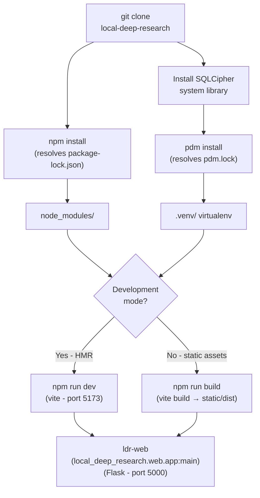
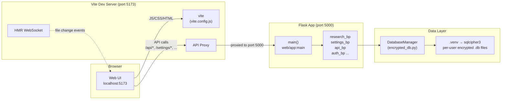

<!-- source: DeepWiki mcp.deepwiki.com · repo LearningCircuit/local-deep-research · page 2.3 Local Development Setup · fetched 2026-10-29 -->

# Local Development Setup

<details>
<summary>Relevant source files</summary>

The following files were used as context for generating this wiki page:

- [.file-whitelist.txt](.file-whitelist.txt)
- [.github/CODEOWNERS](.github/CODEOWNERS)
- [.github/scripts/file-whitelist-check.sh](.github/scripts/file-whitelist-check.sh)
- [.gitignore](.gitignore)
- [.gitleaks.toml](.gitleaks.toml)
- [.gitleaksignore](.gitleaksignore)
- [.pre-commit-config.yaml](.pre-commit-config.yaml)
- [.pre-commit-hooks/check-absolute-module-paths.py](.pre-commit-hooks/check-absolute-module-paths.py)
- [.pre-commit-hooks/file-whitelist-check.sh](.pre-commit-hooks/file-whitelist-check.sh)
- [.pre-commit-hooks/recommend-release-notes.py](.pre-commit-hooks/recommend-release-notes.py)
- [CONTRIBUTING.md](CONTRIBUTING.md)
- [README.md](README.md)
- [changelog.d/3670.breaking.1.md](changelog.d/3670.breaking.1.md)
- [changelog.d/3670.breaking.md](changelog.d/3670.breaking.md)
- [changelog.d/3670.feature.md](changelog.d/3670.feature.md)
- [changelog.d/3773.feature.md](changelog.d/3773.feature.md)
- [changelog.d/README.md](changelog.d/README.md)
- [docker-compose.gpu.override.yml](docker-compose.gpu.override.yml)
- [docs/CI_CD_INFRASTRUCTURE.md](docs/CI_CD_INFRASTRUCTURE.md)
- [docs/RELEASE_GUIDE.md](docs/RELEASE_GUIDE.md)
- [docs/SECURITY_REVIEW_PROCESS.md](docs/SECURITY_REVIEW_PROCESS.md)
- [docs/SQLCIPHER_INSTALL.md](docs/SQLCIPHER_INSTALL.md)
- [docs/decisions/0001-remove-detect-secrets.md](docs/decisions/0001-remove-detect-secrets.md)
- [docs/developing.md](docs/developing.md)
- [docs/docker-compose-guide.md](docs/docker-compose-guide.md)
- [docs/install-pip.md](docs/install-pip.md)
- [docs/installation.md](docs/installation.md)
- [pdm.lock](pdm.lock)
- [pyproject.toml](pyproject.toml)
- [src/local_deep_research/database/auth_db.py](src/local_deep_research/database/auth_db.py)
- [src/local_deep_research/database/encrypted_db.py](src/local_deep_research/database/encrypted_db.py)
- [src/local_deep_research/database/pool_config.py](src/local_deep_research/database/pool_config.py)
- [src/local_deep_research/database/sqlcipher_compat.py](src/local_deep_research/database/sqlcipher_compat.py)
- [src/local_deep_research/database/sqlcipher_utils.py](src/local_deep_research/database/sqlcipher_utils.py)
- [src/local_deep_research/database/thread_local_session.py](src/local_deep_research/database/thread_local_session.py)
- [src/local_deep_research/settings/env_definitions/bootstrap.py](src/local_deep_research/settings/env_definitions/bootstrap.py)
- [src/local_deep_research/settings/env_definitions/db_config.py](src/local_deep_research/settings/env_definitions/db_config.py)
- [src/local_deep_research/settings/env_settings.py](src/local_deep_research/settings/env_settings.py)
- [src/local_deep_research/web/auth/connection_cleanup.py](src/local_deep_research/web/auth/connection_cleanup.py)
- [src/local_deep_research/web/static/js/services/api.js](src/local_deep_research/web/static/js/services/api.js)
- [tests/database/test_database_manager_extended.py](tests/database/test_database_manager_extended.py)
- [tests/database/test_encrypted_db_coverage.py](tests/database/test_encrypted_db_coverage.py)
- [tests/database/test_encrypted_db_manager.py](tests/database/test_encrypted_db_manager.py)
- [tests/database/test_pool_config.py](tests/database/test_pool_config.py)
- [tests/database/test_sqlcipher_connection_factory.py](tests/database/test_sqlcipher_connection_factory.py)
- [tests/database/test_sqlcipher_integration.py](tests/database/test_sqlcipher_integration.py)
- [tests/database/test_sqlcipher_utils.py](tests/database/test_sqlcipher_utils.py)
- [tests/database/test_thread_local_session.py](tests/database/test_thread_local_session.py)
- [tests/database/test_thread_local_session_coverage.py](tests/database/test_thread_local_session_coverage.py)
- [tests/database/test_thread_local_session_deep_coverage.py](tests/database/test_thread_local_session_deep_coverage.py)
- [tests/infrastructure_tests/test_csrf_api.test.js](tests/infrastructure_tests/test_csrf_api.test.js)
- [tests/security/test_absolute_module_paths_hook.py](tests/security/test_absolute_module_paths_hook.py)

</details>


This page covers setting up Local Deep Research (LDR) to run from source without Docker: installing system dependencies, configuring the Python environment with PDM, building or hot-reloading the Vite frontend, and running the Flask development server.

---

## Prerequisites

| Tool | Minimum Version | Purpose |
|------|----------------|---------|
| Python | 3.12 (up to 3.14) | Runtime for the Flask application [pyproject.toml:10]() |
| Node.js | 24.x LTS | Frontend build via Vite |
| PDM | 2.26.2+ | Python dependency and virtualenv manager [pyproject.toml:143-145]() |
| SQLCipher | System library | AES-256 encrypted per-user databases [src/local_deep_research/database/encrypted_db.py:2]() |
| Playwright | 1.58.0 | UI and Browser-based research [pyproject.toml:36]() |

---

## Step 1: Clone the Repository

```bash
git clone https://github.com/LearningCircuit/local-deep-research.git
cd local-deep-research
```

---

## Step 2: Install SQLCipher System Libraries

SQLCipher is the AES-256 encrypted database engine used for every user's data store. The Python binding (`sqlcipher3` or `sqlcipher3-binary`) is declared as a dependency in [pyproject.toml:85-87]() and selected automatically by PDM based on platform:

| Platform | System Package Required | Python Package Selected by PDM |
|----------|------------------------|-------------------------------|
| Linux x86_64 | `libsqlcipher-dev`, `sqlcipher` | `sqlcipher3-binary` [pyproject.toml:85]() |
| Linux ARM64 | `libsqlcipher-dev`, `sqlcipher` | `sqlcipher3` [pyproject.toml:86]() |
| macOS / Other | Homebrew `sqlcipher` | `sqlcipher3` [pyproject.toml:87]() |

**Linux (Debian/Ubuntu):**
```bash
sudo apt update
sudo apt install sqlcipher libsqlcipher-dev build-essential pkg-config
```

**Skipping SQLCipher (unencrypted mode):**
If SQLCipher installation is not feasible, set the following environment variable before starting the application:

```bash
export LDR_BOOTSTRAP_ALLOW_UNENCRYPTED=true
```

> ⚠ This stores all user data — including API keys — in plaintext SQLite. Never use this in a production or shared environment [README.md:89]().

Sources: [pyproject.toml:85-87](), [README.md:89](), [src/local_deep_research/database/encrypted_db.py:58-60]()

---

## Step 3: Install Python Dependencies with PDM

PDM installs the exact versions pinned in [pdm.lock]() into a project-local virtualenv at `.venv/`.

```bash
pip install pdm
pdm install
```

The CLI entry points registered in `project.scripts` are available after installation:

| Command | Entry Point | File Reference |
|---------|-------------|----------------|
| `ldr` | `local_deep_research.main:main` | [pyproject.toml:110]() |
| `ldr-web` | `local_deep_research.web.app:main` | [pyproject.toml:111]() |
| `ldr-mcp` | `local_deep_research.mcp:run_server` | [pyproject.toml:112]() |

Sources: [pyproject.toml:110-112](), [pdm.lock:1-12]()

---

## Step 4: Install Frontend Dependencies and Build Assets

The frontend is managed by `npm` and bundled by `Vite`.

**Install dependencies:**
```bash
npm install
```

**Production build (required for Flask to serve assets):**
```bash
npm run build
```

This writes bundled assets into `src/local_deep_research/web/static/dist/`, which Flask serves as static files. These files are explicitly included in the package data [pyproject.toml:121]().

Sources: [pyproject.toml:121](), [.gitignore:251-253]()

---

## Running the Application

### Setup Flow Diagram

"Natural Language Space" to "Code Entity Space" mapping:

| Concept | Code Entity / Command |
|---------|-----------------------|
| Python Manager | `pdm` [pyproject.toml:3]() |
| Web Server | `ldr-web` [pyproject.toml:111]() |
| CLI Client | `ldr` [pyproject.toml:110]() |
| Test Runner | `pytest` [pyproject.toml:164]() |

**Development Setup Lifecycle**


Sources: [pyproject.toml:110-112](), [pdm.lock:1-10]()

### Two-server Architecture in Development



Sources: [pyproject.toml:111](), [pyproject.toml:85-87](), [src/local_deep_research/database/encrypted_db.py:48-52]()

---

## Testing

### Backend Tests (Pytest)
Run all tests using the virtual environment:
```bash
pdm run pytest tests/
```
Specific markers are available for `requires_llm`, `integration`, `slow`, and `asyncio` [pyproject.toml:180-185](). The global timeout is set to 60 seconds [pyproject.toml:187-189]().

### UI and E2E Tests
The project uses `Playwright` and `pytest` for UI and End-to-End testing. 

1. Ensure the app is running on port 5000.
2. Run UI tests: `pdm run pytest tests/ui_tests/`.
3. The test suite uses `isolated_db_manager` fixtures to manage unique test users and force `QueuePool` for concurrent-write integration [tests/database/test_sqlcipher_integration.py:27-50]().

Sources: [pyproject.toml:159-178](), [pyproject.toml:180-189](), [tests/database/test_sqlcipher_integration.py:27-50]()

---

## Troubleshooting

**SQLCipher "ModuleNotFoundError"**
Ensure system libraries (`libsqlcipher-dev`) are installed *before* `pdm install`. PDM uses specific logic to select `sqlcipher3-binary` on Linux x86_64 to simplify setup [pyproject.toml:85]().

**Lockfile Mismatch**
If `pyproject.toml` is updated without updating the lockfile, run `pdm lock` to synchronize.

**Environment Overrides**
Environment variables prefixed with `LDR_` will force settings. To use unencrypted SQLite during development if SQLCipher is missing, use `LDR_BOOTSTRAP_ALLOW_UNENCRYPTED=true` [README.md:89]().

**Pre-commit Hooks**
The repository uses 26+ custom pre-commit hooks for security and quality, including `check-env-vars`, `check-ldr-db-usage`, and `file-whitelist-check` [.pre-commit-config.yaml:73-163](). Run them manually via:
```bash
pdm run pre-commit run --all-files
```

Sources: [pyproject.toml:85-87](), [README.md:89](), [.pre-commit-config.yaml:73-163]()

---

