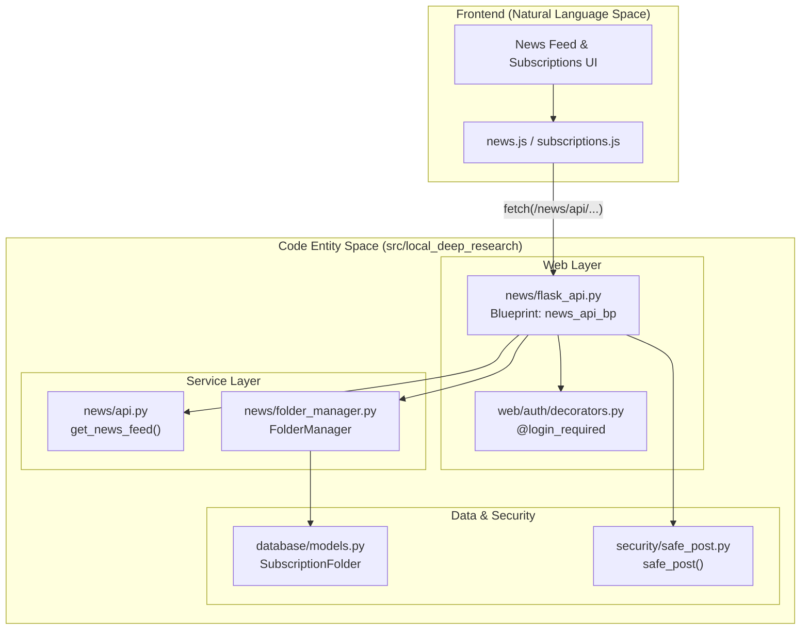
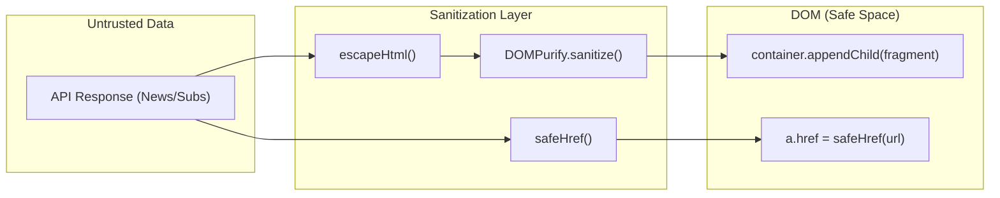

<!-- source: DeepWiki mcp.deepwiki.com · repo LearningCircuit/local-deep-research · page 6.3 News and Subscription Management · fetched 2026-10-29 -->

# News and Subscription Management

Relevant source files

The following files were used as context for generating this wiki page:

- [SECURITY.md](SECURITY.md)
- [docs/NOTIFICATIONS.md](docs/NOTIFICATIONS.md)
- [eslint.config.js](eslint.config.js)
- [src/local_deep_research/database/session_context.py](src/local_deep_research/database/session_context.py)
- [src/local_deep_research/news/api.py](src/local_deep_research/news/api.py)
- [src/local_deep_research/news/core/storage_manager.py](src/local_deep_research/news/core/storage_manager.py)
- [src/local_deep_research/news/flask_api.py](src/local_deep_research/news/flask_api.py)
- [src/local_deep_research/news/web.py](src/local_deep_research/news/web.py)
- [src/local_deep_research/notifications/manager.py](src/local_deep_research/notifications/manager.py)
- [src/local_deep_research/notifications/service.py](src/local_deep_research/notifications/service.py)
- [src/local_deep_research/security/notification_validator.py](src/local_deep_research/security/notification_validator.py)
- [src/local_deep_research/security/ssrf_validator.py](src/local_deep_research/security/ssrf_validator.py)
- [src/local_deep_research/settings/env_definitions/security.py](src/local_deep_research/settings/env_definitions/security.py)
- [src/local_deep_research/web/static/js/components/fallback/ui.js](src/local_deep_research/web/static/js/components/fallback/ui.js)
- [src/local_deep_research/web/static/js/components/history.js](src/local_deep_research/web/static/js/components/history.js)
- [src/local_deep_research/web/static/js/components/library_search.js](src/local_deep_research/web/static/js/components/library_search.js)
- [src/local_deep_research/web/static/js/components/logpanel.js](src/local_deep_research/web/static/js/components/logpanel.js)
- [src/local_deep_research/web/static/js/components/research.js](src/local_deep_research/web/static/js/components/research.js)
- [src/local_deep_research/web/static/js/components/subscription-manager.js](src/local_deep_research/web/static/js/components/subscription-manager.js)
- [src/local_deep_research/web/static/js/pages/news.js](src/local_deep_research/web/static/js/pages/news.js)
- [src/local_deep_research/web/static/js/pages/subscriptions.js](src/local_deep_research/web/static/js/pages/subscriptions.js)
- [src/local_deep_research/web/static/js/research_form.js](src/local_deep_research/web/static/js/research_form.js)
- [src/local_deep_research/web/static/js/security/xss-protection.js](src/local_deep_research/web/static/js/security/xss-protection.js)
- [src/local_deep_research/web/static/js/services/socket.js](src/local_deep_research/web/static/js/services/socket.js)
- [src/local_deep_research/web/static/js/services/ui.js](src/local_deep_research/web/static/js/services/ui.js)
- [src/local_deep_research/web/static/js/utils/log-helpers.js](src/local_deep_research/web/static/js/utils/log-helpers.js)
- [src/local_deep_research/web/templates/pages/research.html](src/local_deep_research/web/templates/pages/research.html)
- [tests/infrastructure_tests/test_xss_protection.test.js](tests/infrastructure_tests/test_xss_protection.test.js)
- [tests/js/utils/form-validation.test.js](tests/js/utils/form-validation.test.js)
- [tests/news/test_api_functions_extended.py](tests/news/test_api_functions_extended.py)
- [tests/news/test_api_module_extended.py](tests/news/test_api_module_extended.py)
- [tests/news/test_news_api.py](tests/news/test_news_api.py)
- [tests/news/test_news_api_coverage.py](tests/news/test_news_api_coverage.py)
- [tests/news/test_news_api_extended.py](tests/news/test_news_api_extended.py)
- [tests/news/test_storage_manager.py](tests/news/test_storage_manager.py)
- [tests/news/test_storage_manager_extended.py](tests/news/test_storage_manager_extended.py)
- [tests/notifications/conftest.py](tests/notifications/conftest.py)
- [tests/notifications/test_manager.py](tests/notifications/test_manager.py)
- [tests/notifications/test_service.py](tests/notifications/test_service.py)
- [tests/ui_tests/playwright/tests/theme-visual-regression.spec.js](tests/ui_tests/playwright/tests/theme-visual-regression.spec.js)
- [tests/web/services/test_notification_coverage.py](tests/web/services/test_notification_coverage.py)

This document describes the News and Subscription Management subsystem, which enables users to monitor news topics, RSS feeds, and search queries, automatically triggering research tasks and providing a personalized news feed.

---

## Purpose and Scope

The News and Subscription Management system provides:

1.  **News Monitoring**: Automated tracking of topics using LLM-powered analyzers and search strategies [src/local_deep_research/news/api.py:154-161]().
2.  **Subscription Management**: Tools to create, update, and organize subscriptions with custom refresh intervals [src/local_deep_research/news/flask_api.py:193-204]().
3.  **Intelligent Scheduler**: A background service with activity-based tracking and jitter settings to prevent API spikes and resource contention.
4.  **News Analyzer & Headline Generator**: AI components that synthesize search results into structured news items and generate concise, meaningful headlines.
5.  **Flask News API**: Secure endpoints for feed retrieval, subscription control, and user feedback [src/local_deep_research/news/flask_api.py:101-105]().

The system is designed with a "local-first" philosophy, storing all subscription configurations and news history in encrypted per-user databases [src/local_deep_research/database/session_context.py:15-16]().

---

## System Architecture

### Component Overview

The following diagram bridges the high-level news features to the specific code entities that implement them.

**Title: News System Code-to-Entity Mapping**

**Sources:** [src/local_deep_research/news/flask_api.py:101-124](), [src/local_deep_research/news/flask_api.py:193-196](), [src/local_deep_research/web/static/js/pages/news.js:141-146](), [src/local_deep_research/web/static/js/pages/subscriptions.js:49-55]()

---

### Data Flow: Personalized News Retrieval

1.  **Client Request**: The frontend `news.js` calls `loadNewsFeed()`, which performs a GET request to `/news/api/feed` [src/local_deep_research/web/static/js/pages/news.js:173]().
2.  **Authentication**: The Flask route is protected by `@login_required`, ensuring the `session["username"]` is available [src/local_deep_research/news/flask_api.py:123]().
3.  **Service Invocation**: The API calls the underlying `api.get_news_feed` with parameters for limits, focus, and subscription IDs [src/local_deep_research/news/flask_api.py:154-161]().
4.  **Database Query**: The system retrieves news items associated with the user's specific research history and subscriptions from the encrypted database [src/local_deep_research/news/flask_api.py:137-140]().
5.  **Sanitization & Response**: Results are returned as JSON. If errors occur, they are passed through `safe_error_message` to prevent leaking internal system details [src/local_deep_research/news/flask_api.py:166-171]().

**Sources:** [src/local_deep_research/news/flask_api.py:122-182](), [src/local_deep_research/web/static/js/pages/news.js:173-176]()

---

## News Scheduler and API Control

### Scheduler Security
Global scheduler controls are gated by the `scheduler_control_required` decorator. This checks the `news.scheduler.allow_api_control` setting (env var `LDR_NEWS_SCHEDULER_ALLOW_API_CONTROL`) [src/local_deep_research/news/flask_api.py:23-33]().

| Setting | Key | Default |
| :--- | :--- | :--- |
| **API Control** | `news.scheduler.allow_api_control` | `False` [src/local_deep_research/news/flask_api.py:37]() |
| **Default Limit** | `news.feed.default_limit` | From Settings Manager [src/local_deep_research/news/flask_api.py:142-143]() |

### Error Handling Strategy
The `safe_error_message` function provides a security layer by mapping internal exceptions to generic messages for the client [src/local_deep_research/news/flask_api.py:62-84]().

- **ValueError**: Returns "Invalid input provided" [src/local_deep_research/news/flask_api.py:77-78]().
- **KeyError**: Returns "Required data missing" [src/local_deep_research/news/flask_api.py:79-80]().
- **TypeError**: Returns "Invalid data format" [src/local_deep_research/news/flask_api.py:81-82]().

---

## Subscription Management

### Folder and Subscription Logic
Subscriptions are managed via the `SubscriptionFolder` model and the `FolderManager` utility [src/local_deep_research/news/flask_api.py:12-13](). Users can group subscriptions into folders for better organization in the UI [src/local_deep_research/web/static/js/pages/subscriptions.js:133-141]().

### API Endpoints

| Endpoint | Method | Function |
| :--- | :--- | :--- |
| `/api/feed` | `GET` | Retrieves the personalized news feed [src/local_deep_research/news/flask_api.py:122]() |
| `/api/subscribe` | `POST` | Creates a new subscription (search or topic) [src/local_deep_research/news/flask_api.py:193]() |
| `/api/subscription/folders` | `GET` | Lists user subscription folders [src/local_deep_research/web/static/js/pages/subscriptions.js:133-135]() |

**Sources:** [src/local_deep_research/news/flask_api.py:122-204](), [src/local_deep_research/web/static/js/pages/subscriptions.js:97-148]()

---

## Frontend Implementation

### News Page (news.js)
The news page implements a sophisticated feed viewer with:
- **XSS Protection**: Uses `DOMPurify` and `escapeHtml` for all dynamic content rendering [src/local_deep_research/web/static/js/pages/news.js:2-26]().
- **Safe Href Handling**: A `safeHref` function validates URLs to block `javascript:` and `data:` schemes [src/local_deep_research/web/static/js/pages/news.js:37-50]().
- **Hybrid Search**: Supports text and semantic search modes for finding specific news items [src/local_deep_research/web/static/js/pages/news.js:82-88]().

### Subscription Manager (subscriptions.js)
Handles the lifecycle of subscriptions on the client side:
- **Refresh Intervals**: Logic to convert minutes into human-readable strings (e.g., "Every 15 minutes", "Hourly", "Daily") [src/local_deep_research/web/static/js/pages/subscriptions.js:179-196]().
- **Timezone Correction**: Automatically adjusts UTC timestamps from the database to the user's local time [src/local_deep_research/web/static/js/pages/subscriptions.js:20-46]().

**Title: Frontend Security Data Flow**

**Sources:** [src/local_deep_research/web/static/js/pages/news.js:5-50](), [src/local_deep_research/web/static/js/pages/subscriptions.js:20-46](), [src/local_deep_research/web/static/js/security/xss-protection.js:94-120]()

---

