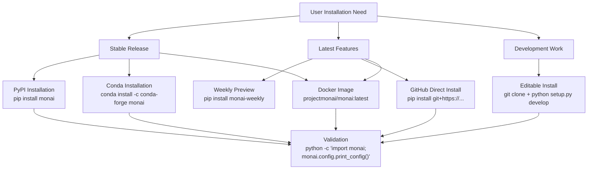
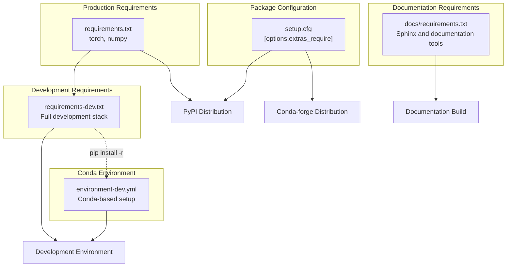
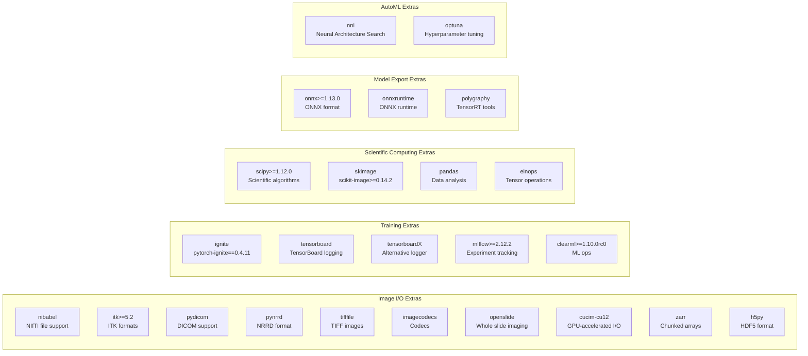
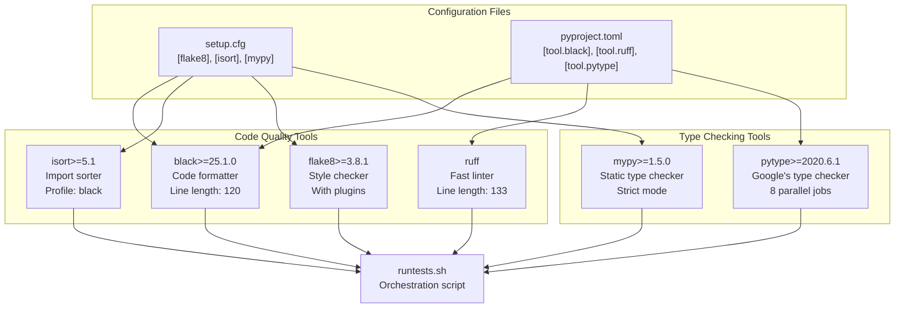
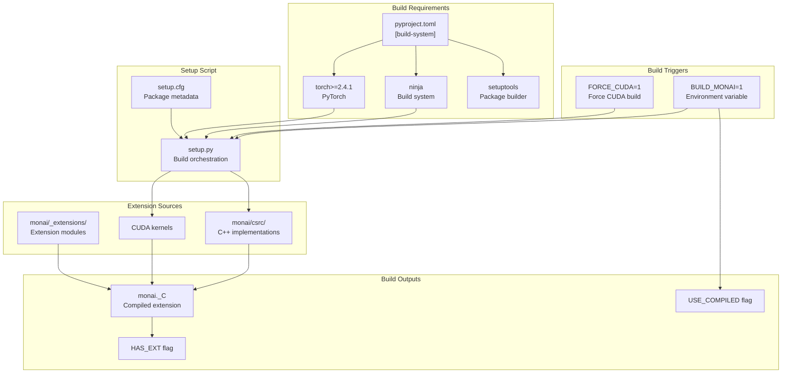
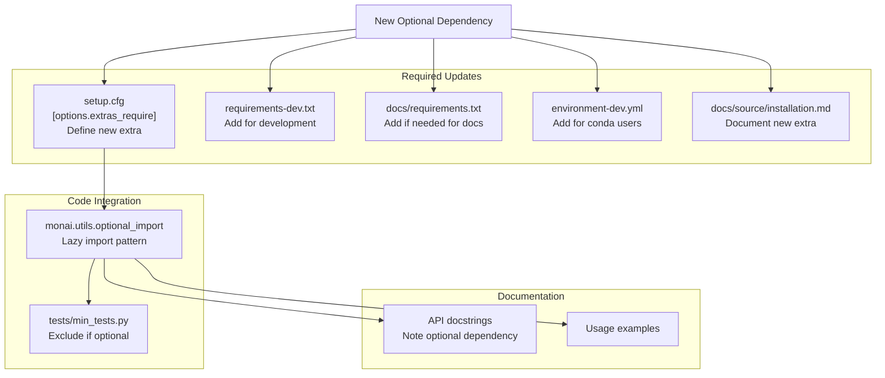

<!-- source: DeepWiki mcp.deepwiki.com · repo Project-MONAI/MONAI · page 7.1 Project Setup and Dependencies · fetched 2026-10-21 -->

# Project Setup and Dependencies

<details>
<summary>Relevant source files</summary>

The following files were used as context for generating this wiki page:

- [.gitignore](.gitignore)
- [CONTRIBUTING.md](CONTRIBUTING.md)
- [docs/requirements.txt](docs/requirements.txt)
- [docs/source/conf.py](docs/source/conf.py)
- [docs/source/installation.md](docs/source/installation.md)
- [environment-dev.yml](environment-dev.yml)
- [monai/config/deviceconfig.py](monai/config/deviceconfig.py)
- [pyproject.toml](pyproject.toml)
- [requirements-dev.txt](requirements-dev.txt)
- [requirements.txt](requirements.txt)
- [runtests.sh](runtests.sh)
- [setup.cfg](setup.cfg)

</details>


This page documents MONAI's installation methods, dependency management, and development environment setup. It covers the requirements files, package distribution mechanisms, optional dependencies, and build system configuration.

For information about CI/CD workflows and automated testing, see [CI/CD Workflows and Testing](#7.2). For packaging and release processes, see [Packaging and Distribution](#7.3).

---

## Core Requirements

MONAI requires Python 3.9 or higher and has minimal core dependencies to maintain flexibility across different deployment environments.

### Minimum Dependencies

| Package | Version Constraint | Purpose |
|---------|-------------------|---------|
| `torch` | `>=2.4.1` | Deep learning framework |
| `numpy` | `>=1.24,<3.0` | Numerical computing |

**Sources:** [setup.cfg:35-46](), [requirements.txt:1-3]()

### Build-Time Dependencies

The build system requires additional packages when compiling from source:

```toml
# pyproject.toml build system requirements
requires = [
    "wheel",
    "setuptools", 
    "more-itertools>=8.0",
    "torch>=2.4.1",
    "ninja",
    "packaging"
]
```

These dependencies enable C++/CUDA extension compilation and package building.

**Sources:** [pyproject.toml:1-9]()

---

## Installation Methods

MONAI provides multiple installation pathways to accommodate different use cases.



**Diagram: Installation Method Decision Tree**

**Sources:** [docs/source/installation.md:42-264]()

### PyPI Installation

#### Milestone Release

```bash
pip install monai
```

Installs the latest stable release from [PyPI](https://pypi.org/project/monai).

#### Weekly Preview Release

```bash
pip install monai-weekly
```

Published every Sunday with pre-release build number `dev[%y%U]`. These packages coexist in separate namespaces but should not be installed simultaneously to avoid `ImportError`.

**Sources:** [docs/source/installation.md:42-80]()

### Conda Installation

```bash
conda install -c conda-forge monai
```

Distributed through conda-forge channel with automated dependency resolution.

**Sources:** [docs/source/installation.md:82-88]()

### GitHub Installation

#### Direct Installation

```bash
# Standard installation
pip install git+https://github.com/Project-MONAI/MONAI

# With C++/CUDA extensions
BUILD_MONAI=1 pip install git+https://github.com/Project-MONAI/MONAI

# With existing PyTorch (no build isolation)
BUILD_MONAI=1 pip install --no-build-isolation git+https://github.com/Project-MONAI/MONAI
```

#### Editable Installation

```bash
git clone https://github.com/Project-MONAI/MONAI.git
cd MONAI/
python setup.py develop

# With C++/CUDA extensions
BUILD_MONAI=1 python setup.py develop

# For macOS
BUILD_MONAI=1 CC=clang CXX=clang++ python setup.py develop
```

To uninstall:

```bash
cd MONAI/
python setup.py develop --uninstall
./runtests.sh --clean
```

**Sources:** [docs/source/installation.md:90-162](), [runtests.sh:142-153]()

### Docker Installation

```bash
# Latest dev branch
docker run --gpus all --rm -ti --ipc=host projectmonai/monai:latest

# Specific version
docker run --gpus all --rm -ti --ipc=host projectmonai/monai:0.1.0
```

Docker images include NVIDIA driver support and pre-compiled C++/CUDA extensions.

**Sources:** [docs/source/installation.md:193-211]()

---

## Requirements Files Structure

MONAI uses multiple requirements files for different use cases:



**Diagram: Requirements Files Organization**

**Sources:** [requirements.txt](), [requirements-dev.txt](), [docs/requirements.txt](), [environment-dev.yml](), [setup.cfg]()

### requirements.txt

Minimal production requirements for core MONAI functionality:

```
torch>=2.4.1
numpy>=1.24,<3.0
```

Platform-specific constraints applied (e.g., Windows excludes torch 2.7.0).

**Sources:** [requirements.txt:1-3]()

### requirements-dev.txt

Comprehensive development dependencies including:

| Category | Packages |
|----------|----------|
| **Testing Framework** | `pytorch-ignite==0.4.11` |
| **Code Quality** | `flake8`, `black>=25.1.0`, `isort>=5.1`, `ruff`, `mypy>=1.5.0`, `pytype` |
| **Image I/O** | `itk>=5.2`, `nibabel`, `pillow`, `pydicom`, `pynrrd` |
| **Scientific Computing** | `scipy>=1.12.0`, `scikit-image>=0.19.0`, `pandas` |
| **Deep Learning Extensions** | `torchvision`, `einops`, `transformers>=4.53.0` |
| **Experiment Tracking** | `tensorboard>=2.12.0`, `mlflow>=2.12.2`, `clearml>=1.10.0rc0` |
| **Hyperparameter Optimization** | `nni==2.10.1`, `optuna` |
| **Model Export** | `onnx>=1.13.0`, `onnxruntime` |
| **GPU Acceleration** | `cucim-cu12` (Linux, Python 3.9-3.10) |

**Sources:** [requirements-dev.txt:1-67](), [CONTRIBUTING.md:199-227]()

### docs/requirements.txt

Documentation build dependencies:

- Sphinx and extensions (`sphinx-autodoc-typehints==1.11.1`)
- Theme (`pydata-sphinx-theme`)
- Markdown support (`recommonmark==0.6.0`, `commonmark==0.9.1`)
- CPU-only PyTorch for ReadTheDocs builds

**Sources:** [docs/requirements.txt:1-46]()

### environment-dev.yml

Conda environment specification:

```yaml
name: monai
channels:
  - pytorch
  - defaults
  - nvidia
  - conda-forge
dependencies:
  - numpy>=1.24,<3.0
  - pytorch>=2.3.0
  - torchio
  - torchvision
  - pytorch-cuda>=11.6
  - pip
  - pip:
    - -r requirements-dev.txt
```

Provides CUDA-enabled PyTorch through conda channels, then installs remaining dependencies via pip.

**Sources:** [environment-dev.yml:1-16]()

---

## Optional Dependencies (Extras)

MONAI uses setuptools extras syntax to provide optional feature sets:

```python
# Install specific extras
pip install 'monai[nibabel,skimage]'

# Install all optional dependencies
pip install 'monai[all]'
```

### Available Extras

The `setup.cfg` defines modular extras that map to specific packages:



**Diagram: Optional Dependency Categories**

| Extra Name | Mapped Package(s) | Use Case |
|------------|------------------|----------|
| `nibabel` | `nibabel` | NIfTI medical image format |
| `itk` | `itk>=5.2` | ITK image I/O |
| `pydicom` | `pydicom` | DICOM medical images |
| `ignite` | `pytorch-ignite==0.4.11` | Training workflows |
| `tensorboard` | `tensorboard` | TensorBoard integration |
| `scipy` | `scipy>=1.12.0` | Scientific computing |
| `skimage` | `scikit-image>=0.14.2` | Image processing |
| `transformers` | `transformers>=4.36.0` | Transformer models |
| `mlflow` | `mlflow>=2.12.2` | Experiment tracking |
| `nni` | `nni` | AutoML and NAS |
| `optuna` | `optuna` | Hyperparameter optimization |
| `onnx` | `onnx>=1.13.0`, `onnxruntime` | ONNX model export |
| `all` | All above packages | Complete installation |

**Sources:** [setup.cfg:48-181](), [docs/source/installation.md:213-264]()

### Platform-Specific Dependencies

Some extras have platform constraints:

```python
# Linux and Darwin only
imagecodecs; platform_system == "Linux" or platform_system == "Darwin"
tifffile; platform_system == "Linux" or platform_system == "Darwin"

# Linux with specific Python versions
cucim-cu12; platform_system == "Linux" and python_version >= '3.9' and python_version <= '3.10'

# Non-ARM Linux systems
nni; platform_system == "Linux" and "arm" not in platform_machine and "aarch" not in platform_machine
```

**Sources:** [setup.cfg:64-82](), [requirements-dev.txt:30-51]()

---

## Development Environment Setup

### Quick Start

```bash
# Clone repository
git clone https://github.com/Project-MONAI/MONAI.git
cd MONAI/

# Install development dependencies
python -m pip install -U pip
python -m pip install -U -r requirements-dev.txt

# Install in editable mode
python setup.py develop --user

# Verify installation
python -c "import monai; monai.config.print_config()"
```

**Sources:** [CONTRIBUTING.md:56-67](), [runtests.sh:137-140]()

### Using Conda

```bash
git clone https://github.com/Project-MONAI/MONAI.git
cd MONAI/

# Create and activate environment
conda create -n monai python=3.9
conda env update -n monai -f environment-dev.yml
conda activate monai

# Install in editable mode
python setup.py develop
```

**Sources:** [docs/source/installation.md:236-250]()

### Development Tools Configuration

The development environment includes pre-configured linting and formatting tools:



**Diagram: Development Toolchain Configuration**

**Sources:** [requirements-dev.txt:13-25](), [setup.cfg:182-276](), [pyproject.toml:11-88]()

#### Formatter Configuration

```bash
# Run all formatters
./runtests.sh --autofix

# Individual formatters
./runtests.sh --black
./runtests.sh --isort
./runtests.sh --ruff
```

Black configuration ([pyproject.toml:11-35]()):
- Line length: 120
- Target versions: Python 3.9-3.12
- Skip magic trailing comma

Isort configuration ([setup.cfg:212-219]()):
- Profile: black
- Line length: 120
- Auto-add: `from __future__ import annotations`

Ruff configuration ([pyproject.toml:41-56]()):
- Line length: 133
- Enabled rules: E, F, W (flake8), NPY (NumPy), UP (pyupgrade)

**Sources:** [runtests.sh:465-623](), [pyproject.toml:11-56](), [setup.cfg:212-219]()

#### Type Checker Configuration

```bash
# Run type checkers
./runtests.sh --mypy
./runtests.sh --pytype -j 8
```

Mypy configuration ([setup.cfg:229-275]()):
- Strict equality checks
- No implicit optional
- Check untyped definitions for specific modules

Pytype configuration ([pyproject.toml:58-88]()):
- 8 parallel jobs
- Experimental features: precise return types, protocols
- Output directory: `.pytype/`

**Sources:** [runtests.sh:626-679](), [setup.cfg:229-275](), [pyproject.toml:58-88]()

---

## Build System Configuration

MONAI uses PEP 517 build system with optional C++/CUDA extension compilation.



**Diagram: C++/CUDA Extension Build System**

**Sources:** [pyproject.toml:1-9](), [setup.cfg:35-46](), [monai/config/deviceconfig.py:30-34]()

### Build System Requirements

Defined in `pyproject.toml`:

```toml
[build-system]
requires = [
  "wheel",
  "setuptools",
  "more-itertools>=8.0",
  "torch>=2.4.1",
  "ninja",
  "packaging"
]
```

- `wheel`: Binary package format
- `setuptools`: Package building
- `more-itertools`: Iteration utilities
- `torch`: Required for extension compilation
- `ninja`: Fast build system (required for C++/CUDA extensions)
- `packaging`: Version parsing

**Sources:** [pyproject.toml:1-9]()

### Build Environment Variables

| Variable | Purpose | Default |
|----------|---------|---------|
| `BUILD_MONAI` | Enable C++/CUDA extension compilation | `0` |
| `FORCE_CUDA` | Force CUDA extension build | Auto-detect |
| `CC` | C compiler (macOS) | System default |
| `CXX` | C++ compiler (macOS) | System default |

**Sources:** [monai/config/deviceconfig.py:30-34](), [docs/source/installation.md:107-148]()

### Extension Detection

At runtime, MONAI checks for compiled extensions:

```python
# monai/config/deviceconfig.py
try:
    _, HAS_EXT = optional_import("monai._C")
    USE_COMPILED = HAS_EXT and os.getenv("BUILD_MONAI", "0") == "1"
except (OptionalImportError, ImportError, AttributeError):
    HAS_EXT = USE_COMPILED = False
```

These flags determine whether optimized C++/CUDA implementations are used.

**Sources:** [monai/config/deviceconfig.py:30-34]()

### Platform-Specific Build Notes

**macOS:**
```bash
# Use Clang compiler
BUILD_MONAI=1 CC=clang CXX=clang++ python setup.py develop
```

**Linux:**
```bash
# Standard build
BUILD_MONAI=1 python setup.py develop
```

**Windows:**
- Requires Visual Studio Build Tools
- CUDA Toolkit must be installed manually
- `CUDA_PATH` environment variable must be set

**Sources:** [runtests.sh:142-153](), [docs/source/installation.md:107-167]()

---

## Validation and Configuration

### Installation Verification

```bash
# Check import
python -c "import monai; monai.config.print_config()"
```

The `print_config()` function outputs:

```python
# monai.config.print_config() output
MONAI version: 0.1.0+144.g52c763d.dirty
Numpy version: 1.26.0
Pytorch version: 2.4.1
MONAI flags: HAS_EXT = True, USE_COMPILED = True, USE_META_DICT = False
MONAI rev id: <git commit hash>
MONAI __file__: /path/to/monai/__init__.py

Optional dependencies:
Pytorch Ignite version: 0.4.11
ITK version: 5.2.0
...
```

**Sources:** [monai/config/deviceconfig.py:95-118](), [docs/source/installation.md:169-192]()

### Version String Format

MONAI version strings follow this pattern:

```
0.1.0+144.g52c763d.dirty
│     │   │         │
│     │   │         └─ Local modifications present
│     │   └─────────── Git commit hash prefix
│     └─────────────── Commits ahead of milestone
└───────────────────── Base version (milestone)
```

**Sources:** [docs/source/installation.md:180-191]()

### Debug Information

```bash
# Print comprehensive system info
python -m monai.config.deviceconfig
```

Or programmatically:

```python
from monai.config import print_debug_info
print_debug_info()
```

This outputs:
- Package versions (MONAI, NumPy, PyTorch, optional dependencies)
- System information (OS, CPU, memory)
- GPU information (CUDA version, device properties)

**Sources:** [monai/config/deviceconfig.py:245-264](), [monai/config/deviceconfig.py:127-243]()

---

## Dependency Addition Workflow

When adding new optional dependencies, update these files:



**Diagram: Adding New Optional Dependencies**

### Implementation Pattern

```python
from monai.utils import optional_import

# Lazy import with fallback
itk, has_itk = optional_import("itk", "5.2")

class ITKReader(ImageReader):
    def read(self, ...):
        if not has_itk:
            raise ImportError("ITK required for ITKReader")
        return itk.imread(...)
```

This pattern ensures:
- Import errors only occur when feature is actually used
- Minimal requirements remain truly minimal
- Integration tests pass without optional dependencies

**Sources:** [CONTRIBUTING.md:198-244]()

### Files to Update

1. **[setup.cfg:48-181]()** - Add to `[options.extras_require]`
2. **[requirements-dev.txt]()** - Add with version constraints
3. **[docs/requirements.txt]()** - Add if needed for doc builds
4. **[environment-dev.yml]()** - Add for conda users
5. **[docs/source/installation.md:254-262]()** - Document the extra
6. **Test files** - Use `@skipUnless(has_package, ...)` or add to `exclude_cases` in `tests/min_tests.py`

**Sources:** [CONTRIBUTING.md:198-244]()

---

## Common Setup Tasks

### Running Tests

```bash
# Full test suite with coverage
./runtests.sh -f -u --net --coverage

# Quick tests (skip long-running tests)
./runtests.sh --quick --unittests

# Minimal tests (no optional dependencies)
./runtests.sh --min
```

**Sources:** [runtests.sh:62-119](), [CONTRIBUTING.md:102-138]()

### Code Formatting

```bash
# Auto-fix formatting issues
./runtests.sh --autofix

# Check formatting only
./runtests.sh --codeformat

# Format specific path
./runtests.sh --formatfix -p /path/to/code
```

**Sources:** [runtests.sh:63-118]()

### Cleaning Build Artifacts

```bash
# Clean all temporary files and uninstall
./runtests.sh --clean
```

This removes:
- Compiled Python files (`*.pyc`, `*.pyo`)
- C++ extensions (`*.so`)
- Build directories (`build/`, `dist/`, `*.egg-info/`)
- Cache directories (`.mypy_cache/`, `.pytype/`, `.coverage/`)
- Development installation

**Sources:** [runtests.sh:173-201]()

### Building Documentation

```bash
pip install -r docs/requirements.txt
cd docs/
make html
# Output: docs/build/html/index.html
```

**Sources:** [CONTRIBUTING.md:154-182](), [docs/requirements.txt]()

---

**Sources:** [setup.cfg](), [requirements-dev.txt](), [requirements.txt](), [pyproject.toml](), [environment-dev.yml](), [docs/source/installation.md](), [CONTRIBUTING.md](), [runtests.sh](), [monai/config/deviceconfig.py](), [docs/requirements.txt]()

---

