<!-- source: DeepWiki mcp.deepwiki.com · repo Project-MONAI/MONAI · extra page Bundle Format and Structure · fetched 2026-10-21 -->

# Bundle Format and Structure

<details>
<summary>Relevant source files</summary>

The following files were used as context for generating this wiki page:

- [README.md](README.md)
- [docs/images/MONAI_arch.png](docs/images/MONAI_arch.png)
- [docs/images/MONAI_bundle_cloud.png](docs/images/MONAI_bundle_cloud.png)
- [docs/images/MONAI_clouds.png](docs/images/MONAI_clouds.png)
- [docs/images/MONAI_map_cloud.png](docs/images/MONAI_map_cloud.png)
- [docs/source/bundle.rst](docs/source/bundle.rst)
- [docs/source/bundle_intro.rst](docs/source/bundle_intro.rst)
- [docs/source/index.rst](docs/source/index.rst)
- [docs/source/mb_specification.rst](docs/source/mb_specification.rst)
- [monai/bundle/__init__.py](monai/bundle/__init__.py)
- [monai/bundle/__main__.py](monai/bundle/__main__.py)
- [monai/bundle/properties.py](monai/bundle/properties.py)
- [monai/bundle/scripts.py](monai/bundle/scripts.py)
- [monai/bundle/workflows.py](monai/bundle/workflows.py)
- [tests/bundle/test_bundle_download.py](tests/bundle/test_bundle_download.py)
- [tests/networks/nets/test_autoencoderkl.py](tests/networks/nets/test_autoencoderkl.py)
- [tests/nonconfig_workflow.py](tests/nonconfig_workflow.py)
- [tests/testing_data/fl_infer_properties.json](tests/testing_data/fl_infer_properties.json)
- [tests/testing_data/metadata.json](tests/testing_data/metadata.json)
- [tests/testing_data/python_workflow_properties.json](tests/testing_data/python_workflow_properties.json)
- [tests/testing_data/responsive_inference.json](tests/testing_data/responsive_inference.json)

</details>


This document describes the standardized directory structure, file formats, and metadata specifications for MONAI Bundles. A MONAI Bundle is a packaged deep learning model with associated metadata, configurations, and documentation that enables distribution, reproducibility, and integration into various applications.

For information about bundle workflows and execution, see [Bundle Scripts and Workflows](#6.1.2). For the overall bundle system architecture, see [Bundle System](#6.1).

---

## Bundle Directory Structure

A MONAI Bundle follows a standardized directory layout that ensures consistency and machine-readability across all bundles distributed through the MONAI Model Zoo and other sources.

### Required Directory Tree

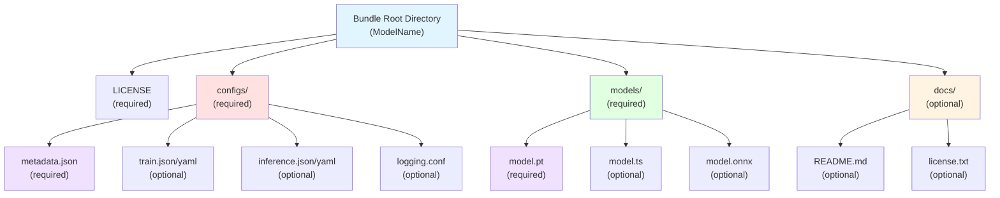

Sources: [docs/source/mb_specification.rst:13-46]()

### Required Files

| File Path | Purpose | Format |
|-----------|---------|--------|
| `LICENSE` | Software license for the bundle | Plain text |
| `configs/metadata.json` | Model metadata and specifications | JSON |
| `models/model.pt` | PyTorch state dictionary | PyTorch pickle |

### Optional Files

| File Path | Purpose | Format |
|-----------|---------|--------|
| `models/model.ts` | TorchScript saved model | TorchScript archive |
| `models/model.onnx` | ONNX model export | ONNX format |
| `docs/README.md` | Model documentation | Markdown |
| `docs/license.txt` | Data license information | Plain text |
| `configs/train.json` | Training configuration | JSON/YAML |
| `configs/inference.json` | Inference configuration | JSON/YAML |
| `configs/logging.conf` | Logging configuration | Python logging config |

Sources: [docs/source/mb_specification.rst:33-46]()

---

## Bundle Archive Formats

MONAI Bundles can be distributed in multiple archive formats to support different use cases and workflows.

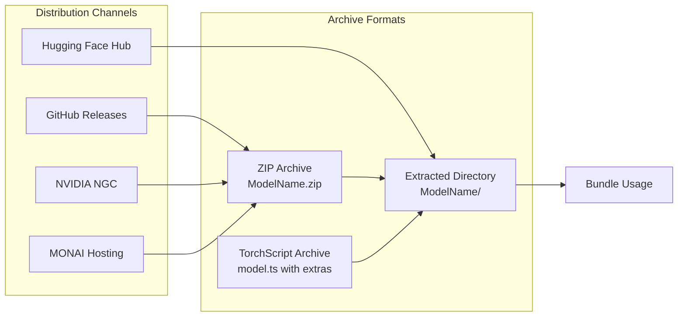

Sources: [docs/source/mb_specification.rst:48-56](), [monai/bundle/scripts.py:190-625]()

### ZIP Archive Format

ZIP archives must preserve the bundle directory structure when extracted. The archive should contain a single top-level directory named after the model:

```
ModelName.zip
  └── ModelName/
      ├── LICENSE
      ├── configs/
      │   └── metadata.json
      └── models/
          └── model.pt
```

The `download()` function handles extraction with the `has_base=True` parameter to ensure proper directory structure:

```python
extractall(filepath=filepath, output_dir=bundle_dir, has_base=True)
```

Sources: [monai/bundle/scripts.py:196-197](), [docs/source/mb_specification.rst:48-51]()

### TorchScript Archive Format

TorchScript files are ZIP archives with a specific internal structure. When creating a bundle in TorchScript format using `save_net_with_metadata()`, the metadata and additional files are stored in an `extras/` directory within the archive:

- Metadata from `metadata.json` passed as `meta_values` argument
- Additional files (README.md, license.txt) passed as `more_extra_files` entries
- Retrieved using `load_net_with_metadata()` or standard ZIP tools

Sources: [docs/source/mb_specification.rst:52-56](), [monai/bundle/scripts.py:730-732]()

---

## metadata.json Specification

The `metadata.json` file is the core descriptor for a bundle, containing all information necessary to understand and use the model programmatically.

### Required Fields

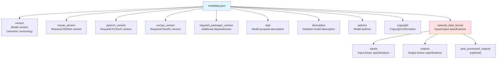

Sources: [docs/source/mb_specification.rst:57-72]()

### Example metadata.json Structure

```json
{
    "schema": "https://github.com/Project-MONAI/MONAI-extra-test-data/releases/download/0.8.1/meta_schema_20220324.json",
    "version": "0.1.0",
    "monai_version": "0.9.0",
    "pytorch_version": "1.10.0",
    "numpy_version": "1.21.2",
    "required_packages_version": {
        "nibabel": "3.2.1"
    },
    "task": "Decathlon spleen segmentation",
    "description": "A pre-trained model for volumetric (3D) segmentation",
    "authors": "MONAI team",
    "copyright": "Copyright (c) MONAI Consortium"
}
```

Sources: [tests/testing_data/metadata.json:1-30](), [docs/source/mb_specification.rst:115-174]()

### Optional Fields

| Field | Purpose | Type |
|-------|---------|------|
| `changelog` | Dictionary of version changes | `dict[str, str]` |
| `intended_use` | Intended clinical/research use | `str` |
| `data_source` | Training data source description | `str` |
| `data_type` | Input data type (e.g., "dicom") | `str` |
| `references` | List of academic references | `list[str]` |
| `supported_apps` | Compatible applications (e.g., "monai-label") | `list[str]` |

Sources: [docs/source/mb_specification.rst:86-93]()

---

## Tensor Format Specifications

The `network_data_format` section defines input and output tensor specifications that enable programmatic validation and usage.

### Tensor Format Structure

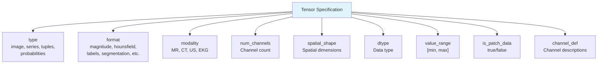

Sources: [docs/source/mb_specification.rst:73-84]()

### Spatial Shape Expressions

Spatial shapes support flexible specifications for variable-size inputs:

| Expression | Meaning | Example |
|------------|---------|---------|
| Integer | Fixed size | `160` |
| `"*"` | Any size | `"*"` |
| `"n*16"` | Multiple of 16 | `"n*16"` |
| `"2**p"` | Power of 2 | `"2**p"` |
| `"2**p*n"` | Multiple of power of 2 | `"2**p*n"` |

Example: `["*", "16*n", "2**p*n"]` represents a 3D spatial shape where the first dimension can be any size, the second must be a multiple of 16, and the third must be a multiple of a power of 2.

The implementation uses `ast.parse()` to evaluate these expressions:

```python
def _get_var_names(expr: str) -> list[str]:
    tree = ast.parse(expr)
    return [m.id for m in ast.walk(tree) if isinstance(m, ast.Name)]
```

Sources: [docs/source/mb_specification.rst:111-112](), [monai/bundle/scripts.py:129-168]()

### Tensor Format Types

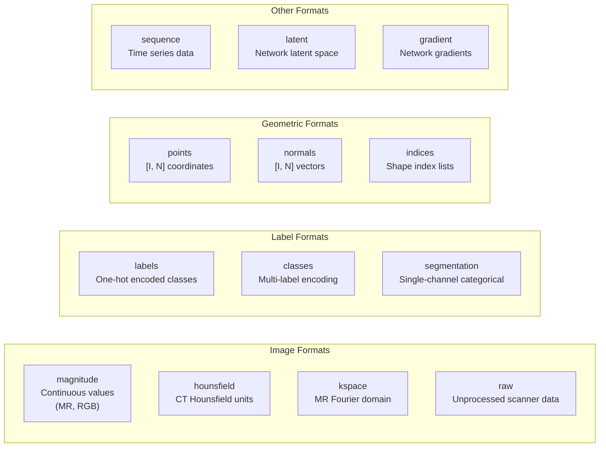

Sources: [docs/source/mb_specification.rst:95-110]()

### Complete Tensor Specification Example

```json
{
    "network_data_format": {
        "inputs": {
            "image": {
                "type": "image",
                "format": "magnitude",
                "modality": "MR",
                "num_channels": 1,
                "spatial_shape": [160, 160, 160],
                "dtype": "float32",
                "value_range": [0, 1],
                "is_patch_data": false,
                "channel_def": {"0": "image"}
            }
        },
        "outputs": {
            "pred": {
                "type": "image",
                "format": "labels",
                "num_channels": 2,
                "spatial_shape": [160, 160, 160],
                "dtype": "float32",
                "value_range": [],
                "is_patch_data": false,
                "channel_def": {
                    "0": "background",
                    "1": "spleen"
                }
            }
        }
    }
}
```

Sources: [tests/testing_data/metadata.json:31-76](), [docs/source/mb_specification.rst:147-173]()

---

## Bundle File Naming Conventions

MONAI Bundles follow specific naming patterns for versioned distribution and NGC compatibility.

### Version Naming Pattern

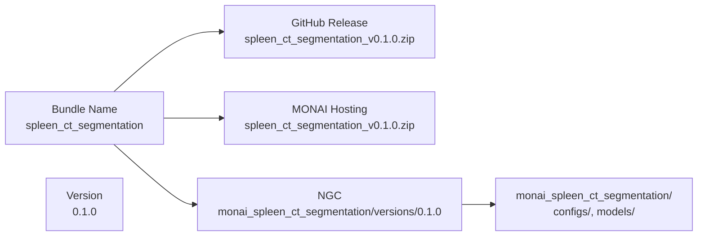

Sources: [monai/bundle/scripts.py:217-261](), [tests/bundle/test_bundle_download.py:98-113]()

### NGC Prefix Handling

NGC bundles use a `monai_` prefix that is removed during download to maintain consistency with other sources:

```python
def _add_ngc_prefix(name: str, prefix: str = "monai_") -> str:
    if name.startswith(prefix):
        return name
    return f"{prefix}{name}"

def _remove_ngc_prefix(name: str, prefix: str = "monai_") -> str:
    if name.startswith(prefix):
        return name[len(prefix):]
    return name
```

The `remove_prefix` parameter in `download()` controls this behavior:

```python
download(
    name="spleen_ct_segmentation",
    source="ngc",
    remove_prefix="monai_"  # Results in "spleen_ct_segmentation/" directory
)
```

Sources: [monai/bundle/scripts.py:217-261]()

---

## Bundle Validation and Version Checking

MONAI provides mechanisms to validate bundle compatibility and structure integrity.

### Version Compatibility Checking

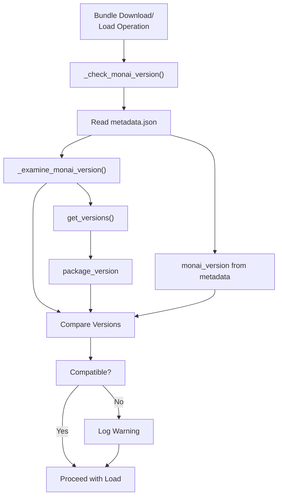

Sources: [monai/bundle/scripts.py:311-341]()

### Version Comparison Logic

The version checking treats release candidates (rc) as equivalent to release versions:

```python
def _examine_monai_version(monai_version: str) -> tuple[bool, str]:
    version_dict = get_versions()
    package_version = version_dict.get("version", "0+unknown")
    
    # Treat rc versions as the same as the release version
    package_version = re.sub(r"rc\d.*", "", package_version)
    monai_version = re.sub(r"rc\d.*", "", monai_version)
    
    if package_version < monai_version:
        return (False, f"Your MONAI version is {package_version}, "
                      f"but the bundle is built on MONAI version {monai_version}.")
    return True, ""
```

Sources: [monai/bundle/scripts.py:311-328]()

### Metadata Schema Validation

Bundles reference a JSON schema for validation:

```json
{
    "schema": "https://github.com/Project-MONAI/MONAI-extra-test-data/releases/download/0.8.1/meta_schema_20220324.json"
}
```

The schema can be downloaded and used with `jsonschema` to validate bundle metadata structure:

```python
validate, _ = optional_import("jsonschema", name="validate")
ValidationError, _ = optional_import("jsonschema.exceptions", name="ValidationError")
```

Sources: [docs/source/mb_specification.rst:113-114](), [monai/bundle/scripts.py:56-57](), [tests/testing_data/metadata.json:2]()

---

## Bundle Access Patterns

The bundle system supports multiple ways to access and inspect bundle contents.

### Loading Model Weights

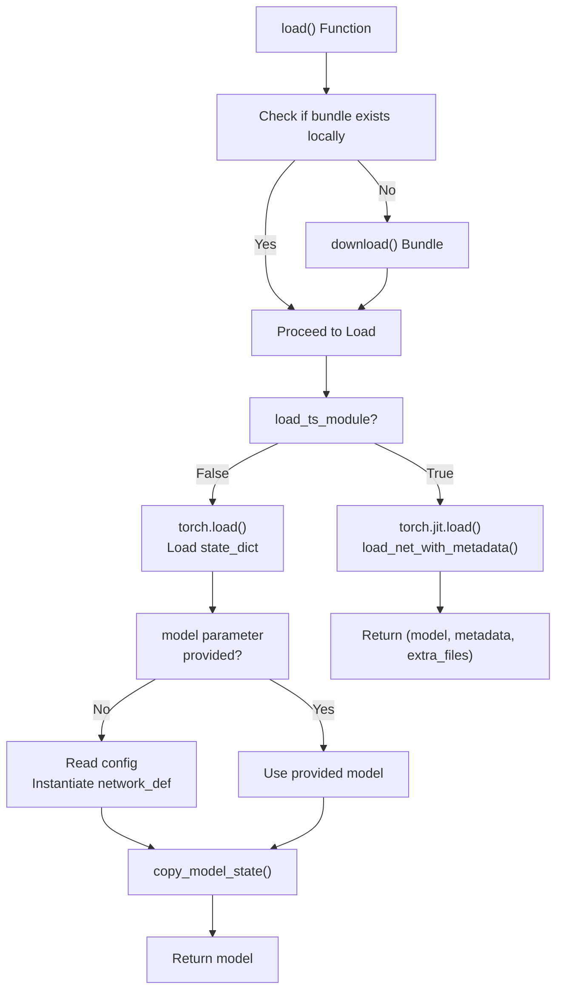

Sources: [monai/bundle/scripts.py:628-768]()

### Model File Resolution

The `load()` function uses default paths when `model_file` is not specified:

```python
if model_file is None:
    model_file = os.path.join("models", 
                              "model.ts" if load_ts_module is True else "model.pt")
```

Full path construction:

```python
full_path = os.path.join(bundle_dir_, name, model_file)
# Example: /path/to/bundles/spleen_ct_segmentation/models/model.pt
```

Sources: [monai/bundle/scripts.py:711-717]()

### Network Override Support

The `load()` function supports overriding network parameters without modifying the bundle:

```python
model = load(
    name="spleen_ct_segmentation",
    bundle_dir=tempdir,
    net_override={"spatial_dims": 3, "out_channels": 5}
)
```

This applies overrides to the network definition before instantiation:

```python
_net_override = {f"network_def#{key}": value 
                 for key, value in net_override.items()}
_workflow = create_workflow(
    workflow_name=workflow_name,
    config_file=str(bundle_config_file),
    workflow_type=workflow_type,
    **_net_override
)
```

Sources: [monai/bundle/scripts.py:692-750](), [tests/bundle/test_bundle_download.py:363-396]()

---

## Bundle Distribution Sources

MONAI Bundles can be downloaded from multiple sources, each with specific access patterns and requirements.

### Supported Sources

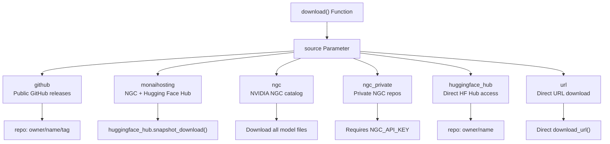

Sources: [monai/bundle/scripts.py:446-625]()

### Source-Specific Parameters

| Source | Required Parameters | Authentication | Format |
|--------|-------------------|----------------|--------|
| `github` | `repo="owner/name/tag"` | None | ZIP |
| `monaihosting` | None (uses default) | None | ZIP or direct |
| `ngc` | None (public) | None | Individual files |
| `ngc_private` | `repo="org/org_name"` or env | `NGC_API_KEY` env | ZIP |
| `huggingface_hub` | `repo="owner/name"` | Optional HF token | Directory |
| `url` | `url="https://..."` | Varies | ZIP |

Sources: [monai/bundle/scripts.py:495-527]()

### Default Download Source

The default source is configured via environment variable:

```python
DEFAULT_DOWNLOAD_SOURCE = os.environ.get("BUNDLE_DOWNLOAD_SRC", "monaihosting")
```

Common settings:
- `BUNDLE_DOWNLOAD_SRC="ngc"` - Use NGC by default
- `BUNDLE_DOWNLOAD_SRC="github"` - Use GitHub releases
- `BUNDLE_DOWNLOAD_SRC="monaihosting"` - Use MONAI hosting (default)

Sources: [monai/bundle/scripts.py:65-67]()

### NGC Private Access Pattern

```python
# Set environment variables
os.environ["NGC_API_KEY"] = "your_api_key"
os.environ["NGC_ORG"] = "your_org"
os.environ["NGC_TEAM"] = "your_team"  # Optional

# Download from private NGC
download(
    name="private_model",
    source="ngc_private",
    bundle_dir="./bundles"
)
```

The implementation fetches an authentication token:

```python
def _get_ngc_token(api_key, retry=0):
    url = "https://authn.nvidia.com/token?service=ngc"
    headers = {"Accept": "application/json", 
               "Authorization": "ApiKey " + api_key}
    response = requests.get(url, headers=headers)
    token = response.json()["token"]
    return token
```

Sources: [monai/bundle/scripts.py:294-308](), [monai/bundle/scripts.py:547-577]()

---

## Configuration File Structure

Beyond the required `metadata.json`, bundles typically include additional configuration files for training and inference workflows.

### Common Configuration Files

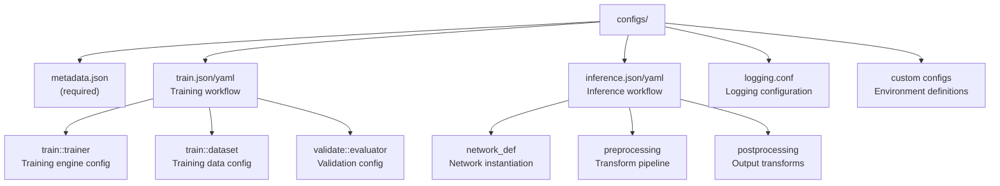

Sources: [docs/source/mb_specification.rst:46](), [monai/bundle/workflows.py:368-403]()

### ConfigWorkflow File Loading

The `ConfigWorkflow` class handles configuration file resolution:

```python
class ConfigWorkflow(BundleWorkflow):
    def __init__(
        self,
        config_file: str | Sequence[str],
        meta_file: str | Sequence[str] | None = None,
        logging_file: str | bool | None = None,
        # ...
    ):
        # Default paths relative to config_root_path
        config_root_path = Path(_config_files[0]).parent
        meta_file = str(config_root_path / "metadata.json") if meta_file is None else meta_file
        logging_file = str(config_root_path / "logging.conf") if logging_file is None else logging_file
```

Sources: [monai/bundle/workflows.py:405-435]()

### Configuration Merging

Multiple configuration files can be merged in order:

```python
workflow = ConfigWorkflow(
    config_file=["base_config.json", "override_config.json"],
    meta_file=["base_metadata.json", "override_metadata.json"]
)
```

The `ConfigParser.read_config()` method handles merging:

```python
self.parser.read_config(f=config_file)
if self.meta_file is not None:
    self.parser.read_meta(f=self.meta_file)
```

Sources: [monai/bundle/workflows.py:449-451]()

---

## Bundle Properties and Access

The bundle system defines standardized properties for interacting with workflows programmatically.

### Property Definition Structure

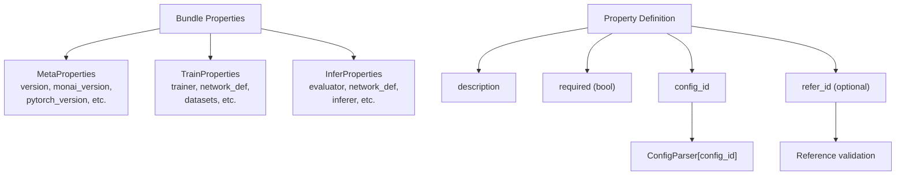

Sources: [monai/bundle/properties.py:1-263]()

### Property Access in ConfigWorkflow

Properties are accessed through the workflow object:

```python
workflow = ConfigWorkflow(
    config_file="configs/train.json",
    workflow_type="train"
)
workflow.initialize()

# Access properties
network = workflow.network_def
trainer = workflow.trainer
max_epochs = workflow.max_epochs
```

The `_get_property()` method resolves property values from parsed config:

```python
def _get_property(self, name: str, property: dict) -> Any:
    if not self._is_initialized:
        raise RuntimeError("Please execute 'initialize' before getting any parsed content.")
    prop_id = self._get_prop_id(name, property)
    return self.parser.get_parsed_content(id=prop_id) if prop_id is not None else None
```

Sources: [monai/bundle/workflows.py:548-560]()

### Property ID Mapping

Properties map to configuration IDs using the `ID_SEP_KEY` separator:

```python
from monai.bundle.utils import ID_SEP_KEY  # Value: "::"

TrainProperties = {
    "trainer": {
        "id": f"train{ID_SEP_KEY}trainer",  # "train::trainer"
    },
    "max_epochs": {
        "id": f"train{ID_SEP_KEY}trainer{ID_SEP_KEY}max_epochs",  # "train::trainer::max_epochs"
    }
}
```

Sources: [monai/bundle/properties.py:30-155](), [monai/bundle/utils.py]()

---

## Bundle Instantiation Example

Complete example showing how all components work together:

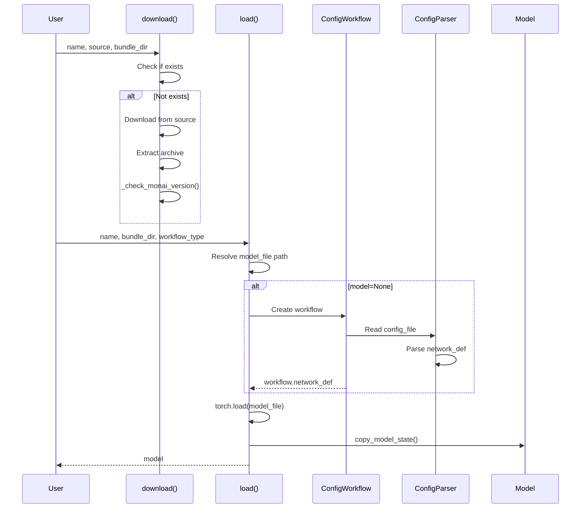

Sources: [monai/bundle/scripts.py:446-768]()

### Complete Code Example

```python
from monai.bundle import download, load

# Download bundle
download(
    name="spleen_ct_segmentation",
    version="0.3.7",
    source="monaihosting",
    bundle_dir="./bundles"
)

# Load model with automatic network instantiation
model = load(
    name="spleen_ct_segmentation",
    bundle_dir="./bundles",
    workflow_type="train",  # Use train.json to get network_def
    device="cuda:0"
)

# Or load into existing model
import torch
from monai.networks.nets import UNet

my_model = UNet(spatial_dims=3, in_channels=1, out_channels=2)
loaded_model = load(
    name="spleen_ct_segmentation",
    model=my_model,
    bundle_dir="./bundles",
    device="cuda:0"
)
```

Sources: [tests/bundle/test_bundle_download.py:307-396]()

---

