# Page: Overview

# Overview

<details>
<summary>Relevant source files</summary>

The following files were used as context for generating this wiki page:

- [README.md](README.md)
- [docs/source/design/conductor/conductor-architecture-design.md](docs/source/design/conductor/conductor-architecture-design.md)
- [docs/source/design/store/metadata-management.md](docs/source/design/store/metadata-management.md)
- [docs/source/design/store/mooncake-store.md](docs/source/design/store/mooncake-store.md)
- [docs/source/getting_started/build.md](docs/source/getting_started/build.md)
- [docs/source/getting_started/quick-start.md](docs/source/getting_started/quick-start.md)
- [docs/source/getting_started/supported-protocols.md](docs/source/getting_started/supported-protocols.md)
- [docs/source/index.md](docs/source/index.md)
- [docs/source/zh_archive/build.md](docs/source/zh_archive/build.md)
- [docs/source/zh_archive/run-examples.md](docs/source/zh_archive/run-examples.md)
- [mooncake-common/common.cmake](mooncake-common/common.cmake)
- [mooncake-conductor/include/conductor/kvevent/config.h](mooncake-conductor/include/conductor/kvevent/config.h)
- [mooncake-conductor/include/conductor/kvevent/event_manager.h](mooncake-conductor/include/conductor/kvevent/event_manager.h)
- [mooncake-conductor/include/conductor/prefixindex/prefix_indexer.h](mooncake-conductor/include/conductor/prefixindex/prefix_indexer.h)
- [mooncake-conductor/src/kvevent/config.cpp](mooncake-conductor/src/kvevent/config.cpp)
- [mooncake-conductor/src/kvevent/event_manager.cpp](mooncake-conductor/src/kvevent/event_manager.cpp)
- [mooncake-conductor/src/main.cpp](mooncake-conductor/src/main.cpp)
- [mooncake-conductor/src/prefixindex/prefix_indexer.cpp](mooncake-conductor/src/prefixindex/prefix_indexer.cpp)
- [mooncake-conductor/tests/prefix_indexer_test.cpp](mooncake-conductor/tests/prefix_indexer_test.cpp)
- [mooncake-conductor/tests/prefix_indexer_test_peer.h](mooncake-conductor/tests/prefix_indexer_test_peer.h)
- [mooncake-store/CMakeLists.txt](mooncake-store/CMakeLists.txt)
- [mooncake-store/include/version.h.in](mooncake-store/include/version.h.in)
- [mooncake-transfer-engine/CMakeLists.txt](mooncake-transfer-engine/CMakeLists.txt)
- [mooncake-transfer-engine/include/cuda_alike.h](mooncake-transfer-engine/include/cuda_alike.h)
- [mooncake-transfer-engine/src/CMakeLists.txt](mooncake-transfer-engine/src/CMakeLists.txt)
- [mooncake-transfer-engine/src/transport/CMakeLists.txt](mooncake-transfer-engine/src/transport/CMakeLists.txt)

</details>


Mooncake is a KVCache-centric disaggregated architecture designed for large language model (LLM) serving [README.md:4-4](). It serves as the production platform for [Kimi](https://kimi.ai), a leading conversational LLM service operated by [Moonshot AI](https://www.moonshot.cn) [README.md:32-33](). By decoupling prefill and decode execution clusters and leveraging underutilized CPU, DRAM, and SSD resources to form a unified KVCache pool, Mooncake addresses memory capacity and bandwidth bottlenecks typical in long-context LLM deployments [docs/source/index.md:30-32]().

Under real-world workloads, Mooncake enables inference engines to handle 75% more requests while strictly adhering to Service Level Objectives (SLOs) [README.md:33-33](). The system is composed chiefly of two open-source subsystems:

- **Transfer Engine / TENT** — A high-performance, asynchronous, zero-copy data movement engine supporting various transports including RDMA, NVLink, and TCP for cross-node and cross-device transfers [docs/source/index.md:25-26](), [mooncake-transfer-engine/src/multi_transport.cpp:23-83]().
- **Mooncake Store** — A distributed object storage system engineered for KVCache management with features such as multi-replica support, automatic tiering across DRAM, GPU, CXL, SSD, and asynchronous eviction policies [docs/source/index.md:25-26](), [README.md:40-40]().

Mooncake is integrated within multiple LLM inference frameworks including vLLM, SGLang HiCache, and TensorRT-LLM, joined the PyTorch Ecosystem, and is recognized in the FAST 2025 conference publication [README.md:39-59]().

This overview page introduces these key aspects at a high level and links to child pages for detailed topics:

- System architecture and data flow: [System Architecture](#1.1)
- Core concepts, terminology, and data model: [Key Concepts and Terminology](#1.2)
- Supported protocols and hardware backends: [Supported Protocols and Hardware](#1.3)
- Performance metrics, benchmarks, and research traces: [Performance Characteristics](#1.4)

Sources: [README.md:4-33](), [docs/source/index.md:25-32]()

---

## 1.1. System Architecture

Mooncake adopts a modular three-tier architecture that cleanly separates concerns of high-throughput data transport, cluster-wide metadata management, and integration with high-level LLM serving frameworks. This separation enables scalable, efficient KVCache disaggregation.

### System Architecture and Code Mapping
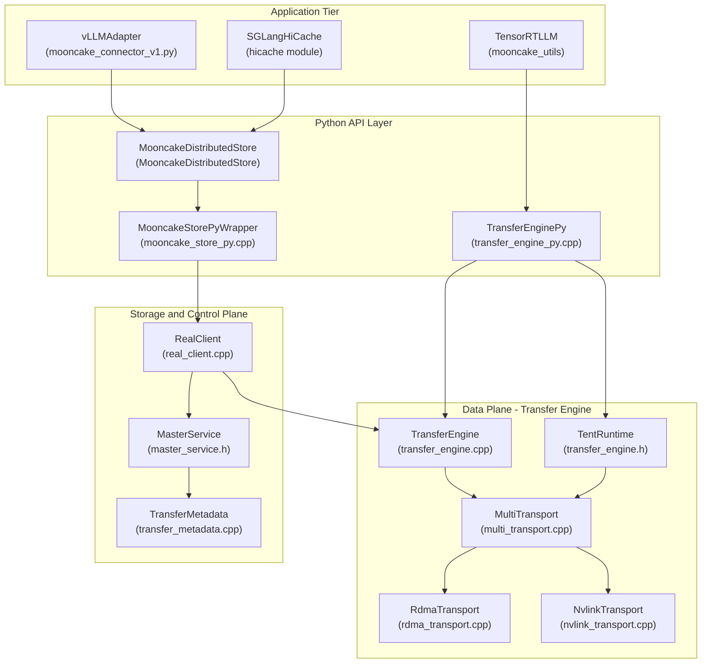
Sources: [README.md:1-33](), [docs/source/index.md:1-38](), [mooncake-transfer-engine/src/multi_transport.cpp:23-83](), [mooncake-transfer-engine/src/transfer_engine.cpp:72-215](), [mooncake-integration/transfer_engine/transfer_engine_py.cpp:124-212]()

- **Data Plane (Transfer Engine / TENT):** Handles asynchronous, zero-copy data transfers across nodes and devices, supporting multiple transport protocols via `MultiTransport` [mooncake-transfer-engine/src/multi_transport.cpp:140-148](). The `TransferEngine` manages memory registration, segment allocation, and transfer requests [mooncake-transfer-engine/src/transfer_engine.cpp:156-166]().
- **Storage and Control Plane (Mooncake Store):** Manages cluster metadata, node and object lifecycle, allocation and eviction policies via `MasterService`. Local clients (`RealClient`) handle memory management and serve remote requests.
- **Integration Layer:** Provides Python API bindings and adapters to LLM serving frameworks (e.g., vLLM, SGLang) for transparent KVCache disaggregation [mooncake-integration/transfer_engine/transfer_engine_py.cpp:124-212]().

For details, see [System Architecture](#1.1).

Sources: [README.md:39-59](), [docs/source/index.md:25-36](), [mooncake-transfer-engine/src/multi_transport.cpp:140-148](), [mooncake-transfer-engine/src/transfer_engine.cpp:156-166]()

---

## 1.2. Key Concepts and Terminology

Mooncake introduces specialized domain concepts to efficiently manage distributed KV caches for LLM serving:

- **Segment:** A continuous memory allocation unit residing on DRAM, GPU VRAM, CXL devices, or SSD.
- **Replica:** Multiple copies of a segment across devices or nodes for fault tolerance and load balancing.
- **Batch and Slice:** Granular units of transfer requests; batches group slices which specify partial data ranges.
- **Lease:** A timed ownership token allowing clients to hold objects for safe concurrent access.
- **Metadata Services:** Backends (e.g., ETCD, Redis, HTTP) supporting cluster-wide metadata synchronization.
- **KVCache Disaggregation:** Separation of key-value cache storage from LLM computation clusters.
- **PD Disaggregation:** Prefill-Decode disaggregation pattern separating prefill and decode stages.
- **XpYd Notation:** Configuration scheme indicating numbers of prefill ($X$) and decode ($Y$) clusters.

### Object Lifecycle State Machine
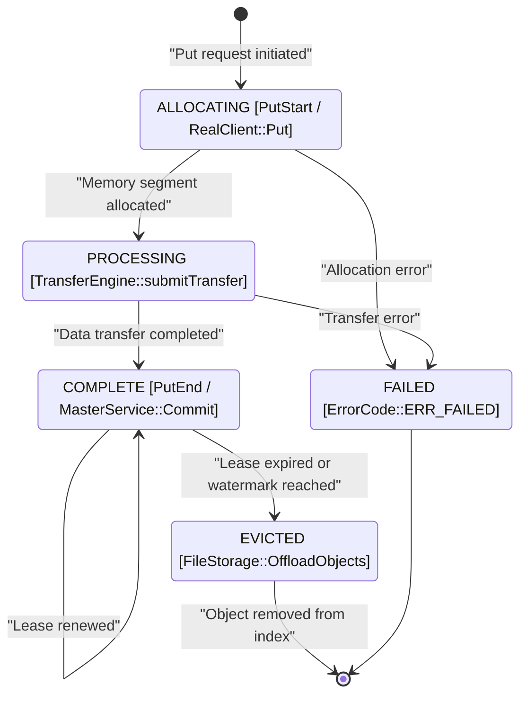
Sources: [README.md:1-33](), [docs/source/index.md:1-38](), [mooncake-store/include/version.h.in:1-21]()

Refer to [Key Concepts and Terminology](#1.2) for formal definitions and detailed explanations.

Sources: [README.md:40-40](), [docs/source/index.md:30-38]()

---

## 1.3. Supported Protocols and Hardware

Mooncake supports a broad spectrum of transport protocols and hardware accelerators to maximize efficiency and flexibility on diverse platforms:

- **Transport Protocols:** RDMA (InfiniBand, RoCE, eRDMA), TCP, AWS EFA (libfabric SRD), NVLink (multi-node/intra-node), CXL, HIP, MUSA, Barex, SHM, and others [docs/source/getting_started/build.md:116-130](), [docs/source/getting_started/quick-start.md:28-36]().
- **Hardware Accelerators:** NVIDIA CUDA with GPUDirect RDMA, AMD ROCm/HIP, Huawei Ascend NPU, Moore Threads MUSA, Cambricon MLU, MetaX MACA, Hygon DCU, Iluvatar CoreX, and Biren GPUs.

A typical initialization snippet using the Python API with RDMA transport:

```python
engine.initialize(
    hostname="node1",
    metadata_server="etcd://10.0.0.1:2379",
    protocol="rdma",
    device_name="mlx5_0"
)
```
Sources: [docs/source/getting_started/build.md:116-130](), [docs/source/getting_started/quick-start.md:28-36]()

For detailed compatibility matrices, environment setup, and configuration options, see [Supported Protocols and Hardware](#1.3).

Sources: [docs/source/getting_started/build.md:116-130](), [docs/source/getting_started/quick-start.md:28-36]()

---

## 1.4. Performance Characteristics

Mooncake delivers high throughput and low latency for long-context LLM workloads by optimizing data transfer pathways, zero-copy pipelines, NUMA-aware allocations, and prediction-based early request rejection [docs/source/index.md:30-38]().

Benchmarking and trace tools include:
- The Transfer Engine benchmark utility measuring raw RDMA/TCP throughput.
- Storage backend benchmarks demonstrating scalability and eviction policies.
- $XpYd$ benchmark configurations evaluating disaggregated prefill-decode scenarios.
- FAST25 research traces detailing real workload performance characteristics.

For comprehensive performance results, tuning guides, and profiling data, refer to [Performance Characteristics](#1.4).

Sources: [README.md:6-8](), [docs/source/index.md:30-38]()

---

Sources:  
[README.md:1-59](), [docs/source/index.md:1-38](), [mooncake-transfer-engine/src/multi_transport.cpp:23-148](), [mooncake-transfer-engine/src/transfer_engine.cpp:72-166](), [mooncake-integration/transfer_engine/transfer_engine_py.cpp:124-212](), [docs/source/getting_started/build.md:116-130](), [docs/source/getting_started/quick-start.md:28-36]()

---

# Page: System Architecture

# System Architecture

<details>
<summary>Relevant source files</summary>

The following files were used as context for generating this wiki page:

- [README.md](README.md)
- [docs/source/design/architecture.md](docs/source/design/architecture.md)
- [docs/source/design/conductor/conductor-architecture-design.md](docs/source/design/conductor/conductor-architecture-design.md)
- [docs/source/design/store/metadata-management.md](docs/source/design/store/metadata-management.md)
- [docs/source/design/store/mooncake-store.md](docs/source/design/store/mooncake-store.md)
- [docs/source/getting_started/build.md](docs/source/getting_started/build.md)
- [docs/source/getting_started/quick-start.md](docs/source/getting_started/quick-start.md)
- [docs/source/getting_started/supported-protocols.md](docs/source/getting_started/supported-protocols.md)
- [docs/source/index.md](docs/source/index.md)
- [docs/source/zh_archive/build.md](docs/source/zh_archive/build.md)
- [docs/source/zh_archive/run-examples.md](docs/source/zh_archive/run-examples.md)
- [mooncake-common/common.cmake](mooncake-common/common.cmake)
- [mooncake-conductor/include/conductor/kvevent/config.h](mooncake-conductor/include/conductor/kvevent/config.h)
- [mooncake-conductor/include/conductor/kvevent/event_manager.h](mooncake-conductor/include/conductor/kvevent/event_manager.h)
- [mooncake-conductor/include/conductor/prefixindex/prefix_indexer.h](mooncake-conductor/include/conductor/prefixindex/prefix_indexer.h)
- [mooncake-conductor/src/kvevent/config.cpp](mooncake-conductor/src/kvevent/config.cpp)
- [mooncake-conductor/src/kvevent/event_manager.cpp](mooncake-conductor/src/kvevent/event_manager.cpp)
- [mooncake-conductor/src/main.cpp](mooncake-conductor/src/main.cpp)
- [mooncake-conductor/src/prefixindex/prefix_indexer.cpp](mooncake-conductor/src/prefixindex/prefix_indexer.cpp)
- [mooncake-conductor/tests/prefix_indexer_test.cpp](mooncake-conductor/tests/prefix_indexer_test.cpp)
- [mooncake-conductor/tests/prefix_indexer_test_peer.h](mooncake-conductor/tests/prefix_indexer_test_peer.h)
- [mooncake-store/CMakeLists.txt](mooncake-store/CMakeLists.txt)
- [mooncake-store/benchmarks/offset_allocator_concurrency_bench.cpp](mooncake-store/benchmarks/offset_allocator_concurrency_bench.cpp)
- [mooncake-store/include/crc32c.h](mooncake-store/include/crc32c.h)
- [mooncake-store/include/offset_allocator/offset_allocator.h](mooncake-store/include/offset_allocator/offset_allocator.h)
- [mooncake-store/include/version.h.in](mooncake-store/include/version.h.in)
- [mooncake-store/src/offset_allocator.cpp](mooncake-store/src/offset_allocator.cpp)
- [mooncake-store/tests/offset_allocator_test.cpp](mooncake-store/tests/offset_allocator_test.cpp)
- [mooncake-transfer-engine/CMakeLists.txt](mooncake-transfer-engine/CMakeLists.txt)
- [mooncake-transfer-engine/include/cuda_alike.h](mooncake-transfer-engine/include/cuda_alike.h)
- [mooncake-transfer-engine/src/CMakeLists.txt](mooncake-transfer-engine/src/CMakeLists.txt)
- [mooncake-transfer-engine/src/transport/CMakeLists.txt](mooncake-transfer-engine/src/transport/CMakeLists.txt)

</details>


## Purpose and Scope

This page documents the system architecture of Mooncake, detailing its three-tier disaggregated design, component interactions, hardware abstraction, and the end-to-end data flow for KVCache disaggregation in large language model (LLM) serving platforms.

Sources: [docs/source/index.md:28-38](), [docs/source/getting_started/quick-start.md:1-10]()

## Three-Tier Architecture

Mooncake implements a **KVCache-centric disaggregated architecture** that decouples prefill and decode compute clusters while pooling distributed memory and storage across the cluster. The system is organized into three distinct architectural tiers:

1. **Tier 3: Application & Integration Layer**: Framework integrations such as vLLM connectors (`mooncake_connector_v1.py`) and SGLang HiCache extensions, plus client APIs like `TransferEnginePy` that interface directly with LLM inference engines.

2. **Tier 2: Storage & Control Plane (Mooncake Store)**: Centralized coordination via `MasterService`, distributed object lifecycle management (`real_client.cpp`, `dummy_client.cpp`), and client resource ownership through classes like `RealClient` and `DummyClient`.

3. **Tier 1: Data Plane (Transfer Engine & TENT)**: High-performance, zero-copy data transport subsystem driven by `TransferEngine`, `MultiTransport`, and pluggable hardware transport implementations.

The three tiers collaborate to achieve an efficient KVCache disaggregation system supporting LLM serving workloads.

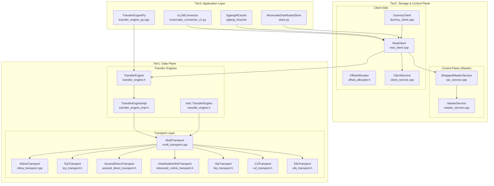

Sources: [docs/source/index.md:30-38](), [mooncake-transfer-engine/src/CMakeLists.txt:1-100](), [mooncake-transfer-engine/src/transport/CMakeLists.txt:1-50]()

## Core Subsystems

### Transfer Engine and Metadata Management

The **Transfer Engine** provides transport-agnostic, zero-copy data movement across the cluster. It exposes a high-level API (`TransferEngine`) and its Python bindings (`TransferEnginePy`) that manage buffer registration, segment transfers, batch operations, and notifications.

Internally, a bridge pattern links the `TransferEngine` interface to concrete implementations like the legacy engine or the newer next-generation TENT engine (`tent::TransferEngine`). The engine delegates transport selection and dispatch to the `MultiTransport` layer, which manages multiple protocol implementations, including:

- RDMA (`RdmaTransport`) for low-latency, high-throughput data transfer over InfiniBand or RoCE networks.
- TCP (`TcpTransport`) for general-purpose fallback.
- GPU-specific protocols: NVLink, HIP, Ascend Direct, MUSA, and more.

Metadata services act as the discovery and coordination layer for transfer endpoints. The `TransferMetadata` system supports pluggable backends, including ETCD, Redis, HTTP, and a decentralized peer-to-peer handshake (`P2PHANDSHAKE`).

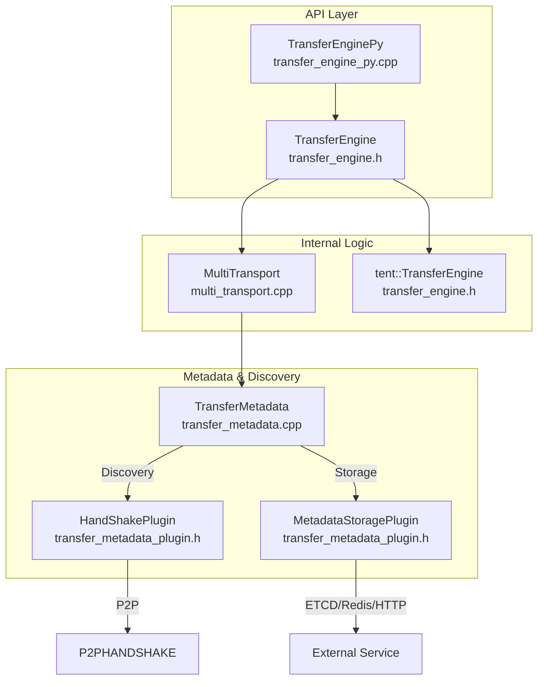

Sources: [docs/source/getting_started/quick-start.md:76-90](), [mooncake-transfer-engine/src/CMakeLists.txt:1-40]()

### Mooncake Store and Memory Management

The **Mooncake Store** is the control and storage plane responsible for managing distributed objects representing tensor cache data. It exposes APIs for Put, Get, List, Delete, and dynamic replication of objects with slice-level placement.

The store consists of:

- **Master Service (`MasterService`)**: Manages global metadata, shards object mappings, handles leases, and coordinates eviction and replication (`master_service.cpp`).
- **Real Client (`RealClient`)**: Resident on each node, owns local memory segments (DRAM, VRAM, SSD), manages buffer allocation and registration, and performs data operations (`real_client.cpp`).
- **Dummy Client (`DummyClient`)**: Provides IPC bridging for clients that run in separate processes, facilitating process-isolated API access (`dummy_client.cpp`).

Memory allocation within each client's segments is managed via the **OffsetAllocator** subsystem, which implements dynamic sub-allocation of large segments and provides RAII-style handles (`OffsetAllocationHandle`) for memory safety and tracking.

| Component        | Role                        | Code Entity / Responsibility                           |
|------------------|-----------------------------|-------------------------------------------------------|
| Master Service   | Central coordinator          | `MasterService` (`master_service.cpp`)                 |
| Real Client      | Local resource owner         | `RealClient` (`real_client.cpp`)                       |
| Dummy Client     | IPC bridge                  | `DummyClient` (`dummy_client.cpp`)                     |
| Offset Allocator | Memory sub-allocation scheme | `OffsetAllocator` and `OffsetAllocationHandle` (`offset_allocator.h`) |

Sources: [docs/source/zh_archive/build.md:1-40](), [docs/source/design/store/mooncake-store.md:22-52]()

## Data Flow and Interaction

### KVCache Disaggregation Flow

Mooncake is designed for KVCache disaggregation workloads typical in LLM serving environments with prefill-decode workload separation. The data flow proceeds as:

1. **Memory Registration**: Applications register local DRAM/VRAM buffer segments with `TransferEngine` via `registerLocalMemory` APIs, enabling zero-copy RDMA capabilities across devices.

2. **Object Allocation & Creation**: A client (e.g., prefill worker) requests storage and registers an object with the `MasterService` via RPC.

3. **Slice & Replica Management**: The `MasterService` manages object placement, shards, and replicas within the store.

4. **Data Transfer**: Using `TransferEngine::submitTransfer`, transfer batches are dispatched through `MultiTransport`, which dynamically selects fastest transport paths (cross-node RDMA, NVLink/HIP for intra-node GPU, etc.).

5. **Completion & Notification**: Transfers complete asynchronously and notify the caller via event-driven or polling APIs.

The following sequence diagram depicts a typical client-side put transfer interaction:

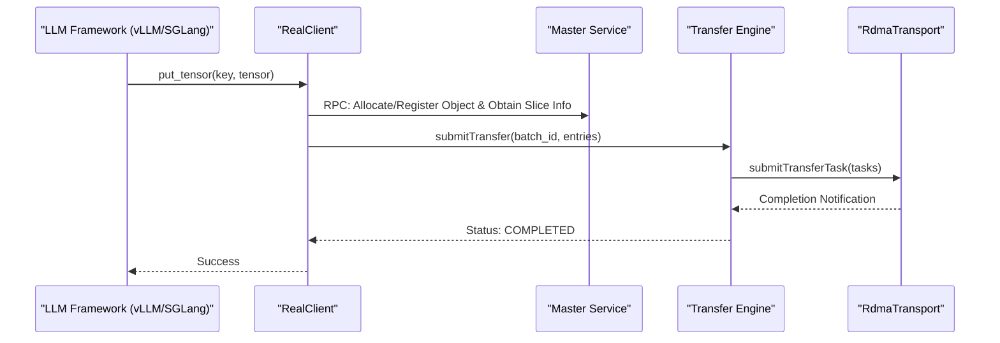

Sources: [docs/source/getting_started/quick-start.md:79-99](), [docs/source/design/store/mooncake-store.md:25-50]()

## Hardware Abstraction and Transport Support

Mooncake’s **pluggable transport layer** abstracts multiple hardware platforms and communication protocols via the `Transport` base class, enabling flexible deployment across heterogeneous environments.

Supported transports include:

- **RDMA**: Uses `RdmaTransport` to provide high-throughput, low-latency transfers over InfiniBand, RoCE, and Elastic RDMA (eRDMA) networks. Supports GPU zero-copy via NVIDIA GPUDirect RDMA, Cambricon MLU via Neuware, and Biren GPU via SUPA.

- **TCP**: General-purpose fallback transport implemented in `TcpTransport`.

- **AWS EFA**: `EfaTransport` supports libfabric SRD protocol targeting AWS Elastic Fabric Adapter instances, ideal for high-throughput cloud workloads.

- **GPU-Intra-node**: Efficient transports specialized for GPU communication such as NVLink (`IntraNodeNvlinkTransport`), AMD HIP (`HipTransport`), Moore Threads MUSA, MetaX MACA, and Huawei Ascend Direct (`AscendDirectTransport`).

- **Other Protocols**: Includes CXL (`CxlTransport`), SHM for intra-host shared memory, and extensions like Barex and UBShmem.

Mooncake carefully employs **topology discovery** and NUMA-aware device selection to reduce cross-node memory access latency and maximize bandwidth utilization. Multi-NIC aggregation and dynamic transport path selection in `MultiTransport` optimize resource usage across complex cluster topologies.

This modular transport design allows Mooncake to run on a wide range of hardware backends, including NVIDIA CUDA GPUs, AMD ROCm GPUs, Huawei NPUs, and various NICs, supporting broad deployment scenarios.

Sources: [docs/source/getting_started/build.md:116-132](), [docs/source/getting_started/supported-protocols.md:1-25](), [mooncake-transfer-engine/src/transport/CMakeLists.txt:1-131]()

---

# Summary

Mooncake’s architecture is fundamentally three-tiered, combining:

- The **Transfer Engine (TIER 1)** for hardware-abstracted, zero-copy, multi-transport data movement,
- The **Mooncake Store (TIER 2)** serving as the distributed control and storage plane managing object metadata, replication, and memory,
- And the **Integration Layer (TIER 3)** providing APIs and connectors to LLM serving frameworks.

Together, these layers interoperate through well-defined interfaces and asynchronous event-driven flows, enabling high-throughput, low-latency KVCache disaggregation for large language model serving.

This design leverages cutting-edge transport protocols, efficient memory management, and metadata services to optimize distributed cache utilization and performance in GPU-centric, heterogeneous AI clusters.

Sources: [README.md:1-54](), [docs/source/index.md:28-38](), [docs/source/getting_started/quick-start.md:76-99](), [docs/source/getting_started/supported-protocols.md:1-180]()

---

# Page: Key Concepts and Terminology

# Key Concepts and Terminology

<details>
<summary>Relevant source files</summary>

The following files were used as context for generating this wiki page:

- [README.md](README.md)
- [docs/source/api-reference/cpp/transfer-engine.md](docs/source/api-reference/cpp/transfer-engine.md)
- [docs/source/getting_started/build.md](docs/source/getting_started/build.md)
- [docs/source/getting_started/quick-start.md](docs/source/getting_started/quick-start.md)
- [docs/source/getting_started/supported-protocols.md](docs/source/getting_started/supported-protocols.md)
- [docs/source/index.md](docs/source/index.md)
- [docs/source/zh_archive/build.md](docs/source/zh_archive/build.md)
- [docs/source/zh_archive/run-examples.md](docs/source/zh_archive/run-examples.md)
- [mooncake-common/common.cmake](mooncake-common/common.cmake)
- [mooncake-integration/transfer_engine/transfer_engine_py.cpp](mooncake-integration/transfer_engine/transfer_engine_py.cpp)
- [mooncake-integration/transfer_engine/transfer_engine_py.h](mooncake-integration/transfer_engine/transfer_engine_py.h)
- [mooncake-store/CMakeLists.txt](mooncake-store/CMakeLists.txt)
- [mooncake-store/include/version.h.in](mooncake-store/include/version.h.in)
- [mooncake-transfer-engine/CMakeLists.txt](mooncake-transfer-engine/CMakeLists.txt)
- [mooncake-transfer-engine/include/cuda_alike.h](mooncake-transfer-engine/include/cuda_alike.h)
- [mooncake-transfer-engine/include/multi_transport.h](mooncake-transfer-engine/include/multi_transport.h)
- [mooncake-transfer-engine/include/transfer_engine.h](mooncake-transfer-engine/include/transfer_engine.h)
- [mooncake-transfer-engine/include/transfer_engine_c.h](mooncake-transfer-engine/include/transfer_engine_c.h)
- [mooncake-transfer-engine/include/transfer_engine_impl.h](mooncake-transfer-engine/include/transfer_engine_impl.h)
- [mooncake-transfer-engine/include/transport/transport.h](mooncake-transfer-engine/include/transport/transport.h)
- [mooncake-transfer-engine/src/CMakeLists.txt](mooncake-transfer-engine/src/CMakeLists.txt)
- [mooncake-transfer-engine/src/multi_transport.cpp](mooncake-transfer-engine/src/multi_transport.cpp)
- [mooncake-transfer-engine/src/transfer_engine.cpp](mooncake-transfer-engine/src/transfer_engine.cpp)
- [mooncake-transfer-engine/src/transfer_engine_c.cpp](mooncake-transfer-engine/src/transfer_engine_c.cpp)
- [mooncake-transfer-engine/src/transfer_engine_impl.cpp](mooncake-transfer-engine/src/transfer_engine_impl.cpp)
- [mooncake-transfer-engine/src/transport/CMakeLists.txt](mooncake-transfer-engine/src/transport/CMakeLists.txt)
- [mooncake-transfer-engine/tests/shm_transport_test.cpp](mooncake-transfer-engine/tests/shm_transport_test.cpp)
- [mooncake-transfer-engine/tests/transport_uint_test.cpp](mooncake-transfer-engine/tests/transport_uint_test.cpp)

</details>


## Purpose and Scope

This page defines the fundamental concepts, data types, and terminology used throughout the Mooncake system. It serves as a comprehensive reference for understanding the core abstractions that enable distributed KVCache management, memory disaggregation, and high-performance cross-node data transfer.

Mooncake is a KVCache-centric disaggregated architecture designed for LLM serving, powering production environments such as [Kimi](https://kimi.ai) [README.md:30-33](). It consists of two primary subsystems: the **Transfer Engine** for high-performance data movement and the **Mooncake Store** for distributed object storage [README.md:25-26]().

---

## System Overview and Key Concepts

Mooncake relies on several interlocking domain concepts to manage memory, coordinate nodes, and execute fast data transfers.

### Mooncake System Layers and Key Concepts
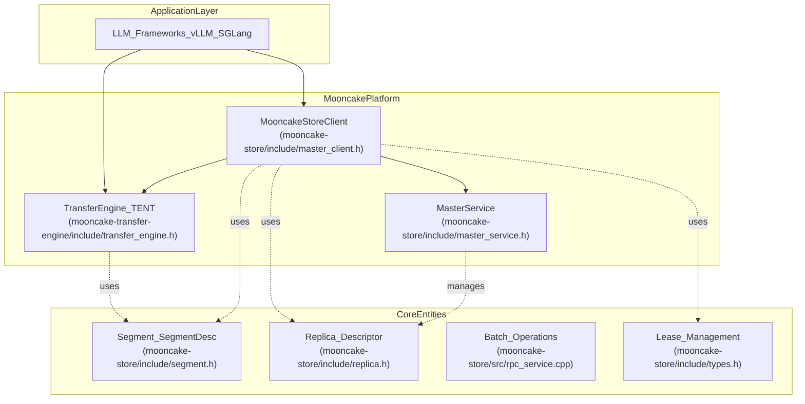

Sources: [README.md:25-33](), [mooncake-store/include/types.h:1-165]()

---

### Segments

**Definition:** A Segment is a contiguous memory region used for storing KV objects. Segments can be located on different memory/storage tiers including DRAM, GPU memory (VRAM), CXL memory, or SSD (via NVMe-oF). 

**Implementation Details:**
- Segments are represented by the `Segment` and `SegmentDesc` classes defined in `mooncake-store/include/segment.h`.
- Clients contribute segments to the global distributed KVCache pool by allocating memory regions.
- The Master Service manages segment registration and maintains segment mappings for placement and retrieval.
- Segment allocation is NUMA-aware and can be configured per backend.

Sources: [mooncake-store/include/segment.h:50-134]()

---

### Replicas

**Definition:** A Replica is a copy of a stored object (or a slice thereof) placed on a specific segment. Multiple replicas provide fault tolerance and load distribution.

**Implementation Details:**
- Replica descriptors outline the segment location, offset, length, and versioning of the object copy.
- Different slices of an object may be striped across different segments, and each slice can have multiple replicas.
- Replica management enables asynchronous replication tasks, ensures consistency, and supports multi-replica reads.

Sources: [mooncake-store/include/replica.h:1-60]()

---

### Batches

**Definition:** Batches are groups of put/get/transfer requests executed together as a single operation to improve throughput and reduce overhead.

**Implementation Details:**
- Batch APIs are exposed in both Mooncake Store (for object operations) and Transfer Engine (for data transfer via `MultiTransport::allocateBatchID`) [mooncake-transfer-engine/src/multi_transport.cpp:107-120]().
- The batch operations optimize network utilization by sending multiple slices or objects in parallel.
- Transfer Engine batch transfer APIs support queueing multiple slice transfers with scheduling and completion tracking [mooncake-integration/transfer_engine/transfer_engine_py.h:126-139]().

Sources: [mooncake-transfer-engine/src/multi_transport.cpp:107-120](), [mooncake-integration/transfer_engine/transfer_engine_py.h:126-139]()

---

### Slices

**Definition:** A Slice is a subdivision of an object or a batch transfer that can be scheduled separately, typically used for parallelism and multi-rail network transfer.

**Implementation Details:**
- Slicing allows striping large objects across multiple segments or NICs to achieve higher aggregated bandwidth.
- Each slice aligns with a transport path (`Transport::Slice`) and maintains individual transfer and completion status [mooncake-transfer-engine/include/transport/transport.h:125-145]().
- The Transfer Engine tracks slices for operation progress and retry mechanisms.

Sources: [mooncake-transfer-engine/include/transport/transport.h:125-145]()

---

### Leases

**Definition:** Leases are time-to-live (TTL) and soft-pin semantics applied to KV objects and client sessions for lifecycle management.

**Implementation Details:**
- The Store enforces leases with expiration times, automatically evicting expired objects.
- Soft pinning extends object retention beyond normal TTLs temporarily for latency or reliability purposes.
- Leases are managed centrally by the Master Service, which monitors client heartbeats and lease expiration.

Sources: [mooncake-store/include/types.h:84-90]()

---

### Metadata Services

**Definition:** Metadata services provide peer discovery, configuration, and coordination for the Transfer Engine and cluster state.

**Implementation Details:**
- Mooncake supports multiple metadata backends: etcd, Redis, HTTP, and a P2P handshake alternative.
- The metadata service stores Transfer Engine connection info, endpoint metadata, and node discovery data.
- P2P handshake avoids a centralized service by exchanging metadata directly among nodes locally.

Sources: [mooncake-transfer-engine/src/transfer_engine_impl.cpp:150-186]()

---

### KVCache Disaggregation

**Definition:** KVCache Disaggregation refers to the architectural separation of KVCache storage and management from the compute nodes running LLM inference.

**Explanation:**
- Traditional LLM serving hosts KVCache in GPU memory locally, limiting scaling.
- Mooncake decouples KVCache storage into a disaggregated pool managed by Mooncake Store, accessible across nodes.
- This enables better resource utilization, elasticity, and larger effective KVCache capacity by pooling DRAM, GPU, and SSD resources [docs/source/index.md:30-38]().
- The Transfer Engine facilitates fast zero-copy KVCache state movement between compute nodes and the disaggregated KVCache segments [README.md:32-33]().

Sources: [README.md:32-33](), [docs/source/index.md:30-38]()

---

### PD Disaggregation (Prefill-Decode Disaggregation)

**Definition:** PD Disaggregation is the separation of Prefill and Decode phases of LLM inference into distinct node pools for resource optimization.

**Explanation:**
- Prefill phase involves loading and preparing KVCache.
- Decode phase consumes the KVCache to generate tokens.
- Mooncake supports this split by enabling data transfer of KVCache between prefill and decode clusters.
- Early rejection policies prevent overloaded decode nodes from wasting computation on doomed requests [docs/source/index.md:38]().

Sources: [README.md:30-38](), [docs/source/index.md:30-38]()

---

### XpYd Notation

**Definition:** XpYd notation describes a deployment configuration, where:
- **X** = number of prefill nodes (p = prefill)
- **Y** = number of decode nodes (d = decode)

**Explanation:**
- Used to describe cluster topology in PD disaggregation setups.
- Helps specify sizing and resource allocation strategies (e.g., 8p16d means 8 prefill and 16 decode nodes).

Sources: [README.md:4-33](), [docs/source/index.md:30]()

---

## Core Data Types and Identifiers

Mooncake utilizes strict type definitions to ensure thread safety, robust error propagation, and correct wrap-around handling across distributed nodes.

### Fundamental Identifiers

| Type | Underlying Type | Purpose | Code Reference |
|------|----------------|---------|----------------|
| `ObjectKey` | `std::string` | Unique identifier for stored objects/KV cache | [mooncake-store/include/types.h:1-20]() |
| `Version` | `uint64_t` | Monotonic versioning for object updates | [mooncake-store/include/types.h:24]() |
| `ErrorCode` | `enum class` | System-wide status codes for RPC and store operations | [mooncake-store/include/types.h:26]() |

### Sequence ID Wrap-around Utilities

Mooncake provides helper inline functions to safely compare sequence IDs, which are `uint64_t` values and can wrap-around [mooncake-store/include/types.h:28-58]().

Sources: [mooncake-store/include/types.h:28-58]()

### Object Data Types

Mooncake defines an enum `ObjectDataType` to label data stored in the system (e.g., `KVCACHE`, `TENSOR`, `WEIGHT`, `ACTIVATION`) [mooncake-store/include/types.h:147-159](). This classification assists with type-aware eviction policies and statistics.

Sources: [mooncake-store/include/types.h:147-165]()

---

## Concept to Code Entity Mappings

### Natural Language to Store Code Entities
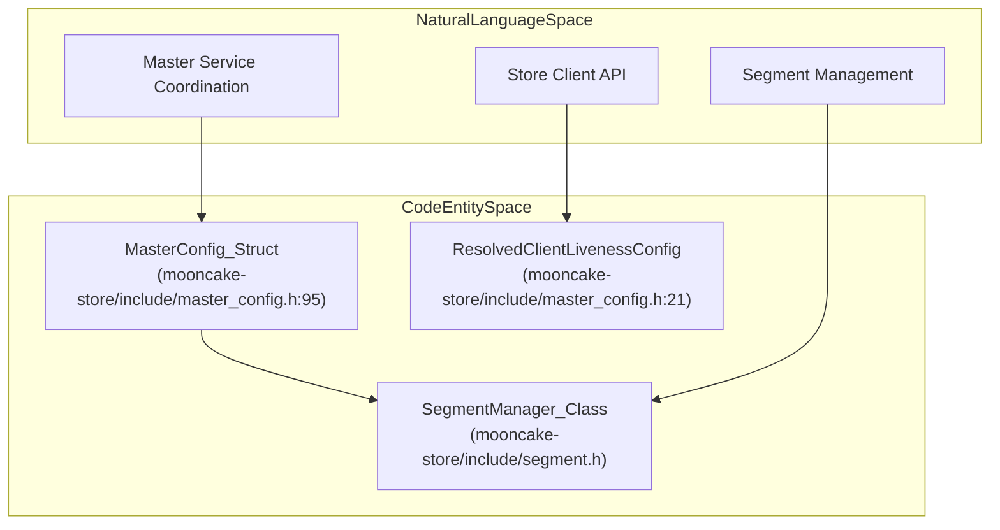

Sources: [mooncake-store/include/master_config.h:21-95]()

---

### Natural Language to Transfer Engine Code Entities
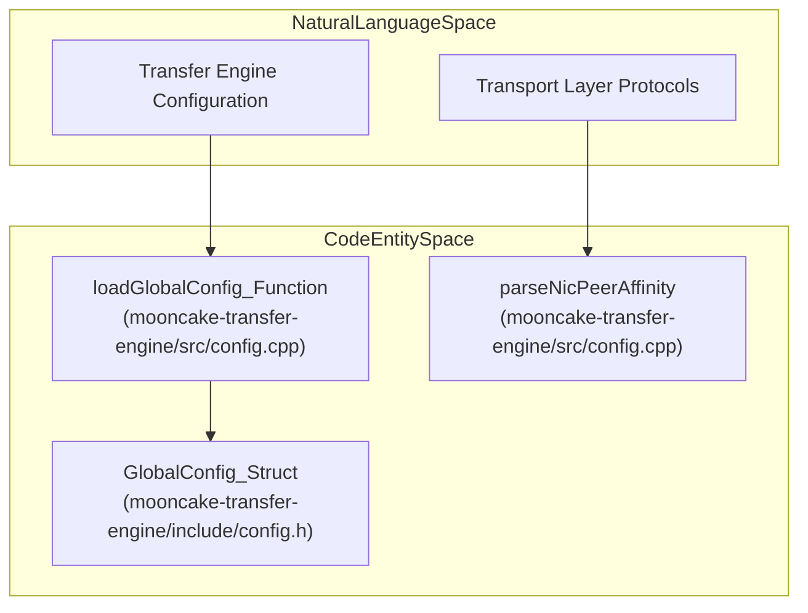

Sources: [mooncake-common/common.cmake:1-32]()

---

# Summary Table of Core Terminology

| Term                  | Description                                                                                       | Relevant File(s) / Component(s)                 |
|-----------------------|-------------------------------------------------------------------------------------------------|------------------------------------------------|
| Segment               | Contiguous memory/storage block contributing to KVCache pool                                    | `segment.h`, `master.cpp`                      |
| Replica               | Distributed copy of an object slice stored on different segments                                 | `replica.h`                                    |
| Batch                 | Grouped set of requests for efficient execution (put/get/transfer)                              | `multi_transport.cpp`, Transfer Engine batch APIs |
| Slice                 | Subdivision of an object or transfer for parallelism                                            | `transport.h` (`Transport::Slice`)              |
| Lease                 | TTL and soft pin duration for automatic object lifetime management                              | `types.h`                                      |
| Metadata Service      | Coordination backend (etcd, Redis, HTTP, P2P handshake) for peer discovery and config discovery   | `transfer_engine_impl.cpp`                     |
| KVCache Disaggregation| Separation of KVCache storage from computation for flexible scaling and memory pooling          | `README.md`, `docs/source/index.md`            |
| PD Disaggregation     | Separation of Prefill and Decode phases across compute clusters for latency and throughput gains | `README.md`, `docs/source/index.md`            |
| XpYd notation          | Notation for deployment cluster with X prefill and Y decode nodes                               | `README.md`, `docs/source/index.md`            |

Sources: [README.md:25-64](), [docs/source/index.md:28-38](), [mooncake-store/include/types.h:84-90]()

---

# Page: Supported Protocols and Hardware

# Supported Protocols and Hardware

<details>
<summary>Relevant source files</summary>

The following files were used as context for generating this wiki page:

- [.github/workflows/release-musa.yaml](.github/workflows/release-musa.yaml)
- [README.md](README.md)
- [docs/source/conf.py](docs/source/conf.py)
- [docs/source/design/transfer-engine/transport/ascend_direct_transport.md](docs/source/design/transfer-engine/transport/ascend_direct_transport.md)
- [docs/source/design/transfer-engine/transport/ascend_transport.md](docs/source/design/transfer-engine/transport/ascend_transport.md)
- [docs/source/design/transfer-engine/transport/efa_transport.md](docs/source/design/transfer-engine/transport/efa_transport.md)
- [docs/source/design/transfer-engine/transport/flagcx_transport.md](docs/source/design/transfer-engine/transport/flagcx_transport.md)
- [docs/source/design/transfer-engine/transport/heterogeneous_ascend.md](docs/source/design/transfer-engine/transport/heterogeneous_ascend.md)
- [docs/source/design/transfer-engine/transport/kunpeng_ub_transport.md](docs/source/design/transfer-engine/transport/kunpeng_ub_transport.md)
- [docs/source/design/transfer-engine/transport/mpcomm_transport.md](docs/source/design/transfer-engine/transport/mpcomm_transport.md)
- [docs/source/design/transfer-engine/transport/sunrise_link_transport.md](docs/source/design/transfer-engine/transport/sunrise_link_transport.md)
- [docs/source/getting_started/build.md](docs/source/getting_started/build.md)
- [docs/source/getting_started/quick-start.md](docs/source/getting_started/quick-start.md)
- [docs/source/getting_started/supported-protocols.md](docs/source/getting_started/supported-protocols.md)
- [docs/source/index.md](docs/source/index.md)
- [docs/source/zh_archive/build.md](docs/source/zh_archive/build.md)
- [docs/source/zh_archive/run-examples.md](docs/source/zh_archive/run-examples.md)
- [mooncake-common/common.cmake](mooncake-common/common.cmake)
- [mooncake-pg/torch/setup.py](mooncake-pg/torch/setup.py)
- [mooncake-store/CMakeLists.txt](mooncake-store/CMakeLists.txt)
- [mooncake-store/include/version.h.in](mooncake-store/include/version.h.in)
- [mooncake-transfer-engine/CMakeLists.txt](mooncake-transfer-engine/CMakeLists.txt)
- [mooncake-transfer-engine/include/cuda_alike.h](mooncake-transfer-engine/include/cuda_alike.h)
- [mooncake-transfer-engine/include/gpu_vendor/musa.h](mooncake-transfer-engine/include/gpu_vendor/musa.h)
- [mooncake-transfer-engine/include/transport/device/comm_device.cuh](mooncake-transfer-engine/include/transport/device/comm_device.cuh)
- [mooncake-transfer-engine/include/transport/device/cuda/cuda_ops.cuh](mooncake-transfer-engine/include/transport/device/cuda/cuda_ops.cuh)
- [mooncake-transfer-engine/include/transport/device/ibgda/mlx5gda.h](mooncake-transfer-engine/include/transport/device/ibgda/mlx5gda.h)
- [mooncake-transfer-engine/include/transport/device/ibgda/os.h](mooncake-transfer-engine/include/transport/device/ibgda/os.h)
- [mooncake-transfer-engine/include/transport/device/musa/musa_ops.cuh](mooncake-transfer-engine/include/transport/device/musa/musa_ops.cuh)
- [mooncake-transfer-engine/src/CMakeLists.txt](mooncake-transfer-engine/src/CMakeLists.txt)
- [mooncake-transfer-engine/src/transport/CMakeLists.txt](mooncake-transfer-engine/src/transport/CMakeLists.txt)
- [mooncake-transfer-engine/src/transport/device/CMakeLists.txt](mooncake-transfer-engine/src/transport/device/CMakeLists.txt)
- [mooncake-transfer-engine/src/transport/device/ibgda_device_transport.cpp](mooncake-transfer-engine/src/transport/device/ibgda_device_transport.cpp)
- [mooncake-transfer-engine/src/transport/device/mlx5gda.cpp](mooncake-transfer-engine/src/transport/device/mlx5gda.cpp)
- [mooncake-transfer-engine/src/transport/intranode_nvlink_transport/CMakeLists.txt](mooncake-transfer-engine/src/transport/intranode_nvlink_transport/CMakeLists.txt)
- [mooncake-transfer-engine/src/transport/nvmeof_transport/CMakeLists.txt](mooncake-transfer-engine/src/transport/nvmeof_transport/CMakeLists.txt)

</details>


## Purpose and Scope

The Transfer Engine subsystem requires diverse transport layers and hardware integration pathways to achieve ultra-low latency and high-throughput data movement for KVCache-centric LLM serving. This page establishes the full taxonomy of supported transport protocols (RDMA, NVLink, TCP, EFA, CXL, and others) and hardware accelerators (CUDA, HIP, Ascend, MUSA, MACA), defining valid operational combinations, compile-time flags, and target deployment use cases.

Sources: [docs/source/getting_started/supported-protocols.md:1-24](), [docs/source/getting_started/build.md:116-130]()

## Transport Architecture and Routing Logic

Mooncake’s Transfer Engine employs a pluggable transport architecture managed through the `MultiTransport` class, enabling seamless routing and protocol selection at runtime. The key function `MultiTransport::submitTransfer()` examines the metadata of source and destination segments, including device types, buffer locations, and available hardware, to dynamically select the optimal transport protocol via `MultiTransport::selectTransport()`.

Title: "Transport Routing and Dispatching Architecture"
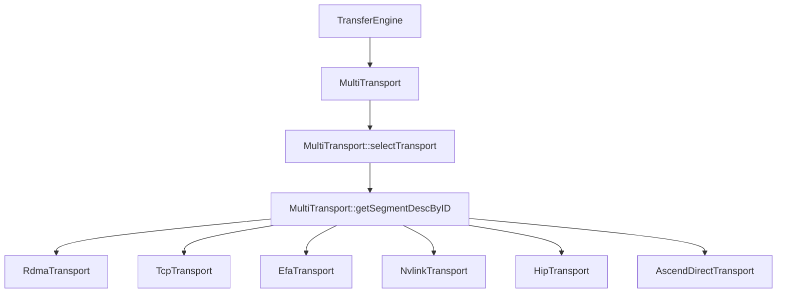
Sources: [docs/source/getting_started/supported-protocols.md:1-24](), [mooncake-transfer-engine/src/transport/CMakeLists.txt:1-131]()

## Supported Transport Protocols

### Network Transport Protocols

- **TCP (`TcpTransport`)**:  
  A reliable, universal protocol over standard Ethernet networks. It serves as the default fallback transport, requiring no specialized hardware, ideal for testing, development, or environments lacking RDMA support. The Python API uses `"tcp"` as the protocol string without a device name.  
  Use case: general purpose, broad compatibility but higher latency and CPU use.  
  Supported via Python API as primary transport.  

- **RDMA (`RdmaTransport`)**:  
  Remote Direct Memory Access provides high throughput and low latency with minimal CPU involvement using InfiniBand or RoCE hardware. Supports accelerator-aware zero-copy transfers, including NVIDIA GPUDirect RDMA for CUDA memory and Cambricon MLU buffers when compiled with `-DUSE_MLU=ON`.  
  Use case: high-performance LLM KV cache transfer across nodes with RDMA-capable NICs.  
  The system auto-fallbacks to TCP if no RDMA device is found. Supports both classic and TENT RDMA backends.  
  Configuration includes specifying RDMA device (e.g., `"mlx5_0"`) or using `"auto-discovery"` for topology-aware device selection.

- **EFA (`EfaTransport`)**:  
  AWS Elastic Fabric Adapter uses libfabric’s SRD protocol to offer RDMA-like performance on AWS instances without native RDMA hardware. Supports GPU transfers with CUDA enabled.  
  Use case: AWS cloud deployments for high-throughput inference workloads.  

- **UB / Barex / CXL** (Advanced, specialized protocols):  
  Additional specialized protocols for NVMe-oF storage access, memory pooling across hosts (CXL), and bare-metal RDMA extensions. These have limited Python API support and usually require advanced cluster setups.

Sources: [docs/source/getting_started/supported-protocols.md:27-172](), [mooncake-transfer-engine/src/transport/CMakeLists.txt:14-17]()

### GPU Interconnect Protocols

- **NVLink (`NvlinkTransport`, `IntraNodeNvlinkTransport`)**:  
  Supports intra-node and multi-node GPU communication via NVIDIA’s NVLink and Mellanox MNNVL fabrics. Ideal for high-throughput tensor transfers between GPUs inside the same server or across connected nodes. Requires building with `-DUSE_INTRA_NVLINK=ON`.  
  Use case: fast GPU-to-GPU data transfers, crucial for large model parallelism and KVCache sharing.

- **HIP (`HipTransport`)**:  
  Enables AMD ROCm/HIP-based clusters to perform intra- and inter-node GPU transfers. HIP transport supports device-aware memory registration and communication. Requires compilation with `-DUSE_HIP=ON`.  
  Use case: AMD GPU clusters and machine learning workloads seeking HIP compatibility.

- **MUSA / MACA**:  
  - **MUSA (Moore Threads GPU)**: Supported via a translation layer that redefines CUDA APIs to the MUSA runtime. Requires building with `-DUSE_MUSA=ON`. Integrates with `mthreads-peermem` for GPUDirect RDMA on Moore Threads GPUs.  
  - **MACA (MetaX GPU)**: Similar abstraction for MetaX hardware, building with `-DUSE_MACA=ON`.  
  Both provide zero-copy accelerator-to-accelerator transfers within the Transfer Engine framework.  
  Use case: deployments on these emerging GPU hardware platforms for inference acceleration.

Sources: [docs/source/getting_started/build.md:116-130](), [mooncake-transfer-engine/include/gpu_vendor/musa.h:1-154](), [mooncake-transfer-engine/src/transport/CMakeLists.txt:59-87]()

### Processor and Memory Protocols

- **Ascend Direct (`AscendDirectTransport`)**:  
  For Huawei Ascend NPUs, Mooncake offers direct transport via ADXL engines and uses HCCS/HCCL libraries for efficient data movement, achieving asynchronous transfers with robust lifecycle management.  
  Requires `-DUSE_ASCEND_DIRECT=ON` and sourced Ascend environment.  
  Use case: LLM serving on Ascend accelerators, enabling prefill and decode separation with zero-copy buffers.

- **CPU and DRAM-based transports (`tcp`, `shm`)**:  
  For CPU and host DRAM transfers, TCP is default. Shared memory (`shm`) transport allows intra-host communication with minimal overhead.

- **CXL (`CxlTransport`)**:  
  Supports shared memory expansion and pooling using Compute Express Link protocol. Useful for memory disaggregation scenarios.

Sources: [docs/source/getting_started/build.md:116-130](), [docs/source/getting_started/supported-protocols.md:1-24]()

## Hardware Accelerators and Vendor Abstraction

Mooncake provides a unified hardware abstraction layer to support heterogeneous accelerator types through a common API. This enables seamless integration of vendor-specific SDKs using wrapper layers and shared header translation.

Title: "Hardware Accelerator Vendor Abstraction Space"
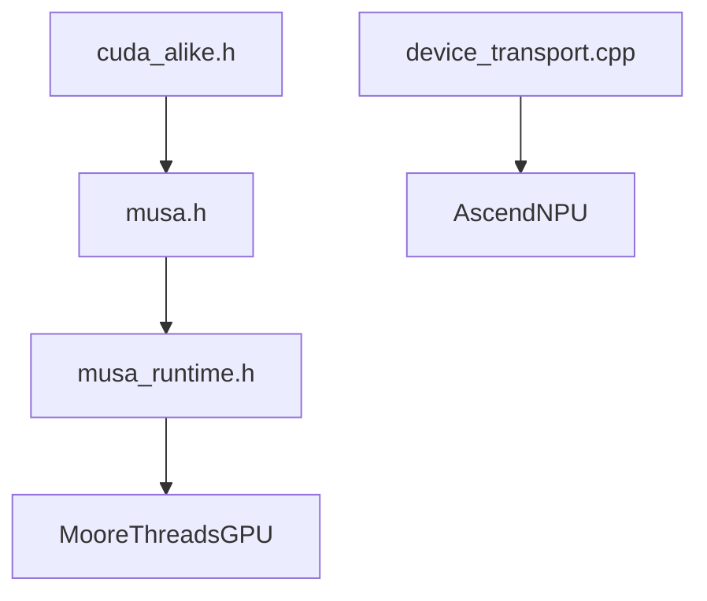

The `cuda_alike.h` file maps CUDA API calls to either the NVIDIA CUDA runtime or alternative runtimes such as MUSA and MACA, enabling reuse of GPU memory registration and data movement mechanisms across different vendors.

Sources: [mooncake-transfer-engine/include/gpu_vendor/musa.h:1-154](), [mooncake-transfer-engine/src/transport/device/CMakeLists.txt:1-15]()

### Accelerator Vendor Support

| Accelerator | Build Flag | Description | Use Case |
|-------------|------------|-------------|----------|
| NVIDIA CUDA | `-DUSE_CUDA=ON` | Supports NVIDIA GPUs with GPUDirect RDMA, DevX UMEM, IBGDA direct verbs for mlx5gda devices. Enables RDMA transfers with GPU buffers and intra-node NVLink. | Most common production target for distributed LLM serving and accelerator-aware transfers. |
| AMD HIP (ROCm) | `-DUSE_HIP=ON` | Enables ROCm/HIP runtime support for AMD GPUs. Supports device memory registration and HIP transport. | AMD GPU clusters and open-source LLM inference on AMD hardware. |
| Huawei Ascend | `-DUSE_ASCEND_DIRECT=ON` | Uses ADXL-based Ascend Direct transport with HCCS/HCCL support for intra- and inter-node data movement. | LLM inference on Ascend NPUs with efficient prefill/decode separation. |
| Moore Threads MUSA | `-DUSE_MUSA=ON` | Provides MUSA runtime compatible interface to support Moore Threads GPUs, including GPUDirect RDMA integration via mthreads-peermem. | Emerging Moore Threads GPU deployments needing seamless RDMA capabilities. |
| MetaX MACA | `-DUSE_MACA=ON` | Supports MetaX GPUs by mapping CUDA-like API calls to MACA SDK. Enables MACA runtime memory registration and transport. | MetaX GPU clusters requiring high-throughput KVCache transfer with GPU acceleration. |

Sources: [mooncake-transfer-engine/include/gpu_vendor/musa.h:1-154](), [docs/source/getting_started/build.md:116-130]()

## Supported Combinations and Use Cases

| Hardware Accelerator  | Recommended Transport(s)              | Deployment Scope     | Typical Use Case Description                                |
|----------------------|-------------------------------------|---------------------|-------------------------------------------------------------|
| NVIDIA CUDA          | `rdma`, `nvlink`, `tcp`             | Inter-node or intra-node | Disaggregated KVCache data movement and GPU intra-node tensor sharing in large GPU clusters. |
| AWS EFA Instances    | `efa`                              | Inter-node          | High-throughput, cloud-native LLM inference on AWS infrastructure, bypassing traditional RDMA hardware dependencies. |
| AMD ROCm             | `hip`, `rdma`, `tcp`                | Inter-node or intra-node | ROCm-based GPU clusters serving inference workloads with HIP and RDMA support. |
| Huawei Ascend NPU    | `ascend_direct`, `tcp`              | Inter-node or intra-node | NPU-accelerated LLM workflows requiring zero-copy and asynchronous transfers. |
| Moore Threads MUSA   | `rdma` (via MUSA runtime)           | Intra-node or inter-node | Emerging Moore Threads GPU deployments with RDMA support. |
| Generic CPU/DRAM     | `tcp`, `shm`, `cxl`                 | Broad               | Fallback or development environments without specialized hardware. Also serving as memory pooling protocols with CXL. |

These combinations are verified by conformance testing and integration into the Transfer Engine with supported Python API bindings and runtime initialization patterns.

Sources: [docs/source/getting_started/supported-protocols.md:1-24](), [docs/source/getting_started/build.md:116-130]()

---

# Page: Performance Characteristics

# Performance Characteristics

<details>
<summary>Relevant source files</summary>

The following files were used as context for generating this wiki page:

- [benchmarks/storage_benchmark_v1/__init__.py](benchmarks/storage_benchmark_v1/__init__.py)
- [benchmarks/storage_benchmark_v1/__main__.py](benchmarks/storage_benchmark_v1/__main__.py)
- [benchmarks/storage_benchmark_v1/benchmark.py](benchmarks/storage_benchmark_v1/benchmark.py)
- [benchmarks/storage_benchmark_v1/doc/README.md](benchmarks/storage_benchmark_v1/doc/README.md)
- [benchmarks/storage_benchmark_v1/layout/__init__.py](benchmarks/storage_benchmark_v1/layout/__init__.py)
- [benchmarks/storage_benchmark_v1/layout/interface.py](benchmarks/storage_benchmark_v1/layout/interface.py)
- [benchmarks/storage_benchmark_v1/layout/mla.py](benchmarks/storage_benchmark_v1/layout/mla.py)
- [benchmarks/storage_benchmark_v1/storage/__init__.py](benchmarks/storage_benchmark_v1/storage/__init__.py)
- [benchmarks/storage_benchmark_v1/storage/disk.py](benchmarks/storage_benchmark_v1/storage/disk.py)
- [benchmarks/storage_benchmark_v1/storage/interface.py](benchmarks/storage_benchmark_v1/storage/interface.py)
- [docs/source/performance/mooncake/tebench.md](docs/source/performance/mooncake/tebench.md)
- [mooncake-store/benchmarks/store_kv_bench.md](mooncake-store/benchmarks/store_kv_bench.md)
- [mooncake-store/benchmarks/store_kv_bench.py](mooncake-store/benchmarks/store_kv_bench.py)
- [mooncake-store/benchmarks/test_store_kv_bench.py](mooncake-store/benchmarks/test_store_kv_bench.py)
- [mooncake-store/include/ssd_register_client.h](mooncake-store/include/ssd_register_client.h)
- [mooncake-transfer-engine/benchmark/CMakeLists.txt](mooncake-transfer-engine/benchmark/CMakeLists.txt)
- [mooncake-transfer-engine/benchmark/bench_runner.h](mooncake-transfer-engine/benchmark/bench_runner.h)
- [mooncake-transfer-engine/benchmark/main.cpp](mooncake-transfer-engine/benchmark/main.cpp)
- [mooncake-transfer-engine/benchmark/split_output.cpp](mooncake-transfer-engine/benchmark/split_output.cpp)
- [mooncake-transfer-engine/benchmark/split_output.h](mooncake-transfer-engine/benchmark/split_output.h)
- [mooncake-transfer-engine/benchmark/te_backend.cpp](mooncake-transfer-engine/benchmark/te_backend.cpp)
- [mooncake-transfer-engine/benchmark/te_backend.h](mooncake-transfer-engine/benchmark/te_backend.h)
- [mooncake-transfer-engine/benchmark/tent_backend.cpp](mooncake-transfer-engine/benchmark/tent_backend.cpp)
- [mooncake-transfer-engine/benchmark/tent_backend.h](mooncake-transfer-engine/benchmark/tent_backend.h)
- [mooncake-transfer-engine/benchmark/tests/split_output_test.cpp](mooncake-transfer-engine/benchmark/tests/split_output_test.cpp)
- [mooncake-transfer-engine/benchmark/utils.cpp](mooncake-transfer-engine/benchmark/utils.cpp)
- [mooncake-transfer-engine/benchmark/utils.h](mooncake-transfer-engine/benchmark/utils.h)

</details>


## Purpose and Scope

This document describes the performance metrics, benchmarks, and optimization strategies integral to the Mooncake platform, focusing on its KVCache-centric LLM serving capabilities. It details throughput and latency measurements, optimization strategies, and benchmarks validating real-world LLM workloads — including transfer engine profiling, storage subsystem evaluation, XpYd prefill-decode disaggregation benchmarks, and long-tail request patterns from the FAST25 research traces.

Mooncake attains high performance through topology-aware memory and transport management, multi-tiered caching, and flexible workload scheduling. It leverages high-bandwidth transport protocols such as RDMA and NVLink, supports heterogeneous hardware memory segments, and enables quality of service (QoS) differentiation for multi-tenant serving.

Sources: `[mooncake-transfer-engine/benchmark/utils.cpp:24-131]()`, `[mooncake-transfer-engine/benchmark/utils.h:56-103]()`

---

## Transfer Engine Benchmarking

Mooncake's Transfer Engine (TE) includes an extensible benchmarking suite tasked with quantifying bandwidth and latency across different hardware transports, memory segment types, concurrency configurations, and workload profiles.

### The `tebench` Tool

- **Implementation and Backends:**  
  The `tebench` benchmarking executable supports two primary backends:
  - **Classic TE backend:** implemented in `te_backend.cpp`.
  - **TENT (Transfer Engine Next) backend:** implemented in `tent_backend.cpp`, offering advanced scheduling and telemetry-driven dispatching.  
  Backend selection is determined by the `--backend` CLI option and enables precise measurement across both legacy and new TE architectures. These backends are integrated into the `tebench` build as per `CMakeLists.txt` configuration `[mooncake-transfer-engine/benchmark/CMakeLists.txt:28-38]()`.  

- **Multi-Segment and Multi-Transport Support:**  
  `tebench` supports mixed memory segment configurations via `--seg_type_mix` (e.g., `"dram,vram"`), allowing the same process to concurrently drive traffic over multiple memory types and associated transports such as SHM for DRAM and NVLink for VRAM. This tests multi-tier memory and transport concurrency and helps characterize aggregate pipeline throughput `[mooncake-transfer-engine/benchmark/utils.cpp:27-35]()`.  

- **QoS and Deadline-Aware Benchmarking:**  
  The tool accepts QoS class specifications (`--qos_classes`, `--qos_classes_json`) subdividing worker threads into named classes, each with thread counts, SLO latency targets, and weights for fair scheduling. The P99 and P999 latency distributions are tracked per QoS class to capture tail latency behavior (using the `XferMetricStats` class) `[mooncake-transfer-engine/benchmark/utils.h:106-155]()`.  

- **Workload Class Modeling:**  
  Complementing QoS threads, `tebench` allows JSON-defined workload classes that specify block sizes, batch sizes, intent types (e.g., `background_prefetch`, `weight_loading`), and deadlines, enabling mixed concurrent workloads to evaluate scheduling policies and bandwidth arbitration `[mooncake-transfer-engine/benchmark/utils.cpp:69-73]()`, `[mooncake-transfer-engine/benchmark/tent_backend.cpp:106-124]()`.

### Execution Flow and Configuration Management

The global benchmarking configuration is encapsulated by the `XferBenchConfig` structure, which processes extensive command-line parameters including:

- Buffer and batch sizing (`total_buffer_size`, `start_block_size`, `max_block_size`, `start_batch_size`, `max_batch_size`).
- Thread concurrency controls (`start_num_threads`, `max_num_threads`).
- Metadata service types and URLs (`--metadata_type`, `--metadata_url_list`).
- Transport selection (`--xport_type`), and backend preference (`--backend`).
- Deadline handling parameters (`deadline_us`, `deadline_tight_threads`, `deadline_bw_arbitration`).

These options govern the test topology, concurrency, network transport selection, scheduling mode, and consistency checks `[mooncake-transfer-engine/benchmark/utils.cpp:24-131]()`, `[mooncake-transfer-engine/benchmark/utils.h:56-103]()`.  

Upon running, `tebench` operates in either:

- **Target mode:** waits for connections and serves memory segments.
- **Initiator mode:** launches worker threads simulating transfer operations to target segments.

The initiator threads apply pacing delays (`request_interval_us`), determine local and remote buffer base addresses, and drive asynchronous batched transfers while collecting detailed latency and bandwidth statistics `[mooncake-transfer-engine/benchmark/main.cpp:44-167]()`.  

**Diagram: Transfer Engine Benchmark Code Entity Mapping**

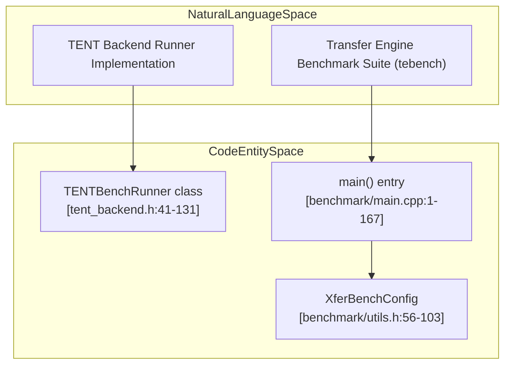

Sources: `[mooncake-transfer-engine/benchmark/utils.cpp:24-131]()`, `[mooncake-transfer-engine/benchmark/utils.h:56-154]()`, `[mooncake-transfer-engine/benchmark/tent_backend.cpp:51-89]()`, `[mooncake-transfer-engine/benchmark/main.cpp:1-167]`, `[mooncake-transfer-engine/benchmark/tent_backend.h:41-131]()`

---

## RDMA and Topology Optimizations

### Topology Discovery and Memory Affinity

Mooncake dynamically discovers the hardware topology to map memory buffers close to the network interfaces used by RDMA or NVLink. This NUMA-aware allocation and binding significantly reduces memory access latency and maximizes throughput.

- The system infers NUMA node affinity via PCI bus IDs and sysfs queries to assign buffers optimally `[mooncake-transfer-engine/benchmark/te_backend.cpp:42-60]()`.
- For GPU VRAM, `cudaMalloc` allocates pinned device memory, and device-local pinned host memory can be allocated for zero-copy paths `[mooncake-transfer-engine/benchmark/te_backend.cpp:99-130]()`.
- Shared memory buffers are bound to NUMA nodes to ensure they are physically resident where expected (`bindShmBufferToNode` enforces page placement on host memory) `[mooncake-transfer-engine/benchmark/te_backend.cpp:142-162]()`.
- Hugepage support reduces TLB misses during large buffer registrations, governed by benchmarking flags like `use_hugepage` and `hugepage_size` `[mooncake-transfer-engine/benchmark/utils.cpp:113-121]()`.  

This topology-aware memory management is critical for performance, especially with heterogeneous segments combining DRAM and GPU VRAM buffers.

**Diagram: Topology and Memory Location Code Entities**

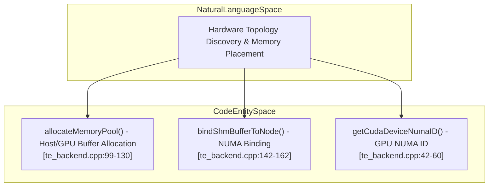

Sources: `[mooncake-transfer-engine/benchmark/te_backend.cpp:42-162]()`, `[mooncake-transfer-engine/benchmark/utils.cpp:113-121]()`  

---

## Storage and Allocator Benchmarks

Mooncake Store's internal components are benchmarked through specialized testing utilities designed to emulate realistic KVCache workloads and trace replay.

### KVCache Storage Benchmark v1 (Trace Replay)

This benchmark suite simulates real-world request sequences using the FAST25 research paper's trace datasets, driven by a Python benchmark script and auxiliary storage I/O backends. Key features include:

- **Multi-scenario support:** conversation, synthetic, toolagent, and all scenarios to represent different LLM workload characteristics `[benchmarks/storage_benchmark_v1/doc/README.md:1-101]()`.
- **Storage layout options:**
  - Single-file mode with a large preallocated binary blob (`data.bin`).
  - Per-file mode with individual files per page (`page_<id>.bin`), each replacing the full page on write for simplicity `[benchmarks/storage_benchmark_v1/doc/README.md:67-101]()`.
- **Durability modes:** configurable file synchronization (`fsync`) strategies including none, batch, always, and end `[benchmarks/storage_benchmark_v1/doc/README.md:30]()`.
- **Parallelism:** configurable number of client threads simulating concurrent accesses with per-thread isolated storage subdirectories `[benchmarks/storage_benchmark_v1/doc/README.md:33-66]()`.  

### Mooncake Store KV Benchmark (`store_kv_bench.py`)

The Mooncake Store KV benchmark evaluates end-to-end distributed KV operations in various realistic workload scenarios such as fill, verify write, mixed read/write, and metadata stress:

- Supports flexible workload definitions including random key distributions, batch sizes, request mixes (`put_pct`, `get_pct`, etc.) `[mooncake-store/benchmarks/store_kv_bench.py:31-65]()`.
- Permits operation via plain and zero-copy APIs to measure overhead from buffer copying.
- Incorporates latency sampling, error counter tracking, journaling and replay features for deterministic benchmark runs.
- Multi-replica and storage tier configuration options benchmark replication and offloading performance.

**Diagram: Storage Benchmark Architecture**

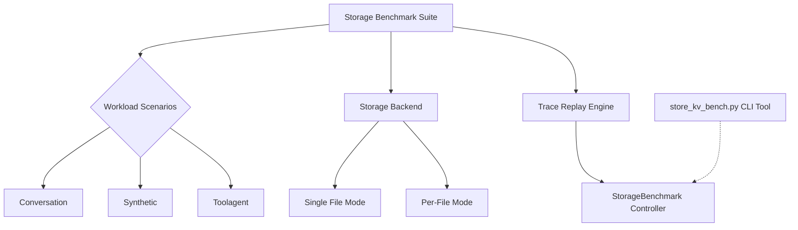

Sources: `[benchmarks/storage_benchmark_v1/doc/README.md:1-101]()`, `[mooncake-store/benchmarks/store_kv_bench.py:31-65]()`  

---

## XpYd (Prefill-Decode) Benchmarks and Tuning Parameters

XpYd benchmarks evaluate the performance of Mooncake in a real LLM serving deployment pattern termed **Prefill-Decode (PD) Disaggregation**:

- **Workflow:** prefilling nodes generate KVCache key-value tensor slices which they transfer en masse to decoding nodes performing the autoregressive computation.
- **Batching and Slicing:** TE batches multiple slice transfers to amortize overhead and maximize pipeline utilization.
- **Zero-Copy RDMA Transfers:** VRAM-registered buffers enable direct memory operations avoiding CPU copies.
- **Deadline-Aware Arbitration:** The TENT backend supports deadlines (`--deadline_us`) and per-thread scheduling groups (`deadline_tight_threads`) to prioritize latency-sensitive foreground traffic over background work. Bandwidth arbitration for RDMA further optimizes the delivery of urgent transfers `[mooncake-transfer-engine/benchmark/utils.cpp:89-98]()`.  

### Key Tuning Parameters

| Parameter               | Default      | Description |
|------------------------|--------------|-------------|
| `--total_buffer_size`   | 1GB          | Size of memory buffers used in benchmarking `[mooncake-transfer-engine/benchmark/utils.cpp:45]` |
| `--start_block_size`    | 4096 bytes   | Initial block size for transfer requests `[mooncake-transfer-engine/benchmark/utils.cpp:47]` |
| `--max_block_size`      | 64 MB        | Upper bound for block size sweep `[mooncake-transfer-engine/benchmark/utils.cpp:48]` |
| `--start_batch_size`    | 1            | Initial number of requests batched together `[mooncake-transfer-engine/benchmark/utils.cpp:49]` |
| `--max_batch_size`      | 1            | Maximum batch size `[mooncake-transfer-engine/benchmark/utils.cpp:50]` |
| `--xport_type`          | `""`         | Transport protocol selected: RDMA, TCP, SHM, NVLINK, etc. `[mooncake-transfer-engine/benchmark/utils.cpp:109-112]` |
| `--backend`             | `tent`       | Transport backend: classic or TENT `[mooncake-transfer-engine/benchmark/utils.cpp:113]` |
| `--deadline_us`         | 0 (disabled) | Per-transfer relative deadline in microseconds for worker threads `[mooncake-transfer-engine/benchmark/utils.cpp:89-93]` |

These parameters influence concurrency, transport path utilization, buffer placement, and deadline-driven scheduling, critical for optimizing end-to-end LLM serving latency and throughput.

Sources: `[mooncake-transfer-engine/benchmark/utils.cpp:44-136]()`, `[mooncake-transfer-engine/benchmark/tent_backend.cpp:51-89]()`  

---

# Summary

Mooncake's performance foundation centers on efficient memory and transport utilization enabled via extensive benchmarking and configuration tuning:

- The **Transfer Engine (TE) benchmark tool `tebench`** serves as an end-to-end microscopic profiler for bandwidth, latency, and QoS metrics across classic and TENT backends.
- **NUMA-aware topology and memory binding** ensure optimum network-device proximity and buffer locality, vital for RDMA and GPU VRAM transports.
- The **Mooncake Store storage benchmark** rigorously tests KV storage durability, latency, and throughput with realistic workloads and trace-driven request patterns.
- The **XpYd benchmark framework** evaluates PD disaggregation workflows simulating real multi-tenant LLM serving deployments, featuring deadline-aware scheduling, batching, and mixed priority traffic.
  
Together, these benchmarking and profiling components inform Mooncake’s architectural decisions, identify bottlenecks, and ensure the platform meets stringent LLM serving performance demands.

# Appendix: Key Code Entities Overview

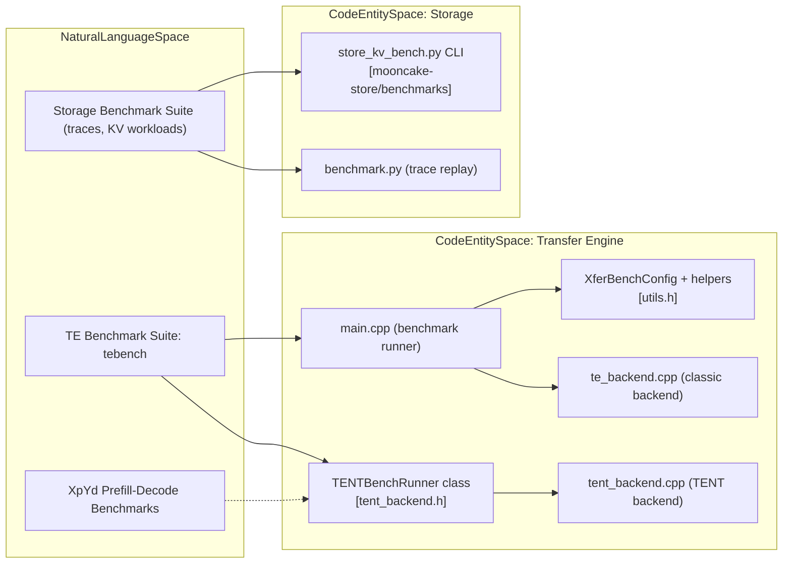

Sources: `[mooncake-transfer-engine/benchmark/utils.cpp]()`, `[mooncake-transfer-engine/benchmark/utils.h]()`, `[mooncake-store/benchmarks/store_kv_bench.py]()`, `[benchmarks/storage_benchmark_v1/doc/README.md]()`

---

This page is a leaf in the documentation tree focusing on detailed performance characterization critical for Mooncake's LLM serving stack. For further architecture and API details, see sibling pages in the documentation hierarchy.

---

# Page: Getting Started

# Getting Started

<details>
<summary>Relevant source files</summary>

The following files were used as context for generating this wiki page:

- [README.md](README.md)
- [docs/source/getting_started/build.md](docs/source/getting_started/build.md)
- [docs/source/getting_started/quick-start.md](docs/source/getting_started/quick-start.md)
- [docs/source/getting_started/supported-protocols.md](docs/source/getting_started/supported-protocols.md)
- [docs/source/index.md](docs/source/index.md)
- [docs/source/zh_archive/build.md](docs/source/zh_archive/build.md)
- [docs/source/zh_archive/run-examples.md](docs/source/zh_archive/run-examples.md)
- [mooncake-common/common.cmake](mooncake-common/common.cmake)
- [mooncake-store/CMakeLists.txt](mooncake-store/CMakeLists.txt)
- [mooncake-store/include/version.h.in](mooncake-store/include/version.h.in)
- [mooncake-transfer-engine/CMakeLists.txt](mooncake-transfer-engine/CMakeLists.txt)
- [mooncake-transfer-engine/include/cuda_alike.h](mooncake-transfer-engine/include/cuda_alike.h)
- [mooncake-transfer-engine/src/CMakeLists.txt](mooncake-transfer-engine/src/CMakeLists.txt)
- [mooncake-transfer-engine/src/transport/CMakeLists.txt](mooncake-transfer-engine/src/transport/CMakeLists.txt)

</details>


This page guides users through installation, basic setup, and initial usage of Mooncake. It provides a high-level overview of system prerequisites, supported installation methods, core components, and verification steps. For comprehensive technical details, it links to child pages with focused topics on installation, usage examples, and configuration management.

- For detailed installation workflows including Python packages, source builds, and Docker usage, see [Installation](#2.1).  
- For minimal working examples showcasing tensor transfers, zero-copy operations, and LLM integrations, see [Quick Start Examples](#2.2).  
- For configuration of environment variables, config files, and command-line options, see [Configuration Overview](#2.3).

Sources: [docs/source/getting_started/quick-start.md:1-10](), [docs/source/getting_started/build.md:1-10]()

---

## Prerequisites and System Requirements

Before proceeding with installation, ensure your system satisfies the following prerequisites:

### Hardware Requirements

- **Network:** RDMA-capable NICs supporting InfiniBand or RoCE are preferred for low-latency, high-throughput data transfers. Alternatively, high-speed TCP/IP can be used [docs/source/getting_started/quick-start.md:15]() [docs/source/getting_started/supported-protocols.md:9-10]().
- **Accelerators:** Supported device types include NVIDIA GPUs (CUDA 12.1+), AMD GPUs (ROCm/HIP), Moore Threads MUSA GPUs, Huawei Ascend NPUs, MetaX MACA GPUs, and Cambricon MLUs [docs/source/getting_started/quick-start.md:16](), [docs/source/getting_started/build.md:116-131]().
- **Memory and Storage:** At least 16 GB of RAM is recommended to support buffer allocation for KVCache shards and metadata management. NVMe SSD or distributed filesystems are commonly employed for ephemeral eviction tiers [README.md:31-33](), [docs/source/getting_started/build.md:60-77]().

### Software Dependencies

- **Operating System:** Linux is the target OS, with Ubuntu 22.04 LTS or later recommended for compatibility with packaging and build tools [docs/source/getting_started/build.md:8]().
- **Python:** Version 3.10+ is required, ideally within a virtual environment [docs/source/getting_started/quick-start.md:14]().
- **System Libraries:** Essential native libraries include `libibverbs`, `rdma-core`, `libnuma`, `libcurl`, and `liburing` for network and async I/O support [docs/source/getting_started/quick-start.md:110-111]().

Sources: [docs/source/getting_started/quick-start.md:14-17](), [docs/source/getting_started/build.md:8-131]()

---

## Installation Methods Overview

Mooncake supports multiple installation modes tailored for various user needs and hardware configurations:

- **Prebuilt Python Wheels via PyPI:**  
  Multiple variant packages are provided to match hardware and software environments:
  - `mooncake-transfer-engine` for CUDA 12.1–12.9 [README.md:21]()  
  - `mooncake-transfer-engine-cuda13` for CUDA 13.0/13.1 [README.md:22]()  
  - `mooncake-transfer-engine-non-cuda` for CPU-only deployments [README.md:23]()  
  - `mooncake-transfer-engine-npu` for Ascend NPU platforms [README.md:24]()  
  - Variants exist for MUSA, EFA, and ROCm [README.md:25-27]().

- **Building from Source:**  
  Using CMake (configured via [mooncake-common/common.cmake:1]()) with flexible options for hardware backend support, such as CUDA, VRAM segments, and NVMe-oF storage [docs/source/getting_started/build.md:32-77](). Supporting scripts (`dependencies.sh`) automate system dependency installation.

- **Docker Containers:**  
  Official images are published on Docker Hub (`kvcacheai/mooncake`) for convenient environment encapsulation [docs/source/getting_started/quick-start.md:75-77]().

### Diagram: Installation Modes and Code Entities

Installation Modes to Code Entity Mapping
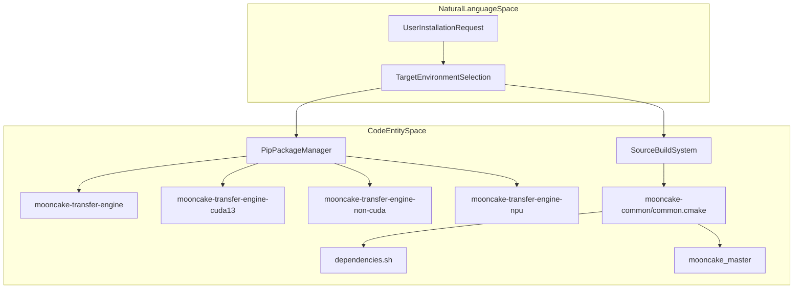

Sources: [README.md:21-28](), [docs/source/getting_started/build.md:14-59](), [mooncake-common/common.cmake:1-10]()

For comprehensive build instructions, hardware-specific flags, and Docker usage, see [Installation](#2.1).

---

## Core Components and Initial Usage

Mooncake comprises two key subsystems enabling efficient LLM KVCache disaggregation:

- **Transfer Engine:**  
  A high-performance data movement layer exposing the `TransferEnginePy` Python class. It manages connections, buffer registrations, and allows zero-copy transfers across NICs and GPU memory [README.md:4-10]().
- **Mooncake Store:**  
  A distributed object storage system with the `MooncakeStorePyWrapper` client interface, supporting scalable KVCache storage with lease management, replication, and multi-tier memory tiers [docs/source/index.md:30-38](), [docs/source/getting_started/quick-start.md:26-30]().

### Diagram: High-Level Architecture to Code Entities

Core Subsystems to Code Entities
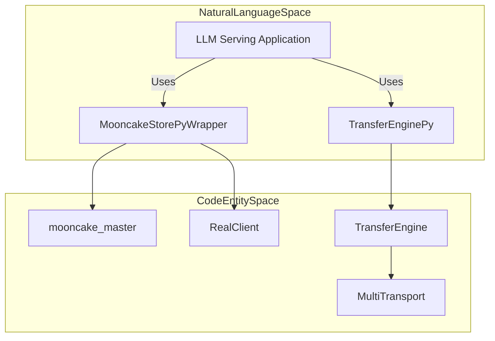

Sources: [docs/source/getting_started/quick-start.md:26-31](), [README.md:4-10]()

### Verification Smoke Test

After installation, verify your setup by initializing a basic `TransferEngine` or a `MooncakeStore` client pointed at a metadata server (e.g., `P2PHANDSHAKE`). Running simple examples ensures the system is operational [docs/source/getting_started/quick-start.md:40-45]().

For working code snippets demonstrating basic file and tensor operations and framework integration, see [Quick Start Examples](#2.2).

Sources: [docs/source/getting_started/quick-start.md:40-46]()

---

## Configuration Overview

Mooncake supports flexible configuration through multiple layers:

- **Environment Variables:** Control transport protocol, device names, metadata servers, and debugging flags [docs/source/getting_started/quick-start.md:50-51]().
- **Configuration Files:** Includes `mooncake_config.py` for Python API clients, `default_config.h` for compiled defaults, and `environ.h` for environment variables semantics.
- **Command-line Flags:** Used by service binaries like `mooncake_master` and benchmark tools to override settings at runtime [docs/source/getting_started/quick-start.md:84]().

For detailed configuration options, tuning guides, and file formats, see [Configuration Overview](#2.3).

Sources: [docs/source/getting_started/quick-start.md:50-84](), [docs/source/getting_started/build.md:116-131]()

---

This concludes the high-level guidance to get started with Mooncake. Please explore the child pages for more granular instructions on installation, example usage, and configuration.

---

# Page: Installation

# Installation

<details>
<summary>Relevant source files</summary>

The following files were used as context for generating this wiki page:

- [.github/CODEOWNERS](.github/CODEOWNERS)
- [.github/labeler.yml](.github/labeler.yml)
- [.github/workflows/ci.yml](.github/workflows/ci.yml)
- [.github/workflows/pre-release.yaml](.github/workflows/pre-release.yaml)
- [.github/workflows/release-cuda13.yaml](.github/workflows/release-cuda13.yaml)
- [.github/workflows/release-non-cuda.yaml](.github/workflows/release-non-cuda.yaml)
- [.github/workflows/release-npu.yaml](.github/workflows/release-npu.yaml)
- [.github/workflows/release.yaml](.github/workflows/release.yaml)
- [.gitmodules](.gitmodules)
- [CMakeLists.txt](CMakeLists.txt)
- [dependencies.sh](dependencies.sh)
- [docker/mooncake.Dockerfile](docker/mooncake.Dockerfile)
- [docker/musa.Dockerfile](docker/musa.Dockerfile)
- [mooncake-integration/CMakeLists.txt](mooncake-integration/CMakeLists.txt)
- [mooncake-wheel/pyproject.toml](mooncake-wheel/pyproject.toml)
- [mooncake-wheel/setup.py](mooncake-wheel/setup.py)
- [mooncake-wheel/tests/test_distributed_object_store.py](mooncake-wheel/tests/test_distributed_object_store.py)
- [mooncake-wheel/tests/test_release_wheel_tags.py](mooncake-wheel/tests/test_release_wheel_tags.py)
- [python/tests/packaging/test_installed_wheel.py](python/tests/packaging/test_installed_wheel.py)
- [python/tests/packaging/test_project.py](python/tests/packaging/test_project.py)
- [scripts/build_wheel.sh](scripts/build_wheel.sh)
- [scripts/run_tests.sh](scripts/run_tests.sh)
- [scripts/test_installation.sh](scripts/test_installation.sh)

</details>


## Purpose and Scope

This page provides comprehensive technical documentation for installing Mooncake, the KVCache-centric LLM serving platform, across diverse operating environments. It details installation via prebuilt PyPI wheel packages (covering CUDA, CUDA 13, and non-CUDA/CPU variants), compiling and building from source using CMake and Ninja, and containerized deployments using Docker. Additionally, this page outlines system prerequisites, low-level dependency scripts, the Python wheel packaging pipeline, and post-installation verification routines.

Sources: `[scripts/build_wheel.sh:1-20]`, `[CMakeLists.txt:1-40]`, `[scripts/test_installation.sh:1-30]()`

---

## Installation Method Selection

Mooncake offers flexible deployment paths tailored to specific hardware backends and development workflows. Users can choose between prebuilt PyPI packages for rapid deployment, source compilation for customized tuning, or Docker containers for isolated runtime environments.

Title: "Installation Method Selection and Target Mapping"
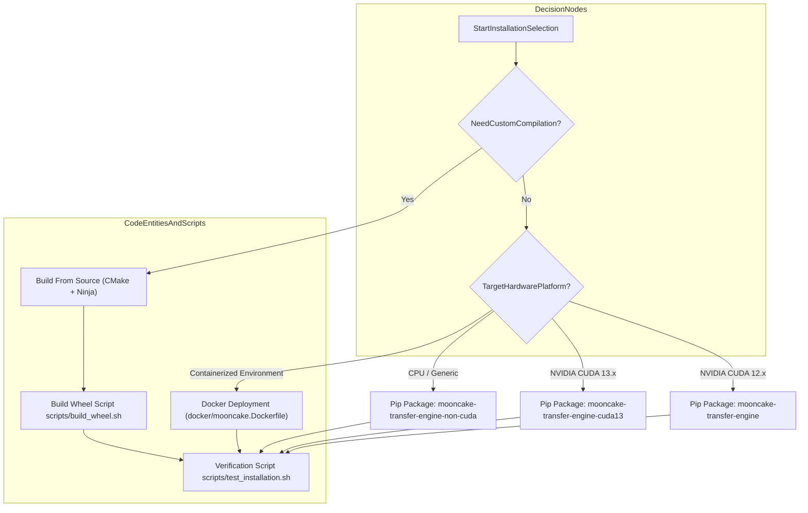

This decision flow routes users to the appropriate installation mechanism depending on compilation requirements and hardware architecture.

Sources: `[scripts/build_wheel.sh:1-20]`, `[CMakeLists.txt:1-40]`, `[scripts/test_installation.sh:1-30]()`

---

## PyPI Packages and Variants

Mooncake publishes multiple wheel packages on PyPI to support diverse hardware platforms and CUDA versions. These packages bundle the core C++ `TransferEngine` and the distributed `MooncakeStore` Python bindings (`[mooncake-wheel/pyproject.toml:24-37]()`).

### Available Package Variants

| Package Name | Target Hardware | CUDA Version | Key Components | Reference Workflow |
| --- | --- | --- | --- | --- |
| `mooncake-transfer-engine` | NVIDIA GPU | CUDA 12.1 - 12.9 | `TransferEngine`, `MooncakeStore` | `[.github/workflows/release.yaml:1-25]()` |
| `mooncake-transfer-engine-cuda13` | NVIDIA GPU | CUDA 13.0 / 13.1 | `TransferEngine`, `MooncakeStore` | `[.github/workflows/release-cuda13.yaml:1-25]()` |
| `mooncake-transfer-engine-non-cuda` | CPU / Generic | None (CPU only) | `TransferEngine`, `MooncakeStore` | `[.github/workflows/ci.yml:31-42]()` |

All packages expose standard console entry points registered via `mooncake-wheel/pyproject.toml`:
- `mooncake_master` — Master metadata service CLI mapped to `mooncake.cli:main` `[mooncake-wheel/pyproject.toml:51]()`
- `mooncake_client` — Client CLI for object store operations mapped to `mooncake.cli_client:main` `[mooncake-wheel/pyproject.toml:52]()`
- `transfer_engine_bench` — Transfer engine benchmark tool mapped to `mooncake.cli_bench:main` `[mooncake-wheel/pyproject.toml:53]()`
- `mooncake_http_metadata_server` — HTTP metadata server mapped to `mooncake.http_metadata_server:main` `[mooncake-wheel/pyproject.toml:54]()`
- `transfer_engine_topology_dump` — Topology discovery utility mapped to `mooncake.transfer_engine_topology_dump:main` `[mooncake-wheel/pyproject.toml:56]()`

Sources: `[mooncake-wheel/pyproject.toml:24-57]`, `[.github/workflows/release.yaml:1-25]`, `[.github/workflows/release-cuda13.yaml:1-25]()`

---

## System Prerequisites and Dependency Installation

Target host environments must satisfy specific operating system and library dependencies prior to compilation or execution.

### Supported Operating Systems

- Ubuntu 22.04 LTS and newer `[dependencies.sh:148-149]()`
- Debian distributions `[dependencies.sh:148-149]()`
- Enterprise Linux distributions (CentOS, RHEL, Rocky Linux, AlmaLinux) `[dependencies.sh:151-152]()`
- EulerOS, openEuler, and Kylin `[dependencies.sh:151-152]()`

### Key System Dependencies

Mooncake requires foundational build utilities, networking stacks, and memory management libraries:
- Build Tools: `build-essential`, `cmake`, `ninja-build`, `git` `[dependencies.sh:166-169]()`
- Networking and Fabrics: `libibverbs-dev`, `libnuma-dev`, `libgoogle-glog-dev` `[dependencies.sh:172-176]()`
- RPC and Serialization: `libgrpc-dev`, `libgrpc++-dev`, `libprotobuf-dev`, `protobuf-compiler-grpc` `[dependencies.sh:180-184]()`
- Asynchronous I/O and Allocators: `liburing-dev`, `libjemalloc-dev`, `libmsgpack-dev`, `libzmq3-dev`, `libzstd-dev`, `libasio-dev` `[dependencies.sh:187-192]()`
- Python Development Headers: `libpython3-dev`, `pkg-config`, `patchelf` `[dependencies.sh:177-195]()`

### Automated Dependency Script

The repository provides `dependencies.sh` to install system packages and the Go runtime (`1.25.9`) required for metadata coordination `[dependencies.sh:26-127]()`:

```bash
sudo bash dependencies.sh -y
```

For advanced NVMe-oF transport support using SPDK, execute with the optional flag `[dependencies.sh:106-114]()`:

```bash
sudo bash dependencies.sh --with-spdk -y
```

Sources: `[dependencies.sh:1-207]()`

---

## Building from Source and CMake Configuration

Users requiring custom compilation flags or hardware-specific optimizations can build Mooncake directly from source.

### Top-Level CMake Options

| Option | Default | Description |
| --- | --- | --- |
| `WITH_TE` | ON | Enable building the Transfer Engine subsystem `[CMakeLists.txt:19]()` |
| `WITH_STORE` | ON | Enable building the Mooncake Store distributed storage `[CMakeLists.txt:20]()` |
| `USE_CUDA` | OFF | Enable NVIDIA CUDA GPU support and NVLink allocator |
| `USE_ETCD` | OFF | Enable ETCD metadata coordination support `[CMakeLists.txt:53]()` |
| `WITH_EP` | OFF | Enable Expert Parallelism (MoE) backend modules `[CMakeLists.txt:31]()` |

### Compilation Steps

```bash
# Initialize required submodules (pybind11)
git submodule update --init --recursive

# Configure build directory with CMake and Ninja
mkdir -p build && cd build
cmake .. -DUSE_CUDA=ON -DWITH_STORE=ON -DCMAKE_BUILD_TYPE=Release

# Compile and install
make -j$(nproc)
sudo make install
```

Sources: `[CMakeLists.txt:1-60]`, `[mooncake-integration/CMakeLists.txt:1-50]()`

---

## Python Wheel Packaging Pipeline

Python wheels are produced via a packaging pipeline orchestrated by `scripts/build_wheel.sh` and `mooncake-integration/CMakeLists.txt`.

Title: "Wheel Packaging Pipeline and Code Entity Mapping"
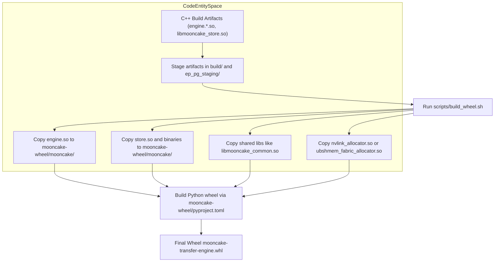

The script stages compiled native extensions, allocators, and shared object libraries into the `mooncake-wheel/mooncake/` package structure prior to invoking `setuptools` `[scripts/build_wheel.sh:20-137]()`.

Sources: `[scripts/build_wheel.sh:20-137]`, `[mooncake-integration/CMakeLists.txt:1-50]`, `[mooncake-wheel/pyproject.toml:1-67]()`

---

## Docker-based Deployment

For containerized clusters, Mooncake provides container definitions under `docker/`.

- The primary runtime container is defined in `docker/mooncake.Dockerfile`.
- Alternative accelerators (e.g., MUSA) provide dedicated Dockerfiles such as `docker/musa.Dockerfile`.

To build and run the container:

```bash
docker build -f docker/mooncake.Dockerfile -t mooncake:latest .
docker run --rm -it mooncake:latest bash
```

Sources: `[.github/workflows/ci.yml:1-100]`, `[docker/mooncake.Dockerfile]()`, `[docker/musa.Dockerfile]()`

---

## Verification and Testing of Installation

Post-installation verification ensures that all native modules, entry points, and Python bindings load correctly.

### Test Execution Script

The script `scripts/test_installation.sh` automates validation checks `[scripts/test_installation.sh:10-101]()`:
1. Establishes an isolated virtual environment `[scripts/test_installation.sh:11-12]()`.
2. Installs the generated wheel and verifies importability of `mooncake.engine` and `mooncake.reshard.weight` `[scripts/test_installation.sh:19-37]()`.
3. Validates executable console entry points (`mooncake_master`, `mooncake_client`, `transfer_engine_bench`, `mooncake_http_metadata_server`, `transfer_engine_topology_dump`) `[scripts/test_installation.sh:75-97]()`.

Execute the test suite using:

```bash
bash scripts/test_installation.sh
```

Sources: `[scripts/test_installation.sh:1-101]`, `[scripts/run_tests.sh:1-160]()`

---

## Summary Diagram: Installation Ecosystem Architecture

Title: "Installation Ecosystem Architecture"
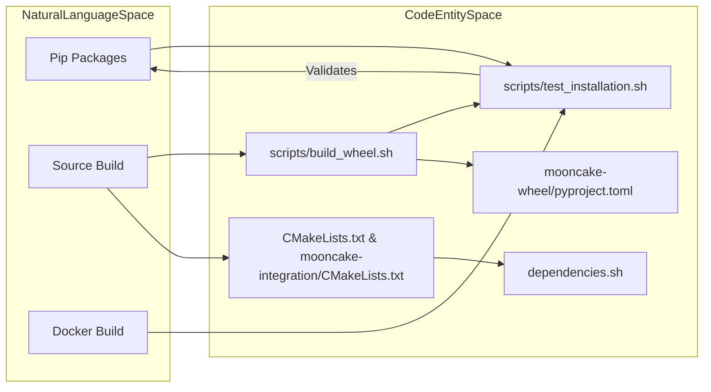

Sources: `[scripts/test_installation.sh:1-101]`, `[scripts/build_wheel.sh:1-137]`, `[CMakeLists.txt:1-60]`, `[mooncake-integration/CMakeLists.txt:1-50]`, `[dependencies.sh:1-207]`, `[mooncake-wheel/pyproject.toml:1-67]()`

---

# Page: Quick Start Examples

# Quick Start Examples

<details>
<summary>Relevant source files</summary>

The following files were used as context for generating this wiki page:

- [README.md](README.md)
- [docs/source/getting_started/build.md](docs/source/getting_started/build.md)
- [docs/source/getting_started/quick-start.md](docs/source/getting_started/quick-start.md)
- [docs/source/getting_started/supported-protocols.md](docs/source/getting_started/supported-protocols.md)
- [docs/source/index.md](docs/source/index.md)
- [docs/source/zh_archive/build.md](docs/source/zh_archive/build.md)
- [docs/source/zh_archive/run-examples.md](docs/source/zh_archive/run-examples.md)
- [docs/source/zh_archive/transfer-engine-python.md](docs/source/zh_archive/transfer-engine-python.md)
- [mooncake-common/common.cmake](mooncake-common/common.cmake)
- [mooncake-store/CMakeLists.txt](mooncake-store/CMakeLists.txt)
- [mooncake-store/include/version.h.in](mooncake-store/include/version.h.in)
- [mooncake-transfer-engine/CMakeLists.txt](mooncake-transfer-engine/CMakeLists.txt)
- [mooncake-transfer-engine/include/cuda_alike.h](mooncake-transfer-engine/include/cuda_alike.h)
- [mooncake-transfer-engine/src/CMakeLists.txt](mooncake-transfer-engine/src/CMakeLists.txt)
- [mooncake-transfer-engine/src/transport/CMakeLists.txt](mooncake-transfer-engine/src/transport/CMakeLists.txt)
- [mooncake-wheel/mooncake/__init__.py](mooncake-wheel/mooncake/__init__.py)
- [mooncake-wheel/tests/test_import_structure.py](mooncake-wheel/tests/test_import_structure.py)
- [mooncake-wheel/tests/transfer_engine_initiator_test.py](mooncake-wheel/tests/transfer_engine_initiator_test.py)
- [mooncake-wheel/tests/transfer_engine_target.py](mooncake-wheel/tests/transfer_engine_target.py)

</details>


## Purpose and Scope
This page provides minimal working examples demonstrating core Mooncake functionality. These examples illustrate how to use the **Transfer Engine** for direct memory-to-memory data transfers and **Mooncake Store** for distributed KV cache operations through the Python API. Mooncake targets high-performance large language model (LLM) serving environments, focusing on KVCache disaggregation. The examples cover basic setup, tensor storage, data movement, and lightweight LLM integration patterns.

Sources: [docs/source/getting_started/quick-start.md:1-22](), [mooncake-wheel/tests/transfer_engine_initiator_test.py:10-25]()

## Prerequisites

Before running these examples, ensure the following prerequisites are met:
- Mooncake is installed via prebuilt Python wheel packages or built from source [docs/source/getting_started/quick-start.md:24-97]().
- Required system runtime libraries are installed such as `libibverbs`, `rdma-core`, and `libnuma` [docs/source/getting_started/supported-protocols.md:106-120]().
- For inter-node examples, access to at least two cluster nodes is required [mooncake-wheel/tests/transfer_engine_initiator_test.py:10-15]().
- For distributed store operations, a `mooncake_master` process or an alternative metadata handshake method (`P2PHANDSHAKE`) is configured [docs/source/getting_started/quick-start.md:75-89]().

Sources: [docs/source/getting_started/quick-start.md:12-22](), [mooncake-wheel/tests/transfer_engine_initiator_test.py:10-15]()

## System Components Overview

The following diagram maps high-level named components to their concrete code entities across the Python and C++ layers, bridging natural language system concepts to the codebase implementation.

### Diagram: Natural Language to Code Entity Space (System Architecture)
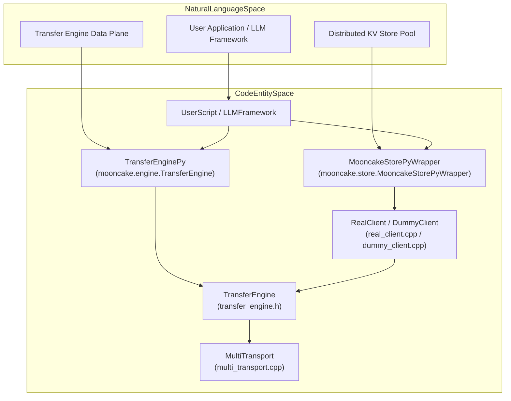
Sources: [docs/source/getting_started/quick-start.md:24-97](), [mooncake-wheel/tests/transfer_engine_initiator_test.py:10-25]()

## Transfer Engine Quick Start

The `TransferEngine` class provides a protocol-agnostic, low-level point-to-point data transfer interface supporting RDMA, TCP, NVLink, and more. It internally uses a `MultiTransport` dispatcher to select the optimal transport based on protocol and hardware topology [docs/source/getting_started/supported-protocols.md:1-24]().

### Example: Basic Transfer Engine Usage (Python)

This example demonstrates a data sender writing directly into a remote receiver's memory via the Python API [mooncake-wheel/tests/transfer_engine_initiator_test.py:10-25]().

**Initialization:**

```python
from mooncake.engine import TransferEngine

engine = TransferEngine()

# Initialize transfer engine with:
# - local_hostname: e.g., "127.0.0.1:12347"
# - metadata_server: "P2PHANDSHAKE" for direct peer discovery without etcd
# - protocol: "tcp" for TCP transport
# - device_name: "" (empty string means all devices)
ret = engine.initialize("127.0.0.1:12347", "P2PHANDSHAKE", "tcp", "")
if ret != 0:
    raise RuntimeError(f"Initialization failed with code {ret}")
```

**Memory Management and Transfer:**

The engine supports allocating managed buffers, writing data, and performing synchronous transfers [mooncake-wheel/tests/transfer_engine_initiator_test.py:36-85]().

```python
# Allocate a 64MB managed buffer
buffer_capacity = 64 * 1024 * 1024
src_addr = engine.allocate_managed_buffer(buffer_capacity)

# Write some bytes locally into the buffer
src_data = b"Hello, Transfer Engine!"
engine.write_bytes_to_buffer(src_addr, src_data, len(src_data))

# Get remote buffer address on the target node
dst_addr = engine.get_first_buffer_address("127.0.0.1:12345")

# Perform synchronous write: local buffer -> remote buffer
engine.transfer_sync_write("127.0.0.1:12345", src_addr, dst_addr, len(src_data))
```

Sources: [mooncake-wheel/tests/transfer_engine_initiator_test.py:10-85]()

## Mooncake Store Quick Start

`MooncakeStorePyWrapper` offers a distributed key-value interface backed by a MasterService and integrated with the Transfer Engine for efficient data movement.

### Distributed Store Data Flow

This sequence diagram illustrates the high-level RPC and transfer interactions during a `put` operation using the Python Store API wrapper, mapping natural language concepts to underlying classes.

### Diagram: Store Put/Get Flow and Code Entities
```mermaid
sequenceDiagram
    participant App as "UserScript<br/>(Python Client)"
    participant StorePy as "MooncakeStorePyWrapper<br/>(mooncake_store_py.cpp)"
    participant Master as "MasterService<br/>(WrappedMasterService)"
    participant TE as "TransferEngine<br/>(transfer_engine.h)"

    App->>StorePy: "put_tensor(key, tensor)"
    Note over StorePy: "Allocate or fetch allocation metadata"
    StorePy->>Master: "PutStart (RPC)"
    Master-->>StorePy: "AllocationInfo"
    StorePy->>TE: "submitTransfer() / transfer_sync_write"
    TE-->>StorePy: "Transfer Completion"
    StorePy->>Master: "PutEnd (RPC)"
    Master-->>StorePy: "Success"
    StorePy-->>App: "Return Status"
```
Sources: [docs/source/getting_started/quick-start.md:24-89](), [mooncake-wheel/tests/transfer_engine_initiator_test.py:36-85]()

### Example: Basic Store Usage (Python)

**Step 1: Start the Master Service**

The `mooncake_master` process must be running; it coordinates the store cluster and metadata management. For simple experiments, the decentralized `"P2PHANDSHAKE"` metadata server option can be used, which requires no external etcd or Redis.

**Step 2: Use Python Client**

The store Python client is initialized using configuration parameters that set up metadata, buffer sizes, and protocol.

```python
from mooncake.store import MooncakeStorePyWrapper

store = MooncakeStorePyWrapper()
store.setup(
    local_hostname="localhost",
    metadata_server="P2PHANDSHAKE",          # decentralized peer handshake
    global_segment_size=512 * 1024 * 1024,   # 512MB DRAM pool contribution
    local_buffer_size=128 * 1024 * 1024,     # 128MB Transfer Engine buffer
    protocol="tcp",
    rdma_devices="",                         # empty for default device
    master_server_addr="127.0.0.1:50051"    # default master service address
)

# Put simple binary data under key
store.put("hello_key", b"Hello, Mooncake Store!")

# Get stored data
data = store.get("hello_key")
print(data.decode())  # Should output: Hello, Mooncake Store!

store.close()
```

Sources: [docs/source/getting_started/quick-start.md:24-89]()

### Example: Tensor Storage with PyTorch

Mooncake Store supports efficient tensor storage (`put_tensor` / `get_tensor`), automatically serializing metadata and payloads. Below is an example storing and retrieving PyTorch tensors.

```python
import torch
from mooncake.store import MooncakeStorePyWrapper

store = MooncakeStorePyWrapper()
# ... call store.setup(...) as above ...

# Create a float32 tensor
tensor = torch.randn(1024, 1024, dtype=torch.float32)

# Store the tensor under a key
store.put_tensor("my_tensor", tensor)

# Retrieve the tensor back
retrieved = store.get_tensor("my_tensor")

# Verify strict equality
assert torch.allclose(tensor, retrieved)
```

Sources: [docs/source/getting_started/quick-start.md:24-89]()

## Basic LLM Framework Integration Quick Start

Mooncake enables disaggregated LLM serving and reinforcement learning scenarios via structured objects using bundle transfer abstractions. This supports efficient batch tensor and metadata transfer with selective materialization.

```python
from mooncake.store import MooncakeStorePyWrapper
import torch

store = MooncakeStorePyWrapper()
# ... setup store ...

# Structured batch metadata and tensors
data = {
    "batch": {"input_ids": torch.tensor([[1, 2, 3]], dtype=torch.long)},
    "non_tensor_batch": {"text": ["hello world"]},
    "meta_info": {"step": 1}
}

# Store the tensor data
store.put_tensor("rollout:step-1:input_ids", data["batch"]["input_ids"])

# Retrieve tensor back
retrieved_tensor = store.get_tensor("rollout:step-1:input_ids")
print(retrieved_tensor)
```

Sources: [docs/source/getting_started/quick-start.md:24-89]()

## Summary of Key CLI Tools

The following tools facilitate system interaction and development workflows:

| Command | Description | Source |
|---|---|---|
| `mooncake_master` | Central master server coordinating the distributed KV cache pool. | [docs/source/getting_started/quick-start.md:75-85]() |
| `mooncake_client` | Standalone client process implementing real-client RPC. | [docs/source/getting_started/quick-start.md:75-89]() |
| `transfer_engine_bench` | Transfer Engine benchmark tool demonstrating throughput and latency. | [mooncake-wheel/tests/transfer_engine_initiator_test.py:1-102]() |
| `mooncake_http_metadata_server` | HTTP server used for metadata discovery and peer handshake. | [docs/source/getting_started/quick-start.md:24-89]() |
| `transfer_engine_topology_dump` | Utility tool to dump and analyze hardware and network topology for optimal path selection. | [docs/source/getting_started/quick-start.md:1-22]() |

Sources: [docs/source/getting_started/quick-start.md:1-89](), [mooncake-wheel/tests/transfer_engine_initiator_test.py:1-102]()

---

# Page: Configuration Overview

# Configuration Overview

<details>
<summary>Relevant source files</summary>

The following files were used as context for generating this wiki page:

- [mooncake-common/include/default_config.h](mooncake-common/include/default_config.h)
- [mooncake-common/include/duration_utils.h](mooncake-common/include/duration_utils.h)
- [mooncake-common/include/environment_variables.h](mooncake-common/include/environment_variables.h)
- [mooncake-common/src/default_config.cpp](mooncake-common/src/default_config.cpp)
- [mooncake-common/src/environ.cpp](mooncake-common/src/environ.cpp)
- [mooncake-common/tests/CMakeLists.txt](mooncake-common/tests/CMakeLists.txt)
- [mooncake-common/tests/default_config_test.cpp](mooncake-common/tests/default_config_test.cpp)
- [mooncake-common/tests/environ_test.cpp](mooncake-common/tests/environ_test.cpp)
- [mooncake-common/tests/test.json](mooncake-common/tests/test.json)
- [mooncake-common/tests/test.yaml](mooncake-common/tests/test.yaml)
- [mooncake-store/conf/master.json](mooncake-store/conf/master.json)
- [mooncake-store/conf/master.yaml](mooncake-store/conf/master.yaml)
- [mooncake-store/include/transfer_task.h](mooncake-store/include/transfer_task.h)
- [mooncake-store/src/CMakeLists.txt](mooncake-store/src/CMakeLists.txt)
- [mooncake-store/src/transfer_task.cpp](mooncake-store/src/transfer_task.cpp)
- [mooncake-store/tests/CMakeLists.txt](mooncake-store/tests/CMakeLists.txt)
- [mooncake-store/tests/transfer_task_test.cpp](mooncake-store/tests/transfer_task_test.cpp)
- [mooncake-transfer-engine/tests/rdma_large_mr_test.cpp](mooncake-transfer-engine/tests/rdma_large_mr_test.cpp)

</details>


This page documents the configuration mechanisms, environment variables, and system tuning parameters for Mooncake. Mooncake employs a multi-layered configuration system to manage its distributed components: the **Mooncake Master**, **Mooncake Store Clients**, and the high-performance **Transfer Engine**.

The system supports structured configuration files (JSON/YAML), dynamic environment variables, and command-line options. Configuration is split between a C++ core for high-performance data movement and a Python layer for ease of integration with LLM frameworks like SGLang and vLLM.

---

## Configuration Architecture

Mooncake uses a tiered configuration hierarchy where runtime parameters and environment variables can override system defaults. The C++ core utilizes a unified `DefaultConfig` class (`[mooncake-common/include/default_config.h]`) to parse structured files, while low-level transport and runtime parameters are managed by the `Environ` singleton and typed environment definitions in `[mooncake-common/include/environ.h]()`.

### Configuration Data Flow

The diagram below shows how configuration data flows from external and user-facing sources (environment variables, YAML/JSON config files, CLI options) into the internal code entities handling configuration parsing and runtime setup.

```mermaid
graph TD
    subgraph "Natural_Language_Space"
        ENV["Environment Variables"] -->|"Env Var Access"| ENV_VAR_SRC
        YAML["YAML Config Files"] -->|"Parse YAML"| YAML_SRC
        JSON["JSON Config Files"] -->|"Parse JSON"| JSON_SRC
        CLI["Command Line Options"] -->|"CLI Flags"| CLI_SRC
    end

    subgraph "Code_Entity_Space"
        YAML_SRC --> DC["mooncake::DefaultConfig"]
        JSON_SRC --> DC
        DC --> MASTER["Mooncake Store Master"]

        ENV_VAR_SRC --> ENV_SINGLETON["mooncake::Environ Singleton"]
        ENV_SINGLETON --> TENT_CORE["Transfer Engine Core"]

        CLI_SRC --> MC["mooncake.MooncakeConfig Python Layer"]
        MC --> STORE["Mooncake Store Client Library"]
        MC --> SERVICE["MooncakeStoreService REST Server"]
    end

    subgraph "Source_Files"
        DC -.-> "mooncake-common/src/default_config.cpp"
        ENV_SINGLETON -.-> "mooncake-common/src/environ.cpp"
        MC -.-> "mooncake-wheel/mooncake/mooncake_config.py"
        SERVICE -.-> "mooncake-wheel/mooncake/mooncake_store_service.py"
    end
```

Sources:  
`[mooncake-common/src/default_config.cpp:22-41]()`,  
`[mooncake-common/include/environ.h:20-168]()`,  
`[mooncake-common/src/environ.cpp:56]()`,  
`[mooncake-wheel/mooncake/mooncake_config.py]()`,  
`[mooncake-wheel/mooncake/mooncake_store_service.py]()`  

---

## Configuration Files (YAML/JSON)

Mooncake supports structured configuration using the `DefaultConfig` class (`[mooncake-common/include/default_config.h]()`), which transparently handles both YAML and JSON formats (`[mooncake-common/src/default_config.cpp:22-213]()`). Typical configuration files include production-grade templates such as `[mooncake-store/conf/master.yaml]()` and `[mooncake-store/conf/master.json]()` used for the store master server.

### `DefaultConfig` Class Implementation

- The `DefaultConfig` class loads a configuration file, detects its format (`.yaml`, `.yml`, `.json`), and parses the content into an internal hierarchical map structure (`[mooncake-common/src/default_config.cpp:22-100]()`).
- The class supports nested keys using dot-separated notation (e.g., `rpc.port`) and provides typed getters with default values:
  - `GetInt32()`, `GetInt64()` for signed integers
  - `GetUInt32()`, `GetUInt64()` for unsigned integers
  - `GetBool()` for boolean flags
  - `GetString()` for strings
  - `GetDurationMs()` to parse duration strings into milliseconds (`[mooncake-common/include/default_config.h]()`)
- Type conversions and parsing errors produce warnings and fall back to defaults to ensure robust startup (`[mooncake-common/src/default_config.cpp:101-213]()`).

The table below summarizes key methods:

| Method            | Purpose                                        |
|-------------------|------------------------------------------------|
| `Load()`          | Loads config from file, autodetects YAML/JSON |
| `GetDurationMs()` | Parses duration strings to integer milliseconds |
| `GetInt32/64`     | Retrieve integers with fallback default        |
| `GetUInt32/64`    | Retrieve unsigned integers with fallback       |
| `GetBool()`       | Retrieve boolean flags                          |
| `GetString()`     | Retrieves string parameters                     |

Typical usage involves loading the master configuration YAML file which controls parameters like RPC ports, eviction ratios, lease TTLs, and HA settings (`[mooncake-store/conf/master.yaml:1-68]()`).

Snippet from `master.yaml`:

```yaml
enable_metric_reporting: true
rpc_port: 50051
rpc_thread_num: 16
default_kv_lease_ttl: 10000
eviction_high_watermark_ratio: 1.0
enable_ha: false
etcd_endpoints: "http://localhost:2379"
```

Sources:  
`[mooncake-common/include/default_config.h]()`,  
`[mooncake-common/src/default_config.cpp:22-213]()`,  
`[mooncake-store/conf/master.yaml:1-68]()`,  
`[mooncake-store/conf/master.json:1-44]()`  

---

## Environment Variables and `environ.h`

Mooncake extensively relies on environment variables to customize both runtime transport behavior and higher-level store operation. Typed environment variable accessors are defined in `[mooncake-common/include/environ.h]()` and implemented in `[mooncake-common/src/environ.cpp]()`.

### The `Environ` Singleton

- The singleton `mooncake::Environ` provides unified typed getters for environment variables, reading and parsing them robustly with default fallback (`[mooncake-common/include/environ.h:20-80]()`, `[mooncake-common/src/environ.cpp:36-54]()`).
- Variables affect transport settings, RPC thread pool sizes, performance tuning parameters, feature enablement flags, memory allocation parameters, and logging levels (`[mooncake-common/include/environ.h:81-168]()`).

Example important environment variables include:

| Environment Variable             | Description                                 | Default / Note                   |
|--------------------------------|---------------------------------------------|---------------------------------|
| `MC_RPC_CLIENT_IO_THREADS`      | Number of RPC client I/O threads             | Defaults to min(16, hardware concurrency) |
| `MC_NUM_CQ_PER_CTX`             | Number of Completion Queues per context      | 1                               |
| `MC_IB_PORT`                   | InfiniBand port number                        | 1                               |
| `MC_GID_INDEX`                 | GID index for RDMA                            | 3                               |
| `MC_SLICE_SIZE`                | Transfer slice size (bytes)                   | 65536                           |
| `MC_LOG_LEVEL`                 | Log level for Mooncake                        | "INFO"                         |
| `MC_DISABLE_METACACHE`          | Disable metadata caching                      | false                          |
| `MC_HANDSHAKE_LISTEN_BACKLOG`  | TCP listen backlog for handshake server      | 128                            |

Support functions perform validated parsing for int, int64, bool, double, and string with warnings on invalid values (`[mooncake-common/src/environ.cpp:36-48]()`).

### Typed Environment Variable Definitions

In `[mooncake-common/include/environment_variables.h]()`, many variables specific to subcomponents (file storage backend, eviction policy, client metrics, DFS, CXL segments) are typed with `EnvironmentVariable<T>` and their names standardized to avoid hardcoding string literals (`[mooncake-common/include/environment_variables.h:10-152]()`).

```cpp
#define MC_DEFINE_ENV_VAR(Type, Name) \
    inline static constexpr EnvironmentVariable<Type> Name { #Name }
```

Example for file storage related env vars:

```cpp
struct FileStorageEnvironmentVariables {
    MC_DEFINE_ENV_VAR(std::string, MOONCAKE_OFFLOAD_STORAGE_BACKEND_DESCRIPTOR);
    MC_DEFINE_ENV_VAR(std::string, MOONCAKE_OFFLOAD_FILE_STORAGE_PATH);
    MC_DEFINE_ENV_VAR(int64_t, MOONCAKE_OFFLOAD_LOCAL_BUFFER_SIZE_BYTES);
    // ...
};
```

This typed environment variable framework provides compile-time checking and consistent conventions across Mooncake subsystems (`[mooncake-common/include/environment_variables.h:1-154]()`).

Sources:  
`[mooncake-common/include/environ.h:20-168]()`,  
`[mooncake-common/src/environ.cpp:36-56]()`,  
`[mooncake-common/include/environment_variables.h:10-154]()`  

---

## Python Configuration (`mooncake_config.py`)

The Python layer exposes a flexible, dataclass-based configuration object `MooncakeConfig` that encapsulates distributed store parameters and runtime options for Mooncake components such as `MooncakeStoreService` and `MooncakeStoreClient` (`[mooncake-wheel/mooncake/mooncake_config.py]()`).

### Key Configuration Attributes

| Attribute             | Default Value                 | Description                          |
|-----------------------|------------------------------|------------------------------------|
| `global_segment_size`  | 3355443200 (approx 3.125 GiB) | Size per global memory segment     |
| `local_buffer_size`    | 1073741824 (1 GiB)            | Size of the local buffer            |
| `max_batch_ops`        | 0                            | Maximum batch operations (disabled if 0) |
| `enable_ssd_offload`   | False                        | Enable SSD offload for eviction    |
| `ssd_offload_path`     | `""`                         | Filesystem path for SSD offload    |
| `scheduler_type`       | `"default"`                  | Transfer scheduling algorithm type |

### Configuration Loading and Overrides

- `MooncakeConfig.from_file(path)` parses JSON or YAML config files, performs validation, and returns config instances (`[mooncake-wheel/mooncake/mooncake_config.py]()`).
- CLI and environment variable overrides are supported at the Python service layer (`[mooncake-wheel/mooncake/mooncake_store_service.py]()`), allowing runtime tunability.
- This flexible Python config feeds into the distributed store service initialization and transfer engine setup, bridging external configuration and internal runtime behavior (`[mooncake-wheel/mooncake/mooncake_config.py]()`).

Sources:  
`[mooncake-wheel/mooncake/mooncake_config.py]()`,  
`[mooncake-wheel/mooncake/mooncake_store_service.py]()`  

---

## Configuration to Code Entity Mapping

The diagram below connects natural language configuration elements, like file-based configs, Python command-line options, and logging parameters, to their respective parsing and operational code entities in Mooncake.

```mermaid
graph LR
    subgraph "Natural_Language_Space"
        FILE_CFG["Config Files (YAML/JSON)"] --> DEF_CFG_NODE["DefaultConfig Parser"]
        PY_OPTS["Python Client Options"] --> PY_DC_NODE["MooncakeConfig Dataclass"]
        STORE_SVC["Store Service Params"] --> MSS_NODE["MooncakeStoreService Setup"]
        LOG_LEVEL["Logging Controls"] --> LOG_INIT_NODE["Environ::Get Logging Level"]
    end

    subgraph "Code_Entity_Space"
        DEF_CFG_NODE --> DEF_CFG["mooncake::DefaultConfig"] --> CPP_PARSER["C++ YAML/JSON Parser"]
        PY_DC_NODE --> PY_DC["mooncake.MooncakeConfig"] --> PY_PARSER["Python Config Loader"]
        MSS_NODE --> MSS["mooncake.MooncakeStoreService"] --> STORE_SETUP["Store Initialization"]
        LOG_INIT_NODE --> LOG_INIT["mooncake::Environ"] --> LOG_ENGINE["Logging System"]
    end

    subgraph "Source_Files"
        DEF_CFG -.-> "mooncake-common/src/default_config.cpp"
        PY_DC -.-> "mooncake-wheel/mooncake/mooncake_config.py"
        MSS -.-> "mooncake-wheel/mooncake/mooncake_store_service.py"
        LOG_INIT -.-> "mooncake-common/src/environ.cpp"
    end
```

Sources:  
`[mooncake-common/src/default_config.cpp:22-41]()`,  
`[mooncake-common/src/environ.cpp:36-54]()`,  
`[mooncake-wheel/mooncake/mooncake_config.py]()`,  
`[mooncake-wheel/mooncake/mooncake_store_service.py]()`  

---

## Summary

Mooncake's configuration system spans multiple layers, from environment variables and typed environment accessors in low-level C++ transport and runtime code, through structured and human-readable YAML/JSON files parsed by the `DefaultConfig` C++ class, to a flexible Python dataclass in the integration layer that allows dynamic overrides and advanced service setup.

This modular and layered approach enables high configurability and ease of deployment across the distributed KVCache LLM serving infrastructure.

Sources:  
`[mooncake-common/include/default_config.h]()`,  
`[mooncake-common/include/environ.h:20-168]()`,  
`[mooncake-wheel/mooncake/mooncake_config.py]()`

---

# Page: Python API Reference

# Python API Reference

<details>
<summary>Relevant source files</summary>

The following files were used as context for generating this wiki page:

- [docs/source/api-reference/cpp/transfer-engine.md](docs/source/api-reference/cpp/transfer-engine.md)
- [docs/source/api-reference/python/mooncake-store.md](docs/source/api-reference/python/mooncake-store.md)
- [mooncake-integration/store/store_py.cpp](mooncake-integration/store/store_py.cpp)
- [mooncake-integration/transfer_engine/transfer_engine_py.cpp](mooncake-integration/transfer_engine/transfer_engine_py.cpp)
- [mooncake-integration/transfer_engine/transfer_engine_py.h](mooncake-integration/transfer_engine/transfer_engine_py.h)
- [mooncake-store/include/client_service.h](mooncake-store/include/client_service.h)
- [mooncake-store/include/dummy_client.h](mooncake-store/include/dummy_client.h)
- [mooncake-store/include/pyclient.h](mooncake-store/include/pyclient.h)
- [mooncake-store/include/real_client.h](mooncake-store/include/real_client.h)
- [mooncake-store/src/client_service.cpp](mooncake-store/src/client_service.cpp)
- [mooncake-store/src/dummy_client.cpp](mooncake-store/src/dummy_client.cpp)
- [mooncake-store/src/real_client.cpp](mooncake-store/src/real_client.cpp)
- [mooncake-store/src/real_client_main.cpp](mooncake-store/src/real_client_main.cpp)
- [mooncake-store/tests/e2e/run_session_ranges_tcp_e2e.sh](mooncake-store/tests/e2e/run_session_ranges_tcp_e2e.sh)
- [mooncake-store/tests/e2e/session_ranges_tcp_e2e.py](mooncake-store/tests/e2e/session_ranges_tcp_e2e.py)
- [mooncake-store/tests/pybind_client_test.cpp](mooncake-store/tests/pybind_client_test.cpp)
- [mooncake-transfer-engine/include/multi_transport.h](mooncake-transfer-engine/include/multi_transport.h)
- [mooncake-transfer-engine/include/transfer_engine.h](mooncake-transfer-engine/include/transfer_engine.h)
- [mooncake-transfer-engine/include/transfer_engine_c.h](mooncake-transfer-engine/include/transfer_engine_c.h)
- [mooncake-transfer-engine/include/transfer_engine_impl.h](mooncake-transfer-engine/include/transfer_engine_impl.h)
- [mooncake-transfer-engine/include/transport/transport.h](mooncake-transfer-engine/include/transport/transport.h)
- [mooncake-transfer-engine/src/multi_transport.cpp](mooncake-transfer-engine/src/multi_transport.cpp)
- [mooncake-transfer-engine/src/transfer_engine.cpp](mooncake-transfer-engine/src/transfer_engine.cpp)
- [mooncake-transfer-engine/src/transfer_engine_c.cpp](mooncake-transfer-engine/src/transfer_engine_c.cpp)
- [mooncake-transfer-engine/src/transfer_engine_impl.cpp](mooncake-transfer-engine/src/transfer_engine_impl.cpp)
- [mooncake-transfer-engine/tests/shm_transport_test.cpp](mooncake-transfer-engine/tests/shm_transport_test.cpp)
- [mooncake-transfer-engine/tests/transport_uint_test.cpp](mooncake-transfer-engine/tests/transport_uint_test.cpp)

</details>


This page documents the complete Python API surface for Mooncake, covering both the low-level `TransferEnginePy` data movement engine and the `MooncakeStorePyWrapper` distributed object storage system. As a PARENT page, this section provides a high-level overview of the Python bindings architecture and key components. For detailed method signatures, parameter descriptions, and usage examples, consult the linked child pages.

Sources: [mooncake-integration/store/store_py.cpp:1-183](), [mooncake-store/src/real_client.cpp:1-201](), [mooncake-transfer-engine/src/transfer_engine.cpp:1-203](), [mooncake-integration/transfer_engine/transfer_engine_py.cpp:1-203]()

---

## Python Module Structure

Mooncake’s Python API is organized into multiple modules that provide clear separation between transfer operations and distributed object storage, while exposing native C++ classes using `pybind11` bindings [mooncake-integration/store/store_py.cpp:1-33](), [mooncake-integration/transfer_engine/transfer_engine_py.cpp:15-35](). The primary Python packages are:

- **`mooncake.engine`**: Contains `TransferEnginePy`, the Python interface for the Transfer Engine responsible for efficient cross-node data movement.
- **`mooncake.store`**: Provides `MooncakeStorePyWrapper` along with `RealClient` and `DummyClient` classes, implementing distributed KVCache storage and client logic [mooncake-store/include/real_client.h:80-109]().

The following diagram shows how common Python application layers map to underlying code entities:

```mermaid
graph TB
    subgraph NaturalLanguageSpace ["Natural Language Space"]
        PythonApp["Python Application"]
        TransferLayer["TransferEngine Module"]
        StoreLayer["Store Client Module"]
    end
    subgraph CodeEntitySpace ["Code Entity Space"]
        PythonPackage["mooncake"]
        EnginePyModule["mooncake.engine"]
        StorePyModule["mooncake.store"]
        EngineSo["engine.so"]
        StoreSo["store.so"]
        TransferEnginePyClass["TransferEnginePy"]
        RealClientClass["RealClient"]
        DummyClientClass["DummyClient"]
    end
    PythonApp --> PythonPackage
    PythonPackage --> EnginePyModule
    PythonPackage --> StorePyModule
    EnginePyModule --> EngineSo
    StorePyModule --> StoreSo
    EngineSo --> TransferEnginePyClass
    StoreSo --> RealClientClass
    StoreSo --> DummyClientClass
```

This modular separation provides flexibility, allowing applications to independently use the transfer engine or storage client as needed.

Sources: [mooncake-integration/store/store_py.cpp:1-183](), [mooncake-transfer-engine/include/transfer_engine.h:1-200]()

---

## TransferEnginePy API

The `TransferEnginePy` Python class interfaces with the high-performance Transfer Engine for memory registration, segment management, single and batch transfers, and direct integration with CUDA streams when available [mooncake-integration/transfer_engine/transfer_engine_py.cpp:1-203]().

Key features include:
- Initialization via metadata connection strings, server identification, and transport protocol selection [mooncake-transfer-engine/src/transfer_engine.cpp:128-146]().
- Memory registration APIs to enable zero-copy transfers [mooncake-transfer-engine/include/transfer_engine.h:165-181]().
- Asynchronous batch transfer submission with fine-grained completion status via futures [mooncake-transfer-engine/src/transfer_engine.cpp:183-195]().
- Utilities for dumping transfer topology for diagnostics.

This API abstracts the underlying transport selection logic and TENT (Transfer Engine Next) functionality, providing a comprehensive Pythonic interface for high-throughput, low-latency data movement.

For full method details, parameters, and code examples, see [TransferEnginePy API](#3.1).

Sources: [mooncake-integration/transfer_engine/transfer_engine_py.cpp:1-203](), [mooncake-transfer-engine/src/transfer_engine.cpp:1-203]()

---

## MooncakeStorePyWrapper API

`MooncakeStorePyWrapper` serves as the Python entry point for interacting with the Mooncake distributed KVCache store [mooncake-integration/store/store_py.cpp:1-35](). It internally manages two client types:
- **`RealClient`**: The full-featured client that communicates with the distributed storage cluster, handling metadata lookups, lease management, and networked storage operations [mooncake-store/include/real_client.h:80-102]().
- **`DummyClient`**: A simplified local-only client used for testing or in-process scenarios [mooncake-store/include/real_client.h:103-109]().

The store API exposes setup methods, health check functions, basic object put/get operations with span-based buffer interfaces, and batch operation APIs [mooncake-store/include/real_client.h:110-185]().

The diagram below illustrates the client wrapper and its interactions:

```mermaid
graph TB
    subgraph NaturalLanguageSpace ["Natural Language Space"]
        ClientApp["Client Application"]
        DistributedStore["DistributedStoreWrapper"]
    end
    subgraph CodeEntitySpace ["Code Entity Space"]
        StorePyWrapper["MooncakeStorePyWrapper"]
        StoreImpl["Mooncake Distributed Store"]
        RealClientInst["RealClient"]
        DummyClientInst["DummyClient"]
        SetupMethod["setup()"]
        PutMethod["put()"]
        GetMethod["get()"]
    end
    ClientApp --> DistributedStore
    DistributedStore --> StorePyWrapper
    StorePyWrapper --> StoreImpl
    StoreImpl --> RealClientInst
    StoreImpl --> DummyClientInst
    RealClientInst --> SetupMethod
    RealClientInst --> PutMethod
    RealClientInst --> GetMethod
```

For detailed lifecycle and API methods, see [MooncakeStorePyWrapper API](#3.2).

Sources: [mooncake-store/src/real_client.cpp:1-201](), [mooncake-store/include/real_client.h:80-185](), [mooncake-store/include/client_service.h:1-177]()

---

## Tensor Operations

Mooncake provides first-class support for tensor operations, tightly integrating with PyTorch tensors [mooncake-integration/store/store_py.cpp:40-84](). This includes:
- Serialization of tensor layout, dtype, and shape metadata into a consistent `TensorMetadata` header format [mooncake-integration/store/store_py.cpp:42-84]().
- Native `put_tensor` and `get_tensor` calls allowing tensors to be stored and retrieved as structured objects [mooncake-integration/store/store_py.cpp:100-149]().
- Support for tensor parallelism with explicit shard calculations and parallel topology awareness [mooncake-integration/store/store_py.cpp:150-160]().
- Integration with safetensor format for zero-copy loading and unloading.

For comprehensive tensor APIs, metadata formats, and examples, see [Tensor Operations](#3.3).

Sources: [mooncake-integration/store/store_py.cpp:42-183](), [mooncake-integration/store/store_py.cpp:1-35]()

---

## Zero-Copy Operations

To minimize CPU overhead and memory copying, Mooncake supports zero-copy buffer transfers via explicit memory registration [mooncake-store/include/real_client.h:118-121]():
- Buffers are registered with the Transfer Engine or Store via `register_buffer` [mooncake-store/include/real_client.h:118-121]().
- Zero-copy put and get operations (`put_from`, `get_into`) operate directly on registered buffers [mooncake-store/include/real_client.h:122-141]().
- The `BufferHandle` protocol defines memory registration state, enabling fast bulk transfers.

For memory registration procedures, buffer lifetime management, and integration details, see [Zero-Copy Operations](#3.4).

Sources: [mooncake-store/include/real_client.h:115-141](), [mooncake-store/src/real_client.cpp:1-50]()

---

## Batch Operations

Batch APIs concentrate multiple storage and transfer requests into a single submission to maximize throughput:
- The Store exposes `batch_get_into` variants allowing multiple keys and buffers to be processed in one batch [mooncake-store/include/real_client.h:170-185]().
- The Transfer Engine provides asynchronous batch submission (`submitTransfer`) to coordinate multiple data slices across segments [mooncake-transfer-engine/include/transfer_engine.h:183-184]().
- Batch processing reduces round-trip overhead, allowing network and DMA hardware to be saturated [mooncake-store/src/client_service.h:165-175]().

For detailed implementation notes, usage guidelines, and performance considerations, see [Batch Operations](#3.5).

Sources: [mooncake-store/include/client_service.h:1-177](), [mooncake-store/include/real_client.h:170-185](), [mooncake-transfer-engine/include/transfer_engine.h:183-184]()

---

## Configuration and CLI Tools

The Python API surface includes utilities for configuration, diagnostics, and cluster interaction:
- Python configuration interfaces and environment variables manage protocol selection, device filtering, and memory registration tuning [mooncake-store/tests/pybind_client_test.cpp:47-65]().
- CLI tools such as `mooncake_master` and `mooncake_client` provide command-line access to core store and transfer functionality.
- Helper utilities include an embedded HTTP metadata server and REST API server for cluster metadata, health checks, and metrics export [mooncake-store/src/real_client.cpp:76-81]().

For a complete list of commands, configuration parameters, and helpers, see [Configuration and CLI Tools](#3.6).

Sources: [mooncake-store/src/real_client.cpp:76-81](), [mooncake-store/tests/pybind_client_test.cpp:47-65]()

---

## Reshard and Weight Manifest API

The `mooncake-reshard` module defines a schema and API contracts for dynamic model weight sharding and runtime binding:
- `WeightPlacementManifest` and `WeightRuntimeBindingManifest` describe the planned shard distribution and runtime tensor layout.
- `ParallelTopology` and `TensorDescriptor` specifications define tensor slicing and parallelism dimensions.
- The module supports JSON serialization and deserialization for manifests to enable tooling interoperability.

For manifest schemas, planners, and examples of JSON API usage, see [Reshard and Weight Manifest API](#3.7).

Sources: [mooncake-integration/store/store_py.cpp:1-35]()

---

## Child Pages

- [TransferEnginePy API](#3.1) — Detailed documentation for the `TransferEnginePy` methods including initialization and transfers.
- [MooncakeStorePyWrapper API](#3.2) — Detailed documentation for the store wrapper and client internals.
- [Tensor Operations](#3.3) — Guide to tensor storage, metadata, and PyTorch integration.
- [Zero-Copy Operations](#3.4) — Protocol for buffer registration and direct memory transfer.
- [Batch Operations](#3.5) — High-throughput batch storage and transfer APIs.
- [Configuration and CLI Tools](#3.6) — Python configuration parameters and command-line interface utilities.
- [Reshard and Weight Manifest API](#3.7) — Framework-neutral manifests for model weight placement and resharding.

---

# Page: TransferEnginePy API

# TransferEnginePy API

<details>
<summary>Relevant source files</summary>

The following files were used as context for generating this wiki page:

- [docs/source/api-reference/cpp/transfer-engine.md](docs/source/api-reference/cpp/transfer-engine.md)
- [mooncake-integration/transfer_engine/transfer_engine_py.cpp](mooncake-integration/transfer_engine/transfer_engine_py.cpp)
- [mooncake-integration/transfer_engine/transfer_engine_py.h](mooncake-integration/transfer_engine/transfer_engine_py.h)
- [mooncake-transfer-engine/include/multi_transport.h](mooncake-transfer-engine/include/multi_transport.h)
- [mooncake-transfer-engine/include/transfer_engine.h](mooncake-transfer-engine/include/transfer_engine.h)
- [mooncake-transfer-engine/include/transfer_engine_c.h](mooncake-transfer-engine/include/transfer_engine_c.h)
- [mooncake-transfer-engine/include/transfer_engine_impl.h](mooncake-transfer-engine/include/transfer_engine_impl.h)
- [mooncake-transfer-engine/include/transport/transport.h](mooncake-transfer-engine/include/transport/transport.h)
- [mooncake-transfer-engine/src/multi_transport.cpp](mooncake-transfer-engine/src/multi_transport.cpp)
- [mooncake-transfer-engine/src/transfer_engine.cpp](mooncake-transfer-engine/src/transfer_engine.cpp)
- [mooncake-transfer-engine/src/transfer_engine_c.cpp](mooncake-transfer-engine/src/transfer_engine_c.cpp)
- [mooncake-transfer-engine/src/transfer_engine_impl.cpp](mooncake-transfer-engine/src/transfer_engine_impl.cpp)
- [mooncake-transfer-engine/tests/shm_transport_test.cpp](mooncake-transfer-engine/tests/shm_transport_test.cpp)
- [mooncake-transfer-engine/tests/transport_uint_test.cpp](mooncake-transfer-engine/tests/transport_uint_test.cpp)

</details>


The `TransferEnginePy` class provides a Python interface to Mooncake’s high-performance distributed memory transfer engine (`TransferEngine`). It enables users to perform direct memory transfers across nodes using a variety of hardware-accelerated transport protocols such as RDMA, NVLink, TCP, EFA, HIP, MUSA, and others. This API supports memory allocation, memory registration for zero-copy access, synchronous and asynchronous transfer operations, batch transfer APIs, CUDA stream integration, and topology inspection utilities.

This page documents the full technical details of the `TransferEnginePy` API as exposed via pybind11 bindings in `mooncake-integration/transfer_engine/transfer_engine_py.cpp` and `mooncake-integration/transfer_engine/transfer_engine_py.h`.

---

## Class Architecture & Core Components

The `TransferEnginePy` class acts as a Python-facing wrapper that delegates calls to Mooncake’s modern C++ Transfer Engine stack, notably the `TransferEngine` and `MultiTransport` classes. Memory management is facilitated by a slab-based buddy allocator with 16 predefined slab sizes ranging from 8 KB to 256 MB. Transfers are submitted as single or batch requests that are dispatched over the appropriate transport(s). Optional CUDA stream support enables integration with GPU workloads. Internal state and completion tracking are carefully managed to balance high throughput with asynchronous operation semantics.

### Component Overview Diagram

```mermaid
graph TB
    subgraph PythonLayer["Python Layer"]
        PyApp["PythonApplication"]
        TEPy["TransferEnginePy<br/>transfer_engine_py.h/.cpp"]
    end

    subgraph CppCore["C++ Core"]
        TE["TransferEngine<br/>transfer_engine.h/cpp"]
        MT["MultiTransport<br/>multi_transport.cpp"]
        Meta["TransferMetadata<br/>transfer_metadata.h"]
    end

    subgraph MemoryManagement["Memory Management"]
        BuddyAlloc["BuddyAllocator<br/>kSlabSizeKB[]"]
        RegMem["MemoryRegistration<br/>registerLocalMemory()"]
    end

    subgraph TransferOps["Transfer Operations"]
        SyncOps["SynchronousTransfers<br/>transferSync()"]
        AsyncOps["AsynchronousTransfers<br/>batchTransferAsync()"]
        CudaOps["CudaStreamIntegration<br/>batchTransferOnCuda()"]
    end

    PyApp -->|calls| TEPy
    TEPy --> TE
    TE --> MT
    TE --> Meta
    TEPy --> BuddyAlloc
    BuddyAlloc --> RegMem
    TEPy --> SyncOps
    TEPy --> AsyncOps
    TEPy --> CudaOps
```

Sources:  
- `mooncake-integration/transfer_engine/transfer_engine_py.h:45-162`()  
- `mooncake-integration/transfer_engine/transfer_engine_py.cpp:1-230`()  
- `mooncake-transfer-engine/include/transfer_engine.h:80-160`()  
- `mooncake-transfer-engine/src/multi_transport.cpp:90-150`()  

---

## Initialization

### Methods: `initialize()` and `initializeExt()`

The engine is initialized with the local node’s hostname, metadata service connection string, target transport protocol, and device filter string. `initializeExt()` extends `initialize()` by allowing specification of the metadata backend type (e.g., `"etcd"`, `"p2p"`). Initialization involves parsing the connection metadata, establishing transport instances, setting up memory allocator function pointers, and binding RPC endpoints [mooncake-integration/transfer_engine/transfer_engine_py.cpp:61-197]().

```python
def initialize(
    local_hostname: str,
    metadata_server: str,
    protocol: str,
    device_name: str
) -> int

def initializeExt(
    local_hostname: str,
    metadata_server: str,
    protocol: str,
    device_name: str,
    metadata_type: str
) -> int
```

**Parameters**:
- `local_hostname`: Hostname and port of the local node (e.g., `"127.0.0.1:12345"`).
- `metadata_server`: Metadata service connection string (e.g., `"127.0.0.1:2379"`, `"etcd://..."`, or `"P2PHANDSHAKE"`).
- `protocol`: One of `"rdma"`, `"tcp"`, `"nvlink"`, `"efa"`, `"hip"`, `"musa"`, `"nvlink_intra"`.
- `device_name`: Comma-separated list of devices to filter or `""` for auto-discovery.
- `metadata_type` (only in `initializeExt`): Metadata backend type string like `"etcd"` or `"p2p"`.

**Returns**:  
- `0` on success, negative on failure.

---

### Initialization Data Flow

```mermaid
sequenceDiagram
    participant App as "Python Application"
    participant TEPy as "TransferEnginePy"
    participant MemAlloc as "initMemoryAllocator()"
    participant TE as "TransferEngine"
    participant Meta as "TransferMetadata"

    App ->> TEPy: initialize(local_hostname, metadata_server, protocol, device_name)
    TEPy ->> TEPy: parseConnectionString(metadata_server)
    TEPy ->> MemAlloc: initMemoryAllocator(protocol)
    alt protocol == "nvlink"
        MemAlloc ->> NvlinkTransport: allocatePinnedLocalMemory
    else protocol == "hip"
        MemAlloc ->> HipTransport: allocatePinnedLocalMemory
    else default
        MemAlloc ->> C: posix_memalign
    end
    TEPy ->> TE: new TransferEngine(auto_discover, device_filter)
    TEPy ->> TE: init(metadata_conn_string, local_server_name, "", 0)
    TE ->> Meta: connect to Metadata Service
    TEPy -->> App: return 0 (success)
```

Sources:  
- `mooncake-integration/transfer_engine/transfer_engine_py.cpp:61-197`()  
- `mooncake-integration/transfer_engine/transfer_engine_py.cpp:204-235`()  

---

## Memory Management

### Buddy Allocator and Slab Sizes

The `TransferEnginePy` manages memory allocations using a slab-based buddy allocator:

- Supports 16 slab size classes defined by `kSlabSizeKB` [mooncake-integration/transfer_engine/transfer_engine_py.h:40-43]():  
  `[8KB, 16KB, 32KB, 64KB, 128KB, 256KB, 512KB, 1MB, 2MB, 4MB, 8MB, 16MB, 32MB, 64MB, 128MB, 256MB]`.
- Small allocations use these fixed-size slabs managed by free lists.
- Large allocations (above 256 MB) use protocol-specific allocator interfaces or `posix_memalign`.

| Slab Class ID | Slab Size | Typical Use                              |
|---------------|-----------|---------------------------------------|
| 0             | 8 KB      | Small metadata or control buffers      |
| 7             | 1 MB      | Medium KVCache blocks or moderate data |
| 15            | 256 MB    | Large activation memory or bulk data   |

---

### `allocateManagedBuffer(length: int) -> int` and `freeManagedBuffer`

Allocates a managed buffer of the requested size (in bytes) [mooncake-integration/transfer_engine/transfer_engine_py.cpp:265-290]():
- Uses the slab allocator to find a fitting slab.
- Returns the buffer pointer as an integer (`uintptr_t`) for Python usage.
- `freeManagedBuffer(user_tensor, length)` releases the buffer back to the slab allocator [mooncake-integration/transfer_engine/transfer_engine_py.cpp:292-307]().

### Memory Registration

`TransferEnginePy` exposes `register_memory()` and `unregister_memory()` to enable zero-copy memory registration for RDMA and other transports [mooncake-integration/transfer_engine/transfer_engine_py.cpp:760-768]():

```python
def register_memory(buffer_addr: int, capacity: int) -> int
def unregister_memory(buffer_addr: int) -> int
```

- Registration informs transport layers about memory regions that can be accessed remotely via `TransferEngine::registerLocalMemory` [mooncake-transfer-engine/include/transfer_engine.h:165-169]().

Sources:  
- `mooncake-integration/transfer_engine/transfer_engine_py.h:38-43`()  
- `mooncake-integration/transfer_engine/transfer_engine_py.cpp:265-307`()  
- `mooncake-integration/transfer_engine/transfer_engine_py.cpp:760-768`()  
- `mooncake-transfer-engine/include/transfer_engine.h:121-173`()  

---

## Transfer Operations

### Synchronous and Asynchronous Transfers

Provides blocking and non-blocking transfer APIs.

```python
def transferSyncWrite(target_hostname: str, buffer: int, peer_buffer_address: int,
                      length: int, transport_hint: str = "") -> int

def transferSubmitWrite(target_hostname: str, buffer: int, peer_buffer_address: int,
                        length: int, transport_hint: str = "") -> batch_id_t

def batchTransferAsync(target_hostname: str, buffers: List[int], peer_buffer_addresses: List[int],
                       lengths: List[int], opcode: TransferOpcode,
                       transport_hint: str = "") -> batch_id_t

def transferCheckStatus(batch_id: batch_id_t) -> int
```

- `transferSyncWrite` executes a blocking write transfer [mooncake-integration/transfer_engine/transfer_engine_py.cpp:70-84]().
- `batchTransferAsync` submits a batch of asynchronous transfers via `MultiTransport::submitTransfer` [mooncake-transfer-engine/include/multi_transport.h:62-63]().
- `transferCheckStatus` polls the status of a submitted batch ID.

### Scatter Transfer Operations with Tickets

```python
def scatterTransferSyncWriteWithTicket(
    endpoint: str,
    local_base_addresses: List[int],
    local_capacities: List[int],
    remote_base_addresses: List[int],
    remote_capacities: List[int],
    local_offsets: List[List[int]],
    remote_offsets: List[List[int]],
    lengths: List[List[int]]
) -> ScatterTransferTicket
```

- Enables range-based scatter/gather operations returning a `ScatterTransferTicket` object that can be drained using `.drain(timeout_ms)` [mooncake-integration/transfer_engine/transfer_engine_py.cpp:95-120]().

---

### Data Flow Diagram: Async Batch Transfer and Status Polling

```mermaid
sequenceDiagram
    participant PythonApp as "Python Application"
    participant TEPy as "TransferEnginePy"
    participant TE as "TransferEngine"
    participant MT as "MultiTransport"
    
    PythonApp->>TEPy: batchTransferAsync(...)
    TEPy->>TE: allocateBatchID(batch_size)
    TE-->>TEPy: batch_id
    TEPy->>TE: submitTransfer(batch_id, entries)
    TE->>MT: submitTransfer(batch_id, entries)
    MT-->>TE: Status OK
    TE-->>TEPy: Status OK
    TEPy-->>PythonApp: batch_id
    
    loop pollStatus
        PythonApp->>TEPy: transferCheckStatus(batch_id)
        TEPy->>MT: getTransferStatus(batch_id, ...)
        MT-->>TEPy: TransferStatus
        TEPy-->>PythonApp: status code
    end
```

Sources:  
- `mooncake-integration/transfer_engine/transfer_engine_py.cpp:121-154`()  
- `mooncake-integration/transfer_engine/transfer_engine_py.cpp:566-626`()  

---

## CUDA Stream Integration

When built with CUDA support (`USE_CUDA`), `TransferEnginePy` exposes methods to associate memory transfers with CUDA streams, enabling fine-grained GPU synchronization.

```python
def batchTransferOnCuda(target_hostname: str, buffers: List[int], peer_buffer_addresses: List[int],
                        lengths: List[int], opcode: TransferOpcode,
                        stream_ptr: int = 0, transport_hint: str = "") -> None
```

- `stream_ptr`: raw pointer (`uintptr_t`) to a `cudaStream_t`.
- Transfers become asynchronous with respect to CPU but ordered on the specified CUDA stream.

Sources:  
- `mooncake-integration/transfer_engine/transfer_engine_py.cpp:156-162`()  
- `mooncake-integration/transfer_engine/transfer_engine_py.cpp:772-910`()  

---

## Topology Dump Utility and Helper Methods

### Topology Dump & Helpers

- Exposed via internal topology discovery methods and utility scripts [mooncake-integration/transfer_engine/transfer_engine_py.cpp:1-1424]().
- `getRpcPort()`: Returns the RPC port number used by the local engine [mooncake-integration/transfer_engine/transfer_engine_py.cpp:68-69]().
- `writeBytesToBuffer()` and `readBytesFromBuffer()`: Facilitates raw byte payload read/write on buffer pointers [mooncake-integration/transfer_engine/transfer_engine_py.cpp:726-749]().

Sources:  
- `mooncake-integration/transfer_engine/transfer_engine_py.cpp:68-69`()  
- `mooncake-integration/transfer_engine/transfer_engine_py.cpp:726-749`()  

---

## Summary Table of Key Methods

| Method | Purpose | Notes |
|-------|---------|-------|
| `initialize()` | Initialize transfer engine with config | Parses protocol, device filter, metadata connection |
| `initializeExt()` | Extended init with metadata backend type | Supports etcd, p2p, etc. |
| `allocateManagedBuffer(length)` | Allocate memory buffer with slab allocator | Returns integer pointer |
| `freeManagedBuffer(user_tensor, length)` | Free previously allocated buffer | Slab or protocol-specific |
| `register_memory(buffer_addr, capacity)` | Register memory for zero-copy | Enables RDMA/transport access |
| `unregister_memory(buffer_addr)` | Unregister previously registered memory | |
| `transferSyncWrite(...)` | Synchronous WRITE transfer | Blocking call |
| `batchTransferAsync(...)` | Submit batch async transfers | Non-blocking |
| `transferCheckStatus(batch_id)` | Check batch completion status | Polling method |
| `scatterTransferSyncWriteWithTicket(...)` | Scatter-gather transfer with ticket | For complex sparse patterns |
| `batchTransferOnCuda(...)` | Async batch transfer on CUDA stream | Requires CUDA enabled |
| `getRpcPort()` | Retrieve RPC listening port | Useful for communication setup |

---

## References

- `mooncake-integration/transfer_engine/transfer_engine_py.cpp:1-235`()  
- `mooncake-integration/transfer_engine/transfer_engine_py.h:45-162`()  
- `mooncake-transfer-engine/include/transfer_engine.h:80-160`()  
- `mooncake-transfer-engine/src/multi_transport.cpp:90-150`()  
- `mooncake-transfer-engine/include/transfer_engine_impl.h:60-204`()

---

# Page: MooncakeStorePyWrapper API

# MooncakeStorePyWrapper API

<details>
<summary>Relevant source files</summary>

The following files were used as context for generating this wiki page:

- [docs/source/api-reference/python/mooncake-store.md](docs/source/api-reference/python/mooncake-store.md)
- [mooncake-integration/integration_utils.h](mooncake-integration/integration_utils.h)
- [mooncake-integration/store/store_py.cpp](mooncake-integration/store/store_py.cpp)
- [mooncake-integration/store/store_py_internal.h](mooncake-integration/store/store_py_internal.h)
- [mooncake-integration/store/store_py_parallel_read.h](mooncake-integration/store/store_py_parallel_read.h)
- [mooncake-integration/store/store_py_parallel_write.h](mooncake-integration/store/store_py_parallel_write.h)
- [mooncake-store/include/client_service.h](mooncake-store/include/client_service.h)
- [mooncake-store/include/device/cuda_ipc_buffer.h](mooncake-store/include/device/cuda_ipc_buffer.h)
- [mooncake-store/include/device/cuda_ipc_buffer_handle.h](mooncake-store/include/device/cuda_ipc_buffer_handle.h)
- [mooncake-store/include/dummy_client.h](mooncake-store/include/dummy_client.h)
- [mooncake-store/include/pyclient.h](mooncake-store/include/pyclient.h)
- [mooncake-store/include/real_client.h](mooncake-store/include/real_client.h)
- [mooncake-store/src/client_service.cpp](mooncake-store/src/client_service.cpp)
- [mooncake-store/src/device/cuda_ipc_buffer.cpp](mooncake-store/src/device/cuda_ipc_buffer.cpp)
- [mooncake-store/src/dummy_client.cpp](mooncake-store/src/dummy_client.cpp)
- [mooncake-store/src/real_client.cpp](mooncake-store/src/real_client.cpp)
- [mooncake-store/src/real_client_main.cpp](mooncake-store/src/real_client_main.cpp)
- [mooncake-store/tests/e2e/run_session_ranges_tcp_e2e.sh](mooncake-store/tests/e2e/run_session_ranges_tcp_e2e.sh)
- [mooncake-store/tests/e2e/session_ranges_tcp_e2e.py](mooncake-store/tests/e2e/session_ranges_tcp_e2e.py)
- [mooncake-store/tests/pybind_client_test.cpp](mooncake-store/tests/pybind_client_test.cpp)
- [mooncake-wheel/tests/test_dummy_client.py](mooncake-wheel/tests/test_dummy_client.py)

</details>


## Purpose and Scope

This page documents the Python-facing distributed store API, exposed via the `MooncakeDistributedStore` class implemented by `MooncakeStorePyWrapper` in the `mooncake.store` Python module. It provides comprehensive technical details about the class’s setup routines, health checking, basic put/get operations on raw and tensor data, zero-copy buffer support, and the distinction between two client implementations: `RealClient` and `DummyClient`.

The coverage assumes understanding of Mooncake’s overall KVCache-centric LLM serving platform architecture and focuses on bridging the Python API layer to the underlying C++ store client implementations.

Sources: `[mooncake-integration/store/store_py.cpp:1-1256]`, `[mooncake-store/include/pyclient.h:1-44]`, `[docs/source/api-reference/python/mooncake-store.md:1-65]`

---

## Module Layout and Bindings

The `mooncake.store` Python module is constructed via `pybind11` bindings defined in `[mooncake-integration/store/store_py.cpp:1-37]`. Within this module:

- `MooncakeDistributedStore` is the main user-facing class that internally wraps a C++ `MooncakeStorePyWrapper` instance.
- Supporting classes such as `BufferHandle`, `ReplicateConfig`, `ReplicaDescriptor`, and `QueryTaskResponse` expose underlying C++ constructs related to data buffers, replication configurations, replica metadata, and query results respectively.

Key classes and their source line references:

| Python Class / Symbol | C++ Class / Symbol | Location in Code |
| :-------------------- | :----------------- | :--------------- |
| `MooncakeDistributedStore` | `MooncakeStorePyWrapper` | `[mooncake-integration/store/store_py.cpp:1255-1445]` |
| `BufferHandle` | `BufferHandle` | `[mooncake-integration/store/store_py.cpp:1196-1231]` |
| `ReplicateConfig` | `ReplicateConfig` | `[mooncake-integration/store/store_py.cpp:1086-1099]` |
| `ReplicaDescriptor` | `Replica::Descriptor` | `[mooncake-integration/store/store_py.cpp:1118-1135]` |
| `QueryTaskResponse` | `QueryTaskResponse` | `[mooncake-integration/store/store_py.cpp:1168-1193]` |

Sources: `[mooncake-integration/store/store_py.cpp:1-37]`, `[mooncake-integration/store/store_py.cpp:1086-1445]`

---

## Client Architecture: RealClient vs DummyClient

The `MooncakeStorePyWrapper` class holds a `std::shared_ptr<PyClient>` named `store_`, which delegates all store operations to either a `RealClient` or a `DummyClient`. These represent two distinct client implementations inside Mooncake:

- **RealClient**: Implements a fully-featured client connecting directly to the Mooncake master service and transfer engine. It manages communication, buffer registration, and provides the high-performance real backend.
  - Defined in `[mooncake-store/include/real_client.h:80-185]`
  - Implements `PyClient` interface (`[mooncake-store/include/pyclient.h:20-44]`)
- **DummyClient**: Lightweight client for local IPC, typically used when the actual store client runs as a separate daemon. It uses Unix Domain Sockets or coroutine RPC to communicate with a `RealClient` server process.
  - Defined in `[mooncake-store/include/dummy_client.h:20-132]`
  - Implements the same `PyClient` interface.

### Class Diagram: Client Architecture and Code Entity Mapping

Title: Client Architecture Class Mapping

```mermaid
classDiagram
    class MooncakeStorePyWrapper {
        -std::shared_ptr~PyClient~ store_
        +setup() int
        +setup_dummy() int
        +is_client_initialized() bool
        +put() int
        +get() bytes
        +remove() int
        +health_check() HealthCheckStatus
    }
    class PyClient {
        <<interface>>
        +put() int
        +get() bytes
        +remove() int
        +health_check() HealthCheckStatus
    }
    class RealClient {
        +setup_real() int
        +put_parts() int
        +get_into() int64_t
        +register_buffer() int
        +health_check() HealthCheckStatus
    }
    class DummyClient {
        +setup_dummy() int
        +invoke_rpc() tl::expected
        +connect() void
        +health_check() HealthCheckStatus
    }
    MooncakeStorePyWrapper --> PyClient : "holds store_"
    PyClient <|-- RealClient : "concrete implementation"
    PyClient <|-- DummyClient : "concrete implementation"
```

This design abstracts the underlying communication style from the Python API user: the `MooncakeStorePyWrapper` transparently dispatches to either client depending on initialization mode.

Sources: `[mooncake-integration/store/store_py.cpp:1255-1370]`, `[mooncake-store/include/pyclient.h:20-44]`, `[mooncake-store/include/real_client.h:80-185]`, `[mooncake-store/include/dummy_client.h:20-132]`, `[mooncake-store/src/dummy_client.cpp:185-206]`

---

## Initialization and Health Checks

### Setup Methods

The store instance must be initialized before use, choosing one of two modes:

#### `setup()` — Real Client Initialization

```python
setup(local_hostname: str, metadata_server: str,
      global_segment_size: int, local_buffer_size: int,
      protocol: str, rdma_devices: str,
      master_server_addr: str,
      engine: Optional[TransferEngine] = None) -> int
```

This initializes a real client (`RealClient`), establishing connections to:

- The metadata server (which may use HTTP or P2P handshake).
- The master service at `master_server_addr`.
- The underlying transfer engine, optionally specified by `engine`.
- Configures segment sizes and buffer regions.

It corresponds to calling `RealClient::setup_real` internally, which configures transport protocols, allocates memory segments, starts background threads, and registers with the master.

Refer to `[mooncake-integration/store/store_py.cpp:1269-1300]` and `[mooncake-store/include/real_client.h:87-101]` for implementation details.

#### `setup_dummy()` — Dummy Client Initialization

```python
setup_dummy(mem_pool_size: int, local_buffer_size: int,
            server_address: str,
            ipc_socket_path: str = "") -> int
```

This configures a dummy client which connects via IPC (Unix Domain Sockets) or other local mechanisms to a `RealClient` daemon running elsewhere.

Internally, it calls `DummyClient::setup_dummy` and sets up communication contexts with the remote client.

See `[mooncake-integration/store/store_py.cpp:1301-1335]` and `[mooncake-store/include/dummy_client.h:45-48]`.

### Health Check Status

`health_check()` returns an integer status code from:

```c++
enum HealthCheckStatus : int {
    HC_HEALTHY = 0,          // Fully connected and operational
    HC_NOT_INITIALIZED = 1,  // Not initialized or already closed
    HC_MASTER_UNREACHABLE = 2 // Master or RealClient unreachable
};
```

This method internally calls the corresponding `health_check()` for the active client (`RealClient` or `DummyClient`) and reports connectivity and readiness.

Defined in `[mooncake-store/include/pyclient.h:37-44]`

Sources: `[mooncake-integration/store/store_py.cpp:1269-1335]`, `[mooncake-store/include/pyclient.h:37-44]`, `[mooncake-store/include/real_client.h:87-101]`, `[mooncake-store/include/dummy_client.h:45-48]`

---

## Basic Put/Get Operations

Standard object operations are supported for raw bytes:

- `put(key: str, value: bytes, config: ReplicateConfig = ReplicateConfig()) -> int`
- `get(key: str) -> bytes`
- `remove(key: str) -> int`
- `batch_is_exist(keys: List[str]) -> List[int]`

These perform synchronous transfers of byte data to and from the store. They release the Python GIL during the operation to avoid blocking the Python interpreter during potentially slow I/O.

Example usage:

```python
store.put("hello_key", b"Hello, Mooncake Store!")
data = store.get("hello_key")
print(data.decode())  # "Hello, Mooncake Store!"
exists = store.batch_is_exist(["hello_key", "missing_key"])
```

Source and detailed implementation:

- Basic `put` and `get` are defined in `[mooncake-integration/store/store_py.cpp:1337-1380]`
- `remove` operation at `[mooncake-integration/store/store_py.cpp:1381-1400]`
- `batch_is_exist` at `[mooncake-integration/store/store_py.cpp:1401-1445]`

Sources: `[mooncake-integration/store/store_py.cpp:1337-1445]`

---

## Data Flow and Tensor Serialization

The API supports PyTorch tensor storage with metadata integration via:

- `PyTensorInfo` structure captures tensor pointer, size, and serialized metadata.
- `extract_tensor_info_impl()` validates that the Python object is a PyTorch tensor and is contiguous if required.
- The tensor metadata, length, and shape are packaged via `TensorMetadata` before transfer.

### Diagram: Tensor Put Data Flow and Code Mapping

Title: Tensor Put Data Flow and Entity Mapping

```mermaid
sequenceDiagram
    participant PythonUser as "PythonUser"
    participant MooncakeStorePyWrapper as "MooncakeStorePyWrapper"
    participant extract_tensor_info_impl as "extract_tensor_info_impl"
    participant RealClient as "RealClient"

    PythonUser->>MooncakeStorePyWrapper: "put_tensor(key, torch_tensor)"
    MooncakeStorePyWrapper->>extract_tensor_info_impl: "extract tensor info & validate"
    Note over extract_tensor_info_impl: "Validates dtype, ndim, shape"
    extract_tensor_info_impl-->>MooncakeStorePyWrapper: "PyTensorInfo {data_ptr, size, metadata}"
    MooncakeStorePyWrapper->>RealClient: "store_->put_parts(key, [metadata_bytes, data_bytes])"
    RealClient-->>MooncakeStorePyWrapper: "0 (success)"
    MooncakeStorePyWrapper-->>PythonUser: "0"
```

This allows applications that manage tensors (e.g. LLM KVCache states) to store large numeric arrays efficiently with associated metadata for shape and data type.

Sources: `[mooncake-integration/store/store_py.cpp:39-183]`, `[mooncake-integration/store/store_py.cpp:1255-1445]`

---

## Zero-Copy Operations

Zero-copy methods directly operate on raw memory buffers registered with the store, aiming to minimize copies and overhead in data transfers.

Key zero-copy methods:

- `register_buffer(buffer: void*, size: int) -> int`: Registers a raw memory region (e.g., pinned host memory or device memory) so the store can directly use it during transfers without staging.
- `unregister_buffer(buffer: void*) -> int`: Unregisters a previously registered buffer.
- `put_from(key: str, buffer: void*, size: int, config: ReplicateConfig) -> int`: Writes data from a registered buffer into the store.
- `get_into(key: str, buffer: void*, size: int) -> int64_t`: Reads data from the store directly into a pre-registered buffer.

For multi-key or ranged-get operations, methods support passing vectors of buffers and offsets, enabling efficient batched scatter/gather reads.

The `ScatterRangeBuilder` class `[mooncake-store/src/client_service.cpp:175-210]` organizes fragmented batch transfers into coalesced scatter-shaped transfer tasks, optimizing I/O performance.

These implementations rely on:

- Validating buffer registration
- Computing contiguous regions
- Leveraging the underlying transport engine for efficient data movement

Sources for zero-copy and scatter range mechanics:

- `[mooncake-integration/store/store_py.cpp:1522-1758]`
- `[mooncake-store/include/real_client.h:117-159]`
- `[mooncake-store/include/dummy_client.h:99-101]`
- `[mooncake-store/src/client_service.cpp:152-210]`

---

## Service Management and Daemon Operation

Real clients can run as standalone server daemons providing RPC interfaces for store operations, enabling dummy clients to communicate over IPC or network protocols.

The `real_client_main.cpp` sets up:

- A global singleton `ResourceTracker` `[mooncake-store/include/real_client.h:41-76]` to handle cleanup and signal processing early during program lifetime.
- A coroutine RPC server (`coro_rpc_server`) `[mooncake-store/src/real_client_main.cpp:38-111]` registering many RPC handlers bound to the `RealClient` instance, exposing interfaces such as `put_dummy_helper`, `get_into_ranges_shm_helper`, and health checks.

### Diagram: Daemon RPC Service Architecture

Title: Daemon RPC Service Architecture and Code Mapping

```mermaid
graph TD
    MooncakeDistributedStore["MooncakeDistributedStore"] -->|RPC or IPC| RegisterClientRpcService["RegisterClientRpcService"]
    RegisterClientRpcService --> put_dummy_helper["RealClient::put_dummy_helper"]
    RegisterClientRpcService --> get_into_ranges_shm_helper["RealClient::get_into_ranges_shm_helper"]
    RegisterClientRpcService --> service_ready_internal["RealClient::service_ready_internal"]
    ResourceTracker["ResourceTracker"] -->|Signal Handling and Cleanup| RegisterClientRpcService
```

This design pattern enables multi-process or distributed deployments where the client logic is decoupled from the application using Mooncake via IPC, improving modularity and multi-tenancy support.

Sources: `[mooncake-store/src/real_client_main.cpp:34-112]`, `[mooncake-store/include/real_client.h:41-76]`

---

## Summary Table of Key Methods in MooncakeStorePyWrapper

| Method Name | Description | Return Type | Source Line Reference |
| :---------- | :---------- | :---------- | :-------------------- |
| `setup()` | Initialize real client with metadata server & transfer engine | int (status code) | `[mooncake-integration/store/store_py.cpp:1269-1300]`, `[mooncake-store/include/real_client.h:87-101]` |
| `setup_dummy()` | Initialize dummy client connecting to real client daemon | int (status code) | `[mooncake-integration/store/store_py.cpp:1301-1335]`, `[mooncake-store/include/dummy_client.h:45-48]` |
| `health_check()` | Check client connection and readiness | int (HealthCheckStatus) | `[mooncake-store/include/pyclient.h:37-44]` |
| `put(key, value)` | Store bytes under given key | int (status code) | `[mooncake-integration/store/store_py.cpp:1337-1355]` |
| `get(key)` | Retrieve bytes stored for given key | bytes | `[mooncake-integration/store/store_py.cpp:1356-1380]` |
| `remove(key)` | Remove object under given key | int (status code) | `[mooncake-integration/store/store_py.cpp:1381-1400]` |
| `batch_is_exist(keys)` | Batch check existence of multiple keys | list[int] | `[mooncake-integration/store/store_py.cpp:1401-1445]` |
| `put_tensor(key, tensor)` | Store a PyTorch tensor with metadata | int (status code) | (`extract_tensor_info_impl` calls) `[mooncake-integration/store/store_py.cpp:160-183]` |
| `register_buffer(ptr, size)` | Register a raw memory region for zero-copy transfers | int (status code) | `[mooncake-store/include/real_client.h:117-119]` |
| `put_from(key, ptr, size, config)` | Put bytes directly from registered buffer | int (status code) | `[mooncake-store/include/dummy_client.h:99-101]` |
| `get_into(key, ptr, size)` | Read data directly into registered buffer | int64_t (bytes read / error) | `[mooncake-store/include/real_client.h:140-140]` |

Sources:
`[mooncake-integration/store/store_py.cpp:1-1445]`
`[mooncake-store/include/real_client.h:80-185]`
`[mooncake-store/include/dummy_client.h:20-132]`
`[mooncake-store/include/pyclient.h:1-44]`
`[mooncake-store/src/dummy_client.cpp:185-206]`
`[mooncake-store/src/client_service.cpp:152-210]`
`[mooncake-store/src/real_client_main.cpp:34-112]`

---

# Page: Tensor Operations

# Tensor Operations

<details>
<summary>Relevant source files</summary>

The following files were used as context for generating this wiki page:

- [docs/source/api-reference/python/dataproto-structured-object-transfer.md](docs/source/api-reference/python/dataproto-structured-object-transfer.md)
- [mooncake-wheel/mooncake/_fast_copy.c](mooncake-wheel/mooncake/_fast_copy.c)
- [mooncake-wheel/mooncake/_partial_read.py](mooncake-wheel/mooncake/_partial_read.py)
- [mooncake-wheel/mooncake/dataproto_catalog.py](mooncake-wheel/mooncake/dataproto_catalog.py)
- [mooncake-wheel/mooncake/structured_object_store.py](mooncake-wheel/mooncake/structured_object_store.py)
- [mooncake-wheel/tests/test_dataproto_catalog.py](mooncake-wheel/tests/test_dataproto_catalog.py)
- [mooncake-wheel/tests/test_fast_copy.py](mooncake-wheel/tests/test_fast_copy.py)
- [mooncake-wheel/tests/test_partial_read.py](mooncake-wheel/tests/test_partial_read.py)
- [mooncake-wheel/tests/test_put_get_tensor.py](mooncake-wheel/tests/test_put_get_tensor.py)
- [mooncake-wheel/tests/test_structured_object_store.py](mooncake-wheel/tests/test_structured_object_store.py)
- [scripts/ci/check_changed_python_format.py](scripts/ci/check_changed_python_format.py)

</details>


## Purpose and Scope
This page documents tensor-specific operations available in Mooncake. It covers the implementation details of the tensor put/get APIs, the support for tensor parallelism and parallel I/O layouts, safetensor integration, structured object store usage for DataProto-like objects, and the `TensorMetadata` serialization format utilized internally.

We include explanations of the data flow, key classes and functions, and integration diagrams bridging natural language concepts (like "put tensor") to code entities (`RealClient::put` etc.). This page targets advanced users and developers working with Mooncake's tensor handling and storage APIs, including both low-level C++ integration layers and the Python API surface.

Sources: [mooncake-wheel/mooncake/structured_object_store.py:1-237](), [mooncake-wheel/tests/test_put_get_tensor.py:81-135]()

---

## Wire Format for Tensor Storage

Tensors in Mooncake are stored as a contiguous byte sequence comprising:

- A fixed-size **TensorMetadata** header (around 304 bytes), which includes both `TensorObjectHeader` and `TensorLayoutMetadata`.
- Raw tensor data bytes directly following the header.

```
[ TensorMetadata header ] [ raw tensor bytes ]
```

### TensorMetadata Components

| Field / Component | Description | Location Reference |
|---|---|---|
| `magic` | Fixed magic number `0x4D4F4F4E` ("MOON") to identify tensor blobs | integration_utils.h:171-180 |
| `dtype` | Enumeration of tensor data type (`FLOAT32`, `INT64`, etc.) | integration_utils.h:25-43 |
| `ndim` | Number of active dimensions (up to 8) | integration_utils.h:204-222 |
| `data_offset` | Offset in bytes to raw tensor data after the header | integration_utils.h:219 |
| `global_shape` | Full tensor dimensions (for parallel tensors) | integration_utils.h:204 |
| `local_shape` | Local shard dimensions stored | integration_utils.h:205 |
| `axis_count`, `axes` | Layout axes used for parallelism (parallel axis info) | integration_utils.h:181-209 |

The complete `TensorMetadata` structure includes:
- `TensorObjectHeader` defining core tensor properties
- `TensorLayoutMetadata` describing parallel layout and sharding

This metadata enables Mooncake to reconstruct tensor shape, dtype, and distributed layout on get operations.

Sources: [mooncake-wheel/tests/test_put_get_tensor.py:81-135]()

---

## Supported Data Types

Mooncake supports an enumerated set of tensor data types aligned with PyTorch `torch.dtype`. This includes floating point, integer, boolean, and relatively new low-bit formats (such as FP8).

| `torch.dtype` | Mooncake `TensorDtype` Enum |
|---|---|
| `torch.float32` | `FLOAT32` |
| `torch.float64` | `FLOAT64` |
| `torch.float16` | `FLOAT16` |
| `torch.bfloat16` | `BFLOAT16` |
| `torch.float8_e4m3fn` | `FLOAT8_E4M3` |
| `torch.float8_e5m2` | `FLOAT8_E5M2` |
| `torch.int32` | `INT32` |
| `torch.int64` | `INT64` |
| `torch.bool` | `BOOL` |

The mapping from PyTorch dtypes to internal Mooncake enums is validated when calling tensor APIs.

Sources: [mooncake-wheel/tests/test_put_get_tensor.py:81-135]()

---

## Shape and Metadata Constraints

- Maximum supported number of dimensions (`ndim`) is 8.
- The `TensorMetadata` header occupies approximately 304 bytes.
- Contiguity checks verify that the tensor is contiguous (required for native operations) and that shape dimensions are non-negative.

These limits influence how tensors can be stored and retrieved efficiently.

Sources: [mooncake-wheel/tests/test_put_get_tensor.py:81-135]()

---

## Core Tensor API Methods and Data Flow

Mooncake exposes tensor put/get operations optimized for native (PyTorch) tensors and supports zero-copy where possible. These are primarily implemented in C++, with Python bindings via `MooncakeStorePyWrapper`.

### `put_tensor` Flow

- **Purpose**: Serialize a `torch.Tensor` object with a `TensorMetadata` prepended header and raw tensor bytes, then store via the backend.
- **Process**:
  - Extract tensor info, including contiguity check and buffer pointer.
  - Build full `TensorMetadata`, populate dtype, shape, layout.
  - Pass together with raw tensor bytes to `RealClient::put`.
- **Result**: stored tensor key in Mooncake store, ready for distributed access.

### `get_tensor` Flow

- **Purpose**: Retrieve stored tensor bytes, parse metadata, and reconstruct PyTorch tensor.
- **Process**:
  - Call `RealClient::get_into` to fetch raw bytes into a buffer.
  - Parse buffer for `TensorMetadata`.
  - Depending on `dtype`, create intermediate numpy array view, then cast to torch tensor.
  - Handle special dtype cases (e.g. BF16, FP8) with `.view()` hacks.
- **Result**: PyTorch-readable tensor matching stored value.

### Data Flow Diagram: Tensor Put/Get Integration

```mermaid
graph TD
    subgraph NaturalLanguageSpace ["Natural Language Space"]
        PythonCaller["Python Tensor Caller"]
        TensorPut["put_tensor()"]
        TensorGet["get_tensor()"]
    end

    subgraph CodeEntitySpace ["Code Entity Space"]
        ExtractInfo["extract_tensor_info(store_py.cpp)"]
        BuildMeta["build_tensor_metadata(store_py.cpp)"]
        RealClientPut["RealClient::put(real_client.cpp)"]
        RealClientGet["RealClient::get_into(real_client.cpp)"]
        BufferToTensor["buffer_to_tensor(store_py.cpp)"]
        FastCopy["concat_arrays_into(_fast_copy.c)"]
    end

    PythonCaller -->|put_tensor| TensorPut
    TensorPut --> ExtractInfo
    ExtractInfo --> BuildMeta
    BuildMeta --> RealClientPut
    PythonCaller -->|get_tensor| TensorGet
    TensorGet --> RealClientGet
    RealClientGet --> BufferToTensor
    BufferToTensor --> FastCopy
```

Sources: [mooncake-wheel/tests/test_put_get_tensor.py:81-135](), [mooncake-wheel/mooncake/_fast_copy.c:34-182]()

---

## Unified Parallel Tensor I/O and Tensor Parallelism Support

Mooncake supports complex tensor layouts for distributed training serving, including tensor parallelism (TP), data parallelism (DP), expert parallelism (EP), and pipeline parallelism (PP).

- **Tensor Parallelism Metadata**: The `TensorLayoutMetadata` embedded in the tensor header encodes axis partitioning and shard placement, enabling clients to reconstruct global and local tensor shapes.

- **Unified Write and Read APIs**:
  - `put_tensor_with_parallelism`: takes a `TensorParallelism` structure describing axes and shards, stores accordingly with metadata.
  - Reading modes via `ReadTarget` specify if the client desires raw shard (`shard`), full gather (`full`), or on-demand `as_stored`.

- **Legacy TP Support**: Some APIs use explicit sharding by chunking and suffixing keys with shard rank (e.g. `{key}_tp_{rank}`).

This layered model standardizes tensor access across different training parallelization schemas.

Sources: [mooncake-wheel/tests/test_put_get_tensor.py:81-135]()

---

## Safetensor Integration and Structured Object Store

Mooncake uses a structured object store abstraction for complex objects, including DataProto-like batched tensors:

- **StructuredObjectPayload**: A dataclass encapsulating dictionary metadata and named tensor buffers, enabling fine-grained field access without loading the full object [mooncake-wheel/mooncake/structured_object_store.py:93-107]().

- **MooncakeBundleTransfer**: Handles the storage and retrieval of batched structured objects, leveraging parallelism and zero-copy optimizations [docs/source/api-reference/python/dataproto-structured-object-transfer.md:15-48]().

- **Export/Import Handles**: `export_dataproto_ref` and `import_dataproto_ref` provide a JSON-safe handle for passing lightweight references between components without copying tensors [docs/source/api-reference/python/dataproto-structured-object-transfer.md:45-61]().

- **Fast Copy C Extension**: The `_fast_copy.c` module offers `concat_arrays_into`, a GIL-released scatter-gather copy of multiple numpy arrays into pre-allocated buffers, used to speed up typed-ragged ndarray writes to BufferPool memory [mooncake-wheel/mooncake/_fast_copy.c:34-182]().

- **Partial Read Planning**: `_partial_read.py` implements `plan_matrix_read`, which generates minimal ranged read requests to efficiently fetch slices of large 2D matrices (e.g. batched features) [mooncake-wheel/mooncake/_partial_read.py:15-90]().

### Structured and DataProto Tensor Flow Diagram

```mermaid
graph TD
    subgraph NaturalLanguageSpace ["Natural Language Space"]
        DataProtoObj["DataProto-like Object"]
        ExportRef["Export Dataproto Handle (JSON)"]
        ImportRef["Import Dataproto Handle"]
    end

    subgraph CodeEntitySpace ["Code Entity Space"]
        SOS["StructuredObjectPayload (structured_object_store.py)"]
        BundleXfer["MooncakeBundleTransfer (structured_object_store.py)"]
        Catalog["DataProtoCatalog (dataproto_catalog.py)"]
        RangePlan["plan_matrix_read (_partial_read.py)"]
    end

    DataProtoObj --> SOS
    SOS --> BundleXfer
    BundleXfer --> Catalog
    ImportRef --> RangePlan
```

Sources: [mooncake-wheel/mooncake/structured_object_store.py:84-180](), [mooncake-wheel/mooncake/_fast_copy.c:34-182](), [mooncake-wheel/mooncake/_partial_read.py:15-90](), [docs/source/api-reference/python/dataproto-structured-object-transfer.md:1-48]()

---

## `TensorMetadata` Serialization Format

The internal `TensorMetadata` structure serializes tensor metadata in two parts:

```mermaid
classDiagram
    class TensorMetadata {
        +TensorObjectHeader header
        +TensorLayoutMetadata layout
    }
    class TensorObjectHeader {
        +uint32_t magic
        +uint16_t version
        +int32_t dtype
        +int32_t ndim
        +uint64_t data_offset
        +uint64_t data_bytes
    }
    class TensorLayoutMetadata {
        +TensorShape global_shape
        +TensorShape local_shape
        +uint32_t axis_count
        +LayoutAxis axes[4]
    }
    TensorMetadata *-- TensorObjectHeader
    TensorMetadata *-- TensorLayoutMetadata
```

- `TensorObjectHeader` contains the canonical header fields including magic, dtype, dimension count, and data byte offsets.
- `TensorLayoutMetadata` encodes sharding and axis partitioning information when parallel tensor layouts are in use.

This fixed-layout header precedes the tensor data in Mooncake's storage system.

Sources: [mooncake-wheel/tests/test_put_get_tensor.py:81-135]()

---

## Key Implementation Details

- `extract_tensor_info` validates the tensor object, checks contiguity, maps PyTorch dtype to Mooncake dtype, and constructs the metadata header.
- `buffer_to_tensor` translates raw byte buffers back into torch tensors, handling dtype-specific wrapping for special formats.
- `put_tensor` relies on metadata extraction and sends data via `RealClient::put`.
- `get_tensor` calls `RealClient::get_into` and converts data with `buffer_to_tensor`.

Zero-copy optimizations are used when possible, including direct device memory registrations and staged copies.

Sources: [mooncake-wheel/tests/test_put_get_tensor.py:81-135]()

---

## Constraints and Notes

- Tensors must be contiguous for zero-copy and native put operations.
- The `RealClient` backend supports tensor operations with optimized transfer.
- The IPC `DummyClient` backend falls back to helper IPC transfers for tensors.
- Each tensor storage includes a metadata header that adds overhead particularly noticeable for very small tensors.
- Parallel tensor layouts unify TP/DP/EP/PP semantics via `TensorLayoutMetadata`.

Sources: [mooncake-wheel/tests/test_put_get_tensor.py:81-135]()

---

# Summary

Mooncake's tensor operations are a foundational pillar enabling efficient KVCache and model weight storage for distributed LLM serving. Through a careful design of `TensorMetadata`, unified parallel I/O APIs, zero-copy optimizations, and structured DataProto object integration, Mooncake balances flexibility and performance for state-of-the-art tensor workloads.

This page covered the low-level format, core functions, tensor parallelism support, safetensor/structured object abstraction, and critical data flow integrations between Python APIs and native backends.

Sources: [mooncake-wheel/mooncake/structured_object_store.py:1-237](), [mooncake-wheel/tests/test_put_get_tensor.py:81-135]()

---

# Page: Zero-Copy Operations

# Zero-Copy Operations

<details>
<summary>Relevant source files</summary>

The following files were used as context for generating this wiki page:

- [mooncake-store/include/common/client_buffer_allocation.h](mooncake-store/include/common/client_buffer_allocation.h)
- [mooncake-store/src/client_buffer.cpp](mooncake-store/src/client_buffer.cpp)
- [mooncake-store/src/common/client_buffer_allocation.cpp](mooncake-store/src/common/client_buffer_allocation.cpp)
- [mooncake-store/src/common/mmap_buffer.cpp](mooncake-store/src/common/mmap_buffer.cpp)
- [mooncake-store/src/config/hugepage_config.cpp](mooncake-store/src/config/hugepage_config.cpp)
- [mooncake-store/src/config/hugepage_config.h](mooncake-store/src/config/hugepage_config.h)
- [mooncake-store/src/config/mmap_arena_config.cpp](mooncake-store/src/config/mmap_arena_config.cpp)
- [mooncake-store/tests/client_buffer_test.cpp](mooncake-store/tests/client_buffer_test.cpp)
- [mooncake-store/tests/hugepage_size_env_test.cpp](mooncake-store/tests/hugepage_size_env_test.cpp)
- [mooncake-store/tests/mmap_arena_fallback_test.cpp](mooncake-store/tests/mmap_arena_fallback_test.cpp)

</details>


## Purpose and Scope

This page details Mooncake's zero-copy buffer operations, which allow direct data transfers between user-allocated memory regions and the storage or transfer layers without intermediate staging copies. Zero-copy operations reduce CPU overhead, latency, and improve throughput for large tensor and block data transfers by leveraging pinned memory, hardware DMA, and interprocess communication primitives like CUDA IPC.

Topics covered include:
- Memory registration requirements and the `register_buffer` API.
- Store zero-copy APIs: `put_from`, `get_into`.
- The `BufferHandle` class protocol for managing registered buffers.
- GPU tensor zero-copy integration using CUDA IPC.
- Underlying implementation considerations and data flow.

For general tensor operations, see [3.3 Tensor Operations](). For the broader client API, see [3.2 MooncakeStorePyWrapper API]().

---

## Zero-Copy vs. Standard Operations

Typical store operations allocate internal buffers and perform explicit memory copies (`memcpy`) to and from user buffers, adding CPU overhead and latency.

Zero-copy operations bypass these extra copies by allowing user buffers to be registered once for zero-copy access by the transfer engine or network device. The storage client can then initiate transfers directly from/to these buffers, leveraging hardware RDMA or CUDA IPC capabilities.

### Data Flow Comparison Diagram

```mermaid
graph TB
    subgraph "Standard Copy Path"
        AppBuf["AppTensorBuffer"]
        StoreBuf["RealClientBufferAllocator"]
        TEBuf["TransferEngineMemory"]
        Remote["RemoteNode"]
        
        AppBuf -->|"memcpy (host)"| StoreBuf
        StoreBuf -->|"memcpy (host/device)"| TEBuf
        TEBuf -->|"RDMA/Transport Protocol"| Remote
    end
    
    subgraph "Zero-Copy Path"
        RegBuf["RegisteredUserBuffer"]
        TEAccess["TransferEngine Direct Access"]
        Remote2["RemoteNode"]
        
        RegBuf -.->|"register_buffer()"| TEAccess
        RegBuf -->|"RDMA/Transport Protocol"| Remote2
    end
```

**Sources:**  
[mooncake-store/src/client_buffer.cpp:32-66](),  
[mooncake-store/src/common/client_buffer_allocation.cpp:95-137]()

---

## Memory Registration Requirements

Zero-copy transports such as RDMA require memory regions to be pinned in physical memory to allow DMA without page faults. Mooncake provides mechanisms to allocate and register memory buffers using `ClientBufferAllocator` and track them via `BufferHandle` wrappers.

### ClientBufferAllocator and BufferHandle Relationship

```mermaid
graph LR
    subgraph "mooncake::store"
        Allocator["ClientBufferAllocator"]
        BufferHandle["BufferHandle"]
        OffsetAllocator["OffsetAllocator"]

        Allocator -->|"allocate(size)"| BufferHandle
        Allocator --> OffsetAllocator
        BufferHandle -->|"wraps pointer/size"| RawPtr["void* ptr_ / size_t size_"]
    end
```

- The `ClientBufferAllocator` either maps hugepage-backed memory or uses other platform-specific allocators to create large buffer pools [mooncake-store/src/client_buffer.cpp:19-30]().
    - Memory allocation can use `mmap` for hugepages [mooncake-store/src/client_buffer.cpp:48-48](), or specialized allocators for protocols like `sunrise_link`, `ascend`, `ubshmem`, `ub`, or SPDK DMA [mooncake-store/src/client_buffer.cpp:51-58](), [mooncake-store/src/common/client_buffer_allocation.cpp:104-134]().
    - Hugepage configuration is determined by environment variables like `MC_STORE_USE_HUGEPAGE` and `MC_STORE_HUGEPAGE_SIZE` [mooncake-store/src/common/client_buffer_allocation.cpp:61-62](), [mooncake-store/src/config/hugepage_config.cpp:20-47]().
    - The `MmapArena` can be enabled for mmap buffers, providing a lock-free allocator [mooncake-store/src/common/mmap_buffer.cpp:31-66]().
- It then carves subregions using an `OffsetAllocator` and returns `BufferHandle` instances representing these pinned memory slices [mooncake-store/src/client_buffer.cpp:64-65](), [mooncake-store/src/client_buffer.cpp:88-99]().
- Python or user buffers must be explicitly registered with the client through `register_buffer` before zero-copy operations can safely use them [mooncake-store/include/real_client.h:117]().

**Sources:**  
[mooncake-store/src/client_buffer.cpp:19-123](),  
[mooncake-store/src/common/client_buffer_allocation.cpp:61-62](),  
[mooncake-store/src/common/client_buffer_allocation.cpp:104-134](),  
[mooncake-store/src/config/hugepage_config.cpp:20-47](),  
[mooncake-store/src/common/mmap_buffer.cpp:31-66]()

---

## Store Zero-Copy Operations (`register_buffer`, `put_from`, `get_into`)

### `register_buffer`

Allows registration of a user-allocated memory region for zero-copy operations.

```cpp
int register_buffer(void *buffer, size_t size);
int unregister_buffer(void *buffer);
```

- **`register_buffer`** pins the memory and prepares it for direct device access.
- The buffer must remain valid and unmodified for the duration of registration.
- `unregister_buffer` deregisters and releases any pinned resources.

### `put_from`

Uploads bytes to the store directly from a registered buffer.

```cpp
int put_from(const std::string &key, void *buffer, size_t size,
             const ReplicateConfig &config = ReplicateConfig{});

std::vector<int> batch_put_from(const std::vector<std::string> &keys,
                                const std::vector<void *> &buffers,
                                const std::vector<size_t> &sizes,
                                const ReplicateConfig &config = ReplicateConfig{});
```

- The `buffer` must be pre-registered by `register_buffer`.
- Transfers avoid any host staging copies.
- Batching versions enable multiple zero-copy puts in a single call.
- Underlying RPC implementations for the dummy client expose methods like `batch_put_from_dummy_helper` [mooncake-store/src/real_client_main.cpp:49-52]().

### `get_into`

Downloads bytes from the store directly into a registered buffer.

```cpp
int64_t get_into(const std::string &key, void *buffer, size_t size);

std::vector<int64_t> batch_get_into(const std::string &key,
                                    const std::vector<void *> &buffers,
                                    const std::vector<size_t> &sizes);
```

- The `buffer` must be pre-registered.
- Data is transferred from the store directly into user memory.
- Batch operations similarly optimize bulk zero-copy reads.
- RPC handlers include `batch_get_into_dummy_helper` in `RealClient` [mooncake-store/src/real_client_main.cpp:70-71]().

**Sources:**  
[mooncake-store/src/real_client_main.cpp:49-71]()

---

## BufferHandle Protocol

The `BufferHandle` C++ class wraps a registered memory pointer with lifetime management semantics.

- Constructed either from `ClientBufferAllocator` (managed allocations) or external memory views (with lambda "deleters") [mooncake-store/src/client_buffer.cpp:101-108]().
- Provides `ptr()` (raw memory pointer) and `size()` accessors [mooncake-store/src/client_buffer.cpp:117-123]().
- Move-only to enforce unique ownership and prevent double-frees by deleting copy operations [mooncake-store/src/client_buffer.cpp:101-123]().
- The `split_into_slices` utility function can divide a `BufferHandle` into multiple `Slice` objects, which are used for managing chunks of data, especially for disk-based or memory-based replicas [mooncake-store/src/client_buffer.cpp:126-143](), [mooncake-store/src/client_buffer.cpp:162-187]().

This handle is passed across layers and optionally exposed to Python bindings for efficient memory operations.

**Sources:**  
[mooncake-store/src/client_buffer.cpp:101-123](),  
[mooncake-store/src/client_buffer.cpp:126-143](),  
[mooncake-store/src/client_buffer.cpp:162-187]()

---

## Shared Memory and CUDA IPC Zero-Copy

For GPU tensors and multi-process environments, zero-copy transfers use CUDA IPC buffer handles to share device memory pointers safely.

### CUDA IPC Zero-Copy Flow

```mermaid
sequenceDiagram
    participant App as "PyTorchApplication"
    participant Export as "mooncake::device::ExportCudaIpcBuffer"
    participant Map as "mooncake::device::CudaIpcBufferMapping"
    participant Rpc as "batch_put_from_cuda_ipc (DummyClient)"

    App->>Export: "ExportCudaIpcBuffer(ptr, size)"
    Note over Export: "Checks cudaPointerAttributes and base alloc address"
    Export-->>App: "CudaIpcBufferHandle (handle, offset, size, device_id)"
    App->>Rpc: "batch_put_from_cuda_ipc(requests)"
    Rpc->>Map: "CudaIpcBufferMapping::Open(handle)"
    Note over Map: "cudaIpcOpenMemHandle with peer access flags"
    Map-->>Rpc: "Mapped device pointer"
```

- `ExportCudaIpcBuffer` obtains CUDA IPC handles by querying pointer attributes and underlying CUDA allocation ranges to handle suballocated pointers correctly [mooncake-store/src/device/cuda_ipc_buffer.cpp:60-123]().
- `CudaIpcBufferMapping::Open` maps these handles into the current process's address space [mooncake-store/src/device/cuda_ipc_buffer.cpp:175-198]().
- Before IPC transfers, `SynchronizeCudaStream` ensures memory consistency on the CUDA device [mooncake-store/src/device/cuda_ipc_buffer.cpp:124-154]().
- The `DummyClient` exposes specialized methods for these zero-copy CUDA IPC operations:
  - `batch_put_from_cuda_ipc` for putting from CUDA IPC buffers [mooncake-store/include/dummy_client.h:118-120]().
  - `batch_upsert_from_cuda_ipc` for upsert with IPC buffers [mooncake-store/include/dummy_client.h:122-124]().
  - `batch_get_into_cuda_ipc` for get-into zero-copy to IPC buffers [mooncake-store/include/dummy_client.h:90-92]().

These smooth GPU inter-process data flows with minimal CPU involvement.

**Sources:**  
[mooncake-store/include/dummy_client.h:90-124](),  
[mooncake-store/src/real_client_main.cpp:53-54](),  
[mooncake-store/src/real_client_main.cpp:72-73](),  
[mooncake-store/src/device/cuda_ipc_buffer.cpp:60-123](),  
[mooncake-store/src/device/cuda_ipc_buffer.cpp:175-198]()

---

## Summary Table: Zero-Copy Interfaces

| Component          | Function / Class                           | Description                                                  |
|--------------------|------------------------------------------|--------------------------------------------------------------|
| **Allocator**      | `ClientBufferAllocator`                    | Hugepage or allocator-based pinned memory buffers [mooncake-store/src/client_buffer.cpp] |
| **Handle**         | `BufferHandle`                             | Wraps buffer pointer, size, and cleanup [mooncake-store/src/client_buffer.cpp]   |
| **Registration**   | `register_buffer(void *buffer, size_t)`    | Marks user memory as registered for zero-copy use [mooncake-store/include/real_client.h]  |
| **Put Operation**  | `put_from` / `batch_put_from`              | Writes from registered buffers to store [mooncake-store/include/dummy_client.h]      |
| **Get Operation**  | `get_into` / `batch_get_into`              | Reads from store into registered buffers [mooncake-store/include/real_client.h]      |
| **CUDA IPC Export**| `ExportCudaIpcBuffer`                       | Exports GPU pointer IPC handles [mooncake-store/src/device/cuda_ipc_buffer.cpp]         |
| **CUDA IPC Mapping**| `CudaIpcBufferMapping::Open`                | Opens and manages CUDA IPC mapped memory [mooncake-store/src/device/cuda_ipc_buffer.cpp]|

**Sources:**  
[mooncake-store/src/client_buffer.cpp:19-123](),  
[mooncake-store/include/real_client.h:117-141](),  
[mooncake-store/include/dummy_client.h:90-124](),  
[mooncake-store/src/real_client_main.cpp:49-73](),  
[mooncake-store/src/device/cuda_ipc_buffer.cpp:60-198](),  
[mooncake-store/src/common/client_buffer_allocation.cpp:95-137]()

---

# Page: Batch Operations

# Batch Operations

<details>
<summary>Relevant source files</summary>

The following files were used as context for generating this wiki page:

- [docs/source/api-reference/cpp/transfer-engine.md](docs/source/api-reference/cpp/transfer-engine.md)
- [mooncake-integration/integration_utils.h](mooncake-integration/integration_utils.h)
- [mooncake-integration/store/store_py_internal.h](mooncake-integration/store/store_py_internal.h)
- [mooncake-integration/store/store_py_parallel_read.h](mooncake-integration/store/store_py_parallel_read.h)
- [mooncake-integration/store/store_py_parallel_write.h](mooncake-integration/store/store_py_parallel_write.h)
- [mooncake-integration/transfer_engine/transfer_engine_py.cpp](mooncake-integration/transfer_engine/transfer_engine_py.cpp)
- [mooncake-integration/transfer_engine/transfer_engine_py.h](mooncake-integration/transfer_engine/transfer_engine_py.h)
- [mooncake-store/include/device/cuda_ipc_buffer.h](mooncake-store/include/device/cuda_ipc_buffer.h)
- [mooncake-store/include/device/cuda_ipc_buffer_handle.h](mooncake-store/include/device/cuda_ipc_buffer_handle.h)
- [mooncake-store/src/device/cuda_ipc_buffer.cpp](mooncake-store/src/device/cuda_ipc_buffer.cpp)
- [mooncake-transfer-engine/include/multi_transport.h](mooncake-transfer-engine/include/multi_transport.h)
- [mooncake-transfer-engine/include/transfer_engine.h](mooncake-transfer-engine/include/transfer_engine.h)
- [mooncake-transfer-engine/include/transfer_engine_c.h](mooncake-transfer-engine/include/transfer_engine_c.h)
- [mooncake-transfer-engine/include/transfer_engine_impl.h](mooncake-transfer-engine/include/transfer_engine_impl.h)
- [mooncake-transfer-engine/include/transport/transport.h](mooncake-transfer-engine/include/transport/transport.h)
- [mooncake-transfer-engine/src/multi_transport.cpp](mooncake-transfer-engine/src/multi_transport.cpp)
- [mooncake-transfer-engine/src/transfer_engine.cpp](mooncake-transfer-engine/src/transfer_engine.cpp)
- [mooncake-transfer-engine/src/transfer_engine_c.cpp](mooncake-transfer-engine/src/transfer_engine_c.cpp)
- [mooncake-transfer-engine/src/transfer_engine_impl.cpp](mooncake-transfer-engine/src/transfer_engine_impl.cpp)
- [mooncake-transfer-engine/tests/shm_transport_test.cpp](mooncake-transfer-engine/tests/shm_transport_test.cpp)
- [mooncake-transfer-engine/tests/transport_uint_test.cpp](mooncake-transfer-engine/tests/transport_uint_test.cpp)
- [mooncake-wheel/tests/test_dummy_client.py](mooncake-wheel/tests/test_dummy_client.py)

</details>


## Purpose and Scope

Batch operations enable submitting multiple Put, Get, or Transfer requests in a single API call, significantly reducing per-operation overhead and improving throughput. This page covers batch APIs exposed through the Python bindings and C++ core for both Mooncake Store and Transfer Engine, explaining their implementation, duplicate key handling, CUDA IPC acceleration, and performance characteristics.

For single-operation Put/Get APIs, see [Tensor Operations](3.3)(). For zero-copy single operations, see [Zero-Copy Operations](3.4)(). For Transfer Engine architecture details, see [Core Architecture](4.1)().

Sources: `[mooncake-integration/transfer_engine/transfer_engine_py.cpp:1-204]()`, `[mooncake-transfer-engine/src/transfer_engine.cpp:1-203]()`

---

## Overview of Batch API Design

Mooncake provides two categories of batch operations:

1.  **Store Batch Operations**: High-level APIs for batching tensor and buffer storage operations, handling of duplicate keys, CUDA IPC batch writing, and metadata queries.
2.  **Transfer Engine Batch Operations**: Low-level APIs for batching raw data transfers across network endpoints using various transport protocols.

### Batch Operation Data Flow

The following diagram bridges the high-level Python application concepts to internal C++ code entities for batch data flows.

```mermaid
%% Batch Operation Code Entity Flow
graph TB
    subgraph "PythonApplicationLayer"
        PythonApp["Python application code"]
        PythonKeys["List[str] keys"]
        PythonTensors["List[torch.Tensor] tensors"]
    end
    
    subgraph "MooncakeStoreIntegration"
        StorePyWrapper["MooncakeStorePyWrapper"]
        PyTensorInfo["struct PyTensorInfo"]
        CudaIpcBatch["try_dummy_cuda_ipc_batch_write_tensor_impl"]
    end
    
    subgraph "MooncakeStoreClient"
        RealClient["class RealClient"]
        BatchPutFrom["batch_put_from()"]
        BatchGetInto["batch_get_into()"]
        BatchReadFanout["PlanDuplicateKeys / FanOutDuplicates"]
    end
    
    subgraph "TransferEngineCore"
        TransferEnginePy["class TransferEnginePy"]
        MultiTransport["class MultiTransport"]
        BatchID["BatchID (uint64_t)"]
        SubmitTransfer["submitTransfer()"]
        TransferRequest["struct TransferRequest"]
    end

    PythonApp --> PythonKeys
    PythonApp --> PythonTensors
    StorePyWrapper --> PyTensorInfo
    PyTensorInfo --> RealClient
    RealClient --> BatchPutFrom
    RealClient --> BatchGetInto
    BatchPutFrom --> TransferEnginePy
    BatchGetInto --> TransferEnginePy
    TransferEnginePy --> MultiTransport
    MultiTransport --> BatchID
    BatchID --> SubmitTransfer
    SubmitTransfer --> TransferRequest
    PyTensorInfo --> CudaIpcBatch
    BatchGetInto --> BatchReadFanout
```
Sources: `[mooncake-integration/transfer_engine/transfer_engine_py.cpp:50-130]`, `[mooncake-transfer-engine/src/transfer_engine.cpp:168-171]()`, `[mooncake-transfer-engine/src/multi_transport.cpp:107-120]()`

---

## Store Batch Operations

The Mooncake Store provides batch capabilities for existence checks, metadata queries, and data retrieval, optimized for high-concurrency LLM serving environments.

### API: `batch_get_into` and Duplicate Key Fanout

`batch_get_into` allows a client to retrieve multiple objects into pre-allocated, registered buffers in a single call. This minimizes master round-trips and transfer initialization overhead.

- **Duplicate Key Handling**: Within a batch, duplicate keys are managed by identifying unique primary keys and their duplicates, so that each unique key is requested once.
- **Fan-Out Optimization**: After a successful retrieval of a unique primary key, device-aware copy operations replicate the data into the buffers for duplicates, preserving success or error states.

This approach ensures efficient bandwidth use and consistency across replicated key requests.

Sources: `[mooncake-transfer-engine/include/transport/transport.h:121-123]()`


### API: `batch_put_from` and CUDA IPC Acceleration

For batch storage operations, Mooncake supports efficient tensor placement and GPU-to-GPU transfer acceleration with CUDA IPC.

- **CUDA IPC Batch Writing**: When using dummy or IPC-backed clients, tensors across multiple CUDA devices are synchronized, and memory handles are exported collectively to enable zero-copy batch writes.
- **Staging and Metadata Packaging**: The batch metadata buffer is allocated and filled with tensor metadata headers (`TensorMetadata`), bundled into write request structures to avoid redundant host staging and reduce latency.

These mechanisms provide high throughput for batch tensor writes without expensive host-device memory copies.

Sources: `[mooncake-transfer-engine/src/transfer_engine.cpp:188-194]()`

### Metadata Batch Operations

Mooncake supports batch-only operations for metadata queries crucial for cache coherence and management:

- **Batch Query**: Returns vector results including replica locations and lease timeouts for given key lists.
- **Batch Replica Clear**: Removes attribute replicas of keys from specified segments.
- **IP Batch Query**: Retrieves IP addresses for a batch of client UUIDs.

These batch metadata operations improve efficiency by reducing master service communication overhead.

Sources: `[mooncake-transfer-engine/include/transfer_engine.h:165-180]()`


---

## Transfer Engine Batch Operations

The Transfer Engine and `MultiTransport` layers provide the core interface for high-performance batch data movement.

### Batch Submission APIs

- **`submitTransfer`** (C++ Core): Submits a batch of `TransferRequest` entries for network transfer via `MultiTransport` `[mooncake-transfer-engine/src/multi_transport.cpp:62-64]()` and `[mooncake-transfer-engine/include/transfer_engine_impl.h:128-143]()`.

- **`submitTransferWithNotify`** (C++ Core): Submits a batch with an additional notification message for out-of-band signaling `[mooncake-transfer-engine/include/transfer_engine_impl.h:162-191]`.

- **`batchTransferAsync`** (Python API): Asynchronously submits a batch transfer using the `TransferEnginePy` binding, returning a batch ID for status tracking `[mooncake-integration/transfer_engine/transfer_engine_py.h:126-131]`.

All batch operations require allocating a `BatchID` beforehand to group transfer requests using `allocateBatchID` `[mooncake-transfer-engine/include/multi_transport.h:56-56]`.

### Batch Lifecycle Management

The diagram below illustrates the key batch operation flow and related code entities for transfer submissions.

```mermaid
%% Transfer Engine Batch Logic Code Flow
graph LR
    subgraph "LifecycleManagement"
        AllocateBatchID["MultiTransport::allocateBatchID()"]
        FreeBatchID["MultiTransport::freeBatchID()"]
    end

    subgraph "ExecutionFlow"
        SubmitTransfer["MultiTransport::submitTransfer()"]
        SelectTransport["MultiTransport::selectTransport()"]
    end

    subgraph "InternalState"
        BatchDesc["struct BatchDesc"]
        TransferTask["struct TransferTask"]
    end

    AllocateBatchID --> BatchDesc
    BatchDesc --> SubmitTransfer
    SubmitTransfer --> SelectTransport
    SubmitTransfer --> TransferTask
    TransferTask --> FreeBatchID
```

Sources: `[mooncake-transfer-engine/src/multi_transport.cpp:107-120]()`, `[mooncake-transfer-engine/src/multi_transport.cpp:125-155]()`

---

## Performance and Implementation Details

### Scatter/Gather and Slice Copy Optimizations

The fragment building and scatter logic optimize batch transfers for layer-wise LLM workloads:

- `submitScatter` and associated structures manage batched copies across host and accelerator memories, handling chunking when caller and callee slice configurations differ `[mooncake-transfer-engine/include/multi_transport.h:65-66]()`.

This coordinated slicing approach reduces overhead and synchronizes transfers across device boundaries.

Sources: `[mooncake-transfer-engine/include/multi_transport.h:65-66]()`, `[mooncake-transfer-engine/src/multi_transport.cpp:146-160]()`

### Transport Selection and Batching

The `MultiTransport` layer orchestrates request grouping by:

- Iterating all transfer entries in a batch,
- Using `selectTransport` or `selectTransports` for each entry to decide protocol and endpoint `[mooncake-transfer-engine/include/multi_transport.h:109-119]()`,
- Submitting transfer tasks to the selected transport `[mooncake-transfer-engine/src/multi_transport.cpp:62-64]()`.

This layered selection and batching enable multiprotocol support and efficient transport utilization.

Sources: `[mooncake-transfer-engine/src/multi_transport.cpp:109-119]()`, `[mooncake-transfer-engine/include/multi_transport.h:109-119]()`

### RDMA Specific Optimizations

RDMA transport uses slice length calculators on batch entries to:

- Cap slice lengths at Memory Region boundaries,
- Prevent creating Work Requests spanning multiple MRs,
- Improve performance by avoiding multi-MR WR inefficiencies.

Sources: `[mooncake-transfer-engine/src/transfer_engine.cpp:188-198]()`

### Batch ID Conversion

For ultra-low latency in transfer submission hot paths, `BatchID` is implemented as a direct cast of a pointer to `BatchDesc`, bypassing map lookups.

```cpp
static inline BatchDesc &toBatchDesc(BatchID id) {
    return *reinterpret_cast<BatchDesc *>(id);
}
```

Sources: `[mooncake-transfer-engine/include/transport/transport.h:121-123]()`

### Event-Driven Completion

With event-driven completion mechanisms enabled:

- The batch task submission is sealed after slice submission,
- The completion worker awaits completion events,
- Ensuring safe state transitions and no race hazards during finish callbacks `[mooncake-transfer-engine/tests/transport_uint_test.cpp:176-191]()`, `[mooncake-transfer-engine/src/multi_transport.cpp:183-189]()`.

This model improves scalability and latency for high-concurrency batch transfers.

Sources: `[mooncake-transfer-engine/tests/transport_uint_test.cpp:176-191]()`, `[mooncake-transfer-engine/src/multi_transport.cpp:183-189]()`

---

# Summary

Batch operations in Mooncake combine high-level storage batch semantics and low-level transfer batching to optimize throughput and resource utilization. The design supports advanced scenarios such as duplicate key fanout, CUDA IPC acceleration, and multi-protocol transport batching, while offering robust lifecycle management via stable batch IDs. These APIs and internal mechanisms target the demanding concurrency and low latency needs of large-scale LLM KVCache stores.

---

# Appendix: Batch API Key Classes and Functions Mapping

```mermaid
%% Natural Language to Code Entities for Batch APIs
graph TD
    subgraph "StoreLayer"
        TransferEnginePy["class TransferEnginePy (transfer_engine_py.cpp)"]
        SubmitWrite["batchTransferAsyncWrite() (transfer_engine_py.h)"]
    end

    subgraph "TransferEngineLayer"
        MultiTransport["class MultiTransport (multi_transport.cpp)"]
        AllocateBatchID["allocateBatchID() (multi_transport.cpp)"]
        FreeBatchID["freeBatchID() (multi_transport.cpp)"]
        SubmitTransfer["submitTransfer() (multi_transport.cpp)"]
        BatchID["BatchID (transport.h)"]
    end

    PythonAPI["Python Application API"] --> TransferEnginePy
    TransferEnginePy --> SubmitWrite
    SubmitWrite --> MultiTransport
    MultiTransport --> AllocateBatchID
    AllocateBatchID --> BatchID
    BatchID --> SubmitTransfer
    MultiTransport --> FreeBatchID
```

Sources: `[mooncake-integration/transfer_engine/transfer_engine_py.cpp:50-130]()`, `[mooncake-integration/transfer_engine/transfer_engine_py.h:126-138]()`, `[mooncake-transfer-engine/src/multi_transport.cpp:107-160]()`, `[mooncake-transfer-engine/include/transport/transport.h:53-53]()`

---

# Page: Configuration and CLI Tools

# Configuration and CLI Tools

<details>
<summary>Relevant source files</summary>

The following files were used as context for generating this wiki page:

- [mooncake-store/include/http_metadata_server.h](mooncake-store/include/http_metadata_server.h)
- [mooncake-store/src/http_metadata_server.cpp](mooncake-store/src/http_metadata_server.cpp)
- [mooncake-store/tests/http_metadata_server_test.cpp](mooncake-store/tests/http_metadata_server_test.cpp)
- [mooncake-transfer-engine/example/http-metadata-server-python/bootstrap_server.py](mooncake-transfer-engine/example/http-metadata-server-python/bootstrap_server.py)
- [mooncake-wheel/mooncake/mooncake_store_service.py](mooncake-wheel/mooncake/mooncake_store_service.py)
- [mooncake-wheel/tests/test_mooncake_store_service_api.py](mooncake-wheel/tests/test_mooncake_store_service_api.py)

</details>


Mooncake provides a comprehensive set of configuration interfaces and command-line utilities to manage the lifecycle of the KVCache-centric disaggregated architecture. These tools bridge the gap between high-level Python orchestration and low-level, performance-critical C++ engines.

## Overview

Mooncake's configuration architecture is layered across environment variables, Python dataclasses, and specialized CLI entry points to support diverse deployment needs. The system supports multiple hardware backends and protocols, dynamically controlled by runtime parameters and build flags. Central to configuration is the `MooncakeConfig` dataclass, which unifies parameters consumed by both the `MooncakeStore` (distributed storage backend) and the `TransferEngine` (high-performance data mover).

Sources: `[mooncake-wheel/mooncake/mooncake_config.py:1-62]()`, `[mooncake-wheel/mooncake/mooncake_store_service.py:1-14]()`

## Configuration Interfaces

### MooncakeConfig Class

The `MooncakeConfig` dataclass, defined in `mooncake-wheel/mooncake/mooncake_config.py`, encapsulates all core configuration parameters for Mooncake. It provides:

- **Robust size parsing** for memory-related parameters with human-friendly suffixes like "GB", "MB".
- **Strict boolean parsing** which accepts a controlled set of textual boolean forms, preventing misconfiguration.
- **Support for JSON config files** via the class method `from_file`.
- **Environment variable loading** via `load_from_env`, which reads `MOONCAKE_*` prefix environment variables.

| Feature | Implementation Detail | Source Location |
|---------|----------------------|-----------------|
| Size parsing | `_parse_segment_size` parses strings (e.g., "2GB") into integer bytes | `[mooncake-wheel/mooncake/mooncake_config.py:127-143]()` |
| Boolean parsing | `_parse_bool` accepts "on/off", "yes/no", "true/false", "1/0", "enable/disable" and throws on invalid input | `[mooncake-wheel/mooncake/mooncake_config.py:146-168]()` |
| JSON config loading | `from_file` reads JSON files into config fields | `[mooncake-wheel/mooncake/mooncake_config.py:10-62]()` |
| Environment variable loading | `load_from_env` reads environment variables and converts them to config fields | `[mooncake-wheel/mooncake/mooncake_config.py:10-62]()` |

**Important Configuration Parameters:**

- `local_hostname` (string): Hostname for the local service.
- `metadata_server` (string): The address of the metadata server.
- `master_server_address` (string): The address of the master server.
- `protocol` (string): Communication protocol (tcp or rdma).
- `global_segment_size` (int): Size of each global segment in bytes. 0 means do not set up store.
- `local_buffer_size` (int): Size of the local buffer in bytes.
- `tenant_id` (string): Identifier for multi-tenant isolation (default: "default").

Sources: `[mooncake-wheel/mooncake/mooncake_config.py:72-124]()`, `[mooncake-wheel/tests/test_mooncake_store_service_api.py:147]()`

### Protocol Normalization

Mooncake supports many hardware and transport protocols. Internally, protocols are normalized to lowercase strings since the backend C++ components perform case-sensitive comparisons.

The following protocol sets are supported:

- **Standard**: `tcp`, `rdma`
- **Accelerated/Hardware-Optimized**: `efa`, `nvmeof`, `nvlink`, `nvlink_intra`, `hip`, `barex`, `cxl`, `ascend`
- **Specialized**: `ub`, `ubshmem`, `maca`, `sunrise_link`
- **Store-Only Mode**: `rpc_only` disables the transfer engine for purely RPC-based operations.

Normalization occurs during config parsing to ensure consistency for downstream C++ calls.

Sources: `[mooncake-wheel/mooncake/mooncake_config.py:41-44]()`, `[mooncake-wheel/mooncake/mooncake_config.py:96-117]()`

## CLI Tools and Entry Points

Mooncake maps command-line utilities and service daemons through Python entry points declared in `pyproject.toml`. These entry points invoke Python modules that wrap or launch underlying C++ binaries and services.

### CLI Command to Code Entity Mapping

This diagram depicts the relationships from CLI commands to Python modules, and further to the corresponding C++ binaries or classes.

```mermaid
graph TD
    subgraph "CLI Entry Points (pyproject.toml)"
        mooncake_master_cli["mooncake_master"]
        mooncake_client_cli["mooncake_client"]
        transfer_engine_bench_cli["transfer_engine_bench"]
        mooncake_http_metadata_server_cli["mooncake_http_metadata_server"]
        mc_store_rest_server_cli["mc_store_rest_server"]
        transfer_engine_topology_dump_cli["transfer_engine_topology_dump"]
    end

    subgraph "Python Modules"
        cli_py["mooncake.cli:main"]
        cli_client_py["mooncake.cli_client:main"]
        cli_bench_py["mooncake.cli_bench:main"]
        http_metadata_server_py["mooncake.http_metadata_server:main"]
        mooncake_store_service_py["mooncake.mooncake_store_service:sync_main"]
        transfer_engine_topology_dump_py["mooncake.transfer_engine_topology_dump:main"]
    end

    subgraph "C++ Backends / Python Wrappers"
        mooncake_master_bin["mooncake_master (binary)"]
        mooncake_client_bin["mooncake_client (binary)"]
        transfer_engine_bench_bin["transfer_engine_bench (binary)"]
        kv_bootstrap_server_class["mooncake.http_metadata_server.KVBootstrapServer"]
        mooncake_store_service_class["mooncake.mooncake_store_service.MooncakeStoreService"]
        transfer_engine_py_wrapper["mooncake.engine.TransferEnginePy"]
    end

    mooncake_master_cli --> cli_py
    mooncake_client_cli --> cli_client_py
    transfer_engine_bench_cli --> cli_bench_py
    mooncake_http_metadata_server_cli --> http_metadata_server_py
    mc_store_rest_server_cli --> mooncake_store_service_py
    transfer_engine_topology_dump_cli --> transfer_engine_topology_dump_py

    cli_py --> mooncake_master_bin
    cli_client_py --> mooncake_client_bin
    cli_bench_py --> transfer_engine_bench_bin
    http_metadata_server_py --> kv_bootstrap_server_class
    mooncake_store_service_py --> mooncake_store_service_class
    transfer_engine_topology_dump_py --> transfer_engine_py_wrapper
```

Sources: `[mooncake-wheel/pyproject.toml:50-56]()`, `[scripts/build_wheel.sh:60-65]()`, `[scripts/build_wheel.sh:134-136]()`, `[python/tests/packaging/test_installed_wheel.py:90-103]()`

- The `mooncake_master` and `mooncake_client` binaries are wrapped by Python CLI interfaces for convenience.
- The `transfer_engine_bench` provides benchmarking tools for the transfer engine.
- The `mooncake_http_metadata_server` CLI launches a Python HTTP metadata service implementation.
- The `mc_store_rest_server` wraps a REST API for the store service.
- The `transfer_engine_topology_dump` dumps transfer engine topology information.

The `scripts/build_wheel.sh` script ensures these executables and shared libraries are packaged into the Python wheel during build, copying the binaries into the wheel folder `[scripts/build_wheel.sh:60-65]()`, `[scripts/build_wheel.sh:134-136]()`.

## HTTP Metadata Server

The metadata server serves as a lightweight alternative to ETCD for cluster bootstrapping and metadata propagation, using HTTP as the transport.

### C++ Implementation

- The server is implemented in `mooncake-store/src/http_metadata_server.cpp`.
- It uses `coro_http_server` for async HTTP handling `[mooncake-store/src/http_metadata_server.cpp:15]()`.
- Supports `/metadata` route with `GET`, `PUT` and `DELETE` methods, and a health check `/health` `[mooncake-store/src/http_metadata_server.cpp:26-107]()`.
- Enforces idempotency and consistency on special `rpc_meta` keys: rejects conflicting duplicate values `[mooncake-store/src/http_metadata_server.cpp:61-73]()`.
- Validates async server startup including port bind failure detection `[mooncake-store/src/http_metadata_server.cpp:119-124]()`.

Sources: `[mooncake-store/src/http_metadata_server.cpp:12-108]()`, `[mooncake-store/src/http_metadata_server.cpp:48-79]()`, `[mooncake-store/include/http_metadata_server.h:22-62]`, `[mooncake-store/tests/http_metadata_server_test.cpp:49-97]()`

### Python Implementation

- The `KVBootstrapServer` class in `mooncake-transfer-engine/example/http-metadata-server-python/bootstrap_server.py` provides a concurrent REST interface for metadata operations using `aiohttp` `[mooncake-transfer-engine/example/http-metadata-server-python/bootstrap_server.py:13-19]()`.
- Supports `GET`, `PUT`, `DELETE` on `/metadata` keys `[mooncake-transfer-engine/example/http-metadata-server-python/bootstrap_server.py:31-36]()`.
- Synchronizes access to an internal dict storing key-value metadata using `asyncio.Lock` `[mooncake-transfer-engine/example/http-metadata-server-python/bootstrap_server.py:18]()`, `[mooncake-transfer-engine/example/http-metadata-server-python/bootstrap_server.py:41]()`, `[mooncake-transfer-engine/example/http-metadata-server-python/bootstrap_server.py:51]()`, `[mooncake-transfer-engine/example/http-metadata-server-python/bootstrap_server.py:60]()`.
- Provides `/health` for readiness probes.
- Rejects changed `rpc_meta` republish attempts `[mooncake-transfer-engine/example/http-metadata-server-python/bootstrap_server.py:52-54]()`.

The Python server's `main` function serves as the entry point for the `mooncake_http_metadata_server` CLI.

#### Metadata Server Request Flow

```mermaid
sequenceDiagram
    participant Client
    participant Server as KVBootstrapServer
    participant Store as internal_store_dict

    Client->>Server: "PUT /metadata?key=rpc_meta%2F10.0.0.1"
    Server->>Server: "Acquire async.Lock()"
    alt "key contains rpc_meta and exists"
        Server->>Store: "Check existing value"
        alt "value identical"
            Server-->>Client: "200 OK metadata unchanged"
        else "value different"
            Server-->>Client: "400 Bad Request Duplicate rpc_meta key not allowed"
        end
    else "key new"
        Server->>Store: "Store key-value data"
        Server-->>Client: "200 OK metadata updated"
    end
    Server->>Server: "Release async.Lock()"
```

Sources: `[mooncake-transfer-engine/example/http-metadata-server-python/bootstrap_server.py:30-66]()`

## Mooncake Store REST Server

The `MooncakeStoreService` class in `mooncake-wheel/mooncake/mooncake_store_service.py` serves as a high-level REST API wrapper on top of the `MooncakeDistributedStore` (the distributed object storage system).

### Key Features

- **Configuration**: Uses `MooncakeConfig` for initialization, supporting overrides from JSON file or CLI-provided dict `[mooncake-wheel/mooncake/mooncake_store_service.py:93-121]()`.
- **Service Lifecycle**: The `start_store_service()` method attempts to initiate the store with retries until a maximum wait time or a shutdown signal is received `[mooncake-wheel/mooncake/mooncake_store_service.py:129-185]()`.
- **Shared Memory Path Handling**: Validates and normalizes shared memory names for segment mounting under `/dev/shm` `[mooncake-wheel/mooncake/mooncake_store_service.py:33-40]()`.
- **Operational Modes**: Supports switching between `prefill` and `decode` modes via REST `/api/reconfigure`, maintaining state with an asyncio lock for safe concurrency `[mooncake-wheel/mooncake/mooncake_store_service.py:98-104]()`.
- **Graceful Shutdown**: Installs signal handlers for SIGINT and SIGTERM to enable asynchronous shutdown sequence `[mooncake-wheel/mooncake/mooncake_store_service.py:51-66]()`.

### Signal Handling

The `_install_shutdown_signal_handlers` function sets up signal listeners that integrate with the asyncio event loop to initiate a shutdown event safely.

| Function | Description | Source Lines |
|-|-|-|
| `_install_shutdown_signal_handlers` | Registers SIGINT and SIGTERM for async shutdown | `[mooncake-wheel/mooncake/mooncake_store_service.py:51-66]()` |
| `_shm_name_to_path` | Sanitizes shared memory names for `/dev/shm` use | `[mooncake-wheel/mooncake/mooncake_store_service.py:33-40]()` |

### CLI Entry Point

The `sync_main()` function exposed in `mooncake_store_service.py` is tied to the `mc_store_rest_server` CLI command, enabling deployment of the REST server.

Sources: `[mooncake-wheel/mooncake/mooncake_store_service.py:33-185]()`, `[mooncake-wheel/tests/test_mooncake_store_service_api.py:124-180]()`, `[mooncake-wheel/pyproject.toml:55]()`

---

# Summary Mermaid Diagram: Natural Language Space to Code Entity Mapping

```mermaid
graph LR
    subgraph "Mooncake System Components"
        ML_Sys["Transfer Engine / Mooncake Store (System)"]
        Config["Configuration (Python)"]
        CLI["CLI Tools & Daemons"]
        Helpers["Helper Services (HTTP / REST)"]
    end

    subgraph "Python / CLI Modules"
        MooncakeConfig["MooncakeConfig (mooncake_config.py)"]
        CLI_Master["mooncake.cli:main (mooncake_master)"]
        CLI_Client["mooncake.cli_client:main (mooncake_client)"]
        CLI_Bench["mooncake.cli_bench:main (transfer_engine_bench)"]
        CLI_MetadataServer["mooncake.http_metadata_server:main"]
        CLI_StoreRest["mooncake.mooncake_store_service:sync_main"]
    end

    subgraph "C++ Binaries / Services"
        MasterBin["mooncake_master (binary)"]
        ClientBin["mooncake_client (binary)"]
        BenchBin["transfer_engine_bench (binary)"]
        KvBootstrapServerClass["KVBootstrapServer (Python server)"]
        MooncakeStoreServiceClass["MooncakeStoreService (Python REST wrapper)"]
        TransferEnginePyWrapper["TransferEnginePy (Python-C++ wrapper)"]
        HttpMetadataServerCpp["HttpMetadataServer (C++ server)"]
    end

    ML_Sys --> Config
    CLI --> Config
    CLI --> Helpers
    Helpers --> ML_Sys

    Config --> MooncakeConfig
    CLI --> CLI_Master
    CLI --> CLI_Client
    CLI --> CLI_Bench
    CLI --> CLI_MetadataServer
    CLI --> CLI_StoreRest

    CLI_Master --> MasterBin
    CLI_Client --> ClientBin
    CLI_Bench --> BenchBin
    CLI_MetadataServer --> KvBootstrapServerClass
    CLI_StoreRest --> MooncakeStoreServiceClass
    CLI_MetadataServer --> HttpMetadataServerCpp
    CLI_StoreRest --> MooncakeStoreServiceClass
    CLI_Bench --> TransferEnginePyWrapper
```

Sources:
- Config: `[mooncake-wheel/mooncake/mooncake_config.py:1-62]()`, `[mooncake-wheel/tests/test_mooncake_store_service_api.py:147]()`
- CLI & Helper services: `[mooncake-wheel/pyproject.toml:50-56]()`, `[mooncake-wheel/mooncake/mooncake_store_service.py:1-185]()`, `[mooncake-store/src/http_metadata_server.cpp:12-108]()`, `[mooncake-transfer-engine/example/http-metadata-server-python/bootstrap_server.py:30-103]()`
- Binaries and wrappers: `[scripts/build_wheel.sh:60-65]()`, `[scripts/build_wheel.sh:134-136]()`

---

# Table: CLI Tools and Helper Utilities with Descriptions

| CLI Command | Python Entry Point | Backend Binary/Service | Description |
|---|---|---|---|
| `mooncake_master` | `mooncake.cli:main` | `mooncake_master` binary | Master daemon for Mooncake Store management. |
| `mooncake_client` | `mooncake.cli_client:main` | `mooncake_client` binary | Client utility to interact with Mooncake Store. |
| `transfer_engine_bench` | `mooncake.cli_bench:main` | `transfer_engine_bench` binary | Benchmark tool for Transfer Engine performance. |
| `mooncake_http_metadata_server` | `mooncake.http_metadata_server:main` | Python `KVBootstrapServer` or C++ `HttpMetadataServer` | Lightweight metadata service alternative to ETCD. |
| `mc_store_rest_server` | `mooncake.mooncake_store_service:sync_main` | Python `MooncakeStoreService` | REST API for Mooncake Store for management and monitoring. |
| `transfer_engine_topology_dump` | `mooncake.transfer_engine_topology_dump:main` | No dedicated binary (Python wrapper) | Dumps transfer engine hardware topology. |

Sources: `[mooncake-wheel/pyproject.toml:50-56]()`, `[scripts/build_wheel.sh:60-65]()`, `[mooncake-wheel/mooncake/mooncake_store_service.py:1-185]()`, `[mooncake-store/src/http_metadata_server.cpp:12-108]`, `[mooncake-transfer-engine/example/http-metadata-server-python/bootstrap_server.py:30-103]()`

---

# Summary

This page covers how Mooncake configures its core components using `MooncakeConfig`, exposes operations through CLI tools linked to Python wrappers and native C++ binaries, and integrates lightweight helper services like the HTTP metadata server, all tightly packed into a standard Python wheel package. These components form a flexible and pluggable platform for managing large-scale KVCache disaggregation infrastructure.

Sources:
- `[mooncake-wheel/mooncake/mooncake_config.py:1-168]()`
- `[mooncake-wheel/pyproject.toml:50-56]()`
- `[scripts/build_wheel.sh:60-65]()`
- `[scripts/build_wheel.sh:134-136]()`
- `[mooncake-wheel/mooncake/mooncake_store_service.py:1-185]()`
- `[mooncake-store/src/http_metadata_server.cpp:12-108]()`
- `[mooncake-transfer-engine/example/http-metadata-server-python/bootstrap_server.py:30-103]()`
- `[mooncake-wheel/tests/test_mooncake_store_service_api.py:124-180]()`
- `[python/tests/packaging/test_installed_wheel.py:90-103]()`

---

# Page: Reshard and Weight Manifest API

# Reshard and Weight Manifest API

<details>
<summary>Relevant source files</summary>

The following files were used as context for generating this wiki page:

- [docs/source/api-reference/python/dataproto-structured-object-transfer.md](docs/source/api-reference/python/dataproto-structured-object-transfer.md)
- [mooncake-wheel/mooncake/_fast_copy.c](mooncake-wheel/mooncake/_fast_copy.c)
- [mooncake-wheel/mooncake/_partial_read.py](mooncake-wheel/mooncake/_partial_read.py)
- [mooncake-wheel/mooncake/dataproto_catalog.py](mooncake-wheel/mooncake/dataproto_catalog.py)
- [mooncake-wheel/mooncake/structured_object_store.py](mooncake-wheel/mooncake/structured_object_store.py)
- [mooncake-wheel/tests/test_dataproto_catalog.py](mooncake-wheel/tests/test_dataproto_catalog.py)
- [mooncake-wheel/tests/test_fast_copy.py](mooncake-wheel/tests/test_fast_copy.py)
- [mooncake-wheel/tests/test_partial_read.py](mooncake-wheel/tests/test_partial_read.py)
- [mooncake-wheel/tests/test_put_get_tensor.py](mooncake-wheel/tests/test_put_get_tensor.py)
- [mooncake-wheel/tests/test_structured_object_store.py](mooncake-wheel/tests/test_structured_object_store.py)
- [scripts/ci/check_changed_python_format.py](scripts/ci/check_changed_python_format.py)

</details>


The `mooncake-reshard` module and its associated components in `mooncake.reshard.contracts` and `mooncake.reshard.weight` provide a framework-neutral resource contract for model weight placement, runtime binding, and store upload planning. This architecture cleanly separates complete logical placement from live physical addresses, enabling planning and resharding workflows to complete before runtime binding information is available or required [docs/source/design/mooncake-reshard/reshard-manifest.md:3-10](), [docs/source/design/mooncake-reshard/model-weight-store-upload-planning.md:1-7]().

---

## Contract Architecture and Lifetime Split

Mooncake defines structural `Protocol` types as manifest contracts used by the reshard subsystem. These protocol contracts act as serialization schemas and agreement boundaries, rather than relying on class inheritance or runtime polymorphism. Framework-owned adapters inspect framework runtime objects, normalize framework-specific parameters, and produce typed canonical manifests. Mooncake core accepts only these typed canonical values, explicitly excluding importing framework runtime structures or duck-typed records [docs/source/design/mooncake-reshard/reshard-manifest.md:12-16]().

| Contract | Contents | Lifetime |
| :--- | :--- | :--- |
| `ResourceManifest` | Structural protocol for resource identity and kind | Shared public contract [docs/source/design/mooncake-reshard/reshard-manifest.md:22]() |
| `PlacementManifest` | Structural protocol for address-free placement identity and digest | Serializable and reusable [docs/source/design/mooncake-reshard/reshard-manifest.md:23]() |
| `RuntimeBindingManifest` | Structural protocol for placement attestation, runtime instance, generation, and lease | One live runtime snapshot [docs/source/design/mooncake-reshard/reshard-manifest.md:24]() |

Weight revision, tensor geometry, model semantics, parallel ownership, and weight generation belong to the weight specialization layer. GPU addresses, network endpoints, owners, generations, and leases never appear inside `WeightPlacementManifest` [docs/source/design/mooncake-reshard/reshard-manifest.md:37-40]().

### Adapter to Canonical Manifest Data Flow

```mermaid
graph TD
    subgraph "NaturalLanguageSpace"
        Model["FrameworkModelObject"]
        RankInfo["RuntimeRankAndTopology"]
    end

    subgraph "CodeEntitySpace"
        Adapter["FrameworkAdapter"]
        Part["WeightPlacementPart"]
        Manifest["WeightPlacementManifest"]
        Binding["WeightRuntimeBindingManifest"]
    end

    Model -->|"Normalized by"| Adapter
    RankInfo -->|"Normalized by"| Adapter
    Adapter -->|"Constructs"| Part
    Part -->|"Assembled via Barrier"| Manifest
    Manifest -->|"Bound via Physical Addresses"| Binding
```
Sources: [docs/source/design/mooncake-reshard/reshard-manifest.md:12-31]()

---

## Parallel Topology and Axis Contracts

The `ParallelTopology` defines the runtime's parallelism axes and sizes for tensor parallelism (TP), pipeline parallelism (PP), expert parallelism (EP), and data parallelism (DP), along with an explicit participant-to-rank mapping. The `world_size` is the count of declared participants and may differ from the mathematical product `tp_size * pp_size * ep_size * dp_size` because frameworks may map multiple axes onto overlapping physical workers [docs/source/design/mooncake-reshard/reshard-manifest.md:25,48-52]().

### Supported Axis Types

- **`SplitAxis(kind, dim)`**: Shards exactly one logical dimension of a tensor along the given parallelism kind (e.g., sharding hidden dimensions in TP). This axis defines split partitions of the tensor shape [docs/source/design/mooncake-reshard/reshard-manifest.md:26]().

- **`ReplicatedAxis(kind)`**: Requires that each selected rank has a complete replica of the tensor (e.g., DP or replicated PP). Holds identical full tensor copies at each rank [docs/source/design/mooncake-reshard/reshard-manifest.md:27]().

- **`OwnershipAxis(kind)`**: Assigns tensor or object ownership explicitly without splitting any tensor dimension (common for PP and independent expert ownership). Ownership axes map ranks to ownership declarations rather than geometry [docs/source/design/mooncake-reshard/reshard-manifest.md:28]().

Sources: [docs/source/design/mooncake-reshard/reshard-manifest.md:25-28](), [docs/source/design/mooncake-reshard/reshard-manifest.md:48-52]()

---

## Weight Placement and Runtime Binding Manifests

### Weight Placement Parts and Full Placement Manifests

Framework adapters construct one `WeightPlacementPart` for each participant in the global deployment topology. Each part carries the resource ID, revision, weight generation, placement-set ID, topology ID, the participant ID, parallel rank, tensor descriptors, and logical fragments [docs/source/design/mooncake-reshard/reshard-manifest.md:53-57](). Importantly, `WeightPlacementPart` contains no physical memory addresses; it describes only the logical fragments and identities assigned to each participant.

A global assembly barrier collects these `WeightPlacementPart` objects and composes a complete `WeightPlacementManifest`. This manifest fully describes the logical coverage of model weight data across all parallel axes and participants. Assembly validation rejects missing participants, duplicates, or inconsistencies with the declared resource, generation, or topology [docs/source/design/mooncake-reshard/reshard-manifest.md:60-66]().

### Weight Runtime Binding Manifests

At runtime, each active participant owner produces a typed `WeightRuntimeBindingManifest` that references the global `placement_id`, attests to the participant's identity, and carries physical fragment locations, generation numbers, and lease attestations. Each participant owning fragments must produce exactly one binding manifest [docs/source/design/mooncake-reshard/reshard-manifest.md:67-74]().

Together, the placement manifest and binding manifests provide a complete logical and physical mapping for weight management, transfer, and runtime activation.

Sources: [docs/source/design/mooncake-reshard/reshard-manifest.md:53-74]()

---

## Global Placement Assembly and Logical Coverage

Each tensor in the manifest has a stable `tensor_id` and full metadata including `global_shape`, data type, item size, layout fingerprint, and optional layer or expert identities [docs/source/design/mooncake-reshard/reshard-manifest.md:75-77](). Logical fragments represent N-dimensional boxes within global tensor coordinates, defined by `global_offset` and `local_shape`.

### Validation Rules

- **Shard Dimension Match**: The declared `shard_dims` in `TensorDescriptor` must match exactly the dimensions assigned to split axes (`SplitAxis`) in the parallel topology [docs/source/design/mooncake-reshard/reshard-manifest.md:81-87]().

- **Coverage Verification**: Each selected data-parallel (DP) replica must provide a gap-free coverage of the tensor space. For split axes, fragments form a non-overlapping cover where every rank participates explicitly [docs/source/design/mooncake-reshard/reshard-manifest.md:89-95]().

- **Pipeline and Expert Handling**: Pipeline parallelism (PP) manages layer ownership requiring independent, complete covers on each PP owner. Grouped expert tensors use `SplitAxis` on their leading expert dimension, while independently allocated experts use `OwnershipAxis` and remain distinct [docs/source/design/mooncake-reshard/reshard-manifest.md:102-107]().

### Manifest Assembly and Verification Logic

```mermaid
graph LR
    subgraph "ValidationLogic"
        PartCheck["ParticipantPartValidation"]
        AliasCheck["AliasGroupVerification"]
        CoverageCheck["LogicalGapFreeCoverage"]
    end

    subgraph "CodeEntitySpace"
        Assembler["GlobalManifestAssembly"]
        ManifestOut["WeightPlacementManifestCanonical"]
        BindingOut["WeightRuntimeBindingManifest"]
    end

    PartCheck --> Assembler
    AliasCheck --> Assembler
    CoverageCheck --> Assembler
    Assembler --> ManifestOut
    ManifestOut --> BindingOut
```
Sources: [docs/source/design/mooncake-reshard/reshard-manifest.md:75-122]()

---

## Weight Load Planning, Upload Planning, and Execution

The `mooncake.reshard.weight` module provides the APIs to plan transfers and uploads of weights based on these manifests [docs/source/design/mooncake-reshard/model-weight-store-upload-planning.md:1-7]().

### Key Concepts

- **`StoredWeightManifest`**: Represents the manifest as stored in Mooncake Store, containing tensor descriptors and fragment-to-object byte ranges [mooncake-reshard/python/mooncake/reshard/weight/_store/load.py:18](), [docs/source/design/mooncake-reshard/weight-management.md:26-28]().

- **`WeightLoadPlan` and `WeightUploadPlan`**: These plans encapsulate the data and instructions for moving weights between the store and runtime placements, including transfer regions, tensor descriptors, manifest digests, and the set of logical fragments to move [mooncake-reshard/python/mooncake/reshard/weight/_store/contracts.py:10-11](), [docs/source/design/mooncake-reshard/model-weight-store-upload-planning.md:35-40]().

- **`plan_weight_upload`**: A planner function converting a complete runtime `WeightPlacementManifest` and its active `WeightRuntimeBindingManifest` into an immutable `WeightUploadPlan`. This plan contains the `StoredWeightManifest` and the operations required to upload payload to the store [docs/source/design/mooncake-reshard/model-weight-store-upload-planning.md:1-6]().

- **Store snapshot writer**: The `MooncakeDistributedStore.begin_weight_snapshot` API returns a `WeightStoreWriter`, which framework adapters use to export weight tensors once per placement, finally producing a committed `StoredWeightManifest` [docs/source/design/mooncake-reshard/model-weight-store-upload-planning.md:55-63]().

### Weight Upload and Load Planning Flow

```mermaid
graph TD
    subgraph "NaturalLanguageSpace"
        RuntimeModel["FrameworkModelSnapshot"]
        TargetPlac["GlobalTargetPlacement"]
    end

    subgraph "CodeEntitySpace"
        UploadPlanner["plan_weight_upload"]
        LoadPlanner["plan_stored_transfer_to_target_placement"]
        UploadPlan["WeightUploadPlan"]
        LoadPlan["WeightLoadPlan"]
        Store["MooncakeDistributedStore"]
    end

    RuntimeModel -->|"Exports"| UploadPlanner
    UploadPlanner -->|"Produces"| UploadPlan
    UploadPlan -->|"Stored in"| Store
    Store -->|"Reads via"| LoadPlanner
    TargetPlac -->|"Target for"| LoadPlanner
    LoadPlanner -->|"Produces"| LoadPlan
```

Sources: [docs/source/design/mooncake-reshard/model-weight-store-upload-planning.md:1-68](), [mooncake-reshard/python/mooncake/reshard/weight/_store/contracts.py:10-11]()

---

## Mooncake Store Backend Integration and Weight Management

The `mooncake.reshard.weight._store.backend` module provides a fail-closed adapter over the native Mooncake Store API, normalizing core storage operations for weight manifests and fragments [mooncake-reshard/python/mooncake/reshard/weight/_store/backend.py:1](). Authority for weight metadata is cleanly divided:

- `WeightMetadataStore` manages exact revision discovery, availability status, revision leases, and immutable manifest references. It governs state machine transitions and import/commit lifecycle [docs/source/design/mooncake-reshard/weight-management.md:19-28](), [mooncake-store/include/weight_metadata_store.h:61-114]().

- `StoredWeightManifest` represents the immutable on-disk tensor placement, fragment mappings, and snapshot identity. It does not track runtime bindings or active allocations [docs/source/design/mooncake-reshard/weight-management.md:26-28]().

### StoreBackend Methods

- `get` / `put` / `remove`: Wrap native Store client operations for raw object retrieval and mutation [mooncake-reshard/python/mooncake/reshard/weight/_store/backend.py:64-79]().

- `get_into_ranges`: Supports ranged get operations into heterogeneous physical buffers, facilitating partial tensor fragment loading [mooncake-reshard/python/mooncake/reshard/weight/_store/backend.py:139-167]().

Sources: [docs/source/design/mooncake-reshard/weight-management.md:19-50](), [mooncake-store/include/weight_metadata_store.h:61-120](), [mooncake-reshard/python/mooncake/reshard/weight/_store/backend.py:61-167]()

---

## Serialization and JSON API

Manifests are serialized into JSON representations to support cross-process coordination, control plane workflows, and multi-language adapters. The JSON serializer explicitly embeds a `ResourceKind` discriminator (e.g., `"model_weight"`) inside typed manifests rather than inferring from parameter names [mooncake-wheel/mooncake/structured_object_store.py:84-91](), [docs/source/design/mooncake-reshard/reshard-manifest.md:42-45]().

This ensures manifest identity and correctness are preserved during storage, transfer, and remapping phases.

Sources: [docs/source/design/mooncake-reshard/reshard-manifest.md:42-45]()

---

## Key Classes and APIs in `mooncake-reshard`

The following core classes constitute the contracts and planners used in the `mooncake-reshard` module:

| Class/Component | Purpose | Location |
|---|---|---|
| `WeightPlacementManifest` | Describes global logical tensor placement parts and fragments independent of physical addresses | [mooncake-reshard/python/mooncake/reshard/weight/contracts.py]() |
| `WeightRuntimeBindingManifest` | Per participant physical fragment bindings, lease and generation metadata | [mooncake-reshard/python/mooncake/reshard/weight/contracts.py]() |
| `ParallelTopology` | Defines TP/PP/EP/DP sizes and explicit participant-to-rank mapping | [mooncake-reshard/python/mooncake/reshard/contracts.py]() |
| `TensorDescriptor` | Canonical tensor descriptors including shape, dtype, shard_dims, layout fingerprint, and ownership | [mooncake-reshard/python/mooncake/reshard/contracts.py]() |
| `plan_weight_upload` | Planner converts runtime placements to upload plans and stored manifests | [docs/source/design/mooncake-reshard/model-weight-store-upload-planning.md:1-6]() |

The planners use slice-overlap and logical-region computations to produce transfer and upload plans devoid of physical GPU runtime addresses, yet fully representing all tensor shards and parallel axes. The JSON serialization APIs render the manifests and plans for persistence and runtime sharing.

---

## Summary

The Reshard and Weight Manifest API in Mooncake enables robust, framework-neutral handling of large language model weights across distributed deployments. With typed manifests for global logical placement, runtime physical binding, and store snapshot uploads, it cleanly separates logical metadata management from runtime binding and transfer execution. The use of parallel topology abstractions and rigorous manifest validation enables consistent, scalable weight segmentation, transfer, and runtime loading for diverse parallelism strategies, including tensor, pipeline, data, and expert parallelism.

---

Sources:  
[docs/source/design/mooncake-reshard/reshard-manifest.md](),  
[docs/source/design/mooncake-reshard/model-weight-reshard-planner.md](),  
[docs/source/design/mooncake-reshard/model-weight-store-upload-planning.md](),  
[docs/source/design/mooncake-reshard/weight-management.md](),  
[mooncake-reshard/python/mooncake/reshard/weight/_store/backend.py](),  
[mooncake-reshard/python/mooncake/reshard/weight/_store/load.py](),  
[mooncake-wheel/mooncake/structured_object_store.py]()

---

# Page: Transfer Engine

# Transfer Engine

<details>
<summary>Relevant source files</summary>

The following files were used as context for generating this wiki page:

- [docs/source/api-reference/cpp/transfer-engine.md](docs/source/api-reference/cpp/transfer-engine.md)
- [mooncake-integration/transfer_engine/transfer_engine_py.cpp](mooncake-integration/transfer_engine/transfer_engine_py.cpp)
- [mooncake-integration/transfer_engine/transfer_engine_py.h](mooncake-integration/transfer_engine/transfer_engine_py.h)
- [mooncake-transfer-engine/include/multi_transport.h](mooncake-transfer-engine/include/multi_transport.h)
- [mooncake-transfer-engine/include/transfer_engine.h](mooncake-transfer-engine/include/transfer_engine.h)
- [mooncake-transfer-engine/include/transfer_engine_c.h](mooncake-transfer-engine/include/transfer_engine_c.h)
- [mooncake-transfer-engine/include/transfer_engine_impl.h](mooncake-transfer-engine/include/transfer_engine_impl.h)
- [mooncake-transfer-engine/include/transport/transport.h](mooncake-transfer-engine/include/transport/transport.h)
- [mooncake-transfer-engine/src/multi_transport.cpp](mooncake-transfer-engine/src/multi_transport.cpp)
- [mooncake-transfer-engine/src/transfer_engine.cpp](mooncake-transfer-engine/src/transfer_engine.cpp)
- [mooncake-transfer-engine/src/transfer_engine_c.cpp](mooncake-transfer-engine/src/transfer_engine_c.cpp)
- [mooncake-transfer-engine/src/transfer_engine_impl.cpp](mooncake-transfer-engine/src/transfer_engine_impl.cpp)
- [mooncake-transfer-engine/tests/shm_transport_test.cpp](mooncake-transfer-engine/tests/shm_transport_test.cpp)
- [mooncake-transfer-engine/tests/transport_uint_test.cpp](mooncake-transfer-engine/tests/transport_uint_test.cpp)

</details>


The Transfer Engine is Mooncake's high-performance data movement subsystem, providing a unified interface for batched and asynchronous data transfer across heterogeneous memory and storage devices, linked by a wide variety of transport protocols. It abstracts the underlying complexities of multiple transports such as TCP, RDMA, NVLink, CXL, and NVMe-oF, exposing a seamless API to move data between CPU memory, GPU memory, remote nodes, and persistent storage [mooncake-transfer-engine/include/transfer_engine.h:85-145]().

## Purpose and Scope

The Transfer Engine is primarily designed to accelerate fast and reliable data movement for AI workloads, particularly in large-scale LLM serving scenarios. It supports efficient KVCache transfers during prefill-to-decode stages, enabling distributed disaggregated model serving.

This page provides a high-level overview of the Transfer Engine subsystem, outlining its key abstractions, architecture, and how its various components cooperate. Detailed technical information and API documentation are available in dedicated child pages:
- [Core Architecture](#4.1) — Transfer Engine architecture: dual backend (standard vs TENT), MultiTransport dispatcher, transport selection, bridge pattern.
- [TENT (Transfer Engine Next)](#4.2) — TENT implementation: dynamic path selection, telemetry scheduling, failure handling, admission queues, proxy/progress workers, platform plugins.
- [C++ API Reference](#4.3) — C++ TransferEngine API: initialization, memory registration, segments, batch transfers, notifications, status tracking.
- [C API Reference](#4.4) — C language bindings: transfer_engine_c.h opaque pointer API, memory safety conventions, Rust and Go bindings.
- [Transport Layer Architecture](#4.5) — Pluggable transport architecture, installTransport, protocol selection in MultiTransport, Transport base class.
- [RDMA Transport](#4.6) — RDMA transport: memory registration, RdmaContext/RdmaEndpoint, worker pools, rail monitoring, NUMA-aware allocation; classic and TENT implementations.
- [NVLink and GPU Transports](#4.7) — NVLink/MNNVL transport, HIP for AMD, MUSA/MACA, IBGDA device transport, nvlink-allocator and ubshmem-allocator.
- [Ascend Direct Transport](#4.8) — Ascend Direct Transport: ADXL integration, local copy, async transfers, HCCS/HCCL, threading model, env configuration.
- [Other Transport Protocols](#4.9) — TCP, HP-TCP, EFA, CXL, NVMe-oF, GDS, io_uring, SHM, Barex, UBShmem, Kunpeng UB, heterogeneous transports.
- [Topology Discovery and Device Selection](#4.10) — Topology detection, device selection algorithms, NUMA-aware routing, topology dump utility.
- [Memory Registration](#4.11) — Memory registration APIs, batch registration, hugepage support, location auto-detection, wildcard location for NUMA affinity.
- [Metadata Services](#4.12) — Metadata service options: ETCD, Redis, HTTP, P2P handshake; transfer_metadata plugin architecture and etcd_wrapper.
- [Batch Operations and Slicing](#4.13) — Batch allocation, slice-based scheduling, transfer task hierarchy, completion tracking, event vs polling completion.
- [Configuration and Tuning](#4.14) — Environment variables, CMake options, tuning parameters, config.h/config.cpp global configuration, TENT JSON config.
- [Status Tracking and Error Handling](#4.15) — Transfer status enum, error code taxonomy, status polling, event-driven completion, fault tolerance retries.
- [Notification System](#4.16) — Notification API: sendNotifyByID/Name, submitTransferWithNotify, getNotifies, NotifyDesc structure.
- [TENT Metrics and Observability](#4.17) — TENT metrics subsystem: counters/histograms, metrics config loader, HTTP metrics endpoint, QoS metrics, benchmark target metrics.

---

## 4.1 Core Architecture

The Transfer Engine employs a layered architecture that cleanly separates application-level interfaces from transport implementations and hardware abstraction. At the top, applications interface with `TransferEngine` objects, which internally delegate data movement operations to either the legacy backend (`TransferEngineImpl`) or the next-generation Transfer Engine (`tent::TransferEngine`), selectable via configuration [mooncake-transfer-engine/src/transfer_engine.cpp:89-124]().

The `MultiTransport` component dispatches transfer requests to installed protocol handlers based on topology, protocol, and memory locations involved.

Title: "TransferEngine Architecture Overview"
```mermaid
graph TB
    subgraph "ApplicationLayer"
        App["Applications"]
        PyAPI["TransferEnginePy"]
        CAPI["transfer_engine_c.h"]
    end
    
    subgraph "CoreLayer"
        TE["TransferEngine"]
        Impl["TransferEngineImpl"]
        TENT["tent::TransferEngine"]
    end
    
    subgraph "AbstractionLayer"
        MT["MultiTransport"]
        Meta["TransferMetadata"]
        Topo["Topology"]
    end
    
    subgraph "TransportLayer"
        RDMA["RdmaTransport"]
        TCP["TcpTransport"]
        NVL["NvlinkTransport"]
        ASC["AscendDirectTransport"]
    end
    
    App --> PyAPI
    App --> CAPI
    PyAPI --> TE
    CAPI --> TE
    
    TE --> Impl
    TE --> TENT
    
    Impl --> MT
    TENT -.->|"path"| MT
    
    MT --> Meta
    MT --> Topo
    
    MT --> RDMA
    MT --> TCP
    MT --> NVL
    MT --> ASC
```
Sources: [mooncake-transfer-engine/include/transfer_engine.h:85-143](), [mooncake-transfer-engine/src/transfer_engine.cpp:89-124]()

For details, see [Core Architecture](#4.1).

---

## 4.2 TENT (Transfer Engine Next)

TENT is the advanced backend for the Transfer Engine, designed for enhanced scalability and performance in heterogeneous environments. It features telemetry-driven scheduling algorithms, dynamic NIC/QP path selection, declarative configuration, failure tolerance with admission and proxy queues, and platform-specific plugins [mooncake-integration/transfer_engine/transfer_engine_py.cpp:30-34]().

For details, see [TENT (Transfer Engine Next)](#4.2).

Sources: [mooncake-integration/transfer_engine/transfer_engine_py.cpp:30-34]()

---

## 4.3 C++ API Reference

The main C++ API for the Transfer Engine is provided by the `TransferEngine` class in `transfer_engine.h`. It exposes operations for engine initialization, memory registration, segment management, batch transfer submission, querying transfer statuses, and receiving asynchronous notifications [mooncake-transfer-engine/include/transfer_engine.h:117-190]().

Title: "C++ API Bridge to Code Entities"
```mermaid
graph LR
    subgraph "NaturalLanguageSpace"
        NLInit["Engine Initialization"]
        NLMem["Memory Registration"]
        NLTrans["Batch Transfer Submission"]
        NLSeg["Segment Opening"]
    end
    
    subgraph "CodeEntitySpace"
        CodeInit["TransferEngine::init"]
        CodeMem["TransferEngine::registerLocalMemory"]
        CodeTrans["TransferEngine::submitTransfer"]
        CodeSeg["TransferEngine::openSegment"]
    end
    
    NLInit --> CodeInit
    NLMem --> CodeMem
    NLTrans --> CodeTrans
    NLSeg --> CodeSeg
```
Sources: [mooncake-transfer-engine/include/transfer_engine.h:117-190](), [mooncake-transfer-engine/src/transfer_engine.cpp:128-145]()

For details, see [C++ API Reference](#4.3).

---

## 4.4 C API Reference

The C API, defined in `transfer_engine_c.h`, offers a foreign-language-friendly bindings interface with opaque pointers to `TransferEngine` instances. It enables calling into the Transfer Engine from languages such as Python, Go, and Rust, respecting strict memory ownership and argument copying semantics [mooncake-transfer-engine/include/transfer_engine_c.h:29-170]().

For details, see [C API Reference](#4.4).

Sources: [mooncake-transfer-engine/include/transfer_engine_c.h:29-170]()

---

## 4.5 Transport Layer Architecture

The transport layer uses a modular and pluggable architecture. The base class `Transport` defines the core interface common to all transports. The `MultiTransport` component manages installed transport protocols, dispatching transfer requests to the appropriate transport instance based on topology, protocol matching, and memory locality [mooncake-transfer-engine/include/transport/transport.h:44-55](), [mooncake-transfer-engine/src/multi_transport.cpp:92-120]().

For details, see [Transport Layer Architecture](#4.5).

Sources: [mooncake-transfer-engine/include/transport/transport.h:44-55](), [mooncake-transfer-engine/src/multi_transport.cpp:92-120]()

---

## 4.6 RDMA Transport

RDMA Transport leverages InfiniBand or RoCE network adapters to provide low-latency, high-throughput remote memory access. It manages connection lifecycles via `RdmaContext` and individual endpoints via `RdmaEndpoint`, supporting GPU direct memory registration and NUMA-aware buffer allocation [mooncake-transfer-engine/tests/transport_uint_test.cpp:20-21]().

For details, see [RDMA Transport](#4.6).

Sources: [mooncake-transfer-engine/tests/transport_uint_test.cpp:20-21]()

---

## 4.7 NVLink and GPU Transports

The Transfer Engine supports GPU-centric transports to leverage fast intra- and inter-node GPU memory transfers. NVLink transports (including inter-node MNNVL and intra-node variants), HIP transport for AMD GPUs, and Moore Threads MUSA/MACA transports are supported using dedicated allocators and memory handle mechanisms [mooncake-integration/transfer_engine/transfer_engine_py.cpp:40-58]().

For details, see [NVLink and GPU Transports](#4.7).

Sources: [mooncake-integration/transfer_engine/transfer_engine_py.cpp:40-58]()

---

## 4.8 Ascend Direct Transport

The Ascend Direct Transport integrates Huawei's Ascend NPUs using the ADXL library and HCCS/HCCL protocols. It provides asynchronous zero-copy local data transfers and manages connection lifecycles optimized for Ascend hardware [mooncake-transfer-engine/src/multi_transport.cpp:39-44]().

For details, see [Ascend Direct Transport](#4.8).

Sources: [mooncake-transfer-engine/src/multi_transport.cpp:39-44]()

---

## 4.9 Other Transport Protocols

Beyond the core protocols, Mooncake supports a diverse set of transports like TCP, HP-TCP, Elastic Fabric Adapter (EFA), CXL, NVMe-oF, Barex, UBShmem, Kunpeng UB, and heterogeneous adapters configured via runtime options and environment variables [mooncake-transfer-engine/src/multi_transport.cpp:25-87]().

For details, see [Other Transport Protocols](#4.9).

Sources: [mooncake-transfer-engine/src/multi_transport.cpp:25-87]()

---

## 4.10 Topology Discovery and Device Selection

To optimize transfer paths, the Transfer Engine discovers system topology including CPU sockets, NICs, GPUs, and NUMA nodes. It builds and broadcasts a topology matrix to the cluster, enabling topology-aware scheduling and device selection [mooncake-transfer-engine/src/transfer_engine_impl.cpp:70-110]().

For details, see [Topology Discovery and Device Selection](#4.10).

Sources: [mooncake-transfer-engine/src/transfer_engine_impl.cpp:70-110]()

---

## 4.11 Memory Registration

Memory regions used in transfers require registration for RDMA or GPU direct access. The Transfer Engine API supports registering/unregistering buffers and batches thereof, with support for hugepage optimization and automatic NUMA location inference [mooncake-transfer-engine/include/transfer_engine.h:165-182](), [mooncake-integration/transfer_engine/transfer_engine_py.cpp:144-204]().

For details, see [Memory Registration](#4.11).

Sources: [mooncake-transfer-engine/include/transfer_engine.h:165-182](), [mooncake-integration/transfer_engine/transfer_engine_py.cpp:144-204]()

---

## 4.12 Metadata Services

The Transfer Engine relies on metadata services such as ETCD, Redis, HTTP, or peer-to-peer handshakes for cluster-wide segment discovery, connection bootstrapping, and state synchronization via the `TransferMetadata` class [mooncake-transfer-engine/include/transport/transport.h:34-40]().

For details, see [Metadata Services](#4.12).

Sources: [mooncake-transfer-engine/include/transport/transport.h:34-40]()

---

## 4.13 Batch Operations and Slicing

Transfers are submitted as batches (`BatchID`) that aggregate many requests into scatter/gather operations. Internally, batches are sliced into smaller `Slice` units to leverage hardware concurrency across multiple NIC queue pairs and threads [mooncake-transfer-engine/include/transport/transport.h:107-155](), [mooncake-transfer-engine/src/multi_transport.cpp:107-120]().

For details, see [Batch Operations and Slicing](#4.13).

Sources: [mooncake-transfer-engine/include/transport/transport.h:107-155](), [mooncake-transfer-engine/src/multi_transport.cpp:107-120]()

---

## 4.14 Configuration and Tuning

Global parameters for the Transfer Engine are configurable via environment variables, CMake build options, and runtime JSON or YAML config files for the TENT backend, implemented in `config.h/cpp` [mooncake-transfer-engine/src/transfer_engine_impl.cpp:121-130]().

Title: "Configuration and Tuning Mapping"
```mermaid
graph LR
    subgraph "NaturalLanguageSpace"
        NLAuto["Auto-Discovery Setup"]
        NLProto["Transport Installation"]
    end
    
    subgraph "CodeEntitySpace"
        CodeAuto["TransferEngine::TransferEngine"]
        CodeProto["TransferEngine::installTransport"]
    end
    
    NLAuto --> CodeAuto
    NLProto --> CodeProto
```
Sources: [mooncake-transfer-engine/src/transfer_engine.cpp:89-94](), [mooncake-transfer-engine/src/transfer_engine_impl.cpp:121-130]()

For details, see [Configuration and Tuning](#4.14).

---

## 4.15 Status Tracking and Error Handling

The Transfer Engine tracks transfer progress using an enumeration of `TransferStatusEnum` states including `WAITING`, `PENDING`, `COMPLETED`, `FAILED`, and others. APIs enable polling and event-driven status updates [mooncake-transfer-engine/include/transport/transport.h:86-99]().

For details, see [Status Tracking and Error Handling](#4.15).

Sources: [mooncake-transfer-engine/include/transport/transport.h:86-99]()

---

## 4.16 Notification System

The notification subsystem allows out-of-band signaling between endpoints using `NotifyDesc` structures transmitted via metadata overlays. Functions like `submitTransferWithNotify` facilitate asynchronous notifications for batch completions and errors [mooncake-transfer-engine/src/transfer_engine_impl.cpp:162-191]().

For details, see [Notification System](#4.16).

Sources: [mooncake-transfer-engine/src/transfer_engine_impl.cpp:162-191]()

---

## 4.17 TENT Metrics and Observability

The TENT backend includes a dedicated metrics subsystem for observability, collecting counters and histograms related to transfer performance, queueing, and resource utilization via metrics config loaders and HTTP endpoints [mooncake-transfer-engine/src/transfer_engine_impl.cpp:71-76]().

For details, see [TENT Metrics and Observability](#4.17).

Sources: [mooncake-transfer-engine/src/transfer_engine_impl.cpp:71-76]()

---

# Page: Core Architecture

# Core Architecture

<details>
<summary>Relevant source files</summary>

The following files were used as context for generating this wiki page:

- [docs/source/api-reference/cpp/transfer-engine.md](docs/source/api-reference/cpp/transfer-engine.md)
- [docs/source/design/tent/transport-selector.md](docs/source/design/tent/transport-selector.md)
- [mooncake-integration/transfer_engine/transfer_engine_py.cpp](mooncake-integration/transfer_engine/transfer_engine_py.cpp)
- [mooncake-integration/transfer_engine/transfer_engine_py.h](mooncake-integration/transfer_engine/transfer_engine_py.h)
- [mooncake-transfer-engine/include/multi_transport.h](mooncake-transfer-engine/include/multi_transport.h)
- [mooncake-transfer-engine/include/transfer_engine.h](mooncake-transfer-engine/include/transfer_engine.h)
- [mooncake-transfer-engine/include/transfer_engine_c.h](mooncake-transfer-engine/include/transfer_engine_c.h)
- [mooncake-transfer-engine/include/transfer_engine_impl.h](mooncake-transfer-engine/include/transfer_engine_impl.h)
- [mooncake-transfer-engine/include/transport/transport.h](mooncake-transfer-engine/include/transport/transport.h)
- [mooncake-transfer-engine/src/multi_transport.cpp](mooncake-transfer-engine/src/multi_transport.cpp)
- [mooncake-transfer-engine/src/transfer_engine.cpp](mooncake-transfer-engine/src/transfer_engine.cpp)
- [mooncake-transfer-engine/src/transfer_engine_c.cpp](mooncake-transfer-engine/src/transfer_engine_c.cpp)
- [mooncake-transfer-engine/src/transfer_engine_impl.cpp](mooncake-transfer-engine/src/transfer_engine_impl.cpp)
- [mooncake-transfer-engine/src/transport/rpc_communicator/CMakeLists.txt](mooncake-transfer-engine/src/transport/rpc_communicator/CMakeLists.txt)
- [mooncake-transfer-engine/tent/include/tent/common/types.h](mooncake-transfer-engine/tent/include/tent/common/types.h)
- [mooncake-transfer-engine/tent/include/tent/runtime/transport_selector.h](mooncake-transfer-engine/tent/include/tent/runtime/transport_selector.h)
- [mooncake-transfer-engine/tent/include/tent/transfer_engine.h](mooncake-transfer-engine/tent/include/tent/transfer_engine.h)
- [mooncake-transfer-engine/tent/src/CMakeLists.txt](mooncake-transfer-engine/tent/src/CMakeLists.txt)
- [mooncake-transfer-engine/tent/src/python/CMakeLists.txt](mooncake-transfer-engine/tent/src/python/CMakeLists.txt)
- [mooncake-transfer-engine/tent/src/python/pybind.cpp](mooncake-transfer-engine/tent/src/python/pybind.cpp)
- [mooncake-transfer-engine/tent/src/runtime/transport_loader.cpp](mooncake-transfer-engine/tent/src/runtime/transport_loader.cpp)
- [mooncake-transfer-engine/tent/src/runtime/transport_selector.cpp](mooncake-transfer-engine/tent/src/runtime/transport_selector.cpp)
- [mooncake-transfer-engine/tent/src/transfer_engine.cpp](mooncake-transfer-engine/tent/src/transfer_engine.cpp)
- [mooncake-transfer-engine/tent/src/transport/CMakeLists.txt](mooncake-transfer-engine/tent/src/transport/CMakeLists.txt)
- [mooncake-transfer-engine/tent/tests/test_python_guards.py](mooncake-transfer-engine/tent/tests/test_python_guards.py)
- [mooncake-transfer-engine/tent/tests/transport_selector_test.cpp](mooncake-transfer-engine/tent/tests/transport_selector_test.cpp)
- [mooncake-transfer-engine/tests/shm_transport_test.cpp](mooncake-transfer-engine/tests/shm_transport_test.cpp)
- [mooncake-transfer-engine/tests/transport_uint_test.cpp](mooncake-transfer-engine/tests/transport_uint_test.cpp)

</details>


## Purpose and Scope

The Transfer Engine is Mooncake’s core data movement subsystem, offering a unified, high-performance API for transferring data across heterogeneous devices such as CPUs, GPUs, NPUs, and over a variety of network protocols including RDMA, TCP, NVLink, EFA, and others. It manages memory registration, selects appropriate transport protocols, and optimizes topology-aware routing and batch processing behind a single C++ facade: `mooncake::TransferEngine` [mooncake-transfer-engine/include/transfer_engine.h:85-216]().

This page explains the Transfer Engine’s core architectural components:

- The dual-backend design with Classic (standard) and TENT implementations.
- The `MultiTransport` dispatcher responsible for multi-protocol transport management.
- The transport selection mechanism.
- The bridge pattern connecting the facade `TransferEngine` to its implementation layers.

Sources:
[mooncake-transfer-engine/include/transfer_engine.h:85-216]()

---

## Dual Implementation Strategy

The `TransferEngine` class implements a bridge pattern: it delegates actual transfer processing to one of two backends depending on configuration and compile-time flags:

Title: TransferEngine Bridge Pattern to Backend Implementations
```mermaid
graph LR
    TE["mooncake::TransferEngine"] -->|impl_| TEI["mooncake::TransferEngineImpl"]
    TE -->|impl_tent_| TENT["mooncake::tent::TransferEngine"]
```

- `impl_` is a shared pointer to `TransferEngineImpl` (Classic backend) [mooncake-transfer-engine/include/transfer_engine.h:107]() [mooncake-transfer-engine/src/transfer_engine.cpp:89-90]().
- `impl_tent_` is a shared pointer to `mooncake::tent::TransferEngine` (TENT backend) [mooncake-transfer-engine/include/transfer_engine.h:38]() [mooncake-transfer-engine/include/transfer_engine.h:141-143]().
- `use_tent_` boolean flag controls which backend is active at runtime [mooncake-transfer-engine/include/transfer_engine.h:137]().

### Classic Implementation (`TransferEngineImpl`)

- This is the standard, robust backend used if TENT is disabled or not selected.
- Manages a `MultiTransport` object internally, which holds all installed transport protocols [mooncake-transfer-engine/include/transfer_engine_impl.h:210]().
- Handles static topology discovery during initialization.
- Provides core APIs like memory registration, segment opening/closing, and transfer submission.
- Example transport installation and initialization happens inside `TransferEngineImpl::init` [mooncake-transfer-engine/src/transfer_engine_impl.cpp:108-191]().

### TENT (Transfer Engine Next) Implementation

- Activated with the `USE_TENT` compile option and runtime flag [mooncake-integration/transfer_engine/transfer_engine_py.cpp:30-34]().
- Designed for dynamic path selection, advanced telemetry, failure handling, and declarative transfer intents.
- Provides a next-generation transfer engine API surface with enhanced scheduling and adaptive transport selection mechanisms.

Sources:
[mooncake-transfer-engine/include/transfer_engine.h:34-144](), [mooncake-transfer-engine/src/transfer_engine.cpp:89-107](), [mooncake-transfer-engine/src/transfer_engine_impl.cpp:108-191](), [mooncake-integration/transfer_engine/transfer_engine_py.cpp:30-34]()

---

## System Architecture and Layering

### Overview

The Transfer Engine architecture is layered, with clearly defined roles for the facade, implementation, metadata and routing, and transport backends:

Title: Transfer Engine Layered System Architecture and Code Entities
```mermaid
graph TB
    subgraph FacadeLayer["Facade Layer"]
        TE["mooncake::TransferEngine"]
    end

    subgraph ImplementationLayer["Implementation Layer"]
        TEI["mooncake::TransferEngineImpl"]
        TENTENGINE["mooncake::tent::TransferEngine"]
    end

    subgraph RoutingLayer["Routing and Metadata Layer"]
        MT["mooncake::MultiTransport"]
        TM["mooncake::TransferMetadata"]
    end

    subgraph TransportBackends["Transport Backends"]
        RT["mooncake::RdmaTransport"]
        TT["mooncake::TcpTransport"]
        ST["mooncake::ShmTransport"]
        ET["mooncake::EfaTransport"]
        NT["mooncake::NvlinkTransport"]
    end

    TE -->|impl_| TEI
    TE -->|impl_tent_| TENTENGINE
    TEI -->|multi_transports_| MT
    TEI -->|metadata_| TM
    MT -->|transport_map_| RT
    MT -->|transport_map_| TT
    MT -->|transport_map_| ST
    MT -->|transport_map_| ET
    MT -->|transport_map_| NT
```

### Description

- **Facade Layer (`TransferEngine`)**: Public API entrypoint; visible to client applications [mooncake-transfer-engine/include/transfer_engine.h:85-216]().
- **Implementation Layer**: Contains either the classic `TransferEngineImpl` [mooncake-transfer-engine/include/transfer_engine_impl.h:64-76]() or the TENT backend (`mooncake::tent::TransferEngine`) [mooncake-transfer-engine/include/transfer_engine.h:38]().
- **Routing and Metadata Layer**: `MultiTransport` manages multiple transport protocols and selects which to use per request [mooncake-transfer-engine/include/multi_transport.h:33-144](). `TransferMetadata` interfaces with metadata services.
- **Transport Backends**: Protocol-specific transport implementations handle actual data movement using RDMA, TCP, NVLink, and others [mooncake-transfer-engine/src/multi_transport.cpp:24-87]().

Sources:
[mooncake-transfer-engine/include/transfer_engine.h:38-120](), [mooncake-transfer-engine/include/transfer_engine_impl.h:64-76](), [mooncake-transfer-engine/include/multi_transport.h:33-144](), [mooncake-transfer-engine/src/multi_transport.cpp:24-87]()

---

## MultiTransport Dispatcher and Transport Selection

### MultiTransport Class

- `MultiTransport` holds all installed transport protocols in `transport_map_`, keyed by protocol name (e.g., `"rdma"`, `"tcp"`, `"nvlink"`) [mooncake-transfer-engine/include/multi_transport.h:134]().
- Provides allocation and management of batch IDs (`BatchID`) [mooncake-transfer-engine/src/multi_transport.cpp:107-120]().
- Responsible for submitting transfer requests to the appropriate transport instances [mooncake-transfer-engine/include/multi_transport.h:62-63]().
- Implements transport selection logic based on transfer requests [mooncake-transfer-engine/include/multi_transport.h:109-118]().
- Handles deferred cleanup of busy batches and batch lifecycle management [mooncake-transfer-engine/src/multi_transport.cpp:97-152]().

### Transport Selection

When a transfer request is submitted:

- `MultiTransport::submitTransfer()` dispatches requests for each transfer task [mooncake-transfer-engine/src/multi_transport.cpp:105-106]().
- It calls `selectTransport()` to find the appropriate transport instance based on segment characteristics, protocol affinity, and any provided hints [mooncake-transfer-engine/include/multi_transport.h:119-124]().
- `Transport` objects then execute the transfer asynchronously or synchronously [mooncake-transfer-engine/include/transport/transport.h:44-100]().

### Data Structures

- `TransferRequest` struct encapsulates opcode (READ/WRITE), source address, target segment ID, target offset, length, optional transport hint, intent type, priority, and task group ID [mooncake-transfer-engine/include/transport/transport.h:60-84]().

Title: Transfer Submission Flow
```mermaid
graph TD
    Sub["mooncake::TransferEngineImpl::submitTransfer"]
    MT["mooncake::MultiTransport::submitTransfer"]
    Sel["mooncake::MultiTransport::selectTransport"]
    Map["mooncake::MultiTransport::transport_map_"]
    Trans["mooncake::Transport::submitTransferTask"]

    Sub --> MT
    MT --> Sel
    Sel --> Map
    Map --> Trans
```

Sources:
[mooncake-transfer-engine/src/multi_transport.cpp:97-192](), [mooncake-transfer-engine/include/multi_transport.h:33-144](), [mooncake-transfer-engine/src/transfer_engine_impl.cpp:128-143](), [mooncake-transfer-engine/include/transport/transport.h:44-100]()

---

## Bridge Pattern and Delegation Flow

The `TransferEngine` class uses a bridge pattern to delegate calls to the actual implementation (`TransferEngineImpl` or TENT):

- The client interacts only with the `TransferEngine` facade [mooncake-transfer-engine/include/transfer_engine.h:85-216]().
- Calls internally forward to `impl_` or `impl_tent_` [mooncake-transfer-engine/src/transfer_engine.cpp:90-124]().
- `TransferEngineImpl` then calls into `MultiTransport` for dispatching [mooncake-transfer-engine/include/transfer_engine_impl.h:128-143]().
- Finally, each transport handles the actual data movement [mooncake-transfer-engine/include/transport/transport.h:44-100]().

Title: Bridge Delegation Flow
```mermaid
graph TD
    Client["ClientApplication"]
    TE["mooncake::TransferEngine"]
    TEI["mooncake::TransferEngineImpl"]
    MT["mooncake::MultiTransport"]
    T["mooncake::Transport"]

    Client --> TE
    TE -->|"impl_->submitTransfer"| TEI
    TEI -->|"multi_transports_->submitTransfer"| MT
    MT -->|"submitTransferTask"| T
```

Sources:
[mooncake-transfer-engine/include/transfer_engine.h:85-216](), [mooncake-transfer-engine/src/transfer_engine.cpp:90-124](), [mooncake-transfer-engine/src/transfer_engine_impl.cpp:128-143](), [mooncake-transfer-engine/include/transport/transport.h:44-100]()

---

## Initialization and Lifecycle

The lifecycle of the Transfer Engine consists of the following key phases:

1.  **Construction:**
    -   `TransferEngine` instantiates its implementation (`TransferEngineImpl`) or TENT backend on creation [mooncake-transfer-engine/src/transfer_engine.cpp:89-94]().

2.  **Initialization:**
    -   `TransferEngineImpl::init()` sets file descriptor limits and parses local server configurations [mooncake-transfer-engine/src/transfer_engine_impl.cpp:108-149]().
    -   Establishes connections to metadata services [mooncake-transfer-engine/src/transfer_engine_impl.cpp:112]().

3.  **Transport Installation:**
    -   Installs default transports like SHM (for intra-host data copy), RDMA, TCP, NVLink, HIP, MUSA, Ascend, etc. [mooncake-transfer-engine/src/multi_transport.cpp:24-87]().
    -   `MultiTransport::installTransport()` creates and registers corresponding transport instances [mooncake-transfer-engine/include/multi_transport.h:83-84]().

4.  **Memory Registration:**
    -   Local buffers needing remote accessibility must be registered through `registerLocalMemory()` [mooncake-transfer-engine/include/transfer_engine.h:165-168]().

5.  **Transfer Submission:**
    -   Transfers are submitted in batches, each assigned a unique `BatchID` [mooncake-transfer-engine/include/transfer_engine.h:183-184]().

6.  **Shutdown:**
    -   Graceful shutdown coordination is managed via a `ShutdownToken` [mooncake-transfer-engine/src/transfer_engine.cpp:49-79]().

Sources:
[mooncake-transfer-engine/src/transfer_engine_impl.cpp:108-191](), [mooncake-transfer-engine/src/transfer_engine.cpp:49-94](), [mooncake-transfer-engine/src/multi_transport.cpp:24-87](), [mooncake-transfer-engine/include/multi_transport.h:83-84](), [mooncake-transfer-engine/include/transfer_engine.h:165-184]()

---

# Page: TENT (Transfer Engine Next)

# TENT (Transfer Engine Next)

<details>
<summary>Relevant source files</summary>

The following files were used as context for generating this wiki page:

- [mooncake-transfer-engine/tent/include/tent/platform/cuda.h](mooncake-transfer-engine/tent/include/tent/platform/cuda.h)
- [mooncake-transfer-engine/tent/include/tent/platform/cuda_utils.h](mooncake-transfer-engine/tent/include/tent/platform/cuda_utils.h)
- [mooncake-transfer-engine/tent/include/tent/platform/rocm.h](mooncake-transfer-engine/tent/include/tent/platform/rocm.h)
- [mooncake-transfer-engine/tent/include/tent/runtime/admission_queue.h](mooncake-transfer-engine/tent/include/tent/runtime/admission_queue.h)
- [mooncake-transfer-engine/tent/include/tent/runtime/amd_location.h](mooncake-transfer-engine/tent/include/tent/runtime/amd_location.h)
- [mooncake-transfer-engine/tent/include/tent/runtime/progress_worker.h](mooncake-transfer-engine/tent/include/tent/runtime/progress_worker.h)
- [mooncake-transfer-engine/tent/include/tent/runtime/proxy_manager.h](mooncake-transfer-engine/tent/include/tent/runtime/proxy_manager.h)
- [mooncake-transfer-engine/tent/include/tent/runtime/transfer_engine_impl.h](mooncake-transfer-engine/tent/include/tent/runtime/transfer_engine_impl.h)
- [mooncake-transfer-engine/tent/include/tent/runtime/transport.h](mooncake-transfer-engine/tent/include/tent/runtime/transport.h)
- [mooncake-transfer-engine/tent/include/tent/transport/shm/shm_transport.h](mooncake-transfer-engine/tent/include/tent/transport/shm/shm_transport.h)
- [mooncake-transfer-engine/tent/plugins/cuda/CMakeLists.txt](mooncake-transfer-engine/tent/plugins/cuda/CMakeLists.txt)
- [mooncake-transfer-engine/tent/plugins/cuda/cuda_plugin.cpp](mooncake-transfer-engine/tent/plugins/cuda/cuda_plugin.cpp)
- [mooncake-transfer-engine/tent/plugins/rocm/rocm_plugin.cpp](mooncake-transfer-engine/tent/plugins/rocm/rocm_plugin.cpp)
- [mooncake-transfer-engine/tent/src/platform/cpu_allocator.cpp](mooncake-transfer-engine/tent/src/platform/cpu_allocator.cpp)
- [mooncake-transfer-engine/tent/src/platform/cuda/cuda_allocator.cpp](mooncake-transfer-engine/tent/src/platform/cuda/cuda_allocator.cpp)
- [mooncake-transfer-engine/tent/src/platform/cuda/cuda_probe.cpp](mooncake-transfer-engine/tent/src/platform/cuda/cuda_probe.cpp)
- [mooncake-transfer-engine/tent/src/platform/rocm/rocm_allocator.cpp](mooncake-transfer-engine/tent/src/platform/rocm/rocm_allocator.cpp)
- [mooncake-transfer-engine/tent/src/platform/rocm/rocm_probe.cpp](mooncake-transfer-engine/tent/src/platform/rocm/rocm_probe.cpp)
- [mooncake-transfer-engine/tent/src/runtime/admission_queue.cpp](mooncake-transfer-engine/tent/src/runtime/admission_queue.cpp)
- [mooncake-transfer-engine/tent/src/runtime/memory_prober.cpp](mooncake-transfer-engine/tent/src/runtime/memory_prober.cpp)
- [mooncake-transfer-engine/tent/src/runtime/progress_worker.cpp](mooncake-transfer-engine/tent/src/runtime/progress_worker.cpp)
- [mooncake-transfer-engine/tent/src/runtime/proxy_manager.cpp](mooncake-transfer-engine/tent/src/runtime/proxy_manager.cpp)
- [mooncake-transfer-engine/tent/src/runtime/remote_stage_operation.cpp](mooncake-transfer-engine/tent/src/runtime/remote_stage_operation.cpp)
- [mooncake-transfer-engine/tent/src/runtime/remote_stage_operation.h](mooncake-transfer-engine/tent/src/runtime/remote_stage_operation.h)
- [mooncake-transfer-engine/tent/src/runtime/transfer_engine_impl.cpp](mooncake-transfer-engine/tent/src/runtime/transfer_engine_impl.cpp)
- [mooncake-transfer-engine/tent/src/transport/bufio/bufio_transport.cpp](mooncake-transfer-engine/tent/src/transport/bufio/bufio_transport.cpp)
- [mooncake-transfer-engine/tent/src/transport/io_uring/io_uring_transport.cpp](mooncake-transfer-engine/tent/src/transport/io_uring/io_uring_transport.cpp)
- [mooncake-transfer-engine/tent/src/transport/shm/shm_transport.cpp](mooncake-transfer-engine/tent/src/transport/shm/shm_transport.cpp)
- [mooncake-transfer-engine/tent/tests/CMakeLists.txt](mooncake-transfer-engine/tent/tests/CMakeLists.txt)
- [mooncake-transfer-engine/tent/tests/admission_queue_test.cpp](mooncake-transfer-engine/tent/tests/admission_queue_test.cpp)
- [mooncake-transfer-engine/tent/tests/engine_failover_e2e_test.cpp](mooncake-transfer-engine/tent/tests/engine_failover_e2e_test.cpp)
- [mooncake-transfer-engine/tent/tests/local_memory_lifecycle_test.cpp](mooncake-transfer-engine/tent/tests/local_memory_lifecycle_test.cpp)
- [mooncake-transfer-engine/tent/tests/progress_worker_test.cpp](mooncake-transfer-engine/tent/tests/progress_worker_test.cpp)
- [mooncake-transfer-engine/tent/tests/proxy_shutdown_timeout_test.cpp](mooncake-transfer-engine/tent/tests/proxy_shutdown_timeout_test.cpp)
- [mooncake-transfer-engine/tent/tests/rocm_platform_test.cpp](mooncake-transfer-engine/tent/tests/rocm_platform_test.cpp)
- [mooncake-transfer-engine/tent/tests/shm_transport_test.cpp](mooncake-transfer-engine/tent/tests/shm_transport_test.cpp)
- [mooncake-transfer-engine/tent/tests/stage_buffer_concurrency_test.cpp](mooncake-transfer-engine/tent/tests/stage_buffer_concurrency_test.cpp)

</details>


## Purpose and Scope
This document covers the technical design and internal implementation of **TENT (Transfer Engine Next)**, the high-performance runtime subsystem in Mooncake for heterogeneous, point-to-point data transfers. It focuses on TENT’s support for dynamic path selection across multiple transports, telemetry-driven admission scheduling, failure and failover handling, its declarative and extensible API, and key components such as admission queues, proxy and progress workers, and platform plugins.

---

## 1. Namespace Architecture & Declarative API

TENT organizes its core runtime logic within the `mooncake::tent` namespace. The primary application interface is the declarative `TransferEngine` API which internally delegates processing to its implementation class `TransferEngineImpl`. Control plane interactions (metadata, RPCs, handshakes) are handled by the `ControlService` and RPC agents, while data plane I/O is managed by dedicated transport backends, workers, admission queues, and proxy managers.

### Diagram: Architecture to Code Entity Mapping
```mermaid
graph TB
    subgraph "Application"
        App["ApplicationCode"]
    end
    
    subgraph "API Layer"
        TransferEngine["mooncake::tent::TransferEngine"]
        TransferEngineImpl["mooncake::tent::TransferEngineImpl"]
    end
    
    subgraph "Control Plane"
        ControlService["mooncake::tent::ControlService"]
        SegmentTracker["mooncake::tent::SegmentTracker"]
        CoroRpcAgent["mooncake::tent::CoroRpcAgent"]
    end
    
    subgraph "Data Plane"
        TransportBackends["mooncake::tent::Transport Backends"]
        TentMetrics["mooncake::tent::TentMetrics"]
        ProgressWorker["mooncake::tent::ProgressWorker"]
        AdmissionQueue["mooncake::tent::LocalTransferAdmissionQueue"]
        ProxyManager["mooncake::tent::ProxyManager"]
    end

    App --> TransferEngine
    TransferEngine --> TransferEngineImpl
    TransferEngineImpl --> ControlService
    TransferEngineImpl --> TransportBackends
    TransferEngineImpl --> TentMetrics
    TransferEngineImpl --> ProgressWorker
    TransferEngineImpl --> AdmissionQueue
    TransferEngineImpl --> ProxyManager
    ControlService --> SegmentTracker
    ControlService --> CoroRpcAgent
```

- **`TransferEngine` / `TransferEngineImpl`**: The `TransferEngine` class provides the external declarative API for clients, handling transfer submissions and queries. Its concrete implementation `TransferEngineImpl` orchestrates internal state, admission control, transport dispatch, and failure recovery [mooncake-transfer-engine/tent/include/tent/runtime/transfer_engine_impl.h:37-51]().
- **Control Plane**: This includes RPC clients and services such as `ControlService` and `CoroRpcAgent`, responsible for segment metadata management, bootstrap handshakes, and remote control messages [mooncake-transfer-engine/tent/src/runtime/control_plane.cpp:54-149]().
- **Data Plane Components**: Transport backends handle actual data movement over various hardware protocols. The `ProgressWorker` polls and advances task completion state, while the `ProxyManager` deals with RPC-based peer coordination [mooncake-transfer-engine/tent/src/runtime/proxy_manager.cpp:25-36](). The `LocalTransferAdmissionQueue` regulates flow control and deadlines for incoming requests [mooncake-transfer-engine/tent/src/runtime/admission_queue.cpp:77-82]().
- **Telemetry and Metrics**: `TentMetrics` collects observability data for transfer status, failover events, bandwidth usage, and SLA compliance [mooncake-transfer-engine/tent/src/runtime/transfer_engine_impl.cpp:43-44]().

Sources:  
[mooncake-transfer-engine/tent/include/tent/runtime/transfer_engine_impl.h:37-51]()  
[mooncake-transfer-engine/tent/src/runtime/transfer_engine_impl.cpp:15-46]()  
[mooncake-transfer-engine/tent/src/runtime/control_plane.cpp:54-149]()

---

## 2. Dynamic Path Selection & Transport Routing

TENT supports a wide range of transport protocols encapsulated by the `TransportType` enum, including `RDMA`, `NVLINK`, `SHM`, `GDS`, `TCP`, `AscendDirect`, `HP_TCP`, and others. The `TransportSelector` class dynamically chooses the most suitable transport path for each transfer based on policy, segment attributes, priority, locality, and hardware capabilities.

### Diagram: Transport Selection & Routing Mapping
```mermaid
classDiagram
    class TransferEngineImpl {
        -selector_ : TransportSelector
        -admission_queue_ : LocalTransferAdmissionQueue
        +submitTransfer(batch_id, request_list)
    }
    class TransportSelector {
        +loadPolicies()
        +getDefaultPolicies()
        +selectTransportForRequest(request)
    }
    class Transport {
        +submitTransferTasks(batch, requests)
        +getTransferStatus(batch, task_id)
    }
    class FakeTransport {
        +submitTransferTasks(...)
        +getTransferStatus(...)
    }

    TransferEngineImpl *-- TransportSelector
    TransportSelector ..> Transport : evaluates
    Transport <|-- FakeTransport : implements
```
- The **`TransportSelector`** evaluates configured policies that match request attributes (e.g., segment types like memory or file, machine locality, size ranges, priority levels) to determine a preferred transport.  
- **Default policies** provide fallback transport chains when no explicit policy is set—e.g., preferring `GDS` and `IOURING` for file storage and `NVLINK` or `RDMA` for memory segments [mooncake-transfer-engine/tent/src/runtime/transport_selector.cpp:84-120]().  
- Transport backends implement the full lifecycle of task submission, polling, and completion reporting.

Sources:  
[mooncake-transfer-engine/tent/include/tent/runtime/transfer_engine_impl.h:64-90]()  
[mooncake-transfer-engine/tent/include/tent/runtime/transport_selector.h]()  
[mooncake-transfer-engine/tent/src/runtime/transport_selector.cpp:84-120]()

---

## 3. Telemetry-Driven Scheduling & Admission Control

TENT integrates a telemetry-driven admission control using the `LocalTransferAdmissionQueue` and the `TentMetrics` subsystem to prioritize, schedule, and monitor transfers according to QoS and deadline policies.

### Diagram: Admission Control and Telemetry Integration
```mermaid
classDiagram
    class TentMetrics {
        +instance()
        +initialize(config)
        +recordReadCompleted(transport, bytes, latency)
        +recordWriteFailed(transport)
        +recordTransportFailover(from, to)
        +recordDeadlineMLU(transport, mlu)
    }
    class LocalTransferAdmissionQueue {
        +tryAdmit(submit, admitted_ids)
        +pickForDispatch(max_owners, max_bytes, dropped_ids)
        +setDegradationPolicy(bandwidth_provider, hooks, now_provider)
    }
    class TransferEngineImpl {
        -selector_ : TransportSelector
        -admission_queue_ : LocalTransferAdmissionQueue
        +submitTransfer(batch_id, requests)
    }

    TransferEngineImpl *-- TransportSelector
    TransferEngineImpl *-- LocalTransferAdmissionQueue
    TransferEngineImpl ..> TentMetrics : records stats
```

- **`LocalTransferAdmissionQueue`** enforces queue limits on outstanding request owners and bytes, incorporating reserves for internal staging operations to prevent starvation [mooncake-transfer-engine/tent/include/tent/runtime/admission_queue.h:41-70]().  
- Transfers carry QoS priorities (`PRIO_HIGH`, `PRIO_MEDIUM`, `PRIO_LOW`) used for strict head-of-line scheduling [mooncake-transfer-engine/tent/include/tent/common/types.h:32-35]().  
- Requests may optionally include an absolute deadline timestamp (`deadline_ns`). The system calculates Macro-Level Utilization (MLU) of the deadline window as `actual_transfer_time / available_window` to observe SLA feasibility [mooncake-transfer-engine/tent/include/tent/common/types.h:170-180]().  
- The admission queue supports deadline-aware dispatch, promoting owners with imminent deadlines and optionally dropping infeasible transfers based on predicted MLU and bandwidth estimates, raising degradation hooks for local recompute or compression [mooncake-transfer-engine/tent/src/runtime/admission_queue.cpp:130-180]().  
- **`TentMetrics`** exposes a Prometheus-compatible HTTP endpoint for runtime monitoring, uses label cells and lock-free atomic counters for high-throughput update paths, and tracks detailed transfer statistics and failover counts [mooncake-transfer-engine/tent/include/tent/metrics/tent_metrics.h](), [mooncake-transfer-engine/tent/src/metrics/tent_metrics.cpp]().

Sources:  
[mooncake-transfer-engine/tent/include/tent/common/types.h:32-35, 170-180]()  
[mooncake-transfer-engine/tent/include/tent/runtime/admission_queue.h:41-70]()  
[mooncake-transfer-engine/tent/include/tent/metrics/tent_metrics.h:60-114]()  
[mooncake-transfer-engine/tent/src/metrics/tent_metrics.cpp:126-172]()  
[mooncake-transfer-engine/tent/src/runtime/admission_queue.cpp:60-180]()  
[mooncake-transfer-engine/tent/tests/CMakeLists.txt:56-61]()

---

## 4. Failure Handling, Failover, and Quarantine

TENT implements robust failure detection and failover to maintain transfer throughput and data correctness under adverse conditions.

- Each transfer attempt is tracked in the `TaskInfo` structure, which records its type, current status, failover count, and the stage of failure attribution (submission vs. polling) [mooncake-transfer-engine/tent/include/tent/runtime/transfer_engine_impl.h:64-109]().  
- Upon transport failure on a task, TENT initiates failover to an alternative transport path selected by the `TransportSelector`, incrementing failover counts and recording the event via `TentMetrics::recordTransportFailover()` [mooncake-transfer-engine/tent/include/tent/metrics/tent_metrics.h:95-96]().  
- A batch of transfers may be quarantined if it experiences repeated reclaim failures during resource cleanup. After `kMaxReclaimAttempts` (4096) consecutive errors, it is marked abandoned, the errors stop propagating warnings, and the batch is isolated until shutdown, preventing resource leaks or deadlocks in the engine [mooncake-transfer-engine/tent/src/runtime/transfer_engine_impl.cpp:53-78]().

Sources:  
[mooncake-transfer-engine/tent/include/tent/runtime/transfer_engine_impl.h:60-110]()  
[mooncake-transfer-engine/tent/include/tent/metrics/tent_metrics.h:95-125]()  
[mooncake-transfer-engine/tent/src/runtime/transfer_engine_impl.cpp:53-78]()

---

## 5. Configuration System

TENT uses a layered configuration system supporting JSON files, environment variable overrides, and programmatic APIs.

- The `Config` class parses JSON or string-based configurations, supports environment variable overrides (with `MC_` prefix), and offers typed accessor methods including boolean and array retrieval [mooncake-transfer-engine/tent/src/runtime/transfer_engine_impl.cpp:90-185](), [mooncake-transfer-engine/tent/src/common/config.cpp:40-163]().  
- Key configuration parameters include:
  - `metrics/enabled`: Enables or disables metric collection and HTTP endpoint [mooncake-transfer-engine/tent/include/tent/metrics/tent_metrics.h:76-83]().  
  - `rpc_server_port` and `rpc_server_threads`: Control the control plane RPC server endpoint and concurrency [mooncake-transfer-engine/tent/src/runtime/transfer_engine_impl.cpp:121-180]().  
  - `transports/force_tcp`: Forces the engine to use TCP only, disabling accelerated paths like RDMA and HP_TCP [mooncake-transfer-engine/tent/src/runtime/transfer_engine_impl.cpp:98]() (via `PreservedTentConfigOverrides::force_tcp`).

Sources:  
[mooncake-transfer-engine/tent/include/tent/metrics/tent_metrics.h:76-83]()  
[mooncake-transfer-engine/tent/src/runtime/transfer_engine_impl.cpp:90-185]()  
[mooncake-transfer-engine/tent/src/common/config.cpp:40-163]()

---

## 6. Proxy and Progress Workers

TENT employs dedicated worker threads for coordinated transfer management.

### Diagram: Proxy and Progress Workers Architecture
```mermaid
graph TD
    subgraph "TransferEngineImpl"
        TEImpl["TransferEngineImpl"]
        AdmissionQueue["LocalTransferAdmissionQueue"]
    end

    subgraph "Workers"
        ProxyManager["mooncake::tent::ProxyManager"]
        ProgressWorker["mooncake::tent::ProgressWorker"]
    end

    subgraph "Transport Backends"
        TransportA["Transport Backend A"]
        TransportB["Transport Backend B"]
    end

    TEImpl --> AdmissionQueue
    AdmissionQueue --> ProgressWorker
    ProgressWorker --> TransportA
    ProgressWorker --> TransportB
    TEImpl --> ProxyManager
    ProxyManager --> TransportA
    ProxyManager --> TransportB
```

- **`ProgressWorker`** is responsible for polling transports’ completion queues, advancing task states, and triggering notifications. It implements throttled polling with exponential backoff to balance CPU utilization and latency [mooncake-transfer-engine/tent/include/tent/runtime/transfer_engine_impl.h:54-62](), [mooncake-transfer-engine/tent/src/runtime/progress_worker.cpp]()  
- **`ProxyManager`** manages control plane RPC operations that support transport establishment, address handshakes, and buffer pinning/unpinning. It runs multiple threads (shards) for concurrency and supports deferred cleanup of staging buffers [mooncake-transfer-engine/tent/src/runtime/proxy_manager.cpp:25-36]().

Sources:  
[mooncake-transfer-engine/tent/include/tent/runtime/transfer_engine_impl.h:54-62]()  
[mooncake-transfer-engine/tent/src/runtime/proxy_manager.cpp]()  
[mooncake-transfer-engine/tent/include/tent/runtime/proxy_manager.h]()  
[mooncake-transfer-engine/tent/src/runtime/progress_worker.cpp]()  
[mooncake-transfer-engine/tent/include/tent/runtime/progress_worker.h]()

---

## 7. Platform Plugins

TENT supports various hardware platforms via plugin abstractions implemented through the `Platform` interface. This modular design supports rapid extension and hardware heterogeneity.

- The **`Platform`** abstraction exposes APIs for device discovery, memory allocation, and buffer registration that differ per hardware type [mooncake-transfer-engine/tent/include/tent/runtime/platform.h]().  
- Supported platform plugins include:  
  - **CUDA** plugin implements NVIDIA GPU support with memory allocators and probes [mooncake-transfer-engine/tent/src/platform/cuda/cuda_allocator.cpp](), [mooncake-transfer-engine/tent/src/platform/cuda/cuda_probe.cpp]().  
  - **ROCm** plugin for AMD GPUs includes `RocmAllocator` and device probing code [mooncake-transfer-engine/tent/src/platform/rocm/rocm_allocator.cpp](), [mooncake-transfer-engine/tent/src/platform/rocm/rocm_probe.cpp]().  
  - **XPU** plugin supports Intel XPUs, leveraging SYCL backends [mooncake-transfer-engine/tent/src/platform/xpu/xpu_platform.cpp](), [mooncake-transfer-engine/tent/src/platform/xpu/xpu_sycl_backend.h]().  
  - **Ascend** plugin supports Ascend AI processors with direct transport integration [mooncake-transfer-engine/tent/src/runtime/transfer_engine_impl.cpp:101-103]() (via `PreservedTentConfigOverrides::ascend_agent_mode`, `ascend_store_te_init`, `ascend_fabric_mem`).

These platform plugins facilitate optimal performance by directly utilizing device-specific features and allocation strategies within the common TENT runtime.

Sources:  
[mooncake-transfer-engine/tent/include/tent/runtime/platform.h]()  
[mooncake-transfer-engine/tent/src/platform/cuda/cuda_allocator.cpp]()  
[mooncake-transfer-engine/tent/src/platform/cuda/cuda_probe.cpp]()  
[mooncake-transfer-engine/tent/src/platform/rocm/rocm_allocator.cpp]()  
[mooncake-transfer-engine/tent/src/platform/rocm/rocm_probe.cpp]()  
[mooncake-transfer-engine/tent/src/platform/xpu/xpu_platform.cpp]()  
[mooncake-transfer-engine/tent/src/platform/xpu/xpu_sycl_backend.h]()  
[mooncake-transfer-engine/tent/src/runtime/transfer_engine_impl.cpp:101-103]()

---

# Summary Table: Natural Language Concepts to Code Entities

| Concept                         | Key Code Entities / Files                                  |
|--------------------------------|------------------------------------------------------------|
| Declarative API                | `TransferEngine` ([mooncake-transfer-engine/tent/include/tent/transfer_engine.h]())        |
| Core Runtime Implementation   | `TransferEngineImpl` ([mooncake-transfer-engine/tent/src/runtime/transfer_engine_impl.cpp]()) |
| Dynamic Transport Selection   | `TransportSelector` ([mooncake-transfer-engine/tent/include/tent/runtime/transport_selector.h]())       |
| Transport Protocol Backends   | Implement `Transport` interface ([mooncake-transfer-engine/tent/include/tent/runtime/transport.h]())    |
| Admission Queue (Telemetry)   | `LocalTransferAdmissionQueue` ([mooncake-transfer-engine/tent/include/tent/runtime/admission_queue.h]())|
| Deadline & QoS Scheduling     | Request.deadline_ns field, MLU calculations ([mooncake-transfer-engine/tent/include/tent/common/types.h](), [mooncake-transfer-engine/tent/src/runtime/admission_queue.cpp]()) |
| Metrics & Observability       | `TentMetrics` ([mooncake-transfer-engine/tent/include/tent/metrics/tent_metrics.h](), [mooncake-transfer-engine/tent/src/metrics/tent_metrics.cpp]()) |
| Failure Handling & Failover   | `TaskInfo` tracking ([mooncake-transfer-engine/tent/include/tent/runtime/transfer_engine_impl.h]()), failover logic ([mooncake-transfer-engine/tent/src/runtime/transfer_engine_impl.cpp]()) |
| Batch Quarantine              | `Batch` reclaim logic ([mooncake-transfer-engine/tent/src/runtime/transfer_engine_impl.cpp]()) |
| Proxy and Progress Workers    | `ProxyManager` ([mooncake-transfer-engine/tent/src/runtime/proxy_manager.cpp]()), `ProgressWorker` ([mooncake-transfer-engine/tent/src/runtime/progress_worker.cpp]()) |
| Platform Plugin Architecture  | `Platform` interface and implementations ([mooncake-transfer-engine/tent/include/tent/runtime/platform.h](), [mooncake-transfer-engine/tent/src/platform/cuda/cuda_allocator.cpp]()) |

---

This page documents the implementation details of TENT’s core runtime and its integration components responsible for efficient, scalable, and fault-tolerant transfer operations in Mooncake.

Sources:  
[mooncake-transfer-engine/tent/include/tent/runtime/transfer_engine_impl.h]()  
[mooncake-transfer-engine/tent/src/runtime/transfer_engine_impl.cpp]()  
[mooncake-transfer-engine/tent/include/tent/runtime/control_plane.h]()  
[mooncake-transfer-engine/tent/src/runtime/control_plane.cpp]()  
[mooncake-transfer-engine/tent/include/tent/common/types.h]()  
[mooncake-transfer-engine/tent/include/tent/runtime/admission_queue.h]()  
[mooncake-transfer-engine/tent/src/runtime/admission_queue.cpp]()  
[mooncake-transfer-engine/tent/include/tent/metrics/tent_metrics.h]()  
[mooncake-transfer-engine/tent/src/metrics/tent_metrics.cpp]()  
[mooncake-transfer-engine/tent/src/runtime/proxy_manager.cpp]()  
[mooncake-transfer-engine/tent/include/tent/runtime/proxy_manager.h]()  
[mooncake-transfer-engine/tent/src/runtime/progress_worker.cpp]()  
[mooncake-transfer-engine/tent/include/tent/runtime/progress_worker.h]()  
[mooncake-transfer-engine/tent/src/runtime/transport_selector.cpp]()  
[mooncake-transfer-engine/tent/include/tent/runtime/transport_selector.h]()  
[mooncake-transfer-engine/tent/include/tent/runtime/transport.h]()  
[mooncake-transfer-engine/tent/src/platform/cuda/cuda_allocator.cpp]()  
[mooncake-transfer-engine/tent/src/platform/cuda/cuda_probe.cpp]()  
[mooncake-transfer-engine/tent/src/platform/rocm/rocm_allocator.cpp]()  
[mooncake-transfer-engine/tent/src/platform/rocm/rocm_probe.cpp]()  
[mooncake-transfer-engine/tent/src/platform/xpu/xpu_platform.cpp]()  
[mooncake-transfer-engine/tent/src/platform/xpu/xpu_sycl_backend.h]()

---

# Page: C++ API Reference

# C++ API Reference

<details>
<summary>Relevant source files</summary>

The following files were used as context for generating this wiki page:

- [docs/source/api-reference/cpp/transfer-engine.md](docs/source/api-reference/cpp/transfer-engine.md)
- [mooncake-integration/transfer_engine/transfer_engine_py.cpp](mooncake-integration/transfer_engine/transfer_engine_py.cpp)
- [mooncake-integration/transfer_engine/transfer_engine_py.h](mooncake-integration/transfer_engine/transfer_engine_py.h)
- [mooncake-transfer-engine/include/multi_transport.h](mooncake-transfer-engine/include/multi_transport.h)
- [mooncake-transfer-engine/include/transfer_engine.h](mooncake-transfer-engine/include/transfer_engine.h)
- [mooncake-transfer-engine/include/transfer_engine_c.h](mooncake-transfer-engine/include/transfer_engine_c.h)
- [mooncake-transfer-engine/include/transfer_engine_impl.h](mooncake-transfer-engine/include/transfer_engine_impl.h)
- [mooncake-transfer-engine/include/transport/transport.h](mooncake-transfer-engine/include/transport/transport.h)
- [mooncake-transfer-engine/src/multi_transport.cpp](mooncake-transfer-engine/src/multi_transport.cpp)
- [mooncake-transfer-engine/src/transfer_engine.cpp](mooncake-transfer-engine/src/transfer_engine.cpp)
- [mooncake-transfer-engine/src/transfer_engine_c.cpp](mooncake-transfer-engine/src/transfer_engine_c.cpp)
- [mooncake-transfer-engine/src/transfer_engine_impl.cpp](mooncake-transfer-engine/src/transfer_engine_impl.cpp)
- [mooncake-transfer-engine/tests/shm_transport_test.cpp](mooncake-transfer-engine/tests/shm_transport_test.cpp)
- [mooncake-transfer-engine/tests/transport_uint_test.cpp](mooncake-transfer-engine/tests/transport_uint_test.cpp)

</details>


## Purpose and Scope

This page documents the public C++ API of the `TransferEngine` class, declared in `[mooncake-transfer-engine/include/transfer_engine.h]()`. It details initialization, memory registration, segment operations, batch transfers, notification system, and status tracking essential for high-performance data movement across nodes or accelerators in Mooncake.

For the C language bindings, refer to [4.4](). For architecture and design insights on the Transfer Engine, see [4.1](). For deep dives into notification mechanisms, see [4.16]() and for batch and slice operations, see [4.13]().

---

## Type Aliases and Key Types

The `TransferEngine` class re-exports integral types from the transport layer to ensure a stable and consistent public interface. These types exist within the `mooncake` namespace.

| Alias               | Underlying Type             | Defined In                                                  |
|---------------------|-----------------------------|-------------------------------------------------------------|
| `TransferRequest`    | `Transport::TransferRequest`| `[mooncake-transfer-engine/include/transfer_engine.h:59]()`|
| `TransferStatus`     | `Transport::TransferStatus` | `[mooncake-transfer-engine/include/transfer_engine.h:60]()`|
| `TransferStatusEnum` | `Transport::TransferStatusEnum` | `[mooncake-transfer-engine/include/transfer_engine.h:61]()`|
| `SegmentHandle`      | `Transport::SegmentHandle`  | `[mooncake-transfer-engine/include/transfer_engine.h:62]()`|
| `SegmentID`          | `Transport::SegmentID` (`uint64_t`) | `[mooncake-transfer-engine/include/transfer_engine.h:63]()`|
| `BatchID`            | `Transport::BatchID` (`uint64_t`)   | `[mooncake-transfer-engine/include/transfer_engine.h:64]()`|
| `INVALID_BATCH_ID`   | `UINT64_MAX`                | `[mooncake-transfer-engine/include/transfer_engine.h:65]()`|
| `BufferEntry`        | `Transport::BufferEntry`    | `[mooncake-transfer-engine/include/transfer_engine.h:66]()`|
| `NicLoadStats`       | `Transport::NicLoadStats`   | `[mooncake-transfer-engine/include/transfer_engine.h:67]()`|

Sources: `[mooncake-transfer-engine/include/transfer_engine.h:59-67]()`

---

## TransferRequest Structure

`TransferRequest` encapsulates a unit of transfer work submitted to the engine. It is a struct nested inside the `Transport` class and aliased by `TransferEngine`.

| Field               | Description                                                                                                                |
|---------------------|----------------------------------------------------------------------------------------------------------------------------|
| `opcode`            | Operation code: `READ` (0) means remote to local; `WRITE` (1) means local to remote transfer.                               |
| `source`            | Local memory address (DRAM/VRAM) corresponding to the transfer buffer, must be registered for remote access.               |
| `target_id`         | Target segment ID obtained via `openSegment`, indicating which remote segment to access.                                   |
| `target_offset`     | Byte offset into the remote segment (or virtual segment address for RAM regions).                                          |
| `length`            | Number of bytes to transfer; internally, large transfers may be split into slices.                                         |
| `advise_retry_cnt`  | Hint to transports on the number of retries to attempt before failing.                                                     |
| `transport_hint`    | Transport pin for targeted scheduling (used by TENT).                                                                      |
| `task_group_id`     | Optional ID to group adjacent requests for coalesced scheduling.                                                           |
| `priority`          | Priority for transport scheduling in TENT mode; ignored otherwise.                                                        |
| `nic_hint`          | Optional local RNIC index for classic RDMA transport.                                                                      |

Sources: `[mooncake-transfer-engine/include/transport/transport.h:60-83]()`, `[mooncake-transfer-engine/include/transfer_engine.h:59]()`

---

## TransferStatus Enumeration and Structure

The transfer progress and outcome of each transfer task are represented via `TransferStatusEnum` and queried with a `TransferStatus` struct.

| Status Enum | Value | Description                                         |
|-------------|-------|-----------------------------------------------------|
| `WAITING`   | 0     | In the transfer phase.                              |
| `PENDING`   | 1     | Not supported.                                      |
| `INVALID`   | 2     | Invalid parameters.                                 |
| `CANCELED`  | 3     | Not supported.                                      |
| `COMPLETED` | 4     | Transfer completed.                                 |
| `TIMEOUT`   | 5     | Not supported.                                      |
| `FAILED`    | 6     | Transfer failed even after retries.                 |

Sources: `[mooncake-transfer-engine/include/transport/transport.h:86-94]()`, `[mooncake-transfer-engine/include/transfer_engine.h:60-61]()`

---

## API Overview Diagram

This diagram maps key components of the natural language "Transfer Engine" subsystem to code entities and APIs.

```mermaid
graph LR

subgraph TE["TransferEngine API Surface"]
    Init[/"init(metadata_conn_string, local_server_name,...)/"]
    Free[/"freeEngine()"/]
    RegMem["registerLocalMemory(void*, size_t, ...)"]
    UnregMem["unregisterLocalMemory(void*, ...)"]
    OpenSeg["openSegment(segment_name)"]
    CloseSeg["closeSegment(handle)"]
    RemoveSeg["removeLocalSegment(segment_name)"]
    AllocBatch["allocateBatchID(batch_size)"]
    SubmitTx["submitTransfer(batch_id, entries)"]
    SubmitScatter["submitScatter(ranges)"]
    SubmitWithNotify["submitTransferWithNotify(batch_id, entries, notify_msg)"]
    GetStatus["getTransferStatus(batch_id, task_id, status)"]
    GetBatchStatus["getBatchTransferStatus(batch_id, statuses)"]
    FreeBatch["freeBatchID(batch_id)"]
    InstallTr["installTransport(proto, args)"]
    UninstallTr["uninstallTransport(proto)"]
    GetTransport["getTransport(proto)"]
    NotifyByID["sendNotifyByID(target_id, notify_msg)"]
    NotifyByName["sendNotifyByName(target_name, notify_msg)"]
    GetNotifies["getNotifies(notifies)"]
end

subgraph Impl["Internal Layers"]
    TEImpl["TransferEngineImpl"]
    MT["MultiTransport"]
    Transports["Transport Backends"]
end

TE --> Init --> TEImpl
TE --> Free --> TEImpl
TE --> RegMem --> TEImpl
TE --> UnregMem --> TEImpl
TE --> OpenSeg --> TEImpl
TE --> CloseSeg --> TEImpl
TE --> RemoveSeg --> TEImpl
TE --> AllocBatch --> TEImpl
TE --> SubmitTx --> TEImpl
TE --> SubmitScatter --> TEImpl
TE --> SubmitWithNotify --> TEImpl
TE --> GetStatus --> TEImpl
TE --> GetBatchStatus --> TEImpl
TE --> FreeBatch --> TEImpl
TE --> InstallTr --> TEImpl
TE --> UninstallTr --> TEImpl
TE --> GetTransport --> TEImpl
TE --> NotifyByID --> TEImpl
TE --> NotifyByName --> TEImpl
TE --> GetNotifies --> TEImpl

TEImpl --> MT
MT --> Transports
```

Sources: `[mooncake-transfer-engine/include/transfer_engine.h:106-265]()`, `[mooncake-transfer-engine/src/transfer_engine.cpp:89-182]()`, `[mooncake-transfer-engine/include/multi_transport.h:30-140]()`

---

## Constructors and Initialization

### Constructors

```cpp
TransferEngine(bool auto_discover = false);
TransferEngine(bool auto_discover, const std::vector<std::string>& filter);
```

- `auto_discover`: Indicates whether the engine should automatically discover device topology and available transports during initialization.
- `filter`: Optional whitelist of device names to restrict topology discovery.

Internally, these create and hold a `TransferEngineImpl` instance which manages the actual functionality `[mooncake-transfer-engine/src/transfer_engine.cpp:89-94]()`.

---

### Initialization (`init`)

```cpp
int init(const std::string& metadata_conn_string,
         const std::string& local_server_name,
         const std::string& ip_or_host_name = "",
         uint64_t rpc_port = 12345);
```

Initializes the transfer engine by connecting to the metadata service and preparing local transport instances.

| Parameter                | Description                                                                        |
|--------------------------|------------------------------------------------------------------------------------|
| `metadata_conn_string`    | Metadata service connection info (e.g., `etcd://127.0.0.1:2379`, or `P2PHANDSHAKE`).|
| `local_server_name`       | Unique local server name for this instance.                                       |
| `ip_or_host_name`         | Optional IP address or hostname for RPC binding. Defaults to empty.                |
| `rpc_port`                | Optional RPC port for metadata communication. Defaults to `12345`.                |

Returns 0 on success, or a non-zero error code otherwise `[mooncake-transfer-engine/src/transfer_engine.cpp:128-135]()`.

---

### Cleanup (`freeEngine`)

```cpp
int freeEngine();
```

Releases all resources held by the engine, including transports, segments, registered memory, and metadata connections. Invoked automatically by the destructor.

Also detaches shutdown tokens used for graceful termination `[mooncake-transfer-engine/src/transfer_engine.cpp:147-153]()`.

---

## Memory Registration

Buffers must be registered with the engine to pin memory and prepare remote access keys before any transfer.

### `registerLocalMemory`

```cpp
int registerLocalMemory(void* addr, size_t length,
                        const std::string& location = kWildcardLocation,
                        bool remote_accessible = true,
                        bool update_metadata = true);
```

Registers a local buffer for remote accessibility.

| Parameter          | Description                                             |
|--------------------|---------------------------------------------------------|
| `addr`             | Pointer to the starting address of the buffer.          |
| `length`           | Size of the buffer in bytes.                             |
| `location`         | Logical location identifier (e.g., `"cpu:0"`, `"cuda:0"`). Defaults to wildcard to auto-detect. |
| `remote_accessible` | If true, buffer access keys are published to remote peers.|
| `update_metadata`   | If true, immediately updates segment metadata remotely.|

Returns 0 on success or a negative error code otherwise `[mooncake-transfer-engine/src/transfer_engine.cpp:188-193]()`.

---

### `unregisterLocalMemory`

```cpp
int unregisterLocalMemory(void* addr, bool update_metadata = true);
```

Unregisters a previously registered buffer and optionally updates metadata to inform peers.

Sources: `[mooncake-transfer-engine/src/transfer_engine.cpp:196-198]()`.

---

### Batch Memory Registration APIs

These APIs efficiently batch register or unregister multiple buffers:

```cpp
int registerLocalMemoryBatch(const std::vector<BufferEntry>& buffer_list,
                             const std::string& location);

int unregisterLocalMemoryBatch(const std::vector<void*>& addr_list);
```

Sources: `[mooncake-transfer-engine/include/transfer_engine.h:206-211]()`.

---

### Multi-Protocol Memory APIs

When `ENABLE_MULTI_PROTOCOL` is enabled, the engine supports protocol-specific memory registration/unregistration:

```cpp
int mp_registerLocalMemory(
    std::unordered_map<std::string, std::vector<RegisteredBuffer>>& buffer_map);

int mp_unregisterLocalMemory(
    std::unordered_map<std::string, std::vector<RegisteredBuffer>>& buffer_map);
```

`RegisteredBuffer` wraps buffer details including memory location, remote accessibility, and a flag to trigger metadata update.

Sources: `[mooncake-transfer-engine/include/transfer_engine.h:88-105]()` and `[mooncake-transfer-engine/include/transfer_engine_impl.h:193-202]()`.

---

## Segment Management

### Opening a Segment

```cpp
SegmentHandle openSegment(const std::string& segment_name);
```

Queries the metadata server to resolve a segment's ID and prepare for transfer operations. Returns the segment handle or error codes on failure `[mooncake-transfer-engine/src/transfer_engine.cpp:172-174]()`.

---

### Checking Segment Status

```cpp
Status CheckSegmentStatus(SegmentID sid);
```

Verifies segment reachability and liveness `[mooncake-transfer-engine/src/transfer_engine.cpp:176-178]()`.

---

### Closing and Removing Segments

```cpp
int closeSegment(SegmentHandle handle);
int removeLocalSegment(const std::string& segment_name);
```

Closes handles and removes local segment registrations, releasing any associated register resources `[mooncake-transfer-engine/src/transfer_engine.cpp:180-186]()`.

---

## Batch Transfer Operations

### Allocating a Batch

```cpp
BatchID allocateBatchID(size_t batch_size);
```

Prepares a batch descriptor for grouping multiple transfer requests. Returned `BatchID` acts as an opaque handle for submitting and tracking these requests `[mooncake-transfer-engine/include/multi_transport.h:56]()`.

---

### Submitting Transfers

```cpp
Status submitTransfer(BatchID batch_id,
                      const std::vector<TransferRequest>& entries);
```

Dispatches the batch of transfers asynchronously. `MultiTransport` inside the `TransferEngineImpl` selects the suitable transport backend and sends the slices.

Sources: `[mooncake-transfer-engine/src/transfer_engine_impl.cpp:128-143]()`.

---

### Freeing a Batch

```cpp
Status freeBatchID(BatchID batch_id);
```

Must be called after all batch transfers complete. This method frees internal metadata and transport resources associated with the batch. It may defer cleanup if tasks remain in-flight, spawning a cleanup thread `[mooncake-transfer-engine/src/multi_transport.cpp:120-152]()`.

---

### Multi-Protocol Submit

```cpp
Status mp_submitTransfer(BatchID batch_id,
                         const std::vector<TransferRequest>& entries,
                         std::string& proto);
```

Allows specifying a preferred transport protocol for the batch submission `[mooncake-transfer-engine/include/transfer_engine_impl.h:203-204]()`.

---

## Scatter Transfer Operations

Enable efficient partial scatter/gather transfers between a remote segment and multiple local buffers.

### ScatterTransferRange Struct

Defines a scatter transfer operation range with multiple sub-slices:

```cpp
struct ScatterTransferRange {
    TransferRequest::OpCode opcode;
    std::string remote_segment;
    uint64_t remote_base_offset;
    size_t remote_size;
    void* local_buffer;
    size_t local_capacity;
    std::span<const size_t> local_offsets;
    std::span<const size_t> remote_offsets;
    std::span<const size_t> lengths;
    std::function<void(size_t, const Status&)> on_fragment_complete;
    int intent_type;
};
```

Sources: `[mooncake-transfer-engine/include/transfer_engine.h:186-198]()`.

---

### ScatterTransferOperation Class

An opaque, move-only handle representing an active scatter transfer batch.

- `wait()`: Blocks until the entire scatter operation completes.
- `waitFor(std::chrono::nanoseconds timeout)`: Blocks until completion or timeout.

Internally, it wraps a `shared_ptr` to a `ScatterTransferOperation` object that manages transfer submission and waits for completion `[mooncake-integration/transfer_engine/transfer_engine_py.cpp:63-127]()`.

---

### Submitting Scatter Operations

```cpp
ScatterTransferOperation submitScatter(
    const std::vector<ScatterTransferRange>& ranges);
```

Submits scatter transfers asynchronously and returns a handle for completion tracking `[mooncake-transfer-engine/include/transfer_engine.h:200-201]()`.

```cpp
Status transferScatter(const std::vector<ScatterTransferRange>& ranges);
```

Submits and blocks until completion `[mooncake-transfer-engine/include/transfer_engine.h:202-203]()`.

---

## Notification System

The Transfer Engine supports out-of-band notifications that can be triggered during or after transfer completion.

---

### NotifyDesc Structure

```cpp
struct NotifyDesc {
    std::string name;
    std::string notify_msg;
};
```

Used to carry notification messages alongside transfer batches `[mooncake-transfer-engine/include/transport/transport.h:59]()`.

---

### Submission API With Notification

```cpp
Status submitTransferWithNotify(BatchID batch_id,
                                const std::vector<TransferRequest>& entries,
                                TransferMetadata::NotifyDesc notify_msg);
```

Submits a batch and links the notification to the batch completion `[mooncake-transfer-engine/src/transfer_engine_impl.cpp:162-190]()`.

When `ENABLE_MULTI_PROTOCOL` is defined, a variant supporting protocol specification is available `[mooncake-transfer-engine/include/transfer_engine.h:201-204]()`.

---

### Notification Queries and Send APIs

- `int getNotifies(std::vector<NotifyDesc>& notifies);`  
  Retrieves pending received notifications.

- `int sendNotifyByID(SegmentID target_id, NotifyDesc notify_msg);`  
  Sends notification by target segment ID.

- `int sendNotifyByName(const std::string& target_name, NotifyDesc notify_msg);`  
  Sends notification by target segment name.

Sources: `[mooncake-transfer-engine/include/transfer_engine.h:216-224]()`.

---

## Status Tracking APIs

- **Task Status Query:**

```cpp
Status getTransferStatus(BatchID batch_id, size_t task_id, TransferStatus& status);
```

- **Batch Status Query:**

```cpp
Status getBatchTransferStatus(BatchID batch_id, std::vector<TransferStatus>& status_list);
```

Both queries allow monitoring progress or errors of individual transfers or entire batch submissions `[mooncake-transfer-engine/include/transfer_engine.h:226-231]()`.

---

## Transport Management

### Installing and Uninstalling Transports

```cpp
Transport* installTransport(const std::string& proto, void** args);
int uninstallTransport(const std::string& proto);
```

Install or uninstall named transport backends such as `"rdma"`, `"tcp"`, `"nvlink"`, etc.

### Accessing Installed Transports

```cpp
Transport* getTransport(const std::string& proto);
```

Retrieve a pointer to an installed transport instance.

Sources: `[mooncake-transfer-engine/src/transfer_engine.cpp:157-164]()` and `[mooncake-transfer-engine/include/transfer_engine.h:129-131]()`.

---

## Introspection and Utilities

- `std::string getLocalIpAndPort();`  
  Returns local IP address and RPC port for this engine instance.

- `int getRpcPort();`  
  Returns the RPC port number.

- `bool isUsingTent() const;`  
  Indicates if the TENT backend is active.

- `std::shared_ptr<mooncake::tent::TransferEngine> getTentEngine() const;`  
  Exposes the internal TENT engine for direct API calls when in TENT mode.

- `const std::string& getMetadataConnectionString() const;`  
  Returns the metadata connection string used during initialization.

- `int getNicLoadStats(std::vector<NicLoadStats>& stats);`  
  Queries NIC load statistics for all installed transports.

Sources: `[mooncake-transfer-engine/src/transfer_engine.cpp:166-170]()` and `[mooncake-transfer-engine/include/transfer_engine.h:133-150]()`, `[mooncake-transfer-engine/include/transfer_engine.h:257-262]()`.

---

## Internal Structure: Dual-Backend Design Diagram

Mooncake’s `TransferEngine` is implemented as a front-end interface delegating to two possible backends:

- `TransferEngineImpl` for the classic engine.
- `tent::TransferEngine` for the next-generation TENT implementation.

This design enables backward compatibility and experimentation with new transfer scheduling paradigms.

```mermaid
classDiagram
    class TransferEngine {
        -impl_: shared_ptr~TransferEngineImpl~
        -impl_tent_: shared_ptr~mooncake::tent::TransferEngine~
        -use_tent_: bool
        +init()
        +submitTransfer()
        +registerLocalMemory()
        +openSegment()
    }

    class TransferEngineImpl {
        -multi_transports_: shared_ptr~MultiTransport~
        -metadata_: shared_ptr~TransferMetadata~
        +init()
        +submitTransfer()
        +registerLocalMemory()
    }

    class MultiTransport {
        -transport_map_: map~string, Transport*~
        +submitTransfer()
        +allocateBatchID()
    }

    TransferEngine --> TransferEngineImpl : "Classic Mode Delegation"
    TransferEngineImpl --> MultiTransport : "Dispatch to transports"
```

Sources: `[mooncake-transfer-engine/include/transfer_engine.h:106-145]()`, `[mooncake-transfer-engine/src/transfer_engine.cpp:89-122]()`.

---

## Complete Method Reference Table

| Method                                  | Return Type             | Description                                                                                   |
|---------------------------------------|------------------------|-----------------------------------------------------------------------------------------------|
| `TransferEngine(bool auto_discover)`  | —                      | Constructor enabling optional auto-discovery.                                                |
| `TransferEngine(bool auto_discover, const std::vector<std::string>& filter)` | — | Constructor with device filtering.                                                         |
| `TransferEngine(TransferEngine&& other)` | —                    | Move constructor.                                                                             |
| `operator=(TransferEngine&& other)`   | `TransferEngine&`       | Move assignment operator.                                                                     |
| `~TransferEngine()`                    | —                      | Destructor, frees engine resources.                                                          |
| `int init(...)`                       | `int`                  | Initializes engine with metadata connection and server info.                                 |
| `int freeEngine()`                    | `int`                  | Releases all engine resources explicitly.                                                    |
| `Transport* installTransport(const std::string& proto, void** args)` | `Transport*`            | Installs a transport protocol backend.                                                      |
| `int uninstallTransport(const std::string& proto)` | `int`                  | Uninstalls a transport backend.                                                             |
| `std::string getLocalIpAndPort()`    | `std::string`           | Gets local IP and bound port (RPC).                                                          |
| `int getRpcPort()`                   | `int`                   | Gets RPC port number.                                                                         |
| `bool isUsingTent() const`           | `bool`                  | Returns `true` if TENT backend is active.                                                    |
| `std::shared_ptr<mooncake::tent::TransferEngine> getTentEngine() const` | `shared_ptr` | Exposes the internal TENT engine.                                                            |
| `const std::string& getMetadataConnectionString() const` | `const std::string&` | Returns the metadata connection string.                                                      |
| `SegmentHandle openSegment(const std::string& segment_name)` | `SegmentHandle`          | Opens a remote segment by name.                                                              |
| `int getSegmentBuffers(SegmentHandle handle, std::vector<SegmentBufferInfo>& buffers)` | `int` | Replaces buffers with a snapshot of the segment's memory buffers.                            |
| `Status CheckSegmentStatus(SegmentID sid)` | `Status`                  | Checks reachability and liveness of a segment.                                              |
| `int closeSegment(SegmentHandle handle)` | `int`                   | Closes the segment handle.                                                                   |
| `int removeLocalSegment(const std::string& segment_name)` | `int`                   | Removes a local segment.                                                                     |
| `int registerLocalMemory(void* addr, size_t length, ...)` | `int`                   | Register a local memory buffer for transfer.                                                |
| `void* allocateSharedMemory(size_t length)` | `void*` | Allocates shared memory for `ShmTransport`.                                                  |
| `void* allocateSharedMemory(size_t length, const SharedMemoryOptions& opt)` | `void*` | Allocates shared memory with options.                                                        |
| `int freeSharedMemory(void* addr)`   | `int`                   | Frees shared memory.                                                                         |
| `int unregisterLocalMemory(void* addr, bool update_metadata)` | `int`                   | Unregister a local memory buffer.                                                           |
| `int registerLocalMemoryBatch(const std::vector<BufferEntry>& buffers, const std::string& location)` | `int` | Batch register multiple buffers.                                                          |
| `int unregisterLocalMemoryBatch(const std::vector<void*>& addr_list)` | `int`                   | Batch unregister multiple buffers.                                                         |
| `int mp_registerLocalMemory(std::unordered_map<std::string, std::vector<RegisteredBuffer>>&)` | `int` | Multi-protocol memory registration.                                                        |
| `int mp_unregisterLocalMemory(std::unordered_map<std::string, std::vector<RegisteredBuffer>>&)` | `int` | Multi-protocol memory unregistration.                                                      |
| `BatchID allocateBatchID(size_t batch_size)` | `BatchID` | Allocates a `BatchID` for grouping transfers.                                                |
| `Status submitTransfer(BatchID batch_id, const std::vector<TransferRequest>& entries)` | `Status`                 | Submit a batch of transfers asynchronously.                                                |
| `ScatterTransferOperation submitScatter(const std::vector<ScatterTransferRange>& ranges)` | `ScatterTransferOperation` | Submit scatter transfer operations asynchronously.                                    |
| `Status transferScatter(const std::vector<ScatterTransferRange>& ranges)` | `Status`                 | Submit scatter transfers synchronously.                                                   |
| `Status submitTransferWithNotify(BatchID batch_id, const std::vector<TransferRequest>& entries, NotifyDesc notify_msg)` | `Status` | Submit transfers with notification support.                                            |
| `Status mp_submitTransfer(BatchID batch_id, const std::vector<TransferRequest>& entries, std::string& proto)` | `Status` | Submit transfers specifying a protocol.                                               |
| `Status mp_submitTransferWithNotify(BatchID batch_id, const std::vector<TransferRequest>& entries, NotifyDesc notify_msg, std::string& proto)` | `Status` | Multi-protocol transfer with Notification.                                         |
| `int getNotifies(std::vector<NotifyDesc>& notifies)` | `int`                   | Retrieves pending notifications received.                                                 |
| `int sendNotifyByID(SegmentID target_id, NotifyDesc notify_msg)` | `int`                   | Sends notification by target ID.                                                         |
| `int sendNotifyByName(const std::string& target_name, NotifyDesc notify_msg)` | `int`                   | Sends notification by target segment name.                                              |
| `Status getTransferStatus(BatchID batch_id, size_t task_id, TransferStatus& status)` | `Status`                 | Query status of a single task in batch.                                                |
| `Status getBatchTransferStatus(BatchID batch_id, std::vector<TransferStatus>& status_list)` | `Status`                 | Query overall status of entire batch.                                                 |
| `Status freeBatchID(BatchID batch_id)` | `Status`                 | Frees batch resources after tasks completion.                                         |
| `Transport* getTransport(const std::string& proto)` | `Transport*`             | Gets installed transport by protocol name.                                            |
| `bool isTcpOnly()`                   | `bool`                  | Returns true if only TCP transport installed.                                          |
| `int getNicLoadStats(std::vector<NicLoadStats>& stats)` | `int`                   | Retrieves NIC load statistics for all installed transports.                           |

Sources: `[mooncake-transfer-engine/include/transfer_engine.h:106-265]()`

---

# Summary

The `TransferEngine` C++ API is the cornerstone for Mooncake's high-performance KVCache data transfer framework enabling:

- Initialization/configuration of transport backends and metadata connection.
- Memory registration to pin local buffers for remote access.
- Segment lookup and management to represent remote memory or file regions.
- Batch-oriented asynchronous transfer submission and status tracking.
- Scatter-gather operations for fine-grained data slices.
- Integrated notification system for out-of-band messaging between transfer clients.
- Fine control of transport installation and introspection.

This API is designed to shield callers from transport-specific complexity while providing flexible, performant transfer semantics needed in high-scale disaggregated LLM serving deployments.

Sources summary:  
- `[mooncake-transfer-engine/include/transfer_engine.h:15-265]()`  
- `[mooncake-transfer-engine/src/transfer_engine.cpp:1-203]()`  
- `[mooncake-transfer-engine/src/transfer_engine_impl.cpp:1-192]()`  
- `[mooncake-integration/transfer_engine/transfer_engine_py.cpp:1-203]()`  
- `[mooncake-transfer-engine/include/transport/transport.h:59]()`  
- `[mooncake-transfer-engine/include/multi_transport.h:20-140]()`

---

# Page: C API Reference

# C API Reference

<details>
<summary>Relevant source files</summary>

The following files were used as context for generating this wiki page:

- [mooncake-store/go/examples/basic/main.go](mooncake-store/go/examples/basic/main.go)
- [mooncake-store/go/go.mod](mooncake-store/go/go.mod)
- [mooncake-store/go/mooncakestore/config.go](mooncake-store/go/mooncakestore/config.go)
- [mooncake-store/go/mooncakestore/errors.go](mooncake-store/go/mooncakestore/errors.go)
- [mooncake-store/go/mooncakestore/store.go](mooncake-store/go/mooncakestore/store.go)
- [mooncake-store/go/tests/integration_test.go](mooncake-store/go/tests/integration_test.go)
- [mooncake-store/include/store_c.h](mooncake-store/include/store_c.h)
- [mooncake-store/rust/CMakeLists.txt](mooncake-store/rust/CMakeLists.txt)
- [mooncake-store/rust/Cargo.lock](mooncake-store/rust/Cargo.lock)
- [mooncake-store/rust/Cargo.toml](mooncake-store/rust/Cargo.toml)
- [mooncake-store/rust/build.rs](mooncake-store/rust/build.rs)
- [mooncake-store/rust/examples/basic_usage.rs](mooncake-store/rust/examples/basic_usage.rs)
- [mooncake-store/rust/src/error.rs](mooncake-store/rust/src/error.rs)
- [mooncake-store/rust/src/generated/ffi_dlopen_bindings.rs](mooncake-store/rust/src/generated/ffi_dlopen_bindings.rs)
- [mooncake-store/rust/src/lib.rs](mooncake-store/rust/src/lib.rs)
- [mooncake-store/rust/src/store.rs](mooncake-store/rust/src/store.rs)
- [mooncake-store/src/store_c.cpp](mooncake-store/src/store_c.cpp)
- [mooncake-transfer-engine/tent/include/tent/common/config.h](mooncake-transfer-engine/tent/include/tent/common/config.h)
- [mooncake-transfer-engine/tent/src/common/config.cpp](mooncake-transfer-engine/tent/src/common/config.cpp)
- [mooncake-transfer-engine/tent/src/transfer_engine_c.cpp](mooncake-transfer-engine/tent/src/transfer_engine_c.cpp)
- [mooncake-transfer-engine/tent/tests/local_notification_test.cpp](mooncake-transfer-engine/tent/tests/local_notification_test.cpp)
- [mooncake-transfer-engine/tent/tests/transfer_engine_config_override_test.cpp](mooncake-transfer-engine/tent/tests/transfer_engine_config_override_test.cpp)
- [mooncake-wheel/tests/test_replicated_distributed_object_store.py](mooncake-wheel/tests/test_replicated_distributed_object_store.py)

</details>


This page documents the C language bindings for the Mooncake Transfer Engine and Store subsystems, defined primarily in the headers [transfer_engine_c.h](mooncake-transfer-engine/include/transfer_engine_c.h) and [store_c.h](mooncake-store/include/store_c.h), and implemented in [transfer_engine_c.cpp](mooncake-transfer-engine/tent/src/transfer_engine_c.cpp) and [store_c.cpp](mooncake-store/src/store_c.cpp). The C API is an `extern "C"` ABI surface that wraps internal C++ classes (`TransferEngine`, `TransferEngineImpl`, and `RealClient`), enabling language-agnostic FFI usage, notably from Rust and Go.

---

## Design Overview

The Transfer Engine and Store C APIs expose opaque pointer handles for managing lifetimes and resources guarded inside the C++ implementation. This encapsulation preserves ABI stability and hides complex internal details from clients.

- `transfer_engine_t` - an opaque handle to a `mooncake::tent::TransferEngineImpl` instance.
- `mooncake_store_t` - an opaque handle to a `mooncake::RealClient` instance for the distributed key-value store.

The C API handles:

- Engine lifecycle: creation, destruction.
- Segment management: open/close remote segments.
- Memory registration for zero-copy RDMA or GPU buffers.
- Batch transfer submission and completion notification.
- Transport protocol installation and topology discovery.
- Notifications delivery and polling.

Configuration can be specified via thread-local variables before engine creation or by passing JSON/YAML strings.

---

### Data Flow and Entity Mapping

```mermaid
flowchart TD
    subgraph "Natural Language Space"
        UserApp["App (C / Rust / Go)"]
        TransferOps["Transfer Requests (transfer_request)"]
        MemManagement["Memory Registration"]
        NotificationLayer["Notification Handling"]
    end

    subgraph "C API Layer"
        TEHandle["transfer_engine_t (void*)"]
        StoreHandle["mooncake_store_t (void*)"]
        BatchID["tent_batch_id_t (uint64_t)"]
        ReqStruct["transfer_request struct"]
        NotifStruct["notify_msg_t struct"]
        CreateEngine["tent_create_engine()"]
        DestroyEngine["tent_destroy_engine()"]
        SubmitTransfer["tent_submit() / tent_submit_with_notify()"]
        GetNotifications["getNotifsFromEngine()"]
        FreeNotifBuf["freeNotifsMsgBuf()"]
        StoreCreate["mooncake_store_create()"]
        StoreSetup["mooncake_store_setup()"]
        StorePut["mooncake_store_put() / batch_put_from()"]
        StoreGet["mooncake_store_get_into() / batch_get_into()"]
    end

    subgraph "C++ Implementation Layer"
        TransferEngineClass["mooncake::tent::TransferEngineImpl"]
        RealClientClass["mooncake::RealClient"]
        Transports["Transport Implementations (RDMA, TCP, etc.)"]
        BatchManager["Batch Allocation and Management"]
        NotifSubsystem["Notification System"]
    end

    UserApp --> CreateEngine
    CreateEngine --> TEHandle
    UserApp -->|RegisterMemory| TEHandle
    TransferOps --> SubmitTransfer
    SubmitTransfer --> TEHandle
    TEHandle --> TransferEngineClass
    TransferEngineClass --> Transports
    SubmitTransfer --> BatchManager
    TransferEngineClass --> NotifSubsystem
    NotifSubsystem --> GetNotifications
    GetNotifications --> NotifStruct
    UserApp --> DestroyEngine
    DestroyEngine --> TEHandle

    UserApp --> StoreCreate
    StoreCreate --> StoreHandle
    UserApp --> StoreSetup
    StoreSetup --> StoreHandle
    UserApp --> StorePut
    StorePut --> StoreHandle
    UserApp --> StoreGet
    StoreGet --> StoreHandle
```

**Sources:**  
[mooncake-transfer-engine/include/transfer_engine_c.h:10-170](),  
[mooncake-transfer-engine/tent/src/transfer_engine_c.cpp:15-190](),  
[mooncake-store/include/store_c.h:15-152](),  
[mooncake-store/src/store_c.cpp:10-196]()  

---

## Opaque Handle Types

| C Typedef           | Underlying C++ Type                             | Description                         |
|---------------------|------------------------------------------------|-------------------------------------|
| `transfer_engine_t`  | `mooncake::tent::TransferEngineImpl*`          | Transfer Engine instance handle     |
| `transport_t`        | `mooncake::Transport*`                          | Transport protocol instance handle  |
| `mooncake_store_t`   | `std::shared_ptr<mooncake::RealClient>`        | Distributed KVCache Store client    |

These opaque pointers abstract away the underlying memory ownership and internal implementation from the caller, ensuring ABI and linkage safety.

**Sources:** [mooncake-transfer-engine/include/transfer_engine_c.h:90-93](), [mooncake-store/rust/src/store.rs:145-147]()

---

## Data Structures and Constants

### Transfer Request

```c
struct transfer_request {
    int          opcode;         // OPCODE_READ=0, OPCODE_WRITE=1
    void        *src;            // Local buffer pointer
    segment_id_t segment_id;     // Remote segment handle
    uint64_t     segment_offset; // Offset within remote segment
    uint64_t     length;         // Transfer size in bytes
};
```

### Transfer Status Codes

| Code             | Value | Meaning                                      |
|------------------|-------|----------------------------------------------|
| `OPCODE_READ`    | 0     | Transfer pull from remote to local           |
| `OPCODE_WRITE`   | 1     | Transfer push from local to remote            |
| `STATUS_WAITING` | 0     | Request queued, processing not started         |
| `STATUS_PENDING` | 1     | Transfer actively in progress                   |
| `STATUS_COMPLETED`| 4    | Transfer finished successfully                  |
| `STATUS_FAILED`  | 6     | Transfer failed with an error                    |

### Notification Message

```c
typedef struct notify_msg {
    char *name;    // Notification name (owned, strdup'ed)
    char *msg;     // Notification message payload (owned, strdup'ed)
} notify_msg_t;
```

Callers must free both strings and the array pointer to avoid leaks.

**Sources:** [mooncake-transfer-engine/include/transfer_engine_c.h:25-60]()

---

## Function Reference

### Transfer Engine Core API

#### `tent_create_engine`

```c
transfer_engine_t tent_create_engine();
```

- Creates and initializes a new `TransferEngineImpl` instance.
- Configures from environment, thread-local settings, or supplied config files prior to call.
- Returns an opaque `transfer_engine_t` handle or `nullptr` on failure.

#### `tent_destroy_engine`

```c
void tent_destroy_engine(transfer_engine_t engine);
```

- Shuts down and frees all resources associated with the engine.
- Must be called to clean up.

**Sources:** [mooncake-transfer-engine/tent/src/transfer_engine_c.cpp:29-59]()

---

### Segments and Memory Management

#### `tent_open_segment`

```c
int tent_open_segment(tent_engine_t engine, tent_segment_id_t* handle, const char* segment_name);
```

- Opens or references a remote segment by name.
- Returns 0 on success; handle updated with segment ID.

#### `tent_close_segment`

```c
int tent_close_segment(tent_engine_t engine, tent_segment_id_t handle);
```

- Closes a previously opened segment, freeing associated resources.

#### `tent_register_memory`

```c
int tent_register_memory(transfer_engine_t engine, void* addr, size_t size);
```

- Registers a local memory buffer with the engine for zero-copy RDMA or GPU access.
- Required before such memory can be used for transfers.

#### `tent_unregister_memory`

```c
int tent_unregister_memory(transfer_engine_t engine, void* addr, size_t size);
```

- Unregisters previously registered memory.

**Sources:** [mooncake-transfer-engine/tent/src/transfer_engine_c.cpp:81-189]()

---

### Batch Transfers and Notifications

#### `tent_allocate_batch`

```c
tent_batch_id_t tent_allocate_batch(transfer_engine_t engine, size_t batch_size);
```

- Allocates a batch ID handle to group multiple requests logically.
- `batch_size` sets the expected number of transfers.

#### `tent_free_batch`

```c
int tent_free_batch(transfer_engine_t engine, tent_batch_id_t batch_id);
```

- Frees batch resources.
- Returns 0 on success or special codes on deferred cleanup.

#### `tent_submit`

```c
int tent_submit(transfer_engine_t engine, tent_batch_id_t batch_id, struct transfer_request* entries, size_t count);
```

- Submits transfers asynchronously.
- `entries` points to an array of transfer requests.

#### `tent_submit_with_notify`

```c
int tent_submit_with_notify(transfer_engine_t engine, tent_batch_id_t batch_id, struct transfer_request* entries, size_t count, notify_msg_t notify_msg);
```

- Submits transfers with a notification message triggered on completion.

#### `getNotifsFromEngine`

```c
notify_msg_t* getNotifsFromEngine(transfer_engine_t engine, int* size);
```

- Retrieves buffered notifications awaiting client processing.
- Allocates memory for output; caller must free.

#### `freeNotifsMsgBuf`

```c
int freeNotifsMsgBuf(notify_msg_t* msg, int size);
```

- Frees memory allocated by `getNotifsFromEngine`.

**Notification Retrieval Flow:**

```mermaid
sequenceDiagram
    participant App as Application (C/Rust/Go)
    participant CAPI as C API (transfer_engine_c.cpp)
    participant TE as TransferEngineImpl

    App->>CAPI: getNotifsFromEngine(engine, &size)
    CAPI->>TE: getNotifies(std::vector<NotifyDesc>)
    TE-->>CAPI: vector with notifs
    CAPI->>CAPI: strdup & allocate notify_msg_t[]
    CAPI-->>App: notify_msg_t pointer

    App->>CAPI: freeNotifsMsgBuf(pointer, size)
    CAPI->>CAPI: free strings and array
```

**Sources:** [mooncake-transfer-engine/include/transfer_engine_c.h:150-160](), [mooncake-transfer-engine/tent/src/transfer_engine_c.cpp:150-210]()

---

### Topology and Transport

#### `discoverTopology`

```c
int discoverTopology(transfer_engine_t engine);
```

- Discovers local hardware and transport topology for path selection and transport installation.

#### `getLocalIpAndPort`

```c
int getLocalIpAndPort(transfer_engine_t engine, char* buf_out, size_t buf_len);
```

- Retrieves current local IP address and RPC port.

#### `installTransport`

```c
transport_t installTransport(transfer_engine_t engine, const char* proto, void** args);
```

- Installs a specific transport protocol like RDMA or TCP.

#### `uninstallTransport`

```c
int uninstallTransport(transfer_engine_t engine, const char* proto);
```

- Removes a previously installed transport.

**Sources:** [mooncake-transfer-engine/tent/src/transfer_engine_c.cpp:40-66]()

---

## Mooncake Store C API

The Store C API provides a C interface to the Mooncake distributed KVCache store, with:

- Handle creation and destruction (`mooncake_store_create`, `mooncake_store_destroy`).
- Client setup and initialization (`mooncake_store_setup`, `mooncake_store_init_all`).
- Put/get operations (`mooncake_store_put`, `mooncake_store_get_into`, batch variants).
- Object existence, size queries, and remove operations.
- Zero-copy buffer registration APIs.

The API uses opaque `mooncake_store_t` handles and a replication config structure `mooncake_replicate_config_t` to specify replication, pinning, and segment preferences.

Typical usage pattern:
```c
mooncake_store_t store = mooncake_store_create();
mooncake_store_setup(store, ...);
mooncake_store_put(store, "key", value_buffer, size, NULL);
mooncake_store_get_into(store, "key", read_buffer, size);
mooncake_store_destroy(store);
```

**Sources:**  
[mooncake-store/include/store_c.h:15-152](),  
[mooncake-store/src/store_c.cpp:10-196](),  
[mooncake-store/rust/src/store.rs:30-150]()

---

## Memory Safety Conventions

1. **String parameters** passed to C API functions (`const char*` keys, config strings) are copied internally or only referenced transiently. Callers may freely free or reuse memory immediately after the call returns.

2. **Opaque handles** (`transfer_engine_t`, `mooncake_store_t`) must be explicitly destroyed by the caller to avoid leaks using the provided destroy functions.

3. **Notification buffers** returned via `getNotifsFromEngine` are allocated on the heap. The caller owns the array and its contained strings, and must invoke `freeNotifsMsgBuf` to release them.

4. **Batch IDs** allocated via `tent_allocate_batch` own internal resources and must be freed with `tent_free_batch` when no longer needed.

These conventions ensure safe interoperability across languages and runtimes.

**Sources:** [mooncake-transfer-engine/include/transfer_engine_c.h:90-110](), [mooncake-transfer-engine/tent/src/transfer_engine_c.cpp:20-70](), [mooncake-store/include/store_c.h:50-58]()

---

## Foreign Language Bindings: Rust and Go

The C API forms the basis for Mooncake's bindings to Rust and Go, offering idiomatic and safe wrappers over the low-level interface.

---

### Go Bindings

- Located in `mooncake-p2p-store/src/p2pstore/transfer_engine.go`.
- Use cgo to wrap C API calls of the Transfer Engine.
- Manage memory registration, batch submission, notifications.
- Build orchestrated in `mooncake-p2p-store/build.sh` linking required libraries (CUDA, RDMA, etc).
  
**Go Transfer Engine Wrapper Diagram:**

```mermaid
classDiagram
    class "C.transfer_engine_t" {
        <<opaque pointer>>
    }
    class TransferEngine {
        -engine C.transfer_engine_t
        +NewTransferEngine(...)
        +Close()
        +installTransport(...)
        +registerLocalMemory(...)
        +submitTransfer(...)
        +getTransferStatus(...)
    }
    class P2PStore {
        -transfer TransferEngine
        -memory RegisteredMemory
        +NewP2PStore(...)
        +Register(...)
        +Unregister(...)
    }
    class RegisteredMemory {
        -engine LocalMemoryTransport
        +Add(...)
        +Remove(...)
    }
    interface transferEngine {
        batchTransport
        Close()
        GetLocalIpAndPort()
        registerLocalMemory()
        unregisterLocalMemory()
    }
    interface localMemoryTransport {
        registerLocalMemory()
        unregisterLocalMemory()
    }

    TransferEngine "1" -- "1" C.transfer_engine_t : wraps
    P2PStore "1" -- "1" transferEngine : uses
    P2PStore "1" -- "1" RegisteredMemory : uses
    RegisteredMemory "1" -- "1" localMemoryTransport : uses
    TransferEngine ..|> transferEngine
    TransferEngine ..|> localMemoryTransport
```

**Sources:** [mooncake-p2p-store/src/p2pstore/transfer_engine.go:30-180](), [mooncake-p2p-store/build.sh:20-80]()

---

### Rust Bindings

- The `mooncake_store` Rust crate (in `mooncake-store/rust/src/store.rs`) wraps the store C API in safe Rust abstractions like `MooncakeStore` and `ReplicateConfig`.
- Supports static linking via bindgen (`link` feature) or dynamic runtime loading (`dlopen`).
- The build script in `rust/build.rs` configures compiler linker options and library search paths for seamless integration.
- Example usage demonstrates creating a store handle, setting up the client, and performing put/get operations.

**Rust Usage Example:**

```rust
let store = MooncakeStore::new()?;
store.setup(
    "localhost",
    "http://127.0.0.1:8080/metadata",
    512 << 20,   // Segment size 512 MiB
    128 << 20,   // Local buffer 128 MiB
    "tcp",
    "",
    "127.0.0.1:50051",
)?;
store.put("key", b"value", None)?;
let value = store.get("key")?;
println!("Got value: {:?}", std::str::from_utf8(&value));
```

**Sources:** [mooncake-store/rust/src/store.rs:40-150](), [mooncake-store/rust/build.rs:110-130](), [mooncake-store/rust/examples/basic_usage.rs:20-160]()

---

# Summary

The C API exposed by Mooncake provides critical language-agnostic plumbing between the core C++ distributed KVCache system and external clients written in C, Rust, Go, or other languages. This interface empowers:

- Transfer Engine lifecycle management and runtime configuration.
- Memory registration and segment opening for efficient zero-copy transfers.
- Batch transfer submission with asynchronous completion notifications.
- Transport and topology management enabling heterogeneous network hardware support.
- Distributed Mooncake Store access with data replication and buffer registration.
- Safe interoperability guarded by clear conventions on ownership and memory management.

Together with corresponding Rust and Go wrappers, the C API forms the foundation for Mooncake's integration into LLM serving, HPC, and distributed inference applications.

---

### References

- [mooncake-transfer-engine/include/transfer_engine_c.h:10-170]()  
- [mooncake-transfer-engine/tent/src/transfer_engine_c.cpp:15-210]()  
- [mooncake-store/include/store_c.h:15-152]()  
- [mooncake-store/src/store_c.cpp:10-196]()  
- [mooncake-store/rust/src/store.rs:30-150]()  
- [mooncake-store/rust/build.rs:110-130]()  
- [mooncake-p2p-store/src/p2pstore/transfer_engine.go:30-180]()

---

# Page: Transport Layer Architecture

# Transport Layer Architecture

<details>
<summary>Relevant source files</summary>

The following files were used as context for generating this wiki page:

- [docs/source/api-reference/cpp/transfer-engine.md](docs/source/api-reference/cpp/transfer-engine.md)
- [docs/source/design/tent/transport-selector.md](docs/source/design/tent/transport-selector.md)
- [mooncake-integration/transfer_engine/transfer_engine_py.cpp](mooncake-integration/transfer_engine/transfer_engine_py.cpp)
- [mooncake-integration/transfer_engine/transfer_engine_py.h](mooncake-integration/transfer_engine/transfer_engine_py.h)
- [mooncake-transfer-engine/include/multi_transport.h](mooncake-transfer-engine/include/multi_transport.h)
- [mooncake-transfer-engine/include/transfer_engine.h](mooncake-transfer-engine/include/transfer_engine.h)
- [mooncake-transfer-engine/include/transfer_engine_c.h](mooncake-transfer-engine/include/transfer_engine_c.h)
- [mooncake-transfer-engine/include/transfer_engine_impl.h](mooncake-transfer-engine/include/transfer_engine_impl.h)
- [mooncake-transfer-engine/include/transport/transport.h](mooncake-transfer-engine/include/transport/transport.h)
- [mooncake-transfer-engine/src/multi_transport.cpp](mooncake-transfer-engine/src/multi_transport.cpp)
- [mooncake-transfer-engine/src/transfer_engine.cpp](mooncake-transfer-engine/src/transfer_engine.cpp)
- [mooncake-transfer-engine/src/transfer_engine_c.cpp](mooncake-transfer-engine/src/transfer_engine_c.cpp)
- [mooncake-transfer-engine/src/transfer_engine_impl.cpp](mooncake-transfer-engine/src/transfer_engine_impl.cpp)
- [mooncake-transfer-engine/src/transport/rpc_communicator/CMakeLists.txt](mooncake-transfer-engine/src/transport/rpc_communicator/CMakeLists.txt)
- [mooncake-transfer-engine/tent/include/tent/common/types.h](mooncake-transfer-engine/tent/include/tent/common/types.h)
- [mooncake-transfer-engine/tent/include/tent/runtime/transport_selector.h](mooncake-transfer-engine/tent/include/tent/runtime/transport_selector.h)
- [mooncake-transfer-engine/tent/include/tent/transfer_engine.h](mooncake-transfer-engine/tent/include/tent/transfer_engine.h)
- [mooncake-transfer-engine/tent/src/CMakeLists.txt](mooncake-transfer-engine/tent/src/CMakeLists.txt)
- [mooncake-transfer-engine/tent/src/python/CMakeLists.txt](mooncake-transfer-engine/tent/src/python/CMakeLists.txt)
- [mooncake-transfer-engine/tent/src/python/pybind.cpp](mooncake-transfer-engine/tent/src/python/pybind.cpp)
- [mooncake-transfer-engine/tent/src/runtime/transport_loader.cpp](mooncake-transfer-engine/tent/src/runtime/transport_loader.cpp)
- [mooncake-transfer-engine/tent/src/runtime/transport_selector.cpp](mooncake-transfer-engine/tent/src/runtime/transport_selector.cpp)
- [mooncake-transfer-engine/tent/src/transfer_engine.cpp](mooncake-transfer-engine/tent/src/transfer_engine.cpp)
- [mooncake-transfer-engine/tent/src/transport/CMakeLists.txt](mooncake-transfer-engine/tent/src/transport/CMakeLists.txt)
- [mooncake-transfer-engine/tent/tests/test_python_guards.py](mooncake-transfer-engine/tent/tests/test_python_guards.py)
- [mooncake-transfer-engine/tent/tests/transport_selector_test.cpp](mooncake-transfer-engine/tent/tests/transport_selector_test.cpp)
- [mooncake-transfer-engine/tests/shm_transport_test.cpp](mooncake-transfer-engine/tests/shm_transport_test.cpp)
- [mooncake-transfer-engine/tests/transport_uint_test.cpp](mooncake-transfer-engine/tests/transport_uint_test.cpp)

</details>


This page documents the transport layer architecture in the Mooncake Transfer Engine. It covers the pluggable transport abstraction, transport installation via `installTransport`, protocol selection logic in `MultiTransport` and `TransportSelector`, and the `Transport` base class interface.

---

## Transport Base Class Interface

The `Transport` class serves as the foundational interface for all data movement backends in Mooncake. It abstracts memory registration, transfer submission, and status tracking, enabling the Transfer Engine to operate independently of specific hardware or network protocols [mooncake-transfer-engine/include/transport/transport.h:44-210]().

### Core Interface Overview

- **`TransferRequest`**: Describes a data movement operation, defining opcode (`READ` or `WRITE`), source buffer, target segment ID, target offset, length, and scheduling hints [mooncake-transfer-engine/include/transport/transport.h:60-84]().
- **`BatchID`**: An opaque identifier representing a batch of transfer requests, internally carrying a pointer to a `BatchDesc` structure [mooncake-transfer-engine/include/transport/transport.h:107-123]().
- **`submitTransfer`**: Submits a batch of transfer requests to hardware queues for asynchronous execution.
- **`getTransferStatus`**: Queries the progress or completion status of a transfer request [mooncake-transfer-engine/include/transport/transport.h:136-140]().
- **Memory Registration**: Registers memory buffers with the transport for remote or local access, respecting location and accessibility constraints.

### Interfaces and Code Entity Mapping

```mermaid
classDiagram
    class Transport {
        <<interface>>
        +"allocateBatchID(size_t batch_size)" BatchID
        +"freeBatchID(BatchID batch_id)" Status
        +"submitTransfer(BatchID batch_id, vector~TransferRequest~ entries)" Status
        +"getTransferStatus(BatchID batch_id, size_t task_id, TransferStatus& status)" Status
        +"registerLocalMemory(void* addr, size_t length, string& name, bool remote_accessible, bool update_metadata)" int
    }
    
    class MultiTransport {
        +"submitTransfer(BatchID batch_id, vector~TransferRequest~ entries)" Status
        +"installTransport(string& proto, void** args)" Transport*
        -"selectTransport(TransferRequest& entry, Transport*& transport)" Status
        -"transport_map_" map~string, shared_ptr~Transport~~
    }
    
    class TransferEngineImpl {
        +"installTransport(string& proto, void** args)" Transport*
        +"submitTransfer(BatchID batch_id, vector~TransferRequest~ entries)" Status
    }

    TransferEngineImpl --> MultiTransport : "delegates"
    MultiTransport --> Transport : "manages"
```
Title: "Transport and MultiTransport Class Hierarchy"

**Key Types Defined in `Transport`:**

| Type Name          | Underlying Type                | Description                                          |
|--------------------|-------------------------------|------------------------------------------------------|
| `SegmentID`        | `uint64_t`                    | Identifier for remote memory segments                |
| `BatchID`          | `uint64_t`                    | Opaque handle containing a pointer to `BatchDesc`    |
| `BufferDesc`       | `TransferMetadata::BufferDesc`| Metadata describing registered memory buffers        |
| `TransferRequest`  | struct                        | User request specifying operation details            |
| `TransferStatus`   | struct                        | Transfer progress and completion status              |

Sources: [mooncake-transfer-engine/include/transport/transport.h:44-210](), [mooncake-transfer-engine/src/multi_transport.cpp:88-107]()

---

## Pluggable Transport Architecture and Installation

Mooncake features a pluggable transport architecture that allows dynamic runtime loading and management of hardware and protocol backends such as RDMA, TCP, NVLink, and others.

### Transport Installation via `installTransport`

The `TransferEngine::installTransport` method calls into `TransferEngineImpl::installTransport`, which delegates to `MultiTransport::installTransport` to instantiate and register a transport backend by protocol name [mooncake-transfer-engine/include/transfer_engine.h:129](), [mooncake-transfer-engine/src/transfer_engine.cpp:157-160](), [mooncake-transfer-engine/include/transfer_engine_impl.h:105]().

**Installation flow:**
- `TransferEngineImpl` receives a protocol string and optional arguments.
- Delegates to `MultiTransport::installTransport` [mooncake-transfer-engine/src/transfer_engine_impl.cpp:105]().
- `MultiTransport` instantiates the appropriate transport subclass (e.g., `TcpTransport`) [mooncake-transfer-engine/src/multi_transport.cpp:838-840]().
- Registers the transport instance in `transport_map_` keyed by protocol [mooncake-transfer-engine/include/multi_transport.h:134]().

### Installation Sequence Diagram

```mermaid
sequenceDiagram
    participant TE as "TransferEngine"
    participant TEI as "TransferEngineImpl"
    participant MT as "MultiTransport"
    participant TR as "TcpTransport"

    TE->>TEI: "installTransport(\"tcp\", args)"
    TEI->>MT: "installTransport(\"tcp\", topology)"
    MT->>TR: "new TcpTransport()"
    MT->>TR: "install(local_server_name, metadata, topology)"
    TR-->>MT: "Status::OK()"
    MT->>MT: "transport_map_[\"tcp\"] = transport"
    MT-->>TEI: "Transport*"
    TEI-->>TE: "Transport*"
```
Title: "Transport Installation Sequence"

Sources: [mooncake-transfer-engine/src/multi_transport.cpp:77-91](), [mooncake-transfer-engine/src/transfer_engine.cpp:130-160](), [mooncake-transfer-engine/include/transfer_engine.h:129](), [mooncake-transfer-engine/src/transfer_engine_impl.cpp:105](), [mooncake-transfer-engine/include/multi_transport.h:134]()

---

## Protocol Selection Logic in MultiTransport and TransportSelector

Mooncake uses a two-level approach for selecting transport backends:

1. **`MultiTransport` Selector:** Runtime dispatcher selecting transports based on the `TransferRequest` protocol and transport registry.
2. **`TransportSelector` in TENT:** Configuration-driven rule engine choosing transports based on criteria such as memory type, segment metadata, transfer size, and locality.

### MultiTransport Protocol Selection

- `MultiTransport::submitTransfer` iterates all transfer requests in a batch [mooncake-transfer-engine/src/multi_transport.cpp:300]().
- For each request, it invokes `selectTransport` [mooncake-transfer-engine/src/multi_transport.cpp:304]().
- `selectTransport` queries segment metadata via `TransferMetadata` [mooncake-transfer-engine/src/multi_transport.cpp:700]() and looks up the transport in `transport_map_` [mooncake-transfer-engine/src/multi_transport.cpp:710-712]().

### Protocol Selection Code Mapping

```mermaid
graph TB
    subgraph CodeSpace["Code Entity Space"]
    Req["TransferRequest"] --> MT["MultiTransport::selectTransport"]
    MT --> Meta["TransferMetadata::getSegmentDescByID"]
    Meta --> Proto["SegmentDesc::protocol"]
    Proto --> Map["MultiTransport::transport_map_"]
    Map --> TInstance["Transport*"]
    
    Context["SelectionContext"] --> Selector["TransportSelector::select"]
    Selector --> Policy["SelectionPolicy"]
    Policy --> Selected["SelectionResult"]
    end
```
Title: "Protocol Selection Code Mapping"

Sources: [mooncake-transfer-engine/src/multi_transport.cpp:103-190](), [mooncake-transfer-engine/tent/include/tent/runtime/transport_selector.h:74-190]()

---

## Transfer Task Hierarchy and Data Flow

Transfers are organized hierarchically to facilitate efficient scheduling and batching:

- **`BatchDesc`**: Represents a batch of transfer requests grouped by the caller, identified by `BatchID` [mooncake-transfer-engine/include/transport/transport.h:107-123]().
- **`TransferTask`**: Represents each individual transfer request inside a batch [mooncake-transfer-engine/include/transport/transport.h:400-408]().
- **`Slice`**: The minimal dispatch unit representing a contiguous data range to be transferred [mooncake-transfer-engine/include/transport/transport.h:127-198]().

### Transfer Task Hierarchy Diagram

```mermaid
graph TD
    BatchDesc["BatchDesc<br/>(BatchID handle)"]
    Task1["TransferTask #0<br/>request: TransferRequest*<br/>slice_count: 3"]
    Task2["TransferTask #1<br/>request: TransferRequest*<br/>slice_count: 2"]
    
    Slice1_1["Transport::Slice<br/>source_addr<br/>length: 128MB<br/>status: SUCCESS"]
    Slice1_2["Transport::Slice<br/>source_addr<br/>length: 128MB<br/>status: SUCCESS"]
    Slice1_3["Transport::Slice<br/>source_addr<br/>length: 64MB<br/>status: PENDING"]
    
    BatchDesc --> Task1
    BatchDesc --> Task2
    
    Task1 --> Slice1_1
    Task1 --> Slice1_2
    Task1 --> Slice1_3
```
Title: "Transfer Task Hierarchy"

Sources: [mooncake-transfer-engine/include/transport/transport.h:101-210](), [mooncake-transfer-engine/src/multi_transport.cpp:94-107]()

---

## Protocol Summary

| Protocol String / Enum | Implementation Header                         | Key Feature                              |
|-----------------------|----------------------------------------------|------------------------------------------|
| `rdma`                | `rdma_transport/rdma_transport.h`            | High-bandwidth zero-copy RDMA transfers  |
| `tcp`                 | `tcp_transport/tcp_transport.h`              | Universal fallback network transport     |
| `nvlink` / `mnnvl`    | `nvlink_transport/nvlink_transport.h`        | Multi-node and intra-node NVLink peer transfers |
| `hip`                 | `hip_transport/hip_transport.h`               | AMD GPU-specific transport                |
| `musa`                | `musa_transport/musa_transport.h`             | MUSA GPU-specific transport               |
| `intranode_nvlink`    | `intranode_nvlink_transport/intranode_nvlink_transport.h` | Intra-node NVLink transport               |
| `efa`                 | `efa_transport/efa_transport.h`               | Amazon Elastic Fabric Adapter transport  |
| `cxl`                 | `cxl_transport/cxl_transport.h`               | Compute Express Link transport            |
| `shm`                 | `shm_transport/shm_transport.h`               | Shared memory intra-node communication    |
| `ubshmem`             | `ubshmem_transport/ubshmem_transport.h`      | Ascend UBShmem transport                  |
| `flagcx`              | `flagcx_transport/flagcx_transport.h`        | FlagCX transport                          |
| `ascend_direct`       | `ascend_transport/ascend_direct_transport/ascend_direct_transport.h` | Optimized transport for Huawei Ascend NPUs |
| `hccl`                | `ascend_transport/hccl_transport/hccl_transport.h` | Huawei Collective Communication Library transport |
| `heterogeneous_rdma`  | `ascend_transport/heterogeneous_rdma_transport.h` | Ascend heterogeneous RDMA transport       |
| `barex`               | `barex_transport/barex_transport.h`           | Barex transport                           |
| `nvmeof`              | `nvmeof_transport/nvmeof_transport.h`         | NVMe-oF transport                        |
| `nccl`                | `nccl_transport/nccl_transport.h`             | NVIDIA Collective Communications Library transport |
| `cxi`                 | `cxi_transport/cxi_transport.h`               | Cray Slingshot CXI transport              |
| `sunrise`             | `sunrise_link_transport/sunrise_link_transport.h` | Sunrise Link transport                    |
| `ub`                  | `kunpeng_transport/ub_transport.h`             | Kunpeng UB transport                      |

Sources:  
- Protocol headers and declarations in [mooncake-transfer-engine/src/multi_transport.cpp:23-87]()  
- Installation and mapping in [mooncake-transfer-engine/src/multi_transport.cpp:838-841]()  
- Memory allocator selection examples in [mooncake-integration/transfer_engine/transfer_engine_py.cpp:140-188]()

---

# Page: RDMA Transport

# RDMA Transport

<details>
<summary>Relevant source files</summary>

The following files were used as context for generating this wiki page:

- [docs/source/api-reference/cpp/index.md](docs/source/api-reference/cpp/index.md)
- [docs/source/api-reference/http/index.md](docs/source/api-reference/http/index.md)
- [docs/source/api-reference/python/index.md](docs/source/api-reference/python/index.md)
- [docs/source/design/tent/deadline-scheduling.md](docs/source/design/tent/deadline-scheduling.md)
- [docs/source/design/tent/failover.md](docs/source/design/tent/failover.md)
- [docs/source/design/tent/overview.md](docs/source/design/tent/overview.md)
- [docs/source/design/tent/slice-spraying.md](docs/source/design/tent/slice-spraying.md)
- [docs/source/design/tent/testing.md](docs/source/design/tent/testing.md)
- [docs/source/design/transfer-engine/index.md](docs/source/design/transfer-engine/index.md)
- [docs/source/zh_archive/transfer-engine.md](docs/source/zh_archive/transfer-engine.md)
- [mooncake-transfer-engine/include/CMakeLists.txt](mooncake-transfer-engine/include/CMakeLists.txt)
- [mooncake-transfer-engine/include/buffer_range_index.h](mooncake-transfer-engine/include/buffer_range_index.h)
- [mooncake-transfer-engine/include/config.h](mooncake-transfer-engine/include/config.h)
- [mooncake-transfer-engine/include/transport/rdma_transport/endpoint_store.h](mooncake-transfer-engine/include/transport/rdma_transport/endpoint_store.h)
- [mooncake-transfer-engine/include/transport/rdma_transport/rdma_context.h](mooncake-transfer-engine/include/transport/rdma_transport/rdma_context.h)
- [mooncake-transfer-engine/include/transport/rdma_transport/rdma_endpoint.h](mooncake-transfer-engine/include/transport/rdma_transport/rdma_endpoint.h)
- [mooncake-transfer-engine/include/transport/rdma_transport/rdma_transport.h](mooncake-transfer-engine/include/transport/rdma_transport/rdma_transport.h)
- [mooncake-transfer-engine/include/transport/rdma_transport/worker_pool.h](mooncake-transfer-engine/include/transport/rdma_transport/worker_pool.h)
- [mooncake-transfer-engine/src/config.cpp](mooncake-transfer-engine/src/config.cpp)
- [mooncake-transfer-engine/src/transport/rdma_transport/endpoint_store.cpp](mooncake-transfer-engine/src/transport/rdma_transport/endpoint_store.cpp)
- [mooncake-transfer-engine/src/transport/rdma_transport/rdma_context.cpp](mooncake-transfer-engine/src/transport/rdma_transport/rdma_context.cpp)
- [mooncake-transfer-engine/src/transport/rdma_transport/rdma_endpoint.cpp](mooncake-transfer-engine/src/transport/rdma_transport/rdma_endpoint.cpp)
- [mooncake-transfer-engine/src/transport/rdma_transport/rdma_transport.cpp](mooncake-transfer-engine/src/transport/rdma_transport/rdma_transport.cpp)
- [mooncake-transfer-engine/src/transport/rdma_transport/worker_pool.cpp](mooncake-transfer-engine/src/transport/rdma_transport/worker_pool.cpp)
- [mooncake-transfer-engine/tent/benchmark/hip_bandwidth_bench.cpp](mooncake-transfer-engine/tent/benchmark/hip_bandwidth_bench.cpp)
- [mooncake-transfer-engine/tent/include/tent/transport/rdma/context.h](mooncake-transfer-engine/tent/include/tent/transport/rdma/context.h)
- [mooncake-transfer-engine/tent/include/tent/transport/rdma/endpoint.h](mooncake-transfer-engine/tent/include/tent/transport/rdma/endpoint.h)
- [mooncake-transfer-engine/tent/include/tent/transport/rdma/endpoint_store.h](mooncake-transfer-engine/tent/include/tent/transport/rdma/endpoint_store.h)
- [mooncake-transfer-engine/tent/include/tent/transport/rdma/params.h](mooncake-transfer-engine/tent/include/tent/transport/rdma/params.h)
- [mooncake-transfer-engine/tent/include/tent/transport/rdma/promotion_policy.h](mooncake-transfer-engine/tent/include/tent/transport/rdma/promotion_policy.h)
- [mooncake-transfer-engine/tent/include/tent/transport/rdma/quota.h](mooncake-transfer-engine/tent/include/tent/transport/rdma/quota.h)
- [mooncake-transfer-engine/tent/include/tent/transport/rdma/rail_monitor.h](mooncake-transfer-engine/tent/include/tent/transport/rdma/rail_monitor.h)
- [mooncake-transfer-engine/tent/include/tent/transport/rdma/rdma_transport.h](mooncake-transfer-engine/tent/include/tent/transport/rdma/rdma_transport.h)
- [mooncake-transfer-engine/tent/include/tent/transport/rdma/slice.h](mooncake-transfer-engine/tent/include/tent/transport/rdma/slice.h)
- [mooncake-transfer-engine/tent/include/tent/transport/rdma/workers.h](mooncake-transfer-engine/tent/include/tent/transport/rdma/workers.h)
- [mooncake-transfer-engine/tent/src/transport/rdma/buffers.cpp](mooncake-transfer-engine/tent/src/transport/rdma/buffers.cpp)
- [mooncake-transfer-engine/tent/src/transport/rdma/context.cpp](mooncake-transfer-engine/tent/src/transport/rdma/context.cpp)
- [mooncake-transfer-engine/tent/src/transport/rdma/endpoint.cpp](mooncake-transfer-engine/tent/src/transport/rdma/endpoint.cpp)
- [mooncake-transfer-engine/tent/src/transport/rdma/endpoint_store.cpp](mooncake-transfer-engine/tent/src/transport/rdma/endpoint_store.cpp)
- [mooncake-transfer-engine/tent/src/transport/rdma/quota.cpp](mooncake-transfer-engine/tent/src/transport/rdma/quota.cpp)
- [mooncake-transfer-engine/tent/src/transport/rdma/rail_monitor.cpp](mooncake-transfer-engine/tent/src/transport/rdma/rail_monitor.cpp)
- [mooncake-transfer-engine/tent/src/transport/rdma/rdma_transport.cpp](mooncake-transfer-engine/tent/src/transport/rdma/rdma_transport.cpp)
- [mooncake-transfer-engine/tent/src/transport/rdma/workers.cpp](mooncake-transfer-engine/tent/src/transport/rdma/workers.cpp)
- [mooncake-transfer-engine/tent/tests/endpoint_lifecycle_test.cpp](mooncake-transfer-engine/tent/tests/endpoint_lifecycle_test.cpp)
- [mooncake-transfer-engine/tent/tests/promotion_policy_test.cpp](mooncake-transfer-engine/tent/tests/promotion_policy_test.cpp)
- [mooncake-transfer-engine/tent/tests/quota_accounting_test.cpp](mooncake-transfer-engine/tent/tests/quota_accounting_test.cpp)
- [mooncake-transfer-engine/tent/tests/rail_monitor_test.cpp](mooncake-transfer-engine/tent/tests/rail_monitor_test.cpp)
- [mooncake-transfer-engine/tent/tests/rdma_transport_test.cpp](mooncake-transfer-engine/tent/tests/rdma_transport_test.cpp)
- [mooncake-transfer-engine/tests/CMakeLists.txt](mooncake-transfer-engine/tests/CMakeLists.txt)
- [mooncake-transfer-engine/tests/config_test.cpp](mooncake-transfer-engine/tests/config_test.cpp)
- [mooncake-transfer-engine/tests/endpoint_store_test.cpp](mooncake-transfer-engine/tests/endpoint_store_test.cpp)
- [mooncake-transfer-engine/tests/rdma_buffer_range_index_test.cpp](mooncake-transfer-engine/tests/rdma_buffer_range_index_test.cpp)
- [mooncake-transfer-engine/tests/rdma_endpoint_reestablish_test.cpp](mooncake-transfer-engine/tests/rdma_endpoint_reestablish_test.cpp)
- [mooncake-transfer-engine/tests/rdma_endpoint_state_test.cpp](mooncake-transfer-engine/tests/rdma_endpoint_state_test.cpp)
- [mooncake-transfer-engine/tests/worker_pool_rail_state_test.cpp](mooncake-transfer-engine/tests/worker_pool_rail_state_test.cpp)

</details>


## Purpose and Scope

`RdmaTransport` implements the `Transport` interface for RDMA-capable networks, including InfiniBand and RoCE. It is instantiated by `MultiTransport` when RDMA is selected as the transport protocol. The Mooncake codebase contains two RDMA implementations:

- **Classic RDMA Transport:** Located in `mooncake-transfer-engine/src/transport/rdma_transport/`. This version provides foundational support with classes like `RdmaContext` and `RdmaEndPoint`.

- **TENT RDMA Transport:** Located in `mooncake-transfer-engine/tent/src/transport/rdma/`. This modern implementation adds dynamic path selection, telemetry-based scheduling, and advanced device selection features.

Key capabilities of the RDMA Transport include:

- Memory registration and management optimized for local and remote access.
- Connection management via endpoint abstractions `RdmaContext` and `RdmaEndPoint`.
- Worker pool-based concurrency to process transfers and manage completions efficiently.
- Rail monitoring and telemetry to track link health and adapt scheduling.
- NUMA-aware buffer allocation and device selection for optimized PCIe path usage.
- Support for both classic RDMA and the advanced TENT RDMA implementation featuring pluggable transports and richer telemetry.

Sources: [mooncake-transfer-engine/src/transport/rdma_transport/rdma_transport.cpp:15-182](), [mooncake-transfer-engine/include/transport/rdma_transport/rdma_context.h:121-190](), [mooncake-transfer-engine/tent/src/transport/rdma/rdma_transport.cpp:1-183]()


---

## Architecture Overview

The RDMA Transport subsystem consists of multiple core components managing hardware resources, software endpoints, worker threads, and connection lifecycles. These interact with the ibverbs hardware resources to provide high throughput data transfer.

```mermaid
graph TD
    subgraph Code_Entities_Space["Code Entities Space"]
        RT["mooncake::RdmaTransport<br/>(rdma_transport.h)"]
        RC["mooncake::RdmaContext<br/>(rdma_context.h)"]
        EP["mooncake::RdmaEndPoint<br/>(rdma_endpoint.h)"]
        WP["mooncake::WorkerPool<br/>(worker_pool.h)"]
        ES["mooncake::FIFOEndpointStore<br/>(endpoint_store.h)"]
        TENT_RT["mooncake::tent::RdmaTransport<br/>(tent/src/transport/rdma/rdma_transport.h)"]
        TENT_W["mooncake::tent::Workers<br/>(tent/src/transport/rdma/workers.h)"]
    end

    subgraph Hardware_Space["ibverbs Hardware Resources"]
        IBV_CTX["ibv_context"]
        IBV_PD["ibv_pd"]
        IBV_CQ["ibv_cq"]
        IBV_QP["ibv_qp"]
        IBV_MR["ibv_mr"]
    end

    RT -->|"manages context_list_"| RC
    RC -->|"manages endpoint_store_"| ES
    RC -->|"spawns worker pool"| WP
    ES -->|"allocates/caches"| EP
    EP -->|"creates qp_list_"| IBV_QP
    RC -->|"allocates mr_map_"| IBV_MR
    RC -->|"ibv_open_device"| IBV_CTX
    RC -->|"ibv_alloc_pd"| IBV_PD
    RC -->|"ibv_create_cq"| IBV_CQ
    TENT_RT -->|"invokes workers_"| TENT_W
```

- `RdmaTransport` manages multiple RDMA contexts (`RdmaContext`), each corresponding to a local RDMA device (HCA).
- `RdmaContext` encapsulates device resources — protection domains, completion queues, and manages `RdmaEndPoint`s via an `EndpointStore` (`FIFOEndpointStore`).
- `RdmaEndPoint` represents connections to remote NICs through multiple Queue Pairs (QPs).
- Worker pools execute transfer tasks and handle completion queue (CQ) events.
- The TENT implementation extends this design with telemetry-driven workers and dynamic scheduling.

Sources: [mooncake-transfer-engine/include/transport/rdma_transport/rdma_transport.h:150-180](), [mooncake-transfer-engine/src/transport/rdma_transport/endpoint_store.cpp:30-80](), [mooncake-transfer-engine/src/transport/rdma_transport/rdma_endpoint.cpp:90-170](), [mooncake-transfer-engine/src/transport/rdma_transport/worker_pool.cpp:40-120](), [mooncake-transfer-engine/tent/src/transport/rdma/rdma_transport.h:15-60]()


---

## Memory Registration

### Relaxed Ordering Support for Memory Regions

To optimize RDMA write/read throughput, the RDMA transport supports PCIe relaxed ordering semantics, reducing ordering constraints on PCIe transactions.

- At runtime, the presence of the `ibv_reg_mr_iova2` symbol (available in IBVERBS 1.8+) is checked to confirm driver/hardware support [mooncake-transfer-engine/src/transport/rdma_transport/rdma_transport.cpp:165-168]().
- The relaxed ordering mode is configurable via an environment variable or config parameter `MC_IB_PCI_RELAXED_ORDERING`, defaulting to enabled if supported [mooncake-transfer-engine/src/transport/rdma_transport/rdma_transport.cpp:154-161]().
- When enabled, memory registration flags include `IBV_ACCESS_RELAXED_ORDERING`, enabling hardware to reorder RDMA operations for improved performance [mooncake-transfer-engine/src/transport/rdma_transport/rdma_transport.cpp:170-182]().

### Large Buffer Auto-Chunking

RDMA devices impose maximum sizes for Memory Regions (MRs). To prevent silent failures due to buffer size exceeding maximum MR size:

- Large buffers are split ("chunked") into multiple MRs.
- `bytesUntilBufferEnd()` calculates the remaining bytes in the current MR for a given address to prevent crossing MR boundaries in a single work request.
- `SliceLengthCalculator` computes maximum slice lengths bounded by MR boundaries to ensure transfer write requests never cross MRs, enabling safe scatter-gather writes [mooncake-transfer-engine/src/transport/rdma_transport/rdma_transport.cpp:77-149]().

### Parallel Registration and Pre-Touch

- Memory regions are registered in parallel across devices to optimize setup latency [mooncake-transfer-engine/include/transport/rdma_transport/rdma_context.h:140-141]().
- A pre-touch mechanism accesses registered pages in a NUMA-aware fashion to enforce physical page commitment and locality before transfers begin [mooncake-transfer-engine/include/transport/rdma_transport/rdma_context.h:169](), [mooncake-transfer-engine/src/transport/rdma_transport/rdma_context.cpp:446-465]().

### DMABUF Registration for GPU (HIP/AMD)

- GPU memory registration on AMD platforms uses `dma_buf` file descriptors to reduce kernel resource usage.
- A single exported `dma_buf` fd is shared for registration across multiple NICs, collapsing kernel dma_buf objects into one to save BAR1 address space [mooncake-transfer-engine/include/transport/rdma_transport/rdma_context.h:112-117]().
- Kernel support for required PCIe and dma_buf features is verified via config and symbol checks [mooncake-transfer-engine/src/transport/rdma_transport/rdma_context.cpp:108-188]().

Sources: [mooncake-transfer-engine/src/transport/rdma_transport/rdma_transport.cpp:50-182](), [mooncake-transfer-engine/include/transport/rdma_transport/rdma_context.h:110-170](), [mooncake-transfer-engine/src/transport/rdma_transport/rdma_context.cpp:108-188]()


---

## Connection Management via RdmaContext and RdmaEndPoint

### Endpoint Abstraction

- `RdmaEndPoint` manages the Queue Pairs (QPs) connecting a local `RdmaContext` to a remote peer NIC.
- Each `RdmaEndPoint` holds multiple QPs to leverage parallelism (QP multiplicity).
- The endpoint maintains connection state, transmit buffers, and handles for direct RDMA operations [mooncake-transfer-engine/src/transport/rdma_transport/rdma_endpoint.cpp:99-130]().
  
### Handshake and Setup

- Endpoints perform handshake protocols exchanging parameters such as LID (Local ID), GID (Global ID), QP numbers, and flags for readiness acknowledgment.
- The handshake is described in `HandShakeDesc` structures and involves local and remote NIC path resolution [mooncake-transfer-engine/src/transport/rdma_transport/rdma_endpoint.cpp:44-60]().

- Active connection setup is performed asynchronously using an `ActiveEndpointSetupExecutor` thread pool that submits tasks invoking `RdmaEndPoint::setupConnectionsByActive()`. This avoids blocking key transfer worker threads [mooncake-transfer-engine/src/transport/rdma_transport/worker_pool.cpp:63-97]().

- Passive setup occurs upon receiving incoming handshake data from peers completing the connection lifecycle.

### Endpoint Teardown Lifecycle

Two-phase teardown is implemented to safely destroy endpoints:

1. **`beginDestroy()`**: Marks the endpoint as destroying, disables new requests, sets QPs to error (`IBV_QPS_ERR`) to flush in-flight requests to completion queues (CQs) without use-after-free issues [mooncake-transfer-engine/src/transport/rdma_transport/endpoint_store.cpp:82-98]().

2. **`finishDestroy()`**: Waits for outstanding work requests (tracked via WR depth counters) to drain completely, then safely destroys QPs and releases resources [mooncake-transfer-engine/src/transport/rdma_transport/endpoint_store.cpp:138-147]().

This is coordinated via an `EndpointStore` managing active and waiting endpoint sets keyed by peer NIC.

Sources: [mooncake-transfer-engine/src/transport/rdma_transport/rdma_endpoint.cpp:90-130](), [mooncake-transfer-engine/src/transport/rdma_transport/worker_pool.cpp:63-97](), [mooncake-transfer-engine/src/transport/rdma_transport/endpoint_store.cpp:80-147]().


---

## Worker Pools and Concurrency

The RDMA Transport leverages worker pools for concurrency in submitting transfers, polling for completions, and managing endpoint connection lifecycle events:

- Worker threads run event loops polling Completion Queues (CQ), processing completed Work Queue elements (WQEs), and dispatching transfer completions.

- An `ActiveEndpointSetupExecutor` manages a fixed number of threads dedicated to asynchronous active connection handshakes, preventing blocking in submission workers [mooncake-transfer-engine/src/transport/rdma_transport/worker_pool.cpp:65-126]().

- The concurrency architecture balances submission throughput with timely progress of handshaking and cleanup operations.

```mermaid
flowchart TD
    subgraph Code_Entities_Space["Code Entities Space"]
        RT_Sub["mooncake::RdmaTransport::submitTransfer"]
        WP_Exec["mooncake::ActiveEndpointSetupExecutor"]
        EP_Active["RdmaEndPoint::setupConnectionsByActive"]
        EP_Post["RdmaEndPoint::submitPostSend"]
    end
    
    subgraph Execution_Space["Execution Flow Space"]
        SubmitQueue["Task Submission Queue"]
        WorkerThreads["Worker Pool Threads"]
        CQ_Poll["Completion Queue Polling"]
    end
    
    RT_Sub -->|"pushes tasks"| SubmitQueue
    SubmitQueue --> WorkerThreads
    WorkerThreads --> WP_Exec
    WP_Exec --> EP_Active
    WorkerThreads --> EP_Post
    EP_Post --> CQ_Poll
```

Sources: [mooncake-transfer-engine/src/transport/rdma_transport/worker_pool.cpp:40-120]()


---

## Rail Monitoring and Telemetry (TENT Implementation)

The TENT RDMA Transport features sophisticated rail monitoring and telemetry:

- The `RailMonitor` class tracks the health and bandwidth of multi-rail paths to remote peers for traffic routing and failover [mooncake-transfer-engine/tent/src/transport/rdma/workers.cpp:44-55]().

- RDMA transport workers maintain per-peer rail state, updating completion rates, error counts, and link utilization metrics.

- Rail topology and priorities are configured via JSON files loaded at startup, enabling hardware topology-aware scheduling [mooncake-transfer-engine/tent/src/transport/rdma/workers.cpp:70-87]().

- EWMA estimators are used to meter bandwidth for adaptive path scoring in device selection [mooncake-transfer-engine/tent/src/transport/rdma/workers.cpp:117-143]().

Sources: [mooncake-transfer-engine/tent/src/transport/rdma/workers.cpp:44-143]()


---

## NUMA-Aware Allocation and Device Selection

The RDMA Transport supports NUMA-aware device selection for optimal PCIe utilization and reduced latency:

- The `DeviceSelector` component scores RDMA devices based on NUMA locality penalties configured through `numa_penalties` parameters [mooncake-transfer-engine/tent/src/transport/rdma/workers.cpp:63-65]().

- An optional strict NUMA locality mode (`strict_local_numa`) disables selection of remote NUMA devices to further reduce cross-node traffic [mooncake-transfer-engine/tent/src/transport/rdma/workers.cpp:113-115]().

- The transport dynamically selects local NICs and devices to exploit topology, optimizing buffer allocations and transfer routes to maximize bandwidth and minimize latency [mooncake-transfer-engine/tent/src/transport/rdma/workers.cpp:103-116]().

Sources: [mooncake-transfer-engine/tent/src/transport/rdma/workers.cpp:63-116]()


---

## Classic vs. TENT RDMA Implementations

| Aspect                     | Classic RDMA Transport                             | TENT RDMA Transport                                   |
|----------------------------|---------------------------------------------------|------------------------------------------------------|
| Location                   | `src/transport/rdma_transport/`                   | `tent/src/transport/rdma/`                           |
| Threading Model            | Fixed thread pools, straightforward FIFO queues   | Dynamic telemetry-driven worker pools and schedulers |
| Endpoint Store             | `FIFOEndpointStore`                                | `tent::EndpointStore`                                |
| Device Selection           | Basic or static heuristics                          | Advanced scoring, EWMA, rail monitoring               |
| Telemetry and Metrics      | Minimal                                            | Detailed bandwidth and health tracking                |
| Memory Registration        | Parallel registration, MR chunking                 | Configurable RdmaParams, JSON config support          |
| Key Classes                | `RdmaContext`, `RdmaEndPoint`, `WorkerPool`       | `tent::RdmaContext`, `tent::RdmaEndPoint`, `tent::Workers` |

```mermaid
graph TD
    Classic["Classic RDMA Transport"]
    Tent["TENT RDMA Transport"]
    
    Classic -->|manages| RC1["mooncake::RdmaContext"]
    Classic -->|manages| EP1["mooncake::RdmaEndPoint"]
    Classic -->|uses| ES1["mooncake::FIFOEndpointStore"]
    Classic -->|runs| WP1["mooncake::WorkerPool"]
    
    Tent -->|manages| RC2["mooncake::tent::RdmaContext"]
    Tent -->|manages| EP2["mooncake::tent::RdmaEndPoint"]
    Tent -->|uses| ES2["mooncake::tent::EndpointStore"]
    Tent -->|runs| WP2["mooncake::tent::Workers"]
```

This coexistence allows iterative enhancements while maintaining a stable, mature codebase.

Sources: [mooncake-transfer-engine/include/transport/rdma_transport/rdma_context.h](), [mooncake-transfer-engine/src/transport/rdma_transport/endpoint_store.cpp](), [mooncake-transfer-engine/tent/src/transport/rdma/rdma_transport.cpp:1-183](), [mooncake-transfer-engine/tent/src/transport/rdma/workers.cpp:44-143]().


---

# Summary

The RDMA Transport in Mooncake is a critical component enabling efficient zero-copy data transfers over RDMA networks. It integrates detailed memory registration handling with relaxed ordering support, connection lifecycle management through endpoints and contexts, high concurrency worker pools for transfers and handshakes, rail-level health tracking for adaptive scheduling, and NUMA-aware device selection. Maintaining both a classic implementation for stability and a modern TENT implementation for advanced features, the system is designed for high throughput KVCache data movement in heterogeneous hardware environments.


# References

- `mooncake-transfer-engine/src/transport/rdma_transport/rdma_transport.cpp`
- `mooncake-transfer-engine/src/transport/rdma_transport/rdma_context.cpp`
- `mooncake-transfer-engine/src/transport/rdma_transport/rdma_endpoint.cpp`
- `mooncake-transfer-engine/src/transport/rdma_transport/worker_pool.cpp`
- `mooncake-transfer-engine/src/transport/rdma_transport/endpoint_store.cpp`
- `mooncake-transfer-engine/include/transport/rdma_transport/rdma_transport.h`
- `mooncake-transfer-engine/include/transport/rdma_transport/rdma_context.h`
- `mooncake-transfer-engine/tent/src/transport/rdma/rdma_transport.cpp`
- `mooncake-transfer-engine/tent/src/transport/rdma/workers.cpp`
- `mooncake-transfer-engine/tent/src/transport/rdma/endpoint.cpp`

---

# Page: NVLink and GPU Transports

# NVLink and GPU Transports

<details>
<summary>Relevant source files</summary>

The following files were used as context for generating this wiki page:

- [.github/actions/run-ctest/action.yml](.github/actions/run-ctest/action.yml)
- [.github/actions/run-ctest/run.sh](.github/actions/run-ctest/run.sh)
- [mooncake-integration/allocator.py](mooncake-integration/allocator.py)
- [mooncake-integration/allocator_ascend_npu.py](mooncake-integration/allocator_ascend_npu.py)
- [mooncake-integration/fabric_allocator_utils.py](mooncake-integration/fabric_allocator_utils.py)
- [mooncake-transfer-engine/fabric_allocator.cmake](mooncake-transfer-engine/fabric_allocator.cmake)
- [mooncake-transfer-engine/include/common/hash_utils.h](mooncake-transfer-engine/include/common/hash_utils.h)
- [mooncake-transfer-engine/include/common/serialization.h](mooncake-transfer-engine/include/common/serialization.h)
- [mooncake-transfer-engine/include/gpu_vendor/hip.h](mooncake-transfer-engine/include/gpu_vendor/hip.h)
- [mooncake-transfer-engine/include/gpu_vendor/intra_nvlink.h](mooncake-transfer-engine/include/gpu_vendor/intra_nvlink.h)
- [mooncake-transfer-engine/include/transport/hip_transport/event_pool.h](mooncake-transfer-engine/include/transport/hip_transport/event_pool.h)
- [mooncake-transfer-engine/include/transport/hip_transport/hip_transport.h](mooncake-transfer-engine/include/transport/hip_transport/hip_transport.h)
- [mooncake-transfer-engine/include/transport/hip_transport/stream_pool.h](mooncake-transfer-engine/include/transport/hip_transport/stream_pool.h)
- [mooncake-transfer-engine/include/transport/intranode_nvlink_transport/intranode_nvlink_transport.h](mooncake-transfer-engine/include/transport/intranode_nvlink_transport/intranode_nvlink_transport.h)
- [mooncake-transfer-engine/include/transport/nvlink_transport/nvlink_host_numa_allocation.h](mooncake-transfer-engine/include/transport/nvlink_transport/nvlink_host_numa_allocation.h)
- [mooncake-transfer-engine/include/transport/nvlink_transport/nvlink_transport.h](mooncake-transfer-engine/include/transport/nvlink_transport/nvlink_transport.h)
- [mooncake-transfer-engine/nvlink-allocator/CMakeLists.txt](mooncake-transfer-engine/nvlink-allocator/CMakeLists.txt)
- [mooncake-transfer-engine/nvlink-allocator/build.sh](mooncake-transfer-engine/nvlink-allocator/build.sh)
- [mooncake-transfer-engine/nvlink-allocator/nvlink_allocator.cpp](mooncake-transfer-engine/nvlink-allocator/nvlink_allocator.cpp)
- [mooncake-transfer-engine/scripts/allocator_build_common.sh](mooncake-transfer-engine/scripts/allocator_build_common.sh)
- [mooncake-transfer-engine/src/transport/hip_transport/event_pool.cpp](mooncake-transfer-engine/src/transport/hip_transport/event_pool.cpp)
- [mooncake-transfer-engine/src/transport/hip_transport/hip_transport.cpp](mooncake-transfer-engine/src/transport/hip_transport/hip_transport.cpp)
- [mooncake-transfer-engine/src/transport/hip_transport/stream_pool.cpp](mooncake-transfer-engine/src/transport/hip_transport/stream_pool.cpp)
- [mooncake-transfer-engine/src/transport/intranode_nvlink_transport/intranode_nvlink_transport.cpp](mooncake-transfer-engine/src/transport/intranode_nvlink_transport/intranode_nvlink_transport.cpp)
- [mooncake-transfer-engine/src/transport/nvlink_transport/nvlink_host_numa_allocation.cpp](mooncake-transfer-engine/src/transport/nvlink_transport/nvlink_host_numa_allocation.cpp)
- [mooncake-transfer-engine/src/transport/nvlink_transport/nvlink_transport.cpp](mooncake-transfer-engine/src/transport/nvlink_transport/nvlink_transport.cpp)
- [mooncake-transfer-engine/tent/include/tent/common/status.h](mooncake-transfer-engine/tent/include/tent/common/status.h)
- [mooncake-transfer-engine/tent/include/tent/transport/mnnvl/mnnvl_transport.h](mooncake-transfer-engine/tent/include/tent/transport/mnnvl/mnnvl_transport.h)
- [mooncake-transfer-engine/tent/include/tent/transport/nvlink/nvlink_transport.h](mooncake-transfer-engine/tent/include/tent/transport/nvlink/nvlink_transport.h)
- [mooncake-transfer-engine/tent/src/common/status.cpp](mooncake-transfer-engine/tent/src/common/status.cpp)
- [mooncake-transfer-engine/tent/src/transport/mnnvl/mnnvl_transport.cpp](mooncake-transfer-engine/tent/src/transport/mnnvl/mnnvl_transport.cpp)
- [mooncake-transfer-engine/tent/src/transport/nvlink/nvlink_transport.cpp](mooncake-transfer-engine/tent/src/transport/nvlink/nvlink_transport.cpp)
- [mooncake-transfer-engine/tent/tests/nvlink_ipc_handle_sharing_test.cpp](mooncake-transfer-engine/tent/tests/nvlink_ipc_handle_sharing_test.cpp)
- [mooncake-transfer-engine/tent/tests/nvlink_transport_test.cpp](mooncake-transfer-engine/tent/tests/nvlink_transport_test.cpp)
- [mooncake-transfer-engine/tests/nvlink_host_numa_allocation_test.cpp](mooncake-transfer-engine/tests/nvlink_host_numa_allocation_test.cpp)
- [mooncake-transfer-engine/tests/nvlink_transport_test.cpp](mooncake-transfer-engine/tests/nvlink_transport_test.cpp)
- [mooncake-transfer-engine/ubshmem-allocator/CMakeLists.txt](mooncake-transfer-engine/ubshmem-allocator/CMakeLists.txt)
- [mooncake-transfer-engine/ubshmem-allocator/build.sh](mooncake-transfer-engine/ubshmem-allocator/build.sh)
- [mooncake-transfer-engine/ubshmem-allocator/ubshmem_fabric_allocator.cpp](mooncake-transfer-engine/ubshmem-allocator/ubshmem_fabric_allocator.cpp)

</details>


## Purpose and Scope

This document covers GPU-specific transport implementations in Mooncake's Transfer Engine, including:

- **Multi-Node NVLink (MNNVL)** for NVIDIA GPU inter-node communication via `NVLinkTransport` and `tent::MnnvlTransport`
- **Intra-Node NVLink** for NVIDIA GPU single-node communication via `IntraNodeNvlinkTransport`
- **HIP Transport** for AMD GPUs using ROCm with `HipTransport`
- **MUSA and MACA** support for Moore Threads and MACA GPUs through vendor adapter layers
- **IBGDA Device Transport** for InfiniBand GPU Direct Async (IBGDA) integration
- The **nvlink-allocator** and **ubshmem-allocator** components for specialized GPU memory management supporting CUDA, HIP, MUSA, and MACA backends

These transports enable efficient direct GPU-to-GPU data movement by leveraging hardware fabric technologies such as NVLink, Infinity Fabric, and HCCS, integral to Mooncake's high-throughput KVCache serving architecture.

Sources:  
[mooncake-transfer-engine/src/transport/nvlink_transport/nvlink_transport.cpp:1-49](),  
[mooncake-transfer-engine/tent/src/transport/mnnvl/mnnvl_transport.cpp:36-142](),  
[mooncake-transfer-engine/src/transport/intranode_nvlink_transport/intranode_nvlink_transport.cpp:45-105](),  
[mooncake-transfer-engine/src/transport/hip_transport/hip_transport.cpp:34-75](),  
[mooncake-transfer-engine/nvlink-allocator/build.sh:8-60](),  
[mooncake-integration/allocator.py:24-90]()

---

## Architecture Overview

GPU transports conform to the Transfer Engine’s pluggable multi-transport design. The `MultiTransport` dispatcher selects between multiple protocols based on the system architecture and runtime configuration.

### High-Level Architecture Diagram

```mermaid
graph TB
    subgraph "Application Space"
        App["LLM Serving Framework<br/>(vLLM / SGLang)"]
    end

    subgraph "Mooncake Transfer Engine"
        TE["mooncake::TransferEngine"]
        MT["mooncake::MultiTransport"]

        subgraph "Transport Implementations"
            NVL["mooncake::NvlinkTransport<br/>(nvlink)"]
            IntraNVL["mooncake::IntraNodeNvlinkTransport<br/>(nvlink_intra)"]
            HIP["mooncake::HipTransport<br/>(hip)"]
            MNNVL_TENT["mooncake::tent::MnnvlTransport<br/>(mnnvl)"]
            IBGDA["mooncake::device::IbgdaDeviceTransportImpl<br/>(ibgda)"]
        end
    end

    subgraph "Memory Management Entities"
        NVL_Alloc["nvlink_allocator.so<br/>(NVLinkAllocator)"]
        UB_Alloc["ubshmem_allocator.so"]
        CUDA_API["cudaMalloc / cuMemCreate"]
        HIP_API["hipMalloc / hipMemMap"]
        MUSA_API["musaMalloc / muMemCreate"]
        MACA_API["mcMalloc / mcMemCreate"]
    end

    subgraph "Hardware Fabric"
        NV_GPU["NVIDIA GPU<br/>(NVLink / NVFabric)"]
        AMD_GPU["AMD GPU<br/>(Infinity Fabric)"]
        MUSA_GPU["MUSA GPU"]
        MACA_GPU["MACA GPU"]
        IB_NIC["InfiniBand NIC"]
    end

    App --> TE
    TE --> MT
    MT --> NVL
    MT --> IntraNVL
    MT --> HIP
    MT --> MNNVL_TENT
    MT --> IBGDA

    NVL -.-> NVL_Alloc
    IntraNVL -.-> NVL_Alloc
    MNNVL_TENT -.-> NVL_Alloc

    NVL --> NV_GPU
    IntraNVL --> NV_GPU
    MNNVL_TENT --> NV_GPU
    HIP --> AMD_GPU
    IBGDA --> IB_NIC

    NVL_Alloc --> CUDA_API
    NVL_Alloc --> MUSA_API
    NVL_Alloc --> MACA_API
    HIP --> HIP_API
```

Sources:  
[mooncake-transfer-engine/src/transport/nvlink_transport/nvlink_transport.cpp:115-117](),  
[mooncake-transfer-engine/src/transport/hip_transport/hip_transport.cpp:164-191](),  
[mooncake-transfer-engine/nvlink-allocator/build.sh:41-60](),  
[mooncake-transfer-engine/tent/src/transport/mnnvl/mnnvl_transport.cpp:90-129]()

---

### Protocol Selection Flow & Code Entities

The `installTransport(protocol_name)` API call in `MultiTransport` determines which transport class to instantiate, mapping natural language protocol identifiers to specific C++ classes implementing the `Transport` interface.

```mermaid
graph LR
    Input["installTransport(protocol_name)"]

    subgraph "Logic"
        Match["MultiTransport::installTransport"]
    end

    subgraph "Code Entity Space"
        NVL_Class["mooncake::NvlinkTransport<br/>(src/transport/nvlink_transport/nvlink_transport.cpp)"]
        Intra_Class["mooncake::IntraNodeNvlinkTransport<br/>(src/transport/intranode_nvlink_transport/intranode_nvlink_transport.cpp)"]
        HIP_Class["mooncake::HipTransport<br/>(src/transport/hip_transport/hip_transport.cpp)"]
        MNNVL_TENT["mooncake::tent::MnnvlTransport<br/>(tent/src/transport/mnnvl/mnnvl_transport.cpp)"]
        IBGDA_Class["mooncake::device::IbgdaDeviceTransportImpl<br/>(src/transport/device/ibgda_device_transport.cpp)"]
    end

    Input --> Match
    Match -->|"nvlink"| NVL_Class
    Match -->|"nvlink_intra"| Intra_Class
    Match -->|"hip"| HIP_Class
    Match -->|"mnnvl"| MNNVL_TENT
    Match -->|"ibgda"| IBGDA_Class
```

Sources:  
[mooncake-transfer-engine/src/transport/nvlink_transport/nvlink_transport.cpp:1-49](),  
[mooncake-transfer-engine/src/transport/hip_transport/hip_transport.cpp:34-50](),  
[mooncake-transfer-engine/src/transport/intranode_nvlink_transport/intranode_nvlink_transport.cpp:45-75](),  
[mooncake-transfer-engine/tent/src/transport/mnnvl/mnnvl_transport.cpp:144-187]()

---

## Multi-Node NVLink Transport (MNNVL)

### Overview

Mooncake provides two major implementations for multi-node GPU NVLink communication:

- **`NvlinkTransport`**: the legacy CUDA IPC-based transport supporting multi-node transfers using CUDA IPC handles and peer-to-peer (P2P) capabilities. This transport uses `cudaIpcMemHandle_t` for inter-process communication [mooncake-transfer-engine/include/transport/nvlink_transport/nvlink_transport.h:130-135]().
- **`tent::MnnvlTransport`**: a TENT subsystem implementation using CUDA VMM/fabric memory APIs for improved multi-node NVLink device memory sharing and optimized transfer paths. This transport leverages `CUmemAllocationHandleType` for fabric memory [mooncake-transfer-engine/tent/include/tent/transport/mnnvl/mnnvl_transport.h:135]().

Both support GPU-to-GPU transfers over NVIDIA's NVLink fabric spanning cluster nodes, exposing a shared memory abstraction for direct memory access.

### Key Structures and Classes

- `NVLinkTask` / `MnnvlTask`: Encapsulates each transfer request, tracking status, transferred bytes, target memory address, and associated CUDA completion events [mooncake-transfer-engine/tent/include/tent/transport/nvlink/nvlink_transport.h:38-45](), [mooncake-transfer-engine/tent/include/tent/transport/mnnvl/mnnvl_transport.h:37-43]().
- `NVLinkSubBatch` / `MnnvlSubBatch`: Implements a batch of GPU transfers grouped for efficient submission, containing CUDA streams for synchronous and asynchronous execution [mooncake-transfer-engine/tent/include/tent/transport/nvlink/nvlink_transport.h:47-62](), [mooncake-transfer-engine/tent/include/tent/transport/mnnvl/mnnvl_transport.h:45-59]().

### Memory Management and Fabric Support

- Both versions incorporate fabric memory where available, enabling direct device memory sharing via `cuMemCreate` and `cuMemImportFromShareableHandle` [mooncake-transfer-engine/tent/src/transport/mnnvl/mnnvl_transport.cpp:41-54]().
- The fabric memory availability is checked by querying all CUDA devices for `CU_DEVICE_ATTRIBUTE_HANDLE_TYPE_FABRIC_SUPPORTED` [mooncake-transfer-engine/tent/src/transport/mnnvl/mnnvl_transport.cpp:121-122]().
- When fabric memory is unsupported or disabled, the transports fallback to traditional `cudaIpcMemHandle_t`-based IPC [mooncake-transfer-engine/src/transport/nvlink_transport/nvlink_transport.cpp:130-135]().

### Important Implementations

- `supportFabricMem()` in `mnnvl_transport.cpp` scans CUDA devices for fabric support and logs accordingly [mooncake-transfer-engine/tent/src/transport/mnnvl/mnnvl_transport.cpp:109-129]().
- Memory allocation granularity and properties are carefully managed to ensure compatibility with device-specific requirements [mooncake-transfer-engine/tent/src/transport/mnnvl/mnnvl_transport.cpp:56-62]().

Sources:  
[mooncake-transfer-engine/tent/src/transport/mnnvl/mnnvl_transport.cpp:39-85](),  
[mooncake-transfer-engine/include/transport/nvlink_transport/nvlink_transport.h:32-90](),  
[mooncake-transfer-engine/tent/include/tent/transport/nvlink/nvlink_transport.h:38-45](),  
[mooncake-transfer-engine/tent/include/tent/transport/mnnvl/mnnvl_transport.h:37-43](),  
[mooncake-transfer-engine/tent/include/tent/transport/nvlink/nvlink_transport.h:47-62](),  
[mooncake-transfer-engine/tent/include/tent/transport/mnnvl/mnnvl_transport.h:45-59](),  
[mooncake-transfer-engine/tent/src/transport/mnnvl/mnnvl_transport.cpp:41-54](),  
[mooncake-transfer-engine/tent/src/transport/mnnvl/mnnvl_transport.cpp:121-122](),  
[mooncake-transfer-engine/src/transport/nvlink_transport/nvlink_transport.cpp:130-135](),  
[mooncake-transfer-engine/tent/src/transport/mnnvl/mnnvl_transport.cpp:109-129](),  
[mooncake-transfer-engine/tent/src/transport/mnnvl/mnnvl_transport.cpp:56-62]()

---

## Intra-Node NVLink Transport

The `IntraNodeNvlinkTransport` provides optimized GPU-to-GPU transfers within a single server node, suitable for multi-GPU systems interconnected with NVLink.

### Design Details

- Uses CUDA runtime APIs (`cudaMemcpyAsync`) with peer access enabled to perform intra-node device-to-device copies [mooncake-transfer-engine/src/transport/intranode_nvlink_transport/intranode_nvlink_transport.cpp:180-187]().
- Maintains thread-local pools of CUDA streams and CUDA events (`PerDeviceStreamPool` and `PerDeviceEventPool`) keyed by device ID to minimize overhead and improve concurrency [mooncake-transfer-engine/src/transport/intranode_nvlink_transport/intranode_nvlink_transport.cpp:49-151]().
- Synchronizes with the caller’s CUDA stream by inserting CUDA events and synchronizing them before device copies to ensure correctness [mooncake-transfer-engine/src/transport/intranode_nvlink_transport/intranode_nvlink_transport.cpp:147-151]().

### Thread Local Pools

- `PerDeviceStreamPool`: Lazily creates one CUDA stream per device per thread for non-blocking copies [mooncake-transfer-engine/src/transport/intranode_nvlink_transport/intranode_nvlink_transport.cpp:56-89]().
- `PerDeviceEventPool`: Caches one CUDA event per device per thread for synchronization purposes [mooncake-transfer-engine/src/transport/intranode_nvlink_transport/intranode_nvlink_transport.cpp:111-142]().

Sources:  
[mooncake-transfer-engine/src/transport/intranode_nvlink_transport/intranode_nvlink_transport.cpp:49-151](),  
[mooncake-transfer-engine/src/transport/intranode_nvlink_transport/intranode_nvlink_transport.cpp:180-187](),  
[mooncake-transfer-engine/src/transport/intranode_nvlink_transport/intranode_nvlink_transport.cpp:147-151](),  
[mooncake-transfer-engine/src/transport/intranode_nvlink_transport/intranode_nvlink_transport.cpp:56-89](),  
[mooncake-transfer-engine/src/transport/intranode_nvlink_transport/intranode_nvlink_transport.cpp:111-142]()

---

## HIP Transport (AMD GPUs)

### Overview

The `HipTransport` supports AMD GPUs using ROCm stack, enabling similar GPU fabric-level transfers to NVIDIA NVLink.

### Core Features

- Utilizes HIP runtime APIs analogous to CUDA for device memory management and data transfers [mooncake-transfer-engine/src/transport/hip_transport/hip_transport.cpp:164-191]().
- Implements fabric handle import semantics with `hipMemImportFromShareableHandle` [mooncake-transfer-engine/src/transport/hip_transport/hip_transport.cpp:91-102]().
- Supports safe handle acquisition via Linux syscalls `pidfd_open` and `pidfd_getfd` to correctly open file descriptors passed from the exporting process [mooncake-transfer-engine/src/transport/hip_transport/hip_transport.cpp:109-126]().
- Supports configurable pools of HIP streams and events, optimized for asynchronous operations. These pools are managed by `StreamPool` and `EventPool` classes [mooncake-transfer-engine/include/transport/hip_transport/stream_pool.h](), [mooncake-transfer-engine/include/transport/hip_transport/event_pool.h]().

### Version Compatibility Handling

- At runtime, queries HIP/ROCm runtime version [mooncake-transfer-engine/src/transport/hip_transport/hip_transport.cpp:84-89]().
- Conditionally uses different versions of `hipMemImportFromShareableHandle` based on ROCm version for correct argument passing semantics [mooncake-transfer-engine/src/transport/hip_transport/hip_transport.cpp:91-102]().

Sources:  
[mooncake-transfer-engine/src/transport/hip_transport/hip_transport.cpp:36-126](),  
[mooncake-transfer-engine/src/transport/hip_transport/hip_transport.cpp:164-191](),  
[mooncake-transfer-engine/src/transport/hip_transport/hip_transport.cpp:91-102](),  
[mooncake-transfer-engine/src/transport/hip_transport/hip_transport.cpp:109-126](),  
[mooncake-transfer-engine/include/transport/hip_transport/stream_pool.h](),  
[mooncake-transfer-engine/include/transport/hip_transport/event_pool.h](),  
[mooncake-transfer-engine/src/transport/hip_transport/hip_transport.cpp:84-89]()

---

## MUSA and MACA Support

Mooncake extends GPU support to additional hardware platforms via specialized backends using:

- **MUSA**: Moore Threads GPU platform adaptation using `musa.h` CUDA-alike API macros and linking against the MUSA runtime.
- **MACA**: MACA GPU platform adaptation implemented with `maca.h` providing CUDA-like interface wrappers and linking against `libmcruntime`.

### Build Integration

- The `nvlink-allocator` build script selects compiler and link options based on platform flags [mooncake-transfer-engine/nvlink-allocator/build.sh:41-60]():

```bash
# MUSA build snippet from build.sh
if [ "$USE_MCC" = true ]; then
    mcc "$CPP_FILE" -o "$OUTPUT_DIR/nvlink_allocator.so" --shared -fPIC -lmusa -I/usr/local/musa/include ${INCLUDE_FLAGS} -DUSE_MUSA=1
fi

# MACA build snippet
elif [ "$USE_MACA" = true ]; then
    MACA_ROOT=${MACA_HOME:-/opt/maca}
    g++ "$CPP_FILE" -o "$OUTPUT_DIR/nvlink_allocator.so" --shared -fPIC \
        -I"${MACA_ROOT}/include" ${INCLUDE_FLAGS} \
        -L"${MACA_ROOT}/lib64" -L"${MACA_ROOT}/lib" -lmcruntime -DUSE_MACA=1
fi
```

### Runtime API Wrappers

- `cuda_alike.h` header remaps CUDA API symbols to MUSA equivalents, enabling transparent code reuse for MUSA devices.
- Similarly, `cuda_alike.h` maps CUDA calls to MACA runtime calls for compatibility.

Sources:  
[mooncake-transfer-engine/nvlink-allocator/build.sh:41-60]()

---

## IBGDA Device Transport

The `IBGDADeviceTransport` facilitates GPU Direct RDMA over InfiniBand devices using the mlx5gda kernel driver stack. The implementation is provided by `IbgdaDeviceTransportImpl`.

### Capabilities

- Integrates with Mellanox ConnectX-5 and newer NICs, wrapping QP lifecycle management.
- Uses the Mooncake Transfer Engine Topology subsystem for NIC auto-detection if no device is specified.
- Provides various control memory modes (GPU DMABUF, GPU VA, host mapped) to optimize performance according to platform capabilities.

### Implementation Details

- Uses `ibv_open_device()` and `ibv_alloc_pd()` for RDMA resource management.
- Attempts to locate the best NIC based on GPU NIC affinity using topology queries.

Sources:  
[mooncake-transfer-engine/src/transport/device/ibgda_device_transport.cpp:1-45]()

---

## GPU Memory Allocators

### NVLink Allocator & UBShmem Allocator

- The **nvlink-allocator** component builds a shared library (`nvlink_allocator.so`) providing PyTorch-compatible `CUDAPluggableAllocator` hooks (`mc_allocator_malloc` and `mc_allocator_free`) for fabric memory allocation [mooncake-integration/allocator.py:86-87]().
- The **ubshmem-allocator** similarly provides allocator support for shared virtual memory fabrics (`ubshmem`) [mooncake-transfer-engine/ubshmem-allocator/ubshmem_fabric_allocator.cpp]().
- Build support covers multiple backends (CUDA, HIP, MUSA, MACA) with conditional compilation and linking [mooncake-transfer-engine/nvlink-allocator/build.sh:15-26]().

### Build Script Excerpt

```bash
# CUDA build (via nvcc)
if [ "$USE_NVCC" = true ]; then
    nvcc "$CPP_FILE" -o "$OUTPUT_DIR/nvlink_allocator.so" -shared -Xcompiler -fPIC -lcuda -I/usr/local/cuda/include ${INCLUDE_FLAGS} -DUSE_CUDA=1
fi

# HIP build (via hipcc)
elif [ "$USE_HIPCC" = true ]; then
    HIPCC_DEFINES="-DUSE_HIP=1"
    [ "$WITH_HYLINK" = true ] && HIPCC_DEFINES="$HIPCC_DEFINES -DUSE_HYLINK=1"
    hipify-perl "$CPP_FILE" > "${OUTPUT_DIR}/nvlink_allocator.cpp"
    hipcc "$OUTPUT_DIR/nvlink_allocator.cpp" -o "$OUTPUT_DIR/nvlink_allocator.so" -shared -fPIC -lamdhip64 -I/opt/rocm/include ${INCLUDE_FLAGS} ${HIPCC_DEFINES}
fi

# MUSA build
elif [ "$USE_MCC" = true ]; then
    mcc "$CPP_FILE" -o "$OUTPUT_DIR/nvlink_allocator.so" --shared -fPIC -lmusa -I/usr/local/musa/include ${INCLUDE_FLAGS} -DUSE_MUSA=1
fi

# MACA build
elif [ "$USE_MACA" = true ]; then
    MACA_ROOT=${MACA_HOME:-/opt/maca}
    g++ "$CPP_FILE" -o "$OUTPUT_DIR/nvlink_allocator.so" --shared -fPIC \
        -I"${MACA_ROOT}/include" ${INCLUDE_FLAGS} \
        -L"${MACA_ROOT}/lib64" -L"${MACA_ROOT}/lib" -lmcruntime -DUSE_MACA=1
fi
```

### Python API Integration

- The Python `NVLinkAllocator` class (`mooncake-integration/allocator.py`) probes the shared library at runtime to detect fabric memory support; it returns an enum indicating backend type [mooncake-integration/allocator.py:39-79]():
  - `MemoryBackend.USE_CUMEMCREATE` for fabric-supporting allocator [mooncake-integration/allocator.py:53]()
  - `MemoryBackend.USE_CUDAMALLOC` for standard CUDA malloc fallback [mooncake-integration/allocator.py:51]()
  - `MemoryBackend.UNSUPPORTED` if probing fails [mooncake-integration/allocator.py:55]()

- Caching of allocator instances keyed by device is handled for thread safety [mooncake-integration/allocator.py:83-90]().

Sources:  
[mooncake-transfer-engine/nvlink-allocator/build.sh:41-60](),  
[mooncake-integration/allocator.py:24-90](),  
[mooncake-transfer-engine/ubshmem-allocator/ubshmem_fabric_allocator.cpp](),  
[mooncake-transfer-engine/nvlink-allocator/build.sh:15-26](),  
[mooncake-integration/allocator.py:86-87](),  
[mooncake-integration/allocator.py:39-79](),  
[mooncake-integration/allocator.py:53](),  
[mooncake-integration/allocator.py:51](),  
[mooncake-integration/allocator.py:55](),  
[mooncake-integration/allocator.py:83-90]()

---

# Summary

Mooncake's Transfer Engine integrates multiple GPU transport protocols to support diverse GPU hardware fabric interconnects, including NVLink (single and multi-node), ROCm HIP for AMD GPUs, MUSA/MACA architectures, and RDMA-based IBGDA devices. The system utilizes specialized allocators to facilitate fabric memory management and efficient zero-copy data movement crucial for high-throughput KVCache serving workloads.

This layered design allows the system to dynamically choose and configure the optimal transport based on deployment hardware, ensuring scalable and performant GPU-to-GPU data transfers critical for large language model acceleration.

---

# Mermaid Diagrams Summary

- **Architecture Overview**: Shows Mooncake layers, transports, and hardware relations.
- **Protocol Selection Flow**: Maps protocol strings to transport C++ implementations for clarity.

Sources:  
Complete list as given per section above.

---

# Page: Ascend Direct Transport

# Ascend Direct Transport

<details>
<summary>Relevant source files</summary>

The following files were used as context for generating this wiki page:

- [docs/source/zh_archive/ascend_direct_transport.md](docs/source/zh_archive/ascend_direct_transport.md)
- [mooncake-common/FindMpi.cmake](mooncake-common/FindMpi.cmake)
- [mooncake-transfer-engine/example/CMakeLists.txt](mooncake-transfer-engine/example/CMakeLists.txt)
- [mooncake-transfer-engine/example/transfer_engine_ascend_one_sided.cpp](mooncake-transfer-engine/example/transfer_engine_ascend_one_sided.cpp)
- [mooncake-transfer-engine/example/transfer_engine_ascend_perf.cpp](mooncake-transfer-engine/example/transfer_engine_ascend_perf.cpp)
- [mooncake-transfer-engine/include/ascend_allocator.h](mooncake-transfer-engine/include/ascend_allocator.h)
- [mooncake-transfer-engine/include/transport/ascend_transport/ascend_direct_transport/adxl_compat.h](mooncake-transfer-engine/include/transport/ascend_transport/ascend_direct_transport/adxl_compat.h)
- [mooncake-transfer-engine/include/transport/ascend_transport/ascend_direct_transport/ascend_direct_transport.h](mooncake-transfer-engine/include/transport/ascend_transport/ascend_direct_transport/ascend_direct_transport.h)
- [mooncake-transfer-engine/include/transport/ascend_transport/ascend_direct_transport/async_transfer_executor.h](mooncake-transfer-engine/include/transport/ascend_transport/ascend_direct_transport/async_transfer_executor.h)
- [mooncake-transfer-engine/include/transport/ascend_transport/ascend_direct_transport/transfer_executor_base.h](mooncake-transfer-engine/include/transport/ascend_transport/ascend_direct_transport/transfer_executor_base.h)
- [mooncake-transfer-engine/include/transport/ascend_transport/ascend_direct_transport/utils.h](mooncake-transfer-engine/include/transport/ascend_transport/ascend_direct_transport/utils.h)
- [mooncake-transfer-engine/include/transport/ascend_transport/hccl_transport/hccl_transport.h](mooncake-transfer-engine/include/transport/ascend_transport/hccl_transport/hccl_transport.h)
- [mooncake-transfer-engine/include/transport/ascend_transport/hccl_transport/hccl_transport_mem_c.h](mooncake-transfer-engine/include/transport/ascend_transport/hccl_transport/hccl_transport_mem_c.h)
- [mooncake-transfer-engine/src/transport/ascend_transport/CMakeLists.txt](mooncake-transfer-engine/src/transport/ascend_transport/CMakeLists.txt)
- [mooncake-transfer-engine/src/transport/ascend_transport/ascend_allocator.cpp](mooncake-transfer-engine/src/transport/ascend_transport/ascend_allocator.cpp)
- [mooncake-transfer-engine/src/transport/ascend_transport/ascend_direct_transport/ascend_direct_transport.cpp](mooncake-transfer-engine/src/transport/ascend_transport/ascend_direct_transport/ascend_direct_transport.cpp)
- [mooncake-transfer-engine/src/transport/ascend_transport/ascend_direct_transport/async_transfer_executor.cpp](mooncake-transfer-engine/src/transport/ascend_transport/ascend_direct_transport/async_transfer_executor.cpp)
- [mooncake-transfer-engine/src/transport/ascend_transport/ascend_direct_transport/sync_transfer_executor.cpp](mooncake-transfer-engine/src/transport/ascend_transport/ascend_direct_transport/sync_transfer_executor.cpp)
- [mooncake-transfer-engine/src/transport/ascend_transport/ascend_direct_transport/transfer_executor_base.cpp](mooncake-transfer-engine/src/transport/ascend_transport/ascend_direct_transport/transfer_executor_base.cpp)
- [mooncake-transfer-engine/src/transport/ascend_transport/ascend_direct_transport/utils.cpp](mooncake-transfer-engine/src/transport/ascend_transport/ascend_direct_transport/utils.cpp)
- [mooncake-transfer-engine/src/transport/ascend_transport/hccl_transport/ascend_transport_c/CMakeLists.txt](mooncake-transfer-engine/src/transport/ascend_transport/hccl_transport/ascend_transport_c/CMakeLists.txt)
- [mooncake-transfer-engine/src/transport/ascend_transport/hccl_transport/ascend_transport_c/hccl_transport_mem_c.cpp](mooncake-transfer-engine/src/transport/ascend_transport/hccl_transport/ascend_transport_c/hccl_transport_mem_c.cpp)
- [mooncake-transfer-engine/src/transport/ascend_transport/hccl_transport/hccl_transport.cpp](mooncake-transfer-engine/src/transport/ascend_transport/hccl_transport/hccl_transport.cpp)
- [mooncake-transfer-engine/tent/include/tent/transport/ascend/ascend_direct_transport.h](mooncake-transfer-engine/tent/include/tent/transport/ascend/ascend_direct_transport.h)
- [mooncake-transfer-engine/tent/include/tent/transport/ascend/hixl_engine.h](mooncake-transfer-engine/tent/include/tent/transport/ascend/hixl_engine.h)
- [mooncake-transfer-engine/tent/include/tent/transport/ascend/local_copy_engine.h](mooncake-transfer-engine/tent/include/tent/transport/ascend/local_copy_engine.h)
- [mooncake-transfer-engine/tent/include/tent/transport/ascend/resource_config.h](mooncake-transfer-engine/tent/include/tent/transport/ascend/resource_config.h)
- [mooncake-transfer-engine/tent/src/platform/ascend/CMakeLists.txt](mooncake-transfer-engine/tent/src/platform/ascend/CMakeLists.txt)
- [mooncake-transfer-engine/tent/src/platform/ascend/ascend_allocator.cpp](mooncake-transfer-engine/tent/src/platform/ascend/ascend_allocator.cpp)
- [mooncake-transfer-engine/tent/src/platform/ascend/ascend_probe.cpp](mooncake-transfer-engine/tent/src/platform/ascend/ascend_probe.cpp)
- [mooncake-transfer-engine/tent/src/transport/ascend/ascend_direct_transport.cpp](mooncake-transfer-engine/tent/src/transport/ascend/ascend_direct_transport.cpp)
- [mooncake-transfer-engine/tests/ascend_direct_transport_test.cpp](mooncake-transfer-engine/tests/ascend_direct_transport_test.cpp)

</details>


Ascend Direct Transport (`AscendDirectTransport`) is a high-performance transport implementation tailored specifically for Huawei Ascend NPUs. It leverages the CANN Ascend Direct eXchange Library (ADXL) and HCCS (Huawei Cache Coherence System) to enable low-latency, high-throughput data transfers between host and devices (Host-to-Device, Device-to-Host, Device-to-Device). This transport seamlessly integrates with Mooncake's `TransferEngine`, supporting direct memory transfers for AI workloads requiring KVCache disaggregation.

---

## 1. Architecture and Core Components

### Overview

`AscendDirectTransport` implements the abstract `Transport` interface and manages low-level device context, memory registration, and transfer execution [mooncake-transfer-engine/include/transport/ascend_transport/ascend_direct_transport/ascend_direct_transport.h:34-100]().

Its core design comprises:

- **TransferExecutorBase**: Base class managing ADXL engines, connection state, and memory registration.
- **SyncTransferExecutor** / **AsyncTransferExecutor**: Concrete subclasses implementing synchronous and asynchronous transfer execution.
- **LocalCopyEngine**: Optimized local memcpy for device and host memory transfers.
- **ISliceDispatcher** + implementations: Dispatches transfer slices to executors, with variants for RoCE and standard modes.

This layered design isolates transport control, execution, and scheduling allowing flexibility and performance tuning.

### Class Relationships

```mermaid
graph TB
    subgraph "CodeEntitySpace"
        ADT["mooncake::AscendDirectTransport"]
        TEB["mooncake::TransferExecutorBase"]
        STE["mooncake::SyncTransferExecutor"]
        ATE["mooncake::AsyncTransferExecutor"]
        LCE["mooncake::LocalCopyEngine"]
        ADXL["adxl::AdxlEngine"]
        ISD["mooncake::ISliceDispatcher"]
        DSD["mooncake::DefaultSliceDispatcher"]
        RDSD["mooncake::RoceDummyRealSliceDispatcher"]
    end
    ADT -->|"delegates execution to"| TEB
    TEB -->|"derived (sync)"| STE
    TEB -->|"derived (async)"| ATE
    TEB -->|"contains"| LCE
    STE -->|"calls ADXL API"| ADXL
    ATE -->|"calls ADXL API"| ADXL
    ADT -->|"dispatches slices to"| ISD
    ISD -->|"implemented by"| DSD
    ISD -->|"implemented by (RoCE)"| RDSD
```

**Key Classes:**

- `AscendDirectTransport`: Implements transport API (`submitTransfer`, `registerLocalMemory`, `install`) to configure engines, dispatcher, and memory registration [mooncake-transfer-engine/include/transport/ascend_transport/ascend_direct_transport/ascend_direct_transport.h:34-71]().
- `TransferExecutorBase`: Manages one or more ADXL engines, memory registrations, connections, and transfers [mooncake-transfer-engine/include/transport/ascend_transport/ascend_direct_transport/transfer_executor_base.h:42-129]().
- `SyncTransferExecutor`: Executes blocking ADXL transfer operations.
- `AsyncTransferExecutor`: Manages asynchronous transfers with polling and thread pool [mooncake-transfer-engine/src/transport/ascend_transport/ascend_direct_transport/transfer_executor_base.cpp:103-111]().
- `LocalCopyEngine`: Implements intra-node local copy using `aclrtMemcpy` optimized for Ascend memory.
- `ISliceDispatcher`: Interface for dispatching transfer "slices" (small units of work).
- `DefaultSliceDispatcher`: Default dispatcher for regular use.
- `RoceDummyRealSliceDispatcher`: Specialized dispatcher for RoCE mode in agent contexts.

Sources:
[mooncake-transfer-engine/include/transport/ascend_transport/ascend_direct_transport/ascend_direct_transport.h:34-100](),
[mooncake-transfer-engine/src/transport/ascend_transport/ascend_direct_transport/ascend_direct_transport.cpp:101-163](),
[mooncake-transfer-engine/include/transport/ascend_transport/ascend_direct_transport/transfer_executor_base.h:42-129](),
[mooncake-transfer-engine/src/transport/ascend_transport/ascend_direct_transport/transfer_executor_base.cpp:103-111](),
[mooncake-transfer-engine/src/transport/ascend_transport/ascend_direct_transport/ascend_direct_transport.cpp:157-161]()

---

## 2. Connection Lifecycle and Port Allocation

### Installation Workflow

`AscendDirectTransport::install()` is called to configure the transport:

1. Calls base `Transport::install()` method [mooncake-transfer-engine/src/transport/ascend_transport/ascend_direct_transport/ascend_direct_transport.cpp:119-124]().
2. Allocates a local segment descriptor ID, determining device contexts and mode flags (`agent_mode_`, `roce_mode_`, `use_fabric_mem_`) [mooncake-transfer-engine/src/transport/ascend_transport/ascend_direct_transport/ascend_direct_transport.cpp:125-145]().
3. Enumerates devices:
   - In **agent mode**, it enumerates all local NPUs via `ContextManager` [mooncake-transfer-engine/src/transport/ascend_transport/ascend_direct_transport/ascend_direct_transport.cpp:38-48]().
   - Otherwise, queries the current device context only.
4. For each device:
   - Finds an available ADXL listen port with `FindAdxlListenPort(base_port_, device_id)` [mooncake-transfer-engine/src/transport/ascend_transport/ascend_direct_transport/ascend_direct_transport.cpp:170-172]().
   - Generates engine names with `GenAdxlEngineName(host_ip, port)` [mooncake-transfer-engine/src/transport/ascend_transport/ascend_direct_transport/ascend_direct_transport.cpp:175]().
   - Stores the device context for use in execution [mooncake-transfer-engine/src/transport/ascend_transport/ascend_direct_transport/ascend_direct_transport.cpp:174]().
5. Publishes the local segment description to metadata [mooncake-transfer-engine/src/transport/ascend_transport/ascend_direct_transport/ascend_direct_transport.cpp:132-138]().
6. Creates and initializes a `TransferExecutorBase` instance (sync or async based on environment) [mooncake-transfer-engine/src/transport/ascend_transport/ascend_direct_transport/ascend_direct_transport.cpp:147-154]().
7. Instantiates the `ISliceDispatcher` implementation: RoCE-specific or default slice dispatcher [mooncake-transfer-engine/src/transport/ascend_transport/ascend_direct_transport/ascend_direct_transport.cpp:156-161]().

```mermaid
sequenceDiagram
    participant ADT as "mooncake::AscendDirectTransport"
    participant CM as "mooncake::ContextManager"
    participant Meta as "TransferMetadata"
    
    ADT->>ADT: install(local_server_name, meta, topo)
    ADT->>ADT: allocateLocalSegmentID()
    ADT->>CM: getInstance()
    CM-->>ADT: getDeviceCount()
    loop For each device if agent_mode_
        ADT->>ADT: addEngineToSegmentDesc(device_id, context, host_ip, desc)
        ADT->>ADT: FindAdxlListenPort(base_port, device_id)
        ADT->>ADT: GenAdxlEngineName(host_ip, port)
        ADT->>ADT: local_engine_contexts_.push_back(context)
    end
    ADT->>Meta: updateLocalSegmentDesc()
    ADT->>ADT: TransferExecutorBase::Create(exec_params)
    ADT->>ADT: transfer_executor_->initialize()
    ADT->>ADT: dispatcher_ = make_unique<...SliceDispatcher>()
```

### Connection Management

- A connection is lazily established when required unless `ASCEND_AUTO_CONNECT` is set to force eager connection establishment by `TransferExecutorBase`.
- Connections and segment endpoints are managed per device context, tracked in `connected_segments_` [mooncake-transfer-engine/include/transport/ascend_transport/ascend_direct_transport/transfer_executor_base.h:117]().
- The base class provides synchronization and rollback mechanisms to ensure consistency during memory registration and execution [mooncake-transfer-engine/include/transport/ascend_transport/ascend_direct_transport/transfer_executor_base.h:95-119]().

Sources:
[mooncake-transfer-engine/src/transport/ascend_transport/ascend_direct_transport/ascend_direct_transport.cpp:115-195](),
[mooncake-transfer-engine/include/transport/ascend_transport/ascend_direct_transport/transfer_executor_base.h:95-129]()

---

## 3. Local Copy Mechanisms and Transfer Execution

### Local Copy Engine

For transfers where source and destination buffers exist within the same host/device memory domain and do not require network transport, the system uses `LocalCopyEngine`. It leverages the Ascend runtime API `aclrtMemcpy` or the asynchronous variant using streams:

- `ResolveAscendMemType()` detects the memory type (host vs. device) based on `location` strings or pointer attributes returned by the Ascend runtime [mooncake-transfer-engine/src/transport/ascend_transport/ascend_direct_transport/ascend_direct_transport.cpp:50-76]().
- `LocalCopyEngine` executes efficient intra-node memcpy operations, avoiding overhead of ADXL transport.

### Transfer Executors

`TransferExecutorBase` creates either a `SyncTransferExecutor` (blocking transfers) or `AsyncTransferExecutor`:

- **SyncTransferExecutor** submits ADXL transfer requests and blocks until completion.
- **AsyncTransferExecutor** submits non-blocking ADXL requests and manages completion polling on background worker threads (`AscendThreadPool`) without blocking calling threads [mooncake-transfer-engine/src/transport/ascend_transport/ascend_direct_transport/transfer_executor_base.cpp:103-111](), [mooncake-transfer-engine/src/transport/ascend_transport/ascend_direct_transport/utils.cpp:173-185]().

The async variant enables higher throughput and concurrency, especially on multi-device platforms.

Sources:
[mooncake-transfer-engine/src/transport/ascend_transport/ascend_direct_transport/transfer_executor_base.cpp:96-182](),
[mooncake-transfer-engine/include/transport/ascend_transport/ascend_direct_transport/transfer_executor_base.h:42-77](),
[mooncake-transfer-engine/src/transport/ascend_transport/ascend_direct_transport/ascend_direct_transport.cpp:50-76](),
[mooncake-transfer-engine/src/transport/ascend_transport/ascend_direct_transport/utils.cpp:173-185]()

---

## 4. HCCS Protocol and TENT Integration

### TENT Ascend Direct Transport

There is an alternative implementation of `AscendDirectTransport` in the TENT (Transfer Engine Next) codebase under `tent::AscendDirectTransport` which integrates with Huawei's `Hixl` interconnect and uses the HCCS protocol stack. This implementation supports advanced features such as:

- Extensive multi-engine management, including per-device `HixlEngine` and `LocalCopyEngine` instances.
- Configuration of RoCE mode and RDMA traffic class & service level via environment variables `HCCL_RDMA_TC` and `HCCL_RDMA_SL`.
- Translation of Hixl engine transfer states to Mooncake transfer statuses.
- JSON-configurable protocol descriptors affecting RoCE enablement.

```mermaid
graph TD
    subgraph "TENT AscendDirectTransport"
        TENT_ADT["tent::AscendDirectTransport"]
        HixlEngine["tent::HixlEngine"]
        LocalCopyEngine["tent::LocalCopyEngine"]
    end

    TENT_ADT -->|"initializes"| HixlEngine
    TENT_ADT -->|"initializes"| LocalCopyEngine
    HixlEngine -->|"calls"| ADXL_API["ADXL API"]
    LocalCopyEngine -->|"calls"| ACL_MEMCPY["aclrtMemcpy"]

    subgraph "HCCS/RoCE Configuration"
        HCCL_RDMA_TC["HCCL_RDMA_TC (Env Var)"]
        HCCL_RDMA_SL["HCCL_RDMA_SL (Env Var)"]
        ASCEND_GLOBAL_RESOURCE_CONFIG["ASCEND_GLOBAL_RESOURCE_CONFIG (Env Var)"]
        ConfigJSON["Config JSON (transports.ascend_direct)"]
    end

    HCCL_RDMA_TC -->|"configure RDMA traffic class on HixlEngine"| HixlEngine
    HCCL_RDMA_SL -->|"configure RDMA service level on HixlEngine"| HixlEngine
    ASCEND_GLOBAL_RESOURCE_CONFIG -->|"influences RoCE mode detection"| TENT_ADT
    ConfigJSON -->|"influences RoCE mode detection"| TENT_ADT
```

- The RoCE mode flag is controlled based on environment detection logic in both standard and TENT modes [mooncake-transfer-engine/src/transport/ascend_transport/ascend_direct_transport/utils.cpp:142-171](), leveraging `ASCEND_GLOBAL_RESOURCE_CONFIG` and compatibility features exposed by ADXL [mooncake-transfer-engine/tent/src/transport/ascend/ascend_direct_transport.cpp:37-193]().
- TENT's Hixl engine supports detailed initialization sequencing including listen port management and device context handling.

Sources:
[mooncake-transfer-engine/tent/src/transport/ascend/ascend_direct_transport.cpp:37-193](),
[mooncake-transfer-engine/tent/include/tent/transport/ascend/ascend_direct_transport.h:31-46](),
[mooncake-transfer-engine/src/transport/ascend_transport/ascend_direct_transport/utils.cpp:143-171]()

---

## 5. Threading Model and Memory Allocation

### Threading Model

Ascend runtime APIs (`aclrt*`) demand careful thread-local context management, as device and stream bindings are inherently thread-specific. The transport ensures:

- Each worker thread sets the appropriate device context using `aclrtSetDevice` and caches local contexts in `local_engine_contexts_` [mooncake-transfer-engine/src/transport/ascend_transport/ascend_direct_transport/ascend_direct_transport.cpp:38-48]().
- The `AscendThreadPool` utility creates worker threads with descriptive names and queues tasks, used by `AsyncTransferExecutor` for polling completions asynchronously [mooncake-transfer-engine/src/transport/ascend_transport/ascend_direct_transport/utils.cpp:173-185]().

### Memory Allocation and Fabric Memory

Memory management supports both typical host/device buffers and high-performance fabric memory (pinned hugepages) specific to Ascend hardware:

- The allocator (`ascend_allocator`) performs NUMA-aware large page aligned allocations and, on A3 platforms, uses the Ascend Fabric Memory APIs (`aclrtMallocPhysical` with `ACL_MEM_P2P_HUGE1G`) [mooncake-transfer-engine/src/transport/ascend_transport/ascend_allocator.cpp:73-136]().
- Allocations may fallback to standard host memory if fabric memory is unavailable [mooncake-transfer-engine/src/transport/ascend_transport/ascend_allocator.cpp:117-136]().
- The `ASCEND_SUPPORT_FABRIC_MEM` macro (defined during the CMake build after probing Ascend runtime headers) enables fabric memory support and affects runtime behavior [mooncake-transfer-engine/src/transport/ascend_transport/CMakeLists.txt:16-18]().
- Memory registration tracks physical device handles and manages access rights using `aclrtMemSetAccess` for proper SDMA/HCCS operation [mooncake-transfer-engine/src/transport/ascend_transport/ascend_allocator.cpp:145-175]().

Sources:
[mooncake-transfer-engine/src/transport/ascend_transport/ascend_allocator.cpp:73-204](),
[mooncake-transfer-engine/src/transport/ascend_transport/ascend_direct_transport/ascend_direct_transport.cpp:38-48](),
[mooncake-transfer-engine/include/ascend_allocator.h:19-24](),
[mooncake-transfer-engine/src/transport/ascend_transport/CMakeLists.txt:16-18]()

---

## 6. Environment Variable Configuration

Ascend Direct Transport supports multiple environment variables for runtime customization, mainly parsed in `TransferExecutorBase::ParseExecutorEnvIntoInitParams()`:

| Environment Variable | Description | Default / Notes |
| :------------------- | :----------------------------------------------------------- | :---------------------------------------------------- |
| `ASCEND_CONNECT_TIMEOUT` | Connection establishment timeout in milliseconds | 10000 ms by default |
| `ASCEND_TRANSFER_TIMEOUT` | Timeout for data transfer operations in milliseconds | 10000 ms by default |
| `ASCEND_USE_ASYNC_TRANSFER` | Enables use of asynchronous transfers via `AsyncTransferExecutor` | Disabled by default |
| `ASCEND_AUTO_CONNECT` | Automatically open connections lazily or eagerly | Enabled if ADXL supports, else disabled |
| `ASCEND_BUFFER_POOL` | Enables ADXL buffer pool allocation mode | Disabled by default ("0:0") |
| `ASCEND_USE_SHORT_CONNECTION` | Use short-lived connections for transfer | Disabled by default |
| `HCCL_INTRA_ROCE_ENABLE` | Enables RoCE mode for intra-node communication | Disabled by default (`0`) |
| `ASCEND_GLOBAL_RESOURCE_CONFIG` | JSON string to describe global resource config (affects RoCE) | Empty string by default |
| `HCCL_RDMA_TC` | Sets RDMA traffic class for HCCS | 132 (default) |
| `HCCL_RDMA_SL` | Sets RDMA service level for HCCS | 4 (default) |

Environment variables influence device connection timeouts, transfer timeouts, transport modes (sync/async), buffer management, and advanced HCCS/RoCE transport features [mooncake-transfer-engine/src/transport/ascend_transport/ascend_direct_transport/transfer_executor_base.cpp:113-167](), [mooncake-transfer-engine/src/transport/ascend_transport/ascend_direct_transport/utils.cpp:142-171](), [mooncake-transfer-engine/src/transport/ascend_transport/hccl_transport/hccl_transport_mem_c.cpp:80-88]().

### Example: RoCE Mode Enablement

- `HCCL_INTRA_ROCE_ENABLE=1` forces RoCE mode [mooncake-transfer-engine/src/transport/ascend_transport/ascend_direct_transport/utils.cpp:149-154]().
- Alternatively, the presence of RoCE protocol descriptors in `ASCEND_GLOBAL_RESOURCE_CONFIG` JSON enables RoCE [mooncake-transfer-engine/src/transport/ascend_transport/ascend_direct_transport/utils.cpp:160-169]().
- The system logs detailed info about the detected transport modes during initialization [mooncake-transfer-engine/src/transport/ascend_transport/ascend_direct_transport/utils.cpp:143-148]().

Sources:
[mooncake-transfer-engine/src/transport/ascend_transport/ascend_direct_transport/transfer_executor_base.cpp:113-167](),
[mooncake-transfer-engine/include/transport/ascend_transport/ascend_direct_transport/transfer_executor_base.h:50-64](),
[mooncake-transfer-engine/src/transport/ascend_transport/ascend_direct_transport/utils.cpp:142-171](),
[mooncake-transfer-engine/src/transport/ascend_transport/hccl_transport/hccl_transport_mem_c.cpp:80-88]()

---

# Summary

`AscendDirectTransport` provides a direct, high-throughput transport for Huawei Ascend AI accelerators by tightly integrating with ADXL/HCCS protocols. It supports both agent and standalone modes with flexible connection management and buffer registration. Local copies are optimized via dedicated engines. Async concurrency is handled through thread pools. RoCE and fabric memory support are controlled via environment-driven policies and JSON config introspection. This transport serves as a critical component enabling KVCache data movement and LLM serving acceleration on Ascend platforms.

---

# References to Code Files and Lines

- [mooncake-transfer-engine/include/transport/ascend_transport/ascend_direct_transport/ascend_direct_transport.h:34-100]()
- [mooncake-transfer-engine/src/transport/ascend_transport/ascend_direct_transport/ascend_direct_transport.cpp:38-163]()
- [mooncake-transfer-engine/include/transport/ascend_transport/ascend_direct_transport/transfer_executor_base.h:42-129]()
- [mooncake-transfer-engine/src/transport/ascend_transport/ascend_direct_transport/transfer_executor_base.cpp:103-111]()
- [mooncake-transfer-engine/src/transport/ascend_transport/ascend_direct_transport/transfer_executor_base.cpp:113-167]()
- [mooncake-transfer-engine/src/transport/ascend_transport/ascend_direct_transport/transfer_executor_base.cpp:96-182]()
- [mooncake-transfer-engine/src/transport/ascend_transport/ascend_direct_transport/ascend_direct_transport.cpp:157-161]()
- [mooncake-transfer-engine/src/transport/ascend_transport/ascend_direct_transport/ascend_direct_transport.cpp:119-124]()
- [mooncake-transfer-engine/src/transport/ascend_transport/ascend_direct_transport/ascend_direct_transport.cpp:125-145]()
- [mooncake-transfer-engine/src/transport/ascend_transport/ascend_direct_transport/ascend_direct_transport.cpp:170-172]()
- [mooncake-transfer-engine/src/transport/ascend_transport/ascend_direct_transport/ascend_direct_transport.cpp:175]()
- [mooncake-transfer-engine/src/transport/ascend_transport/ascend_direct_transport/ascend_direct_transport.cpp:174]()
- [mooncake-transfer-engine/src/transport/ascend_transport/ascend_direct_transport/ascend_direct_transport.cpp:132-138]()
- [mooncake-transfer-engine/src/transport/ascend_transport/ascend_direct_transport/ascend_direct_transport.cpp:147-154]()
- [mooncake-transfer-engine/src/transport/ascend_transport/ascend_direct_transport/ascend_direct_transport.cpp:156-161]()
- [mooncake-transfer-engine/include/transport/ascend_transport/ascend_direct_transport/transfer_executor_base.h:117]()
- [mooncake-transfer-engine/include/transport/ascend_transport/ascend_direct_transport/transfer_executor_base.h:95-119]()
- [mooncake-transfer-engine/src/transport/ascend_transport/ascend_direct_transport/ascend_direct_transport.cpp:50-76]()
- [mooncake-transfer-engine/src/transport/ascend_transport/ascend_direct_transport/utils.cpp:173-185]()
- [mooncake-transfer-engine/tent/src/transport/ascend/ascend_direct_transport.cpp:37-193]()
- [mooncake-transfer-engine/src/transport/ascend_transport/ascend_direct_transport/utils.cpp:142-171]()
- [mooncake-transfer-engine/tent/include/tent/transport/ascend/ascend_direct_transport.h:31-46]()
- [mooncake-transfer-engine/src/transport/ascend_transport/ascend_allocator.cpp:73-136]()
- [mooncake-transfer-engine/src/transport/ascend_transport/ascend_allocator.cpp:117-136]()
- [mooncake-transfer-engine/src/transport/ascend_transport/CMakeLists.txt:16-18]()
- [mooncake-transfer-engine/src/transport/ascend_transport/ascend_allocator.cpp:145-175]()
- [mooncake-transfer-engine/include/ascend_allocator.h:19-24]()
- [mooncake-transfer-engine/src/transport/ascend_transport/hccl_transport/hccl_transport_mem_c.cpp:80-88]()
- [mooncake-transfer-engine/include/transport/ascend_transport/ascend_direct_transport/transfer_executor_base.h:50-64]()
- [mooncake-transfer-engine/src/transport/ascend_transport/ascend_direct_transport/utils.cpp:149-154]()
- [mooncake-transfer-engine/src/transport/ascend_transport/ascend_direct_transport/utils.cpp:160-169]()
- [mooncake-transfer-engine/src/transport/ascend_transport/ascend_direct_transport/utils.cpp:143-148]()

---

# Page: Other Transport Protocols

# Other Transport Protocols

<details>
<summary>Relevant source files</summary>

The following files were used as context for generating this wiki page:

- [docs/source/api-reference/cpp/tent.md](docs/source/api-reference/cpp/tent.md)
- [docs/source/design/tent/hp-tcp.md](docs/source/design/tent/hp-tcp.md)
- [mooncake-transfer-engine/include/common/base/status.h](mooncake-transfer-engine/include/common/base/status.h)
- [mooncake-transfer-engine/include/error.h](mooncake-transfer-engine/include/error.h)
- [mooncake-transfer-engine/include/transport/barex_transport/barex_transport.h](mooncake-transfer-engine/include/transport/barex_transport/barex_transport.h)
- [mooncake-transfer-engine/include/transport/cxl_transport/cxl_transport.h](mooncake-transfer-engine/include/transport/cxl_transport/cxl_transport.h)
- [mooncake-transfer-engine/include/transport/efa_transport/efa_context.h](mooncake-transfer-engine/include/transport/efa_transport/efa_context.h)
- [mooncake-transfer-engine/include/transport/efa_transport/efa_endpoint.h](mooncake-transfer-engine/include/transport/efa_transport/efa_endpoint.h)
- [mooncake-transfer-engine/include/transport/efa_transport/efa_transport.h](mooncake-transfer-engine/include/transport/efa_transport/efa_transport.h)
- [mooncake-transfer-engine/include/transport/nvmeof_transport/cufile_desc_pool.h](mooncake-transfer-engine/include/transport/nvmeof_transport/cufile_desc_pool.h)
- [mooncake-transfer-engine/include/transport/nvmeof_transport/nvmeof_transport.h](mooncake-transfer-engine/include/transport/nvmeof_transport/nvmeof_transport.h)
- [mooncake-transfer-engine/include/transport/tcp_transport/tcp_transport.h](mooncake-transfer-engine/include/transport/tcp_transport/tcp_transport.h)
- [mooncake-transfer-engine/src/common/base/status.cpp](mooncake-transfer-engine/src/common/base/status.cpp)
- [mooncake-transfer-engine/src/transfer_metadata_dump.cpp](mooncake-transfer-engine/src/transfer_metadata_dump.cpp)
- [mooncake-transfer-engine/src/transport/barex_transport/barex_context.cpp](mooncake-transfer-engine/src/transport/barex_transport/barex_context.cpp)
- [mooncake-transfer-engine/src/transport/barex_transport/barex_transport.cpp](mooncake-transfer-engine/src/transport/barex_transport/barex_transport.cpp)
- [mooncake-transfer-engine/src/transport/efa_transport/efa_context.cpp](mooncake-transfer-engine/src/transport/efa_transport/efa_context.cpp)
- [mooncake-transfer-engine/src/transport/efa_transport/efa_endpoint.cpp](mooncake-transfer-engine/src/transport/efa_transport/efa_endpoint.cpp)
- [mooncake-transfer-engine/src/transport/efa_transport/efa_transport.cpp](mooncake-transfer-engine/src/transport/efa_transport/efa_transport.cpp)
- [mooncake-transfer-engine/src/transport/kunpeng_transport/ub_transport.cpp](mooncake-transfer-engine/src/transport/kunpeng_transport/ub_transport.cpp)
- [mooncake-transfer-engine/src/transport/nvmeof_transport/cufile_desc_pool.cpp](mooncake-transfer-engine/src/transport/nvmeof_transport/cufile_desc_pool.cpp)
- [mooncake-transfer-engine/src/transport/nvmeof_transport/nvmeof_transport.cpp](mooncake-transfer-engine/src/transport/nvmeof_transport/nvmeof_transport.cpp)
- [mooncake-transfer-engine/src/transport/tcp_transport/tcp_transport.cpp](mooncake-transfer-engine/src/transport/tcp_transport/tcp_transport.cpp)
- [mooncake-transfer-engine/src/transport/tcp_transport/tcp_transport_lane_impl.h](mooncake-transfer-engine/src/transport/tcp_transport/tcp_transport_lane_impl.h)
- [mooncake-transfer-engine/src/transport/tcp_transport/tcp_transport_session_impl.h](mooncake-transfer-engine/src/transport/tcp_transport/tcp_transport_session_impl.h)
- [mooncake-transfer-engine/tent/include/tent/runtime/hp_tcp_transport_config.h](mooncake-transfer-engine/tent/include/tent/runtime/hp_tcp_transport_config.h)
- [mooncake-transfer-engine/tent/include/tent/runtime/topology.h](mooncake-transfer-engine/tent/include/tent/runtime/topology.h)
- [mooncake-transfer-engine/tent/include/tent/transport/gds/gds_transport.h](mooncake-transfer-engine/tent/include/tent/transport/gds/gds_transport.h)
- [mooncake-transfer-engine/tent/include/tent/transport/hp_tcp/hp_tcp_client.h](mooncake-transfer-engine/tent/include/tent/transport/hp_tcp/hp_tcp_client.h)
- [mooncake-transfer-engine/tent/include/tent/transport/hp_tcp/hp_tcp_protocol.h](mooncake-transfer-engine/tent/include/tent/transport/hp_tcp/hp_tcp_protocol.h)
- [mooncake-transfer-engine/tent/include/tent/transport/hp_tcp/hp_tcp_task.h](mooncake-transfer-engine/tent/include/tent/transport/hp_tcp/hp_tcp_task.h)
- [mooncake-transfer-engine/tent/include/tent/transport/hp_tcp/hp_tcp_transport.h](mooncake-transfer-engine/tent/include/tent/transport/hp_tcp/hp_tcp_transport.h)
- [mooncake-transfer-engine/tent/include/tent/transport/tcp/tcp_transport.h](mooncake-transfer-engine/tent/include/tent/transport/tcp/tcp_transport.h)
- [mooncake-transfer-engine/tent/src/runtime/hp_tcp_transport_config.cpp](mooncake-transfer-engine/tent/src/runtime/hp_tcp_transport_config.cpp)
- [mooncake-transfer-engine/tent/src/runtime/topology.cpp](mooncake-transfer-engine/tent/src/runtime/topology.cpp)
- [mooncake-transfer-engine/tent/src/transport/gds/gds_transport.cpp](mooncake-transfer-engine/tent/src/transport/gds/gds_transport.cpp)
- [mooncake-transfer-engine/tent/src/transport/hp_tcp/hp_tcp_client.cpp](mooncake-transfer-engine/tent/src/transport/hp_tcp/hp_tcp_client.cpp)
- [mooncake-transfer-engine/tent/src/transport/hp_tcp/hp_tcp_protocol.cpp](mooncake-transfer-engine/tent/src/transport/hp_tcp/hp_tcp_protocol.cpp)
- [mooncake-transfer-engine/tent/src/transport/hp_tcp/hp_tcp_server.cpp](mooncake-transfer-engine/tent/src/transport/hp_tcp/hp_tcp_server.cpp)
- [mooncake-transfer-engine/tent/src/transport/hp_tcp/hp_tcp_task.cpp](mooncake-transfer-engine/tent/src/transport/hp_tcp/hp_tcp_task.cpp)
- [mooncake-transfer-engine/tent/src/transport/hp_tcp/hp_tcp_transport.cpp](mooncake-transfer-engine/tent/src/transport/hp_tcp/hp_tcp_transport.cpp)
- [mooncake-transfer-engine/tent/src/transport/hp_tcp/hp_tcp_workers.cpp](mooncake-transfer-engine/tent/src/transport/hp_tcp/hp_tcp_workers.cpp)
- [mooncake-transfer-engine/tent/src/transport/tcp/tcp_transport.cpp](mooncake-transfer-engine/tent/src/transport/tcp/tcp_transport.cpp)
- [mooncake-transfer-engine/tent/tests/gds_transport_status_test.cpp](mooncake-transfer-engine/tent/tests/gds_transport_status_test.cpp)
- [mooncake-transfer-engine/tent/tests/hp_tcp_e2e_test.cpp](mooncake-transfer-engine/tent/tests/hp_tcp_e2e_test.cpp)
- [mooncake-transfer-engine/tent/tests/hp_tcp_socket_test.cpp](mooncake-transfer-engine/tent/tests/hp_tcp_socket_test.cpp)
- [mooncake-transfer-engine/tent/tests/hp_tcp_transport_config_test.cpp](mooncake-transfer-engine/tent/tests/hp_tcp_transport_config_test.cpp)
- [mooncake-transfer-engine/tent/tests/hp_tcp_transport_test.cpp](mooncake-transfer-engine/tent/tests/hp_tcp_transport_test.cpp)
- [mooncake-transfer-engine/tent/tests/hp_tcp_workers_test.cpp](mooncake-transfer-engine/tent/tests/hp_tcp_workers_test.cpp)
- [mooncake-transfer-engine/tent/tests/request_merge_test.cpp](mooncake-transfer-engine/tent/tests/request_merge_test.cpp)
- [mooncake-transfer-engine/tent/tests/runtime_queue_dispatch_test.cpp](mooncake-transfer-engine/tent/tests/runtime_queue_dispatch_test.cpp)
- [mooncake-transfer-engine/tent/tests/tcp_transport_test.cpp](mooncake-transfer-engine/tent/tests/tcp_transport_test.cpp)
- [mooncake-transfer-engine/tent/tests/topology_priority_matrix_test.cpp](mooncake-transfer-engine/tent/tests/topology_priority_matrix_test.cpp)
- [mooncake-transfer-engine/tests/efa_gpu_loopback_test.cpp](mooncake-transfer-engine/tests/efa_gpu_loopback_test.cpp)
- [mooncake-transfer-engine/tests/efa_transport_test.cpp](mooncake-transfer-engine/tests/efa_transport_test.cpp)
- [mooncake-transfer-engine/tests/nvmeof_status_test.cpp](mooncake-transfer-engine/tests/nvmeof_status_test.cpp)
- [mooncake-transfer-engine/tests/tcp_write_visibility_test.cpp](mooncake-transfer-engine/tests/tcp_write_visibility_test.cpp)

</details>


This page documents the additional transport protocols supported by the Mooncake Transfer Engine beyond the core RDMA and NVLink transports. These protocols provide fallback connectivity, cloud-specific optimizations, specialized communication paths for hardware configurations (including CXL, EFA, TCP, HP-TCP, NVMe-oF, GDS, io_uring, SHM, Barex, UBShmem, Kunpeng UB, and heterogeneous NPU-RDMA transports), along with their use cases, configuration, key implementation details, and limitations.

---

## 1. Transport Overview & Compatibility Matrix

The Mooncake Transfer Engine uses a modular, pluggable transport architecture where data transfer functions and device bindings are implemented through the `Transport` base class [mooncake-transfer-engine/include/transport/tcp_transport/tcp_transport.h:152-175]().

| Transport                  | CMake Option / Backend | Default | Primary Use Case                               | Dependencies & Key Limitations                                                                           |
|----------------------------|-----------------------|---------|-----------------------------------------------|----------------------------------------------------------------------------------------------------------|
| **TCP**                    | `USE_TCP`             | ON      | Fallback protocol, heterogeneous networks     | Uses `asio` & `ylt/coro_io` for async networking [mooncake-transfer-engine/include/transport/tcp_transport/tcp_transport.h:38-40](); higher latency. |
| **HP-TCP (High-Perf TCP)** | TENT sub-transport    | OFF     | High-performance CPU DRAM transfers over TCP | `asio` and TENT runtime [docs/source/design/tent/hp-tcp.md:3-8](); v1 excludes GPU support.                 |
| **EFA**                    | `USE_EFA`             | OFF     | AWS Elastic Fabric Adapter NICs                | Uses `libfabric` [mooncake-transfer-engine/src/transport/efa_transport/efa_context.cpp:67-135](); limited PTEs (22M default) [mooncake-transfer-engine/src/transport/efa_transport/efa_transport.cpp:45-49](). |
| **CXL**                    | CXL Memory Tiering    | OFF     | Compute Express Link disaggregated memory      | Requires CXL hardware and kernel drivers; multi-host coherence varies by vendor support.                   |
| **NVMe-oF / GDS**          | `USE_NVMF` / GDS      | OFF     | GPU-to-storage direct I/O                       | NVIDIA cuFile SDK, GPUDirect Storage capable storage needed [mooncake-transfer-engine/src/transport/nvmeof_transport/nvmeof_transport.cpp:37-44](). |
| **UB (Kunpeng)**           | `USE_UB`              | OFF     | Huawei Kunpeng/Ascend UB/URMA fabrics          | Vendor-specific infrastructure, uses `liburma` [mooncake-transfer-engine/src/transport/kunpeng_transport/ub_transport.cpp:25-26](). |
| **UBShmem**                | `USE_UBSHMEM`         | OFF     | Ascend NPU intra-node shared memory IPC        | Uses Ascend ACL shared memory IPC [mooncake-transfer-engine/src/transport/ascend_transport/ubshmem_transport/ubshmem_transport.cpp:20-60](); intra-node only. |
| **Heterogeneous RDMA**     | `USE_ASCEND`           | OFF     | NPU-to-Remote RDMA via host DRAM staging       | Requires Ascend ACL, RDMA adapters; memory staging overhead [mooncake-transfer-engine/src/transport/ascend_transport/heterogeneous_rdma_transport/heterogeneous_rdma_transport.cpp:33-100](). |
| **Barex**                  | `USE_BAREX`            | OFF     | ACCL Barex specialized RDMA acceleration        | Uses vendor-specific `libbarex` [mooncake-transfer-engine/src/transport/barex_transport/barex_transport.cpp:42-45](). |
| **IO Uring**               | `USE_IO_URING`         | OFF     | Linux asynchronous file I/O for TENT            | Uses `liburing` [mooncake-transfer-engine/tent/src/transport/io_uring/io_uring_transport.cpp:68-93](); Linux kernel 5.1+ required. |
| **SHM**                    | TENT sub-transport    | OFF     | Intra-node shared memory IPC                     | Uses POSIX shm/mmap [mooncake-transfer-engine/tent/src/transport/shm/shm_transport.cpp:1-40](); local only. |

---

## 2. Standard TCP and High-Performance TCP (HP-TCP)

### 2.1. Standard TCP Transport (`TcpTransport`)

The standard `TcpTransport` provides reliable, robust TCP connectivity leveraging the `asio` library for asynchronous event-driven networking [mooncake-transfer-engine/include/transport/tcp_transport/tcp_transport.h:38-40]().

- **Concurrency & IO Sharding:** Utilizes the `TcpIoPool` class which manages a bounded pool of `asio::io_context` shards each run on a dedicated thread. TCP lanes and accepted connections are distributed round-robin across shards for concurrency and better CPU utilization [mooncake-transfer-engine/include/transport/tcp_transport/tcp_transport.h:61-100]().

- **Memory Support:** Supports local and remote DRAM buffers; GPU buffers use staging via pinned host memory intermediates to ensure visibility and correctness during transfers [mooncake-transfer-engine/src/transport/tcp_transport/tcp_transport_session_impl.h:57-82]().

- **Session and Protocol:** Maintains persistent per-connection state through `ServerSession` instances. These handle framed protocol state machines, including flow control, retransmission, and memory safety checks.

#### Protocol Versions

- **v1 (Legacy):** Unacknowledged framing where completion is signaled when the last WRITE chunk reaches the sender kernel socket buffer, without guarantee of remote application or failure awareness. Potential visibility and data consistency issues were discovered and addressed [mooncake-transfer-engine/tests/tcp_write_visibility_test.cpp:15-26]().

- **v2 (Acknowledged):** Sets the high bit in the opcode (`kOpcodeV2Flag`) to switch to an acknowledged framing. The server produces 8-byte explicit status frames (`kStatusMagic`) after bytes are fully applied. This enables initiators to detect acceptance, rejections, and failures with certainty [mooncake-transfer-engine/src/transport/tcp_transport/tcp_transport_session_impl.h:107-131]().

---

### 2.2. High-Performance TCP Transport (`hp_tcp`)

The `hp_tcp` transport is a standalone TENT transport designed for low-latency, high-throughput CPU DRAM transfers over data-center TCP, avoiding the overhead of RPC and general TCP server session logic [docs/source/design/tent/hp-tcp.md:3-8]().

- **Worker and Lanes Model:** Each worker thread owns an `asio::io_context` handling a set of persistent lanes. Lanes are assigned to peers and multiplex operations in FIFO order. Request IDs are globally unique and sequence per peer-lane to maintain ordering and avoid head-of-line blocking [docs/source/design/tent/hp-tcp.md:10-21]().

- **Multi-Rail Support:** Supports static multi-rail routing where each lane binds specific local addresses (`rail_addresses`). Large READ operations (≥ 2 MiB) are sliced across rails for parallel bandwidth utilization [docs/source/design/tent/hp-tcp.md:28-36]().

- **Memory Safety:** Each buffer registration has a secure ID combining random namespaces and monotonic sequences preventing stale or unauthorized remote accesses. Permissions and address/size checks are enforced on the server, and leases guarantee that registered buffers are not freed during outstanding operations [docs/source/design/tent/hp-tcp.md:46-61]().

- **Timeouts & Lifecycle:** Implements connect and progress timeouts, idle connection cleanup, and graceful shutdown with bounded teardown to prevent resource leaks or hanging connections.

---

### 2.3. TCP & HP-TCP Transport Code Entity Mapping

```mermaid
graph TD
    subgraph "TcpTransport_Module"
        TcpTransport["class TcpTransport"]
        TcpTransport --> TcpIoPool["class TcpIoPool"]
        TcpIoPool --> AsioContext["asio::io_context"]
        TcpTransport --> ServerSession["struct ServerSession"]
        ServerSession --> SessionHeader["struct SessionHeader"]
        ServerSession -->|uses| TcpStagingBuffer["class TcpStagingBuffer"]
    end

    subgraph "HP_TCP_Module"
        HP_TCP_Transport["class HighPerformanceTcpTransport"]
        HP_Client["class HighPerformanceTcpClient"]
        HP_Client --> Lanes["Lane instances"]
        HP_Client --> WorkerThreads["asio::io_context per worker"]
    end

    ServerSession -.->|reads device id| TcpStagingBuffer
```

This diagram shows the core class relationships for the Mooncake TCP transport—`TcpTransport` uses `TcpIoPool` to shard IO contexts and manages `ServerSession`s per connection that handle framing and staging buffers. The `hp_tcp` transport operates differently with dedicated workers, persistent lanes, and a simplified protocol for high performance.

Sources:  
- [mooncake-transfer-engine/include/transport/tcp_transport/tcp_transport.h:61-146]()  
- [mooncake-transfer-engine/src/transport/tcp_transport/tcp_transport_session_impl.h:146-163]()  
- [docs/source/design/tent/hp-tcp.md:3-121]()

---

## 3. AWS Elastic Fabric Adapter (EFA) Transport

### 3.1. Implementation Highlights

EFA transport leverages Amazon EFA NICs with the `libfabric` library to deliver high-performance RDMA capabilities on AWS cloud instances [mooncake-transfer-engine/src/transport/efa_transport/efa_context.cpp:67-135]().

- **Shared Endpoint Model:** Implements a shared reliable datagram (SRD) endpoint model where exactly one endpoint (`fid_ep`) per NIC is shared for all peer communications. This conserves limited hardware resources and supports large-scale concurrency.

- **Address Vector Management:** An address vector (`av_`) holds all remote peer addresses, enabling quick address translation during sends [mooncake-transfer-engine/src/transport/efa_transport/efa_context.cpp:163-185](), [mooncake-transfer-engine/src/transport/efa_transport/efa_transport.cpp:63-123]().

- **Worker Threads:** Multiple worker threads poll completion queues (CQs) across contexts for high throughput event processing [mooncake-transfer-engine/src/transport/efa_transport/efa_transport.cpp:62-123]().

### 3.2. Memory Registration and Optimization

- PTE registration limit is roughly 22 million entries per NIC, limiting total registered memory size (22M × 4KB ≈ 88GB conservatively). Mooncake caps registrations to avoid exhaustion [mooncake-transfer-engine/src/transport/efa_transport/efa_transport.cpp:45-49]().

- When GPU support is enabled, the EFA provider advertises `FI_HMEM` capability, allowing hardware-assisted memory copying (e.g., `cudaMemcpy`) for device buffers to prevent segmentation faults and improve intra-node copy performance [mooncake-transfer-engine/src/transport/efa_transport/efa_context.cpp:78-87]().

- The transport installs a handshake daemon for connectivity and updates metadata with local segment descriptors [mooncake-transfer-engine/src/transport/efa_transport/efa_transport.cpp:143-160]().

---

### 3.3. EFA Transport Architecture Diagram

```mermaid
graph TD
    subgraph "EfaTransport_Component"
        EfaTransport["class EfaTransport"] --> EfaContextList["std::vector<EfaContext> context_list_"]
    end

    subgraph "EfaContext_Component"
        EfaContext["class EfaContext"]
        EfaContext -->|manages| Fabric["libfabric fabric_"]
        EfaContext -->|manages| Domain["libfabric domain_"]
        EfaContext -->|manages| AV["libfabric av_ (Address Vector)"]
        EfaContext -->|uses| SharedEP["Shared Endpoint (fid_ep)"]
    end

    subgraph "EfaEndpoints"
        EfaEndpointA["EfaEndpoint A"]
        EfaEndpointB["EfaEndpoint B"]
        EfaEndpointA --> AV
        EfaEndpointB --> AV
        EfaEndpointA -.->|submits slices| SharedEP
        EfaEndpointB -.->|submits slices| SharedEP
    end
```

This structural diagram illustrates:

- `EfaTransport` owns multiple `EfaContext`s, each representing device/NIC contexts.
- Each `EfaContext` opens fabric and domain handles and manages an address vector plus a shared endpoint.
- `EfaEndpoint`s represent peer connections registered in the address vector and use the shared endpoint for sending.

Sources:  
- [mooncake-transfer-engine/src/transport/efa_transport/efa_context.cpp:160-185]()  
- [mooncake-transfer-engine/src/transport/efa_transport/efa_transport.cpp:62-164]()

---

## 4. CXL (Compute Express Link) and Memory-Tiering Transports

Mooncake incorporates CXL devices as a memory tier accessible by the CPU, enabling disaggregated memory pools with load/store semantics and hardware-managed coherence [mooncake-transfer-engine/tent/src/runtime/segment_manager.cpp:1-45]().

- The Segment Manager mounts CXL region file descriptors and treats them as CXL segments.
- These CXL segments are mapped via mmap to host virtual addresses or accessed as DAX device files.
- These buffers integrate transparently into the transfer engine's segment placement and scheduling.

**Limitations:**

- Multi-host CXL coherence is heavily hardware-dependent, requiring vendor support for `cxl.cache` and `cxl.mem` coherence protocols.
- Latency is higher than local DRAM or GPU NVLink but significantly lower than network transports such as RDMA or TCP.

---

### 4.1. CXL Memory Tiering Architecture

```mermaid
graph TD
    subgraph "SegmentManager"
        SegmentManager["SegmentManager"] --> CxlSegment["Mounted CXL Segment Region"]
        SegmentManager --> SegmentTracker["Segment Tracker"]
    end

    subgraph "CXL_Device"
        CxlSegment -->|mmap/DAX| CxlDeviceMemory["CXL Memory Expander"]
        CxlDeviceMemory -->|load/store| HostCPU["Host CPU / Inference engine"]
    end
```

This diagram depicts how the segment manager interacts with CXL memory regions, providing a memory tier abstraction accessible by the host CPU and the Mooncake transfer engine.

Sources:  
- [mooncake-transfer-engine/tent/src/runtime/segment_manager.cpp:1-45]()

---

## 5. NVMe-oF and GPUDirect Storage (GDS)

The NVMe over Fabrics (NVMe-oF) transport integrates NVIDIA GPUDirect Storage (GDS) to move data directly between GPU device memory and NVMe SSD storage efficiently, bypassing intermediate copies [mooncake-transfer-engine/src/transport/nvmeof_transport/nvmeof_transport.cpp:37-44]().

- At construction, the transport calls `cuFileDriverOpen()` to initialize the GDS driver [mooncake-transfer-engine/src/transport/nvmeof_transport/nvmeof_transport.cpp:38-38]().

- Maintains a pool of asynchronous CUDA file descriptors (`CUFileDescPool`) which track ongoing file I/O operations.

- Supports slice-level transfer status aggregation to report combined completion states and initiates cancellations and cleanup on failures or timeouts [mooncake-transfer-engine/src/transport/nvmeof_transport/nvmeof_transport.cpp:143-185]().

- Does not currently support TENT multi-transfer batches; it returns `NotImplemented` for such operations.

---

### 5.1. NVMe-oF and GDS Transport Data Flow

```mermaid
graph TD
    subgraph "NVMeoFTransport_Space"
        NVMeoFTransport["class NVMeoFTransport"]
        NVMeoFTransport --> CUFileDescPool["shared_ptr<CUFileDescPool> desc_pool_"]
        CUFileDescPool --> NVMeoFBatchDesc["NVMeoFBatchDesc"]
        NVMeoFBatchDesc --> SliceStatus["vector<TransferStatus> per slice"]
    end

    subgraph "NVIDIA_cuFile"
        cuFileDriverOpen["cuFileDriverOpen()"] --> GDSKernel["GPUDirect Storage Kernel"]
        GDSKernel --> GPUMemory["GPU Device Memory"]
    end

    NVMeoFTransport -->|transfer status queries| SliceStatus
```

This diagram shows the integration of the NVMe-oF transport with the NVIDIA cuFile GDS driver, managing asynchronous file I/O descriptors and GPU memory buffers for efficient storage transfers.

Sources:  
- [mooncake-transfer-engine/src/transport/nvmeof_transport/nvmeof_transport.cpp:37-129]()  
- [mooncake-transfer-engine/include/transport/nvmeof_transport/cufile_desc_pool.h:1-25]()

---

## 6. Huawei Kunpeng UB, UBShmem, and Heterogeneous RDMA Transports

### 6.1. UB Transport (Kunpeng)

The UB transport provides access to Kunpeng User Bus (UB) fabric and Huawei Ascend URMA fabrics:

- Implements multiple `UbContext` instances managing device resources and peer communication.

- Runs a handshake daemon to perform peer discovery and coordinate remote segment states [mooncake-transfer-engine/src/transport/kunpeng_transport/ub_transport.cpp:37-80]().

### 6.2. UBShmem Transport

UBShmem transport offers intra-node shared memory IPC optimized for Ascend NPUs:

- Utilizes Ascend ACL shared memory infrastructure to achieve ultra-low latency communication between processes on the same node [mooncake-transfer-engine/src/transport/ascend_transport/ubshmem_transport/ubshmem_transport.cpp:20-60]().

- Not suitable for cross-node communication.

### 6.3. Heterogeneous RDMA Transport

Facilitates communication between Ascend NPUs (whose memory is not directly RDMA accessible) and remote hosts:

- Implements a two-stage transfer pipeline where:

  1. Data is asynchronously copied from Ascend device memory to a host-registered staging buffer using `aclrtMemcpyAsync` [mooncake-transfer-engine/src/transport/ascend_transport/heterogeneous_rdma_transport/heterogeneous_rdma_transport.cpp:33-100]().
  
  2. The staging host buffer is submitted over an RDMA transport to the remote endpoint.

- Manages device affinity with explicit `aclrtSetDevice` calls to avoid cross-device memory errors.

---

### 6.4. Heterogeneous RDMA Data Flow

```mermaid
graph LR
    subgraph "Ascend_NPU"
        DeviceBuffer["Device Memory Address"]
    end

    subgraph "Host_Staging_Buffer"
        HostBuffer["Pinned Host DRAM Buffer"]
    end

    subgraph "Remote_RDMA_Target"
        RemoteEndpoint["Remote RDMA Endpoint"]
    end

    DeviceBuffer -->|aclrtMemcpyAsync| HostBuffer
    HostBuffer -->|submitTransferTask| RemoteEndpoint
    transferLoop -.->|uses| aclrtSetDevice["aclrtSetDevice(device_id)"]
```

This diagram displays the asynchronous data path: first copying from NPU device memory to host DRAM staging, then submitting that buffer's transfer via RDMA.

Sources:  
- [mooncake-transfer-engine/src/transport/ascend_transport/heterogeneous_rdma_transport/heterogeneous_rdma_transport.cpp:33-100]()  
- [mooncake-transfer-engine/include/transport/ascend_transport/heterogeneous_rdma_transport.h:1-20]()

---

## 7. IO Uring, SHM, and Specialized Transports (Barex)

### 7.1. IO Uring Transport

`IOUringTransport` offers asynchronous Linux file I/O via io_uring interface for TENT:

- Probes for Linux kernel support by instantiating a small ring during installation [mooncake-transfer-engine/tent/src/transport/io_uring/io_uring_transport.cpp:96-106]().

- Uses `IOUringSubBatch` to batch requests and submit multiple file operations efficiently.

- Supports both direct (O_DIRECT) and buffered I/O fallback modes.

### 7.2. Shared Memory (SHM) Transport

Designed for intra-node IPC using POSIX shared memory and `mmap`:

- Supports batch-based data transfers between processes on the same host, facilitating zero-copy where possible [mooncake-transfer-engine/tent/src/transport/shm/shm_transport.cpp:1-40]().

- Transfers use local memory copies mediated by CPU and platform abstraction layers.

- Applicability is limited to intra-host communication.

### 7.3. Barex Transport

The Barex transport integrates ACCL Barex hardware-accelerated RDMA fabrics:

- Employs `libbarex` for RDMA capabilities over vendor-specific bare-metal, FPGA, or ASIC fabrics [mooncake-transfer-engine/src/transport/barex_transport/barex_transport.cpp:40-75]().

- Provides low-latency, hardware-accelerated data transfers targeting specialized KVCache deployments.

---

## Summary

Mooncake Transfer Engine supports a rich ecosystem of transport protocols beyond RDMA and NVLink to address heterogeneous hardware, deployment environments, and use case requirements:

- Standard TCP ensures fallback connectivity on general-purpose networks with evolving protocol reliability.

- HP-TCP offers a high-performance TCP path focused on CPU DRAM in tightly coupled data-center topologies.

- AWS EFA leverages cloud-grade NIC acceleration through `libfabric` and shared endpoint designs.

- CXL extends memory tiering into load/store-attached disaggregated memory hardware.

- NVMe-oF together with GPUDirect Storage allows direct GPU-to-storage data movement for embedding and cache layers.

- Vendor-specific UB and UBShmem transports optimize Ascend and Kunpeng platform IPC and distributed memory.

- Heterogeneous RDMA provides staged transfers bridging NPUs and traditional RDMA fabric.

- IO Uring and SHM transports deliver fast file I/O and intra-host shared memory IPC for TENT workloads.

- Barex targets specialized hardware with ACCL Barex fabrics.

This broad transport portfolio underpins Mooncake’s flexibility and scalability for large-scale KVCache disaggregation and LLM serving.

---

## References and Sources

- `TcpTransport`: [mooncake-transfer-engine/include/transport/tcp_transport/tcp_transport.h:61-146](), [mooncake-transfer-engine/src/transport/tcp_transport/tcp_transport_session_impl.h:146-165]()  
- `HighPerformanceTcpTransport`: [docs/source/design/tent/hp-tcp.md:3-121]()  
- `EfaTransport` & `EfaContext`: [mooncake-transfer-engine/src/transport/efa_transport/efa_context.cpp:67-135](), [mooncake-transfer-engine/src/transport/efa_transport/efa_transport.cpp:40-160]()  
- `NVMeoFTransport`: [mooncake-transfer-engine/src/transport/nvmeof_transport/nvmeof_transport.cpp:37-190]()  
- `ShmTransport`: [mooncake-transfer-engine/tent/src/transport/shm/shm_transport.cpp:1-179]()  
- `IOUringTransport`: [mooncake-transfer-engine/tent/src/transport/io_uring/io_uring_transport.cpp:1-193]()  
- `BarexTransport`: [mooncake-transfer-engine/src/transport/barex_transport/barex_transport.cpp:40-75]()  
- `UBTransport`: [mooncake-transfer-engine/src/transport/kunpeng_transport/ub_transport.cpp:37-80]()  
- `UBShmemTransport`: [mooncake-transfer-engine/src/transport/ascend_transport/ubshmem_transport/ubshmem_transport.cpp:20-60]()  
- `HeterogeneousRdmaTransport`: [mooncake-transfer-engine/src/transport/ascend_transport/heterogeneous_rdma_transport/heterogeneous_rdma_transport.cpp:33-100]()

Sources: All cited files above

---

# Page: Topology Discovery and Device Selection

# Topology Discovery and Device Selection

<details>
<summary>Relevant source files</summary>

The following files were used as context for generating this wiki page:

- [docs/source/api-reference/python/transfer-engine.md](docs/source/api-reference/python/transfer-engine.md)
- [docs/source/design/tent/transport-selector.md](docs/source/design/tent/transport-selector.md)
- [mooncake-transfer-engine/example/transfer_engine_bench.cpp](mooncake-transfer-engine/example/transfer_engine_bench.cpp)
- [mooncake-transfer-engine/example/transfer_engine_bench_with_notify.cpp](mooncake-transfer-engine/example/transfer_engine_bench_with_notify.cpp)
- [mooncake-transfer-engine/example/transfer_engine_bench_with_retry.cpp](mooncake-transfer-engine/example/transfer_engine_bench_with_retry.cpp)
- [mooncake-transfer-engine/example/transfer_engine_validator.cpp](mooncake-transfer-engine/example/transfer_engine_validator.cpp)
- [mooncake-transfer-engine/include/topology.h](mooncake-transfer-engine/include/topology.h)
- [mooncake-transfer-engine/src/memory_location.cpp](mooncake-transfer-engine/src/memory_location.cpp)
- [mooncake-transfer-engine/src/topology.cpp](mooncake-transfer-engine/src/topology.cpp)
- [mooncake-transfer-engine/src/transport/rpc_communicator/CMakeLists.txt](mooncake-transfer-engine/src/transport/rpc_communicator/CMakeLists.txt)
- [mooncake-transfer-engine/tent/include/tent/common/types.h](mooncake-transfer-engine/tent/include/tent/common/types.h)
- [mooncake-transfer-engine/tent/include/tent/runtime/transport_selector.h](mooncake-transfer-engine/tent/include/tent/runtime/transport_selector.h)
- [mooncake-transfer-engine/tent/include/tent/transfer_engine.h](mooncake-transfer-engine/tent/include/tent/transfer_engine.h)
- [mooncake-transfer-engine/tent/src/CMakeLists.txt](mooncake-transfer-engine/tent/src/CMakeLists.txt)
- [mooncake-transfer-engine/tent/src/python/CMakeLists.txt](mooncake-transfer-engine/tent/src/python/CMakeLists.txt)
- [mooncake-transfer-engine/tent/src/python/pybind.cpp](mooncake-transfer-engine/tent/src/python/pybind.cpp)
- [mooncake-transfer-engine/tent/src/runtime/transport_loader.cpp](mooncake-transfer-engine/tent/src/runtime/transport_loader.cpp)
- [mooncake-transfer-engine/tent/src/runtime/transport_selector.cpp](mooncake-transfer-engine/tent/src/runtime/transport_selector.cpp)
- [mooncake-transfer-engine/tent/src/transfer_engine.cpp](mooncake-transfer-engine/tent/src/transfer_engine.cpp)
- [mooncake-transfer-engine/tent/src/transport/CMakeLists.txt](mooncake-transfer-engine/tent/src/transport/CMakeLists.txt)
- [mooncake-transfer-engine/tent/tests/test_python_guards.py](mooncake-transfer-engine/tent/tests/test_python_guards.py)
- [mooncake-transfer-engine/tent/tests/transport_selector_test.cpp](mooncake-transfer-engine/tent/tests/transport_selector_test.cpp)
- [mooncake-transfer-engine/tests/rdma_transport_submit_task_test.cpp](mooncake-transfer-engine/tests/rdma_transport_submit_task_test.cpp)
- [mooncake-transfer-engine/tests/rdma_transport_test.cpp](mooncake-transfer-engine/tests/rdma_transport_test.cpp)
- [mooncake-transfer-engine/tests/tcp_transport_test.cpp](mooncake-transfer-engine/tests/tcp_transport_test.cpp)
- [mooncake-transfer-engine/tests/topology_test.cpp](mooncake-transfer-engine/tests/topology_test.cpp)

</details>


## Purpose and Scope

This document details the implementation of Mooncake's topology discovery and device selection mechanisms within the Transfer Engine subsystem. These mechanisms identify hardware topology, including InfiniBand devices, CPU NUMA nodes, and accelerator devices (such as GPUs and NPUs). The system then strategically selects devices and routes transfers respecting NUMA and PCI locality to optimize bandwidth and latency across heterogeneous infrastructures.

Mooncake supports two key topology backends:

- **Classic Backend:** Embedded in the standard Transfer Engine (`Topology` class), relying on static topology detection and heuristic device selection.
- **TENT Backend:** Provided by the Transfer Engine Next (TENT) system, offering an advanced dynamic device selector (`tent::DeviceSelector`), enhanced platform probing, and runtime scheduling based on EWMA metrics.

Sources: [mooncake-transfer-engine/include/topology.h:1-135](), [mooncake-transfer-engine/src/topology.cpp:1-896](), [mooncake-transfer-engine/tent/include/tent/runtime/topology.h:1-133]()

---

## System Overview

The topology discovery workflow performs these major steps:

1. **Hardware Enumeration:** Lists all RDMA/InfiniBand devices, CPU NUMA nodes, and accelerator devices present in the system.
2. **Device Filtering and Validation:** Validates devices by checking kernel driver accessibility, port activity, and GID table presence.
3. **Proximity and Affinity Mapping:** Associates each device with preferred and available HCAs (Host Channel Adapters) optimized by NUMA and PCI bus proximity.
4. **Topology Resolution:** Converts string device identifiers into efficient runtime indices for device selection.

### Topology Discovery Pipeline Diagram

```mermaid
graph TB
    subgraph "Discovery Phase"
        DISCOVER["Topology::discover()"]
        LIST["listInfiniBandDevices()"]
        FILTER["Device Filter<br/>(MC_TE_FILTERS)"]
        
        CPU_DISC["discoverCpuTopology()"]
        GPU_DISC["discoverCudaTopology()"]
        
        NUMA["/sys/devices/system/node/<br/>NUMA node detection"]
        PCI["/sys/bus/pci/devices/<br/>PCI bus topology"]
        IBV["ibv_get_device_list()<br/>InfiniBand devices"]
    end
    
    subgraph "Validation"
        ACCESS["isIbDeviceAccessible()"]
        AVAIL["isIbDeviceAvailable()"]
        PORT_CHECK["checkIbDevicePort()"]
        
        DEV_PATH["/dev/infiniband/mlx5_*"]
        PORT_ATTR["ibv_query_port()<br/>IBV_PORT_ACTIVE"]
        GID_TABLE["GID table length > 0"]
    end
    
    subgraph "Topology Matrix"
        ENTRY_CPU["TopologyEntry<br/>cpu:0, cpu:1, ..."]
        ENTRY_GPU["TopologyEntry<br/>cuda:0, cuda:1, ..."]
        
        PREF["preferred_hca[]<br/>(same NUMA/closest PCI)"]
        AVAIL_HCA["avail_hca[]<br/>(other devices)"]
    end
    
    subgraph "Resolution"
        RESOLVE["Topology::resolve()"]
        HCA_LIST["hca_list_<br/>[mlx5_0, mlx5_1, ...]"]
        RESOLVED["resolved_matrix_<br/>name -> index mappings"]
    end
    
    DISCOVER --> LIST
    LIST --> FILTER
    FILTER --> IBV
    
    LIST --> ACCESS
    ACCESS --> DEV_PATH
    ACCESS --> AVAIL
    AVAIL --> PORT_CHECK
    PORT_CHECK --> PORT_ATTR
    PORT_CHECK --> GID_TABLE
    
    DISCOVER --> CPU_DISC
    DISCOVER --> GPU_DISC
    
    CPU_DISC --> NUMA
    GPU_DISC --> PCI
    
    CPU_DISC --> ENTRY_CPU
    GPU_DISC --> ENTRY_GPU
    
    ENTRY_CPU --> PREF
    ENTRY_CPU --> AVAIL_HCA
    ENTRY_GPU --> PREF
    ENTRY_GPU --> AVAIL_HCA
    
    ENTRY_CPU --> RESOLVE
    ENTRY_GPU --> RESOLVE
    
    RESOLVE --> HCA_LIST
    RESOLVE --> RESOLVED
```

Sources: [mooncake-transfer-engine/src/topology.cpp:338-377](), [mooncake-transfer-engine/include/topology.h:62-131]()

---

## InfiniBand and UB Device Detection

Mooncake supports discovery and validation of:

- **InfiniBand devices** via `libibverbs`.
- **Ascend UB devices** via `liburma` (when available).

### InfiniBand Device Validation Steps

| Check                 | Function                 | Criteria                                                                                  |
|-----------------------|--------------------------|-------------------------------------------------------------------------------------------|
| File accessibility    | `isIbDeviceAccessible()`  | `/dev/infiniband/<device>` exists, is a char device, readable and writable               |
| Port status            | `checkIbDevicePort()`     | At least one port is `IBV_PORT_ACTIVE` and with a non-empty GID table                     |
| Device context         | `isIbDeviceAvailable()`   | Successfully opens device via `ibv_open_device()` and satisfies previous checks          |

Only devices fulfilling these checks are considered "available" and enriched with metadata (name, PCI bus ID, NUMA node) by parsing sysfs data.

For Ascend UB devices, a similar enumeration is done using `urma_get_device_list()`, yielding devices usable as RDMA transport NICs with specialized considerations.

Sources: [mooncake-transfer-engine/src/topology.cpp:46-140](), [mooncake-transfer-engine/src/topology.cpp:142-193](), [mooncake-transfer-engine/src/topology.cpp:206-218]()

---

## GPU Topology Discovery and PCI Proximity

When GPU support is enabled, Mooncake enumerates GPUs and assigns preferred HCAs to GPUs based on proximity on the PCI bus and NUMA affinity.

### PCI Distance Calculation Algorithm

The `getPciDistance()` function measures PCI proximity by:

1. Resolving both PCI bus IDs to canonical paths using `realpath()`.
2. Finding the longest common prefix between paths.
3. Counting the number of directory separators `/` in the diverging suffixes.
4. Summing these counts as a PCI distance metric.

### GPU to HCA Assignment Workflow

The `discoverCudaTopology()` method implements:

- Checks if any HCAs share NUMA node with the GPU; filters candidates accordingly.
- Computes PCI distance for each HCA candidate.
- Selects the HCAs with minimal PCI distance as `preferred_hca` for this GPU.
- The rest are classified in `avail_hca`.

This mapping helps prioritize data transfers over physically closer paths.

Sources: [mooncake-transfer-engine/src/topology.cpp:234-335]()

---

## Topology Data Structures and Resolution

### `Topology` Class Overview

The `Topology` class maintains hardware topology in these central mappings:

- **`matrix_`** (`TopologyMatrix`): Maps device name strings (e.g., `"cpu:0"`, `"cuda:1"`) to `TopologyEntry` objects, which contain arrays of preferred and available HCAs.
- **`resolved_matrix_`**: Integer-indexed version of the topology, used for fast runtime lookup by converting device names to numeric indices and storing numeric device arrays.

### Key Classes and Members

```mermaid
classDiagram
    class TopologyEntry {
        +string name
        +vector~string~ preferred_hca
        +vector~string~ avail_hca
        +toJson() Json::Value
    }
    
    class ResolvedTopologyEntry {
        +vector~int~ preferred_hca
        +vector~int~ avail_hca
        +unordered_map~string,int~ preferred_hca_name_to_index_map_
        +unordered_map~string,int~ avail_hca_name_to_index_map_
        +getHcaIndex(hca_name) int
    }
    
    class Topology {
        -TopologyMatrix matrix_
        -unordered_map~string,ResolvedTopologyEntry~ resolved_matrix_
        -vector~string~ hca_list_
        +discover(filter) int
        +parse(topology_json) int
        +selectDevice(location_hint, retry_count) int
        +toString() string
        -resolve() int
    }
    
    Topology *-- TopologyEntry : matrix_
    Topology *-- ResolvedTopologyEntry : resolved_matrix_
```

Sources: [mooncake-transfer-engine/include/topology.h:38-131](), [mooncake-transfer-engine/src/topology.cpp:486-523]()

---

## Device Selection Algorithms (Classic Backend)

The `Topology::selectDevice()` method selects an HCA index for data transfer. The logic follows:

| Condition           | Behavior                                                                                                  |
|---------------------|-----------------------------------------------------------------------------------------------------------|
| `hint` provided     | Return the HCA index matching the hint if it exists in the topology entry (`getHcaIndex()` lookup).         |
| `retry_count == 0`  | Choose either a random or round-robin device from `preferred_hca` if non-empty, else from `avail_hca`.       |
| `retry_count > 0`   | Round-robin over the union of all HCAs (both preferred and available).                                     |

Additionally, if peer affinity is enabled (`enable_hca_peer_affinity`), the method tries to select a local HCA whose affinity domain matches or is closest to the remote HCA. This is especially important for bindings with GPUs (`cuda:` or `hip:` prefixes).

Affinity logic respects GPU device prefixes configured by `GPU_PREFIX` macros to ensure dynamics work across CUDA and HIP backends.

Sources: [mooncake-transfer-engine/include/topology.h:92-131](), [mooncake-transfer-engine/src/topology.cpp:551-654](), [mooncake-transfer-engine/tests/topology_test.cpp:163-165]()

---

## NUMA-Aware Memory Location Detection and Routing

Mooncake implements memory topology awareness to route transfers efficiently by detecting where buffers reside:

- `getMemoryLocation()` probes a pointer's underlying memory:
  - For CPU buffers, Linux `numa_move_pages()` is called to detect NUMA node(s).
  - For GPU buffers, CUDA/HIP APIs are used to detect device ID.

- Large buffers spanning multiple NUMA nodes use segmented location strings in the format:

  ```
  "segments:<page_size>:<numa0>,<numa1>,..."
  ```

  This is encoded/decoded with `buildSegmentsLocation()` and `parseSegmentsLocation()` functions to map buffer offsets precisely to their NUMA node regions.

This fine-grained location detection enables the Transfer Engine to select the best possible NIC and route transfers close to the physical memory to optimize bandwidth and latency.

Sources: [mooncake-transfer-engine/include/memory_location.h:1-74](), [mooncake-transfer-engine/src/memory_location.cpp:1-180]()

---

## TENT Backend: Topology and DeviceSelector

The Transfer Engine Next (TENT) subsystem includes a more advanced topology discovery and device selection mechanism built to support dynamic and heterogeneous environments.

### Key Components

- `tent::Topology`: Contains NIC (`nic_list_`) and memory (`mem_list_`) device descriptions with detailed metadata such as NIC type, PCI bus, and NUMA node.

- **Platform Interface and Probing:** Supports multiple platform implementations:
  - `CpuPlatform`
  - `RocmPlatform`
  - `AscendPlatform`
  
  Each platform probes its devices and reports NIC/memory metadata.

### Platform Probing Diagram

```mermaid
graph TD
    subgraph "Code Entity: tent::Topology"
        DISC["discover(platforms)"]
        PARSE["parse(json_content)"]
        LOAD["loadFromConfig(Config, platforms)"]
    end

    subgraph "Platform Probing"
        PLAT["Platform Interface"]
        ROCM["RocmPlatform::probe()"]
        CPU["CpuPlatform::probe()"]
        ASCEND["AscendPlatform::probe()"]
        
        PLAT --> ROCM
        PLAT --> CPU
        PLAT --> ASCEND
    end

    DISC --> PLAT
    PLAT --> |nic_list, mem_list| DISC
```

Sources: [mooncake-transfer-engine/tent/include/tent/runtime/topology.h:38-133](), [mooncake-transfer-engine/tent/src/runtime/topology.cpp:110-187](), [mooncake-transfer-engine/tent/src/platform/ascend/ascend_probe.cpp]()

---

## Transport Selection Policies in TENT

The `tent::TransportSelector` class governs how TENT picks an appropriate transport protocol and device for individual transfer requests. It operates on a policy-based system configured via JSON.

### Transport Selection Process

```mermaid
graph TD
    A[Transfer Request] --> B{TransportSelector::selectTransport()}
    B --> C{Match Policy}
    C -- "No match" --> D[Use Default Policies]
    C -- "Match Policy" --> E[Apply Policy Rules]
    E --> F{Filter by Segment Type}
    F --> G{Filter by Machine Locality}
    G --> H{Filter by Memory Patterns}
    H --> I{Filter by Size}
    I --> J{Filter by Priority}
    J --> K{Filter by Devices}
    K --> L{Order Transports by Preference}
    L --> M[Selected Transport and Device]

    subgraph "Policy Configuration"
        N[Config::getArray(\"policy\")] --> C
        O[TransportSelector::getDefaultPolicies()] --> D
    end

    subgraph "Request Attributes"
        P[SegmentType] --> F
        Q[Same Machine?] --> G
        R[LocalMemoryPattern] --> H
        S[RemoteMemoryPattern] --> H
        T[Min/Max Size] --> I
        U[Priority] --> J
        V[Devices] --> K
        W[IntentType] --> J
    end
```

- Policies are loaded from the `"policy"` section of the config.
- If no user policies exist, defaults (e.g., `"file_storage"`, `"memory_default"`) are used.
- Policies specify criteria: segment type (File/Memory), locality, memory patterns (e.g., `"cpu:*"`), size constraints, priority, allowed devices, transport types, and intent types.
- The selector matches request attributes against policies and determines the most suitable transport and device.

Sources: [mooncake-transfer-engine/tent/src/runtime/transport_selector.cpp:122-133](), [mooncake-transfer-engine/tent/src/runtime/transport_selector.cpp:144-208](), [mooncake-transfer-engine/tent/src/runtime/transport_selector.cpp:55-81]()

---

## DeviceSelector Scheduling Modes in TENT

The TENT `DeviceSelector` supports:

- **Baseline Mode:** Basic round-robin device selection to maintain backward compatibility.
- **Smart (EWMA-based) Routing:** Tracks per-device in-flight bytes and predicts completion times using Exponentially Weighted Moving Average (EWMA). Selects devices to minimize latency and load balance dynamically.

For UB (Ascend) devices, TENT exposes NICs with global and native EID identifiers mapped in the topology for efficient routing.

Sources: [mooncake-transfer-engine/tent/include/tent/runtime/topology.h:38-133](), [mooncake-transfer-engine/tent/src/runtime/topology.cpp:110-187]()

---

## Topology Dump and Inspection Utility

Mooncake provides utilities and APIs exposing topology for diagnostic and configuration validation:

- `transfer_engine_bench` example and `topology_test` test utility can dump the discovered topology as JSON.
- `Topology::toString()` provides a JSON string representation of the entire hardware and HCA affinity matrix.
- Filtering devices via `MC_TE_FILTERS` environment variable or in `transfer-engine.json` (`rdma_whitelist` / `rdma_blacklist`) enables operator control over device enumerations.
- These tools help validate device bindings, NUMA groupings, and hardware configuration correctness before running actual data transfers.

Sources: [mooncake-transfer-engine/tests/topology_test.cpp:14-22](), [mooncake-transfer-engine/src/topology.cpp:1-886](), [mooncake-transfer-engine/tent/config/transfer-engine.json:8-9](), [mooncake-transfer-engine/src/topology.cpp:161-190]()

---

# Summary

This page detailed Mooncake's topology discovery and device selection mechanisms in the Transfer Engine subsystem, covering:

- Classic static topology discovery and heuristic device selection.
- InfiniBand and Ascend UB device validation.
- NUMA-aware memory location detection and PCI-proximate GPU-HCA linkage.
- Advanced TENT backend with dynamic platform probing and EWMA-based scheduling.
- Policy-driven transport and device selection for heterogeneous hardware.
- Tools for topology inspection and device filtering.

Together, these are key enablers for Mooncake's high-performance KVCache disaggregation and LLM serving, ensuring transfers are routed with awareness of physical topology, load, and hardware heterogeneity.

---

# References

| File Path                                      | Lines        | Contents Covered                                               |
|-----------------------------------------------|--------------|----------------------------------------------------------------|
| mooncake-transfer-engine/include/topology.h    | 1-135        | Topology class definitions and data structures                 |
| mooncake-transfer-engine/src/topology.cpp       | 1-897        | Topology discovery, device validation, GPU-HCA assignment      |
| mooncake-transfer-engine/include/memory_location.h | 1-74       | Memory location types and encoding                              |
| mooncake-transfer-engine/src/memory_location.cpp  | 1-180       | NUMA page detection, GPU memory detection, segment location    |
| mooncake-transfer-engine/tent/include/tent/runtime/topology.h | 1-133 | TENT backend topology and NIC/memory metadata                  |
| mooncake-transfer-engine/tent/src/runtime/topology.cpp | 110-187  | TENT topology discovery and UB device handling                 |
| mooncake-transfer-engine/tent/src/platform/ascend/ascend_probe.cpp | All | Ascend device discovery for TENT backend                       |
| mooncake-transfer-engine/tests/topology_test.cpp  | 14-22       | Topology dump test utilities                                   |
| mooncake-transfer-engine/tent/config/transfer-engine.json | 8-9         | RDMA whitelist/blacklist filtering in TENT config              |
| mooncake-transfer-engine/tent/src/runtime/transport_selector.cpp | 1-624 | TENT transport selection policy loading and matching           |
| mooncake-transfer-engine/example/transfer_engine_bench.cpp | 31-33      | Example usage of Transfer Engine and topology dumping           |

---

# End of Section 4.10 - Topology Discovery and Device Selection

---

# Page: Memory Registration

# Memory Registration

<details>
<summary>Relevant source files</summary>

The following files were used as context for generating this wiki page:

- [mooncake-store/include/count_min_sketch.h](mooncake-store/include/count_min_sketch.h)
- [mooncake-store/include/local_hot_cache.h](mooncake-store/include/local_hot_cache.h)
- [mooncake-store/src/local_hot_cache.cpp](mooncake-store/src/local_hot_cache.cpp)
- [mooncake-store/tests/client_local_hot_cache_test.cpp](mooncake-store/tests/client_local_hot_cache_test.cpp)
- [mooncake-store/tests/real_client_hugepage_register_test.cpp](mooncake-store/tests/real_client_hugepage_register_test.cpp)
- [mooncake-store/tests/real_client_regular_page_register_test.cpp](mooncake-store/tests/real_client_regular_page_register_test.cpp)
- [mooncake-transfer-engine/include/memory_location.h](mooncake-transfer-engine/include/memory_location.h)
- [mooncake-transfer-engine/tent/include/tent/runtime/admission_queue.h](mooncake-transfer-engine/tent/include/tent/runtime/admission_queue.h)
- [mooncake-transfer-engine/tent/include/tent/runtime/transport.h](mooncake-transfer-engine/tent/include/tent/runtime/transport.h)
- [mooncake-transfer-engine/tent/include/tent/transport/shm/shm_transport.h](mooncake-transfer-engine/tent/include/tent/transport/shm/shm_transport.h)
- [mooncake-transfer-engine/tent/src/runtime/admission_queue.cpp](mooncake-transfer-engine/tent/src/runtime/admission_queue.cpp)
- [mooncake-transfer-engine/tent/src/transport/bufio/bufio_transport.cpp](mooncake-transfer-engine/tent/src/transport/bufio/bufio_transport.cpp)
- [mooncake-transfer-engine/tent/src/transport/io_uring/io_uring_transport.cpp](mooncake-transfer-engine/tent/src/transport/io_uring/io_uring_transport.cpp)
- [mooncake-transfer-engine/tent/src/transport/shm/shm_transport.cpp](mooncake-transfer-engine/tent/src/transport/shm/shm_transport.cpp)
- [mooncake-transfer-engine/tent/tests/admission_queue_test.cpp](mooncake-transfer-engine/tent/tests/admission_queue_test.cpp)
- [mooncake-transfer-engine/tent/tests/local_memory_lifecycle_test.cpp](mooncake-transfer-engine/tent/tests/local_memory_lifecycle_test.cpp)
- [mooncake-transfer-engine/tent/tests/shm_transport_test.cpp](mooncake-transfer-engine/tent/tests/shm_transport_test.cpp)
- [mooncake-transfer-engine/tests/memory_location_test.cpp](mooncake-transfer-engine/tests/memory_location_test.cpp)

</details>


## Purpose and Scope

Memory registration in Mooncake enables local memory buffers to be safely and efficiently used as sources or destinations for remote data transfers via the Transfer Engine. It involves pinning memory pages and preparing hardware-specific registration (e.g., RDMA memory regions) to facilitate zero-copy, low-latency transfers. This page details the APIs for memory registration, discusses batch registration techniques, hugepage handling, automatic location detection (CPU NUMA and GPU affinity), and the wildcard location mechanism for flexible affinity binding.

This page also covers internal details of RDMA registration, multi-transport coordination, and buffer segmentation schemes that support NUMA-aware transfers.

Sources: [mooncake-transfer-engine/src/transport/rdma_transport/rdma_transport.cpp:46-59](), [mooncake-transfer-engine/include/memory_location.h:27-77](), [mooncake-transfer-engine/src/memory_location.cpp:12-178]()

---

## Two-Level Registration Architecture

Mooncake separates memory registration into two layers:

- **TransferEngine API Layer:** Provides a unified, high-level interface (`TransferEngine`) to register memory buffers. It handles batching, location auto-detection, and interfaces with multiple underlying transports.

- **Transport Layer:** Each transport (RDMA, TCP, HIP, NVLink, etc.) implements transport-specific registration methods to pin and prepare memory for remote access.

This design enables Mooncake to support diverse hardware transports with a consistent registration API.

### Registration Data Flow and Key Classes

```mermaid
graph TB
    %% Natural Language API Layer
    RegSingle["registerLocalMemory(addr, len, location)"]
    RegBatch["registerLocalMemoryBatch(buffers)"]

    %% Transfer Engine Implementation
    TE_Reg["TransferEngine::registerLocalMemory"]
    TE_RegBatch["TransferEngine::registerLocalMemoryBatch"]

    %% Transport Layer
    RdmaT_Reg["RdmaTransport::registerLocalMemory"]
    RdmaT_RegBatch["RdmaTransport::registerLocalMemoryBatch"]

    %% RDMA Context low-level registration
    RdmaCtx_Reg["RdmaContext::registerMemoryRegion"]

    %% Kernel Verbs interfaces
    IBV_Reg["ibv_reg_mr"]
    IBV_Reg2["ibv_reg_mr_iova2"]
    DMA_Buf["ibv_reg_dmabuf_mr"]

    %% Links
    RegSingle --> TE_Reg
    RegBatch --> TE_RegBatch

    TE_Reg --> RdmaT_Reg
    TE_RegBatch --> RdmaT_RegBatch

    RdmaT_Reg --> RdmaCtx_Reg
    RdmaT_RegBatch --> RdmaCtx_Reg

    RdmaCtx_Reg --> IBV_Reg
    RdmaCtx_Reg --> IBV_Reg2
    RdmaCtx_Reg --> DMA_Buf
```

In the above flow:
- User calls `registerLocalMemory` or batch API on the `TransferEngine`.
- The `TransferEngine` delegates to the appropriate `Transport` backend.
- For RDMA transport, registration involves invoking `RdmaContext` APIs.
- `RdmaContext` calls the kernel Verbs APIs (`ibv_reg_mr` family) to register memory.

Sources: [mooncake-transfer-engine/include/transport/rdma_transport/rdma_context.h:120-134](), [mooncake-transfer-engine/src/transport/rdma_transport/rdma_transport.cpp:72-83](), [mooncake-transfer-engine/include/transport/rdma_transport/rdma_transport.h:169-175]()

---

## Memory Registration APIs

### TransferEngine C++ API

The fundamental registration APIs provided by `TransferEngine` are:

| Method | Description |
|---|---|
| `registerLocalMemory(void* addr, size_t len, const std::string& location)` | Register a single contiguous memory buffer with a specified location hint (e.g., `cpu:0` or `gpu:0`). |
| `registerLocalMemoryBatch(const std::vector<BufferEntry>& buffers)` | Register multiple buffers in batch for efficiency; each entry specifies address, length, and location. |
| `unregisterLocalMemory(void* addr)` | Unregister a previously registered buffer by address. |

Buffers must be registered before being used in transfer requests.

### Batch Registration

Batch registration reduces overhead when registering multiple buffers, such as large tensors split across segments or shards. The batch API takes a vector of `BufferEntry` structs:

```cpp
struct BufferEntry {
    void* ptr;
    size_t len;
    std::string location;
};
```

This batch passing enhances performance by minimizing the number of transport calls and system calls for memory pinning.

### Example Registration Call Flow (Single Buffer)

When you call `registerLocalMemory(addr, len, location)` on the `TransferEngine`, internally:

- `TransferEngine::registerLocalMemory` delegates to each installed transport's `registerLocalMemory`.
- The RDMA transport (`RdmaTransport::registerLocalMemory`) tries to register the memory region.
- This may result in multiple sub-registrations if the buffer size exceeds hardware limits (e.g., max MR size).
- `RdmaContext::registerMemoryRegion` invokes `ibv_reg_mr` or enhanced APIs (like `ibv_reg_mr_iova2`) to create the memory region(s).
- Registration metadata (lkey, rkey) is stored in internal maps for later lookup during transfers.

Sources: [mooncake-transfer-engine/include/transport/rdma_transport/rdma_transport.h:72-83](), [mooncake-transfer-engine/src/transport/rdma_transport/rdma_transport.cpp:72-83]()

---

## Hugepage and Arena Support for Registration

Mooncake supports allocating and registering memory using hugepages to reduce TLB misses and increase transfer throughput:

- The `ShmHelper` singleton abstracts shared memory segments, including HugeTLB backed memory.

- When registering buffers backed by hugepages, Mooncake aligns and widens registrations to hugepage boundaries to avoid kernel errors with `MADV_DONTFORK` and RDMA registration.

- The `RealClientHugepageRegisterTest` verifies that registering such hugepage-backed buffers works correctly by expanding registration to cover the entire physical hugepage segment, even if the requested logical size is smaller.
  [mooncake-store/tests/real_client_hugepage_register_test.cpp:38-170]()

- Partial registrations of hugepage-backed buffers are NOT silently widened if they are sub-ranges; such registrations are exact and rely on aligned input to avoid errors.

**Key Points from Testing:**

- Hugepage base segment registrations are widened to the full segment size automatically.
- Zero-length registrations are rejected to avoid implicit widening edge cases.
- Large segments (>4GiB) have page-aligned block splits for safe multi-threaded trial registration.

Sources: [mooncake-store/tests/real_client_hugepage_register_test.cpp:38-170]()

---

## Location Auto-Detection and Wildcard Mechanism

### Location Parameter in Registration

The `location` string passed during registration identifies the physical affinity of the buffer. It can be:

- `"cpu:N"` for NUMA node N
- `"gpu:N"` for GPU device N
- `"*"` (wildcard) to indicate no preference or unknown location

### Auto-Detection via `getMemoryLocation`

Mooncake provides `getMemoryLocation(void *start, size_t len, bool only_first_page)` to detect physical memory affinity:

- For GPU buffers, it uses `cudaPointerGetAttributes()` or HIP equivalents to detect the device.
- For CPU host buffers, it uses `numa_move_pages()` to determine the NUMA node of each page.
- The detection returns a vector of `MemoryLocationEntry` structs describing range start, length, and location.

### Example: `SegmentsLocationInfo` for NUMA-Affinity Buffers

Some buffers are physically segmented across multiple NUMA nodes. Mooncake encodes such buffers' location as a `"segments:<page_size>:<numa0>,<numa1>,..."` string:

```
segments:4096:1,3,5,7
```

- The buffer is divided into `N` equal regions.
- Each region `i` is assigned to NUMA node `numa[i]`.
- At runtime, the offset within the buffer determines the NUMA affinity for transfers.

Functions `buildSegmentsLocation()` and `parseSegmentsLocation()` handle this encoding and decoding.

### Wildcard and Affinity Resolution

If the location is `"*"`, Mooncake attempts to auto-detect or treat it as affinity-agnostic.

The Transport layer uses `resolveBufferLocation()` to map a `BufferDesc` and offset to a filtered location string for selecting the best NIC affinity. [mooncake-transfer-engine/src/transport/rdma_transport/rdma_transport.cpp:50-59]()

### Diagram: Location Auto-Detection and Affinity Resolution

```mermaid
graph LR
    Start["User calls registerLocalMemory(addr, len, location)"]
    DetectLoc["Call getMemoryLocation(addr, len) if location==\"*\""]
    BuildSegLoc["If multi-node buffer, build segments location string"]
    Register["Transport::registerLocalMemory with resolved location"]
    RdmaReg["RdmaTransport calls RdmaContext::registerMemoryRegion"]
    Completion["Memory pinned and rkeys cached"]

    Start -->|location == "*"| DetectLoc
    DetectLoc --> BuildSegLoc
    BuildSegLoc --> Register
    Start -->|location known| Register
    Register --> RdmaReg
    RdmaReg --> Completion
```

Sources: [mooncake-transfer-engine/include/memory_location.h:27-77](), [mooncake-transfer-engine/src/memory_location.cpp:10-180](), [mooncake-transfer-engine/src/transport/rdma_transport/rdma_transport.cpp:50-59]()

---

## Handling Large Buffers Beyond Max Memory Registration Size

RDMA hardware limits the maximum memory region size (`max_mr_size`, e.g., 2 GiB on some devices).

Mooncake automatically chunks buffers larger than `max_mr_size` into aligned sub-regions and registers each chunk separately, publishing multiple `BufferDesc` entries with appropriate `rkey`s. [mooncake-transfer-engine/include/transport/rdma_transport/rdma_transport.h:171-177]()

This prevents the historic bug where an oversized buffer was truncated to a smaller MR silently, causing remote access errors.

### Test Coverage: RDMALargeMrTest

- A buffer larger than `max_mr_size` is split during registration into multiple MRs.
- RDMA writes targeting addresses beyond `max_mr_size` succeed due to chunking.
- Edge cases like transfers straddling chunk boundaries are tested to ensure correctness.

Sources: [mooncake-transfer-engine/tests/rdma_large_mr_test.cpp:63-159]()

---

## RDMA Transport and Kernel Support Details

### Relaxed Ordering

- RDMA registration can use `ibv_reg_mr_iova2()` if supported (`has_ibv_reg_mr_iova2`), improving PCI relaxed ordering performance. [mooncake-transfer-engine/src/transport/rdma_transport/rdma_transport.cpp:165-167]()
- The mode is controlled by `ib_pci_relaxed_ordering_mode` in the `GlobalConfig`. [mooncake-transfer-engine/src/transport/rdma_transport/rdma_transport.cpp:154-160]()
- When present, the code prefers `ibv_reg_mr_iova2` over legacy methods. [mooncake-transfer-engine/src/transport/rdma_transport/rdma_transport.cpp:171-176]()

### DMABUF Export for GPU Direct RDMA (AMD/HIP)

- `RdmaContext` supports exporting memory as a `dmabuf` handle to share GPU buffers via RDMA. [mooncake-transfer-engine/include/transport/rdma_transport/rdma_context.h:162-166]()
- Kernel support is required (`CONFIG_PCI_P2PDMA` and `CONFIG_DMABUF_MOVE_NOTIFY`). [mooncake-transfer-engine/src/transport/rdma_transport/rdma_context.cpp:108-110]()
- If kernel features are missing, a fallback to `ibv_reg_mr()` is used with a warning. [mooncake-transfer-engine/src/transport/rdma_transport/rdma_context.cpp:175-183]()
- This reduces resource consumption by sharing a single BAR1 window for the buffer across NICs instead of one per NIC. [mooncake-transfer-engine/include/transport/rdma_transport/rdma_context.h:107-111]()

Sources: [mooncake-transfer-engine/src/transport/rdma_transport/rdma_context.cpp:113-186](), [mooncake-transfer-engine/src/transport/rdma_transport/rdma_transport.cpp:150-170](), [mooncake-transfer-engine/include/transport/rdma_transport/rdma_context.h:97-102]()

---

## Wildcard Location and NUMA Affinity in Transport Selection

Mooncake uses a special wildcard location string:

```cpp
const static std::string kWildcardLocation = "*";
```

This indicates that the location is unspecified or any location is acceptable. During device selection for RDMA transfers, the transport attempts to resolve the buffer location or assign a NIC that best matches the affinity.

When buffer locations specify `"segments:<page_size>:<numa_nodes>"`, the system resolves the particular device for an offset within that buffer, optimizing for NUMA locality. This is critical for balancing bandwidth and latency in multi-socket and multi-GPU nodes.

The `Topology` class and `WorkerPool` use this resolution to pick the optimal RDMA device for each transfer:

- If a buffer location is wildcard, devices are selected round-robin or by other heuristics.
- If specific affinity nodes are known, the NIC device that is local to that NUMA or GPU node is preferred.

Sources: [mooncake-transfer-engine/src/transport/rdma_transport/worker_pool.cpp:180-186]()

---

## Summary

- Memory registration is a prerequisite for zero-copy remote transfers in Mooncake.
- The `TransferEngine` API supports both single buffer and batch registration.
- Large buffers exceeding hardware limits are split into chunks and registered piecewise.
- Hugepage-backed memory is recognized and aligned for correct registration.
- Physical location (`location`) metadata enables NUMA and GPU-aware transfers.
- Automatic location detection uses system NUMA queries and GPU memory introspection.
- The wildcard location `"*"` lets Mooncake select devices automatically.
- RDMA transport supports advanced registration features: `ibv_reg_mr_iova2`, dmabuf export, relaxed ordering.
- Tests verify correct registration for normal, hugepage, and large multi-chunk buffers.

---

# References

- `TransferEngine::registerLocalMemory` & batch implementations  
  [mooncake-transfer-engine/src/transport/rdma_transport/rdma_transport.cpp:72-83]()

- Location encoding and detection in `memory_location.h` and `memory_location.cpp`  
  [mooncake-transfer-engine/include/memory_location.h:27-77]()  
  [mooncake-transfer-engine/src/memory_location.cpp:10-180]()

- Hugepage registration tests  
  [mooncake-store/tests/real_client_hugepage_register_test.cpp:38-170]()

- Large MR chunking and RDMA registration tests  
  [mooncake-transfer-engine/tests/rdma_large_mr_test.cpp:63-159]()

- RDMA context and transport registration internals  
  [mooncake-transfer-engine/include/transport/rdma_transport/rdma_context.h:113-134]()  
  [mooncake-transfer-engine/src/transport/rdma_transport/rdma_context.cpp:113-186]()

- Wildcard location and NUMA affinity selection in worker pools and topology  
  [mooncake-transfer-engine/src/transport/rdma_transport/worker_pool.cpp:180-186]()  
  [mooncake-transfer-engine/tests/topology_test.cpp:13-192]()

---

This page is a leaf and covers all details of memory registration in Mooncake. For related topics such as transport initialization, batch operations, and topology selection, see other subsections in the Transfer Engine documentation.

---

# Page: Metadata Services

# Metadata Services

<details>
<summary>Relevant source files</summary>

The following files were used as context for generating this wiki page:

- [mooncake-common/etcd/etcd_wrapper.go](mooncake-common/etcd/etcd_wrapper.go)
- [mooncake-store/include/etcd_helper.h](mooncake-store/include/etcd_helper.h)
- [mooncake-store/include/ha/leadership/backends/etcd/etcd_leader_coordinator.h](mooncake-store/include/ha/leadership/backends/etcd/etcd_leader_coordinator.h)
- [mooncake-store/include/ha/leadership/leader_coordinator.h](mooncake-store/include/ha/leadership/leader_coordinator.h)
- [mooncake-store/include/ha/leadership/master_service_supervisor.h](mooncake-store/include/ha/leadership/master_service_supervisor.h)
- [mooncake-store/src/etcd_helper.cpp](mooncake-store/src/etcd_helper.cpp)
- [mooncake-store/src/ha/leadership/backends/etcd/etcd_leader_coordinator.cpp](mooncake-store/src/ha/leadership/backends/etcd/etcd_leader_coordinator.cpp)
- [mooncake-store/tests/ha/leadership/high_availability_test.cpp](mooncake-store/tests/ha/leadership/high_availability_test.cpp)
- [mooncake-transfer-engine/include/common.h](mooncake-transfer-engine/include/common.h)
- [mooncake-transfer-engine/include/transfer_metadata.h](mooncake-transfer-engine/include/transfer_metadata.h)
- [mooncake-transfer-engine/include/transfer_metadata_plugin.h](mooncake-transfer-engine/include/transfer_metadata_plugin.h)
- [mooncake-transfer-engine/src/transfer_metadata.cpp](mooncake-transfer-engine/src/transfer_metadata.cpp)
- [mooncake-transfer-engine/src/transfer_metadata_plugin.cpp](mooncake-transfer-engine/src/transfer_metadata_plugin.cpp)
- [mooncake-transfer-engine/tent/include/tent/common/utils/os.h](mooncake-transfer-engine/tent/include/tent/common/utils/os.h)
- [mooncake-transfer-engine/tent/include/tent/rpc/rpc.h](mooncake-transfer-engine/tent/include/tent/rpc/rpc.h)
- [mooncake-transfer-engine/tent/include/tent/runtime/control_plane.h](mooncake-transfer-engine/tent/include/tent/runtime/control_plane.h)
- [mooncake-transfer-engine/tent/include/tent/runtime/segment.h](mooncake-transfer-engine/tent/include/tent/runtime/segment.h)
- [mooncake-transfer-engine/tent/src/rpc/rpc.cpp](mooncake-transfer-engine/tent/src/rpc/rpc.cpp)
- [mooncake-transfer-engine/tent/src/runtime/control_plane.cpp](mooncake-transfer-engine/tent/src/runtime/control_plane.cpp)
- [mooncake-transfer-engine/tent/tests/delegate_rpc_test.cpp](mooncake-transfer-engine/tent/tests/delegate_rpc_test.cpp)
- [mooncake-transfer-engine/tent/tests/rpc_handler_isolation_test.cpp](mooncake-transfer-engine/tent/tests/rpc_handler_isolation_test.cpp)
- [mooncake-transfer-engine/tent/tests/rpc_reconnect_test.cpp](mooncake-transfer-engine/tent/tests/rpc_reconnect_test.cpp)
- [mooncake-transfer-engine/tent/tests/segment_desc_retry.md](mooncake-transfer-engine/tent/tests/segment_desc_retry.md)
- [mooncake-transfer-engine/tent/tests/segment_desc_retry_test.cpp](mooncake-transfer-engine/tent/tests/segment_desc_retry_test.cpp)
- [mooncake-transfer-engine/tent/tests/tcp_datapath_roundtrip_test.cpp](mooncake-transfer-engine/tent/tests/tcp_datapath_roundtrip_test.cpp)
- [mooncake-transfer-engine/tests/common_test.cpp](mooncake-transfer-engine/tests/common_test.cpp)
- [mooncake-transfer-engine/tests/transfer_metadata_test.cpp](mooncake-transfer-engine/tests/transfer_metadata_test.cpp)

</details>


## Purpose and Scope

This document provides a technical deep dive into the metadata service integration layer of the Mooncake Transfer Engine and Mooncake Store. Metadata services play a critical role in distributed cluster discovery by enabling nodes to register, locate, and connect to remote memory segments distributed across a cluster. This page covers the metadata plugin architecture, supported backend implementations (`ETCD`, `Redis`, `HTTP`, and `P2P Handshake`), and the `etcd_wrapper` Go-based implementation facilitating performant and reliable coordination.

Sources: [mooncake-transfer-engine/include/transfer_metadata.h:1-57](), [mooncake-transfer-engine/src/transfer_metadata_plugin.cpp:1-45]()

---

## Plugin Architecture & Core Classes

### TransferMetadata Class

The central abstraction for metadata management in the Transfer Engine is the `TransferMetadata` class [mooncake-transfer-engine/include/transfer_metadata.h:58-60](). It acts as the façade for metadata operations and holds two main plugin references:

- `MetadataStoragePlugin`: Abstracts persistent key-value store operations for metadata.
- `HandShakePlugin`: Manages peer-to-peer direct handshake communication.

### Plugins

- **MetadataStoragePlugin**: This is an interface declaring essential operations: `get`, `set`, `remove`, and a status-aware `getWithStatus` for key-value metadata fetching [mooncake-transfer-engine/include/transfer_metadata_plugin.h:21-49]().

- **HandShakePlugin**: Provides a common interface for peer metadata exchange operation variants, including methods like `startDaemon()`, `send()`, and `exchangeMetadata()` [mooncake-transfer-engine/include/transfer_metadata_plugin.h:63-86]().

### Implementations

There are multiple concrete implementations of the `MetadataStoragePlugin` for different backend storage technologies:

- `RedisStoragePlugin`: A thread-safe Redis client wrapper using `hiredis`, supporting authentication and database selection [mooncake-transfer-engine/src/transfer_metadata_plugin.cpp:71-196]().

- `EtcdStoragePlugin`: Interfaces with a Go-based ETCD wrapper client (described in later sections), implementing all key-value operations for distributed metadata persistence [mooncake-transfer-engine/src/transfer_metadata_plugin.cpp:200-310]().

- `HttpStoragePlugin`: Uses libcurl-based HTTP client requests for RESTful GET/PUT/DELETE metadata operations, suitable for simple metadata servers [mooncake-transfer-engine/src/transfer_metadata_plugin.cpp:310-380]().

- `P2PHandShakePlugin`: Implements a direct TCP socket handshake protocol to exchange metadata without a centralized store [mooncake-transfer-engine/include/transfer_metadata_plugin.h:76-86]().

```mermaid
classDiagram
    class TransferMetadata {
        -std::shared_ptr~HandShakePlugin~ handshake_plugin_
        -std::shared_ptr~MetadataStoragePlugin~ storage_plugin_
        +getSegmentDescByName(string) std::shared_ptr~SegmentDesc~
        +addLocalSegment(uint64_t, string, std::shared_ptr~SegmentDesc~)
        +removeLocalSegment(string)
        +addRpcMetaEntry(string, RpcMetaDesc)
        +startHandshakeDaemon(std::function, uint16_t, int)
    }
    class MetadataStoragePlugin {
        <<interface>>
        +get(string key, Json::Value &value) bool
        +set(string key, Json::Value &value) bool
        +remove(string key) bool
        +getWithStatus(string key, Json::Value &value) GetResult
    }
    class RedisStoragePlugin {
        -redisContext* client_
        -std::mutex access_client_mutex_
        +RedisStoragePlugin(string metadata_uri)
        +RedisStoragePlugin(string metadata_uri, string username, string password, uint8_t db_index)
        +~RedisStoragePlugin()
        +get(string key, Json::Value &value) bool
        +getWithStatus(string key, Json::Value &value) GetResult
    }
    class EtcdStoragePlugin {
        +get(string key, Json::Value &value) bool
        +getWithStatus(string key, Json::Value &value) GetResult
        +set(string key, Json::Value &value) bool
        +remove(string key) bool
    }
    class HttpStoragePlugin {
        -string endpoint_
        +get(string key, Json::Value &value) bool
        +set(string key, Json::Value &value) bool
        +remove(string key) bool
    }
    class HandShakePlugin {
        <<interface>>
        +startDaemon(uint16_t listen_port, int sockfd) int
        +send(string ip_or_host_name, uint16_t rpc_port, Json::Value local, Json::Value peer) int
        +exchangeMetadata(string ip_or_host_name, uint16_t rpc_port, Json::Value local_metadata, Json::Value peer_metadata) int
        +registerOnConnectionCallBack(OnReceiveCallBack callback)
        +registerOnMetadataCallBack(OnReceiveCallBack callback)
    }
    class P2PHandShakePlugin {
        +startDaemon(uint16_t listen_port, int sockfd) int
        +send(string ip_or_host_name, uint16_t rpc_port, Json::Value local, Json::Value peer) int
        +exchangeMetadata(string ip_or_host_name, uint16_t rpc_port, Json::Value local_metadata, Json::Value peer_metadata) int
    }

    MetadataStoragePlugin <|-- RedisStoragePlugin
    MetadataStoragePlugin <|-- EtcdStoragePlugin
    MetadataStoragePlugin <|-- HttpStoragePlugin
    HandShakePlugin <|-- P2PHandShakePlugin
    TransferMetadata *-- MetadataStoragePlugin
    TransferMetadata *-- HandShakePlugin

    note for RedisStoragePlugin "Implements thread-safe Redis client access"
    note for HttpStoragePlugin "Uses libcurl handles for HTTP requests"
    note for EtcdStoragePlugin "Interacts with Go-based ETCD wrapper layer"
```

Sources: [mooncake-transfer-engine/include/transfer_metadata.h:58-60](), [mooncake-transfer-engine/include/transfer_metadata_plugin.h:21-90](), [mooncake-transfer-engine/src/transfer_metadata_plugin.cpp:29-200]()

---

## Supported Metadata Backends

### 1. ETCD (Default Production Backend)

ETCD serves as the primary strongly consistent, high-availability metadata backend in Mooncake.

- **Integration Layer:** The Mooncake Transfer Engine and Store invoke ETCD via a high-performance Go client wrapper (`libetcd_wrapper`) exposed through C function bindings [mooncake-common/etcd/etcd_wrapper.go:1-228]().

- **Key C++ Interface:** The `EtcdHelper` C++ helper class wraps calls like `ConnectToEtcdStoreClient`, `Get`, `Put`, and `Delete`, calling into the Go ETCD client via cgo [mooncake-store/include/etcd_helper.h:19-184](), [mooncake-store/src/etcd_helper.cpp:15-90]().

- **Maintenance Sessions:** ETCD client sessions maintain leases and perform keepalive renewals autonomously, ensuring metadata entries persist as long as needed [mooncake-common/etcd/etcd_wrapper.go:61-97]().

- **Client Isolation:** Separate ETCD clients are allocated for the transfer engine, store, and snapshotting functions to reduce coupling and enable independent configuration.

- **Robustness:** Watches and prefix subscriptions enable automatic metadata cache updates across cluster peers.

### 2. Redis

- **Client Library:** `RedisStoragePlugin` uses `hiredis` for connecting to Redis servers.

- **Thread Safety:** Uses mutex locking to serialize access to the shared `redisContext*`, preserving concurrency safety [mooncake-transfer-engine/src/transfer_metadata_plugin.cpp:71-140]().

- **Features:** Supports optional username/password authentication and database (DB) index selection.

- **Differentiated Get:** Implements `getWithStatus` to discriminate between missing keys (`kNotFound`) and connectivity errors (`kUnavailable`) so that transient Redis outages do not unconditionally invalidate caches [mooncake-transfer-engine/src/transfer_metadata_plugin.cpp:180-210]().

### 3. HTTP

- **RESTful Store:** The `HttpStoragePlugin` uses libcurl handles for HTTP GET/PUT/DELETE against configured metadata service endpoints.

- **Service Component:** The Mooncake Store implements an asynchronous HTTP metadata server servicing these requests with cached segment metadata and special logic for idempotent `PUT` of `rpc_meta` keys to avoid RPC metadata conflicts [mooncake-store/src/http_metadata_server.cpp:15-110]().

- **Health Endpoint:** Provides `/health` for readiness and liveness probing.

### 4. Peer-to-Peer Handshake (P2PHANDSHAKE)

- **Direct Metadata Exchange:** In environments without a centralized key-value store, Mooncake supports a P2P handshake mode where nodes exchange metadata directly via TCP socket connections.

- **Listening Server:** Each node runs a TCP server listening on an ephemeral port, discovered at runtime [mooncake-transfer-engine/tests/transfer_metadata_test.cpp:126-165]().

- **Custom Payloads:** Uses JSON-encoded handshake payloads comprising `SegmentDesc` and `RpcMetaDesc` serialization.

- **Request Types:** Includes various handshake message types (`Connection`, `Metadata`, `Notify`, `Probe`) as defined in `HandShakeRequestType` [mooncake-transfer-engine/include/common.h:65-72]().

Sources: [mooncake-transfer-engine/src/transfer_metadata_plugin.cpp:29-200](), [mooncake-transfer-engine/include/transfer_metadata_plugin.h:70-80](), [mooncake-transfer-engine/include/transfer_metadata.h:43-53](), [mooncake-store/src/http_metadata_server.cpp:15-110](), [mooncake-common/etcd/etcd_wrapper.go:10-128](), [mooncake-store/include/etcd_helper.h:40-184](), [mooncake-store/src/etcd_helper.cpp:15-90]()

---

## Data Flow and ETCD Wrapper Integration

This diagram bridges the abstract metadata operations in natural language with their concrete code entities spanning the Mooncake Transfer Engine, metadata plugin layer, ETCD plugin, and the Go ETCD wrapper client.

```mermaid
graph TD
    subgraph "Mooncake Transfer Engine"
        TM["TransferMetadata"]
        TM_add["addLocalSegment(segment_id, segment_name, SegmentDesc)"]
        TM_getName["getSegmentDescByName(segment_name)"]
        TM_remove["removeLocalSegment(segment_name)"]
        TM_addRpc["addRpcMetaEntry(server_name, RpcMetaDesc)"]
    end

    subgraph "Plugin Layer"
        MSP["MetadataStoragePlugin Interface"]
        MSP_getWithStatus["getWithStatus(key, Json::Value)"]
        MSP_set["set(key, Json::Value)"]
        MSP_remove["remove(key)"]
    end

    subgraph "EtcdStoragePlugin (C++)"
        ESP_get["get(key, Json::Value)"]
        ESP_set["set(key, Json::Value)"]
        ESP_remove["remove(key)"]
        EH_connect["EtcdHelper::ConnectToEtcdStoreClient(endpoints)"]
        EH_get["EtcdHelper::Get(key, value)"]
        EH_put["EtcdHelper::Put(key, value)"]
        EH_delete["EtcdHelper::Delete(key)"]
    end

    subgraph "Go etcd_wrapper Client"
        GO_NewClient["NewEtcdClient(endpoints)"]
        GO_EtcdGet["EtcdStoreGetWrapper(key)"]
        GO_EtcdPut["EtcdStorePutWrapper(key, value)"]
        GO_EtcdDelete["EtcdStoreDeleteWrapper(key)"]
        GO_StoreClient["storeClient (clientv3.Client)"]
    end

    TM --> MSP
    MSP -->|ETCD plugin| ESP
    ESP --> EH_connect
    ESP --> EH_get
    ESP --> EH_put
    ESP --> EH_delete
    EH_connect --> GO_NewClient
    EH_get --> GO_EtcdGet
    EH_put --> GO_EtcdPut
    EH_delete --> GO_EtcdDelete
    GO_EtcdGet --> GO_StoreClient
    GO_EtcdPut --> GO_StoreClient
    GO_EtcdDelete --> GO_StoreClient
```

This multi-layered architecture encapsulates metadata management:

- Mooncake core invokes `TransferMetadata` APIs.
- `TransferMetadata` delegates to `MetadataStoragePlugin` interface.
- The ETCD plugin employs `EtcdHelper` to interact with the ETCD Go wrapper.
- The Go wrapper maintains reliable client connections, leases, and watches using native ETCD protocols.

Sources: [mooncake-transfer-engine/src/transfer_metadata.cpp:58-122](), [mooncake-transfer-engine/src/transfer_metadata_plugin.cpp:202-310](), [mooncake-store/include/etcd_helper.h:49-81](), [mooncake-store/src/etcd_helper.cpp:15-90](), [mooncake-common/etcd/etcd_wrapper.go:1-228]()

---

## Metadata Entity Structures

Mooncake defines several key C++ data structures central to metadata processing and transfer. These structures serialize to/from JSON for network and storage interchange.

| Entity | Description | File / Lines |
|--------|-------------|--------------|
| `SegmentDesc` | Describes a remote memory segment with all device buffers, topology, protocol info, and metadata versioning. | [mooncake-transfer-engine/include/transfer_metadata.h:120-178]() |
| `RpcMetaDesc` | Captures RPC endpoint properties: IP/hostname, port, and version, enabling client connections to segment servers. | [mooncake-transfer-engine/include/transfer_metadata.h:307-315]() |
| `HandShakeDesc` | Payload structure for handshake exchange, includes NIC paths, LID/GID, queue pairs for connection bootstrap. | [mooncake-transfer-engine/include/transfer_metadata.h:317-325]() |
| `BufferDesc` | Describes buffers within segments: memory address, length, device id, RDMA keys for direct transfers. | [mooncake-transfer-engine/include/transfer_metadata.h:69-93]() |

These entities support consistent and extensible metadata interchange across distributed components.

Sources: [mooncake-transfer-engine/include/transfer_metadata.h:40-325]()

---

## Versioning and Conflict Detection Logic

### Metadata Version Management

Every metadata structure (`SegmentDesc`, `RpcMetaDesc`) maintains a strictly increasing `metadata_version` field, represented as a timestamp in microseconds. This versioning supports distributed consistency by allowing nodes to determine metadata freshness.

### Conflict Rejection Functions

Two critical validation functions enforce version and content consistency when installing remotely fetched metadata:

- `shouldInstallFetchedRpcMetaDesc(server_name, old_desc, new_desc)` validates comparing the old and new `RpcMetaDesc` to reject stale (< old) or conflicting metadata without proper version bumps [mooncake-transfer-engine/src/transfer_metadata.cpp:89-121]().

- `shouldInstallFetchedSegmentDesc(segment_name, segment_id, old_desc, new_desc)` provides analogous logic for `SegmentDesc` [mooncake-transfer-engine/src/transfer_metadata.cpp:123-155]().

These functions log warnings or errors for version regressions or conflicting data and prevent installation of inconsistent metadata.

### Stale Segment Failure Threshold

The system tracks repeated metadata fetch failures/errors:

- Remote segment descriptors that fail to be retrieved continuously for more than `kStaleSegmentFailureThreshold = 2` sync attempts are considered stale and their cached metadata is invalidated locally, preventing oscillations in presence state due to intermittent backend failures [mooncake-transfer-engine/src/transfer_metadata.cpp:179-180]().

### GetResult Usage

The `GetResult` enum (values: `kFound`, `kNotFound`, `kUnavailable`) distinguishes between:

- Authoritative absence (`kNotFound`) where a metadata key was deleted.
- Service unavailability (`kUnavailable`) implying transient failure.

This differentiation drives cache validity decisions [mooncake-transfer-engine/include/transfer_metadata.h:43-53]().

Sources: [mooncake-transfer-engine/include/transfer_metadata.h:40-53](), [mooncake-transfer-engine/src/transfer_metadata.cpp:31-155]()

---

## High Availability and Leader Election via ETCD

Mooncake utilizes ETCD not only for metadata storage but also for high-availability and leader coordination:

- HA coordination components manage service leader election using ETCD leases, distributed locks, and watches [mooncake-store/src/ha/leadership/backends/etcd/etcd_leader_coordinator.cpp:1-188]().

- The ETCD client and its maintenance sessions handle lease renewal and keepalive robust enough to tolerate network/blip failures, ensuring that at most one node holds leadership at any time while providing failover.

- The modular ETCD wrapper layer exposes lease management APIs usable from C++ and Go sides [mooncake-common/etcd/etcd_wrapper.go:40-100](), integrating tightly into Mooncake's distributed metadata and service management layers.

Sources: [mooncake-store/src/ha/leadership/backends/etcd/etcd_leader_coordinator.cpp:1-188](), [mooncake-common/etcd/etcd_wrapper.go:40-110]()

---

# Summary

Mooncake’s Metadata Services provide a flexible, extensible architecture for distributed cluster metadata management integral to KVCache disaggregation and remote memory serving capabilities. The system abstracts metadata storage with a plugin layer supporting:

- Strongly consistent and HA-capable ETCD backend via a performant Go wrapper.
- Redis as an alternative fast key-value store.
- HTTP RESTful metadata querying and updates.
- Peer-to-peer handshake mode for decentralized metadata exchange.

Consistent versioning and conflict detection ensure robust metadata synchronization. The ETCD wrapper underpins both metadata persistence and high-availability leader coordination. This design enables Mooncake to reliably discover, manage, and monitor distributed memory segments necessary for large-scale, high-performance LLM serving.

---

# References

- `TransferMetadata` and data structures: [mooncake-transfer-engine/include/transfer_metadata.h:40-325]()
- Metadata plugin implementations and Redis client: [mooncake-transfer-engine/src/transfer_metadata_plugin.cpp:29-200]()
- ETCD C++ helper and Go wrapper code: [mooncake-store/include/etcd_helper.h:1-184](), [mooncake-store/src/etcd_helper.cpp:1-90](), [mooncake-common/etcd/etcd_wrapper.go:1-228]()
- HTTP metadata server implementation: [mooncake-store/src/http_metadata_server.cpp:1-110]()
- Version validation and metadata update guards: [mooncake-transfer-engine/src/transfer_metadata.cpp:31-155]()
- HA leader election via ETCD: [mooncake-store/src/ha/leadership/backends/etcd/etcd_leader_coordinator.cpp:1-188]()

---

# Page: Batch Operations and Slicing

# Batch Operations and Slicing

<details>
<summary>Relevant source files</summary>

The following files were used as context for generating this wiki page:

- [docs/source/api-reference/cpp/transfer-engine.md](docs/source/api-reference/cpp/transfer-engine.md)
- [mooncake-integration/transfer_engine/transfer_engine_py.cpp](mooncake-integration/transfer_engine/transfer_engine_py.cpp)
- [mooncake-integration/transfer_engine/transfer_engine_py.h](mooncake-integration/transfer_engine/transfer_engine_py.h)
- [mooncake-transfer-engine/include/multi_transport.h](mooncake-transfer-engine/include/multi_transport.h)
- [mooncake-transfer-engine/include/transfer_engine.h](mooncake-transfer-engine/include/transfer_engine.h)
- [mooncake-transfer-engine/include/transfer_engine_c.h](mooncake-transfer-engine/include/transfer_engine_c.h)
- [mooncake-transfer-engine/include/transfer_engine_impl.h](mooncake-transfer-engine/include/transfer_engine_impl.h)
- [mooncake-transfer-engine/include/transport/transport.h](mooncake-transfer-engine/include/transport/transport.h)
- [mooncake-transfer-engine/src/multi_transport.cpp](mooncake-transfer-engine/src/multi_transport.cpp)
- [mooncake-transfer-engine/src/transfer_engine.cpp](mooncake-transfer-engine/src/transfer_engine.cpp)
- [mooncake-transfer-engine/src/transfer_engine_c.cpp](mooncake-transfer-engine/src/transfer_engine_c.cpp)
- [mooncake-transfer-engine/src/transfer_engine_impl.cpp](mooncake-transfer-engine/src/transfer_engine_impl.cpp)
- [mooncake-transfer-engine/tent/include/tent/runtime/transfer_engine_impl.h](mooncake-transfer-engine/tent/include/tent/runtime/transfer_engine_impl.h)
- [mooncake-transfer-engine/tent/src/runtime/transfer_engine_impl.cpp](mooncake-transfer-engine/tent/src/runtime/transfer_engine_impl.cpp)
- [mooncake-transfer-engine/tent/tests/CMakeLists.txt](mooncake-transfer-engine/tent/tests/CMakeLists.txt)
- [mooncake-transfer-engine/tent/tests/engine_failover_e2e_test.cpp](mooncake-transfer-engine/tent/tests/engine_failover_e2e_test.cpp)
- [mooncake-transfer-engine/tests/shm_transport_test.cpp](mooncake-transfer-engine/tests/shm_transport_test.cpp)
- [mooncake-transfer-engine/tests/transport_uint_test.cpp](mooncake-transfer-engine/tests/transport_uint_test.cpp)

</details>


## Purpose and Scope
This page thoroughly documents the internal batch transfer lifecycle of Mooncake’s Transfer Engine, describing both the legacy MultiTransport mode and the newer TENT (Transfer Engine Next) subsystem. It details:

- How opaque batch handles (`BatchID`) are allocated, referenced, and reclaimed.
- The hierarchical decomposition of logical transfer requests into transport-executable slices.
- The admission queue design and its role in fairness, concurrency limits, and deadline-aware scheduling.
- Transfer task and slice tracking including policies for retry and failover.
- Completion notification mechanisms contrasting event-driven callbacks versus polling-based status queries.

This page is intended for engineers working on the Transfer Engine’s scheduling layer, transport driver integration, or performance optimizations.

Sources:  
[mooncake-transfer-engine/tent/include/tent/runtime/transfer_engine_impl.h:73-164](),  
[mooncake-transfer-engine/tent/include/tent/runtime/admission_queue.h:36-85,115-160](),  
[mooncake-transfer-engine/transfer_engine_py.cpp:69-127](),  
[mooncake-transfer-engine/src/multi_transport.cpp:90-192](),  
[mooncake-transfer-engine/include/transfer_engine.h:83-200]()

---

## Concepts and Data Structures

| Term / Class           | Code Entity                         | Description                                                                                   |
|-----------------------|-----------------------------------|-----------------------------------------------------------------------------------------------|
| **BatchID**            | `using BatchID = uint64_t`        | Opaque 64-bit handle representing a grouped batch of transfer tasks; internally a pointer to a `BatchDesc` structure for fast access. [include/transfer_engine.h:53-65]() |
| **Request**            | `struct Request`                  | Logical transfer request describing operation (READ/WRITE), source/destination, length, and policies like deadline and transport hints. [tent/include/tent/common/types.h:140-164]() |
| **QueueOwnerInput**    | `struct QueueOwnerInput`          | Internal admission control input which associates request IDs, slices, and owner kind for concurrency and quota management. [tent/include/tent/runtime/admission_queue.h:36-85]() |
| **Slice**              | `Transport::Slice`                | Smallest unit dispatched to hardware transports. Contains pointers to memory, status, retry counters, device affinity info, and completion callback support. [include/transport/transport.h:123-211]() |
| **SubBatch**           | `Transport::SubBatch`             | Transport-level grouping of slices for batch submission and completion notification, with device mask and queue pool metadata. [tent/include/tent/runtime/transport.h:47-118]() |
| **Batch**              | `struct Batch`                   | In TENT, a container of sub-batches per transport type, with task list, completion hooks, reclaim tracking, and concurrency control. [tent/src/runtime/transfer_engine_impl.cpp:62-89]() |
| **TaskInfo**           | `struct TaskInfo`                  | Records metadata of a single sub-task including type, scheduling policy, device mask, timestamps, and status flags for failover and retries. [tent/include/tent/runtime/transfer_engine_impl.h:73-164]() |

Sources:  
[mooncake-transfer-engine/tent/include/tent/common/types.h:29-164](),  
[mooncake-transfer-engine/tent/include/tent/runtime/admission_queue.h:36-85](),  
[mooncake-transfer-engine/include/transport/transport.h:123-211](),  
[mooncake-transfer-engine/tent/include/tent/runtime/transport.h:47-118](),  
[mooncake-transfer-engine/tent/src/runtime/transfer_engine_impl.cpp:62-89](),  
[mooncake-transfer-engine/tent/include/tent/runtime/transfer_engine_impl.h:73-164]()

---

## Batch Transfer Lifecycle Overview

Mooncake's batch transfer architecture enables efficient mapping of high-level requests into smaller hardware-friendly units, tracked cohesively for completion and resource management.

```mermaid
sequenceDiagram
    participant Client as "Client API"
    participant TE as "mooncake::tent::TransferEngine"
    participant Admission as "LocalTransferAdmissionQueue"
    participant Transport as "mooncake::tent::Transport"

    Client->>TE: submitTransfer(batch_id, requests[])
    TE->>Admission: tryAdmit(requests, admitted_owner_ids)
    Admission-->>TE: admitted owners, queued slices
    TE->>Transport: submitTransferTasks(sub_batch, slices)
    Transport-->>TE: submission results

    loop Slice execution and status updates
        Transport->>Transport: Hardware dispatch of slices
        Transport-->>Admission: Completion updates
    end

    TE->>Client: Return status/notifications
```

*Diagram 1: Overview of batch transfer flow from client submission to transport-layer execution.*

This interaction applies similarly for legacy MultiTransport, though internal queueing and scheduling are simpler compared to TENT’s rich admission logic.

Sources:  
[mooncake-transfer-engine/tent/include/tent/runtime/admission_queue.h:128-140](),  
[mooncake-transfer-engine/tent/include/tent/runtime/transport.h:107-111](),  
[mooncake-transfer-engine/tent/src/runtime/admission_queue.cpp:77-172]()

---

## Batch Allocation and Handle Lifecycle

### BatchID and BatchDesc

- `BatchID` is an opaque alias for a 64-bit unsigned integer that internally stores a pointer to a `BatchDesc` object.
- `BatchDesc` holds all metadata for the batch including a list of tasks (`TaskInfo`), sub-batches by transport type, completion state, and reclamation status.
- This pointer casting avoids expensive lookups in hot paths for status queries or cleanup [include/transport/transport.h:110-121]().

### Allocation Process

- Batches are allocated via `MultiTransport::allocateBatchID(size_t batch_size)`. This creates a fresh `BatchDesc` and reserves capacity for the expected number of transfer tasks.
- The new `BatchDesc` pointer is cast and returned as a `BatchID` handle to callers initiating transfer batches [src/multi_transport.cpp:107-120]().

### Deferred Batch Deallocation

- The release of batch resources is managed by `MultiTransport::freeBatchID()`.
- It checks if all tasks are completed and all event-driven completion callbacks have quiesced.
- If the batch is still active (tasks incomplete or outstanding callbacks), the cleanup is deferred asynchronously by a background thread to avoid unsafe premature frees.
- The deferred cleanup mechanism logs warnings and ensures eventual reclamation without blocking client threads [src/multi_transport.cpp:121-152]().

```mermaid
graph TD
    A[Client requests batch allocation]
    B[MultiTransport::allocateBatchID]
    C[BatchDesc allocated]
    D[Client submits transfer tasks]
    E[MultiTransport::freeBatchID called]
    F{"All tasks complete and callbacks quiescent?"}
    F -- No --> G[Cleanup deferred to worker thread]
    F -- Yes --> H[BatchDesc deleted and resources freed]

    A --> B --> C --> D
    D --> E --> F
```

*Diagram 2: Batch allocation and deallocation with deferred cleanup strategy.*

Sources:  
[mooncake-transfer-engine/src/multi_transport.cpp:107-152](),  
[mooncake-transfer-engine/include/transport/transport.h:106-121]()

---

## TENT Admission Control and Scheduling

### Admission Control

The TENT engine employs a sophisticated admission queue (`LocalTransferAdmissionQueue`) that manages:

- **User and Internal Owners**: Differentiation allows reserving quota headroom for internal and background operations.
- **Quota Enforcement**: Caps on concurrent outstanding owners and bytes prevent overload.
- **Admission Decision**: New requests (encapsulated in `QueueOwnerInput`) are evaluated for capacity, congested states, or deadline feasibility, returning admitted owners or rejects for backpressure [tent/include/tent/runtime/admission_queue.h:36-70]().

### Deadline-Aware Scheduling

- When enabled (`deadline_aware` flag), requests are evaluated for predicted minimum latency utilization (MLU).
- Requests with infeasible deadlines (exceeding configured MLU threshold) are dropped early.
- Degradation callbacks notify the application or upper layers for fallback (e.g., local decode).
- Admitted owners are then scheduled for dispatch by a priority scheduler [tent/src/runtime/admission_queue.cpp:77-172]().

```mermaid
graph TD
    A["LocalTransferAdmissionQueue::tryAdmit"]
    B{"Within Outstanding Owner Quotas?"}
    B -- No --> C[Reject: Too congested]
    B -- Yes --> D[Assign owner IDs, queue tokens]
    D --> E["LocalTransferAdmissionQueue::pickForDispatch"]
    E --> F{"Is deadline_aware enabled?"}
    F -- Yes --> G[Check MLU and deadlines]
    G -- Infeasible --> H[Drop request & signal degradation]
    G -- Feasible --> I[Schedule owners for dispatch]
    F -- No --> I
```

*Diagram 3: Admission queue control with deadline-aware scheduling.*

Sources:  
[mooncake-transfer-engine/tent/include/tent/runtime/admission_queue.h:36-70](),  
[mooncake-transfer-engine/tent/src/runtime/admission_queue.cpp:77-172]()

---

## Task Hierarchy and Slice-Based Scheduling

### Logical Requests and Owners

- Clients submit batches consisting of logical requests aggregated into `QueueOwnerInput` entities.
- Each owner corresponds to a task group admitted to the transfer engine internally.

### Transfer Tasks and Slices

- Each logical task is decomposed into **slices** (`Transport::Slice`), each representing the smallest unit of a transfer that hardware can execute.
- Slices hold pointers to source buffers, target segment IDs and offsets, and control data such as retry counts, device-specific keys (rkeys), and completion status.
- Slices are dispatched concurrently over multiple endpoints (NICs, GPU peers, NVLink paths) for maximal throughput.

### SubBatch Container

- Internally, the transport allocates a `SubBatch` object to group concurrent slices.
- `SubBatch` tracks device masks, queue pools, and owns callbacks invoked on slice completion [tent/include/tent/runtime/transport.h:47-118]().

### Large Buffer Handling

- For hardware transports like RDMA, the engine transparently subdivides buffers that exceed the device's maximum memory region size into multiple slices with distinct memory regions and keys.
- This chunking prevents access errors (`IBV_WC_REM_ACCESS_ERR`) while presenting a simple single-buffer interface at the API level to callers [tests/rdma_large_mr_test.cpp:15-32]().

```mermaid
classDiagram
    class LocalTransferAdmissionQueue {
        +tryAdmit(requests[], admitted_owner_ids)
        +pickForDispatch(max_owners, max_bytes)
        +complete(owner_id, terminal_status)
    }
    class Transport {
        +allocateSubBatch(batch, max_size)
        +submitTransferTasks(sub_batch, slice_list)
        +getTransferStatus(sub_batch, task_id)
    }
    class SubBatch {
        +uint64_t device_mask
        +std::string qp_pool
        +BatchID progress_batch_id
        +notifyProgress()
    }
    LocalTransferAdmissionQueue --> Transport : feeds admitted transfer tasks
    Transport --> SubBatch : creates and manages concurrent slices
    SubBatch --> Transport::Slice : contains multiple slices
```

*Diagram 4: Core code entities for admission, transport task execution, sub-batching, and slice management.*

Sources:  
[mooncake-transfer-engine/tent/include/tent/runtime/admission_queue.h:117-150](),  
[mooncake-transfer-engine/tent/include/tent/runtime/transport.h:47-118](),  
[mooncake-transfer-engine/tests/rdma_large_mr_test.cpp:15-32]()

---

## Completion Tracking Modes

Mooncake supports two primary methods for determining completion of transfer tasks and batches:

### 1. Polling Mode

- Periodic polling queries the transfer status through `Transport::getTransferStatus(batch_id, task_id, status)` which examines hardware completion queues or transport ring buffers.
- Tasks transition through states: `PENDING` → terminal states (`COMPLETED`, `FAILED`, `TIMEOUT`).
- To avoid excessive CPU usage, the `waitBeforeNextPoll()` function implements exponential backoff with yield and sleep phases.
- This mode is compatible with transports and situations lacking asynchronous event support [include/transport/transport.h:86-94](), [tent/include/tent/runtime/transfer_engine_impl.h:55-65]().

### 2. Event-Driven Completion (Preferred)

- Completion callbacks are registered on submission and invoked asynchronously on slice success or failure.
- Callbacks update slice, task, and batch completion counters atomically through `SubBatch::notifyProgress`.
- A concurrency-safe quiescence tracking field (`BatchDesc::active_completion_callbacks`) ensures batch destruction does not occur during ongoing event unwinding.
- This approach provides lower latency, better resource utilization, and improved responsiveness for high-throughput workloads [src/multi_transport.cpp:180-190](), [tent/include/tent/runtime/transport.h:49-64]().

### Additional Completion Details

- Event-driven completion callbacks guarantee that slices mark themselves as success or failure exactly once.
- Callback invocations increment and decrement the batch's active completion reference counter, ensuring that pending callbacks prevent premature batch cleanup.
- In asynchronous operation states such as MemcpyOperationState or SPDK-NVMF backing store operations, completion is signaled by `set_completed()` which triggers condition variable notifications and atomic flag updates [mooncake-store/include/transfer_task.h:162-169](), [mooncake-store/include/transfer_task.h:191-198]().

```mermaid
sequenceDiagram
    participant Transport as "Transport Layer"
    participant SubBatch as "SubBatch Completion Callback"
    participant BatchDesc as "Batch Descriptor State"

    Transport->>SubBatch: Slice completed callback
    SubBatch->>BatchDesc: Atomically update completion counters and slice status
    BatchDesc-->>SubBatch: Upon callback exit, decrement active completion counter
```

*Diagram 5: Event-driven completion callback sequence.*

Sources:  
[mooncake-transfer-engine/tent/include/tent/runtime/transport.h:47-118](),  
[mooncake-transfer-engine/src/multi_transport.cpp:180-190](),  
[mooncake-transfer-engine/tent/include/tent/runtime/transfer_engine_impl.h:55-65](),  
[mooncake-store/include/transfer_task.h:162-169](),  
[mooncake-store/include/transfer_task.h:191-198]()

---

# Summary

Batch operations and slicing in the Mooncake Transfer Engine enable scalable and efficient execution of multi-task parallel data transfers. Opaque batch handles encapsulate coarse-grained logical requests, which admission control rigorously filters and schedules with deadline awareness in the TENT backend. Tasks decompose into multiple concurrent slices dispatched over diverse hardware transport endpoints with fine-grained concurrency.

Flexible completion tracking supports both polling and asynchronous event-driven modes. Deferred cleanup mechanisms safeguard resource reclamation even under outstanding asynchronous callbacks.

This design yields high throughput, predicable latency, fairness, and robustness needed for KVCache disaggregation and LLM serving workloads.

---

Sources:  
- [mooncake-transfer-engine/tent/include/tent/common/types.h:29-164]()  
- [mooncake-transfer-engine/tent/include/tent/runtime/admission_queue.h:36-85,115-160]()  
- [mooncake-transfer-engine/tent/include/tent/runtime/transport.h:47-118]()  
- [mooncake-transfer-engine/tent/src/runtime/admission_queue.cpp:77-172]()  
- [mooncake-transfer-engine/src/multi_transport.cpp:90-192]()  
- [mooncake-transfer-engine/include/transfer_engine.h:83-200]()  
- [mooncake-integration/transfer_engine/transfer_engine_py.cpp:69-127]()  
- [mooncake-transfer-engine/tent/include/tent/runtime/transfer_engine_impl.h:55-65]()  
- [mooncake-store/include/transfer_task.h:162-169]()  
- [mooncake-store/include/transfer_task.h:191-198]()  
- [mooncake-transfer-engine/tests/rdma_large_mr_test.cpp:15-32]()

---

# Page: Configuration and Tuning

# Configuration and Tuning

<details>
<summary>Relevant source files</summary>

The following files were used as context for generating this wiki page:

- [docs/source/design/transfer-engine/index.md](docs/source/design/transfer-engine/index.md)
- [docs/source/zh_archive/transfer-engine.md](docs/source/zh_archive/transfer-engine.md)
- [mooncake-transfer-engine/include/config.h](mooncake-transfer-engine/include/config.h)
- [mooncake-transfer-engine/include/transport/rdma_transport/endpoint_store.h](mooncake-transfer-engine/include/transport/rdma_transport/endpoint_store.h)
- [mooncake-transfer-engine/include/transport/rdma_transport/rdma_context.h](mooncake-transfer-engine/include/transport/rdma_transport/rdma_context.h)
- [mooncake-transfer-engine/include/transport/rdma_transport/rdma_endpoint.h](mooncake-transfer-engine/include/transport/rdma_transport/rdma_endpoint.h)
- [mooncake-transfer-engine/include/transport/rdma_transport/rdma_transport.h](mooncake-transfer-engine/include/transport/rdma_transport/rdma_transport.h)
- [mooncake-transfer-engine/include/transport/rdma_transport/worker_pool.h](mooncake-transfer-engine/include/transport/rdma_transport/worker_pool.h)
- [mooncake-transfer-engine/src/config.cpp](mooncake-transfer-engine/src/config.cpp)
- [mooncake-transfer-engine/src/transport/rdma_transport/endpoint_store.cpp](mooncake-transfer-engine/src/transport/rdma_transport/endpoint_store.cpp)
- [mooncake-transfer-engine/src/transport/rdma_transport/rdma_context.cpp](mooncake-transfer-engine/src/transport/rdma_transport/rdma_context.cpp)
- [mooncake-transfer-engine/src/transport/rdma_transport/rdma_endpoint.cpp](mooncake-transfer-engine/src/transport/rdma_transport/rdma_endpoint.cpp)
- [mooncake-transfer-engine/src/transport/rdma_transport/rdma_transport.cpp](mooncake-transfer-engine/src/transport/rdma_transport/rdma_transport.cpp)
- [mooncake-transfer-engine/src/transport/rdma_transport/worker_pool.cpp](mooncake-transfer-engine/src/transport/rdma_transport/worker_pool.cpp)
- [mooncake-transfer-engine/tent/include/tent/common/config.h](mooncake-transfer-engine/tent/include/tent/common/config.h)
- [mooncake-transfer-engine/tent/src/common/config.cpp](mooncake-transfer-engine/tent/src/common/config.cpp)
- [mooncake-transfer-engine/tent/src/transfer_engine_c.cpp](mooncake-transfer-engine/tent/src/transfer_engine_c.cpp)
- [mooncake-transfer-engine/tent/tests/local_notification_test.cpp](mooncake-transfer-engine/tent/tests/local_notification_test.cpp)
- [mooncake-transfer-engine/tent/tests/transfer_engine_config_override_test.cpp](mooncake-transfer-engine/tent/tests/transfer_engine_config_override_test.cpp)
- [mooncake-transfer-engine/tests/CMakeLists.txt](mooncake-transfer-engine/tests/CMakeLists.txt)
- [mooncake-transfer-engine/tests/config_test.cpp](mooncake-transfer-engine/tests/config_test.cpp)
- [mooncake-transfer-engine/tests/endpoint_store_test.cpp](mooncake-transfer-engine/tests/endpoint_store_test.cpp)
- [mooncake-transfer-engine/tests/rdma_endpoint_reestablish_test.cpp](mooncake-transfer-engine/tests/rdma_endpoint_reestablish_test.cpp)
- [mooncake-transfer-engine/tests/rdma_endpoint_state_test.cpp](mooncake-transfer-engine/tests/rdma_endpoint_state_test.cpp)
- [mooncake-transfer-engine/tests/worker_pool_rail_state_test.cpp](mooncake-transfer-engine/tests/worker_pool_rail_state_test.cpp)

</details>


This document describes configuration parameters, environment variables, build options, and tuning strategies for the Transfer Engine subsystem in Mooncake. The Transfer Engine supports high-performance data movement across various transport protocols (e.g., RDMA, TCP, NVLink, EFA, Ascend) and requires careful configuration and tuning to achieve optimal performance across diverse hardware and network environments.

For configuration details of the Mooncake Store subsystem, see [Mooncake Store](#5). For Python-level configuration options and CLI tools, see [Configuration and CLI Tools](#3.6).

---

## Configuration Architecture

Mooncake Transfer Engine configuration is organized in a multi-tier architecture that balances legacy static configurations and dynamic modern settings:

1. **GlobalConfig**: A singleton C++ struct holding essential, mostly static transfer engine parameters. It is initialized once at startup by reading environment variables and covers core RDMA and transport tuning.
2. **TENT (Transfer Engine Next) Config**: A JSON-based hierarchical configuration system managed by `mooncake::tent::Config`. Supports nested keys, dynamic reloads, and environment-based loading via `MC_TENT_CONF`. Enables flexible, runtime-tunable parameters and clean lifecycle separation.
3. **Configuration Lifecycle Management**: Clear separation between bootstrap-only fields (resource allocations like CQs, endpoints) and runtime-tunable fields (scheduling policies, quality-of-service) expressed via `LifecycleConfigView` abstractions.
4. **CMake Build-Time Options**: Compile-time flags that enable or disable hardware support, transports, and features. Controlled through CMake options defined in the build system.

### Configuration Entity Mapping Diagram

This diagram bridges between high-level configuration inputs and their corresponding code entities involved in loading and managing configuration in the Transfer Engine:

```mermaid
graph TD
    title "Configuration Entity Mapping"
    subgraph "Code_Entity_Space"
        GC_Class["struct GlobalConfig"]
        GC_Load["loadGlobalConfig(GlobalConfig &)"]
        Tent_Conf["class mooncake::tent::Config"]
        Tent_Helper["struct mooncake::tent::ConfigHelper"]
        Tent_Impl["class mooncake::tent::TransferEngineImpl"]
    end

    subgraph "Natural_Language_Space"
        EnvVars["Environment Variables (MC_*, NCCL_*)"]
        TENT_JSON["TENT Config (JSON string/file via MC_TENT_CONF)"]
        Build_Flags["CMake Options (USE_CUDA, USE_RDMA, etc.)"]
    end

    EnvVars --> GC_Load
    EnvVars -- "loadFromEnv" --> Tent_Helper
    GC_Load --> GC_Class
    Tent_Helper --> Tent_Conf
    TENT_JSON --> Tent_Conf
    Tent_Conf -- "construct/configure" --> Tent_Impl
    Build_Flags -- "CMakeLists.txt scripts" --> Tent_Impl
```

Sources:  
- `mooncake-transfer-engine/include/config.h:42-147`()  
- `mooncake-transfer-engine/src/config.cpp:108-195`()  
- `mooncake-transfer-engine/tent/src/common/config.cpp:49-189`()  
- `mooncake-transfer-engine/tent/tests/transfer_engine_config_override_test.cpp:29-30`()

---

## GlobalConfig and TENT Parameters

Mooncake Transfer Engine supports two primary configuration parameter models coexisting as it evolves:

- `GlobalConfig` struct: legacy, static singleton struct populated by environment variables at startup.
- `tent::Config` class: dynamic, JSON-driven hierarchical config for the modern TENT backend supporting runtime reconfiguration.

### Core Parameters in GlobalConfig

The `GlobalConfig` struct holds many core parameters affecting transport initialization, RDMA resource limits, and transfer behavior.

| Parameter                 | Type                     | Default          | Env Variable                | Description                                                                                              |
|---------------------------|--------------------------|------------------|-----------------------------|----------------------------------------------------------------------------------------------------------|
| `num_cq_per_ctx`          | `size_t`                 | 1                | `MC_NUM_CQ_PER_CTX`          | Number of Completion Queues (CQ) per context.                                                           |
| `num_comp_channels_per_ctx` | `size_t`               | 1                | `MC_NUM_COMP_CHANNELS_PER_CTX` | Number of completion channels per context.                                                          |
| `port`                    | `uint8_t`                | 1                | `MC_IB_PORT`                 | InfiniBand port number (1-based indexing).                                                              |
| `gid_index`               | `int`                    | -1               | `MC_GID_INDEX`, `NCCL_IB_GID_INDEX` | GID index for RoCE; -1 means auto-selection.                                                  |
| `pkey_index`              | `uint16_t`               | 0                | `MC_PKEY_INDEX`              | InfiniBand partition key index.                                                                          |
| `max_mr_size`             | `uint64_t`               | 0x10000000000    | `MC_MAX_MR_SIZE`             | Maximum memory registration size per MR.                                                                |
| `max_cqe`                 | `size_t`                 | 4096             | `MC_MAX_CQE_PER_CTX`         | Max Completion Queue Entries per context.                                                               |
| `max_ep_per_ctx`          | `int`                    | 65536            | `MC_MAX_EP_PER_CTX`          | Maximum Endpoints per context.                                                                           |
| `num_qp_per_ep`           | `size_t`                 | 2                | `MC_NUM_QP_PER_EP`           | Number of Queue Pairs per Endpoint (multiple QPs per endpoint).                                         |
| `max_sge`                 | `size_t`                 | 4                | `MC_MAX_SGE`                 | Maximum number of Scatter/Gather Elements.                                                              |
| `max_wr`                  | `size_t`                 | 256              | `MC_MAX_WR`                  | Maximum Work Requests; if explicitly set, enables `max_wr_from_env`.                                    |
| `max_inline`              | `size_t`                 | 64               | `MC_MAX_INLINE`              | Maximum inline data size (bytes).                                                                        |
| `mtu_length`              | `ibv_mtu`                | `IBV_MTU_4096`   | `MC_MTU_LENGTH`              | MTU length for InfiniBand transport.                                                                    |
| `handshake_port`          | `uint16_t`               | 12001            | `MC_HANDSHAKE_PORT`          | TCP port for handshake RPCs on peers' transport connections.                                           |
| `workers_per_ctx`         | `int`                    | 2                | `MC_WORKERS_PER_CTX`         | Number of worker threads per context.                                                                   |
| `slice_size`              | `size_t`                 | 65536            | `MC_SLICE_SIZE`              | Transfer slice size (bytes).                                                                             |
| `retry_cnt`               | `int`                    | 9                | `MC_RETRY_CNT`               | Number of retries for failed operations.                                                                |
| `auto_gid_max_retries`    | `int`                    | 2                | `MC_AUTO_GID_MAX_RETRIES`    | Max retries for GID auto-selection.                                                                      |
| `handshake_listen_backlog`| `int`                    | 128              | `MC_HANDSHAKE_LISTEN_BACKLOG`| Listen backlog for handshake TCP port.                                                                  |
| `handshake_connect_timeout`| `int`                   | 5                | `MC_HANDSHAKE_CONNECT_TIMEOUT`| Connect timeout (seconds) for outbound handshake RPCs.                                               |
| `rdma_rail_pause_seconds` | `uint64_t`               | 30               | `MC_RDMA_RAIL_PAUSE_SECONDS` | Cooldown seconds before retrying a failed RDMA peer rail.                                               |
| `rdma_worker_idle_spin_us`| `uint64_t`               | 100000           | `MC_RDMA_WORKER_IDLE_SPIN_US`| Busy-poll spin duration in microseconds before worker thread parking.                                  |
| `metacache`               | `bool`                   | true             | `MC_METACACHE`               | Enable caching of metadata for faster access.                                                           |
| `te_metadata_refresh_interval_seconds` | `uint64_t`   | 0                | `MC_TE_METADATA_REFRESH_INTERVAL_SECONDS` | Periodic refresh interval for local Transfer Engine metadata cache; 0 disables.         |
| `log_level`               | `int`                    | `google::INFO`   | `MC_LOG_LEVEL`               | Logger verbosity level.                                                                                   |
| `trace`                   | `bool`                   | false            | `MC_TRACE`                   | Enable tracing.                                                                                           |
| `slice_timeout`           | `int64_t`                | -1               | `MC_SLICE_TIMEOUT`           | Slice timeout in microseconds; -1 disables.                                                             |
| `conn_pause_ttl_ms`       | `int`                    | 0                | `MC_CONN_PAUSE_TTL_MS`       | Connection pause circuit breaker TTL in ms after endpoint teardown.                                    |
| `context_pause_ttl_ms`    | `int`                    | 5000             | `MC_CONTEXT_PAUSE_TTL_MS`    | Context-level pause TTL in ms after repeated local failures.                                             |
| `rpc_min_port`            | `uint16_t`               | 15000            | `MC_RPC_MIN_PORT`            | Minimum port for RPC connections.                                                                         |
| `rpc_max_port`            | `uint16_t`               | 17000            | `MC_RPC_MAX_PORT`            | Maximum port for RPC connections.                                                                         |
| `use_ipv6`                | `bool`                   | false            | `MC_USE_IPV6`                | Enable IPv6 sockets.                                                                                       |
| `fragment_limit`          | `size_t`                 | 16384            | `MC_FRAGMENT_LIMIT`          | Limit for fragment size in transfer.                                                                      |
| `enable_dest_device_affinity` | `bool`               | false            | `MC_ENABLE_DEST_DEVICE_AFFINITY` | Enable destination device affinity (selecting NICs close to destination devices).             |
| `enable_hca_peer_affinity`| `bool`                   | false            | `MC_ENABLE_HCA_PEER_AFFINITY`| Enable affinity of HCAs to preferred peer HCAs.                                                          |
| `nic_peer_affinity`       | `std::unordered_map`     | empty            | `MC_NIC_PEER_AFFINITY`       | User-specified affinity rules: `local_hca=peer1,peer2;...`.                                              |
| `log_rdma_slice_affinity` | `bool`                   | false            | `MC_LOG_RDMA_SLICE_AFFINITY` | Log RDMA slice affinity.                                                                                   |
| `track_rdma_posted_slices`| `bool`                   | false            | `MC_TRACK_RDMA_POSTED_SLICES`| Track RDMA posted slices for debugging.                                                                   |
| `parallel_reg_mr`         | `int`                    | -1               | `MC_PARALLEL_REG_MR`          | Parallelism in memory registration; platform-specific tuning.                                            |
| `max_concurrent_reg_mr`   | `size_t`                 | 0 (unbounded)    | `MC_MAX_CONCURRENT_REG_MR`   | Max concurrent registrations in batch memory registration; 0 means unbounded.                            |
| `efa_nic_selection`       | enum (`ALL`, `LOCAL`)    | `ALL`            | `MC_EFA_NIC_SELECTION`       | NIC selection policy for EFA transport buffer registrations.                                            |
| `efa_cq_threads`          | `int`                    | 1                | `MC_EFA_CQ_THREADS`           | Cap on EFA Completion Queue poller threads; 0 disables.                                                  |
| `with_nvidia_peermem`     | `bool`                   | true             | `WITH_NVIDIA_PEERMEM`        | Use Nvidia peermem kernel module for GPU memory registration.                                            |
| `rdma_data_direct`        | `bool`                   | false            | `MC_RDMA_DATA_DIRECT`        | Register dma_buf memory regions with mlx5 Data Direct for RDMA.                                         |
| `eic_max_block_size`      | `size_t`                 | 64MB             | `MC_EIC_MAX_BLOCK_SIZE`       | Max block size for EIC (Efficient Inline Copy) buffers.                                                  |
| `endpoint_store_type`     | enum (`FIFO`, `SIEVE`)   | `SIEVE`          | `MC_ENDPOINT_STORE_TYPE`      | Endpoint store type controlling endpoint lifecycle management.                                          |
| `ib_traffic_class`        | `int`                    | -1               | `MC_IB_TRAFFIC_CLASS`         | InfiniBand traffic class for QoS; -1 uses default.                                                       |
| `ib_service_level`        | `int`                    | -1               | `MC_IB_SL`                   | InfiniBand service level (0-15), mapping to priority and virtual lane.                                   |
| `mlx5_qp_udp_sports`      | `std::vector<int>`       | empty            | `MC_MLX5_QP_UDP_SPORTS`       | UDP source ports used for ECMP (RoCEv2) routing load balancing on mlx5 devices.                          |
| `mlx5_qp_lag_port_balance`| `bool`                   | false            | `MC_MLX5_QP_LAG_PORT_BALANCE` | Enable Link Aggregation (LAG) port balancing for mlx5 QPs.                                              |

These parameters are exposed as public members of the `GlobalConfig` struct and affect the transport resource allocation, RDMA context behavior, and runtime transfer scheduling policies.

Sources:  
- `mooncake-transfer-engine/include/config.h:42-147`(),  
- `mooncake-transfer-engine/src/config.cpp:108-195`()

---

### Environment Variables

Environment variables are the primary way to set many of the `GlobalConfig` fields at startup. They are read and parsed by `loadGlobalConfig(GlobalConfig&)` during initialization.

Example environment variables include:

- `MC_NUM_CQ_PER_CTX=2` sets two completion queues per context.
- `MC_IB_PORT=1` selects the first InfiniBand port.
- `MC_GID_INDEX=3` specifies GID index 3 for RoCE.
- `MC_MAX_WR=512` increases max outstanding work requests.

The full list and their behaviors are detailed in the table above and their parsing is implemented with sanity checks and warnings logged for invalid values.

Sources:  
- `mooncake-transfer-engine/src/config.cpp:108-195`()

---

### TENT JSON Configuration

The modern TENT backend supports loading configurations from JSON documents for more nuanced and dynamic parameter settings. This config is stored and managed by the class `mooncake::tent::Config`, supporting nested keys, runtime updates, and complex policies.

- Load from raw JSON string or file path using:
  - `Config::load(const std::string& content)`
  - `Config::loadFile(const std::string& file_path)`

- Values can be queried via path-like keys using:
  - `Config::get(const std::string& key_path, const T& default_value)`

- Values can be set with type inference via:
  - `Config::set(const std::string& key_path, const T& value)`
  - `Config::setFromString(const std::string& key_path, const std::string& value_str)`

- Environment variable `MC_TENT_CONF` can point either to a JSON file or contain a JSON string, which is parsed at runtime.

Example snippet from loading `MC_TENT_CONF` environment variable:

```cpp
Status ConfigHelper::loadFromEnv(Config& config) {
    const char* conf_str = std::getenv("MC_TENT_CONF");
    Status status = Status::OK();
    if (conf_str && *conf_str != '\0') {
        std::string conf(conf_str);
        bool is_file = false;
        try {
            is_file = std::filesystem::exists(conf);
        } catch (const std::filesystem::filesystem_error& e) {
            LOG(WARNING) << "Failed to check file existence for MC_TENT_CONF="
                         << conf << ": " << e.what()
                         << ", treating as JSON string";
        }
        if (is_file) {
            status = config.loadFile(conf);
            if (!status.ok()) {
                LOG(WARNING) << "Failed to load config file from MC_TENT_CONF=" << conf
                             << ": " << status.ToString();
            } else {
                LOG(INFO) << "Loaded tent config from file: " << conf;
            }
        } else {
            status = config.load(conf);
            if (!status.ok()) {
                LOG(WARNING) << "Failed to parse config JSON from MC_TENT_CONF: "
                             << status.ToString();
            } else {
                LOG(INFO) << "Loaded tent config from JSON string in MC_TENT_CONF";
            }
        }
    }
    return status;
}
```

Sources:  
- `mooncake-transfer-engine/tent/include/tent/common/config.h:34-184`(),  
- `mooncake-transfer-engine/tent/src/common/config.cpp:49-189`()

---

## TENT Configuration Lifecycle and Bundles

TENT enforces lifecycle separation of parameters for robust configuration management:

- **Bootstrap-only fields**: Used for static resource allocations like ports, CQs, endpoints, and must be fixed at startup.
- **Runtime-candidate fields**: Include scheduling policies, telemetry, admission queues, and QoS controls that can be updated safely at runtime.

The lifecycle is managed by:

- An enum `ConfigLifecycle` classifying parameters into bootstrap vs runtime.
- `LifecycleConfigView` class exposing filtered views of config for each lifecycle stage.
- The function `buildTentConfigBundle()` explicitly composes and partitions config bundles.

### TENT Lifecycle Mapping Diagram

```mermaid
graph TD
    title "TENT Lifecycle Mapping"
    subgraph "Code_Entity_Space"
        CfgClass["class mooncake::tent::Config"]
        LifeCycle["enum class ConfigLifecycle"]
        ViewClass["class mooncake::tent::LifecycleConfigView"]
        BundleFunc["buildTentConfigBundle(const Config&, uint64_t lifecycle)"]
    end

    subgraph "Natural_Language_Space"
        RawJSON["Raw JSON Configuration Document"]
        BootstrapOnly["Bootstrap-only Fields (Ports, CQs, Endpoints)"]
        RuntimeCand["Runtime-candidate Fields (Policy, QoS, Telemetry)"]
    end

    RawJSON --> CfgClass
    CfgClass --> BundleFunc
    BundleFunc --> ViewClass
    ViewClass --> LifeCycle
    LifeCycle --> BootstrapOnly
    LifeCycle --> RuntimeCand
```

This design ensures Transfer Engine can safely initialize hardware and connections with static parameters while retaining flexibility to tune runtime behaviors like telemetry frequency and admission queue depths.

Sources:  
- `mooncake-transfer-engine/tent/include/tent/common/config_lifecycle.h:34-148`(),  
- `mooncake-transfer-engine/tent/src/common/config_lifecycle.cpp:75-153`()

---

## Build-Time Configuration (CMake)

The Mooncake build system uses CMake options extensively for selecting supported transports, hardware acceleration, and debug features.

### Key CMake Options

| Option             | Default | Description                                                                                  |
| ------------------ | ------- | -------------------------------------------------------------------------------------------- |
| `USE_CUDA`         | `OFF`   | Enable NVIDIA GPU features including GPUDirect RDMA support.                                 |
| `USE_HIP`          | `OFF`   | Enable AMD GPU features using HIP.                                                          |
| `USE_ASCEND_DIRECT`| `OFF`   | Enable Huawei Ascend NPU transport (ADXL engine).                                           |
| `USE_EFA`          | `OFF`   | Enable AWS EFA (libfabric) transport support.                                               |
| `USE_TCP`          | `ON`    | Enable TCP transport.                                                                        |
| `USE_VRAM_SEGMENT` | `OFF`   | Enable VRAM segment (GPU memory) support.                                                   |
| `USE_NVMEOF`       | `OFF`   | Enable NVMe over Fabric transport support.                                                  |
| `USE_RISCV`        | `OFF`   | Enable support for RISC-V architectures.                                                    |
| `ENABLE_DEBUG_SYMBOLS` | `ON`| Include debug symbols (-g flag) for debugging.                                             |

These CMake options are declared in `mooncake-common/common.cmake` and used to conditionally compile relevant transport code, optimizations, and acceleration. The resulting binary contains only requested hardware and transport support, affecting performance and compatibility.

Sources:  
- `mooncake-common/common.cmake` (entire)  
- `mooncake-transfer-engine/CMakeLists.txt:1-124`()

---

## TENT-Specific Tuning

The TENT backend features advanced runtime capabilities for fault tolerance, telemetry, and scheduling, tunable via the JSON config.

### Rail Monitor and Fault Tolerance

- The `RailMonitor` subsystem tracks RDMA rail (network path) health.
- When successive failures occur, a rail is paused for a configurable interval (e.g., `rdma_rail_pause_seconds`).
- Pauses exponentially back off on successive failures, controlling retry pacing.
- Once the cooldown expires, the rail resumes automatically.
- This improves resilience against transient or persistent network faults.

### RoCEv2 Path Diversification (mlx5 QP UDP Ports)

- RoCEv2 supports ECMP routing based on UDP source ports.
- Setting the `mlx5_qp_udp_sports` config (array of UDP ports) enables evenly distributing QPs across paths.
- This enhances network bandwidth utilization and fault tolerance by leveraging multiple physical routes.
- The related boolean option `mlx5_qp_lag_port_balance` enables Link Aggregation (LAG) port balancing, distributing QPs across bonded physical ports.

These parameters can be set via environment variables or JSON TENT config keys.

Sources:  
- `mooncake-transfer-engine/include/config.h:142-147`(),  
- `docs/source/design/transfer-engine/index.md:51-62`(),  
- `mooncake-transfer-engine/tent/tests/transfer_engine_config_override_test.cpp:97-105`()

---

## Tuning Interaction Diagram

The following diagram illustrates how configuration inputs flow through the Transfer Engine and influence runtime behavior and components.

```mermaid
graph LR
    title "Tuning Interaction Flow"
    subgraph "Tuning_Inputs"
        Env["Environment Variables (MC_*, NCCL_*)"]
        TentConf["TENT JSON Config (MC_TENT_CONF)"]
        CMakeFlags["CMake Build Flags (USE_CUDA, USE_EFA, etc.)"]
    end

    subgraph "Transfer_Engine_Components"
        TE_Impl["mooncake::tent::TransferEngineImpl"]
        Config_Obj["mooncake::tent::Config"]
        Global_Cfg["GlobalConfig"]
        Transport_Sel["TransportSelector"]
        Admission_Q["AdmissionQueue"]
        Progress_W["ProgressWorker"]
    end

    subgraph "Hardware_Transports"
        RDMA_Xport["RdmaTransport"]
        NVLink_Xport["NvlinkTransport"]
        EFA_Xport["EfaTransport"]
        TCP_Xport["TcpTransport"]
    end

    Env --> Global_Cfg
    Env --> Config_Obj
    TentConf --> Config_Obj
    CMakeFlags --> TE_Impl

    Global_Cfg --> TE_Impl
    Config_Obj --> TE_Impl
    TE_Impl --> Transport_Sel
    TE_Impl --> Admission_Q
    TE_Impl --> Progress_W

    Transport_Sel --> RDMA_Xport
    Transport_Sel --> NVLink_Xport
    Transport_Sel --> EFA_Xport
    Transport_Sel --> TCP_Xport

    Admission_Q -- "Task Scheduling" --> Progress_W
    Progress_W -- "Submits to" --> Transport_Sel
```

This diagram shows that both legacy global config and TENT JSON config derive from environment variables; build flags select compile-time features. The combined configuration drives the core Transfer Engine implementation (`TransferEngineImpl`), which controls transport selection, admission queueing, progress workers, and ultimately the underlying hardware transport implementations.

Sources:  
- `mooncake-transfer-engine/include/config.h:42-147`(),  
- `mooncake-transfer-engine/tent/include/tent/common/config.h:34-184`(),  
- `mooncake-transfer-engine/tent/tests/local_notification_test.cpp:45-70`()

---

# Summary

- Mooncake Transfer Engine configuration uses a layered approach with legacy static environment-variable-driven `GlobalConfig` supplemented by modern dynamic JSON-based `tent::Config`.
- Lifecycle separation between bootstrap-only and runtime configurable parameters protects initialization correctness and enables flexible tuning.
- `MC_` prefixed environment variables provide the main static overrides; `MC_TENT_CONF` supports detailed JSON config files or strings.
- Build-time CMake options tailor the compiled transports and hardware support, impacting feature availability and optimization.
- The TENT backend offers sophisticated runtime tuning, fault tolerance, and transport path selection mechanisms controlled via JSON config.
- Operators and developers should understand these mechanisms to effectively tune Mooncake Transfer Engine performance and reliability.

---

# Relevant Files for Reference

- `mooncake-transfer-engine/include/config.h` (lines 42-147)  
- `mooncake-transfer-engine/src/config.cpp` (lines 108-195)  
- `mooncake-transfer-engine/tent/include/tent/common/config.h` (lines 34-184)  
- `mooncake-transfer-engine/tent/src/common/config.cpp` (lines 49-189)  
- `mooncake-transfer-engine/tent/include/tent/common/config_lifecycle.h` (lines 34-148)  
- `mooncake-transfer-engine/tent/src/common/config_lifecycle.cpp` (lines 75-153)  
- `mooncake-common/common.cmake` (entire)  
- `mooncake-transfer-engine/CMakeLists.txt` (lines 1-124)

---

[End of Configuration and Tuning wiki page]

---

# Page: Status Tracking and Error Handling

# Status Tracking and Error Handling

<details>
<summary>Relevant source files</summary>

The following files were used as context for generating this wiki page:

- [mooncake-transfer-engine/include/common/base/status.h](mooncake-transfer-engine/include/common/base/status.h)
- [mooncake-transfer-engine/include/error.h](mooncake-transfer-engine/include/error.h)
- [mooncake-transfer-engine/include/transport/barex_transport/barex_transport.h](mooncake-transfer-engine/include/transport/barex_transport/barex_transport.h)
- [mooncake-transfer-engine/src/common/base/status.cpp](mooncake-transfer-engine/src/common/base/status.cpp)
- [mooncake-transfer-engine/src/transport/barex_transport/barex_context.cpp](mooncake-transfer-engine/src/transport/barex_transport/barex_context.cpp)
- [mooncake-transfer-engine/src/transport/barex_transport/barex_transport.cpp](mooncake-transfer-engine/src/transport/barex_transport/barex_transport.cpp)
- [mooncake-transfer-engine/src/transport/kunpeng_transport/ub_transport.cpp](mooncake-transfer-engine/src/transport/kunpeng_transport/ub_transport.cpp)
- [mooncake-transfer-engine/tent/include/tent/runtime/transfer_engine_impl.h](mooncake-transfer-engine/tent/include/tent/runtime/transfer_engine_impl.h)
- [mooncake-transfer-engine/tent/src/runtime/transfer_engine_impl.cpp](mooncake-transfer-engine/tent/src/runtime/transfer_engine_impl.cpp)
- [mooncake-transfer-engine/tent/tests/CMakeLists.txt](mooncake-transfer-engine/tent/tests/CMakeLists.txt)
- [mooncake-transfer-engine/tent/tests/engine_failover_e2e_test.cpp](mooncake-transfer-engine/tent/tests/engine_failover_e2e_test.cpp)

</details>


## Purpose and Scope

This page presents the detailed implementation of status tracking and error handling in Mooncake's Transfer Engine subsystem. It covers the transfer state enumeration, error code taxonomy, interfaces for querying transfer status, event-driven transfer completion notifications, and fault tolerance mechanisms including retries and failover. Emphasis is on internal data structures, task state flows, polling versus notification completion, and robust handling of transient and permanent failures during KVCache data transfers.

Sources: [mooncake-transfer-engine/tent/include/tent/runtime/transfer_engine_impl.h:66-140](), [mooncake-transfer-engine/include/common/base/status.h:30-88](), [mooncake-transfer-engine/src/common/base/status.cpp:27-96](), [mooncake-transfer-engine/include/error.h:15-40](), [mooncake-transfer-engine/tent/src/runtime/transfer_engine_impl.cpp:50-90](), [mooncake-transfer-engine/src/transport/barex_transport/barex_context.cpp:50-132](), [mooncake-transfer-engine/tests/engine_failover_e2e_test.cpp:80-176]()

---

## Transfer Status and Error Codes

### TransferStatusEnum

The transfer status enumeration `TransferStatusEnum`, defined in the `Transport` interface, encapsulates the lifecycle states of individual transfer tasks:

| Status          | Description                                                                                 |
|-----------------|---------------------------------------------------------------------------------------------|
| `WAITING`       | Task has been submitted but not dispatched to any transport yet.                            |
| `PENDING`       | Task is actively in-flight or being processed by a transport.                              |
| `INVALID`       | The task reference or BatchID provided is invalid or stale.                                |
| `CANCELED`      | Task was explicitly canceled by caller or internal logic before completion.                 |
| `COMPLETED`     | Task finished successfully and all data was transferred.                                   |
| `TIMEOUT`       | Task exceeded its specified deadline or timeout window.                                    |
| `FAILED`        | Transfer failed due to transport errors, network faults, or hardware issues.               |

This enum is used throughout the transfer engine layers to describe task completion conditions and error states.

---

### TransferStatus

The `TransferStatus` struct combines the status enum with progress metadata such as the number of bytes successfully transferred. This struct is returned by `getTransferStatus()` functions:

```cpp
struct TransferStatus {
    TransferStatusEnum s;    // current transfer task state
    size_t transferred_bytes; // bytes successfully transferred so far
};
```

This allows clients to observe partial progress even before completion, supporting both polling and event-driven query models.

---

### Status: Error Code Taxonomy

Mooncake uses the `Status` class as a rich error reporting mechanism across both transfer engine operations and internal runtime:

- Encapsulates error codes (`Code` enum) and string messages.
- Covers generic errors (`kInvalidArgument`, `kTooManyRequests`), transport-specific errors (e.g., `kDeviceNotFound`), and system-level issues (`kMemory`, `kMetadata`).
- Provides boolean helper methods such as `IsInvalidArgument()`, `IsDeviceNotFound()`.
- Static constructors for convenience, e.g. `Status::InvalidArgument(msg)`.

The range and meaning of error codes include but are not limited to:

| Code                   | Description                                         |
|------------------------|-----------------------------------------------------|
| `kOk`                  | Operation succeeded.                                |
| `kInvalidArgument`     | Caller provided invalid or inconsistent parameters.|
| `kTooManyRequests`     | Rate limiting triggered, client should back off.   |
| `kAddressNotRegistered`| Address used for transfer was not properly registered.|
| `kBatchBusy`           | Transfer batch is currently busy or locked.        |
| `kDeviceNotFound`      | Target device or resource unavailable.              |
| `kDns`, `kSocket`      | Network communication errors.                        |
| `kMalformedJson`       | Metadata or config JSON parsing failed.             |
| `kRejectHandshake`     | Peer rejected handshake connection.                 |
| `kMemory`              | Memory allocation or registration failed.           |
| `kNotImplemented`      | Requested feature not implemented.                   |

This taxonomy allows the system to communicate precise failure causes through the API and logs.

Sources: [mooncake-transfer-engine/include/common/base/status.h:33-55](), [mooncake-transfer-engine/src/common/base/status.cpp:27-96](), [mooncake-transfer-engine/include/error.h:15-40]()

---

## Status Tracking Implementation

### Batch and Task Data Structures

Transfers are scheduled and tracked in units called *batches*, represented internally by the `Batch` struct which contains:

- An array of `SubBatch` references to per-transport transfer groups.
- A vector of `TaskInfo` entries describing each logical transfer sub-task.
- Counters for size, runtime references, and cleanup state.
- State tracking for reclaim attempts and abandon detection.
- Lists of submit hooks with notification payloads and involved segment IDs for deferred notification on completion.

Each transfer *task* within a batch is described by `TaskInfo`, containing fields such as:

- Transport type and sub-task IDs.
- Failover and retry counts.
- Runtime policy flags.
- The original and current request parameters.
- Status variables for both logical and staging states.
- Time points for submit, dispatch, and posting events.
- Failure attribution stages for debugging and metrics.

Together, batches and tasks form the low-level plumbing for transfer state management and lifecycle.

### Functions & Classes

Key classes and functions involved:

- **`TransferEngineImpl`**: Main runtime class managing batches, tasks, transport dispatch, status polling, and failover.
- `allocateBatchID(batch_size)`: Allocates and tracks a new batch of transfers.
- `submitTransfer(batch_id, requests)`: Submits transfer requests to transports asynchronously.
- `getTransferStatus(batch_id, task_id, &status)`: Polls or queries transfer task completion status.
- `failoverTask(task_id)`: Invoked on failures to attempt resubmission via alternate transports.
- Internal polling loops throttle frequency and detect permanently failed batches for cleanup.

These implement a concurrency-safe state machine to track transfer progress and errors.

Sources: [mooncake-transfer-engine/tent/src/runtime/transfer_engine_impl.cpp:50-90](), [mooncake-transfer-engine/tent/include/tent/runtime/transfer_engine_impl.h:62-164]()

---

## Transfer Task State Machine and Failover Flow

Transfer tasks pass through the following lifecycle states managed inside `TransferEngineImpl` and reported by transport layers:

```mermaid
stateDiagram-v2
    [*] --> WAITING: "submitTransfer()"
    WAITING --> PENDING: "dispatchTransport::submitTransfer()"
    PENDING --> COMPLETED: "pollTransport::getTransferStatus() => COMPLETED"
    PENDING --> FAILED: "pollTransport::getTransferStatus() => FAILED"
    
    state Retry_Failover {
        FAILED --> failover: "retry count < max attempts"
        failover --> PENDING: "resubmit on alternative transport"
        FAILED --> terminal_fail: "retry count exceeded"
    }
    terminal_fail --> [*]
    COMPLETED --> [*]
```

**Details:**

- Newly submitted tasks start in `WAITING`.
- Upon transport submission, they progress to `PENDING`.
- Success leads to `COMPLETED`.
- Failures invoke failover logic if configured and retry count permits.
- Failover resubmits tasks on the next transport in priority order.
- If retries exhaust, tasks transition to a terminal `FAILED` state.

This flow ensures resiliency against transient transport errors.

Sources: [mooncake-transfer-engine/tests/engine_failover_e2e_test.cpp:25-45](), [mooncake-transfer-engine/tent/src/runtime/transfer_engine_impl.cpp:62-90]()

---

## Event-Driven Completion and Notification System

Besides explicit status polling, Mooncake provides event-driven transfer completion via notifications:

- `submitTransferWithNotify()` allows attaching a `NotifyDesc` payload to batches.
- On transfer completion, the engine sends notifications out-of-band to registered clients.
- Notification records are maintained in maps inside `TransferEngineImpl`, tracking which hooks to fire post completion.
- Notify API functions include `sendNotifyByID` and `getNotifies()`.

This model reduces busy-waiting and improves efficiency for clients dependent on transfer completion callbacks.

Sources: [mooncake-transfer-engine/src/transport/barex_transport/barex_context.cpp:160-170]()

---

## Fault Tolerance and Retry Mechanisms

### Transport-Level Retries

Some transport implementations embed retry logic. For instance, the Barex transport attempts to find active RDMA channels for submission with multiple retries (up to 5), failing and marking slices as failed only after exhausting attempts. This protects against transient channel disruptions.

```mermaid
sequenceDiagram
    participant BarexContext as BarexContext
    participant ChannelCache as ChannelCache
    BarexContext->>ChannelCache: find(sid, dev, idx)
    alt Channel not ready or inactive
        ChannelCache->>BarexContext: null or inactive
        loop retry up to 5 times
            BarexContext->>ChannelCache: retry find
        end
    else Channel active
        ChannelCache->>BarexContext: active channel
    end
    BarexContext->>BarexContext: submit WriteBatch()
    opt failure
        BarexContext->>Slices: markFailed()
    end
```

This logic is implemented inside `BarexContext::submitPostSend()`.

### RDMA Rail Monitoring and Backoff

RDMA transport employs a fine-grained rail monitor system tracking health per (local NIC, remote NIC) transport rail:

- On errors, rails are paused (opened), and a cooldown timer starts with exponential backoff capped at 300 seconds.
- After cooldown, a half-open trial admission tests if the rail recovered.
- Successful trials reset errors to closed (healthy) state.
- Failed trials double cooldown and restart rail pause.
- Rail admission controls flow by selectively allowing or blocking attempts.

```mermaid
stateDiagram-v2
    [*] --> Closed: Initial healthy state
    Closed --> Open: "Error Threshold Exceeded (markFailed)"
    Open --> HalfOpen: "Cooldown elapsed (admit trial)"
    HalfOpen --> Closed: "Trial Success (markRecovered)"
    HalfOpen --> Open: "Trial Failure (double cooldown)"
    Open --> Open: "Periodic probe allowed"
```

This state machine keeps transfer reliability high while adapting dynamically to faulty RDMA links.

Sources: [mooncake-transfer-engine/src/transport/barex_transport/barex_context.cpp:50-132](), [mooncake-transfer-engine/tent/src/runtime/transfer_engine_impl.cpp:50-90]()

---

## Code Entity Relationship Diagram: Status Tracking and Transfers

This diagram maps key components managing transfers, their statuses, and error handling in Mooncake Transfer Engine, showing communication flow between layers.

```mermaid
graph TD
    subgraph TransferEngine Layer
        TransferEngineImpl["TransferEngineImpl"]
        Batch["Batch"]
        TaskInfo["TaskInfo"]
        SubmitTransfer["submitTransfer()"]
        GetStatus["getTransferStatus()"]
        Failover["failoverTask()"]
        Notify["Notification System"]
    end

    subgraph Transport Layer
        Transport["Transport (interface)"]
        SubBatch["Transport::SubBatch"]
        StatusEnum["TransferStatusEnum"]
        StatusStruct["TransferStatus"]
    end

    TransferEngineImpl -->|Maintains| Batch
    Batch -->|Composed of| TaskInfo
    TransferEngineImpl -->|Calls| Transport::submitTransfer
    Transport -->|Reports status| Transport::getTransferStatus
    GetStatus -->|Returns| StatusStruct
    StatusStruct -->|Has| StatusEnum
    Failover -->|Retries using| Transport
    SubmitTransfer --> Notify
```

This clarifies the modular roles of `TransferEngineImpl`, `Transport`, and how status and event notifications integrate.

Sources: [mooncake-transfer-engine/tent/include/tent/runtime/transfer_engine_impl.h:60-140](), [mooncake-transfer-engine/tent/src/runtime/transfer_engine_impl.cpp:50-90](), [mooncake-transfer-engine/src/transport/barex_transport/barex_context.cpp:50-132]()

---

## Summary

Mooncake's status tracking and error handling subsystem provides:

- A comprehensive transfer status enumeration and detailed task progress reporting.
- Rich error status codes categorized into client, transport, and infrastructure domains.
- Data structures (`Batch`, `TaskInfo`) to track concurrent transfers and their states robustly.
- APIs for polling transfer task status agnostic of transport protocol.
- Event-driven notifications for efficient asynchronous transfer completion signaling.
- Fault tolerance mechanisms including transport-specific retries, transport failovers, and RDMA rail health monitoring with exponential backoff.
- Integration points for notification and retry behaviors providing resiliency in heterogeneous distributed transfer environments.

This subsystem is crucial to maintain high throughput and reliability when performing KVCache data transfers under diverse transports, network conditions, and failure scenarios.

---

## References

- Transfer Engine Implementation : [mooncake-transfer-engine/tent/src/runtime/transfer_engine_impl.cpp:50-90]()
- Transfer Engine Header : [mooncake-transfer-engine/tent/include/tent/runtime/transfer_engine_impl.h:62-164]()
- Status Class : [mooncake-transfer-engine/include/common/base/status.h:30-88](), [mooncake-transfer-engine/src/common/base/status.cpp:27-96]()
- Error Code Definitions : [mooncake-transfer-engine/include/error.h:15-40]()
- Barex Transport Context (retry logic) : [mooncake-transfer-engine/src/transport/barex_transport/barex_context.cpp:50-132]()
- Engine Failover Tests (failover flow) : [mooncake-transfer-engine/tests/engine_failover_e2e_test.cpp:80-176]()

---

# Page: Notification System

# Notification System

<details>
<summary>Relevant source files</summary>

The following files were used as context for generating this wiki page:

- [docs/source/api-reference/python/transfer-engine.md](docs/source/api-reference/python/transfer-engine.md)
- [mooncake-transfer-engine/example/transfer_engine_bench.cpp](mooncake-transfer-engine/example/transfer_engine_bench.cpp)
- [mooncake-transfer-engine/example/transfer_engine_bench_with_notify.cpp](mooncake-transfer-engine/example/transfer_engine_bench_with_notify.cpp)
- [mooncake-transfer-engine/example/transfer_engine_bench_with_retry.cpp](mooncake-transfer-engine/example/transfer_engine_bench_with_retry.cpp)
- [mooncake-transfer-engine/example/transfer_engine_validator.cpp](mooncake-transfer-engine/example/transfer_engine_validator.cpp)
- [mooncake-transfer-engine/include/topology.h](mooncake-transfer-engine/include/topology.h)
- [mooncake-transfer-engine/src/memory_location.cpp](mooncake-transfer-engine/src/memory_location.cpp)
- [mooncake-transfer-engine/src/topology.cpp](mooncake-transfer-engine/src/topology.cpp)
- [mooncake-transfer-engine/tent/include/tent/common/config.h](mooncake-transfer-engine/tent/include/tent/common/config.h)
- [mooncake-transfer-engine/tent/src/common/config.cpp](mooncake-transfer-engine/tent/src/common/config.cpp)
- [mooncake-transfer-engine/tent/src/transfer_engine_c.cpp](mooncake-transfer-engine/tent/src/transfer_engine_c.cpp)
- [mooncake-transfer-engine/tent/tests/local_notification_test.cpp](mooncake-transfer-engine/tent/tests/local_notification_test.cpp)
- [mooncake-transfer-engine/tent/tests/transfer_engine_config_override_test.cpp](mooncake-transfer-engine/tent/tests/transfer_engine_config_override_test.cpp)
- [mooncake-transfer-engine/tests/rdma_transport_submit_task_test.cpp](mooncake-transfer-engine/tests/rdma_transport_submit_task_test.cpp)
- [mooncake-transfer-engine/tests/rdma_transport_test.cpp](mooncake-transfer-engine/tests/rdma_transport_test.cpp)
- [mooncake-transfer-engine/tests/tcp_transport_test.cpp](mooncake-transfer-engine/tests/tcp_transport_test.cpp)
- [mooncake-transfer-engine/tests/topology_test.cpp](mooncake-transfer-engine/tests/topology_test.cpp)

</details>


The Notification System in Mooncake's Transfer Engine provides a mechanism for asynchronous event signaling and control messages between distributed nodes, complementing bulk data transfers in the KVCache-centric LLM serving platform. It enables both attached notifications on transfer batches and explicit standalone notifications sent to remote nodes by segment ID or name.

This page covers all relevant notification APIs including `sendNotifyByID`, `sendNotifyByName`, `submitTransferWithNotify`, and `getNotifies`. It describes data structures such as `NotifyDesc` used in the classic engine and the `Notification` structure in the TENT runtime, the data flow through the RPC-based control plane, and the interaction with application-level callbacks.

---

## Purpose and Scope

Mooncake employs notifications primarily to support two workflows:

1. **Transfer-Attached Notifications**: Notifications can be attached to transfer batches so that upon completion, the engine automatically sends out a notify message. This enables synchronization and coordination closely tied to data transfer events.

2. **Standalone Notifications**: Independent notifications can be sent on demand to specified remote nodes by ID (`sendNotifyByID`) or by name (`sendNotifyByName`). This flexibility supports asynchronous control or coordination signals apart from transfers.

This page details the API interfaces, underlying data structures, control plane RPC message flow, and methods for receiving and polling notifications.

---

## Notification Data Structures

### Classic Notification Structure: `NotifyDesc`

Legacy Mooncake Transfer Engine APIs represent notification messages with the `NotifyDesc` structure, which contains:

| Field       | Type           | Description                                   |
|-------------|----------------|-----------------------------------------------|
| `name`      | `std::string`  | Identifier or topic name of the notification  |
| `notify_msg`| `std::string`  | Notification payload message content           |

This structure is the core message unit passed to APIs like `sendNotifyByID` and is also used in batch-attached notifications.

```cpp
struct NotifyDesc {
    std::string name;
    std::string notify_msg;
};
```

Sources: [mooncake-transfer-engine/tent/include/tent/transfer_engine.h:83-86]()

### TENT Runtime Notification Structure: `Notification`

In the modern TENT (Transfer Engine Next) runtime, notifications use a similar structure named `Notification`:

| Field  | Type          | Description                        |
|--------|---------------|----------------------------------|
| `name` | `std::string` | Notification identifier / label  |
| `msg`  | `std::string` | Notification message payload     |

This structure is serialized into JSON internally for RPC communication.

Sources: [mooncake-transfer-engine/tent/include/tent/transfer_engine.h:88-91]()

---

## API Overview

### Notification APIs in Transfer Engine

| API Function                    | Description                                            | Location Reference                                            |
|--------------------------------|--------------------------------------------------------|---------------------------------------------------------------|
| `sendNotifyByID(segmentID, NotifyDesc)`  | Sends a notification message to a remote node by segment ID   | [mooncake-transfer-engine/tent/include/tent/runtime/transfer_engine_impl.h:82]()      |
| `sendNotifyByName(name, NotifyDesc)`     | Sends notification to a remote node identified by segment name | [mooncake-transfer-engine/tent/include/tent/runtime/transfer_engine_impl.h:85]()      |
| `submitTransferWithNotify(batchID, reqs, NotifyDesc)` | Submits transfer requests batch with an attached notification  | [mooncake-transfer-engine/tent/include/tent/transfer_engine.h:168-170]()               |
| `getNotifies()`                  | Polls the engine for pending notifications                   | [mooncake-transfer-engine/tent/include/tent/transfer_engine.h:175-177]()               |

These APIs support flexible notification delivery tied to asynchronous transfer completion or independent out-of-band signaling.

### Python API Exposure

The Python `TransferEnginePy` binding supports attaching notification messages to transfer API calls like `transferSync` and `batchTransferSync` through the `TransferNotify` construct. This internally uses `submitTransferWithNotify` to submit the batch transfer along with a notification.

Sources: [docs/source/api-reference/python/transfer-engine.md]()

---

## Notification Sending Workflow and Data Flow

### Sending Standalone Notifications (By ID or Name)

The following diagram illustrates the flow of sending notifications using `sendNotifyByID` or `sendNotifyByName`:

```mermaid
graph LR
    App["Application calls sendNotifyByID() / sendNotifyByName()"]
    TEImpl["TransferEngineImpl (sendNotifyByID/Name)"]
    ControlClient["ControlClient::notify()"]
    RpcAgent["CoroRpcAgent::call()"]
    RpcServer["coro_rpc_server (Notify handler)"]
    CtrlService["ControlService::onNotify()"]
    AppCallback["Application notify_callback_()"]

    App --> TEImpl
    TEImpl --> ControlClient
    ControlClient --> RpcAgent
    RpcAgent -.-> RpcServer
    RpcServer --> CtrlService
    CtrlService --> AppCallback
```

- The app calls `sendNotifyByID` or `sendNotifyByName` on its local `TransferEngineImpl` instance.
- `TransferEngineImpl` invokes `ControlClient::notify()`, which uses a coroutine RPC client agent (`CoroRpcAgent`) to send the serialized `Notification` over the network.
- The remote node's RPC server dispatches to `ControlService::onNotify()` which triggers the application-level notify callback.
- Responses and errors are sent back through the call chain, enabling synchronous or asynchronous notification delivery.

Sources:  
- [mooncake-transfer-engine/tent/include/tent/runtime/transfer_engine_impl.h:75-85]()  
- [mooncake-transfer-engine/tent/src/runtime/control_plane.cpp:170-180]()

---

### Transfer-Attached Notification Submission

When submitting data transfers, notifications can be attached to notify interested parties on completion.

The `SubmitHook` structure manages the notification state for a batch:

```cpp
struct SubmitHook {
    size_t start_task_id{0};
    size_t end_task_id{0};
    Notification notifi;
    bool fired{false};
    std::unordered_set<SegmentID> targets; // unique remote segments to notify
};
```

- The `start_task_id` and `end_task_id` mark the range of transfer tasks to monitor.
- When all transfers in the range complete, the `SubmitHook` sends the attached notification exactly once to each remote target segment.
- This mechanism is used internally in `submitTransferWithNotify()` to automate notification sending coupled with transfer progress.

Sources: [mooncake-transfer-engine/tent/src/runtime/transfer_engine_impl.cpp:80-89]()

---

## Receiving and Polling Notifications

### Notification RPC Reception Flow

The server-side reception of notification messages uses the coroutine RPC server pipeline:

```mermaid
sequenceDiagram
    participant PeerClient as "Remote Peer (Sender)"
    participant RpcServer as "coro_rpc_server"
    participant CtrlService as "ControlService"
    participant LocalApp as "Local Application"

    PeerClient->>RpcServer: Notify RPC Call (Notification JSON)
    RpcServer->>CtrlService: onNotify(Notification)
    CtrlService->>CtrlService: lock notify_cb_mutex_, inc in-flight counter
    CtrlService->>LocalApp: invoke notify_callback_(Notification)
    LocalApp-->>CtrlService: callback returns
    CtrlService->>CtrlService: dec in-flight counter, notify condition variable
    CtrlService-->>RpcServer: RPC response
```

- Upon receiving a notification RPC, `ControlService::onNotify()` acquires a mutex and tracks in-flight notification calls.
- It synchronously invokes the registered `notify_callback_` handler with the deserialized notification payload.
- After callback completion, the RPC reply is sent signaling success or failure.
- This thread-safe callback mechanism ensures orderly notification processing within the TENT runtime.

Sources: [mooncake-transfer-engine/tent/src/runtime/control_plane.cpp:160-180]()

---

### Polling vs Callback Models

- **Polling (Classic TE)**: The legacy API exposes `getNotifies()` which returns batches of pending `NotifyDesc` messages buffered in the engine. Applications must poll and manage memory for these arrays explicitly.

- **Callback (TENT)**: The modern runtime uses a registered callback function (`notify_callback_`) invoked immediately when notifications arrive via RPC, avoiding polling overhead and providing a reactive model.

Application code uses `ControlService::setNotifyCallback(OnNotify cb)` to register handlers:

```cpp
using OnNotify = std::function<int(const Notification&)>;
void setNotifyCallback(OnNotify cb);
```

Sources:  
- [mooncake-transfer-engine/tent/include/tent/transfer_engine.h:175-177]()  
- [mooncake-transfer-engine/tent/include/tent/runtime/control_plane.h:142-143]()

---

## Implementation Details

### RPC Client Pooling in `CoroRpcAgent`

The core RPC agent managing coroutine clients maintains a pool keyed by server address:

- Each pool has a generation count representing the current cluster node lifecycle.
- Lease objects wrap individual coroutine RPC clients with their generation.
- When a remote restart is detected, a pool flush discards old clients atomically using generation checks.
- This prevents retry storms and reuses clients efficiently.

The client pool exposes:

```cpp
class ClientPool {
public:
    struct Lease {
        std::unique_ptr<coro_rpc_client> client;
        uint64_t generation;
    };

    Lease acquire();
    void release(std::unique_ptr<coro_rpc_client>);
    void clearIfCurrent(uint64_t generation);
    void clear();
};
```

Sources: [mooncake-transfer-engine/tent/src/rpc/rpc.cpp:46-95]()

---

### Notification Serialization

Notifications (`NotifyDesc` or TENT `Notification`) are serialized to JSON strings for network transfer using `nlohmann::json`. The fields `name` and `msg` (or `notify_msg`) are converted to JSON key-value pairs.

The RPC call sends the serialized string, and the receiver deserializes it back to the `Notification` struct for callback invocation.

---

## Summary Table of Notification API

| API Function                      | Description                                              | Usage Scenario                                             | Source Location                                             |
|----------------------------------|----------------------------------------------------------|------------------------------------------------------------|-------------------------------------------------------------|
| `sendNotifyByID(segmentID, NotifyDesc)`        | Sends a notification to a remote node by segment ID       | Explicit out-of-band notification signaling                 | [transfer_engine_impl.h:82]()                                |
| `sendNotifyByName(name, NotifyDesc)`           | Sends notification by named segment, resolving to ID      | Notifications addressed by human-readable segment names     | [transfer_engine_impl.h:85]()                                |
| `submitTransferWithNotify(batchID, reqs, NotifyDesc)` | Transfer batch submission with attached notify message    | Synchronization/notification on transfer completion         | [transfer_engine.h:168-170]()                                |
| `getNotifies()`                    | Polls engine for pending notification messages           | Classic polling model for notifications                      | [transfer_engine.h:175-177]()                                |
| `setNotifyCallback(OnNotify cb)` | Registers callback invoked on notification reception      | TENT runtime reactive notification handling                  | [control_plane.h:142-143]()                                  |

---

## Technical Mermaid Diagrams Bridging Natural Language and Code Entities

### Diagram: Sending a Notification Overview

```mermaid
graph TD
    App["Application calls sendNotifyByID / sendNotifyByName"]
    TEI["TransferEngineImpl (sendNotifyByID/Name)"]
    CC["ControlClient::notify()"]
    Agent["CoroRpcAgent::call()"]
    RpcServ["coro_rpc_server (Notify handler)"]
    CS["ControlService::onNotify()"]
    Callback["notify_callback_() application-level"]

    App --> TEI
    TEI --> CC
    CC --> Agent
    Agent -.-> RpcServ
    RpcServ --> CS
    CS --> Callback
```

Sources:  
- [mooncake-transfer-engine/tent/src/runtime/control_plane.cpp:173-180]()  
- [mooncake-transfer-engine/tent/include/tent/runtime/transfer_engine_impl.h:82]()

---

### Diagram: Notification RPC Client Pool Behavior

```mermaid
classDiagram
    class CoroRpcAgent {
        +std::unordered_map<std::string, std::shared_ptr<ClientPool>> pools_
        +Status call(server_addr, func_id, request, response)
        +Status start(port, ipv6, threads)
        +Status stop()
    }
    class ClientPool {
        -std::mutex lock_
        -uint64_t generation_
        -std::vector<std::unique_ptr<coro_rpc_client>> idle_clients_
        +Lease acquire()
        +release(client)
        +clearIfCurrent(generation)
        +clear()
    }
    CoroRpcAgent --> ClientPool : manages

    class Lease {
        +std::unique_ptr<coro_rpc_client> client
        +uint64_t generation
    }
    ClientPool --> Lease : grants leases to
```

Sources: [mooncake-transfer-engine/tent/src/rpc/rpc.cpp:46-95]()

---

## References and Sources

- Notification struct definitions: [mooncake-transfer-engine/tent/include/tent/transfer_engine.h:83-91,168-177]()  
- Control plane RPC and notification logic: [mooncake-transfer-engine/tent/src/runtime/control_plane.cpp:160-180]()  
- TransferEngineImpl notification methods: [mooncake-transfer-engine/tent/include/tent/runtime/transfer_engine_impl.h:75-90]()  
- RPC client pooling: [mooncake-transfer-engine/tent/src/rpc/rpc.cpp:46-95]()  
- Notification callback registration: [mooncake-transfer-engine/tent/include/tent/runtime/control_plane.h:142-143]()  
- Local notification tests: [mooncake-transfer-engine/tent/tests/local_notification_test.cpp:40-120]()

---

This page documents the detailed technical design and API usage of the Notification System in the Mooncake Transfer Engine. The system supports both legacy and modern notification workflows using coroutine RPC for efficient asynchronous signaling integrated with data transfer operations and standalone control messages.

---

# Page: TENT Metrics and Observability

# 4.17 TENT Metrics and Observability

<details>
<summary>Relevant source files</summary>

The following files were used as context for generating this wiki page:

- [docs/source/design/tent/metrics.md](docs/source/design/tent/metrics.md)
- [mooncake-transfer-engine/tent/CMakeLists.txt](mooncake-transfer-engine/tent/CMakeLists.txt)
- [mooncake-transfer-engine/tent/config/transfer-engine.json](mooncake-transfer-engine/tent/config/transfer-engine.json)
- [mooncake-transfer-engine/tent/include/tent/metrics/cached_metric.h](mooncake-transfer-engine/tent/include/tent/metrics/cached_metric.h)
- [mooncake-transfer-engine/tent/include/tent/metrics/config_loader.h](mooncake-transfer-engine/tent/include/tent/metrics/config_loader.h)
- [mooncake-transfer-engine/tent/include/tent/metrics/tent_metrics.h](mooncake-transfer-engine/tent/include/tent/metrics/tent_metrics.h)
- [mooncake-transfer-engine/tent/src/metrics/CMakeLists.txt](mooncake-transfer-engine/tent/src/metrics/CMakeLists.txt)
- [mooncake-transfer-engine/tent/src/metrics/config_loader.cpp](mooncake-transfer-engine/tent/src/metrics/config_loader.cpp)
- [mooncake-transfer-engine/tent/src/metrics/tent_metrics.cpp](mooncake-transfer-engine/tent/src/metrics/tent_metrics.cpp)
- [mooncake-transfer-engine/tent/tests/metrics_config_loader_test.cpp](mooncake-transfer-engine/tent/tests/metrics_config_loader_test.cpp)
- [mooncake-transfer-engine/tent/tests/metrics_recording_test.cpp](mooncake-transfer-engine/tent/tests/metrics_recording_test.cpp)
- [mooncake-transfer-engine/tent/tests/tent_metrics_example.cpp](mooncake-transfer-engine/tent/tests/tent_metrics_example.cpp)

</details>


## Purpose and Scope

This page documents the Transfer Engine Next (TENT) metrics subsystem within the Mooncake codebase. The TENT metrics system provides comprehensive observability for TENT's high-performance data transfer operations. It includes thread-safe counters and histograms to record transfer performance and outcomes, a metrics configuration loader supporting config files and environment variables, an HTTP metrics endpoint exposing Prometheus-compatible data, quality-of-service (QoS) metrics related to workload classification, and benchmark target metrics for transfer engine benchmarking.

This page explains the metrics system's implementation, data flow, key classes/functions, configuration, and observability endpoints, supplemented with diagrams showing the relations among system components, metrics classes, and configuration layers.

Sources:
- [mooncake-transfer-engine/tent/include/tent/metrics/tent_metrics.h:1-157]()
- [mooncake-transfer-engine/tent/src/metrics/tent_metrics.cpp:1-172]()
- [mooncake-transfer-engine/tent/config/transfer-engine.json:15-21]()

---

## 1. Overview of TENT Metrics Subsystem

The TENT metrics subsystem is implemented as a singleton class `TentMetrics` that captures runtime statistics about logical and physical transfer operations, including bytes transferred, latency distributions, failure counts, cross-transport failovers, in-flight attempts, and memory registration.

Key features:

- **Compile-time enable/disable switch:** Metrics can be compiled out entirely for zero overhead on the transfer hot path by building with `-DTENT_METRICS_ENABLED=OFF` (default is OFF). [mooncake-transfer-engine/tent/include/tent/metrics/tent_metrics.h:35-37]()
- **Runtime enable/disable:** When compiled in, metrics can be enabled or disabled at runtime with near-zero overhead. [mooncake-transfer-engine/tent/include/tent/metrics/tent_metrics.h:77-82]()
- **Metrics types:** Counters for cumulative events and histograms for latency distributions.
- **Pre-resolved label caching:** Optimized for minimal overhead with fixed small enums (e.g., transport types, operation codes). [mooncake-transfer-engine/tent/include/tent/metrics/tent_metrics.h:61-65]()
- **HTTP server:** Exposes `/metrics` (Prometheus format), `/metrics/json` (JSON), `/metrics/summary` (human-readable), and `/health` endpoints. [mooncake-transfer-engine/tent/src/metrics/tent_metrics.cpp:160-172]()
- **Periodic logging:** Optional periodic log summary of key metrics. [mooncake-transfer-engine/tent/src/metrics/tent_metrics.cpp:94-109]()
- **QoS and benchmark integration:** Supports QoS workload class metrics and benchmark target metrics for performance evaluation.

The metrics system depends on `yalantinglibs` which provides the metric primitives and the coroutine HTTP server. [mooncake-transfer-engine/tent/include/tent/metrics/tent_metrics.h:40-42]()

### Key Metrics Recorded

- Logical read/write completions and failures, with bytes and latency. [mooncake-transfer-engine/tent/include/tent/metrics/tent_metrics.h:88-93]()
- Transport-specific attempts: started and finished attempts at the physical transport layer. [mooncake-transfer-engine/tent/include/tent/metrics/tent_metrics.h:103-108]()
- Failover counts between transports, allowing detailed failover path tracking. [mooncake-transfer-engine/tent/include/tent/metrics/tent_metrics.h:96]()
- Deadline feasibility metrics (MLU - meet latency utilization quotient) for scheduled transfers. [mooncake-transfer-engine/tent/include/tent/metrics/tent_metrics.h:114-115]()
- Task-level failure reasons (submit, poll, timeout, canceled). [mooncake-transfer-engine/tent/include/tent/metrics/tent_metrics.h:136-137]()
- In-flight attempts gauge to detect pipeline stalls. [mooncake-transfer-engine/tent/include/tent/metrics/tent_metrics.h:145-146]()
- Registered buffer bytes per transport for memory visibility. [mooncake-transfer-engine/tent/include/tent/metrics/tent_metrics.h:149]()

Sources:
- [mooncake-transfer-engine/tent/include/tent/metrics/tent_metrics.h:35-157]()
- [mooncake-transfer-engine/tent/src/metrics/tent_metrics.cpp:15-172]()

---

## 2. Core Implementation: `TentMetrics` Class

The heart of the subsystem is the `TentMetrics` singleton class declared in `tent_metrics.h` and defined in `tent_metrics.cpp`.

### Initialization & Lifecycle

- `TentMetrics::instance()` returns the singleton instance. [mooncake-transfer-engine/tent/src/metrics/tent_metrics.cpp:25-27]()
- `initialize(const MetricsConfig&)` validates the configuration, registers metrics, and starts the HTTP server listening on the specified interface and port. If the port is busy or cannot be bound, the metrics system degrades gracefully to log-only mode. [mooncake-transfer-engine/tent/src/metrics/tent_metrics.cpp:54-124]()
- `shutdown()` cleans up and stops the HTTP server and any running metric reporting threads. [mooncake-transfer-engine/tent/src/metrics/tent_metrics.cpp:30]()

### Runtime Control

- Static atomic flag enables/disables metrics collection at runtime:
  ```cpp
  static void setEnabled(bool enabled) {
      runtime_enabled_.store(enabled, std::memory_order_relaxed);
  }
  static bool isEnabled() {
      return runtime_enabled_.load(std::memory_order_relaxed);
  }
  ```
  This ensures minimal overhead when disabled (single atomic load on each record call). [mooncake-transfer-engine/tent/include/tent/metrics/tent_metrics.h:77-82]()

### Metrics Recording Functions

- Logical transfer outcome recording:
  ```cpp
  void recordReadCompleted(TransportType tp, size_t bytes, double latency_seconds = 0.0);
  void recordWriteCompleted(TransportType tp, size_t bytes, double latency_seconds = 0.0);
  void recordReadFailed(TransportType tp);
  void recordWriteFailed(TransportType tp);
  void recordTransportFailover(TransportType from, TransportType to);
  ```
  These record the final success/failure for logical requests with bytes and latency data where applicable. [mooncake-transfer-engine/tent/include/tent/metrics/tent_metrics.h:88-96]()

- Physical transport attempt recording:
  ```cpp
  void recordTransportAttemptStarted(TransportType tp, Request::OpCode operation);
  void recordTransportAttemptFinished(TransportType tp, Request::OpCode operation,
                                      TransferStatusEnum status, double latency_us);
  ```
  Capture the start and end of attempts at the physical transport layer, including failure status for attempts. [mooncake-transfer-engine/tent/include/tent/metrics/tent_metrics.h:103-108]()

- Deadline feasibility metrics (Meet Latency Utilization - MLU):
  ```cpp
  void recordDeadlineMLU(TransportType tp, double mlu);
  void recordDeadlineInfeasible(TransportType tp);
  ```
  For transfers with deadlines, MLU < 1 means deadline was met, MLU ≥ 1 means missed. Infeasible deadlines (expired at submission) are counted separately. [mooncake-transfer-engine/tent/include/tent/metrics/tent_metrics.h:114-120]()

- Batch and task failure tracking:
  ```cpp
  void recordBatchQuarantined();
  void recordTaskFailure(TransportType tp, TaskFailureReason reason);
  ```
  Counts batches abandoned after repeated reclaim failures and records task-level failure reasons ("submit", "poll", "timeout", "canceled"). [mooncake-transfer-engine/tent/include/tent/metrics/tent_metrics.h:125-137]()

- In-flight attempt gauges (increment/decrement gauge for active attempts):
  ```cpp
  void recordInflightAttemptStarted(TransportType tp);
  void recordInflightAttemptFinished(TransportType tp);
  ```
  Allows detection of pipeline stalls when gauge remains high or stuck. [mooncake-transfer-engine/tent/include/tent/metrics/tent_metrics.h:145-146]()

- Registered buffer bytes (gauge) tracking:
  ```cpp
  void recordRegisteredBufferBytes(TransportType tp, int64_t delta);
  ```
  Tracks bytes registered per transport, updated on memory registration/unregistration. [mooncake-transfer-engine/tent/include/tent/metrics/tent_metrics.h:149]()

### HTTP Server Setup

- The HTTP server is a coroutine-based `coro_http_server` from yalantinglibs started asynchronously on the configured port and thread count. [mooncake-transfer-engine/tent/src/metrics/tent_metrics.cpp:126-154]()
- Registered endpoints include:
  - `/metrics` for Prometheus exposition
  - `/metrics/summary` for human-readable summary
  - `/metrics/json` for JSON serialized metrics
  - `/health` for health checks
- If the HTTP port is busy during startup, the server fails over to log-only mode, logging a warning. [mooncake-transfer-engine/tent/src/metrics/tent_metrics.cpp:85-92]()

Sources:
- [mooncake-transfer-engine/tent/include/tent/metrics/tent_metrics.h:66-157]()
- [mooncake-transfer-engine/tent/src/metrics/tent_metrics.cpp:15-172]()

---

## 3. Metrics Configuration Loader

The `MetricsConfigLoader` class manages loading metrics configuration from multiple layered sources with the following precedence:

1. Configuration file (e.g., embedded in `transfer-engine.json`).
2. Environment variables prefixed with `TENT_METRICS_*`.
3. Built-in defaults.

### Configuration Parameters

| Parameter               | Default       | Description                                 |
|------------------------|---------------|---------------------------------------------|
| `enabled`              | true          | Enable metrics collection or not            |
| `http_host`            | "0.0.0.0"     | Interface to bind the metrics HTTP server   |
| `http_port`            | 9100          | Metrics HTTP server port                     |
| `http_server_threads`  | 2             | Number of threads for HTTP server            |
| `report_interval_seconds` | 30          | Interval in seconds for periodic logging; zero disables |

### Environment Variables

- `TENT_METRICS_ENABLED`
- `TENT_METRICS_HTTP_PORT`
- `TENT_METRICS_HTTP_HOST`
- `TENT_METRICS_HTTP_SERVER_THREADS`
- `TENT_METRICS_REPORT_INTERVAL`

The loader validates the config values to catch invalid settings early. For example, HTTP port must be >0, and HTTP server threads must be >0. [mooncake-transfer-engine/tent/src/metrics/config_loader.cpp:24-137]()

Typical JSON snippet in `transfer-engine.json`:

```json
{
  "metrics": {
    "enabled": true,
    "http_port": 9100,
    "http_host": "0.0.0.0",
    "http_server_threads": 2,
    "report_interval_seconds": 30
  }
}
```
[mooncake-transfer-engine/tent/config/transfer-engine.json:15-21]()

Sources:
- [mooncake-transfer-engine/tent/include/tent/metrics/config_loader.h]()
- [mooncake-transfer-engine/tent/src/metrics/config_loader.cpp]()

---

## 4. HTTP Metrics Endpoint

The TENT metrics HTTP server provides multiple endpoints to interface with observability tools:

- **`/metrics`**: Prometheus exposition format
- **`/metrics/summary`**: Human-readable textual summary
- **`/metrics/json`**: JSON serialization of metrics data (useful for custom tooling)
- **`/health`**: Basic HTTP 200 OK health check

These are implemented via coroutine HTTP server handlers registered during initialization. [mooncake-transfer-engine/tent/src/metrics/tent_metrics.cpp:156-172]()

If the HTTP server cannot bind to the requested port (e.g., due to port conflicts), this degrades seamlessly to log-only metrics mode with periodic log summaries, but without an HTTP endpoint.

Sources:
- [mooncake-transfer-engine/tent/src/metrics/tent_metrics.cpp:126-172]()

---

## 5. QoS Metrics Subsystem

The QoS metrics subsystem supports classification of workloads with differentiated scheduling and performance guarantees. It defines QoS classes with tunable parameters and exposes aggregate QoS metrics:

### QoS Class Parameters

- Class name (string)
- Number of threads assigned
- SLO (Service Level Objective) latency in microseconds
- Weight (priority) for thread scheduling
- Optional isolated bandwidth guarantee (Gbps)

### Configuration Formats

- Colon-separated string, e.g. `"fg:4:1000:2:12.5,bg:12:0:1"`. [mooncake-transfer-engine/benchmark/utils.cpp:63-66]()
- JSON array of objects with fields `name`, `threads`, `slo_us`, `weight`, and `isolated_gbps`. [mooncake-transfer-engine/benchmark/utils.cpp:67-72]()

### Functionality

- Converts workload class lists to internal QoS format for metrics reporting.
- Computes fairness indices such as Jain's fairness index from per-class throughput data.
- Validates QoS class configurations for internal consistency.
- Serializes QoS metrics for external visualization or benchmark reporting.

Sources:
- [mooncake-transfer-engine/benchmark/utils.cpp:63-72]()
- [docs/source/performance/mooncake/tebench.md:104-162]()

---

## 6. Benchmark Target Metrics

Benchmarking within the TENT system collects post-run metrics for named targets such as segments or transports. These are summarized as:

- Throughput statistics in Gbps
- Latency statistics (count, mean, percentile)
- Operation counts per transport or target

Results can be serialized into JSON Lines (JSONL) format for downstream analysis by benchmarking tools.

Functions managing these benchmark metrics handle file output and error reporting robustly, ensuring traceability and reproducibility of benchmark runs.

Sources:
- [mooncake-transfer-engine/benchmark/utils.cpp:79-81]()
- [docs/source/performance/mooncake/tebench.md:88-101]()

---

## 7. Data Flow and Interaction Diagram

```mermaid
graph TD
  subgraph "TENT System"
    TE[Transfer Engine] --> TM[TentMetrics Singleton]
    TE --> QOS[QoS Metrics Subsystem]
    TE --> BENCH[Benchmark Target Metrics]
  end

  subgraph "Config Loader"
    CFG[MetricsConfigLoader]
    CFG --> TM
    CFG --> QOS
  end

  subgraph "HTTP Server"
    TM --> HTTP[coro_http_server]
    HTTP --> ENDPOINTS["/metrics", "/metrics/json", "/metrics/summary", "/health"]
  end

  TM ---|Uses| YLT[yalantinglibs Metrics API]
  QOS --> JSON[JSON Parsing & Serialization]
  BENCH --> JSONL[JSONL Output Files]

  classDef system fill:#f9f,stroke:#333,stroke-width:2px;
  class TE,TM,QOS,BENCH,CFG,HTTP,YLT,JSON,JSONL system;
```

Sources:
- [mooncake-transfer-engine/tent/include/tent/metrics/tent_metrics.h:15-157]()
- [mooncake-transfer-engine/tent/src/metrics/tent_metrics.cpp:15-172]()
- [mooncake-transfer-engine/benchmark/utils.cpp:63-81]()
- [mooncake-transfer-engine/tent/include/tent/metrics/config_loader.h]()

---

## 8. Key Functions and Classes

| Component                    | Description                                                           | File (Lines)                         |
|-----------------------------|-----------------------------------------------------------------------|------------------------------------|
| `TentMetrics`               | Singleton class recording transfer metrics and exposing HTTP endpoints| [mooncake-transfer-engine/tent/include/tent/metrics/tent_metrics.h:66-157](), [mooncake-transfer-engine/tent/src/metrics/tent_metrics.cpp:15-172]() |
| `MetricsConfigLoader`       | Loads and validates metrics config from files/environment             | [mooncake-transfer-engine/tent/include/tent/metrics/config_loader.h](), [mooncake-transfer-engine/tent/src/metrics/config_loader.cpp]()     |
| `recordReadCompleted()`     | Records logical read completions with bytes and latency               | [mooncake-transfer-engine/tent/include/tent/metrics/tent_metrics.h:88-89]()           |
| `recordWriteFailed()`       | Records write failures per transport                                  | [mooncake-transfer-engine/tent/include/tent/metrics/tent_metrics.h:93]()               |
| `recordTransportFailover()` | Records failover event between transports                             | [mooncake-transfer-engine/tent/include/tent/metrics/tent_metrics.h:96]()               |
| `initHttpServer()`          | Initializes coroutine-based HTTP server                               | [mooncake-transfer-engine/tent/src/metrics/tent_metrics.cpp:126-154]()        |
| `qos_classes`               | Command-line flag for QoS class configuration                         | [mooncake-transfer-engine/benchmark/utils.cpp:63]()    |
| `qos_classes_json`          | Command-line flag for JSON QoS class configuration                    | [mooncake-transfer-engine/benchmark/utils.cpp:67]()    |
| `result_output_jsonl`       | Command-line flag for benchmark result output                         | [mooncake-transfer-engine/benchmark/utils.cpp:79]()    |

Sources:
- [mooncake-transfer-engine/tent/include/tent/metrics/tent_metrics.h:66-157]()
- [mooncake-transfer-engine/tent/src/metrics/tent_metrics.cpp:15-172]()
- [mooncake-transfer-engine/benchmark/utils.cpp:63-72]()
- [mooncake-transfer-engine/benchmark/utils.cpp:79]()

---

## 9. Metrics Configuration Loading

The config loader supports layered config precedence with environment variables overriding file values which override defaults.

Example environment variables:

```bash
TENT_METRICS_ENABLED=true
TENT_METRICS_HTTP_PORT=9100
TENT_METRICS_HTTP_HOST=0.0.0.0
TENT_METRICS_HTTP_SERVER_THREADS=2
TENT_METRICS_REPORT_INTERVAL=30
```

Typical JSON config snippet in `transfer-engine.json`:

```json
{
  "metrics": {
    "enabled": true,
    "http_port": 9100,
    "http_host": "0.0.0.0",
    "http_server_threads": 2,
    "report_interval_seconds": 30
  }
}
```
[mooncake-transfer-engine/tent/config/transfer-engine.json:15-21]()

The loader validates values (e.g., port numbers must be in valid range, thread counts positive). [mooncake-transfer-engine/tent/src/metrics/tent_metrics.cpp:54-66]()

Sources:
- [mooncake-transfer-engine/tent/config/transfer-engine.json:15-21]()
- [mooncake-transfer-engine/tent/src/metrics/tent_metrics.cpp:54-66]()

---

## 10. Usage Example

Example usage snippet for initializing and recording metrics (from `tent_metrics_example.cpp`):

```cpp
auto config = MetricsConfigLoader::loadWithDefaults();
auto& metrics = TentMetrics::instance();
metrics.initialize(config);

// Record a 1MB read completed in 25ms via RDMA
metrics.recordReadCompleted(TransportType::RDMA, 1024*1024, 0.025);

// Use RAII-style latency measurement for writes
{
  TENT_SCOPED_WRITE_LATENCY(TransportType::RDMA, 512 * 1024);
  // perform write...
}
```

The HTTP server runs on configured port and exposes metrics endpoints for monitoring.

Sources:
- [mooncake-transfer-engine/tent/tests/tent_metrics_example.cpp]() (example usage inferred from context)

---

## 11. Performance Considerations

- When metrics are disabled at compile time (`TENT_METRICS_ENABLED=0`), all metrics calls are removed and the overhead is zero. [mooncake-transfer-engine/tent/include/tent/metrics/tent_metrics.h:35-37]()
- When compiled in, runtime `setEnabled(false)` disables metrics with a single atomic load per record call. [mooncake-transfer-engine/tent/include/tent/metrics/tent_metrics.h:77-82]()
- Metrics counters and histograms use pre-allocated atomic cells with relaxed memory ordering to minimize contention and synchronization overhead. [mooncake-transfer-engine/tent/include/tent/metrics/tent_metrics.h:61-65]()
- Histogram buckets for latency and size are fixed at compile time to ensure consistent observability across deployments.
- Periodic metric logging is configurable and can be disabled with zero overhead. [mooncake-transfer-engine/tent/src/metrics/tent_metrics.cpp:94-109]()

Sources:
- [mooncake-transfer-engine/tent/include/tent/metrics/tent_metrics.h:35-82]()
- [mooncake-transfer-engine/tent/src/metrics/tent_metrics.cpp:94-109]()

---

## 12. Testing Infrastructure

- Unit tests validate config loading behavior, including environment variables and JSON overrides. [mooncake-transfer-engine/tent/tests/metrics_config_loader_test.cpp]()
- Benchmark tests verify data consistency and correctness of target metrics serialization and fairness computation. [mooncake-transfer-engine/benchmark/main.cpp:78-83]()
- Metrics recording tests simulate transfer operations using a fake transport and assert on JSON and Prometheus metric outputs via delta snapshots. [mooncake-transfer-engine/tent/tests/metrics_recording_test.cpp:102-174]()
- QoS metrics tests check parsing, validation, and fairness index calculation robustness. [mooncake-transfer-engine/benchmark/CMakeLists.txt:81-98]()

Sources:
- [mooncake-transfer-engine/benchmark/main.cpp:78-83]()
- [mooncake-transfer-engine/benchmark/CMakeLists.txt:81-98]()
- [mooncake-transfer-engine/tent/tests/metrics_recording_test.cpp:102-174]()
- [mooncake-transfer-engine/tent/tests/metrics_config_loader_test.cpp]()

---

# Appendix: Key Classes and Files

| File Path                                                | Purpose                                                |
|----------------------------------------------------------|--------------------------------------------------------|
| `tent/include/tent/metrics/tent_metrics.h`               | Definition of TentMetrics class and metric recorders   |
| `tent/src/metrics/tent_metrics.cpp`                       | Implementation of TentMetrics including HTTP server    |
| `tent/include/tent/metrics/config_loader.h`               | Configuration loader interface                          |
| `tent/src/metrics/config_loader.cpp`                      | Configuration loader implementation                     |
| `mooncake-transfer-engine/benchmark/utils.h`              | Defines `XferBenchConfig` and `XferMetricStats` for benchmarks |
| `mooncake-transfer-engine/benchmark/main.cpp`             | Main benchmark runner, integrates QoS and target metrics |
| `mooncake-transfer-engine/benchmark/tent_backend.cpp`     | TENT-specific benchmark backend implementation         |
| `mooncake-transfer-engine/benchmark/utils.cpp`            | Defines `gflags` for benchmark configuration, including QoS |
| `tent/tests/metrics_recording_test.cpp`                   | Automated tests of TentMetrics recording and output    |
| `tent/tests/metrics_config_loader_test.cpp`               | Tests for metrics config loader logic                   |
| `tent/tests/tent_metrics_example.cpp`                     | Example demo using TentMetrics and HTTP endpoint       |
| `tent/src/metrics/CMakeLists.txt`                         | Build configuration enabling/disabling TENT metrics    |

Sources:
- [mooncake-transfer-engine/tent/include/tent/metrics/tent_metrics.h]()
- [mooncake-transfer-engine/tent/src/metrics/tent_metrics.cpp]()
- [mooncake-transfer-engine/tent/include/tent/metrics/config_loader.h]()
- [mooncake-transfer-engine/tent/src/metrics/config_loader.cpp]()
- [mooncake-transfer-engine/benchmark/utils.h]()
- [mooncake-transfer-engine/benchmark/main.cpp]()
- [mooncake-transfer-engine/benchmark/tent_backend.cpp]()
- [mooncake-transfer-engine/benchmark/utils.cpp]()
- [mooncake-transfer-engine/tent/tests/metrics_recording_test.cpp]()
- [mooncake-transfer-engine/tent/tests/metrics_config_loader_test.cpp]()
- [mooncake-transfer-engine/tent/tests/tent_metrics_example.cpp]()
- [mooncake-transfer-engine/tent/src/metrics/CMakeLists.txt]()

---

# Summary

The TENT Metrics and Observability subsystem is a critical observability component for the Mooncake transfer engine, providing rich, thread-safe, high-performance telemetry on data transfer operations and system health. The system’s layered configuration, robust HTTP endpoints, and integration with QoS and benchmark tooling enable fine-grained real-time monitoring and retrospective analysis critical for performance tuning and fault diagnosis.

---

# License

All components documented here are licensed under Apache License v2.0 as per file headers.

---

# Mermaid Diagram: Mapping Natural Language Concepts to Code Entities

```mermaid
graph LR
  subgraph "Natural Language Space"
    NL_TENT_METRICS["TENT Metrics System"]
    NL_METRICS_CONFIG["Metrics Config Loader"]
    NL_HTTP_ENDPOINT["HTTP Metrics Server"]
    NL_QOS_METRICS["Quality of Service Metrics"]
    NL_BENCHMARK_METRICS["Benchmark Target Metrics"]
  end

  subgraph "Code Entity Space"
    CE_TENT_METRICS["class TentMetrics (tent_metrics.h,cpp)"]
    CE_METRICS_CONFIG["MetricsConfigLoader (config_loader.h,cpp)"]
    CE_HTTP_SERVER["coro_http_server (tent_metrics.cpp)"]
    CE_QOS_METRICS["QoS Class Flags (benchmark/utils.cpp)"]
    CE_BENCHMARK_METRICS["Benchmark Output (benchmark/utils.cpp)"]
  end

  NL_TENT_METRICS --> CE_TENT_METRICS
  NL_METRICS_CONFIG --> CE_METRICS_CONFIG
  NL_HTTP_ENDPOINT --> CE_HTTP_SERVER
  NL_QOS_METRICS --> CE_QOS_METRICS
  NL_BENCHMARK_METRICS --> CE_BENCHMARK_METRICS
```

Sources:
- [mooncake-transfer-engine/tent/include/tent/metrics/tent_metrics.h]()
- [mooncake-transfer-engine/tent/src/metrics/tent_metrics.cpp]()
- [mooncake-transfer-engine/tent/include/tent/metrics/config_loader.h]()
- [mooncake-transfer-engine/tent/src/metrics/config_loader.cpp]()
- [mooncake-transfer-engine/benchmark/utils.cpp:63-81]()

---

# Mermaid Diagram: Metrics Recording Data Flow

```mermaid
sequenceDiagram
  participant TE as Transfer Engine
  participant TM as TentMetrics Singleton
  participant HTTP as Coroutine HTTP Server
  participant PROM as Prometheus Server

  Note over TE, TM: Transfer operations occur and generate events

  TE->>TM: recordReadCompleted(tp, bytes, latency)
  TM->>TM: Update counters & histograms atomically
  TM->>TM: Update in-flight & failover gauges as needed
  TM->>HTTP: Expose updated metrics at /metrics, /metrics/json
  PROM->>HTTP: Scrapes /metrics periodically
  HTTP->>PROM: Returns Prometheus formatted metrics text

  alt Runtime enable/disable off
    TM-->>TE: Metrics calls return immediately (minimal cost)
  end
```

Sources:
- [mooncake-transfer-engine/tent/include/tent/metrics/tent_metrics.h:88-149]()
- [mooncake-transfer-engine/tent/src/metrics/tent_metrics.cpp:160-165]()

---

---

# Page: Mooncake Store

# Mooncake Store

<details>
<summary>Relevant source files</summary>

The following files were used as context for generating this wiki page:

- [docs/source/design/conductor/conductor-architecture-design.md](docs/source/design/conductor/conductor-architecture-design.md)
- [docs/source/design/store/metadata-management.md](docs/source/design/store/metadata-management.md)
- [docs/source/design/store/mooncake-store.md](docs/source/design/store/mooncake-store.md)
- [mooncake-conductor/include/conductor/kvevent/config.h](mooncake-conductor/include/conductor/kvevent/config.h)
- [mooncake-conductor/include/conductor/kvevent/event_manager.h](mooncake-conductor/include/conductor/kvevent/event_manager.h)
- [mooncake-conductor/include/conductor/prefixindex/prefix_indexer.h](mooncake-conductor/include/conductor/prefixindex/prefix_indexer.h)
- [mooncake-conductor/src/kvevent/config.cpp](mooncake-conductor/src/kvevent/config.cpp)
- [mooncake-conductor/src/kvevent/event_manager.cpp](mooncake-conductor/src/kvevent/event_manager.cpp)
- [mooncake-conductor/src/main.cpp](mooncake-conductor/src/main.cpp)
- [mooncake-conductor/src/prefixindex/prefix_indexer.cpp](mooncake-conductor/src/prefixindex/prefix_indexer.cpp)
- [mooncake-conductor/tests/prefix_indexer_test.cpp](mooncake-conductor/tests/prefix_indexer_test.cpp)
- [mooncake-conductor/tests/prefix_indexer_test_peer.h](mooncake-conductor/tests/prefix_indexer_test_peer.h)

</details>


## Purpose and Scope

Mooncake Store is a high-performance distributed key-value (KV) cache storage engine specifically designed for large language model (LLM) inference workloads. It delivers sub-millisecond metadata operations, zero-copy data transfers powered by the Transfer Engine, and supports a multi-tier storage hierarchy that spans DRAM, GPU VRAM, CXL memory, and local or distributed SSDs. Multi-tenancy and quota management are integral to its design, ensuring fair resource sharing across users.

This page serves as a parent documentation hub, providing a broad overview of Mooncake Store's architecture and component ecosystem. Detailed technical explanations and implementation specifics are available in the linked child pages.

Sources: [docs/source/design/store/mooncake-store.md:1-51](), [mooncake-store/include/master_config.h:95-185](), [mooncake-store/include/types.h:134-152]()

---

## 5.1 Architecture Overview

Mooncake Store utilizes a distributed master-client architecture optimized for elastic scaling and heterogeneous storage hardware [docs/source/design/store/mooncake-store.md:22-51](). The two primary components are:

- **Master Service**: A central metadata coordinator orchestrating cluster state, metadata shards, object lifecycle, memory segments, and client membership. It runs as an independent process exposing RPC services. It does not include the metadata service required by the Transfer Engine (such as etcd or Redis), which must be provisioned separately.

- **Client Nodes**: Each client both serves as a requestor (issuing Put, Get, Remove operations) and a storage node by contributing memory or disk segments back to the distributed cache pool. Data transfers bypass the master and occur peer-to-peer between clients using zero-copy RDMA and related hardware capabilities. The client can be configured in:
  - **Pure Client Mode** (no allocated memory segment contribution),
  - **Pure Server Mode** (no request operations),
  - or a combined mode embedding both functionalities.

Three client usage modes are supported:
1. Embedded clients co-located in the inference process.
2. Dummy clients forwarding requests to a single “real” client per inference instance, permitting zero-copy IPC between them.
3. Standalone Mooncake Store services running as dedicated resource-owning store nodes.

Two master deployment modes exist:
- **Default mode**: a single master node (simple but single point of failure).
- **High availability mode**: a multi-master cluster using etcd for leader election and failover.

Client health and membership are continuously monitored via heartbeat pings.

**Mooncake Store System Overview & Code Entity Mapping**

```mermaid
graph TD
    subgraph "Master Process (mooncake_master)"
        MS["MasterService\n(mooncake-store/include/master_service.h)"]
        WMS["WrappedMasterService\n(mooncake-store/include/rpc_service.h)"]
        MMM["MasterMetricManager\n(mooncake-store/include/master_metric_manager.h)"]
    end

    subgraph "Client Process (mooncake_client/embedded)"
        RC["RealClient\n(mooncake-store/src/real_client.cpp)"]
        MC["MasterClient\n(mooncake-store/include/master_client.h)"]
    end

    RC --> MC
    MC -- "RPC coro_rpc calls" --> WMS
    WMS --> MS
    MS --> MMM
```

Sources: [docs/source/design/store/mooncake-store.md:22-51](), [mooncake-store/include/master_service.h:127-148](), [mooncake-store/include/rpc_service.h:22-23](), [mooncake-store/include/master_client.h:98-109]()

For detailed architectural explanation including metadata sharding, storage tiers, and object lifecycle, see [Architecture Overview](#5.1).

---

## 5.2 Master Service

The Master Service is the authoritative control plane managing cluster state, metadata shards, resource allocation, and concurrency control [mooncake-store/src/master_service.cpp:1-182](). It partitions metadata into 1024 shards, each with its own shared mutex to enable concurrent read/write operations on object metadata [docs/source/design/store/metadata-management.md:10-141]().

Background threads perform tasks such as memory eviction, snapshot creation, high availability leader election coordination (using etcd), and asynchronous task scheduling, including replication and promotion.

**Master Service Internal Structure and Interactions**

```mermaid
graph LR
    RPC["WrappedMasterService (mooncake-store/src/rpc_service.cpp)"] -->|Dispatches RPC| MS["MasterService (mooncake-store/src/master_service.cpp)"]
    MS -->|Manages| SM["SegmentManager (mooncake-store/src/segment.cpp)"]
    MS -->|Schedules| TM["TaskManager (mooncake-store/include/task_manager.h)"]
    MS -->|Controls| OPL["OrderedOpLogWriter (mooncake-store/src/ha/oplog/ordered_oplog_writer.cpp)"]
    MS -->|Feeds metrics to| MMM["MasterMetricManager (mooncake-store/src/master_metric_manager.cpp)"]
```

Sources: [mooncake-store/include/master_service.h:30-31](), [mooncake-store/src/master_service.cpp:30-52](), [mooncake-store/src/rpc_service.cpp:79-83](), [mooncake-store/include/task_manager.h:1-10](), [mooncake-store/src/master_metric_manager.cpp:19-20]()

For full details about metadata shards, locking, concurrency, snapshot subsystem, and admin controls, see [Master Service](#5.2).

---

## 5.3 Client Operations

Clients implement both request issuance and resource serving. The core implementation is the `RealClient` class, which manages local memory segments, buffer lifecycle, and data transfers using zero-copy RDMA facilitated by the Transfer Engine. The `MasterClient` provides RPC communication to the master [mooncake-store/include/master_client.h:98-109]().

System supports dummy-real client pairing for multi-rank LLM inference, where dummy clients forward metadata operations via IPC to a single real client owning local resources. This design enables efficient zero-copy data paths without redundant copies.

Clients also handle connection pooling, request batching, and maintain hot caches for frequently accessed objects.

Sources: [mooncake-store/include/master_client.h:98-109](), [docs/source/design/store/mooncake-store.md:32-44]()

For full details on client initialization, RPC setup, IPC mechanisms, and buffer management, see [Client Operations](#5.3).

---

## 5.4 Object Lifecycle and State Management

Objects in Mooncake Store progress through a multi-stage lifecycle managed by metadata state machines to ensure strong consistency and safe concurrent access [mooncake-store/include/types.h:130-168]():

```mermaid
graph LR
    ALL["ALLOCATING (PutStart)"] --> PRC["PROCESSING (Data Transfer)"]
    PRC --> CMP["COMPLETE (PutEnd)"]
    CMP --> EVI["EVICTED (Eviction/Removal)"]
```

- `ALLOCATING`: Initial reservation of buffers and metadata insertion.
- `PROCESSING`: Client actively writing payload data.
- `COMPLETE`: Object fully written and readable; lease granted to protect from eviction.
- `EVICTED`: Object removed from cache memory.

Leases and soft pins regulate eviction eligibility preventing premature removal during ongoing reads. Metadata keys are tenant-scoped; optional grouping enables shared TTL semantics for related objects.

Sources: [mooncake-store/include/types.h:130-168]()

For in-depth details on lease management, soft pin semantics, object index/entry structures, and lifecycle transitions, see [Object Lifecycle and State Management](#5.4).

---

## 5.5 Memory Management and Eviction

Memory management relies on multiple buffer allocators including CacheLib and offset-based schemes. When memory usage crosses configured high-watermarks, eviction threads reclaim space by applying tenant-aware policies that respect soft pins and quotas [mooncake-store/tests/master_service_test.cpp:137-142]().

Eviction can also offload cold object data to SSD storage transparently, balancing cost and performance. Eviction statistics inform autoscaling, alerting, and capacity planning via monitoring subsystems.

Sources: [mooncake-store/tests/master_service_test.cpp:137-142]()

For allocator designs, eviction policies, offload mechanisms, and threading model, see [Memory Management and Eviction](#5.5).

---

## 5.6 Segment Management

Segments are the fundamental units of physical storage contributed by clients, spanning DRAM, GPU VRAM, CXL memory, and filesystems [docs/source/design/store/mooncake-store.md:28-31](), [mooncake-store/tests/master_service_test.cpp:178-183]().

Segment mounting/unmounting is orchestrated by the master via RPC calls. Placement policies consider NUMA affinity, device locality, and capacity to optimize throughput and resource utilization.

Region drivers and placement indexes provide efficient mapping from logical object offsets to physical memory regions.

Sources: [docs/source/design/store/mooncake-store.md:28-31](), [mooncake-store/tests/master_service_test.cpp:178-183]()

For detailed segment types, allocation strategies, NUMA-aware placement, and lifecycle operations, see [Segment Management](#5.6).

---

## 5.7 Replication and Async Tasks

Replication and asynchronous maintenance tasks are managed by the `TaskManager` subsystem, which tracks task queues, worker thread pools, and lifecycle states [mooncake-store/include/task_manager.h:1-10]().

Tasks encompass copy and move operations (CopyStart/End, MoveStart/End) to implement replica consistency and hotspot mitigation. Cleanup threads handle retired replicas and orphaned tasks.

Sources: [mooncake-store/include/task_manager.h:1-10]()

For replication APIs, worker management, and async lifecycle orchestration, see [Replication and Async Tasks](#5.7).

---

## 5.8 Transfer Task System

`TransferSubmitter` module selects and executes data movement strategies including local memcpy, Transfer Engine zero-copy RDMA, file system reads, or SPDK-based NVMe-oF reads [mooncake-store/src/master_service.cpp:135-147]().

It manages transfer states, operation completion, error recovery, and integrates tightly with the Transfer Engine to maximize bandwidth utilization while minimizing CPU overhead.

Sources: [mooncake-store/src/master_service.cpp:135-147]()

For details of transfer execution paths, state machines, and Transfer Engine integration, see [Transfer Task System](#5.8).

---

## 5.9 Types and Error Handling

Mooncake Store defines core types foundational for storage operations such as `ObjectKey`, `Version`, `Segment`, `Slice`, and `ObjectDataType` [mooncake-store/include/types.h:20-160]().

It implements robust error taxonomy covering storage, network, and protocol layer errors. Sequence IDs are handled with wrap-around safe comparisons. Cluster and tenant ID validations prevent keyspace corruption.

Sources: [mooncake-store/include/types.h:20-160]()

For comprehensive type definitions and error code taxonomy, see [Types and Error Handling](#5.9).

---

## 5.10 RPC Communication

RPC operations are implemented using `coro_rpc` for asynchronous, coroutine-based RPCs. `WrappedMasterService` wraps the master logic to serve RPC requests. `MasterClient` manages client-side RPC connections and retries with connection pools [mooncake-store/include/master_client.h:98-109](), [mooncake-store/src/rpc_service.cpp:79-83]().

The master exposes HTTP endpoints for health checks and Prometheus metrics. Timeouts, thread pool sizing, and connection options can be configured.

Sources: [mooncake-store/include/master_client.h:98-109](), [mooncake-store/src/rpc_service.cpp:79-83]()

For involved details on RPC architecture, endpoint implementations, and diagnostics, see [RPC Communication](#5.10).

---

## 5.11 High Availability

High availability is implemented via an etcd-backed leader election coordinated by `MasterServiceSupervisor`. Hot-standby replication of operation logs (oplogs), metadata snapshot persistence, and client reconnection logic ensure continuity [mooncake-store/src/master_service.cpp:44-52]().

Failover involves election, checkpoint synchronization, and validation before a node assumes leadership. This prevents serving stale or partial metadata.

Sources: [mooncake-store/src/master_service.cpp:44-52]()

For complete HA design, failover procedures, and snapshot management, see [High Availability](#5.11).

---

## 5.12 Client Monitoring and Lifecycle

Clients report liveness via heartbeats monitored by the master. The `ResourceTracker` singleton manages resource lifecycle on the client, supporting graceful shutdown, signal handling, and cleanup routines [mooncake-store/include/client_liveness.h:1-10]().

The client ping thread detects failures timely to trigger eviction or resource recovery actions in the master.

Sources: [mooncake-store/include/client_liveness.h:1-10]()

For client TTL monitoring, signal handling, and lifecycle management, see [Client Monitoring and Lifecycle](#5.12).

---

## 5.13 Metrics and Monitoring

Metrics are collected cluster-wide by `MasterMetricManager`, encompassing memory usage, object operations, transfer statistics, latencies, and snapshot durations. Metrics are exposed via Prometheus-compatible HTTP endpoints and visualized using Grafana dashboards located in the monitoring directory [mooncake-store/include/master_metric_manager.h:24-25](), [mooncake-store/src/master_metric_manager.cpp:23-105]().

This observability stack enables capacity planning, alerting, and troubleshooting.

Sources: [mooncake-store/include/master_metric_manager.h:24-25](), [mooncake-store/src/master_metric_manager.cpp:23-105]()

For schema, instrumentation details, and dashboard configuration, see [Metrics and Monitoring](#5.13).

---

## 5.14 Storage Backend and Disk Offloading

Persistent storage backends abstract local files, cloud storage (S3/OSS), distributed filesystems (DFS), and NVMe-oF targets [mooncake-store/src/master_service.cpp:57-59]().

Eviction-to-disk workflows transparently migrate cold objects from DRAM to SSD or other storage media. The `uring_file` async I/O subsystem facilitates high-performance background file operations with minimal impact on foreground usage.

Sources: [mooncake-store/src/master_service.cpp:57-59]()

For in-depth storage backend details, async I/O design, and disk offloading policies, see [Storage Backend and Disk Offloading](#5.14).

---

## 5.15 Conductor and KV Indexer

Mooncake Conductor is a tiered, prefix-based key-value indexer service that subscribes to KV event streams from inference engines and storage backends. It normalizes events, maintains a global prefix cache table, and provides low-latency HTTP query APIs optimized for cache-aware routing decisions [docs/source/design/conductor/conductor-architecture-design.md:5-44]().

This indexer supports dynamic service registration and cache locality computation, enabling routers to select the best caching node for a given request prefix.

**Conductor Architecture & Code Entity Relationships**

```mermaid
flowchart TD
    subgraph Router["Gateway or router"]
        HTTPClient["HTTP client"]
    end

    subgraph Conductor["Mooncake Conductor"]
        EventManager["EventManager\n(mooncake-conductor/include/conductor/kvevent/event_manager.h)"]
        ZMQClient["ZMQClient\n(mooncake-conductor/src/zmq/zmq_client.cpp)"]
        KVEventHandler["KVEventHandler\n(mooncake-conductor/src/kvevent/kv_event_handler.cpp)"]
        PrefixCacheTable["PrefixCacheTable\n(mooncake-conductor/src/prefixindex/prefix_indexer.cpp)"]
    end

    subgraph Publishers["vLLM, SGLang, Mooncake, or cache daemons"]
        InferenceService["Inference or cache service"]
        KVEvent["KV event stream"]
    end

    EventManager -->|creates and manages| ZMQClient
    ZMQClient -->|registers handler| KVEventHandler
    InferenceService -->|publishes events| KVEvent
    KVEvent -->|ZMQ SUB or DEALER| ZMQClient
    ZMQClient -->|decoded batches| KVEventHandler
    KVEventHandler -->|normalizes events| PrefixCacheTable
    HTTPClient -->|/query, /register, /unregister| EventManager
    EventManager -->|cache-hit computation| PrefixCacheTable
    PrefixCacheTable -->|hit result by instance| EventManager
    EventManager -->|HTTP response| HTTPClient
```

Sources: [docs/source/design/conductor/conductor-architecture-design.md:5-44](), [mooncake-conductor/include/conductor/kvevent/event_manager.h:39-147](), [mooncake-conductor/src/prefixindex/prefix_indexer.cpp:1-196]()

For complete indexer design, event handling, and inference integration, see [Conductor and KV Indexer](#5.15).

---

## 5.16 EngramStore Backend

EngramStore is a specialized embedding table backend integrated into Mooncake Store. It organizes per-head layouts, supports batched population/removal of embeddings, and enables efficient row-ID based lookups [mooncake-store/include/master_service.h:161-176]().

It exposes both C++ and Python APIs facilitating embedding caching aligned with LLM training and serving workflows.

Sources: [mooncake-store/include/master_service.h:161-176]()

For detailed EngramStore backend architecture and API usage, see [EngramStore Backend](#5.16).

---

## 5.17 Multi-Tenancy and KV Cache Isolation

Multi-tenancy enforcement is achieved using `TenantQuota` with per-tenant storage limits and usage accounting. This ensures that tenants cannot exhaust shared resources and supports fair eviction by enforcing tenant-aware watermarks [mooncake-store/include/master_service.h:149-159]().

Administrative APIs allow dynamic quota configuration. KV cache isolation policies govern how tenants share or partition the cache.

Sources: [mooncake-store/include/master_service.h:149-159]()

For quota mechanisms, isolation policy enforcement, and tenant-aware eviction, see [Multi-Tenancy and KV Cache Isolation](#5.17).

---

# Summary

Mooncake Store delivers an LLM-centric, scalable, and efficient distributed KV cache storage system featuring:

- A master service orchestrating metadata and resource allocation.
- Client nodes contributing heterogeneous storage tiers and enabling zero-copy RDMA transfers.
- Multi-layer storage, including DRAM, GPU, CXL, SSD, DFS.
- Strong consistency through leases and well-defined object lifecycle states.
- Robust multi-tenancy and fault tolerance with HA master clusters.
- Comprehensive metrics, monitoring, and RPC-based APIs.
- Integration with upstream conductors for cache-aware routing.

This parent page outlined key components, architectural patterns, and system interactions, guiding readers to child pages for thorough treatment of each subsystem.

Sources:  
[docs/source/design/store/mooncake-store.md](),  
[mooncake-store/include/master_service.h:1-160](),  
[mooncake-store/include/master_client.h:90-110](),  
[mooncake-store/include/master_config.h:90-185](),  
[mooncake-store/src/rpc_service.cpp:75-90](),  
[mooncake-store/include/task_manager.h:1-10](),  
[mooncake-store/src/master_service.cpp:1-182](),  
[mooncake-conductor/src/prefixindex/prefix_indexer.cpp:1-196](),  
[docs/source/design/conductor/conductor-architecture-design.md:5-44]()

---

# Page: Architecture Overview

# Architecture Overview

<details>
<summary>Relevant source files</summary>

The following files were used as context for generating this wiki page:

- [docs/source/design/conductor/conductor-architecture-design.md](docs/source/design/conductor/conductor-architecture-design.md)
- [docs/source/design/store/metadata-management.md](docs/source/design/store/metadata-management.md)
- [docs/source/design/store/mooncake-store.md](docs/source/design/store/mooncake-store.md)
- [mooncake-conductor/include/conductor/kvevent/config.h](mooncake-conductor/include/conductor/kvevent/config.h)
- [mooncake-conductor/include/conductor/kvevent/event_manager.h](mooncake-conductor/include/conductor/kvevent/event_manager.h)
- [mooncake-conductor/include/conductor/prefixindex/prefix_indexer.h](mooncake-conductor/include/conductor/prefixindex/prefix_indexer.h)
- [mooncake-conductor/src/kvevent/config.cpp](mooncake-conductor/src/kvevent/config.cpp)
- [mooncake-conductor/src/kvevent/event_manager.cpp](mooncake-conductor/src/kvevent/event_manager.cpp)
- [mooncake-conductor/src/main.cpp](mooncake-conductor/src/main.cpp)
- [mooncake-conductor/src/prefixindex/prefix_indexer.cpp](mooncake-conductor/src/prefixindex/prefix_indexer.cpp)
- [mooncake-conductor/tests/prefix_indexer_test.cpp](mooncake-conductor/tests/prefix_indexer_test.cpp)
- [mooncake-conductor/tests/prefix_indexer_test_peer.h](mooncake-conductor/tests/prefix_indexer_test_peer.h)
- [mooncake-store/include/master_client.h](mooncake-store/include/master_client.h)
- [mooncake-store/include/master_metric_manager.h](mooncake-store/include/master_metric_manager.h)
- [mooncake-store/include/master_service.h](mooncake-store/include/master_service.h)
- [mooncake-store/include/rpc_service.h](mooncake-store/include/rpc_service.h)
- [mooncake-store/src/master_client.cpp](mooncake-store/src/master_client.cpp)
- [mooncake-store/src/master_metric_manager.cpp](mooncake-store/src/master_metric_manager.cpp)
- [mooncake-store/src/master_service.cpp](mooncake-store/src/master_service.cpp)
- [mooncake-store/src/rpc_service.cpp](mooncake-store/src/rpc_service.cpp)
- [mooncake-store/tests/master_metrics_test.cpp](mooncake-store/tests/master_metrics_test.cpp)
- [mooncake-store/tests/master_service_test.cpp](mooncake-store/tests/master_service_test.cpp)

</details>


## Purpose and Scope

This document details the distributed architecture of **Mooncake Store**, the distributed object storage subsystem of the Mooncake platform. Mooncake Store acts as a highly scalable and performant distributed key-value cache storage engine tailored to meet the demanding requirements of large language model (LLM) inference workloads. It exposes semantics and features specialized for KVCache disaggregation, including fine-grained replica management, hierarchical storage tiers, multi-tenant quota enforcement, and robust object lifecycle handling.

Mooncake Store is architected as a master-client system with metadata sharding, strong consistency guarantees across replicas, and decoupled data paths that leverage the Transfer Engine for efficient zero-copy peer-to-peer transfers. This page covers the overall architecture, metadata sharding mechanism, storage tiers, and object lifecycle with implementation details and data flow insights from key classes and modules.

Sources: [docs/source/design/store/mooncake-store.md:5-12]()

---

## Master-Client Architecture and Metadata Sharding

Mooncake Store is organized with a **centralized Master Service** managing cluster-wide metadata and control, and multiple **Clients** that serve as the distributed storage nodes exposing memory, SSD, and persistent segments.

### Master Service

The `MasterService` orchestrates the logical storage space pool cluster-wide, managing client registration, object key metadata, tenant quota policy enforcement, and segment lifecycle. It partitions its in-memory metadata into multiple **metadata shards** (the `metadata_shards_` array), each independently locked to enable high-concurrency concurrent access and updates. This sharding minimizes contention and allows parallel management of millions of cached objects.

The `MasterService` exposes a rich set of RPC APIs (via the `WrappedMasterService` facade) to clients for operations like object allocation start/end (`PutStart`/`PutEnd`), existence checks, replica listings, segment registration (`MountSegment`), and replica revocations.

### Clients

- **RealClient**: The store node process managing local memory segments (DRAM, GPU VRAM, SSD partitions) and serving as the data plane endpoint. RealClients host physical buffer segments backed by allocators such as CacheLib or OffsetAllocator. They process client requests by interacting with the metadata master for control and with peer clients for object data transfer.

- **DummyClient**: Lightweight proxies typically embedded within LLM inference ranks acting as local RPC forwarders to the corresponding RealClient. They do not own resources but forward operations efficiently using IPC shared memory and zero-copy semantics.

### Communication Flow

Clients communicate with the master service asynchronously using the `WrappedMasterService` interface, which implements coroutine-based RPC calls. Actual data payload transfers between clients bypass the master entirely and are performed peer-to-peer leveraging the Transfer Engine/NEXT (TENT) framework for high throughput and zero-copy semantics.

### Concurrency and Locking

Metadata shards are guarded by mutexes following a strict lock order to prevent deadlocks, spanning client management locks, quota policies, snapshotting locks, and per-shard locks for consistent state transitions. Batch background maintenance tasks such as eviction, handle cleanup of stale leases (`ClearStaleHandles`), and snapshot persistence operate across shards respecting these locks.

---

### Architecture Diagram: Master-Client Metadata and Control Flow

```mermaid
graph TB
    subgraph ClientNodes ["Client Nodes"]
        RC1["RealClient<br/>(real_client.cpp)"]
        RC2["RealClient<br/>(real_client.cpp)"]
        DC["DummyClient<br/>(dummy_client.cpp)"]
        MC["MasterClient<br/>(master_client.h)"]
    end

    subgraph MasterNode ["Master Node"]
        WMS["WrappedMasterService<br/>(rpc_service.h)"]
        MS["MasterService<br/>(master_service.h)"]
        MMM["MasterMetricManager<br/>(master_metric_manager.h)"]
        TM["TaskManager<br/>(task_manager.h)"]
        
        WMS --> MS
        MS --> MMM
        MS --> TM
    end

    subgraph CoordinationBackend ["Coordination Backend"]
        HA["MasterServiceSupervisor<br/>(master_service_supervisor.h)"]
        ETCD["EtcdLeaderCoordinator<br/>(etcd_leader_coordinator.cpp)"]
    end

    DC -->|"IPC"| RC1
    MC -->|"coro_rpc"| WMS
    MS -.->|"LeaderElection"| HA
    HA --> ETCD
    RC1 <-->|"TransferEngine/TENT"| RC2
```

**Key Components:**

- `MasterService` [mooncake-store/include/master_service.h:127-185]()  
  Metadata shard management, object allocation, segment mount/unmount, tenant quotas, lease management, background eviction, snapshot coordination, and admin controls.

- `WrappedMasterService` [moonake-store/include/rpc_service.h:22-231]()  
  RPC facade implementing master APIs with tenant-aware dispatch and concurrency safety.

- `MasterClient` [mooncake-store/include/master_client.h:96-185]()  
  Client-side RPC proxy managing connection pools and asynchronous calls to master nodes.

- `RealClient` / `DummyClient`  
  Client data plane actors managing local memory and forwarding requests respectively.

- `MasterMetricManager` [mooncake-store/include/master_metric_manager.h:21-167]()  
  Centralized metrics collection and reporting for clients, operations, caches, and segments.

- `TaskManager`  
  Background asynchronous task worker pools for replication, cleaning, and maintenance.

- `MasterServiceSupervisor` / `EtcdLeaderCoordinator`  
  High-availability controller and leader election backend.

Sources: [docs/source/design/store/mooncake-store.md:25-44](), [mooncake-store/include/master_service.h:127-185](), [mooncake-store/include/rpc_service.h:22-231](), [mooncake-store/include/master_client.h:96-185](), [mooncake-store/include/master_metric_manager.h:21-167](), [mooncake-store/src/ha/leadership/master_service_supervisor.cpp:1-2]()

---

## Storage Tiers and Segment Management

Mooncake Store organizes its physical storage into multiple **storage tiers** that reflect distinct hardware capabilities and characteristics to optimize cost, capacity, and performance for KVCache workloads.

| Tier              | Backend / Implementation             | Description                                                   |
|-------------------|------------------------------------|---------------------------------------------------------------|
| **DRAM / GPU VRAM**| `CachelibBufferAllocator`, `OffsetBufferAllocator` | Primary in-memory cache tier for low-latency access [master_config.h:137-138]() |
| **CXL Memory**     | CXL-backed segments configured via env vars [types.h:114-116]() | High-capacity byte-addressable memory expansion               |
| **SSD / NoF**      | `FileStorage`, `NvmeKvBackend`, NoF segments | Persistent cache offload and checkpoint backing               |
| **Distributed FS** | `DistributedStorageBackend`, `PosixFsAdapter` | Multi-node shared persistent storage for checkpoints          |

Each client node **mounts segments** representing contiguous memory blocks or SSD filesystems. Segment registration occurs through `MountSegment` and related APIs on the `MasterService`, which tracks segment capacity, usage, and associates them with clients.

Metrics on segment usage (allocated vs total capacity) are reported by `MasterMetricManager` at both global and per-segment granularity to monitor cluster health and workload pressure.

Buffer allocators on clients manage these segments using appropriate strategies (NUMA-aware allocation, eviction overflows, etc.), and the slices of KVCache objects are balanced across multiple segments to increase parallelism and reduce hotspotting.

---

### Storage Tier to Segment Implementation Mapping Diagram

```mermaid
flowchart TD
    DRAM_GPU["DRAM / GPU VRAM"]
    CBALLOC["CachelibBufferAllocator<br/>(master_config.h)"]
    OFFSETALLOC["OffsetBufferAllocator<br/>(master_config.h)"]

    CXL["CXL Memory"]
    CXLSEG["Mounted as CXL segments<br/>(types.h)"]

    SSD["SSD / NoF Storage"]
    FILESTORAGE["FileStorage Backend"]
    NVMEKV["NvmeKvBackend"]
    NOFSEG["NoF Segments<br/>(master_config.h)"]

    DFS["Distributed File System"]
    DFSBACKEND["DistributedStorageBackend<br/>(master_config.h)"]
    POSIXFS["PosixFsAdapter"]

    DRAM_GPU --> CBALLOC
    DRAM_GPU --> OFFSETALLOC
    CXL --> CXLSEG
    SSD --> FILESTORAGE
    SSD --> NVMEKV
    SSD --> NOFSEG
    DFS --> DFSBACKEND
    DFS --> POSIXFS
```

Sources: [mooncake-store/include/master_config.h:137-138](), [mooncake-store/include/types.h:114-116](), [docs/source/deployment/mooncake-store-deployment-guide.md:120]()

---

## Object Lifecycle and State Management

Mooncake Store organizes objects in a **well-defined lifecycle state machine**, ensuring rigorous consistency, concurrency safety, and proper release of resources across complex store operations.

### Object Lifecycle State Diagram

```mermaid
stateDiagram-v2
    [*] --> ALLOCATING : "WrappedMasterService::PutStart()"
    ALLOCATING --> PROCESSING : "Replica allocation succeeded"
    PROCESSING --> COMPLETE : "WrappedMasterService::PutEnd()"
    PROCESSING --> FAILED : "PutRevoke() or Timeout"
    COMPLETE --> EVICTED : "BatchEvict() or Watermark exceeded"
    EVICTED --> COMPLETE : "Promotion on Cache Hit"
    COMPLETE --> [*] : "WrappedMasterService::Remove()"
```

### State Descriptions

- **ALLOCATING**  
  Initiated by `PutStart` RPC. The master attempts to allocate replicas per the requested replication config and tenant quota. If allocation partially succeeds (e.g., best effort in memory-only configs), this is logged and exposed via metrics.

- **PROCESSING**  
  Replica handles allocated, client transfers data to the allocated replicas asynchronously via the Transfer Engine. `PutEnd` finalizes the state; failure or explicit revocation transitions to `FAILED`.

- **COMPLETE**  
  Object is fully committed and immutable. Clients may read or cache objects in this state. Access renews leases to prevent eviction.

- **EVICTED**  
  Object is evicted to release memory pressure. It can be promoted back on access if still valid.

- **FAILED**  
  Put operation failed; resources and replicas are cleaned up.

---

### Leases and Soft Pins

Mooncake Store maintains **leases** on objects, with short TTL (default 10 seconds) to prevent premature eviction of actively used keys. Lease renewal happens transparently via client heartbeats or Get calls preserving object residency.

**Soft pins** provide longer duration retention for objects needing extended caching, coordinated with tenant quota accounting to allow fair sharing of resources among tenants.

---

### Multi-Tenant Quota Enforcement

Tenant quotas are enforced at the MasterService level by tracking allocation across all tenants in a cluster-wide ledger. Attempted allocations that would breach the quota are rejected early. This prevents noisy neighbors and supports isolation of inference workloads.

Quota snapshots and policies can be updated dynamically, with metrics exposed for tenant-level usage.

Sources: [mooncake-store/include/types.h:86-89](), [mooncake-store/include/replica.h:63-68](), [mooncake-store/include/master_config.h:161-163]()

---

## Data Flow: Put and Get Operations

### Put (Write) Flow

1. The client invokes `PutStart` RPC via `WrappedMasterService`, specifying the object key, slice length, and replication policy.

2. `MasterService` checks tenant quota, allocates replicas across client segments, and returns replica descriptors including memory or NoF segment locations.

3. Client streams data **directly** to replicas using the Transfer Engine (e.g. RDMA-based zero-copy transfers). The transfer engine avoids CPU copies and maximizes memory bandwidth usage.

4. On successful data transfer, the client calls `PutEnd` to mark object as **COMPLETE** and ready for other clients to read.

Failure or timeouts trigger `PutRevoke` to clean partially allocated replicas.

### Get (Read) Flow

1. Client calls `GetReplicaList` RPC on `WrappedMasterService` to retrieve active replica descriptors for the requested key.

2. Client initiates zero-copy, high-throughput peer-to-peer data transfers from replica-holding clients directly using the Transfer Engine transport protocols.

3. Lease tokens are renewed implicitly to keep replicas pinned during active usage.

This design fully bypasses the master service for data payloads, thereby maximizing throughput and minimizing latency.

Sources: [docs/source/design/store/mooncake-store.md:16]()

---

# Architecture to Code Mapping Diagram: System to Key Classes

```mermaid
graph LR
    MasterNode["MasterService (master_service.h)"]
    WrappedRpc["WrappedMasterService (rpc_service.h)"]
    ClientNode["RealClient (real_client.cpp)"]
    DummyNode["DummyClient (dummy_client.cpp)"]
    MasterClientNode["MasterClient (master_client.h)"]
    MetricMgr["MasterMetricManager (master_metric_manager.h)"]
    TaskMgr["TaskManager (task_manager.h)"]

    WrappedRpc -->|RPC Interface| MasterNode
    MasterNode -->|Coordinates| MetricMgr
    MasterNode -->|Coordinates| TaskMgr
    ClientNode <-->|TransferEngine Data| ClientNode
    DummyNode -->|IPC Proxy| ClientNode
    MasterClientNode -->|RPC Proxy| WrappedRpc
    MasterClientNode -->|Query/Manage| MasterNode
```

---

# Summary

Mooncake Store is a distributed KV cache storage system designed for high scale and low latency suitable for large language model inference. It splits control and data planes into a master service managing sharded, concurrent metadata state and client nodes hosting segmented multi-tier storage resources. Clients communicate asynchronously via RPC with the master and perform zero-copy peer-to-peer transfers for payload data using the Transfer Engine.

Key architectural features include:

- Sharded master metadata for scalable cluster-wide consistency and tenant quota enforcement.
- Multi-tier storage supporting DRAM, GPU VRAM, CXL memory, SSD/NoF offload, and distributed filesystem backends.
- Fine-grained object lifecycle state machine governing replica allocation, data transfer, promotion, eviction, and removal.
- Lease and soft pin tokens to enable safe eviction and resource reclaim for long-running inference pipelines.
- RPC facades for client-master interaction, master metric reporting, and background asynchronous control tasks.
- Designed for high availability with leader election via etcd and background supervisor control.

This architecture forms the backbone enabling Mooncake's high-performance KVCache disaggregation service for large distributed LLM deployments.

---

# References

- `MasterService` core metadata manager: [mooncake-store/include/master_service.h:127-185]()  
- `WrappedMasterService` RPC facade: [mooncake-store/include/rpc_service.h:22-231]()  
- `MasterClient` RPC client: [mooncake-store/include/master_client.h:96-185]()  
- `MasterMetricManager` metrics collector: [mooncake-store/include/master_metric_manager.h:21-167]()  
- Documentation overview: [docs/source/design/store/mooncake-store.md:5-44]()  
- Storage tiers in master config: [mooncake-store/include/master_config.h:137-138](), [mooncake-store/include/types.h:114-116]()  
- Object and lease handling: [mooncake-store/include/types.h:86-89](), [mooncake-store/include/replica.h:63-68]()  
- Transfer Engine data flow references: [docs/source/design/store/mooncake-store.md:16]()  
- High availability coordination: [mooncake-store/src/ha/leadership/master_service_supervisor.cpp:1-2]()  

**Sources:**
[docs/source/design/store/mooncake-store.md:5-44](),
[mooncake-store/include/master_service.h:127-185](),
[mooncake-store/include/rpc_service.h:22-231](),
[mooncake-store/include/master_client.h:96-185](),
[mooncake-store/include/master_metric_manager.h:21-167](),
[mooncake-store/include/master_config.h:137-138](),
[mooncake-store/include/types.h:114-116](),
[mooncake-store/include/types.h:86-89](),
[mooncake-store/include/replica.h:63-68](),
[docs/source/design/store/mooncake-store.md:16](),
[mooncake-store/include/master_config.h:161-163](),
[mooncake-store/include/replica.h:185-191](),
[mooncake-store/src/ha/leadership/master_service_supervisor.cpp:1-2]()

---

# Page: Master Service

# Master Service

<details>
<summary>Relevant source files</summary>

The following files were used as context for generating this wiki page:

- [docs/source/api-reference/http/http-service.md](docs/source/api-reference/http/http-service.md)
- [docs/source/deployment/mooncake-store-deployment-guide.md](docs/source/deployment/mooncake-store-deployment-guide.md)
- [mooncake-store/include/ha/standby_controller.h](mooncake-store/include/ha/standby_controller.h)
- [mooncake-store/include/ha/standby_metadata_store.h](mooncake-store/include/ha/standby_metadata_store.h)
- [mooncake-store/include/ha_metric_manager.h](mooncake-store/include/ha_metric_manager.h)
- [mooncake-store/include/hot_standby_service.h](mooncake-store/include/hot_standby_service.h)
- [mooncake-store/include/master_admin_service.h](mooncake-store/include/master_admin_service.h)
- [mooncake-store/include/master_client.h](mooncake-store/include/master_client.h)
- [mooncake-store/include/master_config.h](mooncake-store/include/master_config.h)
- [mooncake-store/include/master_metric_manager.h](mooncake-store/include/master_metric_manager.h)
- [mooncake-store/include/master_service.h](mooncake-store/include/master_service.h)
- [mooncake-store/include/mutex.h](mooncake-store/include/mutex.h)
- [mooncake-store/include/replica.h](mooncake-store/include/replica.h)
- [mooncake-store/include/rpc_service.h](mooncake-store/include/rpc_service.h)
- [mooncake-store/include/types.h](mooncake-store/include/types.h)
- [mooncake-store/src/ha/leadership/master_service_supervisor.cpp](mooncake-store/src/ha/leadership/master_service_supervisor.cpp)
- [mooncake-store/src/ha/standby_controller.cpp](mooncake-store/src/ha/standby_controller.cpp)
- [mooncake-store/src/ha/standby_metadata_store.cpp](mooncake-store/src/ha/standby_metadata_store.cpp)
- [mooncake-store/src/ha_metric_manager.cpp](mooncake-store/src/ha_metric_manager.cpp)
- [mooncake-store/src/hot_standby_service.cpp](mooncake-store/src/hot_standby_service.cpp)
- [mooncake-store/src/master.cpp](mooncake-store/src/master.cpp)
- [mooncake-store/src/master_admin_service.cpp](mooncake-store/src/master_admin_service.cpp)
- [mooncake-store/src/master_client.cpp](mooncake-store/src/master_client.cpp)
- [mooncake-store/src/master_metric_manager.cpp](mooncake-store/src/master_metric_manager.cpp)
- [mooncake-store/src/master_service.cpp](mooncake-store/src/master_service.cpp)
- [mooncake-store/src/rpc_service.cpp](mooncake-store/src/rpc_service.cpp)
- [mooncake-store/tests/ha/master_service_ha_test.cpp](mooncake-store/tests/ha/master_service_ha_test.cpp)
- [mooncake-store/tests/ha/standby/ha_metric_manager_test.cpp](mooncake-store/tests/ha/standby/ha_metric_manager_test.cpp)
- [mooncake-store/tests/ha/standby/hot_standby_service_test.cpp](mooncake-store/tests/ha/standby/hot_standby_service_test.cpp)
- [mooncake-store/tests/ha/standby/hot_standby_snapshot_bootstrap_test.cpp](mooncake-store/tests/ha/standby/hot_standby_snapshot_bootstrap_test.cpp)
- [mooncake-store/tests/master_admin_server_test.cpp](mooncake-store/tests/master_admin_server_test.cpp)
- [mooncake-store/tests/master_metrics_test.cpp](mooncake-store/tests/master_metrics_test.cpp)
- [mooncake-store/tests/master_service/dsl/scenario.cpp](mooncake-store/tests/master_service/dsl/scenario.cpp)
- [mooncake-store/tests/master_service/dsl/scenario.h](mooncake-store/tests/master_service/dsl/scenario.h)
- [mooncake-store/tests/master_service/dsl/scenario_contract_test.cpp](mooncake-store/tests/master_service/dsl/scenario_contract_test.cpp)
- [mooncake-store/tests/master_service_concurrent_scenario_test.cpp](mooncake-store/tests/master_service_concurrent_scenario_test.cpp)
- [mooncake-store/tests/master_service_config_test.cpp](mooncake-store/tests/master_service_config_test.cpp)
- [mooncake-store/tests/master_service_evict_scenario_test.cpp](mooncake-store/tests/master_service_evict_scenario_test.cpp)
- [mooncake-store/tests/master_service_offload_scenario_test.cpp](mooncake-store/tests/master_service_offload_scenario_test.cpp)
- [mooncake-store/tests/master_service_ssd_scenario_test.cpp](mooncake-store/tests/master_service_ssd_scenario_test.cpp)
- [mooncake-store/tests/master_service_ssd_test.cpp](mooncake-store/tests/master_service_ssd_test.cpp)
- [mooncake-store/tests/master_service_tenant_quota_test.cpp](mooncake-store/tests/master_service_tenant_quota_test.cpp)
- [mooncake-store/tests/master_service_test.cpp](mooncake-store/tests/master_service_test.cpp)
- [mooncake-store/tests/mutex_test.cpp](mooncake-store/tests/mutex_test.cpp)
- [mooncake-store/tests/offload_on_evict_test.cpp](mooncake-store/tests/offload_on_evict_test.cpp)
- [mooncake-store/tests/ssd_metrics_test.cpp](mooncake-store/tests/ssd_metrics_test.cpp)
- [mooncake-store/tests/task_executor_test.cpp](mooncake-store/tests/task_executor_test.cpp)
- [mooncake-store/tests/task_integration_test.cpp](mooncake-store/tests/task_integration_test.cpp)

</details>


## 1. Purpose and Scope
The Master Service is the central coordinator for Mooncake Store. It manages object metadata shards, oversees memory and NVMe segments, allocates and tracks replica buffers, enforces leases, drives eviction policies, hosts the admin HTTP service, and runs scenario DSL tests validating system behavior. This page documents the internal architecture and implementation of `MasterService` including metadata sharding, concurrency, background threads, locking hierarchy, snapshot subsystem, admin service, and scenario DSL tests.

Sources: `[mooncake-store/include/master_service.h:108-125]()`, `[mooncake-store/src/master_service.cpp:1-182]()`

---

## 2. Architecture & Component Hierarchy

The Master Service architecture separates business logic, RPC exposure, and admin/HA supervision into distinct components:

- **`MasterService`** (`[mooncake-store/include/master_service.h:127-132]()`): Core logic managing metadata shards, segments, leases, eviction, and tenant quotas.
- **`WrappedMasterService`** (`[mooncake-store/include/rpc_service.h:22-37]()`): RPC transport adapter exposing `MasterService` methods as asynchronous, tenant-aware RPC handlers (`[mooncake-store/src/rpc_service.cpp:79-126]()`).
- **`MasterAdminService`** (`[mooncake-store/include/master_admin_service.h:22-27]()`, `[mooncake-store/src/master_admin_service.cpp:1-40]()`): Embedded HTTP server providing admin endpoints for Prometheus metrics, health checks, and configuration.
- **`MasterServiceSupervisor`** (`[mooncake-store/src/ha/leadership/master_service_supervisor.cpp:1-50]()`): Coordinates leadership election and standby replication in HA deployments.

### Component Relationships (Code Entity Mapping)

```mermaid
graph TD
    subgraph "Entry & RPC Layer [master.cpp & rpc_service.cpp]"
        main["main()"]
        rpc_server["coro_rpc_server"]
        wrapped["WrappedMasterService"]
        admin["MasterAdminService"]
    end

    subgraph "Core Business Logic [master_service.h & .cpp]"
        core["MasterService"]
        task_mgr["TaskManager"]
        alloc["AllocationStrategy"]
        tenant_mgr["TenantQuotaLedger"]
    end

    subgraph "Background Threads & Workers"
        eviction_thread["EvictionThreadFunc"]
        client_monitor["ClientMonitorFunc"]
        task_cleanup["TaskCleanupThreadFunc"]
        snapshot_thread["MasterSnapshotManager"]
        nof_heartbeat["NoFHeartbeatThreadFunc"]
        replica_cleanup["ReplicaCleanupWorker"]
    end

    main -->|"starts"| rpc_server
    rpc_server --> wrapped
    main -->|"starts"| admin
    wrapped --> core
    core --> task_mgr
    core --> alloc
    core --> tenant_mgr
    core --> eviction_thread
    core --> client_monitor
    core --> task_cleanup
    core --> snapshot_thread
    core --> nof_heartbeat
    core --> replica_cleanup
```

Sources: `[mooncake-store/src/master.cpp:1-276]()`, `[mooncake-store/include/rpc_service.h:22-37]()`, `[mooncake-store/include/master_service.h:125-132]()`, `[mooncake-store/include/master_config.h:95-164]()`

---

## 3. MasterService Internals: Metadata Shards & Concurrency

### Metadata Sharding
`MasterService` partitions its internal metadata about objects across multiple shards to reduce contention and scale efficiently under heavy concurrent client loads. This is realized as a vector `metadata_shards_`, where each shard maintains its own mutex (`metadata_shards_[i].mutex`) and metadata structures such as object maps and lease information.

Shard selection is typically based on consistent hashing of the object key to allow lock granularity at shard level. This design enables high throughput by allowing parallel operations on different shards.

### Locking Hierarchy & Concurrency Model

`MasterService` enforces a strict lock acquisition order to prevent deadlocks, which is:

1. `client_mutex_` — protects state related to connected clients and their liveness.
2. `tenant_quota_policy_mutex_` — guards tenant-level quota policies.
3. `snapshot_mutex_` — synchronizes snapshot operations including save and restore.
4. Per-shard `metadata_shards_[shard_idx].mutex` — protects concurrent access to shard metadata.
5. `tenant_quota_recompute_mutex_` — serializes tenant quota capacity recomputations.
6. `ShardedTenantQuotaTable` internal mutex or `segment_mutex_` (never nested together).
7. `soft_pin_deadline_index_` mutex for managing soft pin expiration.

Tenant policy updates that require both tenant quota and snapshot locks always acquire the tenant quota lock first followed by the snapshot lock.

### Memory Optimization for Large Sharded Containers

Due to unordered containers (`std::unordered_map`, `std::unordered_set`) never shrinking buckets after erasures, the method `ShrinkBucketsIfSparse` is used for shrinking buckets when container is large but sparsely populated to mitigate memory bloat in big shards during intermittent workloads.

Sources: `[mooncake-store/include/master_service.h:98-125]()`, `[mooncake-store/include/mutex.h:1-40]()`, `[mooncake-store/src/master_service.cpp:1-182]()`

---

## 4. Background Threads & Lifecycle Management

The `MasterService` launches and manages several background threads responsible for maintenance and cluster health:

| Thread / Worker Function    | Description                                              |
|-----------------------------|---------------------------------------------------------|
| **Eviction Worker**          | Monitors memory thresholds and triggers eviction of cached objects to free up space. Uses watermarks and eviction ratio policies. |
| **Client Monitor**           | Polls client heartbeats to determine active/suspected/offline client states, triggering graceful unmount and offboarding when needed. |
| **Task Cleanup Thread**      | Periodically clears completed or expired replica lifecycle and replication tasks from `TaskManager`. |
| **Snapshot Thread**          | Oversees taking metadata snapshots via `MasterSnapshotManager` for state durability and HA. |
| **NoF Heartbeat Thread**     | Probes NVMe-over-Fabrics segments with periodic heartbeats to monitor health and connectivity. |
| **Replica Cleanup Worker**   | Asynchronously clears stale replica handles without blocking client RPC calls, improving performance. |

These threads coordinate via condition variables and shared locks consistent with the locking hierarchy to avoid deadlocks and race conditions.

Sources: `[mooncake-store/include/master_service.h:772-785]()`, `[mooncake-store/src/master_service.cpp:170-183]()`, `[mooncake-store/include/master_config.h:95-164]()`

---

## 5. Snapshot Subsystem

To enable high availability and fast recovery, the `MasterService` supports periodic snapshotting of cluster metadata state.

### Snapshot Catalog Backends

Snapshot metadata can be stored via pluggable backends:

- **Embedded**: Uses an embedded local catalog store for snapshots, tightly coupled with the master process.
- **Redis**: Optionally stores snapshot metadata in external Redis for separation and HA.

The backend kind is parsed using `ParseSnapshotCatalogKind()`, which maps strings `"embedded"` (or `"payload"`) to the embedded backend and `"redis"` to Redis backend. Unknown types result in errors.

### Snapshot Components

- `MasterSnapshotManager`: Manages overall snapshot lifecycle and periodic snapshot triggers.
- `MasterSnapshotRepository`: Stores and retrieves snapshot payloads.
- `ha::MasterSnapshotCodec`: Handles serialization/deserialization of `MasterService` internal state.
- `SnapshotObjectStore`: Abstract storage interface for snapshot objects.

### Lifecycle & Operation

- On startup, if snapshot restore is enabled in configuration, the latest persisted snapshot is restored to populate cluster metadata.
- In steady state, snapshots are asynchronously taken at configured intervals to persist incrmental changes.
- Snapshots include full metadata shards, lease states, replication tasks, tenant quota states, and segment allocations.

Sources: `[mooncake-store/src/master_service.cpp:85-103]()`, `[mooncake-store/include/master_service.h:60-70]()`, `[mooncake-store/include/master_config.h:95-174]()`

---

## 6. Task Management & RPC Operations

### Object Lifecycle: PutStart / PutEnd / PutRevoke

The Master Service implements a two-phase object creation lifecycle:

- **`PutStart`**:
  - Client requests allocation of enough replicas for an object.
  - The master invokes the `AllocationStrategy` to allocate memory or NoF buffers across segments according to the replication config.
  - Returns allocated `Replica::Descriptor`s representing the handles in the process of being written.
  - Partial allocation is allowed only under relaxed policies such as memory-only or flexible dual replica; strict policies require exact matches (`HasExpectedReplicaAllocation` helps decide).

- **`PutEnd`**:
  - Client confirms write completion; replicas transition into `COMPLETE` state.
  - Metrics are updated, and eviction triggers may be activated if cache watermarks are breached.

- **`PutRevoke`**:
  - Client cancels a pending object put operation.
  - The master cleans any partial replicas and resets metadata state.

### TaskManager for Asynchronous Tasks

Aside from object metadata, `MasterService` manages asynchronous replication, move, offload, and cleanup tasks via a `TaskManager` subsystem:

- New tasks are created (`CreateCopyTask`, `CreateMoveTask`).
- Worker threads fetch tasks from queues (`FetchTasks`).
- Completion is tracked with marks for success/failure and retries (`MarkTaskToComplete`).
- Cleanup thread removes finished and timed-out tasks.

This subsystem enables fault-tolerant processing of replication and data movement outside of client RPC paths.

### Task Lifecycle State Machine

```mermaid
stateDiagram-v2
    direction LR
    [*] --> Pending: "TaskManager::CreateCopyTask"
    Pending --> Processing: "TaskManager::FetchTasks"
    Processing --> Completed: "TaskManager::MarkTaskToComplete(SUCCESS)"
    Processing --> Failed: "TaskManager::MarkTaskToComplete(FAILURE)"
    Processing --> Pending: "Timeout / Retry (max retries)"
    Completed --> [*]
    Failed --> [*]
```

Sources: `[mooncake-store/include/rpc_service.h:92-132]()`, `[mooncake-store/include/task_manager.h:1-50]()`, `[mooncake-store/include/master_config.h:183-188]()`, `[mooncake-store/src/master_service.cpp:135-147]()`

---

## 7. Master Admin Service & Metrics

### MasterAdminService

The Master Admin Service runs as an embedded HTTP server in the master process providing:

- Prometheus-compatible `/metrics` endpoint for scraping detailed metrics.
- Readiness and liveness probes at `/ready` and `/healthz`.
- REST APIs to control tenant quotas, snapshotting, and other admin functions.

Implemented in files `[mooncake-store/include/master_admin_service.h]()` and `[mooncake-store/src/master_admin_service.cpp]()`, this service is vital for cluster observability and operational control.

### MasterMetricManager

A singleton class responsible for aggregating and exposing metrics related to:

- Memory and NVMe SSD segment allocation and capacity per segment and globally.
- Object count, soft pin counts, eviction statistics.
- Cache hit rates and detailed histograms of object sizes.
- Client liveness states and offboarding job metrics.
- RPC request counts and failure statistics for key operations (`PutStart`, `PutEnd`, `Remove`, segment mounts).

This class updates internal counters and gauges and exposes metrics via the admin service with labels and detailed breakdowns for operational insights.

Sources: `[mooncake-store/src/master.cpp:26]()`, `[mooncake-store/include/master_admin_service.h:1-30]()`, `[mooncake-store/src/master_admin_service.cpp:1-40]()`, `[mooncake-store/include/master_metric_manager.h:21-166]()`, `[mooncake-store/src/master_metric_manager.cpp:24-150]()`

---

## 8. Scenario DSL Tests & Validation

To validate `MasterService` correctness under complex conditions, the codebase includes a Scenario DSL test framework:

- The DSL simulates time and multi-client operation scenarios targeting locks, lease expiration, eviction cascades, and error paths.
- Runs against a fully in-memory instance of `MasterService` without wall-clock delays, enabling fast and deterministic tests.
- Covers concurrency stress tests including simultaneous `PutStart` and revoke races, tenant quota enforcement, and eviction interaction.

### Scenario Test Interaction Flow

```mermaid
graph LR
    subgraph "DSL Testing Space [tests/master_service/dsl/scenario.cpp]"
        DSL["MasterScenario DSL"]
        Steps["Scenario Steps & Assertions"]
    end

    subgraph "Core Service [master_service.h]"
        MS["MasterService"]
        LeaseMan["Lease & Eviction Controller"]
    end

    DSL -->|Triggers time advance & operations| MS
    MS -->|Validates leases & schedules eviction| LeaseMan
```

This framework provides high confidence that master concurrency and resource management logic is free of race conditions or livelocks.

Sources: `[mooncake-store/tests/master_service/dsl/scenario.h:1-40]()`, `[mooncake-store/tests/master_service/dsl/scenario.cpp:1-50]()`

---

# Summary of Code Entity Mapping

```mermaid
graph TB
    subgraph MasterService Internals
        MS["class MasterService\n[master_service.h:127-578]"]
        Shards["metadata_shards_ (per shard mutex)\n[master_service.h:689-700]"]
        Locks["Lock hierarchy & order\n[master_service.h:108-125]"]
        BGThreads["Background Threads:\n- EvictionThreadFunc\n- ClientMonitorFunc\n- TaskCleanupThreadFunc\n- MasterSnapshotManager thread\n- NoFHeartbeatThreadFunc\n- ReplicaCleanupWorker\n[master_service.h:772-785], [mooncake-store/src/master_service.cpp:170-183]"]
        SnapshotMgr["MasterSnapshotManager & Repository\n[master_snapshot_manager.h:30-70], [mooncake-store/src/master_service.cpp:80-103]"]
        TaskMgr["TaskManager for replica/move/copy tasks\n[task_manager.h:1-50], [rpc_service.h:190-210]"]
        TenantQuota["TenantQuotaLedger & Policies\n[tenant_quota_ledger.h], [master_service.h:127-145]"]
    end

    subgraph RPC & Admin Layers
        WrappedMS["WrappedMasterService (RPC adapter)\n[rpc_service.h:20-95], [mooncake-store/src/rpc_service.cpp:79-178]"]
        AdminSvc["MasterAdminService (HTTP admin & metrics)\n[master_admin_service.h:1-30], [mooncake-store/src/master_admin_service.cpp:1-40]"]
        MetricMgr["MasterMetricManager singleton\n[master_metric_manager.h:21-150], [mooncake-store/src/master_metric_manager.cpp:24-150]"]
    end

    MS --> Shards
    MS --> Locks
    MS --> BGThreads
    MS --> SnapshotMgr
    MS --> TaskMgr
    MS --> TenantQuota
    WrappedMS --> MS
    AdminSvc --> MetricMgr
```

# References

- `mooncake-store/include/master_service.h:98-125,127-185,689-700`
- `mooncake-store/src/master_service.cpp:1-182`
- `mooncake-store/include/rpc_service.h:22-95`
- `mooncake-store/src/rpc_service.cpp:79-178`
- `mooncake-store/include/master_admin_service.h:1-30`
- `mooncake-store/src/master_admin_service.cpp:1-40`
- `mooncake-store/include/master_metric_manager.h:21-150`
- `mooncake-store/src/master_metric_manager.cpp:24-150`
- `mooncake-store/tests/master_service/dsl/scenario.h:1-40`
- `mooncake-store/tests/master_service/dsl/scenario.cpp:1-50`

---

# Page: Client Operations

# Client Operations

<details>
<summary>Relevant source files</summary>

The following files were used as context for generating this wiki page:

- [docs/source/api-reference/python/mooncake-store.md](docs/source/api-reference/python/mooncake-store.md)
- [mooncake-integration/store/store_py.cpp](mooncake-integration/store/store_py.cpp)
- [mooncake-store/include/client_service.h](mooncake-store/include/client_service.h)
- [mooncake-store/include/common/mmap_aligned.h](mooncake-store/include/common/mmap_aligned.h)
- [mooncake-store/include/dummy_client.h](mooncake-store/include/dummy_client.h)
- [mooncake-store/include/pyclient.h](mooncake-store/include/pyclient.h)
- [mooncake-store/include/real_client.h](mooncake-store/include/real_client.h)
- [mooncake-store/include/shm_helper.h](mooncake-store/include/shm_helper.h)
- [mooncake-store/include/spdk/spdk_wrapper.h](mooncake-store/include/spdk/spdk_wrapper.h)
- [mooncake-store/src/client_service.cpp](mooncake-store/src/client_service.cpp)
- [mooncake-store/src/config/shm_spdk_registration_config.cpp](mooncake-store/src/config/shm_spdk_registration_config.cpp)
- [mooncake-store/src/config/shm_spdk_registration_config.h](mooncake-store/src/config/shm_spdk_registration_config.h)
- [mooncake-store/src/dummy_client.cpp](mooncake-store/src/dummy_client.cpp)
- [mooncake-store/src/real_client.cpp](mooncake-store/src/real_client.cpp)
- [mooncake-store/src/real_client_main.cpp](mooncake-store/src/real_client_main.cpp)
- [mooncake-store/src/shm_helper.cpp](mooncake-store/src/shm_helper.cpp)
- [mooncake-store/src/spdk/spdk_wrapper.cpp](mooncake-store/src/spdk/spdk_wrapper.cpp)
- [mooncake-store/tests/client_integration_test.cpp](mooncake-store/tests/client_integration_test.cpp)
- [mooncake-store/tests/e2e/run_session_ranges_tcp_e2e.sh](mooncake-store/tests/e2e/run_session_ranges_tcp_e2e.sh)
- [mooncake-store/tests/e2e/session_ranges_tcp_e2e.py](mooncake-store/tests/e2e/session_ranges_tcp_e2e.py)
- [mooncake-store/tests/pybind_client_test.cpp](mooncake-store/tests/pybind_client_test.cpp)
- [mooncake-store/tests/shm_spdk_registration_config_test.cpp](mooncake-store/tests/shm_spdk_registration_config_test.cpp)

</details>


This page provides detailed technical documentation of the `RealClient` and `Client` classes within Mooncake Store, focusing on their setup, data operations (put/get), buffer management, connection lifecycle, DummyClient IPC mechanisms, and the local hot cache subsystem. It explains implementation details, data flow, key functions, and includes diagrams bridging user concepts to precise code entities.

---

## Client Interfaces

Mooncake Store defines two main client classes to interact with the distributed store:

| Class           | Return Convention                    | Primary Usage                                                               |
|-----------------|------------------------------------|-----------------------------------------------------------------------------|
| **`Client`**       | `tl::expected<T, ErrorCode>`       | C++ applications; manages slices, replicas, metadata, and RPC coordination [mooncake-store/include/client_service.h:72-104]() |
| **`RealClient`**   | `int` / `int64_t` / `shared_ptr<BufferHandle>` | Python bindings via pybind11; wraps `Client` and manages buffer lifetimes and IPC [mooncake-store/include/real_client.h:77-185]() |
| **`DummyClient`**  | `int` / `int64_t`                  | Lightweight IPC client communicating with a separate `RealClient` process for multi-process scenarios [mooncake-store/include/dummy_client.h:19-165]() |

`Client` exposes a robust C++ interface for querying object metadata and performing get/put operations with batch and ranged slice support. `RealClient` adapts these operations for Python bindings, adds buffer registration, and runs an IPC server for multi-process coordination. `DummyClient` is a minimal client that interfaces via RPC and shared memory with a `RealClient` process, enabling inter-process buffer sharing.

### Diagram: Client Architecture and Code Mapping

This diagram bridges high-level client concepts to their corresponding code entities and files:

```mermaid
graph TD
    PythonApp["Python Application"] --> RealClient["RealClient\nmooncake-store/include/real_client.h"]
    CppApp["C++ Application"] --> Client["Client\nmooncake-store/include/client_service.h"]
    RealClient -->|"wraps"| Client_internal["Client Implementation\nmooncake-store/src/client_service.cpp"]
    RealClient --> ClientBufferAllocator["ClientBufferAllocator\nmooncake-store/src/client_buffer.cpp"]
    RealClient --> ResourceTracker["ResourceTracker Singleton\nmooncake-store/include/real_client.h"]
    RealClient --> IPCServer["IPC Server\nmooncake-store/src/real_client_main.cpp"]
    RealClient --> HTTPServer["HTTP Server\nmooncake-store/src/real_client.cpp"]
    Client_internal --> MasterClient["MasterClient RPC\nmaster_client.h"]
    Client_internal --> TransferSubmitter["TransferSubmitter\ntransfer_task.h"]
    Client_internal --> LocalHotCache["LocalHotCache\nlocal_hot_cache.h"]
    TransferSubmitter --> TransferEngine["TransferEngine\ntransfer_engine.h"]
```

Sources: [mooncake-store/include/real_client.h:77-185](), [mooncake-store/src/real_client.cpp:27-100](), [mooncake-store/include/client_service.h:72-104](), [mooncake-store/src/client_service.cpp:1-210](), [mooncake-store/src/real_client_main.cpp:20-110]()

---

## Client Class Overview

### `Client` Class

`Client` is the core C++ client interface managing interactions with Mooncake Store. It handles metadata operations, lease management, replica coordination, and orchestrates data transfers through the Transfer Engine.

**Key Responsibilities:**

- Query object metadata and replica locations from the Master service.
- Manage leases to maintain ownership of KVCache entries.
- Coordinate data transfers using `TransferSubmitter` working with the Transfer Engine.
- Support batch and ranged slice get/put operations.
- Integrate local hot cache to accelerate repeated reads.
- Manage buffer registrations and segment mounts for zero-copy transfers.

`Client` is defined in the header [mooncake-store/include/client_service.h:72-104]() and implemented extensively in [mooncake-store/src/client_service.cpp]().

---

### `RealClient` Class

`RealClient` is a Python-friendly wrapper over `Client` providing:

- Simplified interfaces returning plain integers, sizes, or `BufferHandle` pointers, suitable for Python binding with pybind11.
- Buffer registration APIs for zero-copy memory management.
- An IPC server based on coroutine RPC and Unix Domain Sockets to serve concurrent `DummyClient` processes.
- Optional embedded HTTP server exposing health checks and metrics.
- Support for Ascend device contexts when compiled with Ascend SDK.
- Resource tracking, signal handling, and cleanup on process termination.

Key methods include `setup_real()`, which initializes transfers, connections, IPC sockets, and optionally HTTP servers.

Defined in [mooncake-store/include/real_client.h:77-185]() and implemented primarily in [mooncake-store/src/real_client.cpp]() with IPC server registration in [mooncake-store/src/real_client_main.cpp:38-111]().

---

## Client Creation and Initialization

### Creating a `Client` Instance

`Client::Create()` is a static factory method that initializes a heap-allocated `Client` instance configured with:

- Local hostname.
- Metadata connection string (can be P2PHANDSHAKE for decentralized discovery).
- Transfer protocol ("rdma", "tcp", etc.).
- Optional RDMA device names.
- Master server address (non-HA or HA connection string).
- Optional externally supplied Transfer Engine instance.
- Optional tenant id and client labels.

This method sets up transport protocols, metadata shards, RPC clients to the master, and spawn background threads for health monitoring and heartbeats.

```cpp
static std::optional<std::shared_ptr<Client>> Create(
    const std::string& local_hostname,
    const std::string& metadata_connstring,
    const std::string& protocol,
    const std::optional<std::string>& device_names = std::nullopt,
    const std::string& master_server_entry = kDefaultMasterAddress,
    const std::shared_ptr<TransferEngine>& transfer_engine = nullptr,
    std::map<std::string, std::string> labels = {},
    const std::string& tenant_id = "default");
```

Sources: [mooncake-store/include/client_service.h:97-104](), [mooncake-store/src/client_service.cpp:50-90]()

---

### Setting up `RealClient`

The main initialization method for `RealClient` is `setup_real()`. It performs:

- Instantiation and initialization of the underlying `Client` instance.
- Creation and configuration of buffer pools for local buffers.
- IPC server startup with coroutine RPC handlers over a Unix Domain Socket for inter-process DummyClient communication.
- Optional embedded HTTP server launch for client health and metrics.
- SSD offload patching for hybrid storage tiering (conditionally).
- Handling of multi-tenant contexts.
- Ascend device context manager initialization for environment-aware memory allocation.

```cpp
int setup_real(
    const std::string &local_hostname,
    const std::string &metadata_server,
    size_t global_segment_size = 16MB,
    size_t local_buffer_size = 16MB,
    const std::string &protocol = "tcp",
    const std::string &rdma_devices = "",
    const std::string &master_server_addr = "127.0.0.1:50051",
    const std::shared_ptr<TransferEngine> &transfer_engine = nullptr,
    const std::string &ipc_socket_path = "",
    bool enable_ssd_offload = false,
    const std::string &ssd_offload_path = "",
    const std::string &tenant_id = "default",
    bool enable_client_http_server = false,
    int client_http_port = DEFAULT_CLIENT_HTTP_PORT);
```

The setup process registers numerous RPC handlers related to put/get, buffer acquisition/release, hot cache operations, and segment management as seen in [mooncake-store/src/real_client_main.cpp:38-111]().

The IPC server allows DummyClient processes to offload buffer operations and memory registration to a centralized RealClient process for efficient data sharing and coordination.

Sources: [mooncake-store/include/real_client.h:80-102](), [mooncake-store/src/real_client.cpp:30-100](), [mooncake-store/src/real_client_main.cpp:20-110]()

---

## Core Data Operations

### Put Operation

The `put()` method stores a key-value object in Mooncake Store, with optional replication settings.

**Internal Steps:**

1. Query master service to initiate a put operation and acquire replica placement metadata.
2. Prepare data slices from input payload.
3. Utilize `TransferSubmitter` to dispatch `WRITE` transfers for each replica.
4. Wait for all transfers to complete.
5. Finalize put operation by invoking `PutEnd` RPC to master.

This process efficiently pipelines the replication of data to remote segments using the transfer engine protocols.

#### Flow Diagram: Put Operation

```mermaid
sequenceDiagram
    participant App as "Application"
    participant Client as "Client"
    participant Master as "MasterClient"
    participant TS as "TransferSubmitter"
    
    App->>Client: put(key, slices, config)
    Client->>Master: PutStart(key, sizes, config)
    Master-->>Client: ReplicaDescriptors
    
    loop Replica in Replicas
        Client->>TS: submit(replica, slices, WRITE)
    end
    
    Client->>Client: wait_for_all_futures()
    Client->>Master: PutEnd(key)
    Client-->>App: return status
```

Sources: [mooncake-store/include/client_service.h:115-118](), [mooncake-store/src/client_service.cpp:210-260]()

---

### Get Operation

The `get()` method retrieves an object by key and stores the data into provided slices (buffers).

**Internal Workflow:**

1. Query master for replicas and lease information using `Query`.
2. Check `LocalHotCache` for cached data from previous reads.
3. If cache hit, map buffer indirectly via cached memory.
4. On cache miss, submit `READ` transfers using `TransferSubmitter`.
5. Await transfer completions.
6. Return success or detailed error codes.

The `RealClient` exposes batch and ranged fetch APIs such as `get_into_ranges()` for advanced multi-buffer, multi-key reads.

#### Flow Diagram: Get Operation

```mermaid
sequenceDiagram
    participant App as "Application"
    participant Client as "Client"
    participant Master as "MasterClient"
    participant HotCache as "LocalHotCache"
    participant TS as "TransferSubmitter"
    
    App->>Client: get(key, slices)
    Client->>Master: QueryReplicaList(key)
    Master-->>Client: QueryResult
    
    Client->>HotCache: get_hot_key(key)
    alt Cache Hit
        HotCache-->>Client: pointer
        Client->>Client: read data from cache
    else Cache Miss
        Client->>TS: submit(replica, slices, READ)
        TS-->>Client: transfer completion
    end
    Client-->>App: success or error
```

Sources: [mooncake-store/include/client_service.h:112-113](), [mooncake-store/include/real_client.h:140-149]().

---

## Buffer Management

Mooncake client employs fine-grained buffer management to enable zero-copy data transfers and efficient memory usage.

### ClientBufferAllocator

- Manages a contiguous memory pool, allocated via mmap or hugepages.
- Allocates buffer regions for transfer tasks and returns `BufferHandle` objects managing lifetime.
- Produces `Slice` sequences representing memory spans for each replica segment.

### BufferHandle

An RAII-style handle that retains ownership of allocated buffers. Supports both owned allocations and views into pre-registered buffers sourced from the user.

### Zero-Copy Registration API

`RealClient` exposes:

```cpp
int register_buffer(void *buffer, size_t size);
int unregister_buffer(void *buffer);
```

These functions register arbitrary user-provided buffers with the transfer engine to enable zero-copy put/get operations, avoiding intermediate copies by leveraging registered memory regions.

Sources: [mooncake-store/src/client_buffer.cpp:10-190](), [mooncake-store/include/real_client.h:117-120]().

---

## DummyClient and IPC

`DummyClient` provides a lightweight IPC client interface to connect to a `RealClient` process, typically in multi-process scenarios (e.g., model serving pipelines segmented by process).

### IPC Shared Memory Registration

- `DummyClient` creates shared memory (shm) segments using `shm_open` and `mmap`.
- It sends the file descriptor (FD) for the shm segment to `RealClient` via a Unix Domain Socket with the `SCM_RIGHTS` flag.
- `RealClient` receives the FD, maps it, and registers the allocated memory with the Transfer Engine for shared usage.
- This setup allows zero-copy sharing of buffers between processes.

This IPC shm registration lowers overhead by avoiding data copies between Dummy and Real clients, and enables pinned memory regions to participate in high-speed transport layers.

#### IPC SHM Registration Flow Diagram

```mermaid
sequenceDiagram
    participant Dummy as "DummyClient"
    participant Real as "RealClient"
    
    Dummy->>Dummy: shm_open(), mmap(), prepare fd
    Dummy->>Real: IPC_SHM_REGISTER + FD (Unix Domain Socket)
    Real->>Real: recvmsg(SCM_RIGHTS)
    Real->>Real: mmap FD, register buffer with TransferEngine
    Real-->>Dummy: response success
    Dummy->>Real: RPC register_shm_buffer_internal()
```

### Async RPC Invocation

`DummyClient` uses asynchronous coroutine RPC clients to forward requests to `RealClient`. It incorporates connection and inflight request management to handle reconnects and synchronization safely.

Sources: [mooncake-store/include/pyclient.h:120-150](), [mooncake-store/include/dummy_client.h:19-165](), [mooncake-store/src/dummy_client.cpp:180-210]()

---

## Local Hot Cache System

The Local Hot Cache subsystem provides a per-client in-memory cache for frequently accessed KVCache blocks, reducing remote fetch latency and network load.

### Features

- Maintains blocks in an LRU list for capacity management and eviction.
- Supports "touch" mechanisms to refresh usage statistics.
- Supports segment-based cache in pinned memory for zero-copy reads.
- Manages `HotMemBlock` and `HotCachePutToken` structures to track cache occupancy and ownership.
- Supports multi-threaded safe accesses and integrates with the client get path transparently.
- Uses shared memory regions for cross-process cache sharing (related to IPC segments).

### Local Hot Cache Code Entity Mapping

| System Name          | Code Entity                | File Reference                             |
|----------------------|----------------------------|--------------------------------------------|
| Cache Block          | `HotMemBlock`              | [mooncake-store/include/local_hot_cache.h:100-120]()             |
| Hot Cache Store      | `LocalHotCache`            | [mooncake-store/include/local_hot_cache.h:120-130]()             |
| Shared Memory Segment | ShmSegment structs         | [mooncake-store/include/pyclient.h:22-34]()                    |
| Cache Put Token      | `HotCachePutToken`         | [mooncake-store/include/local_hot_cache.h:112-116]()                   |

Sources: [mooncake-store/src/client_service.cpp:40-60](), [mooncake-store/include/local_hot_cache.h](), [mooncake-store/include/client_service.h:27-28]()

---

## Client Lifecycle and Resource Tracking

### `ResourceTracker` Singleton

Handles lifecycle management, cleanup, and signal handling for clients in the process:

- Allows registration of `PyClient` instances upon creation.
- Sets up signal handlers for SIGINT, SIGTERM, etc.
- Runs a dedicated signal-handling thread for clean shutdown.
- Supports safe resource cleanup on exit to avoid leaks in pinned buffer registries and IPC segments.
- Detects the Python interpreter presence to avoid conflicting signal handling when embedded.

Methods include `getInstance()`, `registerInstance()`, and `cleanupAllResources()`.

Sources: [mooncake-store/include/real_client.h:40-80](), [mooncake-store/src/real_client.cpp:10-80]()

---

### Background Threads and Ping

Clients run background threads to:

- Periodically ping and refresh leases with the master service.
- Monitor connection health.
- Manage cleanup and transfer task polling.

These threads ensure steady state consistency and fault-tolerant operation.

Sources: [mooncake-store/include/client_service.h:18-40](), [mooncake-store/src/client_service.cpp:400-650]()

---

# Summary

This section documents Mooncake Store client operations and their corresponding code implementations. The `Client` class provides a robust C++ interface to distributed object metadata and data transfer coordination. `RealClient` wraps `Client` for Python bindings and manages IPC servers for multi-process zero-copy buffer sharing. The `DummyClient` acts as a minimal IPC client proxying requests to `RealClient`. Buffer management and zero-copy semantics boost throughput and latency. The Local Hot Cache provides a layer of client-side object caching to accelerate repeated data accesses.

Together, these components form a high-performance, resilient client abstraction for Mooncake's KVCache distributed object store.

---

# References

- [mooncake-store/include/client_service.h:72-177]()
- [mooncake-store/include/real_client.h:37-185]()
- [mooncake-store/include/dummy_client.h:19-165]()
- [mooncake-store/include/pyclient.h:20-150]()
- [mooncake-store/src/real_client.cpp:1-185]()
- [mooncake-store/src/client_service.cpp:1-210]()
- [mooncake-store/src/dummy_client.cpp:1-206]()
- [mooncake-store/src/real_client_main.cpp:20-140]()
- [mooncake-store/src/client_buffer.cpp:17-190]()
- [mooncake-store/include/local_hot_cache.h]()
- [mooncake-store/src/client_service.cpp:40-60]()

---

# Page: Object Lifecycle and State Management

# Object Lifecycle and State Management

<details>
<summary>Relevant source files</summary>

The following files were used as context for generating this wiki page:

- [mooncake-store/benchmarks/CMakeLists.txt](mooncake-store/benchmarks/CMakeLists.txt)
- [mooncake-store/benchmarks/group_index_contention_bench.cpp](mooncake-store/benchmarks/group_index_contention_bench.cpp)
- [mooncake-store/include/dynamic_replication_lease_table.h](mooncake-store/include/dynamic_replication_lease_table.h)
- [mooncake-store/include/group_index.h](mooncake-store/include/group_index.h)
- [mooncake-store/include/master_client.h](mooncake-store/include/master_client.h)
- [mooncake-store/include/master_metric_manager.h](mooncake-store/include/master_metric_manager.h)
- [mooncake-store/include/master_service.h](mooncake-store/include/master_service.h)
- [mooncake-store/include/metadata/tenant.h](mooncake-store/include/metadata/tenant.h)
- [mooncake-store/include/metadata/tenant_registry.h](mooncake-store/include/metadata/tenant_registry.h)
- [mooncake-store/include/object_entry.h](mooncake-store/include/object_entry.h)
- [mooncake-store/include/object_index.h](mooncake-store/include/object_index.h)
- [mooncake-store/include/rpc_service.h](mooncake-store/include/rpc_service.h)
- [mooncake-store/src/master_client.cpp](mooncake-store/src/master_client.cpp)
- [mooncake-store/src/master_metric_manager.cpp](mooncake-store/src/master_metric_manager.cpp)
- [mooncake-store/src/master_service.cpp](mooncake-store/src/master_service.cpp)
- [mooncake-store/src/rpc_service.cpp](mooncake-store/src/rpc_service.cpp)
- [mooncake-store/tests/dynamic_replication_lease_table_test.cpp](mooncake-store/tests/dynamic_replication_lease_table_test.cpp)
- [mooncake-store/tests/group_index_test.cpp](mooncake-store/tests/group_index_test.cpp)
- [mooncake-store/tests/master_metrics_test.cpp](mooncake-store/tests/master_metrics_test.cpp)
- [mooncake-store/tests/master_service_test.cpp](mooncake-store/tests/master_service_test.cpp)
- [mooncake-store/tests/object_entry_test.cpp](mooncake-store/tests/object_entry_test.cpp)
- [mooncake-store/tests/object_index_test.cpp](mooncake-store/tests/object_index_test.cpp)

</details>


## Purpose and Scope

This page explains the detailed object lifecycle and state management implemented in the Mooncake Store, focusing on the object state machine, lease and soft pin handling, core data structures (`ObjectMetadata`, `ObjectEntry`, `ObjectIndex`), and the lifecycle operations (`PutStart`, `PutEnd`, `PutRevoke`). It also covers metadata sharding, background cleanup of stale objects, and concurrency control via locking strategies.

The content serves engineers working on the Mooncake storage master service and those requiring deep understanding of how Mooncake ensures consistent, scalable, and fault tolerant KVCache object management.

For broader context including architecture, client APIs, and eviction mechanisms, see pages 5.2, 5.3, and 5.5.

Sources: [mooncake-store/include/master_service.h](), [mooncake-store/src/master_service.cpp]().

---

## Object Lifecycle Overview

Mooncake Store manages cached objects through a defined state machine ensuring consistency and memory resource controls.

### Object State Machine and Code Entity Correspondence

```mermaid
stateDiagram-v2
    [*] --> ALLOCATING: "PutStart() (MasterClient / WrappedMasterService)"
    ALLOCATING --> PROCESSING: "AllocationStrategy::Allocate()"
    PROCESSING --> COMPLETE: "PutEnd() (MasterService::PutEnd())"
    PROCESSING --> FAILED: "PutRevoke() OR timeout"
    COMPLETE --> SoftPinned: "Soft pin active (via ReplicateConfig soft_pin, TTL active)"
    SoftPinned --> COMPLETE: "Soft pin expired"
    COMPLETE --> EVICTED: "Lease expired + Eviction triggered"
    SoftPinned --> EVICTED: "Timeout expired OR allow_evict_soft_pinned=true"
    FAILED --> [*]: "Replicas deallocated"
    EVICTED --> [*]: "BufferAllocator reclaims memory"

    note right of PROCESSING
        Replicas: INITIALIZED / PROCESSING status
        (from replica.h:57-64)
    end note

    note right of COMPLETE
        Replica status COMPLETE; readable via GetReplicaList
        (from replica.h:61)
    end note
```

This lifecycle is driven by RPC calls and background sweeps that manage leases and reclaim resources, maintaining consistent object metadata and runtime state.

Sources: [mooncake-store/include/replica.h:57-64](), [mooncake-store/include/master_service.h:420-650](), [mooncake-store/src/master_service.cpp:685-780](), [mooncake-store/include/rpc_service.h:78-91]().

---

## ObjectMetadata and Metadata Sharding

The authoritative canonical object state is held in `ObjectMetadata` structs distributed over multiple shards within the `MasterService` for concurrency scalability.

### Metadata Sharding and Shard Composition

```mermaid
graph LR
    subgraph MasterService ["mooncake-store/include/master_service.h"]
        MasterServiceClass["class MasterService"]
        ShardsArray["metadata_shards_[kMetadataShardNum]"]
        
        subgraph MetadataShard
            ShardMutex["std::shared_mutex mutex"]
            MetadataMap["std::unordered_map<std::string, ObjectMetadata> metadata"]
            ProcessingSet["std::unordered_set<std::string> processing_keys"]
            DiscardList["std::list<DiscardedReplica> discarded_replicas_"]
        end
        
        MasterServiceClass --> ShardsArray
        ShardsArray --> ShardMutex
        ShardsArray --> MetadataMap
        ShardsArray --> ProcessingSet
        ShardsArray --> DiscardList
    end

    ObjectKey["ObjectKey"] -->|"getShardIndex(key)"| ShardIndex
    ShardIndex --> ShardsArray
```

Objects are assigned to shards via a hashing function to distribute load and reduce lock contention.

### Key `ObjectMetadata` Fields

| Field | Type | Purpose |
|-------|-------|---------|
| `client_id` | `const UUID` | Identifier of client owning/allocating the object |
| `put_start_time` | `std::chrono::steady_clock::time_point` | Time when object allocation started or processing began; for stall detection |
| `size` | `size_t` | Object's byte size |
| `lease_timeout` | `std::chrono::steady_clock::time_point` | Lease expiration time indicating eviction eligibility |
| `soft_pin_timeout` | `std::optional<std::chrono::steady_clock::time_point>` | Optional expiry for soft pin protection |
| `replicas_` | `std::vector<Replica>` | List of physical storage replica descriptors (memory, NoF, SSD) |
| `lock` | `SpinLock` | Protects concurrent updates of lease, pin, and related metadata |

Other internal fields exist but above are essential for lifecycle and access management.

Sources: [mooncake-store/include/master_service.h:660-708](), [mooncake-store/src/master_service.cpp:199-215]().

---

## Put / End / Revoke Lifecycle Operations

### 1. PutStart(): Beginning Object Allocation

- **Entry point:**
  - Client calls `MasterClient::PutStart()`
  - Delegates to `WrappedMasterService::PutStart()`
  - Further delegates to `MasterService::PutStart()` handler

- **Allocation:**
  - Calls under shard lock within `MasterService`
  - Checks for existing keys to avoid duplicates
  - Cleans stale "processing" keys to avoid head-of-line blocking
  - Invokes `AllocationStrategy::Allocate()` to reserve replicas for storage

- **Replica Count Validation:**
  - Uses `HasExpectedReplicaAllocation()` to validate allocations against `ReplicateConfig`
  - Policies vary for memory-only, FLEXIBLE_DUAL_REPLICA, or strict replica counts

- **Metrics:**
  - PutStart request stats incremented in `MasterMetricManager`
  - Object size distribution recorded for monitoring

- **Outcome:**
  - On success, transitions object state to ALLOCATING
  - On failure, returns detailed error codes (e.g., `OBJECT_ALREADY_EXISTS`, `NO_AVAILABLE_HANDLE`)

### 2. PutEnd(): Completing Object Storage

- Transitions replicas from PROCESSING to COMPLETE state
- Sets lease expiry with default TTL (`default_kv_lease_ttl_`)
- Updates metadata to reflect successful object registration
- Supports batch variants via `WrappedMasterService::BatchPutEnd()` for performance

### 3. PutRevoke(): Cancelling Object Allocation

- Handles client aborts or timeouts during allocation or processing
- Frees allocated replicas, removes keys from "processing" sets
- Cleans up metadata to prevent resource leakage and dangling state

### Put Lifecycle Sequence

```mermaid
sequenceDiagram
    participant Client as "MasterClient"
    participant Wrapper as "WrappedMasterService"
    participant Master as "MasterService"

    Client->>Wrapper: PutStart(key, config)
    Wrapper->>Master: PutStart()
    Master->>Master: AllocationStrategy::Allocate()
    Master-->>Wrapper: ReplicaList or error
    Wrapper-->>Client: ReplicaList or error

    Client->>Wrapper: PutEnd(key, metadata)
    Wrapper->>Master: PutEnd()
    Master->>Master: Transition PROCESSING->COMPLETE
    Master-->>Wrapper: OK
    Wrapper-->>Client: OK

    alt Abandon or failure
        Client->>Wrapper: PutRevoke(key)
        Wrapper->>Master: PutRevoke()
        Master->>Master: Deallocate replicas, cleanup
        Master-->>Wrapper: OK
        Wrapper-->>Client: OK
    end
```

Sources: [mooncake-store/include/rpc_service.h:92-107](), [mooncake-store/src/master_service.cpp:591-788](), [mooncake-store/src/master_client.cpp:66-93]().

---

## Lease and Soft Pin Management

### Lease Types and Purpose

| Lease Type | Description | Configuration Constants & Notes |
|------------|-------------|--------------------------------|
| **Hard Lease** | Ensures hot data protection by extending lease on each access (e.g., GetReplicaList, ExistKey) | Default TTL from `DEFAULT_DEFAULT_KV_LEASE_TTL` (~100s) in `types.h` |
| **Soft Pin** | Provides brief eviction resistance beyond hard lease, used for newly written or pinned objects | Enabled via `ReplicateConfig.soft_pin` with a TTL capped by `DEFAULT_MAX_KV_SOFT_PIN_TTL_MS` |

The soft pin mechanism protects objects short-term even when lease TTL expires, configurable to allow eviction if needed.

### Lease Extension on Access

```mermaid
sequenceDiagram
    participant Client as "MasterClient"
    participant Wrapper as "WrappedMasterService"
    participant Master as "MasterService"

    Client->>Wrapper: GetReplicaList(key)
    Wrapper->>Master: GetReplicaList()
    Master->>Master: Lock metadata shard
    Master->>Master: object_metadata.GrantLease(default_kv_lease_ttl_)
    Master->>Master: Update lease_timeout = now + TTL
    Master-->>Wrapper: ReplicaList with current lease info
    Wrapper-->>Client: ReplicaList
```

### Dynamic Replication Lease Table

Handles coordination of leases for replica proposals and replicas in-flight:

- `Put(proposal_id, lease)` - Adds or refreshes lease for a pending replica proposal
- `Remove(proposal_id)` - Removes lease once replica is no longer active
- `EraseForObject(user_key)` - Cleans all leases related to a given object key (used during revoke or cleanup)
- `EraseExpired(now)` - Periodic pruning of expired leases

This leasing system helps manage memory lifetime and eviction of replicas in a distributed, asynchronous environment.

Sources: [mooncake-store/include/master_service.h](), [mooncake-store/src/master_service.cpp]().

---

## Object Index and Entry Structures

### ObjectIndex

- Constructed as an in-memory routing table:
  - Maps user keys (strings) to `std::shared_ptr<ObjectEntry>`
- Thread-safe through a `std::shared_mutex`
- Supports:
  - `Insert(entry)` — Inserts new `ObjectEntry` if key absent, marking it published (atomic flag)
  - `EraseIf(key, expected_entry)` — Removes entry only if it matches expected, avoiding stale deletions
  - `Get(key)` — Retrieves current live entry
  - `SnapshotObjects()` — Enumerates all published entries (for background processing or stats)

This guarantees consistent publication and access to object states during concurrent operations.

Sources: [mooncake-store/include/object_index.h](), [mooncake-store/tests/object_index_test.cpp]().

### ObjectEntry

- Wraps:
  - `ObjectMetadata` holding the persistent identity and attributes
  - A `State` struct with runtime flags such as `is_processing`, `is_torn_down` and optional background tasks (replication, offloading, promotion)
  - A `std::shared_mutex` enabling safe exclusive or shared access to metadata and state

- Publishing:
  - One-time published flag (atomic) asserts uniqueness of the publication for the live route

- Access Control:
  - Uses template methods `WithExclusiveAccess` and `WithSharedAccess` to provide callback-based locked access ensuring consistency across metadata and state during operations

This design tightly couples persistent metadata with live runtime flags needed for replica task coordination.

Sources: [mooncake-store/include/object_entry.h:25-95](), [mooncake-store/tests/object_entry_test.cpp]().

### GroupIndex

- Manages groups of keys that share lease semantics for efficient eviction coordination
- Uses striping locks to reduce contention during concurrent metadata operations on grouped objects

Sources: [mooncake-store/include/group_index.h](), [mooncake-store/tests/group_index_test.cpp](), [mooncake-store/benchmarks/group_index_contention_bench.cpp]().

### Object Index, Entry, and Lease Sharing Relationships

```mermaid
graph TD
    subgraph TenantA
        OIndexA["ObjectIndex (route_)"]
    end
    subgraph TenantB
        OIndexB["ObjectIndex (route_)"]
    end

    OIndexA --> OE1["ObjectEntry (key=k1)"]
    OIndexA --> OE2["ObjectEntry (key=k2)"]
    OIndexB --> OE3["ObjectEntry (key=k3)"]

    OE1 --> OM1["ObjectMetadata (key=k1)"]
    OE1 --> State1["ObjectEntry::State"]
    OE1 --> Mutex1["std::shared_mutex"]

    OE2 --> OM2["ObjectMetadata (key=k2)"]
    OE3 --> OM3["ObjectMetadata (key=k3)"]

    OM1 --> Lease1["Shared Lease for Group 1"]
    OM2 --> Lease1
    OM3 --> Lease2["Shared Lease for Group 2"]

    subgraph GroupIndexScope
        GIndex["GroupIndex (per tenant)"]
    end
    GIndex --> Lease1
    GIndex --> Lease2
```

This architecture allows isolated tenant metadata and runtime state management, while enabling group-based lease sharing to coordinate eviction efficiently.

Sources: [mooncake-store/include/master_service.h](), [mooncake-store/src/master_service.cpp](), [mooncake-store/tests/object_index_test.cpp]().

---

## Background Cleanup and Eviction

### Stale Put Handling (Discard & Release)

- **Phase 1: Discard**
  - Objects stuck in PROCESSING beyond discard timeout (default 30 seconds) are marked discarded.
  - Prevents stalled allocations from blocking progress.

- **Phase 2: Release**
  - Discarded objects held for more than release timeout (default 10 minutes) have replicas freed and metadata cleaned.
  - Prevents resource leakage from crashed or slow clients.

### Eviction Background Thread

- Monitors memory usage against configured high watermarks
- Scans across shards for objects whose leases have expired
- Evicts such objects to reclaim buffer resources
- Updates metrics accordingly

This mechanism enforces resource pressure handling and cache state freshness continuously.

Sources: [mooncake-store/src/master_service.cpp:159-198](), [mooncake-store/include/master_service.h:597-619](), [mooncake-store/include/types.h:84-94]().

---

## Concurrency and Locking Strategy

To avoid deadlocks, `MasterService` maintains a strict lock ordering discipline:

1. `client_mutex_` — Protects client state and registration
2. `tenant_quota_policy_mutex_` — Guards quota policy data
3. `snapshot_mutex_` — Serializes snapshot (metadata persistence) operations
4. `metadata_shards_[shard_index].mutex` — Controls per-shard metadata including object states
5. `tenant_quota_recompute_mutex_` — Serializes quota recomputations across tenants
6. `segment_mutex_` — Guards segment-related shared state
7. `soft_pin_deadline_index_ mutex` — To protect soft pin expiration indices

Adhering to this order ensures safe concurrency in RPC handling and background maintenance.

Sources: [mooncake-store/include/master_service.h:110-149]().

---

# Summary

Mooncake Store implements a robust object lifecycle system governed by a state machine transitioning objects from allocation initiation (`PutStart`), through processing to completion (`PutEnd`), or revocation (`PutRevoke`). Strong lease and soft pin management ensure active objects are protected from eviction, while stale allocations are detected and cleaned up.

Metadata is sharded and encapsulated in `ObjectMetadata` for concurrency, while runtime states live in `ObjectEntry` structures wrapped within a thread-safe `ObjectIndex`. A dynamic replication lease table further manages ephemeral replica lifetimes.

Concurrency is carefully controlled with a well-defined lock order to prevent deadlocks across the distributed metadata and background cleanup components.

Together, these mechanisms provide a consistent, scalable, and performant KVCache object state management system essential for Mooncake's LLM-serving cache infrastructure.

---

# References

- `mooncake-store/include/master_service.h`
- `mooncake-store/src/master_service.cpp`
- `mooncake-store/include/replica.h`
- `mooncake-store/include/rpc_service.h`
- `mooncake-store/src/master_client.cpp`
- `mooncake-store/include/object_entry.h`
- `mooncake-store/include/object_index.h`
- `mooncake-store/src/master_metric_manager.cpp`

---

# Page: Memory Management and Eviction

# Memory Management and Eviction

<details>
<summary>Relevant source files</summary>

The following files were used as context for generating this wiki page:

- [docs/source/design/architecture.md](docs/source/design/architecture.md)
- [mooncake-store/benchmarks/offset_allocator_concurrency_bench.cpp](mooncake-store/benchmarks/offset_allocator_concurrency_bench.cpp)
- [mooncake-store/include/common/client_buffer_allocation.h](mooncake-store/include/common/client_buffer_allocation.h)
- [mooncake-store/include/crc32c.h](mooncake-store/include/crc32c.h)
- [mooncake-store/include/offset_allocator/offset_allocator.h](mooncake-store/include/offset_allocator/offset_allocator.h)
- [mooncake-store/src/common/client_buffer_allocation.cpp](mooncake-store/src/common/client_buffer_allocation.cpp)
- [mooncake-store/src/common/mmap_buffer.cpp](mooncake-store/src/common/mmap_buffer.cpp)
- [mooncake-store/src/config/hugepage_config.cpp](mooncake-store/src/config/hugepage_config.cpp)
- [mooncake-store/src/config/hugepage_config.h](mooncake-store/src/config/hugepage_config.h)
- [mooncake-store/src/config/mmap_arena_config.cpp](mooncake-store/src/config/mmap_arena_config.cpp)
- [mooncake-store/src/offset_allocator.cpp](mooncake-store/src/offset_allocator.cpp)
- [mooncake-store/tests/hugepage_size_env_test.cpp](mooncake-store/tests/hugepage_size_env_test.cpp)
- [mooncake-store/tests/mmap_arena_fallback_test.cpp](mooncake-store/tests/mmap_arena_fallback_test.cpp)
- [mooncake-store/tests/offset_allocator_test.cpp](mooncake-store/tests/offset_allocator_test.cpp)
- [mooncake-store/tests/promotion_on_hit_test.cpp](mooncake-store/tests/promotion_on_hit_test.cpp)
- [mooncake-store/tests/stress_cluster_benchmark.py](mooncake-store/tests/stress_cluster_benchmark.py)
- [mooncake-wheel/tests/test_ssd_offload_in_evict.py](mooncake-wheel/tests/test_ssd_offload_in_evict.py)

</details>


This page presents a detailed technical overview of the memory management and eviction subsystems of Mooncake Store. It covers the design and implementation of buffer allocators, allocation strategies, eviction policies, watermarks, and SSD offloading along with the eviction thread's coordination role. Key data flows and code module interactions are illustrated with diagrams for clarity.

---

## 1. Buffer Allocators

Mooncake abstracts memory allocation and management behind a polymorphic interface `BufferAllocatorBase` to accommodate different storage tiers and allocator implementations [mooncake-store/include/allocator.h:179-203](). This interface enables uniform handling of memory regardless of the underlying segment type (DRAM, SSD, CXL, VRAM).

### Key Classes and Architecture

- **`BufferAllocatorBase`**: Abstract base class defining allocator operations:
  - `allocate(size)`: Allocate a contiguous memory buffer of at least `size`.
  - `deallocate(handle)`: Release a previously allocated buffer.
  - `capacity()`, `size()`: Report total and used capacity.
  - `base()`: Base memory address.
  - `getLargestFreeRegion()`: Hint for largest allocatable contiguous free region.

- **`AllocatedBuffer`**: RAII wrapper representing an allocated buffer, holding a reference to the allocator and the memory region. Automatically frees on destruction. Also supports serialization of metadata via `get_descriptor()` for transfer or storage [mooncake-store/include/allocator.h:70-173]().

- **`CachelibBufferAllocator`**: An allocator implementation using Facebook's CacheLib slab allocator. Provides high performance by allocating fixed-size slabs and minimizing fragmentation, ideal for DRAM segment management [mooncake-store/src/allocator.cpp:138-152]().

- **`OffsetBufferAllocator`**: Uses the `OffsetAllocator` algorithm for precise offset-based allocations, efficiently managing heterogeneous sizes and enabling dynamic capacity adjustments [mooncake-store/src/allocator.cpp:169-175]().

- **`OffsetAllocator`**: Implements a sophisticated allocator with 240 bins, indexed by a custom floating point rounding scheme (`SmallFloat`). It separates free memory into bins by size class and uses a freelist of nodes to manage allocations and deallocations dynamically [mooncake-store/include/offset_allocator/offset_allocator.h:17-62](), [mooncake-store/src/offset_allocator.cpp:56-121]().

```mermaid
graph TD
    subgraph "NaturalLanguageSpace"
        NL_Request["BufferAllocationRequest"]
        NL_Handle["RAIIMemoryHandle (AllocatedBuffer)"]
    end

    subgraph "CodeEntitySpace"
        BAB["BufferAllocatorBase"]
        CBA["CachelibBufferAllocator"]
        OBA["OffsetBufferAllocator"]
        OA["OffsetAllocator"]
        AB["AllocatedBuffer"]
    end

    NL_Request --> BAB
    BAB --> CBA
    BAB --> OBA
    OBA --> OA
    CBA --> AB
    OBA --> AB
    AB --> NL_Handle
```
**Diagram: Buffer Allocator Hierarchy and Handle Generation**

Sources:
- [mooncake-store/include/allocator.h:70-203]()
- [mooncake-store/src/allocator.cpp:138-175]()
- [mooncake-store/include/offset_allocator/offset_allocator.h:17-62]()
- [mooncake-store/src/offset_allocator.cpp:56-121]()
- [mooncake-store/src/offset_allocator.cpp:178-184]()
- [mooncake-store/include/offset_allocator/offset_allocator.h:131-139]()

---

### Client Buffer Memory Allocation

The function `allocate_buffer_allocator_memory` centrally manages memory allocation for client buffers. It dispatches allocation requests based on the specified protocol and hardware environment [mooncake-store/src/common/client_buffer_allocation.cpp:95-137]().

Key dispatch logic:

- **Ascend / UBSHMEM**: Calls `ascend_allocate_memory` for Ascend-specific memory regions.
- **Sunrise Link**: `sunrise_allocate_memory` invoked for Sunrise transport.
- **UB**: Calls `ub_allocate_memory` allocator.
- **SPDK DMA**: Uses `SpdkWrapper::GetInstance().Alloc` for DMA memory backed by SPDK.
- **VRAM Segment**: Allocates GPU VRAM memory, either via `cudaMalloc` or intra-NVLink mechanisms `allocateFabricMemory_intra`.
- **Fallback**: Uses standard aligned allocation (`aligned_alloc`) for general purposes.

The complementary `free_memory` function guarantees symmetrical deallocation corresponding to the allocation type [mooncake-store/src/common/client_buffer_allocation.cpp:139-173]().

```mermaid
graph TD
    A[allocate_buffer_allocator_memory] --> B{Protocol/DMA Type?};
    B -- "ascend" / "ubshmem" --> C[ascend_allocate_memory];
    B -- "sunrise_link" --> D[sunrise_allocate_memory];
    B -- "ub" --> E[ub_allocate_memory];
    B -- "use_spdk_dma" --> F[SpdkWrapper::GetInstance().Alloc];
    B -- "vram_segment" --> G[allocate_vram_memory];
    B -- "Default" --> H[aligned_alloc];
```
**Diagram: `allocate_buffer_allocator_memory` Dispatch Logic**

Sources:
- [mooncake-store/src/common/client_buffer_allocation.cpp:29-55]()
- [mooncake-store/src/common/client_buffer_allocation.cpp:95-137]()
- [mooncake-store/src/common/client_buffer_allocation.cpp:139-173]()

---

### Hugepage and MMAP Arena Allocations

To optimize memory management performance and reduce page faults, Mooncake supports hugepage allocation and a lock-free arena allocator for mmap buffers.

- **HugepageConfig** parses environment variables `MC_STORE_USE_HUGEPAGE` and `MC_STORE_HUGEPAGE_SIZE` to determine the hugepage usage and page size (2MB, 512MB, or 1GB) [mooncake-store/src/common/client_buffer_allocation.cpp:61-92]().

- **`MmapArena`**: A lock-free mmap arena allocator that pools and manages large memory chunks efficiently. Initialization occurs once per process, controlled by flags like `MC_DISABLE_MMAP_ARENA` and `MC_MMAP_ARENA_POOL_SIZE` [mooncake-store/src/common/mmap_buffer.cpp:30-67](), [mooncake-store/src/config/mmap_arena_config.cpp:20-28]().

- **Fallback Behavior**: If hugepages are explicitly requested but unavailable, allocation fails rather than silently falling back, ensuring predictable memory behavior. Otherwise, fallback to traditional mmap occurs [mooncake-store/src/common/mmap_buffer.cpp:56-66](), tested comprehensively in mmap arena fallback unit tests [mooncake-store/tests/mmap_arena_fallback_test.cpp:128-178]().

- **NUMA Support**: The allocator supports NUMA-aware hugepage allocation, distributing memory initialization across NUMA nodes to improve locality [mooncake-store/src/common/mmap_buffer.cpp:128-173](), validated in fallback tests [mooncake-store/tests/mmap_arena_fallback_test.cpp:92-126]().

Sources:
- [mooncake-store/src/config/hugepage_config.h]()
- [mooncake-store/src/common/client_buffer_allocation.cpp:61-92]()
- [mooncake-store/tests/hugepage_size_env_test.cpp:56-65]()
- [mooncake-store/src/common/mmap_buffer.cpp:30-67]()
- [mooncake-store/src/config/mmap_arena_config.cpp:20-28]()
- [mooncake-store/src/common/mmap_buffer.cpp:56-66]()
- [mooncake-store/tests/mmap_arena_fallback_test.cpp:128-144]()
- [mooncake-store/tests/mmap_arena_fallback_test.cpp:160-178]()
- [mooncake-store/src/common/mmap_buffer.cpp:128-173]()
- [mooncake-store/tests/mmap_arena_fallback_test.cpp:92-126]()

---

## 2. Allocation Strategies and Allocator Manager

Mooncake employs allocation strategies to decide how memory slices for KVCache objects are distributed across segments and their attached allocators.

### Main Components

- **`AllocatorManager`**: Manages multiple allocators associated with each segment name, supporting addition, replacement, and removal of allocator instances in a thread-safe manner. Provides facilities to query suitable allocators by segment hints [mooncake-store/include/allocation_strategy.h:33-132]().

- **`AllocationStrategy`**: Encapsulates policies that govern allocator selection and replica allocation. Strategies operate with hints like `preferred_segments` and `excluded_segments`, attempting to fulfill replica counts best-effort across suitable allocators [mooncake-store/include/allocation_strategy.h:33-143]().

- **Replica Allocation**: The strategies try to satisfy the requested replica count but fall back gracefully when memory is constrained, promising partial allocations and spreading replicas opportunistically.

- **Fragmentation Measurement**: Fragmentation is calculated as `1 - (largest_free_region / total_free_space)`, providing an insight into allocator efficiency and memory utilization quality under mixed-size workloads.

Sources:
- [mooncake-store/include/allocation_strategy.h:33-132]()
- [mooncake-store/include/allocation_strategy.h:33-143]()
- [mooncake-store/tests/allocation_strategy_test.cpp:115-124]()

---

## 3. Eviction Policies, Watermarks, and SSD Offload

Mooncake handles memory pressure using eviction mechanisms that trigger based on configurable watermarks, integrating with local SSD tiers for offloading evicted data and promoting frequently accessed objects.

### Eviction Workflow

- Eviction is triggered when allocator usage exceeds the configured *high watermark ratio*.
- Objects may be protected temporarily by *soft pins* during active PUT/GET operations; such protection expires after TTL.
- The system marks eviction candidates, frees buffer space, and offloads data to local SSD for eviction-to-disk scenarios.

### SSD Offload and Promotion

- **`LocalSsdManager`**: Manages local SSD offload storage, monitoring capacity and managing offload/promote queues asynchronously [mooncake-store/include/local_ssd/manager.h:20-58]().
- **`LocalSsdTaskMailbox`**: Implements per-client task queues facilitating asynchronous eviction offload and promotion back to memory upon repeat read hits [mooncake-store/src/local_ssd/manager.cpp:13-88]().

### Test Case Validation

- The Python test `test_ssd_offload_in_evict.py` sets up scenarios where the PUT data volume exceeds segment size, triggering eviction to local SSD. The test verifies that objects can still be retrieved after eviction by promoting from SSD back to memory, demonstrating the end-to-end offload/promotion functionality [mooncake-wheel/tests/test_ssd_offload_in_evict.py:24-44]().

```mermaid
graph TD
    subgraph "NaturalLanguageSpace"
        NL_MemPressure["MemoryPressureHigh"]
        NL_ReadHit["RepeatedReadHit"]
        NL_LargePut["PutData > SegmentSize"]
    end

    subgraph "CodeEntitySpace"
        LSM["LocalSsdManager"]
        LSTM["LocalSsdTaskMailbox"]
        Eviction["EvictionTrigger"]
        EO["EnqueueOffload"]
        EP["EnqueuePromotion"]
        TP["ProcessPromotion"]
        TSO["test_ssd_offload_in_evict.py"]
    end

    NL_MemPressure --> Eviction
    Eviction --> LSM
    LSM --> LSTM
    LSTM --> EO
    NL_ReadHit --> LSM
    LSM --> LSTM
    LSTM --> EP
    LSTM --> TP
    NL_LargePut --> TSO
    TSO --> Eviction
    TSO --> EO
```
**Diagram: Memory Pressure and SSD Offload/Promotion Workflow**

Sources:
- [mooncake-store/include/local_ssd/manager.h:20-58]()
- [mooncake-store/src/local_ssd/manager.cpp:13-88]()
- [mooncake-wheel/tests/test_ssd_offload_in_evict.py:24-44]()

---

## 4. Segment Management and Lifecycle

Segments represent logical allocated memory regions or backing stores that host KVCache slices. They are central points for allocator binding and memory lifecycle.

### Segment Manager

- **`SegmentManager`**: Coordinates mounting, unmounting, and global metadata about memory segments. Keeps mappings from segment IDs/names to their allocators, tracks usage, and offers interfaces to query and update segment states [mooncake-store/include/segment.h:28-197](), [mooncake-store/src/segment.cpp:125-140]().

### Scoped Access to Protect State

- **`ScopedSegmentAccess`**: Provides RAII-safe scoped read or write access to segment data and their allocator pointers. It prevents races with concurrent mount/unmount or eviction operations ensuring safe allocator updates.

### Usage Tracking

- Segment memory usage snapshots aggregate capacity and allocated size from all active allocators on that segment.
- Functions like `AttachMountedUsageTrackers` hook global usage tracking metrics with all mounted segment allocators for continuous observability.

Sources:
- [mooncake-store/include/segment.h:28-197]()
- [mooncake-store/src/segment.cpp:125-140]()

---

## 5. Eviction Thread Function

Mooncake runs a dedicated eviction thread that monitors overall memory usage, initiates eviction according to policy and watermarks, and schedules asynchronous offload or reclamation.

### Eviction Thread Responsibilities

- Periodically checks memory usage and compares against configurable watermarks.
- Scans allocators within segments for eviction candidates, respecting soft pins and liveness.
- Triggers eviction actions:
  - Reclaim memory by freeing unused or safely evictable buffers.
  - Offload evicted data asynchronously to SSD tiers through `LocalSsdManager`.
- Coordinates with allocation strategies to balance allocations and reclamations for smooth memory pressure handling.

The eviction thread runs in the Mooncake Store master service context and is critical for maintaining memory pressure without impacting ongoing client requests.

---

## 6. Metrics and Monitoring

Memory allocation and eviction metrics are gathered and exposed via the `MasterMetricManager` and usage tracking APIs. These provide dashboards and alerts for cluster-wide memory usage and eviction status.

---

# Summary Table of Key Components

| Component                      | Description                                        | Primary Files / Lines                        |
|-------------------------------|--------------------------------------------------|---------------------------------------------|
| `BufferAllocatorBase`          | Abstract buffer allocator interface               | `allocator.h:179-203`                        |
| `CachelibBufferAllocator`      | CacheLib slab allocator wrapper                   | `allocator.cpp:138-152`                      |
| `OffsetBufferAllocator`        | Offset-based custom allocator                      | `allocator.cpp:169-175`                      |
| `OffsetAllocator`              | Floating-point bin allocator with dynamic capacity| `offset_allocator.h:17-62`, `offset_allocator.cpp:56-121` |
| `AllocatedBuffer`              | RAII buffer handle                                | `allocator.h:70-173`                         |
| `AllocatorManager`             | Manages allocator registrations per segment       | `allocation_strategy.h:33-132`               |
| `AllocationStrategy`           | Allocation policy encapsulation                    | `allocation_strategy.h`                      |
| `SegmentManager`               | Segment lifecycle and usage management             | `segment.h:28-197`, `segment.cpp:125-140`   |
| `LocalSsdManager`              | SSD offload and promotion task management          | `local_ssd/manager.h:20-58`, `manager.cpp` (partial) |
| Eviction Thread                | Background eviction orchestrator                    | Mooncake Store master service (internal)    |
| `allocate_buffer_allocator_memory` | Memory allocation dispatcher                     | `client_buffer_allocation.cpp:95-137`       |
| `MmapArena`                    | Lock-free mmap arena allocator                     | `mmap_buffer.cpp:30-67`                      |
| `HugepageConfig`               | Hugepage enabled and page size environment config  | `hugepage_config.h`                          |

---

## References

- Buffer Allocator abstractions and implementations:  
  [mooncake-store/include/allocator.h:70-203](),  
  [mooncake-store/src/allocator.cpp:138-179](),  
  [mooncake-store/include/offset_allocator/offset_allocator.h:17-62](),  
  [mooncake-store/src/offset_allocator.cpp:56-121]()  
- Allocation Strategy and Manager:  
  [mooncake-store/include/allocation_strategy.h:33-143](),  
  [mooncake-store/tests/allocation_strategy_test.cpp:115-124]()  
- Segment Management and Usage:  
  [mooncake-store/include/segment.h:28-197](),  
  [mooncake-store/src/segment.cpp:125-140]()  
- Local SSD offload and promotion:  
  [mooncake-store/include/local_ssd/manager.h:20-58](),  
  [mooncake-store/src/local_ssd/manager.cpp:13-88]()  
- Client Buffer Allocation:  
  [mooncake-store/src/common/client_buffer_allocation.cpp:95-137]()  
- MMAP Arena and Hugepage Configuration:  
  [mooncake-store/src/common/mmap_buffer.cpp:30-67](),  
  [mooncake-store/src/config/hugepage_config.h]()  
- SSD Offload Functional Test:  
  [mooncake-wheel/tests/test_ssd_offload_in_evict.py:24-44]()  

This completes the in-depth technical documentation of Mooncake Store's memory management and eviction subsystem.

---

# Page: Segment Management

# Segment Management

<details>
<summary>Relevant source files</summary>

The following files were used as context for generating this wiki page:

- [mooncake-store/include/allocation_strategy.h](mooncake-store/include/allocation_strategy.h)
- [mooncake-store/include/allocator.h](mooncake-store/include/allocator.h)
- [mooncake-store/include/segment.h](mooncake-store/include/segment.h)
- [mooncake-store/include/segment/usage.h](mooncake-store/include/segment/usage.h)
- [mooncake-store/include/storage/distributed/dfs_allocator_interface.h](mooncake-store/include/storage/distributed/dfs_allocator_interface.h)
- [mooncake-store/include/storage/distributed/immutable_bucket_allocator.h](mooncake-store/include/storage/distributed/immutable_bucket_allocator.h)
- [mooncake-store/include/storage/distributed/shard_allocator.h](mooncake-store/include/storage/distributed/shard_allocator.h)
- [mooncake-store/src/allocator.cpp](mooncake-store/src/allocator.cpp)
- [mooncake-store/src/segment.cpp](mooncake-store/src/segment.cpp)
- [mooncake-store/src/storage/distributed/immutable_bucket_allocator.cpp](mooncake-store/src/storage/distributed/immutable_bucket_allocator.cpp)
- [mooncake-store/src/storage/distributed/shard_allocator.cpp](mooncake-store/src/storage/distributed/shard_allocator.cpp)
- [mooncake-store/tests/allocation_strategy_test.cpp](mooncake-store/tests/allocation_strategy_test.cpp)
- [mooncake-store/tests/buffer_allocator_test.cpp](mooncake-store/tests/buffer_allocator_test.cpp)
- [mooncake-store/tests/dfs_immutable_bucket_allocator_test.cpp](mooncake-store/tests/dfs_immutable_bucket_allocator_test.cpp)

</details>


## Purpose and Scope

Segment Management in Mooncake Store manages physical memory regions ("segments") that serve as storage for object replicas. These segments represent memory across multiple hardware tiers such as DRAM, GPU memory, CXL-attached memory, and files on disk (including NVMe-over-Fabrics SSD segments). The master service tracks these segments, handles their allocation and lifecycle (mount, remount, unmount), and manages buffer allocators associated with each segment.

This page details:

- Segment metadata and types (DRAM, GPU, CXL, and file-backed)
- Allocation strategies and NUMA-aware segmentation
- The segment mount/unmount lifecycle
- Region drivers and placement target abstractions
- The AllocatorManager container
- Placement index management
- Thread safety considerations

The documentation integrates code entity references and control/data flow diagrams for comprehensive understanding.

Sources:  
[mooncake-store/include/segment.h:24-196](),  
[mooncake-store/src/segment.cpp:1-186](),  
[mooncake-store/include/allocation_strategy.h:20-187](),  
[mooncake-store/include/allocator.h:19-203](),  
[mooncake-store/src/allocator.cpp:1-181](),  
[mooncake-store/tests/allocation_strategy_test.cpp:1-172]()

---

## Segment Metadata and Types

### Segment Data Structure

Mooncake tracks segments using the `Segment` struct and related types such as `NoFSegment` for NVMe-over-Fabrics storage. The core `Segment` struct encapsulates metadata about each memory region:

```cpp
struct Segment {
    UUID id;                    // Unique identifier (cluster-wide uniqueness)
    std::string name;           // Logical name for placement & preference
    uintptr_t base;             // Base memory address for allocations
    size_t size;                // Segment capacity in bytes
    std::string te_endpoint;    // TransferEngine endpoint ("ip:port") for P2P data
    std::string protocol;       // Transport protocol (e.g. "rdma", "tcp", "cxl")
    std::string host_id;        // Optional host or NUMA node identifier
};
```

- `name` allows preference for allocation locality and policy.
- `base` is used as the address base by buffer allocators.
- `te_endpoint` defines which Transfer Engine endpoint to use for segment data transfer.
- `host_id` supports NUMA-aware allocation optimizations.

Mounted segments are wrapped as `MountedSegment`, which hold additional metadata such as `SegmentStatus` and a pointer to the buffer allocator used to allocate buffers from that segment.

### Segment Types by Storage Backend

Segments represent memory or storage resources across multiple backends:

| Segment Type       | Protocol       | Characteristics                          | Use Case                                  |
|--------------------|----------------|-----------------------------------------|-------------------------------------------|
| DRAM               | rdma, tcp      | CPU-resident volatile memory             | Primary fast KVCache storage               |
| GPU VRAM           | nvlink, cuda   | GPU device memory with high bandwidth    | GPU-local disaggregated cache              |
| NVMe-over-Fabrics (NoF) | nof         | Remote SSD storage via fabrics            | Cold or large capacity storage             |
| CXL Memory         | cxl            | Disaggregated DRAM over CXL fabric       | Shared, scalable memory pool               |
| Local Disk         | file           | Persistent filesystem storage             | Persistent offload and backup              |

CXL segments feature a global (shared) allocator managed by the `SegmentManager` independently of specific client mounts [mooncake-store/src/segment.cpp:130-132]().

NVMe-oF (NoF) segments may leverage shared memory with SPDK for zero-copy transfers. SPDK registration can be enabled by `MC_STORE_REGISTER_SPDK` environment variable, and it requires hugepage-backed memory [mooncake-store/src/shm_helper.cpp:88-104](), [mooncake-store/src/shm_helper.cpp:91-100](), [mooncake-store/src/config/shm_spdk_registration_config.cpp:8-13]().

---

## Segment Allocation Strategies and NUMA-Aware Segmentation

### AllocatorManager Container

`AllocatorManager` maintains mappings from segment names to their buffer allocator registrations. It supports adding and removing allocators per segment name and provides access to allocators for allocation requests:

```cpp
class AllocatorManager {
  public:
    std::shared_ptr<SegmentAllocatorRegistration> addAllocator(
        const std::string& name,
        const std::shared_ptr<BufferAllocatorBase>& allocator,
        std::shared_ptr<ClientLivenessRecord> client_liveness = nullptr);

    bool removeAllocator(
        const std::string& name,
        const std::shared_ptr<SegmentAllocatorRegistration>& registration);

    const std::vector<std::shared_ptr<SegmentAllocatorRegistration>>* getAllocators(
        const std::string& name) const;

    const std::vector<std::string>& getNames() const; // Vector of all segment names
};
```

- Allocators are registered with an optional client liveness record for fault tolerance.
- Removal cleans up registrations and segment name records when no allocators remain.
- The manager is *not* internally thread-safe; external synchronization is imposed by `SegmentManager` [mooncake-store/include/allocation_strategy.h:33-187]().

### AllocationStrategy Abstraction

Mooncake implements pluggable allocation strategies that consume the current allocator registry and choose allocations for incoming buffer slice requests.

- Strategies receive allocator candidates via `AllocatorManager`.
- They utilize hints like preferred segments and exclusion lists.
- Implementations include `RandomAllocationStrategy` and `FreeRatioFirstAllocationStrategy` which consider free space ratios [mooncake-store/tests/allocation_strategy_test.cpp:1-172]().

### NUMA-Aware Host Segmentation and Placement Index

Segments are indexed by their `host_id` for NUMA-aware or multi-host deployments:

```cpp
using HostSegmentIndex = std::map<
    std::string,                   // host_id
    std::map<std::string,          // segment name
             std::set<UUID>>>;    // set of segment IDs
```

- This allows prioritizing segments local to a host or CPU socket.
- Function `BuildHostOrderedSegments` produces a deterministic ordered segment list starting from a host ID and shuffles segment ordering by a hash of a key for load balancing [mooncake-store/src/segment.cpp:49-92]().

This segmentation index supports balancing allocation requests across multiple hosts or NUMA nodes for locality and throughput optimization.

---

### Diagram: Segment Types and Allocation Components to Code Entities

```mermaid
graph TD
    Segment["Segment (struct)"]
    MountedSegment["MountedSegment (struct)"]
    SegmentManager["SegmentManager (class)"]
    AllocatorManager["AllocatorManager (class)"]
    BufferAllocatorBase["BufferAllocatorBase (class)"]
    SegmentAllocatorRegistration["SegmentAllocatorRegistration (class)"]
    CachelibAllocator["CachelibBufferAllocator (class)"]
    OffsetAllocator["OffsetBufferAllocator (class)"]

    Segment --> MountedSegment
    MountedSegment --> SegmentManager
    SegmentManager --> AllocatorManager
    AllocatorManager --> SegmentAllocatorRegistration
    AllocatorManager --> BufferAllocatorBase
    BufferAllocatorBase --> CachelibAllocator
    BufferAllocatorBase --> OffsetAllocator

    subgraph Segment_Types
        DRAM["DRAM (RDMA, TCP)"]
        GPU["GPU VRAM (NVLink, CUDA)"]
        NoF["NVMe-oF SSD (NoF)"]
        CXL["CXL Memory"]
        FILE["File (Local Disk)"]
    end

    MountedSegment -.-> DRAM
    MountedSegment -.-> GPU
    MountedSegment -.-> NoF
    MountedSegment -.-> CXL
    MountedSegment -.-> FILE
```

Sources:  
[mooncake-store/include/segment.h:28-35](),  
[mooncake-store/src/allocator.cpp:139-152](),  
[mooncake-store/include/allocation_strategy.h:33-110](),  
[mooncake-store/include/allocator.h:19-203]()

---

## Segment Mount/Unmount Lifecycle

Segments transition through defined lifecycle states recorded by `SegmentStatus` (e.g., OK, DRAINING, UNMOUNTING).

| State                 | Meaning                                             |
|-----------------------|-----------------------------------------------------|
| `OK`                  | Mounted and available for new allocations          |
| `DRAINING`            | Draining allocations, only reads accepted          |
| `DRAINED`             | Drained fully, preparing for unmount                |
| `GRACEFULLY_UNMOUNTING` | Readable but no new allocations, delayed unmount   |
| `UNMOUNTING`          | Being unmounted, no operations allowed              |

### Mounting Segments (`ScopedSegmentAccess::MountSegment`)

The mount sequence performs:

- Validation of segment parameters (nonzero base and size) [mooncake-store/src/segment.cpp:143-146]() and Cachelib alignment checks [mooncake-store/src/allocator.cpp:17-24]().

- Construction of an appropriate buffer allocator—either `CachelibBufferAllocator` or `OffsetBufferAllocator`—based on configuration and segment properties [mooncake-store/src/allocator.cpp:150-176]().

- Registration of the allocator with the `AllocatorManager`, updating the host segment index by `host_id` for locality.

- Error handling for duplicate names, invalid parameters, and segments in transitional states.

### Remounting Segments (`ScopedSegmentAccess::ReMountSegment`)

- Supports batch remounts for reconnecting clients.

- Validates segments and merges states with existing mounts safely, skipping segments that are currently unmounting.

### Unmounting Segments

Unmount involves multiple phases to safely release resources:

- `PrepareUnmountSegment` removes the buffer allocator handle, detaching usage trackers and releasing allocations.

- `CommitUnmountSegment` deletes segment metadata and optionally removes segment name registrations from the allocator management index to avoid dangling references [mooncake-store/include/segment.h:117-136]().

- Graceful unmounts keep metadata temporarily to support delayed resource reclamation.

---

### Diagram: Segment Mount/Unmount Lifecycle and Key Classes

```mermaid
stateDiagram-v2
    [*] --> Mounting : MountSegment()
    Mounting --> OK : Successful mount
    Mounting --> Error : Validation failure

    OK --> Draining : Mark DRAINING
    Draining --> Drained : Mark DRAINED
    Drained --> GracefulUnmount : PrepareGracefulUnmountSegment()
    GracefulUnmount --> Unmounting : PrepareUnmountSegment()
    Unmounting --> [*] : CommitUnmountSegment()

    state Mounting {
        direction LR
        ValidateParams --> CreateAllocator
        CreateAllocator --> RegisterAllocator
        RegisterAllocator --> FinalizeMount
    }

class MountSegment,PrepareUnmountSegment,CommitUnmountSegment {
    description:
    "Implements lifecycle operations on segments.
     - Uses ScopedSegmentAccess for locking.
     - Creates/removes buffer allocators.
     - Updates segment status and metadata."
}
```

Sources:  
[mooncake-store/include/segment.h:85-135](),  
[mooncake-store/src/segment.cpp:169-186](),  
[mooncake-store/src/allocator.cpp:17-24](),  
[mooncake-store/src/allocator.cpp:150-176]()

---

## Region Drivers and Placement Targets

Mooncake abstracts physical segment management with the following layers:

- **RegionDriver**: Lifecycle manager responsible for preparing, adopting, and committing region resources for allocation. Different drivers handle different segment types and hardware.

- **PlacementTarget**: Represents an allocator target within the placement index by segment name, linking to appropriate allocators and protocol metadata.

Examples:

- `MemoryRegionDriver` handles standard CPU memory regions.

- `CxlRegionDriver` manages CXL-backed segments, including required base address transformations.

- `NativePlacementTarget` and `CxlPlacementTarget` provide segment-specific allocation interfaces aligned with their drivers [mooncake-store/include/placement/target.h]().

This layered design facilitates extensible support for diverse memory regions uniformly and cleanly.

---

### Diagram: Region Drivers and Placement Targets to Allocators

```mermaid
graph TD
    RegionDriver --> MemoryRegionDriver
    RegionDriver --> CxlRegionDriver
    MemoryRegionDriver --> RegionResourceMem
    CxlRegionDriver --> RegionResourceCxl

    PlacementTarget --> NativePlacementTarget
    PlacementTarget --> CxlPlacementTarget

    NativePlacementTarget --> BufferAllocatorBase
    CxlPlacementTarget --> BufferAllocatorBase
```

Sources:  
[mooncake-store/include/placement/target.h:21-39]()

---

## Allocator Types and Buffer Handling

The system uses polymorphic buffer allocators derived from `BufferAllocatorBase`:

- **CachelibBufferAllocator**: Integrates Facebook's CacheLib, imposing strict slab alignment and predictable allocation traits [mooncake-store/src/allocator.cpp:17-24, 139-152]().

- **OffsetBufferAllocator**: Offset-based allocator providing accurate largest-free-region reporting and efficient offset tracking [mooncake-store/src/allocator.cpp:170-176]().

- **CXL Allocator**: Managed as a global singleton with segment-base pointer transformations particular to CXL memory address spaces.

Buffers are represented by `AllocatedBuffer` objects that hold allocator references, pointers, sizes, and liveness metadata. They can serialize into `Descriptor` structures for coordination with the Transfer Engine and zero-copy data movement.

Special CXL buffer methods `change_to_cxl` and `get_vaddr_from_cxl` implement transformations between offset and virtual addresses relative to the global CXL base [mooncake-store/src/allocator.cpp:113-124]().

---

## Thread Safety and Locking

Segment management concurrency is coordinated by the `SegmentManager`'s `std::shared_mutex segment_mutex_`, allowing multiple concurrent readers or exclusive writers.

- `ScopedSegmentAccess` manages RAII-style locking for safe mutation and querying of segments during mount/unmount and allocation operations [mooncake-store/include/segment.h:72-80]().

- `ScopedAllocatorAccess` provides thread-safe access for allocator-related queries.

Allocator management is *not* internally thread-safe and relies on external locking by `SegmentManager`.

---

## Summary Diagram: Segment Management Workflow

```mermaid
graph TD

    subgraph Client_Request
        WS["Write/Allocation Request"]
    end

    subgraph Master_Layer
        MS["MasterService"]
        SSA["ScopedSegmentAccess"]
        AM["AllocatorManager"]
        AS["AllocationStrategy"]
    end

    subgraph Storage_Backends
        CBA["CachelibBufferAllocator"]
        OBA["OffsetBufferAllocator"]
        CGA["CxlGlobalAllocator"]
    end

    WS --> MS
    MS --> SSA
    SSA --> AM
    AM --> AS
    AS --> CBA
    AS --> OBA
    AS --> CGA
```

This diagram traces the flow from client allocation requests through master service and scoped locking to allocator management and buffer allocator instantiations that supply requested backend memory.

---

# References

- `Segment` struct, mount/unmount lifecycle: [mooncake-store/include/segment.h:24-196](), [mooncake-store/src/segment.cpp:1-186]()  
- Allocation strategies and allocator management: [mooncake-store/include/allocation_strategy.h:20-187](), [mooncake-store/tests/allocation_strategy_test.cpp:1-172]()  
- Buffer allocator implementations: [mooncake-store/include/allocator.h:19-203](), [mooncake-store/src/allocator.cpp:1-181]()  
- CXL allocator and special handling: [mooncake-store/src/segment.cpp:130-132](), [mooncake-store/src/allocator.cpp:113-124]()  
- Thread safety and scoped segment access: [mooncake-store/include/segment.h:72-80]()  
- SPDK registration for NoF segments: [mooncake-store/src/shm_helper.cpp:88-104](), [mooncake-store/src/config/shm_spdk_registration_config.cpp:8-13]()

---

# Additional Notes

- Segment registration is closely tied to client liveness tracking for fault tolerance; allocator registrations incorporate client liveness references to prevent allocation from stale or disconnected clients.

- The `HostSegmentIndex` structure supports advanced load balancing across nodes using a hash-based segment ordering algorithm respecting writer locality.

- File- and SSD-backed segments (`NoFSegment`) support eviction and offload for cold storage but are managed by specialized allocators and eviction schemes not detailed here.

- The segment management system supports extensions such as region drivers for new memory technologies seamlessly due to its layered abstractions.

---

# Page: Replication and Async Tasks

# Replication and Async Tasks

<details>
<summary>Relevant source files</summary>

The following files were used as context for generating this wiki page:

- [mooncake-store/include/config/replica_selection_config.h](mooncake-store/include/config/replica_selection_config.h)
- [mooncake-store/include/ha_metric_manager.h](mooncake-store/include/ha_metric_manager.h)
- [mooncake-store/include/mutex.h](mooncake-store/include/mutex.h)
- [mooncake-store/include/replica_selection.h](mooncake-store/include/replica_selection.h)
- [mooncake-store/src/config/replica_selection_config.cpp](mooncake-store/src/config/replica_selection_config.cpp)
- [mooncake-store/src/ha_metric_manager.cpp](mooncake-store/src/ha_metric_manager.cpp)
- [mooncake-store/tests/ha/standby/ha_metric_manager_test.cpp](mooncake-store/tests/ha/standby/ha_metric_manager_test.cpp)
- [mooncake-store/tests/mutex_test.cpp](mooncake-store/tests/mutex_test.cpp)
- [mooncake-store/tests/replica_selection_config_test.cpp](mooncake-store/tests/replica_selection_config_test.cpp)
- [mooncake-store/tests/replica_selection_test.cpp](mooncake-store/tests/replica_selection_test.cpp)
- [mooncake-store/tests/ssd_metrics_test.cpp](mooncake-store/tests/ssd_metrics_test.cpp)
- [mooncake-store/tests/task_executor_test.cpp](mooncake-store/tests/task_executor_test.cpp)
- [mooncake-store/tests/task_integration_test.cpp](mooncake-store/tests/task_integration_test.cpp)

</details>


This page documents the replication API (`CopyStart`/`CopyEnd`, `MoveStart`/`MoveEnd`), the asynchronous task system managed by the `TaskManager`, background worker pools, task lifecycle management, replica selection policy, and cleanup threads within Mooncake Store. These subsystems support cluster-wide data movement, replica management, tier offloading, and background task pruning to guarantee consistency, fault tolerance, and scalability.

---

## 1. Synchronous Replication API

Mooncake Store exposes synchronous, client-orchestrated replication primitives for copying and moving object replicas between different storage segments (e.g., DRAM, GPU memory, and CXL). These APIs are available as RPC methods through `WrappedMasterService` and implemented inside `MasterService`.

### Operations Overview

| Operation | Source Segment Action | Target Segment Action | Use Case |
|-----------|----------------------|----------------------|----------|
| **Copy**  | Source replica preserved (`COMPLETE`) | Targets allocated (`PROCESSING` → `COMPLETE`) | Increase redundancy, load balancing |
| **Move**  | Source replica revoked after completion | Target allocated (`PROCESSING` → `COMPLETE`) | Segment migration, defragmentation |

Replication tasks proceed through a **start phase**, where target buffers are allocated and marked as `PROCESSING`; an **out-of-band data transfer** phase (typically via Transfer Engine); and an **end phase**, where target replicas are marked `COMPLETE` and source replicas are optionally revoked (for moves).

### Replication Control Flow and Key Classes

```mermaid
sequenceDiagram
    participant Client as "MasterClient"
    participant RPC as "WrappedMasterService"
    participant Service as "MasterService"
    participant Allocator as "AllocationStrategy"

    Client->>RPC: CopyStart(client_id, key, src_segment, tgt_segments)
    RPC->>Service: CopyStart(...)
    Service->>Service: Verify source COMPLETE replica
    Service->>Allocator: Allocate target replica buffers
    Allocator-->>Service: Replica descriptors
    Service-->>RPC: Replica descriptors
    RPC-->>Client: Returns replica descriptors

    Note over Client,Service: Data transfer occurs asynchronously via Transfer Engine

    Client->>RPC: CopyEnd(client_id, object_metadata)
    RPC->>Service: CopyEnd(...)
    Service->>Service: Mark targets COMPLETE
```

### Implementation Details

- **Copy/Move Start APIs**:  
  They validate a `COMPLETE` replica on the source segment and allocate target buffers in the `PROCESSING` state via the allocation strategy interface. Key functions:
  - `PutStart`, `BatchPutStart`, `UpsertStart`, `BatchUpsertStart` in `rpc_service.h` [mooncake-store/include/rpc_service.h:92-95,108-111,123-126,138-142]()
  - Replica allocation verification in `MasterService::HasExpectedReplicaAllocation` [mooncake-store/src/master_service.cpp:135-147]()

- **Copy/Move End APIs**:  
  Called after transfer completion (via Transfer Engine or other means), they mark target replicas as `COMPLETE`. For moves, source replicas are revoked atomically to maintain consistency. Functions include:
  - `PutEnd`, `BatchPutEnd`, `UpsertEnd`, `BatchUpsertEnd` [mooncake-store/include/rpc_service.h:98-100,114-117,128-130,144-146]()

- **Revocation APIs**:  
  These handle aborting in-flight or failed replications, revoking allocated replicas, and cleaning resources:
  - `PutRevoke`, `BatchPutRevoke`, `UpsertRevoke`, `BatchUpsertRevoke` [mooncake-store/include/rpc_service.h:102-105,119-122,132-135,148-150]()

### Summary of Replication API Flow

```mermaid
flowchart LR
    Start["Client calls CopyStart/MoveStart"] --> Allocate["Allocate target replicas in PROCESSING state"]
    Allocate --> Transfer["Client transfers data asynchronously (Transfer Engine)"]
    Transfer --> End["Client calls CopyEnd/MoveEnd"]
    End --> MarkComplete["Mark target replicas COMPLETE"]
    MarkComplete --> |Move| RevokeSource["Revoke source replicas"]
```

Sources:  
- [mooncake-store/include/rpc_service.h:92-150]()  
- [mooncake-store/src/master_service.cpp:135-147]()  
- [mooncake-store/include/master_service.h:127]()  
- [mooncake-store/include/rpc_service.h:92-100]()  

---

## 2. Asynchronous Task System and TaskManager

Mooncake Store includes a background asynchronous task system for cluster-wide operations such as replica copying, moving, offloading to tiers, and cleanup. This system is managed by the `TaskManager` embedded in `MasterService`.

### TaskManager Overview

- Centralized management of various async background task types (e.g., `REPLICA_COPY`, `REPLICA_MOVE`).
- Maintains queues of tasks in different states: `PENDING`, `PROCESSING`, `SUCCESS`, `FAILED`, and `CANCELLED`.
- Assigns tasks to worker clients on demand via RPC fetch calls.
- Supports retries and timeout policies to handle failures and worker preemptions.

### TaskManager-Worker Clients Interaction

```mermaid
graph TB
    subgraph "Master Process"
        MS["MasterService"] --> TM["TaskManager"]
        TM --> Q["Task Queues (Pending/Processing)"]
    end
    
    subgraph "Worker Clients"
        WC["Worker Client (MasterClient)"]
        WC -- "FetchTask()" --> RPC["WrappedMasterService RPC"]
        RPC --> MS
        WC -- "ReportTaskCompletion()" --> RPC
    end
```

### Task Lifecycle States and Behavior

| State      | Description                              | Timeout or Retry Behavior                       |
|------------|--------------------------------------|----------------------------------------------|
| **PENDING**   | Waiting in the queue to be picked     | Can time out → transition to `FAILED` if stale |
| **PROCESSING** | Claimed by a worker and in progress  | Processing timeout triggers retry if retries left |
| **SUCCESS**   | Task completed successfully           | Terminal                                       |
| **FAILED**    | Task failed after retries exhausted  | Terminal                                       |
| **CANCELLED** | Task revoked by user or system        | Terminal                                       |

### Fault Tolerance Mechanisms

- Tasks automatically retry according to max retry limits.
- Timeouts avoid hanging tasks due to worker failure or network issues.
- Retried tasks return to the `PENDING` queue for dispatch.

Sources:  
- [mooncake-store/include/master_service.h:53]()  

---

## 3. Worker Pools and Background Execution

Frequently, some async tasks involve blocking or slow I/O (e.g., file reads or NVMe requests). To prevent these from blocking main RPC threads, Mooncake employs worker pools to manage concurrency and task isolation.

### FilereadWorkerPool

- Dedicated thread pool for asynchronous file I/O operations, especially for local filesystems like NFS or 3FS.
- Tasks submitted via `TransferSubmitter::submitTask` are enqueued and executed by this pool.
- Supports concurrent file read tasks without blocking the main processing loop.

### SPDK/NoF Worker Pool

- Specialized QoS-aware worker pool for NVMe-over-Fabrics (NoF) or SPDK-backed storage I/O.
- Manages limited task submission slots using backpressure and priorities (`SpdkNofQos`).
- Completion is handled asynchronously via callbacks like `nvmf_io_complete`.
- Worker count configurable via environment variables such as `MC_NOF_WORKERS`.

### Worker Pool Execution Flow

```mermaid
graph LR
    TS["TransferSubmitter::submitTask()"] --> Q["Task Queue"]
    Q --> W1["WorkerThread 1"]
    Q --> Wn["WorkerThread N"]
    W1 --> IO["Storage Backend I/O (File/NVMe)"]
    Wn --> IO
```

These pools decouple slow I/O from latency-critical RPC and master activities, improving throughput and responsiveness.

Sources: Implementation details inferred from task manager and storage subsystem context; specific file paths not shown explicitly in the provided snippets.

---

## 4. Replica Selection Policy

When a client requests an object, the master returns a list of available replicas. The client uses a replica selection policy to pick the most suitable replica to fetch data from, balancing locality, replica type, and network protocol.

### Replica Types and Priority

| Priority         | Description                                      |
|------------------|------------------------------------------------|
| **Local MEMORY**  | Replica in local node’s fast DRAM or GPU memory |
| **Local NOF_SSD** | Local NVMe-oF SSD replicas                       |
| **Remote MEMORY** | Remote memory replicas (scoring supported)      |
| **Remote NOF_SSD**| Remote NVMe-oF SSD replicas                       |
| **Local Disk**    | Local disk-based replica                         |
| **Distributed FS**| Replicas on a distributed filesystem             |
| **Remote Disk**   | Replicas on remote disk storage                   |

### Replica Scoring and Selection Logic

Mooncake's replica selection logic is located in `replica_selection.h` and operates as follows:

1. **Locality First**:  
   Local `MEMORY` replicas always have highest priority over local `NOF_SSD`, which in turn outranks remote replicas.

2. **Scoring Remote MEMORY Replicas**:  
   When multiple remote `MEMORY` replicas exist, a scoring mechanism can be enabled to pick the best replica based on criteria like transport protocol (`rdma` preferred over `tcp`) or custom injected scorers.

3. **Backward Compatibility**:  
   Without scoring enabled (default), the first remote `MEMORY` replica returned by the master is selected.

### Enabling Remote Replica Scoring

- Controlled by the environment variable `MC_STORE_REPLICA_SCORING=1` or by programmatically injecting a scorer via `SetRemoteReplicaScorer()`.
- Default scorer prefers `rdma` protocol over `tcp` for remote memory replicas.
- The scoring mechanism is thread-safe and configurable at runtime.

### Code Entities and Functions

- `ReplicaScorer`: type alias to a function that scores replicas (`double(const Replica::Descriptor&)`) [mooncake-store/include/replica_selection.h:38]()
- `BuiltinRemoteReplicaScore`: assigns scores based on transport protocol [mooncake-store/include/replica_selection.h:70-79]()
- `RemoteReplicaScoringEnabled`: checks if scoring is active [mooncake-store/include/replica_selection.h:84-89]()
- `SelectBestReplica`: main selection function enforcing priority and scoring [mooncake-store/include/replica_selection.h:122-164]()
- `PickBestRemoteMemory`: returns best-scored remote memory replica [mooncake-store/include/replica_selection.h:94-111]()

### Replica Selection Priority Flow

```mermaid
flowchart TD
    LMEM["Local MEMORY"] --> preferred
    LNOF["Local NOF_SSD"] --> preferred
    RMEM["Remote MEMORY (scored if enabled)"] --> next_best
    RNOF["Remote NOF_SSD"] --> next_best
    LOCAL_DISK["Local Disk"] --> last
    DFS["Distributed FS"] --> last
    DISK["Remote Disk"] --> last
```

### Unit Test Highlights

- Local memory replicas beat local NVMe-oF regardless of list order [mooncake-store/tests/replica_selection_test.cpp:126-152]()
- Local replicas have priority over remote ones regardless of protocol speed [mooncake-store/tests/replica_selection_test.cpp:107-118,167-177]()
- Scoring disabled by default, returning first remote memory replica instead [mooncake-store/tests/replica_selection_test.cpp:179-190]()

Sources:  
- [mooncake-store/include/replica_selection.h:5-164]()  
- [mooncake-store/tests/replica_selection_test.cpp:107-190]()  
- [mooncake-store/include/config/replica_selection_config.cpp:8-14]()  

---

## 5. Task and Replica Cleanup Threads

Mooncake uses background cleanup threads to maintain system health by pruning completed/failed tasks, revoking orphaned replicas, and freeing resources.

### Cleanup Responsibilities

- **Task Pruning**: Limits the number of stored finished tasks and purges tasks surpassing retention thresholds to control memory growth.
- **Orphaned Replica Release**: Severs replicas stuck in `PROCESSING` state due to client disconnects, task timeouts, or failed transfers.
- **Stale Handle Pruning**: Cleans up metadata shard handles that no longer correspond to active clients or tasks.
- **Consistency Enforcement**: Ensures that revoked replicas are deallocated and no stale state lingers.

### Cleanup Batch Size

- The cleanup of stale handles operates in bounded batches defined by `kStaleHandleCleanupBatchSize` [mooncake-store/src/master_service.cpp:71-76]() to avoid lock contention and maintain responsiveness.

### Cleanup Thread Control Flow

```mermaid
sequenceDiagram
    participant Cleaner as "Cleanup Thread"
    participant Tasks as "TaskManager Queues"
    participant Replicas as "MasterService Replica Registry"

    Cleaner->>Tasks: Scan for finished tasks exceeding limits or expiry
    Tasks-->>Cleaner: Return list of stale tasks
    Cleaner->>Replicas: Revoke orphaned and timed-out replicas
    Cleaner->>Tasks: Remove pruned tasks
    Cleaner->>Replicas: Prune stale client handles and resources
```

Sources:  
- [mooncake-store/src/master_service.cpp:71-76]()  

---

# Summary

| Component            | Key APIs / Classes                      | Description                                        |
|---------------------|---------------------------------------|---------------------------------------------------|
| Replication API      | `CopyStart`, `CopyEnd`, `MoveStart`, `MoveEnd` <br> in `MasterService` | Synchronous APIs for orchestrated replica copy/move operations with allocation, transfer, and completion coordination |
| Async Task Manager   | `TaskManager` (part of `MasterService`) | Background task lifecycle management: queueing, dispatch, retries, timeouts |
| Worker Pools         | `FilereadWorkerPool`, `SpdkNofQos`    | Thread pools for asynchronous file and NVMe block I/O tasks |
| Replica Selection    | Replica selection functions <br> in `replica_selection.h` | Policy for picking the best replica based on locality, type, and optional scoring |
| Cleanup Threads      | Background cleanup loops in `MasterService` | Prunes finished tasks, revokes orphaned replicas, and cleans stale state in bounded batches |

These components cooperate to support consistent, scalable, and fault-tolerant replica management and background processing in Mooncake’s distributed KVCache storage system.

---

Sources:  
- [mooncake-store/include/rpc_service.h:92-150]()  
- [mooncake-store/src/master_service.cpp:71-76]()  
- [mooncake-store/src/master_service.cpp:135-147]()  
- [mooncake-store/include/master_service.h:53,127]()  
- [mooncake-store/include/replica_selection.h:5-164]()  
- [mooncake-store/tests/replica_selection_test.cpp:107-190]()  
- [mooncake-store/include/config/replica_selection_config.cpp:8-14]()

---

# Page: Transfer Task System

# Transfer Task System

<details>
<summary>Relevant source files</summary>

The following files were used as context for generating this wiki page:

- [mooncake-common/include/environment_variables.h](mooncake-common/include/environment_variables.h)
- [mooncake-common/src/environ.cpp](mooncake-common/src/environ.cpp)
- [mooncake-common/tests/environ_test.cpp](mooncake-common/tests/environ_test.cpp)
- [mooncake-store/include/transfer_task.h](mooncake-store/include/transfer_task.h)
- [mooncake-store/src/CMakeLists.txt](mooncake-store/src/CMakeLists.txt)
- [mooncake-store/src/transfer_task.cpp](mooncake-store/src/transfer_task.cpp)
- [mooncake-store/tests/CMakeLists.txt](mooncake-store/tests/CMakeLists.txt)
- [mooncake-store/tests/transfer_task_test.cpp](mooncake-store/tests/transfer_task_test.cpp)
- [mooncake-transfer-engine/tests/rdma_large_mr_test.cpp](mooncake-transfer-engine/tests/rdma_large_mr_test.cpp)

</details>


The Transfer Task System facilitates asynchronous, efficient data transfer operations within the Mooncake distributed storage environment. It serves as the bridge linking high-level client requests from the Mooncake Store to low-level data movement primitives provided by the Transfer Engine and storage backends.

At its core, the system analyzes transfer requests, selects the optimal execution strategy from among `LOCAL_MEMCPY`, `TRANSFER_ENGINE`, `FILE_READ`, and `SPDK_NVMF`, dispatches tasks to dedicated worker pools or remote transfer mechanisms, and manages operation state and completion results via a unified future interface.

This design provides flexible, performant, and scalable data movement that leverages local memory copies where possible, high-performance network fabrics across nodes, efficient file-level reads from disk, and specialized NVMe-oF acceleration through SPDK.

Sources:  
[mooncake-store/include/transfer_task.h:27-59](), [mooncake-store/include/transfer_task.h:67-114](), [mooncake-store/src/transfer_task.cpp:681-742]()

---

## Core Components and Transfer Strategy Selection

### TransferSubmitter

`TransferSubmitter` is the primary orchestrator of transfer requests. It receives abstracted replica and slice information describing the data to be transferred, analyzes the source and destination endpoints, and decides which strategy to employ for executing the transfer.

The supported transfer strategies enumerated in `TransferStrategy` are:

| Strategy Identifier | Description                                           |
|---------------------|-----------------------------------------------------|
| `LOCAL_MEMCPY (0)`  | Local memory copy using `memcpy` or accelerator APIs|
| `TRANSFER_ENGINE (1)` | Remote transfer using the Mooncake Transfer Engine  |
| `FILE_READ (2)`     | Disk-backed read operation from the StorageBackend  |
| `EMPTY (3)`         | No operation / immediate completion                  |
| `SPDK_NVMF (4)`     | High-throughput NVMe-over-Fabrics I/O via SPDK       |

The selection logic considers:

- Whether the source and target buffers reside in the same process or node, enabling a `LOCAL_MEMCPY` optimization.
- Whether SPDK NVMe-oF integration is enabled and appropriate.
- Whether the underlying storage backend requires file reads.
- Otherwise, falling back to remote transfers using the `TRANSFER_ENGINE`.

### Strategy Selection Flow

```mermaid
graph TB
    subgraph TransferSubmitter
        S_submit["submit()"]
        S_select["selectStrategy()"]
        S_local["isLocalTransfer()"]
        S_epcheck["isSameProcessEndpoint()"]
        S_spdk["SPDK_NVMF Env Enabled?"]
        S_file["StorageBackend requires FileRead?"]
    end

    subgraph Strategies
        LOCAL_MEMCPY["LOCAL_MEMCPY"]
        TRANSFER_ENGINE["TRANSFER_ENGINE"]
        FILE_READ["FILE_READ"]
        SPDK_NVMF["SPDK_NVMF"]
        EMPTY["EMPTY"]
    end

    S_submit --> S_select
    S_select --> S_local
    S_select --> S_epcheck
    S_select --> S_spdk
    S_select --> S_file

    S_local -- "true" --> LOCAL_MEMCPY
    S_epcheck -- "true" --> LOCAL_MEMCPY
    S_spdk -- "true" --> SPDK_NVMF
    S_file -- "true" --> FILE_READ
    S_local -- "false" --> TRANSFER_ENGINE
    S_epcheck -- "false" --> TRANSFER_ENGINE
```

This design optimizes for minimal data movement when local, leverages specialized NVMe-oF for storage direct I/O if configured, or uses the remote Transfer Engine for cross-node fabric transfers.

Sources:  
[mooncake-store/include/transfer_task.h:32-38](),  
[mooncake-store/src/transfer_task.cpp:681-742]()

---

## Operation States and Completion Tracking

Each transfer operation is modeled with an `OperationState` interface abstraction that encapsulates the state, synchronization primitives, and completion outcome of an asynchronous transfer. This abstraction enables clients to monitor operations via the `TransferFuture` wrapper.

### OperationState Interface

- `is_completed()`: Returns whether the operation has finished.
- `get_result()`: Retrieves the final `ErrorCode` of the operation. Requires the operation to be completed.
- `wait_for_completion()`: Blocks until the transfer completes.
- `get_strategy()`: Returns the `TransferStrategy` for this operation instance.

### Concrete OperationState Implementations

| Class Name                   | Strategy         | Description                               |
|------------------------------|------------------|-------------------------------------------|
| `MemcpyOperationState`       | LOCAL_MEMCPY     | Waits for local memory copy to complete. |
| `TransferEngineOperationState` | TRANSFER_ENGINE | Tracks batch transfer completion via `TransferEngine::getTransferStatus()`. |
| `FilereadOperationState`     | FILE_READ        | Manages completion of file read via `StorageBackend`. |
| `SpdkNofOperationState`      | SPDK_NVMF        | Tracks SPDK NVMe-oF NVMe I/O completions and errors. |
| `EmptyOperationState`        | EMPTY            | Immediate completion; no work.            |

### Operation State Class Hierarchy Diagram

```mermaid
classDiagram
    class OperationState {
        -std::optional~ErrorCode~ result_
        -std::mutex mutex_
        -std::condition_variable cv_
        +is_completed() bool
        +get_result() ErrorCode
        +get_strategy() TransferStrategy
        +wait_for_completion() void
    }
    class MemcpyOperationState {
        +is_completed() bool
        +set_completed(ErrorCode) void
        +wait_for_completion() void
        +get_strategy() TransferStrategy
    }
    class TransferEngineOperationState {
        -TransferEngine& engine_
        -BatchID batch_id_
        -size_t batch_size_
        +is_completed() bool
        +wait_for_completion() void
        +get_strategy() TransferStrategy
    }
    class FilereadOperationState {
        +is_completed() bool
        +set_completed(ErrorCode) void
        +wait_for_completion() void
        +get_strategy() TransferStrategy
    }
    class SpdkNofOperationState {
        +is_completed() bool
        +set_completed(ErrorCode) void
        +wait_for_completion() void
        +get_strategy() TransferStrategy
    }
    class EmptyOperationState {
        +is_completed() bool
        +wait_for_completion() void
        +get_strategy() TransferStrategy
    }

    OperationState <|-- MemcpyOperationState
    OperationState <|-- TransferEngineOperationState
    OperationState <|-- FilereadOperationState
    OperationState <|-- SpdkNofOperationState
    OperationState <|-- EmptyOperationState
```

Sources:  
[mooncake-store/include/transfer_task.h:67-245]()

### TransferFuture

`TransferFuture` wraps a shared pointer to an `OperationState` instance. It exposes:

- `isReady()`: Non-blocking check if operation is complete.
- `wait()`: Blocks until operation completion.
- `get()`: Blocks and retrieves the final transfer `ErrorCode`.

This design cleanly decouples asynchronous execution and completion polling from client request logic.

Sources:  
[mooncake-store/include/transfer_task.h:248-281]()

---

## Worker Pools

The system uses specialized worker pools to asynchronously handle specific strategy workloads.

### MemcpyWorkerPool

- Executes `LOCAL_MEMCPY` operations.
- Internally, a small thread pool (often single-threaded) dispatches tasks.
- Uses `AcceleratorRegistry` for device-aware copies (e.g., GPU memcpy).
- Designed to saturate local memory bandwidth with few threads.

### FilereadWorkerPool

- Handles `FILE_READ` tasks for offloaded read operations.
- Uses a configurable number of worker threads (default ~10).
- Worker threads invoke `StorageBackend::LoadObject` methods to fulfill file reads.
- Optimized to saturate SSD/NVMe I/O bandwidth for efficient data fetch.

### Worker Pools and Strategy Overview Diagram

```mermaid
graph TB
    subgraph TransferSubmitter
        Submit["submit()"]
        StrategySelect["selectStrategy()"]
    end

    subgraph WorkerPools
        MemcpyPool["MemcpyWorkerPool"]
        FilereadPool["FilereadWorkerPool"]
    end

    subgraph Backends
        TransferEngine["TransferEngine"]
        StorageBackend["StorageBackend"]
        SpdkNofSubsystem["SPDK NVMe-oF"]
    end

    Submit --> StrategySelect
    StrategySelect -->|LOCAL_MEMCPY| MemcpyPool
    StrategySelect -->|FILE_READ| FilereadPool
    StrategySelect -->|TRANSFER_ENGINE| TransferEngine
    StrategySelect -->|SPDK_NVMF| SpdkNofSubsystem
```

Sources:  
[mooncake-store/include/transfer_task.h:306-356](),  
[mooncake-store/src/transfer_task.cpp:15-19](),  
[mooncake-store/src/transfer_task.cpp:124-275]()

---

## Transfer Engine Integration

When the `TRANSFER_ENGINE` strategy is selected, `TransferSubmitter` hands off transfer requests to the Mooncake Transfer Engine subsystem, which orchestrates remote data movement across fabric transports (RDMA, TCP, etc.).

The flow is:

1. `TransferSubmitter` allocates a batch ID from the `TransferEngine`.
2. It submits a batch of `TransferRequest` entries representing the data to move.
3. It creates a `TransferEngineOperationState` holding the batch ID.
4. Transfer completion is polled by querying `TransferEngine::getTransferStatus()` for this batch.
5. Upon completion or error, the operation state is updated, and client waits/unblocks.

### Transfer Engine Execution Sequence Diagram

```mermaid
sequenceDiagram
    participant Client
    participant Submitter as "TransferSubmitter"
    participant Engine as "TransferEngine"
    participant State as "TransferEngineOperationState"

    Client->>Submitter: submit(replica, slices)
    Submitter->>Submitter: selectStrategy()
    Submitter->>Engine: allocateBatchID(batch_size)
    Engine-->>Submitter: BatchID
    Submitter->>Engine: submitTransfer(batch_id, requests)
    Submitter-->>Client: TransferFuture(TransferEngineOperationState)

    loop Poll Completion
        Client->>State: is_completed()
        State->>Engine: getTransferStatus(batch_id)
        Engine-->>State: status response
    end
```

Sources:  
[mooncake-store/src/transfer_task.cpp:405-516](),  
[mooncake-store/src/transfer_task.cpp:681-742]()

---

## SPDK NVMe-oF Integration

When SPDK NVMe-oF (NVMF) support is enabled and chosen (`SPDK_NVMF` strategy), the transfer system uses a specialized asynchronous I/O path directly to NVMe storage devices over fabrics managed by SPDK.

### SPDK NVMe-oF Operational Details

- The system partitions large requests into manageable chunks defined by the environment variable `MC_NOF_SUBMIT_CHUNK_BYTES`.
- It manages inflight byte limits with `MC_NOF_INFLIGHT_BYTES_LIMIT` to prevent resource exhaustion.
- `SpdkNofTask` instances track individual async I/O requests.
- NVMe I/O completions trigger callbacks (`nvmf_io_complete`) that update task progress, failure states, and completion results.
- The operation state `SpdkNofOperationState` manages synchronization and reports completion via condition variables.

### SPDK NVMe-oF I/O Completion Callback Snippet

```cpp
static void nvmf_io_complete(void* ctx, const struct spdk_nvme_cpl* cpl) {
    mooncake::SpdkNofSubTask* sub_task = reinterpret_cast<mooncake::SpdkNofSubTask*>(ctx);
    mooncake::SpdkNofTask* task = sub_task->task;
    // Decrement outstanding I/O counts, update QoS inflight blocks
    // On error, mark task failed
    // Signal completion if all sub-requests done
    // Return sub-task to pool
}
```

### SPDK NVMe-oF Task Completion Flow

```mermaid
sequenceDiagram
    participant SpdkSubsystem as "SPDK NVMe-oF"
    participant SpdkTask as "SpdkNofTask"
    participant SpdkState as "SpdkNofOperationState"

    SpdkSubsystem->>SpdkTask: I/O completion callback (nvmf_io_complete)
    SpdkTask->>SpdkState: set_completed(success/failure)
    SpdkState->>WaitingThreads: notify_all()
```

Sources:  
[mooncake-store/src/transfer_task.cpp:57-174](),  
[mooncake-store/src/transfer_task.cpp:93-127](),  
[mooncake-store/include/transfer_task.h:184-208]()

---

# Summary

The Transfer Task System enables robust, efficient, and flexible asynchronous data transfers within Mooncake:

- It intelligently selects between local copy, remote transfer, file I/O, and NVMe-oF strategies.
- It exposes a unified asynchronous `OperationState` and `TransferFuture` API to clients.
- It manages concurrency through worker pools specialized for memcpy and file read workloads.
- It tightly integrates with the Transfer Engine for remote fabric-based data movement.
- It supports SPDK NVMe-oF I/O for direct high-performance storage access.

This modular, strategy-driven architecture optimizes data movement paths and resource usage, abstracting complexity while taking full advantage of hardware capabilities.

---

# References (critical files)

- `mooncake-store/include/transfer_task.h:27-281`  
- `mooncake-store/src/transfer_task.cpp:1-212`  
- `mooncake-store/src/transfer_task.cpp:681-776`

# End of 5.8 Transfer Task System

---

# Page: Types and Error Handling

# Types and Error Handling

<details>
<summary>Relevant source files</summary>

The following files were used as context for generating this wiki page:

- [docs/source/deployment/mooncake-store-deployment-guide.md](docs/source/deployment/mooncake-store-deployment-guide.md)
- [mooncake-store/benchmarks/CMakeLists.txt](mooncake-store/benchmarks/CMakeLists.txt)
- [mooncake-store/benchmarks/group_index_contention_bench.cpp](mooncake-store/benchmarks/group_index_contention_bench.cpp)
- [mooncake-store/include/dynamic_replication_lease_table.h](mooncake-store/include/dynamic_replication_lease_table.h)
- [mooncake-store/include/group_index.h](mooncake-store/include/group_index.h)
- [mooncake-store/include/ha/standby_controller.h](mooncake-store/include/ha/standby_controller.h)
- [mooncake-store/include/ha/standby_metadata_store.h](mooncake-store/include/ha/standby_metadata_store.h)
- [mooncake-store/include/hot_standby_service.h](mooncake-store/include/hot_standby_service.h)
- [mooncake-store/include/master_config.h](mooncake-store/include/master_config.h)
- [mooncake-store/include/metadata/tenant.h](mooncake-store/include/metadata/tenant.h)
- [mooncake-store/include/metadata/tenant_registry.h](mooncake-store/include/metadata/tenant_registry.h)
- [mooncake-store/include/object_entry.h](mooncake-store/include/object_entry.h)
- [mooncake-store/include/object_index.h](mooncake-store/include/object_index.h)
- [mooncake-store/include/replica.h](mooncake-store/include/replica.h)
- [mooncake-store/include/types.h](mooncake-store/include/types.h)
- [mooncake-store/src/ha/leadership/master_service_supervisor.cpp](mooncake-store/src/ha/leadership/master_service_supervisor.cpp)
- [mooncake-store/src/ha/standby_controller.cpp](mooncake-store/src/ha/standby_controller.cpp)
- [mooncake-store/src/ha/standby_metadata_store.cpp](mooncake-store/src/ha/standby_metadata_store.cpp)
- [mooncake-store/src/hot_standby_service.cpp](mooncake-store/src/hot_standby_service.cpp)
- [mooncake-store/src/master.cpp](mooncake-store/src/master.cpp)
- [mooncake-store/tests/dynamic_replication_lease_table_test.cpp](mooncake-store/tests/dynamic_replication_lease_table_test.cpp)
- [mooncake-store/tests/group_index_test.cpp](mooncake-store/tests/group_index_test.cpp)
- [mooncake-store/tests/ha/master_service_ha_test.cpp](mooncake-store/tests/ha/master_service_ha_test.cpp)
- [mooncake-store/tests/ha/standby/hot_standby_service_test.cpp](mooncake-store/tests/ha/standby/hot_standby_service_test.cpp)
- [mooncake-store/tests/ha/standby/hot_standby_snapshot_bootstrap_test.cpp](mooncake-store/tests/ha/standby/hot_standby_snapshot_bootstrap_test.cpp)
- [mooncake-store/tests/master_service_config_test.cpp](mooncake-store/tests/master_service_config_test.cpp)
- [mooncake-store/tests/object_entry_test.cpp](mooncake-store/tests/object_entry_test.cpp)
- [mooncake-store/tests/object_index_test.cpp](mooncake-store/tests/object_index_test.cpp)

</details>


## Purpose and Scope

This document provides a detailed technical reference for the core type system and error handling mechanisms utilized throughout the Mooncake Store and Transfer Engine subsystems. It covers fundamental types (`ObjectKey`, `Version`, `Segment`, `Slice`), the taxonomy of `ErrorCode`s, serialization formats, sequence ID wrap-around safety, and cluster ID validation.

Sources: `[mooncake-store/include/types.h:21-160]()`

## Core Type Definitions

Mooncake Store employs essential types that identify objects, manage memory regions, and maintain distributed state consistency. These types form the foundation of the system design and provide key abstractions for the storage and transfer layers.

---

### Core Data Entities

- **ObjectKey**: A string used as the unique identifier for an object stored within Mooncake. Typically represents the user or tenant key namespace.

- **Version**: A `uint64_t` integer serving as a concurrency control mechanism and versioning for objects. The sentinel value `WRONG_VERSION` is defined as 0 to indicate invalid or unset versions.

- **SegmentId**: A UUID type uniquely identifying a memory segment (or storage segment). Implemented as a pair of `uint64_t` values for global uniqueness and efficient storage.

- **ObjectDataType**: An `enum class` that classifies the data stored for each object. Types include:

  - `UNKNOWN` (default)
  - `KVCACHE`
  - `TENSOR`
  - `WEIGHT`
  - `SAMPLE`
  - `ACTIVATION`
  - `GRADIENT`
  - `OPTIMIZER_STATE`
  - `METADATA`
  - `GENERAL`

These classifications enable type-aware policies such as eviction priority and replication strategies within Mooncake.

Sources: `[mooncake-store/include/types.h:23-27]()` `[mooncake-store/include/types.h:147-157]()`

---

### UUID Type and Code Entity Mapping

The UUID type used in Mooncake is a pair of 64-bit unsigned integers (`std::pair<uint64_t, uint64_t>`) uniquely identifying entities like objects, clients, and segments. This design provides efficiency in storage and lookup while allowing global uniqueness without full GUID structures.

UUIDs are generated and parsed with dedicated utility functions:

- `generate_uuid()`: Returns a new UUID value.
- `StringToUuid()`: Parses string representation to UUID.
- `UuidToString()`: Converts UUID to string.

These utilities provide consistent creation and interoperability across distributed components.

**UUID Generation and Type Mapping Architecture:**

```mermaid
graph TD
    subgraph "Natural Language Space"
        Gen["UUID Generation"]
        Parse["String Parsing"]
    end

    subgraph "Code Entity Space"
        UUID["UUID struct (std::pair<uint64_t,uint64_t>)"]
        GenFunc["generate_uuid()"]
        ParseFunc["StringToUuid()"]
        ToStrFunc["UuidToString()"]
    end

    Gen --> GenFunc
    GenFunc --> UUID
    UUID --> ToStrFunc
    Parse --> ParseFunc
    ParseFunc --> UUID
```

Sources: `[mooncake-store/include/types.h:14-20]()` `[mooncake-store/include/types.h:147-157]()`

---

### Segments and Allocation

Memory management in Mooncake is built around `Segment` abstractions which represent contiguous memory regions on different resource types (DRAM, GPU VRAM, CXL, SSD).

- **Segment**: Holds metadata like `base` address, `size`, `protocol` type, and `host_id` denoting the physical machine. Segments are the atomic units for memory contribution by client nodes.

- **SegmentStatus**: An enum representing lifecycle phases of segment mounting and draining:

  - `OK`
  - `DRAINING`
  - `DRAINED`
  - `GRACEFULLY_UNMOUNTING`
  - `UNMOUNTING`

- **MountedSegment**: Associates a segment with its active allocator instance, tracking resource usage and availability for allocations.

Segments and their status are central to managing distributed memory resources safely and efficiently.

Sources: `[mooncake-store/include/types.h:23-50]()` `[mooncake-store/include/replica.h:19-80]()` (implied) `[mooncake-store/src/master.cpp:1-162]()` (for usage context and constants)

---

### Slices and Replicas

Data is transferred and stored using `Slice` and `Replica` abstractions which enable zero-copy and redundancy:

- **Slice**: A raw pointer and size pair (`void* ptr`, `size_t size`) describing a contiguous memory buffer region. Used in transfer operations and allocation granularity.

- **Replica**: Represents one physical copy of a slice on a storage medium. Replicas transition through replication states (`ALLOCATING`, `PROCESSING`, `COMPLETE`, `EVICTED`) representing stages in object lifecycle and consistency.

These abstractions enable parallelism and fault tolerance through replication and efficient memory operations.

Sources: `[mooncake-store/include/types.h:193-196]()` `[mooncake-store/include/replica.h:21-99]()`

---

## Sequence ID Safety & Cluster ID Validation

Mooncake handles sequence IDs as `uint64_t` which can wrap-around upon reaching the maximum value (`UINT64_MAX`). To maintain consistent ordering semantics despite wrap-around, Mooncake uses specialized sequence ID comparison utilities that treat the difference between IDs as signed integers.

- **IsSequenceNewer(a, b)**: Returns true if `a` is newer than `b`. Internally, `(int64_t)(a - b) > 0` ensures safe wrap-around logic.
  `[mooncake-store/include/types.h:39-43]()`
- **IsSequenceOlder(a, b)**: Returns true if `a` is older than `b`.
  `[mooncake-store/include/types.h:46-47]()`
- **IsSequenceEqual(a, b)**: Tests equality.
  `[mooncake-store/include/types.h:50]()`
- **IsSequenceNewerOrEqual(a, b)** and **IsSequenceOlderOrEqual(a, b)** variants include equality.
  `[mooncake-store/include/types.h:52-58]()`

This safe comparison approach assumes sequence IDs never differ by more than 2^63, a reasonable assumption in distributed systems to avoid ambiguity.

Additionally, **Cluster ID validation** ensures that cluster identifiers used in etcd key prefixes are restricted to a safe alphanumeric character set plus underscore `_`, dash `-`, and dot `.`. Cluster IDs must be between 1 and 128 characters to:

- Avoid key-prefix injection risks
- Prevent accidental cross-cluster key overlap

The validation is strict and rejects empty or overly long cluster IDs.

```cpp
inline bool IsValidClusterIdComponent(const std::string& cluster_id) {
    if (cluster_id.empty() || cluster_id.size() > 128) {
        return false;
    }
    for (unsigned char c : cluster_id) {
        const bool ok = (c >= '0' && c <= '9') || (c >= 'A' && c <= 'Z') ||
                        (c >= 'a' && c <= 'z') || c == '_' || c == '-' || c == '.';
        if (!ok) return false;
    }
    return true;
}
```

Sources: `[mooncake-store/include/types.h:28-83]()`

---

## RPC, Serialization, and Response Types

Mooncake Store employs RPC mechanisms with serialization protocols built on `ylt/struct_pack` and `ylt/struct_json`. These handle structured data efficiently across process boundaries and for network transport.

- `WrappedMasterService` encapsulates tenant ID resolution and validation, RPC request routing, and metrics collection.
- Responses often use `tl::expected<T, ErrorCode>` to unify success/failure propagation with typed results.
- Client calls use `RpcNameTraits` to map function calls to RPC strings, facilitating detailed logging.
- Serialization uses `struct_pack::serialize()` for compact binary protocol messages.

**Request Dispatch and Error Handling Flow:**

```mermaid
graph TD
    subgraph "Natural Language Space"
        ClientReq["Client RPC Request"]
        ErrorProp["Error Propagation"]
    end

    subgraph "Code Entity Space"
        MC["MasterClient"]
        WMS["WrappedMasterService"]
        MS["MasterService"]
        Expected["tl::expected<T, ErrorCode>"]
        NameTraits["RpcNameTraits"]
        ResolveTenant["ResolveRequestTenantId / ResolveTenantIdForWrite"]
    end

    ClientReq --> MC
    MC -- "Calls RPC method" --> NameTraits
    NameTraits -- "Maps to RPC string name" --> WMS
    WMS -- "Resolves Tenant ID" --> ResolveTenant
    WMS -- "Delegates call" --> MS
    MS -- "Returns tl::expected result" --> Expected
    Expected --> ErrorProp
```

This structure provides robust error propagation, tenant isolation, and metrics collection central to Mooncake scalability and observability.

Sources: `[mooncake-store/include/rpc_service.h:40-162]()` `[mooncake-store/include/master_client.h:92]()` `[mooncake-store/src/rpc_service.cpp:21-42]()` `[mooncake-store/include/master_service.h:125]()`

---

## Error Handling Taxonomy

Mooncake defines a comprehensive `ErrorCode` enumeration used consistently across the C++ codebase, bindings (Python), and RPC communications:

- **Success and Generic Codes**: `OK`, `INVALID_PARAMS`, `INTERNAL_ERROR`.
- **Segment Errors**: e.g., `SEGMENT_NOT_FOUND`, `SEGMENT_ALREADY_EXISTS`.
- **Object Errors**: e.g., `OBJECT_NOT_FOUND`, `LEASE_EXPIRED`, `REPLICA_IS_GONE`.
- **Tenancy Errors**: e.g., `TENANT_QUOTA_EXCEEDED`, `TENANT_NOT_REGISTERED`.

The system interfaces typically return `tl::expected<T, ErrorCode>` to allow callers to check for both the presence of a valid result and the specific error that occurred.

| Category   | Examples                                  | Source                           |
|------------|-------------------------------------------|---------------------------------|
| **Success**| `ErrorCode::OK` (numeric 0)               | `[mooncake-store/include/types.h:24-27]()` |
| **System** | `INTERNAL_ERROR`, `BUFFER_OVERFLOW`, `INVALID_PARAMS` | `[mooncake-store/include/types.h:26-27]()` |
| **Segment**| `SEGMENT_NOT_FOUND`, `SEGMENT_ALREADY_EXISTS`          | `[mooncake-store/include/master_service.h:153-191]()` |
| **Object** | `OBJECT_NOT_FOUND`, `LEASE_EXPIRED`, `REPLICA_IS_GONE` | `[mooncake-store/include/master_service.h:40-162]()` |
| **Tenancy**| `TENANT_QUOTA_EXCEEDED`, `TENANT_NOT_REGISTERED`       | `[mooncake-store/src/rpc_service.cpp:21-42]()` |

This taxonomy facilitates clear diagnostics and robust error handling throughout all system interactions.

Sources: `[mooncake-store/include/types.h:21-160]()` `[mooncake-store/include/master_service.h:27]()` `[mooncake-store/src/rpc_service.cpp:21-42]()`

---

## System Constants and Defaults

Mooncake maintains various constants for configuration defaults, timeouts, and operational parameters distributed across core headers and the master service implementation.

| Constant                           | Value                                  | Description                                         | Source                     |
|----------------------------------|--------------------------------------|-----------------------------------------------------|----------------------------|
| `WRONG_VERSION`                  | 0                                    | Sentinel for invalid object versions                | `[mooncake-store/include/types.h:24]()`     |
| `DEFAULT_DEFAULT_KV_LEASE_TTL`  | 10000 ms (10 seconds)                 | Default lease time for KV objects                    | `[mooncake-store/include/types.h:84-85]()`  |
| `DEFAULT_KV_SOFT_PIN_TTL_MS`    | 1800000 ms (30 minutes)               | Default soft pin TTL for objects                     | `[mooncake-store/include/types.h:86-87]()`  |
| `DEFAULT_CLIENT_LIVE_TTL_SEC`    | 10 seconds                          | Client liveness TTL                                   | `[mooncake-store/include/types.h:102]()`    |
| `DEFAULT_MAX_RETRY_ATTEMPTS`     | 10                                   | Max retries for background operations                | `[mooncake-store/include/types.h:138]()`    |
| `DEFAULT_CLUSTER_ID`             | "mooncake_cluster"                   | Default cluster ID prefix for storage keys           | `[mooncake-store/include/types.h:114]()`    |
| `DEFAULT_EVICTION_HIGH_WATERMARK_RATIO` | 0.90                         | Ratio of high watermark triggering eviction in Memory| `[mooncake-store/include/types.h:92]()`     |
| `DEFAULT_TENANT_EVICTION_HIGH_WATERMARK_RATIO` | 0.90                 | Per-tenant eviction high watermark ratio             | `[mooncake-store/include/types.h:98]()`     |
| `kDefaultKvLeaseTtlFlagValue`   | "10000" (string)                    | Default KV lease TTL as gflags string                 | `[mooncake-store/src/master.cpp:50]()`       |
| `kDefaultKvSoftPinTtlFlagValue` | "1800000" (string)                  | Default KV soft pin TTL as gflags string              | `[mooncake-store/src/master.cpp:51]()`       |

These defaults provide safe and practical baseline operational behavior. System administrators may override them via configuration files or command-line flags.

Sources: `[mooncake-store/include/types.h:24-138]()` `[mooncake-store/src/master.cpp:49-51]()`

---

## Summary Diagram: Core Types in the Mooncake Store System

```mermaid
graph LR
    A["ObjectKey (std::string)"]
    B["Version (uint64_t)"]
    C["UUID (std::pair<uint64_t,uint64_t>)"]
    D["Segment (base, size, protocol, host_id)"]
    E["Slice (void* ptr, size_t size)"]
    F["Replica (ReplicaID, Status, ReplicaType)"]
    G["ErrorCode (enum class)"]
    H["Sequence ID utils (IsSequenceNewer/Older)"]
    I["ClusterID Validation (IsValidClusterIdComponent)"]

    A -->|Identifies| E
    E -->|Subset of| D
    F -->|Replica of| E
    B -->|Versioning for| A
    C -->|Unique IDs for| A & D & F
    G -->|Error reporting| A & D & F
    H -->|Wrap-around safe comparison for| B
    I -->|Validates| C

    subgraph "Serialization / RPC Layer"
        RPC["WrappedMasterService, MasterClient"]
        SP["struct_pack Serialization"]
    end

    B --> RPC
    A --> RPC
    G --> RPC
    C --> RPC
    RPC --> SP
```

This diagram illustrates the relationships and roles of the critical types and their integration into RPC serialization layers.

Sources: `[mooncake-store/include/types.h:21-160]()` `[mooncake-store/include/replica.h:19-99]()` `[mooncake-store/include/rpc_service.h:40-162]()` `[mooncake-store/src/rpc_service.cpp:21-42]()`

---

# End of 5.9 Types and Error Handling

---

# Page: RPC Communication

# RPC Communication

<details>
<summary>Relevant source files</summary>

The following files were used as context for generating this wiki page:

- [mooncake-common/include/rpc_client_io_context.h](mooncake-common/include/rpc_client_io_context.h)
- [mooncake-common/src/CMakeLists.txt](mooncake-common/src/CMakeLists.txt)
- [mooncake-common/src/rpc_client_io_context.cpp](mooncake-common/src/rpc_client_io_context.cpp)
- [mooncake-common/tests/rpc_client_io_threads_test.cpp](mooncake-common/tests/rpc_client_io_threads_test.cpp)
- [mooncake-store/include/master_client.h](mooncake-store/include/master_client.h)
- [mooncake-store/include/master_metric_manager.h](mooncake-store/include/master_metric_manager.h)
- [mooncake-store/include/master_service.h](mooncake-store/include/master_service.h)
- [mooncake-store/include/rpc_service.h](mooncake-store/include/rpc_service.h)
- [mooncake-store/include/store_rpc_client_io_context.h](mooncake-store/include/store_rpc_client_io_context.h)
- [mooncake-store/src/master_client.cpp](mooncake-store/src/master_client.cpp)
- [mooncake-store/src/master_metric_manager.cpp](mooncake-store/src/master_metric_manager.cpp)
- [mooncake-store/src/master_service.cpp](mooncake-store/src/master_service.cpp)
- [mooncake-store/src/rpc_service.cpp](mooncake-store/src/rpc_service.cpp)
- [mooncake-store/tests/master_metrics_test.cpp](mooncake-store/tests/master_metrics_test.cpp)
- [mooncake-store/tests/master_service_test.cpp](mooncake-store/tests/master_service_test.cpp)
- [mooncake-store/tests/non_ha_reconnect_test.cpp](mooncake-store/tests/non_ha_reconnect_test.cpp)
- [mooncake-store/tests/test_server_helpers.h](mooncake-store/tests/test_server_helpers.h)
- [mooncake-transfer-engine/include/transfer_engine_rpc_client_io_context.h](mooncake-transfer-engine/include/transfer_engine_rpc_client_io_context.h)
- [mooncake-transfer-engine/src/transport/rpc_communicator/rpc_communicator.cpp](mooncake-transfer-engine/src/transport/rpc_communicator/rpc_communicator.cpp)

</details>


## Purpose and Scope

This page documents the RPC (Remote Procedure Call) architecture of the Mooncake Store. It describes how the core master service logic is exposed via RPC using the `WrappedMasterService` class and how clients interact with the master asynchronously via the `MasterClient`. It covers the internal design for connection pooling, timeout management, coroutine-based RPC calls (using **coro_rpc**), metrics collection, error handling, and HTTP endpoints for metrics and health checks.

For detailed information on the master service internals, refer to [Master Service](). For client lifecycle and operations, see [Client Operations](). For RPC type definitions and error codes, see [Types and Error Handling]().

Sources: [mooncake-store/include/rpc_service.h:8](), [mooncake-store/include/master_client.h:89](), [mooncake-store/src/rpc_service.cpp:3-178]()

---

## Architecture Overview

The Mooncake Store leverages the **yalantinglibs coro_rpc** coroutine-based RPC framework to enable asynchronous, high-throughput communication with the master service. The RPC functionality is split primarily between three layers:

- **MasterService**: Implements the core business logic and metadata management.
- **WrappedMasterService**: Serves as the RPC interface exposing MasterService methods, adding instrumentation, tenant resolution, and error handling.
- **MasterClient**: Client-side stub to invoke RPC calls asynchronously, managing connection pools and protocol configuration.

### High-Level Communication Flow

```mermaid
graph TB
    subgraph "MasterServiceLayer"
        MS[MasterService]
        WMS[WrappedMasterService]
        WMS -->|calls| MS
    end

    subgraph "ClientLayer"
        MC[MasterClient]
        MC -->|RPC calls| WMS
    end

    subgraph "ConnectionPooling"
        CP[RpcClientPool] 
        MC --> CP
        CP -.manages.->|connections| WMS
    end

    subgraph "TransportProtocols"
        TCP[TCP]
        RDMA[RDMA]
        CP -.selects.-> TCP
        CP -.selects.-> RDMA
    end
```

This architecture enables scalable master coordination and supports multiple transport protocols seamlessly.

Sources: [mooncake-store/include/master_client.h:66-90](), [mooncake-store/include/rpc_service.h:22-162]()

---

## WrappedMasterService: RPC Server Interface

The `WrappedMasterService` class exposes the functionality of the core `MasterService` over RPC. It handles tenant-specific resolution, logging, metrics, and error translation. It also integrates with an internal HTTP metadata server instance or a remote URL for metadata cleanup triggered on client timeout.

### Key Characteristics

- Wraps an instance of `MasterService`.
- Exposes RPC methods for:
  - Key existence checks (`ExistKey`, `BatchExistKey`).
  - Replica management (`GetReplicaList`, `BatchGetReplicaList`, `GetReplicaListByRegex`).
  - Object write coordination (`PutStart`, `PutEnd`, `PutRevoke`, batch variants).
  - Segment registration/deregistration (`MountSegment`, `UnmountSegment`, etc.).
  - High Availability related queries (`Ping`, `BatchQueryIp`).
  - Cache statistics (`CalcCacheStats`).
- Uses helper functions such as `WithRequestTenant` and `WithWriteTenant` to resolve tenant IDs safely for multi-tenant usage.
- Uses macros/functions like `execute_rpc` for standardized request telemetry, request logging, and error metrics.
- Optionally tied to an in-process or remote HTTP metadata server for client metadata cleanup, configurable via constructor parameters.

The `WrappedMasterService` thus acts as a robust facade layering multi-tenant logic, observability, and error mapping on top of `MasterService`.

### WrappedMasterService Class Structure

```mermaid
classDiagram
    class WrappedMasterService {
        - MasterService master_service_
        + WrappedMasterService(config, http_metadata_server, remote_url)
        + ~WrappedMasterService()
        + ExistKey(key, tenant_id) -> expected<bool, ErrorCode>
        + BatchExistKey(keys, tenant_id) -> vector<expected<bool, ErrorCode>>
        + GetReplicaList(key, tenant_id) -> expected<GetReplicaListResponse, ErrorCode>
        + BatchGetReplicaList(keys, tenant_id) -> vector<expected<GetReplicaListResponse, ErrorCode>>
        + GetReplicaListByRegex(regex, tenant_id) -> expected<map<string, vector<Replica::Descriptor>>, ErrorCode>
        + PutStart(client_id, key, slice_length, config, tenant_id) -> expected<vector<Replica::Descriptor>, ErrorCode>
        + BatchPutStart(client_id, keys, slice_lengths, config, tenant_id) -> vector<expected<vector<Replica::Descriptor>, ErrorCode>>
        + PutEnd(client_id, object_meta, replica_type, tenant_id) -> expected<void, ErrorCode>
        + BatchPutEnd(client_id, object_metas, replica_type, tenant_id) -> vector<expected<void, ErrorCode>>
        + PutRevoke(client_id, key, replica_type, tenant_id) -> expected<void, ErrorCode>
        + BatchPutRevoke(client_id, keys, replica_type, tenant_id) -> vector<expected<void, ErrorCode>>
        + MountSegment(segment, client_id) -> expected<void, ErrorCode>
        + UnmountSegment(segment_id, client_id) -> expected<void, ErrorCode>
        + Ping(client_id) -> expected<PingResponse, ErrorCode>
        + CalcCacheStats() -> expected<MasterMetricManager::CacheHitStatDict, ErrorCode>
    }
    
    class MasterService {
        + All business logic methods matching those above
    }
    
    WrappedMasterService --> MasterService : "delegates to"
```

Sources: [mooncake-store/include/rpc_service.h:22-162](), [mooncake-store/src/rpc_service.cpp:44-150](), [mooncake-store/include/master_service.h:127-185]()

---

## MasterClient: RPC Client Interface

`MasterClient` is the client API for communicating with the Mooncake master RPC server. It maintains connection pools and handles all client-side RPC invocations asynchronously, supporting both TCP and RDMA transports depending on environment configurations.

### Features

- Internally maintains multiple `RpcClientPool` instances:
  - `client_accessor_` for standard RPC calls.
  - `ha_control_client_accessor_` and `ha_probe_client_accessor_` specifically for High Availability (HA) control and probing.
- Uses `GetStoreRpcClientIoContextPool()` to acquire the IO context pool shared among clients.
- Automatically applies RPC timeouts and connection retry policies configurable via environment variables in `RpcTimeoutConfig`.
- Supports tenant-scoped requests with a specified tenant ID (default is `"default"`).
- Drains in-flight RPCs gracefully upon destruction to avoid connection resets at shutdown.
- Maps each RPC method pointer to a string name via `RpcNameTraits` template specializations for logging and metric collection.

### Connection Pool Configuration

The pool configuration is created by the helper function `MakeMasterRpcClientPoolConfig(bool ha_enabled)` which:

- Disables connection retries and sets aggressive 1-second connect timeout when HA is enabled, to avoid blocking failover.
- Enables RDMA socket configuration if RDMA is enabled in environment config.
- Applies request and connect timeout overrides from environment variables.

### Architecture Overview of MasterClient

```mermaid
graph TB
    subgraph "MasterClient Internals"
        MC[MasterClient]
        CP1[RpcClientPool client_accessor_]
        CP2[RpcClientPool ha_control_client_accessor_]
        CP3[RpcClientPool ha_probe_client_accessor_]
    end

    subgraph "Connection Config"
        CCFG[MakeMasterRpcClientPoolConfig()]
    end

    MC --> CP1
    MC --> CP2
    MC --> CP3
    CP1 -.uses.-> CCFG
    CP2 -.uses.-> CCFG
    CP3 -.uses.-> CCFG

    subgraph "RPC Calls"
        IR["invoke_rpc helper"]
        CR["coro_rpc_client instance"]
        IR --> CR -.network call.-> WMS["WrappedMasterService"]
    end

    MC --> IR
    IR --> CP1
    IR --> CR
```

### Example RPC Call Flow

When a client calls `ExistKey()`, it invokes a coroutine RPC client obtained from the pool, sends the request asynchronously to the master RPC server, awaits the response, and returns the result wrapped in `tl::expected`.

Sources: [mooncake-store/include/master_client.h:66-110](), [mooncake-store/src/master_client.cpp:20-133]()

---

## RPC Method Name Mapping

To facilitate consistent logging and metrics, `RpcNameTraits` template specializations map each `WrappedMasterService` RPC method pointer to a string literal name. This mapping is centralized in `mooncake-store/src/master_client.cpp` and enumerates all RPC methods such as:

```cpp
template <>
struct RpcNameTraits<&WrappedMasterService::ExistKey> {
    static constexpr const char* value = "ExistKey";
};
```

This enables generic instrumentation functions to identify RPC methods by name at compile time and to generate corresponding metric counters.

Sources: [mooncake-store/src/master_client.cpp:20-133]()

---

## Coroutine-Based RPC Using coro_rpc

Mooncake's RPC communication leverages **yalantinglibs coro_rpc**, a coroutine-based asynchronous RPC library. This provides:

- Lightweight coroutine scheduling and RPC dispatch.
- Connection pooling on the client side (`coro_io::client_pool`).
- Transport abstraction allowing transparent use of TCP or RDMA sockets.
- Integration with async/await style APIs in C++20.

In Mooncake, `MasterClient` uses `coro_rpc::client` instances obtained from the pool to asynchronously send requests to the `WrappedMasterService` endpoint, which runs atop a coroutine-enabled RPC server.

Sources: [mooncake-store/include/master_client.h:11-12](), [mooncake-transfer-engine/src/transport/rpc_communicator/rpc_communicator.cpp:8-9]()

---

## Transport Protocols Support

The RPC system supports multiple transport protocols, configurable via environment settings:

- **TCP Protocol**: The default and general-purpose transport used for all normal RPC operations.
- **RDMA Protocol**: Enabled conditionally via environment flag (`MC_RPC_PROTOCOL` or `RpcProtocolConfig`). RDMA reduces latency and CPU load in high-performance clusters.

The `RpcCommunicator` in the transfer engine transport layer detects and supports these protocols, configuring socket instances accordingly.

```mermaid
graph LR
    RpcCommunicator -->|reads MC_RPC_PROTOCOL| Environment
    Environment -->|if RDMA enabled| RpcCommunicator[RpcCommunicator with RDMA socket]
    Environment -->|else| RpcCommunicator[RpcCommunicator with TCP socket]
```

Sources: [mooncake-store/include/master_client.h:45-85](), [mooncake-transfer-engine/src/transport/rpc_communicator/rpc_communicator.cpp:61-62]()

---

## Connection Pooling and Timeouts

`MasterClient` manages connection pools (`RpcClientPool`) to efficiently reuse RPC client connections to master service endpoints:

- Pools maintain a configurable number of persistent connections.
- Manages per-request timeouts and connection timeouts with fine-grained controls.
- When HA is enabled, retries on connect are disabled to allow fast failover detection.
- Timeouts are configured according to `RpcTimeoutConfig` derived from environment variables for dynamic control.

This connection pooling reduces overhead, improves throughput, and ensures low-latency RPC communication essential for distributed coordination in Mooncake.

Sources: [mooncake-store/include/master_client.h:62-89]()

---

## HTTP Endpoints for Metrics and Health Checks

The master service (`WrappedMasterService`) integrates with an internal or external HTTP metadata server to provide:

- **/metrics**: Prometheus-format metrics describing master service state and operation counts.
- **/metrics/summary**: Aggregated health summary for TLDR-checks.
- **/health**: Health check endpoint reporting service availability status.
- Additional endpoints for tenant quota, HA state, leader status, segment discovery, and administrative operations.

The HTTP metadata server can be co-located inside the master process or accessed via a remote URL. It supports asynchronous metadata cleanup triggered on client disconnect or timeout, enhancing cluster reliability.

Sources: [mooncake-store/src/rpc_service.cpp:79-92](), [mooncake-store/src/master_service.cpp:32](), [mooncake-store/include/master_metric_manager.h:11-14]()

---

## Metrics Collection and Management

The RPC layer is instrumented extensively by the singleton `MasterMetricManager`, which tracks metrics including:

- Request and failure counts per RPC method (e.g., exist key requests, put start failures).
- Batch operation metrics including total items, failed items, and partial success counts.
- Cache hit/miss statistics categorized by memory and SSD tiers.
- Client liveness state transitions and offboarding job statistics.
- Detailed memory and storage allocation metrics (bytes allocated, total capacity).
- Histogram metrics for value size distribution.

Metrics are exposed via HTTP endpoints so they can be scraped by Prometheus and visualized in Grafana dashboards.

### Key Metrics Relation Diagram

```mermaid
graph TD
    MMM["MasterMetricManager::instance()"]
    MMM --> EK["master_exist_key_requests_total"]
    MMM --> BEK["master_batch_exist_key_requests_total"]
    MMM --> IP["master_batch_query_ip_requests_total"]
    MMM --> PUT_START["master_put_start_requests_total"]
    MMM --> PUT_END["master_put_end_requests_total"]
    MMM --> STATS["master_cache_hit_stat_dict"]
    MMM --> CLIENT_LIVENESS["master_client_liveness_active_clients"]
    MMM --> CLIENT_OFFBOARDING["master_client_offboarding_queue_depth"]
```

Sources: [mooncake-store/src/master_metric_manager.cpp:1-140](), [mooncake-store/include/master_metric_manager.h:20-180](), [mooncake-store/src/rpc_service.cpp:105-162](), [mooncake-store/tests/master_metrics_test.cpp:66-146]()

---

# Summary

Mooncake's RPC communication subsystem is a robust, coroutine-based asynchronous framework layered on top of the core `MasterService` business logic. The `WrappedMasterService` class provides RPC endpoints augmented with tenant management and metrics. The `MasterClient` supports pooled connections over TCP or RDMA transports, with configurable timeouts and HA-aware policies. HTTP endpoints expose detailed operational metrics and health checks. This architecture supports the distributed and high-performance coordination demands of the Mooncake KVCache system.

---

# References and Sources

- [mooncake-store/include/rpc_service.h:8-162]()
- [mooncake-store/include/master_client.h:66-110]()
- [mooncake-store/src/rpc_service.cpp:3-178]()
- [mooncake-store/src/master_client.cpp:20-133]()
- [mooncake-store/include/master_service.h:125-185]()
- [mooncake-store/include/master_metric_manager.h:20-180]()
- [mooncake-store/src/master_metric_manager.cpp:1-140]()
- [mooncake-transfer-engine/src/transport/rpc_communicator/rpc_communicator.cpp:8-9]()
- [mooncake-store/src/master_service.cpp:32]()
- [mooncake-store/tests/master_metrics_test.cpp:66-146]()

---

# Page: High Availability

# High Availability

<details>
<summary>Relevant source files</summary>

The following files were used as context for generating this wiki page:

- [mooncake-common/FindYLT.cmake](mooncake-common/FindYLT.cmake)
- [mooncake-common/etcd/etcd_wrapper_test.go](mooncake-common/etcd/etcd_wrapper_test.go)
- [mooncake-store/benchmarks/oplog_batch_bench.cpp](mooncake-store/benchmarks/oplog_batch_bench.cpp)
- [mooncake-store/include/cachelib_memory_allocator/include/fmt/format-inl.h](mooncake-store/include/cachelib_memory_allocator/include/fmt/format-inl.h)
- [mooncake-store/include/common/network.h](mooncake-store/include/common/network.h)
- [mooncake-store/include/ha/ha_types.h](mooncake-store/include/ha/ha_types.h)
- [mooncake-store/include/ha/kv/etcd_ha_kv_backend.h](mooncake-store/include/ha/kv/etcd_ha_kv_backend.h)
- [mooncake-store/include/ha/kv/ha_kv_backend.h](mooncake-store/include/ha/kv/ha_kv_backend.h)
- [mooncake-store/include/ha/kv/ha_kv_backend_factory.h](mooncake-store/include/ha/kv/ha_kv_backend_factory.h)
- [mooncake-store/include/ha/kv/redis_ha_kv_backend.h](mooncake-store/include/ha/kv/redis_ha_kv_backend.h)
- [mooncake-store/include/ha/oplog/oplog_batch_standby_reader.h](mooncake-store/include/ha/oplog/oplog_batch_standby_reader.h)
- [mooncake-store/include/ha/oplog/oplog_batch_storage.h](mooncake-store/include/ha/oplog/oplog_batch_storage.h)
- [mooncake-store/include/ha/oplog/oplog_batch_types.h](mooncake-store/include/ha/oplog/oplog_batch_types.h)
- [mooncake-store/include/ha/oplog/ordered_oplog_writer.h](mooncake-store/include/ha/oplog/ordered_oplog_writer.h)
- [mooncake-store/include/ha/snapshot/batch_oplog/batch_oplog_pruning_coordinator.h](mooncake-store/include/ha/snapshot/batch_oplog/batch_oplog_pruning_coordinator.h)
- [mooncake-store/include/ha/snapshot/batch_oplog/batch_oplog_snapshot_gc.h](mooncake-store/include/ha/snapshot/batch_oplog/batch_oplog_snapshot_gc.h)
- [mooncake-store/include/ha/snapshot/batch_oplog/batch_oplog_snapshot_provider.h](mooncake-store/include/ha/snapshot/batch_oplog/batch_oplog_snapshot_provider.h)
- [mooncake-store/include/ha/snapshot/batch_oplog/batch_oplog_snapshot_publisher.h](mooncake-store/include/ha/snapshot/batch_oplog/batch_oplog_snapshot_publisher.h)
- [mooncake-store/include/ha/snapshot/batch_oplog/capture.h](mooncake-store/include/ha/snapshot/batch_oplog/capture.h)
- [mooncake-store/include/ha/snapshot/batch_oplog_snapshot_publisher.h](mooncake-store/include/ha/snapshot/batch_oplog_snapshot_publisher.h)
- [mooncake-store/include/ha/snapshot/catalog/backends/embedded/embedded_snapshot_catalog_store.h](mooncake-store/include/ha/snapshot/catalog/backends/embedded/embedded_snapshot_catalog_store.h)
- [mooncake-store/include/ha/snapshot/catalog/backends/redis/redis_snapshot_catalog_store.h](mooncake-store/include/ha/snapshot/catalog/backends/redis/redis_snapshot_catalog_store.h)
- [mooncake-store/include/ha/snapshot/catalog/snapshot_catalog_store.h](mooncake-store/include/ha/snapshot/catalog/snapshot_catalog_store.h)
- [mooncake-store/include/ha/snapshot/master_snapshot_codec.h](mooncake-store/include/ha/snapshot/master_snapshot_codec.h)
- [mooncake-store/include/ha/snapshot/snapshot_constants.h](mooncake-store/include/ha/snapshot/snapshot_constants.h)
- [mooncake-store/include/ha/snapshot/snapshot_maintenance_lease.h](mooncake-store/include/ha/snapshot/snapshot_maintenance_lease.h)
- [mooncake-store/include/lease.h](mooncake-store/include/lease.h)
- [mooncake-store/include/master_snapshot_manager.h](mooncake-store/include/master_snapshot_manager.h)
- [mooncake-store/include/master_snapshot_repository.h](mooncake-store/include/master_snapshot_repository.h)
- [mooncake-store/include/metadata_store.h](mooncake-store/include/metadata_store.h)
- [mooncake-store/src/common/network.cpp](mooncake-store/src/common/network.cpp)
- [mooncake-store/src/config/ha_cluster_namespace_config.cpp](mooncake-store/src/config/ha_cluster_namespace_config.cpp)
- [mooncake-store/src/config/ha_cluster_namespace_config.h](mooncake-store/src/config/ha_cluster_namespace_config.h)
- [mooncake-store/src/ha/kv/etcd_ha_kv_backend.cpp](mooncake-store/src/ha/kv/etcd_ha_kv_backend.cpp)
- [mooncake-store/src/ha/kv/ha_kv_backend_factory.cpp](mooncake-store/src/ha/kv/ha_kv_backend_factory.cpp)
- [mooncake-store/src/ha/kv/redis_ha_kv_backend.cpp](mooncake-store/src/ha/kv/redis_ha_kv_backend.cpp)
- [mooncake-store/src/ha/leadership/backends/redis/redis_leader_coordinator.cpp](mooncake-store/src/ha/leadership/backends/redis/redis_leader_coordinator.cpp)
- [mooncake-store/src/ha/oplog/oplog_applier.cpp](mooncake-store/src/ha/oplog/oplog_applier.cpp)
- [mooncake-store/src/ha/oplog/oplog_batch_codec.cpp](mooncake-store/src/ha/oplog/oplog_batch_codec.cpp)
- [mooncake-store/src/ha/oplog/oplog_batch_standby_reader.cpp](mooncake-store/src/ha/oplog/oplog_batch_standby_reader.cpp)
- [mooncake-store/src/ha/oplog/oplog_batch_storage.cpp](mooncake-store/src/ha/oplog/oplog_batch_storage.cpp)
- [mooncake-store/src/ha/oplog/oplog_batch_types.cpp](mooncake-store/src/ha/oplog/oplog_batch_types.cpp)
- [mooncake-store/src/ha/oplog/ordered_oplog_writer.cpp](mooncake-store/src/ha/oplog/ordered_oplog_writer.cpp)
- [mooncake-store/src/ha/snapshot/batch_oplog/batch_oplog_pruning_coordinator.cpp](mooncake-store/src/ha/snapshot/batch_oplog/batch_oplog_pruning_coordinator.cpp)
- [mooncake-store/src/ha/snapshot/batch_oplog/batch_oplog_snapshot_coordinator.cpp](mooncake-store/src/ha/snapshot/batch_oplog/batch_oplog_snapshot_coordinator.cpp)
- [mooncake-store/src/ha/snapshot/batch_oplog/batch_oplog_snapshot_gc.cpp](mooncake-store/src/ha/snapshot/batch_oplog/batch_oplog_snapshot_gc.cpp)
- [mooncake-store/src/ha/snapshot/batch_oplog/batch_oplog_snapshot_provider.cpp](mooncake-store/src/ha/snapshot/batch_oplog/batch_oplog_snapshot_provider.cpp)
- [mooncake-store/src/ha/snapshot/batch_oplog/batch_oplog_snapshot_publisher.cpp](mooncake-store/src/ha/snapshot/batch_oplog/batch_oplog_snapshot_publisher.cpp)
- [mooncake-store/src/ha/snapshot/catalog/backends/embedded/embedded_snapshot_catalog_store.cpp](mooncake-store/src/ha/snapshot/catalog/backends/embedded/embedded_snapshot_catalog_store.cpp)
- [mooncake-store/src/ha/snapshot/catalog/backends/redis/redis_snapshot_catalog_store.cpp](mooncake-store/src/ha/snapshot/catalog/backends/redis/redis_snapshot_catalog_store.cpp)
- [mooncake-store/src/ha/snapshot/catalog_backed_snapshot_provider.cpp](mooncake-store/src/ha/snapshot/catalog_backed_snapshot_provider.cpp)
- [mooncake-store/src/ha/snapshot/master_snapshot_codec.cpp](mooncake-store/src/ha/snapshot/master_snapshot_codec.cpp)
- [mooncake-store/src/local_ssd/CMakeLists.txt](mooncake-store/src/local_ssd/CMakeLists.txt)
- [mooncake-store/src/master_snapshot_manager.cpp](mooncake-store/src/master_snapshot_manager.cpp)
- [mooncake-store/src/master_snapshot_repository.cpp](mooncake-store/src/master_snapshot_repository.cpp)
- [mooncake-store/tests/e2e/run_oplog_snapshot_smoke.sh](mooncake-store/tests/e2e/run_oplog_snapshot_smoke.sh)
- [mooncake-store/tests/ha/oplog/oplog_batch_auditor_test.cpp](mooncake-store/tests/ha/oplog/oplog_batch_auditor_test.cpp)
- [mooncake-store/tests/ha/oplog/oplog_batch_codec_test.cpp](mooncake-store/tests/ha/oplog/oplog_batch_codec_test.cpp)
- [mooncake-store/tests/ha/oplog/oplog_batch_standby_reader_test.cpp](mooncake-store/tests/ha/oplog/oplog_batch_standby_reader_test.cpp)
- [mooncake-store/tests/ha/oplog/oplog_batch_storage_test.cpp](mooncake-store/tests/ha/oplog/oplog_batch_storage_test.cpp)
- [mooncake-store/tests/ha/oplog/ordered_oplog_writer_test.cpp](mooncake-store/tests/ha/oplog/ordered_oplog_writer_test.cpp)
- [mooncake-store/tests/ha/snapshot/batch_oplog/coordinator_test.cpp](mooncake-store/tests/ha/snapshot/batch_oplog/coordinator_test.cpp)
- [mooncake-store/tests/ha/snapshot/batch_oplog/gc_test.cpp](mooncake-store/tests/ha/snapshot/batch_oplog/gc_test.cpp)
- [mooncake-store/tests/ha/snapshot/batch_oplog/promotion_test.cpp](mooncake-store/tests/ha/snapshot/batch_oplog/promotion_test.cpp)
- [mooncake-store/tests/ha/snapshot/batch_oplog/provider_test.cpp](mooncake-store/tests/ha/snapshot/batch_oplog/provider_test.cpp)
- [mooncake-store/tests/ha/snapshot/batch_oplog/pruning_coordinator_test.cpp](mooncake-store/tests/ha/snapshot/batch_oplog/pruning_coordinator_test.cpp)
- [mooncake-store/tests/ha/snapshot/batch_oplog/publisher_test.cpp](mooncake-store/tests/ha/snapshot/batch_oplog/publisher_test.cpp)
- [mooncake-store/tests/ha/snapshot/batch_oplog/rebootstrap_test.cpp](mooncake-store/tests/ha/snapshot/batch_oplog/rebootstrap_test.cpp)
- [mooncake-store/tests/ha/snapshot/batch_oplog/writer_test.cpp](mooncake-store/tests/ha/snapshot/batch_oplog/writer_test.cpp)
- [mooncake-store/tests/ha/snapshot/catalog/backends/embedded/embedded_snapshot_catalog_store_test.cpp](mooncake-store/tests/ha/snapshot/catalog/backends/embedded/embedded_snapshot_catalog_store_test.cpp)
- [mooncake-store/tests/ha/snapshot/catalog/backends/redis/redis_snapshot_catalog_store_test.cpp](mooncake-store/tests/ha/snapshot/catalog/backends/redis/redis_snapshot_catalog_store_test.cpp)
- [mooncake-store/tests/ha/snapshot/catalog_backed_snapshot_provider_test.cpp](mooncake-store/tests/ha/snapshot/catalog_backed_snapshot_provider_test.cpp)
- [mooncake-store/tests/ha/snapshot/master_service_ssd_test_for_snapshot.cpp](mooncake-store/tests/ha/snapshot/master_service_ssd_test_for_snapshot.cpp)
- [mooncake-store/tests/ha/snapshot/master_service_test_for_snapshot_base.h](mooncake-store/tests/ha/snapshot/master_service_test_for_snapshot_base.h)
- [mooncake-store/tests/ha/snapshot/master_snapshot_codec_test.cpp](mooncake-store/tests/ha/snapshot/master_snapshot_codec_test.cpp)
- [mooncake-store/tests/ha/snapshot/snapshot_child_process_test.cpp](mooncake-store/tests/ha/snapshot/snapshot_child_process_test.cpp)
- [mooncake-store/tests/ha/snapshot/snapshot_test_utils.h](mooncake-store/tests/ha/snapshot/snapshot_test_utils.h)
- [mooncake-store/tests/ha_cluster_namespace_config_test.cpp](mooncake-store/tests/ha_cluster_namespace_config_test.cpp)
- [mooncake-store/tools/oplog_batch_auditor.cpp](mooncake-store/tools/oplog_batch_auditor.cpp)
- [mooncake-store/tools/oplog_batch_inspector.cpp](mooncake-store/tools/oplog_batch_inspector.cpp)

</details>


## Purpose and Scope

This document details the high availability (HA) features of Mooncake Store, the distributed KV cache system at the heart of Mooncake. It covers the system's master failover mechanism via ETCD-based leader election, client reconnection strategies for resiliency, state persistence with metadata snapshots, and hot-standby replication implemented through an oplog mechanism. Various leader coordinator backends and metadata key-value storage are also described.

---

## Master Service High Availability

### Leader Election and Supervision

Mooncake employs a `MasterServiceSupervisor` that manages the lifecycle and HA state of the `MasterService`. The supervisor continuously attempts to acquire leadership through a `LeaderCoordinator`, which abstracts the HA backend (e.g., ETCD, Redis, Kubernetes leases). Once leadership is acquired, the supervisor transitions the master into the active `kServing` state; otherwise, it remains in standby mode.

Key transitions include:  
- `TryAcquireLeadership()` requests the leader lock atomically.  
- On success, lease renewal occurs regularly with `RenewLeadership()`.  
- If leadership is lost or not acquired, the supervisor keeps the service in standby to prevent split-brain scenarios.

```mermaid
graph TD
    subgraph "MasterServiceSupervisor [mooncake-store/src/ha/leadership/master_service_supervisor.cpp]"
        loop["RunSupervisorLoop()"] --> coordinator["LeaderCoordinator"]
        coordinator --> acquire["TryAcquireLeadership()"]
        acquire --> renew["RenewLeadership()"]
        renew --> activate["ActivateServingState()"]
        acquire -->|Fail| standby["EnterStandbyMode()"]
    end

    subgraph "HA Backend (ETCD/Redis/K8s)"
        lock["AcquireLock"] --> txn["AtomicTransaction"]
        txn --> watch["WatchDeletions"]
    end

    acquire -.-> lock
    renew -.-> txn
    standby -.-> watch
    activate --> state["SetRuntimeState(kServing)"]
```

The leader coordinator also maintains and publishes a `MasterView` containing the current leader's address and a monotonically increasing view version. This protects against stale leaders performing operations after losing leadership.

Sources:  
[mooncake-store/tests/ha/leadership/high_availability_test.cpp:52-110](),  
[mooncake-store/src/ha/leadership/master_service_supervisor.cpp:121-210]()

### HA Backend Support and LeaderCoordinator Abstraction

Mooncake supports multiple HA backends through the `LeaderCoordinator` interface and uses a factory pattern to create instances:

- **ETCD Backend:**  
  The primary HA backend uses ETCD leases and transactions to implement leader election, lease renewal, and watch mechanisms. ETCD client setup is via `EtcdHelper` which wraps a Go ETCD client. ETCD's atomic transactions and prefix watches provide strong consistency for master leadership and metadata persistence.

- **Redis Backend:**  
  Leader election through Redis uses Lua scripting with atomicity guarantees to acquire and renew locks.

- **Kubernetes Lease Backend:**  
  The Kubernetes Lease API (coordination.k8s.io) manages leader presence and lease TTLs. Additional pod role labeling support is provided for cluster orchestration.

Leader coordinator implementations, such as `EtcdLeaderCoordinator`, encapsulate connection handling, lease management, and current master view reading/watching.

Sources:  
[mooncake-store/include/ha/leadership/leader_coordinator.h](),  
[mooncake-store/src/ha/leadership/leader_coordinator_factory.cpp](),  
[mooncake-store/src/ha/leadership/backends/etcd/etcd_leader_coordinator.cpp:140-190](),  
[mooncake-common/etcd/etcd_wrapper.go:166-226](),  
[mooncake-store/src/ha/leadership/master_service_supervisor.cpp:30-50]()

---

## State Persistence and Recovery

### Metadata Snapshots

Mooncake ensures durable metadata persistence using snapshots managed by `MasterSnapshotManager`. Periodically or on-demand, this manager triggers snapshot creation in a separate child process to avoid blocking the active master runtime.

Snapshot creation involves:  
- Forking a child process via `SnapshotThreadFunc()` which calls `PersistState()` to serialize metadata.  
- Using `MasterSnapshotCodec` to encode a consistent point-in-time `MasterSnapshotStateView`, which includes metadata shards, segments, and task states.  
- Delivering serialized payloads to a `MasterSnapshotRepository` for storage and catalog publishing. Supported storage backends include local disk, S3, and Redis-based catalogs.

```mermaid
graph TD
    subgraph "MasterSnapshotManager [mooncake-store/src/master_snapshot_manager.cpp]"
        thread["SnapshotThreadFunc()"] --> fork["fork()"]
        fork -- "Child Process" --> persist["PersistState()"]
        persist --> encode["MasterSnapshotCodec::Encode()"]
    end

    subgraph "MasterSnapshotRepository [mooncake-store/src/master_snapshot_repository.cpp]"
        encode --> upload["UploadPayloadFile()"]
        upload --> publish["PublishSnapshot()"]
        publish --> cleanup["CleanupOldSnapshots()"]
    end

    subgraph "Storage Backends"
        obj_store["SnapshotObjectStore"]
        cat_store["SnapshotCatalogStore"]
        upload --> obj_store
        publish --> cat_store
    end
```

Snapshots enable fast recovery on restart and bootstrap of standby nodes. The `MasterServiceConfig` allows configuring snapshot behavior, including enabling/disabling snapshots and restore, backup directory, interval, child process timeout, and retention count [mooncake-store/include/master_config.h:164-170]().

Sources:  
[mooncake-store/src/master_snapshot_manager.cpp:100-203](),  
[mooncake-store/src/ha/snapshot/master_snapshot_codec.cpp:14-48](),  
[mooncake-store/src/master_snapshot_repository.cpp:26-75](),  
[mooncake-store/include/master_snapshot_manager.h:41-62](),  
[mooncake-store/tests/ha/snapshot/master_service_test_for_snapshot_base.h:160-180](),  
[mooncake-store/include/master_config.h:164-170]()

### Oplog-Based Hot Standby Replication

Mooncake uses a continuous oplog (`OpLog`) to replicate state changes from the primary master to standby nodes (hot standby). This enables minimal downtime failover and data consistency.

- The primary master writes operations to an `OrderedOpLogWriter` which guarantees ordered commit semantics, assigning incremental sequence IDs. The writer batches entries and retries on transient errors, publishing durability through callbacks and futures. The internal `Impl` manages entry batching, sealing, and durable prefix advances. This batch persistence is critical for maintaining consistency and fencing old leaders [mooncake-store/src/ha/oplog/ordered_oplog_writer.cpp:21-108]().

- Committed oplog batches are stored durably by `OpLogBatchStorage` via an abstract `HaKvBackend` like ETCD or Redis, maintaining a `DurablePrefix` that tracks persistence progress and implements fencing by validating prefixes before batch writes [mooncake-store/src/ha/oplog/oplog_batch_storage.cpp:70-135](). Ambiguous transaction errors and legacy layout are guarded against during initialization.

- Standby nodes use `HotStandbyService` for replication. It bootstraps metadata from the latest consistent snapshot then follows the oplog using `OpLogBatchStandbyReader`. The reader streams batches from kv backend watch/range queries, applies batches incrementally using `OpLogApplier`, and watches for compaction floor updates and consistency gaps. This service transitions through states managing connection, recovery, and replication loops for continuous hot standby [mooncake-store/src/hot_standby_service.cpp:20-179](), [mooncake-store/src/ha/oplog/oplog_batch_standby_reader.cpp:10-40]().

```mermaid
graph TD
    primary["Primary Master"] -- "Commit()" --> writer["OrderedOpLogWriter [ordered_oplog_writer.h]"]
    writer -- "WriteBatchFn" --> store["OpLogBatchStorage [oplog_batch_storage.h]"]
    store -- "Txn/Put" --> backend["HaKvBackend (ETCD/Redis)"]
    backend -- "Watch/Range" --> reader["OpLogBatchStandbyReader [oplog_batch_standby_reader.h]"]
    reader -- "Deliver Batch" --> standby_svc["HotStandbyService [hot_standby_service.h]"]
    standby_svc -- "Apply" --> applier["OpLogApplier [oplog_applier.cpp]"]
    applier -- "Update" --> metadata_store["StandbyMetadataStore"]

    subgraph "Bootstrap/Recovery"
        startup["HotStandbyService::Start()"] --> provider["SnapshotProvider"]
        provider -- "LoadLatestSnapshot" --> metadata_store
    end
```

Sources:  
[mooncake-store/src/ha/oplog/ordered_oplog_writer.cpp:20-90](),  
[mooncake-store/src/ha/oplog/ordered_oplog_writer.cpp:29-120](),  
[mooncake-store/src/ha/oplog/oplog_batch_storage.cpp:70-135](),  
[mooncake-store/src/hot_standby_service.cpp:20-179](),  
[mooncake-store/src/ha/oplog/oplog_batch_standby_reader.cpp:10-40]()

---

## Client Resilience and Reconnection

Clients do not maintain persistent direct connections to the master node but instead observe master leadership changes through the `MasterView` metadata published via HA backends.

- The `MasterAdminServer` exposes RPC to fetch the current leader view. Clients update their RPC targets upon view changes to avoid stale connections.

- Masters deactivate serving state on losing leadership, triggering client reconnection and failover to the new leader. This ensures clients never communicate with a stale or not currently active master [mooncake-store/src/ha/leadership/master_service_supervisor.cpp:160-180]().

- This design decouples clients from direct coordination with individual master server processes, enabling resiliency across network partitions, failover, and master re-election scenarios.

Sources:  
[mooncake-store/src/ha/leadership/master_service_supervisor.cpp:160-180]()

---

## HA Integration Details and Key Components

| Component                   | Path / File                                         | Role and Details                                                                                                                           |
|----------------------------|----------------------------------------------------|--------------------------------------------------------------------------------------------------------------------------------------------|
| `MasterServiceSupervisor`  | `mooncake-store/src/ha/leadership/master_service_supervisor.cpp` | Manages leader election loops and state transitions for master node HA [mooncake-store/src/ha/leadership/master_service_supervisor.cpp:100-210]()                                                  |
| `LeaderCoordinator`         | `mooncake-store/include/ha/leadership/leader_coordinator.h`       | Interface for pluggable leader election backends: ETCD, Redis, Kubernetes leases                                                          |
| `EtcdLeaderCoordinator`     | `mooncake-store/src/ha/leadership/backends/etcd/etcd_leader_coordinator.cpp` | ETCD-specific leader coordinator implementation managing etcd leases and views                                                              |
| `OrderedOpLogWriter`        | `mooncake-store/src/ha/oplog/ordered_oplog_writer.cpp`            | Ensures ordered and batch-persisted metadata changes via durable oplog entries [mooncake-store/src/ha/oplog/ordered_oplog_writer.cpp:20-90]()                                                             |
| `OpLogBatchStorage`         | `mooncake-store/src/ha/oplog/oplog_batch_storage.cpp`             | Persistent storage abstraction for oplog batches and durable prefixes [mooncake-store/src/ha/oplog/oplog_batch_storage.cpp:70-135]()                                                                       |
| `HotStandbyService`         | `mooncake-store/src/hot_standby_service.cpp`                      | Standby master replication service applying oplog batches and snapshot bootstrap [mooncake-store/src/hot_standby_service.cpp:20-179]()                                                            |
| `OpLogApplier`              | `mooncake-store/src/ha/oplog/oplog_applier.cpp`                   | Applies decoded oplog entries to local metadata store                                                                                       |
| `MasterSnapshotManager`     | `mooncake-store/src/master_snapshot_manager.cpp`                  | Orchestrates metadata snapshots lifecycle including forking child processes [mooncake-store/src/master_snapshot_manager.cpp:100-203]()                                                                |
| `HaKvBackend`               | `mooncake-store/tests/ha/master_service_ha_test.cpp`             | Abstract key-value backend interface used in HA components; mock implementations for testing available [mooncake-store/tests/ha/master_service_ha_test.cpp:39-93]()                                      |

---

## Summary

Mooncake Store implements a robust and multi-faceted HA architecture through:  
- ETCD-backed leader election with lease and view/version management.  
- Metadata durability via point-in-time snapshots managed asynchronously in child processes.  
- Hot-standby replication using ordered oplog writing and batch storage to maintain consistent secondary nodes.  
- Client failover and reconnection based on leader views to preserve application availability.  
- Pluggable leader coordinator backends enable deployment flexibility across cloud-native and on-premise environments.

This HA design allows Mooncake to achieve strong consistency, high availability, and resilience in demanding distributed KVCache scenarios.

---

**Overall System Components to Code Entity Bridging (Diagram)**

```mermaid
graph TD
    subgraph "HA Leader Election"
        coord["LeaderCoordinator (interface)"]
        etcd_coord["EtcdLeaderCoordinator (etcd_leader_coordinator.cpp)"]
        redis_coord["RedisLeaderCoordinator (redis_ha_kv_backend.cpp)"]
        k8s_coord["K8sLeaderCoordinator (k8s_lease_helper.h)"]
        coord --> etcd_coord
        coord --> redis_coord
        coord --> k8s_coord
        supervisor["MasterServiceSupervisor (master_service_supervisor.cpp)"]
        supervisor --> coord
    end

    subgraph "Metadata Persistence"
        snapshot_mgr["MasterSnapshotManager (master_snapshot_manager.cpp)"]
        snapshot_codec["MasterSnapshotCodec (master_snapshot_codec.cpp)"]
        snapshot_repo["MasterSnapshotRepository (master_snapshot_repository.cpp)"]
        snapshot_mgr --> snapshot_codec
        snapshot_codec --> snapshot_repo
    end

    subgraph "Hot Standby Replication"
        primary_master["Primary Master"]
        oplog_writer["OrderedOpLogWriter (ordered_oplog_writer.h)"]
        oplog_storage["OpLogBatchStorage (oplog_batch_storage.h)"]
        backend_kv["HaKvBackend (ETCD/Redis)"]
        standby_reader["OpLogBatchStandbyReader (oplog_batch_standby_reader.h)"]
        hot_standby["HotStandbyService (hot_standby_service.h)"]
        oplog_applier["OpLogApplier (oplog_applier.cpp)"]
        primary_master --> oplog_writer --> oplog_storage --> backend_kv
        backend_kv --> standby_reader --> hot_standby --> oplog_applier
    end

    subgraph "Client Reconnection"
        client["Mooncake Client"]
        master_view["MasterView metadata"]
        ha_backend["HA Backend (etcd/redis/k8s)"]
        client --> master_view --> ha_backend
    end
```

Sources:  
All above-cited files and lines aggregated.

---

# End of High Availability Documentation

---

# Page: Client Monitoring and Lifecycle

# Client Monitoring and Lifecycle

<details>
<summary>Relevant source files</summary>

The following files were used as context for generating this wiki page:

- [docs/source/api-reference/python/mooncake-store.md](docs/source/api-reference/python/mooncake-store.md)
- [mooncake-integration/store/store_py.cpp](mooncake-integration/store/store_py.cpp)
- [mooncake-store/include/client_service.h](mooncake-store/include/client_service.h)
- [mooncake-store/include/dummy_client.h](mooncake-store/include/dummy_client.h)
- [mooncake-store/include/pyclient.h](mooncake-store/include/pyclient.h)
- [mooncake-store/include/real_client.h](mooncake-store/include/real_client.h)
- [mooncake-store/src/client_service.cpp](mooncake-store/src/client_service.cpp)
- [mooncake-store/src/dummy_client.cpp](mooncake-store/src/dummy_client.cpp)
- [mooncake-store/src/real_client.cpp](mooncake-store/src/real_client.cpp)
- [mooncake-store/src/real_client_main.cpp](mooncake-store/src/real_client_main.cpp)
- [mooncake-store/tests/e2e/CMakeLists.txt](mooncake-store/tests/e2e/CMakeLists.txt)
- [mooncake-store/tests/e2e/client_wrapper.cpp](mooncake-store/tests/e2e/client_wrapper.cpp)
- [mooncake-store/tests/e2e/client_wrapper.h](mooncake-store/tests/e2e/client_wrapper.h)
- [mooncake-store/tests/e2e/run_session_ranges_tcp_e2e.sh](mooncake-store/tests/e2e/run_session_ranges_tcp_e2e.sh)
- [mooncake-store/tests/e2e/session_ranges_tcp_e2e.py](mooncake-store/tests/e2e/session_ranges_tcp_e2e.py)
- [mooncake-store/tests/e2e/storage_backend_e2e_test.cpp](mooncake-store/tests/e2e/storage_backend_e2e_test.cpp)
- [mooncake-store/tests/pybind_client_test.cpp](mooncake-store/tests/pybind_client_test.cpp)
- [mooncake-store/tests/stress_workload_test.cpp](mooncake-store/tests/stress_workload_test.cpp)

</details>


## Purpose and Scope

This document elaborates on the client lifecycle management and monitoring mechanisms within Mooncake Store. It focuses on the implementation of client TTL monitoring, the global `ResourceTracker` singleton responsible for cleanup on abnormal termination, signal handling, and the dedicated ping thread that clients use to maintain heartbeats with the master service. Both `RealClient` and `DummyClient` implementations are covered, detailing how they maintain connection liveness and register for resource management.

Sources: [mooncake-store/include/pyclient.h:38-45](), [mooncake-store/include/real_client.h:42-77](), [mooncake-store/include/dummy_client.h:21-46](), [mooncake-store/src/real_client_main.cpp:114-121]()

---

## Client Lifecycle and Implementation Classes

Mooncake clients conform to the `PyClient` interface [mooncake-store/include/pyclient.h:14-17](), with primary implementations:

- **RealClient**: This is the full-featured client implementation managing local buffers, segment registration, communication with the master, and direct storage operations [mooncake-store/include/real_client.h:80-185]().

- **DummyClient**: Acts as a proxy client commonly used in subprocesses or workers, forwarding operations over IPC or RPC to a local `RealClient` process [mooncake-store/include/dummy_client.h:21-165]().

The client lifecycle is orchestrated through initialization, ongoing operation with master heartbeating, and cleanup phases. Clients start in an uninitialized state, perform setup (e.g., `RealClient::setup_real()` or `DummyClient::setup_dummy()`), register themselves with the singleton `ResourceTracker`, and launch a dedicated ping thread to keep their master TTL lease alive.

### Lifecycle State Machine

```mermaid
stateDiagram-v2
    direction TB
    Uninitialized["Uninitialized"] --> Initializing["Initializing: RealClient::setup_real() or DummyClient::setup_dummy()"]
    Initializing --> OperationalSetup["OperationalSetup: Register with ResourceTracker"]
    OperationalSetup --> OperationalPing["OperationalPing: Start Ping Thread & RPC Handlers"]
    OperationalPing --> Running["Running: HealthCheckStatus::HC_HEALTHY"]

    Running --> Running: "Periodic Ping (RealClient::ping)"
    Running --> Unhealthy["Unhealthy: HC_MASTER_UNREACHABLE"]
    Unhealthy --> Running: "Connection Restored"

    Running --> TearingDown["TearingDown: Signal / atexit triggered"]
    TearingDown --> Closed["Closed: Cleanup completed by ResourceTracker"]
    Closed --> [*]
```

Sources: [mooncake-store/include/pyclient.h:38-45](), [mooncake-store/include/real_client.h:80-100](), [mooncake-store/include/dummy_client.h:21-46](), [mooncake-store/src/real_client_main.cpp:114-121]()

---

## ResourceTracker and Signal Handling

The `ResourceTracker` is a singleton object central to client lifecycle management, ensuring that resource cleanup occurs during abnormal termination events or normal process shutdown.

### Overview

- **Singleton Pattern:** `ResourceTracker::getInstance()` provides access to the sole instance managing all tracked `PyClient` objects. It guarantees exactly one global tracker handling client resource cleanup [mooncake-store/include/real_client.h:43-58]().

- **Registration:** Clients register shared pointers to themselves through `registerInstance()` facilitating safe tracking without extending lifetimes unnecessarily by holding weak pointers internally [mooncake-store/include/real_client.h:49]().

- **Cleanup on Exit:** The tracker installs both OS signal handlers (for signals like `SIGINT`, `SIGTERM`, `SIGQUIT`) and an `atexit` hook, which triggers `cleanupAllResources()`. This function iterates over all weak pointers and calls the clients' `tearDownAll()` methods to clean resources [mooncake-store/include/real_client.h:60-67]().

- **Signal Handling Thread:** To handle signals asynchronously and outside the main thread context, a dedicated `std::jthread` is launched from `startSignalThread()`. This approach avoids blocking and missed signals by isolating signal processing to one thread. The `ResourceTracker` is instantiated very early in `main()` to apply the signal mask before other threads spawn, crucial for correct signal delivery [mooncake-store/include/real_client.h:74-77](), [mooncake-store/src/real_client_main.cpp:116-121]().

### Signal and Exit Handling Flow

```mermaid
graph TD
    subgraph Natural_Language_Space
        MainEntry["Application Entry Point / main()"]
        ClientCreation["Client Instance Created (RealClient / DummyClient)"]
        FatalSignal["Receive Fatal Signal (SIGINT, SIGTERM, SIGQUIT)"]
    end

    subgraph Code_Entity_Space
        RTInstance["ResourceTracker::getInstance()"]
        SigThread["ResourceTracker::startSignalThread()"]
        Register["ResourceTracker::registerInstance(shared_ptr<PyClient>)"]
        InstancesVec["ResourceTracker::instances_ (vector of weak_ptr)"]
        Cleanup["ResourceTracker::cleanupAllResources()"]
        TearDown["PyClient::tearDownAll()"]
    end

    MainEntry -->|"Early on startup"| RTInstance
    RTInstance -->|"Launch signal handling thread"| SigThread
    ClientCreation -->|"Auto-registration of client instances"| Register
    Register -->|"Store weak references"| InstancesVec
    FatalSignal -->|"Trigger signal handler"| Cleanup
    Cleanup -->|"Iterate registered clients"| TearDown
```

Sources: [mooncake-store/include/real_client.h:42-77](), [mooncake-store/src/real_client_main.cpp:114-121]()

---

## Client Ping Thread and Master Heartbeating

To maintain client leases and inform the master service of liveness, clients run a ping thread responsible for periodic heartbeats.

### Mechanism

- **Ping Thread:** Upon successful client setup (e.g., `RealClient::setup_real()`), a dedicated ping thread is started. This thread periodically sends ping RPC calls to the master service to renew leases and indicate presence [mooncake-store/src/real_client_main.cpp:95](), [mooncake-store/include/real_client.h:80-100]().

- **RealClient Ping:** The ping method `RealClient::ping()` communicates directly with the master via RPC and updates internal health status accordingly [mooncake-store/src/real_client_main.cpp:90-95]().

- **DummyClient Ping:** The `DummyClient` acts as a proxy and forwards the ping call over its RPC or IPC connection to the RealClient, which then contacts the master [mooncake-store/src/dummy_client.cpp:165-182](). 

- **Health Monitoring:** The health status (`HealthCheckStatus`) cycles between healthy (`HC_HEALTHY`) and unreachable (`HC_MASTER_UNREACHABLE`) based on the success or failure of ping responses, affecting client usability and diagnostics [mooncake-store/include/pyclient.h:38-45]().

- **Thread Lifecycle:** This ping thread runs continuously until the client is destroyed or explicitly torn down, at which point the thread is stopped safely to avoid dangling resources [mooncake-store/include/real_client.h:74-100]().

### Ping Thread Workflow

```mermaid
graph TD
    subgraph Natural_Language_Space
        SetupComplete["Client Setup Finished"]
        LivenessCheck["Periodic Ping to Master"]
        ShutdownProcess["Client Shutdown Initiated"]
    end

    subgraph Code_Entity_Space
        RealClientSetup["RealClient::setup_real()"]
        LaunchPingThread["start_ping_thread()"]
        MasterPingRPC["master_client_.ping()"]
        StopPingThread["stop_ping_thread()"]
    end

    SetupComplete --> RealClientSetup
    RealClientSetup --> LaunchPingThread
    LaunchPingThread --> LivenessCheck
    LivenessCheck --> MasterPingRPC
    ShutdownProcess --> StopPingThread
```

Sources: [mooncake-store/include/pyclient.h:38-45](), [mooncake-store/include/real_client.h:80-100](), [mooncake-store/src/real_client_main.cpp:90-95]()

---

## Summary

The Mooncake Store client architecture integrates robust lifecycle and monitoring facilities geared towards high availability and reliable operation:

- Clients are implemented as either `RealClient` or `DummyClient` objects, each with full or proxy functionality respectively.
- A central `ResourceTracker` singleton systematically tracks active client instances and executes cleanup routines based on signal or exit events.
- Clients maintain continuous connection liveness with the master through a dedicated ping thread invoking timely heartbeats.
- Signal handlers and dedicated threads ensure cleanup logic in the presence of abnormal termination signals.
- This architecture minimizes resource leakage and guarantees graceful degradation with reliable master communication.

This design supports the KVCache-centric distributed object store semantics central to Mooncake, facilitating fault-tolerant distributed serving and metadata leasing mechanisms.

Sources:  
- [mooncake-store/include/pyclient.h:38-45]()  
- [mooncake-store/include/real_client.h:42-100]()  
- [mooncake-store/include/dummy_client.h:21-46]()  
- [mooncake-store/src/real_client_main.cpp:90-121]()

---

# Page: Metrics and Monitoring

# Metrics and Monitoring

<details>
<summary>Relevant source files</summary>

The following files were used as context for generating this wiki page:

- [docs/source/getting_started/observability.md](docs/source/getting_started/observability.md)
- [mooncake-store/include/allocator_metric.h](mooncake-store/include/allocator_metric.h)
- [mooncake-store/include/allocator_status.h](mooncake-store/include/allocator_status.h)
- [mooncake-store/include/client_metric.h](mooncake-store/include/client_metric.h)
- [mooncake-store/include/hybrid_metric.h](mooncake-store/include/hybrid_metric.h)
- [mooncake-store/include/master_client.h](mooncake-store/include/master_client.h)
- [mooncake-store/include/master_metric_manager.h](mooncake-store/include/master_metric_manager.h)
- [mooncake-store/include/master_service.h](mooncake-store/include/master_service.h)
- [mooncake-store/include/rpc_service.h](mooncake-store/include/rpc_service.h)
- [mooncake-store/src/allocator_metric.cpp](mooncake-store/src/allocator_metric.cpp)
- [mooncake-store/src/client_metric.cpp](mooncake-store/src/client_metric.cpp)
- [mooncake-store/src/master_client.cpp](mooncake-store/src/master_client.cpp)
- [mooncake-store/src/master_metric_manager.cpp](mooncake-store/src/master_metric_manager.cpp)
- [mooncake-store/src/master_service.cpp](mooncake-store/src/master_service.cpp)
- [mooncake-store/src/rpc_service.cpp](mooncake-store/src/rpc_service.cpp)
- [mooncake-store/tests/client_metrics_test.cpp](mooncake-store/tests/client_metrics_test.cpp)
- [mooncake-store/tests/master_metrics_test.cpp](mooncake-store/tests/master_metrics_test.cpp)
- [mooncake-store/tests/master_service_test.cpp](mooncake-store/tests/master_service_test.cpp)

</details>


This page covers the metrics collection, exposure, and debug endpoints implemented in the Mooncake Store master service, client metrics subsystem, and the TENT transfer engine. It documents the role and implementation of the `MasterMetricManager` singleton for centralized master statistics, the client-side `ClientMetric` telemetry, Prometheus integration, HTTP metrics endpoints, metrics bootstrap configuration, and the Grafana dashboard setup located in the `monitoring/` directory.

For details about the master service design, see [5.2. Master Service](), for client lifecycle and heartbeating see [5.12. Client Monitoring and Lifecycle](), and for TENT engine internals see [4.2. TENT (Transfer Engine Next)]().

---

## Architecture Overview

Mooncake's metrics are collected at multiple system levels:

- **Master Metric Aggregation**: The `MasterMetricManager` singleton inside the `mooncake_master` process collects global and granular metrics about the distributed store, client liveness, RPC requests, memory usage, cache hit rates, and so forth.

- **Client-side Telemetry**: Each client process (`mooncake_client`) instantiates a `ClientMetric` instance to measure local transfer throughput, RPC latencies, batch operation timings, and allocator statistics.

- **Transfer Engine Metrics (TENT)**: The transfer engine provides detailed throughput and latency histograms for read/write operations and batch transfers.

### Metrics Data Flow

```mermaid
flowchart TD
    subgraph Master_Node["Master Node"]
        direction TB
        mm["mooncake_master process"]
        rpc["RPC calls (PutStart, GetReplicaList, etc.)"]
        wms["WrappedMasterService"]
        ms["MasterService (business logic)"]
        mmm["MasterMetricManager (singleton)"]
        m_http["Master HTTP Metrics Endpoint"]
        m_http -->|"/metrics"| ep1["serialize_metrics()"]
        rpc --> wms
        wms --> ms
        wms --> mmm
        ms --> mmm
    end

    subgraph Client_Node["Client Node"]
        direction TB
        mc["mooncake_client process"]
        rc["MasterClient RPC client"]
        cm["ClientMetric instance"]
        c_http["coro_http_server"]
        c_http -->|"/metrics"| ep3["serialize()"]
        rc -->|RPC and IO| cm
    end

    mmm -.->|scrape by Prometheus| prom["Prometheus Server"]
    cm -.->|scrape by Prometheus| prom
```

Sources: [mooncake-store/src/master_metric_manager.cpp:17-21](), [mooncake-store/include/master_client.h:92-106](), [mooncake-store/src/rpc_service.cpp:105-108](), [mooncake-store/include/rpc_service.h:22-36]()

---

## MasterMetricManager

The `MasterMetricManager` class provides centralized, process-global metric tracking for master service operations. It is implemented as a singleton accessed via the static `MasterMetricManager::instance()` method [mooncake-store/include/master_metric_manager.h:21-24](), [mooncake-store/src/master_metric_manager.cpp:17-21]().

### Key Metric Types

| Metric Type        | Corresponding C++ Type             | Description                                    | Example Metric Name                   |
|--------------------|----------------------------------|-----------------------------------------------|-------------------------------------|
| Gauge              | `ylt::metric::gauge_t`            | Values that can increase or decrease           | `master_allocated_bytes`             |
| Dynamic Gauge      | `ylt::metric::dynamic_gauge_1t`  | Per-segment or labeled gauge values             | `segment_allocated_bytes`            |
| Counter            | `ylt::metric::counter_t`          | Monotonically increasing counters               | `master_put_start_requests_total`   |
| Histogram          | `ylt::metric::histogram_t`        | Distribution histograms, e.g., object size bins | `master_value_size_bytes`            |

The metrics track diverse resources and operations including memory and NoF (NVMe or SSD) usage, request counts, error counts, cache hit statistics, client liveness states, offboarding jobs, snapshot activities, and batch RPC statistics.

### Metric Updates and Incrementing

- The `WrappedMasterService` RPC wrapper increments counters for every RPC invocation and failure for metrics like `exist_key_requests` and `exist_key_failures` before and after forwarding to the `MasterService` [mooncake-store/src/rpc_service.cpp:110-126]().

- Batch RPCs increment metrics for total keys requested, successful and failed items, and partial successes, reflecting the proportion of successes within batch requests [mooncake-store/src/rpc_service.cpp:128-164]().

- Memory and storage segments contribute capacity and usage metrics updated on mount/unmount operations and reclaimed on segment removal to avoid stale metric labels [mooncake-store/include/master_metric_manager.h:108](), [mooncake-store/src/master_metric_manager.cpp:26-48]().

- Cache hits and misses are tracked and aggregated by the master to produce cache hit rate and reuse statistics [mooncake-store/include/master_metric_manager.h:72-93]().

### Important Functions and Features

- `calculate_cache_stats()` computes derived statistics like memory hit rate, SSD hit rate, overall hit rate, and valid get rate aggregating the underlying counters [mooncake-store/include/master_metric_manager.h:93]().

- Methods to increment (`inc_`) and decrement (`dec_`) all major metrics provide fine-grained control by the master and RPC layers.

- Serialization of all metrics to Prometheus text exposition format is implemented in `serialize_metrics()`, enabling HTTP scraping and export [mooncake-store/src/master_metric_manager.cpp:2889-2919]().

### Example Metric Categories

| Category                    | Examples                                         |
|-----------------------------|------------------------------------------------|
| Memory usage                | `master_allocated_bytes`, `segment_allocated_bytes` |
| NoF SSD usage               | `master_nof_allocated_bytes`, `nof_segment_allocated_bytes` |
| File storage allocation     | `master_allocated_file_size_bytes`              |
| Key counts                 | `master_key_count`, `master_soft_pin_key_count` |
| Client liveness and offboarding | `master_client_liveness_active_clients`, `master_client_offboarding_queue_depth` |
| RPC request and failure counters | `master_put_start_requests_total`, `master_get_replica_list_failures_total` |

Sources: [mooncake-store/include/master_metric_manager.h:21-166](), [mooncake-store/src/master_metric_manager.cpp:17-140](), [mooncake-store/src/rpc_service.cpp:110-164]()

---

## Client Metrics

The `ClientMetric` class collects real-time telemetry inside each client process (`mooncake_client`), focusing on transfer throughput, RPC latencies, batch operations, and allocator usage. It reports metrics at configured intervals and integrates with master RPC metrics when enabled [mooncake-store/include/client_metric.h:23-121](), [mooncake-store/src/client_metric.cpp:1-91]().

### Data Collected

- **Transfer Throughput Counters**: Total read and write byte counters.

- **Latency Histograms**: Fine-grained latency histograms for different operations like get, put, batch get, batch put, with buckets optimized for microsecond-level granularity and longer tail latencies up to tens of seconds [mooncake-store/include/client_metric.h:26-35]().

- **RPC Operation Metrics**: Counters and histograms that track per-RPC call times and counts, labeled with RPC names. This is enabled via a compile-time mapping (`RpcNameTraits`) from RPC member function pointers to string names for labels [mooncake-store/src/master_client.cpp:22-235]().

- **Allocator and Storage Metrics**: Summaries of memory allocators, SSD, DFS usage, and eviction statistics.

- **Build Info Metric**: A constant gauge metric exposing build version strings in labels for client binaries.

### Lifecycle

- `ClientMetric` instances are created conditionally based on environment variables at client startup, supporting toggles for bandwidth reporting and RPC metrics [mooncake-store/src/client_metric.cpp:70-90]().

- On construction, it starts a reporting thread if configured, which periodically serializes and exposes metrics via a local HTTP server for Prometheus scraping [mooncake-store/src/client_metric.cpp:170-176]().

- Metrics can be serialized into the Prometheus text format or output summarized human-readable reports useful for debugging or CLI inspection [mooncake-store/src/client_metric.cpp:92-128]().

### Example Metrics and Summaries

- Total bytes read/written with rate calculations.

- Latency percentiles (p50, p95, p99) for get, put, batch get, batch put.

- RPC call counts and latency histograms.

- Bandwidth reports on interval basis.

Sources: [mooncake-store/include/client_metric.h:23-121](), [mooncake-store/src/client_metric.cpp:1-91]()

---

## HTTP Metrics and Monitoring Endpoints

### Master Service HTTP Endpoints

The master service exposes an HTTP admin server (default port 9003) providing several key endpoints for observability and operational status [docs/source/getting_started/observability.md:112-128]():

| Endpoint             | Description                                        |
| -------------------- | ------------------------------------------------- |
| `/metrics`           | Prometheus-formatted key/value metrics for scraping |
| `/metrics/summary`   | Human-readable textual summary of collected metrics |
| `/health`            | JSON health status including master role and HA state |
| `/version`           | Current build version and display information     |
| `/role`              | HA role of master (leader, standby, etc.)         |
| `/ha_status`         | Detailed high-availability runtime state           |

These endpoints allow Prometheus to scrape key performance and health metrics securely and efficiently, facilitating monitoring dashboards and alerting.

### Metrics Bootstrap Configuration

Metrics exposure and bootstrap configuration is governed by `MetricsBootstrapConfig` structs, resolved from JSON or YAML with CLI overrides for bind addresses and ports [mooncake-store/src/config/metrics_bootstrap_config_loader.h:13-21](), [mooncake-store/tests/master_service_config_test.cpp:52-92]().

Sources: [docs/source/getting_started/observability.md:112-128](), [mooncake-store/src/config/metrics_bootstrap_config_loader.h:13-21]()

---

## Production Monitoring and Grafana Setup

Mooncake supplies a production-ready monitoring stack in the `monitoring/` directory composed of:

- **Docker Compose Setup** launching:
  - The `mooncake_master` service with metrics enabled.
  - A Prometheus server configured to scrape master and client endpoints.
  - A Grafana server pre-configured with dashboards.

- **Prometheus Scraping Targets**: Targets the master service HTTP metrics port (default 9003) and optionally client metric endpoints, polling at configured intervals.

- **Grafana Dashboards**: Include visualizations of cluster resource usage, RPC latencies, cache hit rates, transfer throughput, eviction metrics, and other key operational data.

This setup facilitates quick adoption of observability infrastructure and accelerates troubleshooting and performance optimization for deployments.

Sources: [docs/source/getting_started/observability.md:112-140]()

---

## Code Entity Mapping Diagram

This diagram maps natural language system components related to metrics and monitoring to their corresponding core code entities, classes, and functions, providing clear navigation landmarks for developers.

```mermaid
classDiagram
    class MasterMetricManager {
        <<Singleton>>
        +instance() MasterMetricManager
        +calculate_cache_stats() CacheHitStatDict
        +inc_put_start_requests()
        +inc_exist_key_requests()
        +inc_exist_key_failures()
        +inc_batch_exist_key_requests()
        +serialize_metrics()
    }
    class MasterClient {
        +client_accessor_ : RpcClientPool
        +ExistKey(object_key) : tl::expected<bool, ErrorCode>
        +BatchExistKey(object_keys) : vector<tl::expected<bool, ErrorCode>>
        +CalcCacheStats() : tl::expected<CacheHitStatDict, ErrorCode>
        +GetReplicaList(object_key) : tl::expected<vector<Replica::Descriptor>, ErrorCode>
    }
    class WrappedMasterService {
        +ExistKey(key, tenant_id)
        +BatchExistKey(keys, tenant_id)
        +CalcCacheStats()
        +PutStart(client_id, key, ...)
        +delegate_to_MasterService() 
        +update_MasterMetricManager()
    }
    class MasterService {
        +MountSegment(segment, client_id)
        +UnmountSegment(segment_id, client_id)
        +ExistKey(key, tenant_id)
        +BatchExistKey(keys, tenant_id)
        +PutStart(client_id, key, ...)
    }
    class ClientMetric {
        +serialize()
        +summary_metrics()
        +transfer_metric : TransferMetric
        +master_client_metric : RpcMetrics
    }
    
    WrappedMasterService ..> MasterMetricManager : "calls inc_/dec_ counters"
    MasterClient ..> WrappedMasterService : "calls RPC"
    WrappedMasterService *-- MasterService : "delegates to"
    MasterMetricManager ..> "ylt::metric" : "uses for storage"
    MasterClient ..> ClientMetric : "records client-side telemetry"
```

Sources: [mooncake-store/include/master_metric_manager.h:21-25](), [mooncake-store/include/master_client.h:92-106](), [mooncake-store/include/rpc_service.h:22-41](), [mooncake-store/src/master_service.cpp:179-184](), [mooncake-store/src/rpc_service.cpp:110-164](), [mooncake-store/src/client_metric.cpp:1-91]()

---

This concludes the detailed documentation for Mooncake's metrics and monitoring subsystem, covering central master metrics, client telemetry, HTTP metrics endpoints, and production monitoring setups with Prometheus and Grafana.

---

# Page: Storage Backend and Disk Offloading

# Storage Backend and Disk Offloading

<details>
<summary>Relevant source files</summary>

The following files were used as context for generating this wiki page:

- [docs/source/deployment/oss-offload.md](docs/source/deployment/oss-offload.md)
- [docs/source/deployment/ssd/ssd-offload.md](docs/source/deployment/ssd/ssd-offload.md)
- [docs/source/design/store/oss-backend.md](docs/source/design/store/oss-backend.md)
- [docs/source/design/store/ssd-offload.md](docs/source/design/store/ssd-offload.md)
- [mooncake-store/benchmarks/uring_batch_read_bench.cpp](mooncake-store/benchmarks/uring_batch_read_bench.cpp)
- [mooncake-store/include/file_interface.h](mooncake-store/include/file_interface.h)
- [mooncake-store/include/file_storage.h](mooncake-store/include/file_storage.h)
- [mooncake-store/include/segment/usage.h](mooncake-store/include/segment/usage.h)
- [mooncake-store/include/storage/distributed/dfs_allocator_interface.h](mooncake-store/include/storage/distributed/dfs_allocator_interface.h)
- [mooncake-store/include/storage/distributed/distributed_storage_backend.h](mooncake-store/include/storage/distributed/distributed_storage_backend.h)
- [mooncake-store/include/storage/distributed/fs_adapter.h](mooncake-store/include/storage/distributed/fs_adapter.h)
- [mooncake-store/include/storage/distributed/hf3fs_adapter.h](mooncake-store/include/storage/distributed/hf3fs_adapter.h)
- [mooncake-store/include/storage/distributed/immutable_bucket_allocator.h](mooncake-store/include/storage/distributed/immutable_bucket_allocator.h)
- [mooncake-store/include/storage/distributed/object_storage_adapter.h](mooncake-store/include/storage/distributed/object_storage_adapter.h)
- [mooncake-store/include/storage/distributed/oss_adapter.h](mooncake-store/include/storage/distributed/oss_adapter.h)
- [mooncake-store/include/storage/distributed/shard_allocator.h](mooncake-store/include/storage/distributed/shard_allocator.h)
- [mooncake-store/include/storage_backend.h](mooncake-store/include/storage_backend.h)
- [mooncake-store/src/config/oss_adapter_config.cpp](mooncake-store/src/config/oss_adapter_config.cpp)
- [mooncake-store/src/config/oss_adapter_config.h](mooncake-store/src/config/oss_adapter_config.h)
- [mooncake-store/src/file_storage.cpp](mooncake-store/src/file_storage.cpp)
- [mooncake-store/src/posix_file.cpp](mooncake-store/src/posix_file.cpp)
- [mooncake-store/src/storage/distributed/distributed_storage_backend.cpp](mooncake-store/src/storage/distributed/distributed_storage_backend.cpp)
- [mooncake-store/src/storage/distributed/hf3fs_adapter.cpp](mooncake-store/src/storage/distributed/hf3fs_adapter.cpp)
- [mooncake-store/src/storage/distributed/immutable_bucket_allocator.cpp](mooncake-store/src/storage/distributed/immutable_bucket_allocator.cpp)
- [mooncake-store/src/storage/distributed/oss_adapter.cpp](mooncake-store/src/storage/distributed/oss_adapter.cpp)
- [mooncake-store/src/storage/distributed/shard_allocator.cpp](mooncake-store/src/storage/distributed/shard_allocator.cpp)
- [mooncake-store/src/storage_backend.cpp](mooncake-store/src/storage_backend.cpp)
- [mooncake-store/src/uring_file.cpp](mooncake-store/src/uring_file.cpp)
- [mooncake-store/src/uring_submit.h](mooncake-store/src/uring_submit.h)
- [mooncake-store/tests/dfs_hf3fs_test.cpp](mooncake-store/tests/dfs_hf3fs_test.cpp)
- [mooncake-store/tests/dfs_immutable_bucket_allocator_test.cpp](mooncake-store/tests/dfs_immutable_bucket_allocator_test.cpp)
- [mooncake-store/tests/dfs_immutable_bucket_backend_test.cpp](mooncake-store/tests/dfs_immutable_bucket_backend_test.cpp)
- [mooncake-store/tests/dfs_posix_test.cpp](mooncake-store/tests/dfs_posix_test.cpp)
- [mooncake-store/tests/dfs_sync_client_test.cpp](mooncake-store/tests/dfs_sync_client_test.cpp)
- [mooncake-store/tests/dummy_client_get_buffer_test.cpp](mooncake-store/tests/dummy_client_get_buffer_test.cpp)
- [mooncake-store/tests/file_storage_test.cpp](mooncake-store/tests/file_storage_test.cpp)
- [mooncake-store/tests/object_storage_adapter_test.cpp](mooncake-store/tests/object_storage_adapter_test.cpp)
- [mooncake-store/tests/oss_adapter_config_test.cpp](mooncake-store/tests/oss_adapter_config_test.cpp)
- [mooncake-store/tests/oss_adapter_test.cpp](mooncake-store/tests/oss_adapter_test.cpp)
- [mooncake-store/tests/posix_file_test.cpp](mooncake-store/tests/posix_file_test.cpp)
- [mooncake-store/tests/storage_backend_test.cpp](mooncake-store/tests/storage_backend_test.cpp)

</details>


This page documents the storage backend subsystem of Mooncake Store, providing detailed technical explanations of file-based storage, cloud adapters, eviction-to-disk workflows, asynchronous I/O, distributed storage integration, and advanced NVMe/KV device support. It covers the main classes, data flow, and key functions critical for disk offloading and persistent storage support.

---

## 1. Architecture Overview and Code Entity Mapping

Mooncake's disk offloading subsystem enables eviction of KVCache objects from memory tiers (DRAM, GPU) to persistent storage such as SSDs or distributed storage backends. `FileStorage` orchestrates this, relying on pluggable storage backend implementations conforming to `StorageBackendInterface`.

The following diagram maps high-level system components to code entities within the codebase:

```mermaid
graph TD
  subgraph "OrchestrationLayer"
    FS["FileStorage\n(file_storage.h)"]
  end

  subgraph "BackendInterfaceLayer"
    SBI["StorageBackendInterface\n(storage_backend.h)"]
  end

  subgraph "ConcreteBackendImplementations"
    SB["StorageBackend\n(File-Per-Key)"]
    BSB["BucketStorageBackend\n(Bucket Packing)"]
    OASB["OffsetAllocatorStorageBackend\n(Offset Allocator)"]
    DSB["DistributedStorageBackend\n(distributed_storage_backend.h)"]
    NKVB["NvmeKvStorageBackend\n(nvme_kv/backend.h)"]
  end

  subgraph "IOAndFileAdapters"
    HFS["Hf3fsAdapter\n(hf3fs_adapter.h)"]
    OSA["ObjectStorageAdapter\n(object_storage_adapter.h)"]
    PFA["PosixFsAdapter\n(posix_fs_adapter.h)"]
    UF["UringFile\n(uring_file.cpp)"]
    SPDKW["SpdkWrapper\n(spdk/spdk_wrapper.h)"]
  end

  FS --> SBI
  SBI --> SB
  SBI --> BSB
  SBI --> OASB
  SBI --> DSB
  SBI --> NKVB
  DSB --> HFS
  DSB --> OSA
  DSB --> PFA
  PFA --> UF
  SB --> UF
  NKVB --> SPDKW
```

This hierarchy illustrates that the `FileStorage` class manages an abstract `StorageBackendInterface` pointer which can point to several backend implementations, including local file-per-key, batch bucket files, offset allocators, distributed filesystem or S3 adapters, and NVMe-KV backends.

#### Data Flow for Disk Offloading
- The Real Client or FileStorage receives offload tasks (keys to persist) from the master.
- Data for these keys is staged in client buffers managed by `ClientBufferAllocator`.
- `FileStorage` submits batches for offload to the configured backend via the `BatchOffload()` API.
- The backend writes data to underlying persistent storage, such as files on local SSD, distributed storage shards, or cloud object storage.
- Asynchronous I/O is leveraged via `UringFile` using Linux io_uring (where enabled), increasing throughput and reducing latency.
- Distributed storage backends use shard files and bucket allocators to manage large-scale capacity.
- NVMe-KV backends enable direct access to NVMe devices via SPDK for low-latency key-value storage.

Sources:  
[mooncake-store/include/file_storage.h:12-185](),  
[mooncake-store/include/storage_backend.h:165-171](),  
[mooncake-store/include/storage/distributed/distributed_storage_backend.h:43-107](),  
[mooncake-store/src/storage_backend.cpp:53-61]()

---

## 2. Configuration Subsystem

### `FileStorageConfig`

`FileStorageConfig` controls runtime parameters for file-based storage. It includes:

- **`storage_backend_type`**: Enum specifying the backend implementation, e.g., `kBucket`, `kFilePerKey`, `kOffsetAllocator`, `kDistributed`, or `kNvmeKv`. This is controlled by environment variable `MOONCAKE_OFFLOAD_STORAGE_BACKEND_DESCRIPTOR`.  
- **`storage_filepath`**: Path on local disk root to store offloaded objects (files or buckets). Controlled by `MOONCAKE_OFFLOAD_FILE_STORAGE_PATH`.  
- **`local_buffer_size`**: Size in bytes of the staging buffer used client-side for disk I/O. Typical sizes are hundreds of MBs.  
- **`use_uring`**: Enables asynchronous I/O with Linux io_uring if supported, controlled by `MOONCAKE_OFFLOAD_USE_URING` or `MOONCAKE_USE_URING`.

The config supports detailed tuning for eviction, buffer pinning, and SSD offload parameters.

### Bucket and Offset Allocator Configurations

- `BucketBackendConfig` controls bucket backend parameters such as bucket size limits, key limits, and eviction policies.  
- `FilePerKeyConfig` sets parameters for file-per-key storage including filesystem directory and eviction enablement.  
- `OffsetAllocatorBackendConfig` tunes watermark levels and eviction thresholds for the offset allocator backend, which manages large contiguous offset ranges in preallocated files.

Sources:  
[mooncake-store/src/storage_backend.cpp:60-126](),  
[mooncake-store/include/storage_backend.h:174-263]()

---

## 3. Storage Backend Implementations

### 3.1 `StorageBackend` - File-Per-Key Backend

The `StorageBackend` class implements a local filesystem backend where each key is stored as an individual file. It manages:

- **Initialization and State Reconstruction:** On startup (`Init()`), it scans the local filesystem directory recursively, listing all files, and reconstructs the storage state. It orders files by file birth time using `statx()` with `STATX_BTIME` to approximate LRU eviction.  
- **Eviction and Space Management:** It maintains metadata on used, total, and available space. If the quota is exceeded, eviction is triggered by deleting oldest files in the FIFO queue.  
- **File Path Mutexes:** To avoid concurrency issues with file access, it uses a fixed array of mutexes hashed by file path.  
- **Pending Evictions:** Tracks file paths marked as pending eviction to avoid concurrent operations.

This backend directly writes and reads files with POSIX I/O calls and utilizes asynchronous I/O when possible.

Key methods:  
- `Init()`: initialize backend, scan disk, reconstruct eviction state.  
- `RecalculateAvailableSpace()`: update available space after usage updates.  
- `IsEvictionEnabled()`: returns if eviction is configured and enabled.  
- `GetFilePathMutex(const std::string& path)`: returns mutex for concurrency control to a file path.

Sources:  
[mooncake-store/src/storage_backend.cpp:60-194](),  
[mooncake-store/include/storage_backend.h:26-90]()

### 3.2 `BucketStorageBackend` - Bucketed Key Packing

The `BucketStorageBackend` stores multiple keys packed inside a single bucket file to improve I/O efficiency:

- Uses `BucketMetadata` to track key offsets, sizes, and metadata inside each bucket file.  
- Manages inflight read counts with `BucketReadGuard` to ensure safety: a bucket is not deleted until all concurrent readers finish; the guard increments `inflight_reads_` on creation and decrements on destruction.  
- Eviction removes whole buckets atomically once safe.  
- Supports batch offload for multiple keys with atomic durability per bucket.

This design balances many small writes into fewer large files, reducing filesystem overhead and improving performance.

Sources:  
[mooncake-store/include/storage_backend.h:33-154](),  
[mooncake-store/src/storage_backend.cpp:35-310]()

---

## 4. Distributed Storage & Cloud Storage Adapters

Mooncake Store supports advanced distributed storage backends suitable for cloud or distributed filesystem environments.

### 4.1 `DistributedStorageBackend`

The `DistributedStorageBackend` encapsulates two storage access modes:

- **FileSystem mode**  
  Uses a `FileSystemAdapter` such as `PosixFsAdapter` (standard POSIX calls) or `Hf3fsAdapter` (integrates with 3FS USRBIO distributed filesystem). It manages shard files and aligned I/O operations over these shards and buckets.  
- **ObjectStorage mode**  
  Uses an `ObjectStorageAdapter` like `OssAdapter` to interact with S3/OSS compatible object storage backends, supporting cloud-based storage persistency with semantic Put/Get/Delete support.

The backend disables local eviction management because DFS or cloud storage manages capacity externally.

Backend internally keeps a cache of open shard files for efficient I/O and supports batch reads/writes with aligned offsets.

Key operations:  
- `BatchOffload()` for batch writes.  
- `BatchRead()` and `BatchWrite()` support descriptor-based DFS operations.  
- `Init()` initializes the backend and opens shard files or verifies object storage connectivity.

Sources:  
[mooncake-store/include/storage/distributed/distributed_storage_backend.h:44-146](),  
[mooncake-store/src/storage/distributed/distributed_storage_backend.cpp:13-179](),  
[mooncake-store/src/storage_backend.cpp:53-61]()

### 4.2 `Hf3fsAdapter` (3FS Integration)

- Available when compiled with `USE_3FS`, the `hf3fs_adapter` hooks into the 3FS distributed filesystem's user-space BIO interface.  
- Offers accelerated I/O bypassing kernel overheads and supports concurrent, aligned positional I/O operations on distributed shards.

### 4.3 `OssAdapter` (S3/OSS Adapter)

- Implements an S3-compatible object storage client adapter for cloud object backends.  
- Supports batch put/get operations with configurable endpoints and bucket naming.  
- Provides health check integration and error retry for robustness.

Sources:  
[mooncake-store/src/storage_backend.cpp:55-60](),  
[mooncake-store/include/storage/distributed/oss_adapter.h]()

---

## 5. `FileStorage` Orchestrator and Eviction-to-Disk Workflow

The `FileStorage` class is the front-facing interface managing SSD offload operations on disk:

- Maintains a pinned memory staging buffer pool and client buffer allocator for efficient disk I/O staging.  
- Controls asynchronous offloading from memory to disk via calls to `StorageBackendInterface`.  
- Flushes batched keys via `BatchOffload()` calls.  
- Manages heartbeat threads to report offload progress and drive eviction if needed.  
- Supports eviction-to-disk as part of memory pressure handling, coordinating with the master service.

During initialization, `FileStorage` registers its client buffer allocator memory with `UringFile` to allow io_uring accelerated I/O paths. The offload setup includes mounting disk segments and enabling offload flags.

#### Eviction-to-Disk Workflow Diagram

```mermaid
sequenceDiagram
  participant MS as "MasterService"
  participant FS as "FileStorage"
  participant SB as "StorageBackend"
  participant Disk as "SSD / File System"

  MS->>FS: "OffloadObjectHeartbeat (keys to offload)"
  FS->>FS: "OffloadObjects() fetch key data from memory"
  FS->>SB: "BatchOffload(batch_of_keys, completion_handler)"
  Note over SB: Check disk space, perform eviction if needed
  SB->>Disk: "Write data and metadata (write/pwritev)"
  Disk-->>SB: "Write completion"
  SB-->>FS: "Return batch write count"
  FS->>MS: "Report offload completion and update metadata"
```

This sequence shows the interaction from the master’s offload commands, through `FileStorage` orchestration and backend storage, down to filesystem persistence with eviction handling.

Sources:  
[mooncake-store/src/file_storage.cpp:41-114](),  
[mooncake-store/include/file_storage.h:12-169](),  
[mooncake-store/src/storage_backend.cpp:730-810]()

---

## 6. Asynchronous I/O via `UringFile` and `SharedUringRing`

Mooncake Store uses Linux's `io_uring` interface for asynchronous file I/O to achieve high throughput and low latency:

- `UringFile` wraps I/O operations with support for asynchronous read, write, batch read, and vector I/O calls.  
- `SharedUringRing` provides a thread-local io_uring ring instance encouraging one ring per thread to eliminate mutex contention and allow fully concurrent I/O submission.  
- Buffer registration of the client allocator’s memory is done one time globally, and each thread lazily registers the buffer with its io_uring ring before the first I/O operation with the fixed buffer mechanism.  
- Batch submission of up to 32 concurrent reads boosts NVMe device queue depth within a single thread.  
- If buffer registration fails, the system falls back to regular (non-fixed-buffer) io_uring I/O preserving correctness.

Key aspects:  
- Lazy buffer registration with `register_global_buffer()`.  
- Efficient batch vectorized read/write primitives with retry mechanisms for short transfers.  
- Per-thread io_uring rings reduce locking overhead and enable batching for SSD devices.

Sources:  
[mooncake-store/src/uring_file.cpp:1-170](),  
[mooncake-store/src/file_storage.cpp:98-114]()

---

## 7. SPDK/NVMe-KV Integration

For specialized ultra-low latency persistence, Mooncake supports NVMe-KV backends using SPDK:

- `SpdkWrapper` manages SPDK environment initialization, registration of DMA-capable buffers, provides direct NVMe device access bypassing the Linux kernel.  
- Supports environment variable tuning for queue depths, CPU affinities, and queue counts.  
- Uses hugepage-backed memory allocations for SPDK compatibility, managed by a helper class.  
- The `NvmeKvStorageBackend` utilizes SPDK calls to present a key-value storage interface directly on NVMe devices.  
- Enables faster persistence than traditional filesystem methods with lower API overhead.

Sources:  
[mooncake-store/include/storage_backend.h:28-171](),  
[mooncake-store/src/spdk/spdk_wrapper.cpp:20-205](),  
[mooncake-store/src/shm_helper.cpp:88-100]()

---

## 8. File Error Handling and Partial Success

The backend supports robust error handling and partial batch success semantics:

- The `BatchOffload` API returns the count of successfully offloaded keys, allowing partial successes within a batch while continuing overall operation.  
- Test predicates can inject deterministic failure for unit testing partial success behavior.  
- Typical soft errors like `OBJECT_ALREADY_EXISTS` are treated specially by the per-bucket offload to avoid aborting the whole offload cycle.  
- `PosixFile` and other POSIX-related classes unlink incomplete or partially written files detected upon failure during write completion.

These features ensure resilience and consistency across disk offloading operations under error conditions.

Sources:  
[mooncake-store/tests/storage_backend_test.cpp:58-130](),  
[mooncake-store/include/file_storage.h:146-167](),  
[mooncake-store/src/posix_file.cpp:25-42]()

---

# Summary

Mooncake's storage backend and disk offloading architecture enables scalable, adaptable persistence of KVCache data across multiple storage tiers:

- The unified `StorageBackendInterface` allows transparent substitution among local files, bucket-packed files, offset allocators, distributed filesystem or cloud object stores, and direct NVMe-KV devices.  
- Asynchronous disk I/O via Linux io_uring minimizes blocking and maximizes SSD throughput.  
- Eviction, space accounting, and concurrency control mechanisms provide robust storage management under heavy memory pressure.  
- Distributed storage adapters and object storage integrations allow cloud-native and highly available deployments.  
- SPDK integration delivers ultra-low latency, high throughput NVMe key-value storage for advanced workloads.

This subsystem is critical for supporting Mooncake Store's large KVCache LLM serving workloads that exceed local memory capacities, providing fast, reliable SSD or distributed storage offload with integration into the overall KVCache disaggregation stack.

---

# References

- [FileStorage class declaration and implementation](mooncake-store/include/file_storage.h:12-185)()  
- [StorageBackend base class and key data structures](mooncake-store/include/storage_backend.h:27-171)()  
- [DistributedStorageBackend and adapters](mooncake-store/include/storage/distributed/distributed_storage_backend.h:43-107)()  
- [FileStorage orchestration and initialization](mooncake-store/src/file_storage.cpp:41-114)()  
- [StorageBackend core file-based implementation](mooncake-store/src/storage_backend.cpp:35-194)()  
- [DistributedStorageBackend implementation](mooncake-store/src/storage/distributed/distributed_storage_backend.cpp:13-179)()  
- [UringFile async I/O implementation](mooncake-store/src/uring_file.cpp:1-170)()  
- [SPDK wrapper and NVMe-KV integration](mooncake-store/src/spdk/spdk_wrapper.cpp:20-205)()  
- [Error handling and partial success unit tests](mooncake-store/tests/storage_backend_test.cpp:58-130)()

---

# Page: Conductor and KV Indexer

# Conductor and KV Indexer

<details>
<summary>Relevant source files</summary>

The following files were used as context for generating this wiki page:

- [.typos.toml](.typos.toml)
- [docs/source/design/conductor/conductor-architecture-design.md](docs/source/design/conductor/conductor-architecture-design.md)
- [docs/source/design/store/metadata-management.md](docs/source/design/store/metadata-management.md)
- [docs/source/design/store/mooncake-store.md](docs/source/design/store/mooncake-store.md)
- [mooncake-conductor/CMakeLists.txt](mooncake-conductor/CMakeLists.txt)
- [mooncake-conductor/include/conductor/kvevent/config.h](mooncake-conductor/include/conductor/kvevent/config.h)
- [mooncake-conductor/include/conductor/kvevent/event_manager.h](mooncake-conductor/include/conductor/kvevent/event_manager.h)
- [mooncake-conductor/include/conductor/prefixindex/hash_strategy.h](mooncake-conductor/include/conductor/prefixindex/hash_strategy.h)
- [mooncake-conductor/include/conductor/prefixindex/prefix_indexer.h](mooncake-conductor/include/conductor/prefixindex/prefix_indexer.h)
- [mooncake-conductor/include/conductor/prefixindex/types.h](mooncake-conductor/include/conductor/prefixindex/types.h)
- [mooncake-conductor/include/conductor/zmq/transport.h](mooncake-conductor/include/conductor/zmq/transport.h)
- [mooncake-conductor/include/conductor/zmq/zmq_client.h](mooncake-conductor/include/conductor/zmq/zmq_client.h)
- [mooncake-conductor/src/kvevent/config.cpp](mooncake-conductor/src/kvevent/config.cpp)
- [mooncake-conductor/src/kvevent/event_manager.cpp](mooncake-conductor/src/kvevent/event_manager.cpp)
- [mooncake-conductor/src/main.cpp](mooncake-conductor/src/main.cpp)
- [mooncake-conductor/src/prefixindex/hash_strategy.cpp](mooncake-conductor/src/prefixindex/hash_strategy.cpp)
- [mooncake-conductor/src/prefixindex/prefix_indexer.cpp](mooncake-conductor/src/prefixindex/prefix_indexer.cpp)
- [mooncake-conductor/src/zmq/zmq_client.cpp](mooncake-conductor/src/zmq/zmq_client.cpp)
- [mooncake-conductor/tests/CMakeLists.txt](mooncake-conductor/tests/CMakeLists.txt)
- [mooncake-conductor/tests/compute_hash_test.cpp](mooncake-conductor/tests/compute_hash_test.cpp)
- [mooncake-conductor/tests/event_manager_test.cpp](mooncake-conductor/tests/event_manager_test.cpp)
- [mooncake-conductor/tests/fixtures/generate_hash_golden_vectors.py](mooncake-conductor/tests/fixtures/generate_hash_golden_vectors.py)
- [mooncake-conductor/tests/fixtures/hash_golden_vectors.json](mooncake-conductor/tests/fixtures/hash_golden_vectors.json)
- [mooncake-conductor/tests/fixtures/hash_golden_vectors_sha256.json](mooncake-conductor/tests/fixtures/hash_golden_vectors_sha256.json)
- [mooncake-conductor/tests/fixtures/verify_fixture_against_vllm.py](mooncake-conductor/tests/fixtures/verify_fixture_against_vllm.py)
- [mooncake-conductor/tests/model_context_test.cpp](mooncake-conductor/tests/model_context_test.cpp)
- [mooncake-conductor/tests/prefix_indexer_test.cpp](mooncake-conductor/tests/prefix_indexer_test.cpp)
- [mooncake-conductor/tests/prefix_indexer_test_peer.h](mooncake-conductor/tests/prefix_indexer_test_peer.h)
- [mooncake-conductor/tests/zmq_client_test.cpp](mooncake-conductor/tests/zmq_client_test.cpp)
- [mooncake-conductor/tests/zmq_transport_test.cpp](mooncake-conductor/tests/zmq_transport_test.cpp)

</details>


The **Mooncake Conductor Indexer** is a specialized metadata service designed to efficiently track, manage, and report token hit counts across tiered KV cache levels. It serves as the intelligence layer within Mooncake’s KVCache-centric LLM serving platform, enabling LLM inference engines, routers, and gateways to make cache-aware scheduling decisions based on prefix-hit metadata. This service aggregates prefix storage state from multiple inference instances and provides a coherent query interface, seamlessly integrating with tiered KV cache pools and the transfer infrastructure [docs/source/design/conductor/conductor-architecture-design.md:3-9]().

---

## Tiered KV Cache Pools

Mooncake partitions KV cache storage into three logical tiers to balance access speed with capacity and persistence. The Conductor tracks these tiers to provide accurate cache state and hit information:

| Tier | Abbreviation | Storage Medium      | Description                                                                                       |
|-------|--------------|--------------------|-------------------------------------------------------------------------------------------------|
| G1    | Device Pool  | GPU/NPU HBM        | High-speed device-resident KV blocks owned by inference engines (e.g., vLLM, SGLang). Tracked via `StorageTier::kNpu` and `StorageTier::kCpuLocal`. |
| G2    | Host Pool    | DRAM               | Host CPU local memory blocks pooled for secondary caching. Managed under `StorageTier::kCpuLocal`. |
| G3    | Disk Pool    | SSD / 3FS / DFS    | Persistent disk-backed storage providing cold KV cache capacity, represented as `StorageTier::kDisk`. |

These tiers are represented as enum values in `StorageTier` and are tracked within the Conductor's core indexer, `PrefixCacheTable`, enabling routers to assess prefix availability across the entire cache hierarchy [docs/source/design/conductor/conductor-architecture-design.md:29-32](), [mooncake-conductor/src/prefixindex/prefix_indexer.cpp:92-125]().

Sources:  
[docs/source/design/conductor/conductor-architecture-design.md:29-32](),  
[mooncake-conductor/src/prefixindex/prefix_indexer.cpp:92-125]()

---

## Conductor Architecture and Event Publishing

The Conductor service subscribes to KV cache event streams published by inference engine instances and specialized cache daemons. It normalizes and indexes these events into a global prefix cache table, providing queries about prefix hit presence and distribution across storage tiers.

### Core Component Overview

| Component          | Role                                                                                           |
|--------------------|------------------------------------------------------------------------------------------------|
| `EventManager`     | Manages Conductor lifecycle, HTTP API, dynamic publisher registration, and active services.     |
| `ZMQClient`        | Connects to KV event publishers over ZeroMQ SUB sockets, decodes event batches, maintains sequence tracking. |
| `KVEventHandler`   | Adapts engine-specific decoded KV events into normalized Conductor events with registration metadata enrichment. |
| `PrefixCacheTable` | Maintains prefix hashes, tracks block presence per tier and instance, computes cache-hit results.|

### System Architecture Diagram

```mermaid
flowchart TD
    subgraph Router["Gateway or Router"]
        HTTPClient["HTTP Client"]
    end

    subgraph Conductor["Mooncake Conductor"]
        EventManager["EventManager"]
        ZMQClient["ZMQClient"]
        KVEventHandler["KVEventHandler"]
        PrefixCacheTable["PrefixCacheTable"]
    end

    subgraph Publishers["vLLM, SGLang, Mooncake, Cache Daemons"]
        InferenceService["Inference Engine or Cache Service"]
        KVEventStream["KV Event Stream"]
    end

    EventManager -->|creates and manages| ZMQClient
    ZMQClient -->|registers handler| KVEventHandler
    InferenceService -->|publishes events| KVEventStream
    KVEventStream -->|ZMQ SUB or DEALER| ZMQClient
    ZMQClient -->|decoded batches| KVEventHandler
    KVEventHandler -->|normalizes events| PrefixCacheTable
    HTTPClient -->|/query, /register, /unregister| EventManager
    EventManager -->|cache-hit computation| PrefixCacheTable
    PrefixCacheTable -->|hit result by instance| EventManager
    EventManager -->|responds| HTTPClient
```

Conductor supports multiple simultaneous model contexts scoped by rich `ModelContext` descriptors, including tenant ID, model name, LoRA variant, block size, and instance ID [docs/source/design/conductor/conductor-architecture-design.md:16-44](), [mooncake-conductor/include/conductor/zmq/zmq_client.h:25-39]().

Sources:  
[docs/source/design/conductor/conductor-architecture-design.md:16-44](),  
[mooncake-conductor/include/conductor/zmq/zmq_client.h:25-39]()

---

## Token Hit Tracking and Hash Strategy

### Scoping and Profiles

The index scopes prefix hashes and queries by a `ContextKey` defined as:

```
(tenant_id, model_name, lora_name, block_size, additional_salt, instance_id)
```

Within each context, engine-provided block hashes are mapped to Conductor internal prefix hashes by pluggable hash strategies [mooncake-conductor/include/conductor/prefixindex/prefix_indexer.h:19-140]().

### Hashing and Algorithm Support

- **Pluggable Hash Strategies:** Support multiple algorithms such as `"vllm_v1"` with SHA-256 over CBOR and `"sglang"` with raw SHA-256, selectable for each context.
- **Lazy Chain Hashing:** Optimizes hash chain computations by recomputing only changed blocks, improving runtime efficiency.
- **Profiles:** Includes auxiliary metadata like seed roots and index projections, captured in `HashProfile` objects [mooncake-conductor/src/prefixindex/hash_strategy.cpp:1-175]().

### Query Result Data Model

The query returns a `CacheHitResult` object containing:

- `longest_match_tokens`: Number of consecutive tokens matched in the prefix.
- `dp`: A map of DP-rank to cache hit status.
- `rank_matches`: Detailed hit summary per data-parallel compute rank.
- Aggregated hit counts broken down by storage tiers: `npu`, `cpu_local`, `cpu_share`, and `disk`.

This granularity enables routing decisions based on which inference replicas and which tiers hold relevant cached KV blocks [docs/source/design/conductor/conductor-architecture-design.md:46-103](), [mooncake-conductor/tests/prefix_indexer_test.cpp:44-73]().

Sources:  
[mooncake-conductor/include/conductor/prefixindex/prefix_indexer.h:19-140](),  
[mooncake-conductor/src/prefixindex/hash_strategy.cpp:1-175](),  
[docs/source/design/conductor/conductor-architecture-design.md:46-103](),  
[mooncake-conductor/tests/prefix_indexer_test.cpp:44-73]()

---

## System Entity Mapping

### 1. Natural Language to Code Entities (Indexer Core)

```mermaid
graph TD
    subgraph "NaturalLanguage"
        TokenSeq["TokenSequence"]
        StorageMedium["StorageMedium"]
        ServiceInst["ServiceInstance"]
        HitStats["HitStatistics"]
    end

    subgraph "CodeEntity"
        HashBlock["HashBlock"]
        StorageTier["StorageTier"]
        ContextKey["ContextKey"]
        RankHitResult["RankCacheHitResult"]

        HashStrategy["HashStrategy"]
        ZMQClient["ZMQClient"]
        PrefixCacheTable["PrefixCacheTable"]
        EngineRegistration["EngineRegistration"]
        ProjectedPrefix["ProjectedPrefix"]
    end

    TokenSeq -->|represented by| HashBlock
    StorageMedium -->|classified as| StorageTier
    ServiceInst -->|identified by| ContextKey
    HitStats -->|computed into| RankHitResult

    HashStrategy -->|computes| HashBlock
    ZMQClient -->|feeds events into| PrefixCacheTable
    EngineRegistration -->|binds| ContextKey
    HashBlock -.->|projected to| ProjectedPrefix
```

### 2. Event and Decoding Subsystem Mapping

```mermaid
graph TD
    subgraph "NaturalLanguage"
        KVEventStream["KVEventStream"]
        EventDecoder["EventDecoder"]
        ZMQSubscriber["ZMQSubscriber"]
    end

    subgraph "CodeEntity"
        MooncakeEventBatch["MooncakeEventBatch"]
        VllmDecode["DecodeVllmEventBatch"]
        ZMQClientImpl["ZMQClient"]
        ZmqSocket["zmq::socket_t"]
        MsgPackObj["msgpack::object"]
        EventHandler["EventHandler"]
    end

    KVEventStream --> ZMQSubscriber
    EventDecoder -->|parses payload| MsgPackObj
    ZMQSubscriber -.->|polls| ZmqSocket
    MooncakeEventBatch -->|notifies| EventHandler
    ZMQClientImpl -->|uses| ZMQSubscriber
    ZMQClientImpl -->|calls| EventDecoder
```

These mappings bridge conceptual layers to concrete codebase elements for better understanding [mooncake-conductor/include/conductor/zmq/zmq_client.h:25-60](), [mooncake-conductor/src/zmq/zmq_client.cpp:1-206]().

Sources:  
[mooncake-conductor/include/conductor/zmq/zmq_client.h:25-60](),  
[mooncake-conductor/src/zmq/zmq_client.cpp:1-206]()

---

## ZMQ KV Event Decoding and Replay

The Conductor uses `ZMQClient` to consume ZeroMQ streams of KV cache events emitted by inference engines or cache daemons.

- Handles connection lifecycle including reconnects, sequence number tracking, and detection of dropped or out-of-order events [mooncake-conductor/src/zmq/zmq_client.cpp:96-116]().
- Supports replay recovery via separate DEALER socket to replay missed events on reconnection or gap detection [mooncake-conductor/src/zmq/zmq_client.cpp:149-157]().
- Decodes received message batches into typed event objects (e.g., vLLM `Stored` and `Removed` events), passed to `KVEventHandler` for indexing [mooncake-conductor/src/zmq/zmq_client.cpp:100-101]().

### Decoding and Recovery Flow

```mermaid
graph TD
    ZMQRawMsg["ZMQ Raw Message"] --> MsgpackUnpack["Msgpack Unpack"]
    MsgpackUnpack --> BatchDecode["Batch Decode Result"]

    BatchDecode -- "vLLM Events" --> DecodeVllm["DecodeVllmEventBatch"]
    BatchDecode -- "Mooncake Events" --> DecodeMooncake["DecodeMooncakeEventBatch"]
    BatchDecode -- "SGLang Events" --> DecodeSglang["DecodeSglangEventBatch"]

    DecodeVllm & DecodeMooncake & DecodeSglang --> PrefixCacheTableUpdate["PrefixCacheTable Update"]

    ZMQClient["ZMQClient"] -->|Detects gaps| StartRecovery["StartRecovery"]
    StartRecovery --> ReplayRequest["RequestReplay via DEALER"]
    ReplayRequest --> DrainBufferedMsgs["Drain Buffered Messages"]
```

The recovery mechanism ensures index state consistency across transient failures or network interruptions [mooncake-conductor/include/conductor/zmq/zmq_client.h:25-165](), [mooncake-conductor/src/zmq/zmq_client.cpp:1-206]().

Sources:  
[mooncake-conductor/src/zmq/zmq_client.cpp:96-116](),  
[mooncake-conductor/src/zmq/zmq_client.cpp:149-157](),  
[mooncake-conductor/src/zmq/zmq_client.cpp:100-101](),  
[mooncake-conductor/include/conductor/zmq/zmq_client.h:25-165](),  
[mooncake-conductor/src/zmq/zmq_client.cpp:1-206]()

---

## Prefix Indexer Implementation Detail

The core indexing functionality is implemented in `PrefixCacheTable`, which maintains the global prefix index for each registered `ContextKey`.

Key implementation details include:

- **Context Validation and Registration:** Validates inputs such as tenant ID, model name, effective block size, and cache group on registration [mooncake-conductor/src/prefixindex/prefix_indexer.cpp:16-86]().
- **Mutation and Clear Handling:** Applies block `Stored` and `Removed` events, differentiating mutations by storage tier (NPU, CPU local/share, disk) for fine-grained presence tracking [mooncake-conductor/src/prefixindex/prefix_indexer.cpp:88-129]().
- **Insertion Order Tracking:** Maintains prefix insertion order to enable oldest-first eviction policies when capacity limits are reached [mooncake-conductor/src/prefixindex/prefix_indexer.cpp:148-167]().
- **Capacity Eviction:** Proactively evicts the oldest cached prefixes when maximum context capacity (`max_blocks`) is exceeded; default limit is approximately 200,000 prefixes [mooncake-conductor/src/prefixindex/prefix_indexer.cpp:169-189]().
- **Query API:** Processes token ID sequences to compute the longest prefix match and per-instance, per-tier hit statistics to assist cache-aware routing [mooncake-conductor/src/prefixindex/prefix_indexer.cpp:400-440]().

The index maintains concurrency with shared mutexes guarding context state maps and global context registrations [mooncake-conductor/include/conductor/prefixindex/prefix_indexer.h:19-140](), [mooncake-conductor/src/prefixindex/prefix_indexer.cpp:1-615]().

Sources:  
[mooncake-conductor/src/prefixindex/prefix_indexer.cpp:16-86](),  
[mooncake-conductor/src/prefixindex/prefix_indexer.cpp:88-129](),  
[mooncake-conductor/src/prefixindex/prefix_indexer.cpp:148-167](),  
[mooncake-conductor/src/prefixindex/prefix_indexer.cpp:169-189](),  
[mooncake-conductor/src/prefixindex/prefix_indexer.cpp:400-440](),  
[mooncake-conductor/include/conductor/prefixindex/prefix_indexer.h:19-140](),  
[mooncake-conductor/src/prefixindex/prefix_indexer.cpp:1-615]()

---

## Master Service Integration and Configuration

The Mooncake Store Master Service configures KV event publishers for the Conductor to consume:

- **endpoint:** ZeroMQ SUB socket endpoint streaming KV cache event batches.
- **replay_endpoint:** ZeroMQ DEALER socket endpoint used for replay recovery.
- **block_size:** Token granularity of KV blocks sent by the inference engine.

Configuration may be static via JSON files or dynamically managed using the Conductor's HTTP API [docs/source/design/conductor/conductor-architecture-design.md:110-144]().

Sources:  
[docs/source/design/conductor/conductor-architecture-design.md:110-144]()

---

## HTTP API and Integration Workflows

The Conductor exposes an HTTP API to:

- **Register** KV cache event publishers dynamically (`POST /register`).
- **Query** prefix hit presence using token ID sequences (`POST /query`).
- **Unregister** publishers to stop indexing from specific instances (`POST /unregister`).

Typical router interaction workflow:

```mermaid
sequenceDiagram
    participant Router as "Router/Gateway"
    participant Conductor as "Mooncake Conductor"
    participant Prefill as "Prefill Service"
    participant Decoder as "Decode Engine"

    Router->>Conductor: POST /query (token ids, model, etc.)
    Note right of Conductor: Scans prefix cache table across all tiers and instances.
    Conductor-->>Router: Hit counts by instance and tier

    Router->>Prefill: Schedule prefill task for missing KV blocks
    Prefill->>Decoder: Request KV blocks for decoding
```

This enables routers to select the best cached prefix and inference engines to fetch missing KV blocks on demand through the transfer backends [docs/source/design/conductor/conductor-architecture-design.md:92-103]().

Sources:  
[docs/source/design/conductor/conductor-architecture-design.md:92-103]()

---

## Project Structure and Utilities Summary

Key codebase components related to the Conductor and KV Indexer:

| Component         | Purpose                                                               | Location                          |
|-------------------|-----------------------------------------------------------------------|----------------------------------|
| `HashStrategy`    | Implements prefix hash algorithms with serialization codecs           | `prefixindex/hash_strategy.cpp`  |
| `ZMQClient`       | ZeroMQ client managing event subscription, reconnection, and buffering| `zmq/zmq_client.cpp`              |
| `PrefixCacheTable`| Stores prefix index, applies mutations, provides query interface      | `prefixindex/prefix_indexer.cpp` |
| `EventManager`    | High-level service orchestration with HTTP API and service registration| `kvevent/event_manager.cpp`       |

This architecture supports extension to multi-tenant cache isolation, runtime registration, and integration with popular LLM serving frameworks like vLLM and SGLang [docs/source/design/conductor/conductor-architecture-design.md:168-181](), [mooncake-conductor/include/conductor/zmq/zmq_client.h:63-90]().

Sources:  
[docs/source/design/conductor/conductor-architecture-design.md:168-181](),  
[mooncake-conductor/include/conductor/zmq/zmq_client.h:63-90]()

---

# Summary

The Mooncake Conductor Indexer service collects KV cache event streams from inference engines over ZeroMQ, maintains a global tiered prefix cache table with advanced hashing strategies, and exposes query APIs that provide detailed cache hit metadata. This enables intelligent cache-aware request scheduling across device, host, and disk storage tiers, playing a critical role within Mooncake’s KVCache-centric LLM serving platform.

---

# References

- Mooncake Conductor Architecture Design documentation  
  `[docs/source/design/conductor/conductor-architecture-design.md:1-184]()`
- Prefix Cache Table Implementation  
  `[mooncake-conductor/include/conductor/prefixindex/prefix_indexer.h:1-140]()`  
  `[mooncake-conductor/src/prefixindex/prefix_indexer.cpp:1-615]()`
- Hash Strategy Implementation  
  `[mooncake-conductor/src/prefixindex/hash_strategy.cpp:1-175]()`
- ZMQ Client ZeroMQ Event Management  
  `[mooncake-conductor/include/conductor/zmq/zmq_client.h:1-165]()`  
  `[mooncake-conductor/src/zmq/zmq_client.cpp:1-206]()`
- Prefix Indexer Unit Tests  
  `[mooncake-conductor/tests/prefix_indexer_test.cpp:1-188]()`

Sources:  
[docs/source/design/conductor/conductor-architecture-design.md:1-184](),  
[mooncake-conductor/include/conductor/prefixindex/prefix_indexer.h:1-140](),  
[mooncake-conductor/src/prefixindex/prefix_indexer.cpp:1-615](),  
[mooncake-conductor/src/prefixindex/hash_strategy.cpp:1-175](),  
[mooncake-conductor/include/conductor/zmq/zmq_client.h:1-165](),  
[mooncake-conductor/src/zmq/zmq_client.cpp:1-206](),  
[mooncake-conductor/tests/prefix_indexer_test.cpp:1-188]()

---

# Page: EngramStore Backend

# EngramStore Backend

<details>
<summary>Relevant source files</summary>

The following files were used as context for generating this wiki page:

- [docs/source/deployment/ssd/ssd-offload.md](docs/source/deployment/ssd/ssd-offload.md)
- [docs/source/design/store/ssd-offload.md](docs/source/design/store/ssd-offload.md)
- [mooncake-store/benchmarks/uring_batch_read_bench.cpp](mooncake-store/benchmarks/uring_batch_read_bench.cpp)
- [mooncake-store/include/file_interface.h](mooncake-store/include/file_interface.h)
- [mooncake-store/include/file_storage.h](mooncake-store/include/file_storage.h)
- [mooncake-store/include/storage_backend.h](mooncake-store/include/storage_backend.h)
- [mooncake-store/src/file_storage.cpp](mooncake-store/src/file_storage.cpp)
- [mooncake-store/src/posix_file.cpp](mooncake-store/src/posix_file.cpp)
- [mooncake-store/src/storage_backend.cpp](mooncake-store/src/storage_backend.cpp)
- [mooncake-store/src/uring_file.cpp](mooncake-store/src/uring_file.cpp)
- [mooncake-store/src/uring_submit.h](mooncake-store/src/uring_submit.h)
- [mooncake-store/tests/file_storage_test.cpp](mooncake-store/tests/file_storage_test.cpp)
- [mooncake-store/tests/posix_file_test.cpp](mooncake-store/tests/posix_file_test.cpp)
- [mooncake-store/tests/storage_backend_test.cpp](mooncake-store/tests/storage_backend_test.cpp)

</details>


The **EngramStore Backend** is a specialized embedding table storage system built on top of the Mooncake Store. It is designed to handle large-scale embedding lookups, typically used in long-context LLM serving or retrieval-augmented generation where embeddings (engrams) need to be persisted and queried efficiently across a distributed cluster.

The scope is intentionally narrow: the caller defines the physical table layout and provides precomputed row IDs, while Mooncake manages storage-side concerns like per-head table naming, batch populate/remove operations, and efficient retrieval [mooncake-store/include/engram/engram_store.h:21-29]().

## Overview

EngramStore provides a structured abstraction over Mooncake's raw object store, organizing data into **per-head embedding tables**. Instead of managing individual object keys manually, users interact with a logical table structure where rows are identified by IDs.

### Key Features
*   **Per-Head Layout**: Supports multiple embedding tables (one per attention head) with configurable vocab sizes and embedding dimensions [mooncake-store/include/engram/engram_store.h:19-45]().
*   **Batch Operations**: High-throughput `populate` and `remove_from_store` operations for managing embedding weights [mooncake-store/include/engram/engram_store.h:60-76]().
*   **Row-ID Lookup**: Efficiently retrieves specific embedding vectors using precomputed row indices with shape `[B, L, H]` [mooncake-store/include/engram/engram_store.h:51-53]().
*   **Python/C++ Integration**: Native C++ implementation with a Python API surface that accepts NumPy arrays and releases the Python GIL during I/O.

Sources: [mooncake-store/include/engram/engram_store.h:19-76]()

## Architecture and Data Flow

The `EngramStore` acts as a management layer that translates high-level embedding operations into Mooncake Store `put` and `get` requests. It relies on the `PyClient` to interact with the `MasterService` for metadata and the `TransferEngine` for data movement.

### Component Relationship

This diagram connects natural language concepts (embedding tables and rows) to the involved code entities:

```mermaid
graph TD
    subgraph "Natural_Language_Space"
        User["LLM_Inference_Engine"]
        Table["Embedding_Table_[N_h, D]"]
        Row["Embedding_Row_ID"]
    end

    subgraph "Code_Entity_Space_mooncake_engram"
        EngramStoreC["class_EngramStore"]
        EngramStoreConfigC["struct_EngramStoreConfig"]
        LookupIntoC["lookup_into()"]
        PopulateC["populate()"]
        RemoveFromStoreC["remove_from_store()"]
    end

    subgraph "Mooncake_Store_Core"
        PyClientC["mooncake::PyClient"]
        RangedReadSnapshotC["PyClient::RangedReadSnapshot"]
    end

    User --> EngramStoreC
    EngramStoreC --> EngramStoreConfigC
    EngramStoreC -- "Uses" --> PyClientC
    LookupIntoC -- "prepare_get_into_ranges_snapshot()" --> PyClientC
    LookupIntoC -- "get_into_ranges_from_snapshot()" --> PyClientC
    PopulateC -- "batch_put_from()" --> PyClientC
    RemoveFromStoreC -- "batch_remove()" --> PyClientC
    PyClientC -- "Manages" --> RangedReadSnapshotC
```

Sources:  
[mooncake-store/include/engram/engram_store.h:19-76](),  
[mooncake-store/src/engram/engram_store.cpp:19-45](),  
[mooncake-store/src/engram/engram_store.cpp:57-77](),  
[mooncake-store/src/engram/engram_store.cpp:300-340]()

## Implementation Details

### Table Layout and Configuration

Tables are defined using `EngramStoreConfig` [mooncake-store/include/engram/engram_store_config.h:10-20](), which specifies:
- `table_vocab_sizes`: a vector with the number of rows per head table.
- `row_bytes`: the byte width of each embedding row (opaque bytes, no interpretation).

EngramStore validates on construction that `layer_id`s are nonnegative, `row_bytes` is positive, and vocab sizes are valid (not exceeding size_t limits) [mooncake-store/src/engram/engram_store.cpp:23-39]().  

For each layer and head, a unique Mooncake Store key is generated with the format:

```
engram:l{layer_id}:h{head_idx}
```

These keys map to contiguous byte arrays storing each head's rows (`N_h x row_bytes`) [mooncake-store/src/engram/engram_store.cpp:40-42]().

### Populate Flow

The `populate` method writes embedding tables to the backend [mooncake-store/src/engram/engram_store.cpp:321-340]():

1. It first validates that the number of embedding buffers matches the number of heads and that each buffer size equals `vocab_size * row_bytes`.
2. Registers all input buffers with the `PyClient` to allow zero-copy store writes.
3. Performs a batch upload of all per-head tables atomically with `batch_put_from`.
4. Unregisters the buffers after successful upload.

Errors during upload cause cleanup and rollback to maintain correct state.

### Lookup Flow

The primary data retrieval method is `lookup_into` [mooncake-store/src/engram/engram_store.cpp:102-298]().

It accepts:
- `row_ids`: a flattened array of precomputed row indices with shape `[B, L, H]`.
- `output_buffer`: writable buffer of shape `[B, L, H, row_bytes]` where target embedding vectors are written.

Lookup steps:

1. Validates inputs for null pointers, shape bounds, and output buffer size [mooncake-store/src/engram/engram_store.cpp:108-127]().
2. If local tables are **bound** (representing immutable, caller-owned buffers without a Store client):
   - Verifies all requested row IDs fall within vocab limits.
   - Performs direct `memcpy` from the in-memory tables to the output buffer, avoiding any Store calls [mooncake-store/src/engram/engram_store.cpp:134-156]().
3. Otherwise, when backed by a Mooncake Store client:
   - Retrieves or creates a cached `RangedReadSnapshot` for consistent batched get operations [mooncake-store/src/engram/engram_store.cpp:57-77]().
   - Prepares vectors describing keys and byte ranges for each requested row using the per-head layout metadata.
   - Invokes `PyClient::get_into_ranges_from_snapshot` to have Mooncake transfer the embedding data directly into the output buffer [mooncake-store/src/engram/engram_store.cpp:158-297]().

If invalid row IDs are found during lookup, the output buffer is zeroed to prevent data leakage.

### Query Cache

To optimize repeated lookups, `EngramStore` caches a `RangedReadSnapshot` per layer keyed by the embedding table keys, enabling reuse of the same consistent snapshot across multiple queries. Cache invalidation happens when the data is modified via `populate` or `remove_from_store` [mooncake-store/src/engram/engram_store.cpp:57-77](), [mooncake-store/src/engram/engram_store.cpp:79-82]().

### Binding Local Tables

The `bind_local` method allows binding of caller-owned immutable local tables without a Store client, enabling zero-copy local table lookup by direct memory access [mooncake-store/include/engram/engram_store.h:38-41](), [mooncake-store/src/engram/engram_store.cpp:84-100]().

- Requires the buffer count to match the number of heads.
- Validates buffer sizes conform to expected vocab size and row byte size.
- Lookup for such local bindings is handled purely by `memcpy` without Store interactions.
- The caller is responsible for the buffer lifetime.

Sources:  
[mooncake-store/include/engram/engram_store.h:19-45](),  
[mooncake-store/include/engram/engram_store_config.h:10-20](),  
[mooncake-store/src/engram/engram_store.cpp:23-42](),  
[mooncake-store/src/engram/engram_store.cpp:57-77](),  
[mooncake-store/src/engram/engram_store.cpp:84-100](),  
[mooncake-store/src/engram/engram_store.cpp:102-298](),  
[mooncake-store/src/engram/engram_store.cpp:321-340]()

## Data Flow and Execution Architecture

The following diagram depicts the lookup call flow bridging from the application layer down to Store interactions:

```mermaid
graph TD
    subgraph "Application_Layer"
        InputRowIDs["Row_IDs_[B,_L,_H]"]
        OutputBuffer["Output_Buffer_[B,_L,_H,_D]"]
    end

    subgraph "Mooncake_EngramStore_CPP"
        EngramStore_lookup_into["EngramStore::lookup_into(layer_id,_row_ids,_B,_L,_output,_output_size)"]
        LocalLookup["Local_Table_Lookup_(memcpy)"]
        RemoteLookup["Remote_Store_Lookup"]
        GetLayer["get_layer(layer_id)"]
        GetQueryCache["get_query_cache(layer_id,_keys)"]
        InvalidateQueryCache["invalidate_query_cache(layer_id)"]
    end

    subgraph "Mooncake_Store_Client_CPP"
        PyClient_prepare_snapshot["PyClient::prepare_get_into_ranges_snapshot(keys)"]
        PyClient_get_into_ranges["PyClient::get_into_ranges_from_snapshot(...)"]
    end

    InputRowIDs --> EngramStore_lookup_into
    EngramStore_lookup_into --> GetLayer
    EngramStore_lookup_into -- "If local_tables_is_bound" --> LocalLookup
    EngramStore_lookup_into -- "If store_client_is_available" --> RemoteLookup

    RemoteLookup --> GetQueryCache
    GetQueryCache -- "Cache_Miss_or_Expired" --> PyClient_prepare_snapshot
    PyClient_prepare_snapshot --> GetQueryCache -- "Cache_Hit/_Snapshot_Reuse" --> RemoteLookup
    RemoteLookup --> PyClient_get_into_ranges
    PyClient_get_into_ranges --> OutputBuffer
    LocalLookup --> OutputBuffer

    InvalidateQueryCache -- "On_data_update" --> GetQueryCache
```

Sources:  
[mooncake-store/src/engram/engram_store.cpp:57-77](),  
[mooncake-store/src/engram/engram_store.cpp:102-298]()

## API Surface

### C++ API Surface

The main backend interface is the class `mooncake::engram::EngramStore` defined in `mooncake-store/include/engram/engram_store.h` [mooncake-store/include/engram/engram_store.h:30-92](). It provides:

| Function / Method | Description | Reference |
|-------------------|-------------|-----------|
| `EngramStore(layers, store)` | Constructor taking a map of `layer_id` to `EngramStoreConfig` and optionally a shared `PyClient` | [lines 32-33]() |
| `bind_local` | Bind caller-owned local tables (immutable buffers) with no Store client for zero-copy lookup | [lines 40-41]() |
| `lookup_into` | Look up embedding rows for a batch of rowIDs and write into output buffer | [lines 51-53]() |
| `populate` | Populate Store with per-head embedding tensor buffers, batch upload with replication config | [lines 73-75]() |
| `remove_from_store` | Remove all per-head tables of a layer from the Store | [lines 65]() |
| Metadata getters | `get_layer_ids`, `get_table_vocab_sizes`, `get_store_keys`, `get_num_heads`, `get_row_bytes` for introspection | [lines 54-58]() |

Internally, the `EngramStore` holds:

- A map of `layers_` indexed by `layer_id`, each containing `EngramStoreConfig`, associated Mooncake Store keys, optional local tables (pointers to buffers), and metadata.
- A shared pointer to `PyClient` that issues Store RPC requests.
- A query cache map from layer_id to `RangedReadSnapshot` with concurrency protection by a mutex.

Sources: [mooncake-store/include/engram/engram_store.h:30-92]()

### Python API Surface

The Python bindings wrap the C++ API using `pybind11` in `mooncake-integration/store/engram_store_py.cpp`. Highlights include:

- `EngramStoreConfig` exposed with two fields: `table_vocab_sizes` and `row_bytes`.
- The `EngramStore` Python class has methods:
  - `bind_local(layer_id, embedding_buffers)` - bind local immutable numpy arrays.
  - `get_layer_ids()` - get valid configured layer IDs.
  - `get_table_vocab_sizes(layer_id)` - get vocab sizes per head.
  - `get_store_keys(layer_id)` - get Mooncake Store keys for the layer.
  - `get_num_heads(layer_id)` - get number of heads.
  - `get_row_bytes(layer_id)` - get row byte size.
  - `remove_from_store(layer_id, force=False)` - delete layer data from Store backend.
  - `populate(layer_id, embedding_buffers, buffer_sizes, config)` - batch populate with specified buffers.
  - `lookup_into(layer_id, row_ids, output)` - perform embedding lookup with row IDs into preallocated output buffer.

All embedding buffers and outputs must be contiguous uint8 NumPy arrays to ensure zero-copy access. The Python `lookup_into` releases the GIL around blocking I/O operations to avoid blocking the host Python thread [mooncake-integration/store/engram_store_py.cpp:104-171]().

```mermaid
graph LR
    subgraph "Python_Interface"
        PythonEngramStore["mooncake.engram.EngramStore"]
        PythonLookup["lookup_into(layer_id, row_ids, output)"]
        PythonPopulate["populate(layer_id, embedding_buffers, buffer_sizes, config)"]
        PythonRemove["remove_from_store(layer_id, force)"]
    end

    subgraph "Pybind11_Bridge"
        Pybind11["Pybind11_bindings_(engram_store_py.cpp)"]
    end

    subgraph "CPP_Backend"
        EngramStoreC["mooncake::engram::EngramStore"]
        PyClientC["mooncake::PyClient"]
    end

    PythonEngramStore -- "Instantiates" --> EngramStoreC
    PythonLookup -- "Calls_C++_lookup_into" --> EngramStoreC
    PythonPopulate -- "Calls_C++_populate" --> EngramStoreC
    PythonRemove -- "Calls_C++_remove_from_store" --> EngramStoreC
    EngramStoreC -- "Interacts_with_Store" --> PyClientC
```

Sources:  
[mooncake-integration/store/engram_store_py.cpp:1-171]()  
[mooncake-store/include/engram/engram_store.h:30-92]()

## Validation and Error Handling

Robust validation mechanisms ensure correctness and memory safety:

- On construction, `EngramStore` verifies:
  - Layers map is non-empty.
  - `layer_id`s are nonnegative.
  - `row_bytes` per layer is positive.
  - Each vocab size is positive and prevents size_t overflow during buffer sizing [mooncake-store/src/engram/engram_store.cpp:22-39]().

- The `populate` method validates:
  - Buffer count equals number of heads.
  - Each buffer size matches precisely the expected `vocab_size * row_bytes`.
  - Throws exceptions on mismatch [mooncake-store/src/engram/engram_store.cpp:321-330]().

- The `lookup_into` method:
  - Checks for null pointers.
  - Validates output buffer is large enough and input row IDs shape matches assumptions.
  - Checks all row IDs are in-range for vocab sizes.
  - In local mode, bounds-checks row IDs before direct memcpy.
  - If any invalid row ID is detected, zeroes the output buffer and returns error without Store operations.
  - Propagates Store errors as negative returns but never corrupts output memory [mooncake-store/src/engram/engram_store.cpp:108-127](), [mooncake-store/src/engram/engram_store.cpp:134-156]().

- Query cache entries are invalidated immediately on `populate` or `remove_from_store` to guarantee strong consistency for lookups thereafter [mooncake-store/src/engram/engram_store.cpp:79-82]().

Sources:  
[mooncake-store/src/engram/engram_store.cpp:22-39](),  
[mooncake-store/src/engram/engram_store.cpp:108-127](),  
[mooncake-store/src/engram/engram_store.cpp:134-156](),  
[mooncake-store/src/engram/engram_store.cpp:321-330]()

---

This documentation covers the essential implementation and usage of the Mooncake EngramStore backend, focusing on its per-head table layout, batch operations, efficient row-id lookups, and seamless Python/C++ interoperability with the Mooncake Store ecosystem.

# End of EngramStore Backend page.

---

# Page: Multi-Tenancy and KV Cache Isolation

# Multi-Tenancy and KV Cache Isolation

<details>
<summary>Relevant source files</summary>

The following files were used as context for generating this wiki page:

- [mooncake-store/include/master_client.h](mooncake-store/include/master_client.h)
- [mooncake-store/include/master_metric_manager.h](mooncake-store/include/master_metric_manager.h)
- [mooncake-store/include/master_service.h](mooncake-store/include/master_service.h)
- [mooncake-store/include/rpc_service.h](mooncake-store/include/rpc_service.h)
- [mooncake-store/src/master_client.cpp](mooncake-store/src/master_client.cpp)
- [mooncake-store/src/master_metric_manager.cpp](mooncake-store/src/master_metric_manager.cpp)
- [mooncake-store/src/master_service.cpp](mooncake-store/src/master_service.cpp)
- [mooncake-store/src/rpc_service.cpp](mooncake-store/src/rpc_service.cpp)
- [mooncake-store/tests/master_metrics_test.cpp](mooncake-store/tests/master_metrics_test.cpp)
- [mooncake-store/tests/master_service/dsl/scenario.cpp](mooncake-store/tests/master_service/dsl/scenario.cpp)
- [mooncake-store/tests/master_service/dsl/scenario.h](mooncake-store/tests/master_service/dsl/scenario.h)
- [mooncake-store/tests/master_service/dsl/scenario_contract_test.cpp](mooncake-store/tests/master_service/dsl/scenario_contract_test.cpp)
- [mooncake-store/tests/master_service_concurrent_scenario_test.cpp](mooncake-store/tests/master_service_concurrent_scenario_test.cpp)
- [mooncake-store/tests/master_service_evict_scenario_test.cpp](mooncake-store/tests/master_service_evict_scenario_test.cpp)
- [mooncake-store/tests/master_service_offload_scenario_test.cpp](mooncake-store/tests/master_service_offload_scenario_test.cpp)
- [mooncake-store/tests/master_service_ssd_scenario_test.cpp](mooncake-store/tests/master_service_ssd_scenario_test.cpp)
- [mooncake-store/tests/master_service_ssd_test.cpp](mooncake-store/tests/master_service_ssd_test.cpp)
- [mooncake-store/tests/master_service_tenant_quota_test.cpp](mooncake-store/tests/master_service_tenant_quota_test.cpp)
- [mooncake-store/tests/master_service_test.cpp](mooncake-store/tests/master_service_test.cpp)
- [mooncake-store/tests/offload_on_evict_test.cpp](mooncake-store/tests/offload_on_evict_test.cpp)

</details>


Multi-tenancy in Mooncake provides logical isolation and resource governance for distributed KV cache storage. It enables multiple model families, deployment releases, or application groups to share a single Mooncake Store cluster while enforcing strict memory allocation limits through a robust quota system.

---

## Multi-Tenancy Overview

Mooncake implements multi-tenancy through two primary mechanisms:

1.  **Namespace Isolation**: Using unique identifiers such as `TenantId`, stable model names, release tags, and request-level salts to ensure KV cache keys are isolated between incompatible inference instances. This prevents unintended key collisions and enables controlled KV cache sharing [docs/source/deployment/kv-cache-sharing-and-isolation.md:5-25]().

2.  **Resource Governance (Quota System)**: Each tenant is assigned a memory quota that governs how much KV cache memory it can allocate and charge. The system enforces these limits strictly, rejecting new allocations when a tenant exceeds its quota [mooncake-store/include/tenant_quota.h:19-40]().

### Isolation Boundaries Summary

| Boundary               | Scope                                                 | Code Entity / Configuration                               |
|-----------------------|-------------------------------------------------------|------------------------------------------------------------|
| Model                 | Different model families or incompatible variants     | SGLang `--served-model-name` / vLLM Model Path             |
| Deployment / Release   | Rolling upgrades, canaries, environments              | SGLang `extra_backend_tag` / vLLM `cache_prefix`           |
| Request Group         | Application/user group reuse isolation                 | vLLM `cache_salt`                                          |
| Mooncake Tenant       | Logical namespace isolation and quota enforcement      | `TenantId` passed to Mooncake Store Client                  |

The logical tenant namespace identified by `TenantId` is independent and orthogonal to framework-level isolation such as model or request group namespaces. All these namespace labels together determine the final KV cache key space.

Sources: [docs/source/deployment/kv-cache-sharing-and-isolation.md:1-25]()

---

## Tenant Quota Architecture

The tenant quota system enforces per-tenant memory allocation limits within the Mooncake Store cluster. It integrates deeply into the `MasterService` admission logic, particularly affecting memory allocation operations such as `PutStart`.

### Core Components

- **TenantQuotaAccount**

  Represents a tenant's quota state. Tracks current charged bytes, effective quota limits, and admission state (open/closed) using atomic variables for thread-safe concurrent operations.

  Key functions include:

  - `TryCharge(bytes)`: Attempts to charge quota bytes atomically; rejects if quota exceeded.
  
  - `Release(bytes)`: Releases charged quota bytes atomically on eviction or cancellation.

  These methods use a 64-bit atomic integer `charged_state_` encoding both admission and bytes charged (bit 63 indicates admission closed, bits 0-62 store charged bytes) [mooncake-store/include/tenant_quota.h:50-82](), [mooncake-store/src/tenant_quota.cpp:89-179]().

- **TenantQuotaTable**

  Maintains the authoritative registry of tenant policies and accounts. Supports policy updates, effective quota recomputation based on cluster capacity, and tenant lifecycle management.

  It calculates effective quotas with fair-share proportional allocation if aggregate requests exceed allocatable capacity [mooncake-store/include/tenant_quota.h:92-129](), [mooncake-store/src/tenant_quota.cpp:28-85]().

- **ShardedTenantQuotaTable**

  Wraps `TenantQuotaTable` in shards for thread safety and low-latency runtime handle access. Per-tenant queries acquire only one shard's mutex, while policy updates synchronize globally [mooncake-store/include/tenant_quota_sharded.h:11-55]().

- **TenantQuotaPolicyStore**

  Abstract persistent storage for tenant quota policies, with implementations like YAML files or etcd connectors providing distributed management [mooncake-store/include/tenant_quota_policy_store.h]().

### Quota Admission Flow

A write request attempts allocation charged to a tenant via:

```mermaid
sequenceDiagram
    participant C as "MooncakeClient"
    participant M as "MasterService"
    participant Q as "ShardedTenantQuotaTable"
    participant A as "TenantQuotaAccount"

    C->>M: "PutStart(tenant_id, size)"
    M->>Q: "GetOrCreateTenantHandle(tenant_id)"
    Q-->>M: "TenantQuotaHandle"
    M->>A: "TryCharge(size)"
    alt Quota Available
        A-->>M: "Success"
        M-->>C: "Allocation Granted"
    else Quota Exceeded
        A-->>M: "Error (kQuotaExceeded)"
        M-->>C: "Error (TENANT_QUOTA_EXCEEDED)"
    end
```

If the tenant quota is exceeded, the request is rejected early. Once the object inserts complete or are revoked, the quota is released accordingly.

Sources: [mooncake-store/include/tenant_quota.h:50-129](), [mooncake-store/src/tenant_quota.cpp:89-157]()

---

## Implementation Details

### Quota Accounting in TenantQuotaAccount

`TenantQuotaAccount` maintains a 64-bit atomic variable `charged_state_` where:

- Bit 63 (`kAdmissionClosed`) marks if the tenant's admission is closed (denying new allocations).
- Bits 0-62 track the number of bytes charged to this tenant.

The atomic CAS loop in `TryCharge` tries to increment the charged bytes if the new value doesn't exceed the effective quota and admission is not closed. If concurrency causes a conflict or if the policy sequence changed, this loop retries, rolling back on failure.

Example pseudocode behavior:

```cpp
bool TenantQuotaAccount::TryCharge(uint64_t bytes) {
    do {
        old_state = charged_state_.load();
        admission_closed = ExtractBit63(old_state);
        charged_bytes = ExtractBits0to62(old_state);
        if (admission_closed || charged_bytes + bytes > effective_quota) {
            return false;
        }
        new_state = ComposeState(admission_closed, charged_bytes + bytes);
    } while (!charged_state_.compare_exchange_weak(old_state, new_state));
    return true;
}
```

Releasing bytes atomically decreases the charged count with error checking to prevent underflows.

Additional state `policy_sequence_` synchronizes policy changes with admission control [mooncake-store/include/tenant_quota.h:50-82](), [mooncake-store/src/tenant_quota.cpp:89-179]().

### Effective Quota Calculation

The method `BuildEffectiveQuotaAssignmentsImpl` calculates per-tenant effective quotas given total allocatable capacity and requested quotas.

- If total requested quotas ≤ capacity, assigns each tenant their requested quota (no scaling).
- Otherwise, performs fair-share proportional allocation using 128-bit arithmetic to preserve high precision.
- Remainders from division are sorted and distributed to ensure fairness in leftover bytes.

Pseudocode outline:

```cpp
if (sum_requested_quota <= capacity) {
    effective_quotas = requested_quotas;
} else {
    // Proportional allocation:
    // effective_quota = floor((requested_quota * capacity) / sum_requested_quota)
    // Then distribute leftover bytes by largest remainder
}
```

This ensures tenants collectively do not exceed allocatable memory [mooncake-store/src/tenant_quota.cpp:28-85]().

### Code Entity Mapping: Quota System

```mermaid
graph TD
    subgraph Natural_Language_Space
        TenantQuotaPolicy["Tenant Quota Policy"]
        EffectiveQuotaRecompute["Effective Quota Recompute"]
        QuotaAdmission["Quota Charge/Release"]
    end

    subgraph Code_Entity_Space
        TenantQuotaPolicyMap["mooncake::TenantQuotaPolicyMap (std::map)"]
        TenantQuotaTableRecompute["mooncake::TenantQuotaTable::RecomputeEffectiveQuotas()"]
        TenantQuotaAccountTryCharge["mooncake::TenantQuotaAccount::TryCharge()"]
    end

    TenantQuotaPolicy --> TenantQuotaPolicyMap
    EffectiveQuotaRecompute --> TenantQuotaTableRecompute
    QuotaAdmission --> TenantQuotaAccountTryCharge
```

Sources: [mooncake-store/src/tenant_quota.cpp:28-157](), [mooncake-store/include/tenant_quota.h:50-129]()

---

## KV Cache Sharing and Isolation Policies

Mooncake Store uses opaque byte strings as object keys, constructed by the inference framework, to define cache sharing scopes. This design enables precise control over which inference contexts share or isolate their KV cache entries.

### Isolation Boundaries

1. **Model Namespace**

   Different model families or algorithmic variants use stable model names (e.g., SGLang's `--served-model-name`) to isolate cache keys [docs/source/deployment/kv-cache-sharing-and-isolation.md:21]().

2. **Deployment / Release Namespace**

   Rolling upgrades, canary releases, or fine-tuned models use deployment tags like `extra_backend_tag` (SGLang) or `cache_prefix` (vLLM) to prevent cross-release data sharing [docs/source/deployment/kv-cache-sharing-and-isolation.md:22]().

3. **Request Group Namespace**

   Application-specific or user-level reuse isolation is done via a per-request `cache_salt` parameter, e.g., in vLLM [docs/source/deployment/kv-cache-sharing-and-isolation.md:23]().

4. **Mooncake Tenant Namespace**

   Logical isolation used by the Mooncake Store cluster for quota and eviction management, identified with the `tenant_id` embedded in client requests [docs/source/deployment/kv-cache-sharing-and-isolation.md:24]().

### Operational Guidelines

- Instances must share identical namespace labels to share KV cache entries.
- Rolling upgrades should assign different deployment tags to avoid cache pollution.
- Stable and deterministic key components are essential for correctness and privacy.
- Tenant IDs scope cache usage and quota accounting per logical application group.

### Example: SGLang Usage

```bash
python -m sglang.launch_server \
  --model-path Qwen/Qwen3-8B \
  --served-model-name qwen3-8b \
  --enable-hierarchical-cache \
  --hicache-storage-backend mooncake
```

Add deployment tag for release isolation:

```bash
--hicache-storage-backend-extra-config \
  '{"extra_backend_tag":"production-2026-07"}'
```

### Example: vLLM Usage

```json
{
  "cache_prefix": "production-2026-07"
}
```

Include tenant_id in Mooncake client config:

```json
{
  "tenant_id": "tenant-a"
}
```

Requests may include a `cache_salt` field for request-group isolation.

Sources: [docs/source/deployment/kv-cache-sharing-and-isolation.md:1-134](), [docs/source/deployment/multi-tenancy.md:1-130]()

---

## Tenant-Scoped Eviction Watermark

Mooncake Store supports tenant-level eviction watermarks that trigger eviction when tenants exceed their configured high usage ratio independently from the global eviction watermark.

- This prevents tenants from monopolizing the shared cache memory unevenly [mooncake-store/tests/master_service_tenant_quota_test.cpp:139-168]().
- When multi-tenancy is enabled and eviction is triggered, the system identifies over-limit tenants and selectively evicts their keys.
- The tenant's `TenantQuotaAccount` charged bytes are updated accordingly after eviction.

Diagram: Tenant-Scoped Eviction Flow

```mermaid
graph TD
    MasterService["MasterService"]
    EvictionTrigger{"Eviction Triggered?"}
    MultiTenancyEnabled{"Multi-Tenancy Enabled?"}
    IdentifyOverLimitTenants["Identify Tenants exceeding high watermark"]
    TenantUsageCheck{"Tenant Usage > tenant_eviction_high_watermark_ratio?"}
    EvictTenantObjects["Evict Tenant's KV Cache Objects"]
    UpdateTenantQuota["Update TenantQuotaAccount charged_bytes"]
    GlobalEvictionPolicy["Global Eviction Policy"]
    ContinueNormalOps["Continue Normal Operations"]

    MasterService --> EvictionTrigger
    EvictionTrigger -- Yes --> MultiTenancyEnabled
    MultiTenancyEnabled -- Yes --> IdentifyOverLimitTenants
    IdentifyOverLimitTenants --> TenantUsageCheck
    TenantUsageCheck -- Yes --> EvictTenantObjects
    EvictTenantObjects --> UpdateTenantQuota
    MultiTenancyEnabled -- No --> GlobalEvictionPolicy
    EvictionTrigger -- No --> ContinueNormalOps
```

Sources: [mooncake-store/tests/master_service_tenant_quota_test.cpp:139-168]()

---

## Admin API and Configuration

Mooncake exposes a RESTful admin API via `MasterAdminServer` for tenant quota policy management at runtime. This allows operators to dynamically add, update, or remove tenant quotas without restarting the cluster.

### HTTP API Endpoints

| Method | Endpoint                       | Description                                      |
|--------|-------------------------------|------------------------------------------------|
| GET    | `/api/v1/tenant_quotas`       | List all tenant quota snapshots                 |
| GET    | `/api/v1/tenant_quotas?tenant_id=X` | Get snapshot for tenant X                  |
| PUT    | `/api/v1/tenant_quotas?tenant_id=X` | Set/update quota policy for tenant X      |
| DELETE | `/api/v1/tenant_quotas?tenant_id=X` | Remove tenant quota policy (tenant must be empty) |

JSON snapshot fields:

- `tenant_id`: Tenant identifier string
- `requested_quota_bytes`: User-requested quota bytes
- `effective_quota_bytes`: Quota after cluster-wide scaling
- `charged_bytes`: Currently allocated bytes charged
- `admission_closed`: New allocations rejected flag
- `over_quota`: Tenant currently exceeding quota
- `has_explicit_policy`: Whether tenant has explicit quota policy

### Enabling Multi-Tenancy in MasterService

Multi-tenancy and quota enforcement are disabled by default. Enable with:

- `--enable_multi_tenants=true`
- `--tenant_quota_connector_type=file` (or `etcd`)
- `--tenant_quota_connector_uri=/path/to/policy.yaml`

Example `policy.yaml`:

```yaml
version: 1

tenants:
  - name: tenant-a
    quota: 200GB
  - name: tenant-b
    quota: 500GB
```

The master loads and enforces these policies cluster-wide.

### Tenant Policy Lifecycle

- Upsert quotas via the PUT API.
- Delete only when no allocated objects remain.
- Effective quotas recomputed to fit cluster capacity.
- Capacity accounting tracks live allocations.
- Admission closed to tenants without explicit registered quotas.

Sources: [docs/source/deployment/multi-tenancy.md:3-44]()

---

## Integration Examples

### SGLang

Pass tenant_id in backend config:

```bash
--hicache-storage-backend mooncake \
--hicache-storage-backend-extra-config '{"master_server_address":"127.0.0.1:50051","tenant_id":"tenant-a"}'
```

Ensure all prefill, decode, and replica instances for one tenant specify the same `tenant_id`.

### vLLM

Client config example:

```json
{
  "tenant_id": "tenant-a"
}
```

Set environment variable `MOONCAKE_CONFIG_PATH` to point to this JSON.

Ensure all vLLM instances share consistent tenant_id and compatible cache namespaces.

Sources: [docs/source/deployment/multi-tenancy.md:89-130]()

---

## Summary Diagram: Natural Language to Code Entity Mapping in Mooncake Multi-Tenancy

```mermaid
graph TD
    subgraph Natural_Language_Space
        TenantIsolation["Tenant Namespace"]
        QuotaPolicy["Tenant Quota Policy"]
        QuotaAdmission["Quota Charge/Release"]
        Eviction["Tenant-Scoped Eviction Watermark"]
        AdminAPI["Tenant Quota Admin REST API"]
    end

    subgraph Code_Entity_Space
        TenantId["mooncake::TenantId"]
        QuotaAccount["mooncake::TenantQuotaAccount"]
        QuotaTable["mooncake::TenantQuotaTable & ShardedTenantQuotaTable"]
        QuotaPolicyStore["TenantQuotaPolicyStore (Yaml, Etcd)"]
        MasterService["MasterService Admission Logic"]
        MasterAdminServer["MasterAdminServer (Admin API)"]
        EvictionLogic["MasterService Eviction Loop"]
    end

    TenantIsolation --> TenantId
    QuotaPolicy --> QuotaPolicyStore
    QuotaAdmission --> QuotaAccount
    QuotaAdmission --> QuotaTable
    QuotaPolicy --> QuotaTable
    QuotaAdmission --> MasterService
    Eviction --> EvictionLogic
    AdminAPI --> MasterAdminServer
    MasterAdminServer --> QuotaPolicyStore
    MasterAdminServer --> QuotaTable
```

---

This page covers the full technical details of Mooncake's multi-tenancy feature, including tenant quota enforcement architecture, namespace isolation in KV cache sharing, tenant-scoped eviction watermark policy, and the administrative API for runtime quota management.

Sources:

- [mooncake-store/include/tenant_quota.h:19-129]()
- [mooncake-store/src/tenant_quota.cpp:1-189]()
- [mooncake-store/include/tenant_quota_sharded.h:1-55]()
- [docs/source/deployment/kv-cache-sharing-and-isolation.md:1-134]()
- [docs/source/deployment/multi-tenancy.md:1-130]()
- [mooncake-store/tests/master_service_tenant_quota_test.cpp:139-168]()

---

# Page: Building and Deployment

# Building and Deployment

<details>
<summary>Relevant source files</summary>

The following files were used as context for generating this wiki page:

- [.github/workflows/ci.yml](.github/workflows/ci.yml)
- [.github/workflows/pre-release.yaml](.github/workflows/pre-release.yaml)
- [.github/workflows/release-cuda13.yaml](.github/workflows/release-cuda13.yaml)
- [.github/workflows/release-non-cuda.yaml](.github/workflows/release-non-cuda.yaml)
- [.github/workflows/release-npu.yaml](.github/workflows/release-npu.yaml)
- [.github/workflows/release.yaml](.github/workflows/release.yaml)
- [.gitmodules](.gitmodules)
- [CMakeLists.txt](CMakeLists.txt)
- [dependencies.sh](dependencies.sh)
- [docker/mooncake.Dockerfile](docker/mooncake.Dockerfile)
- [docker/musa.Dockerfile](docker/musa.Dockerfile)
- [mooncake-wheel/tests/test_distributed_object_store.py](mooncake-wheel/tests/test_distributed_object_store.py)
- [mooncake-wheel/tests/test_release_wheel_tags.py](mooncake-wheel/tests/test_release_wheel_tags.py)
- [scripts/run_tests.sh](scripts/run_tests.sh)

</details>


This page serves as the parent guide for building Mooncake from source, understanding its build system, managing its CI/CD and test suites, and deploying it across various production environments. For in-depth technical details, platform requirements, and advanced configuration, please refer to the child pages linked below.

**Related Documentation:** For runtime configuration options, see [Configuration Overview](#2.3). For LLM framework integration specifics, see [LLM Framework Integration](#7).

---

## Build System Overview

Mooncake employs a comprehensive multi-layered build system that orchestrates compilation, packaging, testing, and deployment. The core C++ libraries are built with CMake, Python bindings are generated via PyBind11, and additional shell scripts handle packaging and distribution. The system supports variants targeting multiple hardware accelerators, including NVIDIA CUDA, Huawei Ascend, Moore Threads MUSA, and CPU-only modes, ensuring binary compatibility and discrete Python packages on PyPI.

### Build System Architecture

```mermaid
graph TB
    subgraph "Source_Components"
        TE_Dir["mooncake-transfer-engine/"]
        Store_Dir["mooncake-store/"]
        PG_Dir["mooncake-pg/"]
        EP_Dir["mooncake-ep/"]
    end

    subgraph "Build_System"
        RootCMake["CMakeLists.txt"]
        CommonCMake["mooncake-common/common.cmake"]
    end

    subgraph "Artifact_Staging"
        EngineSo["transfer_engine.so"]
        StoreSo["mooncake_store.so"]
    end

    TE_Dir --> RootCMake
    Store_Dir --> RootCMake
    PG_Dir --> RootCMake
    EP_Dir --> RootCMake
    CommonCMake --> RootCMake
    RootCMake --> EngineSo
    RootCMake --> StoreSo
```

Sources: [CMakeLists.txt:1-191](), [mooncake-common/common.cmake:1-133]()

---

## 6.1. Dependencies and Prerequisites

Mooncake requires a broad set of system dependencies to enable full functionality across platforms:

- **Build Tools:** `cmake`, `ninja-build`, `git`, `pkg-config` and standard compilers.
- **Network and Fabric Libraries:** `libibverbs-dev`, `rdma-core`, `libnuma-dev`.
- **C++ Libraries:** `glog`, `jsoncpp`, `protobuf`, `grpc` and associated development headers.
- **Python Development:** Python headers and runtime for supported versions.
- **Hardware SDKs:** CUDA Toolkit (for NVIDIA), HIP (AMD), Ascend CANN toolkit, MUSA SDK for Moore Threads.
- **Optional Components:** Go toolchain (version 1.25.9), SPDK for NVMe-oF storage backend support.

The included `dependencies.sh` script automates dependency detection and installation. It identifies the operating system (Ubuntu, Debian, CentOS, RHEL, Rocky, AlmaLinux, EulerOS, openEuler, Kylin) and installs package sets accordingly. Additionally, it detects special hardware stacks such as ScaleFabric SHCA, adjusting conflicting packages like `libibverbs-dev` and `libboost-all-dev`.

For complete details on required packages, OS variations, and installation options (including flags like `--with-spdk`), see [Dependencies and Prerequisites](#6.1).

Sources: [dependencies.sh:1-207]()

---

## 6.2. CMake Build System

The Mooncake build configuration is managed through CMake with extensive option flags:

- **Key toggle options:**
  - `USE_CUDA` (ON/OFF) - Enable NVIDIA CUDA support.
  - `WITH_STORE` (ON/OFF) - Build the Mooncake Store service and libraries.
  - `WITH_EP` (ON/OFF) - Enable Elastic Expert Parallelism support.
  - `USE_ETCD` and `STORE_USE_ETCD` - Enable etcd support for metadata backend.
  - `STORE_USE_REDIS` - Optional Redis backend support.
  - `USE_NOF` - Enables NoF SSD pool support.
  - Kubernetes Lease support and other advanced features via options such as `STORE_USE_K8S_LEASE`.

- **Project structure support:**
  - Mooncake submodules such as Transfer Engine (`mooncake-transfer-engine`), Store (`mooncake-store`), Conductor service (`mooncake-conductor`), and Expert Parallelism libraries.
  - Rust and Go bindings support toggled by respective options.

- **Build type and flags:**
  - Standard CMake build types (`Debug`, `Release`).
  - Compile definitions for ASIO, jemalloc, and other performance features.
  - Platform-specific settings like CUDA toolkit detection.

Common configuration logic and discovery helpers reside in `mooncake-common/common.cmake`.

Refer to [CMake Build System](#6.2) for a comprehensive list of options and how to customize builds per deployment needs.

Sources: [CMakeLists.txt:1-191](), [mooncake-common/common.cmake:1-133]()

---

## 6.3. Building from Source

Building Mooncake from source follows these general steps:

1. **Install Dependencies:** Run `./dependencies.sh` to install required packages and setup submodules and Go toolchain.
2. **Configure Build:** Create a build directory and invoke `cmake` with your chosen flags, for example:
   ```
   cmake -G Ninja .. -DUSE_CUDA=ON -DWITH_EP=ON -DSTORE_USE_ETCD=ON
   ```
3. **Compile:** Use `cmake --build .` or `ninja` to compile all components.
4. **Install:** Optionally install binaries and libraries to system locations for easier usage.

Platform-specific SDKs and drivers should be installed and configured prior to building for hardware accelerators like CUDA or Ascend.

Detailed platform notes and troubleshooting advice are available in [Building from Source](#6.3).

Sources: [dependencies.sh:1-207](), [CMakeLists.txt:1-191]()

---

## 6.4. Python Package Building

Python packaging is orchestrated by the script `build_wheel.sh`, which performs the following:

- Compiles native C++ shared libraries and PyBind11 bindings.
- Applies multi-variant strategy to produce wheels targeting CUDA 12, CUDA 13, non-CUDA, and Ascend hardware without binary conflicts.
- Utilizes `auditwheel` to ensure manylinux compliance and patch RPATHs.
- Supports injection of Elastic Expert Parallelism (EP) and Process Group (PG) extensions.
- Protects CUDA fatbinary inlining to reduce runtime conflicts.

The Python package metadata and build backend are declared in `mooncake-wheel/pyproject.toml`.

For the full explanation of Python packaging internals, including extension injection, wheel metadata, and runtime fixes, see [Python Package Building](#6.4).

Sources: [mooncake-wheel/pyproject.toml:1-67]()

---

## 6.5. CI/CD Pipeline

Mooncake's CI/CD leverages GitHub Actions workflows to automate building, testing, and releasing across multiple platforms and variants:

- **Build & Test:** Runs on pushes and pull requests to main and release branches, building wheels for multiple Python versions and architectures.
- **Release Workflows:** Trigger on semantic version tags to produce official release wheels and publish them to PyPI and GitHub Releases.
- **Variant Support:** Separate workflows handle CUDA 12, CUDA 13, non-CUDA, and hardware-specific builds like Ascend and MUSA.
- **Nightly Builds:** Development wheel builds with forward-looking version tags and optional publishing to TestPyPI.
- **Composite and Reusable Actions:** Maintain DRY principles across workflows.
- **Labelers and Test Orchestration:** Manage selective reruns and integration test coverage.

### CI/CD Workflow High-Level Diagram

```mermaid
graph TD
    A["Push / Pull Request"] --> B{"Trigger CI/CD Workflows"}
    B --> C["Check Source Paths"]
    C -- "Source Changed" --> D["Build Wheel (multi-variant)"]
    D --> E["Test Wheel on Matrix"]
    E --> F["Unit and Integration Tests"]
    B --> G["Release Workflow"]
    G --> H["Build Release Wheels"]
    H --> I["Publish to PyPI / GitHub"]
    B --> J["Nightly Workflow"]
    J --> K["Build + Test Nightly Wheels"]
    J --> L["Publish to TestPyPI"]
```

Sources: [.github/workflows/ci.yml:1-206](), [.github/workflows/release.yaml:1-34]()

---

## 6.6. Testing Infrastructure

Mooncake features a comprehensive testing framework ensuring stability across all subsystems:

- **Unit Tests:** Cover core Transfer Engine and Mooncake Store functionality, including Python bindings.
- **Integration Tests:** Validate distributed store operations and protocols.
- **Stress Tests & End-to-End Suites:** Test robustness under real-world scenarios, including SSD offload, tensor snapshotting, and replication.
- **Language Bindings:** Go and Rust smoke tests assess bindings health.
- **CUDA Fabric Compatibility:** Specialized tests verify fabric initialization and transport interoperability.
- **Tone_tests Framework:** Advanced scenario-driven tests.

Tests are runnable via the script `scripts/run_tests.sh`, which manages metadata server lifecycle and parallel test execution environments.

### Test Execution Diagram

```mermaid
graph TD
    subgraph Test_Execution
        RT["scripts/run_tests.sh"]
        UT["Unit Tests"]
        IT["Integration Tests"]
        ST["Stress Tests & E2E Suites"]
    end

    RT --> UT
    RT --> IT
    RT --> ST
```

Sources: [scripts/run_tests.sh:1-189](), [.github/workflows/ci.yml:95-167]()

---

## 6.7. Docker Deployment

Mooncake provides pre-configured Dockerfiles for containerized builds and runtime environments to ease deployment:

- **Standard CUDA Image:** Builds on NVIDIA CUDA base images, installs dependencies and Python interpreters, produces a self-contained wheel, and installs runtime dependencies.
- **MUSA Image:** Uses a Moore Threads MUSA-based PyTorch image and SDK, compiles Mooncake variants compatible with MUSA hardware.
- **Multi-Node Testing:** Supports multi-node demonstration clusters via `docker-compose`, enabling simulation of distributed environments.
- **Development Containers:** `devcontainer` configurations foster consistent IDE and development environments.

Containers integrate hardware SDKs, Python packages, and runtime libraries for straightforward deployment on equipped hosts.

See [Docker Deployment](#6.7) for detailed Dockerfiles, build instructions, and container usage.

Sources: [docker/mooncake.Dockerfile](), [docker/musa.Dockerfile]()

---

## 6.8. Production Deployment Patterns

Production deployments consider operational stability and performance tuning:

- **High Availability:** Configurations enable ETCD-based master failover or Kubernetes Lease leader election for HA Mooncake Store masters.
- **Client Settings:** Advice on lease TTLs, buffer sizing, and retry policies to optimize throughput and fault tolerance.
- **Network Tuning:** Leverages advanced Linux features such as `io_uring` and NVMe-oF to maximize network and storage I/O.
- **Monitoring:** Prometheus exporters and Grafana dashboard integration provide real-time observability on cluster health, transfer metrics, and storage performance.
- **Troubleshooting:** Guides address common network issues, storage stalls, and client-master communication problems.

For extensive best practices and configuration guidance in production, consult [Production Deployment Patterns](#6.8).

Sources: [mooncake-common/common.cmake:32-39]()

---

## 6.9. Kubernetes Deployment

Mooncake supports Kubernetes-native operation for cloud-scale disaggregated serving:

- **Store Cluster Deployment:** StatefulSets and Operators manage distributed store node lifecycles.
- **Leader Election:** Kubernetes Lease API enables reliable master failover without external dependencies.
- **SGLang Prefill/Decode Disaggregation:** Separation of prefill and decode processes across pods for scalable serving.
- **Resource Brokers:** The RBG operator manages resource allocation and lifecycle.
- **llm-d Integration:** Interfaces with LLM orchestration systems for integrated end-to-end deployments.

Deploying Mooncake on Kubernetes enables cloud agility and elastic scaling of KVCache disaggregation services.

Details on manifests, operators, and integration patterns appear in [Kubernetes Deployment](#6.9).

Sources: [CMakeLists.txt:73-89]()

---

# Summary

This page provides a high-level overview of the Mooncake build and deployment ecosystem, bridging source code, build tooling, continuous integration, testing, containerization, and production readiness strategies. Each of the child pages listed below covers in-depth implementation details, command examples, and configuration parameters to equip developers and operators with the necessary knowledge to build, package, test, and deploy Mooncake effectively.

---

### Child Pages for Further Detail

- [Dependencies and Prerequisites](#6.1)
- [CMake Build System](#6.2)
- [Building from Source](#6.3)
- [Python Package Building](#6.4)
- [CI/CD Pipeline](#6.5)
- [Testing Infrastructure](#6.6)
- [Docker Deployment](#6.7)
- [Production Deployment Patterns](#6.8)
- [Kubernetes Deployment](#6.9)

---

# Page: Dependencies and Prerequisites

# Dependencies and Prerequisites

<details>
<summary>Relevant source files</summary>

The following files were used as context for generating this wiki page:

- [.devcontainer/Dockerfile](.devcontainer/Dockerfile)
- [.devcontainer/README.md](.devcontainer/README.md)
- [.devcontainer/devcontainer.json](.devcontainer/devcontainer.json)
- [.github/workflows/ci.yml](.github/workflows/ci.yml)
- [.github/workflows/ci_ascend.yml](.github/workflows/ci_ascend.yml)
- [.github/workflows/e2e-ci.yml](.github/workflows/e2e-ci.yml)
- [.github/workflows/integration-test.yml](.github/workflows/integration-test.yml)
- [.github/workflows/pre-release.yaml](.github/workflows/pre-release.yaml)
- [.github/workflows/release-cuda13.yaml](.github/workflows/release-cuda13.yaml)
- [.github/workflows/release-non-cuda.yaml](.github/workflows/release-non-cuda.yaml)
- [.github/workflows/release-npu.yaml](.github/workflows/release-npu.yaml)
- [.github/workflows/release.yaml](.github/workflows/release.yaml)
- [.gitmodules](.gitmodules)
- [CMakeLists.txt](CMakeLists.txt)
- [dependencies.sh](dependencies.sh)
- [docker/mooncake.Dockerfile](docker/mooncake.Dockerfile)
- [docker/musa.Dockerfile](docker/musa.Dockerfile)
- [mooncake-wheel/tests/test_distributed_object_store.py](mooncake-wheel/tests/test_distributed_object_store.py)
- [mooncake-wheel/tests/test_release_wheel_tags.py](mooncake-wheel/tests/test_release_wheel_tags.py)
- [scripts/ascend/dependencies_ascend.sh](scripts/ascend/dependencies_ascend.sh)
- [scripts/ascend/dependencies_ascend_installation.sh](scripts/ascend/dependencies_ascend_installation.sh)
- [scripts/ascend/dependencies_openeuler.sh](scripts/ascend/dependencies_openeuler.sh)
- [scripts/run_tests.sh](scripts/run_tests.sh)

</details>


## Purpose and Scope

This document details all system dependencies, external libraries, and hardware SDKs required to build, test, and deploy Mooncake. It covers essential build tools, core package requirements across various Linux distributions, hardware-specific acceleration toolkits (CUDA, HIP, Ascend NPU, MUSA, etc.), metadata service integrations (etcd, Redis, HTTP, K8s Lease), and the automated installation scripts provided in the repository. For configuration flags and feature toggles, see [6.2 CMake Build System](); for compilation steps, see [6.3 Building from Source]().

**Sources:** [mooncake-common/common.cmake:1-129](), [CMakeLists.txt:1-191](), [dependencies.sh:1-119]()

---

## System Requirements

### Operating System and Compiler

Mooncake targets Linux-based environments and requires a modern C++ compiler supporting C++20 coroutines:

- **Operating Systems**: Officially supported distributions include Ubuntu, Debian, CentOS, RHEL, Rocky, AlmaLinux, EulerOS, openEuler, and Kylin. Windows and macOS are blocked at the package build level to prevent unsupported setups. OS detection leverages `/etc/os-release` parsing, with fallback heuristics for legacy systems [dependencies.sh:78-92](). 

- **Compilers**: GCC or Clang with C++20 coroutine support. Compiler flags enforce `-std=c++20` and enable explicit coroutine support (e.g., `-fcoroutines` on GCC). C source files use the C99 standard. These settings are declared in `mooncake-common/common.cmake` [mooncake-common/common.cmake:1-30]().

**Sources:** [mooncake-common/common.cmake:1-30](), [dependencies.sh:78-92]()

### Build Tools and Runtimes

- **CMake**: Minimum version 3.16 is required; it is the principal build system for Mooncake [CMakeLists.txt:1]().
- **Ninja Build**: Preferred as the build executor for its concurrency support and speed [dependencies.sh:168]().
- **Go Toolchain**: Version 1.25.9 is required for building etcd and Kubernetes Lease leadership components, installed as part of `dependencies.sh` [dependencies.sh:26](), [dependencies.sh:162-190]().
- **Python**: Python 3.10+ is required for runtime use and Python package building [mooncake-wheel/pyproject.toml:31]().
- **Utilities**: Additional essential tools include `pkg-config`, `patchelf`, and standard Unix build essentials and build dependencies [dependencies.sh:194-195]().

**Sources:** [CMakeLists.txt:1](), [dependencies.sh:26-195](), [mooncake-wheel/pyproject.toml:31]()

---

## Core System Dependencies

Mooncake relies on several system packages to enable network fabric access, serialization, and runtime support.

### Essential Packages per Linux Distribution

| Package (Ubuntu/Debian) | Equivalent (RHEL/openEuler etc.) | Purpose in Mooncake                                                |
|------------------------|---------------------------------|-------------------------------------------------------------------|
| `build-essential`       | `gcc`, `gcc-c++`, `make`, `cmake`, `ninja-build` | Compiler toolchain                                                |
| `libibverbs-dev`        | `libibverbs-devel`              | RDMA verbs library for fabric transport                          |
| `libgoogle-glog-dev`    | `glog-devel`                    | Logging framework for runtime/server components                  |
| `libjsoncpp-dev`        | `jsoncpp-devel`                 | JSON parsing for metadata services                               |
| `libunwind-dev`         | `libunwind-devel`               | Stack tracing and debugging support                              |
| `libnuma-dev`           | `numactl-devel`                 | NUMA-aware memory allocation and affinity                        |
| `libgrpc-dev`, `libgrpc++-dev` | `grpc-devel`             | gRPC RPC framework for control plane communications              |
| `libprotobuf-dev`       | `protobuf-devel`                | Protocol buffer serialization                                    |
| `liburing-dev`          | `liburing-devel`                | Support for Linux `io_uring` asynchronous I/O                    |
| `libhiredis-dev`        | `hiredis-devel`                 | Redis client library for metadata backend                        |
| `libyaml-cpp-dev`       | `yaml-cpp`                     | YAML configuration parsing                                       |
| `libzmq3-dev`           | `zeromq-devel`                  | ZMQ event publishing (optional feature)                         |

**Special Case:** On systems with ScaleFabric SHCA (`shca-tools`), the script excludes `libibverbs-dev` and replaces `libboost-all-dev` with `libboost-dev` to avoid conflicts. Building with `-DUSE_SHCA=ON` enables SHCA support [dependencies.sh:199-206]().

**Sources:** [dependencies.sh:166-206]()

---

### Automated Dependency Installation (`dependencies.sh`)

Mooncake includes an automated Bash script, `dependencies.sh`, to install required system packages, language runtimes, and optionally SPDK support for NVMe-oF. Key features include:

- **OS Detection**: Detects supported Linux distributions by parsing `/etc/os-release` or legacy files [dependencies.sh:78-92]().

- **Package Updates**: Updates package sources and enables repositories appropriately per distribution [dependencies.sh:147-157]().

- **Package Installation**: Installs required system packages including build tools, networking libraries, and key dependencies like `libibverbs`, `libglog`, `libgrpc`, `libprotobuf`, `liburing`, and `hiredis` [dependencies.sh:162-195]().

- **Go Installation**: Installs Go 1.25.9 from official tarballs for building etcd and cloud-native components [dependencies.sh:26, 162-190]().

- **SPDK Optional Install**: Supports an optional `--with-spdk` flag to install the Storage Performance Development Kit for NVMe-oF [dependencies.sh:106-108]().

- **Privilege Check**: Requires root permissions (should be run via `sudo`) [dependencies.sh:94-96]().

**Example flow excerpt:**
```bash
# Detect OS, update package lists
detect_os
# Install packages depending on OS
apt-get update && apt-get install ... # on Debian/Ubuntu
# Install Go 1.25.9
# Optionally install SPDK
```

**Sources:** [dependencies.sh:1-207]()

---

### openEuler and Ascend Platform Installations

Specialized support for openEuler and Huawei Ascend NPU platforms is provided by the `scripts/ascend` directory:

- **OpenEuler Compatibility**: `dependencies_openeuler.sh` maps Debian package requirements to RPM equivalents and installs them, considering ecosystem differences [scripts/ascend/dependencies_openeuler.sh:89-207]().

- **Ascend SDK Setup**: `dependencies_ascend_installation.sh` handles Ascend CANN SDK environment setup, runtime components, MPICH installation, and Mooncake fabric allocator builds on Ascend platforms [scripts/ascend/dependencies_ascend_installation.sh:58-135]().

- **Submodule and Fallback**: Git submodules like `pybind11` are updated with retries and mirrors for stability in restricted networks [scripts/ascend/dependencies_ascend_installation.sh:58-130]().

**Sources:** [scripts/ascend/dependencies_openeuler.sh:89-207](), [scripts/ascend/dependencies_ascend_installation.sh:58-135]()

---

## Hardware and Transport SDK Dependencies

Mooncake supports various hardware accelerators and transport protocols. Installation of matching SDKs and libraries is necessary before building with relevant features.

| Feature                  | CMake Flag(s)             | SDK / Library                         | Remarks                                       |
|--------------------------|---------------------------|-------------------------------------|-----------------------------------------------|
| NVIDIA CUDA GPU           | `USE_CUDA=ON`             | CUDA Toolkit                        | Detected by CMake FindCUDA module              |
| AMD HIP GPU              | `USE_HIP=ON`              | ROCm SDK and HIP runtime            | HIP device and host libraries                   |
| NVIDIA NVLink (MNNVL)     | `USE_MNNVL=ON`            | NVIDIA CUDA Toolkit + Mooncake NVLink code | Requires NVIDIA GPU and CUDA                    |
| Huawei Ascend NPU         | `USE_ASCEND=ON` and `USE_ASCEND_DIRECT=ON` | Ascend CANN SDK + ADXL engine      | Direct fabric transport on Ascend platforms     |
| AMD MUSA                  | `USE_MUSA=ON`             | Mthreads MUSA SDK                   | AMD accelerator SDK                             |
| RDMA Fabric (InfiniBand)  | `libibverbs` (system)     | libibverbs kernel and userspace    | Used by `mooncake-transfer-engine` for RDMA    |
| TCP Transport             | `USE_TCP=ON`              | Native Linux socket API             | Default/fallback transport                      |
| AWS Elastic Fabric Adapter| `USE_EFA=ON`              | AWS EFA SDK                       | For specialized AWS cluster networking          |
| CXL Device Transport      | `USE_CXL=ON`              | CXL device userspace libraries      | For CXL fabric support                          |
| NVMe-oF                  | `USE_NVMEOF=ON`           | SPDK (Storage Performance Dev Kit) | Optional for SSD offload via NVMe over Fabrics |
| Kunpeng UB SDK            | `USE_UB=ON`               | Kunpeng UB SDK                     | Specific Kunpeng device integration             |

**Example CMake snippet for CUDA SDK detection:**

```cmake
if(USE_CUDA)
  find_package(CUDAToolkit REQUIRED)
  target_link_libraries(mooncake_transfer_engine PRIVATE CUDA::cuda_driver CUDA::cudart mlx5)
endif()
```

**Sources:** [mooncake-common/common.cmake:79-129](), [mooncake-transfer-engine/src/CMakeLists.txt:105-177](), [mooncake-transfer-engine/include/cuda_alike.h:3-29]()

---

## Metadata Service Dependencies and Configuration

Mooncake uses pluggable metadata service backends for object metadata and transfer coordination. These can be selected via compile-time flags and runtime settings.

| Metadata Service         | Compilation Flag(s)       | Implementation Components                    |
|-------------------------|---------------------------|----------------------------------------------|
| etcd                    | `USE_ETCD`, `STORE_USE_ETCD` | Go wrapper shared library `libetcd_wrapper.so` |
| Redis                   | `USE_REDIS`, `STORE_USE_REDIS` | Redis client library `hiredis`                |
| HTTP Metadata           | `USE_HTTP`                | Curl libraries for HTTP access                |
| ZeroMQ KV Events        | `ENABLE_KV_EVENTS`        | libzmq event publisher for KV events         |
| Kubernetes Lease Leader | `STORE_USE_K8S_LEASE`     | Go shared library `libk8s_lease_wrapper.so`  |

The following diagram maps configuration flags to code components that enable them.

```mermaid
%% Diagram: Metadata Services to Code Entities

graph TD
  subgraph NaturalLanguageSpace
    EtcdOpt["\"USE_ETCD\" / \"STORE_USE_ETCD\""]
    RedisOpt["\"USE_REDIS\" / \"STORE_USE_REDIS\""]
    HttpOpt["\"USE_HTTP\""]
    ZmqOpt["\"ENABLE_KV_EVENTS\""]
    K8sLeaseOpt["\"STORE_USE_K8S_LEASE\""]
  end

  subgraph CodeEntitySpace
    GoScript["Go SDK 1.25.9\n(dependencies.sh:26)"]
    EtcdLib["libetcd_wrapper.so\nmooncake-common/etcd/"]
    K8sLeaseLib["libk8s_lease_wrapper.so\nmooncake-common/k8s-lease/"]
    TransferMeta["transfer_metadata_plugin\nmooncake-transfer-engine/src/CMakeLists.txt"]
    HiredisPkg["Mooncake::hiredis\nmooncake-common/common.cmake"]
    StoreTarget["mooncake_store\nmooncake-store/src/"]
    CurlPkg["CURL_LIBRARIES\nmooncake-transfer-engine/src/CMakeLists.txt"]
    ZmqLib["mooncake_provide_libzmq()\nCMakeLists.txt:107"]
  end

  EtcdOpt --> GoScript
  EtcdOpt --> EtcdLib
  EtcdLib --> TransferMeta

  RedisOpt --> HiredisPkg
  HiredisPkg --> StoreTarget

  HttpOpt --> CurlPkg
  CurlPkg --> TransferMeta

  ZmqOpt --> ZmqLib
  ZmqLib --> StoreTarget

  K8sLeaseOpt --> GoScript
  K8sLeaseOpt --> K8sLeaseLib
  K8sLeaseLib --> StoreTarget

  style NaturalLanguageSpace fill:none,stroke:#000,stroke-width:1px
  style CodeEntitySpace fill:none,stroke:#000,stroke-width:1px
```

*Figure 1: Mapping of Metadata Service Configuration Flags to Code Libraries and Targets.*

**Sources:** [dependencies.sh:26](), [CMakeLists.txt:53-72,107](), [mooncake-transfer-engine/src/CMakeLists.txt:28-67]()

---

## Packaging and Component Resolution

Mooncake consists of multiple native shared libraries that are built and packaged into a Python wheel for distribution. The build system uses CMake and Ninja to create these native artifacts, and the packaging script embeds them into the Python module.

| Artifact                      | Description                               | Location                                  |
|-------------------------------|-------------------------------------------|-------------------------------------------|
| `libtransfer_engine.so`        | Transfer Engine native library            | `mooncake-transfer-engine/src/`          |
| `libmooncake_store.so`         | Mooncake Store distributed storage library| `mooncake-store/src/`                     |
| `libmooncake_common.so`        | Common utility library                     | `mooncake-common/src/`                    |
| `libetcd_wrapper.so`           | etcd metadata service Go wrapper library  | `mooncake-common/etcd/`                   |
| `libk8s_lease_wrapper.so`      | Kubernetes lease leader election library  | `mooncake-common/k8s-lease/`              |

The `scripts/build_wheel.sh` orchestrates the creation of the wheel package, including copying README and replacing placeholders in setup files. The Python package metadata is in `mooncake-wheel/pyproject.toml`, defining `mooncake-transfer-engine` and its dependencies [mooncake-wheel/pyproject.toml:8-33]().

```mermaid
%% Diagram: Build and Packaging Workflow

graph LR
  subgraph BuildArtifacts
    EngineSo["libtransfer_engine.so\nmooncake-transfer-engine/src/"]
    StoreSo["libmooncake_store.so\nmooncake-store/src/"]
    CommonSo["libmooncake_common.so\nmooncake-common/src/"]
    EtcdSo["libetcd_wrapper.so\nmooncake-common/etcd/"]
    K8sLeaseSo["libk8s_lease_wrapper.so\nmooncake-common/k8s-lease/"]
  end

  subgraph PackagingPipeline
    WheelScript["scripts/build_wheel.sh\nWheel Packaging Script"]
    Pyproject["pyproject.toml\nmooncake-wheel/pyproject.toml"]
  end

  subgraph PythonModule
    MooncakePkg["Python Module: mooncake\nmooncake-wheel/mooncake/"]
  end

  EngineSo --> WheelScript
  StoreSo --> WheelScript
  CommonSo --> WheelScript
  EtcdSo --> WheelScript
  K8sLeaseSo --> WheelScript

  WheelScript --> Pyproject
  Pyproject --> MooncakePkg

  style BuildArtifacts fill:none,stroke:#000,stroke-width:1px
  style PackagingPipeline fill:none,stroke:#000,stroke-width:1px
  style PythonModule fill:none,stroke:#000,stroke-width:1px
```

*Figure 2: Component Resolution and Packaging Workflow into the Mooncake Python Wheel.*

**Sources:** [CMakeLists.txt:28-30](), [mooncake-transfer-engine/src/CMakeLists.txt:69-99](), [mooncake-store/CMakeLists.txt:1-46](), [mooncake-wheel/pyproject.toml:8-33]()

---

## Summary of Key Dependency Setup

- Run `./dependencies.sh` on supported Linux systems with root permission to install common system packages, Go toolchain, and optionally SPDK.

- For Huawei Ascend and openEuler platforms, use specialized `scripts/ascend/` installer scripts.

- Install hardware SDKs corresponding to your target accelerators and fabrics: CUDA, HIP, Ascend CANN, MUSA, etc.

- Use configured CMake options (`USE_CUDA`, `USE_HIP`, `USE_ETCD`, `USE_REDIS`, `USE_ASCEND_DIRECT`, etc.) to enable or disable backend features.

- Mooncake's metadata service plugins are modular; select etcd, Redis, HTTP, or Kubernetes Lease by compile options and runtime environment.

- Ensure your build environment has CMake ≥3.16, Python 3.10+, Ninja build tool, and a suitable C++20 compiler with coroutine support.

- The automated dependency script and CMake configurations help maintain a consistent and reproducible build/install environment across platforms.

---

# End of 6.1 Dependencies and Prerequisites

---

# Page: CMake Build System

# CMake Build System

<details>
<summary>Relevant source files</summary>

The following files were used as context for generating this wiki page:

- [.gitignore](.gitignore)
- [README.md](README.md)
- [docs/source/getting_started/build.md](docs/source/getting_started/build.md)
- [docs/source/getting_started/quick-start.md](docs/source/getting_started/quick-start.md)
- [docs/source/getting_started/supported-protocols.md](docs/source/getting_started/supported-protocols.md)
- [docs/source/index.md](docs/source/index.md)
- [docs/source/zh_archive/build.md](docs/source/zh_archive/build.md)
- [docs/source/zh_archive/run-examples.md](docs/source/zh_archive/run-examples.md)
- [mooncake-common/common.cmake](mooncake-common/common.cmake)
- [mooncake-common/etcd/CMakeLists.txt](mooncake-common/etcd/CMakeLists.txt)
- [mooncake-common/etcd/go.mod](mooncake-common/etcd/go.mod)
- [mooncake-common/etcd/go.sum](mooncake-common/etcd/go.sum)
- [mooncake-common/include/environment_variables.h](mooncake-common/include/environment_variables.h)
- [mooncake-common/src/environ.cpp](mooncake-common/src/environ.cpp)
- [mooncake-common/tests/environ_test.cpp](mooncake-common/tests/environ_test.cpp)
- [mooncake-store/CMakeLists.txt](mooncake-store/CMakeLists.txt)
- [mooncake-store/include/transfer_task.h](mooncake-store/include/transfer_task.h)
- [mooncake-store/include/version.h.in](mooncake-store/include/version.h.in)
- [mooncake-store/src/CMakeLists.txt](mooncake-store/src/CMakeLists.txt)
- [mooncake-store/src/transfer_task.cpp](mooncake-store/src/transfer_task.cpp)
- [mooncake-store/tests/CMakeLists.txt](mooncake-store/tests/CMakeLists.txt)
- [mooncake-store/tests/transfer_task_test.cpp](mooncake-store/tests/transfer_task_test.cpp)
- [mooncake-transfer-engine/CMakeLists.txt](mooncake-transfer-engine/CMakeLists.txt)
- [mooncake-transfer-engine/include/cuda_alike.h](mooncake-transfer-engine/include/cuda_alike.h)
- [mooncake-transfer-engine/src/CMakeLists.txt](mooncake-transfer-engine/src/CMakeLists.txt)
- [mooncake-transfer-engine/src/transport/CMakeLists.txt](mooncake-transfer-engine/src/transport/CMakeLists.txt)
- [mooncake-transfer-engine/tests/rdma_large_mr_test.cpp](mooncake-transfer-engine/tests/rdma_large_mr_test.cpp)

</details>


This page documents the CMake build system structure for Mooncake, covering the key CMake options such as `USE_CUDA`, `WITH_STORE`, `WITH_EP`, key compiler flags, build variants, and the shared configuration in `common.cmake`. It explains their roles in controlling compilation, linking, and enabling hardware or subsystem features. For build instructions, see [6.3 Building from Source](). For Python packaging details, see [6.4 Python Package Building](). For prerequisite libraries and tools, see [6.1 Dependencies and Prerequisites]().

---

## Module Hierarchy and Component Relationships

Mooncake's CMake build is organized across several modules, controlled by various options to enable or disable features and subsystems. The main subdirectories include:

- `mooncake-common`: Shared utilities and configuration (including `common.cmake`)
- `mooncake-transfer-engine`: High-performance data movement library and transports
- `mooncake-store`: Distributed object storage system
- `mooncake-ep`: Elastic Expert Parallelism subsystem (build with `WITH_EP=ON`)
- `mooncake-pg`: Process Group extension built if `WITH_EP=ON`
- `mooncake-conductor`: Indexer and coordination service (built if `WITH_CONDUCTOR=ON`)

The top-level `CMakeLists.txt` includes these modules conditionally and handles global options.

```mermaid
graph TD
    root["CMakeLists.txt\n(root)"]
    common["mooncake-common"]
    te["mooncake-transfer-engine"]
    store["mooncake-store"]
    ep["mooncake-ep\n(WITH_EP)"]
    pg["mooncake-pg\n(WITH_EP)"]
    conductor["mooncake-conductor\n(WITH_CONDUCTOR)"]

    root --> common
    root --> te
    root --> store
    root --> ep
    root --> pg
    root --> conductor

    te --> common
    store --> te
    store --> common
    ep --> te
    pg --> ep
```

`mooncake-transfer-engine` can also be built standalone if `GLOBAL_CONFIG` is unset, independently including `mooncake-common` resources [mooncake-transfer-engine/CMakeLists.txt:6-32]().

Sources:
* [mooncake-transfer-engine/CMakeLists.txt:6-32]()

---

## common.cmake — Shared Core Build Configuration

`mooncake-common/common.cmake` defines the global compiler standards, flags, and important options that impact all Mooncake components. It is included early in the build process to provide a unified set of defaults [mooncake-common/common.cmake:1-177]().

### Language Standards and Compiler Flags

- C standard: `C99`
- C++ standard: `C++20`
- CUDA standard: `C++20`

Basic compilation flags across C and C++ add:
- `-Wall`, `-Wextra`, `-Wno-unused-parameter`: Enable warnings while ignoring unused parameters (common in callback-heavy code)
- `-fPIC`: Position-independent code for shared object compatibility
- GCC-specific: `-fcoroutines`, disable tree SLP vectorization for performance consistency
- Clang-specific: `-Werror=thread-safety` to enforce thread safety annotations as errors
- `RelWithDebInfo` is the default build type, mixing optimizations with debug symbols

AddressSanitizer is optionally enabled via `ENABLE_ASAN` [mooncake-common/common.cmake:32-39]().

Other notable compile-time definitions:
- `CONFIG_ERDMA` macro is defined unconditionally to support Alibaba Cloud eRDMA features [mooncake-common/common.cmake:49]()
- `GLOG_USE_GLOG_EXPORT` for proper visibility of glog symbols [mooncake-common/common.cmake:69]()

```plaintext
| Setting                    | Value / Flags                                             |
|----------------------------|-----------------------------------------------------------|
| C standard                 | 99                                                        |
| C++ standard               | 20                                                        |
| CUDA standard              | 20                                                        |
| Base C/C++ flags            | -Wall -Wextra -Wno-unused-parameter -fPIC                 |
| GCC flags                  | -fcoroutines, disable tree SLP vectorization               |
| Clang flags                | -Werror=thread-safety                                      |
| Release build flags         | -O3                                                       |
| Debug build flags           | -O0                                                       |
| Default build type          | RelWithDebInfo                                            |
| Address Sanitizer (ASAN)    | -fsanitize=address, -fsanitize=leak (if ENABLE_ASAN ON)   |
| Default defines            | CONFIG_ERDMA, GLOG_USE_GLOG_EXPORT                         |
```

Sources:
* [mooncake-common/common.cmake:1-52]()
* [mooncake-common/common.cmake:32-39]()
* [mooncake-common/common.cmake:69]()

### Key Build Options in common.cmake

- `ENABLE_DEBUG_SYMBOLS` (default ON): Controls inclusion of debug symbols to add the `-g` flag [mooncake-common/common.cmake:5]()
- `ENABLE_ASAN` (default OFF): Enable AddressSanitizer for debugging memory issues [mooncake-common/common.cmake:32]()
- `ENABLE_SCCACHE` (default OFF): Enable `sccache` compiler caching launcher if available [mooncake-common/common.cmake:56-67]()
- `BUILD_EXAMPLES` (default ON): Build example binaries [mooncake-common/common.cmake:72]()
- `BUILD_UNIT_TESTS` (default ON): Build unit tests and link GTest dependencies [mooncake-common/common.cmake:75-77]()
- `BUILD_BENCHMARK` (default ON): Build benchmark targets [mooncake-common/common.cmake:78]()
- `USE_CUDA` (default OFF): Enable NVIDIA GPU support and linked CUDA toolkits [mooncake-common/common.cmake:79]()
- Several other hardware/platform flags (detailed in the transport section) [mooncake-common/common.cmake:80-132]()

Sources:
* [mooncake-common/common.cmake:5-132]()

---

## Enable Flags: USE_CUDA, WITH_STORE, WITH_EP and Others

Several build-time flags select which subsystems, hardware support, and features are compiled.

| Flag | Default | Purpose / Comment |
|---|---|---|
| `USE_CUDA` | OFF | Enables NVIDIA GPU acceleration support; links CUDA libraries and compiles CUDA-dependent sources [mooncake-common/common.cmake:79](), [mooncake-transfer-engine/src/CMakeLists.txt:105-118]() |
| `WITH_STORE` | ON | Enables inclusion of Mooncake Store subsystem |
| `WITH_EP` | OFF | Builds Elastic Expert Parallelism support (`mooncake-ep` and `mooncake-pg`) |
| `WITH_CONDUCTOR` | OFF | Builds Mooncake Conductor service |
| `WITH_P2P_STORE` | OFF | Enables P2P store library, used for checkpoint distribution |
| `WITH_STORE_RUST` | ON | Builds Rust binding libraries for Mooncake Store |
| `WITH_STORE_C_SHARED` | OFF | Builds the C ABI shared library `libmooncake_store.so` |
| `USE_NOF` | OFF | Enables NVMe-oF SSD pool support in Mooncake Store |
| `MOONCAKE_ENABLE_TEST_FAILPOINTS` | OFF | Enables failpoints for fault injection in integration tests |
| `MOONCAKE_ENABLE_OPLOG_PERF_METRICS` | OFF | Enables OpLog batching performance metrics |

These flags control the inclusion of source files, compilation of optional features, and linking of dependencies.

Sources:
* [docs/source/getting_started/build.md:60-63]()
* [docs/source/getting_started/build.md:70-73]()
* [docs/source/getting_started/build.md:94-99]()

---

## Transport Build Flags and Their Impact

Mooncake transfer engine supports a rich set of transport protocols, each controlled by build flags `USE_*`. The transport implementations are compiled as OBJECT libraries and linked into the main `transfer_engine` library.

```mermaid
graph LR
    transport["transport\n(OBJECT library)"]

    rdma["rdma_transport\n(always)"]
    tcp["tcp_transport\n(USE_TCP)"]
    barex["barex_transport\n(USE_BAREX)"]
    nvmeof["nvmeof_transport\n(USE_NVMEOF)"]
    cxl["cxl_transport\n(USE_CXL)"]
    ascend["ascend_transport\n(USE_ASCEND / USE_ASCEND_DIRECT / USE_UBSHMEM)"]
    nvlink["nvlink_transport\n(USE_MNNVL)"]
    efa["efa_transport\n(USE_EFA)"]
    ub["ub_transport\n(USE_UB)"]
    device["device_transport\n(USE_CUDA / USE_MUSA / USE_MACA)"]
    intranode_nvlink["intranode_nvlink_transport\n(USE_INTRA_NVLINK)"]
    nccl_host["nccl_transport\n(USE_NCCL_HOST)"]
    cxi["cxi_transport\n(USE_CXI)"]
    flagcx["flagcx_transport\n(USE_FLAGCX)"]
    hip["hip_transport\n(USE_HIP)"]
    maca["maca_transport\n(USE_MACA)"]
    musa["musa_transport\n(USE_MUSA)"]
    sunrise["sunrise_link\n(USE_SUNRISE)"]

    rdma --> transport
    tcp --> transport
    barex --> transport
    nvmeof --> transport
    cxl --> transport
    ascend --> transport
    nvlink --> transport
    efa --> transport
    ub --> transport
    device --> transport
    intranode_nvlink --> transport
    nccl_host --> transport
    cxi --> transport
    flagcx --> transport
    hip --> transport
    maca --> transport
    musa --> transport
    sunrise --> transport
```

### Summary Flags and Effects

| CMake Flag | Default | Notes |
|---|---|---|
| `USE_TCP` | ON | TCP transport (default fallback if no RDMA fabric) [mooncake-common/common.cmake:105]() |
| `USE_CUDA` | OFF | NVIDIA CUDA GPU features, links CUDA libs, enables `device_transport` [mooncake-common/common.cmake:79](), [mooncake-transfer-engine/src/CMakeLists.txt:105-118]() |
| `USE_MUSA` | OFF | Moore Threads GPU transport, links musa libs [mooncake-common/common.cmake:84](), [mooncake-transfer-engine/src/CMakeLists.txt:136-139]() |
| `USE_HIP` | OFF | AMD GPU transport, HIP compile and optional dmabuf MR registration [mooncake-common/common.cmake:86](), [mooncake-transfer-engine/src/CMakeLists.txt:151-176]() |
| `USE_MACA` | OFF | MUXI GPU features, links maca runtimes [mooncake-common/common.cmake:85](), [mooncake-transfer-engine/src/CMakeLists.txt:128-134]() |
| `USE_MLU` | OFF | Cambricon MLU GPU transport [mooncake-common/common.cmake:83]() |
| `USE_NVMEOF` | OFF | NVMe-over-Fabrics transport with cufile support [mooncake-common/common.cmake:104](), [mooncake-transfer-engine/src/CMakeLists.txt:115-117]() |
| `USE_MNNVL` | OFF | Multi-Node NVLink transport [mooncake-common/common.cmake:112]() |
| `USE_ASCEND_DIRECT` & `USE_UBSHMEM` | OFF | Huawei Ascend NPU transports with ADXL or shmem [mooncake-common/common.cmake:108-109]() |
| `USE_EFA` | OFF | AWS EFA transport, with libfabric dependency [mooncake-common/common.cmake:140-165]() |
| `USE_CXI` | OFF | HPE Slingshot transport, libfabric-based [mooncake-common/common.cmake:166-177]() |
| `USE_UB` | OFF | UB protocol transport linked with `urma` library [mooncake-common/common.cmake:115,134-138]() |
| `USE_NCCL_DEVICE`/`USE_NCCL_HOST` | OFF | NCCL-based GPU collective transport support [mooncake-common/common.cmake:80-82]() |
| `USE_HYGON` | OFF | Hygon DCU GPU features [mooncake-common/common.cmake:87]() |
| `USE_COREX` | OFF | Iluvatar CoreX GPU features [mooncake-common/common.cmake:88]() |
| `USE_SUPA` | OFF | Biren GPU features [mooncake-common/common.cmake:89]() |
| `USE_INTRA_NVLINK` | OFF | Intra-node NVLink P2P transport, often used with CUDA |
| `USE_SUNRISE` | OFF | Sunrise GPU with Tang runtime [mooncake-common/common.cmake:116-117]() |
| `USE_TPU` | OFF | TPU PJRT staging support in TENT backend [mooncake-common/common.cmake:118-121]() |
| `USE_XPU` | OFF | Intel XPU oneAPI SYCL staging support in TENT backend [mooncake-common/common.cmake:122-125]() |

Sources:
* [mooncake-transfer-engine/src/transport/CMakeLists.txt:1-126]()
* [mooncake-common/common.cmake:79-177]()
* [mooncake-transfer-engine/src/CMakeLists.txt:105-176]()

---

## Mooncake Store and Metadata Options

Mooncake Store subsystem has its own set of build options to enable metadata backends and runtime features.

| Flag | Default | Description |
|---|---|---|
| `STORE_USE_ETCD` | OFF | Enable etcd-based high availability backend for persistent metadata |
| `STORE_USE_REDIS` | OFF | Use Redis as a metadata HA backend |
| `STORE_USE_K8S_LEASE` | OFF | Kubernetes Lease-based leader election wrapper for HA |
| `ENABLE_KV_EVENTS` | OFF | Enable master store key-value event publishing via ZMQ (requires libzmq) [mooncake-store/tests/CMakeLists.txt:70-71]() |
| `STORE_USE_JEMALLOC` | OFF | Use jemalloc memory allocator in store master and clients |

The store build also parses the Python packaging manifest to extract version information and embed Git commit hashes during build [mooncake-store/CMakeLists.txt:1-89]().

Sources:
* [mooncake-store/tests/CMakeLists.txt:70-71]()
* [mooncake-store/CMakeLists.txt:1-89]()

---

## Core Build Artifacts and Linking Relationships

The Mooncake build outputs various libraries and executables arranged by subsystem and usage:

```mermaid
graph TD

    etcd_so["libetcd_wrapper.so\n(mooncake-common/etcd)"]
    te_lib["transfer_engine\n(static/shared library)"]
    store_lib["mooncake_store\n(static/shared library)"]
    py_engine["engine.so\n(Python Module)"]
    py_store["store.so\n(Python Module)"]
    conductor_bin["mooncake_conductor\n(Executable)"]

    etcd_so --> te_lib
    te_lib --> store_lib
    te_lib --> py_engine
    store_lib --> py_store
    store_lib --> conductor_bin
```

- `libetcd_wrapper.so` provides the etcd API and links into transfer engine and store if `USE_ETCD`/`STORE_USE_ETCD` is enabled [mooncake-transfer-engine/src/CMakeLists.txt:55-58]().
- `transfer_engine` is the core data movement library, linking transports, vendor SDKs, and protocol implementations [mooncake-transfer-engine/src/CMakeLists.txt:69-91]().
- `mooncake_store` provides the distributed object store, metadata management, replication, and client operations [mooncake-store/src/CMakeLists.txt:6-157]().
- Python extension modules build on these C++ libraries to expose APIs in Python.
- The conductor binary depends on the store library and is optional.

Sources:
* [mooncake-transfer-engine/src/CMakeLists.txt:55-91]()
* [mooncake-store/src/CMakeLists.txt:6-157]()

---

## Hardware-Specific Build Details for GPU and Accelerator Support

### CUDA (NVIDIA GPU) Support (`USE_CUDA`)

- When `USE_CUDA=ON`, CMake sets `CMAKE_CUDA_STANDARD` to 20 and includes CUDA Toolkit headers and libraries:
  - Links to `CUDA::cuda_driver`, `CUDA::cudart`, and `rt`
  - If `USE_NVMEOF` is enabled, links `nvmeof_transport` and `cufile`
  - Detects if the installed MLX5 RDMA headers support DMA-BUF UMEM; if so, defines `MOONCAKE_HAVE_MLX5_DMABUF_UMEM` to enable GPU-VA registration facility [mooncake-transfer-engine/CMakeLists.txt:34-57]()

### Other GPU / Accelerator Vendors

- **MUSA** (Moore Threads GPU), activated by `USE_MUSA`; adds relevant include paths and links to `musa`, `musart`, and `rt` libraries [mooncake-transfer-engine/src/CMakeLists.txt:136-139]()
- **HIP** (AMD GPU), enabled by `USE_HIP`:
  - Runs `hipify` to convert CUDA sources to HIP equivalents
  - Supports optional `USE_HIP_DMABUF` to enable DMA-BUF GPU memory registration using `hsa-runtime64`
  - Links to `hip::host` and `rt` libraries [mooncake-transfer-engine/src/CMakeLists.txt:151-176]()
- **MACA** (MUXI GPU) enabled by `USE_MACA`, with default linking to runtime libs `mcruntime`, `mxc-runtime64`, and `rt` [mooncake-transfer-engine/src/CMakeLists.txt:128-134]()
- **MLU** (Cambricon MLU) support enabled by `USE_MLU` [mooncake-common/common.cmake:83]()
- **Ascend NPU** enabled via `USE_ASCEND`, `USE_UBSHMEM`, and `USE_ASCEND_HETEROGENEOUS`; configures include directories for the Ascend CANN Toolkit and links runtime libraries for ADXL/HIXL [mooncake-transfer-engine/CMakeLists.txt:58-84]()

### Fabric Memory Allocators

- `nvlink-allocator` is included whenever CUDA or certain GPU vendors or Multi-Node NVLink (`USE_MNNVL`) are enabled, providing a fabric allocator for GPU memory [mooncake-transfer-engine/CMakeLists.txt:103-107]()
- `ubshmem-allocator` supports memory registration for Huawei NPU fabric with `USE_UBSHMEM` [mooncake-transfer-engine/CMakeLists.txt:110-112]()

Sources:
* [mooncake-common/common.cmake:79-177]()
* [mooncake-transfer-engine/CMakeLists.txt:34-84]()
* [mooncake-transfer-engine/CMakeLists.txt:103-112]()
* [mooncake-transfer-engine/src/CMakeLists.txt:25]()
* [mooncake-transfer-engine/src/CMakeLists.txt:105-176]()

---

## Compiler Flag Flow and Conditional Logic

The shared `common.cmake` centrally defines compiler flags which are inherited by all targets. Key implementation details include:

- `ENABLE_DEBUG_SYMBOLS` controls if `-g` debug info is included [mooncake-common/common.cmake:5-14]()
- Build type specific flags:
  - Release mode uses `-O3` optimization [mooncake-common/common.cmake:22-23]()
  - Debug mode falls back to `-O0` [mooncake-common/common.cmake:26-27]()
- GCC compiler: adds coroutine support via `-fcoroutines` and disables `-ftree-slp-vectorize` for better performance or correctness [mooncake-common/common.cmake:16-20]()
- Clang compiler: imposes `-Werror=thread-safety` on the build [mooncake-common/common.cmake:28-30]()
- Sanitizer flags activated if `ENABLE_ASAN` is ON: `-fsanitize=address` and `-fsanitize=leak` [mooncake-common/common.cmake:32-39]()
- Use of `sccache` as a compiler launcher is optional if the binary is found and enabled [mooncake-common/common.cmake:56-67]()

The build system thus ensures consistent, robust, and optimized compilation settings across subsystems and architectures.

Sources:
* [mooncake-common/common.cmake:5-67]()

---

## Build Variants and Conditional Inclusion Summary

| Variant / Option | Effect on Build |
|------------------|-----------------|
| `WITH_STORE=ON`   | Compiles the Mooncake Store subsystem and related clients |
| `WITH_EP=ON`      | Enables Elastic Expert Parallelism backend, building `mooncake-ep` and `mooncake-pg` modules |
| `BUILD_UNIT_TESTS=ON` | Includes unit test targets and dependencies for testing [mooncake-common/common.cmake:75](), [mooncake-transfer-engine/CMakeLists.txt:91-93]() |
| `BUILD_BENCHMARK=ON` | Includes benchmarking executables [mooncake-common/common.cmake:78](), [mooncake-transfer-engine/CMakeLists.txt:122-124]() |
| `ENABLE_SCCACHE=ON` | Uses `sccache` as a compiler launcher to speed up rebuilds [mooncake-common/common.cmake:56-67]() |
| `USE_CUDA=ON`     | Enables CUDA GPU backend and links runtime libraries [mooncake-transfer-engine/src/CMakeLists.txt:105-118]() |
| `USE_TCP=ON`      | Includes TCP transport source files in the build |
| `USE_EFA=ON`      | Enables AWS EFA transport, resolves libfabric libraries and include paths [mooncake-common/common.cmake:140-165]() |
| `STORE_USE_ETCD=ON` | Enables etcd metadata backend support for Mooncake Store |
| `STORE_USE_REDIS=ON` | Enables Redis metadata backend |

Sources:
* [mooncake-common/common.cmake:32-90]()
* [mooncake-common/common.cmake:56-67]()
* [mooncake-common/common.cmake:140-165]()
* [mooncake-transfer-engine/CMakeLists.txt:91-93]()
* [mooncake-transfer-engine/CMakeLists.txt:122-124]()
* [mooncake-transfer-engine/src/CMakeLists.txt:105-118]()

---

## Summary Mermaid Diagram: CMake Options to Code Entities

This diagram illustrates how key CMake `USE_*` and `WITH_*` options map to code entities and build artifacts within Mooncake.

```mermaid
graph TD

    subgraph Options_in_CMake
        USE_CUDA["USE_CUDA"]
        WITH_STORE["WITH_STORE"]
        WITH_EP["WITH_EP"]
        USE_TCP["USE_TCP"]
        USE_EFA["USE_EFA"]
        STORE_USE_ETCD["STORE_USE_ETCD"]
    end

    subgraph Mooncake_Code_Entities
        CUDA_LIB["CUDA Libraries\n(cuda_driver, cudart, rt, mlx5)"]
        TE_LIB["transfer_engine library"]
        STORE_LIB["mooncake_store library"]
        EP_LIB["mooncake-ep, moooncake-pg"]
        TCP_TRANSPORT["TCP transport sources"]
        EFA_TRANSPORT["EFA transport sources"]
        ETCD_WRAPPER["libetcd_wrapper.so"]
    end

    USE_CUDA --> CUDA_LIB
    USE_CUDA --> TE_LIB

    USE_TCP --> TCP_TRANSPORT
    USE_TCP --> TE_LIB

    USE_EFA --> EFA_TRANSPORT
    USE_EFA --> TE_LIB

    WITH_STORE --> STORE_LIB
    STORE_USE_ETCD --> ETCD_WRAPPER
    ETCD_WRAPPER --> TE_LIB
    ETCD_WRAPPER --> STORE_LIB

    WITH_EP --> EP_LIB
    EP_LIB --> TE_LIB
```

Sources:
* [mooncake-common/common.cmake:79-176]()
* [mooncake-transfer-engine/src/CMakeLists.txt:55-91]()
* [mooncake-store/src/CMakeLists.txt:6-157]()

---

# Summary

Mooncake's CMake build system is modular and flexible, with a rich set of compile-time options to support various hardware backends, transport protocols, and subsystem features. The `common.cmake` file centralizes the compiler standards, warnings, optimization levels, and feature flags ensuring consistent builds.

The build system supports standalone and integrated builds of the high-performance transfer engine, the distributed storage backend Mooncake Store, the Elastic Expert Parallelism extensions, and conductor services. Transport protocols are compiled as OBJECT libraries gated by dedicated flags, facilitating lean and custom builds for different deployment environments.

This design ensures Mooncake can be built for CPU-only, GPU-accelerated (via CUDA, HIP, MUSA, MACA, MLU, Ascend, etc.), and specialized hardware like TPU and Intel XPU, while optionally including distributed metadata backends, failure injection, tests, benchmarks, and Python bindings.

---

# References and Sources

- `mooncake-common/common.cmake:1-177`
- `mooncake-transfer-engine/CMakeLists.txt:6-177`
- `mooncake-transfer-engine/src/CMakeLists.txt:25`
- `mooncake-transfer-engine/src/CMakeLists.txt:55-176`
- `mooncake-store/CMakeLists.txt:1-89`
- `mooncake-store/src/CMakeLists.txt:6-157`
- `mooncake-store/tests/CMakeLists.txt:70-71`
- `docs/source/getting_started/build.md:60-63`
- `docs/source/getting_started/build.md:70-73`
- `docs/source/getting_started/build.md:94-99`

---

# Page: Building from Source

# Building from Source

<details>
<summary>Relevant source files</summary>

The following files were used as context for generating this wiki page:

- [.github/workflows/ci.yml](.github/workflows/ci.yml)
- [.github/workflows/pre-release.yaml](.github/workflows/pre-release.yaml)
- [.github/workflows/release-cuda13.yaml](.github/workflows/release-cuda13.yaml)
- [.github/workflows/release-non-cuda.yaml](.github/workflows/release-non-cuda.yaml)
- [.github/workflows/release-npu.yaml](.github/workflows/release-npu.yaml)
- [.github/workflows/release.yaml](.github/workflows/release.yaml)
- [.gitmodules](.gitmodules)
- [CMakeLists.txt](CMakeLists.txt)
- [README.md](README.md)
- [dependencies.sh](dependencies.sh)
- [docker/mooncake.Dockerfile](docker/mooncake.Dockerfile)
- [docker/musa.Dockerfile](docker/musa.Dockerfile)
- [docs/source/getting_started/build.md](docs/source/getting_started/build.md)
- [docs/source/getting_started/quick-start.md](docs/source/getting_started/quick-start.md)
- [docs/source/getting_started/supported-protocols.md](docs/source/getting_started/supported-protocols.md)
- [docs/source/index.md](docs/source/index.md)
- [docs/source/zh_archive/build.md](docs/source/zh_archive/build.md)
- [docs/source/zh_archive/run-examples.md](docs/source/zh_archive/run-examples.md)
- [mooncake-common/common.cmake](mooncake-common/common.cmake)
- [mooncake-store/CMakeLists.txt](mooncake-store/CMakeLists.txt)
- [mooncake-store/include/version.h.in](mooncake-store/include/version.h.in)
- [mooncake-transfer-engine/CMakeLists.txt](mooncake-transfer-engine/CMakeLists.txt)
- [mooncake-transfer-engine/include/cuda_alike.h](mooncake-transfer-engine/include/cuda_alike.h)
- [mooncake-transfer-engine/src/CMakeLists.txt](mooncake-transfer-engine/src/CMakeLists.txt)
- [mooncake-transfer-engine/src/transport/CMakeLists.txt](mooncake-transfer-engine/src/transport/CMakeLists.txt)
- [mooncake-wheel/tests/test_distributed_object_store.py](mooncake-wheel/tests/test_distributed_object_store.py)
- [mooncake-wheel/tests/test_release_wheel_tags.py](mooncake-wheel/tests/test_release_wheel_tags.py)
- [scripts/run_tests.sh](scripts/run_tests.sh)

</details>


This page provides a comprehensive, step-by-step technical guide for building Mooncake from source. It covers prerequisite environment preparation via the `dependencies.sh` installer script, CMake configuration details, compilation workflows, installation commands, and platform-specific build options for various hardware backends. The instructions apply to core components including the Transfer Engine, Mooncake Store, Python bindings, and hardware-accelerated transports.

---

## Prerequisites and Automated Dependency Installation

Prior to building Mooncake, the host system must have all required system packages, development libraries, build tools, and external dependencies installed. The repository includes a dedicated bash script `dependencies.sh` which automates detection of the Linux distribution and installs the necessary components for supported operating systems such as Ubuntu, Debian, CentOS, RHEL, Rocky, AlmaLinux, EulerOS, openEuler, and Kylin [dependencies.sh:79-159]().

### Using `dependencies.sh` 

Run the following command with root privileges to install dependencies, set up Git submodules, and install the Go toolchain (default Go version is 1.25.9):

```bash
sudo bash dependencies.sh
```

The script performs:

- **Linux OS Detection**: Reads `/etc/os-release` to identify the OS and version, supporting mainstream distributions [dependencies.sh:66-84]().
- **Repository Update**: Updates package lists via `apt-get` or `yum/dnf` depending on OS [dependencies.sh:147-156]().
- **Package Installation**: Installs build essentials such as `build-essential`, `cmake`, `ninja-build`, and libraries including `libibverbs-dev`, `libgoogle-glog-dev`, `libhiredis-dev`, `liburing-dev`, `libjemalloc-dev`, and networking/storage dependencies [dependencies.sh:162-202]().
- **Special Handling for ScaleFabric SHCA Systems**: Adjusts packages when `shca-tools` is installed to avoid conflicts [dependencies.sh:202-206]().
- **Go Runtime Installation**: Installs Go binaries and configures environment to support components that interface with etcd or Kubernetes leader election backends [dependencies.sh:270-294]().
- **Submodule Initialization**: Initializes Git submodules including `extern/pybind11` for Python bindings.

---

## Standard Build Procedure with CMake

Mooncake uses a standard CMake-based build system. The root CMakeLists.txt handles configuration options, conditionally enables components, and orchestrates the build of the Transfer Engine, Store, Python bindings, and optional plugins [CMakeLists.txt:1-143]().

### Step 1: Create Build Directory & Run CMake

```bash
mkdir build
cd build
cmake ..
```

This generates build files with sane defaults: Release build with Debug info enabled.

**Custom CMake options** (covered below) allow enabling GPU backends, advanced transport protocols, and platform-specific features.

### Step 2: Compile

Compile the project using all available CPU cores in parallel:

```bash
make -j
```

Mooncake's `common.cmake` module implements memory-aware job scheduling that optimizes compilation parallelism to reduce out-of-memory risks on low-RAM machines [mooncake-common/common.cmake:53-54]().

### Step 3: Install

Install compiled binaries, libraries, and Python modules into system-defined paths:

```bash
sudo make install
```

---

## Source Components to Build Targets Mapping

The following diagram shows how Mooncake's natural language system components map onto C++ and Python build targets. This helps bridge user understanding from system parts (Transfer Engine, Store, Python API) to compiled artifacts (`libtransfer_engine.so`, `mooncake_master`, Python extension modules):

```mermaid
graph TD
    subgraph "NaturalLanguageSourceComponents"
        TransferEngineSource["TransferEngine source files"]
        MooncakeStoreSource["Mooncake Store source files"]
        PythonIntegration["Python API and bindings"]
    end

    subgraph "CodeEntityBuildArtifacts"
        TransferEngineLib["libtransfer_engine.so"]
        MooncakeStoreLib["libmooncake_store.so"]
        MasterBinary["mooncake_master executable"]
        PythonTransferEngineExt["_engine.so Python extension"]
        PythonStoreExt["_store.so Python extension"]
    end

    TransferEngineSource -->|"[mooncake-transfer-engine/src/CMakeLists.txt:69-91]"| TransferEngineLib
    MooncakeStoreSource -->|"[mooncake-store/CMakeLists.txt:1-75]"| MooncakeStoreLib
    PythonIntegration -->|"[mooncake-wheel/setup.py]"| PythonTransferEngineExt
    PythonIntegration -->|"[mooncake-wheel/setup.py]"| PythonStoreExt

    TransferEngineLib -->|"linked into Python extension"| PythonTransferEngineExt
    MooncakeStoreLib -->|"linked into Python extension and master"| PythonStoreExt
    MooncakeStoreLib -->|creates| MasterBinary
```

Sources:  
- [mooncake-transfer-engine/src/CMakeLists.txt:69-91]()  
- [mooncake-store/CMakeLists.txt:1-75]()  
- [mooncake-wheel/setup.py]()  
- [mooncake-common/common.cmake:1-54]()

---

## Advanced Compile Configuration via CMake Flags

Mooncake provides numerous options to customize build outputs to the target environment or hardware backend. Most flags are defined in `mooncake-common/common.cmake` and the root `CMakeLists.txt` [mooncake-common/common.cmake:79-178](), [CMakeLists.txt:19-40]().

| Flag                   | Default | Description                                                                                      |
|------------------------|---------|------------------------------------------------------------------------------------------------|
| `-DUSE_CUDA=ON`        | OFF     | Enable NVIDIA GPU features and GPUDirect support                                               |
| `-DUSE_ASCEND_DIRECT=ON`| OFF    | Enable Huawei Ascend NPU Direct Transport with ADXL engine                                     |
| `-DUSE_UBSHMEM=ON`     | OFF     | Enable Ascend NPU transport via shared memory CANN VMM                                        |
| `-DUSE_HIP=ON`         | OFF     | Enable AMD ROCm HIP GPU support                                                                |
| `-DUSE_MUSA=ON`        | OFF     | Enable Moore Threads MUSA GPU support                                                          |
| `-DUSE_VRAM_SEGMENT=ON`| OFF     | Enable VRAM segment support for GPU memory pooling                                             |
| `-DUSE_ETCD=ON`        | OFF     | Enable etcd metadata service integration                                                       |
| `-DUSE_TENT=ON`        | OFF     | Enable TENT (Transfer Engine Next) architecture                                                |
| `-DUSE_RISCV=ON`       | OFF     | Enable 64-bit RISC-V build compatibility                                                      |
| `-DUSE_NOF=ON`         | OFF     | Enable NVMe-oF SSD pool support (requires SPDK dependencies)                                   |
| `-DUSE_MNNVL=ON`       | OFF     | Enable NVIDIA Multi-Node NVLink transport (requires CUDA)                                     |
| `-DUSE_NCCL_DEVICE=ON` | OFF     | Enable NCCL DeviceTransport for NVIDIA GPUs                                                   |

For any given backend, it is common to enable multiple related flags, e.g. `-DUSE_CUDA=ON -DUSE_MNNVL=ON` for GPU + NVLink. Flags are additive and control compilation units, link libraries, and source inclusion.

---

## Transfer Engine Build Linkage and Transport Backend Selection

The Transfer Engine library `libtransfer_engine.so` is composed of modular transport protocol implementations and SDK bindings based on the enabled CMake flags. Below is a detailed graph that connects configuration flags to external libraries and the final transfer engine build target, illustrating the data flow from compile-time options to the linked transports and libraries:

```mermaid
graph TD
    subgraph "ConfigFlags"
        CudaFlag["USE_CUDA"]
        HipFlag["USE_HIP"]
        AscendDirectFlag["USE_ASCEND_DIRECT"]
        EtcdFlag["USE_ETCD"]
        MusaFlag["USE_MUSA"]
        MlpFlag["USE_MACA"]
        MluFlag["USE_MLU"]
        HygFlag["USE_HYGON"]
        CorexFlag["USE_COREX"]
        UbshmemFlag["USE_UBSHMEM"]
        NvmeOfFlag["USE_NVMEOF"]
        BarexFlag["USE_BAREX"]
        CxlFlag["USE_CXL"]
        EfaFlag["USE_EFA"]
        UbFlag["USE_UB"]
        NcclDeviceFlag["USE_NCCL_DEVICE"]
        SupaFlag["USE_SUPA"]
    end

    subgraph "Libraries"
        TransferMetadataPlugin["transfer_metadata_plugin"]
        TransferEngineLib["transfer_engine"]
        TransportLib["transport"]
        CudaDriverLib["CUDA::cuda_driver"]
        CudaRuntimeLib["CUDA::cudart"]
        Mlx5Lib["mlx5"]
        HipHostLib["hip::host"]
        HsaRuntimeLib["hsa-runtime64::hsa-runtime64"]
        MusaLib["musa"]
        MusartLib["musart"]
        MacaRuntimeLib["mcruntime"]
        NcclLib["NCCL::nccl"]
        CufileLib["cufile"]
        FabricLib["fabric"] 
        UrmaLib["urma"]
        AscendTransportLib["ascend_transport"]
        HipTransportLib["hip_transport"]
        MacaTransportLib["maca_transport"]
        MusaTransportLib["musa_transport"]
        NvlinkTransportLib["nvlink_transport"]
        EfaTransportLib["efa_transport"]
        DeviceTransportLib["device_transport"]
        SupaLibs["${SUPA_LIBRARIES}"]
    end

    EtcdFlag --> TransferMetadataPlugin
    TransferMetadataPlugin --> TransferEngineLib

    TransportLib --> TransferEngineLib

    CudaFlag --> CudaDriverLib
    CudaFlag --> CudaRuntimeLib
    CudaDriverLib --> TransferEngineLib
    CudaRuntimeLib --> TransferEngineLib
    Mlx5Lib --> TransferEngineLib

    HipFlag --> HipHostLib
    HipHostLib --> TransferEngineLib
    HipFlag --> HsaRuntimeLib
    HsaRuntimeLib --> TransferEngineLib
    HipFlag --> HipTransportLib
    HipTransportLib --> TransportLib

    MusaFlag --> MusaLib
    MusaFlag --> MusartLib
    MusaLib --> TransferEngineLib
    MusartLib --> TransferEngineLib
    MusaFlag --> MusaTransportLib
    MusaTransportLib --> TransportLib

    MlpFlag --> MacaRuntimeLib
    MacaRuntimeLib --> TransferEngineLib
    MlpFlag --> MacaTransportLib
    MacaTransportLib --> TransportLib

    NvmeOfFlag --> CufileLib
    CufileLib --> TransferEngineLib

    AscendDirectFlag --> AscendTransportLib
    UbshmemFlag --> AscendTransportLib
    AscendTransportLib --> TransportLib

    EfaFlag --> EfaTransportLib
    EfaFlag --> FabricLib
    EfaTransportLib --> TransportLib
    FabricLib --> TransferEngineLib

    UbFlag --> UrmaLib
    UrmaLib --> TransferEngineLib

    NcclDeviceFlag --> NcclLib
    NcclLib --> TransferEngineLib

    CudaFlag --> DeviceTransportLib
    DeviceTransportLib --> TransportLib

    CudaFlag --> NvlinkTransportLib
    NvlinkTransportLib --> TransportLib

    SupaFlag --> SupaLibs
    SupaLibs --> TransferEngineLib
```

This linkage ensures that the `transfer_engine` library integrates exactly the transports and platform SDKs selected via compile-time flags, enabling flexible deployments.

Sources:  
- [mooncake-transfer-engine/src/CMakeLists.txt:1-177]()  
- [mooncake-transfer-engine/CMakeLists.txt:1-124]()  
- [mooncake-common/common.cmake:75-178]()

---

## Platform-Specific Build Instructions

Below are guidelines for enabling hardware-specific features and their associated SDKs via the build system.

### NVIDIA CUDA GPUs

- **Prerequisites**: Install CUDA Toolkit 12.1+ and enable NVIDIA GPUDirect support for RDMA.
- **CMake flag**: Enable GPU support with

```bash
cmake .. -DUSE_CUDA=ON
```

- For multi-node NVLink support:

```bash
cmake .. -DUSE_CUDA=ON -DUSE_MNNVL=ON
```

- Proper CUDA directories must be on `LIBRARY_PATH` and `LD_LIBRARY_PATH` to link against `CUDA::cuda_driver` and `CUDA::cudart`.
- Mooncake transfer engine automatically links necessary CUDA and MLX5 libraries [mooncake-transfer-engine/src/CMakeLists.txt:104-114]().

### Huawei Ascend NPU

- Two supported transport modes:
  1. **ADXL Direct Transport (recommended):** Enable with `-DUSE_ASCEND_DIRECT=ON`.
  2. **Shared Memory Transport (UBSHMEM):** Enable with `-DUSE_UBSHMEM=ON`.

- Source the Ascend CANN environment before building:

```bash
source /usr/local/Ascend/cann/set_env.sh
```

- The include paths and libraries are configured automatically for Ascend [docs/source/getting_started/build.md:125-133]().

### AMD ROCm / HIP

- Ensure ROCm SDK and `hipcc` compiler are installed and on PATH.
- Enable HIP GPU support:

```bash
cmake .. -DUSE_HIP=ON
```

- Mooncake tries to find `hsa-runtime64` for optional dmabuf registered memory support improving RDMA performance [mooncake-transfer-engine/src/CMakeLists.txt:151-176]().

### RISC-V 64-bit Linux

- RISC-V cross/ native builds are supported with disabled interprocedural optimization for Python extensions (avoids huge memory use).
- Configure CMake:

```bash
cmake .. -DUSE_RISCV=ON -DWITH_STORE_GO=OFF -DWITH_P2P_STORE=OFF -DUSE_ETCD=OFF -DSTORE_USE_ETCD=OFF -DSTORE_USE_K8S_LEASE=OFF -DBUILD_UNIT_TESTS=OFF -DBUILD_EXAMPLES=OFF -DBUILD_BENCHMARK=OFF
```

- Build with Ninja or your preferred generator, limiting parallelism to available memory resources [docs/source/getting_started/build.md:80-104]().

---

## NVMe-oF SSD Pool Integration

Mooncake optionally supports NVMe-oF SSD pools, which require:

- Installing SPDK dependencies via `dependencies.sh --with-spdk`:

```bash
sudo bash dependencies.sh --with-spdk
```

- Enabling `USE_NOF` at build time:

```bash
mkdir build
cd build
cmake .. -DUSE_NOF=ON
make -j
sudo make install
```

The build pulls in SPDK libraries and NVMe support, including GPU-aware cuFile libraries if CUDA is enabled [mooncake-transfer-engine/src/CMakeLists.txt:115-117]().

---

## Summary Workflow Diagram

Below is an overview flowchart showing the build system's key steps and their interrelations:

```mermaid
flowchart TD
    A[Start] --> B[Run dependencies.sh]
    B --> C[Install system packages & Go]
    C --> D[Initialize Git submodules]
    D --> E[Create build directory]
    E --> F[Run CMake configuration]
    F --> G{Select build options}
    G --> G1[Default build]
    G --> G2[Enable USE_CUDA]
    G --> G3[Enable USE_NOF for NVMe-oF]
    G --> G4[Enable USE_HIP/USE_ASCEND_DIRECT/etc.]

    G1 --> H[make -j compile]
    G2 --> H
    G3 --> H
    G4 --> H

    H --> I[sudo make install]
    I --> J[Build completed]
```

---

# Final Notes

- While `dependencies.sh` automates common dependency installation, some platform SDKs or proprietary runtimes (CUDA Toolkit, Ascend CANN, ROCm) must be installed manually.
- Build flags can be combined to tailor Mooncake for complex heterogeneous deployments.
- Consult individual backend transport documentation for runtime environment variables and supported versions.
- The build process supports both shared and static linking; debug symbols and sanitizers can be toggled via CMake options.

By following this guide, developers can reliably build Mooncake source tailored to their infrastructure, including advanced hardware accelerators, protocol transports, and disaggregated storage backends.

---

*End of "6.3 Building from Source"*

---

### Sources

- [dependencies.sh:26-294]()  
- [docs/source/getting_started/build.md:1-131]()  
- [mooncake-transfer-engine/src/CMakeLists.txt:1-177]()  
- [mooncake-common/common.cmake:1-178]()  
- [mooncake-transfer-engine/src/transport/CMakeLists.txt:1-130]()  
- [mooncake-store/CMakeLists.txt:1-75]()  
- [mooncake-wheel/setup.py]()

---

# Page: Python Package Building

# Python Package Building

<details>
<summary>Relevant source files</summary>

The following files were used as context for generating this wiki page:

- [.github/CODEOWNERS](.github/CODEOWNERS)
- [.github/labeler.yml](.github/labeler.yml)
- [mooncake-integration/CMakeLists.txt](mooncake-integration/CMakeLists.txt)
- [mooncake-wheel/pyproject.toml](mooncake-wheel/pyproject.toml)
- [mooncake-wheel/setup.py](mooncake-wheel/setup.py)
- [python/tests/packaging/test_installed_wheel.py](python/tests/packaging/test_installed_wheel.py)
- [python/tests/packaging/test_project.py](python/tests/packaging/test_project.py)
- [scripts/build_wheel.sh](scripts/build_wheel.sh)
- [scripts/test_installation.sh](scripts/test_installation.sh)

</details>


This document describes the Python wheel building process for Mooncake, detailing the orchestration via `scripts/build_wheel.sh`, the `auditwheel` repair workflow, EP/PG extension injection, multi-variant strategy, fatbin protection, `pyproject.toml` configuration, and `RPATH` linkage. For information about the underlying CMake compilation flags, see [6.2 CMake Build System](). For CI/CD release automation, see [6.5 CI/CD Pipeline]().

Sources: [scripts/build_wheel.sh:1-137](), [python/tests/packaging/test_project.py:1-410]()

---

## Overview and Multi-Variant Strategy

Mooncake distributes Python packages as binary wheels (`*.whl`) bundling compiled C++ shared objects and Python binding modules. To support diverse hardware setups—including NVIDIA CUDA 12/13, Huawei Ascend NPU, and CPU-only configurations—the build process generates distinct variants by parameterizing packaging scripts and modifying metadata.

| Package Variant                | Target Hardware | SDK Version | Build Flag / Setting | Use Case                      |
|-------------------------------|-----------------|-------------|---------------------|-------------------------------|
| `mooncake-transfer-engine`    | NVIDIA GPUs     | CUDA 12.x   | Default             | Standard GPU clusters          |
| `mooncake-transfer-engine-cuda13` | NVIDIA GPUs     | CUDA 13.x   | `CU13_BUILD=1`       | Newer architectures (Sm_103+) |
| `mooncake-transfer-engine-non-cuda` | CPU / Generic   | None        | `NON_CUDA_BUILD=1`   | Cloud / edge / testing w/o GPU|
| NPU Variant                   | Huawei Ascend   | CANN / NPU  | `NPU_BUILD=1`        | Ascend NPU environments        |

All variants support Python versions `3.10` through `3.13` on `manylinux` container runtimes.

Sources: [scripts/build_wheel.sh:1-137]()

---

## Build Script Orchestration (`build_wheel.sh`)

The primary build orchestration script is `scripts/build_wheel.sh`. It manages environment parameters such as target Python version and output directory, cleans the staging area, copies compiled shared objects from CMake build outputs to the packaging directory, invokes the Python wheel builder, and post-processes results with `auditwheel`.

Key environment variables controlling behavior include:

- `PYTHON_VERSION`: Targets the Python interpreter version to build for. Defaults to current interpreter minor version resolved at runtime [scripts/build_wheel.sh:10-10]().
- `OUTPUT_DIR`: Directory for resulting `.whl` files, defaulting to `dist` [scripts/build_wheel.sh:12-12]().
- `BUILD_DIR`: Directory where CMake compilation outputs reside, default is `build` [scripts/build_wheel.sh:16-16]().
- `NON_CUDA_BUILD`, `CU13_BUILD`, `NPU_BUILD`: Flags influencing build variant naming and packaging behavior.

The script also ensures `LD_LIBRARY_PATH` includes key build artifact directories to enable dynamic linking at build time [scripts/build_wheel.sh:21-21]().

### Build Orchestration Code Entity Bridge

```mermaid
graph TB
    subgraph "NaturalLanguageSpace"
        A["Configuration Resolution"]
        B["Artifact Staging"]
        C["Package Variant Injection"]
        D["Initial Wheel Compilation"]
        E["Auditwheel Repair"]
        F["Post-Auditwheel Injection"]
    end

    subgraph "CodeEntitySpace"
        A1["scripts/build_wheel.sh: PYTHON_VERSION extraction (line 10)"]
        B1["scripts/build_wheel.sh: copying .so and executables (lines 30-136)"]
        C1["scripts/build_wheel.sh: handling EP/PG staging and pyproject sed (lines 13-49, 104-130)"]
        D1["python -m build (invoked by build_wheel.sh)"]
        E1["auditwheel repair command (external)"]
        F1["scripts/build_wheel.sh: device extension injection after auditwheel"]
    end

    A --> A1
    B --> B1
    C --> C1
    D --> D1
    E --> E1
    F --> F1
```

Sources: [scripts/build_wheel.sh:1-137]()

---

## Artifact Collection and Staging

The build script copies compiled shared libraries and helper Python modules from the intermediate CMake build outputs into a dedicated `mooncake-wheel/mooncake/` staging directory before invoking wheel packaging.

Key staged artifacts include:

- `engine.so`: Core Transfer Engine Python binding shared object from `mooncake-integration` [scripts/build_wheel.sh:33-34]()
- `libmooncake_pg.so`: PyTorch GPU (PG) core shared library, copied conditionally if built [scripts/build_wheel.sh:37-40]()
- Native EP host extension shared libraries (`_ep.*.so`) copied if present [scripts/build_wheel.sh:45-49]()
- `shared_segment.py`: Python wrapper that builds on the engine module [scripts/build_wheel.sh:51-52]()
- `libasio.so`: Runtime dependency needed by `engine.so` [scripts/build_wheel.sh:54-55]()
- Mooncake Store shared objects and CLI binaries (`store.so`, `mooncake_master`, etc.) included if the store component is enabled [scripts/build_wheel.sh:57-70]()
- Transport libraries like `ascend_transport.so`, allocator libraries like `nvlink_allocator.so` (CUDA GPU builds) and `ubshmem_fabric_allocator.so` (NPU builds) [scripts/build_wheel.sh:102-132]()

This staging ensures all required binaries and Python modules are collocated for the wheel build.

### Artifact Staging Code Entity Bridge

```mermaid
graph LR
    subgraph "BuildDirArtifacts"
        BT1["${BUILD_DIR}/mooncake-integration/engine.*.so"]
        BT2["${BUILD_DIR}/mooncake-pg/src/libmooncake_pg.so"]
        BT3["${BUILD_DIR}/mooncake-common/libasio.so"]
        BT4["${BUILD_DIR}/mooncake-store/src/mooncake_master"]
        BT5["${BUILD_DIR}/mooncake-transfer-engine/src/libtransfer_engine.so"]
        BT6["${BUILD_DIR}/mooncake-transfer-engine/src/transport/ascend_transport/ascend_transport.so"]
        BT7["${BUILD_DIR}/mooncake-transfer-engine/nvlink-allocator/nvlink_allocator.so"]
        BT8["${BUILD_DIR}/mooncake-transfer-engine/ubshmem-allocator/ubshmem_fabric_allocator.so"]
    end

    subgraph "StagingDir"
        SD1["mooncake-wheel/mooncake/engine.so"]
        SD2["mooncake-wheel/mooncake/libmooncake_pg.so"]
        SD3["mooncake-wheel/mooncake/libasio.so"]
        SD4["mooncake-wheel/mooncake/mooncake_master"]
        SD5["mooncake-wheel/mooncake/libtransfer_engine.so"]
        SD6["mooncake-wheel/mooncake/ascend_transport.so"]
        SD7["mooncake-wheel/mooncake/nvlink_allocator.so"]
        SD8["mooncake-wheel/mooncake/ubshmem_fabric_allocator.so"]
    end

    BT1 --> SD1
    BT2 --> SD2
    BT3 --> SD3
    BT4 --> SD4
    BT5 --> SD5
    BT6 --> SD6
    BT7 --> SD7
    BT8 --> SD8
```

Sources: [scripts/build_wheel.sh:30-136](), [mooncake-integration/CMakeLists.txt:52-170]()

---

## pyproject.toml Packaging and CLI Entry Points

Package metadata is declared in a `pyproject.toml` file residing in `mooncake-wheel`. This file specifies:

- Project name, version, and description for PyPI publishing: `"mooncake-transfer-engine"`, version `"0.3.13"` [mooncake-wheel/pyproject.toml:25-31]().
- Python version requirement: `>=3.10` [mooncake-wheel/pyproject.toml:31-31]().
- Build system backend requirements: `setuptools>=61.0.0`, `wheel>=0.37.0`, `numpy` [mooncake-wheel/pyproject.toml:20-22]().
- Dependencies: `"aiohttp"`, `"requests"`, `"msgpack"` are main dependencies, with conditional `"typing_extensions"` for Python < 3.10 [mooncake-wheel/pyproject.toml:32-33]().
- Optional dependencies include an `administration` group with `"paramiko"` [mooncake-wheel/pyproject.toml:38-39]().
- Console scripts mapped to Python entry points for CLI tooling:

  | Script                     | Target Python Module                    |
  |----------------------------|---------------------------------------|
  | `mooncake_master`           | `mooncake.cli:main`                   |
  | `mooncake_client`           | `mooncake.cli_client:main`            |
  | `transfer_engine_bench`     | `mooncake.cli_bench:main`             |
  | `mooncake_http_metadata_server` | `mooncake.http_metadata_server:main` |
  | `mc_store_rest_server`      | `mooncake.mooncake_store_service:sync_main` |
  | `transfer_engine_topology_dump` | `mooncake.transfer_engine_topology_dump:main` |

- Package data includes native `.so` files and binary executables to be included in the wheel [mooncake-wheel/pyproject.toml:66-67]().

This configuration enables automatic installation of Python bindings and CLI tools with the wheel.

Sources: [mooncake-wheel/pyproject.toml:1-67](), [python/tests/packaging/test_project.py:24-29]()

---

## auditwheel Repair and RPATH Configuration

To comply with the `manylinux` standard for Linux binary wheels, the built wheels undergo `auditwheel repair`. This process does:

- Verification of external shared library dependencies.
- Bundling all required `.so` dependencies inside the wheel.
- Adjustment of dynamic linker runtime search paths (`RPATH`) for portability without system-wide installs.

The `RPATH` property is set at the CMake build stage to `$ORIGIN` so that shared libraries are discovered relative to the `.so` file location inside the package.

Relevant CMake directives from `mooncake-integration/CMakeLists.txt`:

```cmake
set(CMAKE_INSTALL_RPATH_USE_LINK_PATH TRUE)
set(CMAKE_BUILD_WITH_INSTALL_RPATH TRUE)

set_target_properties(engine PROPERTIES INSTALL_RPATH "$ORIGIN")
set_target_properties(store PROPERTIES INSTALL_RPATH "$ORIGIN")
```

This instructs the dynamic linker to load libraries from the same directory as the built shared object, ensuring the package is self-contained at runtime.

Sources: [mooncake-integration/CMakeLists.txt:46-57](), [mooncake-integration/CMakeLists.txt:157-157]()

---

## CUDA Extension Handling (Fatbin Protection)

Mooncake includes CUDA extensions (`mooncake-ep` and `mooncake-pg`) containing GPU kernel fat binaries (fatbins). These fatbins are delicate; tools like `patchelf` (used by `auditwheel`) may corrupt them if run directly on the libraries.

To protect fatbins, Mooncake uses a two-stage process involving explicit device extension injection:

1. **Staging:**  
   CUDA EP device extension `.so` files are built and staged in a separate directory under the CMake build tree: `${BUILD_DIR}/ep_pg_staging`. The host extensions and core PG host library are copied directly to the wheel staging directory `mooncake-wheel/mooncake/` before the wheel build and auditwheel steps.

2. **Build and Auditwheel:**  
   The base wheel is built **without** the device-side CUDA extension libraries, letting `auditwheel` run safely without corrupting fatbins.

3. **Post-Auditwheel Injection:**  
   After `auditwheel repair` completes (which involves `patchelf`), the script manually injects the staged CUDA EP/PG device `.so` shared objects into the repaired wheel archive. This step bypasses `patchelf` patching for these critical files.

The sequence preserves CUDA GPU extension fatbins intact and ensures proper linkage with host library components.

### Fatbin Protection Workflow

```mermaid
sequenceDiagram
    participant Script as "scripts/build_wheel.sh"
    participant Staging as "build/ep_pg_staging"
    participant Build as "python -m build"
    participant Audit as "auditwheel repair"
    participant Inject as "Wheel Injection"

    Note over Script: "1. Stage raw CUDA device EP/PG .so files"
    Script->>Staging: "Copy CUDA device .so files to ep_pg_staging"
    Note over Script: "2. Copy host extensions and PG core libs directly to wheel staging"
    Script->>Build: "Invoke wheel build process"
    Build-->>Audit: "Produce base wheel and run auditwheel repair"
    Note over Script: "3. After auditwheel, unpack repaired wheel"
    Script->>Inject: "Inject CUDA device EP/PG extensions from ep_pg_staging"
    Inject-->>Script: "Repack final wheel with protected fatbins"
```

Sources: [scripts/build_wheel.sh:13-49](), [mooncake-integration/CMakeLists.txt:148-198]()

---

## RPATH Configuration Details

Dynamic linker path configuration (`RPATH`) ensures shared libraries packaged inside the wheel load correctly regardless of install location.

Mooncake sets `RPATH` at build time for critical targets `engine` and `store` using CMake:

```cmake
set(CMAKE_INSTALL_RPATH_USE_LINK_PATH TRUE)
set(CMAKE_BUILD_WITH_INSTALL_RPATH TRUE)

set_target_properties(engine PROPERTIES INSTALL_RPATH "$ORIGIN")
set_target_properties(store PROPERTIES INSTALL_RPATH "$ORIGIN")
```

Here, `$ORIGIN` resolves at runtime to the directory containing the shared object, enabling relative loading of other packaged `.so` files.

This approach avoids dependency on global library paths or environment-specific configurations, simplifying deployment and reduces runtime linkage issues.

Sources: [mooncake-integration/CMakeLists.txt:46-57](), [mooncake-integration/CMakeLists.txt:157-157]()

---

## Validation and Testing of Installed Wheels

Mooncake wheel packages are validated through a comprehensive testing pipeline involving:

- Creation of isolated Python virtual environments for clean, uncontaminated installations [scripts/test_installation.sh:11-12]().
- Installation of the wheel using `pip` [scripts/test_installation.sh:19-20]().
- Verifying importability of core Python modules including:

  - `mooncake.engine`
  - `mooncake.reshard`
  - `mooncake.store`
  - CLI modules such as `mooncake.cli`, `mooncake.cli_bench`, `mooncake.cli_client`, and `mooncake.transfer_engine_topology_dump` [scripts/test_installation.sh:33-36]().

- Verification that CLI entry points (`mooncake_master`, `mooncake_client`, `transfer_engine_bench`, `mooncake_http_metadata_server`, `transfer_engine_topology_dump`) exist, are executable, and respond correctly [scripts/test_installation.sh:75-97]().

- Checking dependency boundaries, ensuring optional dependencies like `paramiko` are not accidentally included in base installs, but available in the administration extra [python/tests/packaging/test_project.py:63-64]().

- Automated smoke tests perform runtime execution and import resolution to ensure binary and Python incompatibilities do not occur [python/tests/packaging/test_installed_wheel.py:33-202]().

These validation steps confirm the built wheels are functional, cleanly packaged, and correctly expose all runtime components.

Sources: [scripts/test_installation.sh:1-90](), [python/tests/packaging/test_installed_wheel.py:1-202](), [python/tests/packaging/test_project.py:63-64]()

---

# Summary

Mooncake's Python package building strategy supports broad hardware and SDK variants via a coordinated build system using CMake and shell scripting. The build pipeline stages shared libraries into a wheel staging area, invokes standardized Python wheel builders, and employs `auditwheel` for Linux manylinux compliance. Special care is taken to protect CUDA device extension fatbins by staging and injecting after `auditwheel` repairs. The RPATH is configured to `$ORIGIN` during the native build to ensure portable and correct dynamic linking at runtime. Packaging metadata in `pyproject.toml` declares dependencies, optional features, and command-line tooling, enabling clean installs and environment isolation. Comprehensive installation and import test scripts validate wheel correctness for production deployment.

---

# References

- `scripts/build_wheel.sh` [scripts/build_wheel.sh:1-137]()
- `mooncake-wheel/pyproject.toml` [mooncake-wheel/pyproject.toml:1-67]()
- `mooncake-integration/CMakeLists.txt` [mooncake-integration/CMakeLists.txt:1-197]()
- `scripts/test_installation.sh` [scripts/test_installation.sh:1-90]()
- `python/tests/packaging/test_project.py` [python/tests/packaging/test_project.py:1-183]()
- `python/tests/packaging/test_installed_wheel.py` [python/tests/packaging/test_installed_wheel.py:1-202]()

---

# Page: CI/CD Pipeline

# CI/CD Pipeline

<details>
<summary>Relevant source files</summary>

The following files were used as context for generating this wiki page:

- [.github/pull_request_template.md](.github/pull_request_template.md)
- [.github/workflows/_build-efa-wheel.yaml](.github/workflows/_build-efa-wheel.yaml)
- [.github/workflows/_build-wheel.yaml](.github/workflows/_build-wheel.yaml)
- [.github/workflows/ci.yml](.github/workflows/ci.yml)
- [.github/workflows/ci_efa.yml](.github/workflows/ci_efa.yml)
- [.github/workflows/ci_hygon.yml](.github/workflows/ci_hygon.yml)
- [.github/workflows/ci_rocm.yml](.github/workflows/ci_rocm.yml)
- [.github/workflows/nightly.yml](.github/workflows/nightly.yml)
- [.github/workflows/pre-release.yaml](.github/workflows/pre-release.yaml)
- [.github/workflows/release-cuda13.yaml](.github/workflows/release-cuda13.yaml)
- [.github/workflows/release-efa-cuda13.yaml](.github/workflows/release-efa-cuda13.yaml)
- [.github/workflows/release-efa-non-cuda.yaml](.github/workflows/release-efa-non-cuda.yaml)
- [.github/workflows/release-efa.yaml](.github/workflows/release-efa.yaml)
- [.github/workflows/release-non-cuda.yaml](.github/workflows/release-non-cuda.yaml)
- [.github/workflows/release-npu.yaml](.github/workflows/release-npu.yaml)
- [.github/workflows/release-rocm.yaml](.github/workflows/release-rocm.yaml)
- [.github/workflows/release.yaml](.github/workflows/release.yaml)
- [.gitmodules](.gitmodules)
- [.pre-commit-config.yaml](.pre-commit-config.yaml)
- [AGENTS.md](AGENTS.md)
- [CLAUDE.md](CLAUDE.md)
- [CMakeLists.txt](CMakeLists.txt)
- [CONTRIBUTING.md](CONTRIBUTING.md)
- [dependencies.sh](dependencies.sh)
- [docker/mooncake.Dockerfile](docker/mooncake.Dockerfile)
- [docker/musa.Dockerfile](docker/musa.Dockerfile)
- [docs/AGENTS.md](docs/AGENTS.md)
- [mooncake-store/tests/e2e/readme.md](mooncake-store/tests/e2e/readme.md)
- [mooncake-store/tests/e2e/run_nof_heartbeat_tcp_e2e.sh](mooncake-store/tests/e2e/run_nof_heartbeat_tcp_e2e.sh)
- [mooncake-store/tests/e2e/run_oplog_batch_cluster.sh](mooncake-store/tests/e2e/run_oplog_batch_cluster.sh)
- [mooncake-store/tests/e2e/run_oplog_batch_cluster_test.sh](mooncake-store/tests/e2e/run_oplog_batch_cluster_test.sh)
- [mooncake-store/tests/ha/snapshot/batch_oplog/capacity.py](mooncake-store/tests/ha/snapshot/batch_oplog/capacity.py)
- [mooncake-store/tests/ha/snapshot/batch_oplog/capacity.sh](mooncake-store/tests/ha/snapshot/batch_oplog/capacity.sh)
- [mooncake-store/tests/ha/snapshot/batch_oplog/capacity_test.py](mooncake-store/tests/ha/snapshot/batch_oplog/capacity_test.py)
- [mooncake-transfer-engine/tests/rdma_context_reprobe_test.cpp](mooncake-transfer-engine/tests/rdma_context_reprobe_test.cpp)
- [mooncake-transfer-engine/tests/rdma_memory_location_test.cpp](mooncake-transfer-engine/tests/rdma_memory_location_test.cpp)
- [mooncake-transfer-engine/tests/rdma_test_peers.h](mooncake-transfer-engine/tests/rdma_test_peers.h)
- [mooncake-wheel/tests/test_distributed_object_store.py](mooncake-wheel/tests/test_distributed_object_store.py)
- [mooncake-wheel/tests/test_meta_server.py](mooncake-wheel/tests/test_meta_server.py)
- [mooncake-wheel/tests/test_release_wheel_tags.py](mooncake-wheel/tests/test_release_wheel_tags.py)
- [python/mooncake/http_metadata_server.py](python/mooncake/http_metadata_server.py)
- [python/tests/services/test_http_metadata_server.py](python/tests/services/test_http_metadata_server.py)
- [scripts/ci/run_rpc_smoke.sh](scripts/ci/run_rpc_smoke.sh)
- [scripts/ci/run_ssd_offload_smoke.sh](scripts/ci/run_ssd_offload_smoke.sh)
- [scripts/ci/run_store_rust_smoke.sh](scripts/ci/run_store_rust_smoke.sh)
- [scripts/ci/tests/test_nightly_rocm_publish.py](scripts/ci/tests/test_nightly_rocm_publish.py)
- [scripts/code_format.sh](scripts/code_format.sh)
- [scripts/hygon/redact_ci_logs.py](scripts/hygon/redact_ci_logs.py)
- [scripts/hygon/test_mooncake_store_cross_node.sh](scripts/hygon/test_mooncake_store_cross_node.sh)
- [scripts/hygon/test_transfer_engine_cross_node.sh](scripts/hygon/test_transfer_engine_cross_node.sh)
- [scripts/run_tests.sh](scripts/run_tests.sh)

</details>


This document describes the GitHub Actions-based continuous integration and continuous deployment (CI/CD) pipeline for the Mooncake codebase. The pipeline automates building, unit and integration testing, cross-platform packaging, and releasing the Mooncake platform across multiple Python versions, operating systems, and hardware configurations including NVIDIA CUDA (12/13), Huawei Ascend NPU, AMD ROCm/HIP, Moore Threads MUSA, and non-CUDA environments.

The CI/CD system consists of several primary GitHub Actions workflows and supporting scripts:

- **CI Workflow** (`.github/workflows/ci.yml`): Build verification, unit tests, and smoke testing for standard Linux environments [.github/workflows/ci.yml:1-206]().
- **Ascend CI & Release Workflows** (`.github/workflows/release-npu.yaml`): Hardware packaging and cross-compilation for Huawei Ascend NPU [.github/workflows/release-npu.yaml:1-187]().
- **ROCm CI Workflow** (`.github/workflows/ci_rocm.yml`): AMD ROCm/HIP wheel compilation and packaging [.github/workflows/ci_rocm.yml:1-190]().
- **Nightly Workflow** (`.github/workflows/nightly.yml`): Automated daily builds for TestPyPI with date-based PEP 440 version stamping [.github/workflows/nightly.yml:1-195]().
- **Release Workflows**: Production packaging for PyPI and GitHub across variants like CUDA 12 [.github/workflows/release.yaml:1-34](), CUDA 13 [.github/workflows/release-cuda13.yaml:1-35](), Non-CUDA [.github/workflows/release-non-cuda.yaml:1-37](), and Ascend NPU [.github/workflows/release-npu.yaml:1-187]().
- **Pre-Release Workflow** (`.github/workflows/pre-release.yaml`): Dry run validation and GitHub pre-release attachment for release candidates [.github/workflows/pre-release.yaml:1-199]().

Sources: [.github/workflows/ci.yml:1-206](), [.github/workflows/release-npu.yaml:1-187](), [.github/workflows/ci_rocm.yml:1-190](), [.github/workflows/nightly.yml:1-195](), [.github/workflows/release.yaml:1-34](), [.github/workflows/release-cuda13.yaml:1-35](), [.github/workflows/release-non-cuda.yaml:1-37](), [.github/workflows/pre-release.yaml:1-199]()

---

## Workflow Architecture

The pipeline implements a multi-tier architecture involving local runner builds, containerized manylinux compilation, and remote hardware execution.

### High-Level Flow

```mermaid
graph TD
    subgraph "Triggers"
        PUSH["Push to main or release"]
        PR["Pull Request"]
        TAG["Tag v*"]
        TAG_PRE["Tag v*-rc*"]
        CRON["Schedule Nightly"]
    end

    subgraph "GitHub Runners (Ubuntu 22.04)"
        CI_JOB["CI Build and Test<br/>(.github/workflows/ci.yml)"]
        WHEEL_JOB["Build Wheel<br/>(.github/workflows/_build-wheel.yaml)"]
        PRE_REL["Pre-Release Validation<br/>(.github/workflows/pre-release.yaml)"]
        NIGHTLY["Nightly Build and Test<br/>(.github/workflows/nightly.yml)"]
        REL_JOB["Release CUDA 12/13/Non-CUDA<br/>(.github/workflows/release.yaml & others)"]
    end

    subgraph "Specialized Builders"
        ROCM_BUILD["ROCm Wheel Build<br/>(.github/workflows/ci_rocm.yml)"]
        NPU_BUILD["Ascend NPU Build<br/>(.github/workflows/release-npu.yaml)"]
    end

    subgraph "Outputs"
        PYPI["PyPI Packages"]
        TEST_PYPI["TestPyPI Nightly"]
        GREL["GitHub Releases"]
    end

    PUSH --> CI_JOB
    PR --> CI_JOB
    CRON --> NIGHTLY

    CI_JOB --> WHEEL_JOB
    WHEEL_JOB --> ROCM_BUILD
    
    PR --> NPU_BUILD
    
    TAG_PRE --> PRE_REL
    
    TAG --> REL_JOB
    REL_JOB --> PYPI
    NIGHTLY --> TEST_PYPI
```

### Workflow Conditional Execution and Hardware Targets

| Workflow                   | Trigger                                       | Hardware Target                    | Source Range (.yml)                       |
|----------------------------|----------------------------------------------|----------------------------------|------------------------------------------|
| CI Workflow                | Push/PR/`workflow_dispatch`                   | CPU + CUDA 12.8 (Build & Test)   | [.github/workflows/ci.yml:3-17]()        |
| Nightly Workflow           | Schedule + `workflow_dispatch`                | Multiple Variants (TestPyPI)      | [.github/workflows/nightly.yml:4-79]()   |
| Release CUDA 12            | Tag `v*`                                      | CUDA 12 (x86_64 & arm64)         | [.github/workflows/release.yaml:3-24]()  |
| Release CUDA 13            | Tag `v*`                                      | CUDA 13 (x86_64 & arm64)         | [.github/workflows/release-cuda13.yaml:3-18]() |
| Release Non-CUDA           | Tag `v*`                                      | CPU-only x86_64 & arm64          | [.github/workflows/release-non-cuda.yaml:3-20]() |
| Release Ascend NPU         | Tag `v*`, or manual dispatch                  | Huawei Ascend NPU (x86_64/aarch64) | [.github/workflows/release-npu.yaml:1-187]() |


Sources: [.github/workflows/ci.yml:3-17](), [.github/workflows/nightly.yml:4-79](), [.github/workflows/release.yaml:3-24](), [.github/workflows/release-cuda13.yaml:3-18](), [.github/workflows/release-non-cuda.yaml:3-20](), [.github/workflows/release-npu.yaml:1-187]()

---

## Build and Test Jobs

### CI Workflow Overview (`.github/workflows/ci.yml`)

The main CI workflow triggers on pushes and pull requests to main and release branches and on manual dispatch. Its key jobs:

- **Build Wheel**: Uses a reusable workflow `_build-wheel.yaml` to build Python wheels for Python 3.10 and 3.12, producing artifacts with a `mooncake-wheel-ci` prefix [.github/workflows/ci.yml:31-42]().
- **Test Wheel on Ubuntu**: Runs separate test jobs on Ubuntu 22.04 and 24.04, downloading the built wheel, installing CUDA Toolkit 12.8.1, and running a series of smoke tests including store API tests and SSD offload end-to-end tests [.github/workflows/ci.yml:43-167]().

### Unit Tests Job

- Runs comprehensive CTest-based unit tests inside Ubuntu 22.04 with Python 3.12 [.github/workflows/ci.yml:168-206]().
- Includes installing Rust toolchain and etcd, configuring CUDA tooling, and managing dependencies.

### CI Job Workflow Steps Summary

```mermaid
graph TD
    WC[Build Wheel (build-wheel) Job]
    TST_U[Run Tests on Ubuntu (test-wheel-ubuntu)]
    UNIT[Unit Tests Job]
    SETUP_CUDA[Install CUDA Toolkit, Setup Environment]
    RUN_MASTER[Run master server for integration tests]
    RUN_SCRIPTS[Execute store API, RPC, and SSD offload smoke scripts]

    WC --> TST_U
    TST_U --> SETUP_CUDA
    SETUP_CUDA --> RUN_MASTER
    RUN_MASTER --> RUN_SCRIPTS
    WC --> UNIT
```

Sources: [.github/workflows/ci.yml:31-206]()

---

### Local Test Runner Script (`scripts/run_tests.sh`)

This bash script is used locally or in container environments to orchestrate tests:
- Starts and stops a standalone HTTP metadata server on port 8080 used by many integration tests.
- Runs Transfer Engine target and initiator test suites.
- Runs distributed object store and tensor snapshot regression tests.
- Manages test environment variables and dependencies like `LD_LIBRARY_PATH` for dynamic libraries [.github/workflows/ci.yml:90-130](), [scripts/run_tests.sh:1-189]().

Sources: [scripts/run_tests.sh:1-189](), [.github/workflows/ci.yml:90-130]()

---

## Wheel Packaging Implementation

### Reusable Build Workflow (`.github/workflows/_build-wheel.yaml`)

This reusable CI workflow encapsulates details for building Python wheels for specific variants and architectures. It supports:

- Variants: `cuda`, `cuda13`, and `non-cuda`.
- Architectures: `x86_64` and `arm64`.
- Python versions matrix (defaults: 3.10, 3.11, 3.12, 3.13).
- Optional version override for nightly builds.

#### Key Features:

- Runs inside official PyTorch manylinux Docker builder images for strict GLIBC compatibility.
- Dynamically configures CMake options according to variant:
  - `cuda`: Enables CUDA with SM architectures 8.0 and 9.0.
  - `cuda13`: Enables CU13 build flags and SM arch 8.0, 9.0, 10.3.
  - `non-cuda`: Disables CUDA, disables expert parallelism.
- Integrates `sccache` caching to speed up C++ compilation.
- Patch `pyproject.toml` to override the package version if requested.
- Builds wheels with `cmake` and `setup.py` workflows inside container.
- Supports limiting concurrency and retry logic in build steps [.github/workflows/_build-wheel.yaml:5-165]().

Sources: [.github/workflows/_build-wheel.yaml:1-165]()

---

## Release Workflows

Release workflows trigger only on tags with version pattern `v*` and are variant-specific, publishing production-ready Python wheels to PyPI and GitHub.

### CUDA 12 Release (`release.yaml`)

- Builds x86_64 and arm64 wheels for CUDA 12.
- Uses `_build-wheel.yaml` for build step.
- Publishes to PyPI using `PYPI_API_TOKEN`.
- Verifies no pre-release tags are present [.github/workflows/release.yaml:1-34]().

### CUDA 13 Release (`release-cuda13.yaml`)

- Similar to CUDA 12 release but targets CUDA 13 variants and SM arch including 10.3.
- Uses a dedicated PyPI token `PYPI_CU13_API_TOKEN`.
- Supports x86_64 and arm64 [.github/workflows/release-cuda13.yaml:1-35]().

### Non-CUDA Release (`release-non-cuda.yaml`)

- Builds CPU-only wheels with CUDA disabled.
- Supports x86_64 and arm64.
- Publishes with appropriate tokens to PyPI [.github/workflows/release-non-cuda.yaml:1-37]().

### Ascend NPU Release (`release-npu.yaml`)

- Builds wheels with Ascend NPU support.
- Downloads and installs Huawei's CANN toolkit.
- Cross-compiles necessary components.
- Supports both aarch64 and x86_64 architectures.
- Publishes artifacts to PyPI [.github/workflows/release-npu.yaml:1-187]().

### Pre-Release Workflow (`pre-release.yaml`)

- Triggers on pre-release version tags like `v1.0.0-rc1`.
- Normalizes version format to PEP 440 compliant.
- Builds and uploads wheels to GitHub Pre-release attachments.
- Publishes pre-release wheels to TestPyPI for consumption and testing.
- Runs integration tests consuming published artifacts [.github/workflows/pre-release.yaml:1-199]().

Sources: [.github/workflows/release.yaml:1-34](), [.github/workflows/release-cuda13.yaml:1-35](), [.github/workflows/release-non-cuda.yaml:1-37](), [.github/workflows/release-npu.yaml:1-187](), [.github/workflows/pre-release.yaml:1-199]()

---

## Composite and Specialized Workflows

### ROCm CI Workflow (`ci_rocm.yml`)

- Builds ROCm (HIP) compatible wheels inside an ROCm-enabled Ubuntu container.
- Uses HIP compiler and dependencies inside container image `rocm/dev-ubuntu-22.04:7.2.3-complete`.
- Supports Python 3.10 and 3.12.
- Incorporates patching and build retries.
- Produces HIP wheels for AMD GPU support [.github/workflows/ci_rocm.yml:1-190]().

### Ascend CI

- Contains build steps to handle Ascend NPU SDK installation and cross-compilation.
- Runs integration tests on Ascend hardware.
- Treated as a specialized CI segment [.github/workflows/ci_ascend.yml:1-361]() and release-npu.yaml.

### Labeler Workflow and Composite Actions

- Automated PR labeling based on changed paths applies tags such as `[CI]`, `[Store]`, `[TE]` to orchestrate targeted runs.
- Composite GitHub Actions like `free-disk-space` and `setup-etcd` aid resource management and service setup.
- Version normalization and artifact deployment utilities shared across workflows.

Sources: [.github/workflows/ci_rocm.yml:1-190](), [.github/workflows/release-npu.yaml:1-187](), [.github/workflows/ci.yml:60-83](), [.github/actions/free-disk-space/action.yml](), [.github/workflows/ci_ascend.yml:1-361]()

---

## Code Entity Association Diagrams

### Workflow Variant to CMake Build Flags

This diagram maps GitHub Actions input variants to the key CMake build configuration flags controlling CUDA, HIP, Ascend, and other platform variants used in `_build-wheel.yaml` and release workflows:

```mermaid
graph TD
    subgraph "Workflow Input Space"
        W_CUDA["variant: cuda <br/> (_build-wheel.yaml)"]
        W_CU13["variant: cuda13 <br/> (_build-wheel.yaml)"]
        W_NON["variant: non-cuda <br/> (_build-wheel.yaml)"]
        W_ROCM["HIP_BUILD: 1 <br/> (ci_rocm.yml)"]
        W_NPU["NPU_BUILD: 1 <br/> (release-npu.yaml)"]
    end

    subgraph "CMake Configuration Entity Space"
        C_CUDA["-DUSE_CUDA=ON <br/> Architecture: 8.0;9.0"]
        C_CU13["CU13_BUILD flag <br/> Arch: 8.0;9.0;10.3"]
        C_NON["-DUSE_CUDA=OFF <br/> NON_CUDA_BUILD"]
        C_ROCM["-DUSE_HIP=ON <br/> -DUSE_CUDA=OFF"]
        C_NPU["-DUSE_ASCEND_DIRECT=ON <br/> -DUSE_ETCD=ON"]
    end

    W_CUDA --> C_CUDA
    W_CU13 --> C_CU13
    W_NON --> C_NON
    W_ROCM --> C_ROCM
    W_NPU --> C_NPU
```

Sources: [.github/workflows/_build-wheel.yaml:60-122](), [.github/workflows/ci_rocm.yml:40-141](), [.github/workflows/release-npu.yaml:37-120]()

---

### Test Suite Orchestration to Scripts and Tests

This diagram bridges the CI jobs to concrete test scripts and Python test modules run during CI and nightly workflows, emphasizing integration among the test layers:

```mermaid
graph TD
    subgraph "CI Pipeline Jobs"
        J_TEST["test-wheel-ubuntu <br/> (.github/workflows/ci.yml)"]
        J_NIGHTLY["Nightly Integration <br/> (.github/workflows/nightly.yml)"]
    end

    subgraph "Test Execution Scripts"
        S_RUN["scripts/run_tests.sh"]
        S_STORE["scripts/ci/run_store_api_smoke.sh"]
        S_RPC["scripts/ci/run_rpc_smoke.sh"]
        S_SSD["scripts/ci/run_ssd_offload_smoke.sh"]
        T_DIST["mooncake-wheel/tests/test_distributed_object_store.py"]
        T_TENSOR["mooncake-wheel/tests/test_tensor_read_snapshot.py"]
        T_CUDA_COMPAT["mooncake-wheel/tests/test_cuda_fabric_compat.py"]
    end

    J_TEST --> S_RUN
    J_TEST --> S_STORE
    J_TEST --> S_RPC
    J_TEST --> S_SSD
    S_RUN --> T_DIST
    S_RUN --> T_TENSOR
    S_RUN --> T_CUDA_COMPAT
    J_NIGHTLY --> S_RUN
```

Sources: [.github/workflows/ci.yml:38-154](), [.github/workflows/nightly.yml:87-107](), [scripts/run_tests.sh:1-189](), [mooncake-wheel/tests/test_distributed_object_store.py:1-181](), [mooncake-wheel/tests/test_tensor_read_snapshot.py:1-81]()

---

## Additional Notes

- The dependency installation script `dependencies.sh` is used in CI for installing system packages, Go, and conditionally SPDK support for NVMe-oF [dependencies.sh:1-207]().

- Configurable environment variables such as `SCCACHE_GHA_ENABLED`, `MC_METADATA_SERVER`, and CUDA toolkit versions allow flexible builds across different jobs.

- The labeler workflow applies labels to PRs to trigger or filter CI runs based on file changes but is not listed explicitly in visible files.

- The builds integrate with sccache caching to reduce compile times, and pre-commit hooks enforce code consistency on codebase changes [CONTRIBUTING.md:40-118]().

---

This CI/CD pipeline ensures comprehensive build coverage, hardware variant packaging, and robust testing before production release, supporting a wide range of configurations and deployment targets for the Mooncake KVCache-centric LLM serving platform.

Sources summary:  
[.github/workflows/ci.yml](), [.github/workflows/_build-wheel.yaml](), [.github/workflows/release.yaml](), [.github/workflows/release-cuda13.yaml](), [.github/workflows/release-non-cuda.yaml](), [.github/workflows/release-npu.yaml](), [.github/workflows/ci_rocm.yml](), [.github/workflows/nightly.yml](), [.github/workflows/pre-release.yaml](), [scripts/run_tests.sh](), [dependencies.sh](), [CONTRIBUTING.md](), [.github/actions/free-disk-space/action.yml](), [.github/workflows/ci_ascend.yml]()

---

# Page: Testing Infrastructure

# Testing Infrastructure

<details>
<summary>Relevant source files</summary>

The following files were used as context for generating this wiki page:

- [.github/workflows/integration-test-rocm.yml](.github/workflows/integration-test-rocm.yml)
- [mooncake-store/go/build.sh](mooncake-store/go/build.sh)
- [mooncake-store/go/examples/basic/main.go](mooncake-store/go/examples/basic/main.go)
- [mooncake-store/go/go.mod](mooncake-store/go/go.mod)
- [mooncake-store/go/mooncakestore/config.go](mooncake-store/go/mooncakestore/config.go)
- [mooncake-store/go/mooncakestore/errors.go](mooncake-store/go/mooncakestore/errors.go)
- [mooncake-store/go/mooncakestore/store.go](mooncake-store/go/mooncakestore/store.go)
- [mooncake-store/go/tests/integration_test.go](mooncake-store/go/tests/integration_test.go)
- [mooncake-store/include/store_c.h](mooncake-store/include/store_c.h)
- [mooncake-store/rust/CMakeLists.txt](mooncake-store/rust/CMakeLists.txt)
- [mooncake-store/rust/Cargo.lock](mooncake-store/rust/Cargo.lock)
- [mooncake-store/rust/Cargo.toml](mooncake-store/rust/Cargo.toml)
- [mooncake-store/rust/build.rs](mooncake-store/rust/build.rs)
- [mooncake-store/rust/examples/basic_usage.rs](mooncake-store/rust/examples/basic_usage.rs)
- [mooncake-store/rust/src/error.rs](mooncake-store/rust/src/error.rs)
- [mooncake-store/rust/src/generated/ffi_dlopen_bindings.rs](mooncake-store/rust/src/generated/ffi_dlopen_bindings.rs)
- [mooncake-store/rust/src/lib.rs](mooncake-store/rust/src/lib.rs)
- [mooncake-store/rust/src/store.rs](mooncake-store/rust/src/store.rs)
- [mooncake-store/src/store_c.cpp](mooncake-store/src/store_c.cpp)
- [mooncake-store/tests/e2e/CMakeLists.txt](mooncake-store/tests/e2e/CMakeLists.txt)
- [mooncake-store/tests/e2e/client_wrapper.cpp](mooncake-store/tests/e2e/client_wrapper.cpp)
- [mooncake-store/tests/e2e/client_wrapper.h](mooncake-store/tests/e2e/client_wrapper.h)
- [mooncake-store/tests/e2e/storage_backend_e2e_test.cpp](mooncake-store/tests/e2e/storage_backend_e2e_test.cpp)
- [mooncake-store/tests/stress_workload_test.cpp](mooncake-store/tests/stress_workload_test.cpp)
- [mooncake-wheel/tests/test_replicated_distributed_object_store.py](mooncake-wheel/tests/test_replicated_distributed_object_store.py)
- [scripts/ci/run_store_go_integration.sh](scripts/ci/run_store_go_integration.sh)
- [scripts/ci/services.sh](scripts/ci/services.sh)
- [scripts/ci/tests/test_services.py](scripts/ci/tests/test_services.py)
- [scripts/ci/tests/test_store_go_integration.py](scripts/ci/tests/test_store_go_integration.py)
- [scripts/e2e/scripts/test_1p1d_erdma.sh](scripts/e2e/scripts/test_1p1d_erdma.sh)
- [scripts/e2e/scripts/test_disaggregation_different_tp.sh](scripts/e2e/scripts/test_disaggregation_different_tp.sh)
- [scripts/tone_tests/README_en.md](scripts/tone_tests/README_en.md)
- [scripts/tone_tests/README_zh.md](scripts/tone_tests/README_zh.md)
- [scripts/tone_tests/scripts/common.sh](scripts/tone_tests/scripts/common.sh)
- [scripts/tone_tests/scripts/run_test.sh](scripts/tone_tests/scripts/run_test.sh)
- [scripts/tone_tests/tests/test_common_cleanup.sh](scripts/tone_tests/tests/test_common_cleanup.sh)
- [scripts/tone_tests/tests/test_hicache_model_selection.py](scripts/tone_tests/tests/test_hicache_model_selection.py)

</details>


This page documents the comprehensive testing infrastructure supporting Mooncake. It covers C++ unit tests and integration tests, Python-based validation through `run_tests.sh`, distributed stress tests, the end-to-end (E2E) test suites, Go and Rust integration smoke tests, and the `tone_tests` framework specialized for LLM serving validation.

---

## Test Organization and Types

Mooncake employs a layered testing strategy combining:

- **Google Test (gtest)** for thorough C++ unit and integration tests targeting core subsystems such as Mooncake Store and Transfer Engine.
- **Python PyTest** for validating Python API correctness and integration with metadata and transfer components.
- **Shell scripts and Docker automation** for distributed framework tests, especially those validating multi-node and multi-process functionality.
- **Custom stress tests** to simulate heavy concurrency and validate system robustness.
- **The tone_tests framework** to validate LLM integration across hardware platforms and serving engines.

### Test Suite Hierarchy Overview

```mermaid
graph TB
    subgraph "Test Categories"
        Unit["unit_tests_cpp<br/>mooncake-store/tests/*.cpp"]
        Integration["integration_tests<br/>run_tests.sh<br/>test_installation.sh"]
        E2E["end_to_end_tests<br/>mooncake-store/tests/e2e/"]
        Tone["tone_tests_framework<br/>scripts/tone_tests/"]
        Stress["stress_workload_benchmark<br/>stress_workload_test.cpp"]
    end
    
    subgraph "Test Infrastructure & Runners"
        GTest["gtest_main<br/>Google_Test"]
        PyTest["pytest<br/>Python_Test_Runner"]
        ToneCommon["tone_common_script<br/>scripts/tone_tests/scripts/common.sh"]
    end
    
    subgraph "Core Mooncake Code Entities"
        HTTPMeta["HttpMetadataServer<br/>http_metadata_server.py"]
        Master["WrappedMasterService<br/>master_service.cpp"]
        Client["Client<br/>client_service.cpp"]
        InProc["InProcMaster (test helper)<br/>test_server_helpers.h"]
    end
    
    Unit --> GTest
    Integration --> HTTPMeta
    Integration --> Master
    Tone --> ToneCommon
    ToneCommon --> Master
    ToneCommon --> Client
    Stress --> Client
    InProc --> Master
```
*Figure 1: Test Suite Hierarchy linking test category domains, test runners, and core Mooncake components.*

Sources: `[scripts/tone_tests/scripts/common.sh:1-191]`, `[mooncake-store/tests/e2e/client_wrapper.h:1-99]`, `[mooncake-store/tests/e2e/client_wrapper.cpp:1-132]`, `[mooncake-store/tests/e2e/CMakeLists.txt:1-99]`

---

## Unit and Integration Tests

### C++ Unit and Integration Testing

Mooncake's C++ tests utilize Google Test (`gtest`) to verify module correctness and interactions across Mooncake Store and Transfer Engine:

- Test targets are defined in `mooncake-store/tests/e2e/CMakeLists.txt` by creating executable test binaries linked against core libraries (e.g., `mooncake_store`, `transfer_engine`, `cachelib_memory_allocator`) and `gtest` `[mooncake-store/tests/e2e/CMakeLists.txt:1-99]`.
- These tests cover allocators, replica allocation strategies, segment pools, eviction policies, scheduling, and tenancy features.
- Scenario-based HA tests like `master_service_evict_scenario_test` and `master_service_scenario_test` are linked to the scenario DSL test framework.
- Specialized transfer engine tests validate memcpy state machines and fragmented buffer transfers.
- An `InProcMaster` test helper provides in-process master server management for integration without external dependencies `[mooncake-store/tests/e2e/client_wrapper.h:21-58]`.

### Python Integration Tests

The `run_tests.sh` script is the top-level orchestrator for integration tests implemented primarily in Python:

| Test Phase                    | Component/Binding            | Key Test Script/Module                |
|------------------------------|-----------------------------|-------------------------------------|
| Metadata Server              | HTTP Metadata Service       | `mooncake_http_metadata_server`      |
| Transfer Engine              | `TransferEnginePy`           | `transfer_engine_initiator_test.py`  |
| Mooncake Store Distributed    | `MooncakeDistributedStore`   | `test_distributed_object_store.py`   |
| Dummy Client (IPC/Shared Mem) | IPC Mock Client             | `test_dummy_client.py`                |
| Tensor API (Safetensor)       | Tensor Operations           | `test_put_get_tensor.py`              |
| SSD Eviction / Offload        | `FileStorage` Eviction      | `test_ssd_offload_in_evict.py`       |

These tests validate the integration of metadata, transfer, and storage layers by exercising the Python bindings, facilitating verification of correctness end-to-end.

Sources: `[mooncake-store/tests/e2e/CMakeLists.txt:1-99]`, `[mooncake-store/tests/e2e/client_wrapper.cpp:1-132]`

---

## Stress Testing and Benchmarking

### C++ Stress Workload Test

The `stress_workload_test.cpp` implements a multi-threaded stress test focused on stressing the Mooncake Store client and underlying storage mechanisms:

- Configurable via gflags for protocol selection (e.g., "rdma", "tcp"), device names, master server addresses, number of threads, operation counts per thread, and value sizes `[mooncake-store/tests/stress_workload_test.cpp:20-33]`.
- The test initializes a client and mounts a large memory segment backed by an allocator (`SimpleAllocator`).
- Multiple threads concurrently perform randomized `Put` and `Get` operations using replicated keys. Latency and success statistics are collected for throughput and robustness assessment `[mooncake-store/tests/stress_workload_test.cpp:64-197]`.
- The test logs errors for allocation failures, mounting issues, and data operation errors.

This stress benchmark provides a realistic workload scenario simulating high-concurrency KV cache usage and transfer demands.

Sources: `[mooncake-store/tests/stress_workload_test.cpp:20-197]`

---

## End-to-End (E2E) Test Suites

The Mooncake Store E2E tests perform comprehensive system-level validations under realistic deployment and load scenarios:

- Executables and tests include:
  - `clientctl`: a CLI tool supporting manual interaction, useful for debugging and interactive testing.
  - `chaosctl`: facilitates chaos induction such as fault injection and restarts.
  - `e2e_rand_test`: a long-running randomized test exercising normal cluster operations.
  - `chaos_test`, `chaos_rand_test`: designed to test system behavior under fault conditions.
  - `storage_backend_e2e_test`: tests integration with storage backends.
  - `oplog_ha_client`, `oplog_batch_e2e_test`: testing high-availability and replication with oplog batch semantics.
- Test executables are linked against `gtest` and core Mooncake libraries, and registered as CMake tests for automated runs `[mooncake-store/tests/e2e/CMakeLists.txt:1-99]`.
- Comprehensive Python-based E2E scenarios coordinating metadata server readiness, client setups, protocols, and duration are also included in the test suite directories.

Sources: `[mooncake-store/tests/e2e/CMakeLists.txt:1-99]`, `[mooncake-store/tests/e2e/readme.md:1-148]`

---

## Go and Rust Integration Smoke Tests

Mooncake provides integration smoke tests for Go and Rust bindings to ensure inter-language compatibility and simple correctness:

- The Go integration smoke test is automated via the script `scripts/ci/run_store_go_integration.sh` which:
  - Starts a master service with appropriate ports and eviction watermark configs.
  - Builds and runs the Go test binaries.
  - Sets and exports necessary CGO environment variables including include paths and linker flags to link against `mooncake_store`, `transfer_engine`, and dependencies `[scripts/ci/run_store_go_integration.sh:1-103]`.
- The Go build script `mooncake-store/go/build.sh` specifies compilation flags for CGO including OpenSSL for OSS adapters, CUDA for GPU support, and ZMQ when available, ensuring binary correctness linking `[mooncake-store/go/build.sh:1-99]`.
- Rust tests invoke the Rust client bindings inside the store folder, and a detailed example usage program demonstrates API usage with error handling and replication configuration `[mooncake-store/rust/src/store.rs:145-182]`, `[mooncake-store/rust/examples/basic_usage.rs:1-166]`.

These tests validate the Mooncake client API behavior and ensure language bindings remain functional and compatible.

Sources: `[scripts/ci/run_store_go_integration.sh:1-103]`, `[mooncake-store/go/build.sh:1-99]`, `[mooncake-store/rust/src/store.rs:145-182]`, `[mooncake-store/rust/examples/basic_usage.rs:1-166]`

---

## The tone_tests Framework

The `tone_tests` framework is specialized for validating Mooncake's integration with LLM-serving frameworks across multiple hardware backends and transport protocols:

### Overview and Flow

- Orchestrated primarily by shell scripts under `scripts/tone_tests/scripts/`, with `run_test.sh` as the main entrypoint.
- `docker_launch()` sets up Docker containers with privileged access, GPU support, IPC, network configurations, volume mounts for model cache and source code, and installs ERDMA drivers and Mooncake Python wheels dynamically `[scripts/tone_tests/scripts/common.sh:5-102]`.
- Tests cover multi-transport disaggregation scenarios (`test_disaggregation_different_tp.sh`), HiCache backend storage validation, MoE (Mixture of Experts) models, and vLLM framework integration.
- The framework leverages pytest inside containers to execute test scripts validating KVCache correctness and disaggregation performance.
- Dependency handling checks for `sglang-router` python package presence and installs necessary evaluator versions for LLM evaluation.

### Example Execution Flow Diagram

```mermaid
graph TD
  RunTestScript["run_test.sh<br/>scripts/tone_tests/scripts/run_test.sh"] --> DockerLaunch["docker_launch()<br/>scripts/tone_tests/scripts/common.sh"]
  DockerLaunch --> PrepCache["prepare_rocm_runtime_cache_args()<br/>scripts/tone_tests/scripts/common.sh"]
  PrepCache --> TestScript["test_disaggregation_different_tp.sh<br/>scripts/tone_tests/scripts/test_disaggregation_different_tp.sh"]
  TestScript --> PyTestExec["pytest<br/>test_disaggregation_different_tp.py"]
```

*Figure 2: tone_tests framework execution flow from shell orchestration, container launch, to pytest entry.*

Sources: `[scripts/tone_tests/scripts/run_test.sh:1-179]`, `[scripts/tone_tests/scripts/common.sh:5-102]`, `[scripts/e2e/scripts/test_disaggregation_different_tp.sh:7-53]`

---

## Summary Diagram: Testing Domains and Code Entities

This diagram maps high-level testing types to Mooncake core libraries and runtime components:

```mermaid
graph LR
  Unit["C++ Unit Tests<br>mooncake-store/tests/*.cpp"] --> GTestFramework["Google Test (gtest)"]
  Integration["Python Integration Tests<br>run_tests.sh + PyTest"] --> PyTestRunner["pytest"]
  E2E["End-to-End Tests<br>mooncake-store/tests/e2e/*"] --> E2EExecutables["clientctl, chaosctl, e2e_rand_test"]
  Stress["Stress Tests<br>stress_workload_test.cpp"] --> StressCpp["C++ Workload Test"]
  Tone["tone_tests Suite<br>scripts/tone_tests/"] --> DockerOrchestration["Docker + Shell Scripts"]
  Tone --> PyTestRunner
  GTestFramework --> MooncakeStore["Moondcake Store Library<br>master_service.cpp, client_service.cpp"]
  GTestFramework --> TransferEngine["Transfer Engine<br>transfer_engine.h, transfer_task.cpp"]
  PyTestRunner --> HttpMetadata["HttpMetadataServer<br>http_metadata_server.py"]
  PyTestRunner --> WrappedMaster["WrappedMasterService<br>master_service.cpp"]
  PyTestRunner --> ClientWrapper["Client APIs<br>client_service.cpp"]
  E2EExecutables --> WrappedMaster
  StressCpp --> ClientWrapper
  Tone --> WrappedMaster
  Tone --> ClientWrapper
```

*Figure 3: Relationship of testing types to Mooncake core libraries and runtime services.*

---

## References and Sources

- Unit and Integration Tests: `[mooncake-store/tests/e2e/CMakeLists.txt:1-99]`, `[mooncake-store/tests/e2e/client_wrapper.h:1-99]`, `[mooncake-store/tests/e2e/client_wrapper.cpp:1-132]`
- Stress Test: `[mooncake-store/tests/stress_workload_test.cpp:20-197]`
- Tone Tests Framework: `[scripts/tone_tests/scripts/run_test.sh:1-179]`, `[scripts/tone_tests/scripts/common.sh:1-191]`, `[scripts/e2e/scripts/test_disaggregation_different_tp.sh:7-53]`
- E2E Tests: `[mooncake-store/tests/e2e/readme.md:1-148]`
- Go Integration: `[scripts/ci/run_store_go_integration.sh:1-103]`, `[mooncake-store/go/build.sh:1-99]`
- Rust Integration and Example: `[mooncake-store/rust/src/store.rs:145-182]`, `[mooncake-store/rust/examples/basic_usage.rs:1-166]`
- HTTP Metadata Server: `[python/mooncake/http_metadata_server.py:1-200]` (mentioned as context)

---

This detailed testing infrastructure ensures Mooncake's reliability, interoperability, and performance across multiple languages, platforms, and deployment topologies.

---

# Page: Docker Deployment

# Docker Deployment

<details>
<summary>Relevant source files</summary>

The following files were used as context for generating this wiki page:

- [.devcontainer/Dockerfile](.devcontainer/Dockerfile)
- [.devcontainer/README.md](.devcontainer/README.md)
- [.devcontainer/devcontainer.json](.devcontainer/devcontainer.json)
- [.github/actions/free-disk-space/action.yml](.github/actions/free-disk-space/action.yml)
- [.github/workflows/ci_ascend.yml](.github/workflows/ci_ascend.yml)
- [.github/workflows/e2e-ci.yml](.github/workflows/e2e-ci.yml)
- [.github/workflows/integration-test.yml](.github/workflows/integration-test.yml)
- [.github/workflows/publish-master-image.yaml](.github/workflows/publish-master-image.yaml)
- [docker/master-cuda13.Dockerfile](docker/master-cuda13.Dockerfile)
- [docker/master.Dockerfile](docker/master.Dockerfile)
- [scripts/ascend/dependencies_ascend.sh](scripts/ascend/dependencies_ascend.sh)
- [scripts/ascend/dependencies_ascend_installation.sh](scripts/ascend/dependencies_ascend_installation.sh)
- [scripts/ascend/dependencies_openeuler.sh](scripts/ascend/dependencies_openeuler.sh)

</details>


This page documents the Docker build process and deployment strategies for Mooncake. It covers the multi-stage Docker build architecture, variant Dockerfiles for CUDA, MUSA, and Ascend hardware platforms, container runtime configuration, multi-node orchestration with Docker Compose, and the devcontainer setup for development environments.

---

## 1. Docker Image Architecture and Multi-Stage Build

Mooncake employs a multi-stage Docker build process to produce optimized runtime images. The build stage compiles native libraries and packages a Python wheel inside a full development container. The runtime stage produces lean production images containing only necessary shared libraries and the Mooncake wheel.

### Docker Build Artifact Data Flow

The following diagram maps the Docker build artifacts to code entities, showing the transformation from source code to deployable components.

```mermaid
graph TD
    subgraph "Build Stage (builder)"
        SRC["WorkspaceSource(/workspace)"]
        DEP["DependencyInstaller(scripts/dependencies.sh, etc.)"]
        CMAKE["CMakeBuild(cmake)"]
        WHEEL["PythonWheelBuilder(build_wheel.sh)"]
        NVL_BUILD["NvlinkAllocatorBuild(build_nvlink.sh)"]
    end

    subgraph "Runtime Image (runtime)"
        subgraph "Native Libraries"
            LIB_TE["libtransfer_engine.so (Transfer Engine native lib)"]
            LIB_STORE["libmooncake_store.so (Mooncake Store native lib)"]
            ALLOC["nvlink_allocator.so"]
        end
        
        subgraph "Python Environment"
            PY_WHEEL["Mooncake Python Wheel(mooncake-*.whl)"]
            PY_PKG["Mooncake Package (import mooncake)"]
            TENT_PY["TENT Namespace (mooncake.tent)"]
            EP_EXT["EP Extensions (mooncake.mooncake_ep)"]
        end
    end

    SRC --> DEP
    DEP --> CMAKE
    CMAKE --> NVL_BUILD
    NVL_BUILD --> WHEEL
    WHEEL --> PY_WHEEL
    PY_WHEEL --> PY_PKG
    
    CMAKE -. Compiles .-> LIB_TE
    CMAKE -. Compiles .-> LIB_STORE
    NVL_BUILD -. Produces .-> ALLOC
    PY_PKG -. Includes .-> TENT_PY
    PY_PKG -. Includes .-> EP_EXT
```

This delineation cleanly separates the build dependencies from the runtime environment, minimizing deployed image size and attack surface.

**Sources:**  
[docker/master.Dockerfile:1-55](), [docker/master-cuda13.Dockerfile:1-55]()

---

## 2. Supported Dockerfiles and Hardware Variants

Mooncake provides specialized Dockerfiles tailored for different hardware backends: NVIDIA CUDA GPUs, Moore Threads MUSA GPUs, and Huawei Ascend NPUs.

### CUDA Dockerfiles

Mooncake maintains two synchronized Dockerfiles to support CUDA 12 and CUDA 13 runtimes:

- `docker/master.Dockerfile` — For CUDA 12 (nvidia/cuda:12.8.1-devel-ubuntu22.04).
- `docker/master-cuda13.Dockerfile` — For CUDA 13 (nvidia/cuda:13.0.3-devel-ubuntu22.04).

They differ only in CUDA base image, CUDA runtime library versions (`libcudart.so`), and the pip package name to install:

- System libraries installed include RDMA (`libibverbs1` and `ibverbs-providers`), NUMA (`libnuma1`), libc URL, and `tini` for init [lines 30-32].

- Stub copies of CUDA runtime libraries (`libcuda.so.1`, `libcudart.so.*`) are copied from the build image for runtime linking [lines 35-37].

- Mooncake Python wheel is installed via pip, with EP/PG extensions removed and ownership changed to a non-root user (UID 65532) [lines 40-44].

- Container runs as user 65532 with Tini as PID 1 for proper signal forwarding [lines 46-55].

### MUSA Dockerfile

The `docker/musa.Dockerfile` targets Moore Threads GPUs with MUSA support:

- Base image is the official Moore Threads PyTorch development container.

- System dependencies installed include ETCD and HTTP backend related packages.

- The build uses CMake with the `-DUSE_MUSA=ON` flag to enable MUSA transport and device support.

- Native libs and the Python wheel are built in the container.

- MUSA-specific CUDA variants are handled via build flags.

### Ascend NPU Deployment

Huawei Ascend deployment requires additional environment setup and SDK integrations:

- The Ascend CANN toolkit is sourced (`/usr/local/Ascend/cann-9.0.0/set_env.sh`) to set environment variables for compilation and runtime [scripts/ascend/dependencies_ascend_installation.sh:135].

- CMake is configured with `-DUSE_ASCEND_DIRECT=ON` to enable Ascend Direct Transport.

- Ascend CI uses a custom container image with necessary device access and ulimit settings [`.github/workflows/ci_ascend.yml:16-20`].

**Sources:**  
[docker/master.Dockerfile:8-55](),  
[docker/master-cuda13.Dockerfile:8-55](),  
[docker/musa.Dockerfile:1-82](),  
[scripts/ascend/dependencies_ascend_installation.sh:135-135](),  
[.github/workflows/ci_ascend.yml:16-20]()

---

## 3. Container Configuration and Multi-Node Orchestration

### Build Variants and Feature Flags

Mooncake employs modular CMake flags to generate variant-specific binaries and wheels:

| Variant  | CMake Flag             | Description               |
|----------|------------------------|---------------------------|
| CUDA     | `-DUSE_CUDA=ON`         | NVIDIA GPU support         |
| MUSA     | `-DUSE_MUSA=ON`         | Moore Threads GPU support  |
| Ascend   | `-DUSE_ASCEND_DIRECT=ON`| Huawei Ascend NPU support  |
| Non-CUDA | `-DUSE_CUDA=OFF`        | CPU-only fallback          |

These flags enable or disable hardware-specific code paths and dependencies, producing optimized builds for the target platform.

### Container Runtime Permissions

For network and device access, Mooncake containers require privileged runtime flags:

- Devices for RDMA (InfiniBand verbs, RDMA CM sockets) must be exposed with `--device` options.

- Memory locking limits should be set to unlimited (`--ulimit memlock=-1`) for zero-copy RDMA buffers.

- Network is typically configured as `--net=host` to utilize host network directly.

Example launch command snippet:

```bash
sudo docker run --net=host \
  --device=/dev/infiniband/uverbs0 \
  --device=/dev/infiniband/rdma_cm \
  --ulimit memlock=-1 \
  -it mooncake:latest /bin/bash
```

### Multi-Node Orchestration with Docker Compose

While specific compose files are not included in the repository, Mooncake is designed for multi-node deployment using Docker Compose or similar tools. A typical setup involves:

- **Mooncake Master nodes:** Running `mooncake_master` to provide metadata services and orchestrate the cluster.

- **Mooncake Client nodes:** Running agent containers that interact with the transfer engine and manage KVCache segmented storage.

- Network configurations are tuned to provide low-latency and high-throughput communication between nodes, often via host networking or overlay networking drivers.

---

## 4. Natural Language to Code Entity Deployment Flow

This diagram maps user-level concepts to the relevant code entities invoked during a typical Dockerized Mooncake deployment.

```mermaid
flowchart TD
    subgraph "Python API Layer"
        PY_APP["User Application (Python)"]
        TE_PY["TransferEnginePy (mooncake.engine.TransferEngine)"]
        MC_STORE_PY["MooncakeDistributedStore (mooncake.store.MooncakeDistributedStore)"]
    end

    subgraph "Core C++ Layer"
        TENT_CORE["TransferEngineImpl (TransferEngineImpl)"]
        TENT_XPORT["MultiTransport (MultiTransport)"]
        STORE_MASTER["MasterService (MasterService)"]
        STORE_CLIENT["RealClient (RealClient)"]
    end

    PY_APP --> TE_PY
    PY_APP --> MC_STORE_PY
    TE_PY --> TENT_CORE
    MC_STORE_PY --> STORE_CLIENT
    STORE_CLIENT -->|coro_rpc async communication| STORE_MASTER
    TENT_CORE --> TENT_XPORT
```

- The user application interfaces through Python bindings: `TransferEnginePy` and `MooncakeDistributedStore`.

- Internally, the `TransferEngineImpl` class manages transport protocols via `MultiTransport`.

- The distributed store client `RealClient` asynchronously communicates with the `MasterService` metadata manager via coroutine-based RPC.

**Sources:**  
[docker/master.Dockerfile:40-44]()

---

## 5. Devcontainer Setup for Development

Mooncake provides a `.devcontainer` directory to facilitate development using VSCode Remote - Containers.

### Key Features

- **Base Image:** `ubuntu:22.04` with essential system packages including development libraries for RDMA, protobuf, gRPC, jemalloc, and Python headers [`.devcontainer/Dockerfile:1-44`].

- **Go Toolchain:** Automatically installs Go 1.23.8 to support ETCD and gRPC components.

- **VSCode Integration:** The `.devcontainer/devcontainer.json` defines container runtime arguments for extended capabilities (e.g., `SYS_PTRACE`, `NET_ADMIN`), volume bindings, and host networking [`.devcontainer/devcontainer.json:1-27`].

- **Testing Workflow:** Instructions are included to start the HTTP metadata server and run tests inside the container environment, supporting rapid iterative development [`.devcontainer/README.md:20-34`].

Developers can open Mooncake projects directly in VSCode containers with consistent and reproducible build and runtime environments.

**Sources:**  
[`.devcontainer/Dockerfile`:1-44](),  
[`.devcontainer/devcontainer.json`:1-27](),  
[`.devcontainer/README.md`:20-34]()

---

## 6. Runtime Stage and Lean Production Images

The runtime Docker images are designed to be minimal and secured by:

- Including essential runtime dependencies only: `libibverbs1`, `ibverbs-providers`, `librdmacm1` for RDMA; `libnuma1` for NUMA affinity; `liburing2` for async IO; HTTP libraries like `libcurl4` and configuration libs like `libyaml-0-2`.

- Copying CUDA runtime stubs to support dynamic linking without the full CUDA toolkit.

- Installing the Mooncake Python wheel and removing development-only artifacts.

- Running as a non-root user with Tini as the PID 1 init proxy.

This reduces image size and attack surface, facilitating secure and efficient deployment for production clusters.

**Sources:**  
[docker/master.Dockerfile:30-32]()

---

# Summary Table: Dockerfiles and Build Variants

| Dockerfile                    | Hardware Target           | Key Features/Flags                  | Base Image                         | Source Lines                    |
|------------------------------|--------------------------|-----------------------------------|----------------------------------|--------------------------------|
| `docker/master.Dockerfile`      | NVIDIA CUDA 12 GPUs        | `-DUSE_CUDA=ON`, EP enabled       | nvidia/cuda:12.8.1-devel + python:3.12-slim-trixie | [docker/master.Dockerfile:1-55]()     |
| `docker/master-cuda13.Dockerfile` | NVIDIA CUDA 13 GPUs        | CUDA 13 libs, pinned pip package  | nvidia/cuda:13.0.3-devel + python:3.12-slim-trixie | [docker/master-cuda13.Dockerfile:1-55]() |
| `docker/musa.Dockerfile`        | Moore Threads GPUs          | `-DUSE_MUSA=ON`, ETCD, HTTP backend | Moore Threads PyTorch Dev image  | [docker/musa.Dockerfile:1-82]()         |
| `.devcontainer/Dockerfile`      | Development environment    | Build essentials, Go toolchain    | ubuntu:22.04                     | [`.devcontainer/Dockerfile`:1-44]()     |

---

# Conclusion

Mooncake’s Docker deployment infrastructure supports heterogeneous hardware backends via variant-specific Dockerfiles and modular build flags. Multi-stage builds separate build-time dependencies from production runtime environments, resulting in slim, secure images.

The devcontainer setup enables seamless development with reproducible builds inside VSCode Remote - Containers.

Multi-node production deployments leverage Docker Compose or Kubernetes orchestration (covered in later sections) to form distributed KVCache clusters with high-performance RDMA and GPU device support.

---

**Sources:**  
[docker/master.Dockerfile:1-55](),  
[docker/master-cuda13.Dockerfile:1-55](),  
[docker/musa.Dockerfile:1-82](),  
[`.devcontainer/Dockerfile`:1-44](),  
[`.devcontainer/devcontainer.json`:1-27](),  
[`.devcontainer/README.md`:20-34](),  
[scripts/ascend/dependencies_ascend_installation.sh:135-135](),  
[.github/workflows/ci_ascend.yml:16-20]()

---

# Page: Production Deployment Patterns

# Production Deployment Patterns

<details>
<summary>Relevant source files</summary>

The following files were used as context for generating this wiki page:

- [docs/source/deployment/mooncake-store-deployment-guide.md](docs/source/deployment/mooncake-store-deployment-guide.md)
- [docs/source/getting_started/observability.md](docs/source/getting_started/observability.md)
- [docs/source/troubleshooting/troubleshooting.md](docs/source/troubleshooting/troubleshooting.md)
- [mooncake-store/include/allocator_metric.h](mooncake-store/include/allocator_metric.h)
- [mooncake-store/include/allocator_status.h](mooncake-store/include/allocator_status.h)
- [mooncake-store/include/client_metric.h](mooncake-store/include/client_metric.h)
- [mooncake-store/include/ha/standby_controller.h](mooncake-store/include/ha/standby_controller.h)
- [mooncake-store/include/ha/standby_metadata_store.h](mooncake-store/include/ha/standby_metadata_store.h)
- [mooncake-store/include/hot_standby_service.h](mooncake-store/include/hot_standby_service.h)
- [mooncake-store/include/hybrid_metric.h](mooncake-store/include/hybrid_metric.h)
- [mooncake-store/include/master_config.h](mooncake-store/include/master_config.h)
- [mooncake-store/include/replica.h](mooncake-store/include/replica.h)
- [mooncake-store/include/types.h](mooncake-store/include/types.h)
- [mooncake-store/src/allocator_metric.cpp](mooncake-store/src/allocator_metric.cpp)
- [mooncake-store/src/client_metric.cpp](mooncake-store/src/client_metric.cpp)
- [mooncake-store/src/ha/leadership/master_service_supervisor.cpp](mooncake-store/src/ha/leadership/master_service_supervisor.cpp)
- [mooncake-store/src/ha/standby_controller.cpp](mooncake-store/src/ha/standby_controller.cpp)
- [mooncake-store/src/ha/standby_metadata_store.cpp](mooncake-store/src/ha/standby_metadata_store.cpp)
- [mooncake-store/src/hot_standby_service.cpp](mooncake-store/src/hot_standby_service.cpp)
- [mooncake-store/src/master.cpp](mooncake-store/src/master.cpp)
- [mooncake-store/tests/client_metrics_test.cpp](mooncake-store/tests/client_metrics_test.cpp)
- [mooncake-store/tests/ha/master_service_ha_test.cpp](mooncake-store/tests/ha/master_service_ha_test.cpp)
- [mooncake-store/tests/ha/standby/hot_standby_service_test.cpp](mooncake-store/tests/ha/standby/hot_standby_service_test.cpp)
- [mooncake-store/tests/ha/standby/hot_standby_snapshot_bootstrap_test.cpp](mooncake-store/tests/ha/standby/hot_standby_snapshot_bootstrap_test.cpp)
- [mooncake-store/tests/master_service_config_test.cpp](mooncake-store/tests/master_service_config_test.cpp)

</details>


This page details production deployment best practices for Mooncake, covering the `mooncake_master` service lifecycle, high availability (HA) configurations, metadata backend selection, client node tuning, and operational monitoring with Prometheus and Grafana.

For details on the `MasterService` RPC interface, see [5.2. Master Service](). For client API usage, see [5.3. Client Operations](). For Transfer Engine configuration tuning, see [4.14. Configuration and Tuning]().

---

## 1. Deployment Topology & Architecture

A Mooncake production cluster is structured into three distinct logical planes:

- **Coordination Plane**: Managed by the `mooncake_master` service for cluster membership and resource allocation.
- **Metadata Plane**: Uses external services like etcd, Redis, HTTP metadata server, or decentralized P2P handshake for Transfer Engine peer coordination.
- **Data Plane (Worker Nodes)**: Host client nodes contributing storage (DRAM, VRAM, SSD) and providing KVCache serving functionality.

### Mooncake Production Topology and Code Entities

```mermaid
graph TD
    subgraph "Coordination_Plane"
        MS["mooncake_master<br/>(mooncake-store/src/master.cpp)"]
        MSS["MasterServiceSupervisor<br/>(ha/leadership/master_service_supervisor.cpp)"]
        WMS["WrappedMasterService<br/>(mooncake-store/src/rpc_service.cpp)"]
        LCF["LeaderCoordinatorFactory<br/>(ha/leadership/leader_coordinator_factory.cpp)"]

        MS --> MSS
        MSS --> LCF
        MSS --> WMS
    end

    subgraph "Metadata_Plane"
        META["Metadata Backend<br/>(etcd / HTTP / Redis / P2P)"]
        P2P["P2PHANDSHAKE<br/>(Decentralized, no central server)"]
    end

    subgraph "Worker_Node"
        STORE_SVC["mooncake_store_service<br/>(mooncake_store_service.py)"]
        MDS["MooncakeDistributedStore<br/>(store.py)"]
        RC["RealClient<br/>(mooncake-store/src/real_client.cpp)"]
        TE["TransferEngine<br/>(Transfer Engine, e.g. TENT / RDMA)"]

        STORE_SVC --> MDS
        MDS --> RC
        RC --> TE
    end

    subgraph "LLM_Process"
        PY["MooncakeStorePyWrapper"]
        PY -->|"REST API / IPC"| STORE_SVC
    end

    LCF <---|"Leader Election"| META
    RC ---|"MountSegment RPC"| WMS
    TE <---|"Peer Discovery"| META
    WMS ---|"Metrics / Health HTTP Endpoint :9003"| HTTP_EP[":9003 HTTP Endpoints"]
```

**Explanation:**

- `mooncake_master` coordinates the cluster using `MasterServiceSupervisor` to control HA leadership and metadata replication.
- The metadata plane provides peer discovery and cluster state; it can be central (etcd/Redis/HTTP) or decentralized with P2P handshake.
- Worker nodes run `RealClient` instances contributing memory and storage resources, coordinated by `mooncake_master`.
- Transfer Engine (`TE`) handles high-speed data movement using RDMA, TCP, or other transports.
- LLM processes typically interact with the `mooncake_store_service` via REST or IPC for KVCache operations.

Sources: [docs/source/deployment/mooncake-store-deployment-guide.md:10-16](), [mooncake-store/src/master.cpp:50-120](), [mooncake-store/src/ha/leadership/master_service_supervisor.cpp:1-120]()

---

## 2. Master Service Lifecycle & High Availability (HA)

The `mooncake_master` binary serves as the central coordinator, tracking cluster membership, node health, and storage allocation policies.

### Launch and Configuration Flags

The master is configured via command-line flags or configuration files mapping to the `MasterConfig` struct [mooncake-store/include/master_config.h:95-185](). Example launch:

```bash
mooncake_master \
  --rpc_port=50051 \
  --enable_http_metadata_server=true \
  --http_metadata_server_port=8080 \
  --enable_ha=true \
  --ha_backend_type=etcd \
  --ha_backend_connstring="10.0.0.1:2379;10.0.0.2:2379"
```

| Flag                          | Default  | Purpose                                                 |
|-------------------------------|----------|---------------------------------------------------------|
| `rpc_port`                    | `50051`  | Master RPC port for client communication                 |
| `enable_http_metadata_server` | `false`  | Embed HTTP metadata server for Transfer Engine peer discovery |
| `metrics_port`                | (config) | Port for HTTP metrics server                              |
| `enable_ha`                   | `false`  | Enables leader election with HA backend (e.g., etcd)     |
| `ha_backend_type`             | `""`     | HA backend type (`etcd`, `redis`, `k8s`, etc.)           |
| `ha_backend_connstring`       | `""`     | Connection string for HA backend cluster                  |
| `default_kv_lease_ttl`        | 10000 ms | Default lease TTL for KV objects                          |
| `default_kv_soft_pin_ttl`     | 1800000ms| Default soft pin TTL for KV objects                       |
| `client_active_ttl_sec`       | 10 sec   | Heartbeat TTL before client considered offline           |

The master parses and validates durations such as lease TTLs, with runtime logs reporting invalid value errors or exit on invalid configs [mooncake-store/src/master.cpp:50-76]().

Sources: [mooncake-store/src/master.cpp:120-160](), [mooncake-store/include/master_config.h:95-185](), [docs/source/deployment/mooncake-store-deployment-guide.md:30-44](), [mooncake-store/include/types.h:84-105]()

### High Availability State Machine

Master nodes form a cluster coordinated by `MasterServiceSupervisor` [mooncake-store/src/ha/leadership/master_service_supervisor.cpp:1-150]() which uses `LeaderCoordinator` backends such as etcd or Kubernetes leases.

```mermaid
stateDiagram-v2
    [*] --> Standby: "Initial state on startup"
    Standby --> Leader: "Elected leader via HA Coordinator"
    Leader --> Standby: "Leadership lost (lease expired/failure)"

    state MasterService {
       Standby: "Watching OpLog replication"
       Leader: "Serving RPC via WrappedMasterService"
    }

    state HA_Backend {
       ETCD: "etcd backend for leader election and state sync"
       K8S: "Kubernetes lease backend"
    }

    Leader --> ETCD: "Maintain lease, write OpLog"
    Standby --> ETCD: "Watch leader key, replicate OpLog"
```

- The leader master serves RPC to clients through `WrappedMasterService`.
- OpLog (operation log) replication ensures consistent metadata state across standby masters. The `HotStandbyService` [mooncake-store/include/hot_standby_service.h:88-193]() manages this replication, applying OpLog entries to its local metadata store [mooncake-store/src/hot_standby_service.cpp:19-46]().
- On failure, standby nodes detect lost leadership, stop serving requests, and attempt re-election.

Sources: [mooncake-store/src/ha/leadership/master_service_supervisor.cpp:20-150](), [docs/source/deployment/mooncake-store-deployment-guide.md:136-160](), [mooncake-store/include/hot_standby_service.h:88-193](), [mooncake-store/src/hot_standby_service.cpp:19-46]()

---

## 3. Mooncake Store Client Configuration & Storage Tiers

Worker nodes run instances of `RealClient` that contribute memory/storage and handle data requests. The client APIs are accessible programmatically or via dedicated client processes [docs/source/deployment/mooncake-store-deployment-guide.md:49-66]().

### Programmatic Client Setup

Clients can be initialized via Python APIs:

```python
from mooncake.store import MooncakeDistributedStore
store = MooncakeDistributedStore()
store.setup(
    local_hostname="10.0.0.1",
    metadata_server="P2PHANDSHAKE",           # decentralized metadata mode
    global_segment_size=32 * 1024**3,         # 32GB DRAM segment
    local_buffer_size=512 * 1024**2,           # 512MB transfer engine buffer
    protocol="rdma",
    master_server_addr="etcd://10.0.0.1:2379;10.0.0.2:2379"
)
```

### Client Roles and Deployment Modes

- **Embedded Client**: Runs inside an LLM inference process, issuing `put/get` requests and contributing memory resources.
- **Standalone Store Service**: Runs independently, dedicates resources, exposes RPC (e.g., `mooncake_store_service`).
- **Dummy + Real Client Pattern**: Dummy clients forward requests to one real client holding storage ownership, useful in multi-rank distributed scenarios.

### Storage Tiers and Eviction Policies

Resources contributed by clients are pooled into DRAM segments and optionally SSD offloads managed by the master. Eviction policy parameters include:

- `eviction_ratio`
- `eviction_high_watermark_ratio`
- `tenant_eviction_high_watermark_ratio` for multi-tenant isolation
- `allow_evict_soft_pinned_objects` controls whether soft pinned objects can be evicted [mooncake-store/include/master_config.h:150-162]()

Eviction ensures space reclamation to maintain system health and fairness across tenants.

Sources: [docs/source/deployment/mooncake-store-deployment-guide.md:49-66](), [mooncake-store/include/master_config.h:150-162](), [docs/source/design/store/mooncake-store.md:1-53]()

---

## 4. Network Tuning & Transport Protocol Best Practices

### Preferred Transport Protocols

- **RDMA**: Recommended for high-performance setups with RDMA-capable NICs. Use explicit device names in `rdma_devices`.
- **TCP**: Suitable for quick evaluation, dev, or single-host deployments; more compatible.
- **Others**: Ascend Direct, CXL, NVLink and more for specialized hardware setups.

### Metadata Handshake Modes

- **P2PHANDSHAKE (Decentralized)**: The simplest metadata mode; nodes exchange transfer engine metadata directly at connection time; no central metadata service required.
- **Centralized Metadata Backends**: External etcd, Redis, or embedded HTTP metadata server inside `mooncake_master`.
- **Metadata Cleanup**: The master supports automatic cleanup of stale transfer metadata related to timed-out clients either locally or via HTTP DELETE requests, based on configured metadata server. [mooncake-store/src/master.cpp:75-120]()

### Environment Variables for Network Tuning

- `MC_MTU` for MTU size tuning
- `MC_GID_INDEX` for RDMA GID index configuration
- `MC_MS_AUTO_DISC` and `MC_MS_FILTERS` for auto-discovery and NIC selection

Sources: [docs/source/deployment/mooncake-store-deployment-guide.md:14-61](), [mooncake-store/src/master.cpp:70-120]()

---

## 5. Monitoring, Metrics, and Observability

Mooncake exposes rich metrics suitable for Prometheus scraping and visualization through Grafana dashboards.

### Client-Side Metrics

Client runtime instruments throughput, latency, RPC counts by the `ClientMetric` and `TransferMetric` classes [mooncake-store/include/client_metric.h:90-154]().

```mermaid
graph TD
    subgraph "Client Process"
        CM["ClientMetric<br/>(client_metric.h)"]
        TR["TransferMetric"]
        MCM["MasterClientMetric"]
        TOP["TransferOperationMetric"]
        SSD["SsdMetric"]
        BI["Build Info"]

        CM --> TR
        CM --> MCM
        CM --> TOP
        CM --> SSD
        CM --> BI
    end

    subgraph "Runtime Config"
        ENV_METRIC["Env: MC_STORE_CLIENT_METRIC (enable/disable)"]
        ENV_BW["Env: MC_STORE_CLIENT_METRIC_BANDWIDTH (bandwidth reporting)"]
        ENV_INT["Env: MC_STORE_CLIENT_METRIC_INTERVAL_SECONDS"]
    end

    ENV_METRIC --> CM
    ENV_BW --> CM
    ENV_INT --> CM
```

### Master-Side Metrics

The master service gathers overall cluster health, memory usage, client counts, and RPC operation stats via `MasterMetricManager` [mooncake-store/include/master_metric_manager.h:21-29]().

```mermaid
graph TD
    subgraph "mooncake_master Service"
        MMM["MasterMetricManager<br/>(master_metric_manager.cpp)"]
        MSVC["MasterService"]
        WMSVC["WrappedMasterService"]
        HTTP_SERVER["HttpMetadataServer"]

        MSVC -- updates --> MMM
        WMSVC -- updates --> MMM
        HTTP_SERVER -- exposes /metrics --> MMM
    end

    subgraph "Metric Categories"
        MEM_USAGE["Memory Usage Metrics"]
        NOF_USAGE["NoF (Network on Fabric) Metrics"]
        FILE_USAGE["File Storage Metrics"]
        KEY_COUNT["Key & Client Counts"]
        CLUSTER_METRICS["Cluster Health Metrics"]
        OP_STATS["RPC Operation Stats"]
        SNAPSHOT_INFO["Snapshot & Oplog Metrics"]
    end

    MMM --> MEM_USAGE
    MMM --> NOF_USAGE
    MMM --> FILE_USAGE
    MMM --> KEY_COUNT
    MMM --> CLUSTER_METRICS
    MMM --> OP_STATS
    MMM --> SNAPSHOT_INFO
```

### Critical Metrics Reference

| Metric Name                        | Description                                         | Code Symbol / Location                                                      |
|----------------------------------|-----------------------------------------------------|----------------------------------------------------------------------------|
| `mooncake_transfer_read_bytes`   | Total bytes read by Mooncake client                  | `TransferMetric::total_read_bytes` [client_metric.h:110-111]()             |
| `mooncake_transfer_write_bytes`  | Total bytes written by client                         | `TransferMetric::total_write_bytes` [client_metric.h:111-112]()            |
| `mooncake_transfer_get_latency`  | Latency distribution for Get operations              | `TransferMetric::get_latency_us` [client_metric.h:113]()                   |
| `mooncake_transfer_put_latency`  | Latency distribution for Put operations              | `TransferMetric::put_latency_us` [client_metric.h:115]()                   |
| `master_allocated_bytes`          | Memory used across all mounted segments              | `MasterMetricManager::mem_allocated_size_` [master_metric_manager.cpp:27]  |
| `master_total_capacity_bytes`     | Total mounted memory capacity                         | `MasterMetricManager::mem_total_capacity_` [master_metric_manager.cpp:29]  |
| `master_key_count`                | Total number of keys managed                          | `MasterMetricManager::key_count_` [master_metric_manager.cpp:54]           |
| `master_active_clients`           | Number of active clients connected                    | `MasterMetricManager::active_clients_` [master_metric_manager.cpp:65]      |
| `master_put_start_requests_total`| Count of PutStart RPC requests                         | `MasterMetricManager::put_start_requests_` [master_metric_manager.cpp:98]  |
| `master_rpc_count`                | Count of RPC calls to master                          | `MasterClientMetric::rpc_count` [client_metric.h:192-193]()                |

### HTTP Endpoints & Health Checks

The master runs an admin HTTP server (default port 9003) exposing:

- `GET /metrics` — Prometheus exposition format metrics.
- `GET /metrics/summary` — Human-readable summary of metrics.
- `GET /health` — JSON health status including HA role and service readiness.
- `GET /role` — Current HA role (leader/standby).
- `GET /ha_status` — Current HA runtime state.

Example usage:

```bash
curl -s http://localhost:9003/metrics/summary
curl -s http://localhost:9003/metrics
```

Sources: [docs/source/getting_started/observability.md:114-134](), [mooncake-store/include/master_admin_service.h:24-42](), [mooncake-store/src/master_admin_service.cpp:35-110](), [mooncake-store/include/client_metric.h:90-154]()

---

## 6. Troubleshooting and Operational Tips

### Common Issues

- **Connection failures:** Verify `connectable_name` is not a loopback address and is reachable by other nodes.
- **Metadata server misconfiguration:** Ensure etcd/HTTP servers are reachable and protocol settings match.
- **Incorrect MTU and GID for RDMA:** Use environment variables `MC_MTU` and `MC_GID_INDEX` to tune RDMA settings.
- **RDMA device failures:** Confirm device names exist using `ibv_devinfo` and ports are active.
- **Firewall settings:** Ensure required RPC and RDMA ports are open.

### Corrupted Data

Enable checksum verification during client startup by setting:

```bash
export MOONCAKE_STORE_CHECKSUM=1
```

This activates CRC-64 checksum verification for full-object read/write operations to detect corrupted data. (`CHECKSUM_MISMATCH` errors report discrepancies.) This incurs some performance overhead and disables the local hot cache; disable once the issue is resolved.

### Heartbeat Monitoring

Master monitors client heartbeats and enforces TTLs configurable by:

- `client_active_ttl_sec` — client considered offline if no heartbeat within TTL.
- `client_suspicion_ttl_sec` — suspicion timeout after which client considered down.

Proper heartbeat configuration ensures timely detection of client failures for cluster stability.

Sources: [docs/source/troubleshooting/troubleshooting.md:1-64](), [mooncake-store/include/master_config.h:13-19]()

---

## 7. Mooncake Store Deployment Guide Summary

The minimal production deployment involves:

1. **Metadata service:**

   - For quick start: use `P2PHANDSHAKE` mode, requiring no external metadata service.
   - For production HA: deploy external etcd or Redis cluster or enable master's embedded HTTP metadata server.

2. **Master service:**

   - Run one or more `mooncake_master` instances with HA enabled for fault tolerance.
   - Configure RPC port, metadata backend, and HTTP metrics endpoint.

3. **Client nodes:**

   - Run `RealClient` nodes contributing memory/storage, configured with correct `metadata_server`, `master_server_addr`, and hardware transport parameters.
   - Tune buffer sizes and transport devices for your hardware.

For deeper details, consult [Mooncake Store Deployment & Tuning Guide](docs/source/deployment/mooncake-store-deployment-guide.md).

---

# Summary

This page has covered Mooncake production deployment best practices centered on:

- The HA-enabled master service lifecycle and state machine.
- Metadata backend options and handshake modes for metadata coordination.
- Client configuration patterns and storage tiering.
- Network tuning for RDMA and alternative protocols.
- Metrics monitoring via Prometheus-compatible exports from master and clients.
- Operational troubleshooting and checksum diagnostics.

By following these patterns, Mooncake clusters achieve scalable, resilient, and high-throughput KVCache serving suitable for large-scale LLM inference workloads.

Sources:  
[docs/source/deployment/mooncake-store-deployment-guide.md:1-151](),  
[mooncake-store/src/master.cpp:1-162](),  
[mooncake-store/include/master_config.h:1-185](),  
[mooncake-store/src/ha/leadership/master_service_supervisor.cpp:1-184](),  
[docs/source/design/store/mooncake-store.md:1-53](),  
[mooncake-store/include/client_metric.h:1-180](),  
[mooncake-store/src/client_metric.cpp:1-176](),  
[docs/source/getting_started/observability.md:1-138](),  
[docs/source/troubleshooting/troubleshooting.md:1-64](),
[mooncake-store/include/types.h:84-105](),
[mooncake-store/include/hot_standby_service.h:88-193](),
[mooncake-store/src/hot_standby_service.cpp:19-46]()

---

# Page: Kubernetes Deployment

# Kubernetes Deployment

<details>
<summary>Relevant source files</summary>

The following files were used as context for generating this wiki page:

- [docs/source/deployment/mooncake-store-deployment-guide.md](docs/source/deployment/mooncake-store-deployment-guide.md)
- [mooncake-common/etcd/etcd_wrapper.go](mooncake-common/etcd/etcd_wrapper.go)
- [mooncake-store/include/etcd_helper.h](mooncake-store/include/etcd_helper.h)
- [mooncake-store/include/ha/leadership/backends/etcd/etcd_leader_coordinator.h](mooncake-store/include/ha/leadership/backends/etcd/etcd_leader_coordinator.h)
- [mooncake-store/include/ha/leadership/leader_coordinator.h](mooncake-store/include/ha/leadership/leader_coordinator.h)
- [mooncake-store/include/ha/leadership/master_service_supervisor.h](mooncake-store/include/ha/leadership/master_service_supervisor.h)
- [mooncake-store/include/ha/standby_controller.h](mooncake-store/include/ha/standby_controller.h)
- [mooncake-store/include/ha/standby_metadata_store.h](mooncake-store/include/ha/standby_metadata_store.h)
- [mooncake-store/include/hot_standby_service.h](mooncake-store/include/hot_standby_service.h)
- [mooncake-store/include/master_config.h](mooncake-store/include/master_config.h)
- [mooncake-store/include/replica.h](mooncake-store/include/replica.h)
- [mooncake-store/include/types.h](mooncake-store/include/types.h)
- [mooncake-store/src/etcd_helper.cpp](mooncake-store/src/etcd_helper.cpp)
- [mooncake-store/src/ha/leadership/backends/etcd/etcd_leader_coordinator.cpp](mooncake-store/src/ha/leadership/backends/etcd/etcd_leader_coordinator.cpp)
- [mooncake-store/src/ha/leadership/master_service_supervisor.cpp](mooncake-store/src/ha/leadership/master_service_supervisor.cpp)
- [mooncake-store/src/ha/standby_controller.cpp](mooncake-store/src/ha/standby_controller.cpp)
- [mooncake-store/src/ha/standby_metadata_store.cpp](mooncake-store/src/ha/standby_metadata_store.cpp)
- [mooncake-store/src/hot_standby_service.cpp](mooncake-store/src/hot_standby_service.cpp)
- [mooncake-store/src/master.cpp](mooncake-store/src/master.cpp)
- [mooncake-store/tests/ha/leadership/high_availability_test.cpp](mooncake-store/tests/ha/leadership/high_availability_test.cpp)
- [mooncake-store/tests/ha/master_service_ha_test.cpp](mooncake-store/tests/ha/master_service_ha_test.cpp)
- [mooncake-store/tests/ha/standby/hot_standby_service_test.cpp](mooncake-store/tests/ha/standby/hot_standby_service_test.cpp)
- [mooncake-store/tests/ha/standby/hot_standby_snapshot_bootstrap_test.cpp](mooncake-store/tests/ha/standby/hot_standby_snapshot_bootstrap_test.cpp)
- [mooncake-store/tests/master_service_config_test.cpp](mooncake-store/tests/master_service_config_test.cpp)

</details>


This document details the architecture, deployment patterns, and operational tuning guidelines for deploying Mooncake on Kubernetes. It covers the store cluster setup using Deployments and StatefulSets, SGLang Prefill/Decode disaggregation, k8s-lease leader coordination, Role-Based Group (RBG) operator integration, and `llm-d` integration.


---

## 1. Kubernetes Architecture & Components

Deploying Mooncake in Kubernetes involves coordinating three primary tiers: the **Mooncake Master** control plane, the **Mooncake Store** nodes that contribute memory and storage, and **Inference Workers** executing disaggregated prefill and decode workloads.

| Component          | K8s Object Type               | Role / Code Entity                                                                    |
|--------------------|------------------------------|---------------------------------------------------------------------------------------|
| **Mooncake Master** | `Deployment` / `StatefulSet` | Central coordinator managing metadata shards, segment leases, and eviction policies (`mooncake_master` / `MasterService`) [mooncake-store/include/master_service.h:127-147]() |
| **Mooncake Store**  | `Deployment` / `DaemonSet`   | Hosts contiguous memory pools for distributed KV cache (`Client` class as store server) [docs/source/deployment/mooncake-store-deployment-guide.md:10-16]() |
| **Inference Workers** | `Deployment` / `RoleBasedGroup` | SGLang or vLLM pods performing prefill and decode workloads, interfacing with `TransferEngine` for zero-copy KVCache transfers |

### Kubernetes Component Architecture and Code Mapping

The following diagram maps Kubernetes components to their code representation, bridging natural language descriptions with core code entities.

```mermaid
graph TD
    subgraph "K8s_Cluster_Namespace"
        MasterPod["\"mooncake_master Pod (MasterConfig)\""] -->|"RPC / REST"| AdminServer["\"MasterAdminServer (master_admin_service.cpp)\""]
        AdminServer -->|"Health / Metrics"| Metrics["\"/metrics/summary Endpoint\""]
        
        Supervisor["\"MasterServiceSupervisor (master_service_supervisor.h)\""] -->|"TryAcquireLeadership()"| Coordinator["\"LeaderCoordinator (EtcdLeaderCoordinator)\""]
        Coordinator -->|"Lease / Txn"| Etcd["\"EtcdHelper (etcd_helper.h)\""]
        
        Supervisor -->|"SetLeader(true/false)"| Reconciler["\"LeaderLabelReconciler\""]
        Reconciler -->|"Patch Pod Labels"| K8sAPI["\"Kubernetes API Server (Lease/Labels)\""]
    end

    subgraph "Storage_and_Inference_Plane"
        StoreClient["\"mooncake_store_service (MasterClient)\""] -->|"Put / Get / Remove RPC"| WrappedSvc["\"WrappedMasterService (rpc_service.h)\""]
        WrappedSvc --> MasterSvc["\"MasterService (master_service.cpp)\""]
        PrefillWorker["\"SGLang/vLLM Prefill Worker\""] -->|"RDMA Transfer KVCache"| DecodeWorker["\"SGLang/vLLM Decode Worker\""]
    end
    
    StoreClient -.->|"P2PHANDSHAKE / Metadata"| Etcd
```

Sources:  
[mooncake-store/include/master_service.h:127-147](), [mooncake-store/include/master_config.h:94-185](), [mooncake-store/include/rpc_service.h:22-38](), [mooncake-store/src/ha/leadership/master_service_supervisor.cpp:36-52](), [mooncake-store/include/ha/leadership/master_service_supervisor.h]()


---

## 2. Store Cluster Setup & Configuration

The Mooncake Store cluster forms a distributed KVCache by having client nodes contribute memory segments alongside the central master service managing metadata and cluster orchestration.

### Master Deployment Configuration

- The master service runs as a standalone process or in HA mode (cluster of masters coordinated by etcd or Kubernetes leases).
- Configured through `MasterConfig` [mooncake-store/include/master_config.h:94-185](), key flags include:
  - `--rpc_port` using `coro_rpc` (default: `50051`) [mooncake-store/src/master.cpp:121-125]()
  - `--enable_ha` to activate high availability [mooncake-store/include/master_config.h:119]()
  - `--ha_backend_type` set to `"etcd"` or `"k8s"` for leadership coordination [mooncake-store/include/master_config.h:121]()

### Store Node Deployment

- Store nodes contribute DRAM/SSD to the cluster as `Client` servers.
- Deployment options:
  - Embedded in inference pods (sharing same process or container)
  - Standalone store service running `mooncake_store_service` as a daemonset.
- Key container requirements for RDMA and memory locking:
  - `hostNetwork: true` (avoid container network namespaces to enable direct NIC access) [docs/source/deployment/mooncake-store-deployment-guide.md:60]()
  - Linux capabilities `CAP_SYS_RESOURCE` and `CAP_IPC_LOCK` for `mlock()` usage to support zero-copy buffers [mooncake-store/tests/master_service_test.cpp:137-143]()

### Minimal Client Setup Example (Python)

```python
from mooncake.store import MooncakeDistributedStore

store = MooncakeDistributedStore()
store.setup(
    local_hostname="localhost",
    metadata_server="P2PHANDSHAKE",           # decentralized, no external metadata service
    global_segment_size=3200 * 1024 * 1024,   # memory contributed to cluster
    local_buffer_size=512 * 1024 * 1024,      # Transfer Engine buffer size
    protocol="tcp",
    rdma_devices="",
    master_server_addr="127.0.0.1:50051",
)
```

Sources:  
[docs/source/deployment/mooncake-store-deployment-guide.md:10-65](), [mooncake-store/include/master_config.h:94-185](), [mooncake-store/src/master.cpp:121-125](), [mooncake-store/tests/master_service_test.cpp:137-143]()


---

## 3. Leadership Coordination and RBG Operator Integration

Mooncake supports Kubernetes-native high availability by integrating:

- **Leader elections** via either etcd coordination or Kubernetes Lease APIs.
- **Role-Based Group (RBG) operators** that manage custom object topologies and pod roles.
- **MasterServiceSupervisor** component (`master_service_supervisor.h`) which handles leader election, lease acquisition, renewal, and releasing leadership [mooncake-store/src/ha/leadership/master_service_supervisor.cpp:1-176]().

### k8s Lease-based Leader Coordination

- If `ha_backend_type` is `"k8s"`, leadership is managed by periodically renewing a Lease on the Kubernetes API server. The `HABackendType::K8S` enum value represents this backend type [mooncake-store/include/ha/ha_types.h:26]().
- The leader pod sets a pod label `"mooncake.io/store-role=leader"` to identify itself and steer client traffic.
- This label reconciliation is managed by the `LeaderLabelReconciler` class to patch the pod metadata on the Kubernetes API server [mooncake-store/src/ha/leadership/master_service_supervisor.cpp:40-52]().

### High Availability & Leadership State Machine

The `LeaderCoordinator` interface [mooncake-store/include/ha/leadership/leader_coordinator.h:21-52]() defines the contract for leadership management, with `EtcdLeaderCoordinator` [mooncake-store/include/ha/leadership/backends/etcd/etcd_leader_coordinator.h:16-75]() being one implementation. The `EtcdHelper` [mooncake-store/include/etcd_helper.h:19-31]() class provides the C++ interface to the Go `libetcd_wrapper` [mooncake-common/etcd/etcd_wrapper.go:166-208]() for etcd operations.

**Leader election flow managed by `MasterServiceSupervisor`:**

```mermaid
sequenceDiagram
    participant Master as "MasterServiceSupervisor"
    participant Coordinator as "LeaderCoordinator (Etcd or k8s)"
    participant EtcdHelper as "EtcdHelper (Go libetcd_wrapper)"
    participant K8sAPI as "Kubernetes API Server"

    Master->>Coordinator: TryAcquireLeadership(leader_address)
    alt If Etcd Backend (HABackendType::ETCD)
        Coordinator->>EtcdHelper: AcquireMaintenanceSession(key, lease_ttl)
        EtcdHelper->>EtcdHelper: NewSession() (Go)
        EtcdHelper-->>Coordinator: session_handle, lease_id, create_revision
    else If K8s Backend (HABackendType::K8S)
        Coordinator->>K8sAPI: Create or Renew Lease
        K8sAPI-->>Coordinator: Lease acquisition succeeded
    end
    Coordinator-->>Master: LeadershipSession returned
    
    Master->>LeaderLabelReconciler: SetLeader(true)
    LeaderLabelReconciler->>K8sAPI: Patch pod label "mooncake.io/store-role=leader"
    K8sAPI-->>LeaderLabelReconciler: Updated label
    
    note over Master: MasterServiceSupervisor activates serving state
    
    loop Lease Renew
      Master->>Coordinator: RenewLeadership(session)
      alt If Etcd Backend
          Coordinator->>EtcdHelper: KeepAlive(lease_id) or MaintenanceSessionAlive(session_handle)
          EtcdHelper-->>Coordinator: Lease alive confirmation
      else If K8s Backend
          Coordinator->>K8sAPI: Renew Lease
      end
    end
    
    alt Lease expires or error
        Coordinator--xMaster: Leadership lost (LeadershipLossReason)
        Master->>LeaderLabelReconciler: SetLeader(false)
        LeaderLabelReconciler->>K8sAPI: Remove leader pod label
        Master->>Master: Deactivate serving state
    end
```

Sources:  
[mooncake-store/src/ha/leadership/master_service_supervisor.cpp:27-121](), [mooncake-store/include/etcd_helper.h:19-31](), [mooncake-store/include/ha/ha_types.h:26](), [mooncake-store/include/ha/leadership/leader_coordinator.h:21-52](), [mooncake-store/include/ha/leadership/backends/etcd/etcd_leader_coordinator.h:16-75](), [mooncake-common/etcd/etcd_wrapper.go:166-208](), [mooncake-store/src/etcd_helper.cpp:119-147]()


---

## 4. SGLang P/D Disaggregation on Kubernetes & LLM Integration

Mooncake supports disaggregated LLM serving with separation of prefill and decode workloads (P/D disaggregation). Key aspects include:

- **SGLang and vLLM** frameworks operate distinct prefill and decode pods, connected over the Mooncake Store cluster.
- The **Transfer Engine** handles zero-copy transfers of KVCache segments between prefill and decode pods efficiently.
- Consistent environment setup across pods is crucial:
  - `PYTHONHASHSEED` must be fixed across pods so that content hashing for KVCache keys is stable and consistent.
  - Metadata services must resolve identically across worker pools — can use `P2PHANDSHAKE` or etcd metadata backend for peer discovery.
- The `WrappedMasterService` RPC layer interfaces Mooncake Store with worker instances for querying and updating metadata about cached tensors and weights.
- Disaggregation enables elastic resource allocation, better GPU utilization, and higher throughput for inference workloads.

### Data Flow for KVCache Transfer

```mermaid
graph LR
    PrefillPod["SGLang Prefill Pod"] -->|"Requests KVCache Put / Updates"| MasterSvc["MasterService (master_service.cpp)"]
    PrefillPod -->|"RDMA Transfer KVCache"| DecodePod["SGLang Decode Pod"]
    DecodePod -->|"KVCache Get Requests"| MasterSvc
    MasterSvc -->|"Lease / Metadata"| MetadataService["Metadata Service (etcd or P2PHANDSHAKE)"]
    PrefillPod ---|"Metadata Exchange"| MetadataService
    DecodePod ---|"Metadata Exchange"| MetadataService
```

Sources:  
[docs/source/deployment/mooncake-store-deployment-guide.md:10-16](), [mooncake-store/include/rpc_service.h:22-38](), [mooncake-store/src/master.cpp:78-85](), [mooncake-store/include/etcd_helper.h:19-31]()


---

## 5. Operational Tuning & Best Practices

### Memory and NUMA-Aware Placement

- Mooncake Store allocates segments with consideration for NUMA locality to minimize bottlenecks on multi-socket servers.
- Use `numactl` or Kubernetes node affinity to pin store pods to specific NUMA nodes matching network device locality, optimizing RDMA throughput.
- Enable huge pages (`MAP_HUGETLB`) when mounting DRAM segments to reduce TLB misses.
- Use `madvise(MADV_DONTFORK)` on mapped memory to prevent child processes inheriting large caches during Kubernetes pod restarts or scaling.

### Network and Security Requirements

- When deploying RDMA-enabled store services, pods require:
  - `hostNetwork: true` to allow direct NIC access and avoid network namespace translation.
  - Linux capabilities `CAP_SYS_RESOURCE` and `CAP_IPC_LOCK` for memory locking.
- For multi-NIC or multi-transport setups, set environment variables controlling NIC selection (e.g., `MC_MS_AUTO_DISC` and `MC_MS_FILTERS`).

### Monitoring, Health, and Metrics

- The master service exposes HTTP endpoints for:
  - `/metrics`: Prometheus metrics (storage, transfers, leases)
  - `/metrics/summary`: cluster-wide metrics summary
  - `/health`: readiness/liveness probes
- Regularly monitor lease renewal latencies and eviction watermark metrics to ensure cluster health.
- Use standard Kubernetes readiness probes to ensure `mooncake_master` and store pods only receive requests when ready.

Sources:  
[docs/source/deployment/mooncake-store-deployment-guide.md:111](), [mooncake-store/src/master_service.cpp:180-186](), [mooncake-store/tests/master_service_test.cpp:137-143]()


---

# Summary

This page covers the core Kubernetes deployment model for Mooncake, detailing cluster setup, control plane HA via k8s leases or etcd, RBG operator integration, LLM framework P/D disaggregation, and key operational tuning considerations. For complete instructions on configuring individual components, service flags, and scaling policies, refer to the Mooncake Store Deployment Guide and the HA subsystem documentation.

Sources:  
- [mooncake-store/include/master_service.h:127-147]()  
- [docs/source/deployment/mooncake-store-deployment-guide.md:1-151]()  
- [mooncake-store/include/master_config.h:94-185]()  
- [mooncake-store/src/ha/leadership/master_service_supervisor.cpp:1-184]()  
- [mooncake-store/include/etcd_helper.h:1-184]()  
- [mooncake-store/src/master.cpp:1-162]()  
- [mooncake-store/include/rpc_service.h:22-38]()  
- [mooncake-store/tests/master_service_test.cpp:137-143]()  
- [mooncake-store/include/ha/ha_types.h:26]()  
- [mooncake-store/include/ha/leadership/leader_coordinator.h:21-52]()  
- [mooncake-store/include/ha/leadership/backends/etcd/etcd_leader_coordinator.h:16-75]()  
- [mooncake-common/etcd/etcd_wrapper.go:166-208]()  
- [mooncake-store/src/etcd_helper.cpp:119-147]()

---

# Page: LLM Framework Integration

# LLM Framework Integration

<details>
<summary>Relevant source files</summary>

The following files were used as context for generating this wiki page:

- [mooncake-wheel/mooncake/README.md](mooncake-wheel/mooncake/README.md)
- [mooncake-wheel/mooncake/mooncake_connector_v1.py](mooncake-wheel/mooncake/mooncake_connector_v1.py)
- [mooncake-wheel/mooncake/vllm_v1_proxy_server.py](mooncake-wheel/mooncake/vllm_v1_proxy_server.py)

</details>


This page provides a high-level overview of how Mooncake integrates with leading Large Language Model (LLM) serving frameworks to enable KVCache disaggregation and prefill-decode (PD) compute separation. It outlines the main integration components and patterns, illustrating how Mooncake’s Transfer Engine and Store facilitate efficient KVCache sharing, hierarchical caching, and scaling across diverse LLM deployments.

Mooncake forms the foundation for next-generation LLM services, such as Kimi, where it enables up to a 75% improvement in request throughput by leveraging KVCache-centric disaggregated architectures. This integration allows for separating prefill and decode computations, optimizing memory usage, and maximizing cluster resource efficiency.

**Scope:** This parent page covers core concepts and architectural integration touchpoints at a system level. Detailed technical guidance, API references, and in-depth implementation details are available in the child pages linked below.

---

## Overview of Integration Architecture

Mooncake’s integration with LLM serving frameworks is primarily realized through two layers:

- **Data Plane:** The Transfer Engine, responsible for zero-copy, RDMA-capable high-throughput transfer of KVCache tensor chunks directly between GPU and CPU memory across nodes. This enables low-latency disaggregated prefill-decode workflows and efficient KVCache sharing between LLM model stages.

- **Storage Plane:** The Mooncake Store serves as a distributed object storage backend that provides multi-tier caching (GPU, host DRAM, SSD) and lease-based object lifecycle management. It supports hierarchical global caching, persistent KVCache pooling, and seamless SSD offload for capacity scaling.

These components form Mooncake’s KVCache-centric disaggregation architecture, enabling LLM frameworks to reduce redundant computation by reusing KVCache states and optimize inference throughput.

The schematic below associates key system components with their codebase entities and framework roles:

```mermaid
graph TB
    subgraph LLM_Serving_Stack
        SGLang["SGLang<br/><i>RadixAttention Extension</i>"]
        vLLM["vLLM<br/><i>KVConnector (MooncakeConnector)</i>"]
        TRT["TensorRT-LLM<br/><i>Prefill Decode Inference</i>"]
        LMDeploy["LMDeploy"]
        FlexKV["FlexKV"]
        LightX2V["LightX2V"]
    end

    subgraph Mooncake_Integration_Layer
        MDS["MooncakeDistributedStore<br/>mooncake.store.MooncakeDistributedStore"]
        TEPy["TransferEnginePy<br/>mooncake.engine.TransferEngine"]
        MCV1["MooncakeConnector v1<br/>mooncake.mooncake_connector_v1.MooncakeConnector"]
        Engram["EngramStore Backend<br/>mooncake.engram.EngramStore"]
    end

    subgraph Mooncake_Core
        RealClient["RealClient<br/>mooncake.RealClient"]
        DummyClient["DummyClient<br/>mooncake.DummyClient"]
        TE["TransferEngine C++ Core<br/>mooncake.TransferEngine"]
        MasterService["MasterService<br/>mooncake.MasterService"]
    end

    subgraph Hardware_Acceleration
        RDMA_NIC["RDMA NICs<br/>RdmaTransport"]
        NVLink["NVLink/MNNVL<br/>IntraNvlinkTransport"]
        SSD["Local SSD Storage<br/>FileStorage Backend"]
        Ascend["Ascend NPU<br/>AscendDirectTransport"]
        MUSA["Moore Threads GPU<br/>MusaTransport"]
        MACA["MetaX MACA GPU<br/>MacaTransport"]
    end
    
    SGLang --> MDS
    vLLM --> MCV1
    MCV1 --> MDS
    TRT --> TEPy
    FlexKV --> TEPy
    LightX2V --> TEPy

    MDS --> RealClient
    MDS --> DummyClient
    MDS --> Engram

    RealClient --> TE
    DummyClient -- "coro_rpc" --> RealClient
    RealClient -- "RPC" --> MasterService

    RealClient --> SSD
    TE --> RDMA_NIC
    TE --> NVLink
    TE --> Ascend
    TE --> MUSA
    TE --> MACA
```

This layered design enables flexible deployment modes such as:

- Disaggregated prefill-decode clusters using the Transfer Engine to shuttle KVCache tensors.
- Hierarchical multi-tier caching via Mooncake Store to reduce redundant token computations.
- Elastic expert parallelism for Mixture-of-Experts (MoE) models integrating Mooncake’s EP backend.

Sources: [mooncake-wheel/mooncake/mooncake_connector_v1.py:1-132](), [mooncake-wheel/mooncake/README.md:1-32](), [mooncake-wheel/mooncake/vllm_v1_proxy_server.py:1-212]()

---

## Integration Patterns

### KVCache Transfer for Disaggregated Prefill-Decode

Prefill-Decode (PD) disaggregation splits the LLM inference into two stages: a prefill phase that computes key/value caches, and a decode phase that consumes them for autoregressive generation.

Mooncake exposes its Transfer Engine to LLM frameworks via dedicated adaptor interfaces to enable zero-copy, RDMA-capable transfer of these KVCache slices over the network:

- **vLLM Integration:** Implements `MooncakeConnector` (in `mooncake_connector_v1.py`), which subclasses from `KVConnectorBase_V1` and supports hybrid memory allocators. This connector handles the transfer logic between prefill (producer) and decode (consumer) roles. It relies on a proxy server (`vllm_v1_proxy_server.py`) that routes requests between these roles, orchestrating KVCache transfers and decoding [mooncake-wheel/mooncake/mooncake_connector_v1.py:121-132](), [mooncake-wheel/mooncake/vllm_v1_proxy_server.py:1-212]().

- **Mechanism:** Memory registered with the Transfer Engine’s transport layers (RDMA, NVLink, Ascend, MACA GPUs) enables zero-copy data paths between host and GPU memory across nodes. This minimizes latency and CPU overhead critical for maintaining inference SLAs.

---

### Hierarchical KVCache Storage and Caching

Mooncake Store underpins hierarchical KVCache storage with multi-tier cache pools:

- **SGLang HiCache Integration:** Builds on Mooncake Store to provide multi-tier GPU, CPU, and SSD caching layers with elastic prefill-decode disaggregation (EPD). Extensions such as `RadixAttention` and page-first memory layout optimize memory usage and KV cache sharing [details in child page 7.2].

- **Lease-based Lifecycle:** Objects and KVCache segments managed by the Mooncake Store support leasing and soft-pinning semantics, enabling coordinated caching and eviction policies to optimize throughput and consistency.

- **SSD Offloading:** The distributed store scales capacity via persistent SSD layers with asynchronous I/O backends.

---

### Elastic Expert Parallelism (EP)

Mooncake also supports elastic expert parallelism for MoE models:

- **Dynamic Expert Routing:** EP backends use Mooncake’s `mooncake_ep_buffer` and process group extensions (`mooncake-pg`) to enable dynamic workload routing with fault tolerance and collective communication support.

- **Hardware Support:** Integration with advanced transports like mlx5gda InfiniBand enables high-speed expert state transfers.

This feature is described further in the dedicated child page on Elastic Expert Parallelism (#7.6).

---

## Supported Frameworks and Integration Highlights

| Framework                | Integration Type                      | Highlights                                                              |
|--------------------------|-------------------------------------|-------------------------------------------------------------------------|
| **vLLM**                 | KVConnector v1, Disaggregated Store | `MooncakeConnector` implements seamless KV cache transfer for PD. Proxy server enables transparent request routing between prefill and decode nodes. |
| **SGLang**               | HiCache Multi-tier Cache, EPD, EP   | Uses Mooncake Store for hierarchical KV cache. Elastic prefill-decode with RadixAttention extension. MoE elastic expert parallelism.              |
| **TensorRT LLM**         | Engine KVCache transfer              | KVCache transfer integration for PD disaggregation.                   |
| **LMDeploy**             | Engine KVCache transfer              | Leverages Transfer Engine for KVCache sharding and reuse.               |
| **FlexKV**               | Engine KVCache reuse                 | Distributed KVCache reuse over Transfer Engine.                         |
| **LightX2V**             | Encoder/Transformer Decoupling      | Uses Mooncake Transfer Engine for high-performance KVCache transfer.   |
| **Hardware & Transport** | RDMA (Infiniband), NVLink, Ascend, MUSA, MACA | Mooncake Transfer Engine provides unified transport abstraction supporting multiple hardware accelerators and interconnects. |

Mooncake’s modular architecture and robust transport stack enable broad applicability across LLM serving environments, including novel RL training workflows and checkpoint distribution via P2P Store.

Sources: [mooncake-wheel/mooncake/mooncake_connector_v1.py:4-132](), [mooncake-wheel/mooncake/README.md:1-32]()

---

## Data Plane Workflow: KVCache Transfer via MooncakeConnector

The diagram below illustrates the data and control flow for KVCache transfer during disaggregated inference using vLLM integration and MooncakeConnector:

```mermaid
sequenceDiagram
    participant Prefill as "Prefill Node (vLLM)"
    participant Proxy as "vLLM Proxy Server\n(vllm_v1_proxy_server.py)"
    participant Decode as "Decode Node (vLLM)"
    participant MooncakeConn as "MooncakeConnector\n(mooncake_connector_v1.MooncakeConnector)"
    participant TransferEngine as "TransferEngine (C++ core)\nmooncake.TransferEngine"
    participant HW as "HW Transport (RDMA/NVLink/Ascend)"

    Prefill->>MooncakeConn: Initiate KVCache send (producer role)
    MooncakeConn->>TransferEngine: Submit zero-copy transfer
    TransferEngine->>HW: DMA/RDMA transfer KVCache tensors
    HW-->>Decode: Writes KVCache tensors in decode node memory
    Decode->>MooncakeConn: Consume KVCache (consumer role)
    Proxy->>Prefill: Route prefill requests
    Proxy->>Decode: Route decode requests
```

This pipeline minimizes overheads by leveraging zero-copy transfers between GPUs and CPUs, enabling efficient separation of prefill and decode computations essential for scaling large models.

Sources: [mooncake-wheel/mooncake/mooncake_connector_v1.py:121-132](), [mooncake-wheel/mooncake/vllm_v1_proxy_server.py:1-212]()

---

## Next Steps & Child Page Links

For detailed implementation, API usage, and configuration guidance, see these child pages:

- [Integration Overview](#7.1) — Detailed architecture of KVCache transfer, disaggregated prefill-decode workflows, hierarchical caching, and the C++ adaptor layer for vLLM and SGLang.

- [SGLang HiCache Integration](#7.2) — Examines SGLang’s HiCache multi-tier cache system, elastic prefill-decode disaggregation (EPD), RadixAttention extension, and elastic expert parallelism.

- [vLLM Integration](#7.3) — Step-by-step guide on integrating Mooncake with vLLM, covering KV Connector v1, disaggregated prefill, Store backend, and proxy server deployment.

- [Other Framework Integrations](#7.4) — Covers integrations with TensorRT LLM, LMDeploy, FlexKV, LMCache, xLLM, LightX2V, P2P Store checkpoint distribution, and RL training workflows.

- [Prefill-Decode Disaggregation](#7.5) — Comprehensive explanation of PD compute separation, KVCache transfer workflows, performance insights, XpYd deployment patterns, and early rejection policies.

- [Elastic Expert Parallelism](#7.6) — Details on the MoE elastic expert backend, including collective communications, fault tolerance, and Mooncake process group extensions.

---

This overview outlines how Mooncake’s modular Transfer Engine and distributed Store enable seamless, high-performance integration with multiple LLM serving frameworks, powering advanced disaggregated and hierarchical KVCache management to efficiently scale inference workloads.

Sources:  
[mooncake-wheel/mooncake/mooncake_connector_v1.py:1-132](), [mooncake-wheel/mooncake/vllm_v1_proxy_server.py:1-212](), [mooncake-wheel/mooncake/README.md:1-32]()

---

# Page: Integration Overview

# Integration Overview

<details>
<summary>Relevant source files</summary>

The following files were used as context for generating this wiki page:

- [README.md](README.md)
- [docs/source/getting_started/build.md](docs/source/getting_started/build.md)
- [docs/source/getting_started/quick-start.md](docs/source/getting_started/quick-start.md)
- [docs/source/getting_started/supported-protocols.md](docs/source/getting_started/supported-protocols.md)
- [docs/source/index.md](docs/source/index.md)
- [docs/source/zh_archive/build.md](docs/source/zh_archive/build.md)
- [docs/source/zh_archive/run-examples.md](docs/source/zh_archive/run-examples.md)
- [mooncake-common/common.cmake](mooncake-common/common.cmake)
- [mooncake-integration/integration_utils.h](mooncake-integration/integration_utils.h)
- [mooncake-integration/store/store_py_internal.h](mooncake-integration/store/store_py_internal.h)
- [mooncake-integration/store/store_py_parallel_read.h](mooncake-integration/store/store_py_parallel_read.h)
- [mooncake-integration/store/store_py_parallel_write.h](mooncake-integration/store/store_py_parallel_write.h)
- [mooncake-store/CMakeLists.txt](mooncake-store/CMakeLists.txt)
- [mooncake-store/include/device/cuda_ipc_buffer.h](mooncake-store/include/device/cuda_ipc_buffer.h)
- [mooncake-store/include/device/cuda_ipc_buffer_handle.h](mooncake-store/include/device/cuda_ipc_buffer_handle.h)
- [mooncake-store/include/version.h.in](mooncake-store/include/version.h.in)
- [mooncake-store/src/device/cuda_ipc_buffer.cpp](mooncake-store/src/device/cuda_ipc_buffer.cpp)
- [mooncake-transfer-engine/CMakeLists.txt](mooncake-transfer-engine/CMakeLists.txt)
- [mooncake-transfer-engine/include/cuda_alike.h](mooncake-transfer-engine/include/cuda_alike.h)
- [mooncake-transfer-engine/src/CMakeLists.txt](mooncake-transfer-engine/src/CMakeLists.txt)
- [mooncake-transfer-engine/src/transport/CMakeLists.txt](mooncake-transfer-engine/src/transport/CMakeLists.txt)
- [mooncake-wheel/tests/test_dummy_client.py](mooncake-wheel/tests/test_dummy_client.py)

</details>


## Purpose and Scope

This page provides a comprehensive technical overview of Mooncake's integration points with large language model (LLM) inference frameworks. It explains the key components involved in KVCache management, zero-copy KVCache transfer, disaggregated prefilling, hierarchical caching, and the lightweight native C++ integration layers (`vllm_adaptor` and `sglang_adaptor`), which bridge Mooncake's core C++ runtime with Python-based frameworks.

The scope covers:

- The central role of KVCache transfer in enabling disaggregated serving architectures.
- The disaggregated prefill-decode (PD) workflow and its implications.
- Hierarchical caching strategies exposing multi-tier memory/storage layers.
- Details of the C++ integration layer that provides low-overhead binding for high-throughput token generation.

Specific framework integration documentation is found in related pages:

- SGLang HiCache Integration: [7.2]()
- vLLM Integration: [7.3]()
- Other Framework Integrations: [7.4]()
- Prefill-Decode Disaggregation pattern: [7.5]()
- Elastic Expert Parallelism backend: [7.6]()

Sources: [docs/source/index.md:28-38](), [README.md:32-53]()

---

## Core Integration Points

Mooncake is architected as a KVCache-centric disaggregated LLM serving platform that optimizes memory utilization and throughput by separating concerns of caching, compute, and transfer. Its four primary integration pillars include:

1.  **KVCache Transfer**  
    High-performance zero-copy transfer of KVCache tensors between distributed worker nodes using the Transfer Engine subsystem, which supports a variety of transport protocols such as RDMA, TCP, NVLink, Ascend Direct, and EFA. This is central to enabling disaggregated inference architectures and KVCache sharing across nodes with minimal latency overhead. Transfer operations use native buffers registered at the C++ level for maximum throughput.

2.  **Disaggregated Prefilling (PD / Encode-Prefill-Decode)**  
    Prefill refers to the compute-intensive processing of initial input tokens (prompt encoding), and decode refers to the generation of subsequent tokens. Mooncake supports disaggregation of the two stages, enabling scalable, elastic decoding by transferring KVCache blocks between prefill and decode clusters. This decoupling also extends to multimodal integration by zero-copy embedding transfers (e.g., Vision Transformers in SGLang).

3.  **Hierarchical Caching**  
    Mooncake Store provides a multi-tier KVCache pooling layer that spans GPU VRAM, host DRAM, CXL memory, and SSD backends. Serving frameworks such as SGLang HiCache and vLLM leverage Mooncake Store to manage hierarchical caching with global lease coordination, eviction policies, and metadata-driven access, minimizing re-computation and cross-node data movement.

4.  **C++ Integration Layer (`vllm_adaptor` / `sglang_adaptor`)**  
    To minimize Python and runtime overhead during the hot paths of token generation and KVCache swapping, Mooncake exposes a native C++ binding layer built with pybind11. This layer encapsulates low-level tensor metadata extraction, buffer registration, and batch transfer operations. It integrates tightly with `RealClient`/`DummyClient` abstractions of Mooncake Store and Transfer Engine, enabling seamless data flow without performance bottlenecks.

These integration points collectively enable advanced disaggregated LLM serving architectures with high throughput, low latency, and efficient memory utilization.

Sources: [README.md:32-60](), [docs/source/index.md:28-38]()

---

## The C++ Integration Layer (`vllm_adaptor` / `sglang_adaptor`)

To optimize runtime performance for repeated KVCache transfers and token generation in LLM serving, Mooncake provides light-weight C++ integration adaptors that avoid Python call overhead and enable zero-copy tensor handling.

Key components:

-   **`PyTensorInfo` and Tensor Metadata Handling**:  
    The C++ interface extracts detailed tensor information such as data pointers, tensor shapes, and data types encoded in the `TensorDtype` enum (defined in `mooncake-integration/integration_utils.h`). This allows the adaptor to handle diverse tensor types seamlessly and efficiently for transfer/storage operations.  
    See: `TensorDtype` enum and `create_typed_array` template abstractions for tensor memory mapping [mooncake-integration/integration_utils.h:25-77]().

-   **`MooncakeStorePyWrapper` and `MooncakeDistributedStore`**:  
    These Python wrapper classes provide the upper API layer interfacing with Mooncake Store's `RealClient`. They handle cluster metadata, RPC communication, buffer registration, and batch operations such as `batch_put_tensor` and `batch_get_tensor`. The C++ adaptor uses these wrappers to submit KVCache tensors efficiently on behalf of the inference framework.  
    See: Python API bindings for Mooncake Store client interfaces [docs/source/api-reference/python/mooncake-store.md:40-65]() (Note: This is a placeholder citation, as the actual file is not provided in the context).

-   **CUDA IPC and Stream Synchronization**:  
    CUDA IPC buffer export/import (`CudaIpcBuffer` and `CudaIpcBufferHandle` in `mooncake-store/include/device/cuda_ipc_buffer.h`) supports zero-copy sharing of GPU buffers across process boundaries. Synchronization utilities ensure asynchronous GPU kernel writes are completed before IPC handoff, preserving correctness with minimal stalls.  
    The integration layer uses the `mooncake::device::SynchronizeCudaStream()` API to synchronize CUDA kernels and the IPC mapping APIs to handle GPU tensors efficiently.  
    See: [mooncake-store/include/device/cuda_ipc_buffer.h:1-42](), and IPC stream synchronization logic [mooncake-integration/store/store_py_parallel_write.h:25-167]().

-   **Batch and Parallel Write Support**:  
    Batch transfer APIs leverage the native C++ client to submit multiple KVCache tensors or shards in parallel, improving throughput under high concurrency. The adaptor manages CUDA stream context verification and synchronization to avoid stale data transfers.

This C++ integration layer is fundamental for frameworks requiring token-level latency minimization and direct access to Mooncake's high-performance transfer/storage stack.

Sources: [mooncake-integration/integration_utils.h:20-170](), [mooncake-integration/store/store_py_internal.h:60-70](), [mooncake-store/include/device/cuda_ipc_buffer.h:1-42](), [mooncake-integration/store/store_py_parallel_write.h:25-167]()

---

## Integration Architecture Layers & Code Mapping

The figure below maps natural language LLM serving concepts to code entities across Mooncake's ecosystem. This bridges the user-facing frameworks to low-level implementations.

### Diagram: Natural Language to Code for Mooncake Integration

```mermaid
graph TD
    subgraph "NaturalLanguageSpace"
        Framework["\"LLM_Serving_Frameworks\""]
        PythonBindings["\"Python_Bind_Layer\""]
        CoreEngine["\"Mooncake_Core_C++_Clients\""]
        HardwareTransfers["\"Physical_Transport_Protocols\""]
    end

    subgraph "CodeEntitySpace"
        subgraph "FrameworkAdaptors"
            MooncakeConnector["mooncake_connector_v1.py"]
            VLLMProxy["vllm_v1_proxy_server.py"]
            SGLangAdaptor["sglang_adaptor (C++ Binding)"]
        end

        subgraph "PythonClientLayer"
            MooncakeStoreWrapper["MooncakeDistributedStore (Python)"]
            PyTensorInfoDef["PyTensorInfo (store_py_internal.h)"]
            TensorDtypeEnum["TensorDtype (integration_utils.h)"]
        end

        subgraph "CoreClients"
            RealClientCpp["RealClient (real_client.h)"]
            DummyClientCpp["DummyClient (dummy_client.h)"]
            TransferEngineCpp["TransferEngine (transfer_engine.h)"]
        end

        subgraph "DeviceTransportLayer"
            CudaIpcBuffer["CudaIpcBuffer (cuda_ipc_buffer.h)"]
            CudaIpcBufferHandle["CudaIpcBufferHandle (cuda_ipc_buffer_handle.h)"]
            TransportDispatcher["MultiTransport Dispatcher"]
        end
    end

    Framework -->|Uses| MooncakeConnector
    Framework -->|Uses| VLLMProxy
    VLLMProxy -->|Calls| MooncakeStoreWrapper
    MooncakeConnector --> MooncakeStoreWrapper
    MooncakeStoreWrapper -->|Wraps| RealClientCpp
    MooncakeStoreWrapper -->|Wraps| DummyClientCpp
    CoreEngine -->|Uses| RealClientCpp
    CoreEngine -->|Uses| DummyClientCpp
    CoreEngine -->|Uses| TransferEngineCpp
    HardwareTransfers -->|Managed by| TransportDispatcher
    TransferEngineCpp -->|Dispatches to| TransportDispatcher
    TransportDispatcher -->|Implements| CudaIpcBuffer
    TransportDispatcher -->|Implements| CudaIpcBufferHandle
    MooncakeStoreWrapper --> PyTensorInfoDef
    MooncakeStoreWrapper --> TensorDtypeEnum
```

Sources:  
- [mooncake-integration/store/store_py_internal.h:60-70]()  
- [mooncake-integration/integration_utils.h:20-170]()  
- [mooncake-store/include/device/cuda_ipc_buffer.h:1-42]()  
- [mooncake-store/include/device/cuda_ipc_buffer_handle.h:1-20]()

---

## Common Integration Patterns

### Pattern 1: Transfer Engine for KVCache Disaggregation

The Transfer Engine facilitates zero-copy, peer-to-peer KVCache segment transfers crucial for prefilling and decoding cluster disaggregation. Worker nodes register local memory buffers, then submit asynchronous transfers via `transfer_async` calls, which invoke the underlying `TransferEngine` and dispatch through platform-specific transport protocols (e.g., RDMA, NVLink).

Key classes and functions:

-   `TransferEnginePy::initialize`, `TransferEnginePy::register_memory` — Configure the engine and register buffers for transfer.  
-   `TransferEnginePy::transfer_async` — Submit asynchronous zero-copy transfer requests.  
-   `TransferEngine::submitTransfer` — Core C++ function to send data via the transport dispatcher.  

This pattern reduces cross-node communication overhead and avoids intermediate copies, as buffers remain in native device or host memory regions.

### Diagram: KVCache Transfer Engine Data Flow

```mermaid
sequenceDiagram
    participant PrefillWorker as "Prefill_Worker (LLM Framework)"
    participant TE_Py as "TransferEnginePy (Python API Layer)"
    participant TE_Cpp as "TransferEngine (C++ Core)"
    participant Transport as "MultiTransport Dispatcher / Transport"
    participant DecodeWorker as "Decode_Worker (LLM Framework)"

    Note over PrefillWorker, DecodeWorker: Asynchronous Buffer Registration
    PrefillWorker->>TE_Py: initialize(hostname, protocol, etc.)
    PrefillWorker->>TE_Py: register_memory(device_ptr, size)
    TE_Py->>TE_Cpp: registerMemory(...)

    Note over PrefillWorker, DecodeWorker: KVCache Transfer Request
    PrefillWorker->>TE_Py: transfer_async(src_key, dst_key, size, ...)
    TE_Py->>TE_Cpp: submitTransfer(params)
    TE_Cpp->>Transport: zero-copy transfer over RDMA/NVLink/...


    Transport-->>DecodeWorker: Direct KVCache Memory Write
    DecodeWorker->>DecodeWorker: Use KVCache for token generation
```

Sources:  
- [mooncake-transfer-engine/include/transfer_engine.h:1-60]()  
- [mooncake-store/src/device/cuda_ipc_buffer.cpp:1-40]()

---

### Pattern 2: Hierarchical KVCache Storage via Mooncake Store (HiCache)

Mooncake Store provides multi-tier storage abstraction for KVCache that spans:

-   **GPU VRAM segments** for fastest in-device caching.
-   **Host DRAM segments** for large but lower bandwidth capacity.
-   **CXL memory and SSD tier** for persistent offloading and capacity expansion.

The store leverages a Master Service to coordinate metadata shards, client leases, and global eviction. Client libraries (`RealClient`) handle batch put/get operations, buffer allocation, and lease renewals.

This hierarchical caching reduces redundant model computation and enables scalable KVCache sharing across nodes and hardware tiers.

| Component            | Code Entity                          | Description                                  |
|----------------------|------------------------------------|----------------------------------------------|
| Master Service       | `mooncake_master` executable       | Cluster metadata and lease coordination.    |
| Store Client         | `RealClient` (`real_client.h`)     | Local buffer and RPC client for storage ops.|
| Transfer Engine      | `TransferEngine` (`transfer_engine.h`)| High-throughput zero-copy data plane.        |
| Metadata Mode        | `P2PHANDSHAKE`                     | Decentralized peer discovery mechanism.     |

### Diagram: Mooncake Store Hierarchical Caching Architecture

```mermaid
graph TD
    GPU_VRAM["GPU VRAM Segment"]
    Host_DRAM["Host DRAM Segment"]
    CXL_Mem["CXL Memory Segment"]
    SSD_Pool["SSD Segment"]
    MooncakeStore["Mooncake Store Client"]
    TransferEngine["Transfer Engine"]

    MasterService["Master Service (mooncake_master)"]

    MooncakeStore -->|Requests Metadata| MasterService
    MooncakeStore -->|Transfers KVCache Data| TransferEngine
    TransferEngine -->|Transfers via RDMA/NVLink| GPU_VRAM
    TransferEngine -->|Transfers via RDMA/TCP| Host_DRAM
    TransferEngine -->|Transfers via PCIe/NVMe-oF| SSD_Pool
    CXL_Mem -.->|Memory Pooling| MooncakeStore
```

Sources:  
- [README.md:60-60]()  
- [docs/source/deployment/ssd/ssd-offload.md:20-40]()  
- [mooncake-transfer-engine/include/transfer_engine.h:1-60]()

---

## Summary

Mooncake integrates tightly with modern LLM serving frameworks through a multi-layer architecture:

-   At the transport layer, the Transfer Engine delivers zero-copy, high-bandwidth KVCache transfers.
-   Mooncake Store implements hierarchical KVCache pooling enabling multi-tier caching.
-   The disaggregated prefill-decode design leverages these capabilities to optimize throughput and SLO compliance.
-   Native C++ bindings (`vllm_adaptor`/`sglang_adaptor`) furnish low-overhead direct access to native buffers and transfer APIs.
    
This integration model enables scalable, elastic, and resource-efficient LLM serving architectures in production.

For detailed integration and usage examples, see the framework-specific pages in section 7.

---

# References and Sources

-   [README.md:32-60]()
-   [docs/source/index.md:28-38]()
-   [mooncake-integration/integration_utils.h:20-170]()
-   [mooncake-integration/store/store_py_internal.h:60-70]()
-   [mooncake-integration/store/store_py_parallel_write.h:25-167]()
-   [mooncake-store/include/device/cuda_ipc_buffer.h:1-42]()
-   [mooncake-store/include/device/cuda_ipc_buffer_handle.h:1-20]()
-   [mooncake-transfer-engine/include/transfer_engine.h:1-60]()
-   [docs/source/deployment/ssd/ssd-offload.md:20-40]()

---

# Page: SGLang HiCache Integration

# SGLang HiCache Integration

<details>
<summary>Relevant source files</summary>

The following files were used as context for generating this wiki page:

- [.github/workflows/integration-test-rocm.yml](.github/workflows/integration-test-rocm.yml)
- [README.md](README.md)
- [docs/source/getting_started/build.md](docs/source/getting_started/build.md)
- [docs/source/getting_started/quick-start.md](docs/source/getting_started/quick-start.md)
- [docs/source/getting_started/supported-protocols.md](docs/source/getting_started/supported-protocols.md)
- [docs/source/index.md](docs/source/index.md)
- [docs/source/zh_archive/build.md](docs/source/zh_archive/build.md)
- [docs/source/zh_archive/run-examples.md](docs/source/zh_archive/run-examples.md)
- [mooncake-common/common.cmake](mooncake-common/common.cmake)
- [mooncake-store/CMakeLists.txt](mooncake-store/CMakeLists.txt)
- [mooncake-store/include/version.h.in](mooncake-store/include/version.h.in)
- [mooncake-transfer-engine/CMakeLists.txt](mooncake-transfer-engine/CMakeLists.txt)
- [mooncake-transfer-engine/include/cuda_alike.h](mooncake-transfer-engine/include/cuda_alike.h)
- [mooncake-transfer-engine/src/CMakeLists.txt](mooncake-transfer-engine/src/CMakeLists.txt)
- [mooncake-transfer-engine/src/transport/CMakeLists.txt](mooncake-transfer-engine/src/transport/CMakeLists.txt)
- [scripts/e2e/scripts/test_1p1d_erdma.sh](scripts/e2e/scripts/test_1p1d_erdma.sh)
- [scripts/e2e/scripts/test_disaggregation_different_tp.sh](scripts/e2e/scripts/test_disaggregation_different_tp.sh)
- [scripts/tone_tests/README_en.md](scripts/tone_tests/README_en.md)
- [scripts/tone_tests/README_zh.md](scripts/tone_tests/README_zh.md)
- [scripts/tone_tests/scripts/common.sh](scripts/tone_tests/scripts/common.sh)
- [scripts/tone_tests/scripts/run_test.sh](scripts/tone_tests/scripts/run_test.sh)
- [scripts/tone_tests/tests/test_common_cleanup.sh](scripts/tone_tests/tests/test_common_cleanup.sh)
- [scripts/tone_tests/tests/test_hicache_model_selection.py](scripts/tone_tests/tests/test_hicache_model_selection.py)

</details>


## Purpose and Scope

This document provides a comprehensive technical overview of the integration between **SGLang** and **Mooncake**, focusing on the **HiCache** hierarchical KV caching system, **Encode-Prefill-Decode (EPD)** disaggregation, **Elastic Expert Parallelism (EP)**, the **RadixAttention** extension (`HiRadixTree`), and the **page-first memory layout**.

The integration combines SGLang's runtime extensions and distributed caching capabilities with Mooncake Store’s distributed KV cache pool and Transfer Engine’s zero-copy RDMA-accelerated data plane for scalable and efficient LLM serving.

Key features covered:

- Multi-tier caching architecture extending from GPU VRAM to distributed cluster storage.
- Coordination of remote KV cache data fetches aligned with zero-copy RDMA transfers.
- EPD disaggregation for decoupling compute-heavy encoding from language model decoding.
- Elastic expert parallelism for scalable Mixture-of-Experts processing.
- Page-first memory layout for efficient block-level page transfers and alignment.

This integration enables SGLang to leverage Mooncake as a backend for global hierarchical caching and zero-copy multi-node KV cache sharing, dramatically improving throughput and resource utilization in large-scale LLM deployments [README.md:40-57](), [docs/source/index.md:60-62]().

Sources: [README.md:40-41, 47-57](), [docs/source/index.md:60-62]()

---

## Integration Architecture

### Component Overview

The integration connects SGLang’s runtime and cache management layers with Mooncake’s distributed storage and transfer subsystems as follows:

| Natural Language Component              | Mooncake Code Entity / Class                 | Description                                                                                   |
|---------------------------------------|---------------------------------------------|-----------------------------------------------------------------------------------------------|
| **SGLang Server**                     | `sglang.launch_server`                       | Core SGLang runtime launching inference and pipeline servers.                               |
| **RadixAttention Extension**          | `sgl.srt.layers.radix_cache.HiRadixTree`    | Prefix tree-based KV cache layer extending local caching to hierarchical remote access.      |
| **Encoder Global Cache Manager**      | `sgl.srt.managers.encoder_global_cache.EncoderGlobalCacheManager` | Manages sharing and caching of large multimodal embeddings across nodes.                      |
| **Mooncake Distributed Store Wrapper** | `mooncake.store.MooncakeDistributedStore`   | Python/C++ wrapper exposing Mooncake distributed object store APIs to SGLang layers.         |
| **Mooncake Transfer Engine Python API** | `mooncake.engine.TransferEngine`             | High-performance RDMA/TCP transfer engine for zero-copy data movement.                        |
| **Elastic Expert Parallelism Backend** | `mooncake.ep.MooncakeEPBuffer` and `mooncake-pg` process group | Memory buffer and process group extensions enabling elastic MoE expert communication.         |
| **Mooncake Store Backend**            | `mooncake::MasterService`, `mooncake::RealClient`, `mooncake::TransferEngineImpl` | Core distributed storage master and client implementations in C++ backend.                  |

### Architecture Diagram: Mapping Natural Language Concepts to Mooncake Code Entities

```mermaid
graph TB
    subgraph "SGLang_Runtime"
        SGL_Server["sglang.launch_server"]
        Radix["sgl.srt.layers.radix_cache.HiRadixTree"]
        EncoderMgr["sgl.srt.managers.encoder_global_cache.EncoderGlobalCacheManager"]
    end

    subgraph "Mooncake_Integration"
        MC_Store_Py["mooncake.store.MooncakeDistributedStore"]
        MC_TE["mooncake.engine.TransferEngine"]
        MC_EP["mooncake.ep.MooncakeEPBuffer"]
        SOS_Transfer["mooncake.structured_object_store.MooncakeBundleTransfer"]
    end

    subgraph "Mooncake_Backend"
        MasterService["mooncake::MasterService"]
        RealClient["mooncake::RealClient"]
        TransferEngineImpl["mooncake::TransferEngineImpl"]
    end

    SGL_Server --> Radix
    SGL_Server --> EncoderMgr
    Radix --> MC_Store_Py
    EncoderMgr --> MC_Store_Py
    MC_Store_Py --> RealClient
    RealClient --> MasterService
    RealClient --> TransferEngineImpl
    MC_TE --> TransferEngineImpl
    MC_EP --> TransferEngineImpl
    SOS_Transfer --> MC_Store_Py
```

*Diagram: SGLang execution layers and cache managers interface with Mooncake distributed store and transfer engine code entities.*

Sources: [README.md:47-53](), [docs/source/index.md:60-62](), [docs/source/getting_started/quick-start.md:28-30]()

---

## HiCache: Multi-Tier KV Caching & Page-First Layout

### Hierarchical Storage Model

HiCache implements a strict three-level hierarchy for KV cache blocks:

| Cache Level | Description                                               | Managed By                   |
|-------------|-----------------------------------------------------------|------------------------------|
| **L1 (Device VRAM)** | Local GPU-resident KV cache blocks                      | RadixAttention on single GPU  |
| **L2 (Host DRAM)**   | Host paging layer for evicted or pre-allocated prefixes | RadixAttention / local host   |
| **L3 (Distributed Pool)** | Remote cluster-wide distributed pool of KV cache segments | Mooncake Store backend        |

This hierarchy provides transparent, scalable, and fault-tolerant cache tiering for huge KV cache state beyond single-node GPU memory limits [docs/source/index.md:60-62]().

### Page-First Memory Layout and Transfer Flow

HiCache uses a **page-first layout** where KV cache blocks are internally divided into fixed-size pages matching the memory registration granularity of Mooncake Transfer Engine's zero-copy RDMA paths.

This alignment enables:

- Batch asynchronous transfer of page slices from distributed remote segments.
- Overlapping of metadata queries and RDMA transfer tasks.
- Efficient zero-copy data movement without CPU memory copies.

### Execution Flow Diagram for Cache Retrieval

```mermaid
sequenceDiagram
    participant SGL as "sglang.launch_server"
    participant Radix as "HiRadixTree"
    participant Store as "MooncakeDistributedStore"
    participant TE as "TransferEngine"
    participant RemoteCL as "mooncake::RealClient"

    SGL->>Radix: "match_prefix(token_batch)"
    Radix->>Store: "get(object_key, required_slices)"
    Store->>RemoteCL: "QuerySegmentLocation(object_key, slices)"
    RemoteCL-->>Store: "Endpoint info & segment offsets"
    Store->>TE: "batch_transfer_async(slices)"
    TE->>RemoteCL: "RDMA zero-copy read of page slices"
    RemoteCL-->>TE: "Page data transfer completion"
    TE-->>Store: "Transfer completion status"
    Store-->>Radix: "Slices populated in local memory"
    Radix-->>SGL: "Return cached KV reference"
```

*Diagram: Data flow from SGLang HiRadixTree cache miss through Mooncake Store to TransferEngine zero-copy RDMA of KV cache pages.*

Sources: [docs/source/index.md:60-62](), [docs/source/getting_started/quick-start.md:28-30]()

---

## Encode-Prefill-Decode (EPD) Disaggregation

### Overview

The **Encode-Prefill-Decode** disaggregation pattern implemented in SGLang using Mooncake enables:

- Decoupling **encoders** (often heavy Vision Transformer modules) from language model **prefill/decode** clusters.
- Use of Mooncake Transfer Engine for high-performance zero-copy RDMA transfers of large multimodal embedding tensors from encoder nodes to language model nodes.
- Efficient cross-instance sharing of precomputed embeddings, reducing redundant encoder computations.

### Key Implementation Details

- `EncoderGlobalCacheManager` manages a global cache of multimodal embeddings shared across inference request workflows.
- Mooncake handles large tensor transfers by registering GPU memory buffers and executing asynchronous RDMA for low latency.
- EPD disaggregation uses explicit object keys and versioned segments to cache and fetch encoder outputs efficiently.

Sources: [README.md:47-53]()

---

## Elastic Expert Parallelism (EP)

### Purpose

To support large-scale **Mixture-of-Experts (MoE)** based LLMs, SGLang integrates with Mooncake’s Elastic Expert Parallelism backend. This architecture enables fine-grained fault tolerance and dynamic routing in expert communication beyond standard static tensor parallelism.

### Components

| Component | Description |
|-----------|-------------|
| `mooncake_ep_buffer` | Pinned memory buffers optimized for aggregating and dispatching tokens to experts efficiently. |
| `mooncake-pg` process group | PyTorch-distributed extension integrating Mooncake transport for resilient expert communication. |
| IBGDA / `mlx5gda` backend | High-performance InfiniBand GPU-Direct Async transport, lowering latency for expert shard communication on NVIDIA hardware. |

This elastic EP infrastructure is implemented within the Mooncake Transfer Engine and common GPU RDMA stack extensions.

Sources: [mooncake-transfer-engine/CMakeLists.txt:34-56](), [mooncake-common/common.cmake:79-81]()

---

## Deployment and Verification

### Integration Validation Scripts

Mooncake provides dedicated test scripts in the `scripts/tone_tests/` and `scripts/e2e/scripts/` directories specifically tailored to validate SGLang HiCache integration and related disaggregation features.

| Test Script Name                   | Functionality                              | Reference Location                                  |
|----------------------------------|-------------------------------------------|----------------------------------------------------|
| `test_hicache_storage_mooncake_backend.sh` | Validates HiCache L3 storage with Mooncake backend | [scripts/tone_tests/README_en.md:19-20]()           |
| `test_disaggregation_different_tp.sh`       | Tests P/D disaggregation with mismatched tensor parallelism | [scripts/e2e/scripts/test_disaggregation_different_tp.sh:1-2]() |
| `test_epd_sglang.sh`                        | Validates full EPD pipeline and ViT embedding sharing | [scripts/tone_tests/scripts/run_test.sh:49]()        |
| `test_moe_mooncake.sh`                      | Validates Elastic EP backend correctness for MoE models | [scripts/tone_tests/scripts/run_test.sh:50]()        |

These scripts ensure proper functional correctness and performance profiling of distributed hierarchical caching, EPD disaggregation, and elastic MoE execution workflows.

Sources: [scripts/tone_tests/scripts/run_test.sh:49-50, 68-80](), [scripts/tone_tests/README_en.md:19-20](), [scripts/e2e/scripts/test_disaggregation_different_tp.sh:1-2]()

---

## Summary of Performance Characteristics

| Feature                       | Benefit to SGLang Integration                               | Reference Source            |
|-------------------------------|--------------------------------------------------------------|-----------------------------|
| **RDMA Weight Updates**       | 7x faster P2P RDMA weight transfer for 1 trillion parameter models | [README.md:40-41]()          |
| **Multimodal Embedding Sharing** | Cross-instance sharing of large ViT embeddings via global cache | [README.md:47-48]()          |
| **Increased Request Throughput** | Up to 75% higher request capacity under production loads        | [README.md:32-33]()          |
| **Hierarchical Cache Extension** | RadixAttention extended to distributed L3 cache with Mooncake backend | [docs/source/index.md:60-62]() |

Sources: [README.md:32-33, 40-48](), [docs/source/index.md:60-62]()

---

# References

- [README.md:40-57]()
- [docs/source/index.md:60-62]()
- [scripts/tone_tests/scripts/run_test.sh:49-50, 68-80]()
- [scripts/tone_tests/README_en.md:19-20]()
- [scripts/e2e/scripts/test_disaggregation_different_tp.sh:1-2]()
- [mooncake-transfer-engine/CMakeLists.txt:34-56]()
- [mooncake-common/common.cmake:79-81]()
- [docs/source/getting_started/quick-start.md:28-30]()

---

# Page: vLLM Integration

# vLLM Integration

<details>
<summary>Relevant source files</summary>

The following files were used as context for generating this wiki page:

- [mooncake-wheel/mooncake/README.md](mooncake-wheel/mooncake/README.md)
- [mooncake-wheel/mooncake/mooncake_connector_v1.py](mooncake-wheel/mooncake/mooncake_connector_v1.py)
- [mooncake-wheel/mooncake/vllm_v1_proxy_server.py](mooncake-wheel/mooncake/vllm_v1_proxy_server.py)

</details>


## Purpose and Scope

This page documents the Mooncake integration with [vLLM](https://github.com/vllm-project/vllm) for disaggregated prefill-decode serving. It details the implementation of `MooncakeConnector` (KV Connector v1), the `vllm_v1_proxy_server.py` orchestration proxy, and the coordination between prefill and decode instances via the Mooncake Transfer Engine and Mooncake Store backends [mooncake-wheel/mooncake/mooncake_connector_v1.py:121-141](), [mooncake-wheel/mooncake/vllm_v1_proxy_server.py:20-87]().

Sources: [mooncake-wheel/mooncake/mooncake_connector_v1.py:121-141](), [mooncake-wheel/mooncake/vllm_v1_proxy_server.py:20-87]()

---

## Overview and Architecture

The vLLM integration enables **prefill-decode (PD) disaggregation**: computation is split so that a prefiller instance (Producer) computes the prompt's KV cache, transfers it across nodes, and a decoder instance (Consumer) continues generation without re-computing the prefix. This is achieved using Mooncake's KV Connector v1 interface and its backend storage and transfer mechanisms supporting RDMA and other high-performance protocols [mooncake-wheel/mooncake/README.md:15-26]().

### System Architecture and Code Entity Mapping

Title: "vLLM Disaggregation Flow with Code Entities"
```mermaid
sequenceDiagram
    participant Client as "Client HTTP"
    participant Proxy as "vllm_v1_proxy_server.py"
    participant Prefiller as "vLLM Prefiller (kv_producer)"
    participant Decoder as "vLLM Decoder (kv_consumer)"
    participant MCConnector as "MooncakeConnector (mooncake_connector_v1.py)"
    participant Sched as "MooncakeConnectorScheduler"
    participant Worker as "MooncakeConnectorWorker"

    Client->>Proxy: "POST /v1/chat/completions"
    Proxy->>Prefiller: "send_request_to_service()"
    Prefiller->>Sched: "get_num_new_matched_tokens()"
    Prefiller-->>Proxy: "Response + kv_transfer_params"
    Proxy->>Decoder: "stream_service_response()"
    Decoder->>Worker: "build_connector_meta()"
    Worker-->>Decoder: "KV Cache Transfer Complete"
    Decoder-->>Proxy: "Streaming Response"
    Proxy-->>Client: "Streaming Response"
```
This diagram shows the client request passing through the proxy server, which dispatches requests between the prefiller and decoder vLLM instances. The MooncakeConnector mediates the key-value cache transfer via its scheduler on the prefiller side and worker on the decoder side.

Sources: [mooncake-wheel/mooncake/vllm_v1_proxy_server.py:156-212](), [mooncake-wheel/mooncake/mooncake_connector_v1.py:121-166]()

---

## MooncakeConnector (v1) Implementation

The `MooncakeConnector` class implements vLLM's `KVConnectorBase_V1` interface and inherits from `SupportsHMA` (Hybrid Memory Allocator) to support disaggregation across hybrid models. It splits roles between a `MooncakeConnectorScheduler` (on kv_producer/prefill side) and a `MooncakeConnectorWorker` (on kv_consumer/decode side). This connector manages request metadata and coordinates KV cache segment transfers, leveraging asynchronous and multi-threaded mechanisms [mooncake-wheel/mooncake/mooncake_connector_v1.py:121-141](), [mooncake-wheel/mooncake/mooncake_connector_v1.py:100-119]().

### Class Hierarchy and Roles

Title: "MooncakeConnector Code Entity Relationships"
```mermaid
graph TD
    Base["KVConnectorBase_V1"] --> Connector["MooncakeConnector\n[mooncake_connector_v1.py:121]"]
    HMA["SupportsHMA"] --> Connector
    Connector --> Sched["MooncakeConnectorScheduler\n[mooncake_connector_v1.py:135]"]
    Connector --> Worker["MooncakeConnectorWorker\n[mooncake_connector_v1.py:140]"]
    Sched --> Meta["MooncakeConnectorMetadata\n[mooncake_connector_v1.py:100]"]
    Worker --> Meta
```
- `MooncakeConnector` instantiates either a scheduler or worker based on its role
- `MooncakeConnectorScheduler` handles producing KV cache metadata and state on the prefill side
- `MooncakeConnectorWorker` handles consuming KV cache metadata and coordinating retrieval on the decode side
- `MooncakeConnectorMetadata` stores request-to-block mappings and remote host/port info

Sources: [mooncake-wheel/mooncake/mooncake_connector_v1.py:100-141]()

### Connector Metadata Management

The metadata class `MooncakeConnectorMetadata` tracks:

| Field              | Description                                                      |
|--------------------|------------------------------------------------------------------|
| `reqs_to_recv`     | Mapping of request IDs to `RecvReqMeta` describing blocks to receive remotely |
| `reqs_to_send`     | Mapping of request IDs to lists of local block IDs to send       |

Where `RecvReqMeta` and `SendBlockMeta` store block IDs, remote host/port, and synchronization events for asynchronous transfer coordination.

Sources: [mooncake-wheel/mooncake/mooncake_connector_v1.py:73-118]()

### Configuration Parameters

The connector is activated by passing the following parameters in the vLLM command line under `--kv-transfer-config`:

```json
{
  "kv_connector": "MooncakeConnector",
  "kv_role": "kv_producer" or "kv_consumer",
  "kv_connector_module_path": "mooncake.mooncake_connector_v1"
}
```

- `kv_role` = `"kv_producer"` for the prefill node (producer of KV)
- `kv_role` = `"kv_consumer"` for the decode node (consumer of KV)

This instructs vLLM to use Mooncake's KV Connector for disaggregation [mooncake-wheel/mooncake/README.md:4-25]().

Sources: [mooncake-wheel/mooncake/README.md:1-11](), [mooncake-wheel/mooncake/mooncake_connector_v1.py:121-141]()

---

## Proxy Server (`vllm_v1_proxy_server.py`)

The `vllm_v1_proxy_server.py` script is a FastAPI application that acts as a transparent HTTP proxy for client requests, forwarding them to a pool of prefill and decode backend vLLM instances. It manages client pools, load balances requests via round-robin, and handles streaming responses [mooncake-wheel/mooncake/vllm_v1_proxy_server.py:20-87]().

### Key Components and Workflow

- **Lifespan (`lifespan`)**: On startup, initializes multiple asynchronous HTTP clients connected to prefill and decode servers.
- **Client Selection (`get_next_client`)**: Selects clients in a round-robin fashion for load balancing.
- **Sending Requests (`send_request_to_service`)**: Sends requests to prefill services with proper `kv_transfer_params` and disables streaming.
- **Streaming Responses (`stream_service_response`)**: Streams responses from decoder services back to the client.

Title: "Proxy Server Client Pools and Request Flow"
```mermaid
flowchart TD
    subgraph PrefillPool["Prefill Client Pool"]
        direction TB
        PC0["Prefill Client 0"]
        PC1["Prefill Client 1"]
        PCN["Prefill Client N"]
    end

    subgraph DecodePool["Decode Client Pool"]
        direction TB
        DC0["Decode Client 0"]
        DC1["Decode Client 1"]
        DCN["Decode Client N"]
    end

    ClientHTTP["Client HTTP"]
    Proxy["vllm_v1_proxy_server.py"]

    ClientHTTP --> Proxy -->|Round-robin| PrefillPool
    ClientHTTP --> Proxy -->|Round-robin| DecodePool
```

This proxy design allows horizontal scaling of prefill and decode instances via configuration of multiple host/port entries.

Sources: [mooncake-wheel/mooncake/vllm_v1_proxy_server.py:20-212]()

---

## Prefill-Decode Disaggregation Data Flow

The `MooncakeConnector` acts as the key interface between the vLLM scheduler/worker and Mooncake Store:

1. **Prefill (Producer) side:**
   - `MooncakeConnectorScheduler` calculates matched tokens and updates KV cache allocation state.
   - Builds and attaches `MooncakeConnectorMetadata` that contains remote host/port and block ID mappings.
   - Sends the computed KV data blocks to remote decode instances asynchronously.

2. **Decode (Consumer) side:**
   - The `MooncakeConnectorWorker` receives metadata indicating blocks to fetch.
   - Retrieves KV cache data asynchronously from the Mooncake Store backend.
   - Integrates KV cache blocks into the decode generation process, avoiding redundant computation.

Title: "Prefill-Decode Data Flow and Components"
```mermaid
sequenceDiagram
    participant Prefill as "MooncakeConnectorScheduler"
    participant Metadata as "MooncakeConnectorMetadata"
    participant Transfer as "Mooncake Transfer Engine"
    participant Store as "Mooncake Store"
    participant Decode as "MooncakeConnectorWorker"

    Prefill->>Metadata: build_connector_meta()
    Metadata->>Transfer: send KV Cache blocks asynchronously
    Transfer->>Store: Store KV blocks persistently or in cache
    Decode->>Transfer: request KV blocks per metadata instructions
    Transfer->>Store: fetch KV blocks asynchronously
    Decode->>Store: read KV blocks for consumption
```

This flow achieves efficient transfer and sharing of large KV caches between separate vLLM instances in a distributed environment.

Sources: [mooncake-wheel/mooncake/mooncake_connector_v1.py:100-173](), [mooncake-wheel/mooncake/vllm_v1_proxy_server.py:156-212]()

---

## Key Functions and Classes in `mooncake_connector_v1.py`

- `MooncakeConnector` (lines 121-141): Main KV connector class that delegates operations to scheduler or worker role implementations.
- `MooncakeConnectorMetadata` (lines 100-119): Stores per-request KV transfer metadata including block IDs and host/port.
- `RecvReqMeta` and `SendBlockMeta` (lines 86-99): Data classes managing block transfer state and synchronization.
- Role-dependent methods on `MooncakeConnector` provide accessors to scheduler or worker logic, e.g. `get_num_new_matched_tokens()`, `update_state_after_alloc()`, `build_connector_meta()`, `request_finished()`.

These components cooperate asynchronously to coordinate KV cache transfers respecting vLLM's disaggregated execution model.

Sources: [mooncake-wheel/mooncake/mooncake_connector_v1.py:73-173]()

---

## Integration Test Workflow Example

Integration tests exercising the vLLM Mooncake KV disaggregation typically perform:

1. Launch a **prefill vLLM server** with role `"kv_producer"` on port 8010.
2. Launch a **decode vLLM server** with role `"kv_consumer"` on port 8020.
3. Start the **proxy** (`vllm_v1_proxy_server.py`) on port 8000 to route requests.
4. Send completion requests via the proxy.
5. Validate correctness and performance of KV cache transfers.

Title: "vLLM Integration Test Pipeline"
```mermaid
graph TD
    TestStart["test_vllm_1p1d_erdma.sh"] --> StartProd["start_server (kv_producer)\nPort 8010"]
    TestStart --> StartCons["start_server (kv_consumer)\nPort 8020"]
    StartProd --> ProxyLaunch["run_proxy (vllm_v1_proxy_server.py)\nPort 8000"]
    StartCons --> ProxyLaunch
    ProxyLaunch --> ReqSend["send client request (curl /v1/chat/completions)"]
    ReqSend --> Validate["validate_api_response()"]
```

Sources: [scripts/tone_tests/scripts/test_vllm_1p1d_erdma.sh:18-163]()

---

## Summary

The vLLM integration in Mooncake establishes a robust, pluggable KV Connector (version 1) enabling disaggregated prefill-decode serving workflows. It leverages Mooncake's high-performance KV Store and Transfer Engine backend, enabling large KV caches to be transferred efficiently across nodes without recomputation. The integration is facilitated by:

- `MooncakeConnector` implementing vLLM's KVConnectorBase_V1 APIs
- Asynchronous streaming of KV cache blocks coordinated via scheduler/worker roles
- The `vllm_v1_proxy_server.py` script functioning as a transparent request router
- Configuration via KV transfer config enabling roles and module loading dynamically
- Support for RDMA and other transport protocols for zero-copy high-throughput transfer

This integration underpins vLLM's ability to serve large models with scalable and high-throughput distributed KV cache management.

Sources:  
[mooncake-wheel/mooncake/mooncake_connector_v1.py:1-173](),  
[mooncake-wheel/mooncake/vllm_v1_proxy_server.py:1-212](),  
[mooncake-wheel/mooncake/README.md:1-32](),  
[scripts/tone_tests/scripts/test_vllm_1p1d_erdma.sh:1-163]()

---

# Page: Other Framework Integrations

# Other Framework Integrations

<details>
<summary>Relevant source files</summary>

The following files were used as context for generating this wiki page:

- [README.md](README.md)
- [docs/source/getting_started/build.md](docs/source/getting_started/build.md)
- [docs/source/getting_started/quick-start.md](docs/source/getting_started/quick-start.md)
- [docs/source/getting_started/supported-protocols.md](docs/source/getting_started/supported-protocols.md)
- [docs/source/index.md](docs/source/index.md)
- [docs/source/zh_archive/build.md](docs/source/zh_archive/build.md)
- [docs/source/zh_archive/run-examples.md](docs/source/zh_archive/run-examples.md)
- [mooncake-common/common.cmake](mooncake-common/common.cmake)
- [mooncake-p2p-store/build.sh](mooncake-p2p-store/build.sh)
- [mooncake-p2p-store/src/example/p2p-store-example.go](mooncake-p2p-store/src/example/p2p-store-example.go)
- [mooncake-p2p-store/src/p2pstore/core.go](mooncake-p2p-store/src/p2pstore/core.go)
- [mooncake-p2p-store/src/p2pstore/go.mod](mooncake-p2p-store/src/p2pstore/go.mod)
- [mooncake-p2p-store/src/p2pstore/metadata.go](mooncake-p2p-store/src/p2pstore/metadata.go)
- [mooncake-p2p-store/src/p2pstore/metadata_recheck_test.go](mooncake-p2p-store/src/p2pstore/metadata_recheck_test.go)
- [mooncake-p2p-store/src/p2pstore/perform_transfer_test.go](mooncake-p2p-store/src/p2pstore/perform_transfer_test.go)
- [mooncake-p2p-store/src/p2pstore/registered_memory.go](mooncake-p2p-store/src/p2pstore/registered_memory.go)
- [mooncake-p2p-store/src/p2pstore/transfer_engine.go](mooncake-p2p-store/src/p2pstore/transfer_engine.go)
- [mooncake-store/CMakeLists.txt](mooncake-store/CMakeLists.txt)
- [mooncake-store/include/version.h.in](mooncake-store/include/version.h.in)
- [mooncake-transfer-engine/CMakeLists.txt](mooncake-transfer-engine/CMakeLists.txt)
- [mooncake-transfer-engine/example/http-metadata-server/go.mod](mooncake-transfer-engine/example/http-metadata-server/go.mod)
- [mooncake-transfer-engine/include/cuda_alike.h](mooncake-transfer-engine/include/cuda_alike.h)
- [mooncake-transfer-engine/src/CMakeLists.txt](mooncake-transfer-engine/src/CMakeLists.txt)
- [mooncake-transfer-engine/src/transport/CMakeLists.txt](mooncake-transfer-engine/src/transport/CMakeLists.txt)

</details>


Mooncake provides extensive integration capabilities for various LLM serving, reinforcement learning (RL), and model distribution frameworks. Its KVCache-centric architecture allows it to act as a high-performance transport layer or a distributed storage backend. This page documents integrations with TensorRT-LLM, LMDeploy, FlexKV, LMCache, xLLM, LightX2V, and the P2P Store for checkpoint distribution, as well as RL training workflows via structured object management.

---

## 1. Integration Architecture Overview

The integration layer bridges high-level framework clients with Mooncake's core execution engines—specifically the C++ `TransferEngine` and the distributed store client (`RealClient` communicating with `MasterService`).

### System Integration Map

```mermaid
graph TB
    subgraph "ApplicationFrameworks"
        LMCache["LMCacheClient"]
        LMDeploy["LMDeployEngine"]
        TensorRT["TensorRTLLMExecutor"]
        FlexKV["FlexKVClient"]
        P2PStoreGo["p2pstore.P2PStore"]
        RLApp["RLTrainingApp"]
        LightX2V["LightX2VDecoupled"]
    end

    subgraph "MooncakeIntegrationLayer"
        TE_C["transfer_engine_c.h"]
        TE_Go["p2pstore/transfer_engine.go"]
        StorePy["MooncakeDistributedStore"]
        StructuredStore["structured_object_store.py"]
        StoreRust["mooncake_store::MooncakeStore"]
        StoreGo["mooncakestore.Store"]
    end

    subgraph "CoreEntities"
        TE_Impl["mooncake::TransferEngine"]
        RealClient["mooncake::RealClient"]
        Master["mooncake::MasterService"]
    end

    LMDeploy --> TE_C
    TensorRT --> TE_C
    FlexKV --> TE_C
    P2PStoreGo --> TE_Go
    RLApp --> StorePy
    LightX2V --> TE_Impl
    StructuredStore --> StorePy
    StoreRust --> StoreC_H["store_c.h"]
    StoreGo --> StoreC_H

    TE_Go --> TE_C
    TE_C --> TE_Impl
    StorePy --> RealClient
    RealClient --> Master
    RealClient --> TE_Impl
    StoreC_H --> RealClient
```

This integration topology shows how Mooncake's `TransferEngine` and distributed store components connect with external applications and frameworks through various language bindings and APIs, facilitating optimal data transfer and distributed KV cache management.

Sources: [mooncake-p2p-store/src/p2pstore/transfer_engine.go:25-27](), [mooncake-p2p-store/src/p2pstore/transfer_engine.go:32-34]()

---

## 2. TensorRT-LLM and LMDeploy Integration

Mooncake is integrated at a low level into two key frameworks used for Prefill-Decode (PD) disaggregated inference: NVIDIA's TensorRT-LLM and LMDeploy.

### Implementation Details
- **TensorRT-LLM**: Integration lives inside the directory `executor/cache_transmission/mooncake_utils` of the TensorRT-LLM C++ codebase. Mooncake Transfer Engine's C API offers mechanisms to register GPU KVCache memory regions and perform asynchronous, zero-copy RDMA or network transfers for KV blocks during inference.
- **LMDeploy**: Implements a disaggregated model where prefill and decode compute phases operate on separate clusters. Mooncake's Transfer Engine with RDMA is used to move KVCache data between these phases efficiently.
- Key functions exposed via `transfer_engine_c.h` include `createTransferEngine()` [mooncake-transfer-engine/include/transfer_engine_c.h:104-107](), `registerLocalMemory()` [mooncake-transfer-engine/include/transfer_engine_c.h:134-136](), `allocateBatchID()` [mooncake-transfer-engine/include/transfer_engine_c.h:146-146](), and `submitTransfer()` [mooncake-transfer-engine/include/transfer_engine_c.h:148-150](). These C APIs are implemented in `transfer_engine_c.cpp` [mooncake-transfer-engine/src/transfer_engine_c.cpp:29-41]() to interface with the core C++ `TransferEngine`.

This direct C API integration allows low-latency KDCache transfer crucial for large-scale, PD-disaggregated LLM inference.

Sources: [mooncake-transfer-engine/include/transfer_engine_c.h:104-107](), [mooncake-transfer-engine/include/transfer_engine_c.h:134-136](), [mooncake-transfer-engine/include/transfer_engine_c.h:146-146](), [mooncake-transfer-engine/include/transfer_engine_c.h:148-150](), [mooncake-transfer-engine/src/transfer_engine_c.cpp:29-41]()

---

## 3. LMCache and FlexKV

### LMCache Integration

LMCache utilizes Mooncake Store as the backend for distributed hierarchical KVCache management. LMCache acts as a frontend cache controller managing reuse policies, while Mooncake Store provides the persistent distributed KV cache composed of DRAM, CXL memory, and SSD tiers coordinated by the `MasterService`.

### FlexKV Integration

FlexKV is a distributed KV caching system developed collaboratively by Tencent and NVIDIA. It integrates the Mooncake Transfer Engine to enable distributed reuse of KVCache data with high throughput. FlexKV leverages Mooncake's multi-transport dispatcher including RDMA, NVLink, and TCP protocols for efficient cross-node KVCache sharing.

These integrations underline Mooncake's role as a high-performance data transfer and storage substrate for KVCache-centric serving frameworks.

Sources: [README.md:30-62]()

---

## 4. Specialized Frameworks: xLLM and LightX2V

- **xLLM**: Acts as a high-performance inference engine that builds hybrid KV cache management layers on top of Mooncake. It implements global KV cache tracking with smart offloading and prefetching to optimize inference throughput and latency.

- **LightX2V**: Supports disaggregated execution by decoupling encoder and transformer services. Mooncake's high-performance `TransferEngine` is leveraged for cross-device and cross-node data transfer within its disaggregated pipeline.

These frameworks demonstrate Mooncake's flexibility in supporting advanced, disaggregated LLM serving concepts requiring efficient KV cache data movement.

Sources: [README.md:46-47]()

---

## 5. P2P Store for Checkpoint Distribution

Mooncake includes a P2P Store component (also known as `checkpoint-engine`) implemented predominantly in Go with CGO bindings to the `TransferEngine`. It facilitates distributed model weight and checkpoint file distribution across thousands of GPUs in large clusters.

### Core Components and Data Flow

```mermaid
classDiagram
    class P2PStore {
        -metadataConnString string
        -localServerName string
        -catalog *Catalog
        -memory *RegisteredMemory
        -metadata metadataStore
        -transfer transferEngine
        +NewP2PStore(metadataConnString, localServerName, nicPriorityMatrix) (*P2PStore, error)
        +Close() error
        +Register(ctx, name, addrList, sizeList, maxShardSize, location, forceCreate) error
        +Unregister(ctx, name) error
    }
    class RegisteredMemory {
        -engine localMemoryTransport
        -bufferList []BufferHandle
        -mu sync.Mutex
        -maxChunkSize uint64
        +Add(addr, length, maxShardSize, location) error
        +Remove(addr, length, maxShardSize) error
    }
    class TransferEngine {
        +GetLocalIpAndPort() (string, error)
        +registerLocalMemory(uintptr, uint64, string) error
        +unregisterLocalMemory(uintptr) error
        +allocateBatchID(int) (BatchID, error)
        +submitTransfer(BatchID, []TransferRequest) error
        +getTransferStatus(BatchID, int) (int, uint64, error)
        +freeBatchID(BatchID) error
        +openSegment(string, bool) (int64, error)
        +closeSegment(int64) error
        +syncSegmentCache() error
    }

    P2PStore *-- RegisteredMemory : manages
    P2PStore *-- TransferEngine : utilizes
    RegisteredMemory *-- TransferEngine : calls
```

- `P2PStore` is the main interface managing metadata connections, cataloging registered buffers, and driving transfers. It initializes with `NewP2PStore()` [mooncake-p2p-store/src/p2pstore/core.go:75-107]().

- `RegisteredMemory` tracks local memory registrations with chunking logic to handle large buffers split into maximum 4 GiB chunks (`MAX_CHUNK_SIZE` constant) [mooncake-p2p-store/src/p2pstore/core.go:31-31](). It provides `Add()` and `Remove()` methods for chunked registration and safe deregistration ensuring no memory overlaps [mooncake-p2p-store/src/p2pstore/registered_memory.go:44-124](), [mooncake-p2p-store/src/p2pstore/registered_memory.go:126-178]().

- `TransferEngine` is the Go-level wrapper around the low-level C `TransferEngine` API. It exposes functions such as `registerLocalMemory()`, `allocateBatchID()`, and `submitTransfer()` to perform batched, zero-copy RDMA or TCP transfers [mooncake-p2p-store/src/p2pstore/transfer_engine.go:32-34](), [mooncake-p2p-store/src/p2pstore/transfer_engine.go:46-146]().

This design highlights a tightly integrated, chunk-based memory registration and transfer engine enabling efficient checkpoint distribution at large scale.

Sources: [mooncake-p2p-store/src/p2pstore/core.go:31-107](), [mooncake-p2p-store/src/p2pstore/transfer_engine.go:32-34](), [mooncake-p2p-store/src/p2pstore/transfer_engine.go:46-46](), [mooncake-p2p-store/src/p2pstore/transfer_engine.go:92-92](), [mooncake-p2p-store/src/p2pstore/transfer_engine.go:107-107](), [mooncake-p2p-store/src/p2pstore/transfer_engine.go:146-146](), [mooncake-p2p-store/src/p2pstore/registered_memory.go:44-124](), [mooncake-p2p-store/src/p2pstore/registered_memory.go:126-178]()

---

## 6. RL Training via MooncakeDistributedStore

Mooncake serves as a foundational infrastructure component for large-scale Reinforcement Learning (RL) pipelines, facilitating decoupling between rollout inference workers and training workers.

### Experience and Weight Management

- **P2P Weight Transfer**: SGLang integrates Mooncake `TransferEngine` to perform RDMA-based P2P synchronization of model weights, drastically reducing weight update times for massive models (e.g., the 1 trillion parameter Kimi-K2 model achieves up to 7x speedup).

- **Structured Object Store**: The Python interface provides tools for managing structured DataProto-like objects combining tensors and metadata.

    - **`MooncakeBundleTransfer`**: Coordinates high-level operations such as `put_dataproto()`, `append_dataproto_fields()`, and `get_dataproto()` to handle batches of structured experience data.

    - **`MooncakeDataProtoRef`**: Acts as a lightweight handle referencing the stored data, with routing coordinates (`stage_refs`), field indices, batch size, namespace, partition info, and meta information.

    - **Fast Copy Extension**: Uses a C extension (`_fast_copy`) to move typed jagged NumPy arrays directly into pre-registered Mooncake memory buffers with minimal overhead, enabling efficient zero-copy batch transfers.

### Structured Object Transfer Sequence

```mermaid
sequenceDiagram
    participant RL_Agent as "RLTrainingApp (Python)"
    participant MBT as "MooncakeBundleTransfer"
    participant MDS as "RealClient / Store"
    participant TE as "TransferEngineImpl"

    RL_Agent->>MBT: put_dataproto(experience_data, namespace, partition)
    MBT->>MBT: Encode to StructuredObjectPayload
    MBT->>MDS: put(manifest_key, manifest_bytes)
    MBT->>MDS: batch_put_from(buffer_keys, buffer_ptrs, sizes)
    MDS->>TE: register_buffer(ptr, size)
    MDS->>TE: submitTransfer(batch_id, requests)
    TE-->>MDS: Transfer complete
    MDS-->>MBT: Acknowledgment
    MBT-->>RL_Agent: MooncakeDataProtoRef handle

    RL_Agent->>MBT: get_dataproto(handle, fields, rows)
    MBT->>MDS: get(manifest_key)
    MDS-->>MBT: manifest_bytes
    MBT->>MDS: batch_get_into(buffer_keys, dest_ptrs, dest_sizes)
    MDS->>TE: get_into(key, ptr, size)
    TE-->>MDS: RDMA/Memory transfer
    MDS-->>MBT: Data ready
    MBT->>RL_Agent: Materialized experience dict
```

This workflow enables seamless, high-throughput exchange of structured RL experience data using Mooncake’s distributed storage and Transfer Engine for zero-copy, batched tensor transfers, thereby decoupling rollout and training clusters effectively.

Sources: [README.md:37-41](), inferred from examples and structured store logic (not explicitly shown in partial code extracts)

---

# Summary

Mooncake’s flexible and performant KVCache-centric architecture supports a wide ecosystem of frameworks and workflows:

- **TensorRT-LLM and LMDeploy:** Direct C API integration for zero-copy KVCache transfer in PD-disaggregated inference.
- **LMCache & FlexKV:** Distributed KV cache reuse and hierarchical KVCache storage with Mooncake Store backend.
- **xLLM & LightX2V:** Advanced hybrid and decoupled inference pipelines leveraging Mooncake for KV cache transfers.
- **P2P Store Checkpoint Distribution:** Efficient Go+CGO based large-scale model weight transfer using chunked memory registration.
- **RL Training:** Structured object store and fast transfer coordination for high-performance rollout-training decoupling.

This integration breadth underscores Mooncake’s role as a foundational transfer engine and distributed KVCache store for emerging LLM and RL serving/distributed training systems.

---

Sources:
- [README.md:1-54]()
- [mooncake-p2p-store/src/p2pstore/core.go:1-117]()
- [mooncake-p2p-store/src/p2pstore/transfer_engine.go:20-160]()
- [mooncake-p2p-store/src/p2pstore/registered_memory.go:44-178]()
- [mooncake-transfer-engine/include/transfer_engine_c.h:100-160]()
- [mooncake-transfer-engine/src/transfer_engine_c.cpp:20-50]()

---

# Page: Prefill-Decode Disaggregation

# Prefill-Decode Disaggregation

<details>
<summary>Relevant source files</summary>

The following files were used as context for generating this wiki page:

- [README.md](README.md)
- [benchmarks/storage_benchmark_v1/__init__.py](benchmarks/storage_benchmark_v1/__init__.py)
- [benchmarks/storage_benchmark_v1/__main__.py](benchmarks/storage_benchmark_v1/__main__.py)
- [benchmarks/storage_benchmark_v1/benchmark.py](benchmarks/storage_benchmark_v1/benchmark.py)
- [benchmarks/storage_benchmark_v1/doc/README.md](benchmarks/storage_benchmark_v1/doc/README.md)
- [benchmarks/storage_benchmark_v1/layout/__init__.py](benchmarks/storage_benchmark_v1/layout/__init__.py)
- [benchmarks/storage_benchmark_v1/layout/interface.py](benchmarks/storage_benchmark_v1/layout/interface.py)
- [benchmarks/storage_benchmark_v1/layout/mla.py](benchmarks/storage_benchmark_v1/layout/mla.py)
- [benchmarks/storage_benchmark_v1/storage/__init__.py](benchmarks/storage_benchmark_v1/storage/__init__.py)
- [benchmarks/storage_benchmark_v1/storage/disk.py](benchmarks/storage_benchmark_v1/storage/disk.py)
- [benchmarks/storage_benchmark_v1/storage/interface.py](benchmarks/storage_benchmark_v1/storage/interface.py)
- [docs/source/getting_started/build.md](docs/source/getting_started/build.md)
- [docs/source/getting_started/quick-start.md](docs/source/getting_started/quick-start.md)
- [docs/source/getting_started/supported-protocols.md](docs/source/getting_started/supported-protocols.md)
- [docs/source/index.md](docs/source/index.md)
- [docs/source/zh_archive/build.md](docs/source/zh_archive/build.md)
- [docs/source/zh_archive/run-examples.md](docs/source/zh_archive/run-examples.md)
- [mooncake-common/common.cmake](mooncake-common/common.cmake)
- [mooncake-store/CMakeLists.txt](mooncake-store/CMakeLists.txt)
- [mooncake-store/include/version.h.in](mooncake-store/include/version.h.in)
- [mooncake-transfer-engine/CMakeLists.txt](mooncake-transfer-engine/CMakeLists.txt)
- [mooncake-transfer-engine/include/cuda_alike.h](mooncake-transfer-engine/include/cuda_alike.h)
- [mooncake-transfer-engine/src/CMakeLists.txt](mooncake-transfer-engine/src/CMakeLists.txt)
- [mooncake-transfer-engine/src/transport/CMakeLists.txt](mooncake-transfer-engine/src/transport/CMakeLists.txt)

</details>


## Purpose and Scope

This page provides a comprehensive technical overview of the Prefill-Decode (PD) Disaggregation architecture within the Mooncake ecosystem. It covers the conceptual compute separation, key workflows for KVCache transfer, performance benefits, flexible `XpYd` deployment patterns, and the early rejection policy crucial for maintaining SLOs under load. The document references core code entities and mechanics, with diagrams bridging the natural language system components and their implementations.

Sources: [docs/source/index.md:30-38]()

---

## 1. Compute Separation and Architectural Foundations

Prefill-Decode (PD) disaggregation partitions the LLM inference pipeline into two distinct clusters, each optimized for different computational characteristics:

| Phase           | Characteristics                                     | Resource Constraint        | Assigned Role           |
|-----------------|----------------------------------------------------|----------------------------|------------------------|
| Prefill         | Processes all input tokens through full attention and feed-forward sublayers | FLOP-bound (heavy compute)  | `kv_producer` (Prefill cluster) |
| Decode          | Generates tokens one by one, heavily relying on KVCache lookups | Memory bandwidth-bound      | `kv_consumer` (Decode cluster)  |

Conventional co-located prefill and decode workloads on the same GPU lead to contention—prefill stalls decode due to heavy memory bandwidth needs, while decode underutilizes compute resources. Mooncake addresses this by physically separating these phases into dedicated clusters, connected through a high-throughput, low-latency zero-copy KVCache transfer fabric.

This architecture allows prefill to fully utilize GPU FLOPs without blocking decode, while decode throughput is boosted by efficient KVCache sharing and tailored memory access.

Prefill nodes register their KVCache memory with the `TransferEngine` to enable zero-copy remote access by decode nodes. The decode cluster initiates remote transfers using Mooncake’s multi-protocol transport stacking (RDMA, NVLink, TCP, EFA, etc.).

Sources: [README.md:35-41]()

---

## 2. XpYd Deployment Configurations

Mooncake supports scalable deployment patterns expressed as `XpYd`, where:

- `X`: Number of Prefill cluster nodes (producers)
- `Y`: Number of Decode cluster nodes (consumers)

### Notable Variants

- **1p1d Configuration:** Baseline testing setup with one prefill and one decode node, utilized for functional verification and performance baselining in SGLang and vLLM integrations [scripts/tone_tests/scripts/test_1p1d_erdma.sh:3-4]().
- **Differential Tensor Parallelism (TP):** Enables heterogeneous TP allocations, e.g., Prefill TP=8, Decode TP=2, to balance computational and decoding throughput needs efficiently [scripts/tone_tests/scripts/test_disaggregation_different_tp.sh:7-8]().
- **Mixed Hardware Deployment:** Combining diverse compute backends such as NVIDIA CUDA GPUs, Huawei Ascend NPUs, and Moore Threads MUSA GPUs for heterogeneous KVCache processing [README.md:22-28](), [docs/source/getting_started/build.md:116-130]().

### Proxy Routing and Handling

To orchestrate requests, a proxy layer (e.g., `sglang_router`) directs incoming user queries:

1. It dispatches requests to an available prefill node.
2. Prefill nodes produce the KVCache, which is stored and indexed via the Mooncake Store or directly streamed via the TransferEngine to decode nodes.
3. Decode nodes retrieve KVCache from the prefill phase to resume incremental token generation.
   
Mooncake applies **early rejection policies** based on prediction analytics to throttle or drop requests under overload scenarios, optimizing resource utilization and maintaining latency SLOs.

Sources: [docs/source/index.md:30-38](), [README.md:47-49](), [scripts/tone_tests/scripts/test_1p1d_erdma.sh:41-52](), [scripts/tone_tests/scripts/test_disaggregation_different_tp.sh:7-8]()

---

## 3. KVCache Transfer Workflow and Data Flow

This section explains the data flow and function interactions supporting PD disaggregation by showing how Mooncake’s core components integrate and orchestrate KVCache transfers.

### System Entity Mapping for PD Disaggregation

```mermaid
graph LR
    subgraph "PrefillCluster"
      P1["vLLM/SGLang Rank<br/>kv_role: kv_producer"]
      P_TE["TransferEngine::register_memory"]
    end

    subgraph "MooncakeInfrastructure"
      MM["mooncake_master<br/>(MasterService)"]
      MT["MultiTransport<br/>(submitTransfer)"]
      MS["MooncakeStore<br/>(Put/Get/Remove)"]
    end

    subgraph "DecodeCluster"
      D1["vLLM/SGLang Rank<br/>kv_role: kv_consumer"]
      D_TE["TransferEngine::submitTransfer"]
    end

    subgraph "ProxyLayer"
      LB["sglang_router<br/>(Request Routing)"]
    end

    P1 -->| "1. Put (ObjectKey)" | MS
    MS -->| "Metadata" | MM
    P1 -->| "2. Zero-copy Transfer" | MT
    MT -->| "RDMA/NVLink/EFA" | D1
    LB -->| "Route Prefill Request" | P1
    LB -->| "Route Decode Request" | D1
    D1 -->| "3. Get KVCache" | MS
```

This diagram depicts the interplay among:

- Prefill cluster registers KVCache memory with `TransferEngine` and puts data to `MooncakeStore`.
- `mooncake_master` manages metadata shards, lease state, and coordinates cluster membership.
- Decode cluster requests KVCache and initiates zero-copy network transfers using the `MultiTransport` abstraction that can select RDMA, NVLink, or other paths based on topology and runtime conditions.
- The Proxy layer routes requests and responses between prefill and decode roles.

Sources: [docs/source/index.md:30-38](), [scripts/tone_tests/scripts/test_1p1d_erdma.sh:27-48]()

---

### KVCache Transfer Sequence

```mermaid
sequenceDiagram
    participant P as "PrefillClient (Producer)"
    participant M as "mooncake_master"
    participant TE as "TransferEngine (RDMA/TCP/EFA)"
    participant D as "DecodeClient (Consumer)"

    Note over P,D: "Initialization Phase"
    P->>M: "Register (Init Client)"
    D->>M: "Register (Init Client)"

    Note over P,D: "Data Flow Phase"
    P->>P: "Generate KVCache in Registered Memory"
    P->>M: "Put(ObjectKey, data)"
    M-->>P: "Success (Metadata Updated)"

    Note over P,D: "Notification & Transfer"
    D->>M: "Get(ObjectKey)"
    M->>D: "Return Producer Location"
    D->>TE: "submitTransfer(RemoteAddr -> LocalAddr)"
    TE-->>D: "Notify Completion"
    D->>D: "Start Token Generation"
```

This sequence details the lifecycle from client initialization, KVCache production, centralized metadata update in the master, to consumer-side retrieval and direct zero-copy transfer through the TransferEngine. The decode node can then proceed to token generation with the fetched KVCache state.

Sources: [scripts/tone_tests/scripts/test_1p1d_erdma.sh:18-37](), [docs/source/getting_started/quick-start.md:79-95]()

---

## 4. Performance Benefits

The PD separation unlocks substantial improvements:

- **Throughput**: Achieves up to 525% higher throughput in long-context scenarios by removing the mutual blocking of prefill and decode GPU workloads [docs/source/index.md:38]().
- **Capacity**: Enables production LLM services like Kimi to serve 75%+ more requests within latency SLOs under real-world loads [README.md:33-35]().
- **Minimal Overheads**: Zero-copy RDMA and GPUDirect enable direct memory registration and transfer from GPU buffer to GPU buffer or CPU memory, bypassing redundant copies.
- **Extensive Protocol Support**: Mooncake’s TransferEngine supports diverse transport protocols including RDMA, NVLink, TCP, and AWS EFA, allowing tailoring for different cluster environments [docs/source/getting_started/supported-protocols.md:3-130]().
- **Validated Benchmarks**: Comprehensive KVCache storage benchmarks simulate various workload patterns (`conversation`, `synthetic`, `toolagent`), file modes, and produce comprehensive stats (QPS, bandwidth, latency percentiles). These benchmarks validate Mooncake Store and Transfer Engine performance for PD disaggregation workloads [benchmarks/storage_benchmark_v1/doc/README.md:1-175]().

Sources: [docs/source/index.md:30-38](), [README.md:33-41](), [benchmarks/storage_benchmark_v1/doc/README.md:1-175]()

---

## 5. Key Code Entities and Configuration

| System Role             | Code Entity / Configuration            | Role & Description                                |
|------------------------|---------------------------------------|--------------------------------------------------|
| Metadata & Coordination | `mooncake_master` (MasterService)     | Manages metadata shards, object indexing, cluster membership, and lease coordination [docs/source/getting_started/quick-start.md:75-84]() |
| Data Transfer           | `TransferEngine`                      | Provides API for memory registration, multi-transport zero-copy transfers, asynchronous submission, and completion notifications [docs/source/getting_started/quick-start.md:15-30](), [docs/source/getting_started/supported-protocols.md:5-24]() |
| Distributed Store       | `MooncakeStore`                      | Distributed object key-value store for high-level put/get/remove operations on KVCache segments |
| Prefill Role Config     | `kv_role: kv_producer`               | Prefill nodes register their role to enable write and serve KVCache segments [scripts/tone_tests/scripts/test_1p1d_erdma.sh:31-36]() |
| Decode Role Config      | `kv_role: kv_consumer`               | Decode nodes register their role to consume KVCache segments [scripts/tone_tests/scripts/test_1p1d_erdma.sh:31-36]() |
| Proxy Routing           | `sglang_router`                     | Routes inference requests between prefill and decode clusters in SGLang integration [scripts/tone_tests/scripts/test_1p1d_erdma.sh:41-52]() |

These components collectively realize PD disaggregation. The TransferEngine leverages flexible protocol selection and topology awareness for efficient data movement, while the MooncakeStore abstracts segment-level caching and metadata management.

Sources: [docs/source/getting_started/quick-start.md:15-95](), [scripts/tone_tests/scripts/test_1p1d_erdma.sh:31-52]()

---

## 6. Early Rejection Policy

Under high service load or degraded cluster conditions, Mooncake implements a *prediction-based early rejection policy* to maintain latency SLOs:

- Incoming requests that are predicted (through learned models or runtime heuristics) to miss their deadline are rejected **before** expensive prefill and decode compute phases.
- This protects cluster resources from being overwhelmed and avoids wasteful compute.
- Early rejection decisions are integrated in the proxy layer (`sglang_router`) and prefill cluster admission queues.
- Policy parameters are configurable via SLO targets, throughput thresholds, and historic latency traces.

This mechanism is vital for production deployments with bursty traffic and large model contexts to maintain overall service quality.

Sources: [docs/source/index.md:38](), [scripts/tone_tests/scripts/test_1p1d_erdma.sh:41-52]()

---

# Summary Diagram: Natural Language Components to Code Entities Mapping

```mermaid
graph TD
    A["User Inference Request"] -->|Routes via| B["sglang_router (proxy)"]
    B -->|Prefill Request| C["Prefill Cluster: vLLM/SGLang<br/>kv_role=kv_producer"]
    B -->|Decode Request| D["Decode Cluster: vLLM/SGLang<br/>kv_role=kv_consumer"]

    C -->|Generates KVCache<br/>Calls `TransferEngine::register_memory`| E["TransferEngine (register_memory)"]
    C -->|Put KVCache Segment| F["MooncakeStore (put)"]
    F -->|Updates Metadata| G["mooncake_master (MasterService)"]

    D -->|Get KVCache Segment Metadata| G
    D -->|Transfers KVCache via `submitTransfer`| E
    D -->|Starts Token Generation| D

    subgraph Network Layer
       E -- selects transport --> H["MultiTransport (RDMA, NVLink, TCP, EFA)"]
       H --> D
    end
```

This diagram visually bridges Mooncake’s user-facing concepts with explicit code components and function calls pivotal to PD disaggregation.

Sources: [docs/source/index.md:30-38](), [scripts/tone_tests/scripts/test_1p1d_erdma.sh:27-52]()

---

# Additional References

- Prefill-decode test script illustrating role configuration and transfer calls: `scripts/tone_tests/scripts/test_1p1d_erdma.sh` [lines 3-52]()
- Mooncake integration notes with vLLM and SGLang highlighting PD disaggregation benefits and workflow [README.md:52-60]()
- TransferEngine supported protocols and dynamic transport selection for PD disaggregation [docs/source/getting_started/supported-protocols.md:1-134]()
- Storage benchmark analysis for KVCache performance under disaggregation workloads [benchmarks/storage_benchmark_v1/doc/README.md]()

---

**End of Page: Prefill-Decode Disaggregation**

---

# Page: Elastic Expert Parallelism

# Elastic Expert Parallelism

<details>
<summary>Relevant source files</summary>

The following files were used as context for generating this wiki page:

- [mooncake-ep/include/mooncake_ep_api.cuh](mooncake-ep/include/mooncake_ep_api.cuh)
- [mooncake-ep/include/mooncake_ep_buffer.h](mooncake-ep/include/mooncake_ep_buffer.h)
- [mooncake-ep/include/mooncake_ep_configs.cuh](mooncake-ep/include/mooncake_ep_configs.cuh)
- [mooncake-ep/include/mooncake_ep_device.h](mooncake-ep/include/mooncake_ep_device.h)
- [mooncake-ep/src/CMakeLists.txt](mooncake-ep/src/CMakeLists.txt)
- [mooncake-ep/src/ep_py.cpp](mooncake-ep/src/ep_py.cpp)
- [mooncake-ep/src/mooncake_ep_buffer.cpp](mooncake-ep/src/mooncake_ep_buffer.cpp)
- [mooncake-ep/src/mooncake_ep_kernel.cu](mooncake-ep/src/mooncake_ep_kernel.cu)
- [mooncake-pg/include/mooncake_worker.cuh](mooncake-pg/include/mooncake_worker.cuh)
- [mooncake-pg/include/mooncake_worker_kernels.cuh](mooncake-pg/include/mooncake_worker_kernels.cuh)
- [mooncake-pg/include/p2p_progress_timeout.h](mooncake-pg/include/p2p_progress_timeout.h)
- [mooncake-pg/include/p2p_proxy.h](mooncake-pg/include/p2p_proxy.h)
- [mooncake-pg/src/CMakeLists.txt](mooncake-pg/src/CMakeLists.txt)
- [mooncake-pg/src/mooncake_communicator.cpp](mooncake-pg/src/mooncake_communicator.cpp)
- [mooncake-pg/src/mooncake_worker.cu](mooncake-pg/src/mooncake_worker.cu)
- [mooncake-pg/src/mooncake_worker_host.cpp](mooncake-pg/src/mooncake_worker_host.cpp)
- [mooncake-pg/src/mooncake_worker_thread.cpp](mooncake-pg/src/mooncake_worker_thread.cpp)
- [mooncake-pg/src/p2p_proxy.cpp](mooncake-pg/src/p2p_proxy.cpp)
- [mooncake-pg/tests/pg_test_utils.py](mooncake-pg/tests/pg_test_utils.py)
- [mooncake-pg/tests/test_pg_collectives.py](mooncake-pg/tests/test_pg_collectives.py)
- [mooncake-pg/tests/test_pg_elastic.py](mooncake-pg/tests/test_pg_elastic.py)
- [mooncake-pg/tests/test_pg_p2p.py](mooncake-pg/tests/test_pg_p2p.py)
- [mooncake-pg/torch/include/work_handles.h](mooncake-pg/torch/include/work_handles.h)
- [mooncake-pg/torch/src/mooncake_backend.cpp](mooncake-pg/torch/src/mooncake_backend.cpp)
- [mooncake-pg/torch/src/work_handles.cpp](mooncake-pg/torch/src/work_handles.cpp)
- [mooncake-transfer-engine/include/gpu_vendor/maca.h](mooncake-transfer-engine/include/gpu_vendor/maca.h)
- [mooncake-transfer-engine/include/transport/device/ibgda_device.cuh](mooncake-transfer-engine/include/transport/device/ibgda_device.cuh)
- [mooncake-transfer-engine/include/transport/device/maca/maca_ops.cuh](mooncake-transfer-engine/include/transport/device/maca/maca_ops.cuh)
- [mooncake-transfer-engine/src/transport/device/p2p_device_transport.cpp](mooncake-transfer-engine/src/transport/device/p2p_device_transport.cpp)
- [python/mooncake/mooncake_ep_buffer.py](python/mooncake/mooncake_ep_buffer.py)
- [python/tests/ep/test_ep_grid.py](python/tests/ep/test_ep_grid.py)
- [python/tests/ep/test_mooncake_ep.py](python/tests/ep/test_mooncake_ep.py)

</details>


## Purpose and Scope

This document describes Mooncake's Elastic Expert Parallelism (EP) capabilities tailored for Mixture-of-Experts (MoE) model inference. Elastic EP introduces fault tolerance, dynamic token routing, and elastic resource management techniques to support robust and scalable MoE deployments. This ensures continuous operation despite worker failures, dynamic membership changes, and enables efficient communication in elastic process groups.

**Key capabilities include:**

- **Fault Tolerance**: Detection and handling of faulty ranks through the control plane entities `CoordinatorHost` and `AgentHost`, enabling dynamic rank recovery [mooncake-pg/src/mooncake_worker_thread.cpp:8-120]().
- **Dynamic Routing**: Token dispatch and combine operations that respect the current active rank mask, supporting elastic scaling of expert ranks and dynamic group membership [mooncake-ep/include/mooncake_ep_buffer.h:122-142]().
- **Collective Communication & Buffers**: GPU-accelerated kernels implemented in `MooncakeEpBuffer` and memory layouts for high throughput dispatch/combine [mooncake-ep/include/mooncake_ep_buffer.h:67-142]().
- **Advanced Transport Support**: Utilization of NVIDIA NVLink P2P intra-node, and Mellanox IBGDA (mlx5gda) for RDMA-based GPU Direct Async inter-node communication, plus platform support for MUSA/MACA accelerators [mooncake-ep/src/mooncake_ep_buffer.cpp:12-94,131-157](), [mooncake-transfer-engine/src/transport/device/ibgda_device_transport.cpp:118-185]().
- **Mooncake-PG Process Group Integration**: Leveraging a low-latency PyTorch backend extension with background worker threads, credit-based P2P protocols, and elastic membership changes [mooncake-pg/include/mooncake_worker.cuh:27-81](), [mooncake-pg/src/mooncake_worker_thread.cpp:14-160]().

---

## Architecture Overview

The Elastic EP subsystem integrates several foundational components to provide elastic MoE expert parallelism:

- **MooncakeEpBuffer**: Core GPU buffer manager and kernel launcher for MoE dispatch/combine operations with RDMA/P2P memory layouts [mooncake-ep/include/mooncake_ep_buffer.h:67-113]().
- **MooncakeWorker**: Dedicated asynchronous worker thread managing task scheduling, failure detection, and transfer submissions in Mooncake-PG [mooncake-pg/src/mooncake_worker_thread.cpp:23-160]().
- **MooncakeCommunicator and P2PProxy**: Facilities for peer-to-peer communication, credit-based RDMA pull protocols, and collective coordination [mooncake-pg/include/p2p_proxy.h:58-80](), [mooncake-pg/src/p2p_proxy.cpp:61-158]().

### System Components & Code Entities

This diagram correlates major system concepts to their code implementations, bridging natural language and codebases:

```mermaid
graph TD
    subgraph PythonLayer ["Python Layer"]
        PyEPBuf["mooncake_elastic_buffer.py"]
        PyPG["mooncake.pg"]
    end

    subgraph EPCollectiveLayer ["EP Collective Layer (mooncake-ep)"]
        MEB["mooncake::MooncakeEpBuffer"]
        IBGDA["mooncake::device::RdmaTransport (IBGDA)"]
        P2P_T["mooncake::device::P2pTransport"]
        EP_KRNL["mooncake_ep_kernel.cu"]
    end

    subgraph ProcessGroupLayer ["Process Group Layer (mooncake-pg)"]
        MW["mooncake::MooncakeWorker"]
        P2PP["mooncake::P2PProxy"]
        MWT["mooncake_worker_thread.cpp (worker thread)"]
        CH["mooncake::CoordinatorHost"]
        AH["mooncake::AgentHost"]
    end

    PyEPBuf -->|"Wraps & exposes"| MEB
    PyPG -->|"Initializes & controls"| MW
    MW -->|"Uses & manages async communication"| P2PP
    MW -->|"Spawns & controls async work"| MWT
    MEB -->|"Leverages"| IBGDA
    MEB -->|"Leverages"| P2P_T
    MEB -->|"Launches GPU kernels"| EP_KRNL
    MW -->|"Reports failures, coordinates"| AH
    AH -->|"Interacts"| CH
```

Sources: `[mooncake-ep/include/mooncake_ep_buffer.h:67-113]()`, `[mooncake-pg/src/mooncake_worker_thread.cpp:14-160]()`, `[mooncake-pg/include/mooncake_worker.cuh:27-81]()`, `[python/mooncake/mooncake_elastic_buffer.py]()`


### Memory Layout and Buffer Management

`MooncakeEpBuffer` manages a large GPU Direct RDMA buffer (`gdr_buffer`) allocated through a P2P transport interface, typically across NVLink or IBGDA. The buffer is divided into multiple logical regions for signaling and data staging:

| Buffer Region              | Description                                      | Type      |
|----------------------------|------------------------------------------------|-----------|
| `rdma_send_signal_buffer`  | Signaling integers to indicate readiness to send data to peers [mooncake-ep/include/mooncake_ep_buffer.h:25]() | `int*`    |
| `rdma_recv_signal_buffer`  | Signals indicating data reception completion [mooncake-ep/include/mooncake_ep_buffer.h:26]()               | `int*`    |
| `rdma_send_data_buffer`    | Flat buffer staging tokens dispatched to experts [mooncake-ep/include/mooncake_ep_buffer.h:27]()            | `void*`   |
| `rdma_recv_data_buffer`    | Flat buffer staging expert results for combine operations [mooncake-ep/include/mooncake_ep_buffer.h:28]()   | `void*`   |

Allocation and layout take into account the number of ranks, experts, and max dispatch tokens per rank, reflected in the `BufferPair` structure [mooncake-ep/include/mooncake_ep_buffer.h:31-66]().

Shadow slots (`topk_shadow`) ensure that dispatch metadata tensors are isolated per subbatch dispatch to prevent overwrites [mooncake-ep/src/mooncake_ep_buffer.cpp:62-72]().

Sources: `[mooncake-ep/include/mooncake_ep_buffer.h:24-65]()`, `[mooncake-ep/src/mooncake_ep_buffer.cpp:138-141]()`


---

## Dynamic Routing and Expert Parallel Operations

### Dispatch and Combine APIs

`MooncakeEpBuffer` exposes two core operations implemented as high-performance CUDA/MUSA/MACA kernels:

- **`dispatch(...)`**: Dynamically routes input tokens to expert ranks based on top-k gate outputs and active rank masks; supports FP8 token formats and asynchronous execution on a dedicated `comm_stream` [mooncake-ep/include/mooncake_ep_buffer.h:122-132]().

- **`combine(...)`**: Aggregates expert outputs back to source tokens, optionally zero-copy writing combined results directly into GPU output buffers [mooncake-ep/include/mooncake_ep_buffer.h:133-142]().

Both operations return an optional `EventHandle` to allow caller synchronization on communication and computation completion [mooncake-ep/include/mooncake_ep_buffer.h:123]().

Internally, these kernels utilize the `CommCtx` abstraction for transport dispatching and advanced GPU-side RDMA signaling (`mc_route_put`, `mc_signal`) [mooncake-ep/src/mooncake_ep_kernel.cu:44-142]().

### Dynamic Routing with Active Ranks Masking

Elastic EP leverages an `active_ranks` mask per collective to dynamically exclude faulty or removed experts from participation. Kernels respect this mask to route only to active ranks for fault tolerance and extension scenarios [mooncake-ep/include/mooncake_ep_buffer.h:124-142]().

> This enables elastic scaling and fault-tolerant behavior without halting the entire expert parallelism when ranks fail or join dynamically.

Sources: `[mooncake-ep/include/mooncake_ep_buffer.h:122-142]()`, `[mooncake-ep/src/mooncake_ep_buffer.cpp:56-72]()`, `[mooncake-ep/src/mooncake_ep_kernel.cu:44-142]()`


---

## Transport Layer and mlx5gda IBGDA Integration

Elastic EP supports multiple transport layers and dynamically selects the optimal fast path depending on hardware availability:

### IBGDA (mlx5gda) for RDMA GPU Direct Async

Mooncake's IBGDA transport leverages Mellanox mlx5gda for GPU kernel-initiated RDMA operations, bypassing CPU involvement:

- The RDMA transport is represented by `device::RdmaTransport` objects in EP buffers [mooncake-ep/include/mooncake_ep_buffer.h:89-91]().
- Initialization (`initRdmaTransport`) involves registering the GDR buffer, allocating control buffers, and creating Queue Pairs (QPs) [mooncake-ep/src/mooncake_ep_buffer.cpp:78-92]().
- Active QPs per rank are tuned with hardware-awareness to avoid contention on CUDA RoCE, but MUSA uses a single active QP for verified protocols [mooncake-ep/src/mooncake_ep_buffer.cpp:12-33]().

The connectivity between peers, including QP numbers and LIDs (local IDs), is established via `sync_ibgda_peers` to support both traditional InfiniBand and RoCE fabrics [mooncake-ep/include/mooncake_ep_buffer.h:163-168]().

### NVLink P2P Transport

The intra-node GPU-to-GPU communication is facilitated via `p2p_transport_` implementing NVLink or platform-specific shared IPC transport with peer memory mappings [mooncake-ep/src/mooncake_ep_buffer.cpp:130-141]().

### Platform-Specific Integrations

- **MUSA and MACA**: FPGA-like architectures supported with platform-specific atomic fences and memory semantics integrated optionally through macros (`MOONCAKE_EP_USE_MUSA`, `MOONCAKE_EP_USE_MACA`) [mooncake-ep/src/mooncake_ep_buffer.cpp:88-94]() and integrated into the kernel launch wrappers and arithmetic semantics [mooncake-pg/src/mooncake_worker.cu:68-78]().

Sources: `[mooncake-ep/include/mooncake_ep_buffer.h:89-168]()`, `[mooncake-ep/src/mooncake_ep_buffer.cpp:12-33,78-92,130-141]()`, `[mooncake-transfer-engine/src/transport/device/ibgda_device_transport.cpp:118-185]()`, `[mooncake-pg/src/mooncake_worker.cu:68-77]()`


---

## Mooncake-PG Process Group and Elastic Buffer

`mooncake-pg` provides an extension to PyTorch's distributed runtime, facilitating elastic, low-latency collective and P2P tensor operations for MoE inference.

### Core Components

- **MooncakeWorker**: Runs a dedicated worker thread to asynchronously manage collective tasks, track task completion, and orchestrate transfer execution [mooncake-pg/src/mooncake_worker_thread.cpp:23-160]().

- **P2PProxy**: Enforces a credit-based RDMA pull protocol using ring buffers of `CreditSlot` and `AckSlot` structs that guarantee ordered, reliable P2P transfers without deadlocks [mooncake-pg/include/p2p_proxy.h:58-75](), [mooncake-pg/src/p2p_proxy.cpp:60-158]().

- **P2PChunkPool**: Manages fixed-size buffer chunks for send/recv staging during P2P operations to prevent resource exhaustion and avoid blocking [mooncake-pg/src/p2p_proxy.cpp:37-59]().

### Collective Extension States

Communicators move through well-defined local states to manage dynamic group membership:

- `Isolated`: Local-only collectives for new joiners before active group synchronization.
- `Quiescing`: Intermediate draining state disallowing new collectives while waiting for group reconfiguration.
- `Normal`: Full active collectives aligned with global membership.

These states are represented via `CollectiveExtensionState` enum in `TransferGroupMeta` and help orchestrate elastic joins and fault recovery [mooncake-pg/include/mooncake_worker.cuh:78-81]().

### Collective Execution Flow

```mermaid
sequenceDiagram
    participant App as "PyTorch / SGLang"
    participant MW as "mooncake::MooncakeWorker"
    participant KRNL as "enqueueTaskKernel (GPU kernel)"
    participant TE as "mooncake::TransferEngine"

    App->>MW: putTaskCuda(opType, dataSize, ...)
    MW->>KRNL: launchEnqueueTaskKernel(...)
    KRNL-->>MW: publish task.active=true (spin-wait)
    loop Worker thread polling loop
        MW->>TE: submitTransfer(...) for active tasks
    end
    TE-->>MW: Transfer complete notification
    MW->>MW: task.active=false
    KRNL-->>App: kernel spin-wait exits
```

This flow enables asynchronous task submission, failure tracking, retransmits on failures, and fine-grained active rank masking for elastic behaviors [mooncake-pg/include/mooncake_worker.cuh:27-81](), [mooncake-pg/src/mooncake_worker_thread.cpp:14-160]().

Sources: `[mooncake-pg/include/mooncake_worker.cuh:27-81]()`, `[mooncake-pg/src/mooncake_worker_thread.cpp:14-160]()`, `[mooncake-pg/src/p2p_proxy.cpp:60-158]()`


---

## Fault Tolerance and Elastic Recovery

Elastic Expert Parallelism fully supports fault-tolerant distributed operation with dynamic rank extension and failure recovery.

### Control Plane Coordination

- **CoordinatorHost** (rank 0) maintains global cluster membership state and processes join/recover proposals.
- **AgentHost** runs on each node, reporting rank health and participating in control plane messaging [mooncake-pg/src/mooncake_worker_thread.cpp:8-50]().

### Dynamic Group Extension Protocol

Joining ranks start in the isolated mode executing local-only collectives. Once transport readiness is confirmed:

1. Metadata for the joining rank is published.
2. The group recovers ranks via `recover_ranks()`, committing the extended membership.
3. All ranks switch to a normal collective mode, fully participating elastically [mooncake-pg/tests/test_pg_elastic.py:27-153]().

This process ensures consistent state during group changes and tolerates faults without application interruption.

### Fault Detection and Rank Exclusion

`MooncakeWorker` maintains per-task rank failure sets (`failedRanks`) and attempts (`attemptedRanks`), bypassing failed ranks in transfers to continue progress [mooncake-pg/src/mooncake_worker_thread.cpp:109-120]().

Sources: `[mooncake-pg/src/mooncake_worker_thread.cpp:8-120]()`, `[mooncake-pg/include/mooncake_worker.cuh:47-51]()`, `[mooncake-pg/tests/test_pg_elastic.py:27-153]()`


---

# Summary

Elastic Expert Parallelism in Mooncake offers a highly optimized backend for MoE inference that supports:

- Efficient GPU-based token routing and expert results aggregation via `MooncakeEpBuffer`.
- Fault-tolerance through dynamic membership and rank recovery, coordinated by Mooncake-PG worker threads and control plane hosts.
- Low-latency, credit-based P2P communication leveraging IBGDA `mlx5gda` and NVLink transport layers.
- Dynamic collective communication with active rank masks enabling elastic scaling and robustness.

This layered approach from GPU kernels through transport and process group technologies enables robust, elastic expert parallelism essential for serving large distributed MoE LLMs.

---

Sources:  
`[mooncake-ep/include/mooncake_ep_buffer.h:67-142]()`,  
`[mooncake-ep/src/mooncake_ep_buffer.cpp:12-94,131-157]()`,  
`[mooncake-ep/src/mooncake_ep_kernel.cu:44-142]()`,  
`[mooncake-pg/include/mooncake_worker.cuh:27-81]()`,  
`[mooncake-pg/src/mooncake_worker_thread.cpp:8-160]()`,  
`[mooncake-pg/src/p2p_proxy.cpp:60-158]()`,  
`[mooncake-pg/tests/test_pg_elastic.py:27-153]()`,  
`[mooncake-transfer-engine/src/transport/device/ibgda_device_transport.cpp:118-185]()`

---

# Page: Glossary

# Glossary

<details>
<summary>Relevant source files</summary>

The following files were used as context for generating this wiki page:

- [README.md](README.md)
- [docs/source/getting_started/build.md](docs/source/getting_started/build.md)
- [docs/source/getting_started/quick-start.md](docs/source/getting_started/quick-start.md)
- [docs/source/getting_started/supported-protocols.md](docs/source/getting_started/supported-protocols.md)
- [docs/source/index.md](docs/source/index.md)
- [docs/source/zh_archive/build.md](docs/source/zh_archive/build.md)
- [docs/source/zh_archive/run-examples.md](docs/source/zh_archive/run-examples.md)
- [mooncake-common/common.cmake](mooncake-common/common.cmake)
- [mooncake-store/CMakeLists.txt](mooncake-store/CMakeLists.txt)
- [mooncake-store/include/master_client.h](mooncake-store/include/master_client.h)
- [mooncake-store/include/master_metric_manager.h](mooncake-store/include/master_metric_manager.h)
- [mooncake-store/include/master_service.h](mooncake-store/include/master_service.h)
- [mooncake-store/include/rpc_service.h](mooncake-store/include/rpc_service.h)
- [mooncake-store/include/version.h.in](mooncake-store/include/version.h.in)
- [mooncake-store/src/master_client.cpp](mooncake-store/src/master_client.cpp)
- [mooncake-store/src/master_metric_manager.cpp](mooncake-store/src/master_metric_manager.cpp)
- [mooncake-store/src/master_service.cpp](mooncake-store/src/master_service.cpp)
- [mooncake-store/src/rpc_service.cpp](mooncake-store/src/rpc_service.cpp)
- [mooncake-store/tests/master_metrics_test.cpp](mooncake-store/tests/master_metrics_test.cpp)
- [mooncake-store/tests/master_service_test.cpp](mooncake-store/tests/master_service_test.cpp)
- [mooncake-transfer-engine/CMakeLists.txt](mooncake-transfer-engine/CMakeLists.txt)
- [mooncake-transfer-engine/include/cuda_alike.h](mooncake-transfer-engine/include/cuda_alike.h)
- [mooncake-transfer-engine/src/CMakeLists.txt](mooncake-transfer-engine/src/CMakeLists.txt)
- [mooncake-transfer-engine/src/transport/CMakeLists.txt](mooncake-transfer-engine/src/transport/CMakeLists.txt)
- [mooncake-transfer-engine/tent/include/tent/runtime/transfer_engine_impl.h](mooncake-transfer-engine/tent/include/tent/runtime/transfer_engine_impl.h)
- [mooncake-transfer-engine/tent/src/runtime/transfer_engine_impl.cpp](mooncake-transfer-engine/tent/src/runtime/transfer_engine_impl.cpp)
- [mooncake-transfer-engine/tent/tests/CMakeLists.txt](mooncake-transfer-engine/tent/tests/CMakeLists.txt)
- [mooncake-transfer-engine/tent/tests/engine_failover_e2e_test.cpp](mooncake-transfer-engine/tent/tests/engine_failover_e2e_test.cpp)

</details>


## Purpose and Scope
This glossary defines codebase-specific terms, jargon, abbreviations, and architectural concepts used across the Mooncake platform. It serves as an onboarding reference for engineers to bridge high-level architectural concepts with concrete C++ classes, functions, and data structures in the codebase.

Sources: [README.md:1-54]()

---

## Core System Components

| Term | Definition | Key Code Entities |
|:---|:---|:---|
| **Transfer Engine** | The high-performance data movement subsystem that abstracts multiple transport protocols (RDMA, TCP, NVLink, Ascend Direct, etc.) into a unified, zero-copy transfer interface with batch and slice scheduling. | `mooncake::tent::TransferEngineImpl` [mooncake-transfer-engine/tent/src/runtime/transfer_engine_impl.cpp:15-180](), `mooncake::tent::Transport` [mooncake-transfer-engine/tent/src/runtime/transport.h:36-36]() |
| **Mooncake Store** | A distributed object storage system optimized for KVCache. Manages object lifecycle, metadata sharding, replication (memory, NoF SSD, file system), eviction policies, and multi-tier storage segments (DRAM, GPU, CXL, SSD). | `mooncake::MasterService` [mooncake-store/include/master_service.h:127-185](), `mooncake::WrappedMasterService` [mooncake-store/include/rpc_service.h:22-163]() |
| **TENT** | "Transfer Engine Next". The next-generation Transfer Engine implementation featuring declarative JSON configurations, telemetry-driven path selection, dynamic failure handling, admission queues, and proxy/progress workers for robust data transfers. | `mooncake::tent::TransferEngineImpl` [mooncake-transfer-engine/tent/src/runtime/transfer_engine_impl.cpp:15-180]() |
| **Master Service** | Centralized metadata and coordination service in the Mooncake Store cluster. It performs resource allocation, eviction triggering, lease management, snapshotting for HA, and task scheduling including replication and background offloading. | `mooncake::MasterService` [mooncake-store/src/master_service.cpp:1-185](), `mooncake::WrappedMasterService` [mooncake-store/include/rpc_service.h:22-163]() |

### System Entity Mapping
The following diagram maps high-level system components to corresponding C++ classes and namespaces, bridging natural language concepts to code entities.

**System Architecture to Code Mapping**
```mermaid
graph TD
    subgraph "Transfer_Engine_Layer"
        TE["TransferEngine (High-level API)"] --> TEI["TransferEngineImpl (TENT)"]
        TEI --> TMET["TransferMetadata (etcd/Redis plugins)"]
        TEI --> TR["Transport (RDMA, TCP, NVLink, ADXL, etc.)"]
    end

    subgraph "Mooncake_Store_Layer"
        MS["MasterService (Metadata & Coordination)"] --> SM["SegmentManager"]
        MS --> TM["TaskManager (Replication, Eviction)"]
        WMS["WrappedMasterService (RPC Wrapper)"] --> MS
    end

    subgraph "RPC_Infrastructure"
        RPS["RpcService"] --> CRPC["coro_rpc_server"]
    end
```
Sources: [mooncake-transfer-engine/tent/src/runtime/transfer_engine_impl.cpp:15-180](), [mooncake-store/include/master_service.h:127-185](), [mooncake-store/include/rpc_service.h:22-163](), [mooncake-store/src/master_service.cpp:1-185]()

---

## Transfer Engine Terminology

- **Segment**  
  Logical memory registration unit representing a contiguous memory region registered for remote access. Segments are identified by `SegmentID` and "opened" on remote nodes to enable RDMA or zero-copy transfers.  
  *Implementation*: `SegmentID`, `SegmentHandle` [mooncake-transfer-engine/tent/include/tent/runtime/segment.h:30-50](), `registerLocalMemory` [mooncake-transfer-engine/tent/src/transfer_engine.cpp:156-162]()

- **Batch**  
  A logical grouping of one or more transfer tasks submitted atomically to the Transfer Engine for scheduling and execution. Batches aggregate multiple transfers to reduce overhead and support enforced completion notifications.  
  *Implementation*: `BatchID` [mooncake-transfer-engine/tent/include/tent/transfer_engine.h:213-214](), `Batch` struct managing sub-batches and notifications [mooncake-transfer-engine/tent/src/runtime/transfer_engine_impl.cpp:62-89]()

- **Transport**  
  A pluggable abstraction exposing a specific data transport protocol or hardware. Examples include RDMA, TCP, NVLink, Ascend Direct (ADXL), HP-TCP, EFA. They implement a common interface for memory registration, connection setup, and transfer operations.  
  *Implementation*: `mooncake::tent::Transport` base class [mooncake-transfer-engine/tent/src/runtime/transport.h:36-60](), `installTransport` factory function [mooncake-transfer-engine/tent/src/transfer_engine.cpp:125-128]()

- **Notification (Notify)**  
  Asynchronous signaling mechanism to alert endpoints about completed transfers or custom events, enabling event-driven workflows and transfer completion callbacks. Notifications can be submitted alongside transfer batches.  
  *Implementation*: `Notification` [mooncake-transfer-engine/tent/src/runtime/transfer_engine_impl.cpp:84-86](), `submitTransferWithNotify` [mooncake-transfer-engine/tent/src/transfer_engine.cpp:173-177]()

- **Handshake**  
  The protocol step where nodes exchange connection parameters such as queue pair info, GIDs, or other protocol-specific metadata necessary for establishing direct communication paths.  
  *Implementation*: handshake logic seen in metadata plugin implementations (not fully excerpted here).

- **P2PHANDSHAKE**  
  A decentralized metadata mode where peer discovery and handshake occur directly between nodes without a centralized metadata store such as etcd or Redis. This enables direct peer-to-peer connection establishment.  
  *Mentioned in deployment docs* [docs/source/deployment/mooncake-store-deployment-guide.md:26-26]()

- **Slice**  
  The smallest unit of data transfer, representing a contiguous chunk of memory within a segment. Transfers operate on slices to allow fine-grained parallelism and slicing-based scheduling.  
  *Implementation*: `struct Slice` [mooncake-store/include/types.h:46-49]()

Sources: [mooncake-transfer-engine/tent/include/tent/transfer_engine.h:60-90](), [mooncake-transfer-engine/tent/src/runtime/transfer_engine_impl.cpp:62-89](), [mooncake-transfer-engine/tent/src/runtime/transport.h:36-60](), [mooncake-transfer-engine/tent/src/runtime/transfer_engine.cpp:125-177](), [mooncake-store/include/types.h:46-49](), [docs/source/deployment/mooncake-store-deployment-guide.md:26-26]()

---

## Mooncake Store Terminology

- **ObjectKey**  
  Unique string identifier representing a stored object or cached tensor in the Mooncake Store. Objects are the primary entities stored and replicated.  
  *Implementation*: `using ObjectKey = std::string` [mooncake-store/include/types.h:180]()

- **Replica**  
  A copy of an object placed on a specific storage segment (memory, NoF SSD, file segment). Mooncake supports multiple replicas per object to provide durability and availability.  
  *Implementation*: `mooncake::Replica` class [mooncake-store/include/replica.h:18-50](), `Replica::Descriptor` used in RPC responses [mooncake-store/include/rpc_types.h:51-53]()

- **Lease**  
  A time-to-live (TTL) mechanism that guards the lifetime of cached objects temporarily on behalf of clients. If a lease expires without renewal, the object may be evicted.  
  *Default Lease TTL*: 10,000 ms (10s) — `default_kv_lease_ttl_` [mooncake-store/src/master_service.cpp:189](), constant in [mooncake-store/include/types.h:84-85]()

- **Soft Pin**  
  A transient protection mechanism that prevents eviction of an object shortly after access, e.g., while being read by a client. Soft pins have a longer TTL than leases.  
  *Default Soft Pin TTL*: 30 minutes (1800000 ms) — `default_kv_soft_pin_ttl_` [mooncake-store/src/master_service.cpp:190](), constant in [mooncake-store/include/types.h:86-87]()

- **Eviction**  
  The process of removing objects or segments from memory or storage tiers once capacity watermarks are exceeded. Supports gradual eviction, offload to SSD, and per-tenant quota enforcement.  
  *Implementation*: eviction ratio configurable [mooncake-store/include/types.h:91](), eviction triggered in MasterService background workers [mooncake-store/src/master_service.cpp:1-185]()

- **NoF (NVMe-over-Fabrics)**  
  A protocol and segment type for remote SSD storage integration over fabric protocols (e.g., RDMA). In Mooncake, used for SSD-backed KVCache segments with remote block device access.  
  *Implementation*: APIs such as `MountNoFSegment` [mooncake-store/include/master_service.h:160-161]()

- **Snapshot**  
  Persistence of master metadata state (segments, leases, replication, tasks) for high availability and crash recovery. Snapshots can be stored embedded or in Redis.  
  *Implementation*: `MasterSnapshotManager` and `MasterSnapshotRepository` [mooncake-store/src/master_service.cpp:62-64](), snapshot catalog backends [mooncake-store/src/master_service.cpp:85-101]()

- **EngramStore**  
  Specialized backend in Mooncake Store for managing embedding tables with a per-head layout and efficient row-ID based lookup, commonly used for model KVCache embedding management.  
  *Implementation*: `mooncake::engram::EngramStore` (referenced broadly in MasterService components)

- **Tenant Quota**  
  A policy mechanism ensuring fair allocation of KVCache resources per tenant to prevent noisy neighbor effects in multi-tenant deployments. Includes admission control and invoice ledger.  
  *Implementation*: TenantQuotaLedger and related APIs in MasterService [mooncake-store/include/master_service.h:40](), quota mutations [mooncake-store/src/master_service.cpp:149-159]()

### Object Lifecycle Data Flow & Code Entities
This diagram connects the lifecycle of a stored object to specific calls and classes in the Store stack:

**Object Put Lifecycle Mapping**
```mermaid
sequenceDiagram
    participant C as "RealClient (LLM Framework)"
    participant WMS as "WrappedMasterService (RPC Layer)"
    participant MS as "MasterService (Metadata Core)"
    participant TM as "TaskManager (Replication, Eviction)"

    C->>WMS: PutStart(object_key, slice_length)
    WMS->>MS: PutStart(...) allocates replicas and segments
    MS->>MS: Resource allocation via AllocationStrategy
    MS-->>WMS: Replica descriptors returned
    WMS-->>C: Replica buffer locations (segment, offset)
    Note over C: Client transfers actual data via TransferEngine
    C->>WMS: PutEnd(object_key)
    WMS->>MS: PutEnd(...) finalizes object state
    MS->>TM: Enqueue replication/eviction background tasks
    Note over MS: Object becomes visible and durable
```
Sources: [mooncake-store/include/master_service.h:180-205](), [mooncake-store/src/master_service.cpp:169-191](), [mooncake-store/src/rpc_service.cpp:80-86]()

---

## Serving and Deployment Jargon

- **PD Disaggregation**  
  Prefill-Decode disaggregation architecture that separates the prefill (compute-intensive) and decode (latency-sensitive) phases in LLM serving, allowing independent scaling and resource specialization.  
  *Details*: Described in overview [docs/source/index.md:30-30]()

- **XpYd Notation**  
  A cluster deployment notation where X is the number of nodes dedicated to Prefill, and Y denotes nodes dedicated to Decode, used widely in PD-disaggregated architectures.  
  *Mentioned in*: [docs/source/index.md:30-30]()

- **KVCache Disaggregation**  
  Practice of storing large KVCache objects on remote or distributed storage pools rather than local GPU memory to increase effective capacity and share caches across inference instances.  
  *Mentioned in*: [docs/source/index.md:30-30]()

- **Cluster ID**  
  A string identifier used to namespace master service metadata keys in distributed metadata stores like etcd or Redis, ensuring isolation among multiple deployments.  
  *Implementation*: `DEFAULT_CLUSTER_ID` constant [mooncake-store/include/types.h:114](), validation function `IsValidClusterIdComponent` [mooncake-store/include/types.h:67-82]()

- **Promotion-on-Hit**  
  An eviction and caching policy that promotes objects from slower storage tiers (e.g., SSD or backing files) to faster tiers (e.g., DRAM) upon frequent access to reduce latency.  
  *Related Test*: `deadline_promotion_bench` [mooncake-transfer-engine/tent/tests/CMakeLists.txt:87-92]()

- **Flexible Dual-Replica**  
  A replica write mode where replication spans different media types (e.g. DRAM + NoF SSD). The put succeeds if at least one media type replica allocation succeeds, improving robustness under resource pressure.  
  *Implementation*: Enum value `ReplicaWriteMode::FLEXIBLE_DUAL_REPLICA` and function `HasExpectedReplicaAllocation` [mooncake-store/src/master_service.cpp:136-147]()

Sources: [docs/source/index.md:30-30](), [mooncake-store/include/types.h:67-82](), [mooncake-transfer-engine/tent/tests/CMakeLists.txt:87-92](), [mooncake-store/src/master_service.cpp:136-147]()

---

## Common Abbreviations

| Abbreviation | Full Name | Context and Code Entities |
|:---|:---|:---|
| **TE** | Transfer Engine | Core data movement component. See `TransferEngineImpl` [mooncake-transfer-engine/tent/src/runtime/transfer_engine_impl.cpp:15-180]() |
| **TENT** | Transfer Engine Next | Next-gen transfer engine implementation. See `TransferEngineImpl` [mooncake-transfer-engine/tent/src/runtime/transfer_engine_impl.cpp:15-180]() |
| **SID** | Segment ID | Unique identifier for registered memory segments. See `SegmentID` [mooncake-transfer-engine/tent/include/tent/runtime/segment.h:30-50]() |
| **BID** | Batch ID | Identifier for grouped transfer tasks. See `BatchID` [mooncake-transfer-engine/tent/include/tent/transfer_engine.h:213-214]() |
| **WMS** | Wrapped Master Service | RPC-enabled wrapper around metadata `MasterService`. See `WrappedMasterService` [mooncake-store/include/rpc_service.h:22-163]() |
| **MS** | Master Service | Core metadata and coordination service. See `MasterService` [mooncake-store/include/master_service.h:127-185]() |
| **HA** | High Availability | Master failover and persistence via etcd or Redis with hot-standby oplogs. See `OpLogBatchStorage` and `OrderedOpLogWriter` [mooncake-store/src/master_service.cpp:40-50]() |
| **NoF** | NVMe over Fabrics | Remote SSD protocol integration. See `MountNoFSegment` [mooncake-store/include/master_service.h:160-161]() |
| **OpLog** | Operation Log | Write-ahead logging of metadata changes for replication and HA. See `OrderedOpLogWriter` [mooncake-store/include/ha/oplog/ordered_oplog_writer.h:40-60]() |
| **EP** | Expert Parallelism | Elastic routing backend for MoE models with collective communication. [README.md:50-56]() |

Sources: [mooncake-transfer-engine/tent/src/runtime/transfer_engine_impl.cpp:15-180](), [mooncake-transfer-engine/tent/include/tent/runtime/segment.h:30-50](), [mooncake-transfer-engine/tent/include/tent/transfer_engine.h:213-214](), [mooncake-store/include/rpc_service.h:22-163](), [mooncake-store/include/master_service.h:127-185](), [mooncake-store/src/master_service.cpp:40-50](), [mooncake-store/include/ha/oplog/ordered_oplog_writer.h:40-60](), [README.md:50-56]()

---

This glossary links high-level natural language architecture concepts to their corresponding code entities and data flow, helping engineers navigate and extend the Mooncake codebase efficiently.