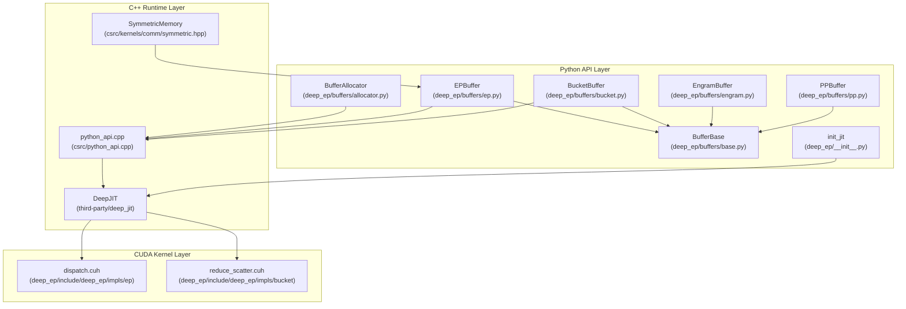

<!-- source: DeepWiki mcp.deepwiki.com · repo deepseek-ai/DeepEP · page 1 Overview · fetched 2026-11-11 -->

# Overview

Relevant source files

The following files were used as context for generating this wiki page:

- [README.md](README.md)
- [deep_ep/__init__.py](deep_ep/__init__.py)
- [figures/low-latency.png](figures/low-latency.png)

## Purpose and Scope

DeepEP (DeepEveryParallel) is a high-performance communication library for machine learning training and inference, specifically optimized for **Mixture-of-Experts (MoE) expert parallelism**. It provides high-throughput and low-latency all-to-all GPU kernels for MoE dispatch and combine operations, supporting low-precision formats such as FP8 [README.md:1-3](). 

Beyond expert parallelism, DeepEP V2.5 provides primitive support for other distributed parallelism modes, including context parallelism (CP), data parallelism (DP), pipeline parallelism (PP), and remote memory access (Engram) [README.md:1-3, 11-14](). Communication kernels are compiled at runtime using **DeepJIT**, and the host C++ extension is built during installation [README.md:3-4]().

Sources: [README.md:1-4](), [deep_ep/__init__.py:44-57]()

---

## BufferBase Family and BufferAllocator Model

DeepEP V2.5 refactors the legacy elastic communication buffers into a modular class family sharing the base lifecycle defined by `BufferBase` (`deep_ep/buffers/base.py`) [README.md:11-12](). 

| Buffer Class | Module | Primary Purpose | Key Primitives |
| :--- | :--- | :--- | :--- |
| `EPBuffer` | `deep_ep/buffers/ep.py` | MoE Expert Parallelism | `dispatch`, `combine`, `lb_prefetch_weights`, `lb_reduce_grads` [README.md:11-15](), [deep_ep/__init__.py:64]() |
| `BucketBuffer` | `deep_ep/buffers/bucket.py` | CP / DP Collectives | `all_gather`, `reduce_scatter`, `all_reduce` [README.md:14, 35](), [deep_ep/__init__.py:66]() |
| `EngramBuffer` | `deep_ep/buffers/engram.py` | Remote Memory Access (RMA) | `engram_write`, `engram_fetch` [README.md:17, 33](), [deep_ep/__init__.py:65]() |
| `PPBuffer` | `deep_ep/buffers/pp.py` | Pipeline Parallelism (PP) | `pp_send`, `pp_recv` [README.md:17, 34](), [deep_ep/__init__.py:67]() |

### BufferAllocator
To facilitate multi-tensor allocations and planning across these buffers before actual construction, DeepEP introduces `BufferAllocator` (`deep_ep/buffers/allocator.py`) [README.md:13](). It manages symmetric tensor allocation planning, ensuring all ranks allocate aligned window regions [deep_ep/__init__.py:62]().

Sources: [README.md:11-18](), [deep_ep/__init__.py:62-67](), [deep_ep/buffers/base.py:1-27]()

---

## NCCL Gin Backend and DeepJIT Runtime Compilation

### NCCL Gin Backend
DeepEP V2 replaces legacy transport mechanisms with the lightweight **NCCL Gin backend** (`csrc/kernels/comm/`) [README.md:20, 25-27](). It provides lightweight device-side communication APIs and can reuse existing NCCL communicators while setting up symmetric memory windows (`csrc/kernels/comm/symmetric.hpp`) [README.md:27]().

### DeepJIT Runtime Kernel Compilation
DeepEP avoids pre-compiling all variant combinations during installation by leveraging **DeepJIT** (housed in `third-party/deep_jit`) [README.md:3, 24](). During runtime initialization (`deep_ep/__init__.py`), `init_jit()` compiles specialized CUDA templates for the current device architecture using NVRTC and caches them in `EP_JIT_CACHE_DIR` [README.md:57]().

Sources: [README.md:3, 24-27](), [deep_ep/__init__.py:44-56](), [csrc/kernels/comm/symmetric.hpp:1-30]()

---

## System Architecture and Code Entities

The diagram below bridges natural language descriptions to exact code entities across Python wrappers, C++ bindings, and JIT compilation layers.

**Diagram: DeepEP System Architecture and Code Entities**

Sources: [README.md:11-18](), [deep_ep/__init__.py:44-67](), [csrc/python_api.cpp:1-40](), [csrc/kernels/comm/symmetric.hpp:1-30]()

---

## Hardware and Software Requirements

DeepEP has specific runtime and build requirements for performance and compatibility:

| Requirement | Specification | Notes |
| :--- | :--- | :--- |
| **OS & Python** | Linux, Python 3.10+ | Required for execution environment [README.md:47-48]() |
| **GPU Architecture** | NVIDIA Hopper (SM90) or newer | Required for hardware primitives (TMA, mbarrier) [README.md:49]() |
| **CUDA Toolkit** | CUDA 13.1 and above | Required for DeepJIT compilation [README.md:50]() |
| **Compiler** | C++20 compiler | Must support `std::format` [README.md:51]() |
| **PyTorch** | PyTorch 2.10 and above | With CUDA support [README.md:52]() |
| **NCCL** | NCCL 2.32.3 and above | Binary identity checked via `check_nccl_so()` [README.md:53](), [deep_ep/__init__.py:19-42]() |
| **Interconnect** | NVLink & RDMA | NVLink for scale-up, RDMA for scale-out [README.md:54-55]() |

Sources: [README.md:47-57](), [deep_ep/__init__.py:19-42]()

---

