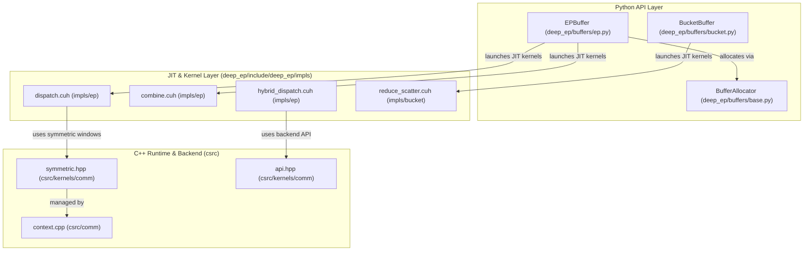
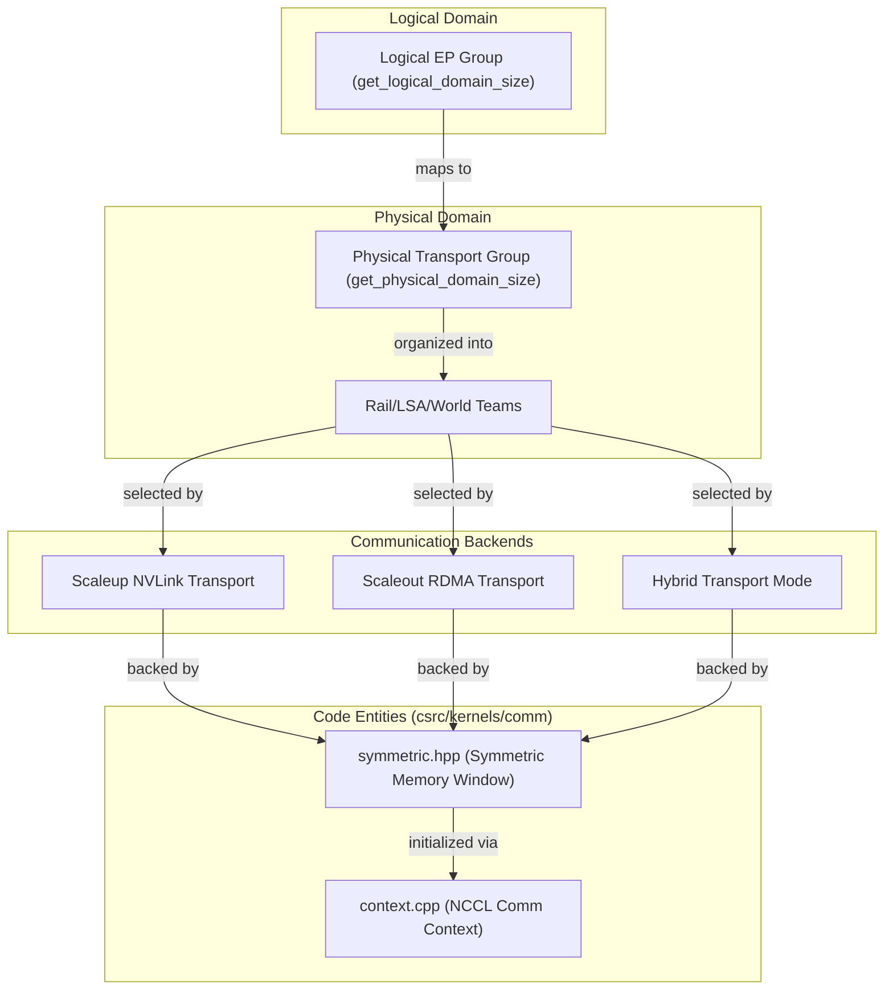

<!-- source: DeepWiki mcp.deepwiki.com · repo deepseek-ai/DeepEP · page 3 Core Concepts · fetched 2026-11-11 -->

# Core Concepts

Relevant source files

The following files were used as context for generating this wiki page:

- [README.md](README.md)

This page introduces the foundational ideas behind DeepEP V2.5, a high-performance communication library for Mixture-of-Experts (MoE) parallelism and other distributed communication paradigms [README.md:1-12](). DeepEP V2.5 refactors earlier buffer designs into specialized classes (`EPBuffer`, `BucketBuffer`, `EngramBuffer`, and `PPBuffer`) sharing a common `BufferBase` lifecycle, utilizes `BufferAllocator` for symmetric memory planning, introduces the lightweight **NCCL Gin** backend, and relies on analytical resource allocation [README.md:11-21]().

For detailed deep dives into specific subsystems, see:
- [Dispatch and Combine Operations](#3.1) — Detailed routing logic, metadata handles, expanded layouts, expert alignment, and `defer_epilogue`.
- [Communication Modes and Topology](#3.2) — Scale-up (NVLink) vs. scale-out (RDMA) domains, physical vs. logical domain sizes, and hybrid transports.
- [Memory Model: BufferBase and BufferAllocator](#3.3) — Symmetric buffer allocation, `BufferBase` lifecycle, and NCCL symmetric memory windows.
- [Analytical Resource Allocation](#3.4) — Analytical bandwidth modeling for SM and QP counts, eliminating manual auto-tuning.

Sources: [README.md:11-21]()

---

## Foundational Ideas of DeepEP V2.5

### 1. MoE Expert Parallelism and Token Routing
In MoE models, tokens are dynamically routed via gating functions and `topk_idx` to a subset of experts distributed across multiple GPU ranks [README.md:1-15](). DeepEP optimizes this irregular all-to-all communication pattern by splitting it into two core phases:
*   **Dispatch**: Sending tokens from source ranks to target ranks owning the selected experts [README.md:1-16]().
*   **Combine**: Returning processed expert outputs back to the original source ranks [README.md:1-16]().

Sources: [README.md:1-16](), [README.md:115-116]()

### 2. Dispatch/Combine with EPHandle and Deferred Epilogues
DeepEP unifies high-throughput and low-latency workflows into the `EPBuffer` interface, coordinated via `EPHandle` metadata objects [README.md:28-30](). These handles cache routing information across inference decoding steps or forward-backward passes [README.md:11-19](). Additionally, DeepEP supports deferred EP epilogues (`defer_epilogue`), allowing communication to be overlapped cleanly with prior or subsequent computation via event synchronization [README.md:11-19]().

Sources: [README.md:11-19](), [README.md:165-175]()

### 3. Scaleout (RDMA) vs Scaleup (NVLink) Domains and Hybrid Transports
DeepEP models cluster topology hierarchically:
*   **Scaleup (NVLink)**: High-bandwidth intra-node or NVLink-island communication [README.md:20-30]().
*   **Scaleout (RDMA)**: Inter-node communication over InfiniBand or RoCE [README.md:20-30]().
*   **Hybrid Transports**: Combining both layers simultaneously to saturate available bandwidth by distinguishing between physical and logical domain sizes [README.md:20-30]().

Sources: [README.md:20-36](), [csrc/kernels/comm/symmetric.hpp:1-50]()

### 4. NCCL Gin Backend and Symmetric Memory
DeepEP replaces older transport layers with the **NCCL Gin backend** [README.md:20-26](). Gin provides lightweight device-side communication primitives (`ncclGin` / window operations) that reuse existing NCCL communicators and manage symmetric memory windows efficiently across ranks [README.md:20-26]().

Sources: [README.md:20-26](), [csrc/kernels/comm/symmetric.hpp:1-30]()

---

## System Architecture: From Natural Language to Code

### Diagram 1: Communication Workflow and Data Entities
This diagram maps high-level MoE phases and buffer classes to their underlying C++ implementation headers and backend primitives.

Sources: [README.md:11-15](), [csrc/kernels/comm/symmetric.hpp:1-40]()

### Diagram 2: Topological Domains and Memory Windows
This diagram illustrates how logical expert-parallel domains map to physical NVLink scaleup and RDMA scaleout domains using symmetric memory windows.

Sources: [README.md:20-35](), [csrc/kernels/comm/symmetric.hpp:1-50]()

---

## Core Component Summary

| Component | Code Location | Role |
| :--- | :--- | :--- |
| **BufferBase** | `deep_ep/buffers/base.py`, `csrc/buffers/base.hpp` | Base lifecycle management for `EPBuffer`, `BucketBuffer`, `EngramBuffer`, `PPBuffer`. |
| **BufferAllocator** | `deep_ep/buffers/base.py` | Plans and validates symmetric tensor allocations before buffer construction. |
| **EPBuffer** | `deep_ep/buffers/ep.py` | Primary interface for MoE dispatch, combine, expert weight prefetching, and gradient reduction. |
| **BucketBuffer** | `deep_ep/buffers/bucket.py` | Provides batched all-gather, reduce-scatter, and all-reduce collectives for CP and DP. |
| **NCCL Gin Context** | `csrc/kernels/comm/context.cpp`, `symmetric.hpp` | Manages NCCL communicators, symmetric memory windows, and low-level RDMA/NVLink setup. |
| **Analytical Model** | `deep_ep/buffers/ep.py` | Computes theoretical SM and QP counts (`get_theoretical_num_sms`) without empirical tuning. |

Sources: [README.md:11-36]()

---

## Summary of Child Pages

### 3.1. Dispatch and Combine Operations
Covers token routing via `topk_idx`, `EPHandle` metadata caching, expanded layouts for grouped GEMMs, expert alignment padding, `defer_epilogue` execution, and how the combine phase reverses routing. For details, see [Dispatch and Combine Operations](#3.1).

Sources: [README.md:11-16]()

### 3.2. Communication Modes and Topology
Details scaleout (RDMA) versus scaleup (NVLink) versus hybrid transports, physical versus logical domain sizes (`get_physical_domain_size` / `get_logical_domain_size`), rail/LSA/world team hierarchies, and transport selection rules. For details, see [Communication Modes and Topology](#3.2).

Sources: [README.md:20-35]()

### 3.3. Memory Model: BufferBase and BufferAllocator
Explains symmetric buffer allocation, the `BufferBase` lifecycle (`deep_ep/buffers/base.py`, `csrc/buffers/base.hpp`), `BufferAllocator` meta-tensor planning, NCCL symmetric memory windows (`csrc/kernels/comm/symmetric.hpp`, `context.cpp`), and buffer size hints. For details, see [Memory Model: BufferBase and BufferAllocator](#3.3).

Sources: [README.md:11-18]()

### 3.4. Analytical Resource Allocation
Explains how DeepEP replaces empirical auto-tuning with analytical bandwidth modeling (`get_theoretical_num_sms` / `num_qps`), SM and QP budgeting, and overlap-with-compute preferences. For details, see [Analytical Resource Allocation](#3.4).

Sources: [README.md:28-32]()

---

*(For detailed specifications, consult the respective child pages linked above.)*
Sources: [README.md:1-50]()

---

