# Page: Overview

# Overview

<details>
<summary>Relevant source files</summary>

The following files were used as context for generating this wiki page:

- [README.md](README.md)

</details>


## Purpose and Scope

This document provides an overview of the NVIDIA Fabric Manager Client repository, which contains the `fmpm` (Fabric Manager Partition Manager) command-line utility. The `fmpm` tool enables system administrators and automation scripts to manage GPU partitions in NVIDIA data center environments equipped with NVSwitch fabric technology.

This page introduces the core concepts, system architecture, and capabilities of `fmpm`. For detailed setup instructions, see [Getting Started](#2). For command reference and usage examples, see [User Guide](#3). For technical implementation details, see [Technical Reference](#4).

**Sources:** [README.md:1-3]()

## What is Fabric Manager Client

The Fabric Manager Client is a C++ command-line utility that provides programmatic control over GPU partition management in NVIDIA Fabric Manager deployments. It operates as a client application that communicates with the NVIDIA Fabric Manager service to execute partition management operations.

The primary executable is `fmpm`, which acts as a thin client wrapper around the `libnvfm` API library. All operations are executed remotely on the Fabric Manager service, with `fmpm` serving as the interface layer that translates command-line arguments into API calls and formats responses as JSON.

**Sources:** [README.md:1-5]()

## Key Concepts

### GPU Partitions

GPU partitions represent logical groupings of NVIDIA GPUs connected through NVSwitch fabric. The Shared NVSwitch feature allows multiple GPU partitions to coexist on the same physical NVSwitch infrastructure. Each partition can be independently activated or deactivated, enabling dynamic reconfiguration of GPU resources without hardware changes.

Partitions are identified by numeric IDs and contain:
- One or more GPUs with their UUIDs and PCI bus IDs
- NVLink connectivity information
- Active/inactive state
- Support status (some hardware configurations may result in unsupported partitions)

### NVSwitch Fabric

NVSwitch is NVIDIA's high-speed interconnect technology that provides GPU-to-GPU communication across a fabric. It enables all-to-all GPU connectivity at high bandwidth using NVLink protocol. The fabric manager monitors the health of NVLink connections and can detect failed devices at the GPU and switch level.

### Fabric Manager Service

The NVIDIA Fabric Manager is a background service (daemon) that manages the NVSwitch fabric and GPU partitions. It provides:
- Partition lifecycle management (activation/deactivation)
- NVLink health monitoring
- Persistent state management (Resiliency Mode)
- API interface for remote management

The Fabric Manager service must be configured to accept connections via TCP sockets (`FM_CMD_BIND_INTERFACE`) or Unix domain sockets (`FM_CMD_UNIX_SOCKET_PATH`).

**Sources:** [README.md:3-14]()

## System Components

The following diagram maps the major system components to their code entities:

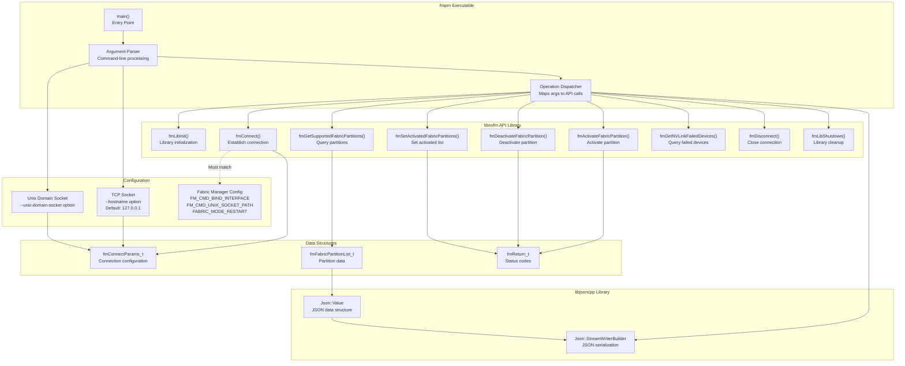

**Sources:** [README.md:8-28]()

## Core Capabilities

The `fmpm` utility provides two categories of operations:

| Operation Type | Commands | Description | API Functions |
|---------------|----------|-------------|---------------|
| **Query Operations** | `-l` | List all partitions with active/inactive state | `fmGetSupportedFabricPartitions()` |
| | `--get-nvlink-failed-devices` | Retrieve all GPUs and switches with NVLink failures | `fmGetNVLinkFailedDevices()` |
| | `--list-unsupported-partitions` | Identify partitions that cannot be managed | (API function TBD) |
| | `-v` | Display version information | N/A |
| **State Management** | `-a <ID>` | Activate a single partition | `fmActivateFabricPartition()` |
| | `-d <ID>` | Deactivate a single partition | `fmDeactivateFabricPartition()` |
| | `--set-activated-list <IDs>` | Set list of activated partitions for resiliency | `fmSetActivatedFabricPartitions()` |
| **Connection Options** | `--hostname <IP>` | Connect via TCP socket | TCP transport in `fmConnect()` |
| | `--unix-domain-socket <path>` | Connect via Unix domain socket | Unix socket transport in `fmConnect()` |

All operations output results in JSON format to stdout, enabling integration with automation frameworks and parsing by downstream tools.

**Sources:** [README.md:8-28]()

## Operational Model

The following diagram illustrates the typical API call sequence for common operations:

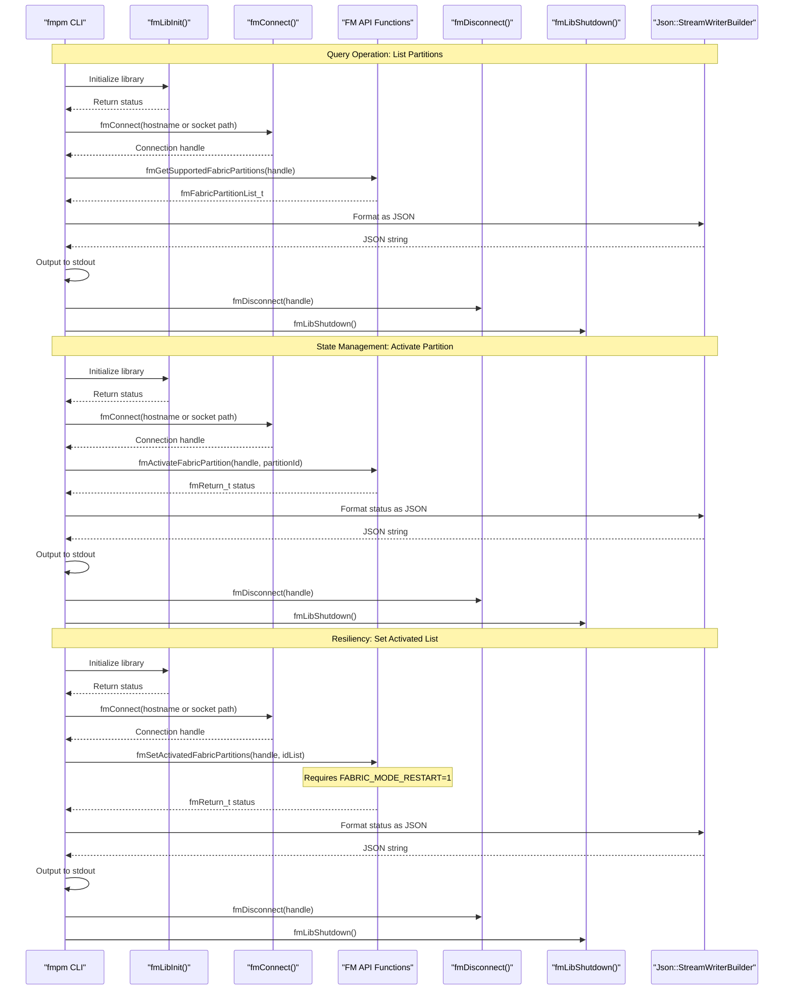

**Sources:** [README.md:8-28]()

## Integration Points

### Build-Time Dependencies

| Component | Ubuntu Package | RHEL Package | Purpose |
|-----------|---------------|--------------|---------|
| Fabric Manager API | `nvidia-fabricmanager-dev-<version>` | `nvidia-fabricmanager-devel-<version>` | Provides `libnvfm` headers and library |
| JSON Library | `libjsoncpp-dev` | `jsoncpp-devel` | Provides JSON serialization via `libjsoncpp` |
| Build Tools | Standard dev tools | Standard dev tools | C++ compiler, `pkg-config` |

The RHEL `jsoncpp-devel` package requires the EPEL repository to be configured.

**Sources:** [README.md:31-38]()

### Runtime Dependencies

The `fmpm` executable requires:
1. **Fabric Manager Service**: Must be running and configured to accept connections
2. **Configuration Alignment**: Client connection method (`--hostname` or `--unix-domain-socket`) must match server configuration (`FM_CMD_BIND_INTERFACE` or `FM_CMD_UNIX_SOCKET_PATH`)
3. **Network Connectivity**: If using TCP sockets, network access to the Fabric Manager host
4. **Resiliency Mode**: If using `--set-activated-list`, Fabric Manager must have `FABRIC_MODE_RESTART=1` configured

**Sources:** [README.md:12-27]()

## Communication Architecture

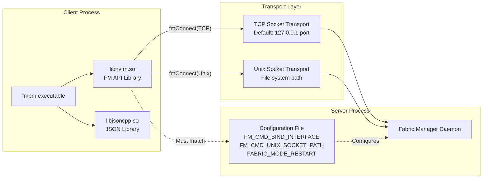

The client and server communicate through a request-response protocol over either TCP or Unix domain sockets. The connection method is determined by command-line arguments to `fmpm`, but must match the Fabric Manager's configured interface. If both `--hostname` and `--unix-domain-socket` are specified, the Unix domain socket takes precedence.

**Sources:** [README.md:12-19]()

## Use Cases

### Local Management
System administrators use `fmpm` on the same host as Fabric Manager to manage partitions:
```
$ fmpm -l
$ fmpm -a 3
$ fmpm -d 3
```

### Remote Management
Administrators manage Fabric Manager from a remote host via network:
```
$ fmpm -l --hostname 10.0.0.5
$ fmpm -a 3 --hostname 10.0.0.5
```

### High-Performance Local Management
For reduced latency, Unix domain sockets can be used for local management:
```
$ fmpm -l --unix-domain-socket /var/run/nvidia-fabricmanager/fabricmanager.sock
```

### Automation and Orchestration
Scripts and orchestration tools integrate `fmpm` by parsing JSON output:
```bash
#!/bin/bash
partitions=$(fmpm -l | jq '.partitions')
# Process partition data...
```

### Resiliency Mode
In production environments requiring automatic recovery, `--set-activated-list` persists partition state:
```
$ fmpm --set-activated-list 1,2,3,5
```
After Fabric Manager restarts, partitions 1, 2, 3, and 5 are automatically restored to active state.

**Sources:** [README.md:8-28]()

## Repository Structure

The repository contains:
- **Source Code**: C++ implementation of the `fmpm` utility
- **Build System**: Makefile for compilation and linking
- **Documentation**: README with usage instructions and configuration requirements
- **License**: NVIDIA Software License Agreement

For build instructions, see [Building from Source](#2.2). For license terms and restrictions, see [License and Legal](#5).

**Sources:** [README.md:1-39]()

## Related Pages

- **[Getting Started](#2)**: Installation, building, and initial configuration
- **[Command-Line Reference](#3.1)**: Complete reference for all `fmpm` options
- **[Managing GPU Partitions](#3.2)**: Detailed partition management workflows
- **[Resiliency Mode](#3.4)**: Automatic partition restoration configuration
- **[Architecture Overview](#4.1)**: In-depth technical architecture
- **[Communication Protocols](#4.2)**: TCP and Unix socket protocol details
- **[Software License Agreement](#5.1)**: Legal terms and usage restrictions

---

# Page: Getting Started

# Getting Started

<details>
<summary>Relevant source files</summary>

The following files were used as context for generating this wiki page:

- [Makefile](Makefile)
- [README.md](README.md)

</details>


This page provides an overview of the initial setup process for the NVIDIA Fabric Manager Client (`fmpm`). It covers the workflow from installing dependencies through building the client binary and preparing it for use. For detailed command usage and operational workflows, see [User Guide](#3). For architectural and implementation details, see [Technical Reference](#4).

## Purpose and Scope

The setup process transforms the source code into a functional `fmpm` binary that can communicate with the NVIDIA Fabric Manager service to manage GPU partitions. This involves:

1. Installing development dependencies
2. Compiling the C++ source code
3. Configuring communication channels between client and server

This page provides a roadmap of the setup workflow. Detailed instructions for each step are covered in the child pages:
- [Prerequisites and Dependencies](#2.1) - System requirements and package installation
- [Building from Source](#2.2) - Compilation process and Makefile usage
- [Configuration](#2.3) - Client-server communication setup

## Setup Workflow Overview

The following diagram illustrates the complete setup workflow, from a clean system to a functional deployment:

**Diagram: Setup Workflow from Dependencies to Deployment**

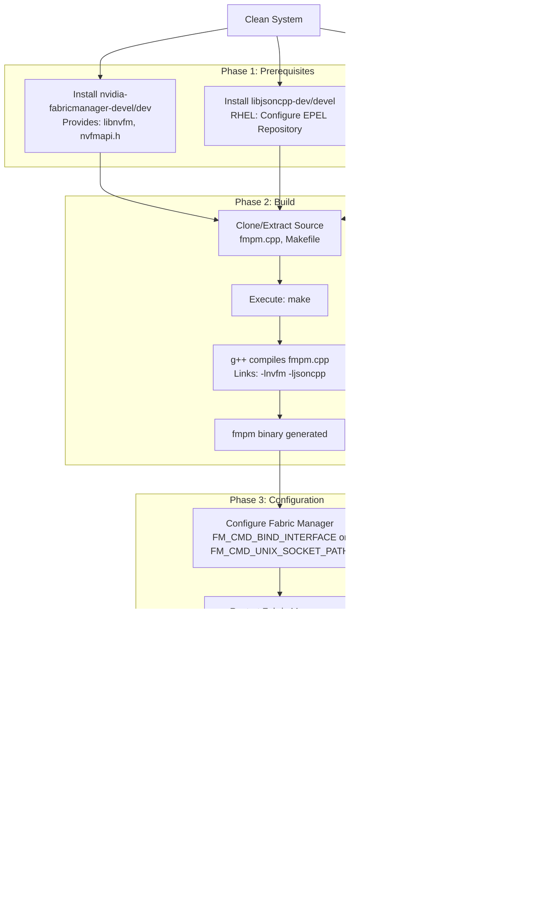

Sources: [README.md:31-38](), [Makefile:1-13]()

## Build Environment Components

The build process requires specific development packages and tools. This diagram maps the high-level requirements to actual package names and code entities:

**Diagram: Build Dependencies and Code Entities**

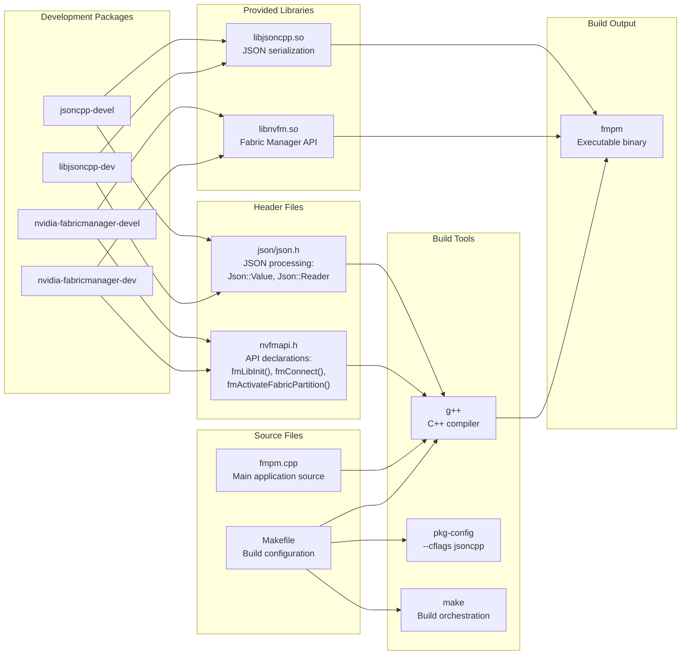

Sources: [README.md:31-38](), [Makefile:1-13]()

## Platform-Specific Package Names

The required development packages have different names across Linux distributions:

| Component | Ubuntu/Debian | RHEL/CentOS | Additional Notes |
|-----------|--------------|-------------|------------------|
| Fabric Manager Dev | `nvidia-fabricmanager-dev` | `nvidia-fabricmanager-devel` | Provides `libnvfm` and `nvfmapi.h` |
| JSON Library Dev | `libjsoncpp-dev` | `jsoncpp-devel` | RHEL requires EPEL repository |
| C++ Compiler | `g++` (in `build-essential`) | `gcc-c++` (in `Development Tools`) | Standard toolchain |
| Package Config | `pkg-config` | `pkgconfig` | Used by Makefile |
| Build System | `make` | `make` | Standard GNU Make |

Sources: [README.md:31-38]()

## Quick Start Summary

For experienced users familiar with C++ build environments, here is a condensed setup sequence:

```bash
# 1. Install dependencies (Ubuntu example)
sudo apt-get install nvidia-fabricmanager-dev libjsoncpp-dev build-essential pkg-config

# 2. Build
make

# 3. Configure Fabric Manager
# Edit Fabric Manager config file to set:
# FM_CMD_BIND_INTERFACE=127.0.0.1  (for TCP)
# or
# FM_CMD_UNIX_SOCKET_PATH=/var/run/nvfm.sock  (for Unix socket)

# 4. Restart Fabric Manager service
sudo systemctl restart nvidia-fabricmanager

# 5. Test
./fmpm -v
./fmpm -l
```

For detailed explanations of each step, see the following pages:
- [Prerequisites and Dependencies](#2.1) - Detailed package installation instructions
- [Building from Source](#2.2) - Compilation process and troubleshooting
- [Configuration](#2.3) - Client-server communication configuration

## Compilation Process Details

The build process is managed by a Makefile that orchestrates compilation and linking. The following diagram shows the compilation flow and key Makefile variables:

**Diagram: Compilation Flow and Makefile Variables**

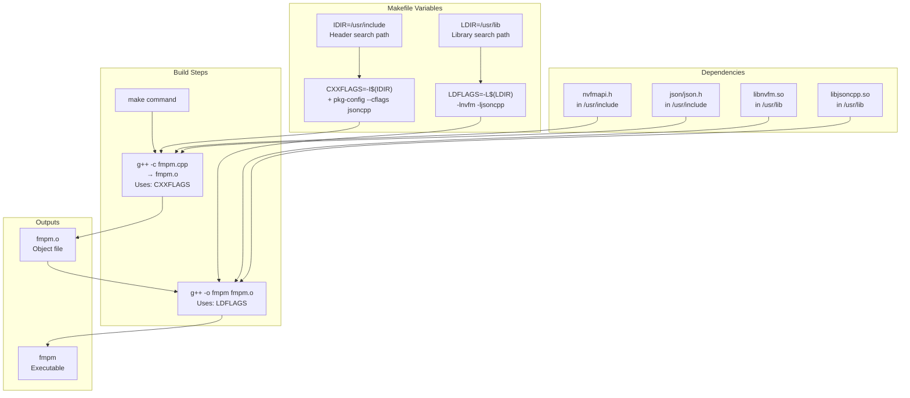

Sources: [Makefile:1-13]()

### Makefile Target Reference

The Makefile provides the following targets:

| Target | Description | Command Line Variables |
|--------|-------------|----------------------|
| `fmpm` (default) | Compiles and links the executable | Uses variables from [Makefile:1-5]() |
| `clean` | Removes build artifacts (`fmpm.o`, `fmpm`) | N/A |

The linking step [Makefile:8]() uses two critical flags:
- `-lnvfm`: Links against the Fabric Manager API library
- `-ljsoncpp`: Links against the JSON processing library

Sources: [Makefile:7-12]()

## Configuration Synchronization

A critical aspect of setup is ensuring the client's connection method matches the Fabric Manager service configuration. The following diagram illustrates the required configuration alignment:

**Diagram: Client-Server Configuration Matching**

```mermaid
graph TB
    subgraph "fmpm Client Options"
        TCPClient["--hostname <IP><br/>Default: 127.0.0.1"]
        UnixClient["--unix-domain-socket <path>"]
    end
    
    subgraph "Fabric Manager Configuration File"
        TCPServer["FM_CMD_BIND_INTERFACE=<IP>"]
        UnixServer["FM_CMD_UNIX_SOCKET_PATH=<path>"]
    end
    
    subgraph "Valid Configurations"
        Config1["Configuration 1: TCP<br/>Client: --hostname 10.0.0.1<br/>Server: FM_CMD_BIND_INTERFACE=10.0.0.1"]
        Config2["Configuration 2: Localhost TCP<br/>Client: (default or --hostname 127.0.0.1)<br/>Server: FM_CMD_BIND_INTERFACE=127.0.0.1"]
        Config3["Configuration 3: Unix Socket<br/>Client: --unix-domain-socket /var/run/nvfm.sock<br/>Server: FM_CMD_UNIX_SOCKET_PATH=/var/run/nvfm.sock"]
    end
    
    subgraph "Invalid Configurations"
        Mismatch1["Client uses --hostname<br/>Server only has FM_CMD_UNIX_SOCKET_PATH"]
        Mismatch2["Client uses --unix-domain-socket<br/>Server only has FM_CMD_BIND_INTERFACE"]
        Mismatch3["Client: --hostname 10.0.0.1<br/>Server: FM_CMD_BIND_INTERFACE=192.168.1.1"]
    end
    
    TCPClient -.->|Must match| TCPServer
    UnixClient -.->|Must match| UnixServer
    
    TCPClient --> Config1
    TCPClient --> Config2
    UnixClient --> Config3
    
    TCPClient -.->|Fails| Mismatch1
    UnixClient -.->|Fails| Mismatch2
    TCPClient -.->|Fails| Mismatch3
```

Sources: [README.md:12-19]()

Configuration mismatches result in connection failures. The client will report connection errors if it cannot establish communication with the Fabric Manager service. For detailed configuration instructions, see [Configuration](#2.3).

## Post-Build Verification

After successful compilation, verify the binary was created and has proper library linkages:

```bash
# Verify binary exists
ls -lh fmpm

# Check dynamic library dependencies
ldd fmpm | grep -E "nvfm|jsoncpp"
```

Expected output includes:
- `libnvfm.so => /usr/lib/x86_64-linux-gnu/libnvfm.so`
- `libjsoncpp.so => /usr/lib/x86_64-linux-gnu/libjsoncpp.so`

If libraries are not found, ensure the development packages are correctly installed and the library search paths in [Makefile:4-5]() are correct for your system.

## Deployment Models

Once built, the `fmpm` binary can be deployed in two configurations:

**Local Deployment**
- Binary runs on the same host as Fabric Manager service
- Can use Unix domain socket (lowest latency) or TCP localhost
- Typical for single-node management

**Remote Deployment**
- Binary deployed to separate management host
- Must use TCP socket communication
- Requires network connectivity to Fabric Manager host
- Enables centralized management of multiple GPU systems

For both models, the client and server configurations must be synchronized as shown in the previous diagram.

## Next Steps

After completing the setup process:

1. **For command usage**: See [Command-Line Reference](#3.1) for all available options
2. **For partition management**: See [Managing GPU Partitions](#3.2) for operational workflows
3. **For troubleshooting**: See [Error Handling and Return Codes](#4.5) for common issues
4. **For architectural understanding**: See [Architecture Overview](#4.1)

The following pages in this section provide detailed instructions:
- [Prerequisites and Dependencies](#2.1) - Comprehensive dependency installation guide
- [Building from Source](#2.2) - Detailed compilation instructions and troubleshooting
- [Configuration](#2.3) - Step-by-step configuration for TCP and Unix socket communication

Sources: [README.md:1-39](), [Makefile:1-13]()

---

# Page: Prerequisites and Dependencies

# Prerequisites and Dependencies

<details>
<summary>Relevant source files</summary>

The following files were used as context for generating this wiki page:

- [Makefile](Makefile)
- [README.md](README.md)

</details>


## Purpose and Scope

This document details all prerequisites and dependencies required to build and run the `fmpm` (Fabric Manager Partition Manager) client. It covers build-time development packages, runtime libraries, system requirements, hardware prerequisites, and platform restrictions. For build instructions using these dependencies, see [Building from Source](#2.2). For configuration of the Fabric Manager service that `fmpm` depends on at runtime, see [Configuration](#2.3).

---

## System Requirements

The `fmpm` client requires specific operating system support, hardware infrastructure, and toolchain versions to function correctly.

### Operating System Support

| Distribution | Package Manager | Status |
|--------------|----------------|--------|
| Red Hat Enterprise Linux (RHEL) | `yum` / `dnf` | Supported |
| Ubuntu | `apt` | Supported |
| Other Linux distributions | Varies | Not documented |

The build system assumes a Linux environment with standard POSIX tooling. Windows and macOS are not supported.

### Minimum Toolchain Requirements

| Component | Requirement | Notes |
|-----------|-------------|-------|
| C++ Compiler | `g++` | Used in [Makefile:8]() |
| Build System | GNU Make | Processes [Makefile:1-13]() |
| Package Configuration | `pkg-config` | Required for jsoncpp detection [Makefile:2]() |

**Sources:** [Makefile:1-13]()

---

## Build-Time Dependencies

Build-time dependencies are required only on systems where the `fmpm` binary will be compiled. Once built, the binary can be deployed to other systems with only runtime dependencies installed.

### Development Packages

The following development packages provide header files and static/dynamic libraries required during compilation and linking.

#### NVIDIA Fabric Manager Development Package

This package provides the `libnvfm` library and headers for communicating with the Fabric Manager service.

| Distribution | Package Name | Installation Command |
|--------------|--------------|---------------------|
| RHEL | `nvidia-fabricmanager-devel-<version>` | `yum install nvidia-fabricmanager-devel-<version>` |
| Ubuntu | `nvidia-fabricmanager-dev-<version>` | `apt install nvidia-fabricmanager-dev-<version>` |

**Key Components:**
- Headers: Provide API declarations for functions like `fmLibInit()`, `fmConnect()`, `fmActivateFabricPartition()`
- Library: `libnvfm.so` linked via `-lnvfm` flag [Makefile:5]()

**Version Compatibility:** The development package version should match or be compatible with the Fabric Manager service version running on the target system. Version mismatches can cause API incompatibilities.

**Sources:** [README.md:31-33](), [Makefile:5]()

#### JSON CPP Development Package

This package provides the JSON serialization/deserialization library for formatting API responses.

| Distribution | Package Name | Installation Command | Prerequisites |
|--------------|--------------|---------------------|---------------|
| Ubuntu | `libjsoncpp-dev` | `apt install libjsoncpp-dev` | None |
| RHEL | `jsoncpp-devel` | `yum install jsoncpp-devel` | **EPEL repository** |

**RHEL Specific Requirement:** The [EPEL (Extra Packages for Enterprise Linux) repository](https://www.redhat.com/en/blog/install-epel-linux) must be configured before installing `jsoncpp-devel` on RHEL systems.

```bash
# Example: Enable EPEL on RHEL 8
sudo dnf install epel-release
```

**Key Components:**
- Headers: Detected via `pkg-config --cflags jsoncpp` [Makefile:2]()
- Library: `libjsoncpp.so` linked via `-ljsoncpp` flag [Makefile:5]()

**Sources:** [README.md:35-38](), [Makefile:2](), [Makefile:5]()

### Build Tools and Utilities

| Tool | Purpose | Usage in Build System |
|------|---------|----------------------|
| `g++` | C++ compilation and linking | Compiles `fmpm.cpp`, links libraries [Makefile:8]() |
| `pkg-config` | Library configuration queries | Retrieves jsoncpp compiler flags [Makefile:2]() |
| `make` | Build automation | Executes build targets [Makefile:7-12]() |

**Sources:** [Makefile:1-13]()

---

## Build-Time Dependency Graph

The following diagram shows how build-time dependencies flow into the compilation process and map to specific code entities.

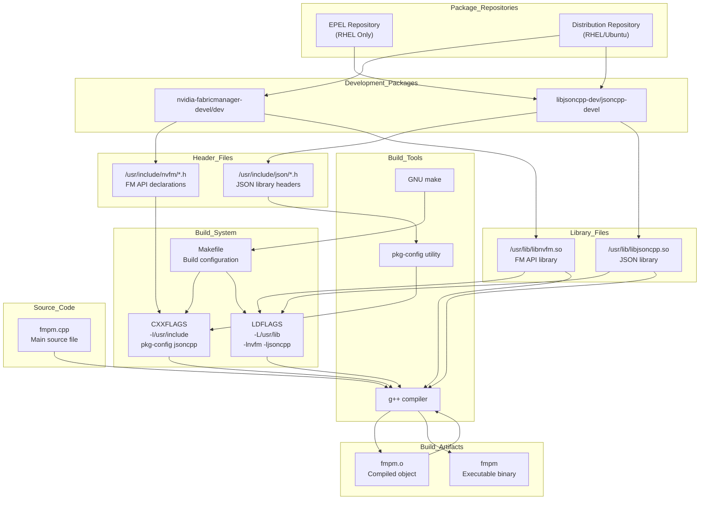

**Sources:** [Makefile:1-13](), [README.md:31-38]()

---

## Runtime Dependencies

Runtime dependencies must be present on any system where the compiled `fmpm` binary will execute. Unlike build-time dependencies, runtime packages do not include development headers or static libraries.

### Fabric Manager Service

The `fmpm` client is a control interface for the NVIDIA Fabric Manager service. The service must be installed, configured, and running before `fmpm` can perform any operations.

| Component | Requirement | Notes |
|-----------|-------------|-------|
| Fabric Manager Service | `nvidia-fabricmanager` package | Must be running as daemon/service |
| Communication Interface | TCP socket or Unix domain socket | Configured via `FM_CMD_BIND_INTERFACE` or `FM_CMD_UNIX_SOCKET_PATH` |
| API Version | Compatible with `libnvfm` version | Version mismatch causes connection failures |

**Service Status Verification:**
```bash
# Systemd-based systems
systemctl status nvidia-fabricmanager

# Check if process is running
ps aux | grep nv-fabricmanager
```

**Configuration Requirements:** The Fabric Manager service must be configured with one of the following before `fmpm` can connect:
- `FM_CMD_BIND_INTERFACE=<IP_ADDRESS>` for TCP socket communication [README.md:14]()
- `FM_CMD_UNIX_SOCKET_PATH=<SOCKET_PATH>` for Unix domain socket communication [README.md:18]()

For detailed configuration instructions, see [Configuration](#2.3).

**Sources:** [README.md:12-19]()

### Runtime Libraries

The following shared libraries must be present in the system library search path (`/usr/lib`, `/usr/lib64`, or configured via `LD_LIBRARY_PATH`):

| Library | Package | Required By |
|---------|---------|-------------|
| `libnvfm.so` | `nvidia-fabricmanager` | All FM API calls |
| `libjsoncpp.so` | `libjsoncpp` (Ubuntu) / `jsoncpp` (RHEL) | JSON output formatting |

**Library Verification:**
```bash
# Check if libraries are available
ldd ./fmpm

# Expected output includes:
# libnvfm.so => /usr/lib/libnvfm.so
# libjsoncpp.so => /usr/lib/libjsoncpp.so
```

**Sources:** [Makefile:5]()

---

## Hardware Requirements

The `fmpm` client manages GPU partitions in NVIDIA NVSwitch-based systems. Specific hardware must be present for the system to function.

### Required Hardware Components

| Component | Requirement | Purpose |
|-----------|-------------|---------|
| NVIDIA GPUs | NVIDIA Platform products | Compute resources managed by partitions |
| NVSwitch Fabric | NVSwitch interconnect | High-speed GPU-to-GPU communication |
| NVLink Interconnects | NVLink topology | Physical links between GPUs and switches |

**Platform Restrictions:** Per the NVIDIA Software License Agreement, the following restrictions apply:
- **Supported:** NVIDIA Platform products (GPUs, SoCs, and systems designed and sold by NVIDIA)
- **Prohibited:** GeForce and Titan products in datacenter deployment
- **Prohibited:** Non-NVIDIA platforms

These restrictions are detailed in [Usage Restrictions and Requirements](#5.2).

### Partition Support Verification

Not all hardware configurations support all partition types. Use the following command to identify unsupported partitions:

```bash
./fmpm --list-unsupported-partitions
```

This command queries the Fabric Manager for partition configurations that cannot be activated due to hardware limitations or topology constraints.

**Sources:** [README.md:21](), High-level system diagrams

---

## Runtime Dependency Mapping

This diagram maps runtime dependencies to specific code operations and API calls within `fmpm`.

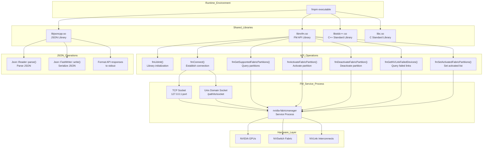

**Sources:** [Makefile:5](), [README.md:8-28](), High-level system diagrams

---

## Platform and Configuration Dependencies

### Fabric Manager Configuration Dependencies

The `fmpm` client's connection method must match the Fabric Manager service configuration. Mismatches result in connection failures.

| `fmpm` Option | Required FM Configuration | Connection Type |
|--------------|---------------------------|-----------------|
| `--hostname <IP>` | `FM_CMD_BIND_INTERFACE=<IP>` | TCP socket |
| `--unix-domain-socket <path>` | `FM_CMD_UNIX_SOCKET_PATH=<path>` | Unix domain socket |
| (default, no option) | `FM_CMD_BIND_INTERFACE=127.0.0.1` | TCP localhost |

**Sources:** [README.md:12-19]()

### Resiliency Mode Dependencies

The `--set-activated-list` command requires additional Fabric Manager configuration:

| Feature | Required Configuration | Purpose |
|---------|----------------------|---------|
| Set Activated List | `FABRIC_MODE_RESTART=1` | Enable state persistence and automatic restoration |

Without this configuration, the `--set-activated-list` command will fail or have no persistent effect. See [Resiliency Mode](#3.4) for detailed usage.

**Sources:** [README.md:22-27]()

---

## Dependency Verification

### Pre-Build Verification

Before attempting to build `fmpm`, verify all build-time dependencies are installed:

```bash
# Check g++ compiler
g++ --version

# Check pkg-config
pkg-config --version

# Check jsoncpp development files
pkg-config --modversion jsoncpp
pkg-config --cflags jsoncpp

# Check for libnvfm headers (example path)
ls /usr/include/nvfm/ || echo "nvidia-fabricmanager-devel not installed"

# Check for libnvfm library
ldconfig -p | grep libnvfm
```

### Post-Build Verification

After building `fmpm`, verify the binary has correct library dependencies:

```bash
# Check dynamic library dependencies
ldd ./fmpm

# Expected output should include:
# libnvfm.so => /usr/lib64/libnvfm.so (or similar path)
# libjsoncpp.so => /usr/lib64/libjsoncpp.so (or similar path)

# Verify binary executes
./fmpm -v
```

### Runtime Environment Verification

Before running `fmpm` for partition management, verify the runtime environment:

```bash
# Check Fabric Manager service status
systemctl status nvidia-fabricmanager

# Check Fabric Manager API is accessible
# For TCP (example with default localhost):
netstat -tuln | grep 12345  # (port varies by configuration)

# For Unix socket:
ls -l /var/run/nvidia-fabricmanager/  # (path varies by configuration)

# Verify GPU hardware is detected
nvidia-smi

# Test fmpm connectivity
./fmpm -l
```

**Sources:** [Makefile:1-13](), [README.md:8-28]()

---

## Common Dependency Issues

| Issue | Symptom | Resolution |
|-------|---------|------------|
| EPEL not configured (RHEL) | `jsoncpp-devel` package not found | Enable EPEL repository [README.md:38]() |
| Mismatched FM versions | API connection failures, version errors | Install matching `nvidia-fabricmanager-devel` and `nvidia-fabricmanager` versions |
| Missing `pkg-config` | Build fails with "pkg-config: command not found" | Install `pkgconfig` or `pkg-config` package |
| Library path issues | `error while loading shared libraries: libnvfm.so` | Add library path to `LD_LIBRARY_PATH` or run `ldconfig` |
| FM service not running | `fmpm` connection timeout or refused | Start Fabric Manager service: `systemctl start nvidia-fabricmanager` |
| Configuration mismatch | Connection refused despite running service | Verify `--hostname`/`--unix-domain-socket` matches FM configuration |

**Sources:** [README.md:35-38]()

---

## Summary

The `fmpm` client has clear dependency boundaries between build-time and runtime requirements:

**Build-time:** Development packages (`nvidia-fabricmanager-devel`, `libjsoncpp-dev`), C++ toolchain (`g++`, `make`, `pkg-config`), EPEL repository (RHEL only)

**Runtime:** Fabric Manager service running with matching configuration, runtime libraries (`libnvfm.so`, `libjsoncpp.so`), compatible NVIDIA GPU hardware with NVSwitch fabric

**Configuration:** Matching communication interfaces between client and server, optional Resiliency Mode for state persistence

For build instructions using these dependencies, proceed to [Building from Source](#2.2). For environment configuration, see [Configuration](#2.3).

**Sources:** [README.md:1-39](), [Makefile:1-13](), High-level system diagrams

---

# Page: Building from Source

# Building from Source

<details>
<summary>Relevant source files</summary>

The following files were used as context for generating this wiki page:

- [Makefile](Makefile)
- [README.md](README.md)

</details>


This page provides step-by-step instructions for compiling the `fmpm` client utility from source code using the provided Makefile. It covers the build process, compilation flags, library linking, and build output verification. For information about installing prerequisite packages and dependencies, see [Prerequisites and Dependencies](#2.1). For runtime configuration after building, see [Configuration](#2.3).

---

## Purpose and Scope

The `fmpm` client is a single C++ source file ([fmpm.cpp]()) that compiles into a self-contained binary executable. The build process links against two external libraries: `libnvfm` (NVIDIA Fabric Manager API) and `libjsoncpp` (JSON processing). This page documents how the [Makefile]() orchestrates the compilation and linking process to produce the final `fmpm` binary.

---

## Build Process Overview

The build system uses GNU Make with a simple two-stage compilation process:

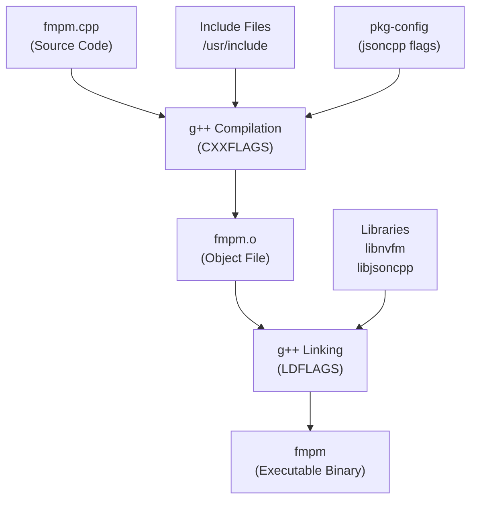

**Build Process Diagram: Two-Stage Compilation**

Sources: [Makefile:1-13]()

| Stage | Input | Output | Command |
|-------|-------|--------|---------|
| **Compilation** | `fmpm.cpp` | `fmpm.o` | `g++` with `CXXFLAGS` |
| **Linking** | `fmpm.o` | `fmpm` | `g++` with `LDFLAGS` |

---

## Compilation Command

To build the `fmpm` binary, execute the following command in the repository root directory:

```bash
make
```

This invokes the default target defined in [Makefile:7-8](), which compiles and links the executable.

To remove build artifacts:

```bash
make clean
```

This removes both `fmpm.o` and the `fmpm` binary as specified in [Makefile:10-12]().

Sources: [Makefile:7-12](), [README.md:31-38]()

---

## Makefile Configuration

The [Makefile]() defines four key variables that control the build process:

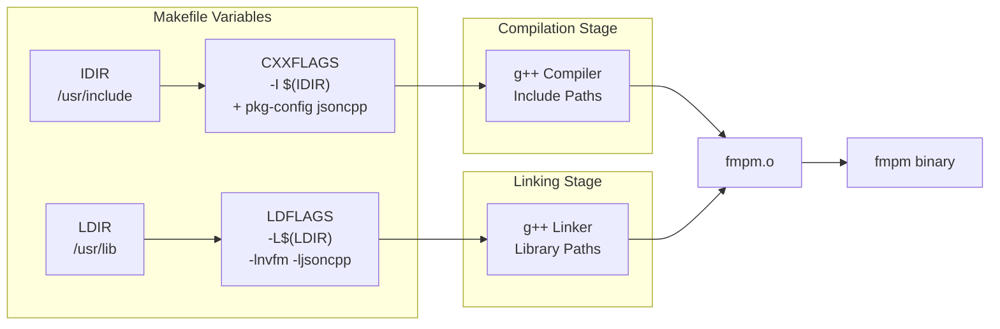

**Makefile Variable Flow Diagram**

### Variable Definitions

| Variable | Value | Purpose | Line Reference |
|----------|-------|---------|----------------|
| `IDIR` | `/usr/include` | Base directory for header file search | [Makefile:1]() |
| `CXXFLAGS` | `-I $(IDIR) $(shell pkg-config --cflags jsoncpp)` | Compiler flags for include paths | [Makefile:2]() |
| `LDIR` | `/usr/lib` | Base directory for library search | [Makefile:4]() |
| `LDFLAGS` | `-L$(LDIR) -lnvfm -ljsoncpp` | Linker flags for libraries | [Makefile:5]() |

Sources: [Makefile:1-5]()

### Compiler Flags Breakdown

The `CXXFLAGS` variable ([Makefile:2]()) specifies:

- **`-I $(IDIR)`**: Adds `/usr/include` to the include search path for header files
- **`$(shell pkg-config --cflags jsoncpp)`**: Dynamically retrieves compiler flags for `jsoncpp` library using `pkg-config`

The `pkg-config` invocation typically expands to include paths for `jsoncpp` headers, such as `-I/usr/include/jsoncpp`.

### Linker Flags Breakdown

The `LDFLAGS` variable ([Makefile:5]()) specifies:

- **`-L$(LDIR)`**: Adds `/usr/lib` to the library search path
- **`-lnvfm`**: Links against NVIDIA Fabric Manager API library (`libnvfm.so` or `libnvfm.a`)
- **`-ljsoncpp`**: Links against JSON CPP library (`libjsoncpp.so` or `libjsoncpp.a`)

Sources: [Makefile:2-5]()

---

## Build Target Definition

The main build target is defined in [Makefile:7-8]():

```makefile
fmpm: fmpm.o
	g++ -o $@ $< $(CXXFLAGS) $(LDFLAGS)
```

This rule specifies:

- **Target**: `fmpm` (the output binary)
- **Dependency**: `fmpm.o` (the compiled object file)
- **Recipe**: Links `fmpm.o` into the final binary using both `CXXFLAGS` and `LDFLAGS`

The automatic variables used:
- `$@`: Expands to target name (`fmpm`)
- `$<`: Expands to first dependency (`fmpm.o`)

### Implicit Compilation Rule

The Makefile relies on GNU Make's implicit rule for C++ compilation to produce `fmpm.o` from `fmpm.cpp`. This implicit rule is equivalent to:

```makefile
fmpm.o: fmpm.cpp
	g++ -c fmpm.cpp $(CXXFLAGS)
```

The `-c` flag instructs `g++` to compile without linking, producing only the object file.

Sources: [Makefile:7-8]()

---

## Library Dependencies

The build process links against two external libraries that must be installed on the system:

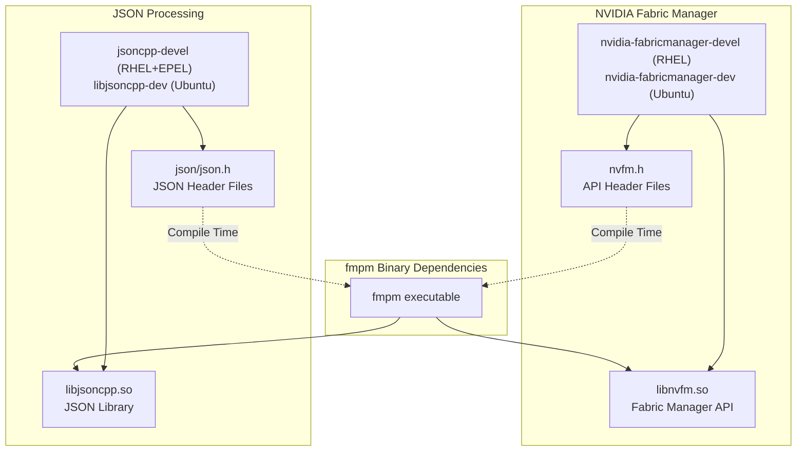

**Library Dependency Graph**

### libnvfm - Fabric Manager API

- **Library File**: `libnvfm.so` or `libnvfm.a`
- **Linker Flag**: `-lnvfm` ([Makefile:5]())
- **Headers**: API declarations for functions like `fmLibInit()`, `fmConnect()`, `fmActivateFabricPartition()`, etc.
- **Package Name**:
  - RHEL: `nvidia-fabricmanager-devel-<version>` ([README.md:32]())
  - Ubuntu: `nvidia-fabricmanager-dev-<version>` ([README.md:33]())

### libjsoncpp - JSON Processing

- **Library File**: `libjsoncpp.so` or `libjsoncpp.a`
- **Linker Flag**: `-ljsoncpp` ([Makefile:5]())
- **Compiler Flags**: Retrieved via `pkg-config --cflags jsoncpp` ([Makefile:2]())
- **Headers**: JSON parsing and serialization classes
- **Package Name**:
  - Ubuntu: `libjsoncpp-dev` ([README.md:36]())
  - RHEL: `jsoncpp-devel` (requires EPEL repository) ([README.md:37-38]())

Sources: [Makefile:5](), [README.md:31-38]()

---

## Build Process Execution

The complete build process executes as follows:

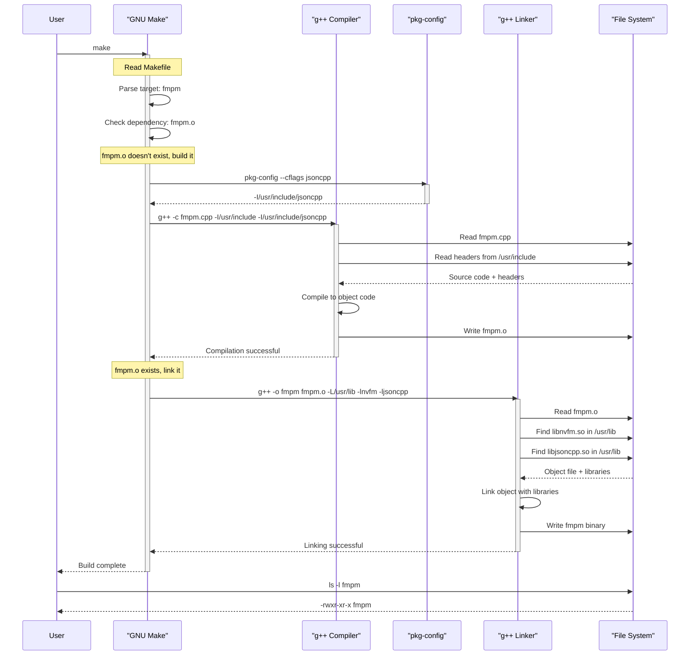

**Build Process Execution Sequence**

Sources: [Makefile:1-13]()

---

## Build Output

Upon successful compilation, the build process produces:

| File | Type | Description | Created By |
|------|------|-------------|------------|
| `fmpm.o` | Object File | Compiled machine code from `fmpm.cpp` | Compilation stage |
| `fmpm` | Executable | Final linked binary with execution permissions | Linking stage |

The `fmpm` binary is a dynamically linked executable that depends on system libraries:

```bash
$ ldd fmpm
    linux-vdso.so.1
    libnvfm.so => /usr/lib/x86_64-linux-gnu/libnvfm.so
    libjsoncpp.so => /usr/lib/x86_64-linux-gnu/libjsoncpp.so
    libstdc++.so.6 => /usr/lib/x86_64-linux-gnu/libstdc++.so.6
    libc.so.6 => /lib/x86_64-linux-gnu/libc.so.6
    ...
```

Sources: [Makefile:7-8]()

---

## Verification

After building, verify the executable was created successfully:

```bash
$ ls -lh fmpm
-rwxr-xr-x 1 user user 125K Jan 15 10:30 fmpm
```

Test the binary by displaying version information:

```bash
$ ./fmpm -v
```

Or display help text:

```bash
$ ./fmpm -h
```

The help output should match the command reference documented in [README.md:8-29]().

Sources: [README.md:8-29]()

---

## Clean Target

The clean target removes all build artifacts:

```bash
$ make clean
```

This executes the commands defined in [Makefile:10-12]():

```makefile
clean:
	-@rm -f fmpm.o
	-@rm -f fmpm
```

The `-@` prefix suppresses command echoing and ignores errors (if files don't exist). The `-f` flag forces removal without prompting.

Sources: [Makefile:10-12]()

---

## Build Troubleshooting

Common build failures and resolutions:

| Error | Cause | Resolution |
|-------|-------|------------|
| `fatal error: nvfm.h: No such file or directory` | Missing NVIDIA Fabric Manager development package | Install `nvidia-fabricmanager-devel` (RHEL) or `nvidia-fabricmanager-dev` (Ubuntu) |
| `/usr/bin/ld: cannot find -lnvfm` | NVIDIA Fabric Manager library not installed | Install development package with library files |
| `fatal error: json/json.h: No such file or directory` | Missing JSON CPP headers | Install `libjsoncpp-dev` (Ubuntu) or `jsoncpp-devel` (RHEL+EPEL) |
| `Package jsoncpp was not found` | `pkg-config` cannot locate jsoncpp | Verify jsoncpp development package is installed and pkg-config is available |
| `/usr/bin/ld: cannot find -ljsoncpp` | JSON CPP library not installed | Install complete jsoncpp package (headers + library) |

Sources: [README.md:31-38](), [Makefile:2-5]()

---

## Cross-Reference

- For prerequisite package installation details, see [Prerequisites and Dependencies](#2.1)
- For post-build configuration of communication methods, see [Configuration](#2.3)
- For Makefile technical internals and flag customization, see [Build System Details](#4.4)
- For deployment strategies with the built binary, see Architecture Overview diagram in [Technical Reference](#4)

Sources: [README.md:1-39](), [Makefile:1-13]()

---

# Page: Configuration

# Configuration

<details>
<summary>Relevant source files</summary>

The following files were used as context for generating this wiki page:

- [README.md](README.md)
- [fmpm.cpp](fmpm.cpp)

</details>


## Purpose and Scope

This page explains how to configure communication between the `fmpm` client and the NVIDIA Fabric Manager service. Configuration involves setting up both the server-side Fabric Manager service and the client-side `fmpm` utility to enable proper communication via TCP sockets or Unix domain sockets.

For information about building the client from source, see [Building from Source](#2.2). For details on using the configured client to manage partitions, see [Managing GPU Partitions](#3.2). For resiliency mode-specific configuration, see [Resiliency Mode](#3.4).

---

## Configuration Overview

The `fmpm` client and Fabric Manager service use a **two-sided configuration model** where both endpoints must be configured with matching communication parameters. Configuration mismatch results in connection failures with no automatic discovery or fallback mechanism.

| Configuration Aspect | Server Component | Client Component |
|---------------------|------------------|------------------|
| **TCP Socket** | `FM_CMD_BIND_INTERFACE` | `--hostname` |
| **Unix Domain Socket** | `FM_CMD_UNIX_SOCKET_PATH` | `--unix-domain-socket` |
| **Resiliency Mode** | `FABRIC_MODE_RESTART` | `--set-activated-list` |
| **Default Behavior** | Localhost binding | `127.0.0.1` |

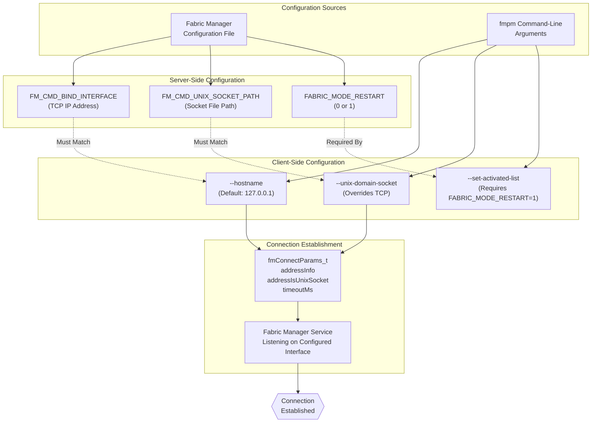

**Diagram: Configuration Flow and Matching Requirements**

Sources: [README.md:12-19](), [fmpm.cpp:414-438]()

---

## Fabric Manager Service Configuration

The Fabric Manager service is configured through its configuration file. The configuration parameters control which interfaces the service listens on and what operational modes are enabled.

### Configuration Parameters

| Parameter | Purpose | Valid Values | Default |
|-----------|---------|--------------|---------|
| `FM_CMD_BIND_INTERFACE` | TCP socket IP address binding | Valid IP address | Typically localhost |
| `FM_CMD_UNIX_SOCKET_PATH` | Unix domain socket file path | Valid filesystem path | Not set by default |
| `FABRIC_MODE_RESTART` | Enables resiliency mode for partition state persistence | `0` (disabled) or `1` (enabled) | `0` |

### TCP Socket Configuration

To enable TCP socket communication, configure the Fabric Manager with:

```
FM_CMD_BIND_INTERFACE=<IP address>
```

The IP address must be accessible to the `fmpm` client. For local-only access, use `127.0.0.1`. For remote access, use the server's network interface IP address.

**Example:**
```
FM_CMD_BIND_INTERFACE=10.0.0.5
```

This configuration allows remote `fmpm` clients to connect to the Fabric Manager service at IP address `10.0.0.5`.

Sources: [README.md:14](), [README.md:313]()

### Unix Domain Socket Configuration

To enable Unix domain socket communication, configure the Fabric Manager with:

```
FM_CMD_UNIX_SOCKET_PATH=<socket file path>
```

The path must be accessible to both the Fabric Manager service (for creation) and the `fmpm` client (for connection). Ensure proper filesystem permissions.

**Example:**
```
FM_CMD_UNIX_SOCKET_PATH=/var/run/nvidia-fabricmanager/fabricmanager.sock
```

Unix domain sockets provide lower latency and higher throughput for local communication compared to TCP sockets.

Sources: [README.md:18](), [README.md:316-317]()

### Resiliency Mode Configuration

To enable Fabric Manager Resiliency Mode, which allows partition state persistence across service restarts:

```
FABRIC_MODE_RESTART=1
```

This configuration is **required** to use the `--set-activated-list` command. When enabled, the Fabric Manager persists the activated partition list and automatically restores it after service restarts or failures.

Sources: [README.md:24](), [README.md:322]()

---

## fmpm Client Configuration

The `fmpm` client is configured entirely through command-line arguments. There is no configuration file for the client.

### Connection Options

| Option | Parameter | Purpose | Default Value |
|--------|-----------|---------|---------------|
| `--hostname` | IP address or hostname | Connect via TCP socket | `127.0.0.1` |
| `--unix-domain-socket` | File path | Connect via Unix domain socket | Not set |

### Default Connection Behavior

When no connection options are specified, `fmpm` defaults to connecting via TCP socket to localhost (`127.0.0.1`):

```bash
fmpm -l
# Equivalent to: fmpm -l --hostname 127.0.0.1
```

This default behavior is implemented in [fmpm.cpp:332-333]():

```cpp
/* Default to connect to localhost */
strncpy(mHostname, "127.0.0.1", sizeof(mHostname));
```

Sources: [README.md:12-13](), [fmpm.cpp:332-333]()

### TCP Socket Connection

To connect to a remote or specific Fabric Manager instance via TCP:

```bash
fmpm -l --hostname 10.0.0.5
```

The hostname can be an IP address or resolvable hostname. The client stores this value and uses it during connection establishment.

Command-line parsing for `--hostname` is implemented in [fmpm.cpp:379-387]():

```cpp
else if (std::string(argv[i]) == "--hostname") {
    if (i + 1 < argc) {
        std::string str = argv[i + 1];
        snprintf(mHostname, MAX_PATH_LEN, "%s", str.c_str());
        ++i;
    }
```

Sources: [README.md:12-15](), [fmpm.cpp:379-387]()

### Unix Domain Socket Connection

To connect via Unix domain socket:

```bash
fmpm -l --unix-domain-socket /var/run/nvidia-fabricmanager/fabricmanager.sock
```

**Important:** When `--unix-domain-socket` is specified, it takes **priority** over TCP socket configuration, even if `--hostname` is also provided.

Command-line parsing for `--unix-domain-socket` is implemented in [fmpm.cpp:388-396]():

```cpp
else if (std::string(argv[i]) == "--unix-domain-socket") {
    if (i + 1 < argc) {
        std::string str = argv[i + 1];
        snprintf(mUnixSockPath, MAX_PATH_LEN, "%s", str.c_str());
        ++i;
    }
```

Sources: [README.md:16-19](), [fmpm.cpp:388-396]()

---

## Connection Parameter Resolution

The `fmpm` client translates command-line arguments into the `fmConnectParams_t` structure used by the FM API. This resolution process determines whether TCP or Unix domain socket communication is used.

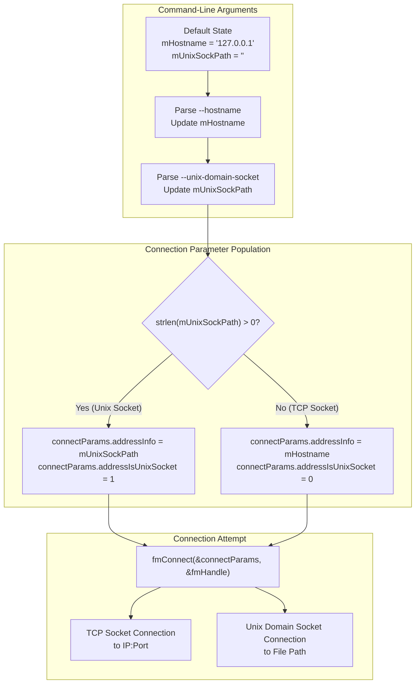

**Diagram: Connection Parameter Resolution Logic**

### Resolution Implementation

The resolution logic is implemented in [fmpm.cpp:414-438](). The key decision logic:

1. **Initialize `fmConnectParams_t`** [fmpm.cpp:414-416]():
```cpp
fmConnectParams_t connectParams;
connectParams.timeoutMs = 1000; // in milliseconds
connectParams.version = fmConnectParams_version;
```

2. **Check Unix socket path first** [fmpm.cpp:419-423]():
```cpp
if ( strnlen(mUnixSockPath, MAX_PATH_LEN) > 0 )
{
    snprintf(connectParams.addressInfo, MAX_PATH_LEN, "%s", mUnixSockPath);
    connectParams.addressIsUnixSocket = 1;
}
```

3. **Fall back to TCP hostname** [fmpm.cpp:424-428]():
```cpp
if ( strnlen(mHostname, MAX_PATH_LEN) > 0 )
{
    snprintf(connectParams.addressInfo, MAX_PATH_LEN, "%s", mHostname);
    connectParams.addressIsUnixSocket = 0;
}
```

### Connection Structure Members

The `fmConnectParams_t` structure contains:

| Member | Type | Purpose |
|--------|------|---------|
| `version` | Version identifier | API version compatibility |
| `addressInfo` | Character array | IP address or socket file path |
| `addressIsUnixSocket` | Integer flag | `0` = TCP socket, `1` = Unix socket |
| `timeoutMs` | Integer | Connection timeout in milliseconds (default: 1000) |

Sources: [fmpm.cpp:414-438]()

---

## Configuration Matching Requirements

**Critical:** The client and server configurations must match exactly for successful connection. There is no automatic discovery, negotiation, or fallback mechanism.

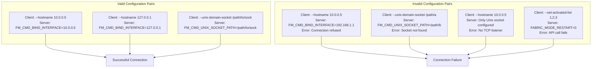

**Diagram: Configuration Matching Examples**

### Common Misconfiguration Scenarios

| Misconfiguration | Symptom | Resolution |
|------------------|---------|------------|
| Client connects to wrong IP | "Failed to connect to Fabric Manager instance" | Verify `FM_CMD_BIND_INTERFACE` matches `--hostname` |
| Unix socket path mismatch | Connection timeout or "socket not found" | Verify paths match exactly, check filesystem permissions |
| Client uses TCP, server only has Unix socket | Connection refused | Configure server TCP binding or use `--unix-domain-socket` on client |
| Using `--set-activated-list` without resiliency mode | API call returns error | Enable `FABRIC_MODE_RESTART=1` in Fabric Manager configuration |
| Firewall blocking TCP connection | Connection timeout | Configure firewall rules to allow traffic on Fabric Manager port |

Sources: [README.md:12-27](), [fmpm.cpp:434-438]()

---

## Connection Timeout Configuration

The connection timeout is hardcoded in the client at 1000 milliseconds (1 second). This timeout applies to both TCP and Unix domain socket connections.

From [fmpm.cpp:415]():
```cpp
connectParams.timeoutMs = 1000; // in milliseconds
```

If the Fabric Manager service does not respond within this timeout:
- The `fmConnect()` call fails
- The client outputs: "Failed to connect to Fabric Manager instance."
- The client exits with the error return code

**Note:** There is no command-line option to override the timeout value. Modifications require recompiling the client.

Sources: [fmpm.cpp:415](), [fmpm.cpp:434-437]()

---

## Configuration Verification

### Verify TCP Socket Configuration

1. **Check Fabric Manager configuration file** for `FM_CMD_BIND_INTERFACE`
2. **Test connectivity** from client machine:
   ```bash
   telnet <IP_ADDRESS> <FABRIC_MANAGER_PORT>
   ```
3. **Attempt connection** with `fmpm`:
   ```bash
   fmpm -l --hostname <IP_ADDRESS>
   ```

### Verify Unix Domain Socket Configuration

1. **Check Fabric Manager configuration file** for `FM_CMD_UNIX_SOCKET_PATH`
2. **Verify socket file exists**:
   ```bash
   ls -l /var/run/nvidia-fabricmanager/fabricmanager.sock
   ```
3. **Check permissions** (must be readable/writable by client process user)
4. **Attempt connection** with `fmpm`:
   ```bash
   fmpm -l --unix-domain-socket /var/run/nvidia-fabricmanager/fabricmanager.sock
   ```

### Verify Resiliency Mode Configuration

1. **Check Fabric Manager configuration file** for `FABRIC_MODE_RESTART=1`
2. **Restart Fabric Manager service** to apply configuration
3. **Test with `fmpm`**:
   ```bash
   fmpm --set-activated-list 1,2,3 --hostname <IP_ADDRESS>
   ```

If resiliency mode is not enabled, the `fmSetActivatedFabricPartitions()` API call will fail and the client will output an error.

Sources: [README.md:22-27](), [fmpm.cpp:449-451]()

---

## Configuration File Locations

The Fabric Manager service configuration file location depends on the installation method and operating system. Common locations include:

- `/etc/nvidia/fabricmanager.cfg`
- `/usr/share/nvidia/nvswitch/fabricmanager.cfg`

Refer to the [Fabric Manager User Guide](https://docs.nvidia.com/datacenter/tesla/fabric-manager-user-guide) for platform-specific configuration file locations.

**Note:** The `fmpm` client does not use a configuration file. All configuration is performed via command-line arguments.

Sources: [README.md:14-19]()

---

# Page: User Guide

# User Guide

<details>
<summary>Relevant source files</summary>

The following files were used as context for generating this wiki page:

- [README.md](README.md)
- [fmpm.cpp](fmpm.cpp)

</details>


This document provides comprehensive guidance for using the `fmpm` command-line utility to manage GPU partitions in NVIDIA Fabric Manager deployments. It covers all available commands, connection options, output formats, and common operational workflows.

**Scope**: This guide focuses on the practical usage of the `fmpm` binary and its command-line interface. For installation and build instructions, see [Getting Started](#2). For detailed technical architecture and API internals, see [Technical Reference](#4). For license terms and usage restrictions, see [License and Legal](#5).

---

## Overview

The `fmpm` (Fabric Manager Partition Manager) utility is a command-line client that communicates with the NVIDIA Fabric Manager service to manage GPU partitions in shared NVSwitch environments. All operations are executed via the Fabric Manager API and results are returned as formatted JSON to stdout.

**Key Capabilities**:
- Query partition state and configuration
- Activate and deactivate individual partitions
- Bulk partition management for resiliency scenarios
- Diagnose NVLink hardware failures
- Identify unsupported partition configurations

Sources: [README.md:1-39](), [fmpm.cpp:1-465]()

---

## Command Execution Model

The following diagram illustrates the execution flow from command-line invocation to JSON output:

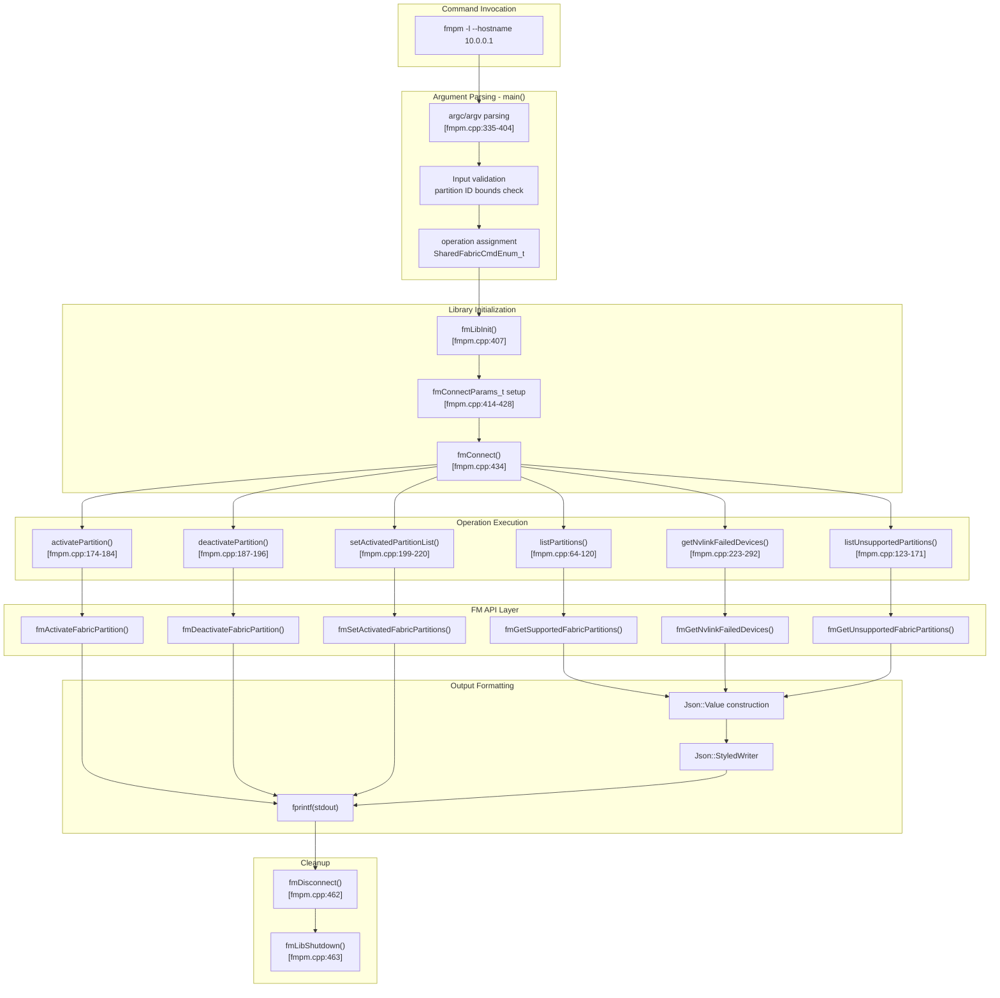

**Execution Pattern**:
1. **Argument Parsing**: The `main()` function at [fmpm.cpp:294]() processes all command-line arguments and determines the operation to execute via the `SharedFabricCmdEnum_t` enumeration [fmpm.cpp:12-29]()
2. **Library Initialization**: `fmLibInit()` prepares the Fabric Manager API client library [fmpm.cpp:407]()
3. **Connection Establishment**: `fmConnect()` establishes TCP or Unix socket connection to Fabric Manager [fmpm.cpp:434]()
4. **Operation Dispatch**: Based on the `operation` variable, the appropriate handler function is called [fmpm.cpp:440-458]()
5. **JSON Formatting**: Query operations format responses using `libjsoncpp`, while state operations output simple status
6. **Cleanup**: Connection and library resources are released [fmpm.cpp:462-463]()

Sources: [fmpm.cpp:294-465](), [README.md:8-29]()

---

## Connection Configuration

The `fmpm` client supports two connection mechanisms for communicating with the Fabric Manager service. The connection method must match the Fabric Manager's configured interface.

### Connection Options

| Option | Description | Default | Server Configuration Required |
|--------|-------------|---------|-------------------------------|
| `--hostname <IP>` | TCP socket connection to specified IP address or hostname | `127.0.0.1` | `FM_CMD_BIND_INTERFACE=<IP>` in Fabric Manager config |
| `--unix-domain-socket <path>` | Unix domain socket connection using filesystem path | None | `FM_CMD_UNIX_SOCKET_PATH=<path>` in Fabric Manager config |

**Priority**: If `--unix-domain-socket` is specified, it overrides any `--hostname` setting [fmpm.cpp:419-428]().

**Timeout**: All connections have a 1000ms timeout configured via `fmConnectParams_t.timeoutMs` [fmpm.cpp:415]().

Sources: [fmpm.cpp:414-434](), [README.md:12-19]()

### Connection Configuration Flow

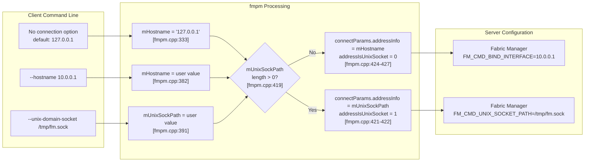

**Configuration Matching**: The client's connection method must align with the server's configured interface. Mismatches result in connection failures with no automatic fallback.

Sources: [fmpm.cpp:414-438](), [README.md:12-19]()

### Connection Examples

**Local TCP Connection (Default)**:
```bash
$ fmpm -l
# Connects to 127.0.0.1 via TCP
# Server requires: FM_CMD_BIND_INTERFACE=127.0.0.1
```

**Remote TCP Connection**:
```bash
$ fmpm -l --hostname 192.168.1.100
# Connects to 192.168.1.100 via TCP
# Server requires: FM_CMD_BIND_INTERFACE=192.168.1.100
```

**Unix Domain Socket Connection**:
```bash
$ fmpm -l --unix-domain-socket /var/run/nvidia-fabricmanager/fmapi.sock
# Connects via Unix socket at specified path
# Server requires: FM_CMD_UNIX_SOCKET_PATH=/var/run/nvidia-fabricmanager/fmapi.sock
```

Sources: [README.md:8-19](), [fmpm.cpp:330-438]()

---

## Output Format

All `fmpm` operations return structured JSON output to stdout. This enables both human readability and programmatic parsing by automation scripts.

### JSON Formatting Implementation

The client uses the `Json::StyledWriter` class from `libjsoncpp` to produce formatted output [fmpm.cpp:115-117](), [fmpm.cpp:166-168](), [fmpm.cpp:287-289](). The JSON structure varies by operation but always includes a `version` field for compatibility tracking.

### Output Structure by Operation

| Operation | Root Object | Key Fields | Example Usage |
|-----------|-------------|------------|---------------|
| List Partitions (`-l`) | `fmFabricPartitionList_t` | `numPartitions`, `partitionInfo[]` | Query all available partitions with GPU details |
| Get Failed Devices | `fmNvlinkFailedDevices_t` | `numGpus`, `numSwitches`, `gpuInfo[]`, `switchInfo[]` | Diagnose NVLink hardware failures |
| List Unsupported | `fmUnsupportedFabricPartitionList_t` | `numPartitions`, `partitionInfo[]` | Identify incompatible configurations |
| Activate/Deactivate | Text output | Success/error message | Confirm state change operations |
| Set Activated List | Text output | Success/error message | Confirm resiliency configuration |
| Version (`-v`) | Plain text | Version string | Display `fmpm` version (currently `1.0.1`) |

Sources: [fmpm.cpp:64-292](), [fmpm.cpp:6]()

### List Partitions Output Schema

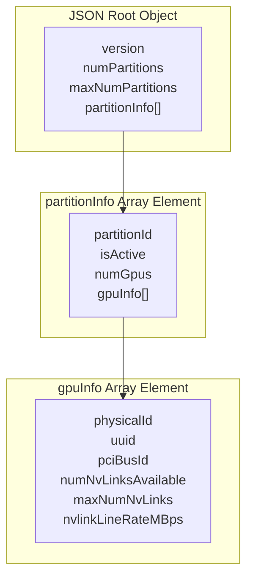

**Data Source**: Constructed from `fmFabricPartitionList_t` structure at [fmpm.cpp:77-118]().

**Example Output**:
```json
{
   "version" : 65536,
   "numPartitions" : 2,
   "maxNumPartitions" : 8,
   "partitionInfo" : [
      {
         "partitionId" : 0,
         "isActive" : true,
         "numGpus" : 4,
         "gpuInfo" : [
            {
               "physicalId" : 0,
               "uuid" : "GPU-abcd1234...",
               "pciBusId" : "00000000:17:00.0",
               "numNvLinksAvailable" : 18,
               "maxNumNvLinks" : 18,
               "nvlinkLineRateMBps" : 25000
            }
         ]
      }
   ]
}
```

Sources: [fmpm.cpp:64-120]()

### NVLink Failed Devices Output Schema

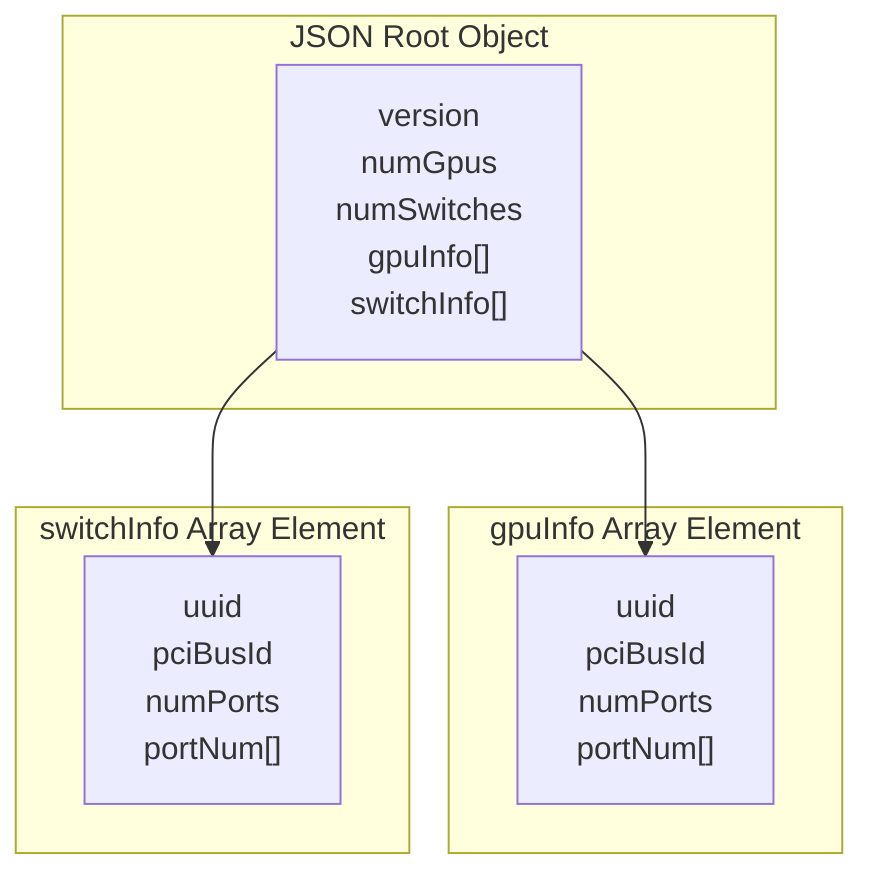

**Data Source**: Constructed from `fmNvlinkFailedDevices_t` structure at [fmpm.cpp:238-289]().

**Port Numbers**: The `portNum[]` arrays contain the specific NVLink port indices that have failed, enabling targeted hardware diagnosis [fmpm.cpp:259-264](), [fmpm.cpp:277-283]().

Sources: [fmpm.cpp:223-292]()

---

## Command-Line Operations

The following table maps command-line flags to their corresponding implementation functions and API calls:

| Command Flag | Argument | Operation Enum | Handler Function | FM API Call | Lines |
|--------------|----------|----------------|------------------|-------------|-------|
| `-h` | None | `SHARED_FABRIC_CMD_HELP` | Inline help text | None | [fmpm.cpp:306-328]() |
| `-l` | None | `SHARED_FABRIC_CMD_LIST_PARTITION` | `listPartitions()` | `fmGetSupportedFabricPartitions()` | [fmpm.cpp:64-120]() |
| `-a <ID>` | Partition ID | `SHARED_FABRIC_CMD_ACTIVATE_PARTITION` | `activatePartition()` | `fmActivateFabricPartition()` | [fmpm.cpp:174-184]() |
| `-d <ID>` | Partition ID | `SHARED_FABRIC_CMD_DEACTIVATE_PARTITION` | `deactivatePartition()` | `fmDeactivateFabricPartition()` | [fmpm.cpp:187-196]() |
| `--set-activated-list <IDs>` | Comma-separated IDs | `SHARED_FABRIC_CMD_SET_ACTIVATED_PARTITION_LIST` | `setActivatedPartitionList()` | `fmSetActivatedFabricPartitions()` | [fmpm.cpp:199-220]() |
| `--get-nvlink-failed-devices` | None | `SHARED_FABRIC_CMD_GET_NVLINK_FAILED_DEVICES` | `getNvlinkFailedDevices()` | `fmGetNvlinkFailedDevices()` | [fmpm.cpp:223-292]() |
| `--list-unsupported-partitions` | None | `SHARED_FABRIC_CMD_LIST_UNSUPPORTED_PARTITION` | `listUnsupportedPartitions()` | `fmGetUnsupportedFabricPartitions()` | [fmpm.cpp:123-171]() |
| `-v` | None | N/A | Version output | None | [fmpm.cpp:397-400]() |

Sources: [fmpm.cpp:12-29](), [fmpm.cpp:335-404](), [fmpm.cpp:440-458]()

### Input Validation

The client performs input validation before making API calls:

**Partition ID Bounds**: Partition IDs must be less than `FM_MAX_FABRIC_PARTITIONS` [fmpm.cpp:348-351](). Invalid IDs return `FM_ST_BADPARAM` error code.

**Partition List Parsing**: The `parsePartitionIdlistString()` function at [fmpm.cpp:33-61]() validates comma-separated partition lists:
- Rejects IDs outside valid range [fmpm.cpp:44-48]()
- Deduplicates repeated IDs [fmpm.cpp:50-52]()
- Returns array of unique partition IDs

**Argument Requirements**: Commands requiring arguments (`-a`, `-d`, `--set-activated-list`, `--hostname`, `--unix-domain-socket`) validate argument presence [fmpm.cpp:341-396]().

Sources: [fmpm.cpp:33-61](), [fmpm.cpp:335-404]()

---

## Basic Workflows

### Workflow 1: Query Available Partitions

```mermaid
sequenceDiagram
    participant User
    participant fmpm
    participant FM as "Fabric Manager"
    participant HW as "Hardware"
    
    User->>fmpm: "fmpm -l"
    activate fmpm
    fmpm->>fmpm: "fmLibInit()<br/>[fmpm.cpp:407]"
    fmpm->>FM: "fmConnect()<br/>[fmpm.cpp:434]"
    activate FM
    FM-->>fmpm: "fmHandle"
    
    fmpm->>FM: "fmGetSupportedFabricPartitions()<br/>[fmpm.cpp:72]"
    FM->>HW: "Query partition configurations"
    activate HW
    HW-->>FM: "Partition + GPU + NVLink data"
    deactivate HW
    FM-->>fmpm: "fmFabricPartitionList_t"
    
    fmpm->>fmpm: "Format to JSON<br/>[fmpm.cpp:77-117]"
    fmpm->>User: "JSON output to stdout"
    
    fmpm->>FM: "fmDisconnect()<br/>[fmpm.cpp:462]"
    deactivate FM
    fmpm->>fmpm: "fmLibShutdown()<br/>[fmpm.cpp:463]"
    deactivate fmpm
```

**Command**:
```bash
$ fmpm -l --hostname 10.0.0.1
```

**Use Case**: Discover all available partitions in the system, including their active/inactive state, GPU membership, and NVLink availability. This is typically the first command run in any management session.

Sources: [fmpm.cpp:64-120](), [fmpm.cpp:440-442]()

### Workflow 2: Activate a Partition

```mermaid
sequenceDiagram
    participant User
    participant fmpm
    participant FM as "Fabric Manager"
    participant HW as "Hardware"
    
    User->>fmpm: "fmpm -a 3"
    activate fmpm
    fmpm->>fmpm: "Validate partitionId < FM_MAX_FABRIC_PARTITIONS<br/>[fmpm.cpp:348-351]"
    fmpm->>fmpm: "fmLibInit() + fmConnect()"
    
    fmpm->>FM: "fmActivateFabricPartition(handle, 3)<br/>[fmpm.cpp:178]"
    activate FM
    FM->>HW: "Configure partition 3"
    activate HW
    HW-->>FM: "Partition activated"
    deactivate HW
    FM-->>fmpm: "FM_ST_SUCCESS"
    deactivate FM
    
    fmpm->>User: "Success status"
    
    fmpm->>fmpm: "fmDisconnect() + fmLibShutdown()"
    deactivate fmpm
```

**Command**:
```bash
$ fmpm -a 3 --hostname 10.0.0.1
```

**Use Case**: Enable a specific partition for GPU workload execution. Activating a partition makes its GPUs available for compute tasks. Only supported partition configurations can be activated (check `--list-unsupported-partitions` for restrictions).

**Return Codes**: Success returns `FM_ST_SUCCESS` (0). Failures return error codes such as `FM_ST_BADPARAM` or `FM_ST_ERROR` [fmpm.cpp:179-183]().

Sources: [fmpm.cpp:174-184](), [fmpm.cpp:443-445]()

### Workflow 3: Deactivate a Partition

```bash
$ fmpm -d 3 --hostname 10.0.0.1
```

**Use Case**: Disable a partition to release its GPU resources or prepare for reconfiguration. The implementation mirrors activation but calls `fmDeactivateFabricPartition()` [fmpm.cpp:191]().

Sources: [fmpm.cpp:187-196](), [fmpm.cpp:446-448]()

### Workflow 4: Diagnose NVLink Failures

```mermaid
sequenceDiagram
    participant User
    participant fmpm
    participant FM as "Fabric Manager"
    
    User->>fmpm: "fmpm --get-nvlink-failed-devices"
    activate fmpm
    fmpm->>FM: "fmGetNvlinkFailedDevices()<br/>[fmpm.cpp:231]"
    activate FM
    FM-->>fmpm: "fmNvlinkFailedDevices_t<br/>numGpus, numSwitches<br/>per-port failure details"
    deactivate FM
    
    fmpm->>fmpm: "Format to JSON<br/>Separate GPU and Switch info<br/>[fmpm.cpp:238-289]"
    fmpm->>User: "JSON with failed device details<br/>uuid, pciBusId, portNum[]"
    deactivate fmpm
```

**Command**:
```bash
$ fmpm --get-nvlink-failed-devices --hostname 10.0.0.1
```

**Use Case**: Identify GPUs and NVSwitches with failed NVLink ports. The output includes:
- **GPUs**: UUID, PCI Bus ID, failed port numbers [fmpm.cpp:252-266]()
- **Switches**: UUID, PCI Bus ID, failed port numbers [fmpm.cpp:270-284]()

This diagnostic information is critical for hardware maintenance and understanding why certain partitions may be unsupported.

Sources: [fmpm.cpp:223-292](), [fmpm.cpp:452-454]()

### Workflow 5: Check Unsupported Partitions

```bash
$ fmpm --list-unsupported-partitions --hostname 10.0.0.1
```

**Use Case**: Identify partition configurations that cannot be activated due to hardware limitations, incompatible GPU combinations, or NVLink topology issues. The output lists partition IDs with their GPU physical IDs [fmpm.cpp:147-162]().

**Why Partitions are Unsupported**: Common reasons include:
- Insufficient NVLink connections between GPUs
- Incompatible GPU models in the same partition
- Failed NVLink ports (cross-reference with `--get-nvlink-failed-devices`)
- Hardware topology constraints

Sources: [fmpm.cpp:123-171](), [fmpm.cpp:455-457]()

### Workflow 6: Resiliency Mode - Set Activated List

```mermaid
sequenceDiagram
    participant User
    participant fmpm
    participant FM as "Fabric Manager"
    participant Storage as "Persistent Storage"
    
    User->>fmpm: "fmpm --set-activated-list 1,2,3"
    activate fmpm
    fmpm->>fmpm: "parsePartitionIdlistString()<br/>Validate and deduplicate IDs<br/>[fmpm.cpp:33-61]"
    
    fmpm->>FM: "fmSetActivatedFabricPartitions()<br/>partitionIds: [1,2,3]<br/>[fmpm.cpp:213]"
    activate FM
    FM->>Storage: "Persist activated partition list<br/>(Requires FABRIC_MODE_RESTART=1)"
    activate Storage
    Storage-->>FM: "State persisted"
    deactivate Storage
    FM-->>fmpm: "FM_ST_SUCCESS"
    deactivate FM
    
    fmpm->>User: "Success status"
    deactivate fmpm
    
    Note over FM,Storage: "On Fabric Manager restart..."
    FM->>Storage: "Read persisted state"
    activate Storage
    Storage-->>FM: "Activated list: [1,2,3]"
    deactivate Storage
    FM->>FM: "Automatically restore partitions 1,2,3"
```

**Command**:
```bash
$ fmpm --set-activated-list 1,2,3 --hostname 10.0.0.1
```

**Critical Requirement**: This command requires `FABRIC_MODE_RESTART=1` in the Fabric Manager configuration. Without this setting, the command may fail or the persistent state will not be restored after restart [README.md:24]().

**Use Case**: Configure Fabric Manager's Resiliency Mode to automatically restore a specific set of partitions after service restarts or crashes. This enables stateful operation where partition configurations survive Fabric Manager failures.

**Partition List Format**: Comma-separated partition IDs with no spaces [README.md:23](). The `parsePartitionIdlistString()` function handles parsing and validation [fmpm.cpp:33-61]().

**Difference from Individual Activate**: Unlike `-a` which performs immediate activation, `--set-activated-list` sets the persistent configuration that survives restarts. It is designed for production resilience, not ad-hoc testing.

Sources: [fmpm.cpp:199-220](), [fmpm.cpp:449-451](), [README.md:22-27]()

---

## Common Usage Patterns

### Pattern 1: Initial System Discovery

```bash
# Step 1: List all available partitions
$ fmpm -l

# Step 2: Check for unsupported configurations
$ fmpm --list-unsupported-partitions

# Step 3: Check for hardware failures
$ fmpm --get-nvlink-failed-devices
```

This three-step sequence provides complete system visibility before making any configuration changes.

### Pattern 2: Partition State Management

```bash
# Activate partitions for workload execution
$ fmpm -a 0
$ fmpm -a 1
$ fmpm -a 2

# Verify activation
$ fmpm -l | grep '"isActive" : true'

# Later, release resources
$ fmpm -d 0
$ fmpm -d 1
$ fmpm -d 2
```

### Pattern 3: Resiliency Configuration

```bash
# Step 1: Identify desired partitions via listing
$ fmpm -l

# Step 2: Configure persistent activated list
# (Requires FABRIC_MODE_RESTART=1 in FM config)
$ fmpm --set-activated-list 0,1,2,3

# Step 3: Verify configuration survives FM restart
# Restart Fabric Manager service, then:
$ fmpm -l
# Partitions 0,1,2,3 should show isActive: true
```

### Pattern 4: Scripted Automation

```bash
#!/bin/bash
# Example: Activate all supported partitions

# Get partition list as JSON
PARTITIONS=$(fmpm -l --hostname 10.0.0.1)

# Parse and activate each partition (pseudo-code concept)
# In practice, use jq or python to parse JSON
# Example with jq:
# echo "$PARTITIONS" | jq -r '.partitionInfo[].partitionId' | \
#   while read pid; do fmpm -a "$pid" --hostname 10.0.0.1; done
```

The JSON output format is specifically designed to enable scripted automation [fmpm.cpp:115]().

Sources: [fmpm.cpp:64-465](), [README.md:8-29]()

---

## Error Handling

### Error Codes and Return Values

The `fmpm` utility returns integer exit codes that align with `fmReturn_t` enumeration values from the Fabric Manager API:

| Exit Code | Constant | Meaning | Common Causes |
|-----------|----------|---------|---------------|
| `0` | `FM_ST_SUCCESS` | Operation completed successfully | N/A |
| `1` | General error | Command-line parsing failure or connection error | Invalid arguments, missing hostname |
| Non-zero | `FM_ST_ERROR`, `FM_ST_BADPARAM`, etc. | API-level error | Invalid partition ID, FM configuration mismatch, hardware error |

**Error Output**: Error messages are written to stderr or stdout depending on the error type [fmpm.cpp:74](), [fmpm.cpp:134](), [fmpm.cpp:180](), [fmpm.cpp:193](), [fmpm.cpp:216](), [fmpm.cpp:234]().

Sources: [fmpm.cpp:73-75](), [fmpm.cpp:179-183](), [fmpm.cpp:409-411](), [fmpm.cpp:435-438]()

### Common Error Scenarios

**Connection Failures**:
```bash
$ fmpm -l --hostname 10.0.0.99
Failed to connect to Fabric Manager instance.
# Exit code: non-zero fmReturn value
```

**Causes**: 
- Incorrect hostname/IP
- Fabric Manager not running
- Firewall blocking connection
- Configuration mismatch (client uses TCP, server uses Unix socket)

**Invalid Partition ID**:
```bash
$ fmpm -a 999
Invalid Partition ID.
# Exit code: FM_ST_BADPARAM
```

**Validation**: Occurs at [fmpm.cpp:348-351]() before API call.

**Library Initialization Failure**:
```bash
$ fmpm -l
Failed to initialize Fabric Manager API interface library.
# Exit code: non-zero fmReturn value
```

**Causes**: Missing or incompatible `libnvfm` library installation [fmpm.cpp:407-411]().

Sources: [fmpm.cpp:348-351](), [fmpm.cpp:407-411](), [fmpm.cpp:434-438]()

---

## Version Information

**Current Version**: `1.0.1` [fmpm.cpp:6]()

Display version:
```bash
$ fmpm -v
1.0.1
```

Version output is provided as plain text for simple version checks in scripts [fmpm.cpp:397-400]().

Sources: [fmpm.cpp:6](), [fmpm.cpp:397-400]()

---

## Additional Resources

- **Fabric Manager User Guide**: Referenced throughout the code for detailed information on GPU partitions, API interface, Unix domain sockets, and resiliency mode [fmpm.cpp:313](), [fmpm.cpp:317](), [fmpm.cpp:324-325]()
- **Configuration Documentation**: See [Configuration](#2.3) for details on matching client and server settings
- **Build Instructions**: See [Building from Source](#2.2) for compilation requirements
- **License Terms**: See [License and Legal](#5) for usage restrictions and legal obligations

Sources: [README.md:1-39](), [fmpm.cpp:310-326]()

---

# Page: Command-Line Reference

# Command-Line Reference

<details>
<summary>Relevant source files</summary>

The following files were used as context for generating this wiki page:

- [README.md](README.md)
- [fmpm.cpp](fmpm.cpp)

</details>


This page provides a complete reference of all command-line options, arguments, and flags available in the `fmpm` utility. The `fmpm` (Fabric Manager Partition Manager) command-line tool enables administrators and automation scripts to manage GPU partitions in NVIDIA Fabric Manager's Shared NVSwitch feature.

For information about the underlying architecture and communication mechanisms, see [Architecture Overview](#4.1). For practical usage workflows and examples, see [Managing GPU Partitions](#3.2). For configuration of the Fabric Manager service that `fmpm` connects to, see [Configuration](#2.3).

## Command Syntax Overview

The general syntax for `fmpm` commands follows this pattern:

```
fmpm [OPERATION] [ARGUMENTS] [CONNECTION_OPTIONS]
```

Where:
- **OPERATION**: A single operation flag that specifies the action to perform
- **ARGUMENTS**: Operation-specific arguments (e.g., partition IDs)
- **CONNECTION_OPTIONS**: Optional flags to specify how to connect to Fabric Manager

All output from `fmpm` is formatted as JSON and written to stdout, making it suitable for both interactive use and programmatic parsing.

**Sources:** [README.md:8-29](), [fmpm.cpp:294-404]()

---

## Command Categories

```mermaid
graph TD
    fmpm["fmpm executable"]
    
    subgraph Query["Query Operations (Read-Only)"]
        list["-l<br/>List Partitions"]
        failed["--get-nvlink-failed-devices<br/>Query Failed Devices"]
        unsup["--list-unsupported-partitions<br/>Query Unsupported Partitions"]
        version["-v<br/>Show Version"]
        help["-h<br/>Show Help"]
    end
    
    subgraph State["State Management Operations"]
        activate["-a &lt;ID&gt;<br/>Activate Partition"]
        deactivate["-d &lt;ID&gt;<br/>Deactivate Partition"]
        setlist["--set-activated-list &lt;IDs&gt;<br/>Set Activated List"]
    end
    
    subgraph Connection["Connection Configuration"]
        hostname["--hostname &lt;address&gt;<br/>TCP Socket"]
        unix["--unix-domain-socket &lt;path&gt;<br/>Unix Domain Socket"]
    end
    
    fmpm --> Query
    fmpm --> State
    fmpm --> Connection
```

**Diagram: Command Category Organization**

**Sources:** [fmpm.cpp:12-29](), [README.md:8-29]()

---

## Query Operations

Query operations retrieve information from the Fabric Manager without modifying system state. All query operations return structured JSON output to stdout.

### `-l` : List Partitions

Lists all available GPU partitions with their current state and configuration.

| Property | Value |
|----------|-------|
| **Command** | `-l` |
| **Arguments** | None |
| **Output** | JSON object with partition list |
| **API Function** | `fmGetSupportedFabricPartitions()` |
| **Implementation** | `listPartitions()` |

**Output Structure:**
```json
{
  "version": <integer>,
  "numPartitions": <integer>,
  "maxNumPartitions": <integer>,
  "partitionInfo": [
    {
      "partitionId": <integer>,
      "isActive": <boolean>,
      "numGpus": <integer>,
      "gpuInfo": [
        {
          "physicalId": <integer>,
          "uuid": "<string>",
          "pciBusId": "<string>",
          "numNvLinksAvailable": <integer>,
          "maxNumNvLinks": <integer>,
          "nvlinkLineRateMBps": <integer>
        }
      ]
    }
  ]
}
```

**Sources:** [fmpm.cpp:63-120](), [fmpm.cpp:337-338](), [fmpm.cpp:440-442](), [README.md:9]()

### `--get-nvlink-failed-devices` : Query Failed Devices

Retrieves all GPUs and NVSwitches that have NVLink port failures. This diagnostic command helps identify hardware issues affecting partition availability.

| Property | Value |
|----------|-------|
| **Command** | `--get-nvlink-failed-devices` |
| **Arguments** | None |
| **Output** | JSON object with failed device details |
| **API Function** | `fmGetNvlinkFailedDevices()` |
| **Implementation** | `getNvlinkFailedDevices()` |

**Output Structure:**
```json
{
  "version": <integer>,
  "numGpus": <integer>,
  "numSwitches": <integer>,
  "gpuInfo": [
    {
      "uuid": "<string>",
      "pciBusId": "<string>",
      "numPorts": <integer>,
      "portNum": [<array of failed port numbers>]
    }
  ],
  "switchInfo": [
    {
      "uuid": "<string>",
      "pciBusId": "<string>",
      "numPorts": <integer>,
      "portNum": [<array of failed port numbers>]
    }
  ]
}
```

**Sources:** [fmpm.cpp:222-292](), [fmpm.cpp:375-376](), [fmpm.cpp:452-454](), [README.md:20]()

### `--list-unsupported-partitions` : Query Unsupported Partitions

Lists partition configurations that exist in hardware but cannot be managed due to incompatibility or hardware limitations.

| Property | Value |
|----------|-------|
| **Command** | `--list-unsupported-partitions` |
| **Arguments** | None |
| **Output** | JSON object with unsupported partition details |
| **API Function** | `fmGetUnsupportedFabricPartitions()` |
| **Implementation** | `listUnsupportedPartitions()` |

**Output Structure:**
```json
{
  "version": <integer>,
  "numPartitions": <integer>,
  "partitionInfo": [
    {
      "partitionId": <integer>,
      "numGpus": <integer>,
      "gpuPhysicalIds": [<array of GPU physical IDs>]
    }
  ]
}
```

**Sources:** [fmpm.cpp:122-171](), [fmpm.cpp:377-378](), [fmpm.cpp:455-457](), [README.md:21]()

### `-v` : Show Version

Displays the version number of the `fmpm` utility.

| Property | Value |
|----------|-------|
| **Command** | `-v` |
| **Arguments** | None |
| **Output** | Version string (plain text) |
| **Current Version** | "1.0.1" |

**Sources:** [fmpm.cpp:6](), [fmpm.cpp:397-400](), [README.md:28]()

### `-h` : Show Help

Displays usage information and a list of all available commands.

| Property | Value |
|----------|-------|
| **Command** | `-h` (or running `fmpm` with no arguments) |
| **Arguments** | None |
| **Output** | Help text (plain text) |

**Sources:** [fmpm.cpp:306-328](), [README.md:8]()

---

## State Management Operations

State management operations modify the runtime configuration of GPU partitions. These operations require that the Fabric Manager service is properly configured and accessible.

### `-a <Partition ID>` : Activate Partition

Activates a single GPU partition, making it available for compute workloads.

| Property | Value |
|----------|-------|
| **Command** | `-a <Partition ID>` |
| **Arguments** | Partition ID (unsigned integer, 0 to `FM_MAX_FABRIC_PARTITIONS`) |
| **Output** | Success or error message |
| **API Function** | `fmActivateFabricPartition()` |
| **Implementation** | `activatePartition()` |

**Validation:**
- Partition ID must be less than `FM_MAX_FABRIC_PARTITIONS`
- Partition must exist and be supported
- Partition must not already be active

**Example:**
```bash
fmpm -a 3
```

**Sources:** [fmpm.cpp:173-184](), [fmpm.cpp:339-352](), [fmpm.cpp:443-445](), [README.md:10]()

### `-d <Partition ID>` : Deactivate Partition

Deactivates a single GPU partition, removing it from the pool of available compute resources.

| Property | Value |
|----------|-------|
| **Command** | `-d <Partition ID>` |
| **Arguments** | Partition ID (unsigned integer) |
| **Output** | Success or error message |
| **API Function** | `fmDeactivateFabricPartition()` |
| **Implementation** | `deactivatePartition()` |

**Validation:**
- Partition ID must be valid
- Partition must be currently active

**Example:**
```bash
fmpm -d 3
```

**Sources:** [fmpm.cpp:186-196](), [fmpm.cpp:352-360](), [fmpm.cpp:446-448](), [README.md:11]()

### `--set-activated-list <Partition IDs>` : Set Activated Partition List

Sets a list of partition IDs that should remain activated. This command is designed for use with Fabric Manager Resiliency Mode and enables automatic restoration of partitions after service restarts.

| Property | Value |
|----------|-------|
| **Command** | `--set-activated-list <Partition IDs>` |
| **Arguments** | Comma-separated partition IDs (no spaces) |
| **Output** | Success or error message |
| **API Function** | `fmSetActivatedFabricPartitions()` |
| **Implementation** | `setActivatedPartitionList()` |
| **Requires** | `FABRIC_MODE_RESTART=1` in Fabric Manager config |

**Format:**
- Comma-separated list with no spaces
- Example: `1,2,3` or `0,5,7,9`
- Duplicate IDs are silently ignored
- Invalid IDs (< 0 or >= `FM_MAX_FABRIC_PARTITIONS`) cause error

**Behavior:**
- Fabric Manager persists this list to storage
- On restart, Fabric Manager automatically activates these partitions
- This command replaces the entire list (not additive)

**Example:**
```bash
fmpm --set-activated-list 1,2,3
```

For details on Resiliency Mode, see [Resiliency Mode](#3.4).

**Sources:** [fmpm.cpp:198-220](), [fmpm.cpp:32-61](), [fmpm.cpp:361-374](), [fmpm.cpp:449-451](), [README.md:22-27]()

---

## Connection Configuration Options

Connection options specify how the `fmpm` client communicates with the Fabric Manager service. These options can be used with any operation.

### `--hostname <address>` : TCP Socket Connection

Specifies the hostname or IP address of the Fabric Manager service when using TCP socket communication.

| Property | Value |
|----------|-------|
| **Command** | `--hostname <address>` |
| **Arguments** | Hostname or IP address (string) |
| **Default** | `127.0.0.1` (localhost) |
| **Protocol** | TCP socket |
| **Requires** | `FM_CMD_BIND_INTERFACE=<IP>` in Fabric Manager config |

**Usage:**
```bash
fmpm -l --hostname 10.0.0.5
fmpm -a 2 --hostname myserver.example.com
```

**Configuration Requirement:**
The Fabric Manager service must be configured to listen on the specified interface. Set `FM_CMD_BIND_INTERFACE` in the Fabric Manager configuration file to match the IP address. For details, see [Configuration](#2.3).

**Sources:** [fmpm.cpp:301](), [fmpm.cpp:379-387](), [fmpm.cpp:414-432](), [README.md:12-15]()

### `--unix-domain-socket <path>` : Unix Domain Socket Connection

Specifies the path to a Unix domain socket for local communication with the Fabric Manager service. This option provides lower latency than TCP sockets for local connections.

| Property | Value |
|----------|-------|
| **Command** | `--unix-domain-socket <path>` |
| **Arguments** | File system path to Unix socket (string) |
| **Default** | None (uses TCP if not specified) |
| **Protocol** | Unix domain socket |
| **Requires** | `FM_CMD_UNIX_SOCKET_PATH=<path>` in Fabric Manager config |
| **Priority** | Overrides `--hostname` if both specified |

**Usage:**
```bash
fmpm -l --unix-domain-socket /var/run/nvidia-fabricmanager/fabricmanager.sock
```

**Configuration Requirement:**
The Fabric Manager service must be configured to create a Unix domain socket at the specified path. Set `FM_CMD_UNIX_SOCKET_PATH` in the Fabric Manager configuration file to match. For details, see [Configuration](#2.3).

**Priority Behavior:**
If both `--unix-domain-socket` and `--hostname` are specified, the Unix domain socket takes precedence. However, due to implementation details in [fmpm.cpp:419-432](), the final connection uses the Unix socket path if non-empty.

**Sources:** [fmpm.cpp:302](), [fmpm.cpp:388-396](), [fmpm.cpp:414-432](), [README.md:16-19]()

---

## Connection Configuration Flow

```mermaid
flowchart TD
    Start["main() starts"]
    InitVars["Initialize variables:<br/>mHostname = '127.0.0.1'<br/>mUnixSockPath = ''"]
    ParseArgs["Parse command-line arguments"]
    
    CheckHostname{"--hostname<br/>specified?"}
    SetHostname["Set mHostname to<br/>specified value"]
    
    CheckUnix{"--unix-domain-socket<br/>specified?"}
    SetUnix["Set mUnixSockPath to<br/>specified value"]
    
    InitLib["fmLibInit()"]
    
    SetupParams["Initialize fmConnectParams_t:<br/>timeoutMs = 1000<br/>version = fmConnectParams_version"]
    
    CheckUnixLen{"strlen(mUnixSockPath)<br/>> 0?"}
    
    UseUnix["Set addressInfo = mUnixSockPath<br/>addressIsUnixSocket = 1"]
    UseTCP["Set addressInfo = mHostname<br/>addressIsUnixSocket = 0"]
    
    Overwrite["Overwrite with mHostname<br/>(implementation bug)"]
    
    Connect["fmConnect(&connectParams, &fmHandle)"]
    
    Start --> InitVars
    InitVars --> ParseArgs
    ParseArgs --> CheckHostname
    CheckHostname -->|Yes| SetHostname
    CheckHostname -->|No| CheckUnix
    SetHostname --> CheckUnix
    CheckUnix -->|Yes| SetUnix
    CheckUnix -->|No| InitLib
    SetUnix --> InitLib
    InitLib --> SetupParams
    SetupParams --> CheckUnixLen
    CheckUnixLen -->|Yes| UseUnix
    CheckUnixLen -->|No| UseTCP
    UseUnix --> Overwrite
    UseTCP --> Overwrite
    Overwrite --> Connect
```

**Diagram: Connection Parameter Resolution Flow**

**Note:** The implementation in [fmpm.cpp:431-432]() unconditionally overwrites the connection parameters with `mHostname` and TCP socket mode, which may be a bug when Unix domain socket is specified. In practice, the earlier check at [fmpm.cpp:419-422]() should have already set the correct values.

**Sources:** [fmpm.cpp:330-438]()

---

## Command-to-API Function Mapping

The following diagram illustrates how command-line operations map to internal functions and Fabric Manager API calls:

```mermaid
flowchart LR
    subgraph CLI["Command-Line Interface"]
        L["-l"]
        A["-a &lt;ID&gt;"]
        D["-d &lt;ID&gt;"]
        SAL["--set-activated-list &lt;IDs&gt;"]
        GF["--get-nvlink-failed-devices"]
        LU["--list-unsupported-partitions"]
        V["-v"]
    end
    
    subgraph Internal["fmpm.cpp Functions"]
        listPart["listPartitions()"]
        actPart["activatePartition()"]
        deactPart["deactivatePartition()"]
        setActList["setActivatedPartitionList()"]
        getNvlink["getNvlinkFailedDevices()"]
        listUnsup["listUnsupportedPartitions()"]
        showVer["Print version string"]
    end
    
    subgraph API["FM API (nv_fm_agent.h)"]
        fmGetSupp["fmGetSupportedFabricPartitions()"]
        fmAct["fmActivateFabricPartition()"]
        fmDeact["fmDeactivateFabricPartition()"]
        fmSetAct["fmSetActivatedFabricPartitions()"]
        fmGetFailed["fmGetNvlinkFailedDevices()"]
        fmGetUnsup["fmGetUnsupportedFabricPartitions()"]
    end
    
    L --> listPart
    A --> actPart
    D --> deactPart
    SAL --> setActList
    GF --> getNvlink
    LU --> listUnsup
    V --> showVer
    
    listPart --> fmGetSupp
    actPart --> fmAct
    deactPart --> fmDeact
    setActList --> fmSetAct
    getNvlink --> fmGetFailed
    listUnsup --> fmGetUnsup
```

**Diagram: Command-to-Function-to-API Mapping**

**Sources:** [fmpm.cpp:63-292](), [fmpm.cpp:337-457]()

---

## Argument Parsing Implementation

The argument parsing logic uses a sequential scan through `argv` to identify operations and their parameters.

```mermaid
flowchart TD
    Start["main(argc, argv)"]
    
    CheckHelp{"argc == 1<br/>OR<br/>argv[1] == '-h'?"}
    ShowHelp["Print help text<br/>return 0"]
    
    InitDefaults["Initialize defaults:<br/>operation = HELP<br/>mHostname = '127.0.0.1'<br/>mUnixSockPath = ''"]
    
    LoopStart["for i = 1 to argc-1"]
    
    CheckArg{"Check argv[i]"}
    
    IsL{"'-l'?"}
    IsA{"'-a'?"}
    IsD{"'-d'?"}
    IsSAL{"'--set-activated-list'?"}
    IsGF{"'--get-nvlink-failed-devices'?"}
    IsLU{"'--list-unsupported-partitions'?"}
    IsHostname{"'--hostname'?"}
    IsUnix{"'--unix-domain-socket'?"}
    IsV{"'-v'?"}
    
    SetList["operation = LIST_PARTITION"]
    SetAct["operation = ACTIVATE_PARTITION<br/>Read next arg as partitionId<br/>Validate ID"]
    SetDeact["operation = DEACTIVATE_PARTITION<br/>Read next arg as partitionId"]
    SetSAL["operation = SET_ACTIVATED_LIST<br/>Parse comma-separated IDs<br/>via parsePartitionIdlistString()"]
    SetGF["operation = GET_NVLINK_FAILED"]
    SetLU["operation = LIST_UNSUPPORTED"]
    SetHost["Read next arg into mHostname"]
    SetUnixPath["Read next arg into mUnixSockPath"]
    ShowVersion["Print version<br/>return 0"]
    
    Error["Print error<br/>return error code"]
    
    LoopNext["i++"]
    LoopEnd{"i < argc?"}
    
    InitLib["fmLibInit()"]
    Connect["fmConnect()"]
    Execute["Execute operation<br/>based on operation enum"]
    Cleanup["fmDisconnect()<br/>fmLibShutdown()"]
    Return["return fmReturn"]
    
    Start --> CheckHelp
    CheckHelp -->|Yes| ShowHelp
    CheckHelp -->|No| InitDefaults
    InitDefaults --> LoopStart
    LoopStart --> CheckArg
    
    CheckArg --> IsL
    IsL -->|Yes| SetList
    IsL -->|No| IsA
    IsA -->|Yes| SetAct
    IsA -->|No| IsD
    IsD -->|Yes| SetDeact
    IsD -->|No| IsSAL
    IsSAL -->|Yes| SetSAL
    IsSAL -->|No| IsGF
    IsGF -->|Yes| SetGF
    IsGF -->|No| IsLU
    IsLU -->|Yes| SetLU
    IsLU -->|No| IsHostname
    IsHostname -->|Yes| SetHost
    IsHostname -->|No| IsUnix
    IsUnix -->|Yes| SetUnixPath
    IsUnix -->|No| IsV
    IsV -->|Yes| ShowVersion
    IsV -->|No| Error
    
    SetList --> LoopNext
    SetAct --> LoopNext
    SetDeact --> LoopNext
    SetSAL --> LoopNext
    SetGF --> LoopNext
    SetLU --> LoopNext
    SetHost --> LoopNext
    SetUnixPath --> LoopNext
    
    LoopNext --> LoopEnd
    LoopEnd -->|Yes| CheckArg
    LoopEnd -->|No| InitLib
    
    InitLib --> Connect
    Connect --> Execute
    Execute --> Cleanup
    Cleanup --> Return
```

**Diagram: Argument Parsing and Execution Flow**

**Sources:** [fmpm.cpp:294-465]()

---

## Partition ID Parsing

The `--set-activated-list` command requires special parsing logic to handle comma-separated partition IDs.

```mermaid
flowchart TD
    Start["parsePartitionIdlistString(partitionListStr, partitionIds, numPartitions)"]
    
    Init["token = strtok(partitionListStr, ',')<br/>Initialize haveSeen[FM_MAX_FABRIC_PARTITIONS] = 0<br/>numPartitions = 0"]
    
    CheckToken{"token != NULL?"}
    
    ParseInt["partId = atoi(token)"]
    
    ValidateRange{"partId >= 0<br/>AND<br/>partId < FM_MAX_FABRIC_PARTITIONS?"}
    
    ErrorInvalid["Print 'Invalid partition Id'<br/>return FM_ST_BADPARAM"]
    
    CheckDup{"haveSeen[partId]<br/>== 1?"}
    
    Skip["continue to next token"]
    
    MarkSeen["haveSeen[partId] = 1"]
    AddToList["partitionIds[numPartitions] = partId<br/>numPartitions++"]
    
    NextToken["token = strtok(NULL, ',')"]
    
    Success["return FM_ST_SUCCESS"]
    
    Start --> Init
    Init --> CheckToken
    CheckToken -->|Yes| ParseInt
    CheckToken -->|No| Success
    
    ParseInt --> ValidateRange
    ValidateRange -->|No| ErrorInvalid
    ValidateRange -->|Yes| CheckDup
    
    CheckDup -->|Yes| Skip
    CheckDup -->|No| MarkSeen
    
    MarkSeen --> AddToList
    AddToList --> NextToken
    Skip --> NextToken
    NextToken --> CheckToken
```

**Diagram: Partition ID List Parsing Logic**

**Key Features:**
- Uses `strtok()` to tokenize comma-separated string
- Validates each ID is in range `[0, FM_MAX_FABRIC_PARTITIONS)`
- Automatically deduplicates IDs using `haveSeen[]` array
- Returns `FM_ST_BADPARAM` on invalid ID

**Sources:** [fmpm.cpp:32-61]()

---

## Return Codes

The `fmpm` utility returns `fmReturn_t` status codes to indicate success or failure. These codes are defined in the FM API header `nv_fm_agent.h`.

| Return Code | Value | Meaning | Common Causes |
|-------------|-------|---------|---------------|
| `FM_ST_SUCCESS` | 0 | Operation completed successfully | - |
| `FM_ST_BADPARAM` | Non-zero | Invalid parameter provided | Invalid partition ID, malformed argument |
| `FM_ST_ERROR` | Non-zero | General error | Connection failure, API error |

**Note:** The exact numeric values and full list of return codes are defined in `nv_fm_agent.h` from the `nvidia-fabricmanager-devel` package. For comprehensive error handling information, see [Error Handling and Return Codes](#4.5).

**Sources:** [fmpm.cpp:47-48](), [fmpm.cpp:73-75](), [fmpm.cpp:179-183](), [fmpm.cpp:191-194]()

---

## Usage Examples

### Basic Query Operations

```bash
# List all partitions (using default localhost connection)
fmpm -l

# List partitions on a remote host
fmpm -l --hostname 192.168.1.100

# List partitions using Unix domain socket
fmpm -l --unix-domain-socket /var/run/nvidia-fabricmanager/fabricmanager.sock

# Check for NVLink failures
fmpm --get-nvlink-failed-devices

# List unsupported partitions
fmpm --list-unsupported-partitions

# Show version
fmpm -v

# Show help
fmpm -h
```

### State Management Operations

```bash
# Activate partition 2
fmpm -a 2

# Activate partition on remote host
fmpm -a 3 --hostname 10.0.0.50

# Deactivate partition 2
fmpm -d 2

# Set resiliency list (partitions 1, 2, 3 should auto-restore)
fmpm --set-activated-list 1,2,3

# Set resiliency list on remote host
fmpm --set-activated-list 0,4,7 --hostname 10.0.0.50
```

### Combined Options

```bash
# List partitions using Unix socket (overrides hostname)
fmpm -l --hostname 10.0.0.1 --unix-domain-socket /tmp/fm.sock

# Note: Unix socket takes precedence over TCP in this case
```

**Sources:** [README.md:7-29](), [fmpm.cpp:306-328]()

---

## Command Reference Table

The following table provides a quick reference for all available commands:

| Command | Arguments | Operation Enum | Function | API Call | Output Type |
|---------|-----------|----------------|----------|----------|-------------|
| `-l` | None | `SHARED_FABRIC_CMD_LIST_PARTITION` | `listPartitions()` | `fmGetSupportedFabricPartitions()` | JSON |
| `-a` | `<Partition ID>` | `SHARED_FABRIC_CMD_ACTIVATE_PARTITION` | `activatePartition()` | `fmActivateFabricPartition()` | Text |
| `-d` | `<Partition ID>` | `SHARED_FABRIC_CMD_DEACTIVATE_PARTITION` | `deactivatePartition()` | `fmDeactivateFabricPartition()` | Text |
| `--set-activated-list` | `<ID,ID,...>` | `SHARED_FABRIC_CMD_SET_ACTIVATED_PARTITION_LIST` | `setActivatedPartitionList()` | `fmSetActivatedFabricPartitions()` | Text |
| `--get-nvlink-failed-devices` | None | `SHARED_FABRIC_CMD_GET_NVLINK_FAILED_DEVICES` | `getNvlinkFailedDevices()` | `fmGetNvlinkFailedDevices()` | JSON |
| `--list-unsupported-partitions` | None | `SHARED_FABRIC_CMD_LIST_UNSUPPORTED_PARTITION` | `listUnsupportedPartitions()` | `fmGetUnsupportedFabricPartitions()` | JSON |
| `--hostname` | `<address>` | `SHARED_FABRIC_CMD_HOSTNAME` | Sets `mHostname` | N/A | N/A |
| `--unix-domain-socket` | `<path>` | `SHARED_FABRIC_CMD_UNIX_DOMAIN_SOCKET` | Sets `mUnixSockPath` | N/A | N/A |
| `-v` | None | N/A | Prints version | N/A | Text |
| `-h` | None | `SHARED_FABRIC_CMD_HELP` | Prints help | N/A | Text |

**Sources:** [fmpm.cpp:12-29](), [fmpm.cpp:63-292](), [fmpm.cpp:335-465]()

---

## Constants and Limits

The following constants define limits for command-line parsing and partition management:

| Constant | Value | Definition Location | Description |
|----------|-------|---------------------|-------------|
| `MAX_PATH_LEN` | 256 | [fmpm.cpp:8]() | Maximum length for hostname and socket path strings |
| `FM_MAX_FABRIC_PARTITIONS` | (Defined in API) | `nv_fm_agent.h` | Maximum number of fabric partitions supported |
| `fmConnectParams_t.timeoutMs` | 1000 | [fmpm.cpp:415]() | Connection timeout in milliseconds |
| Default hostname | "127.0.0.1" | [fmpm.cpp:333]() | Default TCP connection target |

**Sources:** [fmpm.cpp:8](), [fmpm.cpp:333](), [fmpm.cpp:415]()

---

# Page: Managing GPU Partitions

# Managing GPU Partitions

<details>
<summary>Relevant source files</summary>

The following files were used as context for generating this wiki page:

- [README.md](README.md)
- [fmpm.cpp](fmpm.cpp)

</details>


## Purpose and Scope

This page documents the core partition management operations provided by the `fmpm` utility: listing, activating, and deactivating GPU partitions. These operations allow administrators to configure which groups of GPUs communicate through the NVSwitch fabric.

For connection configuration and command-line options, see [Command-Line Reference](#3.1). For diagnostic operations including failed device queries, see [Monitoring and Diagnostics](#3.3). For persistent partition configuration and automatic restoration, see [Resiliency Mode](#3.4).

## Understanding GPU Partitions

A GPU partition is a logical grouping of GPUs that can communicate with each other through the NVSwitch fabric. Each partition is identified by a numeric `partitionId` and can be in one of two states:

| State | Description |
|-------|-------------|
| Active | GPUs in the partition are configured to communicate through NVSwitch fabric with NVLink enabled |
| Inactive | Partition definition exists but GPUs are not configured for fabric communication |

Partitions are defined by the Fabric Manager based on hardware topology and GPU configuration. The `fmpm` utility queries existing partition definitions and controls their activation state.

**Sources:** [README.md:3-5](), [fmpm.cpp:12-29]()

## Listing Partitions

### Command Syntax

```bash
fmpm -l [--hostname <IP>] [--unix-domain-socket <path>]
```

The `-l` option retrieves all partition definitions from Fabric Manager, including both active and inactive partitions. This is a read-only query operation.

**Sources:** [README.md:9](), [fmpm.cpp:337-338]()

### Operation Flow

```mermaid
sequenceDiagram
    participant User
    participant CLI as "fmpm main()"
    participant ListFunc as "listPartitions()"
    participant API as "fmGetSupportedFabricPartitions()"
    participant FM as "Fabric Manager"
    participant JSON as "Json::StyledWriter"
    
    User->>CLI: "fmpm -l"
    CLI->>CLI: "Parse arguments (line 337)"
    CLI->>CLI: "fmLibInit() (line 407)"
    CLI->>CLI: "fmConnect() (line 434)"
    CLI->>ListFunc: "listPartitions(fmHandle) (line 442)"
    
    ListFunc->>ListFunc: "Initialize fmFabricPartitionList_t (line 67-70)"
    ListFunc->>API: "fmGetSupportedFabricPartitions()"
    API->>FM: "Query partition data"
    FM-->>API: "Partition list structure"
    API-->>ListFunc: "fmFabricPartitionList_t"
    
    ListFunc->>ListFunc: "Build JSON structure (line 77-113)"
    ListFunc->>JSON: "write(jsonPartitionList) (line 116)"
    JSON-->>ListFunc: "Formatted JSON string"
    ListFunc->>User: "fprintf(stdout) (line 117)"
    
    CLI->>CLI: "fmDisconnect() (line 462)"
    CLI->>CLI: "fmLibShutdown() (line 463)"
```

**Sources:** [fmpm.cpp:64-120](), [fmpm.cpp:440-442]()

### Data Structures

The partition list operation uses the `fmFabricPartitionList_t` structure, which is initialized at [fmpm.cpp:69-70]() and populated by the API call at [fmpm.cpp:72]().

Key structure fields:

| Field | Type | Description |
|-------|------|-------------|
| `version` | `unsigned int` | API version identifier set to `fmFabricPartitionList_version` |
| `numPartitions` | `unsigned int` | Number of partitions returned |
| `maxNumPartitions` | `unsigned int` | Maximum number of partitions supported by hardware |
| `partitionInfo[]` | `fmFabricPartitionInfo_t[]` | Array of partition information structures |

Each `fmFabricPartitionInfo_t` contains:

| Field | Type | Description |
|-------|------|-------------|
| `partitionId` | `unsigned int` | Unique partition identifier |
| `isActive` | `bool` | Current activation state |
| `numGpus` | `unsigned int` | Number of GPUs in partition |
| `gpuInfo[]` | `fmFabricPartitionGpuInfo_t[]` | Array of GPU information structures |

Each `fmFabricPartitionGpuInfo_t` contains:

| Field | Type | Description |
|-------|------|-------------|
| `physicalId` | `unsigned int` | Hardware GPU physical identifier |
| `uuid` | `char[]` | GPU UUID string |
| `pciBusId` | `char[]` | PCI bus identifier |
| `numNvLinksAvailable` | `unsigned int` | Currently available NVLink count |
| `maxNumNvLinks` | `unsigned int` | Maximum NVLink connections supported |
| `nvlinkLineRateMBps` | `unsigned int` | NVLink data rate in MB/s |

**Sources:** [fmpm.cpp:67-70](), [fmpm.cpp:88-111]()

### Output Format

The list operation outputs JSON to stdout. Example structure:

```json
{
  "version": 1,
  "numPartitions": 3,
  "maxNumPartitions": 8,
  "partitionInfo": [
    {
      "partitionId": 0,
      "isActive": true,
      "numGpus": 2,
      "gpuInfo": [
        {
          "physicalId": 0,
          "uuid": "GPU-abc123...",
          "pciBusId": "0000:00:1e.0",
          "numNvLinksAvailable": 12,
          "maxNumNvLinks": 12,
          "nvlinkLineRateMBps": 25000
        },
        {
          "physicalId": 1,
          "uuid": "GPU-def456...",
          "pciBusId": "0000:00:1f.0",
          "numNvLinksAvailable": 12,
          "maxNumNvLinks": 12,
          "nvlinkLineRateMBps": 25000
        }
      ]
    }
  ]
}
```

The JSON formatting is performed by `libjsoncpp` using `Json::StyledWriter` at [fmpm.cpp:115-117]().

**Sources:** [fmpm.cpp:77-118]()

## Activating Partitions

### Command Syntax

```bash
fmpm -a <Partition ID> [--hostname <IP>] [--unix-domain-socket <path>]
```

The `-a` option activates a single partition by ID. Activation configures the GPUs in the partition to communicate through the NVSwitch fabric with NVLink enabled.

**Sources:** [README.md:10](), [fmpm.cpp:339-352]()

### Operation Flow and Code Mapping

```mermaid
flowchart TB
    User["User: fmpm -a 3"]
    
    subgraph Main["main() [fmpm.cpp:294-465]"]
        Parse["Parse arguments<br/>[line 339-352]"]
        ValidateID["Validate partition ID<br/>[line 348-351]<br/>Check: partitionId < FM_MAX_FABRIC_PARTITIONS"]
        Init["fmLibInit()<br/>[line 407]"]
        Connect["fmConnect(&connectParams, &fmHandle)<br/>[line 434]"]
        CallActivate["activatePartition(fmHandle, partitionId)<br/>[line 445]"]
        Cleanup["fmDisconnect(), fmLibShutdown()<br/>[line 462-463]"]
    end
    
    subgraph ActivateFunc["activatePartition() [fmpm.cpp:174-184]"]
        APICall["fmActivateFabricPartition(fmHandle, partitionId)<br/>[line 178]"]
        CheckReturn["Check fmReturn<br/>[line 179]"]
        ErrorMsg["Output error message<br/>[line 180-181]"]
        ReturnStatus["return fmReturn<br/>[line 183]"]
    end
    
    subgraph FMLayer["Fabric Manager API Layer"]
        FMActivate["fmActivateFabricPartition()"]
        Hardware["Configure NVSwitch fabric<br/>Enable NVLink connections"]
    end
    
    User --> Parse
    Parse --> ValidateID
    ValidateID -->|Valid| Init
    ValidateID -->|Invalid| ErrorExit["Return FM_ST_BADPARAM<br/>[line 350]"]
    Init --> Connect
    Connect --> CallActivate
    CallActivate --> APICall
    APICall --> FMActivate
    FMActivate --> Hardware
    Hardware --> CheckReturn
    CheckReturn -->|FM_ST_SUCCESS| ReturnStatus
    CheckReturn -->|Error| ErrorMsg
    ErrorMsg --> ReturnStatus
    ReturnStatus --> Cleanup
    Cleanup --> User
```

**Sources:** [fmpm.cpp:174-184](), [fmpm.cpp:339-352](), [fmpm.cpp:443-445]()

### Input Validation

The partition ID argument undergoes validation at two stages:

1. **Command-line validation** [fmpm.cpp:348-351](): Checks that `partitionId < FM_MAX_FABRIC_PARTITIONS`
2. **API validation**: The Fabric Manager validates that the partition ID exists and can be activated

Invalid partition IDs result in `FM_ST_BADPARAM` return code.

**Sources:** [fmpm.cpp:348-351]()

### Return Codes

| Return Code | Meaning |
|-------------|---------|
| `FM_ST_SUCCESS` | Partition activated successfully |
| `FM_ST_BADPARAM` | Invalid partition ID |
| Other `fmReturn_t` values | API or hardware errors |

The `activatePartition()` function returns the `fmReturn_t` status directly to the caller at [fmpm.cpp:183](), which is then returned as the process exit code at [fmpm.cpp:464]().

**Sources:** [fmpm.cpp:174-184](), [fmpm.cpp:464]()

## Deactivating Partitions

### Command Syntax

```bash
fmpm -d <Partition ID> [--hostname <IP>] [--unix-domain-socket <path>]
```

The `-d` option deactivates a single partition by ID. Deactivation disables NVLink communication for GPUs in the partition.

**Sources:** [README.md:11](), [fmpm.cpp:352-360]()

### Operation Flow and Code Mapping

```mermaid
flowchart TB
    User["User: fmpm -d 3"]
    
    subgraph Main["main() [fmpm.cpp:294-465]"]
        Parse["Parse arguments<br/>[line 352-360]"]
        ValidateID["Validate partition ID exists<br/>(no explicit range check)"]
        Init["fmLibInit()<br/>[line 407]"]
        Connect["fmConnect(&connectParams, &fmHandle)<br/>[line 434]"]
        CallDeactivate["deactivatePartition(fmHandle, partitionId)<br/>[line 448]"]
        Cleanup["fmDisconnect(), fmLibShutdown()<br/>[line 462-463]"]
    end
    
    subgraph DeactivateFunc["deactivatePartition() [fmpm.cpp:187-196]"]
        APICall["fmDeactivateFabricPartition(fmHandle, partitionId)<br/>[line 191]"]
        CheckReturn["Check fmReturn<br/>[line 192]"]
        ErrorMsg["Output error message<br/>[line 193]"]
        ReturnStatus["return fmReturn<br/>[line 195]"]
    end
    
    subgraph FMLayer["Fabric Manager API Layer"]
        FMDeactivate["fmDeactivateFabricPartition()"]
        Hardware["Disable NVSwitch fabric<br/>Disable NVLink connections"]
    end
    
    User --> Parse
    Parse --> ValidateID
    ValidateID --> Init
    Init --> Connect
    Connect --> CallDeactivate
    CallDeactivate --> APICall
    APICall --> FMDeactivate
    FMDeactivate --> Hardware
    Hardware --> CheckReturn
    CheckReturn -->|FM_ST_SUCCESS| ReturnStatus
    CheckReturn -->|Error| ErrorMsg
    ErrorMsg --> ReturnStatus
    ReturnStatus --> Cleanup
    Cleanup --> User
```

**Sources:** [fmpm.cpp:187-196](), [fmpm.cpp:352-360](), [fmpm.cpp:446-448]()

### Deactivation Behavior

The `deactivatePartition()` function at [fmpm.cpp:187-196]() calls `fmDeactivateFabricPartition()` to request deactivation from Fabric Manager. The function follows the same error handling pattern as activation:

- Success returns `FM_ST_SUCCESS`
- Errors output diagnostic message to stderr and return the error code
- Return value becomes process exit code

**Sources:** [fmpm.cpp:187-196]()

## Common Workflows

### Workflow 1: Query and Activate

```mermaid
sequenceDiagram
    participant Admin
    participant fmpm
    participant FM as "Fabric Manager"
    
    Admin->>fmpm: "fmpm -l"
    fmpm->>FM: "fmGetSupportedFabricPartitions()"
    FM-->>fmpm: "Partition list (IDs 0-7)"
    fmpm-->>Admin: "JSON output showing partitions"
    
    Note over Admin: "Admin identifies partition 3<br/>with desired GPUs<br/>isActive: false"
    
    Admin->>fmpm: "fmpm -a 3"
    fmpm->>FM: "fmActivateFabricPartition(3)"
    FM->>FM: "Configure partition 3"
    FM-->>fmpm: "FM_ST_SUCCESS"
    fmpm-->>Admin: "Exit code 0"
    
    Admin->>fmpm: "fmpm -l"
    fmpm->>FM: "fmGetSupportedFabricPartitions()"
    FM-->>fmpm: "Partition list"
    fmpm-->>Admin: "JSON shows partition 3<br/>isActive: true"
```

**Sources:** [fmpm.cpp:64-120](), [fmpm.cpp:174-184]()

### Workflow 2: Exclusive Partition Management

Some hardware configurations may require that only one partition is active at a time. This workflow deactivates existing partitions before activating a new one:

```bash
# List current state
fmpm -l

# Deactivate currently active partition (e.g., partition 1)
fmpm -d 1

# Activate desired partition
fmpm -a 5

# Verify new state
fmpm -l
```

**Sources:** [fmpm.cpp:187-196](), [fmpm.cpp:174-184]()

### Workflow 3: Scripted Automation

The JSON output format enables programmatic parsing in automation scripts:

```bash
#!/bin/bash

# Get partition list
PARTITIONS=$(fmpm -l)

# Parse JSON to find inactive partitions
# (Example uses jq for JSON parsing)
INACTIVE_IDS=$(echo "$PARTITIONS" | jq -r '.partitionInfo[] | select(.isActive == false) | .partitionId')

# Activate each inactive partition
for PART_ID in $INACTIVE_IDS; do
    fmpm -a $PART_ID
    if [ $? -eq 0 ]; then
        echo "Activated partition $PART_ID"
    else
        echo "Failed to activate partition $PART_ID"
    fi
done
```

The consistent JSON output at [fmpm.cpp:115-117]() and return code propagation at [fmpm.cpp:464]() enable reliable automation.

**Sources:** [fmpm.cpp:115-117](), [fmpm.cpp:464]()

## Partition State Management

### State Transitions

```mermaid
stateDiagram-v2
    [*] --> Inactive: "Partition defined<br/>by Fabric Manager"
    
    Inactive --> Active: "fmpm -a <ID><br/>fmActivateFabricPartition()"
    
    Active --> Inactive: "fmpm -d <ID><br/>fmDeactivateFabricPartition()"
    
    Active --> Active: "fmpm -a <ID> on active partition<br/>(idempotent or error)"
    
    Inactive --> Inactive: "fmpm -d <ID> on inactive partition<br/>(idempotent or error)"
    
    note right of Inactive
        Configuration stored
        NVLink disabled
        No fabric communication
    end note
    
    note right of Active
        NVLink enabled
        Fabric communication active
        GPUs can communicate
    end note
```

**Sources:** [fmpm.cpp:174-196]()

### Connection Lifecycle

Each partition operation follows the same connection lifecycle:

| Stage | Function | Location |
|-------|----------|----------|
| Initialize API | `fmLibInit()` | [fmpm.cpp:407]() |
| Connect to FM | `fmConnect(&connectParams, &fmHandle)` | [fmpm.cpp:434]() |
| Perform operation | Operation-specific function | [fmpm.cpp:440-458]() |
| Disconnect | `fmDisconnect(fmHandle)` | [fmpm.cpp:462]() |
| Shutdown API | `fmLibShutdown()` | [fmpm.cpp:463]() |

The connection is established once per `fmpm` invocation and used for a single operation. The handle obtained from `fmConnect()` at [fmpm.cpp:434]() is passed to all operation functions.

**Sources:** [fmpm.cpp:407-463]()

### Persistence Behavior

Standard activate and deactivate operations are **not persistent**. Partition state is lost when:

- Fabric Manager service restarts
- System reboots
- Hardware resets

For persistent partition configuration that survives restarts, use the Resiliency Mode operations documented in [Resiliency Mode](#3.4).

**Sources:** [README.md:22-27]()

## Command Execution Summary

| Operation | Command | Function | API Call | Line Reference |
|-----------|---------|----------|----------|----------------|
| List partitions | `fmpm -l` | `listPartitions()` | `fmGetSupportedFabricPartitions()` | [fmpm.cpp:64-120]() |
| Activate partition | `fmpm -a <ID>` | `activatePartition()` | `fmActivateFabricPartition()` | [fmpm.cpp:174-184]() |
| Deactivate partition | `fmpm -d <ID>` | `deactivatePartition()` | `fmDeactivateFabricPartition()` | [fmpm.cpp:187-196]() |

All operations output results to stdout (for JSON data) or stderr (for error messages), and return appropriate exit codes for shell script integration.

**Sources:** [fmpm.cpp:64-196](), [fmpm.cpp:440-458]()

---

# Page: Monitoring and Diagnostics

# Monitoring and Diagnostics

<details>
<summary>Relevant source files</summary>

The following files were used as context for generating this wiki page:

- [README.md](README.md)
- [fmpm.cpp](fmpm.cpp)

</details>


This page covers the diagnostic and monitoring capabilities of the `fmpm` client for identifying hardware failures and configuration issues in GPU partition infrastructure. These read-only query operations allow administrators to detect NVLink failures, identify unsupported partition configurations, and assess the health of the fabric without modifying system state.

For information about listing and managing active partitions, see [Managing GPU Partitions](#3.2). For complete command syntax, see [Command-Line Reference](#3.1). For error code interpretation, see [Error Handling and Return Codes](#4.5).

## Overview of Diagnostic Commands

The `fmpm` client provides three primary diagnostic operations that query the Fabric Manager service for hardware health and configuration information:

| Command | Function | Primary Use Case |
|---------|----------|------------------|
| `--get-nvlink-failed-devices` | Query failed NVLink ports | Detecting hardware failures in GPUs and NVSwitch fabric |
| `--list-unsupported-partitions` | Query unsupported configurations | Identifying partitions that cannot be activated due to hardware limitations |
| `-l` (list partitions) | Query partition state and NVLink availability | Monitoring active/inactive status and link health per partition |

All diagnostic commands output structured JSON to `stdout`, enabling both human interpretation and programmatic processing by monitoring systems.

Sources: [README.md:20-21](), [fmpm.cpp:222-292](), [fmpm.cpp:122-171]()

## Diagnostic Data Flow

The following diagram illustrates how diagnostic information flows from the hardware layer through the Fabric Manager service to the client output:

```mermaid
sequenceDiagram
    participant Admin as "Administrator"
    participant fmpm as "fmpm Client"
    participant API as "FM API<br/>(libnvfm)"
    participant FM as "Fabric Manager<br/>Service"
    participant HW as "Hardware<br/>(GPUs/NVSwitch)"
    
    Note over Admin,HW: NVLink Failure Detection
    Admin->>fmpm: "./fmpm --get-nvlink-failed-devices"
    fmpm->>API: "fmGetNvlinkFailedDevices(fmHandle, &nvlinkFailedDevice)"
    API->>FM: "Request failed device info"
    FM->>HW: "Query NVLink port status"
    HW-->>FM: "Failed ports: GPU[3] ports [2,5], Switch[1] port [18]"
    FM-->>API: "fmNvlinkFailedDevices_t"
    API-->>fmpm: "FM_ST_SUCCESS + device data"
    fmpm->>fmpm: "Format to JSON<br/>(Json::StyledWriter)"
    fmpm-->>Admin: "JSON output with uuid, pciBusId, portNum arrays"
    
    Note over Admin,HW: Unsupported Partition Identification
    Admin->>fmpm: "./fmpm --list-unsupported-partitions"
    fmpm->>API: "fmGetUnsupportedFabricPartitions(fmHandle, &partitionList)"
    API->>FM: "Request unsupported partitions"
    FM->>HW: "Query partition compatibility"
    HW-->>FM: "Unsupported: Partition[7] GPUs [0,4,6]"
    FM-->>API: "fmUnsupportedFabricPartitionList_t"
    API-->>fmpm: "FM_ST_SUCCESS + partition data"
    fmpm->>fmpm: "Format to JSON<br/>(Json::StyledWriter)"
    fmpm-->>Admin: "JSON output with partitionId, gpuPhysicalIds"
    
    Note over Admin,HW: Health Monitoring via Partition List
    Admin->>fmpm: "./fmpm -l"
    fmpm->>API: "fmGetSupportedFabricPartitions(fmHandle, &partitionList)"
    API->>FM: "Request partition list"
    FM->>HW: "Query partition state + NVLink status"
    HW-->>FM: "Partitions with isActive, numNvLinksAvailable"
    FM-->>API: "fmFabricPartitionList_t"
    API-->>fmpm: "FM_ST_SUCCESS + partition data"
    fmpm->>fmpm: "Format to JSON<br/>(Json::StyledWriter)"
    fmpm-->>Admin: "JSON output with gpuInfo.numNvLinksAvailable"
```

Sources: [fmpm.cpp:222-292](), [fmpm.cpp:122-171](), [fmpm.cpp:63-120]()

## NVLink Failed Device Detection

### Command Usage

The `--get-nvlink-failed-devices` command queries the Fabric Manager for all GPUs and NVSwitches with NVLink port failures:

```bash
./fmpm --get-nvlink-failed-devices [--hostname <IP>]
./fmpm --get-nvlink-failed-devices --unix-domain-socket <path>
```

This operation calls `fmGetNvlinkFailedDevices()` API function [fmpm.cpp:231]() and returns detailed port-level failure information.

### Data Structure Mapping

The diagnostic operation uses the `fmNvlinkFailedDevices_t` structure internally and transforms it to JSON:

```mermaid
graph LR
    subgraph "C++ Data Structure"
        FMStruct["fmNvlinkFailedDevices_t<br/>(fmpm.cpp:226)"]
        Version["version"]
        NumGPUs["numGpus"]
        NumSwitches["numSwitches"]
        GPUInfo["gpuInfo[]<br/>(fmNvlinkFailedDeviceInfo_t)"]
        SwitchInfo["switchInfo[]<br/>(fmNvlinkFailedDeviceInfo_t)"]
        DeviceFields["uuid<br/>pciBusId<br/>numPorts<br/>portNum[]"]
    end
    
    subgraph "JSON Output Format"
        JSONRoot["Root Object"]
        JSONVersion["'version': integer"]
        JSONNumGPUs["'numGpus': integer"]
        JSONNumSwitches["'numSwitches': integer"]
        JSONGPUArray["'gpuInfo': array"]
        JSONSwitchArray["'switchInfo': array"]
        JSONDeviceObj["Device Object:<br/>'uuid': string<br/>'pciBusId': string<br/>'numPorts': integer<br/>'portNum': array"]
    end
    
    FMStruct --> Version
    FMStruct --> NumGPUs
    FMStruct --> NumSwitches
    FMStruct --> GPUInfo
    FMStruct --> SwitchInfo
    GPUInfo --> DeviceFields
    SwitchInfo --> DeviceFields
    
    Version --> JSONVersion
    NumGPUs --> JSONNumGPUs
    NumSwitches --> JSONNumSwitches
    GPUInfo --> JSONGPUArray
    SwitchInfo --> JSONSwitchArray
    DeviceFields --> JSONDeviceObj
    
    JSONRoot --> JSONVersion
    JSONRoot --> JSONNumGPUs
    JSONRoot --> JSONNumSwitches
    JSONRoot --> JSONGPUArray
    JSONRoot --> JSONSwitchArray
    JSONGPUArray --> JSONDeviceObj
    JSONSwitchArray --> JSONDeviceObj
```

Sources: [fmpm.cpp:226-292]()

### JSON Output Format

The command outputs a JSON object containing failed device information for both GPUs and switches:

```json
{
   "version" : 65536,
   "numGpus" : 2,
   "numSwitches" : 1,
   "gpuInfo" : [
      {
         "uuid" : "GPU-12345678-1234-1234-1234-123456789abc",
         "pciBusId" : "00000000:03:00.0",
         "numPorts" : 2,
         "portNum" : [ 2, 5 ]
      },
      {
         "uuid" : "GPU-87654321-4321-4321-4321-cba987654321",
         "pciBusId" : "00000000:07:00.0",
         "numPorts" : 1,
         "portNum" : [ 3 ]
      }
   ],
   "switchInfo" : [
      {
         "uuid" : "SWT-aaaaaaaa-bbbb-cccc-dddd-eeeeeeeeeeee",
         "pciBusId" : "00000000:0a:00.0",
         "numPorts" : 1,
         "portNum" : [ 18 ]
      }
   ]
}
```

**Key Fields:**
- `version`: API version identifier from `fmNvlinkFailedDevices_version`
- `numGpus`: Count of GPUs with at least one failed NVLink port
- `numSwitches`: Count of NVSwitches with at least one failed port
- `gpuInfo[]`: Array of GPU failure details
- `switchInfo[]`: Array of switch failure details
- `uuid`: Unique identifier for the device
- `pciBusId`: PCI address of the device
- `numPorts`: Number of failed ports on this device
- `portNum[]`: Array of specific port numbers that have failed

### Implementation Details

The `getNvlinkFailedDevices()` function [fmpm.cpp:222-292]() implements the following workflow:

1. Initialize `fmNvlinkFailedDevices_t` structure with version number [fmpm.cpp:228-229]()
2. Call `fmGetNvlinkFailedDevices()` API [fmpm.cpp:231]()
3. Check return status; output error if `FM_ST_SUCCESS` not returned [fmpm.cpp:232-236]()
4. Iterate through GPU failures [fmpm.cpp:252-266]():
   - Extract device UUID, PCI Bus ID
   - Build array of failed port numbers
5. Iterate through switch failures [fmpm.cpp:270-284]():
   - Extract device UUID, PCI Bus ID
   - Build array of failed port numbers
6. Format complete structure to JSON using `Json::StyledWriter` [fmpm.cpp:287-289]()

Sources: [fmpm.cpp:222-292]()

## Unsupported Partition Identification

### Command Usage

The `--list-unsupported-partitions` command identifies partition configurations that cannot be activated due to hardware limitations or incompatibilities:

```bash
./fmpm --list-unsupported-partitions [--hostname <IP>]
./fmpm --list-unsupported-partitions --unix-domain-socket <path>
```

This operation calls `fmGetUnsupportedFabricPartitions()` API function [fmpm.cpp:131]() to retrieve partitions that the Fabric Manager cannot manage.

### Use Cases

Unsupported partitions typically occur when:
- GPU combinations are incompatible for fabric partitioning
- Hardware configuration doesn't meet NVSwitch requirements
- GPU models within a partition have mismatched NVLink capabilities
- Physical topology prevents proper fabric isolation

Identifying these partitions prevents wasted activation attempts and clarifies hardware limitations.

### JSON Output Format

The command outputs a JSON object listing unsupported partition configurations:

```json
{
   "version" : 65536,
   "numPartitions" : 2,
   "partitionInfo" : [
      {
         "partitionId" : 7,
         "numGpus" : 3,
         "gpuPhysicalIds" : [ 0, 4, 6 ]
      },
      {
         "partitionId" : 15,
         "numGpus" : 2,
         "gpuPhysicalIds" : [ 2, 9 ]
      }
   ]
}
```

**Key Fields:**
- `version`: API version identifier from `fmUnsupportedFabricPartitionList_version`
- `numPartitions`: Count of unsupported partition configurations
- `partitionInfo[]`: Array of unsupported partition details
- `partitionId`: Numeric identifier for the partition
- `numGpus`: Number of GPUs in this unsupported configuration
- `gpuPhysicalIds[]`: Array of physical GPU IDs that form the incompatible partition

### Implementation Details

The `listUnsupportedPartitions()` function [fmpm.cpp:122-171]() implements:

1. Initialize `fmUnsupportedFabricPartitionList_t` structure [fmpm.cpp:128-129]()
2. Call `fmGetUnsupportedFabricPartitions()` API [fmpm.cpp:131]()
3. Validate return status [fmpm.cpp:132-136]()
4. Iterate through unsupported partitions [fmpm.cpp:147-162]():
   - Extract partition ID and GPU count
   - Build array of physical GPU IDs
   - Append to JSON partition info list
5. Format structure to JSON [fmpm.cpp:166-168]()

Sources: [fmpm.cpp:122-171]()

## Monitoring Partition Health

### Using List Partitions for Health Monitoring

While the `-l` command is primarily for listing partitions (documented in [Managing GPU Partitions](#3.2)), it also provides critical health monitoring information through the `numNvLinksAvailable` field for each GPU.

### NVLink Availability Monitoring

The partition list output includes per-GPU NVLink health information:

```json
{
   "partitionInfo" : [
      {
         "partitionId" : 3,
         "isActive" : true,
         "numGpus" : 4,
         "gpuInfo" : [
            {
               "physicalId" : 0,
               "uuid" : "GPU-12345678-1234-1234-1234-123456789abc",
               "pciBusId" : "00000000:03:00.0",
               "numNvLinksAvailable" : 12,
               "maxNumNvLinks" : 12,
               "nvlinkLineRateMBps" : 25000
            },
            {
               "physicalId" : 1,
               "uuid" : "GPU-23456789-2345-2345-2345-234567890bcd",
               "pciBusId" : "00000000:07:00.0",
               "numNvLinksAvailable" : 10,
               "maxNumNvLinks" : 12,
               "nvlinkLineRateMBps" : 25000
            }
         ]
      }
   ]
}
```

**Health Indicators:**
- `numNvLinksAvailable` vs `maxNumNvLinks`: If these differ, the GPU has degraded NVLink connectivity
- `nvlinkLineRateMBps`: Indicates link bandwidth capability
- Compare across multiple queries to detect progressive failures

Sources: [fmpm.cpp:63-120](), [fmpm.cpp:103-105]()

## Diagnostic Workflow

The following diagram shows the recommended diagnostic workflow for troubleshooting partition and NVLink issues:

```mermaid
flowchart TD
    Start["Administrator detects issue<br/>(Partition won't activate or<br/>performance degraded)"]
    
    ListPart["Execute: fmpm -l<br/>Function: listPartitions()"]
    CheckActive{"Partition<br/>isActive?"}
    CheckNVLink{"numNvLinksAvailable<br/>< maxNumNvLinks?"}
    
    GetFailed["Execute: fmpm --get-nvlink-failed-devices<br/>Function: getNvlinkFailedDevices()"]
    AnalyzeFailed["Analyze failed ports:<br/>- Identify affected GPUs/switches<br/>- Check port numbers<br/>- Cross-reference with topology"]
    
    ListUnsup["Execute: fmpm --list-unsupported-partitions<br/>Function: listUnsupportedPartitions()"]
    CheckUnsup{"Partition in<br/>unsupported list?"}
    
    HWIssue["Hardware Issue:<br/>- NVLink cable failure<br/>- GPU port failure<br/>- Switch port failure"]
    ConfigIssue["Configuration Issue:<br/>- Incompatible GPU combination<br/>- Topology limitation<br/>- Hardware not suitable"]
    OtherIssue["Check other causes:<br/>- FM configuration<br/>- Connection issues<br/>- API errors"]
    
    Resolution["Resolution:<br/>- Replace hardware<br/>- Reconfigure topology<br/>- Update firmware"]
    
    Start --> ListPart
    ListPart --> CheckActive
    CheckActive -->|"No"| ListUnsup
    CheckActive -->|"Yes"| CheckNVLink
    CheckNVLink -->|"Yes (degraded)"| GetFailed
    CheckNVLink -->|"No (healthy)"| OtherIssue
    
    GetFailed --> AnalyzeFailed
    AnalyzeFailed --> HWIssue
    
    ListUnsup --> CheckUnsup
    CheckUnsup -->|"Yes"| ConfigIssue
    CheckUnsup -->|"No"| OtherIssue
    
    HWIssue --> Resolution
    ConfigIssue --> Resolution
```

Sources: [fmpm.cpp:63-120](), [fmpm.cpp:222-292](), [fmpm.cpp:122-171]()

## Interpreting Diagnostic Results

### Empty Results Interpretation

When diagnostic commands return empty arrays, this indicates healthy status:

```json
{
   "version" : 65536,
   "numGpus" : 0,
   "numSwitches" : 0,
   "gpuInfo" : [ ],
   "switchInfo" : [ ]
}
```

An empty `gpuInfo` and `switchInfo` from `--get-nvlink-failed-devices` indicates no NVLink failures in the system.

Similarly, empty `partitionInfo` from `--list-unsupported-partitions` indicates all partition configurations are supported.

### Correlation Analysis

For comprehensive diagnostics, correlate results across multiple commands:

| Scenario | `-l` Output | `--get-nvlink-failed-devices` | `--list-unsupported-partitions` | Diagnosis |
|----------|-------------|-------------------------------|--------------------------------|-----------|
| Healthy partition | `isActive: true`<br/>`numNvLinksAvailable: 12` | Empty arrays | Partition not listed | Normal operation |
| Degraded partition | `isActive: true`<br/>`numNvLinksAvailable: 10` | GPU listed with failed ports | Partition not listed | Active with link failures |
| Failed activation | `isActive: false` | GPUs listed | Partition not listed | Hardware failure preventing activation |
| Incompatible config | Partition not in supported list | May or may not show failures | Partition listed | Configuration not supported by hardware |

### Device Identification

Both commands provide multiple identifiers for cross-referencing:

1. **UUID**: Globally unique identifier, persistent across reboots
2. **PCI Bus ID**: System-level address, can change with PCIe configuration
3. **Physical ID**: Index in Fabric Manager's device list

Use UUIDs for tracking specific hardware units across different systems or configurations.

Sources: [fmpm.cpp:101-102](), [fmpm.cpp:255-256](), [fmpm.cpp:273-274]()

## Command Options for Diagnostics

All diagnostic commands support both TCP and Unix domain socket connections:

### TCP Socket (Default)

```bash
# Default localhost connection
./fmpm --get-nvlink-failed-devices

# Remote Fabric Manager
./fmpm --get-nvlink-failed-devices --hostname 10.0.0.50
```

### Unix Domain Socket

```bash
# Local Unix socket (higher performance)
./fmpm --get-nvlink-failed-devices --unix-domain-socket /var/run/fabricmanager.sock
./fmpm --list-unsupported-partitions --unix-domain-socket /var/run/fabricmanager.sock
```

The connection method must match the Fabric Manager configuration. See [Configuration](#2.3) for details on `FM_CMD_BIND_INTERFACE` and `FM_CMD_UNIX_SOCKET_PATH` settings.

Sources: [README.md:12-19](), [fmpm.cpp:414-438]()

## Error Handling in Diagnostic Operations

All diagnostic functions check the return status from API calls and output error messages to `stderr`:

```cpp
fmReturn = fmGetNvlinkFailedDevices(fmHandle, &nvlinkFailedDevice);
if ( fmReturn != FM_ST_SUCCESS )
{
    std::cout << "Failed to NVLink failed devices. fmReturn: " << fmReturn << std::endl;
    return fmReturn;
}
```

Common error scenarios:

| Error Condition | Return Code | Cause | Resolution |
|----------------|-------------|-------|------------|
| Connection failure | `FM_ST_ERROR` | Fabric Manager not running or unreachable | Verify FM service status and network connectivity |
| Timeout | `FM_ST_ERROR` | API timeout (1000ms default) | Check system load, increase timeout in `fmConnectParams_t` |
| Invalid handle | `FM_ST_BADPARAM` | Connection not established | Ensure `fmConnect()` succeeded before diagnostic calls |
| API version mismatch | `FM_ST_ERROR` | Client/server version incompatibility | Update client or server to matching versions |

See [Error Handling and Return Codes](#4.5) for complete error reference.

Sources: [fmpm.cpp:232-236](), [fmpm.cpp:132-136](), [fmpm.cpp:73-75]()

## Automation and Monitoring Integration

### JSON Parsing for Scripts

All diagnostic output uses structured JSON, enabling automated monitoring:

```bash
#!/bin/bash
# Example: Alert on NVLink failures

FAILED_JSON=$(./fmpm --get-nvlink-failed-devices --hostname 10.0.0.50)
NUM_FAILED_GPUS=$(echo "$FAILED_JSON" | jq '.numGpus')

if [ "$NUM_FAILED_GPUS" -gt 0 ]; then
    echo "ALERT: $NUM_FAILED_GPUS GPUs have NVLink failures"
    echo "$FAILED_JSON" | jq '.gpuInfo[]'
fi
```

### Continuous Monitoring

Diagnostic commands are read-only and safe for frequent execution:

```bash
# Poll every 5 minutes
while true; do
    ./fmpm -l --hostname 10.0.0.50 > /var/log/fabric/partition-status.json
    ./fmpm --get-nvlink-failed-devices --hostname 10.0.0.50 > /var/log/fabric/nvlink-failures.json
    sleep 300
done
```

### Return Code Checking

The `fmpm` binary exits with the `fmReturn_t` value, enabling shell-level error detection:

```bash
./fmpm --get-nvlink-failed-devices
if [ $? -ne 0 ]; then
    echo "Diagnostic command failed"
    # Check logs, send alert, etc.
fi
```

Sources: [fmpm.cpp:464](), [fmpm.cpp:291](), [fmpm.cpp:170]()

---

# Page: Resiliency Mode

# Resiliency Mode

<details>
<summary>Relevant source files</summary>

The following files were used as context for generating this wiki page:

- [README.md](README.md)
- [fmpm.cpp](fmpm.cpp)

</details>


## Purpose and Scope

This page documents the Fabric Manager Resiliency Mode feature, which enables automatic restoration of GPU partition configurations after Fabric Manager service restarts or failures. This capability is critical for production environments requiring high availability and minimal manual intervention during recovery scenarios.

Resiliency Mode is accessed through the `--set-activated-list` command in the `fmpm` client. For general partition management operations (listing, single activation/deactivation), see [Managing GPU Partitions](#3.2). For diagnostic commands, see [Monitoring and Diagnostics](#3.3). For basic configuration setup, see [Configuration](#2.3).

---

## Overview

Resiliency Mode transforms the Fabric Manager from a stateless service into a stateful system with persistent partition configuration. When enabled, the Fabric Manager records which partitions should remain active and automatically restores them after service restarts, crashes, or system reboots.

### Key Characteristics

| Feature | Without Resiliency Mode | With Resiliency Mode |
|---------|------------------------|---------------------|
| **Partition State Persistence** | Volatile (lost on restart) | Persistent across restarts |
| **Post-Restart Behavior** | All partitions inactive | Configured partitions auto-activate |
| **Configuration Method** | Individual `-a`/`-d` commands | Bulk `--set-activated-list` command |
| **Use Case** | Development, testing | Production, high-availability systems |
| **Manual Intervention** | Required after every restart | Not required after initial setup |

The resiliency mechanism operates at the Fabric Manager server level, with the `fmpm` client providing the interface to configure the desired persistent state.

**Sources:** [README.md:22-27](), [fmpm.cpp:320-325]()

---

## Configuration Requirements

### Fabric Manager Configuration

Resiliency Mode **must** be explicitly enabled in the Fabric Manager service configuration. The server-side configuration parameter `FABRIC_MODE_RESTART` controls this behavior:

```
FABRIC_MODE_RESTART=1
```

When set to `1`, the Fabric Manager:
- Persists the activated partition list to storage
- Reads the persisted state on service startup
- Automatically restores all partitions in the activated list

When set to `0` (default) or omitted:
- The `--set-activated-list` command will fail or have no effect
- Partition state is not persisted
- Manual reactivation is required after restarts

### Configuration Mismatch Behavior

If the client attempts to use `--set-activated-list` without `FABRIC_MODE_RESTART=1` configured on the server:
- The API call `fmSetActivatedFabricPartitions()` may return an error code
- The partition list will not be persisted
- No automatic restoration will occur on restart

This tight coupling requires careful coordination between client operations and server configuration.

**Sources:** [README.md:24](), [fmpm.cpp:322]()

---

## Using the --set-activated-list Command

### Command Syntax

```bash
fmpm --set-activated-list <Partition IDs> [connection options]
```

Where:
- `<Partition IDs>`: Comma-separated list of partition IDs (0-based integers)
- **No spaces allowed** between partition IDs in the list
- Connection options: `--hostname` or `--unix-domain-socket`

### Examples

#### Setting Multiple Partitions

```bash
# Set partitions 1, 2, and 3 as the persistent activated list
fmpm --set-activated-list 1,2,3 --hostname 192.168.1.100
```

#### Using Unix Domain Socket

```bash
# Same operation via Unix socket
fmpm --set-activated-list 1,2,3 --unix-domain-socket /var/run/nvidia-fm.sock
```

#### Clearing All Partitions

```bash
# Empty list - no partitions will auto-activate on restart
fmpm --set-activated-list 0 --hostname 127.0.0.1
```

#### Common Error: Spaces in List

```bash
# INCORRECT - contains spaces (will fail)
fmpm --set-activated-list "1, 2, 3"

# CORRECT - no spaces
fmpm --set-activated-list 1,2,3
```

### Input Validation and Parsing

The client performs validation before sending the request to the server:

```mermaid
flowchart TD
    Start["User executes<br/>--set-activated-list 1,2,3"]
    Parse["parsePartitionIdlistString()<br/>fmpm.cpp:33-61"]
    Tokenize["strtok() splits on comma<br/>creates token array"]
    Validate{"Each token<br/>valid partition ID?<br/>(0 to FM_MAX_FABRIC_PARTITIONS-1)"}
    DupCheck{"Duplicate<br/>partition ID?"}
    AddToList["Add to mPartitionIds array<br/>Increment mNumPartitions"]
    NextToken{"More<br/>tokens?"}
    BuildStruct["Build fmActivatedFabricPartitionList_t<br/>fmpm.cpp:202-211"]
    APICall["fmSetActivatedFabricPartitions()<br/>fmpm.cpp:213"]
    Success["Return FM_ST_SUCCESS"]
    Error["Return FM_ST_BADPARAM<br/>Print error message"]
    
    Start --> Parse
    Parse --> Tokenize
    Tokenize --> Validate
    Validate -->|Invalid| Error
    Validate -->|Valid| DupCheck
    DupCheck -->|Yes| NextToken
    DupCheck -->|No| AddToList
    AddToList --> NextToken
    NextToken -->|Yes| Tokenize
    NextToken -->|No| BuildStruct
    BuildStruct --> APICall
    APICall --> Success
```

**Validation Rules:**
1. Partition IDs must be integers in range `[0, FM_MAX_FABRIC_PARTITIONS-1]`
2. Duplicate IDs are silently ignored (not added to the list)
3. Empty list is valid (results in no auto-activated partitions)

**Sources:** [fmpm.cpp:33-61](), [fmpm.cpp:361-374]()

---

## State Persistence and Recovery Flow

### Setting the Activated List

The following sequence diagram shows how the activated partition list is persisted:

```mermaid
sequenceDiagram
    participant User as "System Administrator"
    participant CLI as "fmpm Client<br/>main()"
    participant Parser as "parsePartitionIdlistString()<br/>fmpm.cpp:33"
    participant Setter as "setActivatedPartitionList()<br/>fmpm.cpp:199"
    participant API as "FM API<br/>fmSetActivatedFabricPartitions()"
    participant FM as "Fabric Manager<br/>Service"
    participant Storage as "Persistent Storage<br/>(Configuration File)"
    
    User->>CLI: "--set-activated-list 1,2,3<br/>--hostname 10.0.0.1"
    CLI->>Parser: Parse "1,2,3"
    Parser->>Parser: "Tokenize, validate IDs"
    Parser-->>CLI: "mPartitionIds=[1,2,3]<br/>mNumPartitions=3"
    CLI->>API: "fmLibInit()"
    CLI->>API: "fmConnect(connectParams, &fmHandle)"
    API-->>CLI: "fmHandle"
    CLI->>Setter: "setActivatedPartitionList(fmHandle,<br/>mPartitionIds, 3)"
    Setter->>Setter: "Build fmActivatedFabricPartitionList_t<br/>version, numPartitions, partitionIds[]"
    Setter->>API: "fmSetActivatedFabricPartitions(fmHandle,<br/>&partitionList)"
    API->>FM: "Set activated list request"
    FM->>Storage: "Write partitions [1,2,3]<br/>to persistent configuration"
    Storage-->>FM: "State persisted"
    FM-->>API: "FM_ST_SUCCESS"
    API-->>Setter: "FM_ST_SUCCESS"
    Setter-->>CLI: "FM_ST_SUCCESS"
    CLI->>API: "fmDisconnect(fmHandle)"
    CLI->>API: "fmLibShutdown()"
    CLI-->>User: "Success (exit code 0)"
```

**Sources:** [fmpm.cpp:198-220](), [fmpm.cpp:449-451]()

### Automatic Recovery on Restart

When the Fabric Manager service restarts, it automatically restores the partition state:

```mermaid
sequenceDiagram
    participant Admin as "Service Manager<br/>(systemd/init)"
    participant FM as "Fabric Manager<br/>Service Startup"
    participant Storage as "Persistent Storage"
    participant HW as "GPU Hardware<br/>via NVSwitch"
    participant Monitor as "Monitoring System"
    
    Admin->>FM: "Start Fabric Manager service"
    
    rect rgb(240, 240, 240)
    Note over FM,Storage: Configuration Load Phase
    FM->>Storage: "Read FABRIC_MODE_RESTART setting"
    Storage-->>FM: "FABRIC_MODE_RESTART=1"
    FM->>Storage: "Read activated partition list"
    Storage-->>FM: "partitionIds=[1,2,3]"
    end
    
    rect rgb(240, 240, 240)
    Note over FM,HW: Automatic Restoration Phase
    loop For each partition ID in list
        FM->>HW: "Activate partition 1"
        HW-->>FM: "Partition 1 activated"
        FM->>HW: "Activate partition 2"
        HW-->>FM: "Partition 2 activated"
        FM->>HW: "Activate partition 3"
        HW-->>FM: "Partition 3 activated"
    end
    end
    
    FM->>Monitor: "Service ready, partitions restored"
    Monitor-->>Admin: "All configured partitions active"
    
    Note over Admin,Monitor: No manual intervention required
```

This automatic restoration ensures:
- **Zero manual intervention**: Administrators do not need to re-run activation commands
- **Consistent state**: The system returns to the known-good configuration
- **Reduced downtime**: Partitions are available immediately after service startup
- **Crash recovery**: Works for both planned restarts and unexpected failures

**Sources:** [README.md:25-27]()

---

## Data Structures and API Integration

### fmActivatedFabricPartitionList_t Structure

The `--set-activated-list` command uses a specific data structure for bulk partition configuration:

```mermaid
classDiagram
    class fmActivatedFabricPartitionList_t {
        +unsigned int version
        +unsigned int numPartitions
        +unsigned int partitionIds[]
    }
    
    class setActivatedPartitionList {
        <<function>>
        +fmHandle_t fmHandle
        +unsigned int* partIds
        +unsigned numPartitions
        --
        Initializes: fmActivatedFabricPartitionList_t
        Calls: fmSetActivatedFabricPartitions()
    }
    
    class fmSetActivatedFabricPartitions {
        <<FM API function>>
        +fmHandle_t handle
        +fmActivatedFabricPartitionList_t* list
        --
        Returns: fmReturn_t
        Persists state to storage
    }
    
    setActivatedPartitionList ..> fmActivatedFabricPartitionList_t : creates
    setActivatedPartitionList ..> fmSetActivatedFabricPartitions : invokes
    fmSetActivatedFabricPartitions ..> fmActivatedFabricPartitionList_t : consumes
```

### Implementation in setActivatedPartitionList()

The function [fmpm.cpp:198-220]() follows this implementation pattern:

1. **Initialize structure**: Zero-initialize `fmActivatedFabricPartitionList_t`
2. **Set version field**: `partitionList.version = fmActivatedFabricPartitionList_version`
3. **Set count**: `partitionList.numPartitions = numPartitions`
4. **Copy partition IDs**: Loop through `partIds` array and populate `partitionList.partitionIds[]`
5. **Invoke API**: Call `fmSetActivatedFabricPartitions(fmHandle, &partitionList)`
6. **Check return**: Return `FM_ST_SUCCESS` or error code

### API Call Chain

```mermaid
graph LR
    Main["main()<br/>fmpm.cpp:294"]
    Parse["Argument parsing<br/>fmpm.cpp:361-374"]
    SetList["setActivatedPartitionList()<br/>fmpm.cpp:199"]
    BuildStruct["Build fmActivatedFabricPartitionList_t<br/>fmpm.cpp:202-211"]
    APICall["fmSetActivatedFabricPartitions()<br/>FM API function"]
    FMService["Fabric Manager<br/>Service Handler"]
    Storage["Persistent Storage<br/>Write Operation"]
    
    Main --> Parse
    Parse -->|"operation = SHARED_FABRIC_CMD_<br/>SET_ACTIVATED_PARTITION_LIST"| SetList
    SetList --> BuildStruct
    BuildStruct --> APICall
    APICall --> FMService
    FMService --> Storage
```

**Sources:** [fmpm.cpp:198-220](), [fmpm.cpp:449-451]()

---

## Comparison: Resiliency Mode vs. Single Partition Operations

### Operational Differences

| Aspect | `-a` / `-d` Commands | `--set-activated-list` Command |
|--------|---------------------|-------------------------------|
| **Scope** | Single partition per invocation | Multiple partitions in one call |
| **State Persistence** | No (volatile) | Yes (requires `FABRIC_MODE_RESTART=1`) |
| **Post-Restart** | Partition becomes inactive | Partitions auto-activate |
| **API Function** | `fmActivateFabricPartition()`<br/>`fmDeactivateFabricPartition()` | `fmSetActivatedFabricPartitions()` |
| **Data Structure** | `fmFabricPartitionId_t` (scalar) | `fmActivatedFabricPartitionList_t` (array) |
| **Typical Use** | Interactive management | Initial configuration, disaster recovery |

### When to Use Each Approach

#### Use `-a` and `-d` for:
- **Development and testing**: Quick partition state changes during development
- **Temporary configurations**: Short-lived partition activations for specific workloads
- **Interactive debugging**: Manual control during troubleshooting
- **Non-production environments**: Systems without resiliency requirements

#### Use `--set-activated-list` for:
- **Production deployments**: Systems requiring automatic recovery
- **High-availability setups**: Minimize downtime during service restarts
- **Initial provisioning**: Set the baseline partition configuration
- **Disaster recovery**: Define the known-good state for automatic restoration
- **Infrastructure-as-code**: Codify the desired partition state in automation scripts

### Example Workflow Comparison

**Without Resiliency Mode (Manual Recovery):**
```bash
# Initial setup
fmpm -a 1
fmpm -a 2
fmpm -a 3

# After Fabric Manager restart - all partitions inactive
# Administrator must manually reactivate:
fmpm -a 1
fmpm -a 2
fmpm -a 3
```

**With Resiliency Mode (Automatic Recovery):**
```bash
# Initial setup (one-time configuration)
fmpm --set-activated-list 1,2,3

# After Fabric Manager restart - partitions automatically activated
# No manual intervention required
```

**Sources:** [fmpm.cpp:174-196](), [fmpm.cpp:198-220]()

---

## Implementation Details

### Command-Line Parsing Logic

The command-line parser [fmpm.cpp:361-374]() handles the `--set-activated-list` argument:

```mermaid
flowchart TD
    ArgLoop["Argument iteration loop<br/>for (int i = 1; i < argc; ++i)"]
    Match{"argv[i] ==<br/>'--set-activated-list'?"}
    CheckNext{"i + 1 < argc?"}
    Extract["Extract argv[i+1]<br/>as partitionListStr"]
    CallParse["parsePartitionIdlistString(<br/>partitionListStr,<br/>mPartitionIds,<br/>&mNumPartitions)"]
    CheckReturn{"Return ==<br/>FM_ST_SUCCESS?"}
    SetOp["operation =<br/>SHARED_FABRIC_CMD_<br/>SET_ACTIVATED_PARTITION_LIST"]
    IncrementI["++i (skip next arg)"]
    ContinueLoop["Continue to next arg"]
    ErrorMissing["Print: 'Error: --set-activated-list<br/>option requires list of partition IDs'<br/>return 1"]
    ErrorParse["return ret (error code)"]
    
    ArgLoop --> Match
    Match -->|No| ContinueLoop
    Match -->|Yes| CheckNext
    CheckNext -->|No| ErrorMissing
    CheckNext -->|Yes| Extract
    Extract --> CallParse
    CallParse --> CheckReturn
    CheckReturn -->|No| ErrorParse
    CheckReturn -->|Yes| SetOp
    SetOp --> IncrementI
    IncrementI --> ContinueLoop
```

**Key Implementation Notes:**
1. The parser expects the partition list immediately after the `--set-activated-list` flag
2. Missing argument results in immediate error and exit
3. Invalid partition IDs (detected in `parsePartitionIdlistString()`) cause early termination
4. The `++i` increment skips the partition list argument in the loop

### Error Handling Path

```mermaid
sequenceDiagram
    participant User
    participant CLI as "main()<br/>fmpm.cpp:294"
    participant Setter as "setActivatedPartitionList()<br/>fmpm.cpp:199"
    participant API as "fmSetActivatedFabricPartitions()"
    
    User->>CLI: "Invalid command"
    
    alt Parsing Error
        CLI->>CLI: "parsePartitionIdlistString() fails"
        CLI-->>User: "Return FM_ST_BADPARAM<br/>(exit code)"
    else Connection Error
        CLI->>API: "fmConnect() fails"
        API-->>CLI: "FM_ST_ERROR (connection failed)"
        CLI-->>User: "Print: 'Failed to connect to<br/>Fabric Manager instance'"
    else API Error
        CLI->>Setter: "setActivatedPartitionList()"
        Setter->>API: "fmSetActivatedFabricPartitions()"
        API-->>Setter: "fmReturn != FM_ST_SUCCESS"
        Setter->>Setter: "std::cout << 'Failed to set<br/>activated partitions. fmReturn: ' << fmReturn"
        Setter-->>CLI: "Return error code"
        CLI-->>User: "Return fmReturn (exit code)"
    end
```

Common error scenarios:
- **Invalid partition ID**: ID out of range `[0, FM_MAX_FABRIC_PARTITIONS-1]`
- **Connection failure**: Cannot reach Fabric Manager (network/socket issue)
- **Resiliency mode not enabled**: `FABRIC_MODE_RESTART=0` or not set on server
- **Malformed input**: Spaces in partition list, non-numeric characters

**Sources:** [fmpm.cpp:361-374](), [fmpm.cpp:198-220]()

---

## Usage Patterns and Best Practices

### Recommended Workflow

```mermaid
flowchart TD
    Start["Production System Deployment"]
    ConfigFM["Configure Fabric Manager<br/>Set FABRIC_MODE_RESTART=1"]
    RestartFM["Restart Fabric Manager service"]
    ListPart["fmpm -l<br/>Verify available partitions"]
    Identify["Identify required partition IDs<br/>for production workload"]
    SetList["fmpm --set-activated-list X,Y,Z<br/>Configure persistent state"]
    Verify["fmpm -l<br/>Verify partitions are active"]
    TestRestart["systemctl restart nvidia-fabricmanager<br/>Test automatic recovery"]
    VerifyRestore["fmpm -l<br/>Verify partitions auto-activated"]
    Production["Deploy production workload<br/>System now resilient"]
    
    Start --> ConfigFM
    ConfigFM --> RestartFM
    RestartFM --> ListPart
    ListPart --> Identify
    Identify --> SetList
    SetList --> Verify
    Verify --> TestRestart
    TestRestart --> VerifyRestore
    VerifyRestore --> Production
```

### Configuration File Management

While the `fmpm` client does not directly manage configuration files, administrators must ensure:

1. **Fabric Manager configuration** includes `FABRIC_MODE_RESTART=1`
2. **Connection settings** match between client and server:
   - If using TCP: `FM_CMD_BIND_INTERFACE` set on server, `--hostname` on client
   - If using Unix socket: `FM_CMD_UNIX_SOCKET_PATH` set on server, `--unix-domain-socket` on client
3. **Verification** of persisted state after configuration changes

### Integration with Automation

Example integration in a provisioning script:

```bash
#!/bin/bash
# Fabric Manager partition configuration script

FM_HOST="192.168.1.100"
REQUIRED_PARTITIONS="1,2,3,4"

# Verify Fabric Manager is accessible
if ! fmpm -l --hostname "$FM_HOST" > /dev/null 2>&1; then
    echo "ERROR: Cannot connect to Fabric Manager at $FM_HOST"
    exit 1
fi

# Configure persistent activated partition list
echo "Setting activated partition list: $REQUIRED_PARTITIONS"
if ! fmpm --set-activated-list "$REQUIRED_PARTITIONS" --hostname "$FM_HOST"; then
    echo "ERROR: Failed to set activated partition list"
    exit 1
fi

# Verify configuration
echo "Verifying partition configuration..."
fmpm -l --hostname "$FM_HOST"

echo "Configuration complete. Partitions will auto-activate on FM restart."
```

**Sources:** [README.md:22-27](), [fmpm.cpp:320-325]()

---

## Relationship to Other Features

### Connection Methods

Resiliency Mode works with both connection methods:
- **TCP sockets** (`--hostname`): For remote management or distributed systems
- **Unix domain sockets** (`--unix-domain-socket`): For local, high-performance communication

The persistence mechanism operates at the server level, independent of the client connection method.

### NVLink Failure Handling

Resiliency Mode does not automatically handle NVLink failures. If a partition has failed NVLink connections:
- The partition will still be included in the activated list
- Auto-activation may fail if hardware is unhealthy
- Use `--get-nvlink-failed-devices` to diagnose issues before configuring persistent state
- Use `--list-unsupported-partitions` to identify partitions that cannot be activated

See [Monitoring and Diagnostics](#3.3) for details on failure detection.

### Version Compatibility

The `fmActivatedFabricPartitionList_t` structure includes a version field [fmpm.cpp:205]() to ensure compatibility between client and server:
- Client sets `partitionList.version = fmActivatedFabricPartitionList_version`
- Server validates the version field
- Mismatched versions may result in API errors

Always ensure the `fmpm` client and Fabric Manager service versions are compatible.

**Sources:** [fmpm.cpp:198-220](), [fmpm.cpp:205]()

---

# Page: Technical Reference

# Technical Reference

<details>
<summary>Relevant source files</summary>

The following files were used as context for generating this wiki page:

- [README.md](README.md)
- [fmpm.cpp](fmpm.cpp)

</details>


## Purpose and Scope

This section provides in-depth technical documentation of the NVIDIA Fabric Manager Client (fmpm) implementation, covering its architecture, internal systems, data structures, and API interactions. This material is intended for developers who need to understand the codebase internals, build system, or integration points.

For user-facing documentation on commands and workflows, see [User Guide](#3). For licensing terms and restrictions, see [License and Legal](#5).

---

## System Architecture and Code Entity Mapping

The fmpm system implements a client-server architecture where the client application communicates with the NVIDIA Fabric Manager service through the FM API library. The following diagram maps high-level system components to their actual code implementations:

```mermaid
graph TB
    subgraph "fmpm Client Binary"
        Main["main()<br/>[fmpm.cpp:294-465]"]
        ArgParser["Command-line Parser<br/>[fmpm.cpp:335-404]"]
        OpEnum["SharedFabricCmdEnum_t<br/>[fmpm.cpp:12-29]"]
        
        ListPart["listPartitions()<br/>[fmpm.cpp:64-120]"]
        ActPart["activatePartition()<br/>[fmpm.cpp:174-184]"]
        DeactPart["deactivatePartition()<br/>[fmpm.cpp:187-196]"]
        SetActList["setActivatedPartitionList()<br/>[fmpm.cpp:199-220]"]
        GetFailed["getNvlinkFailedDevices()<br/>[fmpm.cpp:223-292]"]
        ListUnsup["listUnsupportedPartitions()<br/>[fmpm.cpp:123-171]"]
        
        JSONWriter["Json::StyledWriter<br/>[json/json.h]"]
    end
    
    subgraph "FM API Library (libnvfm)"
        LibInit["fmLibInit()<br/>[nv_fm_agent.h]"]
        Connect["fmConnect()<br/>[nv_fm_agent.h]"]
        GetPartitions["fmGetSupportedFabricPartitions()<br/>[nv_fm_agent.h]"]
        Activate["fmActivateFabricPartition()<br/>[nv_fm_agent.h]"]
        Deactivate["fmDeactivateFabricPartition()<br/>[nv_fm_agent.h]"]
        SetActivated["fmSetActivatedFabricPartitions()<br/>[nv_fm_agent.h]"]
        GetNVLinkFail["fmGetNvlinkFailedDevices()<br/>[nv_fm_agent.h]"]
        GetUnsupported["fmGetUnsupportedFabricPartitions()<br/>[nv_fm_agent.h]"]
        Disconnect["fmDisconnect()<br/>[nv_fm_agent.h]"]
        LibShutdown["fmLibShutdown()<br/>[nv_fm_agent.h]"]
        
        HandleType["fmHandle_t<br/>Connection Handle"]
        ReturnType["fmReturn_t<br/>Return Codes"]
    end
    
    subgraph "Data Structures"
        PartList["fmFabricPartitionList_t<br/>[nv_fm_agent.h]"]
        PartInfo["fmFabricPartitionInfo_t<br/>[nv_fm_agent.h]"]
        GpuInfo["fmFabricPartitionGpuInfo_t<br/>[nv_fm_agent.h]"]
        ConnParams["fmConnectParams_t<br/>[fmpm.cpp:414-432]"]
        ActList["fmActivatedFabricPartitionList_t<br/>[fmpm.cpp:202-211]"]
        FailedDevs["fmNvlinkFailedDevices_t<br/>[fmpm.cpp:226-229]"]
        UnsupList["fmUnsupportedFabricPartitionList_t<br/>[fmpm.cpp:126-129]"]
    end
    
    Main --> ArgParser
    ArgParser --> OpEnum
    Main --> LibInit
    Main --> Connect
    Main --> ListPart
    Main --> ActPart
    Main --> DeactPart
    Main --> SetActList
    Main --> GetFailed
    Main --> ListUnsup
    Main --> Disconnect
    Main --> LibShutdown
    
    Connect --> HandleType
    Connect --> ConnParams
    
    ListPart --> GetPartitions
    ActPart --> Activate
    DeactPart --> Deactivate
    SetActList --> SetActivated
    GetFailed --> GetNVLinkFail
    ListUnsup --> GetUnsupported
    
    GetPartitions --> PartList
    PartList --> PartInfo
    PartInfo --> GpuInfo
    SetActivated --> ActList
    GetNVLinkFail --> FailedDevs
    GetUnsupported --> UnsupList
    
    ListPart --> JSONWriter
    GetFailed --> JSONWriter
    ListUnsup --> JSONWriter
    
    LibInit --> ReturnType
    Connect --> ReturnType
    GetPartitions --> ReturnType
    Activate --> ReturnType
    Deactivate --> ReturnType
    SetActivated --> ReturnType
```

**Sources:** [fmpm.cpp:1-466](), [README.md:1-39]()

---

## Component Architecture and Implementation

This diagram details how the major functional subsystems are implemented in code:

```mermaid
graph TB
    subgraph "CLI Processing Layer"
        ArgLoop["Argument Loop<br/>[fmpm.cpp:335-404]"]
        HelpDisplay["Help Display<br/>[fmpm.cpp:306-328]"]
        VersionDisplay["Version Display<br/>[fmpm.cpp:397-400]<br/>version = '1.0.1'"]
        
        ArgLoop --> OpList["operation = SHARED_FABRIC_CMD_LIST_PARTITION"]
        ArgLoop --> OpActivate["operation = SHARED_FABRIC_CMD_ACTIVATE_PARTITION"]
        ArgLoop --> OpDeactivate["operation = SHARED_FABRIC_CMD_DEACTIVATE_PARTITION"]
        ArgLoop --> OpSetList["operation = SHARED_FABRIC_CMD_SET_ACTIVATED_PARTITION_LIST"]
        ArgLoop --> OpGetFailed["operation = SHARED_FABRIC_CMD_GET_NVLINK_FAILED_DEVICES"]
        ArgLoop --> OpListUnsup["operation = SHARED_FABRIC_CMD_LIST_UNSUPPORTED_PARTITION"]
    end
    
    subgraph "Connection Management"
        ConnStruct["fmConnectParams_t<br/>[fmpm.cpp:414-416]"]
        HostnameVar["mHostname[MAX_PATH_LEN]<br/>[fmpm.cpp:301,333]<br/>Default: '127.0.0.1'"]
        UnixPathVar["mUnixSockPath[MAX_PATH_LEN]<br/>[fmpm.cpp:302,331]"]
        TimeoutSetting["connectParams.timeoutMs = 1000<br/>[fmpm.cpp:415]"]
        AddrSelection["Address Selection Logic<br/>[fmpm.cpp:419-428]"]
        
        ConnStruct --> TimeoutSetting
        ConnStruct --> AddrSelection
        AddrSelection --> HostnameVar
        AddrSelection --> UnixPathVar
        AddrSelection --> TCPMode["addressIsUnixSocket = 0<br/>TCP Mode"]
        AddrSelection --> UnixMode["addressIsUnixSocket = 1<br/>Unix Socket Mode"]
    end
    
    subgraph "Operation Dispatcher"
        MainSwitch["Operation Switch<br/>[fmpm.cpp:440-458]"]
        
        MainSwitch --> CallList["listPartitions(fmHandle)<br/>[fmpm.cpp:442]"]
        MainSwitch --> CallActivate["activatePartition(fmHandle, partitionId)<br/>[fmpm.cpp:445]"]
        MainSwitch --> CallDeactivate["deactivatePartition(fmHandle, partitionId)<br/>[fmpm.cpp:448]"]
        MainSwitch --> CallSetList["setActivatedPartitionList()<br/>[fmpm.cpp:451]"]
        MainSwitch --> CallGetFailed["getNvlinkFailedDevices(fmHandle)<br/>[fmpm.cpp:454]"]
        MainSwitch --> CallListUnsup["listUnsupportedPartitions(fmHandle)<br/>[fmpm.cpp:457]"]
    end
    
    subgraph "Partition ID Parsing"
        ParseFunc["parsePartitionIdlistString()<br/>[fmpm.cpp:33-61]"]
        PartIdArray["mPartitionIds[FM_MAX_FABRIC_PARTITIONS]<br/>[fmpm.cpp:304]"]
        NumParts["mNumPartitions<br/>[fmpm.cpp:303]"]
        Validation["Validation:<br/>partId < FM_MAX_FABRIC_PARTITIONS<br/>[fmpm.cpp:44-48]"]
        Dedup["Duplicate Detection<br/>haveSeen[] array<br/>[fmpm.cpp:36,50-52]"]
        
        ParseFunc --> Validation
        ParseFunc --> Dedup
        ParseFunc --> PartIdArray
        ParseFunc --> NumParts
    end
    
    subgraph "JSON Output Formatting"
        JsonObjects["Json::Value objects<br/>[fmpm.cpp:77-81]"]
        StyledWriter["Json::StyledWriter<br/>[fmpm.cpp:115-117]"]
        StdoutOutput["fprintf(stdout)<br/>[fmpm.cpp:117,168,289]"]
        
        JsonObjects --> StyledWriter
        StyledWriter --> StdoutOutput
    end
    
    OpList --> MainSwitch
    OpActivate --> MainSwitch
    OpDeactivate --> MainSwitch
    OpSetList --> MainSwitch
    OpGetFailed --> MainSwitch
    OpListUnsup --> MainSwitch
    
    CallSetList --> ParseFunc
    
    CallList --> JsonObjects
    CallGetFailed --> JsonObjects
    CallListUnsup --> JsonObjects
```

**Sources:** [fmpm.cpp:1-466]()

---

## API Call Flow and Lifecycle

The complete API interaction lifecycle, showing actual function names and calling sequence:

```mermaid
sequenceDiagram
    participant User
    participant main["main()<br/>[fmpm.cpp:294]"]
    participant fmLibInit["fmLibInit()"]
    participant fmConnect["fmConnect()"]
    participant APIFunc["API Function<br/>(fmGetSupportedFabricPartitions,<br/>fmActivateFabricPartition,<br/>etc.)"]
    participant fmDisconnect["fmDisconnect()"]
    participant fmLibShutdown["fmLibShutdown()"]
    
    Note over User,fmLibShutdown: Initialization Phase
    User->>main: "./fmpm -l --hostname 10.0.0.1"
    activate main
    
    main->>main: "Parse arguments<br/>[fmpm.cpp:335-404]"
    main->>main: "Set operation enum<br/>SharedFabricCmdEnum_t"
    
    main->>fmLibInit: "fmLibInit()<br/>[fmpm.cpp:407]"
    activate fmLibInit
    fmLibInit-->>main: "fmReturn_t (FM_ST_SUCCESS)"
    deactivate fmLibInit
    
    main->>main: "Setup fmConnectParams_t<br/>[fmpm.cpp:414-432]<br/>timeoutMs=1000<br/>addressInfo=mHostname/mUnixSockPath"
    
    main->>fmConnect: "fmConnect(&connectParams, &fmHandle)<br/>[fmpm.cpp:434]"
    activate fmConnect
    fmConnect-->>main: "fmHandle_t, fmReturn_t"
    deactivate fmConnect
    
    Note over User,fmLibShutdown: Operation Phase
    
    alt operation == SHARED_FABRIC_CMD_LIST_PARTITION
        main->>APIFunc: "listPartitions(fmHandle)<br/>[fmpm.cpp:442]"
        activate APIFunc
        APIFunc->>APIFunc: "memset(&partitionList, 0)<br/>[fmpm.cpp:69]"
        APIFunc->>APIFunc: "partitionList.version = fmFabricPartitionList_version<br/>[fmpm.cpp:70]"
        APIFunc->>fmConnect: "fmGetSupportedFabricPartitions(fmHandle, &partitionList)<br/>[fmpm.cpp:72]"
        fmConnect-->>APIFunc: "fmFabricPartitionList_t populated"
        APIFunc->>APIFunc: "Format to JSON<br/>[fmpm.cpp:77-117]"
        APIFunc-->>main: "fmReturn_t"
        deactivate APIFunc
    end
    
    alt operation == SHARED_FABRIC_CMD_ACTIVATE_PARTITION
        main->>APIFunc: "activatePartition(fmHandle, partitionId)<br/>[fmpm.cpp:445]"
        activate APIFunc
        APIFunc->>fmConnect: "fmActivateFabricPartition(fmHandle, partitionId)<br/>[fmpm.cpp:178]"
        fmConnect-->>APIFunc: "fmReturn_t"
        APIFunc-->>main: "fmReturn_t"
        deactivate APIFunc
    end
    
    alt operation == SHARED_FABRIC_CMD_SET_ACTIVATED_PARTITION_LIST
        main->>APIFunc: "setActivatedPartitionList(fmHandle, mPartitionIds, mNumPartitions)<br/>[fmpm.cpp:451]"
        activate APIFunc
        APIFunc->>APIFunc: "memset(&partitionList, 0)<br/>[fmpm.cpp:204]"
        APIFunc->>APIFunc: "Setup fmActivatedFabricPartitionList_t<br/>[fmpm.cpp:205-211]"
        APIFunc->>fmConnect: "fmSetActivatedFabricPartitions(fmHandle, &partitionList)<br/>[fmpm.cpp:213]"
        fmConnect-->>APIFunc: "fmReturn_t"
        APIFunc-->>main: "fmReturn_t"
        deactivate APIFunc
    end
    
    Note over User,fmLibShutdown: Cleanup Phase
    
    main->>fmDisconnect: "fmDisconnect(fmHandle)<br/>[fmpm.cpp:462]"
    activate fmDisconnect
    fmDisconnect-->>main: "void"
    deactivate fmDisconnect
    
    main->>fmLibShutdown: "fmLibShutdown()<br/>[fmpm.cpp:463]"
    activate fmLibShutdown
    fmLibShutdown-->>main: "void"
    deactivate fmLibShutdown
    
    main-->>User: "Exit with fmReturn_t code<br/>[fmpm.cpp:464]"
    deactivate main
```

**Sources:** [fmpm.cpp:294-465]()

---

## Data Structure Relationships

The core data structures used by fmpm and their relationships:

```mermaid
graph TB
    subgraph "Connection Structures"
        ConnParams["fmConnectParams_t<br/>[fmpm.cpp:414]"]
        ConnVersion["version: fmConnectParams_version<br/>[fmpm.cpp:416]"]
        ConnTimeout["timeoutMs: 1000<br/>[fmpm.cpp:415]"]
        ConnAddr["addressInfo[MAX_PATH_LEN]<br/>[fmpm.cpp:418-428]"]
        ConnFlag["addressIsUnixSocket: 0 or 1<br/>[fmpm.cpp:422,427,432]"]
        ConnHandle["fmHandle_t<br/>Opaque handle returned by fmConnect"]
        
        ConnParams --> ConnVersion
        ConnParams --> ConnTimeout
        ConnParams --> ConnAddr
        ConnParams --> ConnFlag
        ConnParams -.->|"used by"| ConnHandle
    end
    
    subgraph "Partition List Structures"
        PartList["fmFabricPartitionList_t<br/>[fmpm.cpp:67]"]
        PartVersion["version: fmFabricPartitionList_version<br/>[fmpm.cpp:70]"]
        NumPart["numPartitions: unsigned int<br/>[fmpm.cpp:84]"]
        MaxNumPart["maxNumPartitions: unsigned int<br/>[fmpm.cpp:85]"]
        PartInfoArray["partitionInfo[]<br/>Array of fmFabricPartitionInfo_t<br/>[fmpm.cpp:88-111]"]
        
        PartList --> PartVersion
        PartList --> NumPart
        PartList --> MaxNumPart
        PartList --> PartInfoArray
    end
    
    subgraph "Partition Info Structure"
        PartInfo["fmFabricPartitionInfo_t<br/>[fmpm.cpp:90]"]
        PartId["partitionId: unsigned int<br/>[fmpm.cpp:93]"]
        IsActive["isActive: bool<br/>[fmpm.cpp:94]"]
        NumGpus["numGpus: unsigned int<br/>[fmpm.cpp:95]"]
        GpuInfoArray["gpuInfo[]<br/>Array of fmFabricPartitionGpuInfo_t<br/>[fmpm.cpp:97-107]"]
        
        PartInfoArray --> PartInfo
        PartInfo --> PartId
        PartInfo --> IsActive
        PartInfo --> NumGpus
        PartInfo --> GpuInfoArray
    end
    
    subgraph "GPU Info Structure"
        GpuInfo["fmFabricPartitionGpuInfo_t<br/>[fmpm.cpp:99]"]
        PhysId["physicalId: unsigned int<br/>[fmpm.cpp:100]"]
        UUID["uuid: char[]<br/>[fmpm.cpp:101]"]
        PCIBus["pciBusId: char[]<br/>[fmpm.cpp:102]"]
        NumLinks["numNvLinksAvailable: unsigned int<br/>[fmpm.cpp:103]"]
        MaxLinks["maxNumNvLinks: unsigned int<br/>[fmpm.cpp:104]"]
        LinkRate["nvlinkLineRateMBps: unsigned int<br/>[fmpm.cpp:105]"]
        
        GpuInfoArray --> GpuInfo
        GpuInfo --> PhysId
        GpuInfo --> UUID
        GpuInfo --> PCIBus
        GpuInfo --> NumLinks
        GpuInfo --> MaxLinks
        GpuInfo --> LinkRate
    end
    
    subgraph "Activated Partition List Structure"
        ActList["fmActivatedFabricPartitionList_t<br/>[fmpm.cpp:202]"]
        ActVersion["version: fmActivatedFabricPartitionList_version<br/>[fmpm.cpp:205]"]
        ActNumPart["numPartitions: unsigned int<br/>[fmpm.cpp:206]"]
        ActPartIds["partitionIds[]<br/>Array of partition IDs<br/>[fmpm.cpp:208-211]"]
        
        ActList --> ActVersion
        ActList --> ActNumPart
        ActList --> ActPartIds
    end
    
    subgraph "NVLink Failed Devices Structure"
        FailedDevs["fmNvlinkFailedDevices_t<br/>[fmpm.cpp:226]"]
        FailVersion["version: fmNvlinkFailedDevices_version<br/>[fmpm.cpp:229]"]
        NumFailGpu["numGpus: unsigned int<br/>[fmpm.cpp:246]"]
        NumFailSwitch["numSwitches: unsigned int<br/>[fmpm.cpp:247]"]
        GpuInfoFail["gpuInfo[]<br/>fmNvlinkFailedDeviceInfo_t<br/>[fmpm.cpp:252-266]"]
        SwitchInfoFail["switchInfo[]<br/>fmNvlinkFailedDeviceInfo_t<br/>[fmpm.cpp:270-284]"]
        
        FailedDevs --> FailVersion
        FailedDevs --> NumFailGpu
        FailedDevs --> NumFailSwitch
        FailedDevs --> GpuInfoFail
        FailedDevs --> SwitchInfoFail
    end
    
    subgraph "Failed Device Info Structure"
        FailDevInfo["fmNvlinkFailedDeviceInfo_t"]
        FailUUID["uuid: char[]<br/>[fmpm.cpp:255,273]"]
        FailPCIBus["pciBusId: char[]<br/>[fmpm.cpp:256,274]"]
        FailNumPorts["numPorts: unsigned int<br/>[fmpm.cpp:257,275]"]
        FailPortArray["portNum[]<br/>Array of port numbers<br/>[fmpm.cpp:260-263]"]
        
        GpuInfoFail --> FailDevInfo
        SwitchInfoFail --> FailDevInfo
        FailDevInfo --> FailUUID
        FailDevInfo --> FailPCIBus
        FailDevInfo --> FailNumPorts
        FailDevInfo --> FailPortArray
    end
    
    subgraph "Unsupported Partition Structures"
        UnsupList["fmUnsupportedFabricPartitionList_t<br/>[fmpm.cpp:126]"]
        UnsupVersion["version: fmUnsupportedFabricPartitionList_version<br/>[fmpm.cpp:129]"]
        UnsupNumPart["numPartitions: unsigned int<br/>[fmpm.cpp:144]"]
        UnsupPartInfo["partitionInfo[]<br/>fmUnsupportedFabricPartitionInfo_t<br/>[fmpm.cpp:147-162]"]
        
        UnsupList --> UnsupVersion
        UnsupList --> UnsupNumPart
        UnsupList --> UnsupPartInfo
        
        UnsupPartInfo --> UnsupPartId["partitionId: unsigned int<br/>[fmpm.cpp:152]"]
        UnsupPartInfo --> UnsupNumGpus["numGpus: unsigned int<br/>[fmpm.cpp:153]"]
        UnsupPartInfo --> UnsupGpuIds["gpuPhysicalIds[]<br/>Array of physical IDs<br/>[fmpm.cpp:155-158]"]
    end
```

**Sources:** [fmpm.cpp:33-292]()

---

## Core Subsystems Overview

The fmpm implementation consists of several interconnected subsystems, each responsible for specific functionality:

### 4.1 Architecture Overview

The overall system architecture, including the client-server model, layered design, communication flow, and major subsystems. See [Architecture Overview](#4.1) for detailed information.

### 4.2 Communication Protocols

The communication layer supports two transport mechanisms:
- **TCP Sockets**: Configured via `--hostname` option [fmpm.cpp:379-387](), requires `FM_CMD_BIND_INTERFACE` in Fabric Manager configuration
- **Unix Domain Sockets**: Configured via `--unix-domain-socket` option [fmpm.cpp:388-396](), requires `FM_CMD_UNIX_SOCKET_PATH` in Fabric Manager configuration

Connection is established through `fmConnect()` with `fmConnectParams_t` [fmpm.cpp:414-438](). The `addressIsUnixSocket` flag [fmpm.cpp:422,427,432]() determines which transport is used. See [Communication Protocols](#4.2) for detailed protocol specifications.

### 4.3 Data Structures and API

The system uses strongly-typed C structures for all API interactions. Key structure families include:

| Structure Family | Purpose | Key Members |
|-----------------|---------|-------------|
| `fmFabricPartitionList_t` | List all partitions | `numPartitions`, `partitionInfo[]` |
| `fmFabricPartitionInfo_t` | Partition metadata | `partitionId`, `isActive`, `numGpus`, `gpuInfo[]` |
| `fmFabricPartitionGpuInfo_t` | GPU details | `uuid`, `pciBusId`, `numNvLinksAvailable` |
| `fmActivatedFabricPartitionList_t` | Resiliency mode list | `numPartitions`, `partitionIds[]` |
| `fmNvlinkFailedDevices_t` | Failed device diagnostics | `numGpus`, `numSwitches`, `gpuInfo[]`, `switchInfo[]` |
| `fmUnsupportedFabricPartitionList_t` | Unsupported configurations | `numPartitions`, `partitionInfo[]` |
| `fmConnectParams_t` | Connection configuration | `timeoutMs`, `addressInfo`, `addressIsUnixSocket` |

All structures include a `version` field for API compatibility checking. See [Data Structures and API](#4.3) for complete structure definitions and field descriptions.

### 4.4 Build System Details

The build system uses a standard Makefile with pkg-config integration for dependency management. Required build dependencies:

| Package | Purpose | Notes |
|---------|---------|-------|
| `nvidia-fabricmanager-devel` (RHEL) | FM API headers and library | Provides `nv_fm_agent.h` |
| `nvidia-fabricmanager-dev` (Ubuntu) | FM API headers and library | Debian package variant |
| `jsoncpp-devel` (RHEL) | JSON serialization | Requires EPEL repository |
| `libjsoncpp-dev` (Ubuntu) | JSON serialization | Standard Ubuntu package |

The build process links against `libnvfm` and `libjsoncpp` libraries. See [Build System Details](#4.4) for compiler flags, linker options, and build configuration.

### 4.5 Error Handling and Return Codes

Error handling uses the `fmReturn_t` enumeration returned by all API functions. Key error handling patterns:

**Validation Errors** [fmpm.cpp:44-48](): Input validation occurs before API calls
```
if ( partId < 0 || partId >= FM_MAX_FABRIC_PARTITIONS ) {
    return FM_ST_BADPARAM;
}
```

**API Call Failures** [fmpm.cpp:73-75](): Checked after every FM API call
```
fmReturn = fmGetSupportedFabricPartitions(fmHandle, &partitionList);
if (fmReturn != FM_ST_SUCCESS) {
    std::cout << "Failed to get partition list. fmReturn: " << fmReturn;
    return fmReturn;
}
```

**Connection Failures** [fmpm.cpp:435-438](): Library initialization and connection errors halt execution

Return codes include:
- `FM_ST_SUCCESS`: Operation completed successfully
- `FM_ST_BADPARAM`: Invalid parameter provided
- `FM_ST_ERROR`: General error condition

See [Error Handling and Return Codes](#4.5) for complete error code reference and troubleshooting guidance.

---

## Implementation Constants and Limits

The following constants define system limits and defaults:

| Constant | Value | Location | Purpose |
|----------|-------|----------|---------|
| `version` | `"1.0.1"` | [fmpm.cpp:6]() | Client version string |
| `MAX_PATH_LEN` | `256` | [fmpm.cpp:8]() | Maximum length for hostname and socket paths |
| `FM_MAX_FABRIC_PARTITIONS` | (defined in nv_fm_agent.h) | [fmpm.cpp:36,44,304,348]() | Maximum number of partitions |
| Default hostname | `"127.0.0.1"` | [fmpm.cpp:333]() | Default TCP connection address |
| Connection timeout | `1000` | [fmpm.cpp:415]() | Connection timeout in milliseconds |

**Sources:** [fmpm.cpp:6-8](), [fmpm.cpp:333](), [fmpm.cpp:415]()

---

## Operational Command Mapping

The following table maps command-line operations to their internal implementations:

| CLI Option | Enum Value | Handler Function | API Call |
|------------|-----------|------------------|----------|
| `-l` | `SHARED_FABRIC_CMD_LIST_PARTITION` | `listPartitions()` [fmpm.cpp:64-120]() | `fmGetSupportedFabricPartitions()` |
| `-a <ID>` | `SHARED_FABRIC_CMD_ACTIVATE_PARTITION` | `activatePartition()` [fmpm.cpp:174-184]() | `fmActivateFabricPartition()` |
| `-d <ID>` | `SHARED_FABRIC_CMD_DEACTIVATE_PARTITION` | `deactivatePartition()` [fmpm.cpp:187-196]() | `fmDeactivateFabricPartition()` |
| `--set-activated-list <IDs>` | `SHARED_FABRIC_CMD_SET_ACTIVATED_PARTITION_LIST` | `setActivatedPartitionList()` [fmpm.cpp:199-220]() | `fmSetActivatedFabricPartitions()` |
| `--get-nvlink-failed-devices` | `SHARED_FABRIC_CMD_GET_NVLINK_FAILED_DEVICES` | `getNvlinkFailedDevices()` [fmpm.cpp:223-292]() | `fmGetNvlinkFailedDevices()` |
| `--list-unsupported-partitions` | `SHARED_FABRIC_CMD_LIST_UNSUPPORTED_PARTITION` | `listUnsupportedPartitions()` [fmpm.cpp:123-171]() | `fmGetUnsupportedFabricPartitions()` |
| `--hostname <IP>` | `SHARED_FABRIC_CMD_HOSTNAME` | (sets `mHostname`) [fmpm.cpp:379-387]() | N/A (configuration) |
| `--unix-domain-socket <path>` | `SHARED_FABRIC_CMD_UNIX_DOMAIN_SOCKET` | (sets `mUnixSockPath`) [fmpm.cpp:388-396]() | N/A (configuration) |
| `-v` | N/A | Direct version output [fmpm.cpp:397-400]() | N/A |
| `-h` | `SHARED_FABRIC_CMD_HELP` | Direct help output [fmpm.cpp:306-328]() | N/A |

**Sources:** [fmpm.cpp:12-29](), [fmpm.cpp:337-404](), [fmpm.cpp:440-458]()

---

## JSON Output Generation

All query operations output structured JSON to stdout for machine readability. The JSON generation process uses the JsonCpp library:

**JSON Construction Pattern** [fmpm.cpp:77-117]():
1. Create `Json::Value` objects for nested data structures
2. Populate values from C structure fields
3. Use `Json::StyledWriter` for formatted output
4. Write to `stdout` via `fprintf()`

**Example: Partition List JSON Structure**
```
{
   "version": <unsigned int>,
   "numPartitions": <unsigned int>,
   "maxNumPartitions": <unsigned int>,
   "partitionInfo": [
      {
         "partitionId": <unsigned int>,
         "isActive": <bool>,
         "numGpus": <unsigned int>,
         "gpuInfo": [
            {
               "physicalId": <unsigned int>,
               "uuid": <string>,
               "pciBusId": <string>,
               "numNvLinksAvailable": <unsigned int>,
               "maxNumNvLinks": <unsigned int>,
               "nvlinkLineRateMBps": <unsigned int>
            }
         ]
      }
   ]
}
```

This structure is generated by iterating through the `fmFabricPartitionList_t` structure [fmpm.cpp:88-111]() and converting each field to JSON.

**Sources:** [fmpm.cpp:77-117](), [fmpm.cpp:138-168](), [fmpm.cpp:238-289]()

---

## Related Documentation

For specific technical topics, refer to these subsections:
- [Architecture Overview](#4.1) - Detailed system architecture and design patterns
- [Communication Protocols](#4.2) - Transport layer implementation details
- [Data Structures and API](#4.3) - Complete API reference and structure definitions
- [Build System Details](#4.4) - Compilation and linking specifications
- [Error Handling and Return Codes](#4.5) - Error codes and troubleshooting procedures

For user-facing information:
- [Getting Started](#2) - Building and configuring fmpm
- [User Guide](#3) - Command-line usage and workflows
- [License and Legal](#5) - Usage restrictions and legal requirements

---

# Page: Architecture Overview

# Architecture Overview

<details>
<summary>Relevant source files</summary>

The following files were used as context for generating this wiki page:

- [README.md](README.md)
- [fmpm.cpp](fmpm.cpp)

</details>


## Purpose and Scope

This document describes the high-level architecture of the Fabric Manager Client (`fmpm`), a command-line utility for managing GPU partitions in NVIDIA Fabric Manager's Shared NVSwitch feature. It covers the system's layered design, client-server interaction model, and major subsystems.

For detailed communication protocols (TCP/Unix sockets), see [Communication Protocols](#4.2). For API data structures and function signatures, see [Data Structures and API](#4.3). For build system internals, see [Build System Details](#4.4).

## System Architecture

The Fabric Manager Client follows a classic three-tier client-server architecture:

```mermaid
graph TB
    subgraph Client["Client Process (fmpm)"]
        Main["main()<br/>[fmpm.cpp:294]"]
        Parser["Command-Line Parser<br/>[fmpm.cpp:335-404]"]
        Operations["Operation Functions<br/>listPartitions()<br/>activatePartition()<br/>deactivatePartition()<br/>setActivatedPartitionList()<br/>getNvlinkFailedDevices()<br/>listUnsupportedPartitions()"]
        JSONFormatter["JSON Formatter<br/>Json::StyledWriter"]
    end
    
    subgraph API["FM API Layer (libnvfm)"]
        Init["fmLibInit()"]
        Connect["fmConnect()"]
        GetPartitions["fmGetSupportedFabricPartitions()"]
        Activate["fmActivateFabricPartition()"]
        Deactivate["fmDeactivateFabricPartition()"]
        SetList["fmSetActivatedFabricPartitions()"]
        GetFailed["fmGetNvlinkFailedDevices()"]
        GetUnsupported["fmGetUnsupportedFabricPartitions()"]
        Disconnect["fmDisconnect()"]
        Shutdown["fmLibShutdown()"]
    end
    
    subgraph Transport["Transport Layer"]
        TCP["TCP Socket<br/>127.0.0.1 (default)<br/>--hostname"]
        Unix["Unix Domain Socket<br/>--unix-domain-socket"]
    end
    
    subgraph Server["Fabric Manager Service"]
        PartitionMgr["Partition Manager"]
        NVLinkMon["NVLink Monitor"]
        ResiliencyEngine["Resiliency Engine<br/>FABRIC_MODE_RESTART=1"]
    end
    
    subgraph Hardware["Hardware Layer"]
        NVSwitch["NVSwitch Fabric"]
        GPUs["GPU Devices"]
    end
    
    Main --> Parser
    Parser --> Operations
    Operations --> JSONFormatter
    
    Operations --> Init
    Operations --> Connect
    Operations --> GetPartitions
    Operations --> Activate
    Operations --> Deactivate
    Operations --> SetList
    Operations --> GetFailed
    Operations --> GetUnsupported
    Operations --> Disconnect
    Operations --> Shutdown
    
    Connect --> TCP
    Connect --> Unix
    
    TCP --> PartitionMgr
    Unix --> PartitionMgr
    
    PartitionMgr --> NVSwitch
    NVLinkMon --> GPUs
    ResiliencyEngine --> PartitionMgr
    
    NVSwitch --> GPUs
```

**Sources:** [fmpm.cpp:1-466]()

| Layer | Components | Responsibilities |
|-------|------------|------------------|
| **Client Process** | `fmpm` executable | Command parsing, API invocation, JSON formatting |
| **API Layer** | `libnvfm` (nvidia-fabricmanager-devel) | API abstraction, connection management, data marshalling |
| **Transport Layer** | TCP/Unix sockets | Inter-process communication |
| **Server Layer** | Fabric Manager daemon | Partition lifecycle, NVLink monitoring, state persistence |
| **Hardware Layer** | NVSwitch, GPUs | Physical compute resources |

## Client Architecture

The `fmpm` client is implemented as a single-file C++ application with a linear execution model:

```mermaid
graph LR
    Start["Program Entry<br/>main()"] --> ParseArgs["Parse Arguments<br/>[fmpm.cpp:335-404]"]
    ParseArgs --> LibInit["fmLibInit()<br/>[fmpm.cpp:407]"]
    LibInit --> SetupConn["Configure Connection<br/>fmConnectParams_t<br/>[fmpm.cpp:414-428]"]
    SetupConn --> Connect["fmConnect()<br/>[fmpm.cpp:434]"]
    Connect --> Dispatch["Operation Dispatch<br/>[fmpm.cpp:440-458]"]
    
    Dispatch --> ListPart["SHARED_FABRIC_CMD_LIST_PARTITION<br/>listPartitions()"]
    Dispatch --> ActPart["SHARED_FABRIC_CMD_ACTIVATE_PARTITION<br/>activatePartition()"]
    Dispatch --> DeactPart["SHARED_FABRIC_CMD_DEACTIVATE_PARTITION<br/>deactivatePartition()"]
    Dispatch --> SetList["SHARED_FABRIC_CMD_SET_ACTIVATED_PARTITION_LIST<br/>setActivatedPartitionList()"]
    Dispatch --> GetFailed["SHARED_FABRIC_CMD_GET_NVLINK_FAILED_DEVICES<br/>getNvlinkFailedDevices()"]
    Dispatch --> ListUnsup["SHARED_FABRIC_CMD_LIST_UNSUPPORTED_PARTITION<br/>listUnsupportedPartitions()"]
    
    ListPart --> Cleanup
    ActPart --> Cleanup
    DeactPart --> Cleanup
    SetList --> Cleanup
    GetFailed --> Cleanup
    ListUnsup --> Cleanup
    
    Cleanup["Cleanup<br/>fmDisconnect()<br/>fmLibShutdown()<br/>[fmpm.cpp:462-463]"] --> Exit["Return fmReturn_t"]
```

**Sources:** [fmpm.cpp:294-465]()

### Command Enumeration

The client uses a strongly-typed enumeration for operation dispatch:

| Enum Value | Command-Line Option | Function Called | Line Reference |
|------------|---------------------|-----------------|----------------|
| `SHARED_FABRIC_CMD_LIST_PARTITION` | `-l` | `listPartitions()` | [fmpm.cpp:18,337,440-442]() |
| `SHARED_FABRIC_CMD_ACTIVATE_PARTITION` | `-a <ID>` | `activatePartition()` | [fmpm.cpp:19,339-351,443-445]() |
| `SHARED_FABRIC_CMD_DEACTIVATE_PARTITION` | `-d <ID>` | `deactivatePartition()` | [fmpm.cpp:20,352-360,446-448]() |
| `SHARED_FABRIC_CMD_SET_ACTIVATED_PARTITION_LIST` | `--set-activated-list <IDs>` | `setActivatedPartitionList()` | [fmpm.cpp:21,361-374,449-451]() |
| `SHARED_FABRIC_CMD_GET_NVLINK_FAILED_DEVICES` | `--get-nvlink-failed-devices` | `getNvlinkFailedDevices()` | [fmpm.cpp:22,375-376,452-454]() |
| `SHARED_FABRIC_CMD_LIST_UNSUPPORTED_PARTITION` | `--list-unsupported-partitions` | `listUnsupportedPartitions()` | [fmpm.cpp:23,377-378,455-457]() |

**Sources:** [fmpm.cpp:12-29]()

## Library Dependencies

The client integrates two external libraries:

```mermaid
graph TB
    fmpm["fmpm.cpp"]
    
    subgraph NVFM["libnvfm (nvidia-fabricmanager-devel)"]
        Header["nv_fm_agent.h<br/>[fmpm.cpp:4]"]
        Functions["FM API Functions<br/>fmLibInit()<br/>fmConnect()<br/>fmGetSupportedFabricPartitions()<br/>fmActivateFabricPartition()<br/>fmDeactivateFabricPartition()<br/>fmSetActivatedFabricPartitions()<br/>fmGetNvlinkFailedDevices()<br/>fmGetUnsupportedFabricPartitions()<br/>fmDisconnect()<br/>fmLibShutdown()"]
        Types["Data Types<br/>fmHandle_t<br/>fmReturn_t<br/>fmConnectParams_t<br/>fmFabricPartitionList_t<br/>fmActivatedFabricPartitionList_t<br/>fmNvlinkFailedDevices_t<br/>fmUnsupportedFabricPartitionList_t"]
    end
    
    subgraph JSON["libjsoncpp (libjsoncpp-dev)"]
        JSONHeader["json/json.h<br/>[fmpm.cpp:3]"]
        JSONWriter["Json::StyledWriter<br/>[fmpm.cpp:115,166,287]"]
        JSONValue["Json::Value<br/>objectValue<br/>arrayValue"]
    end
    
    fmpm --> Header
    fmpm --> JSONHeader
    Header --> Functions
    Header --> Types
    JSONHeader --> JSONWriter
    JSONHeader --> JSONValue
```

**Sources:** [fmpm.cpp:1-4](), [README.md:31-38]()

### NVIDIA Fabric Manager API (libnvfm)

The FM API provides the core interface to Fabric Manager:

**Lifecycle Functions:**
- `fmLibInit()` - Initialize library [fmpm.cpp:407]()
- `fmConnect(fmConnectParams_t*, fmHandle_t*)` - Establish connection [fmpm.cpp:434]()
- `fmDisconnect(fmHandle_t)` - Close connection [fmpm.cpp:462]()
- `fmLibShutdown()` - Cleanup library [fmpm.cpp:463]()

**Query Functions:**
- `fmGetSupportedFabricPartitions(fmHandle_t, fmFabricPartitionList_t*)` [fmpm.cpp:72]()
- `fmGetUnsupportedFabricPartitions(fmHandle_t, fmUnsupportedFabricPartitionList_t*)` [fmpm.cpp:131]()
- `fmGetNvlinkFailedDevices(fmHandle_t, fmNvlinkFailedDevices_t*)` [fmpm.cpp:231]()

**State Modification Functions:**
- `fmActivateFabricPartition(fmHandle_t, fmFabricPartitionId_t)` [fmpm.cpp:178]()
- `fmDeactivateFabricPartition(fmHandle_t, fmFabricPartitionId_t)` [fmpm.cpp:191]()
- `fmSetActivatedFabricPartitions(fmHandle_t, fmActivatedFabricPartitionList_t*)` [fmpm.cpp:213]()

**Sources:** [fmpm.cpp:4]()

### JSON CPP Library (libjsoncpp)

All output is formatted as JSON using `libjsoncpp`:

```mermaid
graph LR
    Data["C++ Structs<br/>fmFabricPartitionList_t<br/>fmNvlinkFailedDevices_t"] --> Builder["JSON Builder<br/>Json::Value"]
    Builder --> Writer["Json::StyledWriter<br/>.write()"]
    Writer --> Output["stdout<br/>fprintf()"]
```

**Sources:** [fmpm.cpp:3,77-117,138-168,238-289]()

The client constructs JSON hierarchies using `Json::Value` with type specifiers:
- `Json::objectValue` - JSON objects [fmpm.cpp:77,79,81]()
- `Json::arrayValue` - JSON arrays [fmpm.cpp:78,80]()

## Connection Management

The client supports two connection modes configured via `fmConnectParams_t`:

```mermaid
graph TB
    Main["main() Argument Parsing"]
    
    Main --> TCPArg["--hostname <IP><br/>[fmpm.cpp:379-387]"]
    Main --> UnixArg["--unix-domain-socket <path><br/>[fmpm.cpp:388-396]"]
    
    TCPArg --> SetHostname["mHostname = argv[i+1]<br/>Default: '127.0.0.1'<br/>[fmpm.cpp:333]"]
    UnixArg --> SetUnixPath["mUnixSockPath = argv[i+1]<br/>[fmpm.cpp:391]"]
    
    SetHostname --> BuildParams["Build fmConnectParams_t<br/>[fmpm.cpp:414-428]"]
    SetUnixPath --> BuildParams
    
    BuildParams --> CheckUnix{"mUnixSockPath[0] != 0<br/>[fmpm.cpp:419]"}
    
    CheckUnix -->|"Yes"| UnixMode["connectParams.addressInfo = mUnixSockPath<br/>connectParams.addressIsUnixSocket = 1<br/>[fmpm.cpp:421-422]"]
    CheckUnix -->|"No"| TCPMode["connectParams.addressInfo = mHostname<br/>connectParams.addressIsUnixSocket = 0<br/>[fmpm.cpp:426-427]"]
    
    UnixMode --> Connect["fmConnect(&connectParams, &fmHandle)<br/>[fmpm.cpp:434]"]
    TCPMode --> Connect
```

**Sources:** [fmpm.cpp:301-302,330-333,379-396,414-434]()

### Connection Parameters Structure

The `fmConnectParams_t` structure configures connection behavior:

| Field | Purpose | Value Set |
|-------|---------|-----------|
| `version` | API version | `fmConnectParams_version` [fmpm.cpp:416]() |
| `timeoutMs` | Connection timeout | `1000` milliseconds [fmpm.cpp:415]() |
| `addressInfo` | IP/hostname or socket path | `mHostname` or `mUnixSockPath` [fmpm.cpp:421,426]() |
| `addressIsUnixSocket` | Transport selector | `1` (Unix) or `0` (TCP) [fmpm.cpp:422,427]() |

**Priority:** Unix domain socket takes precedence if specified [fmpm.cpp:419-422]().

**Sources:** [fmpm.cpp:414-428]()

## Operational Flow

Each operation follows a standard lifecycle:

```mermaid
sequenceDiagram
    participant User
    participant main as "main()"
    participant Op as "Operation Function"
    participant API as "FM API (libnvfm)"
    participant JSON as "Json::StyledWriter"
    participant FM as "Fabric Manager"
    
    User->>main: "Execute command"
    activate main
    main->>API: "fmLibInit()"
    API-->>main: "FM_ST_SUCCESS"
    main->>API: "fmConnect(&params, &handle)"
    API->>FM: "Establish connection"
    FM-->>API: "Connection handle"
    API-->>main: "fmHandle"
    
    main->>Op: "Call operation function(handle, args)"
    activate Op
    Op->>API: "API call (e.g., fmGetSupportedFabricPartitions)"
    API->>FM: "Request"
    FM-->>API: "Data structure response"
    API-->>Op: "Populated struct"
    
    Op->>Op: "Convert struct to Json::Value"
    Op->>JSON: "write(jsonValue)"
    JSON-->>Op: "JSON string"
    Op->>User: "fprintf(stdout, json)"
    deactivate Op
    
    main->>API: "fmDisconnect(handle)"
    API->>FM: "Close connection"
    main->>API: "fmLibShutdown()"
    deactivate main
```

**Sources:** [fmpm.cpp:406-463]()

### Example: List Partitions Flow

The `listPartitions()` function demonstrates the typical data flow pattern:

1. **Initialize data structure** with version [fmpm.cpp:69-70]()
2. **Invoke API function** `fmGetSupportedFabricPartitions()` [fmpm.cpp:72]()
3. **Check return code** for `FM_ST_SUCCESS` [fmpm.cpp:73]()
4. **Build JSON hierarchy**:
   - Create root object `jsonPartitionList` [fmpm.cpp:77]()
   - Create array `jsonPartitionInfoList` [fmpm.cpp:78]()
   - Iterate partitions [fmpm.cpp:88-111]()
   - For each partition, iterate GPUs [fmpm.cpp:97-107]()
   - Build nested JSON objects [fmpm.cpp:93-109]()
5. **Format and output** using `Json::StyledWriter` [fmpm.cpp:115-117]()

**Sources:** [fmpm.cpp:63-120]()

## Data Flow Patterns

### Query Operations (Read-Only)

Query operations retrieve system state without modifications:

| Function | API Call | Data Structure | Output Fields |
|----------|----------|----------------|---------------|
| `listPartitions()` | `fmGetSupportedFabricPartitions()` | `fmFabricPartitionList_t` | `partitionId`, `isActive`, `numGpus`, `gpuInfo[]` |
| `listUnsupportedPartitions()` | `fmGetUnsupportedFabricPartitions()` | `fmUnsupportedFabricPartitionList_t` | `partitionId`, `numGpus`, `gpuPhysicalIds[]` |
| `getNvlinkFailedDevices()` | `fmGetNvlinkFailedDevices()` | `fmNvlinkFailedDevices_t` | `numGpus`, `numSwitches`, `gpuInfo[]`, `switchInfo[]` |

**Sources:** [fmpm.cpp:63-120,122-171,222-292]()

### State Modification Operations (Write)

State modification operations change partition activation status:

| Function | API Call | Input | Effect |
|----------|----------|-------|--------|
| `activatePartition()` | `fmActivateFabricPartition()` | `fmFabricPartitionId_t` | Activates single partition |
| `deactivatePartition()` | `fmDeactivateFabricPartition()` | `fmFabricPartitionId_t` | Deactivates single partition |
| `setActivatedPartitionList()` | `fmSetActivatedFabricPartitions()` | `fmActivatedFabricPartitionList_t` | Sets full activation list (resiliency mode) |

**Sources:** [fmpm.cpp:173-196,198-220]()

### Partition ID List Parsing

The `--set-activated-list` option uses a custom parser for comma-separated IDs:

```mermaid
graph TD
    Input["Input String<br/>'1,3,5,7'"]
    Parse["parsePartitionIdlistString()<br/>[fmpm.cpp:33-61]"]
    
    Input --> Parse
    Parse --> Tokenize["strtok(str, ',')<br/>[fmpm.cpp:35]"]
    Tokenize --> Loop["While token != NULL<br/>[fmpm.cpp:40]"]
    
    Loop --> Convert["atoi(token)<br/>[fmpm.cpp:42]"]
    Convert --> Validate{"partId < FM_MAX_FABRIC_PARTITIONS<br/>[fmpm.cpp:44]"}
    
    Validate -->|Valid| CheckDup{"haveSeen[partId]<br/>[fmpm.cpp:50]"}
    Validate -->|Invalid| Error["Return FM_ST_BADPARAM<br/>[fmpm.cpp:47]"]
    
    CheckDup -->|Not seen| Store["partitionIds[*numPartitions] = partId<br/>haveSeen[partId] = 1<br/>[fmpm.cpp:52,54]"]
    CheckDup -->|Duplicate| Skip["Continue<br/>[fmpm.cpp:51]"]
    
    Store --> Next["strtok(NULL, ',')<br/>[fmpm.cpp:57]"]
    Skip --> Next
    Next --> Loop
    
    Loop -->|Done| Success["Return FM_ST_SUCCESS<br/>[fmpm.cpp:60]"]
```

**Sources:** [fmpm.cpp:32-61]()

Key validation logic:
- **Range check:** Partition ID must be < `FM_MAX_FABRIC_PARTITIONS` [fmpm.cpp:44]()
- **Duplicate detection:** Uses `haveSeen[]` array to ignore duplicates [fmpm.cpp:36,50-52]()
- **No spaces allowed:** Uses `strtok()` with comma delimiter only [fmpm.cpp:35]()

## Hardware Abstraction

The architecture abstracts hardware details through structured data:

### GPU Information

Each GPU in a partition is represented by `fmFabricPartitionGpuInfo_t`:

| Field | Type | Description | JSON Output |
|-------|------|-------------|-------------|
| `physicalId` | Integer | Hardware physical ID | `"physicalId"` [fmpm.cpp:100]() |
| `uuid` | String | GPU UUID | `"uuid"` [fmpm.cpp:101]() |
| `pciBusId` | String | PCI bus identifier | `"pciBusId"` [fmpm.cpp:102]() |
| `numNvLinksAvailable` | Integer | Available NVLink count | `"numNvLinksAvailable"` [fmpm.cpp:103]() |
| `maxNumNvLinks` | Integer | Maximum NVLink count | `"maxNumNvLinks"` [fmpm.cpp:104]() |
| `nvlinkLineRateMBps` | Integer | NVLink bandwidth | `"nvlinkLineRateMBps"` [fmpm.cpp:105]() |

**Sources:** [fmpm.cpp:97-107]()

### Partition Information

Each partition is described by `fmFabricPartitionInfo_t`:

| Field | Description | JSON Output |
|-------|-------------|-------------|
| `partitionId` | Unique partition identifier | `"partitionId"` [fmpm.cpp:93]() |
| `isActive` | Activation status (0/1) | `"isActive"` [fmpm.cpp:94]() |
| `numGpus` | GPU count in partition | `"numGpus"` [fmpm.cpp:95]() |
| `gpuInfo[]` | Array of GPU descriptors | `"gpuInfo"` [fmpm.cpp:109]() |

**Sources:** [fmpm.cpp:88-111]()

### NVLink Failure Information

Failed NVLink devices include port-level details:

| Structure Field | Description | JSON Output |
|----------------|-------------|-------------|
| `uuid` | Device UUID | `"uuid"` [fmpm.cpp:255,273]() |
| `pciBusId` | PCI identifier | `"pciBusId"` [fmpm.cpp:256,274]() |
| `numPorts` | Failed port count | `"numPorts"` [fmpm.cpp:257,275]() |
| `portNum[]` | Array of failed port numbers | `"portNum"` [fmpm.cpp:264,282]() |

**Sources:** [fmpm.cpp:252-285]()

## Configuration Dependencies

The client's connection configuration must match Fabric Manager settings:

```mermaid
graph TB
    subgraph Client["Client Configuration"]
        HostnameOpt["--hostname <IP>"]
        UnixOpt["--unix-domain-socket <path>"]
    end
    
    subgraph Server["Fabric Manager Configuration"]
        BindInterface["FM_CMD_BIND_INTERFACE=<IP>"]
        UnixPath["FM_CMD_UNIX_SOCKET_PATH=<path>"]
        ResiliencyMode["FABRIC_MODE_RESTART=0/1"]
    end
    
    HostnameOpt -.->|"Must Match"| BindInterface
    UnixOpt -.->|"Must Match"| UnixPath
    
    SetList["--set-activated-list"] -.->|"Requires"| ResiliencyMode
```

**Sources:** [README.md:12-27]()

| Client Option | Required Server Setting | Description |
|---------------|------------------------|-------------|
| `--hostname <IP>` | `FM_CMD_BIND_INTERFACE=<IP>` | TCP socket interface binding |
| `--unix-domain-socket <path>` | `FM_CMD_UNIX_SOCKET_PATH=<path>` | Unix socket path |
| `--set-activated-list` | `FABRIC_MODE_RESTART=1` | Resiliency mode for state persistence |

**Configuration mismatch results in connection failure** [fmpm.cpp:435-437]().

**Sources:** [README.md:12-27](), [fmpm.cpp:310-326]()

## Version Management

The client maintains a version string for compatibility tracking:

```cpp
std::string version = "1.0.1";
```

**Source:** [fmpm.cpp:6]()

Retrieved via `-v` option [fmpm.cpp:397-399](), enabling version verification before operations.

---

# Page: Communication Protocols

# Communication Protocols

<details>
<summary>Relevant source files</summary>

The following files were used as context for generating this wiki page:

- [README.md](README.md)
- [fmpm.cpp](fmpm.cpp)

</details>


## Purpose and Scope

This document describes the communication protocols used by the `fmpm` client to connect to and interact with the NVIDIA Fabric Manager service. It covers the two supported transport mechanisms (TCP sockets and Unix domain sockets), connection establishment and teardown procedures, protocol parameters, and the configuration requirements for client-server communication.

For information about the API functions called after establishing a connection, see [Data Structures and API](#4.3). For overall architecture context, see [Architecture Overview](#4.1). For error handling related to connection failures, see [Error Handling and Return Codes](#4.5).

---

## Transport Layer Options

The `fmpm` client supports two mutually exclusive transport mechanisms for communicating with the Fabric Manager service:

| Transport Type | Use Case | Configuration Required | Performance Characteristics |
|----------------|----------|------------------------|----------------------------|
| **TCP Socket** | Remote or local management | `FM_CMD_BIND_INTERFACE` on server, `--hostname` on client | Network overhead, supports distributed deployments |
| **Unix Domain Socket** | Local management only | `FM_CMD_UNIX_SOCKET_PATH` on server, `--unix-domain-socket` on client | Lower latency, higher throughput, limited to same host |

The choice between these transports is determined by command-line arguments. If `--unix-domain-socket` is specified, it takes precedence over TCP socket configuration.

**Sources:** [README.md:12-19](), [fmpm.cpp:379-396]()

---

## Connection Parameter Structure

### fmConnectParams_t Structure

The client uses the `fmConnectParams_t` structure to configure connection parameters before calling `fmConnect()`. This structure encapsulates all transport-specific settings:

```mermaid
graph TB
    subgraph "fmConnectParams_t Structure"
        version["version<br/>(fmConnectParams_version)"]
        addressInfo["addressInfo[MAX_PATH_LEN]<br/>(IP address or socket path)"]
        addressIsUnixSocket["addressIsUnixSocket<br/>(0 = TCP, 1 = Unix socket)"]
        timeoutMs["timeoutMs<br/>(Connection timeout in milliseconds)"]
    end
    
    subgraph "Population Logic"
        cmdLineArgs["Command-line Arguments"]
        defaultValues["Default Values"]
    end
    
    subgraph "Transport Selection"
        unixSockPath["mUnixSockPath variable"]
        hostname["mHostname variable<br/>(default: 127.0.0.1)"]
    end
    
    cmdLineArgs --> unixSockPath
    cmdLineArgs --> hostname
    defaultValues --> hostname
    
    unixSockPath -->|"strnlen() > 0"| addressInfo
    unixSockPath -->|"strnlen() > 0"| addressIsUnixSocket
    hostname -->|"fallback or explicit"| addressInfo
    hostname --> addressIsUnixSocket
    
    version --> fmConnect["fmConnect(&connectParams, &fmHandle)"]
    addressInfo --> fmConnect
    addressIsUnixSocket --> fmConnect
    timeoutMs --> fmConnect
```

**Structure Fields:**

- **`version`**: Protocol version identifier set to `fmConnectParams_version` constant
- **`addressInfo`**: String buffer containing either IP address/hostname (TCP) or filesystem path (Unix socket)
- **`addressIsUnixSocket`**: Boolean flag (0 or 1) indicating transport type
- **`timeoutMs`**: Connection timeout in milliseconds (default: 1000ms)

**Sources:** [fmpm.cpp:414-428]()

---

## TCP Socket Protocol

### Connection Establishment

The TCP socket transport uses standard TCP/IP networking to communicate with the Fabric Manager service over a network interface.

```mermaid
sequenceDiagram
    participant User
    participant fmpm["fmpm (client)"]
    participant OS["Operating System<br/>Network Stack"]
    participant FM["Fabric Manager<br/>Service"]
    
    Note over User,FM: Command: fmpm -l --hostname 10.0.0.50
    
    User->>fmpm: "Execute with --hostname option"
    
    fmpm->>fmpm: "Parse command-line:<br/>mHostname = '10.0.0.50'"
    
    fmpm->>fmpm: "fmLibInit()"
    Note over fmpm: "Initialize FM API library"
    
    fmpm->>fmpm: "Populate fmConnectParams_t:<br/>addressInfo = '10.0.0.50'<br/>addressIsUnixSocket = 0<br/>timeoutMs = 1000"
    
    fmpm->>OS: "fmConnect(&connectParams, &fmHandle)"
    Note over OS: "Create TCP socket"
    
    OS->>FM: "TCP SYN to 10.0.0.50:<br/>default Fabric Manager port"
    
    FM->>OS: "TCP SYN-ACK"
    
    OS->>FM: "TCP ACK"
    Note over OS,FM: "TCP connection established"
    
    OS-->>fmpm: "Return fmHandle"
    Note over fmpm: "Connection handle valid:<br/>ready for API calls"
    
    fmpm->>FM: "API requests via fmHandle<br/>(e.g., fmGetSupportedFabricPartitions)"
    
    FM-->>fmpm: "API responses"
    
    fmpm->>fmpm: "Format response to JSON"
    
    fmpm->>User: "Output JSON to stdout"
    
    fmpm->>FM: "fmDisconnect(fmHandle)"
    FM-->>fmpm: "Connection closed"
    
    fmpm->>fmpm: "fmLibShutdown()"
```

### TCP Configuration Requirements

**Client-side:**
- Default hostname: `127.0.0.1` (localhost)
- Custom hostname/IP via `--hostname` option
- Example: `fmpm -l --hostname 192.168.1.100`

**Server-side:**
- `FM_CMD_BIND_INTERFACE=<IP address>` must be configured in Fabric Manager configuration file
- The IP address must be accessible from the client's network location
- Firewall rules must permit connections to the Fabric Manager port

**Connection Logic in Code:**

[fmpm.cpp:330-333](): Default hostname initialization
```cpp
/* Default to connect to localhost */
strncpy(mHostname, "127.0.0.1", sizeof(mHostname));
```

[fmpm.cpp:379-387](): Parsing custom hostname
```cpp
else if (std::string(argv[i]) == "--hostname") {
    if (i + 1 < argc) {
        std::string str = argv[i + 1];
        snprintf(mHostname, MAX_PATH_LEN, "%s", str.c_str());
        ++i;
    }
}
```

[fmpm.cpp:424-428](): Setting TCP socket parameters
```cpp
if ( strnlen(mHostname, MAX_PATH_LEN) > 0 )
{
    snprintf(connectParams.addressInfo, MAX_PATH_LEN, "%s", mHostname);
    connectParams.addressIsUnixSocket = 0;
}
```

**Sources:** [fmpm.cpp:330-333](), [fmpm.cpp:379-387](), [fmpm.cpp:424-428](), [fmpm.cpp:431-437](), [README.md:12-15]()

---

## Unix Domain Socket Protocol

### Connection Establishment

Unix domain sockets provide inter-process communication on the same host through the filesystem namespace, offering lower latency than TCP sockets.

```mermaid
sequenceDiagram
    participant User
    participant fmpm["fmpm (client)"]
    participant Filesystem
    participant Socket["Unix Socket<br/>(/var/run/fm.sock)"]
    participant FM["Fabric Manager<br/>Service"]
    
    Note over User,FM: Command: fmpm -l --unix-domain-socket /var/run/fm.sock
    
    User->>fmpm: "Execute with --unix-domain-socket option"
    
    fmpm->>fmpm: "Parse command-line:<br/>mUnixSockPath = '/var/run/fm.sock'"
    
    fmpm->>fmpm: "fmLibInit()"
    
    fmpm->>fmpm: "Populate fmConnectParams_t:<br/>addressInfo = '/var/run/fm.sock'<br/>addressIsUnixSocket = 1<br/>timeoutMs = 1000"
    
    fmpm->>Filesystem: "fmConnect(&connectParams, &fmHandle)"
    Note over fmpm: "Check socket path exists"
    
    Filesystem->>Socket: "Open Unix domain socket"
    
    Socket->>FM: "Connect to listening socket"
    
    FM-->>Socket: "Accept connection"
    
    Socket-->>fmpm: "Return fmHandle"
    Note over fmpm: "Connection established:<br/>fmHandle valid"
    
    fmpm->>FM: "API requests via fmHandle<br/>(bypassing network stack)"
    
    FM-->>fmpm: "API responses"
    
    fmpm->>fmpm: "Format response to JSON"
    
    fmpm->>User: "Output JSON to stdout"
    
    fmpm->>FM: "fmDisconnect(fmHandle)"
    FM-->>fmpm: "Connection closed"
    
    fmpm->>fmpm: "fmLibShutdown()"
```

### Unix Socket Configuration Requirements

**Client-side:**
- Unix socket path via `--unix-domain-socket <path>` option
- Path must be absolute or relative to current working directory
- Client process must have read/write permissions for the socket file
- Example: `fmpm -l --unix-domain-socket /var/run/nvidia-fabricmanager/fabricmanager.sock`

**Server-side:**
- `FM_CMD_UNIX_SOCKET_PATH=<path>` must be configured in Fabric Manager configuration file
- Path must match exactly between client and server
- Fabric Manager must have permissions to create socket at specified path
- Socket file ownership and permissions control access

**Connection Logic in Code:**

[fmpm.cpp:330-331](): Unix socket path initialization
```cpp
/* Clear mUnixSockPath */
memset(mUnixSockPath, 0, sizeof(mUnixSockPath));
```

[fmpm.cpp:388-396](): Parsing Unix socket path
```cpp
else if (std::string(argv[i]) == "--unix-domain-socket") {
    if (i + 1 < argc) {
        std::string str = argv[i + 1];
        snprintf(mUnixSockPath, MAX_PATH_LEN, "%s", str.c_str());
        ++i;
    }
}
```

[fmpm.cpp:419-423](): Setting Unix socket parameters
```cpp
if ( strnlen(mUnixSockPath, MAX_PATH_LEN) > 0 )
{
    snprintf(connectParams.addressInfo, MAX_PATH_LEN, "%s", mUnixSockPath);
    connectParams.addressIsUnixSocket = 1;
}
```

### Transport Priority

When both `--hostname` and `--unix-domain-socket` are specified on the command line, the code exhibits a bug where both are processed but the final configuration depends on the order of operations. In practice, the last setting to populate `connectParams.addressInfo` and `connectParams.addressIsUnixSocket` takes effect.

[fmpm.cpp:419-432](): Transport selection logic shows potential override issue

**Sources:** [fmpm.cpp:330-331](), [fmpm.cpp:388-396](), [fmpm.cpp:419-428](), [fmpm.cpp:431-432](), [README.md:16-19]()

---

## Connection Lifecycle

### Initialization Phase

```mermaid
graph LR
    A["Program Start"] --> B["fmLibInit()"]
    B --> C{Success?}
    C -->|FM_ST_SUCCESS| D["Proceed to Connection"]
    C -->|Error| E["Exit with error code"]
    
    D --> F["Initialize fmConnectParams_t"]
    F --> G["Set version = fmConnectParams_version"]
    G --> H["Set timeoutMs = 1000"]
    H --> I["Set addressInfo from args"]
    I --> J["Set addressIsUnixSocket flag"]
    J --> K["Ready for fmConnect()"]
```

The initialization sequence must complete successfully before any connection attempts:

1. **Library Initialization**: `fmLibInit()` must be called once at program startup
2. **Parameter Setup**: Populate `fmConnectParams_t` structure with appropriate values
3. **Connection Attempt**: Call `fmConnect()` with configured parameters

**Code References:**

[fmpm.cpp:406-411](): Library initialization
```cpp
/* Initialize Fabric Manager API interface library */
fmReturn = fmLibInit();
if (FM_ST_SUCCESS != fmReturn) {
    std::cout << "Failed to initialize Fabric Manager API interface library." << std::endl;
    return fmReturn;
}
```

**Sources:** [fmpm.cpp:406-411](), [fmpm.cpp:414-438]()

---

### Active Connection Phase

```mermaid
graph TB
    subgraph "Connection Established"
        handle["fmHandle<br/>(non-NULL handle)"]
    end
    
    subgraph "Available Operations"
        list["fmGetSupportedFabricPartitions(fmHandle)"]
        activate["fmActivateFabricPartition(fmHandle, partId)"]
        deactivate["fmDeactivateFabricPartition(fmHandle, partId)"]
        setlist["fmSetActivatedFabricPartitions(fmHandle, &list)"]
        failed["fmGetNvlinkFailedDevices(fmHandle)"]
        unsupported["fmGetUnsupportedFabricPartitions(fmHandle)"]
    end
    
    subgraph "Response Handling"
        check{fmReturn == FM_ST_SUCCESS?}
        success["Process response data"]
        error["Output error message"]
    end
    
    handle --> list
    handle --> activate
    handle --> deactivate
    handle --> setlist
    handle --> failed
    handle --> unsupported
    
    list --> check
    activate --> check
    deactivate --> check
    setlist --> check
    failed --> check
    unsupported --> check
    
    check -->|Yes| success
    check -->|No| error
```

Once `fmConnect()` returns `FM_ST_SUCCESS` and a valid `fmHandle`, the client can make API calls. Each API function:

- Accepts the `fmHandle` as the first parameter
- Returns an `fmReturn_t` status code
- May populate output structures passed by pointer
- Operates synchronously (blocks until completion)

The connection remains active across multiple API calls, eliminating the overhead of repeated connection establishment.

**Example API Call Pattern:**

[fmpm.cpp:64-75](): List partitions operation
```cpp
fmReturn_t fmReturn;
fmFabricPartitionList_t partitionList;

memset(&partitionList, 0, sizeof(fmFabricPartitionList_t));
partitionList.version = fmFabricPartitionList_version;

fmReturn = fmGetSupportedFabricPartitions(fmHandle, &partitionList);
if (fmReturn != FM_ST_SUCCESS) {
    std::cout << "Failed to get partition list. fmReturn: " << fmReturn << std::endl;
    return fmReturn;
}
```

**Sources:** [fmpm.cpp:440-458](), [fmpm.cpp:64-119](), [fmpm.cpp:174-196]()

---

### Cleanup Phase

```mermaid
sequenceDiagram
    participant fmpm["fmpm client"]
    participant Handle["fmHandle"]
    participant FM["Fabric Manager"]
    participant Lib["FM API Library"]
    
    Note over fmpm: "All operations completed"
    
    fmpm->>Handle: "fmDisconnect(fmHandle)"
    Handle->>FM: "Close connection"
    FM-->>Handle: "Connection closed"
    Handle-->>fmpm: "Resources released"
    
    Note over fmpm: "fmHandle now invalid"
    
    fmpm->>Lib: "fmLibShutdown()"
    Note over Lib: "Clean up library resources"
    Lib-->>fmpm: "Library shutdown complete"
    
    Note over fmpm: "Ready to exit"
```

Proper resource cleanup is performed in reverse order of initialization:

1. **Disconnect**: `fmDisconnect(fmHandle)` closes the connection and invalidates the handle
2. **Shutdown**: `fmLibShutdown()` releases library resources

These calls are unconditional in the `fmpm` implementation - they execute regardless of whether previous operations succeeded or failed.

**Code References:**

[fmpm.cpp:461-463](): Cleanup sequence
```cpp
/* Clean up */
fmDisconnect(fmHandle);
fmLibShutdown();
```

**Sources:** [fmpm.cpp:461-463]()

---

## Timeout Configuration

The connection timeout controls how long `fmConnect()` will wait for a successful connection before failing.

### Default Timeout

[fmpm.cpp:415](): Timeout value
```cpp
connectParams.timeoutMs = 1000; // in milliseconds
```

The default timeout is **1000 milliseconds (1 second)**. This value applies to both TCP and Unix socket connections.

### Timeout Behavior

| Scenario | Timeout Effect |
|----------|----------------|
| **Fabric Manager Not Running** | `fmConnect()` fails after 1 second with connection error |
| **Network Unreachable (TCP)** | Connection attempt fails after 1 second |
| **Socket File Missing (Unix)** | Connection fails immediately (no timeout wait) |
| **Fabric Manager Overloaded** | May succeed within 1 second or fail if service cannot respond |

The timeout is **not configurable** via command-line arguments in the current implementation. Changing the timeout requires modifying the source code and recompiling.

**Sources:** [fmpm.cpp:414-416]()

---

## Protocol Data Flow

### Request-Response Pattern

All communication follows a synchronous request-response pattern:

```mermaid
graph TB
    subgraph "Client Process (fmpm)"
        CLI["Command-line parsing"]
        APICALL["API function call<br/>(e.g., fmGetSupportedFabricPartitions)"]
        WAIT["Block waiting for response"]
        PROCESS["Process response<br/>(convert to JSON)"]
        OUTPUT["Write JSON to stdout"]
    end
    
    subgraph "Transport Layer"
        TCPUDS["TCP Socket or<br/>Unix Domain Socket"]
    end
    
    subgraph "Server Process (Fabric Manager)"
        RECV["Receive request"]
        VALIDATE["Validate request"]
        HARDWARE["Query/modify hardware"]
        RESPOND["Send response"]
    end
    
    CLI --> APICALL
    APICALL --> TCPUDS
    TCPUDS --> RECV
    RECV --> VALIDATE
    VALIDATE --> HARDWARE
    HARDWARE --> RESPOND
    RESPOND --> TCPUDS
    TCPUDS --> WAIT
    WAIT --> PROCESS
    PROCESS --> OUTPUT
```

### Message Serialization

The `fmpm` client does not directly handle message serialization. This is abstracted by the FM API library (`libnvfm`):

- **Client Perspective**: Calls C API functions with structured data types
- **Transport Layer**: Library serializes requests and deserializes responses internally
- **Wire Format**: Not documented in client source code (opaque to client)

After receiving responses, the client converts structured C data types to JSON for output:

[fmpm.cpp:77-117](): Example JSON serialization of partition list

**Sources:** [fmpm.cpp:64-119](), [fmpm.cpp:77-117]()

---

## Connection Error Scenarios

### Common Connection Failures

| Error Condition | Symptom | Typical Cause |
|-----------------|---------|---------------|
| **Connection Refused** | `fmConnect()` returns error immediately | Fabric Manager not running or not listening on configured interface |
| **Connection Timeout** | `fmConnect()` returns error after 1000ms | Network unreachable, firewall blocking, or wrong IP address |
| **Socket Not Found** | `fmConnect()` returns error immediately | Unix socket path doesn't exist or incorrect path specified |
| **Permission Denied** | `fmConnect()` returns error immediately | Insufficient permissions to access Unix socket file |
| **Configuration Mismatch** | Connection fails or connects to wrong service | Client uses TCP but server configured for Unix socket (or vice versa) |

### Error Handling in Code

[fmpm.cpp:434-438](): Connection error handling
```cpp
fmReturn = fmConnect(&connectParams, &fmHandle);
if (fmReturn != FM_ST_SUCCESS){
    std::cout << "Failed to connect to Fabric Manager instance." << std::endl;
    return fmReturn;
}
```

When `fmConnect()` fails:
1. Client outputs error message to stdout
2. Returns error code to shell (non-zero exit status)
3. Skips all API operations
4. Still calls cleanup functions (`fmDisconnect()`, `fmLibShutdown()`)

**Sources:** [fmpm.cpp:434-438](), [fmpm.cpp:461-463]()

---

## Configuration Synchronization Requirements

### Client-Server Configuration Matrix

For successful communication, client and server configurations must match:

| Client Configuration | Server Configuration | Result |
|---------------------|----------------------|--------|
| `--hostname 10.0.0.1` | `FM_CMD_BIND_INTERFACE=10.0.0.1` | ✓ Success (TCP) |
| `--hostname 10.0.0.1` | `FM_CMD_BIND_INTERFACE=127.0.0.1` | ✗ Connection refused (server not listening on 10.0.0.1) |
| `--unix-domain-socket /path/sock` | `FM_CMD_UNIX_SOCKET_PATH=/path/sock` | ✓ Success (Unix socket) |
| `--unix-domain-socket /path/sock` | `FM_CMD_UNIX_SOCKET_PATH=/other/path` | ✗ Connection refused (wrong socket path) |
| `--hostname 127.0.0.1` | `FM_CMD_UNIX_SOCKET_PATH=/path/sock` | ✗ Connection refused (protocol mismatch) |
| Default (no options) | `FM_CMD_BIND_INTERFACE=127.0.0.1` | ✓ Success (TCP to localhost) |

### Configuration Discovery

The `fmpm` client does **not** perform automatic discovery or protocol negotiation:

- No service discovery mechanisms (DNS-SD, mDNS, etc.)
- No automatic fallback between TCP and Unix socket
- No protocol version negotiation at connection time
- Configuration must be manually synchronized between client and server

The `fmConnectParams_t.version` field provides API version information but does not enable runtime protocol negotiation.

**Sources:** [README.md:12-19](), [fmpm.cpp:414-438]()

---

## Performance Considerations

### TCP vs Unix Socket Performance

| Characteristic | TCP Socket | Unix Domain Socket |
|----------------|------------|-------------------|
| **Latency** | Higher (network stack overhead) | Lower (direct kernel IPC) |
| **Throughput** | Limited by network bandwidth | Limited by system memory bandwidth |
| **CPU Overhead** | Higher (protocol processing, checksums) | Lower (simple memory copying) |
| **Remote Access** | Supported | Not supported (same host only) |
| **Security** | Network-level security required | Filesystem permissions |

### Connection Reuse

The `fmpm` client establishes **one connection per invocation** and reuses it for all operations within that invocation:

[fmpm.cpp:434-458](): Single connection used for all operations

```mermaid
graph LR
    A["fmConnect()"] --> B["fmHandle obtained"]
    B --> C["Operation 1"]
    C --> B
    B --> D["Operation 2"]
    D --> B
    B --> E["..."]
    E --> B
    B --> F["Operation N"]
    F --> G["fmDisconnect()"]
```

There is no connection pooling or persistent connection across multiple `fmpm` invocations. Each execution of `fmpm` performs:
1. Full connection establishment
2. All requested operations
3. Full connection teardown

**Sources:** [fmpm.cpp:434-463]()

---

## Protocol Implementation Code Map

### Key Functions and Their Locations

| Function | Purpose | Location |
|----------|---------|----------|
| `fmLibInit()` | Initialize FM API library | Called in [fmpm.cpp:407]() |
| `fmConnect()` | Establish connection to Fabric Manager | Called in [fmpm.cpp:434]() |
| `fmDisconnect()` | Close connection | Called in [fmpm.cpp:462]() |
| `fmLibShutdown()` | Shutdown FM API library | Called in [fmpm.cpp:463]() |

### Data Structures

| Structure | Purpose | Usage |
|-----------|---------|-------|
| `fmConnectParams_t` | Connection parameters | Initialized in [fmpm.cpp:414-432]() |
| `fmHandle_t` | Connection handle (opaque pointer) | Declared in [fmpm.cpp:297](), populated in [fmpm.cpp:434]() |

### Constants

| Constant | Value | Location |
|----------|-------|----------|
| `MAX_PATH_LEN` | 256 | Defined in [fmpm.cpp:8]() |
| `fmConnectParams_version` | (Library constant) | Used in [fmpm.cpp:416]() |
| Default timeout | 1000ms | Set in [fmpm.cpp:415]() |
| Default hostname | "127.0.0.1" | Set in [fmpm.cpp:333]() |

**Sources:** [fmpm.cpp:8](), [fmpm.cpp:294-304](), [fmpm.cpp:406-438](), [fmpm.cpp:461-463]()

---

# Page: Data Structures and API

# Data Structures and API

<details>
<summary>Relevant source files</summary>

The following files were used as context for generating this wiki page:

- [fmpm.cpp](fmpm.cpp)

</details>


This page documents the internal data structures and Fabric Manager (FM) API functions provided by the `libnvfm` library and used by the `fmpm` client. It covers the C API interface that enables communication between the client and Fabric Manager service, including handle management, versioned data structures, and function signatures.

For information about how these APIs are used in command-line operations, see [User Guide](#3). For details about the communication protocols and connection mechanisms, see [Communication Protocols](#4.2). For return code handling and troubleshooting, see [Error Handling and Return Codes](#4.5).

## Scope and Organization

The FM API is exposed through the `nv_fm_agent.h` header file referenced in [fmpm.cpp:4](). All data structures follow a versioned pattern to ensure API stability across different releases. The API functions can be categorized into:

- **Library lifecycle management**: Initialization and shutdown
- **Connection management**: Establishing and terminating connections to Fabric Manager
- **Query operations**: Retrieving partition information and device status
- **State modification operations**: Activating, deactivating, and persisting partition states

---

## API Lifecycle and Execution Flow

```mermaid
sequenceDiagram
    participant main as "main()"
    participant fmLib as "FM API Library<br/>(libnvfm)"
    participant handle as "fmHandle_t"
    participant fm as "Fabric Manager<br/>Service"
    
    Note over main,fm: Library Initialization Phase
    main->>fmLib: "fmLibInit()"
    fmLib-->>main: "fmReturn_t<br/>(FM_ST_SUCCESS or error)"
    
    Note over main,fm: Connection Establishment Phase
    main->>main: "Prepare fmConnectParams_t<br/>(addressInfo, timeout, version)"
    main->>fmLib: "fmConnect(&connectParams, &fmHandle)"
    fmLib->>fm: "Establish connection<br/>(TCP or Unix socket)"
    fm-->>fmLib: "Connection established"
    fmLib-->>main: "fmHandle_t handle<br/>FM_ST_SUCCESS"
    
    Note over main,fm: Operation Phase
    main->>fmLib: "fmGetSupportedFabricPartitions(handle, &list)"
    fmLib->>fm: "Query partition data"
    fm-->>fmLib: "fmFabricPartitionList_t"
    fmLib-->>main: "FM_ST_SUCCESS + data"
    
    main->>fmLib: "fmActivateFabricPartition(handle, partitionId)"
    fmLib->>fm: "Activate partition request"
    fm-->>fmLib: "Activation status"
    fmLib-->>main: "fmReturn_t status"
    
    Note over main,fm: Cleanup Phase
    main->>fmLib: "fmDisconnect(handle)"
    fmLib->>fm: "Close connection"
    fm-->>fmLib: "Connection closed"
    fmLib-->>main: "Connection released"
    
    main->>fmLib: "fmLibShutdown()"
    fmLib-->>main: "Library resources freed"
```

**Diagram: API Lifecycle Sequence**

The API follows a strict lifecycle pattern that must be adhered to for proper resource management. The sequence begins with library initialization at [fmpm.cpp:407](), proceeds through connection establishment at [fmpm.cpp:434](), executes operations at [fmpm.cpp:440-458](), and concludes with cleanup at [fmpm.cpp:462-463]().

Sources: [fmpm.cpp:406-438](), [fmpm.cpp:462-463]()

---

## Handle Types and Type Definitions

### Core Types

| Type | Description | Used In |
|------|-------------|---------|
| `fmHandle_t` | Opaque handle representing an active connection to Fabric Manager | All API functions after connection |
| `fmReturn_t` | Enumerated return code indicating success or error type | Return value of all API functions |
| `fmFabricPartitionId_t` | Unsigned integer type representing a partition identifier | Activate/deactivate operations |

The `fmHandle_t` is an opaque pointer initialized to `NULL` at [fmpm.cpp:297]() and populated by `fmConnect()`. This handle serves as the session identifier and must be passed to all subsequent API calls.

### Constants

| Constant | Purpose | Usage |
|----------|---------|-------|
| `FM_MAX_FABRIC_PARTITIONS` | Maximum number of partitions supported | Array bounds checking at [fmpm.cpp:36](), [fmpm.cpp:348]() |
| `FM_ST_SUCCESS` | Return code indicating successful operation | Success validation throughout [fmpm.cpp:73](), [fmpm.cpp:408](), etc. |
| `FM_ST_BADPARAM` | Return code indicating invalid parameters | Parameter validation at [fmpm.cpp:47](), [fmpm.cpp:359]() |

Sources: [fmpm.cpp:36](), [fmpm.cpp:297-304](), [fmpm.cpp:348]()

---

## Data Structures

### Partition Information Structures

```mermaid
graph TB
    subgraph "fmFabricPartitionList_t"
        list["fmFabricPartitionList_t"]
        list_version["version: uint32_t"]
        list_num["numPartitions: uint32_t"]
        list_max["maxNumPartitions: uint32_t"]
        list_array["partitionInfo[]: array"]
    end
    
    subgraph "fmFabricPartitionInfo_t"
        info["fmFabricPartitionInfo_t"]
        info_id["partitionId: uint32_t"]
        info_active["isActive: uint32_t"]
        info_ngpu["numGpus: uint32_t"]
        info_gpuarray["gpuInfo[]: array"]
    end
    
    subgraph "fmFabricPartitionGpuInfo_t"
        gpu["fmFabricPartitionGpuInfo_t"]
        gpu_physid["physicalId: uint32_t"]
        gpu_uuid["uuid: char[]"]
        gpu_pci["pciBusId: char[]"]
        gpu_nvlinks["numNvLinksAvailable: uint32_t"]
        gpu_maxlinks["maxNumNvLinks: uint32_t"]
        gpu_rate["nvlinkLineRateMBps: uint32_t"]
    end
    
    list --> list_version
    list --> list_num
    list --> list_max
    list --> list_array
    list_array --> info
    
    info --> info_id
    info --> info_active
    info --> info_ngpu
    info --> info_gpuarray
    info_gpuarray --> gpu
    
    gpu --> gpu_physid
    gpu --> gpu_uuid
    gpu --> gpu_pci
    gpu --> gpu_nvlinks
    gpu --> gpu_maxlinks
    gpu --> gpu_rate
```

**Diagram: Partition Data Structure Hierarchy**

#### `fmFabricPartitionList_t`

The primary structure returned by `fmGetSupportedFabricPartitions()`, containing the complete list of available partitions.

**Fields:**

| Field | Type | Description |
|-------|------|-------------|
| `version` | `uint32_t` | Structure version identifier; must be set to `fmFabricPartitionList_version` before API call |
| `numPartitions` | `uint32_t` | Number of valid entries in the `partitionInfo` array |
| `maxNumPartitions` | `uint32_t` | Maximum number of partitions the system supports |
| `partitionInfo` | `fmFabricPartitionInfo_t[]` | Array of partition information structures |

**Usage:** Initialized with `memset()` at [fmpm.cpp:69]() and version set at [fmpm.cpp:70]() before passing to `fmGetSupportedFabricPartitions()` at [fmpm.cpp:72](). The returned data is serialized to JSON at [fmpm.cpp:77-118]().

#### `fmFabricPartitionInfo_t`

Describes a single GPU partition configuration and its current state.

**Fields:**

| Field | Type | Description |
|-------|------|-------------|
| `partitionId` | `uint32_t` | Unique identifier for this partition |
| `isActive` | `uint32_t` | Boolean flag: 1 if partition is currently active, 0 otherwise |
| `numGpus` | `uint32_t` | Number of GPUs in this partition |
| `gpuInfo` | `fmFabricPartitionGpuInfo_t[]` | Array of GPU information structures for this partition |

**Usage:** Accessed through iteration at [fmpm.cpp:88-111](), with each field serialized to JSON at [fmpm.cpp:93-95]().

#### `fmFabricPartitionGpuInfo_t`

Detailed information about a single GPU within a partition.

**Fields:**

| Field | Type | Description |
|-------|------|-------------|
| `physicalId` | `uint32_t` | Physical GPU identifier |
| `uuid` | `char[]` | GPU UUID string (unique hardware identifier) |
| `pciBusId` | `char[]` | PCI bus address (e.g., "0000:07:00.0") |
| `numNvLinksAvailable` | `uint32_t` | Number of currently functional NVLink connections |
| `maxNumNvLinks` | `uint32_t` | Maximum NVLink connections this GPU supports |
| `nvlinkLineRateMBps` | `uint32_t` | NVLink bandwidth per link in megabytes per second |

**Usage:** Accessed in nested iteration at [fmpm.cpp:97-107]() and serialized to JSON at [fmpm.cpp:100-106]().

Sources: [fmpm.cpp:64-120]()

---

### Unsupported Partition Structures

```mermaid
graph TB
    subgraph "fmUnsupportedFabricPartitionList_t"
        ulist["fmUnsupportedFabricPartitionList_t"]
        ulist_ver["version: uint32_t"]
        ulist_num["numPartitions: uint32_t"]
        ulist_array["partitionInfo[]: array"]
    end
    
    subgraph "fmUnsupportedFabricPartitionInfo_t"
        uinfo["fmUnsupportedFabricPartitionInfo_t"]
        uinfo_id["partitionId: uint32_t"]
        uinfo_ngpu["numGpus: uint32_t"]
        uinfo_gpuids["gpuPhysicalIds[]: uint32_t array"]
    end
    
    ulist --> ulist_ver
    ulist --> ulist_num
    ulist --> ulist_array
    ulist_array --> uinfo
    
    uinfo --> uinfo_id
    uinfo --> uinfo_ngpu
    uinfo --> uinfo_gpuids
```

**Diagram: Unsupported Partition Data Structure**

#### `fmUnsupportedFabricPartitionList_t`

Structure returned by `fmGetUnsupportedFabricPartitions()` containing partitions that cannot be managed due to hardware or configuration constraints.

**Fields:**

| Field | Type | Description |
|-------|------|-------------|
| `version` | `uint32_t` | Structure version identifier; must be set to `fmUnsupportedFabricPartitionList_version` |
| `numPartitions` | `uint32_t` | Number of unsupported partitions |
| `partitionInfo` | `fmUnsupportedFabricPartitionInfo_t[]` | Array of unsupported partition information |

**Usage:** Initialized at [fmpm.cpp:128-129]() and populated by API call at [fmpm.cpp:131]().

#### `fmUnsupportedFabricPartitionInfo_t`

Information about a single unsupported partition.

**Fields:**

| Field | Type | Description |
|-------|------|-------------|
| `partitionId` | `uint32_t` | Partition identifier |
| `numGpus` | `uint32_t` | Number of GPUs in this unsupported partition |
| `gpuPhysicalIds` | `uint32_t[]` | Array of physical GPU IDs in this partition |

**Usage:** Accessed at [fmpm.cpp:147-162]() with simplified GPU information (only physical IDs, not full details).

Sources: [fmpm.cpp:122-171]()

---

### NVLink Failure Structures

```mermaid
graph TB
    subgraph "fmNvlinkFailedDevices_t"
        nvfail["fmNvlinkFailedDevices_t"]
        nvfail_ver["version: uint32_t"]
        nvfail_ngpu["numGpus: uint32_t"]
        nvfail_nsw["numSwitches: uint32_t"]
        nvfail_gpu["gpuInfo[]: array"]
        nvfail_sw["switchInfo[]: array"]
    end
    
    subgraph "fmNvlinkFailedDeviceInfo_t (GPU)"
        gpu_fail["fmNvlinkFailedDeviceInfo_t"]
        gpu_fail_uuid["uuid: char[]"]
        gpu_fail_pci["pciBusId: char[]"]
        gpu_fail_nports["numPorts: uint32_t"]
        gpu_fail_ports["portNum[]: uint32_t array"]
    end
    
    subgraph "fmNvlinkFailedDeviceInfo_t (Switch)"
        sw_fail["fmNvlinkFailedDeviceInfo_t"]
        sw_fail_uuid["uuid: char[]"]
        sw_fail_pci["pciBusId: char[]"]
        sw_fail_nports["numPorts: uint32_t"]
        sw_fail_ports["portNum[]: uint32_t array"]
    end
    
    nvfail --> nvfail_ver
    nvfail --> nvfail_ngpu
    nvfail --> nvfail_nsw
    nvfail --> nvfail_gpu
    nvfail --> nvfail_sw
    
    nvfail_gpu --> gpu_fail
    nvfail_sw --> sw_fail
    
    gpu_fail --> gpu_fail_uuid
    gpu_fail --> gpu_fail_pci
    gpu_fail --> gpu_fail_nports
    gpu_fail --> gpu_fail_ports
    
    sw_fail --> sw_fail_uuid
    sw_fail --> sw_fail_pci
    sw_fail --> sw_fail_nports
    sw_fail --> sw_fail_ports
```

**Diagram: NVLink Failure Detection Data Structures**

#### `fmNvlinkFailedDevices_t`

Structure returned by `fmGetNvlinkFailedDevices()` containing all devices (GPUs and switches) with NVLink failures.

**Fields:**

| Field | Type | Description |
|-------|------|-------------|
| `version` | `uint32_t` | Structure version; set to `fmNvlinkFailedDevices_version` |
| `numGpus` | `uint32_t` | Number of GPUs with failed NVLinks |
| `numSwitches` | `uint32_t` | Number of NVSwitches with failed NVLinks |
| `gpuInfo` | `fmNvlinkFailedDeviceInfo_t[]` | Array of GPU failure information |
| `switchInfo` | `fmNvlinkFailedDeviceInfo_t[]` | Array of switch failure information |

**Usage:** Initialized at [fmpm.cpp:228-229]() and populated at [fmpm.cpp:231](). Separate arrays for GPU and switch failures are processed at [fmpm.cpp:252-266]() and [fmpm.cpp:270-284]() respectively.

#### `fmNvlinkFailedDeviceInfo_t`

Describes a single device (GPU or switch) with NVLink port failures. Used for both GPU and switch failure information.

**Fields:**

| Field | Type | Description |
|-------|------|-------------|
| `uuid` | `char[]` | Device UUID string |
| `pciBusId` | `char[]` | PCI bus address |
| `numPorts` | `uint32_t` | Number of failed ports |
| `portNum` | `uint32_t[]` | Array of failed port numbers |

**Usage:** GPU failures processed at [fmpm.cpp:254-265](), switch failures at [fmpm.cpp:272-283](). Port arrays are serialized to JSON at [fmpm.cpp:259-264]() and [fmpm.cpp:277-282]().

Sources: [fmpm.cpp:222-292]()

---

### Connection Parameter Structures

#### `fmConnectParams_t`

Structure passed to `fmConnect()` to specify connection parameters.

**Fields:**

| Field | Type | Description |
|-------|------|-------------|
| `version` | `uint32_t` | Structure version; set to `fmConnectParams_version` |
| `addressInfo` | `char[]` | Connection address: IP address for TCP or file path for Unix socket |
| `addressIsUnixSocket` | `uint32_t` | Boolean: 1 for Unix domain socket, 0 for TCP socket |
| `timeoutMs` | `uint32_t` | Connection timeout in milliseconds |

**Usage:** Initialized and configured at [fmpm.cpp:414-432]():
- Version set at [fmpm.cpp:416]()
- Timeout set at [fmpm.cpp:415]()
- Address cleared at [fmpm.cpp:418]()
- Unix socket path populated at [fmpm.cpp:419-423]()
- TCP hostname populated at [fmpm.cpp:424-428]()

The structure determines the transport mechanism: if `mUnixSockPath` has non-zero length at [fmpm.cpp:419](), Unix socket is used; otherwise TCP with hostname at [fmpm.cpp:424-428](). However, note there is a bug at [fmpm.cpp:431-432]() where the hostname is unconditionally copied again, potentially overriding the Unix socket configuration.

Sources: [fmpm.cpp:413-438]()

---

### Activated Partition List Structures

#### `fmActivatedFabricPartitionList_t`

Structure passed to `fmSetActivatedFabricPartitions()` for Resiliency Mode operations.

**Fields:**

| Field | Type | Description |
|-------|------|-------------|
| `version` | `uint32_t` | Structure version; set to `fmActivatedFabricPartitionList_version` |
| `numPartitions` | `uint32_t` | Number of partitions in the activated list |
| `partitionIds` | `uint32_t[]` | Array of partition IDs that should remain active |

**Usage:** Constructed at [fmpm.cpp:202-211]():
1. Structure cleared with `memset()` at [fmpm.cpp:204]()
2. Version set at [fmpm.cpp:205]()
3. Count set at [fmpm.cpp:206]()
4. Partition IDs copied from parsed input at [fmpm.cpp:208-211]()

This structure enables the Resiliency Mode feature where Fabric Manager persists the list of partitions that should be automatically restored after service restart (requires `FABRIC_MODE_RESTART=1` configuration).

Sources: [fmpm.cpp:198-220]()

---

## API Functions

### Library Lifecycle Functions

```mermaid
graph LR
    init["fmLibInit()"]
    shutdown["fmLibShutdown()"]
    initialized["Library Initialized<br/>State"]
    
    init -->|"FM_ST_SUCCESS"| initialized
    init -->|"FM_ST_ERROR"| error["Error State"]
    initialized -->|"Normal operation"| shutdown
    initialized -->|"fmLibShutdown()"| shutdown
    shutdown --> cleanup["Resources<br/>Released"]
```

**Diagram: Library Lifecycle Function Flow**

#### `fmLibInit()`

**Signature:** `fmReturn_t fmLibInit(void)`

**Purpose:** Initializes the Fabric Manager API library. Must be called before any other API function.

**Parameters:** None

**Return Value:** `fmReturn_t` indicating success (`FM_ST_SUCCESS`) or initialization error

**Usage:** Called at [fmpm.cpp:407]() at program startup. Failure results in immediate program termination at [fmpm.cpp:408-411]().

#### `fmLibShutdown()`

**Signature:** `fmReturn_t fmLibShutdown(void)`

**Purpose:** Releases all resources allocated by the FM API library. Must be called after all connections are closed.

**Parameters:** None

**Return Value:** `fmReturn_t` indicating success or shutdown error

**Usage:** Called at [fmpm.cpp:463]() during cleanup phase, after `fmDisconnect()` at [fmpm.cpp:462]().

Sources: [fmpm.cpp:406-411](), [fmpm.cpp:462-463]()

---

### Connection Management Functions

```mermaid
graph TB
    prep["Prepare fmConnectParams_t"]
    connect["fmConnect(&params, &handle)"]
    handle["fmHandle_t obtained"]
    ops["API operations<br/>(query, activate, etc.)"]
    disconnect["fmDisconnect(handle)"]
    closed["Connection closed"]
    
    prep --> connect
    connect -->|"FM_ST_SUCCESS"| handle
    connect -->|"FM_ST_ERROR"| connfail["Connection Failed"]
    handle --> ops
    ops --> disconnect
    disconnect --> closed
```

**Diagram: Connection Management Function Flow**

#### `fmConnect()`

**Signature:** `fmReturn_t fmConnect(const fmConnectParams_t* params, fmHandle_t* handle)`

**Purpose:** Establishes a connection to the Fabric Manager service using either TCP socket or Unix domain socket.

**Parameters:**
- `params`: Pointer to `fmConnectParams_t` structure containing connection parameters
- `handle`: Pointer to `fmHandle_t` that will receive the connection handle

**Return Value:** `fmReturn_t` - `FM_ST_SUCCESS` on successful connection, error code otherwise

**Usage:** Called at [fmpm.cpp:434]() after connection parameters are prepared at [fmpm.cpp:414-432](). The returned handle is stored in the `fmHandle` variable at [fmpm.cpp:297]() and used for all subsequent operations.

#### `fmDisconnect()`

**Signature:** `fmReturn_t fmDisconnect(fmHandle_t handle)`

**Purpose:** Closes the connection to Fabric Manager and releases the handle.

**Parameters:**
- `handle`: The `fmHandle_t` obtained from `fmConnect()`

**Return Value:** `fmReturn_t` indicating success or disconnect error

**Usage:** Called at [fmpm.cpp:462]() during cleanup, before library shutdown.

Sources: [fmpm.cpp:413-438](), [fmpm.cpp:462]()

---

### Query Functions

```mermaid
graph TB
    subgraph "Partition Queries"
        get_sup["fmGetSupportedFabricPartitions()"]
        list_sup["fmFabricPartitionList_t"]
        get_unsup["fmGetUnsupportedFabricPartitions()"]
        list_unsup["fmUnsupportedFabricPartitionList_t"]
    end
    
    subgraph "Failure Queries"
        get_fail["fmGetNvlinkFailedDevices()"]
        list_fail["fmNvlinkFailedDevices_t"]
    end
    
    handle["fmHandle_t"] --> get_sup
    handle --> get_unsup
    handle --> get_fail
    
    get_sup -->|"populates"| list_sup
    get_unsup -->|"populates"| list_unsup
    get_fail -->|"populates"| list_fail
    
    list_sup --> json1["JSON Output"]
    list_unsup --> json2["JSON Output"]
    list_fail --> json3["JSON Output"]
```

**Diagram: Query Function Data Flow**

#### `fmGetSupportedFabricPartitions()`

**Signature:** `fmReturn_t fmGetSupportedFabricPartitions(fmHandle_t handle, fmFabricPartitionList_t* partitionList)`

**Purpose:** Retrieves the list of all supported GPU partitions with their current state and configuration.

**Parameters:**
- `handle`: Active connection handle from `fmConnect()`
- `partitionList`: Pointer to pre-allocated `fmFabricPartitionList_t` structure that will be populated

**Return Value:** `fmReturn_t` - `FM_ST_SUCCESS` on successful query, error code otherwise

**Prerequisites:** 
- Structure must be zeroed with `memset()` before call
- `version` field must be set to `fmFabricPartitionList_version`

**Usage:** Called at [fmpm.cpp:72]() within `listPartitions()` function. Structure initialized at [fmpm.cpp:69-70](), result processed at [fmpm.cpp:77-118]().

#### `fmGetUnsupportedFabricPartitions()`

**Signature:** `fmReturn_t fmGetUnsupportedFabricPartitions(fmHandle_t handle, fmUnsupportedFabricPartitionList_t* partitionList)`

**Purpose:** Retrieves partitions that cannot be managed due to hardware limitations or configuration issues.

**Parameters:**
- `handle`: Active connection handle
- `partitionList`: Pointer to pre-allocated `fmUnsupportedFabricPartitionList_t` structure

**Return Value:** `fmReturn_t` indicating success or error

**Prerequisites:**
- Structure must be initialized with `memset()`
- `version` field must be set to `fmUnsupportedFabricPartitionList_version`

**Usage:** Called at [fmpm.cpp:131]() in `listUnsupportedPartitions()`. Initialization at [fmpm.cpp:128-129](), processing at [fmpm.cpp:138-168]().

#### `fmGetNvlinkFailedDevices()`

**Signature:** `fmReturn_t fmGetNvlinkFailedDevices(fmHandle_t handle, fmNvlinkFailedDevices_t* failedDevices)`

**Purpose:** Retrieves information about all GPUs and NVSwitches with NVLink failures, including specific failed port numbers.

**Parameters:**
- `handle`: Active connection handle
- `failedDevices`: Pointer to pre-allocated `fmNvlinkFailedDevices_t` structure

**Return Value:** `fmReturn_t` indicating success or error

**Prerequisites:**
- Structure must be cleared with `memset()`
- `version` field must be set to `fmNvlinkFailedDevices_version`

**Usage:** Called at [fmpm.cpp:231]() in `getNvlinkFailedDevices()`. Initialization at [fmpm.cpp:228-229](), GPU processing at [fmpm.cpp:252-266](), switch processing at [fmpm.cpp:270-284]().

Sources: [fmpm.cpp:64-120](), [fmpm.cpp:122-171](), [fmpm.cpp:222-292]()

---

### State Modification Functions

```mermaid
graph TB
    subgraph "Single Partition Operations"
        activate["fmActivateFabricPartition(handle, partitionId)"]
        deactivate["fmDeactivateFabricPartition(handle, partitionId)"]
    end
    
    subgraph "Bulk Operations (Resiliency Mode)"
        set_list["fmSetActivatedFabricPartitions(handle, &list)"]
        persist["Fabric Manager<br/>Persists State"]
    end
    
    handle["fmHandle_t"] --> activate
    handle --> deactivate
    handle --> set_list
    
    partid["Partition ID<br/>(from command-line)"] --> activate
    partid --> deactivate
    
    list_struct["fmActivatedFabricPartitionList_t<br/>(parsed from comma-separated IDs)"] --> set_list
    
    activate -->|"FM_ST_SUCCESS or error"| return1["fmReturn_t"]
    deactivate -->|"FM_ST_SUCCESS or error"| return2["fmReturn_t"]
    set_list -->|"FM_ST_SUCCESS or error"| return3["fmReturn_t"]
    
    set_list --> persist
```

**Diagram: State Modification Function Relationships**

#### `fmActivateFabricPartition()`

**Signature:** `fmReturn_t fmActivateFabricPartition(fmHandle_t handle, fmFabricPartitionId_t partitionId)`

**Purpose:** Activates a single GPU partition, making its resources available for use.

**Parameters:**
- `handle`: Active connection handle
- `partitionId`: Identifier of the partition to activate (must be less than `FM_MAX_FABRIC_PARTITIONS`)

**Return Value:** `fmReturn_t` indicating success or activation error

**Usage:** Called at [fmpm.cpp:178]() within `activatePartition()` wrapper function. Partition ID validated at [fmpm.cpp:348]() before function invocation at [fmpm.cpp:445]().

**Error Conditions:**
- Partition already active
- Invalid partition ID
- Partition not supported
- Hardware communication failure

#### `fmDeactivateFabricPartition()`

**Signature:** `fmReturn_t fmDeactivateFabricPartition(fmHandle_t handle, fmFabricPartitionId_t partitionId)`

**Purpose:** Deactivates a single GPU partition, releasing its resources.

**Parameters:**
- `handle`: Active connection handle
- `partitionId`: Identifier of the partition to deactivate

**Return Value:** `fmReturn_t` indicating success or deactivation error

**Usage:** Called at [fmpm.cpp:191]() within `deactivatePartition()` wrapper function. Invoked at [fmpm.cpp:448]() when `-d` option is specified.

**Error Conditions:**
- Partition already inactive
- Invalid partition ID
- Resources in use

#### `fmSetActivatedFabricPartitions()`

**Signature:** `fmReturn_t fmSetActivatedFabricPartitions(fmHandle_t handle, const fmActivatedFabricPartitionList_t* partitionList)`

**Purpose:** Sets the list of partitions that should be activated, used for Resiliency Mode to persist partition state across Fabric Manager restarts.

**Parameters:**
- `handle`: Active connection handle
- `partitionList`: Pointer to `fmActivatedFabricPartitionList_t` containing partition IDs

**Return Value:** `fmReturn_t` indicating success or error

**Prerequisites:**
- Fabric Manager must be configured with `FABRIC_MODE_RESTART=1`
- Structure `version` field must be set to `fmActivatedFabricPartitionList_version`

**Usage:** Called at [fmpm.cpp:213]() in `setActivatedPartitionList()`. Partition IDs parsed from comma-separated string at [fmpm.cpp:32-61](), structure prepared at [fmpm.cpp:202-211](), function invoked at [fmpm.cpp:451]().

**Behavior:** This function instructs Fabric Manager to:
1. Activate all partitions in the provided list
2. Persist this list to storage
3. Automatically restore these partitions on service restart

Sources: [fmpm.cpp:173-196](), [fmpm.cpp:198-220](), [fmpm.cpp:440-458]()

---

## Version Management

All data structures include a `version` field that must be set before passing to API functions. This versioning mechanism ensures backward compatibility across different releases of the FM API.

### Version Constants Pattern

Each structure has a corresponding version constant:

| Structure | Version Constant | Set At |
|-----------|-----------------|--------|
| `fmFabricPartitionList_t` | `fmFabricPartitionList_version` | [fmpm.cpp:70]() |
| `fmUnsupportedFabricPartitionList_t` | `fmUnsupportedFabricPartitionList_version` | [fmpm.cpp:129]() |
| `fmNvlinkFailedDevices_t` | `fmNvlinkFailedDevices_version` | [fmpm.cpp:229]() |
| `fmActivatedFabricPartitionList_t` | `fmActivatedFabricPartitionList_version` | [fmpm.cpp:205]() |
| `fmConnectParams_t` | `fmConnectParams_version` | [fmpm.cpp:416]() |

**Version Checking Pattern:**
1. Allocate structure (typically on stack)
2. Clear structure with `memset(&structure, 0, sizeof(structure))`
3. Set `structure.version = structure_version_constant`
4. Pass structure pointer to API function
5. API validates version and populates structure

This pattern appears consistently throughout [fmpm.cpp:69-70](), [fmpm.cpp:128-129](), [fmpm.cpp:228-229](), [fmpm.cpp:204-205](), [fmpm.cpp:415-416]().

Sources: [fmpm.cpp:69-70](), [fmpm.cpp:128-129](), [fmpm.cpp:204-205](), [fmpm.cpp:228-229](), [fmpm.cpp:415-416]()

---

## Return Codes

All API functions return `fmReturn_t`, an enumerated type indicating operation status.

### Common Return Codes

| Code | Description | Usage in fmpm |
|------|-------------|---------------|
| `FM_ST_SUCCESS` | Operation completed successfully | Checked at [fmpm.cpp:73](), [fmpm.cpp:132](), [fmpm.cpp:179](), [fmpm.cpp:192](), [fmpm.cpp:214](), [fmpm.cpp:232](), [fmpm.cpp:408](), [fmpm.cpp:435]() |
| `FM_ST_BADPARAM` | Invalid parameter provided | Returned at [fmpm.cpp:47](), [fmpm.cpp:350](), [fmpm.cpp:359](), [fmpm.cpp:402]() |
| `FM_ST_ERROR` | Generic error condition | Potential return from all API functions |

### Error Handling Pattern

The client uses a consistent error checking pattern:

```cpp
fmReturn = fmApiFunction(...);
if (fmReturn != FM_ST_SUCCESS) {
    std::cout << "Error message. fmReturn: " << fmReturn << std::endl;
    return fmReturn;
}
```

This pattern appears at:
- [fmpm.cpp:73-75]() for partition list query
- [fmpm.cpp:132-135]() for unsupported partition query
- [fmpm.cpp:179-182]() for partition activation
- [fmpm.cpp:192-194]() for partition deactivation
- [fmpm.cpp:214-217]() for set activated list
- [fmpm.cpp:232-235]() for NVLink failed devices
- [fmpm.cpp:408-411]() for library initialization
- [fmpm.cpp:435-438]() for connection

For detailed troubleshooting guidance, see [Error Handling and Return Codes](#4.5).

Sources: [fmpm.cpp:32-61](), [fmpm.cpp:73-75](), [fmpm.cpp:132-135](), [fmpm.cpp:179-194](), [fmpm.cpp:214-217](), [fmpm.cpp:232-235](), [fmpm.cpp:348-350](), [fmpm.cpp:408-411](), [fmpm.cpp:435-438]()

---

## Data Structure Usage Summary

| Operation | Input Structure(s) | Output Structure(s) | API Function |
|-----------|-------------------|---------------------|--------------|
| List partitions | None | `fmFabricPartitionList_t` | `fmGetSupportedFabricPartitions()` |
| List unsupported | None | `fmUnsupportedFabricPartitionList_t` | `fmGetUnsupportedFabricPartitions()` |
| Get NVLink failures | None | `fmNvlinkFailedDevices_t` | `fmGetNvlinkFailedDevices()` |
| Activate partition | `fmFabricPartitionId_t` | None | `fmActivateFabricPartition()` |
| Deactivate partition | `fmFabricPartitionId_t` | None | `fmDeactivateFabricPartition()` |
| Set activated list | `fmActivatedFabricPartitionList_t` | None | `fmSetActivatedFabricPartitions()` |
| Connect | `fmConnectParams_t` | `fmHandle_t` | `fmConnect()` |
| Disconnect | `fmHandle_t` | None | `fmDisconnect()` |

All structures must have their `version` field properly initialized before use. All query functions require pre-allocated structures that are populated by the API.

Sources: [fmpm.cpp:1-465]()

---

# Page: Build System Details

# Build System Details

<details>
<summary>Relevant source files</summary>

The following files were used as context for generating this wiki page:

- [Makefile](Makefile)

</details>


## Purpose and Scope

This page provides technical documentation of the build system used to compile the `fmpm` client utility from source. It covers the Makefile structure, compiler and linker configuration, dependency management via `pkg-config`, and the complete build process flow.

For instructions on building the client as an end-user, see [Building from Source](#2.2). For information about runtime dependencies and development packages, see [Prerequisites and Dependencies](#2.1).

**Sources:** [Makefile:1-13]()

---

## Build System Architecture

The Fabric Manager Client uses a simple, single-file Makefile-based build system that produces one executable binary (`fmpm`). The build system is designed for Unix-like environments and relies on standard GNU Make conventions.

### Build System Diagram

```mermaid
graph TB
    subgraph "Source Files"
        FMPM_CPP["fmpm.cpp<br/>(not in repo)"]
    end
    
    subgraph "Build Configuration"
        MAKEFILE["Makefile"]
        PKG_CONFIG["pkg-config"]
    end
    
    subgraph "System Dependencies"
        NVFM_H["nvidia-fabricmanager headers<br/>/usr/include"]
        JSONCPP_H["jsoncpp headers<br/>/usr/include"]
        NVFM_LIB["libnvfm.so<br/>/usr/lib"]
        JSONCPP_LIB["libjsoncpp.so<br/>/usr/lib"]
    end
    
    subgraph "Compilation Stage"
        COMPILER["g++ compiler"]
        FMPM_O["fmpm.o<br/>(object file)"]
    end
    
    subgraph "Linking Stage"
        LINKER["g++ linker"]
        FMPM_BIN["fmpm<br/>(executable)"]
    end
    
    FMPM_CPP --> COMPILER
    MAKEFILE --> COMPILER
    MAKEFILE --> LINKER
    PKG_CONFIG --> COMPILER
    NVFM_H --> COMPILER
    JSONCPP_H --> COMPILER
    
    COMPILER --> FMPM_O
    FMPM_O --> LINKER
    NVFM_LIB --> LINKER
    JSONCPP_LIB --> LINKER
    
    LINKER --> FMPM_BIN
```

**Sources:** [Makefile:1-13]()

---

## Compiler Configuration

The compiler configuration specifies how source files are compiled into object files.

### Include Directory Configuration

```makefile
IDIR := /usr/include
```

The `IDIR` variable points to the system include directory where header files are located. This directory contains:
- NVIDIA Fabric Manager API headers (from `nvidia-fabricmanager-dev` or `nvidia-fabricmanager-devel` package)
- Standard system headers

**Sources:** [Makefile:1]()

### Compiler Flags

```makefile
CXXFLAGS = -I $(IDIR) $(shell pkg-config --cflags jsoncpp)
```

The `CXXFLAGS` variable defines compilation flags:

| Flag/Component | Purpose | Value |
|----------------|---------|-------|
| `-I $(IDIR)` | Add include search path | `/usr/include` |
| `$(shell pkg-config --cflags jsoncpp)` | Dynamically retrieve jsoncpp compiler flags | Varies by system (typically includes `-I/usr/include/jsoncpp`) |

The `pkg-config` command dynamically determines the correct compiler flags for the installed `jsoncpp` library version, ensuring compatibility across different distributions and library versions.

**Sources:** [Makefile:2]()

### pkg-config Integration

The build system uses `pkg-config` to query system library metadata. The `pkg-config` tool reads `.pc` (package configuration) files installed by library packages and returns appropriate compiler and linker flags.

```mermaid
graph LR
    MAKEFILE["Makefile"]
    PKG_CONFIG["pkg-config utility"]
    PC_FILE["jsoncpp.pc<br/>(package config)"]
    CFLAGS["Compiler flags<br/>-I/usr/include/jsoncpp"]
    
    MAKEFILE -->|"calls: pkg-config --cflags jsoncpp"| PKG_CONFIG
    PKG_CONFIG -->|"reads"| PC_FILE
    PC_FILE -->|"returns"| CFLAGS
    CFLAGS -->|"used in"| MAKEFILE
```

**Sources:** [Makefile:2]()

---

## Linker Configuration

The linker configuration specifies how object files are linked into the final executable.

### Library Directory Configuration

```makefile
LDIR := /usr/lib
```

The `LDIR` variable points to the system library directory where shared objects are located.

**Sources:** [Makefile:4]()

### Linker Flags

```makefile
LDFLAGS= -L$(LDIR) -lnvfm -ljsoncpp
```

The `LDFLAGS` variable defines linker flags and library dependencies:

| Flag | Purpose | Description |
|------|---------|-------------|
| `-L$(LDIR)` | Library search path | Add `/usr/lib` to library search path |
| `-lnvfm` | Link NVIDIA Fabric Manager library | Links against `libnvfm.so` (FM API client library) |
| `-ljsoncpp` | Link JSON library | Links against `libjsoncpp.so` (JSON serialization) |

### Library Dependencies Diagram

```mermaid
graph TB
    FMPM_BIN["fmpm executable"]
    LIBNVFM["libnvfm.so<br/>(NVIDIA Fabric Manager API)"]
    LIBJSONCPP["libjsoncpp.so<br/>(JSON serialization)"]
    LIBC["libc.so<br/>(C standard library)"]
    LIBSTDCPP["libstdc++.so<br/>(C++ standard library)"]
    
    FMPM_BIN -->|"links -lnvfm"| LIBNVFM
    FMPM_BIN -->|"links -ljsoncpp"| LIBJSONCPP
    FMPM_BIN -->|"implicit"| LIBC
    FMPM_BIN -->|"implicit"| LIBSTDCPP
    
    LIBNVFM -->|"communicates with"| FM_SERVICE["Fabric Manager Service"]
    LIBJSONCPP -->|"formats output"| JSON_OUTPUT["JSON output"]
```

**Sources:** [Makefile:5]()

---

## Build Targets

The Makefile defines two primary targets: the default build target and a clean target.

### Default Target: fmpm

```makefile
fmpm: fmpm.o
	g++ -o $@ $< $(CXXFLAGS) $(LDFLAGS)
```

This target produces the final executable:
- **Dependency:** `fmpm.o` (object file compiled from `fmpm.cpp`)
- **Command:** Links `fmpm.o` into the `fmpm` executable using `g++`
- **Variables:**
  - `$@` - Target name (`fmpm`)
  - `$<` - First prerequisite (`fmpm.o`)
  - `$(CXXFLAGS)` - Compiler flags (included for header visibility during link-time template instantiation)
  - `$(LDFLAGS)` - Linker flags and libraries

**Sources:** [Makefile:7-8]()

### Implicit Rule: fmpm.o

While not explicitly defined in the Makefile, GNU Make's implicit rules automatically handle the compilation of `fmpm.cpp` to `fmpm.o`:

```
fmpm.o: fmpm.cpp
	g++ -c fmpm.cpp $(CXXFLAGS) -o fmpm.o
```

The implicit rule:
- Compiles `fmpm.cpp` source file
- Produces `fmpm.o` object file
- Uses `$(CXXFLAGS)` for compilation

**Sources:** [Makefile:7]() (implicit dependency)

### Clean Target

```makefile
clean:
	-@rm -f fmpm.o
	-@rm -f fmpm
```

This target removes build artifacts:
- Removes `fmpm.o` object file
- Removes `fmpm` executable
- **Flags:**
  - `-` prefix: Ignore errors (continue if file doesn't exist)
  - `@` prefix: Suppress command echo
  - `rm -f`: Force removal without prompting

**Sources:** [Makefile:10-12]()

### Build Targets Summary Table

| Target | Command | Produces | Dependencies |
|--------|---------|----------|--------------|
| `fmpm` (default) | `make` or `make fmpm` | `fmpm` executable | `fmpm.o` |
| `fmpm.o` (implicit) | Automatic | `fmpm.o` object file | `fmpm.cpp`, headers |
| `clean` | `make clean` | (removes artifacts) | None |

**Sources:** [Makefile:7-12]()

---

## Build Process Flow

The complete build process follows these stages:

```mermaid
graph TB
    START["make command"]
    
    subgraph "Dependency Resolution"
        CHECK_FMPM_O{"fmpm.o<br/>exists?"}
        CHECK_CPP{"fmpm.cpp<br/>newer than<br/>fmpm.o?"}
    end
    
    subgraph "Compilation Stage"
        INVOKE_GCC["Invoke g++ compiler"]
        PREPROCESS["Preprocessing<br/>- Expand includes<br/>- Resolve macros"]
        COMPILE["Compilation<br/>- Parse C++ syntax<br/>- Generate assembly"]
        ASSEMBLE["Assembly<br/>- Generate machine code"]
        CREATE_OBJ["Create fmpm.o"]
    end
    
    subgraph "Linking Stage"
        CHECK_FMPM{"fmpm executable<br/>exists?"}
        CHECK_OBJ_NEWER{"fmpm.o newer<br/>than fmpm?"}
        INVOKE_LD["Invoke g++ linker"]
        RESOLVE_SYMBOLS["Resolve symbols<br/>- Link libnvfm<br/>- Link libjsoncpp"]
        RELOCATE["Relocate addresses"]
        CREATE_EXE["Create fmpm executable"]
    end
    
    END["Build complete"]
    SKIP["Skip (up-to-date)"]
    
    START --> CHECK_FMPM_O
    CHECK_FMPM_O -->|"No"| INVOKE_GCC
    CHECK_FMPM_O -->|"Yes"| CHECK_CPP
    CHECK_CPP -->|"Yes"| INVOKE_GCC
    CHECK_CPP -->|"No"| CHECK_FMPM
    
    INVOKE_GCC --> PREPROCESS
    PREPROCESS --> COMPILE
    COMPILE --> ASSEMBLE
    ASSEMBLE --> CREATE_OBJ
    
    CREATE_OBJ --> CHECK_FMPM
    CHECK_FMPM -->|"No"| INVOKE_LD
    CHECK_FMPM -->|"Yes"| CHECK_OBJ_NEWER
    CHECK_OBJ_NEWER -->|"Yes"| INVOKE_LD
    CHECK_OBJ_NEWER -->|"No"| SKIP
    
    INVOKE_LD --> RESOLVE_SYMBOLS
    RESOLVE_SYMBOLS --> RELOCATE
    RELOCATE --> CREATE_EXE
    
    CREATE_EXE --> END
    SKIP --> END
```

### Stage Descriptions

| Stage | Description | Input | Output | Error Conditions |
|-------|-------------|-------|--------|------------------|
| **Dependency Resolution** | Make determines if rebuild is needed | Timestamps of source/object/executable | Decision to compile/link | N/A |
| **Compilation** | C++ source to object code | `fmpm.cpp`, headers | `fmpm.o` | Syntax errors, missing headers, type errors |
| **Linking** | Combine object code with libraries | `fmpm.o`, `libnvfm.so`, `libjsoncpp.so` | `fmpm` executable | Undefined symbols, library not found |

**Sources:** [Makefile:1-13]()

---

## Dependency Management

The build system relies on external dependencies that must be installed before compilation.

### System Package Dependencies

| Dependency Type | Package Name (Ubuntu/Debian) | Package Name (RHEL/CentOS) | Purpose |
|----------------|------------------------------|----------------------------|---------|
| Development headers | `nvidia-fabricmanager-dev` | `nvidia-fabricmanager-devel` | NVIDIA FM API headers (`nvfm.h`, etc.) |
| Development headers | `libjsoncpp-dev` | `jsoncpp-devel` | JSON C++ library headers |
| Runtime library | `nvidia-fabricmanager` | `nvidia-fabricmanager` | `libnvfm.so` shared library |
| Runtime library | `libjsoncpp` | `jsoncpp` | `libjsoncpp.so` shared library |
| Build tool | `make` | `make` | GNU Make build system |
| Compiler | `g++` | `gcc-c++` | C++ compiler |
| Build tool | `pkg-config` | `pkgconfig` | Package configuration tool |

### Repository Requirements

On RHEL-based systems, `jsoncpp` packages are available in the EPEL (Extra Packages for Enterprise Linux) repository:

```bash
# Enable EPEL repository (RHEL/CentOS)
sudo yum install epel-release
sudo yum install jsoncpp-devel
```

**Sources:** Referenced from diagrams in context

### pkg-config Files Required

The build system expects the following `.pc` files to be installed:

| Package Config File | Provided By | Contains |
|---------------------|-------------|----------|
| `jsoncpp.pc` | `libjsoncpp-dev` or `jsoncpp-devel` | Compiler flags (`-I` paths) and linker flags for jsoncpp |

**Sources:** [Makefile:2]()

---

## Build Artifacts

The build process produces the following artifacts:

### Intermediate Files

| File | Type | Purpose | Cleaned by `make clean` |
|------|------|---------|-------------------------|
| `fmpm.o` | Object file | Compiled machine code from `fmpm.cpp` | Yes |

### Final Output

| File | Type | Purpose | Cleaned by `make clean` |
|------|------|---------|-------------------------|
| `fmpm` | ELF executable | Final runnable binary | Yes |

### Artifact Inspection

The generated `fmpm` executable can be inspected using standard Unix tools:

```bash
# View shared library dependencies
ldd fmpm

# Expected output includes:
#   libnvfm.so => /usr/lib/x86_64-linux-gnu/libnvfm.so
#   libjsoncpp.so => /usr/lib/x86_64-linux-gnu/libjsoncpp.so
#   libstdc++.so.6 => /usr/lib/x86_64-linux-gnu/libstdc++.so.6
#   libc.so.6 => /lib/x86_64-linux-gnu/libc.so.6

# View symbol table
nm fmpm | grep -E 'fmLib|Json'

# View ELF header
readelf -h fmpm
```

**Sources:** [Makefile:7-12]()

---

## Build System Limitations and Considerations

### Single-File Source

The build system assumes all source code is contained in `fmpm.cpp`. There are no provisions for:
- Multiple source files
- Subdirectories
- Header-only implementations

This design keeps the build system simple but limits modularity.

### Hardcoded Paths

The include and library directories are hardcoded to `/usr/include` and `/usr/lib`:
- Works for standard system installations
- May fail for custom library installations (e.g., `/usr/local`, `/opt`)
- Users with non-standard installations must modify the Makefile

**Sources:** [Makefile:1,4]()

### No Optimization Flags

The `CXXFLAGS` does not include optimization flags:
- No `-O2` or `-O3` for performance optimization
- No `-g` for debug symbols
- No `-Wall` or `-Wextra` for warnings
- Users building for production should add optimization flags

### No Install Target

The Makefile does not provide an `install` target to copy the binary to system directories (e.g., `/usr/bin` or `/usr/local/bin`). Users must manually install:

```bash
sudo cp fmpm /usr/local/bin/
sudo chmod +x /usr/local/bin/fmpm
```

**Sources:** [Makefile:1-13]()

### Platform Assumptions

The build system assumes:
- Linux or Unix-like operating system
- GNU Make compatibility
- GCC/G++ compiler availability
- Shared library support (`.so` files)

No support for:
- Windows builds (would require `.lib` static libraries or `.dll` dynamic libraries)
- Static linking (no `-static` flag)
- Cross-compilation

**Sources:** [Makefile:1-13]()

---

## Customization Examples

### Adding Debug Symbols

To build with debug symbols for use with `gdb`:

```makefile
CXXFLAGS = -I $(IDIR) $(shell pkg-config --cflags jsoncpp) -g -O0
```

### Adding Optimization

For production builds with optimization:

```makefile
CXXFLAGS = -I $(IDIR) $(shell pkg-config --cflags jsoncpp) -O3 -DNDEBUG
```

### Custom Library Paths

For libraries installed in non-standard locations:

```makefile
IDIR := /opt/nvidia/include
LDIR := /opt/nvidia/lib64
```

### Static Linking

To create a statically-linked binary (if static libraries are available):

```makefile
LDFLAGS= -L$(LDIR) -static -lnvfm -ljsoncpp -lpthread
```

**Sources:** [Makefile:1-13]()

---

## Compilation Command Expansion

### Full Compilation Command

When Make executes the compilation (implicit rule), the expanded command is approximately:

```bash
g++ -c fmpm.cpp -I /usr/include -I/usr/include/jsoncpp -o fmpm.o
```

### Full Linking Command

When Make executes the linking step, the expanded command is:

```bash
g++ -o fmpm fmpm.o -I /usr/include -I/usr/include/jsoncpp -L/usr/lib -lnvfm -ljsoncpp
```

### Command Breakdown Diagram

```mermaid
graph TB
    subgraph "Compilation Command"
        COMPILE_CMD["g++ -c fmpm.cpp -I /usr/include -I/usr/include/jsoncpp -o fmpm.o"]
        
        CC["g++<br/>(C++ compiler)"]
        C_FLAG["-c<br/>(compile only, no link)"]
        SOURCE["fmpm.cpp<br/>(source file)"]
        I1["-I /usr/include<br/>(system headers)"]
        I2["-I/usr/include/jsoncpp<br/>(jsoncpp headers)"]
        O_FLAG["-o fmpm.o<br/>(output object file)"]
        
        COMPILE_CMD --- CC
        COMPILE_CMD --- C_FLAG
        COMPILE_CMD --- SOURCE
        COMPILE_CMD --- I1
        COMPILE_CMD --- I2
        COMPILE_CMD --- O_FLAG
    end
    
    subgraph "Linking Command"
        LINK_CMD["g++ -o fmpm fmpm.o -L/usr/lib -lnvfm -ljsoncpp"]
        
        LD["g++<br/>(linker)"]
        O_FLAG2["-o fmpm<br/>(output executable)"]
        OBJ["fmpm.o<br/>(object file)"]
        L_FLAG["-L/usr/lib<br/>(library search path)"]
        LNVFM["-lnvfm<br/>(link libnvfm.so)"]
        LJSON["-ljsoncpp<br/>(link libjsoncpp.so)"]
        
        LINK_CMD --- LD
        LINK_CMD --- O_FLAG2
        LINK_CMD --- OBJ
        LINK_CMD --- L_FLAG
        LINK_CMD --- LNVFM
        LINK_CMD --- LJSON
    end
```

**Sources:** [Makefile:2,5,7-8]()

---

## Build Verification

After building, verify the binary is correctly linked:

### Check Executable Properties

```bash
# Verify executable is created
ls -lh fmpm

# Expected: -rwxr-xr-x ... fmpm (executable bit set)
```

### Verify Library Dependencies

```bash
ldd fmpm | grep -E 'nvfm|jsoncpp'

# Expected output:
#   libnvfm.so => /usr/lib/x86_64-linux-gnu/libnvfm.so (0x...)
#   libjsoncpp.so.25 => /usr/lib/x86_64-linux-gnu/libjsoncpp.so.25 (0x...)
```

If libraries are "not found", check:
- Library packages are installed
- Library paths are in `/etc/ld.so.conf` or `LD_LIBRARY_PATH`
- Run `sudo ldconfig` to update library cache

### Verify Binary Functionality

```bash
# Test basic execution (should show usage or error)
./fmpm -v

# Expected: Version information or help text
```

**Sources:** [Makefile:7-8]()

---

# Page: Error Handling and Return Codes

# Error Handling and Return Codes

<details>
<summary>Relevant source files</summary>

The following files were used as context for generating this wiki page:

- [README.md](README.md)
- [fmpm.cpp](fmpm.cpp)

</details>


## Purpose and Scope

This page documents the error handling mechanisms, return code types, and troubleshooting procedures for the Fabric Manager Client (`fmpm`). It covers error detection, propagation, and reporting across all system layers, from command-line argument validation to hardware communication failures. 

For information about the data structures returned by API calls, see [Data Structures and API](#4.3). For details on communication protocol errors, see [Communication Protocols](#4.2).

## Error Handling Architecture

The `fmpm` client implements a layered error handling strategy where errors are detected at their source, propagated upward through the call stack, and ultimately reported to the user as structured JSON output or standard error messages. The system uses a unified return code mechanism (`fmReturn_t`) for all API operations.

```mermaid
graph TD
    subgraph "Error Detection Points"
        ArgParse["Argument Parsing<br/>[fmpm.cpp:335-404]"]
        LibInit["Library Initialization<br/>fmLibInit()"]
        Connect["Connection Establishment<br/>fmConnect()"]
        APICall["API Operations<br/>fmGetSupportedFabricPartitions()<br/>fmActivateFabricPartition()<br/>etc."]
    end
    
    subgraph "Error Propagation"
        ReturnCheck{"fmReturn_t<br/>== FM_ST_SUCCESS?"}
        ErrorLog["Error Message Output<br/>std::cout / std::cerr"]
        ExitCode["Process Exit Code<br/>return fmReturn"]
    end
    
    subgraph "User Feedback"
        StdErr["stderr: Error Messages"]
        StdOut["stdout: JSON Error Info"]
        ExitStatus["Exit Status Code"]
    end
    
    ArgParse --> ReturnCheck
    LibInit --> ReturnCheck
    Connect --> ReturnCheck
    APICall --> ReturnCheck
    
    ReturnCheck -->|"Success"| ExitCode
    ReturnCheck -->|"Failure"| ErrorLog
    ErrorLog --> ExitCode
    
    ExitCode --> ExitStatus
    ErrorLog --> StdErr
    ErrorLog --> StdOut
```

**Sources:** [fmpm.cpp:1-466]()

## Return Code Type: fmReturn_t

The `fmReturn_t` type is the standard return value for all Fabric Manager API functions. It is defined in the `nv_fm_agent.h` header (included via `nvidia-fabricmanager-devel` package) and provides a consistent mechanism for reporting operation success or failure.

### Primary Return Codes

| Return Code | Meaning | Usage Context |
|-------------|---------|---------------|
| `FM_ST_SUCCESS` | Operation completed successfully | All API calls, used as success indicator in [fmpm.cpp:73](), [fmpm.cpp:132](), [fmpm.cpp:179](), [fmpm.cpp:192](), [fmpm.cpp:214](), [fmpm.cpp:232](), [fmpm.cpp:408](), [fmpm.cpp:435]() |
| `FM_ST_BADPARAM` | Invalid parameter provided | Argument validation failures in [fmpm.cpp:47](), [fmpm.cpp:350](), [fmpm.cpp:359](), [fmpm.cpp:402]() |
| `FM_ST_ERROR` | Generic API operation error | Referenced in error messages as generic failure code |

**Sources:** [fmpm.cpp:32](), [fmpm.cpp:47](), [fmpm.cpp:73](), [fmpm.cpp:132](), [fmpm.cpp:179](), [fmpm.cpp:192](), [fmpm.cpp:214](), [fmpm.cpp:232](), [fmpm.cpp:350](), [fmpm.cpp:359](), [fmpm.cpp:402](), [fmpm.cpp:408](), [fmpm.cpp:435]()

## Error Handling by System Layer

### Client-Side Input Validation

Input validation occurs in the `main()` function during command-line argument parsing. Validation failures return `FM_ST_BADPARAM` or exit with code `1`.

```mermaid
graph LR
    subgraph "Validation Points"
        PartitionID["Partition ID Range Check<br/>[fmpm.cpp:44-48]<br/>[fmpm.cpp:348-351]"]
        PartitionList["Partition List Parsing<br/>parsePartitionIdlistString()<br/>[fmpm.cpp:33-61]"]
        ArgRequired["Required Argument Check<br/>[fmpm.cpp:345-346]<br/>[fmpm.cpp:358-359]<br/>[fmpm.cpp:372-373]"]
        InvalidArg["Invalid Argument Detection<br/>[fmpm.cpp:401-403]"]
    end
    
    subgraph "Error Responses"
        BadParam["Return FM_ST_BADPARAM"]
        ExitOne["return 1"]
        StdCerr["std::cerr message"]
    end
    
    PartitionID -->|"ID >= FM_MAX_FABRIC_PARTITIONS"| BadParam
    PartitionList -->|"Invalid ID or format"| BadParam
    ArgRequired -->|"Missing argument"| ExitOne
    InvalidArg -->|"Unrecognized option"| BadParam
    
    BadParam --> StdCerr
    ExitOne --> StdCerr
```

**Validation Examples:**

**Partition ID Range Validation:**
```cpp
// fmpm.cpp:44-48
if ( partId < 0 || partId >= FM_MAX_FABRIC_PARTITIONS )
{
    printf("Invalid partition Id %u was given.\n", partId);
    return FM_ST_BADPARAM;
}

// fmpm.cpp:348-351
if ( partitionId >= FM_MAX_FABRIC_PARTITIONS ) {
    std::cout << "Invalid Partition ID." << std::endl;
    return FM_ST_BADPARAM;
}
```

**Missing Argument Validation:**
```cpp
// fmpm.cpp:344-347
if (i + 1 < argc) {
    partitionId = std::stoul(argv[i + 1]);
    ++i;
} else {
    std::cerr << "Error: -a option requires partition ID." << std::endl;
    return 1;
}
```

**Sources:** [fmpm.cpp:33-61](), [fmpm.cpp:335-404]()

### Library Initialization Errors

The `fmLibInit()` function must succeed before any API operations can be performed. Initialization failures prevent all subsequent operations.

```mermaid
sequenceDiagram
    participant Main as "main()"
    participant API as "FM API Library"
    
    Main->>API: fmLibInit()
    
    alt Initialization Success
        API-->>Main: FM_ST_SUCCESS
        Note over Main: Continue to fmConnect()
    else Initialization Failure
        API-->>Main: Error Code
        Main->>Main: Output Error Message
        Main->>Main: return fmReturn
        Note over Main: Exit with error code
    end
```

**Implementation:**
```cpp
// fmpm.cpp:407-411
fmReturn = fmLibInit();
if (FM_ST_SUCCESS != fmReturn) {
    std::cout << "Failed to initialize Fabric Manager API interface library." << std::endl;
    return fmReturn;
}
```

**Sources:** [fmpm.cpp:407-411]()

### Connection Errors

Connection establishment via `fmConnect()` can fail due to network issues, socket configuration mismatches, or Fabric Manager service unavailability.

| Error Scenario | Client Configuration | Server Configuration Required | Result |
|----------------|---------------------|-------------------------------|--------|
| TCP connection refused | `--hostname 10.0.0.1` | `FM_CMD_BIND_INTERFACE=10.0.0.1` | Connection failure |
| Unix socket not found | `--unix-domain-socket /path/to/socket` | `FM_CMD_UNIX_SOCKET_PATH=/path/to/socket` | Connection failure |
| Connection timeout | Any valid configuration | Fabric Manager not running | Timeout after `connectParams.timeoutMs` |
| Configuration mismatch | TCP hostname | Unix socket configured on server | Connection failure |

**Connection Parameters:**
```cpp
// fmpm.cpp:414-428
fmConnectParams_t connectParams;
connectParams.timeoutMs = 1000; // in milliseconds
connectParams.version = fmConnectParams_version;

memset(connectParams.addressInfo, 0, sizeof(connectParams.addressInfo));
if ( strnlen(mUnixSockPath, MAX_PATH_LEN) > 0 )
{
    snprintf(connectParams.addressInfo, MAX_PATH_LEN, "%s", mUnixSockPath);
    connectParams.addressIsUnixSocket = 1;
}
if ( strnlen(mHostname, MAX_PATH_LEN) > 0 )
{
    snprintf(connectParams.addressInfo, MAX_PATH_LEN, "%s", mHostname);
    connectParams.addressIsUnixSocket = 0;
}
```

**Error Handling:**
```cpp
// fmpm.cpp:434-438
fmReturn = fmConnect(&connectParams, &fmHandle);
if (fmReturn != FM_ST_SUCCESS){
    std::cout << "Failed to connect to Fabric Manager instance." << std::endl;
    return fmReturn;
}
```

**Sources:** [fmpm.cpp:414-438]()

### API Operation Errors

Each API operation function checks the return value from the underlying Fabric Manager API call and reports failures with descriptive messages.

```mermaid
graph TB
    subgraph "API Function Call Sites"
        ListPart["listPartitions()<br/>[fmpm.cpp:64-120]"]
        ActivatePart["activatePartition()<br/>[fmpm.cpp:174-184]"]
        DeactivatePart["deactivatePartition()<br/>[fmpm.cpp:187-196]"]
        SetList["setActivatedPartitionList()<br/>[fmpm.cpp:199-220]"]
        GetFailed["getNvlinkFailedDevices()<br/>[fmpm.cpp:223-292]"]
        ListUnsup["listUnsupportedPartitions()<br/>[fmpm.cpp:123-171]"]
    end
    
    subgraph "Error Check Pattern"
        APICall["FM API Function Call"]
        Check{"fmReturn<br/>== FM_ST_SUCCESS?"}
        ErrorMsg["std::cout Error Message"]
        ReturnCode["return fmReturn"]
    end
    
    ListPart --> APICall
    ActivatePart --> APICall
    DeactivatePart --> APICall
    SetList --> APICall
    GetFailed --> APICall
    ListUnsup --> APICall
    
    APICall --> Check
    Check -->|"No"| ErrorMsg
    Check -->|"Yes"| ReturnCode
    ErrorMsg --> ReturnCode
```

**Error Handling Pattern:**

All API operation functions follow this consistent pattern:

```cpp
// Example from listPartitions() [fmpm.cpp:72-76]
fmReturn = fmGetSupportedFabricPartitions(fmHandle, &partitionList);
if (fmReturn != FM_ST_SUCCESS) {
    std::cout << "Failed to get partition list. fmReturn: " << fmReturn << std::endl;
    return fmReturn;
}

// Example from activatePartition() [fmpm.cpp:178-183]
fmReturn = fmActivateFabricPartition(fmHandle, partitionId);
if (fmReturn != FM_ST_SUCCESS) {
    std::cout << "Failed to activate partition. fmReturn: " << fmReturn
        << std::endl;
}
return fmReturn;

// Example from setActivatedPartitionList() [fmpm.cpp:213-218]
fmReturn = fmSetActivatedFabricPartitions(fmHandle, &partitionList);
if ( fmReturn != FM_ST_SUCCESS )
{
    std::cout << "Failed to set activated partitions. fmReturn: " << fmReturn << std::endl;
}
return fmReturn;
```

**Sources:** [fmpm.cpp:64-120](), [fmpm.cpp:123-171](), [fmpm.cpp:174-184](), [fmpm.cpp:187-196](), [fmpm.cpp:199-220](), [fmpm.cpp:223-292]()

## Error Propagation Flow

The error propagation mechanism ensures that errors from any layer are captured and returned to the user with appropriate context.

```mermaid
sequenceDiagram
    participant User
    participant Main as "main()"
    participant OpFunc as "Operation Function<br/>(listPartitions, etc.)"
    participant API as "FM API<br/>(fmGetSupportedFabricPartitions, etc.)"
    participant FM as "Fabric Manager Service"
    
    User->>Main: Execute command
    Main->>Main: Parse arguments
    
    alt Validation Error
        Main->>Main: Return FM_ST_BADPARAM or 1
        Main->>User: Exit with error code
    else Validation Success
        Main->>Main: fmLibInit()
        
        alt Init Error
            Main->>User: Error message + exit code
        else Init Success
            Main->>Main: fmConnect()
            
            alt Connection Error
                Main->>User: Error message + exit code
            else Connection Success
                Main->>OpFunc: Call operation function
                OpFunc->>API: Call FM API function
                API->>FM: Send request
                
                alt API Error
                    FM-->>API: Error response
                    API-->>OpFunc: fmReturn != FM_ST_SUCCESS
                    OpFunc->>OpFunc: Output error message
                    OpFunc-->>Main: Return fmReturn
                    Main->>Main: fmDisconnect()
                    Main->>Main: fmLibShutdown()
                    Main->>User: Exit with fmReturn code
                else API Success
                    FM-->>API: Success response
                    API-->>OpFunc: FM_ST_SUCCESS + data
                    OpFunc->>OpFunc: Format JSON output
                    OpFunc-->>Main: Return FM_ST_SUCCESS
                    Main->>Main: fmDisconnect()
                    Main->>Main: fmLibShutdown()
                    Main->>User: Exit with 0
                end
            end
        end
    end
```

**Implementation in main():**
```cpp
// fmpm.cpp:440-464
if ( operation == SHARED_FABRIC_CMD_LIST_PARTITION ) {
    fmReturn = listPartitions(fmHandle);
} else if ( operation == SHARED_FABRIC_CMD_ACTIVATE_PARTITION ) {
    fmReturn = activatePartition(fmHandle, partitionId);
} else if ( operation == SHARED_FABRIC_CMD_DEACTIVATE_PARTITION ) {
    fmReturn = deactivatePartition(fmHandle, partitionId);
} else if ( operation ==  SHARED_FABRIC_CMD_SET_ACTIVATED_PARTITION_LIST ) {
    fmReturn = setActivatedPartitionList(fmHandle, mPartitionIds, mNumPartitions);
} else if ( operation ==  SHARED_FABRIC_CMD_GET_NVLINK_FAILED_DEVICES ) {
    fmReturn = getNvlinkFailedDevices(fmHandle);
} else if ( operation ==  SHARED_FABRIC_CMD_LIST_UNSUPPORTED_PARTITION ) {
    fmReturn = listUnsupportedPartitions(fmHandle);
}

/* Clean up */
fmDisconnect(fmHandle);
fmLibShutdown();
return fmReturn;  // Exit code is the fmReturn value
```

**Sources:** [fmpm.cpp:440-465]()

## Resource Cleanup

The client ensures proper cleanup of resources even when errors occur. The cleanup sequence is executed unconditionally after all operations complete.

```cpp
// fmpm.cpp:461-464
/* Clean up */
fmDisconnect(fmHandle);
fmLibShutdown();
return fmReturn;
```

This pattern ensures:
- Connection handles are released via `fmDisconnect()`
- Library resources are freed via `fmLibShutdown()`
- Cleanup occurs regardless of operation success or failure
- The error code is preserved and returned as the process exit status

**Sources:** [fmpm.cpp:461-464]()

## Common Error Scenarios

### Invalid Partition ID

**Cause:** Partition ID is negative, exceeds `FM_MAX_FABRIC_PARTITIONS`, or references a non-existent partition.

**Detection:** Client-side validation or API rejection.

**Example:**
```bash
$ ./fmpm -a 999
Invalid Partition ID.
$ echo $?
3  # FM_ST_BADPARAM
```

**Resolution:** Query available partitions with `-l` and use valid partition IDs.

**Sources:** [fmpm.cpp:44-48](), [fmpm.cpp:348-351]()

### Connection Configuration Mismatch

**Cause:** Client connection parameters do not match Fabric Manager server configuration.

**Detection:** `fmConnect()` returns error code.

**Example:**
```bash
$ ./fmpm -l --hostname 10.0.0.1
Failed to connect to Fabric Manager instance.
```

**Resolution:** 
- Verify Fabric Manager has `FM_CMD_BIND_INTERFACE=10.0.0.1` configured
- Check Fabric Manager service is running
- Verify network connectivity and firewall rules
- For Unix sockets, ensure `FM_CMD_UNIX_SOCKET_PATH` matches `--unix-domain-socket` argument

**Sources:** [fmpm.cpp:434-438](), [README.md:14](), [README.md:18]()

### Partition Already Active

**Cause:** Attempting to activate a partition that is already in active state.

**Detection:** `fmActivateFabricPartition()` returns error code.

**Example:**
```bash
$ ./fmpm -a 2 --hostname 10.0.0.1
Failed to activate partition. fmReturn: <error_code>
```

**Resolution:** Query current partition states with `-l` before attempting activation.

**Sources:** [fmpm.cpp:178-183]()

### Resiliency Mode Not Enabled

**Cause:** Using `--set-activated-list` when Fabric Manager does not have `FABRIC_MODE_RESTART=1` configured.

**Detection:** `fmSetActivatedFabricPartitions()` returns error code.

**Example:**
```bash
$ ./fmpm --set-activated-list 1,2,3
Failed to set activated partitions. fmReturn: <error_code>
```

**Resolution:** Configure Fabric Manager with `FABRIC_MODE_RESTART=1` in configuration file.

**Sources:** [fmpm.cpp:213-218](), [README.md:24]()

### Invalid Partition List Format

**Cause:** Partition list string contains spaces, invalid characters, or malformed format.

**Detection:** `parsePartitionIdlistString()` returns `FM_ST_BADPARAM`.

**Example:**
```bash
$ ./fmpm --set-activated-list "1, 2, 3"  # Spaces not allowed
Invalid partition Id <value> was given.
$ echo $?
3  # FM_ST_BADPARAM
```

**Resolution:** Use comma-separated format without spaces: `--set-activated-list 1,2,3`

**Sources:** [fmpm.cpp:33-61](), [README.md:23]()

### Missing Required Dependencies

**Cause:** `nvidia-fabricmanager-devel` or `libjsoncpp` libraries not installed or not found.

**Detection:** Build-time linker errors or runtime library loading failures.

**Resolution:** Install required development packages as documented in [Prerequisites and Dependencies](#2.1).

**Sources:** [README.md:31-38]()

## Exit Code Mapping

The `fmpm` process exit code directly maps to the `fmReturn_t` value from the last operation:

| Exit Code | Meaning | Source |
|-----------|---------|--------|
| `0` | Success (`FM_ST_SUCCESS`) | All operations completed successfully |
| `1` | Invalid argument | Missing required argument [fmpm.cpp:346](), [fmpm.cpp:359](), [fmpm.cpp:373](), [fmpm.cpp:386](), [fmpm.cpp:395]() |
| `3` | Bad parameter (`FM_ST_BADPARAM`) | Invalid partition ID or parameter [fmpm.cpp:47](), [fmpm.cpp:350](), [fmpm.cpp:359](), [fmpm.cpp:402]() |
| Other | API error codes | Returned from `fmLibInit()`, `fmConnect()`, or operation functions |

**Process Exit Mechanism:**
```cpp
// fmpm.cpp:464
return fmReturn;  // Process exit code is the last fmReturn value
```

Shell scripts and automation tools can check the exit code to determine operation success:
```bash
$ ./fmpm -l
# ... JSON output ...
$ echo $?
0  # Success

$ ./fmpm -a 999
Invalid Partition ID.
$ echo $?
3  # FM_ST_BADPARAM
```

**Sources:** [fmpm.cpp:346](), [fmpm.cpp:350](), [fmpm.cpp:359](), [fmpm.cpp:373](), [fmpm.cpp:386](), [fmpm.cpp:395](), [fmpm.cpp:402](), [fmpm.cpp:464]()

## Error Message Output Streams

The client uses different output streams for different message types:

| Stream | Message Type | Usage |
|--------|--------------|-------|
| `stdout` | JSON data output | Successful query results ([fmpm.cpp:117](), [fmpm.cpp:168](), [fmpm.cpp:289]()) |
| `stdout` | Error messages from API operations | API failures ([fmpm.cpp:74](), [fmpm.cpp:134](), [fmpm.cpp:180](), [fmpm.cpp:193](), [fmpm.cpp:216](), [fmpm.cpp:234]()) |
| `stderr` | Command-line argument errors | Input validation failures ([fmpm.cpp:345](), [fmpm.cpp:358](), [fmpm.cpp:372](), [fmpm.cpp:385](), [fmpm.cpp:394](), [fmpm.cpp:401]()) |
| `stdout` | Help text and version | User information ([fmpm.cpp:307-327](), [fmpm.cpp:398]()) |

**Note:** Most error messages are output to `stdout` via `std::cout` rather than `stderr`, which may complicate parsing in some automation scenarios. Scripts should check exit codes to distinguish success from failure rather than relying solely on output stream.

**Sources:** [fmpm.cpp:74](), [fmpm.cpp:117](), [fmpm.cpp:134](), [fmpm.cpp:168](), [fmpm.cpp:180](), [fmpm.cpp:193](), [fmpm.cpp:216](), [fmpm.cpp:234](), [fmpm.cpp:289](), [fmpm.cpp:345](), [fmpm.cpp:358](), [fmpm.cpp:372](), [fmpm.cpp:385](), [fmpm.cpp:394](), [fmpm.cpp:401]()

## Troubleshooting Guide

### Diagnostic Commands

| Command | Purpose | Expected Success Output |
|---------|---------|-------------------------|
| `./fmpm -v` | Verify client version | Version string (e.g., "1.0.1") |
| `./fmpm -l` | Test basic connectivity and list partitions | JSON partition list |
| `./fmpm --get-nvlink-failed-devices` | Identify hardware failures | JSON list of failed devices |
| `./fmpm --list-unsupported-partitions` | Identify unsupported configurations | JSON list of unsupported partitions |

### Error Resolution Workflow

```mermaid
graph TD
    Error["Error Encountered"]
    ExitCode{"Check Exit Code"}
    
    ExitCode -->|"0"| Success["No Error - Operation Successful"]
    ExitCode -->|"1"| ArgError["Argument Error"]
    ExitCode -->|"3"| ParamError["Parameter Validation Error"]
    ExitCode -->|"Other"| APIError["API/Connection Error"]
    
    ArgError --> CheckArgs["Review command-line syntax<br/>Run ./fmpm -h"]
    ParamError --> CheckPartID["Verify partition ID<br/>Run ./fmpm -l"]
    
    APIError --> CheckConn{"Connection<br/>Error?"}
    CheckConn -->|"Yes"| CheckConnConfig["1. Verify FM service running<br/>2. Check hostname/socket config<br/>3. Verify network connectivity"]
    CheckConn -->|"No"| CheckAPIConfig["1. Check FM configuration<br/>2. Verify FABRIC_MODE_RESTART for --set-activated-list<br/>3. Check partition state conflicts"]
    
    CheckArgs --> Retry["Retry with corrected command"]
    CheckPartID --> Retry
    CheckConnConfig --> Retry
    CheckAPIConfig --> Retry
```

### Enable Verbose Diagnostics

While `fmpm` does not have built-in verbose logging, diagnostics can be enhanced by:

1. **Checking Connection Parameters:**
   - Verify `--hostname` or `--unix-domain-socket` matches server configuration
   - Test network connectivity: `ping <hostname>` or `telnet <hostname> <port>`
   - For Unix sockets: `ls -la /path/to/socket` to verify existence and permissions

2. **Querying System State:**
   - Run `./fmpm -l` to view current partition states
   - Run `./fmpm --get-nvlink-failed-devices` to identify hardware issues
   - Run `./fmpm --list-unsupported-partitions` to identify configuration limitations

3. **Examining Fabric Manager Logs:**
   - Check Fabric Manager service logs for corresponding errors
   - Logs typically located in `/var/log/` or systemd journal

**Sources:** [fmpm.cpp:1-466](), [README.md:1-39]()

---

# Page: License and Legal

# License and Legal

<details>
<summary>Relevant source files</summary>

The following files were used as context for generating this wiki page:

- [LICENSE](LICENSE)

</details>


## Purpose and Scope

This page provides an overview of the legal framework governing the use of the NVIDIA Fabric Manager Client (fmpm) software. The software is distributed under the NVIDIA Software License Agreement, which imposes specific terms, restrictions, and obligations on users. This document summarizes the key legal considerations, compliance requirements, and how the license terms relate to the software architecture and usage.

For detailed information on specific aspects of the license:
- For complete license terms and grant of rights, see [Software License Agreement](#5.1)
- For platform requirements and prohibited actions, see [Usage Restrictions and Requirements](#5.2)
- For warranty disclaimers and liability limitations, see [Disclaimers and Liability](#5.3)
- For intellectual property and feedback provisions, see [Intellectual Property and Feedback](#5.4)
- For arbitration and legal proceedings, see [Dispute Resolution](#5.5)

**Sources:** [LICENSE:1-408]()

---

## License Applicability

The NVIDIA Software License Agreement governs all aspects of the Fabric Manager Client software, including source code, compiled binaries, documentation, and usage. The license establishes a binding legal agreement between the user and NVIDIA Corporation that must be accepted before using the software.

### License Hierarchy

```mermaid
graph TB
    subgraph "Legal Framework"
        License["LICENSE<br/>NVIDIA Software License Agreement<br/>v. November 23, 2023"]
        Terms["License Terms<br/>Sections 1-20"]
        Acceptance["Acceptance Required<br/>Before Use"]
    end
    
    subgraph "Source Code Distribution"
        SourceRepo["GitHub Repository<br/>NVIDIA/Fabric-Manager-Client"]
        SourceFile["fmpm.cpp<br/>Source Code"]
        Makefile["Makefile<br/>Build System"]
        LicenseFile["LICENSE File<br/>Root Directory"]
    end
    
    subgraph "Compiled Software"
        Binary["fmpm<br/>Compiled Executable"]
        Dependencies["Dependencies<br/>libnvfm, libjsoncpp"]
    end
    
    subgraph "Runtime Components"
        FMService["Fabric Manager Service<br/>nvidia-fabricmanager"]
        Hardware["NVIDIA Platform<br/>GPUs, NVSwitch, NVLink"]
    end
    
    subgraph "User Actions"
        BuildAction["Building from Source"]
        DeployAction["Deploying Binary"]
        RuntimeAction["Executing fmpm"]
        IntegrationAction["Integration in Scripts"]
    end
    
    License --> Terms
    License --> Acceptance
    Terms --> LicenseFile
    
    LicenseFile --> SourceRepo
    SourceRepo --> SourceFile
    SourceRepo --> Makefile
    
    SourceFile --> Binary
    Makefile --> Binary
    Dependencies --> Binary
    
    Acceptance --> BuildAction
    Acceptance --> DeployAction
    Acceptance --> RuntimeAction
    Acceptance --> IntegrationAction
    
    BuildAction --> Binary
    DeployAction --> FMService
    RuntimeAction --> FMService
    IntegrationAction --> RuntimeAction
    
    FMService --> Hardware
    
    Terms -.->|"Governs"| BuildAction
    Terms -.->|"Governs"| DeployAction
    Terms -.->|"Governs"| RuntimeAction
    Terms -.->|"Governs"| IntegrationAction
    Terms -.->|"Restricts"| Hardware
```

**Sources:** [LICENSE:1-20](), [fmpm.cpp](), [Makefile]()

---

## License Grant and Restrictions Summary

The license provides specific rights while imposing mandatory restrictions. All users must understand and comply with these terms.

### Granted Rights

| Right | Scope | Reference |
|-------|-------|-----------|
| **Install and Use** | Install and use copies of the SOFTWARE | [LICENSE:21]() |
| **Modify Source** | Modify and create derivative works of source code portions | [LICENSE:23-24]() |
| **Deploy** | Deploy on infrastructure you own or lease | [LICENSE:26-27]() |
| **Distribute (Limited)** | Distribute with OSI-approved open source OS, unmodified binaries only | [LICENSE:29-33]() |

### Key Restrictions

| Restriction | Description | Impact on fmpm | Reference |
|-------------|-------------|----------------|-----------|
| **NVIDIA Platform Only** | SOFTWARE only licensed for use with NVIDIA-designed and NVIDIA-sold hardware | `fmpm` cannot be used with non-NVIDIA GPUs | [LICENSE:39-45]() |
| **No Reverse Engineering** | Cannot reverse engineer, decompile, or disassemble binary portions | Binary `fmpm` executable must not be reverse engineered | [LICENSE:47-49]() |
| **No Binary Modification** | Cannot modify or create derivative works of binary portions | Compiled `fmpm` must not be modified | [LICENSE:51-52]() |
| **GeForce/Titan Datacenter Ban** | GeForce/Titan SOFTWARE not licensed for datacenter deployment | Does not apply to Fabric Manager (datacenter product) | [LICENSE:69-71]() |
| **Critical Application Disclaimer** | Not tested/certified for critical applications (medical, automotive, avionics) | Users assume full liability for critical application use | [LICENSE:77-87]() |

**Sources:** [LICENSE:15-98]()

---

## License Compliance Checkpoints

The following diagram illustrates where license compliance requirements apply throughout the software lifecycle, mapped to specific code entities and system components.

### Software Lifecycle Compliance Points

```mermaid
graph LR
    subgraph "Acquisition Phase"
        Download["git clone<br/>NVIDIA/Fabric-Manager-Client"]
        ReadLicense["Read LICENSE File<br/>LICENSE:1-408"]
        AcceptTerms["Accept Terms<br/>Implicit by Use"]
    end
    
    subgraph "Build Phase"
        PrereqCheck["Install Prerequisites<br/>nvidia-fabricmanager-dev<br/>libjsoncpp-dev"]
        CompileCheck["Compile Source<br/>make -f Makefile<br/>g++ -o fmpm"]
        LinkCheck["Link Libraries<br/>libnvfm.so<br/>libjsoncpp.so"]
    end
    
    subgraph "Deployment Phase"
        BinaryDist["Distribute fmpm Binary"]
        ConfigDeploy["Configure FM Service<br/>FM_CMD_BIND_INTERFACE<br/>FM_CMD_UNIX_SOCKET_PATH"]
        HardwareVerify["Verify NVIDIA Platform<br/>GPUs, NVSwitch"]
    end
    
    subgraph "Runtime Phase"
        ExecuteFmpm["Execute fmpm Commands<br/>-l, -a, -d, --set-activated-list"]
        ConnectFM["Connect to FM Service<br/>TCP or Unix Socket"]
        ManageHardware["Manage GPU Partitions<br/>NVLink Configuration"]
    end
    
    subgraph "License Restrictions"
        PlatformRestrict["Platform Restriction<br/>LICENSE:39-45<br/>NVIDIA Platform Only"]
        BinaryRestrict["Binary Restriction<br/>LICENSE:47-52<br/>No Modification"]
        CriticalAppRestrict["Critical App Disclaimer<br/>LICENSE:77-87<br/>No Liability"]
    end
    
    Download --> ReadLicense
    ReadLicense --> AcceptTerms
    AcceptTerms --> PrereqCheck
    
    PrereqCheck --> CompileCheck
    CompileCheck --> LinkCheck
    LinkCheck --> BinaryDist
    
    BinaryDist --> ConfigDeploy
    ConfigDeploy --> HardwareVerify
    HardwareVerify --> ExecuteFmpm
    
    ExecuteFmpm --> ConnectFM
    ConnectFM --> ManageHardware
    
    PlatformRestrict -.->|"Enforced at"| HardwareVerify
    PlatformRestrict -.->|"Enforced at"| ManageHardware
    BinaryRestrict -.->|"Applies to"| BinaryDist
    BinaryRestrict -.->|"Applies to"| ExecuteFmpm
    CriticalAppRestrict -.->|"User Liability"| ManageHardware
```

**Sources:** [LICENSE:5-10](), [LICENSE:15-98](), [Makefile](), [fmpm.cpp]()

---

## Platform and Hardware Restrictions

The license explicitly restricts the software to NVIDIA Platform hardware. This section maps license restrictions to actual hardware components managed by the software.

### Platform Restriction Architecture

```mermaid
graph TB
    subgraph "License Requirements - LICENSE:39-45"
        PlatformLicense["NVIDIA Platform Requirement<br/>Microprocessors, SoCs, GPUs<br/>Designed AND Sold by NVIDIA"]
        FirmwareRestrict["Firmware Restriction<br/>No Translation to Other Architectures"]
    end
    
    subgraph "Compliant Hardware - Managed by fmpm"
        NVSwitchHW["NVSwitch Fabric<br/>NVIDIA-designed Interconnect"]
        DatacenterGPU["Datacenter GPUs<br/>A100, H100, GH200, etc.<br/>NVIDIA Platform Compliant"]
        NVLinkHW["NVLink Interconnects<br/>NVIDIA Proprietary Technology"]
    end
    
    subgraph "fmpm Operations - Source: fmpm.cpp"
        ListPartCmd["fmpm -l<br/>fmGetSupportedFabricPartitions()"]
        ActivateCmd["fmpm -a ID<br/>fmActivateFabricPartition()"]
        DeactivateCmd["fmpm -d ID<br/>fmDeactivateFabricPartition()"]
        FailedDevCmd["fmpm --get-nvlink-failed-devices<br/>fmGetNvLinkFailedDevices()"]
    end
    
    subgraph "Non-Compliant Hardware - License Violation"
        NonNVGPU["Non-NVIDIA GPUs<br/>AMD, Intel, etc.<br/>LICENSE VIOLATION"]
        GeForceDatacenter["GeForce/Titan in Datacenter<br/>LICENSE:69-71<br/>PROHIBITED"]
    end
    
    subgraph "Fabric Manager Service"
        FMService["nvidia-fabricmanager<br/>Communicates with fmpm<br/>Controls Hardware"]
    end
    
    PlatformLicense --> NVSwitchHW
    PlatformLicense --> DatacenterGPU
    PlatformLicense --> NVLinkHW
    FirmwareRestrict --> NVSwitchHW
    
    ListPartCmd --> FMService
    ActivateCmd --> FMService
    DeactivateCmd --> FMService
    FailedDevCmd --> FMService
    
    FMService --> NVSwitchHW
    FMService --> DatacenterGPU
    FMService --> NVLinkHW
    
    PlatformLicense -.->|"PROHIBITS"| NonNVGPU
    PlatformLicense -.->|"PROHIBITS"| GeForceDatacenter
    
    NonNVGPU -.->|"Cannot Use"| ListPartCmd
    GeForceDatacenter -.->|"Cannot Use"| ListPartCmd
```

**Sources:** [LICENSE:39-45](), [LICENSE:69-71](), [fmpm.cpp]()

---

## Critical Application Disclaimer

Section 2.10 of the license explicitly disclaims liability for critical applications. This applies to all usage of the `fmpm` client and Fabric Manager system.

### Critical Application Categories

| Application Type | Examples | License Position | User Responsibility |
|------------------|----------|------------------|---------------------|
| **Avionics** | Flight control systems, navigation | Not tested or certified | Full liability for safety features |
| **Automotive** | Autonomous driving, vehicle control | Not tested or certified | Comply with regulatory standards |
| **Medical** | Life support, surgical systems | Not tested or certified | Full liability for medical device compliance |
| **Military** | Weapons systems, command and control | Not tested or certified | Full liability for military applications |
| **Life Critical** | Emergency response, nuclear systems | Not tested or certified | Ensure sufficient redundancy |

**Key License Terms:**
- NVIDIA is **not liable** for claims or damages from critical application use
- Users are **solely responsible** for safety and redundancy features
- Users must comply with **all applicable legal and regulatory standards**
- Users must **defend and indemnify** NVIDIA from claims arising from critical application use

**Sources:** [LICENSE:77-87]()

---

## Warranty Disclaimers and Liability Limits

The license includes comprehensive disclaimers and liability limitations that apply to all components of the system.

### Disclaimer and Liability Framework

```mermaid
graph TB
    subgraph "WARRANTY DISCLAIMERS - LICENSE:279-305"
        AsIs["SOFTWARE PROVIDED AS-IS<br/>WITH ALL FAULTS"]
        NoWarranty["No Warranties:<br/>- MERCHANTABILITY<br/>- FITNESS FOR PURPOSE<br/>- NONINFRINGEMENT<br/>- ERROR CORRECTION"]
        NoGuarantee["No Guarantee:<br/>- Meet Requirements<br/>- Free of Viruses<br/>- Available Content"]
    end
    
    subgraph "LIABILITY LIMITATIONS - LICENSE:306-320"
        NoIndirect["No Indirect Damages:<br/>- Punitive<br/>- Consequential<br/>- Incidental<br/>- Special"]
        NoCostDamages["No Cost Damages:<br/>- Substitute Goods<br/>- Lost Profits<br/>- Lost Revenue<br/>- Lost Data"]
        CapLimit["Total Liability Cap:<br/>US $5 Maximum"]
    end
    
    subgraph "USER RESPONSIBILITIES"
        DataBackup["User Must:<br/>- Maintain Data Backups<br/>- System Restore Points<br/>- Configuration Backups"]
        VersionCheck["User Must:<br/>- Verify Correct Version<br/>- Check Hardware Compatibility<br/>- Validate Configuration"]
        LossRisk["User Accepts Risk:<br/>- Configuration Changes<br/>- Data Loss<br/>- System Damage"]
    end
    
    subgraph "Applies to All Components"
        FmpmBinary["fmpm executable"]
        FMServiceComp["Fabric Manager Service"]
        PartitionOps["Partition Operations<br/>Activate/Deactivate"]
        NVLinkMgmt["NVLink Management"]
    end
    
    AsIs --> NoWarranty
    AsIs --> NoGuarantee
    NoWarranty --> DataBackup
    NoGuarantee --> VersionCheck
    
    NoIndirect --> NoCostDamages
    NoCostDamages --> CapLimit
    CapLimit --> LossRisk
    
    DataBackup --> FmpmBinary
    VersionCheck --> FmpmBinary
    LossRisk --> FmpmBinary
    
    FmpmBinary --> FMServiceComp
    FMServiceComp --> PartitionOps
    FMServiceComp --> NVLinkMgmt
```

**Sources:** [LICENSE:279-320]()

---

## License Termination and Enforcement

The license can terminate automatically under specific conditions. Understanding termination triggers is critical for continued legal use of the software.

### Termination Conditions

| Condition | Description | Effect | Reference |
|-----------|-------------|--------|-----------|
| **Breach of Terms** | Failure to comply with any license term | Automatic termination without notice | [LICENSE:161-163]() |
| **Legal Proceeding** | Commencing legal action against NVIDIA regarding SOFTWARE | Automatic termination | [LICENSE:161-163]() |
| **User Termination** | User stops using and destroys all copies | Voluntary termination | [LICENSE:165-166]() |
| **Post-Termination Obligations** | Must stop using and destroy all SOFTWARE copies | Required immediately | [LICENSE:164]() |

### Survival of Terms

Upon termination, all provisions survive **except** for the licenses granted to you. This means:
- Warranty disclaimers remain in effect
- Liability limitations remain in effect
- Indemnification obligations remain in effect
- Prior distributions according to the Agreement are not affected

**Sources:** [LICENSE:159-168]()

---

## Intellectual Property and Ownership

All intellectual property in the SOFTWARE remains the exclusive property of NVIDIA or its licensors. Users receive only the limited license rights explicitly granted in the Agreement.

### Ownership Structure

| Component | Owner | User Rights | Restrictions |
|-----------|-------|-------------|--------------|
| **fmpm Source Code** | NVIDIA | Modify source, create derivatives | Cannot distribute modified headers |
| **fmpm Binary** | NVIDIA | Use, deploy, distribute (limited) | Cannot modify or reverse engineer |
| **libnvfm Library** | NVIDIA | Link and use | Cannot reverse engineer |
| **FM API** | NVIDIA | Call API functions | Cannot bypass security mechanisms |
| **Documentation** | NVIDIA | Use for permitted purposes | Cannot remove copyright notices |

**Key Ownership Terms:**
- NVIDIA reserves **all rights, interests, and remedies** not expressly granted
- **No implied licenses** or rights by estoppel
- Users must **cooperate with compliance verification** by NVIDIA
- Users cannot **misrepresent authorship** of the SOFTWARE

**Sources:** [LICENSE:170-178]()

---

## Feedback and Contributions

If users provide feedback, suggestions, or modifications to NVIDIA, the license includes specific terms regarding intellectual property rights.

### Feedback Provisions

```mermaid
graph LR
    subgraph "User Provides - Optional"
        FeedbackTypes["Feedback Types:<br/>- Suggestions<br/>- Requests<br/>- Bug Fixes<br/>- Modifications<br/>- Enhancements"]
        ConfidentialMark["May Mark as Confidential<br/>No Confidentiality Obligation Created"]
    end
    
    subgraph "License Grant to NVIDIA"
        LicenseScope["Non-exclusive, Perpetual,<br/>Irrevocable, Sublicensable<br/>Worldwide, Royalty-free"]
        LicenseRights["Rights:<br/>- Reproduce<br/>- Use, Make, Have Made<br/>- Sell, Distribute<br/>- Create Derivatives<br/>- Commercialize"]
    end
    
    subgraph "User Restrictions"
        NoImpairment["Cannot Give Feedback<br/>Subject to Restrictions"]
        NoShareRequirement["Cannot Require<br/>License-to-Third-Party<br/>for NVIDIA Products"]
    end
    
    subgraph "Example Scenario"
        UserMod["User Modifies fmpm.cpp<br/>Adds Feature"]
        ShareWithNVIDIA["Shares with NVIDIA<br/>as Feedback"]
        NVIDIAOwns["NVIDIA Can:<br/>- Incorporate in Product<br/>- Commercialize<br/>- No Compensation to User"]
    end
    
    FeedbackTypes --> LicenseScope
    ConfidentialMark --> LicenseScope
    LicenseScope --> LicenseRights
    
    LicenseRights -.->|"Subject to"| NoImpairment
    LicenseRights -.->|"Subject to"| NoShareRequirement
    
    UserMod --> ShareWithNVIDIA
    ShareWithNVIDIA --> NVIDIAOwns
    LicenseRights --> NVIDIAOwns
```

**Important:** Users grant NVIDIA broad rights to any feedback provided. If you want to retain rights to modifications, do not share them with NVIDIA as feedback.

**Sources:** [LICENSE:180-197]()

---

## Dispute Resolution Process

The license mandates a specific dispute resolution process, including informal resolution, arbitration, and limitations on legal proceedings.

### Dispute Resolution Flow

```mermaid
graph TB
    subgraph "Dispute Arises"
        DisputeEvent["Dispute, Claim, or Controversy<br/>Related to SOFTWARE or Agreement"]
    end
    
    subgraph "Step 1: Informal Resolution - LICENSE:201-213"
        InformalStart["Parties Work in Good Faith<br/>to Resolve Informally"]
        ContactNVIDIA["User Contacts NVIDIA:<br/>NVIDIA Corporation, ATTN: Legal<br/>2788 San Tomas Expressway<br/>Santa Clara, CA 95051"]
        NVIDIAOpportunity["Give NVIDIA Opportunity<br/>to Resolve"]
    end
    
    subgraph "Step 2: Small Claims Option - LICENSE:207-213"
        SmallClaimsCheck{"Small Claims<br/>Requirements<br/>Satisfied?"}
        SmallClaimsVenue["File in Small Claims Court:<br/>- Your County of Residence<br/>- Closest to Residence<br/>- Santa Clara County, CA"]
    end
    
    subgraph "Step 3: Binding Arbitration - LICENSE:215-241"
        JAMSArbitration["Binding Arbitration via JAMS<br/>Judicial Mediation & Arbitration Services<br/>Rules: https://www.jamsadr.com/"]
        ArbitrationVenue["Location:<br/>Santa Clara County, CA<br/>Unless In-Person Hearing Requested<br/>in Your Hometown"]
        IndividualOnly["Individual Arbitration Only<br/>No Class Action<br/>No Representative Action"]
        ArbitratorDecides["Arbitrator Decides:<br/>- Jurisdiction<br/>- Arbitrability<br/>- Individual Claims Only"]
    end
    
    subgraph "Step 4: Court (If Necessary) - LICENSE:232-240"
        CourtVenue["If Arbitration Fails:<br/>State or Federal Court<br/>Santa Clara County, CA"]
        EquitableRelief["Exception: Injunctive Relief<br/>for IP or Proprietary Rights<br/>Any Jurisdiction"]
    end
    
    subgraph "Waivers - LICENSE:242-248"
        JuryWaiver["Jury Trial Waived"]
        ClassWaiver["Class Action Waived"]
        CollectiveWaiver["Collective Proceeding Waived"]
    end
    
    subgraph "Opt-Out Option - LICENSE:250-267"
        OptOutWindow["30 Days from:<br/>- Commencement of Use<br/>- Agreement Effective Date<br/>- Future Changes to Section 10.4"]
        OptOutMethod["Written Notice to NVIDIA:<br/>Mail to NVIDIA Legal<br/>Include: Name, Address<br/>Software Reference, Clear Statement"]
        OptOutEffect["If Opt-Out Valid:<br/>Not Required to Arbitrate<br/>Agreement Still Applies"]
    end
    
    DisputeEvent --> InformalStart
    InformalStart --> ContactNVIDIA
    ContactNVIDIA --> NVIDIAOpportunity
    
    NVIDIAOpportunity --> SmallClaimsCheck
    SmallClaimsCheck -->|"Yes"| SmallClaimsVenue
    SmallClaimsCheck -->|"No"| JAMSArbitration
    
    JAMSArbitration --> ArbitrationVenue
    ArbitrationVenue --> IndividualOnly
    IndividualOnly --> ArbitratorDecides
    
    ArbitratorDecides --> CourtVenue
    CourtVenue --> EquitableRelief
    
    JAMSArbitration -.->|"Subject to"| JuryWaiver
    JAMSArbitration -.->|"Subject to"| ClassWaiver
    JAMSArbitration -.->|"Subject to"| CollectiveWaiver
    
    DisputeEvent -.->|"User Can"| OptOutWindow
    OptOutWindow --> OptOutMethod
    OptOutMethod --> OptOutEffect
```

**Key Points:**
- Disputes must first be attempted to be resolved informally
- Arbitration is mandatory unless user opts out within 30 days
- Arbitration location is Santa Clara County, California (unless user requests hometown hearing)
- Class actions are prohibited
- Jury trials are waived

**Sources:** [LICENSE:199-277]()

---

## Governing Law

All disputes are governed by specific legal jurisdictions and laws.

### Legal Jurisdiction

| Aspect | Governing Authority | Reference |
|--------|---------------------|-----------|
| **Primary Law** | Federal Arbitration Act | [LICENSE:270-271]() |
| **State Law** | Delaware State Law (substantive) | [LICENSE:270-271]() |
| **Federal Law** | United States Federal Law | [LICENSE:270-271]() |
| **Conflict of Laws** | Not applicable (explicitly disclaimed) | [LICENSE:271-272]() |
| **International Sales** | UN Convention on International Sale of Goods disclaimed | [LICENSE:272-273]() |
| **Language** | English version governs if conflict with translation | [LICENSE:274-277]() |

**Sources:** [LICENSE:269-277]()

---

## Additional Legal Provisions

### Trade Compliance

Users must comply with all applicable export, import, trade, and economic sanctions laws, including:
- U.S. Export Administration Regulations
- Office of Foreign Assets Control (OFAC) regulations
- Restrictions on destinations, end-users, and end-use

**Sources:** [LICENSE:349-354]()

### Government Use

If supplying the SOFTWARE to the U.S. Government, specific requirements apply:
- SOFTWARE must be treated as commercial computer software
- Developed at private expense
- Subject to this Agreement's terms
- Rights limited to 48 C.F.R. 52.227-19(b)(1)-(2) or 252.227-7013(c)

**Sources:** [LICENSE:356-372]()

### Data Collection

On Windows operating systems, NVIDIA collects data at installation time for:
- System configuration and optimization
- Content/service delivery
- Product improvement

Information collected may include GPU, CPU, and operating system configuration data.

**Sources:** [LICENSE:322-339]()

---

## Contact Information

For questions or legal notices regarding the license:

| Purpose | Contact Method |
|---------|----------------|
| **Legal Notices** | NVIDIA Corporation<br/>Attention: Legal Department<br/>2788 San Tomas Expressway<br/>Santa Clara, CA 95051, USA |
| **Licensing Questions** | Email: driver-licensing@nvidia.com |
| **Privacy Policy** | https://www.nvidia.com/en-us/about-nvidia/privacy-policy |

**Sources:** [LICENSE:374-406]()

---

## License Version and Effective Date

**Current License Version:** November 23, 2023

This license agreement was last updated on November 23, 2023. Users should verify they are operating under the current license terms.

**Sources:** [LICENSE:408]()

---

## Summary of User Obligations

The following table summarizes key user obligations when using the fmpm software:

| Obligation | Requirement | Compliance Action |
|------------|-------------|-------------------|
| **Accept Terms** | Accept all license terms before use | Read and agree to LICENSE file |
| **NVIDIA Platform** | Use only with NVIDIA-designed and NVIDIA-sold hardware | Verify GPU/NVSwitch hardware |
| **No Modification** | Do not modify fmpm binary | Use unmodified compiled executable |
| **No Reverse Engineering** | Do not reverse engineer binaries | Use as provided |
| **Critical App Disclaimer** | Accept full liability for critical applications | Ensure safety features and compliance |
| **Indemnification** | Defend and indemnify NVIDIA from claims | Accept liability for product development |
| **Data Backup** | Maintain backups and restore points | Implement backup procedures |
| **Trade Compliance** | Comply with export/import regulations | Follow applicable trade laws |
| **Dispute Resolution** | Follow informal resolution and arbitration | Contact NVIDIA legal for disputes |

**Sources:** [LICENSE:1-408]()

---

# Page: Software License Agreement

# Software License Agreement

<details>
<summary>Relevant source files</summary>

The following files were used as context for generating this wiki page:

- [LICENSE](LICENSE)

</details>


## Purpose and Scope

This page documents the NVIDIA Software License Agreement that governs the use of the Fabric Manager Client (`fmpm`) and all associated software components in this repository. It covers the fundamental structure of the agreement, the grant of license rights, acceptance conditions, and the basic terms that enable legal use of the software.

For specific usage restrictions and platform requirements, see [Usage Restrictions and Requirements](#5.2). For warranty disclaimers and liability limitations, see [Disclaimers and Liability](#5.3). For intellectual property terms and feedback provisions, see [Intellectual Property and Feedback](#5.4). For dispute resolution procedures, see [Dispute Resolution](#5.5).

**Sources:** [LICENSE:1-11]()

---

## Agreement Overview

The NVIDIA Software License Agreement is a legally binding contract between the user (individual or entity) and NVIDIA Corporation that establishes the terms under which the SOFTWARE (including `fmpm`, `libnvfm`, and all associated components) may be used, modified, and distributed.

### Critical Notice and Acceptance

The agreement begins with an important notice requiring explicit acceptance before any use of the software:

> "IMPORTANT NOTICE – PLEASE READ AND AGREE BEFORE USING THE SOFTWARE."

**Acceptance Requirements:**
- Must have legal age and authority to enter the Agreement
- Must accept all terms without modification
- Non-acceptance requires immediate cessation of software use
- Use of the software constitutes implicit acceptance

**Sources:** [LICENSE:3-10]()

---

## License Grant Structure

The following diagram illustrates the hierarchical structure of rights granted under Section 1 of the Agreement:

```mermaid
graph TB
    Agreement["NVIDIA Software License Agreement"]
    
    subgraph "Section 1: License Grant"
        Grant["License Grant<br/>(Non-exclusive, Revocable,<br/>Non-transferable)"]
        
        Install["1.1.a: Install and Use<br/>Install and use copies<br/>of the SOFTWARE"]
        
        Modify["1.1.b: Modify Source<br/>Modify and create derivative<br/>works of source code"]
        
        Deploy["1.1.c: Deploy<br/>Deploy on owned/leased<br/>infrastructure"]
        
        Distribute["1.1.d: Distribute<br/>with OSI-approved OS<br/>(binary files unmodified)"]
    end
    
    subgraph "License Characteristics"
        NonExclusive["Non-Exclusive<br/>Others may have same rights"]
        Revocable["Revocable<br/>Can be terminated by NVIDIA"]
        NonTransferable["Non-Transferable<br/>Cannot assign to others"]
        NonSublicensable["Non-Sublicensable<br/>(except for distribution)"]
    end
    
    Agreement --> Grant
    Grant --> Install
    Grant --> Modify
    Grant --> Deploy
    Grant --> Distribute
    
    Grant -.->|Characterized by| NonExclusive
    Grant -.->|Characterized by| Revocable
    Grant -.->|Characterized by| NonTransferable
    Grant -.->|Characterized by| NonSublicensable
    
    Distribute -.->|Exception| Sublicense["Sublicense allowed for<br/>OSI-approved distribution"]
```

**Sources:** [LICENSE:15-34]()

---

## Granted Rights Detail

### Installation and Use Rights (1.1.a)

Users receive the right to install and use copies of the SOFTWARE without limitation on the number of installations, subject to the license characteristics and limitations defined elsewhere in the Agreement.

**Key Components:**
- `fmpm` executable binary
- `libnvfm` API library
- `libjsoncpp` JSON processing library (if bundled)
- All associated header files and documentation

**Sources:** [LICENSE:21]()

### Modification Rights (1.1.b)

For SOFTWARE components delivered in source code format, users may:
- Modify the source code
- Create derivative works
- Adapt functionality to specific needs

**Restrictions:**
- Binary-only components cannot be modified (see [Usage Restrictions](#5.2))
- Modified files must carry prominent notices ([LICENSE:56-59]())
- Header files cannot be modified for distribution ([LICENSE:54]())

**Sources:** [LICENSE:23-24]()

### Deployment Rights (1.1.c)

Users may deploy the SOFTWARE on infrastructure they own or lease for their own use. This enables:

**Deployment Scenarios:**
- Single-host installation (`fmpm` + Fabric Manager on same server)
- Multi-host management (remote `fmpm` clients)
- Leased cloud infrastructure
- On-premises data centers

**Sources:** [LICENSE:26]()

### Distribution Rights (1.1.d)

Limited distribution rights are granted under specific conditions:

| Condition | Requirement |
|-----------|-------------|
| Operating System | Must be distributed under OSI-approved open source license |
| Binary Integrity | Binary files must not be modified (except decompression) |
| License Inclusion | This Agreement must be provided to each recipient |
| OSI Reference | https://opensource.org |

This provision enables distribution of `fmpm` binaries as part of open source operating system packages (e.g., Ubuntu packages, RHEL RPMs).

**Sources:** [LICENSE:29-33]()

---

## License Characteristics

The following table summarizes the non-negotiable characteristics of the license grant:

| Characteristic | Meaning | Implication |
|----------------|---------|-------------|
| **Non-Exclusive** | Other users/entities may receive identical license | No competitive advantage from license itself |
| **Revocable** | NVIDIA may terminate at will for breach | Continued compliance required to maintain rights |
| **Non-Transferable** | Cannot assign rights to another party | Each user must accept Agreement directly |
| **Non-Sublicensable** | Cannot grant license rights to others (except distribution under 1.1.d) | No white-label redistribution |

**Sources:** [LICENSE:17-19]()

---

## Agreement Structure and Sections

The following diagram maps the complete structure of the License Agreement and the relationship between sections:

```mermaid
graph TB
    subgraph "Core Terms [Sections 1-3]"
        S1["Section 1: License<br/>Grant of Rights<br/>LICENSE:15-34"]
        S2["Section 2: Limitations<br/>11 Usage Restrictions<br/>LICENSE:35-98"]
        S3["Section 3: Authorized Users<br/>Employees/Contractors<br/>LICENSE:99-112"]
    end
    
    subgraph "Software Lifecycle [Sections 4-6]"
        S4["Section 4: Pre-Release<br/>Alpha/Beta/Preview<br/>LICENSE:113-124"]
        S5["Section 5: Support & Updates<br/>No Obligation<br/>LICENSE:126-133"]
        S6["Section 6: Other Licenses<br/>Open Source Components<br/>LICENSE:134-158"]
    end
    
    subgraph "Termination and Ownership [Sections 7-9]"
        S7["Section 7: Termination<br/>Breach/Legal Action<br/>LICENSE:159-168"]
        S8["Section 8: Ownership<br/>NVIDIA Intellectual Property<br/>LICENSE:170-178"]
        S9["Section 9: Feedback<br/>User Contributions<br/>LICENSE:180-197"]
    end
    
    subgraph "Legal Framework [Sections 10-14]"
        S10["Section 10: Dispute Resolution<br/>Arbitration/Governing Law<br/>LICENSE:199-278"]
        S11["Section 11: Warranty Disclaimer<br/>AS-IS Provision<br/>LICENSE:279-305"]
        S12["Section 12: Liability Limits<br/>$5 Maximum<br/>LICENSE:306-321"]
        S13["Section 13: Data Collection<br/>Windows Telemetry<br/>LICENSE:322-339"]
        S14["Section 14: Assignment<br/>Transfer Restrictions<br/>LICENSE:341-348"]
    end
    
    subgraph "Compliance and Administration [Sections 15-20]"
        S15["Section 15: Trade Compliance<br/>Export Controls<br/>LICENSE:349-354"]
        S16["Section 16: Government Use<br/>Federal Acquisition<br/>LICENSE:356-372"]
        S17["Section 17: Notices<br/>Contact Information<br/>LICENSE:374-380"]
        S18["Section 18: Entire Agreement<br/>Integration Clause<br/>LICENSE:382-395"]
        S19["Section 19: No Waiver<br/>Enforcement Rights<br/>LICENSE:397-401"]
        S20["Section 20: Licensing Contacts<br/>driver-licensing@nvidia.com<br/>LICENSE:403-406"]
    end
    
    S1 --> S2
    S2 --> S3
    S4 --> S5
    S5 --> S6
    
    S2 -.->|Violations trigger| S7
    S7 -.->|Confirms| S8
    S9 -.->|Subject to| S8
    
    S7 -.->|Disputes resolved by| S10
    S11 --> S12
    
    S1 -.->|Subject to| S11
    S1 -.->|Subject to| S12
```

**Sources:** [LICENSE:1-409]()

---

## Authorized Users (Section 3)

The Agreement defines who may access and use the SOFTWARE under a single license acceptance:

### Entity Users

Organizations may grant access to:
- **Employees** of the entity
- **Contractors** working on behalf of the entity
- **Subsidiary employees** of the entity

**Requirements:**
- Access must be from the entity's secure network
- Work must be authorized by the Agreement
- Work must be performed on behalf of the licensee

**Sources:** [LICENSE:101-103]()

### Academic Institution Users

Educational institutions have expanded authorized user definitions:
- **Students** enrolled at the institution
- **Faculty** employed by the institution
- **Researchers** affiliated with the institution

**Requirements:**
- Access must be from the institution's secure network
- Use must be for authorized academic purposes

**Sources:** [LICENSE:104-106]()

### Liability for Authorized Users

The licensee (entity or institution) bears full responsibility for all actions of authorized users:

> "You are responsible for the compliance with the terms of this Agreement by your authorized users. Any act or omission that if committed by you would constitute a breach of this Agreement will be deemed to constitute a breach of this Agreement if committed by your authorized users."

This creates vicarious liability—the licensee is accountable for authorized users' compliance as if the licensee performed the actions directly.

**Sources:** [LICENSE:108-111]()

---

## Pre-Release Software (Section 4)

The Agreement establishes distinct terms for pre-release SOFTWARE versions:

### Version Identifiers

Pre-release versions are identified by labels:
- **Alpha** versions
- **Beta** versions
- **Preview** versions
- Other pre-release designations

**Sources:** [LICENSE:115-116]()

### Pre-Release Characteristics

| Characteristic | Description |
|----------------|-------------|
| Functionality | May not be fully functional |
| Quality | May contain errors or design flaws |
| Security | Reduced or different security standards |
| Privacy | Reduced or different privacy standards |
| Accessibility | Reduced or different accessibility standards |
| Reliability | Reduced or different reliability standards |

**Sources:** [LICENSE:115-119]()

### Risk and Usage Limitations

```mermaid
graph LR
    PreRelease["Pre-Release SOFTWARE<br/>(Alpha/Beta/Preview)"]
    
    AtOwnRisk["Use at Your Own Risk<br/>No Production Use"]
    
    Prohibited["Prohibited Uses"]
    
    Production["Production Systems"]
    BusinessCritical["Business-Critical Systems"]
    
    NoCommercial["No Commercial<br/>Version Guarantee<br/>NVIDIA may choose not<br/>to release commercially"]
    
    PreRelease --> AtOwnRisk
    AtOwnRisk --> Prohibited
    Prohibited --> Production
    Prohibited --> BusinessCritical
    
    PreRelease -.-> NoCommercial
```

**Risk Warning:**
Users accept full risk for pre-release SOFTWARE, understanding that:
1. It is not intended for production or business-critical systems
2. NVIDIA may never release a commercial version
3. All standard disclaimers and limitations apply with greater force

**Sources:** [LICENSE:121-124]()

---

## Support and Updates (Section 5)

The Agreement establishes no obligation for NVIDIA to provide support or updates:

### Support Policy

> "NVIDIA is not obligated to support any SOFTWARE, unless there is a separate agreement for this purpose."

This means:
- No guaranteed bug fixes
- No guaranteed security patches
- No guaranteed compatibility updates
- No technical support hotline

**Exception:** Separate support agreements may be negotiated independently of this Agreement.

**Sources:** [LICENSE:128-129]()

### Updates and Patches

NVIDIA may, at its sole discretion, provide:
- Patches
- Workarounds
- Updates

**Governance:**
Unless updates include separate governing terms, they are automatically incorporated into and governed by this Agreement as part of the SOFTWARE.

**Sources:** [LICENSE:129-132]()

---

## Termination Conditions (Section 7)

The following diagram illustrates the termination mechanisms and their consequences:

```mermaid
stateDiagram-v2
    [*] --> ActiveLicense: Agreement Accepted<br/>SOFTWARE Use Begins
    
    ActiveLicense --> AutoTerminate: Automatic Termination<br/>(No Notice Required)
    ActiveLicense --> UserTerminate: User Voluntary Termination
    
    AutoTerminate --> Terminated: Fail to comply with terms<br/>LICENSE:161-162
    AutoTerminate --> Terminated: Commence legal proceeding<br/>against NVIDIA<br/>LICENSE:162-163
    
    UserTerminate --> Terminated: Stop using SOFTWARE<br/>Destroy all copies<br/>LICENSE:165-166
    
    Terminated --> Obligations: Upon Termination
    
    Obligations --> StopUse[Stop Using SOFTWARE]
    Obligations --> DestroyAll[Destroy All Copies]
    Obligations --> PriorDist[Prior Distributions<br/>Not Affected<br/>LICENSE:166-167]
    Obligations --> Survival[Most Provisions Survive<br/>Except License Grants<br/>LICENSE:168]
    
    Terminated --> [*]
    
    note right of ActiveLicense
        Continuous compliance
        required to maintain
        license rights
    end note
    
    note right of AutoTerminate
        No warning or
        cure period provided
    end note
```

**Sources:** [LICENSE:159-168]()

### Automatic Termination Triggers

The Agreement automatically terminates without notice from NVIDIA upon:

1. **Compliance Failure:**
   - Any failure to comply with any term in the Agreement
   - Includes both major violations (e.g., platform restrictions) and minor violations
   - No grace period or opportunity to cure

2. **Legal Action:**
   - Commencing any legal proceeding against NVIDIA regarding the SOFTWARE
   - Participating in any such legal proceeding

**Sources:** [LICENSE:161-163]()

### User-Initiated Termination

Users may terminate the Agreement at any time by:
1. Stopping all use of the SOFTWARE
2. Destroying all copies of the SOFTWARE

No notice to NVIDIA is required for user-initiated termination.

**Sources:** [LICENSE:165-166]()

### Post-Termination Obligations

Upon termination (automatic or voluntary):

| Obligation | Requirement |
|------------|-------------|
| Use | Must stop all use immediately |
| Copies | Must destroy all copies (no retention) |
| Prior Distributions | Distributions made before termination remain valid |
| Surviving Provisions | All provisions survive except license grants |

The survival clause means that obligations like indemnification, warranty disclaimers, and liability limitations continue indefinitely even after termination.

**Sources:** [LICENSE:164-168]()

---

## Data Collection (Section 13)

For Windows operating systems specifically, the Agreement includes data collection provisions:

### Windows Installation Data Collection

At the time of SOFTWARE installation on Windows, NVIDIA will access and collect data for the following purposes:

| Purpose | Description |
|---------|-------------|
| Configuration | Properly configure system for SOFTWARE use |
| Optimization | Optimize system for SOFTWARE performance |
| Content Delivery | Deliver content or services through SOFTWARE |
| Improvement | Improve NVIDIA products and services |

**Collected Information Types:**
- GPU configuration data
- CPU configuration data
- Operating system information

**Sources:** [LICENSE:324-329]()

### Third-Party Links

The SOFTWARE may contain links to third-party websites and services. The Agreement explicitly states:
- NVIDIA is not responsible for third-party privacy practices
- Users should review third-party privacy statements independently
- NVIDIA encourages privacy statement review before using third-party services

**Sources:** [LICENSE:331-335]()

### NVIDIA Privacy Policy

Users are directed to NVIDIA's comprehensive Privacy Policy at:
- URL: https://www.nvidia.com/en-us/about-nvidia/privacy-policy

This policy explains NVIDIA's broader data collection and usage practices beyond this Agreement.

**Sources:** [LICENSE:337-339]()

---

## Agreement Administration

### Contact Information

**Legal Notices and Correspondence:**
```
NVIDIA Corporation
2788 San Tomas Expressway
Santa Clara, California 95051
United States of America
Attention: Legal Department
```

**Licensing Questions:**
- Email: driver-licensing@nvidia.com

**Sources:** [LICENSE:376-378](), [LICENSE:405-406]()

### Notice Delivery

Users consent to receive notices from NVIDIA via email, and such electronic notices satisfy all legal communication requirements.

**Sources:** [LICENSE:379-380]()

---

## Agreement Version and Modification

**Current Version:** November 23, 2023

The Agreement includes an integration clause establishing that:
- This Agreement constitutes the entire agreement between parties
- It supersedes all prior communications and agreements
- Additional or different terms (in purchase orders, invoices, etc.) are null and void
- Modifications require a writing signed by authorized representatives of both parties

No verbal agreements or informal modifications have any effect.

**Sources:** [LICENSE:408](), [LICENSE:382-390]()

---

## Key Definitions

The following table defines critical terms used throughout the Agreement:

| Term | Definition | Usage Context |
|------|------------|---------------|
| **SOFTWARE** | All NVIDIA software and materials provided, including `fmpm`, `libnvfm`, documentation, and updates | Used throughout to refer to licensed materials |
| **Agreement** | This license agreement document | Refers to the entire legal contract |
| **NVIDIA** | NVIDIA Corporation | The licensor and party granting rights |
| **You** | The licensee, whether individual or entity | The party accepting the license |
| **Authorized Users** | Employees, contractors, subsidiary staff, or academic institution members | Section 3 expanded definition |
| **Critical Application** | Systems where failure could cause injury, death, or catastrophic damage | Section 2.10 prohibited use |
| **Feedback** | User suggestions, fixes, or enhancements | Section 9 intellectual property grant |
| **Dispute** | Any dispute, claim, or controversy arising from SOFTWARE or Agreement | Section 10 resolution procedures |
| **Other Licenses** | Open source or third-party licenses for components | Section 6 component governance |
| **NVIDIA Platform** | Microprocessors, SoCs, GPUs designed and sold by NVIDIA | Section 2.1 platform restriction |

**Sources:** [LICENSE:5-7](), [LICENSE:39-45](), [LICENSE:80](), [LICENSE:99-106](), [LICENSE:183-184](), [LICENSE:201-203]()

---

## Relationship to Other Legal Documents

This Agreement operates within a hierarchy of legal documents:

```mermaid
graph TB
    EULA["NVIDIA Software License Agreement<br/>(This Document)<br/>LICENSE:1-409"]
    
    OtherLic["Other Licenses<br/>(Open Source Components)<br/>Section 6"]
    
    SeparateSupport["Separate Support Agreements<br/>(If Negotiated)<br/>Section 5"]
    
    PrivacyPolicy["NVIDIA Privacy Policy<br/>www.nvidia.com/.../privacy-policy<br/>Section 13"]
    
    ExportLaw["Export Control Laws<br/>U.S. Export Administration Regulations<br/>Section 15"]
    
    GovRegs["Government Regulations<br/>48 C.F.R. 2.101, 12.212, 227.7202<br/>Section 16"]
    
    EULA -->|Prevails over| OtherLic
    EULA -.->|Supplemented by| SeparateSupport
    EULA -.->|References| PrivacyPolicy
    EULA -.->|Subject to| ExportLaw
    EULA -.->|Incorporates| GovRegs
    
    OtherLic -.->|Exception| OSIPrevalence["OSI License Prevails<br/>If Required by<br/>Open Source License<br/>LICENSE:141-143"]
```

**Key Relationships:**

1. **This Agreement vs. Open Source Licenses:** This Agreement generally prevails, but if a third-party open source license requires its terms to prevail, those terms control for that component.

2. **This Agreement vs. Support Agreements:** Separate support agreements supplement but do not replace this Agreement.

3. **This Agreement vs. Privacy Policy:** The Privacy Policy is incorporated by reference for data handling specifics.

4. **This Agreement vs. Government Regulations:** Federal acquisition regulations are incorporated for government use scenarios.

**Sources:** [LICENSE:134-148](), [LICENSE:128-129](), [LICENSE:337-339](), [LICENSE:356-372]()

---

## Summary of Rights and Obligations

### Rights Granted to Users

- ✓ Install and use SOFTWARE copies
- ✓ Modify source code portions
- ✓ Deploy on owned/leased infrastructure
- ✓ Distribute with OSI-approved operating systems (unmodified binaries)
- ✓ Use via authorized users (employees, contractors, academic users)

### Primary Obligations

- Must use only on NVIDIA Platform hardware
- Must not reverse engineer binary components
- Must not modify binary components or header files for distribution
- Must comply with all usage restrictions (see [Usage Restrictions](#5.2))
- Must indemnify NVIDIA for damages from products developed with SOFTWARE
- Must accept all dispute resolution terms (arbitration, class action waiver)
- Must destroy all copies upon termination

### Non-Negotiable Terms

- No warranties of any kind (AS-IS delivery)
- No support obligation from NVIDIA
- Maximum liability: $5 USD total cumulative
- No use in Critical Applications
- Automatic termination on any breach
- Binding arbitration in Santa Clara County, California
- Delaware law governs

**Sources:** [LICENSE:15-34](), [LICENSE:35-98](), [LICENSE:279-321]()

---

This Software License Agreement forms the legal foundation for all use of the Fabric Manager Client and associated components. Compliance with all terms is mandatory and continuously required to maintain the license grant. For detailed information on specific restrictions, disclaimers, and legal procedures, refer to the related sections [5.2](#5.2), [5.3](#5.3), [5.4](#5.4), and [5.5](#5.5).

---

# Page: Usage Restrictions and Requirements

# Usage Restrictions and Requirements

<details>
<summary>Relevant source files</summary>

The following files were used as context for generating this wiki page:

- [LICENSE](LICENSE)

</details>


## Purpose and Scope

This page documents the specific usage restrictions, platform requirements, and prohibited actions that govern the use of the NVIDIA Fabric Manager Client (`fmpm`) and associated libraries. These restrictions are legally binding terms from the NVIDIA Software License Agreement that define how the SOFTWARE may and may not be used.

For the general license terms and grant of rights, see [Software License Agreement](#5.1). For liability disclaimers and warranty limitations, see [Disclaimers and Liability](#5.3).

**Sources:** [LICENSE:1-408]()

---

## Platform Requirements

### NVIDIA Platform Restriction

The SOFTWARE is **only licensed for use with NVIDIA Platform hardware**. This is the most fundamental restriction that defines where the software can legally operate.

**NVIDIA Platform Definition:**
- Microprocessors, SoCs, and GPUs that have been:
  1. Designed by NVIDIA and/or its affiliates, AND
  2. Sold (directly or indirectly) by NVIDIA and/or its affiliates

**Firmware Restrictions:**
- Firmware may only be used in NVIDIA Platforms
- Firmware must not be translated from its original architecture or language
- No cross-compilation or architecture translation is permitted

**Sources:** [LICENSE:39-45]()

### Platform Verification Diagram

```mermaid
graph TB
    subgraph "Hardware Layer"
        GPU["GPU Hardware<br/>(Must be NVIDIA Platform)"]
        NVSwitch["NVSwitch Fabric<br/>(NVIDIA-designed)"]
        Interconnect["NVLink Interconnects<br/>(NVIDIA technology)"]
    end
    
    subgraph "Software Layer"
        FM["Fabric Manager Service<br/>(nvidia-fabricmanager)"]
        FMPM["fmpm Client Binary"]
        LibNVFM["libnvfm<br/>(FM API Library)"]
    end
    
    subgraph "License Compliance Boundary"
        PlatformCheck{"Is hardware<br/>NVIDIA Platform?"}
        DesignCheck{"Designed by<br/>NVIDIA?"}
        SoldCheck{"Sold by<br/>NVIDIA?"}
    end
    
    GPU --> PlatformCheck
    NVSwitch --> PlatformCheck
    
    PlatformCheck --> DesignCheck
    PlatformCheck --> SoldCheck
    
    DesignCheck -->|YES| AllowedUse["Licensed Use<br/>Permitted"]
    SoldCheck -->|YES| AllowedUse
    
    DesignCheck -->|NO| Violation["License Violation<br/>Automatic Termination"]
    SoldCheck -->|NO| Violation
    
    AllowedUse --> FM
    AllowedUse --> FMPM
    AllowedUse --> LibNVFM
    
    FM --> GPU
    FM --> NVSwitch
    FMPM --> LibNVFM
    LibNVFM --> FM
    
    Violation -.->|Terminates License| FMPM
```

**Platform Compliance Requirements:**

| Component | Requirement | Verification |
|-----------|------------|--------------|
| GPUs | NVIDIA-designed and NVIDIA-sold | Must be authentic NVIDIA products |
| NVSwitch | NVIDIA fabric architecture | Part of NVIDIA Platform |
| SoCs/Microprocessors | NVIDIA-designed | No third-party alternatives permitted |
| Firmware | NVIDIA-provided architecture | No translation or cross-compilation |

**Sources:** [LICENSE:39-45]()

---

## Prohibited Actions

### Reverse Engineering and Decompilation

The SOFTWARE provided in binary form is protected against reverse engineering:

**Prohibited Activities:**
- Reverse engineering of binary components
- Decompilation of compiled libraries (`libnvfm`, `libjsoncpp` usage)
- Disassembly of the `fmpm` executable
- Any attempt to obtain source code from binary distributions

**Affected Components:**
- `fmpm` compiled binary
- NVIDIA Fabric Manager service binaries
- Proprietary libraries in development packages

**Sources:** [LICENSE:47-49]()

### Binary Modification Restrictions

**Prohibited Modifications:**
- Modifying SOFTWARE delivered in binary form
- Creating derivative works of binary components
- Distributing modified header files
- Altering the `fmpm` executable or system libraries

**Permitted Modifications:**
- Modifying source code portions delivered by NVIDIA in source format
- Creating derivative works of source code components
- Internal modifications for authorized use

**Sources:** [LICENSE:51-54]()

### Copyright and Attribution Requirements

All uses must maintain proper attribution:

**Required Actions:**
- Preserve copyright notices in the SOFTWARE
- Maintain proprietary notices unchanged
- Mark modified files with prominent change notices
- Do not misrepresent authorship of the SOFTWARE

**Example Violation:** Removing NVIDIA copyright headers from modified source files or misrepresenting modified versions as original NVIDIA software.

**Sources:** [LICENSE:56-59]()

### Technical Protection Measures

Users must not bypass security or technical limitations:

**Prohibited Bypasses:**
- Technical limitation circumvention
- Encryption bypass attempts
- Security mechanism disabling
- Digital rights management (DRM) circumvention
- Authentication mechanism bypassing

This applies to any technical controls NVIDIA implements in the `fmpm` client, FM API, or Fabric Manager service.

**Sources:** [LICENSE:61-63]()

---

## Distribution Restrictions

### General Distribution Limitations

The following distribution activities are prohibited without express permission:

| Activity | Permitted | Conditions |
|----------|-----------|------------|
| Sell SOFTWARE | ❌ No | Except as expressly granted |
| Rent SOFTWARE | ❌ No | No rental agreements permitted |
| Sublicense SOFTWARE | ❌ No | No sub-licensing rights |
| Commercial hosting | ❌ No | No hosting services with SOFTWARE |
| Transfer SOFTWARE | ❌ No | No transfers except as granted |

**Exception:** Distribution with OSI-approved open source operating systems is permitted if:
1. Binary files are not modified (except uncompressing compressed files)
2. This License Agreement is provided to each recipient

**Sources:** [LICENSE:65-67]()

### Modified Header Distribution

**Absolute Prohibition:** Modified header files may not be distributed under any circumstances. This includes:
- Header files from `nvidia-fabricmanager-dev` package
- API headers for `libnvfm`
- Any NVIDIA-provided header files modified by the user

**Sources:** [LICENSE:54]()

---

## GeForce and Titan Datacenter Prohibition

### Critical Restriction for GeForce/Titan Products

**The SOFTWARE licensed for GeForce or Titan hardware has two absolute restrictions:**

1. **Hardware Limitation:** Only licensed for use on GeForce or Titan hardware products you own
2. **Deployment Prohibition:** **NOT licensed for datacenter deployment**

### GeForce/Titan Restriction Diagram

```mermaid
graph TB
    subgraph "Consumer Products"
        GeForce["GeForce GPUs"]
        Titan["Titan GPUs"]
    end
    
    subgraph "Enterprise Products"
        Tesla["Tesla/A100/H100 GPUs"]
        DataCenter["NVIDIA Datacenter GPUs"]
    end
    
    subgraph "Deployment Scenarios"
        PersonalUse["Personal Workstation<br/>Individual Ownership"]
        DCDeployment["Datacenter Deployment<br/>Server Racks<br/>Cloud Infrastructure"]
        EnterpriseUse["Enterprise Deployment<br/>Production Servers"]
    end
    
    subgraph "fmpm Software Components"
        FMPMBinary["fmpm Binary"]
        FMService["Fabric Manager Service"]
        LibrariesGF["GeForce/Titan<br/>Software Build"]
    end
    
    GeForce --> LibrariesGF
    Titan --> LibrariesGF
    
    LibrariesGF --> PersonalUse
    LibrariesGF -.->|PROHIBITED| DCDeployment
    LibrariesGF -.->|PROHIBITED| EnterpriseUse
    
    Tesla --> FMPMBinary
    DataCenter --> FMService
    
    FMPMBinary --> DCDeployment
    FMService --> EnterpriseUse
    
    PersonalUse -->|Compliant| Allowed["Licensed Use"]
    DCDeployment -->|Violation| Termination["Automatic<br/>License Termination"]
    EnterpriseUse -->|Check License| Verification{"Enterprise<br/>GPU?"}
    
    Verification -->|YES| Allowed
    Verification -->|NO| Termination
```

**Datacenter Definition (Not Explicitly Defined in License):**

Common interpretations of "datacenter deployment" include:
- Server rack installations
- Cloud infrastructure (AWS, Azure, GCP)
- Colocation facilities
- Multi-tenant computing environments
- Production server deployments
- Any non-personal computing infrastructure

**Compliance Verification:**

| Hardware Type | Personal Workstation | Datacenter/Production |
|---------------|---------------------|----------------------|
| GeForce | ✅ Permitted | ❌ **Prohibited** |
| Titan | ✅ Permitted | ❌ **Prohibited** |
| Tesla/A100/H100 | ✅ Permitted | ✅ Permitted |
| Enterprise GPUs | ✅ Permitted | ✅ Permitted |

**Enforcement:** This restriction is a license term. Violation results in automatic termination of the license agreement without notice from NVIDIA.

**Sources:** [LICENSE:69-71]()

---

## Critical Applications Restrictions

### Prohibited Use Cases

The SOFTWARE is **explicitly not tested or certified for Critical Applications**. NVIDIA has **zero liability** for use in these scenarios.

**Critical Application Definition:**

Any system or application where:
- Use or failure could result in **injury**
- Use or failure could result in **death**
- Use or failure could result in **catastrophic damage**

### Critical Applications Examples and System Mapping

```mermaid
graph TB
    subgraph "Prohibited Critical Applications"
        Avionics["Avionics Systems<br/>Flight Control<br/>Navigation Systems"]
        Autonomous["Autonomous Vehicles<br/>Self-Driving Cars<br/>ADAS Systems"]
        Automotive["Automotive Products<br/>Safety-Critical Systems"]
        Military["Military Applications<br/>Weapons Systems<br/>Defense Systems"]
        Medical["Medical Devices<br/>Life Support Systems<br/>Diagnostic Systems"]
        LifeCritical["Other Life-Critical<br/>Applications"]
    end
    
    subgraph "NVIDIA Fabric Manager Client System"
        FMPMCritical["fmpm Binary<br/>(Partition Management)"]
        FMServiceCritical["Fabric Manager<br/>(Resiliency Engine)"]
        LibNVFMCritical["libnvfm API<br/>(Control Interface)"]
        GPUPartitions["GPU Partitions<br/>(Compute Resources)"]
    end
    
    subgraph "Legal Framework"
        NoTesting["NOT Tested<br/>NOT Certified"]
        NoLiability["NVIDIA: Zero Liability"]
        UserResponsibility["User: Sole Responsibility<br/>Safety Features<br/>Redundancy<br/>Regulatory Compliance"]
    end
    
    Avionics -.->|MUST NOT USE| FMPMCritical
    Autonomous -.->|MUST NOT USE| FMServiceCritical
    Automotive -.->|MUST NOT USE| LibNVFMCritical
    Military -.->|MUST NOT USE| GPUPartitions
    Medical -.->|MUST NOT USE| FMPMCritical
    LifeCritical -.->|MUST NOT USE| FMServiceCritical
    
    FMPMCritical --> NoTesting
    FMServiceCritical --> NoTesting
    LibNVFMCritical --> NoTesting
    GPUPartitions --> NoTesting
    
    NoTesting --> NoLiability
    NoLiability --> UserResponsibility
    
    UserResponsibility -.->|If Used Anyway| Indemnification["User Must Indemnify<br/>NVIDIA"]
```

**Specific Examples from License:**

| Critical Application Type | Description | Restriction |
|---------------------------|-------------|-------------|
| Avionics | Flight control, navigation systems | Prohibited |
| Navigation | GPS-dependent safety systems | Prohibited |
| Autonomous Vehicles | Self-driving car control systems | Prohibited |
| Automotive Products | Safety-critical vehicle systems | Prohibited |
| Military | Weapons systems, defense applications | Prohibited |
| Medical | Life support, diagnostic equipment | Prohibited |
| Life Support | Any system sustaining human life | Prohibited |
| Life-Critical | Any application where failure causes death | Prohibited |

**User Obligations if Used in Critical Applications:**

Despite the prohibition, if users develop Critical Applications using the SOFTWARE, they assume **sole responsibility** for:

1. **Safety Features:** Implementing sufficient safety mechanisms
2. **Redundancy:** Ensuring backup systems and fail-safes
3. **Regulatory Compliance:** Meeting all applicable legal and regulatory standards
4. **Testing and Certification:** Obtaining required certifications
5. **Liability:** Accepting full liability for failures

**Sources:** [LICENSE:77-87]()

### Indemnification Obligation

Users who develop products or services with the SOFTWARE (including for Critical Applications) must:

**Defend, Indemnify, and Hold Harmless:**
- NVIDIA Corporation and affiliates
- Employees, contractors, agents, officers, and directors

**Against:**
- All claims, damages, obligations, losses, liabilities
- Costs, debt, fines, restitutions
- Expenses (including attorney's fees)

**Arising From:**
- Products or services developed with the SOFTWARE
- Use in Critical Applications
- Use outside the scope of the Agreement
- Non-compliance with Agreement terms

**Sources:** [LICENSE:89-97]()

---

## Open Source License Contamination

### Prohibition on Open Source Contamination

Users must ensure the SOFTWARE does not become subject to open source software licenses:

**Prohibited Actions:**
- Using SOFTWARE in a manner that triggers copyleft requirements
- Incorporating SOFTWARE into GPL/LGPL projects where license would propagate
- Creating derivative works that would require NVIDIA to open-source components

**Exception:** Components explicitly distributed under "Other Licenses" (see Section 6 of License Agreement)

**Third-Party License Responsibility:**

Users are solely responsible for:
- Obtaining additional third-party licenses for their products
- Audio/video encoder and decoder licensing
- Technical standards implementation licenses (e.g., codec patents)
- Standard essential patent rights for third-party technology

NVIDIA does **not** grant patent rights for third-party technology under this Agreement.

**Sources:** [LICENSE:73-157]()

---

## Authorized Users

### Who May Use the SOFTWARE

The primary licensee may authorize specific categories of users to access and use the SOFTWARE:

**Corporate/Entity Licensees:**
- Employees of the entity
- Contractors of the entity
- Employees/contractors of subsidiary companies
- Access must be from a **secure network**
- Work must be performed on behalf of the licensee

**Academic Institution Licensees:**
- Users enrolled in the institution
- Users employed by the institution
- Access must be from the institution's **secure network**
- Work must be authorized by the Agreement

### Authorized User Responsibility Mapping

```mermaid
graph TB
    subgraph "Primary Licensee"
        Entity["Entity/Academic Institution<br/>(Agreement Holder)"]
        Responsibility["Full Responsibility<br/>for Compliance"]
    end
    
    subgraph "Authorized User Categories"
        Employees["Employees"]
        Contractors["Contractors"]
        Subsidiaries["Subsidiary Employees"]
        Students["Students<br/>(Academic Only)"]
        Faculty["Faculty<br/>(Academic Only)"]
    end
    
    subgraph "Access Requirements"
        SecureNet["Secure Network Access<br/>(Required)"]
        AuthWork["Authorized Work<br/>(On Behalf of Licensee)"]
    end
    
    subgraph "fmpm Usage Scenarios"
        LocalMgmt["Local Management<br/>fmpm --unix-domain-socket"]
        RemoteMgmt["Remote Management<br/>fmpm --hostname"]
        BulkOps["Bulk Operations<br/>--set-activated-list"]
        Automation["Automation Scripts"]
    end
    
    Entity --> Employees
    Entity --> Contractors
    Entity --> Subsidiaries
    Entity --> Students
    Entity --> Faculty
    
    Employees --> SecureNet
    Contractors --> SecureNet
    Subsidiaries --> SecureNet
    Students --> SecureNet
    Faculty --> SecureNet
    
    SecureNet --> AuthWork
    
    AuthWork --> LocalMgmt
    AuthWork --> RemoteMgmt
    AuthWork --> BulkOps
    AuthWork --> Automation
    
    Employees -.->|Acts/Omissions| Breach["Deemed Breach<br/>by Primary Licensee"]
    Contractors -.->|Acts/Omissions| Breach
    Subsidiaries -.->|Acts/Omissions| Breach
    Students -.->|Acts/Omissions| Breach
    Faculty -.->|Acts/Omissions| Breach
    
    Breach --> Responsibility
    Responsibility --> Entity
```

**Breach Attribution:**

Critical provision: **Any act or omission by an authorized user that would constitute a breach if committed by the primary licensee is deemed a breach by the primary licensee.**

This means:
- The entity is liable for all authorized user violations
- Contractors' violations are attributed to the entity
- Student/faculty violations in academic settings are attributed to the institution
- No distinction between direct licensee actions and authorized user actions

**Practical Implications for `fmpm` Deployment:**

| Deployment Scenario | Authorized Users | Network Requirement |
|---------------------|------------------|---------------------|
| Local workstation management | Employee admin | Secure corporate network |
| Remote datacenter management | IT contractors | VPN/secure network |
| Automated partition management | Service accounts (owned by entity) | Internal network |
| Academic research cluster | Graduate students | University network |
| Multi-site deployment | Subsidiary IT staff | Corporate WAN |

**Sources:** [LICENSE:99-112]()

---

## Trade Compliance

### Export Control Requirements

Users must comply with all applicable trade regulations:

**U.S. Regulations:**
- Export Administration Regulations (EAR)
- Office of Foreign Assets Control (OFAC) regulations

**Compliance Areas:**
- **Destinations:** Restrictions on countries/regions
- **End-Users:** Restrictions on specific entities or individuals
- **End-Use:** Restrictions on specific applications (military, weapons, etc.)

**`fmpm` Deployment Considerations:**

Since `fmpm` manages GPU partitions in datacenter environments, export compliance is critical when:
- Deploying to international datacenters
- Providing remote access across borders
- Shipping systems with pre-installed SOFTWARE
- Providing SOFTWARE to international subsidiaries or partners

**Practical Impact:**

The SOFTWARE cannot be deployed to or accessed from:
- Embargoed countries
- Sanctioned entities
- End-users on restricted party lists
- Applications that violate export restrictions

**Liability:** Users are solely responsible for ensuring compliance. Violations may result in civil and criminal penalties from regulatory authorities, independent of license termination by NVIDIA.

**Sources:** [LICENSE:349-354]()

---

## Government Use Requirements

### Special Provisions for U.S. Government Users

If providing the SOFTWARE to the U.S. Government, special requirements apply:

**Classification:** The SOFTWARE is a **Commercial Product** consisting of:
- Commercial computer software (per 48 C.F.R. 12.212)
- Commercial computer software documentation (per 48 C.F.R. 227.7202 & 252.227-7014(a)(1))

**User Obligations Before Government Supply:**

1. **Inform in Writing:** Notify the U.S. Government that Protected Items are commercial software developed at private expense
2. **Provide License Terms:** Inform that the SOFTWARE is subject to this Agreement
3. **Mark Appropriately:** Mark SOFTWARE as commercial computer software developed at private expense

### Government Rights Limitation

```mermaid
graph TB
    subgraph "SOFTWARE Components"
        FMPMGov["fmpm Binary"]
        LibsGov["libnvfm<br/>libjsoncpp"]
        DocsGov["Documentation<br/>(Protected Items)"]
    end
    
    subgraph "Commercial Classification"
        CommSoft["Commercial Computer<br/>Software<br/>(48 C.F.R. 12.212)"]
        CommDoc["Commercial Computer<br/>Software Documentation<br/>(48 C.F.R. 227.7202)"]
        PrivateExpense["Developed at<br/>Private Expense"]
    end
    
    subgraph "U.S. Government Rights"
        LimitedRights["Limited Rights<br/>48 C.F.R. 52.227-19(b)(1)-(2)<br/>252.227-7013(c)"]
        NoAdditional["NO Additional Rights<br/>Without NVIDIA Approval"]
    end
    
    subgraph "User Obligations"
        Written["Written Notification<br/>to Government"]
        Terms["Provide License<br/>Agreement"]
        Marking["Appropriate<br/>Marking"]
    end
    
    FMPMGov --> CommSoft
    LibsGov --> CommSoft
    DocsGov --> CommDoc
    
    CommSoft --> PrivateExpense
    CommDoc --> PrivateExpense
    
    PrivateExpense --> LimitedRights
    LimitedRights --> NoAdditional
    
    FMPMGov --> Written
    LibsGov --> Terms
    DocsGov --> Marking
    
    Written -.->|Required Before| GovSupply["Supply to<br/>Government"]
    Terms -.->|Required Before| GovSupply
    Marking -.->|Required Before| GovSupply
```

**Prohibited Government Rights:**

The U.S. Government **may not** acquire rights beyond those specified in:
- 48 C.F.R. 52.227-19(b)(1)-(2) (civilian agencies)
- 252.227-7013(c) (Department of Defense)

**Exception:** Greater rights only if expressly approved by NVIDIA in writing.

**Practical Implications:**

Government contractors deploying `fmpm` or Fabric Manager must:
- Ensure proper commercial software classification in contracts
- Include license agreement with all SOFTWARE deliveries
- Mark all materials appropriately
- Not grant the government unlimited rights or government purpose rights
- Obtain NVIDIA approval before granting any rights beyond limited rights

**Sources:** [LICENSE:356-372]()

---

## Pre-Release SOFTWARE

### Alpha, Beta, and Preview Versions

Pre-release versions of the SOFTWARE (alpha, beta, preview) have additional restrictions:

**Characteristics:**
- May not be fully functional
- May contain errors or design flaws
- May have reduced security standards
- May have reduced privacy protections
- May have reduced accessibility features
- May have reduced reliability standards

**Usage Restrictions:**
- Use at your own risk
- **NOT intended for production systems**
- **NOT intended for business-critical systems**
- NVIDIA may choose not to release a commercial version

**Relevance to `fmpm`:**

If using a pre-release version of:
- `fmpm` client binary
- `nvidia-fabricmanager` service
- `libnvfm` API library
- Development packages (`nvidia-fabricmanager-dev`)

**Production Deployment Prohibition:**

| Environment Type | Pre-Release Use |
|------------------|-----------------|
| Development/Testing | ✅ Permitted |
| Staging | ⚠️ Use with caution |
| Production | ❌ Prohibited |
| Business-Critical | ❌ Prohibited |

Particularly critical for Fabric Manager Resiliency Mode (`FABRIC_MODE_RESTART=1`), where pre-release versions should never be used for automatic partition restoration in production environments.

**Sources:** [LICENSE:113-124]()

---

## Summary of Key Restrictions

### Quick Reference Matrix

| Restriction Category | Key Limitations | Affected Components |
|---------------------|-----------------|---------------------|
| **Platform** | NVIDIA Platform only | All components |
| **Reverse Engineering** | No decompilation/disassembly | `fmpm`, `libnvfm`, FM service |
| **Binary Modification** | No modification of binaries | `fmpm` executable, libraries |
| **Distribution** | No commercial redistribution | All components |
| **GeForce/Titan** | No datacenter deployment | GeForce/Titan SOFTWARE builds |
| **Critical Applications** | Prohibited, zero liability | All uses |
| **Open Source** | No license contamination | Integration scenarios |
| **Authorized Users** | Secure network, entity liable | Remote management, automation |
| **Export Control** | Full compliance required | International deployments |
| **Government Use** | Limited rights only | Government contracts |
| **Pre-Release** | No production use | Alpha/beta versions |

**Sources:** [LICENSE:35-408]()

---

## Compliance Verification

Users should verify compliance with these restrictions by checking:

1. **Hardware Verification:** Confirm all GPUs are NVIDIA-designed and NVIDIA-sold
2. **Deployment Environment:** Ensure GeForce/Titan not in datacenter
3. **Use Case:** Verify not used in Critical Applications
4. **User Authorization:** Ensure all users are authorized and on secure networks
5. **Export Compliance:** Check destination and end-user restrictions
6. **Government Contracts:** Verify proper classification and marking
7. **Version Status:** Confirm production systems use release versions only

Violation of any restriction results in **automatic termination** of the license without notice from NVIDIA.

**Sources:** [LICENSE:159-168]()

---

# Page: Disclaimers and Liability

# Disclaimers and Liability

<details>
<summary>Relevant source files</summary>

The following files were used as context for generating this wiki page:

- [LICENSE](LICENSE)

</details>


## Purpose and Scope

This document explains NVIDIA's warranty disclaimers, liability limitations, critical application restrictions, and user indemnification obligations that apply to the Fabric Manager Client (fmpm) and associated SOFTWARE components. These provisions define the legal boundaries of risk allocation between NVIDIA and users of the system.

For information about general license terms and grants, see [Software License Agreement](#5.1). For prohibited actions and platform requirements, see [Usage Restrictions and Requirements](#5.2).

**Sources:** [LICENSE:1-408]()

---

## Warranty Disclaimers

### As-Is Provision

The SOFTWARE is provided "AS-IS" and "WITH ALL FAULTS" without any warranties or representations of any kind. NVIDIA disclaims all warranties, whether express, implied, or statutory, including:

| Warranty Type | Description | Status |
|---------------|-------------|---------|
| **Title** | Legal ownership and right to grant license | Disclaimed |
| **Noninfringement** | Freedom from third-party IP claims | Disclaimed |
| **MERCHANTABILITY** | Suitability for ordinary purposes | Disclaimed |
| **Fitness for Particular Purpose** | Suitability for specific use cases | Disclaimed |
| **Usage of Trade** | Industry-standard functionality | Disclaimed |
| **Course of Dealing** | Historical business practices | Disclaimed |

**Sources:** [LICENSE:279-289]()

### Specific Disclaimers

NVIDIA explicitly does not warrant:

1. **Functionality**: That the SOFTWARE will meet your requirements
2. **Defect Correction**: That defects or errors will be corrected
3. **Content Availability**: That certain content will be available
4. **Security**: That the SOFTWARE is free of viruses or harmful components

**Sources:** [LICENSE:287-289]()

### System Responsibility

Users are solely responsible for:
- Maintaining appropriate data backups
- Maintaining system restore points for systems including the SOFTWARE
- Any damage or loss to systems arising from:
  - Configuration changes initiated through the SOFTWARE
  - Application settings modifications
  - Environment variables, registry, drivers, or BIOS changes
  - Installation of SOFTWARE or third-party patches through NVIDIA update services

**Sources:** [LICENSE:291-299]()

### Technical Verification Requirement

No information or advice given by NVIDIA increases the scope of any warranty. Users are responsible for verifying that the SOFTWARE version is appropriate for:
- NVIDIA product model
- Operating system
- Computer hardware configuration

In the context of fmpm, this means users must verify compatibility with their specific GPU partition configurations and NVSwitch fabric topology.

**Sources:** [LICENSE:301-304]()

---

## Disclaimer Application Architecture

```mermaid
graph TB
    subgraph "User Domain - Full Responsibility"
        UserEnv["User Environment<br/>Configuration"]
        DataBackup["Data Backup<br/>System Restore Points"]
        Verification["Compatibility Verification<br/>GPU Model / OS / Hardware"]
    end
    
    subgraph "SOFTWARE - No Warranty"
        FMPM["fmpm Client<br/>AS-IS / WITH ALL FAULTS"]
        LIBNVFM["libnvfm<br/>FM API Library<br/>AS-IS"]
        LIBJSONCPP["libjsoncpp<br/>JSON Processing<br/>AS-IS"]
    end
    
    subgraph "Disclaimed Warranties"
        NoMerchant["No MERCHANTABILITY<br/>Warranty"]
        NoFitness["No FITNESS FOR<br/>PARTICULAR PURPOSE"]
        NoCorrection["No Defect<br/>Correction Promise"]
        NoSecurity["No Security<br/>Guarantee"]
    end
    
    subgraph "Fabric Manager Service"
        FMService["Fabric Manager<br/>Service/Daemon<br/>AS-IS"]
        PartitionMgr["Partition Manager<br/>NO WARRANTY"]
        NVLinkMon["NVLink Monitor<br/>NO WARRANTY"]
    end
    
    subgraph "Hardware Layer"
        Hardware["NVIDIA GPUs/NVSwitch<br/>Physical Hardware"]
    end
    
    UserEnv --> FMPM
    DataBackup -.->|"User Must Maintain"| UserEnv
    Verification -.->|"User Must Verify"| FMPM
    
    FMPM --> LIBNVFM
    FMPM --> LIBJSONCPP
    
    NoMerchant -.->|"Applied to"| FMPM
    NoFitness -.->|"Applied to"| FMPM
    NoCorrection -.->|"Applied to"| LIBNVFM
    NoSecurity -.->|"Applied to"| FMService
    
    LIBNVFM --> FMService
    FMService --> PartitionMgr
    FMService --> NVLinkMon
    
    PartitionMgr --> Hardware
    NVLinkMon --> Hardware
    
    Hardware -.->|"May Fail / No Guarantee"| NVLinkMon
    
    style NoMerchant fill:#f9f9f9
    style NoFitness fill:#f9f9f9
    style NoCorrection fill:#f9f9f9
    style NoSecurity fill:#f9f9f9
    style UserEnv fill:#ffe1e1
    style DataBackup fill:#ffe1e1
```

**Diagram: Warranty Disclaimer Application to System Components**

This diagram maps warranty disclaimers to specific system components. All software components (fmpm binary, libnvfm API library, libjsoncpp JSON processor, Fabric Manager service) are provided AS-IS without warranties. Users bear full responsibility for environment configuration, data backup, and compatibility verification.

**Sources:** [LICENSE:279-304]()

---

## Limitations of Liability

### Excluded Damages

NVIDIA will not be liable for the following types of damages, regardless of the cause of action:

| Damage Category | Examples | Liability |
|----------------|----------|-----------|
| **Indirect Damages** | Consequential effects, chain reactions | Not liable |
| **Punitive Damages** | Exemplary damages for misconduct | Not liable |
| **Special Damages** | Unique circumstances damages | Not liable |
| **Incidental Damages** | Additional costs incurred | Not liable |
| **Consequential Damages** | Lost profits, revenue, data | Not liable |
| **Procurement Costs** | Cost of substitute goods | Not liable |
| **Loss of Profits** | Business income loss | Not liable |
| **Loss of Revenues** | Sales or service revenue loss | Not liable |
| **Loss of Use** | Inability to use systems | Not liable |
| **Loss of Data** | Data corruption or deletion | Not liable |
| **Loss of Goodwill** | Reputation or relationship damage | Not liable |

**Applicable even if:**
- NVIDIA has been advised of the possibility of such damages
- A party's remedies fail their essential purpose

**Sources:** [LICENSE:308-315]()

### Liability Cap

NVIDIA's total cumulative aggregate liability for any and all liabilities, obligations, or claims arising from the Agreement:

**Maximum Liability: US $5.00**

This $5 cap applies to all claims combined, not per claim.

**Sources:** [LICENSE:317-320]()

### Legal Bases Covered

The liability limitations apply regardless of the legal theory:
- Breach of contract
- Tort (including negligence)
- Strict liability
- Any other theory of liability

**Sources:** [LICENSE:312-313]()

---

## Liability Boundaries and Monetary Limits

```mermaid
graph LR
    subgraph "User Loss Scenarios - User Bears Risk"
        DataLoss["Data Loss<br/>fmpm partition operations<br/>corrupt GPU state"]
        SystemDown["System Downtime<br/>Fabric Manager crash<br/>NVLink failures"]
        LostProfit["Lost Profits<br/>Business interruption<br/>GPU compute unavailable"]
        ProcureCost["Procurement Costs<br/>Replacement hardware<br/>Alternative software"]
    end
    
    subgraph "NVIDIA LIABILITY BOUNDARY"
        Cap["Maximum Liability<br/>USD 5.00<br/>ALL CLAIMS COMBINED"]
    end
    
    subgraph "Excluded Damage Types"
        Indirect["Indirect Damages<br/>NOT LIABLE"]
        Consequential["Consequential Damages<br/>NOT LIABLE"]
        Punitive["Punitive Damages<br/>NOT LIABLE"]
        Special["Special Damages<br/>NOT LIABLE"]
    end
    
    DataLoss -->|"No liability beyond"| Cap
    SystemDown -->|"No liability beyond"| Cap
    LostProfit -->|"No liability beyond"| Cap
    ProcureCost -->|"No liability beyond"| Cap
    
    Cap -.->|"Classified as"| Indirect
    Cap -.->|"Classified as"| Consequential
    Cap -.->|"Classified as"| Punitive
    Cap -.->|"Classified as"| Special
    
    Indirect -.->|"Excluded"| UserRisk["User Assumes<br/>ALL RISK"]
    Consequential -.->|"Excluded"| UserRisk
    Punitive -.->|"Excluded"| UserRisk
    Special -.->|"Excluded"| UserRisk
    
    style Cap fill:#ffe1e1
    style Indirect fill:#f9f9f9
    style Consequential fill:#f9f9f9
    style Punitive fill:#f9f9f9
    style Special fill:#f9f9f9
    style UserRisk fill:#ffb6c1
```

**Diagram: Liability Cap and Risk Allocation**

This diagram illustrates the $5 maximum liability cap and excluded damage types. All operational risks (data loss, system downtime, lost profits, procurement costs) fall outside NVIDIA's liability. Users bear full financial risk for any consequences of using fmpm, the FM API, or the Fabric Manager service.

**Sources:** [LICENSE:306-320]()

---

## Critical Applications

### Definition and Examples

A "Critical Application" is defined as any system or application where the use of, or failure of, such system or application developed with the SOFTWARE could result in:

| Outcome Type | Impact |
|--------------|--------|
| **Injury** | Physical harm to persons |
| **Death** | Loss of human life |
| **Catastrophic Damage** | Severe property or environmental damage |

**Examples of Critical Applications:**
- Avionics systems
- Navigation systems
- Autonomous vehicle applications
- Automotive products (safety-critical)
- Military applications
- Medical devices
- Life support systems
- Other life-critical applications

**Sources:** [LICENSE:77-83]()

### Testing and Certification Status

The SOFTWARE is explicitly:
- **Not tested** by NVIDIA for use in Critical Applications
- **Not certified** by NVIDIA for use in Critical Applications

This applies to all components: fmpm client, libnvfm API, Fabric Manager service, and all associated libraries.

**Sources:** [LICENSE:77-79]()

### Liability Disclaimer for Critical Applications

NVIDIA will not be liable to you or any third party, in whole or in part, for any claims or damages arising from use of the SOFTWARE in Critical Applications.

This is an absolute disclaimer—NVIDIA accepts zero liability regardless of the circumstances of use in Critical Applications.

**Sources:** [LICENSE:83-85]()

### User Responsibilities for Critical Applications

Users are **solely responsible** for:

1. **Safety Features**: Ensuring that systems and applications developed with the SOFTWARE include sufficient safety and redundancy features
2. **Compliance**: Ensuring compliance with all applicable legal and regulatory standards and requirements
3. **Risk Assessment**: Evaluating whether the SOFTWARE is appropriate for Critical Application use

**Sources:** [LICENSE:85-87]()

---

## Critical Application Risk Mapping

```mermaid
graph TB
    subgraph "fmpm CLIENT OPERATIONS"
        ActivateCmd["fmpm -a partition_id<br/>Activate GPU Partition"]
        DeactivateCmd["fmpm -d partition_id<br/>Deactivate GPU Partition"]
        SetListCmd["fmpm --set-activated-list<br/>Set Partition State"]
        ListCmd["fmpm -l<br/>List Partitions"]
    end
    
    subgraph "FM API FUNCTIONS"
        fmActivate["fmActivateFabricPartition()<br/>Hardware State Change"]
        fmDeactivate["fmDeactivateFabricPartition()<br/>Hardware State Change"]
        fmSetList["fmSetActivatedFabricPartitions()<br/>Persistent State"]
        fmGetList["fmGetSupportedFabricPartitions()<br/>Query Only"]
    end
    
    subgraph "FABRIC MANAGER SERVICE"
        PartitionCtrl["Partition Controller<br/>NOT TESTED for Critical Apps"]
        NVLinkCtrl["NVLink Controller<br/>NOT CERTIFIED for Critical Apps"]
    end
    
    subgraph "HARDWARE EFFECTS"
        GPUState["GPU State Changes<br/>Partition Active/Inactive"]
        NVLinkState["NVLink State Changes<br/>Interconnect Configuration"]
    end
    
    subgraph "CRITICAL APPLICATION EXAMPLES"
        Medical["Medical Device<br/>GPU-accelerated diagnosis"]
        Auto["Autonomous Vehicle<br/>Real-time perception"]
        Avionics["Avionics System<br/>Flight control"]
    end
    
    subgraph "NVIDIA LIABILITY"
        NoLiability["NO LIABILITY<br/>Claims or Damages<br/>Whole or Part"]
    end
    
    subgraph "USER RESPONSIBILITY"
        SafetyFeatures["Safety & Redundancy<br/>User Must Implement"]
        Compliance["Regulatory Compliance<br/>User Must Ensure"]
        RiskAssess["Risk Assessment<br/>User Must Perform"]
    end
    
    ActivateCmd --> fmActivate
    DeactivateCmd --> fmDeactivate
    SetListCmd --> fmSetList
    ListCmd --> fmGetList
    
    fmActivate --> PartitionCtrl
    fmDeactivate --> PartitionCtrl
    fmSetList --> PartitionCtrl
    fmGetList --> PartitionCtrl
    
    PartitionCtrl --> GPUState
    NVLinkCtrl --> NVLinkState
    
    GPUState -.->|"Used in"| Medical
    GPUState -.->|"Used in"| Auto
    NVLinkState -.->|"Used in"| Avionics
    
    Medical --> NoLiability
    Auto --> NoLiability
    Avionics --> NoLiability
    
    Medical --> SafetyFeatures
    Auto --> Compliance
    Avionics --> RiskAssess
    
    style NoLiability fill:#ffe1e1
    style SafetyFeatures fill:#ffb6c1
    style Compliance fill:#ffb6c1
    style RiskAssess fill:#ffb6c1
    style PartitionCtrl fill:#f9f9f9
    style NVLinkCtrl fill:#f9f9f9
```

**Diagram: Critical Application Risk and Responsibility Allocation**

This diagram maps fmpm commands and FM API functions to hardware state changes and critical application examples. All software components (fmpm binary, FM API functions like `fmActivateFabricPartition()`, Fabric Manager service components) are not tested or certified for Critical Applications. NVIDIA accepts no liability; users must implement safety features, ensure regulatory compliance, and perform risk assessments.

**Sources:** [LICENSE:77-87]()

---

## Indemnification Obligations

### User Obligations

Users agree to **defend, indemnify, and hold harmless** NVIDIA and its affiliates, and their respective employees, contractors, agents, officers, and directors.

### Covered Parties

The indemnification protects:
- NVIDIA Corporation
- NVIDIA affiliates
- Employees of NVIDIA and affiliates
- Contractors of NVIDIA and affiliates
- Agents of NVIDIA and affiliates
- Officers of NVIDIA and affiliates
- Directors of NVIDIA and affiliates

**Sources:** [LICENSE:89-91]()

### Covered Claims

Indemnification covers claims arising from:

1. **Product Development**: Products or services that have been developed with the SOFTWARE
2. **Product Use**: Products or services that use the SOFTWARE
3. **Critical Application Use**: Use of the SOFTWARE in or for Critical Applications
4. **Out-of-Scope Use**: Use of the SOFTWARE outside the scope of the Agreement
5. **Non-Compliant Use**: Use of the SOFTWARE not in compliance with Agreement terms

**Sources:** [LICENSE:92-97]()

### Indemnified Amounts

Users must indemnify NVIDIA for:

| Category | Coverage |
|----------|----------|
| **Claims** | All legal claims |
| **Damages** | Monetary damages awarded |
| **Obligations** | Legal obligations imposed |
| **Losses** | Financial losses incurred |
| **Liabilities** | Legal liabilities |
| **Costs or Debt** | Financial costs and debts |
| **Fines** | Regulatory fines |
| **Restitutions** | Court-ordered restitutions |
| **Expenses** | All related expenses |
| **Attorney's Fees** | Legal fees and costs incident to establishing right of indemnification |

**Sources:** [LICENSE:92-94]()

---

## Indemnification Flow and Trigger Scenarios

```mermaid
graph TB
    subgraph "User Development Scenarios - Trigger Indemnification"
        DevCritical["User Develops Product Using fmpm<br/>Product Used in Medical Device<br/>Partition Failure Causes Harm"]
        DevOutScope["User Uses fmpm Outside Agreement<br/>Modified Binary Distribution<br/>GeForce in Datacenter"]
        DevNonCompliant["User Violates Terms<br/>Reverse Engineers libnvfm<br/>Creates Derivative of Binary"]
    end
    
    subgraph "Third Party or Regulatory Action"
        Lawsuit["Third Party Files Lawsuit<br/>Against NVIDIA"]
        RegFine["Regulatory Authority<br/>Assesses Fine on NVIDIA"]
        Claim["Claim or Demand<br/>Against NVIDIA"]
    end
    
    subgraph "Indemnification Obligation Triggered"
        UserDefend["User Must DEFEND NVIDIA<br/>Provide Legal Defense"]
        UserIndemnify["User Must INDEMNIFY NVIDIA<br/>Pay Damages/Costs"]
        UserHoldHarmless["User Must HOLD HARMLESS NVIDIA<br/>Prevent Financial Impact"]
    end
    
    subgraph "Protected NVIDIA Entities"
        NVIDIACorp["NVIDIA Corporation"]
        NVIDIAAffil["NVIDIA Affiliates"]
        NVIDIAEmployees["Employees, Contractors<br/>Agents, Officers, Directors"]
    end
    
    subgraph "User Financial Obligations"
        AttorneyFees["Attorney's Fees<br/>Legal Defense Costs"]
        Damages["Damages Awarded<br/>Court Judgments"]
        Fines["Fines, Restitutions<br/>Regulatory Penalties"]
        AllCosts["All Claims, Losses<br/>Liabilities, Expenses"]
    end
    
    DevCritical --> Lawsuit
    DevOutScope --> RegFine
    DevNonCompliant --> Claim
    
    Lawsuit --> UserDefend
    RegFine --> UserIndemnify
    Claim --> UserHoldHarmless
    
    UserDefend --> NVIDIACorp
    UserDefend --> NVIDIAAffil
    UserDefend --> NVIDIAEmployees
    
    UserIndemnify --> AttorneyFees
    UserIndemnify --> Damages
    UserHoldHarmless --> Fines
    UserHoldHarmless --> AllCosts
    
    AttorneyFees -.->|"User Pays"| NVIDIACorp
    Damages -.->|"User Pays"| NVIDIAAffil
    Fines -.->|"User Pays"| NVIDIAEmployees
    AllCosts -.->|"User Pays"| NVIDIACorp
    
    style UserDefend fill:#ffe1e1
    style UserIndemnify fill:#ffe1e1
    style UserHoldHarmless fill:#ffe1e1
    style AttorneyFees fill:#ffb6c1
    style Damages fill:#ffb6c1
    style Fines fill:#ffb6c1
    style AllCosts fill:#ffb6c1
```

**Diagram: Indemnification Trigger Scenarios and User Financial Obligations**

This diagram illustrates scenarios that trigger user indemnification obligations. When users develop products using fmpm/FM API, use the software in Critical Applications, or violate Agreement terms, and third parties or regulators take action against NVIDIA, users must defend, indemnify, and hold harmless NVIDIA. Users bear all financial costs including attorney's fees, damages, fines, and expenses.

**Sources:** [LICENSE:89-97]()

---

## Practical Implications for fmpm Users

### Operational Risk Assessment

When using fmpm to manage GPU partitions, users should assess:

1. **Data Criticality**: Impact of partition activation/deactivation on running workloads
2. **Backup Requirements**: Backup strategies before executing partition state changes
3. **Recovery Planning**: Procedures for recovering from failed partition operations
4. **Hardware Verification**: Compatibility of GPU models, NVSwitch configurations, and OS with current fmpm version

### Development Considerations

Developers building systems that use fmpm or the FM API must:

1. **Avoid Critical Applications**: Do not use the SOFTWARE in systems where failure could cause injury, death, or catastrophic damage
2. **Implement Independent Safety**: If using in high-availability systems, implement independent safety and redundancy mechanisms that do not rely on the SOFTWARE
3. **Compliance Verification**: Ensure compliance with all Agreement terms to avoid triggering indemnification obligations
4. **Legal Review**: Consult legal counsel before deploying products that incorporate the SOFTWARE

### Liability Awareness

Users must understand:

1. **No Recovery for Damages**: Even catastrophic losses (data loss, business interruption, GPU hardware damage) are limited to $5 recovery from NVIDIA
2. **User Insurance**: Consider appropriate insurance coverage for operational risks
3. **Contractual Protections**: When using SOFTWARE in commercial products, ensure end-user agreements limit your downstream liability

### Documentation Requirements

To minimize indemnification risk:

1. **Usage Logging**: Maintain records of SOFTWARE usage within Agreement scope
2. **Compliance Documentation**: Document compliance with platform requirements, usage restrictions, and licensing terms
3. **Modification Tracking**: If modifying source code portions of SOFTWARE, maintain detailed change logs as required by the Agreement

**Sources:** [LICENSE:77-97](), [LICENSE:279-320]()

---

## Summary Table: Risk Allocation

| Risk Category | NVIDIA Responsibility | User Responsibility |
|---------------|----------------------|---------------------|
| **Functionality** | None (AS-IS, no warranty) | Verify suitability for use case |
| **Defects** | None (no correction warranty) | Test thoroughly, implement workarounds |
| **Security** | None (no security guarantee) | Implement security measures |
| **Data Loss** | None ($5 liability cap) | Maintain backups and recovery procedures |
| **System Damage** | None ($5 liability cap) | Verify compatibility, test changes |
| **Business Losses** | None (consequential damages excluded) | Procure insurance, plan redundancy |
| **Critical Application Use** | Zero liability (absolute disclaimer) | Implement safety features, ensure compliance |
| **Third-Party Claims** | User indemnifies NVIDIA | Defend NVIDIA, pay all costs |
| **Regulatory Fines** | User indemnifies NVIDIA | Pay fines arising from user's actions |

**Sources:** [LICENSE:77-97](), [LICENSE:279-320]()

---

# Page: Intellectual Property and Feedback

# Intellectual Property and Feedback

<details>
<summary>Relevant source files</summary>

The following files were used as context for generating this wiki page:

- [LICENSE](LICENSE)

</details>


This page documents the intellectual property ownership and feedback provisions governing the Fabric Manager Client software. It covers who owns the software and its components, what rights NVIDIA retains, and how user-provided feedback and contributions are legally handled. For the overall license terms, see [Software License Agreement](#5.1). For usage restrictions, see [Usage Restrictions and Requirements](#5.2).

## Ownership Rights

### NVIDIA's Intellectual Property

The SOFTWARE (including the `fmpm` utility, all associated libraries, documentation, and related materials) remains the sole and exclusive property of NVIDIA Corporation or its licensors. This ownership encompasses all intellectual property rights, including but not limited to copyrights, patents, trade secrets, and trademarks.

| Owned Component | Description | Scope of NVIDIA Ownership |
|----------------|-------------|--------------------------|
| Source Code | All C++ source files, headers | Complete ownership, including modifications made by users |
| Binary Executables | Compiled `fmpm` binary | Cannot be modified or redistributed without restrictions |
| Documentation | README, wiki, technical specs | All rights reserved |
| API Interfaces | `libnvfm` API definitions | Interface design and implementation |
| Intellectual Property | Patents, copyrights, trademarks | All rights, interests, and remedies |

**Sources:** [LICENSE:170-178]()

### Reserved Rights

Except for the limited rights explicitly granted in Section 1 of the License Agreement, NVIDIA reserves all rights, interests, and remedies in connection with the SOFTWARE. No additional licenses or rights are granted by implication, estoppel, or otherwise.

The license agreement specifies:
- Users do NOT acquire ownership of the SOFTWARE
- Users do NOT acquire patent rights beyond the scope of use
- Users do NOT acquire trademark rights
- Users do NOT acquire the right to reverse engineer binary components

**Sources:** [LICENSE:170-178]()

### Compliance Verification

Users agree to cooperate with NVIDIA and provide reasonably requested information to verify compliance with the Agreement. This provision allows NVIDIA to audit usage and ensure the SOFTWARE is being used within the bounds of the license grant.

**Sources:** [LICENSE:176-178]()

## Ownership Structure Diagram

```mermaid
graph TB
    subgraph "NVIDIA Intellectual Property"
        IP[NVIDIA IP<br/>Complete Ownership]
        Source[Source Code<br/>fmpm.cpp]
        Binary[Binary Executables<br/>fmpm binary]
        API[API Definitions<br/>libnvfm headers]
        Docs[Documentation<br/>README, wiki]
        Patents[Patents]
        Copyrights[Copyrights]
        Trademarks[Trademarks]
    end
    
    subgraph "User Rights - Limited License"
        Install["Install & Use<br/>License Grant Section 1.1a"]
        Modify["Modify Source<br/>License Grant Section 1.1b<br/>Source code only"]
        Deploy["Deploy on Infrastructure<br/>License Grant Section 1.1c"]
        Distribute["Distribute with OSS<br/>License Grant Section 1.1d<br/>Binary unmodified"]
    end
    
    subgraph "User Restrictions - No Rights Granted"
        NoReverseEng["No Reverse Engineering<br/>Section 2.2"]
        NoBinaryMod["No Binary Modification<br/>Section 2.3"]
        NoPatents["No Patent Rights<br/>Section 8"]
        NoTransfer["No Ownership Transfer<br/>Section 8"]
    end
    
    IP --> Source
    IP --> Binary
    IP --> API
    IP --> Docs
    IP --> Patents
    IP --> Copyrights
    IP --> Trademarks
    
    Source -.->|"Limited license to"| Modify
    Binary -.->|"Limited license to"| Install
    Binary -.->|"Limited license to"| Deploy
    Binary -.->|"Conditional license to"| Distribute
    
    Binary -.->|"Prohibited"| NoReverseEng
    Binary -.->|"Prohibited"| NoBinaryMod
    IP -.->|"Not granted"| NoPatents
    IP -.->|"Not granted"| NoTransfer
    
    Install -.->|"Must comply"| ComplianceVerif[Compliance Verification<br/>Section 8<br/>User must cooperate]
    Modify -.->|"Must comply"| ComplianceVerif
    Deploy -.->|"Must comply"| ComplianceVerif
    Distribute -.->|"Must comply"| ComplianceVerif
```

**Sources:** [LICENSE:15-97](), [LICENSE:170-178]()

## Feedback Provisions

### Definition of Feedback

"Feedback" is defined broadly to include any suggestions, requests, fixes, modifications, enhancements, or other feedback provided by users regarding the SOFTWARE. This encompasses:

- Bug reports and fixes
- Feature requests
- Performance improvement suggestions
- Code modifications and patches
- Enhancement proposals
- Documentation improvements
- API design suggestions

**Sources:** [LICENSE:180-197]()

### Voluntary Nature

Users are NOT obligated to provide Feedback. The provision of Feedback is entirely voluntary and at the user's discretion.

**Sources:** [LICENSE:182-183]()

### Confidentiality Treatment

**Critical provision:** Even if users designate Feedback as confidential, it will NOT create any confidentiality obligation for NVIDIA or its affiliates. Users should not submit Feedback that they wish to keep confidential.

**Sources:** [LICENSE:184-185]()

## Feedback License Grant

When users provide Feedback to NVIDIA, they automatically grant NVIDIA an extremely broad license:

### License Terms

| License Attribute | Scope |
|------------------|-------|
| **Exclusivity** | Non-exclusive (user retains rights to use their own feedback) |
| **Duration** | Perpetual (never expires) |
| **Revocability** | Irrevocable (cannot be taken back) |
| **Sublicensing** | Sublicensable (NVIDIA can grant rights to third parties) |
| **Geography** | Worldwide |
| **Royalties** | Royalty-free (no payment required) |
| **Payment Status** | Fully paid-up (no future payments) |
| **Transferability** | Transferable (NVIDIA can transfer to others) |

**Sources:** [LICENSE:186-192]()

### Permitted Actions by NVIDIA

Under the Feedback license, NVIDIA is granted rights to:

1. **Publicly perform** the Feedback
2. **Publicly display** the Feedback
3. **Reproduce** the Feedback
4. **Use** the Feedback
5. **Make** products incorporating the Feedback
6. **Have made** (third-party manufacturing) products with the Feedback
7. **Sell** products incorporating the Feedback
8. **Offer for sale** such products
9. **Distribute** (through multiple tiers) products with the Feedback
10. **Import** products incorporating the Feedback
11. **Create derivative works** based on the Feedback
12. **Commercialize and exploit** the Feedback at NVIDIA's discretion

All of these actions can be performed under the user's intellectual property rights, meaning NVIDIA can use any patents, copyrights, or other IP the user holds in the Feedback.

**Sources:** [LICENSE:186-192]()

## Feedback Contribution Flow

```mermaid
graph LR
    subgraph "User Actions"
        UserDev[User Developer]
        CreateFB[Create Feedback<br/>Bug fix, feature, suggestion]
        DesignateConf{Designate as<br/>Confidential?}
    end
    
    subgraph "Submission"
        Submit[Submit Feedback to NVIDIA<br/>GitHub issue, pull request, email]
    end
    
    subgraph "Legal Effect - Automatic License Grant"
        AutoGrant[Automatic License Grant<br/>Section 9]
        NoConfid[No Confidentiality Obligation<br/>Even if marked confidential]
        
        subgraph "License Characteristics"
            NonExcl[Non-exclusive]
            Perpet[Perpetual]
            Irrevoc[Irrevocable]
            Sublicense[Sublicensable]
            WorldWide[Worldwide]
            RoyaltyFree[Royalty-free]
            Transfer[Transferable]
        end
    end
    
    subgraph "NVIDIA Rights Under License"
        UseRights[Use Feedback in Products]
        ModifyRights[Create Derivatives]
        CommRights[Commercialize]
        DistRights[Distribute to Third Parties]
        SellRights[Sell Products]
    end
    
    subgraph "User Retains"
        UserKeeps[User Retains Own Rights<br/>Non-exclusive license]
    end
    
    UserDev --> CreateFB
    CreateFB --> DesignateConf
    DesignateConf -->|Yes or No| Submit
    
    Submit --> AutoGrant
    AutoGrant --> NoConfid
    AutoGrant --> NonExcl
    AutoGrant --> Perpet
    AutoGrant --> Irrevoc
    AutoGrant --> Sublicense
    AutoGrant --> WorldWide
    AutoGrant --> RoyaltyFree
    AutoGrant --> Transfer
    
    NonExcl --> UseRights
    Perpet --> UseRights
    Irrevoc --> ModifyRights
    Sublicense --> DistRights
    WorldWide --> CommRights
    RoyaltyFree --> SellRights
    Transfer --> SellRights
    
    NonExcl -.->|"Allows"| UserKeeps
```

**Sources:** [LICENSE:180-197]()

## Feedback Restrictions

### Prohibited Feedback Types

Users must NOT provide Feedback in the following circumstances:

#### Restriction 1: Impaired Rights

Users will not give Feedback that they have reason to believe is subject to any restriction that impairs NVIDIA's exercise of the license grant. Examples include:

- Feedback based on code licensed under restrictive terms
- Feedback incorporating third-party proprietary technology
- Feedback subject to employer ownership where employer has not authorized submission
- Feedback covered by patents that cannot be freely licensed

**Sources:** [LICENSE:192-194]()

#### Restriction 2: Viral License Terms

Users will not give Feedback subject to license terms which seek to require any product incorporating or developed using such Feedback (or other NVIDIA intellectual property) to be:
- Licensed to third parties
- Shared with third parties
- Made available under open source terms (copyleft provisions)

This restriction prevents users from attempting to impose obligations on NVIDIA through the Feedback mechanism.

**Sources:** [LICENSE:194-197]()

## Feedback Restrictions Diagram

```mermaid
graph TB
    subgraph "User Considering Feedback Submission"
        CheckList[Pre-Submission Checklist]
    end
    
    subgraph "Allowable Feedback"
        AllowOwn["Own Original Work<br/>No restrictions"]
        AllowOSS["Work under permissive OSS<br/>MIT, BSD, Apache 2.0"]
        AllowEmployer["Employer-owned work<br/>WITH authorization"]
        AllowClear["Clear IP ownership<br/>No encumbrances"]
    end
    
    subgraph "Prohibited Feedback - Impaired Rights"
        ProhibRestrict["Feedback with restrictions<br/>Section 9 - Restriction 1"]
        ProhibThirdParty["Third-party proprietary<br/>technology"]
        ProhibEmployer["Employer-owned WITHOUT<br/>authorization"]
        ProhibPatent["Patent-encumbered<br/>Cannot freely license"]
    end
    
    subgraph "Prohibited Feedback - Viral Terms"
        ProhibViral["Feedback with viral terms<br/>Section 9 - Restriction 2"]
        ProhibCopyleft["Copyleft requirements<br/>GPL, AGPL"]
        ProhibShare["Requires sharing<br/>with third parties"]
        ProhibLicense["Requires licensing<br/>NVIDIA IP"]
    end
    
    CheckList --> AllowOwn
    CheckList --> AllowOSS
    CheckList --> AllowEmployer
    CheckList --> AllowClear
    
    CheckList -.->|"MUST AVOID"| ProhibRestrict
    CheckList -.->|"MUST AVOID"| ProhibViral
    
    ProhibRestrict --> ProhibThirdParty
    ProhibRestrict --> ProhibEmployer
    ProhibRestrict --> ProhibPatent
    
    ProhibViral --> ProhibCopyleft
    ProhibViral --> ProhibShare
    ProhibViral --> ProhibLicense
    
    AllowOwn -.->|"Safe to submit"| Submit[Submit to NVIDIA]
    AllowOSS -.->|"Safe to submit"| Submit
    AllowEmployer -.->|"Safe to submit"| Submit
    AllowClear -.->|"Safe to submit"| Submit
```

**Sources:** [LICENSE:192-197]()

## Practical Implications

### For Individual Contributors

| Scenario | Can Submit? | Considerations |
|----------|-------------|----------------|
| Bug fix in `fmpm.cpp` written by user | ✅ Yes | User owns the fix, can grant broad license |
| Enhancement to JSON formatting using original code | ✅ Yes | User's original work, no restrictions |
| Documentation improvements written by user | ✅ Yes | User owns content, appropriate for feedback |
| Code copied from GPL project | ❌ No | GPL is viral license, prohibited under Section 9 |
| Employer-owned code without permission | ❌ No | Impaired rights, user cannot grant full license |
| Algorithm from published paper with patent | ⚠️ Depends | Only if user holds patent or it's unencumbered |

**Sources:** [LICENSE:180-197]()

### For Corporate Contributors

Corporate employees must ensure:

1. **Corporate Authorization**: Employer has authorized the Feedback submission
2. **IP Assignment**: Employee's IP is assigned to employer, and employer authorizes grant to NVIDIA
3. **No Conflicting Agreements**: No agreements with third parties restrict the license grant
4. **Patent Clearance**: Any patents incorporated are owned/licensed by employer

Many corporations have Contributor License Agreements (CLAs) that explicitly address these requirements.

**Sources:** [LICENSE:180-197]()

### For Open Source Contributors

Contributors familiar with open source should note key differences:

| Aspect | Typical Open Source CLA | NVIDIA Feedback License |
|--------|------------------------|------------------------|
| Triggered by | Explicit signature/agreement | **Automatic upon submission** |
| License scope | Often limited to project | **Extremely broad - any use** |
| Confidentiality | Sometimes preserved | **Never preserved** |
| Revocation | Sometimes possible | **Never possible (irrevocable)** |
| Copyleft compatibility | Often addressed | **Explicitly prohibited** |

Users accustomed to submitting patches to open source projects should be aware that the NVIDIA Feedback provisions are significantly broader and more permissive (to NVIDIA) than typical open source CLAs.

**Sources:** [LICENSE:180-197]()

## Feedback Lifecycle

```mermaid
sequenceDiagram
    participant User as User/Developer
    participant Check as Pre-Submission<br/>IP Check
    participant Submit as Submission<br/>Mechanism
    participant License as Automatic<br/>License Grant
    participant NVIDIA as NVIDIA
    participant Products as NVIDIA<br/>Products/Services
    
    User->>Check: Prepare Feedback<br/>(bug fix, feature, etc.)
    Check->>Check: Verify own work or<br/>permissive license
    Check->>Check: Verify no restrictions
    Check->>Check: Verify no viral terms
    
    alt Feedback is Clear
        Check->>Submit: Submit via GitHub,<br/>email, or other channel
        Submit->>License: Submission triggers<br/>automatic license
        Note over License: Non-exclusive<br/>Perpetual<br/>Irrevocable<br/>Sublicensable<br/>Worldwide<br/>Royalty-free<br/>Transferable
        
        License->>NVIDIA: NVIDIA acquires<br/>full rights
        License->>User: User retains<br/>non-exclusive rights
        
        NVIDIA->>Products: May incorporate<br/>in fmpm or other products
        NVIDIA->>Products: May create derivatives
        NVIDIA->>Products: May commercialize
        
        Products->>User: User may benefit<br/>from improvements
        
    else Feedback has Restrictions
        Check->>User: DO NOT SUBMIT<br/>Impaired rights
        Note over User: Examples:<br/>- GPL code<br/>- Employer-owned<br/>- Patent-encumbered<br/>- Viral terms
    end
    
    Note over User,Products: No confidentiality<br/>even if marked confidential
```

**Sources:** [LICENSE:180-197]()

## Coordination with Other License Terms

### Relationship to License Grant

The Feedback provisions exist separately from the license grant that allows users to use the SOFTWARE. Users receive a limited license to use the SOFTWARE (Section 1), but when they provide Feedback, they grant a much broader license back to NVIDIA (Section 9).

| User Rights to Use SOFTWARE | NVIDIA Rights to User's Feedback |
|----------------------------|----------------------------------|
| Non-exclusive | Non-exclusive |
| Revocable | **Irrevocable** |
| Non-transferable | **Transferable** |
| Non-sublicensable | **Sublicensable** |
| Limited to specific uses | **Unlimited uses** |

**Sources:** [LICENSE:15-33](), [LICENSE:180-197]()

### Termination Effects

If the license agreement terminates (due to breach or other reasons per Section 7), users must stop using and destroy all copies of the SOFTWARE. However, the Feedback license granted to NVIDIA persists:

- User's license to use SOFTWARE: **Terminates**
- NVIDIA's license to user's Feedback: **Continues perpetually**

This asymmetry means users should carefully consider what Feedback they provide, as NVIDIA's rights to that Feedback will outlast the user's rights to use the SOFTWARE.

**Sources:** [LICENSE:159-168](), [LICENSE:186-188]()

## Verification and Compliance

### User Obligations

Users must cooperate with NVIDIA to verify compliance with the Agreement. This includes:

- Providing information about how the SOFTWARE is being used
- Demonstrating that Feedback submissions comply with the restrictions
- Allowing NVIDIA to verify that prohibited Feedback has not been submitted

**Sources:** [LICENSE:176-178]()

### Enforcement

While the license agreement does not specify specific enforcement mechanisms for the Feedback provisions, breach of the restrictions could constitute a violation of Section 9, potentially resulting in:

1. Termination of the license agreement (Section 7)
2. Claims for breach of contract
3. Potential intellectual property infringement claims if viral terms were imposed

**Sources:** [LICENSE:159-168](), [LICENSE:192-197]()

## Summary Table

| Aspect | Key Points | License Reference |
|--------|-----------|-------------------|
| **Ownership** | SOFTWARE remains NVIDIA property; no ownership transfer to users | Section 8 |
| **Reserved Rights** | All rights not explicitly granted are reserved by NVIDIA | Section 8 |
| **Feedback Obligation** | Voluntary; users are not required to provide Feedback | Section 9 |
| **Feedback License** | Extremely broad: perpetual, irrevocable, sublicensable, royalty-free, worldwide | Section 9 |
| **Confidentiality** | Not maintained even if marked confidential | Section 9 |
| **Restricted Feedback** | Cannot have impaired rights or viral terms | Section 9 |
| **User Retention** | Users retain non-exclusive rights to their own Feedback | Section 9 (implicit) |
| **Compliance** | Users must cooperate with NVIDIA verification requests | Section 8 |

**Sources:** [LICENSE:170-197]()

---

# Page: Dispute Resolution

# Dispute Resolution

<details>
<summary>Relevant source files</summary>

The following files were used as context for generating this wiki page:

- [LICENSE](LICENSE)

</details>


## Purpose and Scope

This page documents the dispute resolution procedures defined in the NVIDIA Software License Agreement that govern the use of the Fabric Manager Client software. It provides a technical reference for the legal processes required when disputes arise between users and NVIDIA Corporation regarding the SOFTWARE.

For the broader license terms and grant of rights, see [Software License Agreement](#5.1). For usage restrictions and requirements, see [Usage Restrictions and Requirements](#5.2). For warranty disclaimers and liability terms, see [Disclaimers and Liability](#5.3).

**Sources:** [LICENSE:199-277]()

---

## Dispute Resolution Framework

The LICENSE agreement establishes a three-tier dispute resolution framework that must be followed in sequence for any dispute, claim, or controversy arising from the SOFTWARE or Agreement (collectively referred to as "Dispute" in the license text).

### Definition of Dispute

A "Dispute" is defined in [LICENSE:202-203]() as any dispute, claim, or controversy arising out of or relating to:
- The SOFTWARE itself
- The terms of the License Agreement
- Use or misuse of the SOFTWARE
- Intellectual property claims
- Breach of contract allegations

**Sources:** [LICENSE:201-203]()

---

## Three-Tier Resolution Process

```mermaid
flowchart TD
    Start["Dispute Arises<br/>(User or NVIDIA)"]
    
    Tier1["Tier 1: Informal Resolution<br/>[LICENSE:201-213]"]
    ContactNV["Contact NVIDIA via mail:<br/>NVIDIA Corporation, ATTN: Legal<br/>2788 San Tomas Expressway<br/>Santa Clara, California, 95051"]
    GoodFaith["Parties work in good faith<br/>to resolve informally"]
    Resolved1{Resolved?}
    
    Tier2["Tier 2: Small Claims Court<br/>[LICENSE:207-213]"]
    Option2A["Small claims court in<br/>user's county of residence"]
    Option2B["Small claims court in<br/>closest proximity to residence"]
    Option2C["Small claims court in<br/>Superior Court of California,<br/>County of Santa Clara"]
    SCRequirements{"All small claims<br/>requirements<br/>satisfied?"}
    Resolved2{Resolved?}
    
    Tier3["Tier 3: Binding Arbitration<br/>[LICENSE:215-240]"]
    JAMS["Arbitration via JAMS<br/>(Judicial Mediation and<br/>Arbitration Services)<br/>Rules: https://www.jamsadr.com/"]
    Location["Arbitration in<br/>Santa Clara County, California<br/>(or nearest JAMS office)"]
    InPerson{"In-person hearing<br/>in hometown<br/>requested?"}
    ArbitratorDecision["Arbitrator decides:<br/>- Jurisdictional issues<br/>- Arbitrability issues<br/>- Formation/validity<br/>- Individual claims only"]
    Resolved3{Resolved?}
    
    CourtFinal["Remaining unresolved issues<br/>pursued in court<br/>(state or federal court in<br/>Santa Clara County, CA)<br/>[LICENSE:232-240]"]
    
    Start --> Tier1
    Tier1 --> ContactNV
    ContactNV --> GoodFaith
    GoodFaith --> Resolved1
    Resolved1 -->|Yes| End["Dispute Resolved"]
    Resolved1 -->|No| Tier2
    
    Tier2 --> SCRequirements
    SCRequirements -->|Yes| Option2A
    SCRequirements -->|Yes| Option2B
    SCRequirements -->|Yes| Option2C
    Option2A --> Resolved2
    Option2B --> Resolved2
    Option2C --> Resolved2
    Resolved2 -->|Yes| End
    Resolved2 -->|No| Tier3
    SCRequirements -->|No| Tier3
    
    Tier3 --> JAMS
    JAMS --> Location
    Location --> InPerson
    InPerson -->|Yes| Hometown["Hearing in hometown"]
    InPerson -->|No or by agreement| Location
    Hometown --> ArbitratorDecision
    Location --> ArbitratorDecision
    ArbitratorDecision --> Resolved3
    Resolved3 -->|Partial| CourtFinal
    Resolved3 -->|Complete| End
    CourtFinal --> End
```

**Diagram: Dispute Resolution Process Flow**

**Sources:** [LICENSE:199-240]()

---

## Tier 1: Informal Resolution

The first tier requires parties to attempt good faith informal resolution before escalating to formal proceedings.

### Contact Requirements

| Requirement | Specification | Source |
|-------------|---------------|--------|
| **Method** | Mail (physical letter) | [LICENSE:204-207]() |
| **Recipient** | NVIDIA Corporation, ATTN: Legal | [LICENSE:205-206]() |
| **Address** | 2788 San Tomas Expressway, Santa Clara, California, 95051 | [LICENSE:206-207]() |
| **Obligation** | Mandatory first step | [LICENSE:201-204]() |
| **Purpose** | Give NVIDIA opportunity to resolve | [LICENSE:204-205]() |

### Process

1. User identifies a Dispute related to SOFTWARE or Agreement
2. User contacts NVIDIA via mail at the specified address
3. Parties work in good faith to resolve the Dispute informally
4. If unresolved, parties may proceed to Tier 2 or Tier 3

**Sources:** [LICENSE:201-207]()

---

## Tier 2: Small Claims Court

If informal resolution fails, either party may pursue the Dispute in small claims court, provided all jurisdictional requirements are met.

### Small Claims Court Options

```mermaid
graph TB
    subgraph "Small Claims Court Eligibility [LICENSE:207-213]"
        Trigger["Informal resolution failed"]
        Check{"All small claims<br/>requirements<br/>satisfied?"}
        
        subgraph "Venue Options (User's Choice)"
            OptionA["User's county<br/>of residence"]
            OptionB["Small claims court in<br/>closest proximity<br/>to user's residence"]
            OptionC["Superior Court of California<br/>County of Santa Clara"]
        end
        
        Timing["Available any time<br/>before arbitrator<br/>is appointed"]
        Proceed["Proceed with<br/>small claims case"]
        Alternative["Must proceed to<br/>Tier 3: Arbitration"]
    end
    
    Trigger --> Check
    Check -->|Yes| Timing
    Timing --> OptionA
    Timing --> OptionB
    Timing --> OptionC
    OptionA --> Proceed
    OptionB --> Proceed
    OptionC --> Proceed
    Check -->|No| Alternative
```

**Diagram: Small Claims Court Venue Selection**

### Venue Specifications

| Venue | Description | Citation |
|-------|-------------|----------|
| **User's County** | Small claims court in the county where user resides | [LICENSE:209-211]() |
| **Closest Proximity** | Small claims court in closest proximity to user's residence | [LICENSE:210-211]() |
| **Santa Clara County** | Superior Court of California, County of Santa Clara | [LICENSE:212-213]() |

### Temporal Constraints

- Small claims option available "at any time before an arbitrator is appointed" [LICENSE:211-212]()
- Once arbitrator is appointed, small claims option is no longer available
- Parties may choose small claims instead of arbitration as long as timing requirement is met

**Sources:** [LICENSE:207-213]()

---

## Tier 3: Binding Arbitration

For Disputes not resolved informally or by small claims court, the Agreement mandates binding arbitration through JAMS (Judicial Mediation and Arbitration Services).

### Arbitration Requirements

| Element | Specification | Source |
|---------|---------------|--------|
| **Forum** | JAMS (Judicial Mediation and Arbitration Services) | [LICENSE:217-218]() |
| **Rules** | JAMS rules available at https://www.jamsadr.com/ | [LICENSE:218]() |
| **Location (Default)** | Santa Clara County, California (or nearest JAMS office) | [LICENSE:222-223]() |
| **Location (Optional)** | User's hometown if in-person hearing requested | [LICENSE:223]() |
| **Binding** | Yes - results are legally binding on both parties | [LICENSE:215-216]() |
| **Arbitrator Authority** | All issues including jurisdiction, arbitrability, formation, existence, validity, interpretation, scope | [LICENSE:219-221]() |

### Arbitration Scope and Limitations

```mermaid
graph TB
    subgraph "Arbitration Framework [LICENSE:215-240]"
        subgraph "Arbitrator Authority [LICENSE:219-221]"
            Auth["Arbitrator Decides:<br/>- Jurisdictional issues<br/>- Arbitrability issues<br/>- Formation of agreement<br/>- Existence of agreement<br/>- Validity of agreement<br/>- Interpretation of terms<br/>- Scope of arbitration provision"]
        end
        
        subgraph "Individual Arbitration Requirement [LICENSE:225-230]"
            IndividualOnly["Individual arbitration ONLY<br/>No class actions<br/>No representative actions<br/>No collective proceedings"]
            LiabilityOnly["Arbitrator determines<br/>liability on merits only"]
            ReliefScope["Declaratory or injunctive relief<br/>limited to individual party<br/>and only extent necessary"]
        end
        
        subgraph "Remaining Disputes [LICENSE:231-233]"
            Remaining["Unresolved Disputes after<br/>arbitrator's award may be<br/>pursued in court"]
            NoDeference["Arbitrator's factual findings<br/>not entitled to deference<br/>by court"]
        end
        
        subgraph "Exceptions [LICENSE:234-237]"
            Exception["Either party may seek<br/>injunctive/equitable relief<br/>in any jurisdiction to prevent:<br/>- Data security violations<br/>- IP rights violations<br/>- Proprietary rights violations"]
        end
        
        subgraph "Fallback Venue [LICENSE:238-240]"
            Fallback["If Section 10.2 unenforceable:<br/>Exclusive venue in state or<br/>federal court in<br/>Santa Clara County, California"]
        end
    end
    
    Auth --> IndividualOnly
    IndividualOnly --> LiabilityOnly
    LiabilityOnly --> ReliefScope
    ReliefScope --> Remaining
    Remaining --> NoDeference
    
    IndividualOnly -.-> Exception
    Exception -.-> Fallback
```

**Diagram: Arbitration Scope and Authority Structure**

### Individual Arbitration Requirement

The Agreement explicitly requires individual arbitration [LICENSE:225-230]():

- All Disputes must be brought by a party in its individual capacity
- Not as plaintiff or class member in any class or representative proceeding
- Arbitrator may only award relief in favor of the individual party seeking relief
- Relief limited to extent necessary for that individual party's claim
- All Disputes subject to individual arbitration first before any court proceedings

**Sources:** [LICENSE:215-240]()

---

## Waivers and Restrictions

### Mandatory Waivers

The Agreement requires both parties to waive certain rights as a condition of use [LICENSE:242-248]():

| Waiver Type | Description | Citation |
|-------------|-------------|----------|
| **Jury Trial** | Both parties waive right to jury trial | [LICENSE:245]() |
| **Class Action** | Cannot participate in class action lawsuits | [LICENSE:245-246]() |
| **Class-Wide Arbitration** | Cannot participate in class-wide arbitrations | [LICENSE:246]() |
| **Collective Proceedings** | Cannot participate in collective proceedings | [LICENSE:246-247]() |
| **Consolidated Proceedings** | Cannot participate in consolidated proceedings | [LICENSE:247]() |
| **Representative Capacity** | Cannot act in representative capacity | [LICENSE:247-248]() |

```mermaid
graph LR
    subgraph "Rights Waived [LICENSE:242-248]"
        User["User of SOFTWARE"]
        NVIDIA["NVIDIA Corporation"]
        
        Waived["Waived Rights:<br/>1. Jury trial<br/>2. Class action participation<br/>3. Class-wide arbitration<br/>4. Collective proceedings<br/>5. Consolidated proceedings<br/>6. Representative capacity"]
        
        Individual["Individual Capacity Only<br/>Required for all Disputes"]
    end
    
    User --> Waived
    NVIDIA --> Waived
    Waived --> Individual
```

**Diagram: Waived Rights Under Section 10.3**

### Equitable Relief Exception

Despite the arbitration requirement, either party may seek injunctive or equitable relief from courts in any jurisdiction to prevent [LICENSE:234-237]():

- Actual or threatened violation of data security
- Actual or threatened violation of intellectual property rights
- Actual or threatened violation of other proprietary rights

This exception allows immediate court intervention for urgent IP and security matters without going through arbitration.

**Sources:** [LICENSE:234-237](), [LICENSE:242-248]()

---

## Opt-Out Procedure

The Agreement provides a mechanism for users to opt out of the jury trial, class action, arbitration, and waiver provisions.

### Opt-Out Requirements

| Requirement | Specification | Citation |
|-------------|---------------|----------|
| **Timing** | Within 30 days of commencement of SOFTWARE use, OR within 30 days of Agreement effective date, OR within 30 days of any future change to Section 10.4 | [LICENSE:252-254]() |
| **Method** | Written notification by mail | [LICENSE:255]() |
| **Recipient** | NVIDIA Corporation, Attn: Legal | [LICENSE:255]() |
| **Address** | 2788 San Tomas Expressway, Santa Clara, California, 95051 | [LICENSE:256]() |

### Required Content

The opt-out notification must include [LICENSE:256-259]():

1. Your name
2. Your address
3. Reference to NVIDIA software to which the notice relates
4. Clear statement indicating you do not wish to resolve disputes through arbitration
5. Demonstration of compliance with 30-day time limit

### Opt-Out Decision Tree

```mermaid
flowchart TD
    Start["User begins using SOFTWARE<br/>or Agreement becomes effective<br/>or Section 10.4 changes"]
    
    Timing{"Within 30 days?<br/>[LICENSE:252-254]"}
    
    Decision{"Opt out of<br/>arbitration/waivers?"}
    
    Prepare["Prepare written notification<br/>including required items:<br/>1. Name<br/>2. Address<br/>3. SOFTWARE reference<br/>4. Clear opt-out statement<br/>5. Timing compliance proof<br/>[LICENSE:256-259]"]
    
    Send["Send by mail to:<br/>NVIDIA Corporation, Attn: Legal<br/>2788 San Tomas Expressway<br/>Santa Clara, California, 95051<br/>[LICENSE:255-256]"]
    
    Validate{"Notification valid?<br/>(All items included +<br/>received before deadline)<br/>[LICENSE:260-262]"}
    
    OptedOut["Successfully opted out<br/>Not required to arbitrate<br/>Other Agreement terms still apply<br/>[LICENSE:263-265]"]
    
    NotOpted["Did not opt out<br/>Subject to arbitration<br/>and waivers<br/>[LICENSE:262-263]"]
    
    Invalid["Invalid opt-out<br/>Required to pursue Dispute<br/>in arbitration or small claims<br/>[LICENSE:260-263]"]
    
    VersionControl{"Future Section 10.4<br/>changes?<br/>[LICENSE:265-267]"}
    
    PriorVersion["Most recent version before<br/>rejected change applies<br/>[LICENSE:266-267]"]
    
    Start --> Timing
    Timing -->|Yes| Decision
    Timing -->|No| NotOpted
    
    Decision -->|Yes| Prepare
    Decision -->|No| NotOpted
    
    Prepare --> Send
    Send --> Validate
    
    Validate -->|Yes| OptedOut
    Validate -->|No| Invalid
    
    OptedOut --> VersionControl
    VersionControl -->|Opt out of changes| PriorVersion
    VersionControl -->|Accept changes| OptedOut
```

**Diagram: Opt-Out Process and Validation**

### Opt-Out Effects

If user successfully opts out [LICENSE:263-265]():

- Not subject to arbitration requirement
- Not subject to jury trial waiver
- Not subject to class action waiver
- All other terms and conditions of Agreement still apply
- Does not affect Agreement validity

If user opts out of future changes to Section 10.4 [LICENSE:265-267]():

- Most recent version of Section 10.4 before the rejected change applies to user
- User maintains previous dispute resolution terms

**Sources:** [LICENSE:250-267]()

---

## Governing Law

The legal framework governing all Disputes is specified in [LICENSE:269-277]().

### Applicable Law

| Legal Framework | Specification | Citation |
|----------------|---------------|----------|
| **Primary** | Federal Arbitration Act | [LICENSE:270]() |
| **Substantive Law** | Internal substantive laws of State of Delaware | [LICENSE:270-271]() |
| **Federal Law** | United States federal law | [LICENSE:271]() |
| **Conflicts** | Without regard to conflict of laws rules or principles | [LICENSE:271-272]() |
| **Excluded** | United Nations Convention on Contracts for the International Sale of Goods (expressly disclaimed) | [LICENSE:272-273]() |

### Translation and Jurisdiction

```mermaid
graph TB
    subgraph "Governing Law Framework [LICENSE:269-277]"
        FedArb["Federal Arbitration Act<br/>[LICENSE:270]"]
        Delaware["State of Delaware<br/>Internal Substantive Laws<br/>[LICENSE:270-271]"]
        USLaw["United States Federal Law<br/>[LICENSE:271]"]
        
        NoConflicts["Without regard to<br/>conflict of laws rules<br/>[LICENSE:271-272]"]
        
        UNDisclaimed["UN Convention on Contracts<br/>for International Sale of Goods<br/>EXPRESSLY DISCLAIMED<br/>[LICENSE:272-273]"]
        
        Translation["Agreement translated<br/>for local requirements<br/>[LICENSE:274-275]"]
        
        EnglishPrevails{"Dispute between<br/>English and<br/>non-English versions?"}
        
        EnglishVersion["English version governs<br/>(to extent not prohibited<br/>by local law)<br/>[LICENSE:275-277]"]
        
        LocalLaw["Local law in jurisdiction<br/>may prohibit English version<br/>from governing<br/>[LICENSE:277]"]
    end
    
    FedArb --> Delaware
    Delaware --> USLaw
    USLaw --> NoConflicts
    NoConflicts -.-> UNDisclaimed
    
    Translation --> EnglishPrevails
    EnglishPrevails -->|Yes| EnglishVersion
    EnglishVersion -.-> LocalLaw
```

**Diagram: Governing Law Hierarchy**

### Language Precedence

For translated versions of the Agreement [LICENSE:274-277]():

- Translations are provided for local legal requirements
- If dispute arises between English and non-English versions
- English version governs to the extent not prohibited by local law in user's jurisdiction
- Local law may override English version precedence in some jurisdictions

**Sources:** [LICENSE:269-277]()

---

## Key Contact Information

All dispute-related communications must be directed to the following addresses as specified in the LICENSE:

| Purpose | Address | Citation |
|---------|---------|----------|
| **Informal Resolution Contact** | NVIDIA Corporation, ATTN: Legal<br/>2788 San Tomas Expressway<br/>Santa Clara, California, 95051 | [LICENSE:205-207]() |
| **Opt-Out Notification** | NVIDIA Corporation, Attn: Legal<br/>2788 San Tomas Expressway<br/>Santa Clara, California, 95051 | [LICENSE:255-256]() |
| **General Legal Correspondence** | NVIDIA Corporation<br/>2788 San Tomas Expressway<br/>Santa Clara, California 95051<br/>United States of America<br/>Attention: Legal Department | [LICENSE:376-378]() |
| **License Questions** | driver-licensing@nvidia.com | [LICENSE:406]() |

### Geographic Concentration

```mermaid
graph TB
    subgraph "Legal Venues and Addresses"
        subgraph "Santa Clara County, California [LICENSE:206-207, 222-223, 240]"
            NVIDIAAddr["NVIDIA Corporation Address:<br/>2788 San Tomas Expressway<br/>Santa Clara, California 95051"]
            SmallClaims["Small Claims Court:<br/>Superior Court of California<br/>County of Santa Clara"]
            Arbitration["Arbitration Venue:<br/>Santa Clara County<br/>(or nearest JAMS office)"]
            FallbackCourt["Fallback Court Venue:<br/>State or Federal Court<br/>Santa Clara County"]
        end
        
        UserLocation["User's Location<br/>(Alternative venues<br/>for small claims only)"]
    end
    
    NVIDIAAddr -.->|Primary venue for| SmallClaims
    NVIDIAAddr -.->|Primary venue for| Arbitration
    NVIDIAAddr -.->|Primary venue for| FallbackCourt
    UserLocation -.->|Alternative for| SmallClaims
```

**Diagram: Geographic Concentration of Legal Venues**

All formal dispute resolution mechanisms (arbitration and fallback court proceedings) center on Santa Clara County, California, where NVIDIA Corporation is headquartered. Only small claims court offers venue options in the user's location.

**Sources:** [LICENSE:205-207](), [LICENSE:222-223](), [LICENSE:240](), [LICENSE:376-378](), [LICENSE:406]()

---

## Interaction with Other License Provisions

The dispute resolution procedures interact with other sections of the LICENSE:

| License Section | Interaction | Reference |
|----------------|-------------|-----------|
| **Termination (Section 7)** | Agreement automatically terminates if user commences legal proceeding against NVIDIA regarding SOFTWARE; may trigger dispute resolution if proceeding relates to Agreement enforcement | [LICENSE:161-163]() |
| **Feedback (Section 9)** | Disputes regarding feedback ownership, confidentiality obligations, or license grants subject to this dispute resolution process | [LICENSE:180-197]() |
| **Disclaimers (Section 11)** | Challenges to warranty disclaimers or representations must follow dispute resolution procedures | [LICENSE:279-304]() |
| **Liability Limitations (Section 12)** | Claims for damages beyond specified limitations must be pursued through dispute resolution framework | [LICENSE:306-320]() |
| **Entire Agreement (Section 18)** | If court rules provision unenforceable during dispute resolution, provision deemed modified to make enforceable | [LICENSE:392-395]() |

For more information on these related provisions, see:
- [Software License Agreement](#5.1) for grant of rights and license scope
- [Usage Restrictions and Requirements](#5.2) for restrictions that may trigger disputes
- [Disclaimers and Liability](#5.3) for warranty and liability terms
- [Intellectual Property and Feedback](#5.4) for IP ownership and feedback provisions

**Sources:** [LICENSE:161-163](), [LICENSE:180-197](), [LICENSE:279-320](), [LICENSE:392-395]()

---

## Summary

The NVIDIA Software License Agreement establishes a mandatory three-tier dispute resolution process:

1. **Informal Resolution** [LICENSE:201-213](): Contact NVIDIA by mail at legal department address; work in good faith to resolve
2. **Small Claims Court** [LICENSE:207-213](): Optional venue if jurisdictional requirements met; available in user's location or Santa Clara County
3. **Binding Arbitration** [LICENSE:215-240](): Mandatory JAMS arbitration in Santa Clara County for unresolved disputes; individual arbitration only

Key waivers include jury trial, class action, and collective proceedings [LICENSE:242-248](). Users may opt out within 30 days via written notification [LICENSE:250-267](). Governing law is Federal Arbitration Act plus Delaware substantive law [LICENSE:269-277]().

All legal communications should be directed to NVIDIA Corporation, ATTN: Legal, 2788 San Tomas Expressway, Santa Clara, California, 95051.

**Sources:** [LICENSE:199-277](), [LICENSE:376-378](), [LICENSE:405-406]()