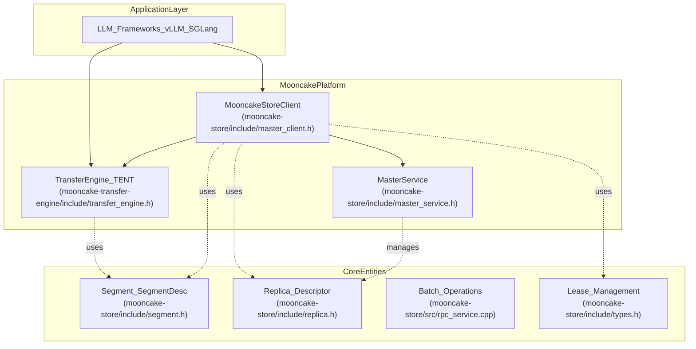
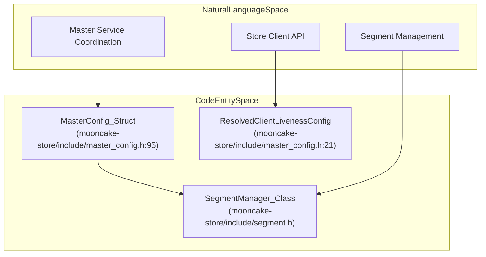
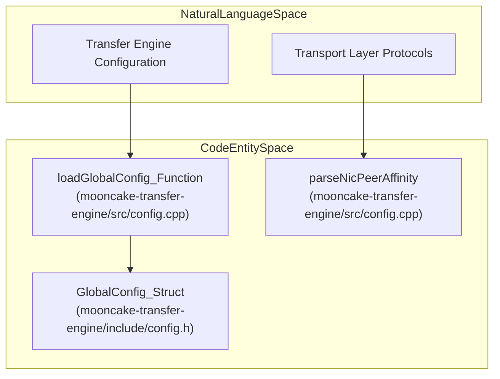

<!-- source: DeepWiki mcp.deepwiki.com · repo kvcache-ai/Mooncake · page 1.2 Key Concepts and Terminology · fetched 2026-11-11 -->

# Key Concepts and Terminology

Relevant source files

The following files were used as context for generating this wiki page:

- [README.md](README.md)
- [docs/source/api-reference/cpp/transfer-engine.md](docs/source/api-reference/cpp/transfer-engine.md)
- [docs/source/getting_started/build.md](docs/source/getting_started/build.md)
- [docs/source/getting_started/quick-start.md](docs/source/getting_started/quick-start.md)
- [docs/source/getting_started/supported-protocols.md](docs/source/getting_started/supported-protocols.md)
- [docs/source/index.md](docs/source/index.md)
- [docs/source/zh_archive/build.md](docs/source/zh_archive/build.md)
- [docs/source/zh_archive/run-examples.md](docs/source/zh_archive/run-examples.md)
- [mooncake-common/common.cmake](mooncake-common/common.cmake)
- [mooncake-integration/transfer_engine/transfer_engine_py.cpp](mooncake-integration/transfer_engine/transfer_engine_py.cpp)
- [mooncake-integration/transfer_engine/transfer_engine_py.h](mooncake-integration/transfer_engine/transfer_engine_py.h)
- [mooncake-store/CMakeLists.txt](mooncake-store/CMakeLists.txt)
- [mooncake-store/include/version.h.in](mooncake-store/include/version.h.in)
- [mooncake-transfer-engine/CMakeLists.txt](mooncake-transfer-engine/CMakeLists.txt)
- [mooncake-transfer-engine/include/cuda_alike.h](mooncake-transfer-engine/include/cuda_alike.h)
- [mooncake-transfer-engine/include/multi_transport.h](mooncake-transfer-engine/include/multi_transport.h)
- [mooncake-transfer-engine/include/transfer_engine.h](mooncake-transfer-engine/include/transfer_engine.h)
- [mooncake-transfer-engine/include/transfer_engine_c.h](mooncake-transfer-engine/include/transfer_engine_c.h)
- [mooncake-transfer-engine/include/transfer_engine_impl.h](mooncake-transfer-engine/include/transfer_engine_impl.h)
- [mooncake-transfer-engine/include/transport/transport.h](mooncake-transfer-engine/include/transport/transport.h)
- [mooncake-transfer-engine/src/CMakeLists.txt](mooncake-transfer-engine/src/CMakeLists.txt)
- [mooncake-transfer-engine/src/multi_transport.cpp](mooncake-transfer-engine/src/multi_transport.cpp)
- [mooncake-transfer-engine/src/transfer_engine.cpp](mooncake-transfer-engine/src/transfer_engine.cpp)
- [mooncake-transfer-engine/src/transfer_engine_c.cpp](mooncake-transfer-engine/src/transfer_engine_c.cpp)
- [mooncake-transfer-engine/src/transfer_engine_impl.cpp](mooncake-transfer-engine/src/transfer_engine_impl.cpp)
- [mooncake-transfer-engine/src/transport/CMakeLists.txt](mooncake-transfer-engine/src/transport/CMakeLists.txt)
- [mooncake-transfer-engine/tests/shm_transport_test.cpp](mooncake-transfer-engine/tests/shm_transport_test.cpp)
- [mooncake-transfer-engine/tests/transport_uint_test.cpp](mooncake-transfer-engine/tests/transport_uint_test.cpp)

## Purpose and Scope

This page defines the fundamental concepts, data types, and terminology used throughout the Mooncake system. It serves as a comprehensive reference for understanding the core abstractions that enable distributed KVCache management, memory disaggregation, and high-performance cross-node data transfer.

Mooncake is a KVCache-centric disaggregated architecture designed for LLM serving, powering production environments such as [Kimi](https://kimi.ai) [README.md:30-33](). It consists of two primary subsystems: the **Transfer Engine** for high-performance data movement and the **Mooncake Store** for distributed object storage [README.md:25-26]().

---

## System Overview and Key Concepts

Mooncake relies on several interlocking domain concepts to manage memory, coordinate nodes, and execute fast data transfers.

### Mooncake System Layers and Key Concepts

Sources: [README.md:25-33](), [mooncake-store/include/types.h:1-165]()

---

### Segments

**Definition:** A Segment is a contiguous memory region used for storing KV objects. Segments can be located on different memory/storage tiers including DRAM, GPU memory (VRAM), CXL memory, or SSD (via NVMe-oF). 

**Implementation Details:**
- Segments are represented by the `Segment` and `SegmentDesc` classes defined in `mooncake-store/include/segment.h`.
- Clients contribute segments to the global distributed KVCache pool by allocating memory regions.
- The Master Service manages segment registration and maintains segment mappings for placement and retrieval.
- Segment allocation is NUMA-aware and can be configured per backend.

Sources: [mooncake-store/include/segment.h:50-134]()

---

### Replicas

**Definition:** A Replica is a copy of a stored object (or a slice thereof) placed on a specific segment. Multiple replicas provide fault tolerance and load distribution.

**Implementation Details:**
- Replica descriptors outline the segment location, offset, length, and versioning of the object copy.
- Different slices of an object may be striped across different segments, and each slice can have multiple replicas.
- Replica management enables asynchronous replication tasks, ensures consistency, and supports multi-replica reads.

Sources: [mooncake-store/include/replica.h:1-60]()

---

### Batches

**Definition:** Batches are groups of put/get/transfer requests executed together as a single operation to improve throughput and reduce overhead.

**Implementation Details:**
- Batch APIs are exposed in both Mooncake Store (for object operations) and Transfer Engine (for data transfer via `MultiTransport::allocateBatchID`) [mooncake-transfer-engine/src/multi_transport.cpp:107-120]().
- The batch operations optimize network utilization by sending multiple slices or objects in parallel.
- Transfer Engine batch transfer APIs support queueing multiple slice transfers with scheduling and completion tracking [mooncake-integration/transfer_engine/transfer_engine_py.h:126-139]().

Sources: [mooncake-transfer-engine/src/multi_transport.cpp:107-120](), [mooncake-integration/transfer_engine/transfer_engine_py.h:126-139]()

---

### Slices

**Definition:** A Slice is a subdivision of an object or a batch transfer that can be scheduled separately, typically used for parallelism and multi-rail network transfer.

**Implementation Details:**
- Slicing allows striping large objects across multiple segments or NICs to achieve higher aggregated bandwidth.
- Each slice aligns with a transport path (`Transport::Slice`) and maintains individual transfer and completion status [mooncake-transfer-engine/include/transport/transport.h:125-145]().
- The Transfer Engine tracks slices for operation progress and retry mechanisms.

Sources: [mooncake-transfer-engine/include/transport/transport.h:125-145]()

---

### Leases

**Definition:** Leases are time-to-live (TTL) and soft-pin semantics applied to KV objects and client sessions for lifecycle management.

**Implementation Details:**
- The Store enforces leases with expiration times, automatically evicting expired objects.
- Soft pinning extends object retention beyond normal TTLs temporarily for latency or reliability purposes.
- Leases are managed centrally by the Master Service, which monitors client heartbeats and lease expiration.

Sources: [mooncake-store/include/types.h:84-90]()

---

### Metadata Services

**Definition:** Metadata services provide peer discovery, configuration, and coordination for the Transfer Engine and cluster state.

**Implementation Details:**
- Mooncake supports multiple metadata backends: etcd, Redis, HTTP, and a P2P handshake alternative.
- The metadata service stores Transfer Engine connection info, endpoint metadata, and node discovery data.
- P2P handshake avoids a centralized service by exchanging metadata directly among nodes locally.

Sources: [mooncake-transfer-engine/src/transfer_engine_impl.cpp:150-186]()

---

### KVCache Disaggregation

**Definition:** KVCache Disaggregation refers to the architectural separation of KVCache storage and management from the compute nodes running LLM inference.

**Explanation:**
- Traditional LLM serving hosts KVCache in GPU memory locally, limiting scaling.
- Mooncake decouples KVCache storage into a disaggregated pool managed by Mooncake Store, accessible across nodes.
- This enables better resource utilization, elasticity, and larger effective KVCache capacity by pooling DRAM, GPU, and SSD resources [docs/source/index.md:30-38]().
- The Transfer Engine facilitates fast zero-copy KVCache state movement between compute nodes and the disaggregated KVCache segments [README.md:32-33]().

Sources: [README.md:32-33](), [docs/source/index.md:30-38]()

---

### PD Disaggregation (Prefill-Decode Disaggregation)

**Definition:** PD Disaggregation is the separation of Prefill and Decode phases of LLM inference into distinct node pools for resource optimization.

**Explanation:**
- Prefill phase involves loading and preparing KVCache.
- Decode phase consumes the KVCache to generate tokens.
- Mooncake supports this split by enabling data transfer of KVCache between prefill and decode clusters.
- Early rejection policies prevent overloaded decode nodes from wasting computation on doomed requests [docs/source/index.md:38]().

Sources: [README.md:30-38](), [docs/source/index.md:30-38]()

---

### XpYd Notation

**Definition:** XpYd notation describes a deployment configuration, where:
- **X** = number of prefill nodes (p = prefill)
- **Y** = number of decode nodes (d = decode)

**Explanation:**
- Used to describe cluster topology in PD disaggregation setups.
- Helps specify sizing and resource allocation strategies (e.g., 8p16d means 8 prefill and 16 decode nodes).

Sources: [README.md:4-33](), [docs/source/index.md:30]()

---

## Core Data Types and Identifiers

Mooncake utilizes strict type definitions to ensure thread safety, robust error propagation, and correct wrap-around handling across distributed nodes.

### Fundamental Identifiers

| Type | Underlying Type | Purpose | Code Reference |
|------|----------------|---------|----------------|
| `ObjectKey` | `std::string` | Unique identifier for stored objects/KV cache | [mooncake-store/include/types.h:1-20]() |
| `Version` | `uint64_t` | Monotonic versioning for object updates | [mooncake-store/include/types.h:24]() |
| `ErrorCode` | `enum class` | System-wide status codes for RPC and store operations | [mooncake-store/include/types.h:26]() |

### Sequence ID Wrap-around Utilities

Mooncake provides helper inline functions to safely compare sequence IDs, which are `uint64_t` values and can wrap-around [mooncake-store/include/types.h:28-58]().

Sources: [mooncake-store/include/types.h:28-58]()

### Object Data Types

Mooncake defines an enum `ObjectDataType` to label data stored in the system (e.g., `KVCACHE`, `TENSOR`, `WEIGHT`, `ACTIVATION`) [mooncake-store/include/types.h:147-159](). This classification assists with type-aware eviction policies and statistics.

Sources: [mooncake-store/include/types.h:147-165]()

---

## Concept to Code Entity Mappings

### Natural Language to Store Code Entities

Sources: [mooncake-store/include/master_config.h:21-95]()

---

### Natural Language to Transfer Engine Code Entities

Sources: [mooncake-common/common.cmake:1-32]()

---

# Summary Table of Core Terminology

| Term                  | Description                                                                                       | Relevant File(s) / Component(s)                 |
|-----------------------|-------------------------------------------------------------------------------------------------|------------------------------------------------|
| Segment               | Contiguous memory/storage block contributing to KVCache pool                                    | `segment.h`, `master.cpp`                      |
| Replica               | Distributed copy of an object slice stored on different segments                                 | `replica.h`                                    |
| Batch                 | Grouped set of requests for efficient execution (put/get/transfer)                              | `multi_transport.cpp`, Transfer Engine batch APIs |
| Slice                 | Subdivision of an object or transfer for parallelism                                            | `transport.h` (`Transport::Slice`)              |
| Lease                 | TTL and soft pin duration for automatic object lifetime management                              | `types.h`                                      |
| Metadata Service      | Coordination backend (etcd, Redis, HTTP, P2P handshake) for peer discovery and config discovery   | `transfer_engine_impl.cpp`                     |
| KVCache Disaggregation| Separation of KVCache storage from computation for flexible scaling and memory pooling          | `README.md`, `docs/source/index.md`            |
| PD Disaggregation     | Separation of Prefill and Decode phases across compute clusters for latency and throughput gains | `README.md`, `docs/source/index.md`            |
| XpYd notation          | Notation for deployment cluster with X prefill and Y decode nodes                               | `README.md`, `docs/source/index.md`            |

Sources: [README.md:25-64](), [docs/source/index.md:28-38](), [mooncake-store/include/types.h:84-90]()

---

