# Page: Overview

# Overview

<details>
<summary>Relevant source files</summary>

The following files were used as context for generating this wiki page:

- [README.md](README.md)
- [VERSION](VERSION)

</details>


## Purpose and Scope

This document provides a high-level introduction to the NVIDIA Aerial Framework, a real-time signal processing framework designed specifically for 3GPP Radio Access Networks (RAN) with microsecond-level latency requirements. The framework enables developers to prototype algorithms in high-level languages (Python, JAX, PyTorch) and deploy them to production environments with deterministic, real-time execution guarantees.

This overview covers:
- Framework architecture and core components
- Two-tier design philosophy (Developer Tools and Runtime Engine)
- Development-to-deployment workflow
- Repository organization and key technologies

For detailed setup instructions, see [Getting Started](#2). For in-depth architectural details, see [Framework Architecture](#3). For build system configuration, see [Build System](#4).

**Current Version:** 0.1.0 ([VERSION:1]())

Sources: [README.md:1-178](), [VERSION:1]()

---

## Framework Overview

The NVIDIA Aerial Framework is a single platform that unites research, testbeds, and production deployments for signal processing workloads with strict latency requirements. It addresses the fundamental challenge of 3GPP RAN development: bridging the gap between development productivity (high-level languages, rapid prototyping) and runtime performance (microsecond-level determinism, real-time scheduling).

### Key Features

| Feature | Description |
|---------|-------------|
| **Python → Real-time** | Prototype in Python/JAX/PyTorch and compile to high-performance GPU code |
| **Clean Separation** | Decouples algorithm development from runtime execution concerns |
| **Modular Pipelines** | Compose end-to-end pipelines from compiled, executable modules |
| **Observability** | Built-in profiling and monitoring hooks throughout development lifecycle |
| **Single Codebase** | Reuse components across prototyping, simulation, testing, and deployment |
| **Modern Toolchain** | Python 3.12+, C++20, CUDA 12.9, CMake, JAX, PyTorch, uv, ruff |
| **Developer-Friendly** | Prototype on local machines, scale to production deployments |
| **Guided Tutorials** | Jupyter notebooks in Docker containers |
| **5G Advanced & 6G** | Ships with AI-native PUSCH pipeline example |

Sources: [README.md:22-33]()

---

## Two-Tier Architecture

The Aerial Framework combines two distinct components that address different phases of the development lifecycle:

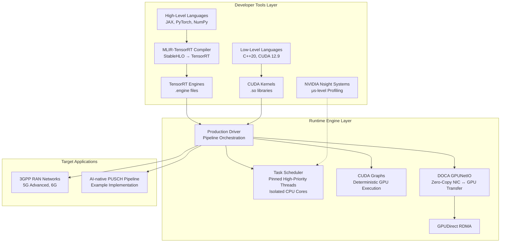

**Diagram: Two-Tier Architecture - Developer Tools and Runtime Engine**

### Developer Tools Layer

The Developer Tools layer ([README.md:50-54]()) provides the compilation pipeline from high-level algorithms to GPU-executable code:

- **Multi-Language Support**: Algorithms can be authored in JAX, PyTorch, NumPy, C++20, or CUDA 12.9
- **MLIR-TensorRT Compiler**: Converts JAX programs to StableHLO intermediate representation, then lowers to optimized TensorRT engines
- **Profiling Infrastructure**: NVIDIA Nsight Systems integration for microsecond-level optimization
- **AI-Native**: Seamless integration with AI frameworks enables end-to-end differentiability

The output of this layer consists of:
- TensorRT engine files (`.engine`)
- Compiled CUDA kernel libraries (`.so`)
- Performance profiles for optimization

### Runtime Engine Layer

The Runtime Engine layer ([README.md:56-60]()) provides deterministic execution infrastructure:

- **CUDA Graphs**: GPU operations encapsulated as CUDA graphs with TensorRT integration for deterministic execution paths
- **Task Scheduler**: Pinned, high-priority threads on isolated CPU cores enforce microsecond-precision slot timing
- **DOCA GPUNetIO**: Zero-copy packet transfer between NIC and GPU memory via GPUDirect RDMA
- **Production Driver**: Orchestrates pipeline execution, manages memory pools, and coordinates multi-cell operations

This layer ensures that compiled algorithms meet real-time latency requirements when deployed to production environments.

Sources: [README.md:46-60]()

---

## Development Workflow

The Aerial Framework implements a six-stage workflow that bridges development and deployment environments:

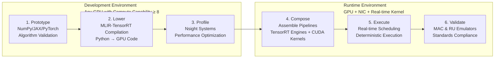

**Diagram: Six-Stage Development-to-Deployment Workflow**

### Stage Descriptions

| Stage | Description | Environment | Key Activities |
|-------|-------------|-------------|----------------|
| **Prototype** | Write and validate algorithms using NumPy/JAX/PyTorch | Development | Algorithm correctness, functional testing |
| **Lower** | Compile Python code to GPU executables using MLIR-TensorRT | Development | Code generation, compilation |
| **Profile** | Optimize performance using Nsight Systems profiling | Development | Bottleneck identification, optimization |
| **Compose** | Assemble TensorRT engines and CUDA kernels into modular pipelines | Runtime | Pipeline configuration, module integration |
| **Execute** | Run with real-time task scheduling and networking | Runtime | Production execution, timing validation |
| **Validate** | Test PHY applications using MAC and RU emulators | Runtime | Standards compliance, integration testing |

### Environment Requirements

**Development Environment** ([README.md:76-77]()):
- Any NVIDIA GPU with compute capability ≥ 8
- Standard Linux distribution
- Docker container support
- Focuses on algorithm development and optimization

**Runtime Environment** ([README.md:79]()):
- NVIDIA GPU with compute capability ≥ 8
- Compatible NIC (for DOCA GPUNetIO)
- Real-time Linux kernel (for deterministic scheduling)
- Focuses on latency validation and production deployment

This two-environment approach enables:
- **Development Productivity**: High-level languages with rich ecosystems
- **Runtime Performance**: Speed and determinism of optimized C++/CUDA
- **Low Latency Requirements**: Microsecond-level timing constraints

Sources: [README.md:63-124]()

---

## Repository Structure

The repository is organized into three primary directories that reflect the architectural separation of concerns:

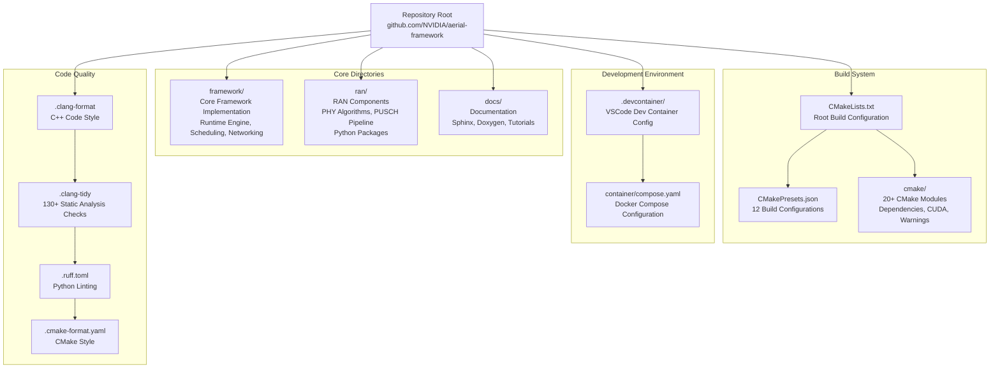

**Diagram: Repository Directory Structure and Organization**

### Directory Mapping

| Directory | Purpose | Key Components |
|-----------|---------|----------------|
| `framework/` | Core runtime engine implementation | Task scheduler, CUDA graphs, DOCA integration, memory management |
| `ran/` | RAN-specific components | PHY algorithms, PUSCH receiver, Python packages, example pipelines |
| `docs/` | Documentation and tutorials | Sphinx documentation, Jupyter notebooks, API references |
| `cmake/` | Build system modules | Dependency management, CUDA configuration, compiler warnings, testing |
| `.devcontainer/` | Containerized development environment | VSCode integration, Docker configuration |
| `.clang-format`, `.clang-tidy`, `.ruff.toml` | Code quality enforcement | Style guides, linters, static analyzers |

For detailed build system information, see [Build System](#4). For code quality standards, see [Development Guide](#6). For development environment setup, see [Development Environment Setup](#2.1).

Sources: [README.md:1-178]()

---

## Key Technologies and Dependencies

The Aerial Framework integrates a comprehensive set of technologies to enable high-performance, real-time signal processing:

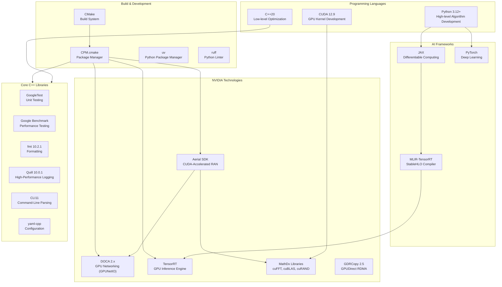

**Diagram: Technology Stack and Dependencies**

### Technology Categories

**Programming Languages** ([README.md:6-7]()):
- Python 3.12+ for algorithm prototyping and AI integration
- C++20 for high-performance runtime components
- CUDA 12.9 for GPU kernel development

**NVIDIA Technologies**:
- **Aerial SDK**: CUDA-accelerated RAN libraries
- **DOCA**: Data center infrastructure for GPU networking (GPUNetIO)
- **TensorRT**: High-performance inference engine
- **MathDx**: Optimized mathematical libraries (cuFFT, cuBLAS, cuRAND, cuSOLVER)
- **GDRCopy**: GPUDirect RDMA for zero-copy memory transfers

**AI Frameworks**:
- **JAX**: Differentiable computing and automatic differentiation
- **PyTorch**: Deep learning framework
- **MLIR-TensorRT**: Compiler infrastructure for lowering StableHLO to TensorRT

**Build Tools** ([README.md:8-10]()):
- **CMake**: Cross-platform build system generator
- **CPM.cmake**: CMake package manager for dependency management
- **uv**: Fast Python package manager
- **ruff**: Fast Python linter and formatter

For comprehensive dependency information, see [Dependencies and Integration](#5). For NVIDIA-specific integrations, see [NVIDIA Technologies](#5.1).

Sources: [README.md:5-10](), [README.md:19]()

---

## Target Applications

The Aerial Framework is designed for 3GPP RAN signal processing applications with strict latency requirements, targeting 5G Advanced and 6G networks:

### Primary Use Cases

**3GPP RAN Networks** ([README.md:14]()):
- Physical layer (PHY) signal processing
- Microsecond-level latency requirements
- Real-time slot timing (e.g., 125 μs for 5G NR)
- Multi-cell coordination
- Fronthaul and backhaul processing

**AI-Native PHY** ([README.md:32]()):
- End-to-end differentiable signal processing pipelines
- Neural network integration for channel estimation, filtering, equalization
- Training and inference within latency constraints
- Adaptive algorithms with online learning

### Example Implementation: PUSCH Pipeline

The framework ships with a complete AI-native Physical Uplink Shared Channel (PUSCH) receiver pipeline as a reference implementation. This demonstrates:

- Multi-stage signal processing (synchronization, channel estimation, equalization, decoding)
- Hybrid TensorRT/CUDA implementation
- Integration with MAC and RU emulators
- Fronthaul testing with DOCA GPUNetIO
- Standards-compliant O-RAN interfaces

The PUSCH pipeline is documented in the tutorials:
- PUSCH Receiver: Algorithm design in NumPy
- MLIR-TensorRT: Compilation to TensorRT engines
- Lowering PUSCH: Complete receiver compilation
- Full PUSCH Pipeline: End-to-end execution
- Fronthaul Testing: O-RAN fronthaul with DOCA GPUNetIO
- PHY Integration: Full PHY with MAC/RU emulators

Sources: [README.md:12-19](), [README.md:32](), [README.md:148-158]()

---

## Audience and Intended Users

The Aerial Framework is designed for:

**RAN System Engineers** ([README.md:18]()):
- Developing and optimizing PHY layer algorithms
- Integrating signal processing pipelines with network interfaces
- Validating latency and throughput requirements
- Deploying to production RAN environments

**Signal Processing Specialists**:
- Prototyping advanced receiver algorithms
- Optimizing kernel-level performance
- Profiling and tuning GPU execution
- Balancing algorithm complexity with real-time constraints

**AI Researchers** ([README.md:18]()):
- Designing neural network-based signal processing
- Training models with end-to-end differentiability
- Integrating AI frameworks (JAX, PyTorch) into real-time systems
- Exploring AI-native PHY architectures for 6G

Sources: [README.md:18]()

---

## Quick Reference

### Getting Started

```bash
# Configure (release preset)
cmake --preset clang-release

# Build
cmake --build out/build/clang-release

# Install Python package (5G RAN)
cd ran/py && uv sync
```

([README.md:130-139]())

### Key Resources

| Resource | Location |
|----------|----------|
| Documentation | [docs.nvidia.com/aerial/framework](https://docs.nvidia.com/aerial/framework/latest/index.html) |
| Tutorials | Step-by-step Jupyter notebooks |
| Source Repository | [github.com/NVIDIA/aerial-framework](https://github.com/NVIDIA/aerial-framework) |
| License | Apache 2.0 ([LICENSE]()) |
| Version | 0.1.0 ([VERSION:1]()) |

### Related Projects

The Aerial Framework is part of the [NVIDIA AI Aerial™](https://developer.nvidia.com/industries/telecommunications/ai-aerial) portfolio:
- NVIDIA Aerial™ Framework (this repository)
- [NVIDIA Aerial™ CUDA-Accelerated RAN](https://github.com/NVIDIA/aerial-cuda-accelerated-ran)

For software releases, events, and technical training, visit the [NVIDIA 6G Developer Program](https://developer.nvidia.com/6g-program).

Sources: [README.md:126-172]()

---

## License and Attribution

The Aerial Framework is licensed under **Apache License 2.0** ([LICENSE]()). Some dependencies may have different licenses - see [ATTRIBUTION.md]() for third-party attributions.

For detailed license information, see [License and Attribution](#9.1). For security policies, see [Security Policy](#9.3).

Sources: [README.md:174-177]()

---

# Page: Getting Started

# Getting Started

<details>
<summary>Relevant source files</summary>

The following files were used as context for generating this wiki page:

- [CMakeLists.txt](CMakeLists.txt)
- [README.md](README.md)

</details>


## Purpose and Scope

This document provides an overview of prerequisites and the basic build workflow for the NVIDIA Aerial Framework. It covers hardware and software requirements, initial setup steps, and the commands needed to build the project for the first time.

For detailed instructions on setting up the containerized development environment and VSCode integration, see [Development Environment Setup](#2.1). For comprehensive information about build configurations, CMake presets, and compiler options, see [Building the Project](#2.2).

**Sources:** [README.md:1-178]()

---

## Prerequisites

### Hardware Requirements

The Aerial Framework has different hardware requirements depending on the target environment:

| Environment | GPU Requirement | Additional Hardware |
|-------------|----------------|---------------------|
| **Development** | NVIDIA GPU with [compute capability](https://developer.nvidia.com/cuda-gpus) ≥ 8.0 | None required |
| **Runtime** | NVIDIA GPU with compute capability ≥ 8.0 | NVIDIA NIC (ConnectX or BlueField), Real-time Linux kernel |

Development activities (prototyping, compilation, profiling) can be performed on any recent NVIDIA GPU. Runtime validation with network fronthaul requires additional hardware for DOCA GPUNetIO and deterministic scheduling.

**Sources:** [README.md:76-79]()

### Software Requirements

The framework requires the following software stack:

| Component | Version | Purpose |
|-----------|---------|---------|
| **CMake** | ≥ 3.23 | Build system generator |
| **C++ Compiler** | GCC or Clang with C++20 support | Core framework compilation |
| **CUDA Toolkit** | 12.9 | GPU kernel compilation |
| **Python** | ≥ 3.12 | Python packages and tooling |
| **uv** | Latest | Python package management |
| **Docker** | Latest | Containerized development environment |

The recommended approach is to use the provided Docker container, which includes all dependencies pre-configured. See [Development Environment Setup](#2.1) for container installation instructions.

**Sources:** [README.md:29](), [CMakeLists.txt:16-44]()

---

## Quick Start

The following commands demonstrate the basic workflow for building the Aerial Framework:

```bash
# 1. Configure the build using a CMake preset
cmake --preset clang-release

# 2. Build all targets
cmake --build out/build/clang-release

# 3. Install Python packages (example: RAN package)
cd ran/py && uv sync
```

### Build Configuration Flow

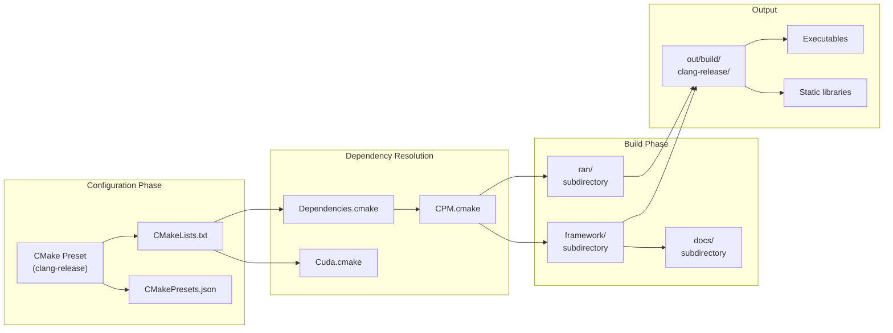

**Sources:** [README.md:130-139](), [CMakeLists.txt:1-112]()

---

## Build System Overview

The Aerial Framework uses CMake as its build system with a modular architecture that separates configuration, dependency management, and compilation.

### CMake Project Structure

```mermaid
graph TB
    subgraph "Root Configuration"
        Root["CMakeLists.txt<br/>[CMakeLists.txt:39-44]()"]
        Version["VERSION file<br/>(0.1.0)"]
        
        Root --> Version
    end
    
    subgraph "Configuration Modules"
        PreventInSource["PreventInSourceBuilds.cmake"]
        ProjectOptions["ProjectOptions.cmake<br/>setup_options()<br/>local_options()<br/>global_options()"]
        Dependencies["Dependencies.cmake<br/>setup_dependencies()"]
        
        Root --> PreventInSource
        Root --> ProjectOptions
        Root --> Dependencies
    end
    
    subgraph "CUDA Configuration"
        CudaCmake["Cuda.cmake<br/>check_cuda_architectures()"]
        
        Root --> CudaCmake
    end
    
    subgraph "Code Quality"
        Python["Python.cmake<br/>enable_static_analysis()"]
        Copyright["CopyrightTargets.cmake"]
        IncludeGuard["IncludeGuardTargets.cmake"]
        
        Root --> Python
        Root --> Copyright
        Root --> IncludeGuard
    end
    
    subgraph "Source Directories"
        ConfiguredFiles["cmake/configured_files/"]
        FrameworkDir["framework/<br/>[CMakeLists.txt:95]()"]
        RANDir["ran/<br/>[CMakeLists.txt:96]()"]
        DocsDir["docs/<br/>[CMakeLists.txt:102]()"]
        
        Root --> ConfiguredFiles
        Root --> FrameworkDir
        Root --> RANDir
        Root --> DocsDir
    end
    
    subgraph "Build Artifacts"
        Options["framework_options<br/>(interface library)"]
        Warnings["framework_warnings<br/>(interface library)"]
        
        ProjectOptions --> Options
        ProjectOptions --> Warnings
    end
```

The root [CMakeLists.txt:1-112]() orchestrates the build by:

1. **Setting global standards** - C++20 standard [CMakeLists.txt:19-25](), position-independent code [CMakeLists.txt:29]()
2. **Reading project version** - Extracted from [VERSION]() file [CMakeLists.txt:32-36]()
3. **Declaring project** - Named `framework` with CXX, C, ASM, and CUDA languages [CMakeLists.txt:39-44]()
4. **Validating CUDA** - Ensures CUDA architectures are properly set [CMakeLists.txt:47-48]()
5. **Setting up options** - Compiler flags, warnings, and project-specific options [CMakeLists.txt:51-57]()
6. **Resolving dependencies** - Fetches external libraries via CPM [CMakeLists.txt:59-60]()
7. **Adding subdirectories** - Builds framework, ran, and docs modules [CMakeLists.txt:95-102]()

**Sources:** [CMakeLists.txt:1-112]()

---

## Available Build Presets

The framework provides 12 CMake presets covering different compilers, build types, and sanitizer configurations:

| Preset Name | Compiler | Build Type | Sanitizers | Use Case |
|-------------|----------|------------|------------|----------|
| `gcc-debug` | GCC | Debug | None | Development with debugging symbols |
| `gcc-release` | GCC | Release | None | Production builds with GCC |
| `clang-debug` | Clang | Debug | None | Development with Clang toolchain |
| `clang-release` | Clang | Release | None | Production builds with Clang (recommended) |
| `clang-asan-debug` | Clang | Debug | AddressSanitizer | Detect memory errors |
| `clang-asan-release` | Clang | Release | AddressSanitizer | Memory error detection in optimized code |
| `clang-tsan-debug` | Clang | Debug | ThreadSanitizer | Detect data races |
| `clang-tsan-release` | Clang | Release | ThreadSanitizer | Race detection in optimized code |
| `clang-ubsan-debug` | Clang | Debug | UndefinedBehaviorSanitizer | Detect undefined behavior |
| `clang-ubsan-release` | Clang | Release | UndefinedBehaviorSanitizer | UB detection in optimized code |
| `clang-lsan-debug` | Clang | Debug | LeakSanitizer | Detect memory leaks |
| `clang-lsan-release` | Clang | Release | LeakSanitizer | Leak detection in optimized code |

The `clang-release` preset is recommended for production builds and performance testing. Sanitizer presets are valuable for debugging and validation. For detailed information on each preset, see [Build Presets and Configurations](#4.2).

**Sources:** [README.md:131-132]()

---

## Build Workflow Steps

### Step 1: Configure

The configuration step generates build files and resolves all dependencies:

```bash
cmake --preset clang-release
```

This command:
- Reads `CMakePresets.json` to load preset configuration
- Invokes [CMakeLists.txt:1-112]() to set up the build
- Executes `check_cuda_architectures()` from [Cuda.cmake]() to validate GPU targets
- Runs `setup_options()` from [ProjectOptions.cmake]() to configure compiler flags
- Executes `setup_dependencies()` from [Dependencies.cmake]() to fetch external libraries via CPM
- Generates build files in `out/build/clang-release/`

### Step 2: Build

The build step compiles all targets:

```bash
cmake --build out/build/clang-release
```

This compiles:
- **Core framework** - Libraries in `framework/` subdirectory [CMakeLists.txt:95]()
- **RAN components** - 5G/6G signal processing modules in `ran/` subdirectory [CMakeLists.txt:96]()
- **Documentation** - Generated docs in `docs/` subdirectory [CMakeLists.txt:102]()

Build artifacts are placed in `out/build/clang-release/` with executables, static libraries, and intermediate object files.

### Step 3: Python Package Installation

For Python-based development workflows, install Python packages using `uv`:

```bash
cd ran/py && uv sync
```

This installs the RAN Python package with all dependencies, enabling access to JAX-based signal processing algorithms and MLIR-TensorRT compilation tools.

**Sources:** [README.md:130-139](), [CMakeLists.txt:95-102]()

---

## Verification

After building, verify the setup by running tests:

```bash
# Run all tests
ctest --test-dir out/build/clang-release

# Run tests with verbose output
ctest --test-dir out/build/clang-release --verbose

# Run specific test
ctest --test-dir out/build/clang-release -R test_name
```

The test suite uses CTest integration [CMakeLists.txt:90]() and includes unit tests, benchmarks, and integration tests. For comprehensive information on testing, see [Testing and Benchmarking](#4.6).

**Sources:** [CMakeLists.txt:90]()

---

## Project Structure After Build

After a successful build, the project directory structure includes:

```
aerial-framework/
├── CMakeLists.txt           # Root build configuration
├── CMakePresets.json        # Build preset definitions
├── VERSION                  # Project version (0.1.0)
├── framework/               # Core framework source
├── ran/                     # RAN-specific modules
│   └── py/                  # Python packages
├── docs/                    # Documentation source
├── cmake/                   # CMake modules (20+)
│   ├── Dependencies.cmake   # External library management
│   ├── Cuda.cmake          # CUDA configuration
│   ├── ProjectOptions.cmake # Compiler options
│   └── ...
└── out/build/clang-release/ # Build output directory
    ├── framework/           # Compiled framework libraries
    ├── ran/                 # Compiled RAN binaries
    ├── CMakeCache.txt      # CMake configuration cache
    └── ...
```

**Sources:** [CMakeLists.txt:1-112]()

---

## Next Steps

After completing the initial build, proceed to:

1. **[Development Environment Setup](#2.1)** - Configure the Docker container, VSCode devcontainer, and IDE integration for a consistent development experience

2. **[Building the Project](#2.2)** - Learn about advanced build configurations, compiler options, and how to customize the build process

3. **[Framework Architecture](#3)** - Understand the two-tier architecture with developer tools and runtime engine

4. **[Development Workflow](#3.3)** - Follow the six-stage workflow from prototype to validation

5. **Tutorials** - Explore the [tutorial documentation](https://docs.nvidia.com/aerial/framework/latest/tutorials/index.html) to build and run example pipelines

**Sources:** [README.md:141-158]()

---

## Common Build Issues

### CUDA Architecture Not Set

If you encounter errors about CUDA architectures, the build system requires explicit GPU targets. This is validated by `check_cuda_architectures()` in [CMakeLists.txt:47-48](). Set the `CMAKE_CUDA_ARCHITECTURES` variable or let the build system auto-detect.

### Missing Dependencies

The [Dependencies.cmake]() module automatically fetches dependencies via CPM. If downloads fail, check network connectivity and proxy settings.

### Compiler Version

The project requires C++20 support [CMakeLists.txt:19-21](). Ensure your compiler supports this standard:
- GCC ≥ 10
- Clang ≥ 11

**Sources:** [CMakeLists.txt:16-48]()

---

# Page: Development Environment Setup

# Development Environment Setup

<details>
<summary>Relevant source files</summary>

The following files were used as context for generating this wiki page:

- [.devcontainer/devcontainer.json](.devcontainer/devcontainer.json)
- [README.md](README.md)

</details>


## Purpose and Scope

This document explains the containerized development environment for the NVIDIA Aerial Framework, including Docker container configuration, VSCode integration via devcontainer, and the standardized build toolchain. The environment provides a consistent, reproducible setup across all developer workstations with pre-configured tools for C++, CUDA, and Python development.

For instructions on building the project after environment setup, see [Building the Project](#2.2). For details on the CMake build system itself, see [Build System](#4).

---

## Overview

The Aerial Framework uses a Docker-based development container approach to ensure consistent builds and eliminate "works on my machine" issues. The development environment is defined declaratively in [.devcontainer/devcontainer.json:1-31]() and orchestrated via Docker Compose at [container/compose.yaml]().

Key characteristics:
- **Container service**: `aerial-framework-base` 
- **Workspace path**: `/opt/nvidia/aerial-framework`
- **Non-root user**: `aerial` (security best practice)
- **IDE integration**: VSCode Dev Containers with pre-installed extensions
- **Tools included**: Python 3.12+, CUDA 12.9, CMake, uv, ruff

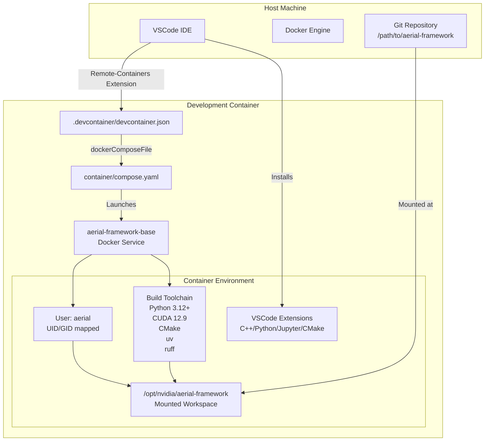

**Sources**: [.devcontainer/devcontainer.json:1-31](), [README.md:1-178]()

---

## Devcontainer Configuration

The devcontainer specification at [.devcontainer/devcontainer.json:1-31]() defines the development environment:

### Basic Configuration

| Property | Value | Purpose |
|----------|-------|---------|
| `name` | `"Aerial Framework"` | Display name in VSCode |
| `dockerComposeFile` | `"../container/compose.yaml"` | Points to Docker Compose configuration |
| `service` | `"aerial-framework-base"` | Selects container service to use |
| `workspaceFolder` | `"/opt/nvidia/aerial-framework"` | Container path for mounted repository |
| `remoteUser` | `"aerial"` | Non-root user for security |

The configuration specifies `"overrideCommand": false` at [.devcontainer/devcontainer.json:6]() to preserve the container's default entrypoint, and `"shutdownAction": "none"` at [.devcontainer/devcontainer.json:7]() to keep the container running when VSCode disconnects.

### Post-Attach Hook

The `postAttachCommand` at [.devcontainer/devcontainer.json:30]() executes a banner script on each connection:
```json
"postAttachCommand": "bash /etc/profile.d/banner.sh"
```
This displays system information and environment status to the user upon connection.

**Sources**: [.devcontainer/devcontainer.json:1-31]()

---

## VSCode Integration

### Installed Extensions

The devcontainer automatically installs VSCode extensions at [.devcontainer/devcontainer.json:12-21]() for a complete development experience:

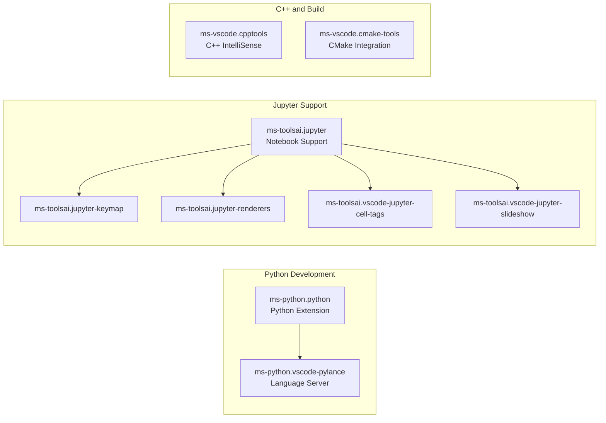

**Extension Categories**:

| Category | Extensions | Purpose |
|----------|-----------|---------|
| **Python** | `ms-python.python`, `ms-python.vscode-pylance` | Python IntelliSense, linting, debugging |
| **Jupyter** | `ms-toolsai.jupyter` (5 extensions) | Interactive notebook development for tutorials |
| **C++** | `ms-vscode.cpptools` | C++ IntelliSense, debugging, code navigation |
| **Build** | `ms-vscode.cmake-tools` | CMake project configuration and building |

### VSCode Settings

Custom settings at [.devcontainer/devcontainer.json:23-26]() configure the container environment:

```json
"settings": {
    "jupyter.kernels.filter": [],
    "terminal.integrated.cwd": "/opt/nvidia/aerial-framework"
}
```

- `jupyter.kernels.filter: []` - Shows all available Jupyter kernels without filtering
- `terminal.integrated.cwd` - Sets default terminal directory to workspace root

**Sources**: [.devcontainer/devcontainer.json:10-28]()

---

## Environment Specifications

### Toolchain Versions

As specified in [README.md:5-10](), the development container includes:

| Tool | Version | Purpose |
|------|---------|---------|
| **Python** | 3.12+ | High-level algorithm development, JAX/PyTorch integration |
| **C++** | C++20 | Core framework and CUDA kernel development |
| **CUDA** | 12.9 | GPU programming and TensorRT integration |
| **CMake** | Latest | Build system orchestration |
| **uv** | Latest | Fast Python package installer (pip replacement) |
| **ruff** | Latest | Python linting and formatting |

### Workspace Layout

The container mounts the repository at `/opt/nvidia/aerial-framework` as defined in [.devcontainer/devcontainer.json:5](), providing access to:

```
/opt/nvidia/aerial-framework/
├── framework/          # Core framework C++ code
├── ran/               # RAN components and Python packages
├── docs/              # Documentation
├── cmake/             # CMake modules
├── container/         # Docker configuration
├── .devcontainer/     # VSCode devcontainer config
├── CMakeLists.txt     # Root build configuration
└── CMakePresets.json  # Build presets
```

**Sources**: [README.md:5-10](), [.devcontainer/devcontainer.json:5]()

---

## Getting Started

### Prerequisites

Before using the devcontainer:
1. **Docker Engine** installed and running
2. **VSCode** with Remote-Containers extension
3. **Git** for repository cloning
4. **NVIDIA GPU** with compute capability ≥ 8 (for GPU development)
5. **NVIDIA Container Toolkit** (for GPU access in containers)

### Opening the Devcontainer

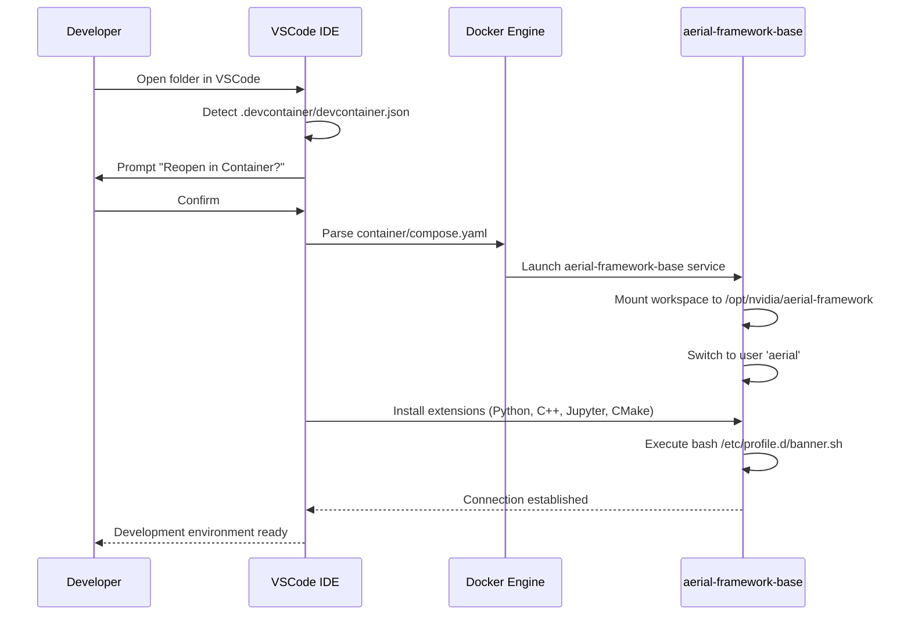

**Steps**:
1. Clone the repository: `git clone https://github.com/NVIDIA/aerial-framework.git`
2. Open the repository in VSCode
3. When prompted, select "Reopen in Container" (or use Command Palette: "Remote-Containers: Reopen in Container")
4. Wait for container build and extension installation (first-time setup may take several minutes)
5. Verify environment by opening an integrated terminal - you should see the banner and be in `/opt/nvidia/aerial-framework`

### Verifying the Environment

After the container starts, verify installation:

```bash
# Check Python version
python --version  # Should show 3.12+

# Check CUDA availability
nvidia-smi

# Check CMake
cmake --version

# Check uv package manager
uv --version

# Check ruff linter
ruff --version

# Verify workspace location
pwd  # Should output: /opt/nvidia/aerial-framework
```

**Sources**: [README.md:126-139](), [.devcontainer/devcontainer.json:1-31]()

---

## Container Service Architecture

The `aerial-framework-base` service referenced in [.devcontainer/devcontainer.json:4]() is defined in `container/compose.yaml`. While the compose file is not shown in the provided files, the devcontainer configuration reveals its structure:

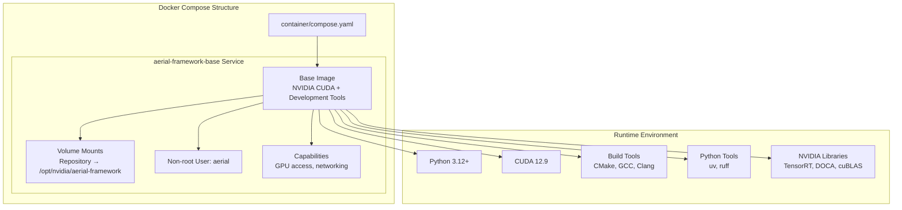

The service provides:
- **GPU acceleration** via NVIDIA runtime
- **Volume mounting** of the source repository for live code editing
- **User mapping** to avoid permission issues with host filesystem
- **Pre-installed dependencies** including NVIDIA SDKs (TensorRT, DOCA, MathDx) and third-party libraries

**Sources**: [.devcontainer/devcontainer.json:3-4](), [README.md:19]()

---

## Development Workflow Integration

The development container integrates with the broader Aerial Framework workflow described in [README.md:63-124]():

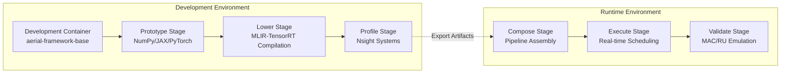

The development container is specifically designed for the **Development** stages (Prototype, Lower, Profile), providing:
- Jupyter notebooks for interactive prototyping
- MLIR-TensorRT compiler for lowering Python to GPU code
- Nsight Systems for profiling and optimization

For the **Runtime** stages (Compose, Execute, Validate), additional hardware and configuration is required as documented in the deployment guides.

**Sources**: [README.md:63-124](), [README.md:146-158]()

---

## Next Steps

After setting up the development environment:
1. **Build the project** using CMake presets - see [Building the Project](#2.2)
2. **Explore tutorials** in Jupyter notebooks at `docs/` directory
3. **Review code quality tools** - see [C++ Code Formatting](#6.1), [Python Code Quality](#6.3)
4. **Understand the build system** - see [CMake Configuration](#4.1)

The development container provides everything needed to start contributing to the Aerial Framework, from writing Python prototypes to compiling optimized GPU code.

**Sources**: [README.md:126-158]()

---

# Page: Building the Project

# Building the Project

<details>
<summary>Relevant source files</summary>

The following files were used as context for generating this wiki page:

- [CMakeLists.txt](CMakeLists.txt)
- [CMakePresets.json](CMakePresets.json)
- [README.md](README.md)

</details>


This page provides comprehensive instructions for building the NVIDIA Aerial Framework using CMake. It covers configuration presets, build types, sanitizer configurations, and common build options. For information about setting up the development environment and container, see [Development Environment Setup](#2.1). For details about the underlying CMake module architecture and dependency management, see [CMake Configuration](#4.1) and [Dependency Management with CPM](#4.3).

## Overview

The Aerial Framework uses CMake 3.23+ with a preset-based configuration system. The build system supports:
- Multiple compilers (GCC, Clang)
- Multiple build types (Debug, RelWithDebInfo)
- Sanitizer configurations (AddressSanitizer, ThreadSanitizer, UndefinedBehaviorSanitizer, LeakSanitizer)
- CUDA 12.9 with native GPU architecture detection
- C++20 standard with extensions disabled
- Ninja build generator for fast parallel builds

The project is organized into three main subdirectories that are built:
- `framework/` - Core framework components
- `ran/` - Radio Access Network implementations
- `docs/` - Documentation generation

Sources: [CMakeLists.txt:16-44](), [CMakePresets.json:1-32](), [README.md:126-139]()

## Build System Architecture

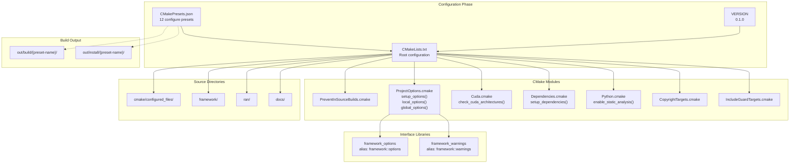

Sources: [CMakeLists.txt:16-112](), [CMakePresets.json:8-32]()

## Available Build Presets

The project defines 12 CMake configuration presets organized by compiler and build type. All presets use the Ninja generator and set `CMAKE_CUDA_ARCHITECTURES` to `native` for automatic GPU architecture detection.

### Standard Build Presets

| Preset Name | Compiler | Build Type | Description |
|-------------|----------|------------|-------------|
| `gcc-debug` | GCC | Debug | Debug symbols, no optimization (-g -O0) |
| `gcc-release` | GCC | RelWithDebInfo | Release with debug info (-O3 -g) |
| `clang-debug` | Clang | Debug | Debug symbols, no optimization (-g -O0) |
| `clang-release` | Clang | RelWithDebInfo | Release with debug info (-O3 -g) |

### Sanitizer Build Presets

| Preset Name | Compiler | Sanitizers | Environment Variables |
|-------------|----------|------------|----------------------|
| `clang-asan-debug` | Clang | ASan + UBSan + LSan | `ASAN_OPTIONS`, `LSAN_OPTIONS`, `UBSAN_OPTIONS` |
| `clang-asan-release` | Clang | ASan + UBSan + LSan | `ASAN_OPTIONS`, `LSAN_OPTIONS`, `UBSAN_OPTIONS` |
| `clang-tsan-debug` | Clang | TSan | `TSAN_OPTIONS` |
| `clang-tsan-release` | Clang | TSan | `TSAN_OPTIONS` |
| `gcc-asan-debug` | GCC | ASan + UBSan + LSan | `ASAN_OPTIONS`, `LSAN_OPTIONS`, `UBSAN_OPTIONS` |
| `gcc-asan-release` | GCC | ASan + UBSan + LSan | `ASAN_OPTIONS`, `LSAN_OPTIONS`, `UBSAN_OPTIONS` |
| `gcc-tsan-debug` | GCC | TSan | `TSAN_OPTIONS` |
| `gcc-tsan-release` | GCC | TSan | `TSAN_OPTIONS` |

Sources: [CMakePresets.json:8-182]()

## Preset Inheritance Structure

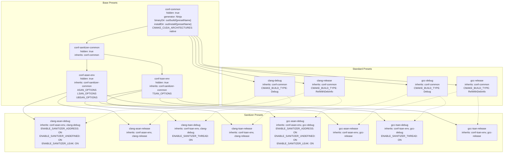

Sources: [CMakePresets.json:10-182]()

## Basic Build Workflow

### Step 1: Configure

Select a preset and configure the build:

```bash
cmake --preset clang-release
```

This command:
1. Reads configuration from [CMakePresets.json:1-288]()
2. Executes [CMakeLists.txt:16-112]() root configuration
3. Validates CUDA architectures via [Cuda.cmake]() module
4. Sets up compiler options through [ProjectOptions.cmake]()
5. Fetches dependencies via [Dependencies.cmake]()
6. Creates build directory at `out/build/clang-release/`

### Step 2: Build

Compile the configured project:

```bash
cmake --build out/build/clang-release
```

Or build specific targets:

```bash
cmake --build out/build/clang-release --target <target-name>
```

### Step 3: Run Tests

Execute the test suite using CTest:

```bash
ctest --preset clang-release
```

Test presets match configuration presets and include environment variables for GoogleTest and Google Benchmark color output and timing.

Sources: [README.md:130-139](), [CMakePresets.json:184-287]()

## Build Configuration Flow

```mermaid
graph LR
    subgraph "User Input"
        PresetCmd["cmake --preset clang-release"]
    end
    
    subgraph "CMakePresets.json Processing"
        LoadPreset["Load clang-release preset"]
        InheritConfCommon["Inherit from conf-common"]
        SetCompiler["Set CMAKE_CXX_COMPILER=clang++<br/>CMAKE_C_COMPILER=clang"]
        SetBuildType["Set CMAKE_BUILD_TYPE=RelWithDebInfo"]
        SetPaths["Set binaryDir: out/build/clang-release<br/>installDir: out/install/clang-release"]
        SetCuda["Set CMAKE_CUDA_ARCHITECTURES=native"]
        
        LoadPreset --> InheritConfCommon
        InheritConfCommon --> SetCompiler
        InheritConfCommon --> SetPaths
        InheritConfCommon --> SetCuda
        LoadPreset --> SetBuildType
    end
    
    subgraph "CMakeLists.txt Execution"
        ReadVersion["Read VERSION file<br/>Extract PROJECT_VERSION_BASE"]
        DeclareProject["project(framework<br/>VERSION {version}<br/>LANGUAGES CXX C ASM CUDA)"]
        CheckCuda["check_cuda_architectures()"]
        SetupOptions["setup_options()<br/>local_options()<br/>global_options()"]
        SetupDeps["setup_dependencies()"]
        EnableAnalysis["enable_static_analysis()"]
        AddSubdirs["add_subdirectory(framework)<br/>add_subdirectory(ran)<br/>add_subdirectory(docs)"]
        
        ReadVersion --> DeclareProject
        DeclareProject --> CheckCuda
        CheckCuda --> SetupOptions
        SetupOptions --> SetupDeps
        SetupDeps --> EnableAnalysis
        EnableAnalysis --> AddSubdirs
    end
    
    subgraph "Output"
        BuildFiles["Ninja build files<br/>in out/build/clang-release/"]
    end
    
    PresetCmd --> LoadPreset
    SetCuda --> ReadVersion
    AddSubdirs --> BuildFiles
```

Sources: [CMakeLists.txt:31-96](), [CMakePresets.json:56-75]()

## Build Types and Compiler Flags

### Debug Build Type

Debug builds (`CMAKE_BUILD_TYPE=Debug`) are configured with:
- Debug symbols enabled (`-g`)
- No optimization (`-O0`)
- Assertions enabled (no `-DNDEBUG`)
- Line info generation for profiling (`--generate-line-info` for CUDA)

Used by: `gcc-debug`, `clang-debug`, and all `-debug` sanitizer presets.

### RelWithDebInfo Build Type

Release with debug info builds (`CMAKE_BUILD_TYPE=RelWithDebInfo`) are configured with:
- Full optimization (`-O3`)
- Debug symbols enabled (`-g`)
- Assertions enabled (no `-DNDEBUG` by default)
- Suitable for profiling with Nsight Systems

Used by: `gcc-release`, `clang-release`, and all `-release` sanitizer presets.

Note: The project uses `RelWithDebInfo` instead of `Release` to retain debug symbols for profiling while maintaining release-level optimization.

Sources: [CMakePresets.json:34-75]()

## Sanitizer Configurations

### AddressSanitizer (ASan) + UndefinedBehaviorSanitizer (UBSan) + LeakSanitizer (LSan)

Detects memory errors, undefined behavior, and memory leaks. Enabled via:
- `ENABLE_SANITIZER_ADDRESS=ON`
- `ENABLE_SANITIZER_UNDEFINED=ON`
- `ENABLE_SANITIZER_LEAK=ON`

Environment variables configured in [CMakePresets.json:84-92]():
```bash
ASAN_OPTIONS="protect_shadow_gap=0:check_initialization_order=1:strict_init_order=1:print_stats=1:atexit=1"
LSAN_OPTIONS="print_stats=1:suppressions=${sourceDir}/tools/lsan_suppressions.txt"
UBSAN_OPTIONS="print_stats=1:halt_on_error=1:suppressions=${sourceDir}/tools/ubsan_suppressions.txt"
```

Available presets: `clang-asan-debug`, `clang-asan-release`, `gcc-asan-debug`, `gcc-asan-release`

### ThreadSanitizer (TSan)

Detects data races and threading issues. Enabled via:
- `ENABLE_SANITIZER_THREAD=ON`

Environment variables configured in [CMakePresets.json:95-101]():
```bash
TSAN_OPTIONS="print_stats=1:halt_on_error=1:suppressions=${sourceDir}/tools/tsan_suppressions.txt"
```

Available presets: `clang-tsan-debug`, `clang-tsan-release`, `gcc-tsan-debug`, `gcc-tsan-release`

**Note**: TSan is mutually exclusive with ASan/LSan. Do not enable both simultaneously.

Sources: [CMakePresets.json:78-182]()

## Common Build Options

The following CMake cache variables can be set to customize the build:

| Variable | Default | Description |
|----------|---------|-------------|
| `CMAKE_CXX_STANDARD` | `20` | C++ standard version |
| `CMAKE_CXX_EXTENSIONS` | `OFF` | Disable GNU extensions |
| `CMAKE_POSITION_INDEPENDENT_CODE` | `ON` | Enable PIC for all static libraries |
| `CMAKE_CUDA_ARCHITECTURES` | `native` | CUDA GPU architectures to target |
| `ENABLE_SANITIZER_ADDRESS` | `OFF` | Enable AddressSanitizer |
| `ENABLE_SANITIZER_LEAK` | `OFF` | Enable LeakSanitizer |
| `ENABLE_SANITIZER_UNDEFINED` | `OFF` | Enable UndefinedBehaviorSanitizer |
| `ENABLE_SANITIZER_THREAD` | `OFF` | Enable ThreadSanitizer |
| `ENABLE_IWYU` | `OFF` | Enable include-what-you-use analysis |
| `BUILD_DOCS` | Varies | Build documentation with Doxygen/Sphinx |
| `ENFORCE_DOCSTRINGS` | Varies | Fail build on missing docstrings |
| `CMAKE_SKIP_INSTALL_RULES` | `OFF` | Skip install rule generation |

### Setting Custom Options

Override options via command line:

```bash
cmake --preset clang-release -DCMAKE_CUDA_ARCHITECTURES="80;89" -DENABLE_IWYU=ON
```

Or create a `CMakeUserPresets.json` file for persistent local settings:

```json
{
    "version": 3,
    "configurePresets": [
        {
            "name": "my-custom",
            "inherits": "clang-release",
            "cacheVariables": {
                "CMAKE_CUDA_ARCHITECTURES": "80;89",
                "BUILD_DOCS": "ON"
            }
        }
    ]
}
```

Sources: [CMakeLists.txt:18-29](), [CMakePresets.json:16-18]()

## Build Output Structure

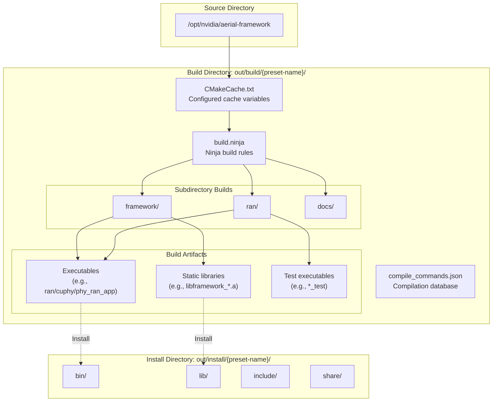

Sources: [CMakePresets.json:14-15](), [CMakeLists.txt:95-96]()

## Common Build Targets

### Primary Targets

The build system automatically creates targets for all source subdirectories:

- **All** - Default target, builds everything
  ```bash
  cmake --build out/build/clang-release
  ```

- **framework** - Build framework libraries only
  ```bash
  cmake --build out/build/clang-release --target framework
  ```

- **ran** - Build RAN components
  ```bash
  cmake --build out/build/clang-release --target ran
  ```

### Code Quality Targets

Defined in [CopyrightTargets.cmake]() and [IncludeGuardTargets.cmake]():

- **check-copyright** - Verify SPDX copyright headers
  ```bash
  cmake --build out/build/clang-release --target check-copyright
  ```

- **fix-copyright** - Automatically fix copyright headers
  ```bash
  cmake --build out/build/clang-release --target fix-copyright
  ```

- **check-include-guards** - Verify include guard format
  ```bash
  cmake --build out/build/clang-release --target check-include-guards
  ```

- **fix-include-guards** - Automatically fix include guards
  ```bash
  cmake --build out/build/clang-release --target fix-include-guards
  ```

### Documentation Targets

Defined in [docs/]() subdirectory:

- **docs** - Build all documentation (Doxygen + Sphinx)
  ```bash
  cmake --build out/build/clang-release --target docs
  ```

- **check-docstrings** - Verify docstring presence and format
  ```bash
  cmake --build out/build/clang-release --target check-docstrings
  ```

### Testing Targets

Test executables are automatically registered with CTest. Run all tests:

```bash
ctest --preset clang-release
```

Run specific test patterns:

```bash
ctest --preset clang-release -R "framework"
```

Sources: [CMakeLists.txt:69-102]()

## Running Tests

### Test Preset Configuration

Each configure preset has a matching test preset that inherits common test settings from `test-common` [CMakePresets.json:184-202]():

```json
{
    "output": {
        "outputOnFailure": true,
        "verbosity": "verbose"
    },
    "execution": {
        "noTestsAction": "error",
        "stopOnFailure": true
    },
    "environment": {
        "BENCHMARK_COLOR": "1",
        "GTEST_COLOR": "1",
        "GTEST_PRINT_TIME": "1"
    }
}
```

### Test Execution Examples

Run all tests for a preset:
```bash
ctest --preset clang-release
```

Run tests with verbose output:
```bash
ctest --preset clang-release --verbose
```

Run only tests matching a pattern:
```bash
ctest --preset clang-release -R "^framework_"
```

Run tests in parallel (4 jobs):
```bash
ctest --preset clang-release -j4
```

Re-run only failed tests:
```bash
ctest --preset clang-release --rerun-failed
```

Sources: [CMakePresets.json:184-287]()

## Compiler Selection and Caching

### Compiler Specification

Compilers are specified in preset cache variables [CMakePresets.json:38-42](), [CMakePresets.json:60-64]():

```json
"cacheVariables": {
    "CMAKE_C_COMPILER": "gcc",
    "CMAKE_CXX_COMPILER": "g++",
    "CMAKE_BUILD_TYPE": "Debug"
}
```

The CUDA compiler (`nvcc`) is automatically detected by CMake when `CUDA` is listed in `project()` languages [CMakeLists.txt:44]().

### Compiler Caching

The build system supports compiler caching with `ccache` or `sccache` for faster incremental builds. This is configured through the [ProjectOptions.cmake]() module. See [Compiler Caching](#7.3) for details.

Sources: [CMakeLists.txt:39-44](), [CMakePresets.json:38-75]()

## CUDA Architecture Configuration

### Native Architecture Detection

By default, all presets set `CMAKE_CUDA_ARCHITECTURES` to `native` [CMakePresets.json:17]():

```json
"cacheVariables": {
    "CMAKE_CUDA_ARCHITECTURES": "native"
}
```

This auto-detects the GPU architecture of the system during configuration. The [Cuda.cmake]() module validates that CUDA architectures are properly set via `check_cuda_architectures()` [CMakeLists.txt:47-48]().

### Explicit Architecture Targeting

Override for specific architectures:

```bash
# Target Ampere (compute capability 8.0) and Ada Lovelace (8.9)
cmake --preset clang-release -DCMAKE_CUDA_ARCHITECTURES="80;89"

# Target only Hopper (compute capability 9.0)
cmake --preset clang-release -DCMAKE_CUDA_ARCHITECTURES="90"
```

Common NVIDIA GPU architectures:
- `75` - Turing (T4)
- `80` - Ampere (A100)
- `86` - Ampere (RTX 30xx)
- `89` - Ada Lovelace (RTX 40xx, L40S)
- `90` - Hopper (H100)

Sources: [CMakePresets.json:16-18](), [CMakeLists.txt:46-48]()

## Python Environment Integration

The project includes Python components that can be installed after building the C++/CUDA framework. The [Python.cmake]() module is loaded [CMakeLists.txt:62]() to enable static analysis tools.

### Installing Python Packages

After building the framework, install the RAN Python package:

```bash
cd ran/py && uv sync
```

This uses `uv` (ultra-fast Python package installer) to set up the Python environment with all dependencies.

Sources: [README.md:137-139](), [CMakeLists.txt:62-63]()

## Troubleshooting Build Issues

### CUDA Architecture Not Set

**Error**: "CMake Error: CMAKE_CUDA_ARCHITECTURES must be set"

**Solution**: Ensure you're using a preset or explicitly set:
```bash
cmake --preset clang-release  # Uses native
# OR
cmake -S . -B build -DCMAKE_CUDA_ARCHITECTURES=native
```

### Out-of-Source Build Violation

**Error**: "In-source builds not allowed"

**Solution**: The project enforces out-of-source builds via [PreventInSourceBuilds.cmake]() [CMakeLists.txt:50](). Always build in a separate directory (presets automatically use `out/build/{preset-name}/`).

### Sanitizer Conflicts

**Error**: Crashes or conflicts when running sanitizer builds

**Solution**: 
- Do not mix TSan with ASan/LSan (they are mutually exclusive)
- Use only one sanitizer preset at a time
- Check suppression files in `tools/*_suppressions.txt`

### Missing Dependencies

**Error**: "Could not find package XYZ"

**Solution**: Dependencies are automatically fetched via CPM in [Dependencies.cmake](). Ensure:
- Internet connection is available for first-time builds
- CPM cache directory is writable
- See [Dependency Management with CPM](#4.3) for details

### Compilation Warnings as Errors

**Error**: Build fails on warnings

**Solution**: The project treats warnings as errors by default (configured in [CompilerWarnings.cmake]()). Either fix the warnings or temporarily disable with:
```bash
cmake --preset clang-release -DWARNINGS_AS_ERRORS=OFF
```

Sources: [CMakeLists.txt:50-60]()

## Build System Variables

### Version Information

The project version is read from the `VERSION` file [CMakeLists.txt:31-36]():

```cmake
file(STRINGS "${CMAKE_SOURCE_DIR}/VERSION" PROJECT_VERSION_FULL)
string(STRIP "${PROJECT_VERSION_FULL}" PROJECT_VERSION_FULL)
string(REGEX MATCH "^[0-9]+\\.[0-9]+\\.[0-9]+" PROJECT_VERSION_BASE "${PROJECT_VERSION_FULL}")
```

The full version (e.g., `0.1.0-rc.3`) is stored in `PROJECT_VERSION_FULL`, while the base version (e.g., `0.1.0`) is used for CMake's `project(VERSION)`.

### Git Information

Git SHA information is captured [CMakeLists.txt:79-82]():

```cmake
set(GIT_SHA "Unknown" CACHE STRING "SHA this build was generated from")
string(SUBSTRING "${GIT_SHA}" 0 8 GIT_SHORT_SHA)
```

This is typically set by CI/CD systems or can be manually specified:
```bash
cmake --preset clang-release -DGIT_SHA=$(git rev-parse HEAD)
```

### Position Independent Code

Position-independent code is enabled globally [CMakeLists.txt:27-29]():

```cmake
# Enable position-independent code globally for all static libraries
# Required for CUDA device linking and potential shared library usage
set(CMAKE_POSITION_INDEPENDENT_CODE ON)
```

This is required for CUDA device linking and future shared library support.

Sources: [CMakeLists.txt:27-82]()

---

# Page: Framework Architecture

# Framework Architecture

<details>
<summary>Relevant source files</summary>

The following files were used as context for generating this wiki page:

- [README.md](README.md)

</details>


## Purpose and Scope

This document provides a comprehensive overview of the NVIDIA Aerial Framework's architecture, explaining its two-tier design and the development workflow that bridges algorithm development to real-time execution. The framework is designed to meet the microsecond-latency requirements of 3GPP Radio Access Networks while maintaining developer productivity.

For detailed information about specific components:
- Developer tools (JAX/PyTorch compilation, MLIR-TensorRT, profiling) are covered in [Developer Tools](#3.1)
- Runtime components (CUDA graphs, task scheduler, DOCA GPUNetIO) are detailed in [Runtime Engine](#3.2)
- The six-stage development workflow is explained in [Development Workflow](#3.3)

For build system configuration and project setup, see [Build System](#4).

**Sources:** [README.md:1-178]()

## Overview

The Aerial Framework addresses the fundamental challenge of 3GPP RAN signal processing: achieving microsecond-level latency while maintaining developer productivity. It accomplishes this through a two-tier architecture that cleanly separates algorithm development from runtime execution.

The framework combines:
1. **Developer Tools** - Tools to convert Python/JAX/PyTorch and C++/CUDA into pipelines of GPU-native code
2. **Runtime Engine** - Coordinates the execution of GPU pipelines with network interfaces

This separation allows developers to prototype algorithms in high-level languages (Python, JAX, PyTorch) and then compile them to optimized GPU code that executes with deterministic, real-time performance.

**Sources:** [README.md:46-61]()

## Two-Tier Architecture

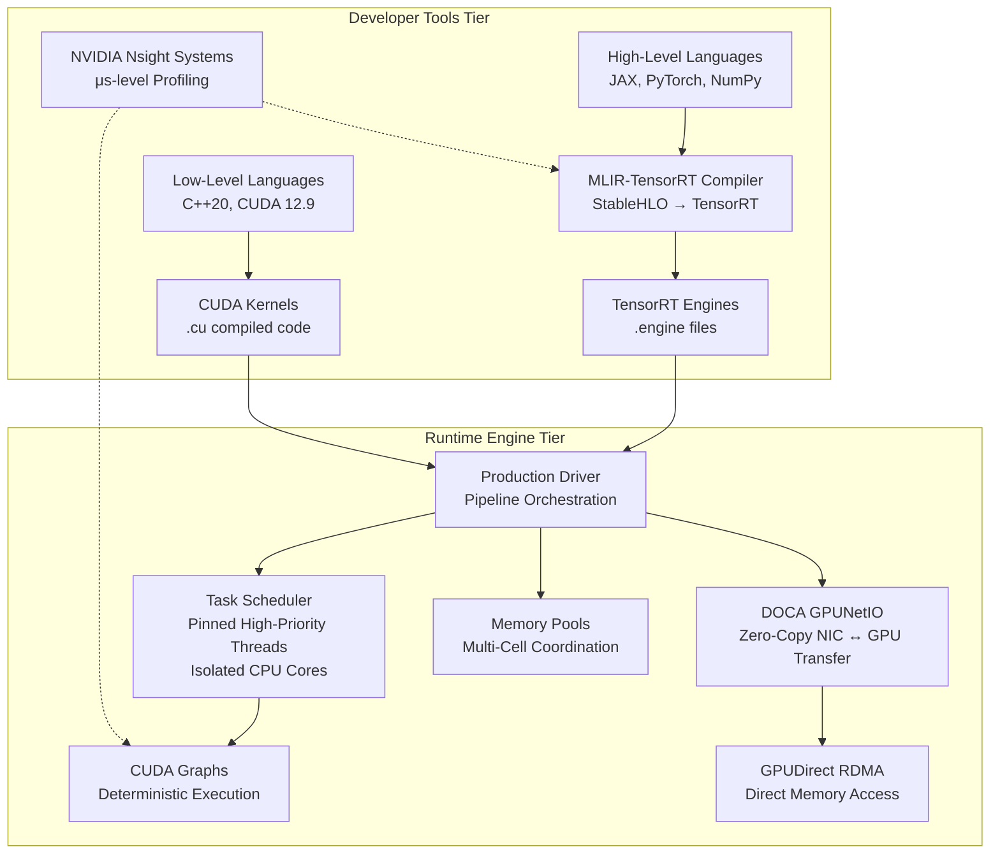

**Diagram: Two-Tier Architecture Components**

The framework's architecture consists of two distinct tiers that work together to enable the development-to-deployment workflow:

### Developer Tools Tier

The Developer Tools tier provides the environment for algorithm development and optimization. It supports:

- **Multi-language development**: Algorithms can be authored in high-level languages (JAX, PyTorch, NumPy) or low-level languages (C++20, CUDA 12.9)
- **JAX → TensorRT compilation**: JAX programs are exported to StableHLO intermediate representation and lowered to TensorRT engines using the MLIR-TensorRT compiler
- **Performance profiling**: NVIDIA Nsight Systems provides microsecond-level profiling capabilities for optimization
- **AI-native integration**: Seamless integration with AI frameworks enables end-to-end differentiability

The output of this tier consists of compiled TensorRT engines (`.engine` files) and CUDA kernels that can be deployed to the runtime environment.

**Sources:** [README.md:50-55]()

### Runtime Engine Tier

The Runtime Engine tier provides deterministic, real-time execution of compiled pipelines. It consists of:

- **Production Driver**: Orchestrates pipeline execution, manages memory pools, and coordinates multi-cell operations
- **Task Scheduler**: Manages pinned, high-priority threads on isolated CPU cores to enforce microsecond slot timing
- **CUDA Graphs**: GPU operations execute as CUDA graphs with TensorRT integration for deterministic execution
- **DOCA GPUNetIO**: Provides inline GPU networking with zero-copy packet transfer between NIC and GPU
- **GPUDirect RDMA**: Enables direct memory access between network interface and GPU memory

This tier is designed to meet the strict latency requirements of 3GPP RAN workloads, with execution timing controlled at the microsecond level.

**Sources:** [README.md:56-61]()

## Development and Runtime Environments

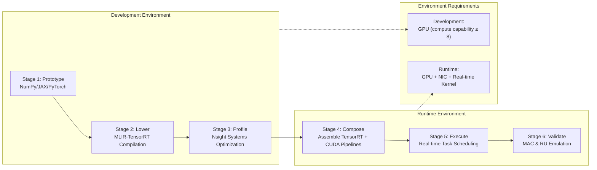

**Diagram: Development and Runtime Environment Separation**

The Aerial Framework distinguishes between two operational environments:

### Development Environment

The Development environment is designed for algorithm prototyping and optimization. It requires:
- GPU with compute capability ≥ 8.0
- Standard Linux system (real-time kernel not required)

This environment is accessible to any developer with a recent NVIDIA GPU and supports the first three workflow stages: Prototype, Lower, and Profile.

### Runtime Environment

The Runtime environment is designed for deployment and validation. It requires:
- GPU with compute capability ≥ 8.0
- High-performance NIC (for DOCA GPUNetIO)
- Real-time Linux kernel (for deterministic scheduling)
- MAC and RU emulators (for PHY validation)

This environment supports the final three workflow stages: Compose, Execute, and Validate.

**Sources:** [README.md:74-124]()

## Six-Stage Development Workflow

The framework provides a six-stage workflow that bridges development productivity with runtime performance:

| Stage | Description | Environment | Input | Output |
|-------|-------------|-------------|-------|--------|
| **Prototype** | Write and validate algorithms in high-level languages | Development | Algorithm requirements | NumPy/JAX/PyTorch implementation |
| **Lower** | Compile Python code into GPU executables | Development | JAX/PyTorch functions | TensorRT engines, CUDA kernels |
| **Profile** | Optimize performance with profiling tools | Development | Compiled code | Performance metrics, optimizations |
| **Compose** | Assemble engines and kernels into modular pipelines | Runtime | TensorRT engines, CUDA kernels | Pipeline configuration |
| **Execute** | Run with real-time task scheduling and networking | Runtime | Pipeline configuration | Live execution |
| **Validate** | Test PHY applications with MAC/RU emulators | Runtime | Complete pipeline | Standards-compliant validation |

**Table: Six-Stage Development Workflow**

This workflow bridges:
- **Development Productivity**: Write in high-level languages with rich ecosystems
- **Runtime Performance**: Execute with the speed and determinism of optimized C++
- **Low Latency Requirements**: Meet strict timing and latency constraints for 3GPP RAN

For detailed explanations of each stage, see [Development Workflow](#3.3).

**Sources:** [README.md:82-124]()

## Pipeline Composition and Execution

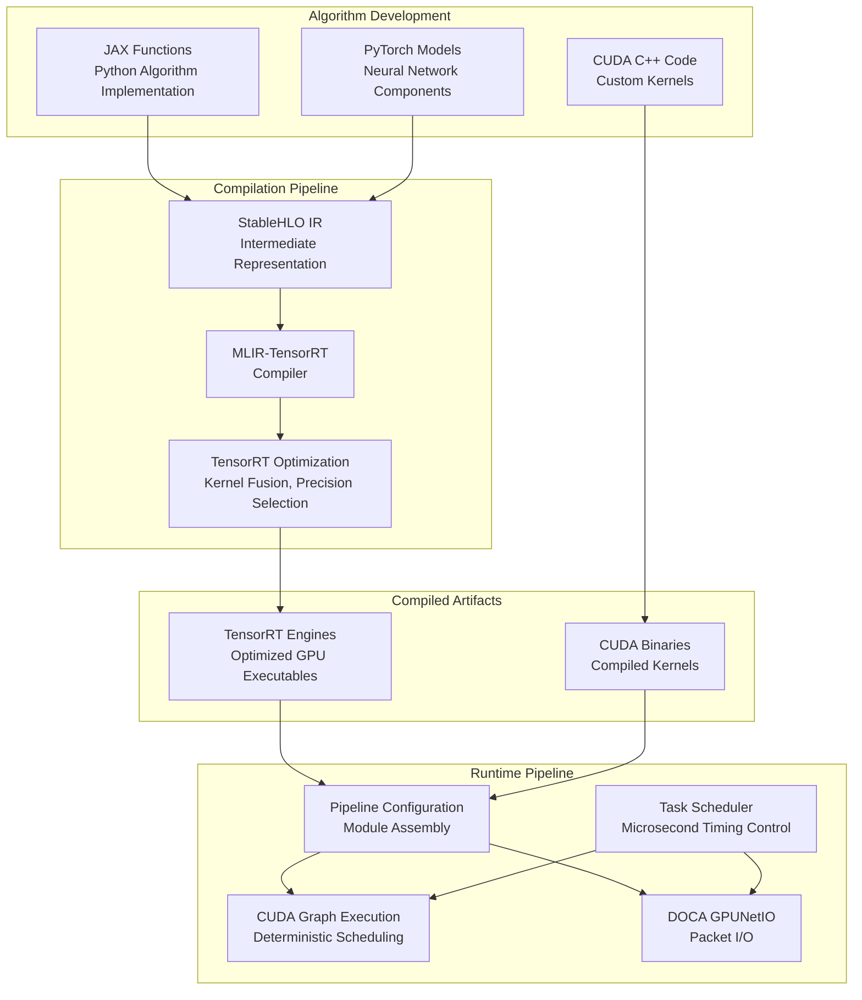

**Diagram: Pipeline Composition from Algorithm to Runtime Execution**

### Algorithm-to-Runtime Flow

The framework enables a structured flow from algorithm development to runtime execution:

1. **Algorithm Development**: Algorithms are implemented in JAX, PyTorch, or CUDA C++
2. **Compilation**: JAX and PyTorch code is lowered to StableHLO, then compiled through MLIR-TensorRT to produce optimized TensorRT engines. CUDA C++ is compiled directly to binaries.
3. **Compiled Artifacts**: The result is a collection of TensorRT engines and CUDA binaries that can be deployed
4. **Runtime Pipeline**: The production driver assembles these compiled artifacts into pipelines, which execute through CUDA graphs with deterministic scheduling and DOCA GPUNetIO for networking

This architecture ensures that the same codebase can be used for prototyping, simulation, testing, and deployment, with clean separation between algorithm logic and runtime execution details.

**Sources:** [README.md:46-61](), [README.md:82-124]()

## Integration with NVIDIA Technologies

The framework integrates deeply with NVIDIA's technology stack:

- **CUDA 12.9**: Provides the GPU computing foundation with support for CUDA graphs and deterministic execution
- **TensorRT**: Inference optimization engine that executes compiled neural network components
- **MLIR-TensorRT**: Compiler infrastructure that lowers StableHLO to TensorRT engines
- **DOCA GPUNetIO**: GPU-native networking stack enabling zero-copy packet transfer
- **GPUDirect RDMA**: Direct memory access between network adapters and GPU memory
- **Nsight Systems**: Profiling tool providing microsecond-level performance analysis

These technologies are integrated through the build system. For details on dependency management, see [Dependencies and Integration](#5) and [NVIDIA Technologies](#5.1).

**Sources:** [README.md:1-11](), [README.md:19](), [README.md:50-61]()

## Target Applications

The framework is designed for 3GPP Radio Access Networks with specific focus on:

- **5G Advanced (5G-A)**: Current generation standards requiring microsecond-level latency
- **6G networks**: Future generation standards with AI-native processing requirements
- **Signal processing workloads**: Applications with strict latency constraints and high throughput requirements

The repository includes an example AI-native PUSCH (Physical Uplink Shared Channel) pipeline demonstrating the framework's capabilities for real-time PHY processing.

**Sources:** [README.md:14](), [README.md:32]()

## Key Architectural Characteristics

The framework's architecture is characterized by:

1. **Clean Separation**: Algorithm development is decoupled from runtime execution, allowing independent optimization of each
2. **Modular Pipelines**: End-to-end pipelines are composed from compiled, executable modules
3. **Deterministic Execution**: CUDA graphs and task scheduling ensure predictable, microsecond-level timing
4. **Zero-Copy Data Paths**: DOCA GPUNetIO and GPUDirect RDMA eliminate CPU memory copies
5. **Observability**: Built-in hooks for profiling and monitoring throughout the development process
6. **Unified Codebase**: The same components are reused across prototyping, simulation, testing, and deployment

These characteristics enable the framework to meet the stringent requirements of real-time signal processing while maintaining developer productivity.

**Sources:** [README.md:24-32]()

---

# Page: Developer Tools

# Developer Tools

<details>
<summary>Relevant source files</summary>

The following files were used as context for generating this wiki page:

- [README.md](README.md)
- [cmake/Dependencies.cmake](cmake/Dependencies.cmake)

</details>


## Overview

The Developer Tools layer provides the foundational infrastructure for developing, compiling, and optimizing signal processing algorithms for real-time execution on GPUs. This layer enables developers to prototype algorithms in high-level languages (JAX, PyTorch, NumPy) and low-level languages (C++20, CUDA 12.9), then compile them to optimized GPU code through the MLIR-TensorRT compiler pipeline. The tools also provide microsecond-level profiling capabilities through NVIDIA Nsight Systems.

This page covers the first three stages of the development workflow: **Prototype**, **Lower**, and **Profile** (see [Development Workflow](#3.3) for complete workflow details). For information about runtime execution, see [Runtime Engine](#3.2). For build system configuration, see [Build System](#4).

**Sources:** [README.md:46-60](), [README.md:82-124]()

---

## Language Support Architecture

The Aerial Framework supports a dual-language development model that separates algorithm prototyping from performance optimization:

### High-Level Languages

| Language | Version | Purpose | Compilation Path |
|----------|---------|---------|------------------|
| **Python** | 3.12+ | Development environment, package management | Interpreted |
| **NumPy** | Latest | Algorithm prototyping and validation | Via JAX/PyTorch |
| **JAX** | Latest | Functional ML framework, XLA compiler | StableHLO → MLIR-TensorRT → TensorRT |
| **PyTorch** | Latest | Imperative ML framework | TorchScript/ONNX → TensorRT |

### Low-Level Languages

| Language | Version | Purpose | Compilation Path |
|----------|---------|---------|------------------|
| **C++** | C++20 | Performance-critical kernels, framework code | nvcc/g++/clang++ → CUDA kernels |
| **CUDA** | 12.9 | GPU kernel implementation | nvcc → PTX/CUBIN |

**Sources:** [README.md:5-8](), [README.md:19](), [README.md:29]()

---

## Compilation Pipeline

The following diagram shows how high-level algorithm code is lowered to GPU-executable formats:

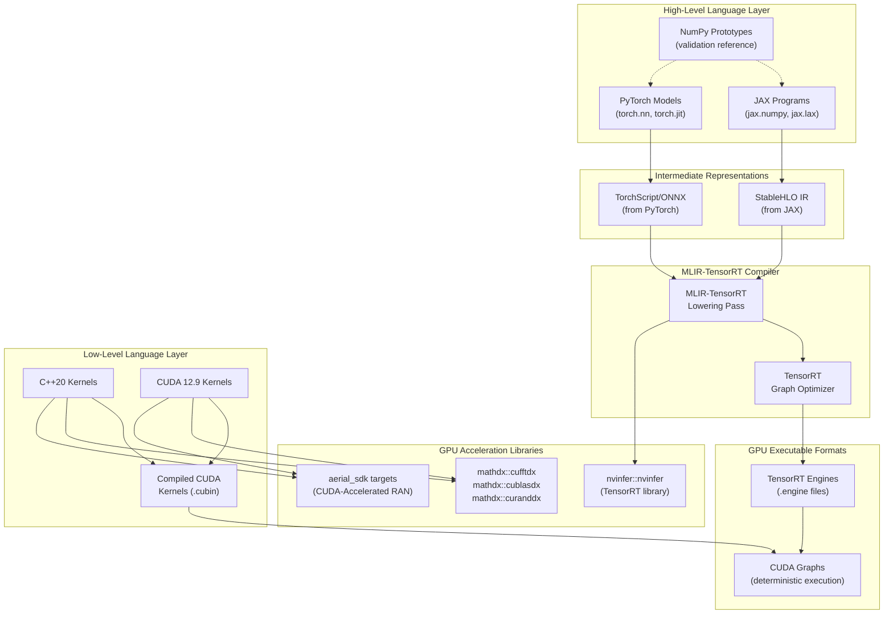

**Compilation Pipeline Stages:**

1. **Algorithm Prototyping** - Developers write algorithms in JAX or PyTorch, using NumPy-compatible APIs for validation
2. **IR Generation** - JAX exports to StableHLO; PyTorch exports to TorchScript or ONNX
3. **MLIR-TensorRT Lowering** - The compiler transforms high-level operations to TensorRT-compatible graph operations
4. **TensorRT Optimization** - TensorRT's graph optimizer performs fusion, precision selection, and memory optimization
5. **Engine Serialization** - Optimized graphs are serialized to `.engine` files for runtime execution
6. **CUDA Graph Integration** - TensorRT engines and custom CUDA kernels are integrated into CUDA graphs for deterministic execution

**Sources:** [README.md:51-54](), [README.md:96-103]()

---

## GPU Acceleration Library Stack

The developer tools integrate multiple GPU-accelerated libraries for mathematical operations and signal processing:

### TensorRT Integration

TensorRT provides GPU inference optimization for deep learning models compiled from JAX and PyTorch.

**CMake Integration:**
- Module: [cmake/Nvinfer.cmake]()
- Target: `nvinfer::nvinfer`
- Usage: Linked via `target_link_nvinfer()` macro

The TensorRT library is configured as a required dependency and must be available in the system library paths.

**Sources:** [cmake/Dependencies.cmake:175-179]()

### MathDx Library Suite

MathDx provides header-only GPU-accelerated mathematical operations:

| Component | Target | Purpose |
|-----------|--------|---------|
| **cuFFTDx** | `mathdx::cufftdx` | Fast Fourier Transform operations |
| **cuBLASDx** | `mathdx::cublasdx` | Basic Linear Algebra Subprograms |
| **cuRANDDx** | `mathdx::curanddx` | Random number generation |
| **cuSOLVERDx** | `mathdx::cusolverDx` | Linear system solvers |

**CMake Integration:**
- Module: [cmake/MathDx.cmake]()
- Usage: Link with `target_link_mathdx(your_target COMPONENTS cufftdx cublasdx)` with explicit component arguments

These are header-only libraries that generate optimized GPU code at compile time.

**Sources:** [cmake/Dependencies.cmake:168-173]()

### Aerial SDK (ACAR)

The CUDA-Accelerated RAN (ACAR) library provides pre-optimized signal processing kernels for 3GPP RAN operations.

**CMake Integration:**
- Module: [cmake/Acar.cmake]()
- Source download: `download_acar_source()`
- LDPC decoder CUBIN: `download_ldpc_decoder_cubin()`
- Target setup: `setup_acar_targets()`

The Aerial SDK is integrated as a subdirectory after its dependencies (fmt, fmtlog) are configured.

**Sources:** [cmake/Dependencies.cmake:33](), [cmake/Dependencies.cmake:286-296]()

---

## Profiling and Optimization

### NVIDIA Nsight Systems

Nsight Systems provides microsecond-level profiling for GPU workloads, enabling developers to optimize individual kernels and end-to-end pipelines.

**Profiling Capabilities:**
- **Timeline Visualization** - View CPU and GPU activity on a unified timeline
- **Kernel Performance** - Measure kernel execution time, occupancy, and memory bandwidth
- **API Tracing** - Track CUDA API calls, memory transfers, and synchronization points
- **CUDA Graph Profiling** - Analyze CUDA graph execution and identify bottlenecks
- **TensorRT Engine Profiling** - Inspect layer-by-layer execution in TensorRT engines

**Debug Configuration:**

Debug builds include `--generate-line-info` flag for source-level profiling in Nsight Systems. This enables line-by-line performance attribution within kernels.

**Build Configuration:**
- Debug builds: `-g -O0` with line info generation
- Release builds: `-O3 -DNDEBUG` for maximum performance
- See [Build Presets](#4.2) for detailed compiler flags

**Workflow Integration:**

The **Profile** stage in the development workflow occurs after the **Lower** stage. Developers use Nsight Systems to:
1. Identify performance bottlenecks in compiled TensorRT engines
2. Optimize custom CUDA kernel implementations
3. Validate that latency requirements (microsecond-level) are met
4. Compare performance between different algorithm implementations

**Sources:** [README.md:53](), [README.md:100-103]()

---

## Development Workflow Integration

The developer tools support the first three stages of the six-stage development-to-deployment workflow:

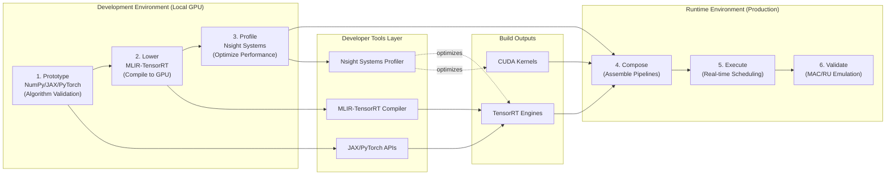

**Stage Descriptions:**

### 1. Prototype Stage
- **Environment:** Any machine with Python 3.12+ and a GPU (compute capability ≥ 8)
- **Languages:** NumPy, JAX, PyTorch
- **Purpose:** Develop and validate algorithm correctness
- **Outputs:** Python implementations ready for lowering

### 2. Lower Stage
- **Tool:** MLIR-TensorRT compiler
- **Input:** JAX/PyTorch programs
- **Process:** StableHLO → MLIR → TensorRT graph → Engine serialization
- **Output:** `.engine` files (compiled TensorRT engines)

### 3. Profile Stage
- **Tool:** NVIDIA Nsight Systems
- **Input:** TensorRT engines, CUDA kernels
- **Process:** Execute and measure performance on GPU
- **Output:** Performance data, bottleneck identification
- **Goal:** Achieve microsecond-level timing requirements

**Environment Requirements:**

| Requirement | Development | Runtime |
|-------------|-------------|---------|
| **Python** | 3.12+ | Optional |
| **C++ Compiler** | C++20 (GCC/Clang) | C++20 (GCC/Clang) |
| **CUDA** | 12.9 | 12.9 |
| **GPU Compute Capability** | ≥ 8.0 | ≥ 8.0 |
| **Real-time Kernel** | No | Yes |
| **NIC** | No | Yes (ConnectX) |

**Sources:** [README.md:74-124]()

---

## Python Development Environment

### Package Management with `uv`

The Aerial Framework uses `uv` for fast, reliable Python package management. Example Python packages are located in the `ran/py/` directory.

**Installation:**
```bash
cd ran/py && uv sync
```

This creates an isolated virtual environment with all Python dependencies for RAN examples.

**Sources:** [README.md:10](), [README.md:138-139]()

### Python Code Quality with Ruff

Python code quality is enforced using Ruff, a fast Python linter and formatter.

**Configuration File:** [.ruff.toml]()

**Key Checks:**
- PEP 8 enforcement
- Type annotation validation
- Docstring conventions
- Cyclomatic complexity limits

See [Python Code Quality](#6.3) for detailed configuration.

**Sources:** [README.md:9]()

---

## C++ Development Environment

### Language Standard: C++20

The framework requires C++20 for modern C++ features:
- Concepts and constraints
- Ranges library
- Coroutines
- Three-way comparison operator (`<=>`)
- Modules (where supported)

### CUDA 12.9 Integration

CUDA kernels are compiled using nvcc with C++20 compatibility mode.

**CMake Configuration:**
- Module: [cmake/Cuda.cmake]()
- CUDA architecture detection
- `target_link_cuda()` macro for linking CUDA libraries

See [CUDA and GPU Configuration](#4.4) for detailed build settings.

**Sources:** [README.md:6-7](), [README.md:19]()

---

## Multi-Language Integration

The developer tools enable seamless integration between high-level and low-level code:

```mermaid
graph TB
    subgraph "Algorithm Layer"
        JAXAlgo["JAX Algorithm<br/>(e.g., FIR filter)"]
        PyTorchAlgo["PyTorch Model<br/>(e.g., neural channel estimator)"]
        CPPKernel["C++ Kernel<br/>(e.g., LDPC decoder)"]
        CUDAKernel["CUDA Kernel<br/>(e.g., FFT)"]
    end
    
    subgraph "Compilation"
        JAXCompile["jax.jit compilation"]
        TorchCompile["torch.compile"]
        CPPCompile["nvcc/g++ compilation"]
    end
    
    subgraph "Intermediate Format"
        StableHLO["StableHLO IR"]
        TorchIR["TorchScript IR"]
        CUDAObj["CUDA Object Files"]
    end
    
    subgraph "GPU Executable"
        TRTEngine1["TensorRT Engine 1<br/>(FIR filter)"]
        TRTEngine2["TensorRT Engine 2<br/>(channel estimator)"]
        CUDABinary["CUDA Binary<br/>(LDPC/FFT kernels)"]
    end
    
    subgraph "Pipeline Composition"
        Pipeline["GPU Pipeline<br/>(TensorRT + CUDA)"]
        CUDAGraphPipeline["CUDA Graph<br/>(deterministic execution)"]
    end
    
    JAXAlgo --> JAXCompile
    PyTorchAlgo --> TorchCompile
    CPPKernel --> CPPCompile
    CUDAKernel --> CPPCompile
    
    JAXCompile --> StableHLO
    TorchCompile --> TorchIR
    CPPCompile --> CUDAObj
    
    StableHLO --> TRTEngine1
    TorchIR --> TRTEngine2
    CUDAObj --> CUDABinary
    
    TRTEngine1 --> Pipeline
    TRTEngine2 --> Pipeline
    CUDABinary --> Pipeline
    
    Pipeline --> CUDAGraphPipeline
```

**Integration Points:**

1. **Python ↔ C++:** Python code is lowered to TensorRT engines that execute alongside C++/CUDA kernels
2. **JAX ↔ TensorRT:** JAX programs export to StableHLO, then lower to TensorRT via MLIR-TensorRT
3. **PyTorch ↔ TensorRT:** PyTorch models export to TorchScript or ONNX, then convert to TensorRT
4. **TensorRT ↔ CUDA:** TensorRT engines and custom CUDA kernels compose into unified CUDA graphs
5. **End-to-End Differentiability:** JAX's automatic differentiation extends through the entire pipeline

**Example Use Case:**

A PUSCH (Physical Uplink Shared Channel) receiver pipeline might combine:
- **JAX-compiled TensorRT engine** for channel estimation
- **PyTorch-compiled TensorRT engine** for neural network-based filtering
- **C++ CUDA kernel** for LDPC decoding (using Aerial SDK)
- **cuFFTDx-based kernel** for FFT operations (using MathDx)

All components execute within a single CUDA graph for deterministic, microsecond-level timing.

**Sources:** [README.md:52](), [README.md:54]()

---

## CMake Integration

### Dependency Management

All developer tools dependencies are managed through the CPM (CMake Package Manager):

```mermaid
graph TB
    CPM["CPM.cmake<br/>(v0.40.8)"]
    
    subgraph "NVIDIA Libraries"
        TensorRT["TensorRT<br/>(nvinfer::nvinfer)"]
        MathDx["MathDx Libraries<br/>(cuFFTDx, cuBLASDx, etc.)"]
        AerialSDK["Aerial SDK<br/>(CUDA-Accelerated RAN)"]
        GDRCopy["GDRCopy 2.5<br/>(GPU Direct RDMA)"]
    end
    
    subgraph "CMake Modules"
        Nvinfer["cmake/Nvinfer.cmake"]
        MathDxModule["cmake/MathDx.cmake"]
        Acar["cmake/Acar.cmake"]
        GDRModule["cmake/GDRCopy.cmake"]
    end
    
    subgraph "C++ Support Libraries"
        fmt["fmt 10.2.1"]
        Quill["Quill 10.0.1"]
        CLI11["CLI11 v2.5.0"]
        yaml["yaml-cpp 0.8.0"]
    end
    
    CPM --> Nvinfer
    CPM --> MathDxModule
    CPM --> Acar
    CPM --> GDRModule
    CPM --> fmt
    CPM --> Quill
    CPM --> CLI11
    CPM --> yaml
    
    Nvinfer --> TensorRT
    MathDxModule --> MathDx
    Acar --> AerialSDK
    GDRModule --> GDRCopy
```

**CMake Functions:**

| Function | Purpose | Example |
|----------|---------|---------|
| `setup_dependencies()` | Initialize all dependencies | Called from root CMakeLists.txt |
| `target_link_nvinfer()` | Link TensorRT library | `target_link_nvinfer(my_target)` |
| `target_link_mathdx()` | Link MathDx components | `target_link_mathdx(my_target COMPONENTS cufftdx)` |
| `download_acar_source()` | Download Aerial SDK source | Called before ACAR setup |
| `setup_acar_targets()` | Configure Aerial SDK targets | Called after fmt/fmtlog setup |

**CPM Cache:**

By default, CPM caches downloaded packages in `~/.cache/CPM`. Override with:
```bash
export CPM_SOURCE_CACHE=/custom/path
```
or
```bash
cmake -DCPM_SOURCE_CACHE=/custom/path ...
```

**Sources:** [cmake/Dependencies.cmake:18-29](), [cmake/Dependencies.cmake:31](), [cmake/Dependencies.cmake:37-410]()

---

## Testing Integration

### Google Benchmark for Performance Testing

The developer tools integrate Google Benchmark for microbenchmarking compiled kernels and TensorRT engines.

**CMake Integration:**
```cmake
CPMAddPackage(
    NAME benchmark
    GITHUB_REPOSITORY google/benchmark
    GIT_TAG v1.9.4
    OPTIONS
        "BENCHMARK_ENABLE_TESTING OFF"
        "BENCHMARK_ENABLE_GTEST_TESTS OFF"
)
```

**Usage:**
- Module: [cmake/Benchmarks.cmake]()
- Function: `add_benchmark(target_name source_files...)`
- Output: JSON results in `benchmark_results/` directory

See [Testing and Benchmarking](#4.6) for detailed usage.

**Sources:** [cmake/Dependencies.cmake:56-69]()

---

## Summary

The Developer Tools layer provides a comprehensive toolchain for developing real-time signal processing applications:

- **Multi-Language Support:** Seamless integration between high-level (JAX/PyTorch) and low-level (C++/CUDA) languages
- **MLIR-TensorRT Compilation:** Automated lowering from Python to optimized GPU code
- **GPU Acceleration:** Integrated TensorRT, MathDx, and Aerial SDK libraries
- **Profiling:** Microsecond-level optimization with Nsight Systems
- **CMake Integration:** Managed dependencies via CPM with modular CMake configuration

These tools enable the first three stages of the development workflow (Prototype, Lower, Profile) and produce compiled outputs (TensorRT engines, CUDA kernels) that integrate with the [Runtime Engine](#3.2) for deterministic execution.

**Sources:** [README.md:46-60](), [README.md:74-124]()

---

# Page: Runtime Engine

# Runtime Engine

<details>
<summary>Relevant source files</summary>

The following files were used as context for generating this wiki page:

- [README.md](README.md)
- [cmake/Cuda.cmake](cmake/Cuda.cmake)
- [cmake/Doca.cmake](cmake/Doca.cmake)

</details>


## Purpose and Scope

The Runtime Engine is the production execution layer of the Aerial Framework, responsible for orchestrating GPU pipelines with deterministic microsecond-level timing and high-performance networking. It executes compiled TensorRT engines and CUDA kernels in real-time environments with strict latency requirements typical of 3GPP RAN applications.

This page covers the runtime execution components: CUDA graph execution, task scheduling, GPU networking via DOCA GPUNetIO, and pipeline orchestration. For information about compiling Python/JAX code to TensorRT engines, see [Developer Tools](#3.1). For the overall development-to-deployment workflow, see [Development Workflow](#3.3).

**Sources:** [README.md:46-61]()

## Architecture Overview

The Runtime Engine consists of four primary subsystems that work together to achieve deterministic, low-latency execution:

```mermaid
graph TB
    subgraph RuntimeEngine["Runtime Engine"]
        Driver["Production Driver<br/>(Pipeline Orchestration)"]
        Scheduler["Task Scheduler<br/>(Pinned High-Priority Threads)"]
        CUDAGraphs["CUDA Graph Executor<br/>(Deterministic GPU Execution)"]
        Networking["DOCA GPUNetIO<br/>(Zero-Copy Packet Transfer)"]
    end
    
    subgraph CompiledArtifacts["Compiled Artifacts"]
        TRTEngines["TensorRT Engines<br/>(Compiled from JAX/PyTorch)"]
        CUDAKernels["CUDA Kernels<br/>(Custom C++/CUDA)"]
    end
    
    subgraph HardwareLayer["Hardware Layer"]
        GPU["GPU Device Memory"]
        NIC["Network Interface Card"]
        CPUCores["Isolated CPU Cores"]
        RDMA["GPUDirect RDMA"]
    end
    
    Driver --> Scheduler
    Driver --> CUDAGraphs
    Driver --> Networking
    
    Scheduler --> CPUCores
    
    CUDAGraphs --> TRTEngines
    CUDAGraphs --> CUDAKernels
    CUDAGraphs --> GPU
    
    Networking --> NIC
    Networking --> RDMA
    RDMA --> GPU
    
    TRTEngines --> GPU
    CUDAKernels --> GPU
```

**Sources:** [README.md:56-61]()

## CUDA Graph Execution

The Runtime Engine uses CUDA graphs to ensure deterministic execution of GPU operations. CUDA graphs capture the entire execution topology as a directed acyclic graph, eliminating kernel launch overhead and enabling replay with minimal CPU involvement.

### Configuration for CUDA Graphs

CUDA targets in the framework are configured with specific compilation properties to support graph execution:

| Property | Value | Purpose |
|----------|-------|---------|
| `CUDA_SEPARABLE_COMPILATION` | `ON` | Enables separate compilation of device code for modular kernels |
| `CUDA_RESOLVE_DEVICE_SYMBOLS` | `ON` | Resolves device symbols when linking static libraries |
| `POSITION_INDEPENDENT_CODE` | `ON` | Required for shared library integration |

### Compilation Flags

Debug builds include line-level information for profiling:

- `--generate-line-info` flag is automatically added for `Debug` and `RelWithDebInfo` configurations
- Enables microsecond-level profiling with NVIDIA Nsight Systems
- Allows correlation between GPU kernels and source code lines

Relaxed constexpr support is enabled for CUDA 10.2+ to support modern C++ patterns in device code:

- `--expt-relaxed-constexpr` flag enables constexpr functions in CUDA kernels

**Sources:** [cmake/Cuda.cmake:22-72](), [README.md:57]()

### GPU Architecture Detection

```mermaid
graph LR
    Start["CMake Configuration"]
    CheckArch{"CMAKE_CUDA_ARCHITECTURES<br/>set and not 'native'?"}
    UseExplicit["Use Explicit Architecture<br/>(resolve_gpu_architecture)"]
    AutoDetect["Auto-Detect via nvidia-smi<br/>(detect_gpu_architecture)"]
    ExtractMin["Extract Minimum Architecture<br/>(e.g., '80;86;90' -> 'sm80')"]
    QueryGPU["Query: nvidia-smi<br/>--query-gpu=compute_cap"]
    Convert["Convert to smXX format<br/>(e.g., '8.0' -> 'sm80')"]
    Result["GPU_ARCH variable<br/>(e.g., 'sm80')"]
    
    Start --> CheckArch
    CheckArch -->|Yes| UseExplicit
    CheckArch -->|No| AutoDetect
    UseExplicit --> ExtractMin
    ExtractMin --> Result
    AutoDetect --> QueryGPU
    QueryGPU --> Convert
    Convert --> Result
```

The `resolve_gpu_architecture()` function determines the target GPU architecture for runtime execution:

- **Explicit mode**: If `CMAKE_CUDA_ARCHITECTURES` is set (e.g., `"80;86;90"`), uses the lowest common denominator (`sm80`)
- **Auto-detect mode**: Uses `nvidia-smi` to query the compute capability of the first GPU and converts to `smXX` format
- Architecture suffix stripping: Removes `-real` and `-virtual` suffixes from architecture specifications

**Sources:** [cmake/Cuda.cmake:159-195]()

## Task Scheduler

The task scheduler enforces microsecond-level timing by using pinned, high-priority threads on isolated CPU cores. This design eliminates scheduling jitter and ensures deterministic execution of time-critical operations.

### Scheduler Design Characteristics

| Characteristic | Implementation | Purpose |
|----------------|----------------|---------|
| Thread Affinity | Pinned to isolated CPU cores | Prevents context switching and CPU migration |
| Thread Priority | High-priority real-time threads | Ensures scheduler priority over other processes |
| Timing Precision | Microsecond-level slot timing | Meets 3GPP RAN timing requirements |
| Execution Model | Deterministic graph replay | Predictable latency for each slot |

The scheduler coordinates:
- **Slot timing**: Enforces 3GPP slot boundaries (typically 125μs or 250μs depending on numerology)
- **Pipeline orchestration**: Triggers CUDA graph launches at precise intervals
- **Memory pool management**: Coordinates buffer recycling for zero-copy operations
- **Multi-cell coordination**: Synchronizes execution across multiple cells in distributed deployments

**Sources:** [README.md:58]()

## DOCA GPUNetIO Networking

DOCA GPUNetIO enables inline GPU networking with zero-copy packet transfer directly between the NIC and GPU memory, bypassing CPU and system memory.

### DOCA Integration

The framework integrates DOCA through CMake configuration:

```mermaid
graph TB
    DOCARoot["/opt/mellanox/doca"]
    PkgConfig["PkgConfig System"]
    CPUArch["CPU Architecture Detection<br/>(detect_cpu_architecture)"]
    LibSuffix["Library Suffix<br/>(e.g., x86_64-linux-gnu)"]
    SearchPath["PKG_CONFIG_PATH<br/>/opt/mellanox/doca/lib/&lt;arch&gt;/pkgconfig"]
    DOCAPackage["doca-gpunetio Package"]
    
    DOCARoot --> CPUArch
    CPUArch --> LibSuffix
    LibSuffix --> SearchPath
    SearchPath --> PkgConfig
    PkgConfig --> DOCAPackage
```

**Sources:** [cmake/Doca.cmake:19-35]()

### DOCA Libraries

The `target_link_doca()` function configures targets with the following DOCA libraries:

| Library | Purpose |
|---------|---------|
| `doca_gpunetio` | GPU network I/O operations, packet processing on GPU |
| `doca_gpunetio_device` | GPU device-side networking code (linked with `WHOLE_ARCHIVE`) |
| `doca_common` | Common DOCA utilities and infrastructure |
| `doca_argp` | Argument parsing for DOCA applications |
| `doca_eth` | Ethernet layer operations |
| `doca_dpdk_bridge` | Integration with DPDK packet processing |
| `doca_flow` | Flow steering and packet classification |
| `doca_rdma` | RDMA operations for direct memory access |

### DOCA Compilation Flags

Targets using DOCA are configured with:
- `ALLOW_EXPERIMENTAL_API`: Enables experimental DOCA API features
- `DOCA_ALLOW_EXPERIMENTAL_API`: DOCA-specific experimental API flag
- `CUDA_SEPARABLE_COMPILATION ON`: Required for device-side networking code
- `CUDA_RESOLVE_DEVICE_SYMBOLS ON`: Resolves symbols in `doca_gpunetio_device`

The `doca_gpunetio_device` library is linked with `WHOLE_ARCHIVE` to ensure all GPU-side networking code is included in the final binary, even if not directly referenced.

**Sources:** [cmake/Doca.cmake:49-101]()

### GPUDirect RDMA

GPUDirect RDMA enables direct data transfer between GPU memory and the NIC without CPU involvement:

- **Zero-copy packet transfer**: Packets are DMA'd directly into GPU buffers allocated in device memory
- **Reduced latency**: Eliminates PCIe round-trips through CPU/system memory
- **CPU offload**: Frees CPU cycles for control plane and non-critical operations

The framework integrates GDRCopy for efficient CPU access to GPU memory regions when needed (see [NVIDIA Technologies](#5.1) for GDRCopy details).

**Sources:** [README.md:59](), [cmake/Doca.cmake:1-101]()

## Production Driver

The production driver orchestrates the complete pipeline execution, managing:

### Pipeline Orchestration

```mermaid
graph TB
    Driver["Production Driver"]
    
    subgraph PipelineComponents["Pipeline Components"]
        TRTEngine1["TensorRT Engine 1<br/>(e.g., Channel Estimation)"]
        CUDAKernel1["CUDA Kernel 1<br/>(e.g., OFDM Demodulation)"]
        TRTEngine2["TensorRT Engine 2<br/>(e.g., LDPC Decoding)"]
    end
    
    subgraph MemoryManagement["Memory Management"]
        Pool1["Memory Pool 1<br/>(Input Buffers)"]
        Pool2["Memory Pool 2<br/>(Intermediate Buffers)"]
        Pool3["Memory Pool 3<br/>(Output Buffers)"]
    end
    
    subgraph MultiCell["Multi-Cell Coordination"]
        Cell1["Cell 1 Pipeline"]
        Cell2["Cell 2 Pipeline"]
        Cell3["Cell 3 Pipeline"]
    end
    
    Driver --> TRTEngine1
    Driver --> CUDAKernel1
    Driver --> TRTEngine2
    
    TRTEngine1 --> Pool2
    CUDAKernel1 --> Pool2
    TRTEngine2 --> Pool3
    
    Pool1 --> TRTEngine1
    Pool2 --> CUDAKernel1
    Pool2 --> TRTEngine2
    
    Driver --> Cell1
    Driver --> Cell2
    Driver --> Cell3
```

### Driver Responsibilities

| Responsibility | Description |
|----------------|-------------|
| **Pipeline Composition** | Assembles TensorRT engines and CUDA kernels into executable pipelines |
| **Memory Pool Management** | Allocates and recycles GPU memory buffers for zero-copy operation |
| **Graph Launch Coordination** | Triggers CUDA graph replays at precise timing intervals |
| **Multi-Cell Synchronization** | Coordinates execution across multiple RAN cells in production |
| **Error Handling** | Manages error conditions and recovery mechanisms |
| **Performance Monitoring** | Collects metrics and telemetry for runtime analysis |

The driver interfaces with:
- **Task Scheduler**: To receive slot timing events and trigger pipeline execution
- **DOCA GPUNetIO**: To coordinate packet reception/transmission with pipeline execution
- **CUDA Graph Executor**: To launch pre-recorded CUDA graphs for deterministic execution
- **Memory Pools**: To manage buffer allocation, recycling, and synchronization

**Sources:** [README.md:60]()

## Integration with Compiled Artifacts

The Runtime Engine executes artifacts produced by the Developer Tools layer:

### TensorRT Engine Integration

TensorRT engines are loaded and executed within CUDA graphs:
- Engines are compiled offline using MLIR-TensorRT from JAX/PyTorch code
- At runtime, engines are deserialized and integrated into CUDA graphs
- Input/output tensors are mapped to pre-allocated GPU memory pools
- Engine execution is captured in CUDA graphs for deterministic replay

### CUDA Kernel Integration

Custom C++/CUDA kernels are linked into the runtime:
- Kernels compiled with `target_link_cuda()` macro configuration
- Separable compilation enables modular kernel composition
- Kernels can be invoked directly or captured in CUDA graphs
- Device symbol resolution handles cross-module kernel calls

### Execution Flow

```mermaid
sequenceDiagram
    participant Scheduler as Task Scheduler
    participant Driver as Production Driver
    participant Graph as CUDA Graph
    participant TRT as TensorRT Engine
    participant Kernel as CUDA Kernel
    participant NetIO as DOCA GPUNetIO
    participant GPU as GPU Memory
    
    Scheduler->>Driver: Slot boundary event (μs precision)
    Driver->>NetIO: Receive packet batch
    NetIO->>GPU: DMA packets to GPU buffer (zero-copy)
    Driver->>Graph: Launch CUDA graph
    activate Graph
    Graph->>TRT: Execute TensorRT inference
    TRT->>GPU: Process input tensors
    GPU-->>TRT: Output tensors
    Graph->>Kernel: Execute custom CUDA kernel
    Kernel->>GPU: Post-process results
    GPU-->>Kernel: Processed data
    Graph-->>Driver: Graph execution complete
    deactivate Graph
    Driver->>NetIO: Transmit result packets
    NetIO->>GPU: DMA packets from GPU buffer (zero-copy)
    Driver-->>Scheduler: Slot processing complete
```

**Sources:** [README.md:46-61]()

## Runtime Configuration Requirements

The Runtime Engine requires specific system configuration for optimal performance:

| Requirement | Configuration | Purpose |
|-------------|---------------|---------|
| GPU Compute Capability | ≥ 8.0 (Ampere or newer) | TensorRT and CUDA graph support |
| Real-time Kernel | Linux RT kernel patches | Microsecond-level deterministic scheduling |
| CPU Isolation | `isolcpus` kernel parameter | Dedicated cores for task scheduler |
| DOCA Installation | `/opt/mellanox/doca` | GPU networking capabilities |
| NIC | NVIDIA ConnectX with GPUDirect support | Zero-copy packet transfer |
| PCIe Configuration | Gen4 or Gen5 for GPU-NIC | Sufficient bandwidth for fronthaul traffic |

**Sources:** [README.md:77-79](), [cmake/Doca.cmake:23-26]()

## Performance Characteristics

The Runtime Engine is designed to meet stringent 3GPP RAN timing requirements:

- **Slot timing precision**: Microsecond-level accuracy for slot boundaries
- **Packet processing latency**: Sub-millisecond end-to-end processing (NIC → GPU → NIC)
- **Jitter**: Minimal jitter through deterministic CUDA graph execution
- **Throughput**: Supports high cell counts through efficient memory pooling and multi-cell coordination
- **CPU overhead**: Minimal CPU usage due to GPU-centric execution and zero-copy networking

Profiling with NVIDIA Nsight Systems enables validation and optimization of these characteristics during the [Development Workflow](#3.3).

**Sources:** [README.md:56-61]()

---

# Page: Development Workflow

# Development Workflow

<details>
<summary>Relevant source files</summary>

The following files were used as context for generating this wiki page:

- [CMakePresets.json](CMakePresets.json)
- [README.md](README.md)

</details>


## Purpose and Scope

This page documents the six-stage development workflow of the NVIDIA Aerial Framework, which bridges algorithm prototyping to production deployment for real-time signal processing applications. The workflow separates concerns between **Development** (prototype, lower, profile) and **Runtime** (compose, execute, validate) environments, enabling developers to iterate on algorithms in high-level languages while meeting microsecond-level latency requirements in production.

For detailed information about the tools used during development stages, see [Developer Tools](#3.1). For runtime execution mechanics, see [Runtime Engine](#3.2). For build system configuration supporting this workflow, see [Build System](#4).

**Sources:** [README.md:63-124]()

---

## Workflow Overview

The Aerial Framework workflow consists of six stages organized into two environments:

```mermaid
graph LR
    subgraph "Development Environment"
        Prototype["1. Prototype<br/>NumPy/JAX/PyTorch<br/>Algorithm validation"]
        Lower["2. Lower<br/>MLIR-TensorRT<br/>Compile to GPU"]
        Profile["3. Profile<br/>Nsight Systems<br/>Optimize performance"]
    end
    
    subgraph "Runtime Environment"
        Compose["4. Compose<br/>Assemble pipelines<br/>TensorRT + CUDA"]
        Execute["5. Execute<br/>Real-time scheduler<br/>CUDA graphs"]
        Validate["6. Validate<br/>MAC/RU emulators<br/>Standards testing"]
    end
    
    Prototype --> Lower
    Lower --> Profile
    Profile --> Compose
    Compose --> Execute
    Execute --> Validate
    
    Profile -.->|"Iterate"| Prototype
    Validate -.->|"Iterate"| Compose
```

**Workflow Stages and Their Purposes:**

| Stage | Environment | Description | Primary Tools |
|-------|-------------|-------------|---------------|
| Prototype | Development | Write and validate algorithms | NumPy, JAX, PyTorch, Jupyter |
| Lower | Development | Compile to GPU executables | MLIR-TensorRT, StableHLO |
| Profile | Development | Optimize performance | Nsight Systems, benchmarks |
| Compose | Runtime | Assemble modular pipelines | TensorRT engines, CUDA kernels |
| Execute | Runtime | Run with real-time scheduling | CUDA graphs, task scheduler |
| Validate | Runtime | Test with standards compliance | MAC emulator, RU emulator |

**Sources:** [README.md:82-118]()

---

## Development Environment

The development environment supports algorithm creation and optimization without requiring specialized hardware beyond a modern GPU (compute capability ≥ 8). Developers work in high-level languages and use compilation tools to generate optimized GPU code.

### Stage 1: Prototype

**Purpose:** Rapidly develop and validate signal processing algorithms using high-level Python frameworks with rich scientific computing ecosystems.

**Key Activities:**
- Implement algorithms in NumPy/JAX/PyTorch
- Validate correctness with test vectors
- Explore design alternatives
- Develop in Jupyter notebooks for interactive iteration

**Example Workflow:**
1. Define algorithm in NumPy for clarity
2. Port to JAX for GPU acceleration and automatic differentiation
3. Validate numerical accuracy against reference implementations
4. Iterate on algorithm design

The framework provides example prototypes in Jupyter notebooks located in the repository tutorials. For instance, the PUSCH receiver tutorial demonstrates prototyping a complete receiver chain in NumPy before lowering to GPU.

**Hardware Requirements:**
- Modern NVIDIA GPU (compute capability ≥ 8)
- No specialized networking hardware required
- Standard development workstation

**Sources:** [README.md:76-77](), [README.md:90-94](), [README.md:148-158]()

---

### Stage 2: Lower

**Purpose:** Compile high-level Python code (JAX/PyTorch) into optimized TensorRT engines that can execute on GPU with deterministic performance.

```mermaid
graph TB
    subgraph "Compilation Pipeline"
        JAX["JAX Program<br/>Python code"]
        StableHLO["StableHLO IR<br/>Intermediate representation"]
        MLIRTRT["MLIR-TensorRT<br/>Compiler"]
        TRTEngine["TensorRT Engine<br/>GPU executable"]
    end
    
    subgraph "Build Configuration"
        CMakePresets["CMakePresets.json<br/>12 build configurations"]
        Debug["Debug builds<br/>gcc-debug, clang-debug"]
        Release["Release builds<br/>gcc-release, clang-release"]
    end
    
    JAX --> StableHLO
    StableHLO --> MLIRTRT
    MLIRTRT --> TRTEngine
    
    CMakePresets --> Debug
    CMakePresets --> Release
    
    Debug -.->|"Development"| MLIRTRT
    Release -.->|"Production"| MLIRTRT
```

**Compilation Process:**
1. **Export to StableHLO:** JAX programs are exported to StableHLO intermediate representation
2. **Lower to TensorRT:** MLIR-TensorRT compiler transforms StableHLO to TensorRT operations
3. **Engine Generation:** TensorRT generates optimized execution engines specific to target GPU architecture
4. **Serialization:** Engines can be serialized for deployment

**Build Configurations:**
The framework supports multiple build presets for different compilation scenarios defined in [CMakePresets.json:8-183]():

**Standard Builds:**
- `gcc-debug` - GCC compiler with debug symbols (`-g -O0`)
- `gcc-release` - GCC compiler optimized (`-O3 -DNDEBUG`) with debug info
- `clang-debug` - Clang compiler with debug symbols
- `clang-release` - Clang compiler optimized with debug info

**GPU Architecture Selection:**
The preset configuration uses `CMAKE_CUDA_ARCHITECTURES: native` to automatically detect and target the GPU present on the build system [CMakePresets.json:17]().

**Typical Build Commands:**
```bash
# Configure for release build with clang
cmake --preset clang-release

# Build TensorRT engines and framework
cmake --build out/build/clang-release

# Install Python packages
cd ran/py && uv sync
```

**Sources:** [README.md:51-52](), [README.md:95-98](), [CMakePresets.json:8-183](), [README.md:131-139]()

---

### Stage 3: Profile

**Purpose:** Optimize algorithm performance using microsecond-level profiling tools to identify bottlenecks and ensure real-time requirements can be met.

```mermaid
graph LR
    subgraph "Profiling Tools"
        Nsight["NVIDIA Nsight Systems<br/>Timeline profiling"]
        Benchmark["Google Benchmark<br/>Microbenchmarks"]
        LineInfo["Debug line info<br/>Source-level profiling"]
    end
    
    subgraph "Performance Analysis"
        Kernels["CUDA kernel timing"]
        Memory["Memory transfers"]
        Synchronization["CPU-GPU sync"]
        TensorRT["TensorRT inference"]
    end
    
    subgraph "Optimization Targets"
        Latency["μs-level latency"]
        Throughput["Data throughput"]
        Occupancy["GPU occupancy"]
    end
    
    Nsight --> Kernels
    Nsight --> Memory
    Nsight --> Synchronization
    Nsight --> TensorRT
    
    Benchmark --> Kernels
    LineInfo --> Nsight
    
    Kernels --> Latency
    Memory --> Throughput
    TensorRT --> Latency
```

**Profiling Workflow:**

1. **Enable Debug Information:**
   - Debug builds generate line-level profiling information
   - Use `clang-debug` or `gcc-debug` presets for development profiling

2. **Run Nsight Systems:**
   - Capture timeline traces showing CUDA operations
   - Analyze kernel execution times
   - Identify CPU-GPU synchronization points
   - Measure TensorRT engine inference times

3. **Benchmark Microkernels:**
   - Use Google Benchmark for repeatable measurements
   - Output JSON results for analysis
   - Compare different algorithm implementations

4. **Iterate on Optimization:**
   - Return to Prototype stage to refine algorithms
   - Modify kernel implementations
   - Adjust memory access patterns
   - Re-lower and re-profile

**Build Support for Profiling:**
The framework's CMake configuration includes dedicated support for benchmarking [CMakePresets.json:184-287](). Test presets ensure profiling tools are properly configured with environment variables for colored output and timing information.

**Test Preset Configuration:**
- `BENCHMARK_COLOR: 1` - Enable colored benchmark output
- `GTEST_COLOR: 1` - Enable colored test output  
- `GTEST_PRINT_TIME: 1` - Show timing for tests

**Sources:** [README.md:53](), [README.md:99-102](), [CMakePresets.json:197-201]()

---

## Runtime Environment

The runtime environment requires specialized hardware (GPU with DOCA-capable NIC) and real-time kernel configuration to execute pipelines with deterministic microsecond-level latency. This environment is where compiled TensorRT engines and CUDA kernels are assembled into production pipelines.

### Stage 4: Compose

**Purpose:** Assemble compiled TensorRT engines and hand-optimized CUDA kernels into modular, reusable pipelines that can be orchestrated by the runtime driver.

```mermaid
graph TB
    subgraph "Pipeline Components"
        TRTEngines["TensorRT Engines<br/>Compiled from JAX/PyTorch"]
        CUDAKernels["CUDA Kernels<br/>Hand-optimized C++/CUDA"]
        Config["Pipeline Configuration<br/>YAML specifications"]
    end
    
    subgraph "Composition Layer"
        Modules["Executable Modules<br/>Stateless operations"]
        DataFlow["Data Flow<br/>Input/output tensors"]
        Scheduling["Scheduling Metadata<br/>Timing constraints"]
    end
    
    subgraph "Pipeline Definition"
        Graph["Pipeline Graph<br/>Node connections"]
        Memory["Memory Pools<br/>Buffer allocation"]
        Timing["Slot Timing<br/>Microsecond precision"]
    end
    
    TRTEngines --> Modules
    CUDAKernels --> Modules
    Config --> DataFlow
    
    Modules --> Graph
    DataFlow --> Memory
    Scheduling --> Timing
```

**Composition Process:**

1. **Modular Design:**
   - Each processing stage becomes an executable module
   - Modules expose standardized input/output interfaces
   - Stateless design enables parallel execution

2. **Pipeline Configuration:**
   - Define module connections in YAML or programmatic APIs
   - Specify memory allocation strategies
   - Configure timing constraints for real-time execution

3. **Integration Points:**
   - TensorRT engines integrate as opaque execution nodes
   - CUDA kernels interface through tensor APIs
   - Mix AI inference with traditional signal processing

4. **Testing:**
   - Unit test individual modules
   - Integration test pipeline assemblies
   - Validate data flow correctness

**Build Configurations for Testing:**
The framework provides sanitizer-enabled builds to validate composition correctness:

- `clang-asan-debug` / `clang-asan-release` - AddressSanitizer, UndefinedBehaviorSanitizer, LeakSanitizer [CMakePresets.json:104-124]()
- `clang-tsan-debug` / `clang-tsan-release` - ThreadSanitizer [CMakePresets.json:126-142]()
- `gcc-asan-debug` / `gcc-asan-release` - GCC with ASan/UBSan/LSan [CMakePresets.json:144-164]()
- `gcc-tsan-debug` / `gcc-tsan-release` - GCC with TSan [CMakePresets.json:166-182]()

**Sanitizer Environment Variables:**
- `ASAN_OPTIONS` - AddressSanitizer configuration [CMakePresets.json:89]()
- `LSAN_OPTIONS` - LeakSanitizer suppressions [CMakePresets.json:90]()
- `UBSAN_OPTIONS` - UndefinedBehaviorSanitizer settings [CMakePresets.json:91]()
- `TSAN_OPTIONS` - ThreadSanitizer configuration [CMakePresets.json:100]()

**Sources:** [README.md:105-107](), [CMakePresets.json:78-182]()

---

### Stage 5: Execute

**Purpose:** Run assembled pipelines with deterministic, microsecond-level task scheduling and GPU-native networking to meet real-time latency requirements.

```mermaid
graph TB
    subgraph "Execution Components"
        Driver["Production Driver<br/>Pipeline orchestration"]
        Scheduler["Task Scheduler<br/>Pinned high-priority threads<br/>Isolated CPU cores"]
        CUDAGraphs["CUDA Graphs<br/>Deterministic GPU execution"]
    end
    
    subgraph "Networking"
        GPUNetIO["DOCA GPUNetIO<br/>Zero-copy packet transfer"]
        RDMA["GPUDirect RDMA<br/>NIC ↔ GPU direct"]
    end
    
    subgraph "Memory Management"
        Pools["Memory Pools<br/>Pre-allocated buffers"]
        Pinned["Pinned Memory<br/>GPU accessible"]
    end
    
    subgraph "Timing Control"
        SlotTiming["Slot Timing<br/>μs precision"]
        Synchronization["Barrier Synchronization<br/>Multi-cell coordination"]
    end
    
    Driver --> Scheduler
    Driver --> CUDAGraphs
    Driver --> Pools
    
    Scheduler --> SlotTiming
    CUDAGraphs --> GPUNetIO
    GPUNetIO --> RDMA
    Pools --> Pinned
    
    SlotTiming --> Synchronization
```

**Execution Architecture:**

1. **Task Scheduler:**
   - Pinned threads on isolated CPU cores
   - High-priority scheduling (CAP_SYS_NICE capability)
   - Microsecond-level slot timing enforcement
   - Minimal jitter through real-time kernel support

2. **CUDA Graphs:**
   - Pre-recorded GPU operation sequences
   - Deterministic execution times
   - Reduced kernel launch overhead
   - Integration with TensorRT engine execution

3. **GPU-Native Networking:**
   - DOCA GPUNetIO for zero-copy packet I/O
   - GPUDirect RDMA eliminates CPU memory copies
   - Packets flow directly: NIC ↔ GPU memory
   - Fronthaul interface (O-RAN) support

4. **Memory Management:**
   - Pre-allocated memory pools
   - GPU-accessible pinned memory
   - Minimal allocation during execution
   - Buffer recycling for sustained throughput

**Test Preset Execution:**
Tests can be executed using matching test presets [CMakePresets.json:184-287]():

```bash
# Run tests for release build
ctest --preset clang-release

# Run with sanitizers
ctest --preset clang-asan-debug
```

**Test Configuration:**
- `outputOnFailure: true` - Display output for failed tests
- `noTestsAction: error` - Fail if no tests found
- `stopOnFailure: true` - Stop at first failure

**Sources:** [README.md:57-60](), [README.md:108-111](), [CMakePresets.json:184-287]()

---

### Stage 6: Validate

**Purpose:** Test complete Physical Layer (PHY) applications against standards-compliant emulators to verify functional correctness and latency requirements.

```mermaid
graph TB
    subgraph "Emulation Environment"
        RUEmulator["Radio Unit Emulator<br/>O-RAN fronthaul<br/>IQ sample generation"]
        MACEmulator["MAC Emulator<br/>3GPP standards<br/>Control signaling"]
    end
    
    subgraph "Test Scenarios"
        Functional["Functional Testing<br/>Standards compliance<br/>Protocol validation"]
        Performance["Performance Testing<br/>Latency measurement<br/>Throughput validation"]
        Integration["Integration Testing<br/>Multi-cell coordination<br/>End-to-end flows"]
    end
    
    subgraph "PHY Application"
        Pipeline["Composed Pipeline<br/>TensorRT + CUDA"]
        Fronthaul["Fronthaul Interface<br/>DOCA GPUNetIO"]
        Backhaul["Backhaul Interface<br/>MAC communication"]
    end
    
    RUEmulator -->|"Downlink IQ"| Fronthaul
    Fronthaul -->|"Uplink IQ"| RUEmulator
    
    MACEmulator -->|"Control"| Backhaul
    Backhaul -->|"Data"| MACEmulator
    
    Fronthaul --> Pipeline
    Pipeline --> Backhaul
    
    Pipeline --> Functional
    Pipeline --> Performance
    Pipeline --> Integration
```

**Validation Components:**

1. **Radio Unit (RU) Emulator:**
   - Generates O-RAN compliant fronthaul traffic
   - Emulates IQ sample transmission/reception
   - Tests DOCA GPUNetIO integration
   - Validates packet timing and ordering

2. **MAC Emulator:**
   - Standards-compliant 3GPP protocol implementation
   - Generates scheduling grants and control signaling
   - Validates PHY processing results
   - Tests backhaul communication interfaces

3. **Test Execution:**
   - Functional validation against 3GPP test vectors
   - Latency measurement under load
   - Throughput benchmarking
   - Multi-cell coordination testing

4. **Iteration:**
   - Return to Compose stage to adjust pipeline configuration
   - Refine memory allocation strategies
   - Optimize scheduling parameters
   - Address protocol compliance issues

**Build Variants for Validation:**

Debug builds for development validation:
- `gcc-debug` / `clang-debug` - Full debugging symbols [CMakePresets.json:34-65]()

Release builds for performance validation:
- `gcc-release` / `clang-release` - Optimized with debug info [CMakePresets.json:45-75]()

Sanitizer builds for robustness testing:
- ASan/UBSan/LSan variants - Memory safety [CMakePresets.json:104-164]()
- TSan variants - Concurrency correctness [CMakePresets.json:126-182]()

**Sources:** [README.md:79](), [README.md:112-116]()

---

## Workflow Integration and Iteration

The six-stage workflow is designed for iterative refinement with multiple feedback loops:

```mermaid
graph TB
    subgraph "Development Iterations"
        P1["Prototype"] --> L1["Lower"]
        L1 --> PR1["Profile"]
        PR1 -.->|"Algorithm refinement"| P1
        PR1 -.->|"Compilation tuning"| L1
    end
    
    subgraph "Runtime Iterations"
        C1["Compose"] --> E1["Execute"]
        E1 --> V1["Validate"]
        V1 -.->|"Pipeline reconfiguration"| C1
        V1 -.->|"Scheduling adjustment"| E1
    end
    
    subgraph "Cross-Environment Iteration"
        PR1 -->|"Performance target met"| C1
        V1 -.->|"Algorithm inadequate"| P1
        V1 -.->|"Optimization needed"| PR1
    end
```

**Iteration Patterns:**

1. **Algorithm Development Loop (Prototype → Lower → Profile):**
   - Rapid prototyping in Python
   - Compile and benchmark
   - Profile for bottlenecks
   - Return to prototype if performance inadequate

2. **Pipeline Configuration Loop (Compose → Execute → Validate):**
   - Assemble pipeline modules
   - Execute with real-time constraints
   - Validate against emulators
   - Adjust configuration as needed

3. **Cross-Environment Refinement:**
   - Profile in development environment
   - Deploy to runtime environment
   - Discover real-world latency issues
   - Return to algorithm development if needed

**Best Practices:**

| Practice | Rationale |
|----------|-----------|
| Start with NumPy prototypes | Verify algorithm correctness before optimization |
| Use debug builds for profiling | Line-level information aids optimization |
| Test with sanitizers early | Catch memory/threading issues before runtime |
| Validate incrementally | Test individual modules before full pipeline |
| Profile in production-like conditions | Development timing may differ from runtime |
| Version TensorRT engines | Track which algorithm version deployed |

**Build System Support:**

The CMake preset architecture directly supports this workflow:
- Development uses debug builds for iteration speed [CMakePresets.json:34-75]()
- Profiling uses release builds with debug info [CMakePresets.json:52-53]()
- Validation uses sanitizer builds for robustness [CMakePresets.json:78-182]()
- Production uses optimized release builds [CMakePresets.json:45-75]()

**Sources:** [README.md:120-124](), [CMakePresets.json:8-287]()

---

## Hardware Requirements by Stage

Different workflow stages have different hardware requirements:

| Stage | GPU | Real-time Kernel | DOCA-capable NIC | Rationale |
|-------|-----|------------------|------------------|-----------|
| Prototype | Required (≥ CC 8.0) | No | No | Algorithm development on any modern GPU |
| Lower | Required | No | No | Compilation requires target GPU architecture |
| Profile | Required | No | No | Performance measurement on target hardware |
| Compose | Required | No | No | Pipeline assembly and testing |
| Execute | Required | **Required** | **Required** | Real-time scheduling and networking |
| Validate | Required | **Required** | **Required** | Full system integration testing |

**Development Environment:**
- Standard workstation with modern NVIDIA GPU
- Ubuntu or other Linux distribution
- Docker container for consistent environment
- No specialized networking hardware

**Runtime Environment:**
- NVIDIA GPU with DOCA support
- Real-time Linux kernel (PREEMPT_RT)
- DOCA-capable NIC (ConnectX series)
- Properly configured CPU isolation for real-time threads

**Sources:** [README.md:76-79]()

---

## Summary

The Aerial Framework's six-stage workflow provides a systematic path from algorithm prototyping to production deployment:

1. **Prototype** - Rapid development in high-level Python frameworks
2. **Lower** - Compilation to optimized GPU executables via MLIR-TensorRT
3. **Profile** - Microsecond-level performance optimization with Nsight Systems
4. **Compose** - Assembly of modular pipelines from TensorRT and CUDA components
5. **Execute** - Real-time execution with deterministic scheduling and GPU networking
6. **Validate** - Standards-compliant testing with MAC and RU emulators

This workflow successfully bridges the gap between development productivity (high-level languages, rich tooling) and runtime performance (deterministic execution, microsecond latency) required for 3GPP RAN applications. The separation of Development and Runtime environments allows developers to work on standard hardware while ensuring production deployments meet strict real-time requirements.

The build system's 12 CMake presets ([CMakePresets.json]()) support this workflow with appropriate configurations for each stage, from debug builds for development iteration to release builds for production deployment, with sanitizer builds ensuring correctness throughout.

**Sources:** [README.md:63-124](), [CMakePresets.json:1-289]()

---

# Page: Build System

# Build System

<details>
<summary>Relevant source files</summary>

The following files were used as context for generating this wiki page:

- [CMakeLists.txt](CMakeLists.txt)
- [cmake/Dependencies.cmake](cmake/Dependencies.cmake)

</details>


## Purpose and Scope

This document describes the CMake-based build system architecture for the NVIDIA Aerial Framework. The build system orchestrates compilation of C++20 and CUDA code, manages 20+ external dependencies through CPM (CMake Package Manager), provides 12 build configurations via CMakePresets.json, and enforces code quality standards through integrated formatting and validation tools.

For detailed information on specific subsystems:
- CMake project structure and global settings: see [CMake Configuration](#4.1)
- Build configuration selection (debug/release, sanitizers): see [Build Presets and Configurations](#4.2)
- External library integration: see [Dependency Management with CPM](#4.3)
- GPU compilation settings: see [CUDA and GPU Configuration](#4.4)
- Warning configurations and quality checks: see [Compiler Warnings and Code Quality](#4.5)
- Performance testing infrastructure: see [Testing and Benchmarking](#4.6)

## Build System Architecture

The build system is structured around a root [CMakeLists.txt:1-112]() that coordinates 20+ specialized CMake modules located in the `cmake/` directory. The system uses CMakePresets.json to define build configurations and CPM to fetch dependencies from GitHub and other sources.

### Build System Component Hierarchy

```mermaid
graph TB
    subgraph "Entry Points"
        RootCMake["CMakeLists.txt<br/>Root build configuration"]
        Presets["CMakePresets.json<br/>12 build configurations"]
        UserPresets["CMakeUserPresets.json<br/>User overrides (optional)"]
    end
    
    subgraph "Core Setup Modules"
        PreventInSource["PreventInSourceBuilds.cmake<br/>Enforce out-of-tree builds"]
        ProjectOpts["ProjectOptions.cmake<br/>setup_options(), local_options(), global_options()"]
        Warnings["CompilerWarnings.cmake<br/>set_project_warnings()"]
        Cuda["Cuda.cmake<br/>check_cuda_architectures(), target_link_cuda()"]
    end
    
    subgraph "Dependency System"
        CPM["CPM.cmake v0.40.8<br/>Package manager"]
        Deps["Dependencies.cmake<br/>setup_dependencies()"]
        
        subgraph "NVIDIA Integration Modules"
            Acar["Acar.cmake<br/>Aerial SDK setup"]
            Doca["Doca.cmake<br/>DOCA GPUNetIO"]
            MathDx["MathDx.cmake<br/>cuFFTDx/cuBLASDx"]
            Nvinfer["Nvinfer.cmake<br/>TensorRT"]
            GDRCopy["GDRCopy.cmake<br/>GPU Direct RDMA"]
        end
        
        subgraph "Third-Party Libraries"
            Fmtlog["Fmtlog.cmake<br/>setup_fmtlog()"]
            Accessor["CppMemberAccessor.cmake<br/>setup_accessor()"]
        end
    end
    
    subgraph "Code Quality Modules"
        Format["FormatTargets.cmake<br/>check-format, fix-format"]
        Copyright["CopyrightTargets.cmake<br/>check-copyright, fix-copyright"]
        IncludeGuard["IncludeGuardTargets.cmake<br/>Include guard validation"]
        Python["Python.cmake<br/>enable_static_analysis()"]
    end
    
    subgraph "Documentation & Assets"
        Doxygen["Doxygen.cmake<br/>Documentation generation"]
        ImageMeta["ImageMetadata.cmake<br/>Figure management"]
        Mermaid["Mermaid.cmake<br/>Diagram generation"]
    end
    
    subgraph "Build Outputs"
        Framework["framework/<br/>Core framework targets"]
        RAN["ran/<br/>RAN component targets"]
        Docs["docs/<br/>Documentation targets"]
        ConfiguredFiles["cmake/configured_files/<br/>Version headers"]
    end
    
    subgraph "Interface Libraries"
        FrameworkOpts["framework_options<br/>C++20 standard, compile features"]
        FrameworkWarnings["framework_warnings<br/>Warning configurations"]
    end
    
    RootCMake --> PreventInSource
    RootCMake --> Cuda
    RootCMake --> ProjectOpts
    RootCMake --> Deps
    RootCMake --> Python
    RootCMake --> Copyright
    RootCMake --> IncludeGuard
    RootCMake --> ImageMeta
    RootCMake --> Mermaid
    
    Presets -.->|"Configures"| RootCMake
    UserPresets -.->|"Overrides"| Presets
    
    ProjectOpts --> Warnings
    
    Deps --> CPM
    CPM --> Acar
    CPM --> Doca
    CPM --> MathDx
    CPM --> Nvinfer
    CPM --> GDRCopy
    CPM --> Fmtlog
    CPM --> Accessor
    CPM --> Format
    
    Python -.-> Format
    
    RootCMake --> ConfiguredFiles
    RootCMake --> Framework
    RootCMake --> RAN
    RootCMake --> Docs
    
    ProjectOpts --> FrameworkOpts
    Warnings --> FrameworkWarnings
    
    FrameworkOpts -.->|"Linked by"| Framework
    FrameworkWarnings -.->|"Linked by"| Framework
    FrameworkOpts -.->|"Linked by"| RAN
    FrameworkWarnings -.->|"Linked by"| RAN
```

**Sources:** [CMakeLists.txt:1-112](), [cmake/Dependencies.cmake:1-411]()

## Root Build Configuration

The [CMakeLists.txt:1-112]() file serves as the build system entry point and orchestrates the entire build process. It establishes global settings and delegates to specialized modules.

### Key Global Settings

| Setting | Value | Purpose | Line Reference |
|---------|-------|---------|----------------|
| `CMAKE_MINIMUM_REQUIRED` | 3.23 | Required for `FILE_SET HEADERS` | [CMakeLists.txt:16]() |
| `CMAKE_CXX_STANDARD` | 20 | C++20 language features | [CMakeLists.txt:20]() |
| `CMAKE_CXX_EXTENSIONS` | OFF | Disable GNU extensions | [CMakeLists.txt:25]() |
| `CMAKE_POSITION_INDEPENDENT_CODE` | ON | Enable PIC for all static libraries | [CMakeLists.txt:29]() |
| `CMAKE_CXX_VISIBILITY_PRESET` | hidden | Symbol visibility control | [CMakeLists.txt:77]() |

### Project Definition

The project is defined with version extracted from the `VERSION` file:

```cmake
# Read full version from VERSION file
file(STRINGS "${CMAKE_SOURCE_DIR}/VERSION" PROJECT_VERSION_FULL)
string(REGEX MATCH "^[0-9]+\\.[0-9]+\\.[0-9]+" PROJECT_VERSION_BASE "${PROJECT_VERSION_FULL}")

project(
    framework
    VERSION ${PROJECT_VERSION_BASE}
    LANGUAGES CXX C ASM CUDA)
```

This enables semantic versioning (e.g., "0.1.0-rc.3" → "0.1.0") and configures support for four languages: C++, C, Assembly, and CUDA.

**Sources:** [CMakeLists.txt:16-44]()

## Build Process Orchestration

The root CMakeLists.txt follows a strict initialization sequence to ensure dependencies and configurations are properly established before building targets.

### Build Initialization Sequence

```mermaid
graph TD
    Start["cmake_minimum_required(3.23)"]
    Standards["Set C++ standards:<br/>CMAKE_CXX_STANDARD=20<br/>CMAKE_CXX_EXTENSIONS=OFF<br/>CMAKE_POSITION_INDEPENDENT_CODE=ON"]
    Version["Read VERSION file<br/>Extract PROJECT_VERSION_BASE"]
    Project["project(framework<br/>  VERSION<br/>  LANGUAGES CXX C ASM CUDA)"]
    
    CudaCheck["include(cmake/Cuda.cmake)<br/>check_cuda_architectures()"]
    PreventInSource["include(cmake/PreventInSourceBuilds.cmake)"]
    ProjectOpts["include(cmake/ProjectOptions.cmake)<br/>setup_options()<br/>local_options()<br/>global_options()"]
    
    Dependencies["include(cmake/Dependencies.cmake)<br/>setup_dependencies()"]
    Python["include(cmake/Python.cmake)<br/>enable_static_analysis()"]
    
    Copyright["include(cmake/CopyrightTargets.cmake)"]
    IncludeGuard["include(cmake/IncludeGuardTargets.cmake)"]
    ImageMeta["include(cmake/ImageMetadata.cmake)"]
    Mermaid["include(cmake/Mermaid.cmake)"]
    
    GitInfo["Set GIT_SHA and GIT_SHORT_SHA"]
    InterfaceLibs["Create interface libraries:<br/>framework::options<br/>framework::warnings"]
    
    CTest["include(CTest)"]
    ConfiguredFiles["add_subdirectory(cmake/configured_files)"]
    
    Subdirs["add_subdirectory(framework)<br/>add_subdirectory(ran)<br/>add_subdirectory(docs)"]
    
    Start --> Standards
    Standards --> Version
    Version --> Project
    Project --> CudaCheck
    CudaCheck --> PreventInSource
    PreventInSource --> ProjectOpts
    ProjectOpts --> Dependencies
    Dependencies --> Python
    Python --> Copyright
    Copyright --> IncludeGuard
    IncludeGuard --> ImageMeta
    ImageMeta --> Mermaid
    Mermaid --> GitInfo
    GitInfo --> InterfaceLibs
    InterfaceLibs --> CTest
    CTest --> ConfiguredFiles
    ConfiguredFiles --> Subdirs
```

**Sources:** [CMakeLists.txt:16-102]()

### Key Functions Called During Initialization

The build system relies on several key functions defined in CMake modules:

| Function | Module | Purpose | Called At |
|----------|--------|---------|-----------|
| `check_cuda_architectures()` | Cuda.cmake | Validate CUDA architectures are set | [CMakeLists.txt:48]() |
| `setup_options()` | ProjectOptions.cmake | Configure project build options | [CMakeLists.txt:53]() |
| `local_options()` | ProjectOptions.cmake | Set local project settings | [CMakeLists.txt:55]() |
| `global_options()` | ProjectOptions.cmake | Apply global compiler settings | [CMakeLists.txt:57]() |
| `setup_dependencies()` | Dependencies.cmake | Fetch and configure all external libraries | [CMakeLists.txt:60]() |
| `enable_static_analysis()` | Python.cmake | Enable clang-tidy and include-what-you-use | [CMakeLists.txt:63]() |

**Sources:** [CMakeLists.txt:47-73]()

## CMake Module Organization

The `cmake/` directory contains specialized modules organized by functionality. Each module provides specific build system capabilities and can be included as needed.

### Module Categories

```mermaid
graph LR
    subgraph "Compiler Configuration"
        ProjectOptions["ProjectOptions.cmake<br/>setup_options()<br/>local_options()<br/>global_options()"]
        CompilerWarnings["CompilerWarnings.cmake<br/>set_project_warnings()"]
        Cuda["Cuda.cmake<br/>check_cuda_architectures()<br/>target_link_cuda()"]
    end
    
    subgraph "Package Management"
        CPM["CPM.cmake<br/>CPMAddPackage()"]
        Dependencies["Dependencies.cmake<br/>setup_dependencies()"]
    end
    
    subgraph "NVIDIA Libraries"
        Acar["Acar.cmake<br/>download_acar_source()<br/>setup_acar_targets()"]
        Doca["Doca.cmake<br/>Setup DOCA GPUNetIO"]
        MathDx["MathDx.cmake<br/>target_link_mathdx()"]
        Nvinfer["Nvinfer.cmake<br/>target_link_nvinfer()"]
        GDRCopy["GDRCopy.cmake<br/>setup_gdrcopy()"]
    end
    
    subgraph "Code Quality"
        FormatTargets["FormatTargets.cmake<br/>check-format target<br/>fix-format target"]
        CopyrightTargets["CopyrightTargets.cmake<br/>check-copyright target<br/>fix-copyright target"]
        IncludeGuardTargets["IncludeGuardTargets.cmake<br/>Include guard validation"]
        Python["Python.cmake<br/>enable_static_analysis()"]
    end
    
    subgraph "Utilities"
        PreventInSource["PreventInSourceBuilds.cmake<br/>Enforce out-of-tree builds"]
        CpuArch["CpuArchitecture.cmake<br/>Detect CPU architecture"]
        Benchmarks["Benchmarks.cmake<br/>add_benchmark()"]
        Doxygen["Doxygen.cmake<br/>Documentation generation"]
        CppAccessor["CppMemberAccessor.cmake<br/>setup_accessor()"]
        Fmtlog["Fmtlog.cmake<br/>setup_fmtlog()"]
    end
    
    subgraph "Asset Management"
        ImageMeta["ImageMetadata.cmake<br/>Figure management"]
        Mermaid["Mermaid.cmake<br/>Diagram generation"]
    end
    
    Dependencies --> CPM
    Dependencies --> Acar
    Dependencies --> GDRCopy
    Dependencies --> MathDx
    Dependencies --> Nvinfer
    Dependencies --> Fmtlog
    Dependencies --> CppAccessor
    Dependencies --> FormatTargets
    
    ProjectOptions --> CompilerWarnings
```

**Sources:** [CMakeLists.txt:47-75](), [cmake/Dependencies.cmake:31-410]()

## Dependency Management System

The build system uses CPM (CMake Package Manager) version 0.40.8 to fetch and integrate external libraries. The [cmake/Dependencies.cmake:37-410]() file defines the `setup_dependencies()` function that orchestrates all dependency acquisition.

### CPM Source Cache Configuration

CPM caches downloaded sources to avoid repeated network requests:

| Cache Location | Configuration Method | Priority |
|----------------|---------------------|----------|
| `~/.cache/CPM` | Default | Lowest |
| `$ENV{CPM_SOURCE_CACHE}` | Environment variable | Medium |
| `-DCPM_SOURCE_CACHE=/path` | CMake command line | Highest |

**Sources:** [cmake/Dependencies.cmake:18-29]()

### Dependency Acquisition Pattern

All external libraries follow a consistent pattern using `CPMAddPackage()`:

```cmake
if(NOT TARGET target_name)
    cpmaddpackage(
        NAME package_name
        GITHUB_REPOSITORY org/repo
        GIT_TAG version_tag
        OPTIONS
        "OPTION1 VALUE1"
        "OPTION2 VALUE2"
        SYSTEM YES)
endif()
```

This pattern ensures:
1. Dependencies are only fetched if not already provided by a parent project
2. Library options are configured to disable unnecessary components (tests, examples)
3. Headers are marked as `SYSTEM` to suppress warnings from third-party code

**Sources:** [cmake/Dependencies.cmake:43-410]()

### Major Dependencies

```mermaid
graph TB
    subgraph "Testing Dependencies"
        GoogleTest["googletest v1.15.2<br/>GTest::gtest_main<br/>Unit testing framework"]
        Benchmark["benchmark v1.9.4<br/>benchmark::benchmark<br/>Performance testing"]
        Accessor["CppMemberAccessor<br/>accessor::accessor<br/>Private member access"]
    end
    
    subgraph "NVIDIA GPU Libraries"
        AerialSDK["Aerial SDK (ACAR)<br/>Download source + LDPC cubin<br/>GPU-accelerated RAN"]
        MathDx["MathDx<br/>mathdx::cufftdx<br/>GPU math libraries"]
        TensorRT["TensorRT (nvinfer)<br/>nvinfer::nvinfer<br/>GPU inference"]
        GDRCopy["gdrcopy 2.5<br/>gdrcopy::gdrcopy<br/>GPU Direct RDMA"]
    end
    
    subgraph "Utilities"
        CLI11["CLI11 v2.5.0<br/>CLI11::CLI11<br/>Command-line parsing"]
        Quill["quill v10.0.1<br/>quill::quill<br/>High-performance logging"]
        WiseEnum["WiseEnum 3.1.0<br/>wise_enum::wise_enum<br/>Enum reflection"]
        Backward["Backward v1.6<br/>Backward::Backward<br/>Stack traces"]
        GSL["gsl-lite v1.0.1<br/>gsl::gsl-lite<br/>C++ Core Guidelines"]
    end
    
    subgraph "Data Structures"
        NamedType["NamedType v1.1.0<br/>NamedType<br/>Strong typing"]
        Phmap["parallel-hashmap v2.0.0<br/>phmap::phmap<br/>Parallel hash maps"]
        RangeV3["range-v3<br/>range-v3::range-v3<br/>Range library"]
        Expected["expected v1.3.1<br/>tl::expected<br/>Error handling"]
    end
    
    subgraph "Serialization"
        Libyaml["libyaml 0.2.5<br/>libyaml::libyaml<br/>YAML C library"]
        YamlCpp["yaml-cpp 0.8.0<br/>yaml-cpp::yaml-cpp<br/>YAML C++ parser"]
    end
    
    subgraph "Formatting"
        Fmt["fmt 10.2.1<br/>fmt::fmt<br/>String formatting"]
        Fmtlog["fmtlog (patched)<br/>fmtlog::fmtlog<br/>Fast logging"]
        FormatCmake["Format.cmake v1.8.2<br/>clang-format integration"]
    end
    
    BuildTesting{{"BUILD_TESTING=ON"}}
    BuildTesting -->|"Required"| GoogleTest
    BuildTesting -->|"Required"| Benchmark
    BuildTesting -->|"Required"| Accessor
    
    Quill -->|"Depends on"| Fmt
    Fmtlog -->|"Depends on"| Fmt
    AerialSDK -->|"Requires"| Fmt
    AerialSDK -->|"Requires"| Fmtlog
```

**Sources:** [cmake/Dependencies.cmake:43-410]()

## Interface Library Targets

The build system creates two critical interface library targets that propagate settings to all components:

| Target | Alias | Purpose | Configured At |
|--------|-------|---------|---------------|
| `framework_options` | `framework::options` | C++20 standard, compile features | [CMakeLists.txt:84-86]() |
| `framework_warnings` | `framework::warnings` | Compiler warning configurations | [CMakeLists.txt:87]() |

These targets are defined in ProjectOptions.cmake and CompilerWarnings.cmake respectively. All framework and RAN targets link against these interfaces to ensure consistent compiler settings across the project.

**Sources:** [CMakeLists.txt:84-87]()

## Build Targets Structure

The build system produces targets from three main subdirectories, added in a specific order to ensure proper dependency resolution:

```mermaid
graph TD
    ConfiguredFiles["cmake/configured_files/<br/>Version headers with GIT_SHA"]
    Framework["framework/<br/>Core framework libraries"]
    RAN["ran/<br/>RAN component libraries"]
    Docs["docs/<br/>Documentation targets"]
    
    CTest["CTest integration<br/>Test discovery"]
    
    ConfiguredFiles --> Framework
    Framework --> RAN
    RAN --> Docs
    
    CTest -.->|"Discovers tests from"| Framework
    CTest -.->|"Discovers tests from"| RAN
    
    subgraph "Framework Targets"
        FrameworkLibs["Core framework libraries"]
        FrameworkTests["Framework unit tests"]
    end
    
    subgraph "RAN Targets"
        RANLibs["RAN component libraries"]
        RANTests["RAN unit tests"]
    end
    
    subgraph "Documentation Targets"
        DoxygenTarget["Doxygen documentation"]
        SphinxTarget["Sphinx documentation"]
    end
    
    Framework --> FrameworkLibs
    Framework --> FrameworkTests
    RAN --> RANLibs
    RAN --> RANTests
    Docs --> DoxygenTarget
    Docs --> SphinxTarget
```

**Sources:** [CMakeLists.txt:90-102]()

## Code Quality Integration

The build system integrates multiple code quality and validation tools through dedicated CMake modules. These tools run as build targets to enforce standards before committing code.

### Quality Check Targets

| Target | Module | Purpose | Command |
|--------|--------|---------|---------|
| `check-format` | FormatTargets.cmake | Verify C++ code formatting | `cmake --build build --target check-format` |
| `fix-format` | FormatTargets.cmake | Auto-fix C++ code formatting | `cmake --build build --target fix-format` |
| `check-copyright` | CopyrightTargets.cmake | Verify SPDX headers | `cmake --build build --target check-copyright` |
| `fix-copyright` | CopyrightTargets.cmake | Add missing SPDX headers | `cmake --build build --target fix-copyright` |
| `check-include-guards` | IncludeGuardTargets.cmake | Verify include guard format | `cmake --build build --target check-include-guards` |

The format checking system is configured to exclude JSON files which are not supported by clang-format. This is enforced through git configuration:

```cmake
set(CLANGFORMAT_EXTENSIONS
    "c,h,m,mm,cc,cp,cpp,c++,cxx,hh,hpp,hxx,inc,inl,ccm,cppm,cxxm,c++m,cu,cuh,proto,protodevel,java,js,ts,cs,sv,svh,v,vh"
)
execute_process(
    COMMAND ${GIT_EXECUTABLE} config clangformat.extensions "${CLANGFORMAT_EXTENSIONS}"
    ...)
```

**Sources:** [CMakeLists.txt:69-75](), [cmake/Dependencies.cmake:299-363](), [cmake/Dependencies.cmake:409]()

## Build System Extension Points

The build system provides several extension mechanisms for adding custom functionality without modifying core CMake files.

### User-Level Customization

Developers can create `CMakeUserPresets.json` (git-ignored) to override build configurations:

```json
{
  "version": 6,
  "configurePresets": [
    {
      "name": "my-custom-debug",
      "inherits": "gcc-debug",
      "cacheVariables": {
        "CMAKE_BUILD_TYPE": "Debug",
        "ENABLE_DEVELOPER_MODE": "ON"
      }
    }
  ]
}
```

### Conditional Feature Inclusion

The build system uses target existence checks to conditionally include features:

```cmake
if(NOT TARGET target_name)
    # Fetch and configure dependency
endif()
```

This pattern allows parent projects to provide their own versions of dependencies, enabling integration into larger build systems.

**Sources:** [cmake/Dependencies.cmake:44-410]()

## Top-Level Build Control

The root CMakeLists.txt includes conditional logic to support the framework both as a standalone project and as a subdirectory of a larger project:

```cmake
# Don't even look at tests if we're not top level
if(NOT PROJECT_IS_TOP_LEVEL)
    return()
endif()

if(CMAKE_SKIP_INSTALL_RULES)
    return()
endif()
```

This ensures:
1. Test targets are only created when building the framework standalone
2. Install rules can be skipped if the parent project manages installation
3. The framework can be embedded in larger projects without conflicts

**Sources:** [CMakeLists.txt:104-112]()

## Build System Versioning

The build system reads version information from the `VERSION` file in the repository root:

```cmake
file(STRINGS "${CMAKE_SOURCE_DIR}/VERSION" PROJECT_VERSION_FULL)
string(STRIP "${PROJECT_VERSION_FULL}" PROJECT_VERSION_FULL)
string(REGEX MATCH "^[0-9]+\\.[0-9]+\\.[0-9]+" PROJECT_VERSION_BASE "${PROJECT_VERSION_FULL}")
```

This supports semantic versioning with pre-release tags (e.g., "0.1.0-rc.3"). The base version (0.1.0) is used for CMake's `project(VERSION ...)` while the full version is preserved for display and configured into source files.

Git commit information is also captured:

```cmake
set(GIT_SHA "Unknown" CACHE STRING "SHA this build was generated from")
string(SUBSTRING "${GIT_SHA}" 0 8 GIT_SHORT_SHA)
```

Both `PROJECT_VERSION_FULL` and `GIT_SHA` are made available to configured headers in `cmake/configured_files/`.

**Sources:** [CMakeLists.txt:31-82]()

---

# Page: CMake Configuration

# CMake Configuration

<details>
<summary>Relevant source files</summary>

The following files were used as context for generating this wiki page:

- [CMakeLists.txt](CMakeLists.txt)
- [cmake/CompilerWarnings.cmake](cmake/CompilerWarnings.cmake)

</details>


## Purpose and Scope

This document explains the root `CMakeLists.txt` structure, project initialization, global build settings, and subdirectory organization. It covers the core CMake project configuration that establishes the foundation for the entire Aerial Framework build system.

For information about specific build configurations and presets, see [Build Presets and Configurations](#4.2). For dependency management details, see [Dependency Management with CPM](#4.3). For CUDA-specific build settings, see [CUDA and GPU Configuration](#4.4). For compiler warning configurations, see [Compiler Warnings and Code Quality](#4.5).

## Project Initialization

### CMake Version and Language Standards

The root CMakeLists.txt establishes fundamental build requirements at [CMakeLists.txt:16-44]():

```mermaid
graph TB
    subgraph "Project Initialization"
        MinVersion["cmake_minimum_required(VERSION 3.23)"]
        CxxStd["CMAKE_CXX_STANDARD = 20"]
        CxxExt["CMAKE_CXX_EXTENSIONS = OFF"]
        PIC["CMAKE_POSITION_INDEPENDENT_CODE = ON"]
        Version["Read VERSION file"]
        Project["project(framework)"]
    end
    
    MinVersion --> CxxStd
    CxxStd --> CxxExt
    CxxExt --> PIC
    PIC --> Version
    Version --> Project
    
    Project --> Languages["LANGUAGES: CXX, C, ASM, CUDA"]
```

**CMake 3.23 Requirement**: The minimum version is set to 3.23, which is required for `FILE_SET HEADERS` support, enabling proper header file propagation in modern CMake targets [CMakeLists.txt:16]().

**C++ Standard**: The project uses C++20 as the default standard [CMakeLists.txt:19-21](). The configuration checks if `CMAKE_CXX_STANDARD` is already defined to allow external override before setting it.

**Extensions Disabled**: `CMAKE_CXX_EXTENSIONS` is set to `OFF` to ensure standard-conforming C++20 rather than GNU extensions (`-std=c++20` vs `-std=gnu++20`) [CMakeLists.txt:25](). This prevents conflicts when compiling with precompiled headers enabled.

**Position-Independent Code**: `CMAKE_POSITION_INDEPENDENT_CODE` is globally enabled for all static libraries [CMakeLists.txt:29](). This is required for CUDA device linking and enables potential shared library usage.

Sources: [CMakeLists.txt:16-29]()

### Version Management

The project version is read from a `VERSION` file at the repository root:

```mermaid
graph LR
    VersionFile["VERSION file<br/>(e.g., '0.1.0-rc.3')"]
    ReadFile["file(STRINGS)"]
    Strip["string(STRIP)"]
    Extract["string(REGEX MATCH)"]
    BaseVersion["PROJECT_VERSION_BASE<br/>(e.g., '0.1.0')"]
    ProjectCmd["project(framework<br/>VERSION 0.1.0)"]
    
    VersionFile --> ReadFile
    ReadFile --> Strip
    Strip --> Extract
    Extract --> BaseVersion
    BaseVersion --> ProjectCmd
```

The version handling process [CMakeLists.txt:31-36]():

1. **Read full version**: `file(STRINGS)` reads the complete version string (e.g., `0.1.0-rc.3`)
2. **Strip whitespace**: Removes any leading/trailing whitespace
3. **Extract base version**: Regex extracts only the numeric portion (`0.1.0`) for CMake's `VERSION` parameter, which requires semver format
4. **Store full version**: `PROJECT_VERSION_FULL` retains the complete version string including pre-release identifiers

Sources: [CMakeLists.txt:31-36]()

### Project Declaration

The `project()` command establishes the project identity [CMakeLists.txt:39-44]():

| Parameter | Value | Purpose |
|-----------|-------|---------|
| Name | `framework` | Project name |
| VERSION | `${PROJECT_VERSION_BASE}` | Semantic version (e.g., 0.1.0) |
| DESCRIPTION | `""` | Empty description |
| HOMEPAGE_URL | `"%%myurl%%"` | Placeholder URL |
| LANGUAGES | `CXX C ASM CUDA` | Enabled languages |

The four enabled languages support:
- **CXX**: C++20 for core framework code
- **C**: C libraries and interfaces
- **ASM**: Assembly for low-level optimizations
- **CUDA**: GPU kernels and device code

Sources: [CMakeLists.txt:39-44]()

## Global Build Settings

### Symbol Visibility

The build system configures symbol visibility for shared libraries [CMakeLists.txt:77]():

```cmake
set(CMAKE_CXX_VISIBILITY_PRESET hidden)
```

This sets the default visibility to `hidden`, meaning only explicitly exported symbols are visible in shared libraries. This reduces binary size, improves load times, and prevents symbol collisions.

Sources: [CMakeLists.txt:77]()

### Git SHA Tracking

Build metadata includes the Git commit SHA [CMakeLists.txt:79-82]():

```mermaid
graph LR
    GitSHA["GIT_SHA cache variable<br/>(default: 'Unknown')"]
    Substring["SUBSTRING 0-8"]
    ShortSHA["GIT_SHORT_SHA<br/>(8 characters)"]
    
    GitSHA --> Substring
    Substring --> ShortSHA
```

The `GIT_SHA` cache variable can be set during configuration to track the exact commit used for the build. It defaults to `"Unknown"` if not provided. A shortened 8-character version (`GIT_SHORT_SHA`) is extracted for display purposes.

Sources: [CMakeLists.txt:79-82]()

## CMake Module Inclusion

The root CMakeLists.txt orchestrates the build system by including specialized CMake modules in a specific order:

```mermaid
graph TD
    Start["CMakeLists.txt"]
    
    subgraph "Core Setup"
        Cuda["cmake/Cuda.cmake<br/>check_cuda_architectures()"]
        PreventInSource["cmake/PreventInSourceBuilds.cmake"]
        ProjectOpts["cmake/ProjectOptions.cmake<br/>setup_options()<br/>local_options()<br/>global_options()"]
    end
    
    subgraph "Dependencies"
        Deps["cmake/Dependencies.cmake<br/>setup_dependencies()"]
    end
    
    subgraph "Development Tools"
        Python["cmake/Python.cmake<br/>enable_static_analysis()"]
        Copyright["cmake/CopyrightTargets.cmake"]
        IncludeGuard["cmake/IncludeGuardTargets.cmake"]
    end
    
    subgraph "Documentation"
        ImageMeta["cmake/ImageMetadata.cmake"]
        Mermaid["cmake/Mermaid.cmake"]
    end
    
    subgraph "Testing"
        CTest["CTest"]
    end
    
    Start --> Cuda
    Cuda --> PreventInSource
    PreventInSource --> ProjectOpts
    ProjectOpts --> Deps
    Deps --> Python
    Python --> Copyright
    Copyright --> IncludeGuard
    IncludeGuard --> ImageMeta
    ImageMeta --> Mermaid
    Mermaid --> CTest
```

### Module Inclusion Order

The modules are included in this specific sequence [CMakeLists.txt:47-90]():

1. **cmake/Cuda.cmake** [CMakeLists.txt:47-48](): Validates that CUDA architectures are properly set via `check_cuda_architectures()`. See [CUDA and GPU Configuration](#4.4) for details.

2. **cmake/PreventInSourceBuilds.cmake** [CMakeLists.txt:50](): Prevents users from building directly in the source tree, enforcing out-of-source builds.

3. **cmake/ProjectOptions.cmake** [CMakeLists.txt:51-57](): Establishes compiler options through three functions:
   - `setup_options()`: Defines configurable build options
   - `local_options()`: Sets project-specific compiler flags
   - `global_options()`: Configures global compiler settings

4. **cmake/Dependencies.cmake** [CMakeLists.txt:59-60](): Fetches and configures all external dependencies via `setup_dependencies()`. See [Dependency Management with CPM](#4.3).

5. **cmake/Python.cmake** [CMakeLists.txt:62-67](): Sets up Python environment and enables static analysis tools (clang-tidy, include-what-you-use). The `add_fix_includes_target()` function creates a target for fixing include directives if `ENABLE_IWYU` is enabled.

6. **cmake/CopyrightTargets.cmake** [CMakeLists.txt:70](): Adds `check-copyright` and `fix-copyright` targets for SPDX header validation. See [Copyright and License Enforcement](#6.6).

7. **cmake/IncludeGuardTargets.cmake** [CMakeLists.txt:71](): Adds targets to validate and fix include guards in header files.

8. **cmake/ImageMetadata.cmake** [CMakeLists.txt:74](): Configures image metadata handling for documentation.

9. **cmake/Mermaid.cmake** [CMakeLists.txt:75](): Sets up Mermaid diagram processing for documentation generation.

10. **CTest** [CMakeLists.txt:90](): Enables the CTest testing framework for running unit tests and benchmarks.

Sources: [CMakeLists.txt:47-90]()

## Target Organization

The build system creates two foundational interface targets that propagate settings across the entire project:

```mermaid
graph TD
    subgraph "Interface Targets"
        Options["framework_options<br/>(INTERFACE target)"]
        Warnings["framework_warnings<br/>(INTERFACE target)"]
    end
    
    subgraph "Aliases"
        OptionsAlias["framework::options<br/>(ALIAS)"]
        WarningsAlias["framework::warnings<br/>(ALIAS)"]
    end
    
    subgraph "Properties"
        CxxStdFeature["cxx_std_20<br/>compile feature"]
        CompilerWarnings["set_project_warnings()<br/>from CompilerWarnings.cmake"]
    end
    
    Options --> OptionsAlias
    Warnings --> WarningsAlias
    
    Options --> CxxStdFeature
    Warnings --> CompilerWarnings
    
    subgraph "Consumers"
        FrameworkLib["framework/ libraries"]
        RanLib["ran/ libraries"]
    end
    
    OptionsAlias --> FrameworkLib
    OptionsAlias --> RanLib
    WarningsAlias --> FrameworkLib
    WarningsAlias --> RanLib
```

### framework_options Target

The `framework_options` interface target is configured at [CMakeLists.txt:84]():

```cmake
target_compile_features(framework_options INTERFACE cxx_std_${CMAKE_CXX_STANDARD})
```

This target propagates the C++20 standard requirement to all consumers. Any target that links to `framework_options` (via the `framework::options` alias) automatically receives the C++20 compile feature.

### framework_warnings Target

The `framework_warnings` interface target is populated by the `set_project_warnings()` function from [cmake/CompilerWarnings.cmake](). This function configures compiler-specific warning flags for:
- **MSVC**: `/W4`, `/WX` (if warnings-as-errors)
- **Clang**: `-Wall`, `-Wextra`, `-Wshadow`, `-Wpedantic`, etc.
- **GCC**: Clang warnings plus `-Wmisleading-indentation`, `-Wduplicated-cond`, etc.
- **CUDA**: `--Werror all-warnings`, `-Xcompiler -Werror`

See [Compiler Warnings and Code Quality](#4.5) for detailed warning configurations.

### Target Aliases

Namespaced aliases are created [CMakeLists.txt:86-87]():

```cmake
add_library(framework::options ALIAS framework_options)
add_library(framework::warnings ALIAS framework_warnings)
```

The `framework::` namespace follows modern CMake best practices, making it clear these are imported/interface targets and preventing name collisions with system libraries.

Sources: [CMakeLists.txt:84-87](), [cmake/CompilerWarnings.cmake:20-145]()

## Project Structure

### Subdirectory Organization

The project is organized into three main subdirectories added to the build [CMakeLists.txt:93-102]():

```mermaid
graph TB
    Root["Root CMakeLists.txt"]
    
    subgraph "Build Subdirectories"
        ConfigFiles["cmake/configured_files/<br/>Generated headers"]
        Framework["framework/<br/>Core framework libraries"]
        Ran["ran/<br/>RAN components"]
        Docs["docs/<br/>Documentation"]
    end
    
    Root --> ConfigFiles
    Root --> Framework
    Root --> Ran
    Root --> Docs
    
    subgraph "Framework Contents"
        FrameworkLibs["Framework libraries"]
        FrameworkTests["Framework tests"]
    end
    
    subgraph "RAN Contents"
        RanLibs["RAN libraries"]
        RanTests["RAN tests"]
    end
    
    subgraph "Docs Contents"
        Doxygen["Doxygen (C++)"]
        Sphinx["Sphinx (Python)"]
    end
    
    Framework --> FrameworkLibs
    Framework --> FrameworkTests
    Ran --> RanLibs
    Ran --> RanTests
    Docs --> Doxygen
    Docs --> Sphinx
```

### Subdirectory Details

| Subdirectory | Line | Purpose |
|--------------|------|---------|
| `cmake/configured_files` | [CMakeLists.txt:93]() | Contains CMake-generated configuration headers (e.g., version information, build settings) |
| `framework` | [CMakeLists.txt:95]() | Core framework libraries, headers, and tests |
| `ran` | [CMakeLists.txt:96]() | Radio Access Network (RAN) components for 5G/6G signal processing |
| `docs` | [CMakeLists.txt:102]() | Documentation generation (Doxygen for C++, Sphinx for Python) |

### Documentation Ordering

The `docs` subdirectory is intentionally added after the main project targets [CMakeLists.txt:98-102]():

```cmake
# cmake-format: off
# Add docs after the main project targets so doxygen and sphinx targets can reference them
# When BUILD_DOCS or ENFORCE_DOCSTRINGS is OFF, docs become warning-only targets
# cmake-format: on
add_subdirectory(docs)
```

This ordering allows documentation targets to reference existing library targets for API documentation extraction. When `BUILD_DOCS` or `ENFORCE_DOCSTRINGS` is disabled, documentation errors become warnings rather than build failures.

Sources: [CMakeLists.txt:93-102]()

## Top-Level Project Checks

The CMakeLists.txt includes safety checks to prevent unintended operations in non-top-level contexts [CMakeLists.txt:104-111]():

```mermaid
graph TD
    Continue["Continue with subdirectories"]
    
    CheckTopLevel{"PROJECT_IS_TOP_LEVEL?"}
    CheckSkipInstall{"CMAKE_SKIP_INSTALL_RULES?"}
    
    EndEarly["return()"]
    InstallRules["Process install rules"]
    
    Continue --> CheckTopLevel
    CheckTopLevel -->|No| EndEarly
    CheckTopLevel -->|Yes| CheckSkipInstall
    CheckSkipInstall -->|Yes| EndEarly
    CheckSkipInstall -->|No| InstallRules
```

### PROJECT_IS_TOP_LEVEL Check

At [CMakeLists.txt:105-107](), the build system checks if this project is the top-level project:

```cmake
if(NOT PROJECT_IS_TOP_LEVEL)
    return()
endif()
```

When the Aerial Framework is included as a subproject via `add_subdirectory()` from another CMake project, `PROJECT_IS_TOP_LEVEL` is `FALSE`. In this case, the build returns early to avoid processing install rules or other top-level-only configurations that might conflict with the parent project.

### CMAKE_SKIP_INSTALL_RULES Check

At [CMakeLists.txt:109-111](), a second check prevents install rule processing:

```cmake
if(CMAKE_SKIP_INSTALL_RULES)
    return()
endif()
```

The `CMAKE_SKIP_INSTALL_RULES` variable allows users to explicitly disable install targets even when building as the top-level project, which is useful for development builds where installation is unnecessary.

Sources: [CMakeLists.txt:104-111]()

## Build Flow Summary

The complete CMakeLists.txt execution flow can be visualized as:

```mermaid
graph TD
    Start["CMake Invocation"]
    
    subgraph "Initialization"
        MinVer["Check CMake >= 3.23"]
        Standards["Set C++20, disable extensions, enable PIC"]
        ReadVer["Read VERSION file"]
        ProjDecl["Declare project with CXX/C/ASM/CUDA"]
    end
    
    subgraph "Configuration"
        ValidateCuda["Validate CUDA architectures"]
        SetupOpts["Setup compiler options"]
        LoadDeps["Load dependencies via CPM"]
        EnableAnalysis["Enable static analysis"]
    end
    
    subgraph "Code Quality"
        Copyright["Add copyright targets"]
        IncGuard["Add include guard targets"]
        Images["Setup image metadata"]
        Mermaid["Setup Mermaid diagrams"]
    end
    
    subgraph "Build Targets"
        CreateOptions["Create framework_options target"]
        CreateWarnings["Create framework_warnings target"]
        EnableTest["Enable CTest"]
        ConfigFiles["Generate configured files"]
        AddFramework["Add framework/ subdirectory"]
        AddRan["Add ran/ subdirectory"]
        AddDocs["Add docs/ subdirectory"]
    end
    
    subgraph "Finalization"
        TopLevelCheck{"Top-level project?"}
        SkipInstallCheck{"Skip install rules?"}
        InstallRules["Process install rules"]
        Done["Build system ready"]
    end
    
    Start --> MinVer
    MinVer --> Standards
    Standards --> ReadVer
    ReadVer --> ProjDecl
    
    ProjDecl --> ValidateCuda
    ValidateCuda --> SetupOpts
    SetupOpts --> LoadDeps
    LoadDeps --> EnableAnalysis
    
    EnableAnalysis --> Copyright
    Copyright --> IncGuard
    IncGuard --> Images
    Images --> Mermaid
    
    Mermaid --> CreateOptions
    CreateOptions --> CreateWarnings
    CreateWarnings --> EnableTest
    EnableTest --> ConfigFiles
    ConfigFiles --> AddFramework
    AddFramework --> AddRan
    AddRan --> AddDocs
    
    AddDocs --> TopLevelCheck
    TopLevelCheck -->|No| Done
    TopLevelCheck -->|Yes| SkipInstallCheck
    SkipInstallCheck -->|Yes| Done
    SkipInstallCheck -->|No| InstallRules
    InstallRules --> Done
```

This flow ensures:
1. **Validation first**: CUDA architectures and build environment are validated before processing
2. **Dependencies early**: External libraries are fetched before building project targets
3. **Quality gates**: Copyright, include guards, and documentation checks are established
4. **Logical ordering**: Targets are created before subdirectories that depend on them
5. **Safe finalization**: Install rules only process in appropriate contexts

Sources: [CMakeLists.txt:1-112]()

---

# Page: Build Presets and Configurations

# Build Presets and Configurations

<details>
<summary>Relevant source files</summary>

The following files were used as context for generating this wiki page:

- [CMakePresets.json](CMakePresets.json)

</details>


## Purpose and Scope

This document details the CMake preset system defined in [CMakePresets.json:1-288]() that provides 12 pre-configured build configurations for the NVIDIA Aerial Framework. These presets cover combinations of compilers (GCC, Clang), build types (Debug, RelWithDebInfo), and sanitizers (AddressSanitizer, ThreadSanitizer, UndefinedBehaviorSanitizer, LeakSanitizer). Each configure preset has a corresponding test preset for running CTest-based validation.

For information about the broader CMake build system architecture, see [CMake Configuration](#4.1). For dependency management, see [Dependency Management with CPM](#4.3). For testing and benchmarking infrastructure, see [Testing and Benchmarking](#4.6).

Sources: [CMakePresets.json:1-288]()

## Preset Architecture Overview

The preset system uses a hierarchical inheritance structure where specific presets inherit from common base configurations. This design promotes consistency and reduces duplication across the 12 configure presets and their matching test presets.

### Preset Inheritance Hierarchy

```mermaid
graph TD
    confCommon["conf-common<br/>(hidden base)"]
    
    gccDebug["gcc-debug"]
    gccRelease["gcc-release"]
    clangDebug["clang-debug"]
    clangRelease["clang-release"]
    
    confSanitizerCommon["conf-sanitizer-common<br/>(hidden base)"]
    confAsanEnv["conf-asan-env<br/>(hidden base)"]
    confTsanEnv["conf-tsan-env<br/>(hidden base)"]
    
    clangAsanDebug["clang-asan-debug"]
    clangAsanRelease["clang-asan-release"]
    clangTsanDebug["clang-tsan-debug"]
    clangTsanRelease["clang-tsan-release"]
    
    gccAsanDebug["gcc-asan-debug"]
    gccAsanRelease["gcc-asan-release"]
    gccTsanDebug["gcc-tsan-debug"]
    gccTsanRelease["gcc-tsan-release"]
    
    confCommon --> gccDebug
    confCommon --> gccRelease
    confCommon --> clangDebug
    confCommon --> clangRelease
    
    confCommon --> confSanitizerCommon
    confSanitizerCommon --> confAsanEnv
    confSanitizerCommon --> confTsanEnv
    
    confAsanEnv --> clangAsanDebug
    confAsanEnv --> clangAsanRelease
    confAsanEnv --> gccAsanDebug
    confAsanEnv --> gccAsanRelease
    
    confTsanEnv --> clangTsanDebug
    confTsanEnv --> clangTsanRelease
    confTsanEnv --> gccTsanDebug
    confTsanEnv --> gccTsanRelease
    
    clangDebug -.inherits.-> clangAsanDebug
    clangRelease -.inherits.-> clangAsanRelease
    clangDebug -.inherits.-> clangTsanDebug
    clangRelease -.inherits.-> clangTsanRelease
    
    gccDebug -.inherits.-> gccAsanDebug
    gccRelease -.inherits.-> gccAsanRelease
    gccDebug -.inherits.-> gccTsanDebug
    gccRelease -.inherits.-> gccTsanRelease
```

The diagram shows three inheritance layers:
1. **Base layer**: `conf-common` provides settings for all configurations
2. **Standard layer**: Compiler-specific debug/release presets inherit from `conf-common`
3. **Sanitizer layer**: Sanitizer presets inherit from both sanitizer environment configurations and standard compiler presets through multiple inheritance

Sources: [CMakePresets.json:10-182]()

## Common Base Configuration

The `conf-common` preset [CMakePresets.json:10-32]() establishes foundation settings inherited by all other presets.

### Configuration Parameters

| Parameter | Value | Description |
|-----------|-------|-------------|
| `hidden` | `true` | Not directly usable; exists only for inheritance |
| `generator` | `"Ninja"` | Uses Ninja build system for all configurations |
| `binaryDir` | `${sourceDir}/out/build/${presetName}` | Build outputs to preset-specific subdirectory |
| `installDir` | `${sourceDir}/out/install/${presetName}` | Installation to preset-specific subdirectory |
| `CMAKE_CUDA_ARCHITECTURES` | `"native"` | Auto-detect GPU architecture of build machine |

### Platform Conditions

The preset includes a condition [CMakePresets.json:19-26]() restricting builds to Linux and Darwin (macOS) systems:

```json
"condition": {
    "type": "inList",
    "string": "${hostSystemName}",
    "list": ["Linux", "Darwin"]
}
```

### Visual Studio Remote Settings

For developers using Visual Studio's remote development features, the preset configures the remote source directory [CMakePresets.json:27-31]():

```json
"vendor": {
    "microsoft.com/VisualStudioRemoteSettings/CMake/1.0": {
        "sourceDir": "$env{HOME}/.vs/$ms{projectDirName}"
    }
}
```

Sources: [CMakePresets.json:10-32]()

## Standard Build Presets

Four standard presets provide the base compiler and build type combinations. These presets are the most commonly used for daily development.

### GCC Presets

#### gcc-debug

[CMakePresets.json:34-43]()

Debug configuration using GCC compiler with full debug symbols and no optimization.

| Cache Variable | Value |
|----------------|-------|
| `CMAKE_C_COMPILER` | `gcc` |
| `CMAKE_CXX_COMPILER` | `g++` |
| `CMAKE_BUILD_TYPE` | `Debug` |

Build artifacts: `out/build/gcc-debug/`

#### gcc-release

[CMakePresets.json:45-54]()

Release configuration using GCC with optimizations and debug information.

| Cache Variable | Value |
|----------------|-------|
| `CMAKE_C_COMPILER` | `gcc` |
| `CMAKE_CXX_COMPILER` | `g++` |
| `CMAKE_BUILD_TYPE` | `RelWithDebInfo` |

Build artifacts: `out/build/gcc-release/`

### Clang Presets

#### clang-debug

[CMakePresets.json:56-65]()

Debug configuration using Clang compiler with full debug symbols and no optimization.

| Cache Variable | Value |
|----------------|-------|
| `CMAKE_C_COMPILER` | `clang` |
| `CMAKE_CXX_COMPILER` | `clang++` |
| `CMAKE_BUILD_TYPE` | `Debug` |

Build artifacts: `out/build/clang-debug/`

#### clang-release

[CMakePresets.json:67-76]()

Release configuration using Clang with optimizations and debug information.

| Cache Variable | Value |
|----------------|-------|
| `CMAKE_C_COMPILER` | `clang` |
| `CMAKE_CXX_COMPILER` | `clang++` |
| `CMAKE_BUILD_TYPE` | `RelWithDebInfo` |

Build artifacts: `out/build/clang-release/`

### Build Type Characteristics

| Build Type | Optimization | Debug Symbols | Assertions | Use Case |
|------------|--------------|---------------|------------|----------|
| `Debug` | `-O0` | Full (`-g`) | Enabled | Development, debugging |
| `RelWithDebInfo` | `-O3` | Full (`-g`) | Disabled (`-DNDEBUG`) | Profiling, performance testing |

Sources: [CMakePresets.json:34-76]()

## Sanitizer Configurations

Eight sanitizer presets enable runtime detection of memory errors, undefined behavior, memory leaks, and data races. These presets combine compiler choice, sanitizer type, and build type in a matrix.

### Sanitizer Environment Configuration

#### conf-asan-env

[CMakePresets.json:84-93]()

Common environment variables for AddressSanitizer (ASan), UndefinedBehaviorSanitizer (UBSan), and LeakSanitizer (LSan):

| Environment Variable | Configuration |
|---------------------|---------------|
| `ASAN_OPTIONS` | `protect_shadow_gap=0:check_initialization_order=1:strict_init_order=1:print_stats=1:atexit=1` |
| `LSAN_OPTIONS` | `print_stats=1:suppressions=${sourceDir}/tools/lsan_suppressions.txt` |
| `UBSAN_OPTIONS` | `print_stats=1:halt_on_error=1:suppressions=${sourceDir}/tools/ubsan_suppressions.txt` |

#### conf-tsan-env

[CMakePresets.json:95-102]()

Environment variables for ThreadSanitizer (TSan):

| Environment Variable | Configuration |
|---------------------|---------------|
| `TSAN_OPTIONS` | `print_stats=1:halt_on_error=1:suppressions=${sourceDir}/tools/tsan_suppressions.txt` |

### Sanitizer Preset Matrix

```mermaid
graph LR
    subgraph Compilers
        GCC["GCC"]
        Clang["Clang"]
    end
    
    subgraph "Sanitizer Types"
        ASan["ASan+UBSan+LSan<br/>(Memory Errors)"]
        TSan["TSan<br/>(Data Races)"]
    end
    
    subgraph "Build Types"
        Debug["Debug"]
        Release["Release"]
    end
    
    subgraph "Configure Presets"
        clangAsanDebug["clang-asan-debug"]
        clangAsanRelease["clang-asan-release"]
        clangTsanDebug["clang-tsan-debug"]
        clangTsanRelease["clang-tsan-release"]
        gccAsanDebug["gcc-asan-debug"]
        gccAsanRelease["gcc-asan-release"]
        gccTsanDebug["gcc-tsan-debug"]
        gccTsanRelease["gcc-tsan-release"]
    end
    
    Clang --> clangAsanDebug
    Clang --> clangAsanRelease
    Clang --> clangTsanDebug
    Clang --> clangTsanRelease
    
    GCC --> gccAsanDebug
    GCC --> gccAsanRelease
    GCC --> gccTsanDebug
    GCC --> gccTsanRelease
    
    ASan -.-> clangAsanDebug
    ASan -.-> clangAsanRelease
    ASan -.-> gccAsanDebug
    ASan -.-> gccAsanRelease
    
    TSan -.-> clangTsanDebug
    TSan -.-> clangTsanRelease
    TSan -.-> gccTsanDebug
    TSan -.-> gccTsanRelease
    
    Debug -.-> clangAsanDebug
    Debug -.-> clangTsanDebug
    Debug -.-> gccAsanDebug
    Debug -.-> gccTsanDebug
    
    Release -.-> clangAsanRelease
    Release -.-> clangTsanRelease
    Release -.-> gccAsanRelease
    Release -.-> gccTsanRelease
```

### AddressSanitizer Presets

These presets enable three sanitizers simultaneously: AddressSanitizer (memory errors), UndefinedBehaviorSanitizer (undefined behavior), and LeakSanitizer (memory leaks).

#### Clang ASan Presets

**clang-asan-debug** [CMakePresets.json:104-113]()

| Cache Variable | Value |
|----------------|-------|
| `ENABLE_SANITIZER_ADDRESS` | `ON` |
| `ENABLE_SANITIZER_UNDEFINED` | `ON` |
| `ENABLE_SANITIZER_LEAK` | `ON` |

Inherits from: `conf-asan-env`, `clang-debug`

**clang-asan-release** [CMakePresets.json:115-124]()

Same sanitizer configuration as debug but inherits from `clang-release` for optimized builds.

#### GCC ASan Presets

**gcc-asan-debug** [CMakePresets.json:144-153]()

| Cache Variable | Value |
|----------------|-------|
| `ENABLE_SANITIZER_ADDRESS` | `ON` |
| `ENABLE_SANITIZER_UNDEFINED` | `ON` |
| `ENABLE_SANITIZER_LEAK` | `ON` |

Inherits from: `conf-asan-env`, `gcc-debug`

**gcc-asan-release** [CMakePresets.json:155-164]()

Same sanitizer configuration as debug but inherits from `gcc-release` for optimized builds.

### ThreadSanitizer Presets

These presets enable ThreadSanitizer for detecting data races and threading issues. Note that TSan cannot be used simultaneously with ASan/LSan/UBSan.

#### Clang TSan Presets

**clang-tsan-debug** [CMakePresets.json:126-133]()

| Cache Variable | Value |
|----------------|-------|
| `ENABLE_SANITIZER_THREAD` | `ON` |

Inherits from: `conf-tsan-env`, `clang-debug`

**clang-tsan-release** [CMakePresets.json:135-142]()

Same configuration as debug but inherits from `clang-release`.

#### GCC TSan Presets

**gcc-tsan-debug** [CMakePresets.json:166-173]()

| Cache Variable | Value |
|----------------|-------|
| `ENABLE_SANITIZER_THREAD` | `ON` |

Inherits from: `conf-tsan-env`, `gcc-debug`

**gcc-tsan-release** [CMakePresets.json:175-182]()

Same configuration as debug but inherits from `gcc-release`.

Sources: [CMakePresets.json:78-182]()

## Test Presets

Each configure preset has a corresponding test preset for running CTest-based validation. The test presets configure output verbosity, failure handling, and environment variables for test frameworks.

### Common Test Configuration

The `test-common` preset [CMakePresets.json:185-202]() provides shared settings:

#### Output Configuration

```json
"output": {
    "outputOnFailure": true,
    "verbosity": "verbose"
}
```

- `outputOnFailure`: Display test output only when tests fail
- `verbosity`: Set to `"verbose"` for detailed test execution information

#### Execution Configuration

```json
"execution": {
    "noTestsAction": "error",
    "stopOnFailure": true
}
```

- `noTestsAction`: Treat missing tests as an error condition
- `stopOnFailure`: Stop test execution on first failure

#### Test Environment Variables

| Variable | Value | Purpose |
|----------|-------|---------|
| `BENCHMARK_COLOR` | `"1"` | Enable colored output for Google Benchmark |
| `GTEST_COLOR` | `"1"` | Enable colored output for GoogleTest |
| `GTEST_PRINT_TIME` | `"1"` | Display test execution time |

### Test Preset Mapping

Each configure preset maps to a test preset with identical naming:

```mermaid
graph LR
    subgraph "Configure Presets"
        gccDebugC["gcc-debug"]
        gccReleaseC["gcc-release"]
        clangDebugC["clang-debug"]
        clangReleaseC["clang-release"]
        clangAsanDebugC["clang-asan-debug"]
        clangAsanReleaseC["clang-asan-release"]
        clangTsanDebugC["clang-tsan-debug"]
        clangTsanReleaseC["clang-tsan-release"]
        gccAsanDebugC["gcc-asan-debug"]
        gccAsanReleaseC["gcc-asan-release"]
        gccTsanDebugC["gcc-tsan-debug"]
        gccTsanReleaseC["gcc-tsan-release"]
    end
    
    subgraph "Test Presets"
        gccDebugT["gcc-debug"]
        gccReleaseT["gcc-release"]
        clangDebugT["clang-debug"]
        clangReleaseT["clang-release"]
        clangAsanDebugT["clang-asan-debug"]
        clangAsanReleaseT["clang-asan-release"]
        clangTsanDebugT["clang-tsan-debug"]
        clangTsanReleaseT["clang-tsan-release"]
        gccAsanDebugT["gcc-asan-debug"]
        gccAsanReleaseT["gcc-asan-release"]
        gccTsanDebugT["gcc-tsan-debug"]
        gccTsanReleaseT["gcc-tsan-release"]
    end
    
    gccDebugC --> gccDebugT
    gccReleaseC --> gccReleaseT
    clangDebugC --> clangDebugT
    clangReleaseC --> clangReleaseT
    clangAsanDebugC --> clangAsanDebugT
    clangAsanReleaseC --> clangAsanReleaseT
    clangTsanDebugC --> clangTsanDebugT
    clangTsanReleaseC --> clangTsanReleaseT
    gccAsanDebugC --> gccAsanDebugT
    gccAsanReleaseC --> gccAsanReleaseT
    gccTsanDebugC --> gccTsanDebugT
    gccTsanReleaseC --> gccTsanReleaseT
```

### Individual Test Presets

All test presets [CMakePresets.json:203-287]() inherit from `test-common` and reference their corresponding configure preset via the `configurePreset` field.

Example for `gcc-debug` test preset [CMakePresets.json:204-209]():

```json
{
    "name": "gcc-debug",
    "displayName": "gcc Debug Tests",
    "description": "Enable output and stop on failure",
    "inherits": "test-common",
    "configurePreset": "gcc-debug"
}
```

This pattern repeats for all 12 presets, ensuring test configuration consistency across all build types.

Sources: [CMakePresets.json:184-287]()

## Usage Examples

### Configuring a Build

Select a preset during CMake configuration:

```bash
cmake --preset gcc-debug
```

Available standard presets:
- `gcc-debug`: GCC with debug symbols
- `gcc-release`: GCC with optimizations
- `clang-debug`: Clang with debug symbols
- `clang-release`: Clang with optimizations

Available sanitizer presets:
- `clang-asan-debug`, `clang-asan-release`: Clang with ASan+UBSan+LSan
- `clang-tsan-debug`, `clang-tsan-release`: Clang with TSan
- `gcc-asan-debug`, `gcc-asan-release`: GCC with ASan+UBSan+LSan
- `gcc-tsan-debug`, `gcc-tsan-release`: GCC with TSan

### Building with a Preset

After configuration, build using the preset name:

```bash
cmake --build --preset gcc-debug
```

Or use the build directory directly:

```bash
cmake --build out/build/gcc-debug
```

### Running Tests

Execute tests using the corresponding test preset:

```bash
ctest --preset gcc-debug
```

The test preset automatically inherits the configured build directory and applies test-specific settings.

### Preset Selection Decision Matrix

| Use Case | Recommended Preset | Rationale |
|----------|-------------------|-----------|
| Daily development | `gcc-debug` or `clang-debug` | Fast compilation, full debug info |
| Performance profiling | `clang-release` | Optimizations + debug symbols for Nsight |
| Memory error detection | `clang-asan-debug` | Best ASan implementation |
| Thread safety validation | `clang-tsan-release` | TSan overhead reduced with optimization |
| Release builds | `clang-release` or `gcc-release` | Production-ready optimizations |
| CI/CD validation | All presets | Comprehensive coverage |

Sources: [CMakePresets.json:1-288]()

## Build Output Directory Structure

Each preset generates isolated build and installation directories to prevent cross-contamination between configurations.

```mermaid
graph TD
    sourceDir["${sourceDir}<br/>(Repository Root)"]
    
    subgraph "out/"
        outDir["out/"]
        
        subgraph "out/build/"
            buildDir["build/"]
            gccDebugBuild["gcc-debug/<br/>(Binary artifacts)"]
            gccReleaseBuild["gcc-release/<br/>(Binary artifacts)"]
            clangDebugBuild["clang-debug/<br/>(Binary artifacts)"]
            sanitizerBuild["...<br/>(8 sanitizer configs)"]
        end
        
        subgraph "out/install/"
            installDir["install/"]
            gccDebugInstall["gcc-debug/<br/>(Installed files)"]
            gccReleaseInstall["gcc-release/<br/>(Installed files)"]
            clangDebugInstall["clang-debug/<br/>(Installed files)"]
            sanitizerInstall["...<br/>(8 sanitizer configs)"]
        end
    end
    
    sourceDir --> outDir
    outDir --> buildDir
    outDir --> installDir
    
    buildDir --> gccDebugBuild
    buildDir --> gccReleaseBuild
    buildDir --> clangDebugBuild
    buildDir --> sanitizerBuild
    
    installDir --> gccDebugInstall
    installDir --> gccReleaseInstall
    installDir --> clangDebugInstall
    installDir --> sanitizerInstall
```

### Directory Paths

From [CMakePresets.json:14-15]():

- **Build directory**: `${sourceDir}/out/build/${presetName}`
  - Example: `out/build/gcc-debug/` for the `gcc-debug` preset
  - Contains object files, libraries, executables, and CMake cache
  
- **Install directory**: `${sourceDir}/out/install/${presetName}`
  - Example: `out/install/gcc-release/` for the `gcc-release` preset
  - Contains files installed by `cmake --install` command

### Directory Benefits

| Benefit | Description |
|---------|-------------|
| Isolation | Each preset's artifacts are completely separate |
| Parallel Builds | Multiple configurations can be built simultaneously |
| Easy Cleanup | Remove entire preset directory to clean build |
| Reproducibility | Consistent paths across all development environments |
| Version Control | `out/` can be excluded from Git without conflict |

Sources: [CMakePresets.json:14-15]()

## User-Specific Overrides

Developers can create a `CMakeUserPresets.json` file (not tracked in version control) to define custom presets or override existing ones without modifying [CMakePresets.json:1-288](). The user presets file follows the same schema and can inherit from any preset defined in the repository-level configuration.

Example user preset structure:

```json
{
    "version": 3,
    "configurePresets": [
        {
            "name": "my-custom-preset",
            "inherits": "clang-release",
            "cacheVariables": {
                "CMAKE_CUDA_ARCHITECTURES": "89"
            }
        }
    ]
}
```

This mechanism enables:
- Custom compiler paths
- Additional cache variables
- Machine-specific optimizations
- Local experimentation without affecting team configuration

Sources: [CMakePresets.json:1-3]()

---

# Page: Dependency Management with CPM

# Dependency Management with CPM

<details>
<summary>Relevant source files</summary>

The following files were used as context for generating this wiki page:

- [cmake/CPM.cmake](cmake/CPM.cmake)
- [cmake/Dependencies.cmake](cmake/Dependencies.cmake)

</details>


## Purpose and Scope

This document explains how the NVIDIA Aerial Framework uses CPM (CMake Package Manager) to fetch, configure, and integrate 20+ external dependencies from GitHub and other sources. It covers the CPM setup mechanism, source caching, dependency declaration syntax, and special handling requirements for specific libraries.

For NVIDIA-specific technology integrations (Aerial SDK, DOCA, TensorRT, MathDx, GDRCopy), see [NVIDIA Technologies](#5.1). For general dependency information including licensing and versions, see [Third-Party Libraries](#5.2).

---

## CPM Architecture and Setup

CPM is a cross-platform CMake script that automates dependency downloading and configuration. The framework uses CPM version 0.40.8, which is automatically downloaded during the first CMake configuration.

### CPM Bootstrap Process

```mermaid
graph TD
    Configure["CMake Configuration Starts"]
    CheckCache["Check CPM_SOURCE_CACHE Location"]
    SetDefault["Set Default: ~/.cache/CPM"]
    DownloadCPM["Download CPM_0.40.8.cmake"]
    VerifyHash["Verify SHA256 Hash"]
    IncludeCPM["include(CPM_0.40.8.cmake)"]
    Ready["CPM Functions Available"]
    
    Configure --> CheckCache
    CheckCache -->|"Not Set"| SetDefault
    CheckCache -->|"Set via CMake/Env"| DownloadCPM
    SetDefault --> DownloadCPM
    DownloadCPM --> VerifyHash
    VerifyHash --> IncludeCPM
    IncludeCPM --> Ready
    
    SetDefault -.->|"CPM_SOURCE_CACHE"| CacheDir["~/.cache/CPM"]
    DownloadCPM -.->|"Downloaded To"| CacheLocation["${CPM_SOURCE_CACHE}/cpm/CPM_0.40.8.cmake"]
```

**CPM Download and Verification**

Sources: [cmake/CPM.cmake:1-24]()

The CPM bootstrap script determines the download location based on cache configuration and verifies the downloaded file:

| Configuration Method | Priority | Example Value |
|---------------------|----------|---------------|
| `CPM_SOURCE_CACHE` CMake variable | Highest | `cmake -DCPM_SOURCE_CACHE=/custom/path` |
| `CPM_SOURCE_CACHE` environment variable | Medium | `export CPM_SOURCE_CACHE=/custom/path` |
| Default (build directory) | Lowest | `${CMAKE_BINARY_DIR}/cmake/CPM_0.40.8.cmake` |

The script downloads CPM from `https://github.com/cpm-cmake/CPM.cmake/releases/download/v0.40.8/CPM.cmake` and verifies it against SHA256 hash `78ba32abdf798bc616bab7c73aac32a17bbd7b06ad9e26a6add69de8f3ae4791`.

---

## Source Cache Configuration

The source cache stores downloaded dependency sources for reuse across builds and projects, significantly reducing configuration time.

### Cache Location Resolution

```mermaid
graph LR
    Start["Dependencies.cmake Execution"]
    CheckVar["CPM_SOURCE_CACHE Defined?"]
    CheckEnv["ENV CPM_SOURCE_CACHE Defined?"]
    SetDefault["Set ENV to ~/.cache/CPM"]
    LogVar["Log: CMake variable"]
    LogEnv["Log: Environment variable"]
    LogDefault["Log: default"]
    
    Start --> CheckVar
    CheckVar -->|"Yes"| LogVar
    CheckVar -->|"No"| CheckEnv
    CheckEnv -->|"Yes"| LogEnv
    CheckEnv -->|"No"| SetDefault
    SetDefault --> LogDefault
```

**Source Cache Configuration Logic**

Sources: [cmake/Dependencies.cmake:18-29]()

The cache location is determined in this order:
1. CMake variable `CPM_SOURCE_CACHE` (highest priority)
2. Environment variable `CPM_SOURCE_CACHE`
3. Default: `$HOME/.cache/CPM` (set automatically)

The configuration status is logged during CMake configuration to help diagnose caching behavior.

---

## The setup_dependencies() Function

All dependency configuration occurs within the `setup_dependencies()` function, which is called from the root `CMakeLists.txt`. This function-based approach prevents CMAKE_CXX_FLAGS and other variable modifications from propagating to parent scopes.

### Function Structure

```mermaid
graph TD
    FuncStart["setup_dependencies() Entry"]
    
    subgraph "Testing Dependencies"
        CheckTesting["if(BUILD_TESTING)"]
        GTest["CPMAddPackage(googletest)"]
        Benchmark["CPMAddPackage(benchmark)"]
        Accessor["setup_accessor()"]
    end
    
    subgraph "Core Utilities"
        CLI11["CPMAddPackage(CLI11)"]
        Quill["CPMAddPackage(quill)"]
        WiseEnum["CPMAddPackage(WiseEnum) + Aliases"]
        Backward["CPMAddPackage(Backward) + Aliases"]
        GSL["CPMAddPackage(gsl-lite)"]
        NamedType["CPMAddPackage(NamedType)"]
    end
    
    subgraph "Container & Data Structures"
        Phmap["CPMAddPackage(phmap) + Manual Target"]
        RangeV3["CPMAddPackage(range-v3)"]
        Expected["CPMAddPackage(expected) + Aliases"]
    end
    
    subgraph "Configuration & Logging"
        Libyaml["CPMAddPackage(libyaml) + Aliases"]
        YamlCpp["CPMAddPackage(yaml-cpp) + Aliases"]
        Fmt["CPMAddPackage(fmt)"]
        Fmtlog["setup_fmtlog() + Patches"]
    end
    
    subgraph "NVIDIA Technologies"
        GDRCopy["setup_gdrcopy()"]
        MathDx["include(MathDx.cmake)"]
        Nvinfer["include(Nvinfer.cmake)"]
        AcarDownload["download_acar_source()"]
        AcarSetup["setup_acar_targets()"]
    end
    
    subgraph "Development Tools"
        Format["CPMAddPackage(Format.cmake)"]
        GitConfig["Configure Git clangformat.extensions"]
    end
    
    FormatTargets["include(FormatTargets.cmake)"]
    FuncEnd["setup_dependencies() Exit"]
    
    FuncStart --> CheckTesting
    CheckTesting --> GTest --> Benchmark --> Accessor
    
    CheckTesting --> CLI11 --> Quill --> WiseEnum --> Backward --> GSL
    GSL --> GDRCopy --> MathDx --> Nvinfer --> NamedType
    
    NamedType --> Phmap --> Libyaml --> YamlCpp
    YamlCpp --> Fmt --> AcarDownload --> Fmtlog --> AcarSetup
    
    AcarSetup --> Format --> GitConfig --> RangeV3 --> Expected
    Expected --> FormatTargets --> FuncEnd
```

**Dependency Setup Flow**

Sources: [cmake/Dependencies.cmake:37-410]()

The function processes dependencies in groups:
- **Conditional Testing Dependencies**: Only added when `BUILD_TESTING` is enabled
- **Target Guards**: Each dependency checks `if(NOT TARGET <target_name>)` to avoid duplicate configuration
- **Special Handling**: Some dependencies require manual alias creation or custom setup functions

---

## CPMAddPackage Syntax

Dependencies are declared using the `CPMAddPackage()` function with a consistent parameter structure.

### Standard Declaration Pattern

```mermaid
graph LR
    subgraph "CPMAddPackage Parameters"
        NAME["NAME<br/>Package identifier"]
        REPO["GITHUB_REPOSITORY<br/>org/repo"]
        TAG["GIT_TAG<br/>Version tag"]
        OPTIONS["OPTIONS<br/>CMake options list"]
        SYSTEM["SYSTEM YES<br/>Mark as system headers"]
    end
    
    subgraph "Example: CLI11"
        ExName["NAME: CLI11"]
        ExRepo["GITHUB_REPOSITORY:<br/>CLIUtils/CLI11"]
        ExTag["GIT_TAG: v2.5.0"]
        ExSystem["SYSTEM: YES"]
    end
    
    subgraph "Result"
        Target["Target Created:<br/>CLI11::CLI11"]
        Source["Source Downloaded:<br/>$CPM_SOURCE_CACHE/CLI11"]
    end
    
    NAME --> ExName
    REPO --> ExRepo
    TAG --> ExTag
    SYSTEM --> ExSystem
    
    ExName --> Target
    ExRepo --> Source
```

**CPMAddPackage Parameter Structure**

Sources: [cmake/Dependencies.cmake:78-87](), [cmake/Dependencies.cmake:90-103]()

### Parameter Reference

| Parameter | Purpose | Example Values |
|-----------|---------|----------------|
| `NAME` | Package identifier | `CLI11`, `googletest`, `fmt` |
| `GITHUB_REPOSITORY` | GitHub repository path | `CLIUtils/CLI11`, `google/googletest` |
| `GIT_TAG` | Version specifier | `v2.5.0`, `v1.15.2`, commit hash |
| `OPTIONS` | CMake configuration options | `"BENCHMARK_ENABLE_TESTING OFF"` |
| `SYSTEM YES` | Suppress warnings from headers | Marks include paths as system |
| `DOWNLOAD_ONLY YES` | Skip configuration phase | Used for header-only manual setup |

### Version Tag Conventions

The codebase uses two tag formats:
- **`v` prefix tags** (e.g., `v1.15.2`): Most common for semantic versioning
- **Non-prefix tags** (e.g., `1.0.0`): Some repositories omit the `v`
- **Commit hashes** (e.g., `ca1388fb9da8e69314dda222dc7b139ca84e092f`): For unreleased versions

---

## Dependency Categories and Targets

The framework organizes its 20+ dependencies into functional categories. Each dependency provides one or more CMake targets for linking.

### Testing and Benchmarking Dependencies

```mermaid
graph TD
    subgraph "Testing Infrastructure"
        GTest["googletest<br/>google/googletest@v1.15.2"]
        Benchmark["benchmark<br/>google/benchmark@v1.9.4"]
        Accessor["CppMemberAccessor<br/>Local cmake module"]
    end
    
    subgraph "Provided Targets"
        GTestMain["GTest::gtest_main"]
        GTestLib["GTest::gtest"]
        BenchLib["benchmark::benchmark"]
        AccessorLib["accessor::accessor"]
    end
    
    subgraph "Build Conditions"
        BuildTesting["BUILD_TESTING = ON"]
    end
    
    BuildTesting --> GTest
    BuildTesting --> Benchmark
    BuildTesting --> Accessor
    
    GTest --> GTestMain
    GTest --> GTestLib
    Benchmark --> BenchLib
    Accessor --> AccessorLib
```

**Testing Framework Dependencies**

Sources: [cmake/Dependencies.cmake:43-75]()

| Package | Repository | Tag | Target(s) | Options |
|---------|-----------|-----|-----------|---------|
| `googletest` | `google/googletest` | `v1.15.2` | `GTest::gtest_main`, `GTest::gtest` | None |
| `benchmark` | `google/benchmark` | `v1.9.4` | `benchmark::benchmark` | `BENCHMARK_ENABLE_TESTING OFF`, `BENCHMARK_ENABLE_GTEST_TESTS OFF` |
| `accessor` | Local module | N/A | `accessor::accessor` | Configured via `CppMemberAccessor.cmake` |

### Command Line and Configuration Dependencies

Sources: [cmake/Dependencies.cmake:77-266]()

| Package | Repository | Tag | Target(s) | Purpose |
|---------|-----------|-----|-----------|---------|
| `CLI11` | `CLIUtils/CLI11` | `v2.5.0` | `CLI11::CLI11` | Command-line argument parsing |
| `libyaml` | `yaml/libyaml` | `0.2.5` | `libyaml::libyaml` | C YAML parser library |
| `yaml-cpp` | `jbeder/yaml-cpp` | `0.8.0` | `yaml-cpp::yaml-cpp` | C++ YAML parser (used by nvlog) |

### Logging and Formatting Dependencies

```mermaid
graph TD
    subgraph "Logging Libraries"
        Quill["quill<br/>odygrd/quill@v10.0.1"]
        Fmtlog["fmtlog<br/>Custom setup with patches"]
        Fmt["fmt<br/>fmtlib/fmt@10.2.1"]
    end
    
    subgraph "Provided Targets"
        QuillTarget["quill::quill"]
        FmtlogTarget["fmtlog::fmtlog"]
        FmtTarget["fmt::fmt"]
    end
    
    subgraph "Dependencies"
        QuillDepFmt["Quill depends on fmt"]
        FmtlogDepFmt["Fmtlog depends on fmt"]
    end
    
    Fmt --> FmtTarget
    Quill --> QuillTarget
    Fmtlog --> FmtlogTarget
    
    FmtTarget --> QuillDepFmt
    FmtTarget --> FmtlogDepFmt
    QuillDepFmt --> QuillTarget
    FmtlogDepFmt --> FmtlogTarget
```

**Logging Framework Dependencies**

Sources: [cmake/Dependencies.cmake:89-103](), [cmake/Dependencies.cmake:269-293]()

| Package | Repository | Tag | Target | Build Configuration |
|---------|-----------|-----|--------|-------------------|
| `fmt` | `fmtlib/fmt` | `10.2.1` | `fmt::fmt` | `BUILD_SHARED_LIBS ON`, `FMT_INSTALL OFF` |
| `quill` | `odygrd/quill` | `v10.0.1` | `quill::quill` | All tests/benchmarks/examples disabled |
| `fmtlog` | Via `Fmtlog.cmake` | Patched | `fmtlog::fmtlog` | Requires patches from `aerial_sdk_SOURCE_DIR` |

The `fmt` library is built as a shared library (`BUILD_SHARED_LIBS ON`) and is a dependency for both `quill` and `fmtlog`.

### Utility Libraries

Sources: [cmake/Dependencies.cmake:105-406]()

| Package | Repository | Tag | Target(s) | Purpose |
|---------|-----------|-----|-----------|---------|
| `WiseEnum` | `quicknir/wise_enum` | `3.1.0` | `wise_enum::wise_enum` | Enum reflection and iteration |
| `Backward` | `bombela/backward-cpp` | `v1.6` | `Backward::Backward` | Stack trace printing for crashes |
| `gsl-lite` | `gsl-lite/gsl-lite` | `v1.0.1` | `gsl::gsl-lite` | C++ Core Guidelines support library |
| `NamedType` | `joboccara/NamedType` | `v1.1.0` | `NamedType` | Strong type wrappers |
| `phmap` | `greg7mdp/parallel-hashmap` | `v2.0.0` | `phmap::phmap` | Parallel hashmap (header-only) |
| `range-v3` | `ericniebler/range-v3` | `ca1388fb` | `range-v3::range-v3` | Range algorithms for C++14/17/20 |
| `expected` | `TartanLlama/expected` | `v1.3.1` | `tl::expected` | Error handling via expected<T,E> |

### Development Tools

Sources: [cmake/Dependencies.cmake:299-363]()

**Format.cmake Integration**

The `Format.cmake` package (version `v1.8.2` from `TheLartians/Format.cmake`) provides `clang-format` and `cmake-format` integration. Special Git configuration is required to prevent formatting JSON files:

```mermaid
graph TD
    AddFormat["CPMAddPackage(Format.cmake)"]
    CheckRepo["Git Repository Check"]
    GetExtensions["Get clangformat.extensions"]
    CheckMatch["Extensions Match?"]
    SetExtensions["Set clangformat.extensions"]
    VerifySet["Verify Configuration"]
    Success["Configuration Complete"]
    Error["Fatal Error: Not Set"]
    
    AddFormat --> CheckRepo
    CheckRepo -->|"In Repo"| GetExtensions
    CheckRepo -->|"Not In Repo"| Success
    GetExtensions --> CheckMatch
    CheckMatch -->|"Match"| Success
    CheckMatch -->|"No Match"| SetExtensions
    SetExtensions --> VerifySet
    VerifySet -->|"Success"| Success
    VerifySet -->|"Failure"| Error
```

**Git Configuration for Format.cmake**

Sources: [cmake/Dependencies.cmake:311-363]()

The configuration sets `clangformat.extensions` to exclude JSON files and include CUDA files:
```
c,h,m,mm,cc,cp,cpp,c++,cxx,hh,hpp,hxx,inc,inl,ccm,cppm,cxxm,c++m,cu,cuh,proto,protodevel,java,js,ts,cs,sv,svh,v,vh
```

---

## Special Dependency Handling

Several dependencies require special handling beyond standard `CPMAddPackage()` calls, including manual alias creation, interface target construction, and custom patches.

### Manual Alias Creation

```mermaid
graph LR
    subgraph "WiseEnum Alias Creation"
        Download["CPMAddPackage(WiseEnum)"]
        CheckTarget["if(TARGET wise_enum)"]
        AddInterface["target_include_directories<br/>BUILD_INTERFACE"]
        CreateAlias["add_library<br/>wise_enum::wise_enum ALIAS"]
    end
    
    subgraph "Backward Alias Creation"
        DownloadBack["CPMAddPackage(Backward)"]
        CheckBack["if(NOT TARGET Backward::Backward<br/>AND TARGET backward)"]
        CreateBack["add_library<br/>Backward::Backward ALIAS"]
    end
    
    Download --> CheckTarget --> AddInterface --> CreateAlias
    DownloadBack --> CheckBack --> CreateBack
```

**Libraries Requiring Alias Creation**

Sources: [cmake/Dependencies.cmake:119-128](), [cmake/Dependencies.cmake:143-148](), [cmake/Dependencies.cmake:234-242](), [cmake/Dependencies.cmake:262-265](), [cmake/Dependencies.cmake:402-406]()

| Package | Upstream Target | Created Alias | Reason |
|---------|----------------|---------------|--------|
| `WiseEnum` | `wise_enum` | `wise_enum::wise_enum` | Missing BUILD_INTERFACE includes + namespace alias |
| `Backward` | `backward` | `Backward::Backward` | Conditional alias if config doesn't create it |
| `libyaml` | `yaml`, `yaml_static`, or `libyaml` | `libyaml::libyaml` | Unstable upstream target name |
| `yaml-cpp` | `yaml-cpp` | `yaml-cpp::yaml-cpp` | Namespace consistency |
| `expected` | `expected` | `tl::expected` | Namespace consistency |

### Manual Interface Targets

Some header-only libraries require manual interface target creation with `DOWNLOAD_ONLY YES`.

**phmap Manual Target Creation**

Sources: [cmake/Dependencies.cmake:196-218]()

The `parallel-hashmap` package is configured with `DOWNLOAD_ONLY YES`, requiring manual target construction:

```cmake
# After CPMAddPackage with DOWNLOAD_ONLY YES:
add_library(phmap INTERFACE)
target_include_directories(phmap SYSTEM INTERFACE "${parallel_hashmap_SOURCE_DIR}/")
add_library(phmap::phmap ALIAS phmap)
```

This approach is necessary because the upstream package doesn't provide a proper CMake target.

### NVIDIA Technology Integration

```mermaid
graph TD
    subgraph "Aerial SDK Integration"
        DownloadSDK["download_acar_source()"]
        DownloadCubin["download_ldpc_decoder_cubin()"]
        SetupFmtlog["setup_fmtlog(aerial_sdk_SOURCE_DIR)"]
        SetupAcar["setup_acar_targets()"]
    end
    
    subgraph "Other NVIDIA Technologies"
        GDRCopy["setup_gdrcopy()<br/>cmake/GDRCopy.cmake"]
        MathDx["include(cmake/MathDx.cmake)<br/>cuFFTDx, cuBLASDx, etc."]
        Nvinfer["include(cmake/Nvinfer.cmake)<br/>TensorRT"]
    end
    
    subgraph "Dependencies"
        FmtReq["Requires: fmt::fmt"]
        FmtlogReq["Requires: fmtlog::fmtlog"]
    end
    
    FmtReq --> SetupFmtlog
    DownloadSDK --> SetupFmtlog
    SetupFmtlog --> FmtlogReq
    FmtlogReq --> SetupAcar
    DownloadCubin --> SetupAcar
```

**NVIDIA Technology Setup Sequence**

Sources: [cmake/Dependencies.cmake:163-296]()

NVIDIA technologies use custom setup functions instead of direct `CPMAddPackage()` calls:

1. **Aerial SDK Setup Sequence**:
   - `download_acar_source()` - Downloads Aerial SDK source (provides patch files)
   - `download_ldpc_decoder_cubin()` - Downloads LDPC decoder CUDA binary
   - `setup_fmtlog(${aerial_sdk_SOURCE_DIR})` - Sets up fmtlog with SDK patches
   - `setup_acar_targets()` - Configures Aerial SDK targets (after fmt/fmtlog available)

2. **Other NVIDIA Technologies**:
   - `setup_gdrcopy()` - GPU Direct RDMA memory copy library
   - MathDx integration via `cmake/MathDx.cmake` - cuFFTDx, cuBLASDx, cuRANDDx, cuSOLVERDx
   - TensorRT integration via `cmake/Nvinfer.cmake` - nvinfer library

The ordering is critical: `fmt` must be available before `fmtlog`, and `fmtlog` must be available before Aerial SDK targets.

---

## Using Dependencies in Targets

Once configured, dependencies are linked to targets using standard CMake commands. The framework uses consistent target naming conventions.

### Target Linking Patterns

```mermaid
graph LR
    subgraph "Your Target"
        MyLib["add_library(my_library ...)"]
    end
    
    subgraph "Linking Dependencies"
        LinkPublic["target_link_libraries<br/>PUBLIC dependencies"]
        LinkPrivate["target_link_libraries<br/>PRIVATE dependencies"]
        LinkInterface["target_link_libraries<br/>INTERFACE dependencies"]
    end
    
    subgraph "Common Dependencies"
        CLI["CLI11::CLI11"]
        Fmt["fmt::fmt"]
        Quill["quill::quill"]
        GSL["gsl::gsl-lite"]
        Ranges["range-v3::range-v3"]
        Expected["tl::expected"]
        Phmap["phmap::phmap"]
    end
    
    MyLib --> LinkPublic
    MyLib --> LinkPrivate
    MyLib --> LinkInterface
    
    LinkPublic --> CLI
    LinkPublic --> Fmt
    LinkPrivate --> Quill
    LinkPrivate --> GSL
    LinkInterface --> Ranges
    LinkInterface --> Expected
    LinkPrivate --> Phmap
```

**Standard Dependency Linking**

### Target Reference Table

| Dependency | Link Target | Include Example |
|-----------|-------------|-----------------|
| CLI11 | `CLI11::CLI11` | `#include <CLI/CLI.hpp>` |
| fmt | `fmt::fmt` | `#include <fmt/format.h>` |
| quill | `quill::quill` | `#include <quill/Quill.h>` |
| yaml-cpp | `yaml-cpp::yaml-cpp` | `#include <yaml-cpp/yaml.h>` |
| GoogleTest | `GTest::gtest_main` | `#include <gtest/gtest.h>` |
| Google Benchmark | `benchmark::benchmark` | `#include <benchmark/benchmark.h>` |
| gsl-lite | `gsl::gsl-lite` | `#include <gsl/gsl>` |
| range-v3 | `range-v3::range-v3` | `#include <range/v3/all.hpp>` |
| tl::expected | `tl::expected` | `#include <tl/expected.hpp>` |
| phmap | `phmap::phmap` | `#include <parallel_hashmap/phmap.h>` |
| WiseEnum | `wise_enum::wise_enum` | `#include <wise_enum/wise_enum.h>` |
| Backward | `Backward::Backward` | `#include <backward.hpp>` |

### SYSTEM Include Propagation

All dependencies are configured with `SYSTEM YES`, which marks their include directories as system headers. This suppresses compiler warnings from third-party code and prevents them from interfering with the project's strict warning settings (see [Compiler Warnings and Code Quality](#4.5)).

---

## CPM Source Cache Benefits

The CPM source cache provides significant benefits for development workflows:

### Cache Performance Characteristics

| Scenario | Without Cache | With Cache (~/.cache/CPM) |
|----------|---------------|---------------------------|
| First configuration | Downloads all 20+ packages | Downloads all 20+ packages |
| Second configuration (same project) | Re-downloads all packages | Reuses cached sources |
| Configuration in new project | Downloads all packages | Reuses cached sources |
| Multiple parallel builds | Downloads duplicate copies | Shares single cached copy |
| Network connectivity | Required for every build | Required only for first download |

### Cache Directory Structure

After configuration, the cache directory structure follows this pattern:
```
~/.cache/CPM/
├── cpm/
│   └── CPM_0.40.8.cmake
├── googletest/
│   └── <googletest sources>
├── benchmark/
│   └── <benchmark sources>
├── CLI11/
│   └── <CLI11 sources>
├── quill/
│   └── <quill sources>
└── ... (other packages)
```

Each package is stored in its own subdirectory, allowing CPM to detect and reuse existing downloads across all projects using the same cache location.

---

## Summary

The NVIDIA Aerial Framework uses CPM 0.40.8 as its primary dependency management solution, configured through [cmake/CPM.cmake]() and [cmake/Dependencies.cmake](). The system:

- **Fetches 20+ dependencies** from GitHub using `CPMAddPackage()` with consistent parameter patterns
- **Caches sources** in `~/.cache/CPM` by default to accelerate repeated configurations
- **Handles special cases** including manual alias creation, interface target construction, and patching
- **Integrates NVIDIA technologies** through custom setup functions (`setup_gdrcopy()`, `setup_acar_targets()`, etc.)
- **Provides namespace-consistent targets** for all dependencies, enabling clean `target_link_libraries()` calls
- **Marks includes as SYSTEM** to isolate third-party warnings from project code

The `setup_dependencies()` function serves as the single entry point for all dependency configuration, ensuring consistent behavior and preventing variable pollution through CMake function scoping.

---

# Page: CUDA and GPU Configuration

# CUDA and GPU Configuration

<details>
<summary>Relevant source files</summary>

The following files were used as context for generating this wiki page:

- [CMakeLists.txt](CMakeLists.txt)
- [cmake/Cuda.cmake](cmake/Cuda.cmake)

</details>


## Purpose and Scope

This document describes the CUDA and GPU configuration system in the Aerial Framework build infrastructure. It covers CUDA compilation settings, GPU architecture detection and selection, device code linking, and CUDA-specific compiler flags. The configuration is implemented in [cmake/Cuda.cmake]() and integrated into the root CMake configuration.

For information about general build configurations and presets, see [Build Presets and Configurations](#4.2). For NVIDIA-specific dependencies like TensorRT and MathDx, see [NVIDIA Technologies](#5.1).

**Sources:** [cmake/Cuda.cmake:1-196](), [CMakeLists.txt:44-48]()

---

## CUDA Language Integration

CUDA is enabled as a project language alongside C++ and C in the root CMakeLists.txt. The framework requires CUDA to be available and properly configured before proceeding with the build.

```mermaid
graph TB
    subgraph "Root CMakeLists.txt"
        Project["project(framework<br/>LANGUAGES CXX C ASM CUDA)"]
        IncludeCuda["include(cmake/Cuda.cmake)"]
        CheckArch["check_cuda_architectures()"]
    end
    
    subgraph "cmake/Cuda.cmake"
        CheckFunc["check_cuda_architectures()"]
        TargetLinkCuda["target_link_cuda(target)"]
        DetectGPU["detect_gpu_architecture(gpu_arch)"]
        ResolveGPU["resolve_gpu_architecture(gpu_arch)"]
    end
    
    subgraph "Validation"
        ArchSet{"CMAKE_CUDA_ARCHITECTURES<br/>is set?"}
        FatalError["FATAL_ERROR:<br/>Architectures not specified"]
        Success["Continue build"]
    end
    
    Project --> IncludeCuda
    IncludeCuda --> CheckArch
    CheckArch --> CheckFunc
    
    CheckFunc --> ArchSet
    ArchSet -->|No| FatalError
    ArchSet -->|Yes| Success
    
    style ArchSet fill:#fff
    style FatalError fill:#fff
```

**Diagram: CUDA Language Enablement Flow**

The project must specify `CMAKE_CUDA_ARCHITECTURES` (e.g., `"native"`, `"75;80;86"`) before configuration. If not set, `check_cuda_architectures()` raises a fatal error at line 79-80 of cmake/Cuda.cmake.

**Sources:** [CMakeLists.txt:44](), [CMakeLists.txt:47-48](), [cmake/Cuda.cmake:75-84]()

---

## The `target_link_cuda` Macro

The `target_link_cuda` macro is the primary interface for configuring CUDA compilation on individual targets. It applies necessary CUDA properties, compilation flags, and linker settings.

### Macro Signature

```cmake
target_link_cuda(target [CUDA_WARNINGS])
```

- **`target`**: The CMake target to configure for CUDA
- **`CUDA_WARNINGS`**: Optional parameter (currently parsed but not used)

**Sources:** [cmake/Cuda.cmake:22-72]()

### Applied Configuration

```mermaid
graph TB
    subgraph "target_link_cuda Macro"
        Input["target_link_cuda(my_target)"]
        EnableLang["enable_language(CUDA)"]
        
        subgraph "Standard Configuration"
            CudaStd["CMAKE_CUDA_STANDARD =<br/>CMAKE_CXX_STANDARD"]
            PIC["POSITION_INDEPENDENT_CODE = ON"]
        end
        
        subgraph "Device Linking"
            SepComp["CUDA_SEPARABLE_COMPILATION = ON"]
            ResolveSyms["CUDA_RESOLVE_DEVICE_SYMBOLS = ON"]
        end
        
        subgraph "Compiler Flags"
            RelaxedConstexpr["--expt-relaxed-constexpr<br/>(CUDA >= 10.2)"]
            LineInfo["--generate-line-info<br/>(Debug/RelWithDebInfo)"]
        end
        
        subgraph "Platform-Specific"
            AppleRpath["BUILD_RPATH<br/>(macOS only)"]
            WinWarning["Visual Studio warning<br/>(Windows)"]
        end
    end
    
    Input --> EnableLang
    EnableLang --> CudaStd
    CudaStd --> PIC
    PIC --> SepComp
    SepComp --> ResolveSyms
    ResolveSyms --> RelaxedConstexpr
    RelaxedConstexpr --> LineInfo
    LineInfo --> AppleRpath
    AppleRpath --> WinWarning
    
    style Input fill:#fff
```

**Diagram: target_link_cuda Configuration Pipeline**

**Sources:** [cmake/Cuda.cmake:22-72]()

### Key Properties and Flags

| Property/Flag | Value | Purpose | Source Lines |
|---------------|-------|---------|--------------|
| `CMAKE_CUDA_STANDARD` | Same as `CMAKE_CXX_STANDARD` | Align CUDA and C++ standards | [31-33]() |
| `POSITION_INDEPENDENT_CODE` | `ON` | Enable PIC for static library linking | [36]() |
| `CUDA_SEPARABLE_COMPILATION` | `ON` | Allow device functions in separate TUs | [40]() |
| `CUDA_RESOLVE_DEVICE_SYMBOLS` | `ON` | Resolve device symbols when linking static libraries | [43]() |
| `--expt-relaxed-constexpr` | Conditional | Enable relaxed constexpr in device code (CUDA ≥10.2) | [47-51]() |
| `--generate-line-info` | Debug/RelWithDebInfo | Enable line-level profiling and debugging | [54-58]() |

**Sources:** [cmake/Cuda.cmake:31-58]()

### Separable Compilation and Device Linking

The framework enables **separable compilation** (also known as relocatable device code) to support modular CUDA code organization:

```cmake
set_target_properties(${target} PROPERTIES CUDA_SEPARABLE_COMPILATION ON)
set_target_properties(${target} PROPERTIES CUDA_RESOLVE_DEVICE_SYMBOLS ON)
```

**Why This Matters:**
- **CUDA_SEPARABLE_COMPILATION**: Allows device functions and kernels to be defined in separate compilation units and linked together later. Without this, all device code must be compiled into a single translation unit.
- **CUDA_RESOLVE_DEVICE_SYMBOLS**: Ensures device symbols are properly resolved when linking against static libraries containing CUDA code, preventing undefined symbol errors.

**Sources:** [cmake/Cuda.cmake:38-43]()

### Debug Build Line Info

For Debug and RelWithDebInfo configurations, the macro adds `--generate-line-info`:

```cmake
target_compile_options(
    ${target}
    PRIVATE
        $<$<AND:$<COMPILE_LANGUAGE:CUDA>,$<OR:$<CONFIG:Debug>,$<CONFIG:RelWithDebInfo>>>:--generate-line-info>
)
```

This enables:
- **Line-level profiling** in Nsight Systems and Nsight Compute
- **Source-level debugging** with cuda-gdb
- **Better stack traces** in error reporting

**Trade-off:** Increases binary size and slightly reduces performance, so only enabled for debug configurations.

**Sources:** [cmake/Cuda.cmake:53-58]()

---

## GPU Architecture Detection and Resolution

The framework provides two functions for determining the target GPU architecture at build time.

### Architecture Resolution Strategy

```mermaid
graph TD
    Start["Build Configuration"]
    CheckVar{"CMAKE_CUDA_ARCHITECTURES<br/>set and not 'native'?"}
    
    subgraph "resolve_gpu_architecture"
        ExplicitPath["Use explicit architectures"]
        StripSuffix["Strip -real/-virtual suffixes"]
        FindMin["Find minimum architecture"]
        FormatSm["Format as smXX"]
    end
    
    subgraph "detect_gpu_architecture"
        AutoDetect["Auto-detect using nvidia-smi"]
        QuerySmi["nvidia-smi --query-gpu=compute_cap"]
        ParseOutput["Parse X.Y format"]
        ConvertSm["Convert to smXY"]
    end
    
    Output["Return GPU architecture"]
    
    Start --> CheckVar
    CheckVar -->|Yes| ExplicitPath
    CheckVar -->|No or 'native'| AutoDetect
    
    ExplicitPath --> StripSuffix
    StripSuffix --> FindMin
    FindMin --> FormatSm
    
    AutoDetect --> QuerySmi
    QuerySmi --> ParseOutput
    ParseOutput --> ConvertSm
    
    FormatSm --> Output
    ConvertSm --> Output
    
    style CheckVar fill:#fff
```

**Diagram: GPU Architecture Resolution Logic**

**Sources:** [cmake/Cuda.cmake:104-195]()

### Function: `detect_gpu_architecture`

Detects the actual GPU present on the system using `nvidia-smi`:

```cmake
detect_gpu_architecture(gpu_arch)
```

**Implementation:**
1. Execute `nvidia-smi --query-gpu=compute_cap --format=csv,noheader`
2. Parse compute capability (e.g., "8.0", "9.0")
3. Use first GPU if multiple GPUs present
4. Convert to `smXY` format (e.g., "8.0" → "sm80")

**Error Handling:** Raises `FATAL_ERROR` if nvidia-smi fails or no GPU detected.

**Sources:** [cmake/Cuda.cmake:104-133]()

### Function: `resolve_gpu_architecture`

Intelligently resolves GPU architecture from `CMAKE_CUDA_ARCHITECTURES` or auto-detects:

```cmake
resolve_gpu_architecture(gpu_arch)
```

**Behavior:**

| CMAKE_CUDA_ARCHITECTURES | Behavior | Result Example |
|--------------------------|----------|----------------|
| `"80;86;90"` | Use minimum (LCD) | `"sm80"` |
| `"90-real"` | Strip suffix, use value | `"sm90"` |
| `"native"` | Auto-detect via nvidia-smi | `"sm80"` (H100) |
| Not set or empty | Auto-detect via nvidia-smi | `"sm80"` (H100) |

**Why LCD Strategy:** Using the lowest common denominator ensures binaries/libraries work on all specified architectures.

**Sources:** [cmake/Cuda.cmake:159-195]()

### Architecture Validation

At project configuration, `check_cuda_architectures()` validates that `CMAKE_CUDA_ARCHITECTURES` is set:

```cmake
function(check_cuda_architectures)
    if(CMAKE_CUDA_COMPILER AND PROJECT_IS_TOP_LEVEL)
        if(NOT DEFINED CMAKE_CUDA_ARCHITECTURES OR CMAKE_CUDA_ARCHITECTURES STREQUAL "")
            message(
                FATAL_ERROR "CMAKE_CUDA_ARCHITECTURES is empty or not set. "
                            "Please specify target GPU architectures (e.g., 'native', '75;80;86').")
        endif()
        message(STATUS "CMAKE_CUDA_ARCHITECTURES=\"${CMAKE_CUDA_ARCHITECTURES}\"")
    endif()
endfunction()
```

**Validation Rules:**
- Only enforced when `PROJECT_IS_TOP_LEVEL` (not when used as subdirectory)
- Only checked if `CMAKE_CUDA_COMPILER` is available
- Fatal error prevents misconfigured builds

**Sources:** [cmake/Cuda.cmake:75-84]()

---

## Compilation Flags and Properties

### Global Settings

Set in the root CMakeLists.txt before project initialization:

| Setting | Value | Purpose | Source |
|---------|-------|---------|--------|
| `CMAKE_CXX_STANDARD` | `20` | C++20 standard | [19-21]() |
| `CMAKE_CXX_EXTENSIONS` | `OFF` | Disable GNU extensions | [25]() |
| `CMAKE_POSITION_INDEPENDENT_CODE` | `ON` | Required for CUDA device linking | [29]() |

**Sources:** [CMakeLists.txt:19-29]()

### CUDA-Specific Flags

Applied by `target_link_cuda`:

```mermaid
graph LR
    subgraph "Conditional Compilation Flags"
        Constexpr["--expt-relaxed-constexpr"]
        LineInfo["--generate-line-info"]
    end
    
    subgraph "Conditions"
        CudaLang["COMPILE_LANGUAGE:CUDA"]
        CudaVer["CMAKE_CUDA_COMPILER_VERSION >= 10.2"]
        DebugConfig["CONFIG:Debug OR CONFIG:RelWithDebInfo"]
    end
    
    Constexpr --> CudaLang
    Constexpr --> CudaVer
    LineInfo --> CudaLang
    LineInfo --> DebugConfig
    
    style CudaLang fill:#fff
    style CudaVer fill:#fff
    style DebugConfig fill:#fff
```

**Diagram: Conditional CUDA Compilation Flags**

**Sources:** [cmake/Cuda.cmake:47-58]()

#### `--expt-relaxed-constexpr`

Enables relaxed `constexpr` semantics in device code, allowing more host `constexpr` functions to be used in device contexts.

**Conditions:**
- `COMPILE_LANGUAGE:CUDA` (only for `.cu` files)
- `CMAKE_CUDA_COMPILER_VERSION >= 10.2`

**Implementation:**
```cmake
target_compile_options(
    ${target}
    PRIVATE
        $<$<AND:$<COMPILE_LANGUAGE:CUDA>,$<VERSION_GREATER_EQUAL:${CMAKE_CUDA_COMPILER_VERSION},10.2>>:--expt-relaxed-constexpr>
)
```

**Sources:** [cmake/Cuda.cmake:45-51]()

#### `--generate-line-info`

Embeds source line information into CUDA binaries for profiling and debugging.

**Conditions:**
- `COMPILE_LANGUAGE:CUDA`
- `CONFIG:Debug` OR `CONFIG:RelWithDebInfo`

**Use Cases:**
- Line-level profiling in Nsight Systems (see [Developer Tools](#3.1))
- Source correlation in Nsight Compute
- Kernel line-level timing analysis

**Implementation:**
```cmake
target_compile_options(
    ${target}
    PRIVATE
        $<$<AND:$<COMPILE_LANGUAGE:CUDA>,$<OR:$<CONFIG:Debug>,$<CONFIG:RelWithDebInfo>>>:--generate-line-info>
)
```

**Sources:** [cmake/Cuda.cmake:53-58]()

---

## Platform-Specific Configuration

### macOS RPATH Configuration

On macOS, the CUDA runtime needs to locate `libcuda.dylib` at runtime. The macro adds necessary RPATH:

```cmake
if(APPLE)
    # We need to add the path to the driver (libcuda.dylib) as an rpath, so that the static cuda
    # runtime can find it at runtime.
    set_property(TARGET ${target} PROPERTY BUILD_RPATH ${CMAKE_CUDA_IMPLICIT_LINK_DIRECTORIES})
endif()
```

**Purpose:** Ensures executables can find the CUDA driver without requiring `DYLD_LIBRARY_PATH` environment variables.

**Sources:** [cmake/Cuda.cmake:60-64]()

### Windows Visual Studio Warning

On Windows, CUDA compilation outside the Visual Studio Command Prompt may fail. The macro issues a warning:

```cmake
if(WIN32 AND "$ENV{VSCMD_VER}" STREQUAL "")
    message(
        WARNING
            "Compiling CUDA on Windows outside the Visual Studio Command prompt or without running `vcvarsall.bat x64` probably fails"
    )
endif()
```

**Detected by:** Checking if `VSCMD_VER` environment variable is set (present in VS Command Prompt).

**Sources:** [cmake/Cuda.cmake:66-71]()

---

## Integration with Build System

### Usage in Project Targets

Targets that require CUDA compilation use `target_link_cuda` after target creation:

```cmake
add_library(my_cuda_library src/kernel.cu src/host.cpp)
target_compile_features(my_cuda_library PRIVATE cxx_std_20)
target_link_libraries(my_cuda_library PRIVATE framework::options framework::warnings)
target_link_cuda(my_cuda_library)
```

**Order Matters:** `target_link_cuda` must be called after `add_library`/`add_executable` and `target_compile_features`.

**Sources:** [cmake/Cuda.cmake:17-20]()

### Architecture Selection Examples

**Example 1: Native Architecture**
```cmake
cmake -DCMAKE_CUDA_ARCHITECTURES=native ..
```
Auto-detects the GPU on the build machine using nvidia-smi.

**Example 2: Multiple Architectures**
```cmake
cmake -DCMAKE_CUDA_ARCHITECTURES="75;80;86" ..
```
Builds for Turing (sm75), Ampere (sm80), and Hopper (sm86). Runtime resolution uses sm75 (lowest).

**Example 3: Architecture with Modifier**
```cmake
cmake -DCMAKE_CUDA_ARCHITECTURES="90-real" ..
```
Builds only real code (not virtual PTX) for Hopper sm90.

**Sources:** [cmake/Cuda.cmake:75-84](), [cmake/Cuda.cmake:159-195]()

---

## CUDA Standard Alignment

The framework automatically aligns CUDA standard with C++ standard:

```cmake
# use the same C++ standard if not specified
if("${CMAKE_CUDA_STANDARD}" STREQUAL "")
    set(CMAKE_CUDA_STANDARD "${CMAKE_CXX_STANDARD}")
endif()
```

**Result:** With `CMAKE_CXX_STANDARD=20` (set in root CMakeLists.txt), CUDA also uses C++20 standard, ensuring consistent language features across host and device code.

**Sources:** [cmake/Cuda.cmake:30-33](), [CMakeLists.txt:19-21]()

---

## Summary of Key Functions and Properties

### Functions

| Function | Purpose | Input | Output |
|----------|---------|-------|--------|
| `target_link_cuda(target)` | Apply CUDA configuration to target | Target name | N/A |
| `check_cuda_architectures()` | Validate CMAKE_CUDA_ARCHITECTURES is set | None | Fatal error if not set |
| `detect_gpu_architecture(gpu_arch)` | Auto-detect GPU using nvidia-smi | Variable name | Sets variable to smXX |
| `resolve_gpu_architecture(gpu_arch)` | Resolve arch from CMAKE or detect | Variable name | Sets variable to smXX |

### Properties Set by `target_link_cuda`

| Property | Value | Effect |
|----------|-------|--------|
| `POSITION_INDEPENDENT_CODE` | `ON` | Enables PIC for all sources |
| `CUDA_SEPARABLE_COMPILATION` | `ON` | Enables separate compilation of device code |
| `CUDA_RESOLVE_DEVICE_SYMBOLS` | `ON` | Resolves device symbols when linking |
| `BUILD_RPATH` (macOS) | `CMAKE_CUDA_IMPLICIT_LINK_DIRECTORIES` | Locates CUDA driver at runtime |

### Compiler Flags

| Flag | When Applied | Purpose |
|------|--------------|---------|
| `--expt-relaxed-constexpr` | CUDA ≥10.2 | Relaxed constexpr in device code |
| `--generate-line-info` | Debug/RelWithDebInfo | Line-level profiling/debugging |

**Sources:** [cmake/Cuda.cmake:1-196](), [CMakeLists.txt:44-48]()

---

# Page: Compiler Warnings and Code Quality

# Compiler Warnings and Code Quality

<details>
<summary>Relevant source files</summary>

The following files were used as context for generating this wiki page:

- [CMakeLists.txt](CMakeLists.txt)
- [cmake/CompilerWarnings.cmake](cmake/CompilerWarnings.cmake)

</details>


## Purpose and Scope

This page documents the compiler warning configuration system used throughout the NVIDIA Aerial Framework build system. It explains the `set_project_warnings` function, compiler-specific warning sets, and the warnings-as-errors enforcement policy. This system ensures code quality by enabling comprehensive compiler diagnostics across C, C++, and CUDA code.

For static analysis tools like clang-tidy, see [C++ Static Analysis](#6.2). For general build system configuration, see [CMake Configuration](#4.1).

**Sources:** [cmake/CompilerWarnings.cmake:1-146](), [CMakeLists.txt:84-87]()

## Warning System Architecture

The warning system is implemented in [cmake/CompilerWarnings.cmake]() and provides a single function `set_project_warnings` that configures compiler warnings for a target interface library. This library is then aliased as `framework::warnings` and linked to targets throughout the project to propagate warning settings.

```mermaid
graph TB
    subgraph "Root CMakeLists"
        RootCMake["CMakeLists.txt"]
        ProjectOptions["cmake/ProjectOptions.cmake"]
    end
    
    subgraph "Warning Configuration"
        CompilerWarnings["cmake/CompilerWarnings.cmake"]
        SetProjectWarnings["set_project_warnings()"]
    end
    
    subgraph "Warning Sets"
        MSVCWarnings["MSVC_WARNINGS<br/>19 specific flags"]
        ClangWarnings["CLANG_WARNINGS<br/>14 flags + -Wall/-Wextra"]
        GCCWarnings["GCC_WARNINGS<br/>CLANG_WARNINGS + 4 GCC-only"]
        CUDAWarnings["CUDA_WARNINGS<br/>5 flags"]
    end
    
    subgraph "Target Libraries"
        FrameworkWarnings["framework_warnings target"]
        FrameworkWarningsAlias["framework::warnings alias"]
    end
    
    subgraph "Build Configuration"
        WarningsAsErrors["WARNINGS_AS_ERRORS<br/>CMake option"]
        WerrorFlag["-Werror / /WX / --Werror all-warnings"]
    end
    
    RootCMake --> ProjectOptions
    ProjectOptions --> CompilerWarnings
    CompilerWarnings --> SetProjectWarnings
    
    SetProjectWarnings --> MSVCWarnings
    SetProjectWarnings --> ClangWarnings
    SetProjectWarnings --> GCCWarnings
    SetProjectWarnings --> CUDAWarnings
    
    SetProjectWarnings --> FrameworkWarnings
    FrameworkWarnings --> FrameworkWarningsAlias
    
    WarningsAsErrors --> WerrorFlag
    WerrorFlag --> MSVCWarnings
    WerrorFlag --> ClangWarnings
    WerrorFlag --> GCCWarnings
    WerrorFlag --> CUDAWarnings
```

**Diagram: Warning System Architecture and Data Flow**

The `framework_warnings` target is created by calling `set_project_warnings` with the target name and warning configuration parameters. The function detects the active compiler and applies the appropriate warning flags using generator expressions to handle multi-language compilation (C, C++, CUDA).

**Sources:** [cmake/CompilerWarnings.cmake:20-145](), [CMakeLists.txt:51-57](), [CMakeLists.txt:84-87]()

## The set_project_warnings Function

The `set_project_warnings` function is defined at [cmake/CompilerWarnings.cmake:20-145]() with the following signature:

```cmake
set_project_warnings(
    project_name
    WARNINGS_AS_ERRORS
    MSVC_WARNINGS
    CLANG_WARNINGS
    GCC_WARNINGS
    CUDA_WARNINGS)
```

### Function Parameters

| Parameter | Type | Description |
|-----------|------|-------------|
| `project_name` | Target Name | The CMake target to apply warnings to (typically `framework_warnings`) |
| `WARNINGS_AS_ERRORS` | Boolean | Whether to treat warnings as compilation errors |
| `MSVC_WARNINGS` | List | Warning flags for MSVC compiler (defaults provided if empty) |
| `CLANG_WARNINGS` | List | Warning flags for Clang compiler (defaults provided if empty) |
| `GCC_WARNINGS` | List | Warning flags for GCC compiler (defaults provided if empty) |
| `CUDA_WARNINGS` | List | Warning flags for CUDA nvcc compiler (defaults provided if empty) |

The function populates default warning sets if any parameter list is empty, then applies the appropriate set to the target based on the detected compiler using CMake's `CMAKE_CXX_COMPILER_ID` variable.

**Sources:** [cmake/CompilerWarnings.cmake:20-27]()

## Compiler-Specific Warning Sets

### MSVC Warnings

For the Microsoft Visual C++ compiler, the framework enables 19 specific warnings beyond the baseline `/W4` level. These warnings are defined at [cmake/CompilerWarnings.cmake:28-59]().

| Warning Flag | Description |
|--------------|-------------|
| `/W4` | Baseline reasonable warnings level |
| `/w14242` | Conversion from type1 to type2, possible loss of data |
| `/w14254` | Operator conversion with possible data loss in bit fields |
| `/w14263` | Member function does not override base class virtual function |
| `/w14265` | Class has virtual functions but destructor is not virtual |
| `/w14287` | Unsigned/negative constant mismatch |
| `/we4289` | Loop control variable used outside for-loop scope (error level) |
| `/w14296` | Expression is always a boolean value |
| `/w14311` | Pointer truncation from type1 to type2 |
| `/w14545` | Expression before comma evaluates to function missing argument list |
| `/w14546` | Function call before comma missing argument list |
| `/w14547` | Operator before comma has no effect |
| `/w14549` | Operator before comma has no effect; did you intend different operator? |
| `/w14555` | Expression has no effect |
| `/w14619` | Pragma warning with non-existent warning number |
| `/w14640` | Thread-unsafe static member initialization |
| `/w14826` | Sign-extended conversion causing unexpected runtime behavior |
| `/w14905` | Wide string literal cast to LPSTR |
| `/w14906` | String literal cast to LPWSTR |
| `/w14928` | Illegal copy-initialization with multiple implicit conversions |
| `/permissive-` | Standards conformance mode |

Note that `/we4289` is set to error level (`/we`) rather than warning level because it catches a common C++ standards violation.

**Sources:** [cmake/CompilerWarnings.cmake:28-60]()

### Clang Warnings

The Clang warning set includes 14 specific flags beyond the baseline `-Wall` and `-Wextra`. These are defined at [cmake/CompilerWarnings.cmake:62-82]().

| Warning Flag | Description |
|--------------|-------------|
| `-Wall` | Enable all standard warnings |
| `-Wextra` | Enable extra warnings beyond -Wall |
| `-Wshadow` | Variable declaration shadows one from parent context |
| `-Wnon-virtual-dtor` | Class with virtual functions has non-virtual destructor |
| `-Wold-style-cast` | C-style casts detected |
| `-Wcast-align` | Potential performance issues from casts |
| `-Wunused` | Any unused entities |
| `-Woverloaded-virtual` | Virtual function overloaded (not overridden) |
| `-Wpedantic` | Non-standard C++ usage |
| `-Wconversion` | Type conversions that may lose data |
| `-Wsign-conversion` | Sign conversions |
| `-Wnull-dereference` | Null pointer dereference detected |
| `-Wdouble-promotion` | Float implicitly promoted to double |
| `-Wformat=2` | Security issues in printf-like functions |
| `-Wimplicit-fallthrough` | Switch case fallthrough without explicit annotation |

**Sources:** [cmake/CompilerWarnings.cmake:62-83]()

### GCC Warnings

The GCC warning set starts with all Clang warnings (since GCC supports most of them) and adds GCC-specific warnings. This is defined at [cmake/CompilerWarnings.cmake:85-105]().

```mermaid
graph LR
    subgraph "GCC Warning Composition"
        ClangBase["CLANG_WARNINGS<br/>(14 flags)"]
        GCCSpecific["GCC-Specific Additions"]
        FinalGCC["GCC_WARNINGS"]
    end
    
    subgraph "GCC-Only Flags"
        MisleadingIndent["-Wmisleading-indentation"]
        DuplicatedCond["-Wduplicated-cond"]
        DuplicatedBranches["-Wduplicated-branches"]
        LogicalOp["-Wlogical-op"]
        UselessCast["-Wuseless-cast"]
        SuggestOverride["-Wsuggest-override"]
    end
    
    subgraph "Compiler Detection"
        CompilerCheck["CMAKE_CXX_COMPILER_ID == GNU"]
    end
    
    ClangBase --> FinalGCC
    GCCSpecific --> FinalGCC
    
    MisleadingIndent --> GCCSpecific
    CompilerCheck --> DuplicatedCond
    CompilerCheck --> DuplicatedBranches
    CompilerCheck --> LogicalOp
    CompilerCheck --> UselessCast
    DuplicatedCond --> GCCSpecific
    DuplicatedBranches --> GCCSpecific
    LogicalOp --> GCCSpecific
    UselessCast --> GCCSpecific
    SuggestOverride --> GCCSpecific
```

**Diagram: GCC Warning Set Composition**

The GCC-specific warnings are:

| Warning Flag | Description | Requires GCC? |
|--------------|-------------|---------------|
| `-Wmisleading-indentation` | Indentation implies blocks where blocks do not exist | No (also in Clang 3.6+) |
| `-Wduplicated-cond` | If/else chain has duplicated conditions | Yes |
| `-Wduplicated-branches` | If/else branches have duplicated code | Yes |
| `-Wlogical-op` | Logical operations used where bitwise probably wanted | Yes |
| `-Wuseless-cast` | Cast to the same type | Yes |
| `-Wsuggest-override` | Overridden member function not marked override/final | No (also in Clang) |

The function checks `CMAKE_CXX_COMPILER_ID STREQUAL "GNU"` at [cmake/CompilerWarnings.cmake:91-101]() to only add the true GCC-only warnings when compiling with GCC, not when using Clang.

**Sources:** [cmake/CompilerWarnings.cmake:85-105]()

### CUDA Warnings

CUDA warnings are more limited than host compiler warnings, focusing on the most critical issues. The default set is defined at [cmake/CompilerWarnings.cmake:107-109]():

| Warning Flag | Description |
|--------------|-------------|
| `-Wall` | Enable all standard CUDA warnings |
| `-Wextra` | Enable extra CUDA warnings |
| `-Wunused` | Unused entities in CUDA code |
| `-Wconversion` | Type conversions in CUDA code |
| `-Wshadow` | Variable shadowing in CUDA code |

CUDA warnings apply to both device code (compiled by nvcc) and host code when invoked through the CUDA compiler driver.

**Sources:** [cmake/CompilerWarnings.cmake:107-109]()

## Warnings as Errors Policy

When the `WARNINGS_AS_ERRORS` parameter is true, all warnings are elevated to errors, causing compilation to fail if any warning is emitted. This is enabled by checking the boolean parameter at [cmake/CompilerWarnings.cmake:111-119]().

```mermaid
graph TB
    subgraph "Warnings as Errors Logic"
        WarningsAsErrorsParam["WARNINGS_AS_ERRORS<br/>parameter"]
        CheckEnabled["if(WARNINGS_AS_ERRORS)"]
    end
    
    subgraph "Error Flags Added"
        ClangError["-Werror<br/>appended to CLANG_WARNINGS"]
        GCCError["-Werror<br/>appended to GCC_WARNINGS"]
        MSVCError["/WX<br/>appended to MSVC_WARNINGS"]
        CUDAError["--Werror all-warnings<br/>-Xcompiler -Werror<br/>appended to CUDA_WARNINGS"]
    end
    
    subgraph "Impact"
        CompilationFails["Compilation fails<br/>on any warning"]
        EnforcesQuality["Enforces code quality<br/>in CI/CD"]
    end
    
    WarningsAsErrorsParam --> CheckEnabled
    CheckEnabled --> ClangError
    CheckEnabled --> GCCError
    CheckEnabled --> MSVCError
    CheckEnabled --> CUDAError
    
    ClangError --> CompilationFails
    GCCError --> CompilationFails
    MSVCError --> CompilationFails
    CUDAError --> CompilationFails
    
    CompilationFails --> EnforcesQuality
```

**Diagram: Warnings as Errors Enforcement Flow**

### Platform-Specific Error Flags

| Compiler | Error Flag | Notes |
|----------|-----------|-------|
| Clang | `-Werror` | Treats all enabled warnings as errors |
| GCC | `-Werror` | Treats all enabled warnings as errors |
| MSVC | `/WX` | Treats all enabled warnings as errors |
| CUDA | `--Werror all-warnings` | Treats CUDA device warnings as errors |
| CUDA Host | `"SHELL:-Xcompiler -Werror"` | Passes `-Werror` to host compiler via `-Xcompiler` |

The CUDA error configuration is more complex because nvcc requires both:
1. `--Werror all-warnings` for device code warnings
2. `"SHELL:-Xcompiler -Werror"` to pass the error flag through to the host compiler for host code

The `SHELL:` prefix prevents CMake from escaping the space in `-Xcompiler -Werror`, ensuring it's passed as a single argument to nvcc.

**Sources:** [cmake/CompilerWarnings.cmake:111-119]()

## Target Application

The warnings are applied to targets using CMake's `target_compile_options` with generator expressions to handle different compilation languages. This occurs at [cmake/CompilerWarnings.cmake:137-144]().

```cmake
target_compile_options(
    ${project_name}
    INTERFACE 
    # C++ warnings
    $<$<COMPILE_LANGUAGE:CXX>:${PROJECT_WARNINGS_CXX}>
    # C warnings
    $<$<COMPILE_LANGUAGE:C>:${PROJECT_WARNINGS_C}>
    # CUDA warnings
    $<$<COMPILE_LANGUAGE:CUDA>:${PROJECT_WARNINGS_CUDA}>)
```

### Generator Expression Conditions

The function uses three CMake generator expressions to conditionally apply warnings based on the source file language:

| Generator Expression | Applies To | Warning Set Used |
|---------------------|------------|------------------|
| `$<$<COMPILE_LANGUAGE:CXX>:...>` | C++ source files (.cpp, .cxx, .cc) | `PROJECT_WARNINGS_CXX` (MSVC/Clang/GCC) |
| `$<$<COMPILE_LANGUAGE:C>:...>` | C source files (.c) | `PROJECT_WARNINGS_C` (same as CXX) |
| `$<$<COMPILE_LANGUAGE:CUDA>:...>` | CUDA source files (.cu) | `PROJECT_WARNINGS_CUDA` |

Note that C warnings are set equal to C++ warnings at [cmake/CompilerWarnings.cmake:133](). This is intentional because the framework uses C++20 and treats C code with the same rigor.

**Sources:** [cmake/CompilerWarnings.cmake:133-144]()

## Integration with Project Targets

The warning system integrates with the project through two interface libraries created in the root `CMakeLists.txt`:

```mermaid
graph TB
    subgraph "ProjectOptions.cmake"
        SetupOptions["setup_options()"]
        LocalOptions["local_options()"]
        GlobalOptions["global_options()"]
        CreateTargets["Creates framework_options<br/>and framework_warnings targets"]
    end
    
    subgraph "Root CMakeLists.txt"
        Include1["include(cmake/ProjectOptions.cmake)"]
        CallSetup["Calls setup/local/global_options()"]
        CreateAlias["add_library(framework::warnings<br/>ALIAS framework_warnings)"]
    end
    
    subgraph "Target Linking"
        FrameworkTargets["framework/ subdirectory targets"]
        RANTargets["ran/ subdirectory targets"]
        LinkWarnings["target_link_libraries(...<br/>framework::warnings)"]
    end
    
    subgraph "Warning Propagation"
        InterfaceProperty["INTERFACE_COMPILE_OPTIONS property"]
        PropagateToSources["Warnings applied to<br/>all compiled sources"]
    end
    
    SetupOptions --> CreateTargets
    LocalOptions --> CreateTargets
    GlobalOptions --> CreateTargets
    
    Include1 --> CallSetup
    CallSetup --> CreateTargets
    CreateTargets --> CreateAlias
    
    CreateAlias --> FrameworkTargets
    CreateAlias --> RANTargets
    FrameworkTargets --> LinkWarnings
    RANTargets --> LinkWarnings
    
    LinkWarnings --> InterfaceProperty
    InterfaceProperty --> PropagateToSources
```

**Diagram: Warning Target Integration and Propagation**

The key steps in the integration are:

1. **Target Creation**: [cmake/ProjectOptions.cmake]() calls `set_project_warnings` to create the `framework_warnings` interface library
2. **Aliasing**: [CMakeLists.txt:87]() creates `framework::warnings` alias for namespace consistency
3. **Linking**: Individual targets in `framework/` and `ran/` directories link to `framework::warnings`
4. **Propagation**: CMake propagates the INTERFACE compile options to all source files in linked targets

This architecture allows centralized warning configuration while maintaining per-target flexibility. Any target can override warnings by adding compiler flags after linking to `framework::warnings`, or skip warnings entirely by not linking to it.

**Sources:** [CMakeLists.txt:51-57](), [CMakeLists.txt:84-87](), [cmake/CompilerWarnings.cmake:137-145]()

## Compiler Detection Logic

The function determines which warning set to apply using CMake's built-in compiler identification variables. This logic is at [cmake/CompilerWarnings.cmake:121-130]().

```mermaid
graph TD
    Start["set_project_warnings called"]
    CheckMSVC{"MSVC variable<br/>set?"}
    CheckClang{"CMAKE_CXX_COMPILER_ID<br/>matches .*Clang?"}
    CheckGNU{"CMAKE_CXX_COMPILER_ID<br/>equals GNU?"}
    UnknownCompiler["AUTHOR_WARNING<br/>No warnings set"]
    
    UseMSVC["PROJECT_WARNINGS_CXX =<br/>MSVC_WARNINGS"]
    UseClang["PROJECT_WARNINGS_CXX =<br/>CLANG_WARNINGS"]
    UseGCC["PROJECT_WARNINGS_CXX =<br/>GCC_WARNINGS"]
    
    ApplyToTarget["target_compile_options<br/>with generator expressions"]
    
    Start --> CheckMSVC
    CheckMSVC -->|Yes| UseMSVC
    CheckMSVC -->|No| CheckClang
    CheckClang -->|Yes| UseClang
    CheckClang -->|No| CheckGNU
    CheckGNU -->|Yes| UseGCC
    CheckGNU -->|No| UnknownCompiler
    
    UseMSVC --> ApplyToTarget
    UseClang --> ApplyToTarget
    UseGCC --> ApplyToTarget
    UnknownCompiler --> ApplyToTarget
```

**Diagram: Compiler Detection and Warning Set Selection**

The detection order is:
1. **MSVC** first (checked via `MSVC` CMake variable)
2. **Clang** next (matches `CMAKE_CXX_COMPILER_ID` against regex `.*Clang` to catch both Clang and AppleClang)
3. **GCC** next (exact match for `CMAKE_CXX_COMPILER_ID STREQUAL "GNU"`)
4. **Unknown** compiler triggers an `AUTHOR_WARNING` message but continues with empty warnings

This order ensures that when using clang-cl on Windows (which sets both `CMAKE_CXX_COMPILER_ID` to Clang and can set `MSVC`), the MSVC warnings take precedence for Windows compatibility.

**Sources:** [cmake/CompilerWarnings.cmake:121-130]()

## Relationship to Build Presets

The `WARNINGS_AS_ERRORS` option is typically controlled by build presets defined in `CMakePresets.json`. Different presets can enable or disable this option:

| Preset Type | WARNINGS_AS_ERRORS | Purpose |
|-------------|-------------------|---------|
| Development presets | Usually OFF | Allow warnings during active development |
| CI/CD presets | Usually ON | Enforce clean builds in continuous integration |
| Release presets | Usually ON | Ensure production code has no warnings |

This flexibility allows developers to iterate quickly while ensuring that code merged to main branches is warning-free.

For more details on build presets, see [Build Presets and Configurations](#4.2).

**Sources:** [cmake/CompilerWarnings.cmake:111-119]()

## Summary

The compiler warning system in the NVIDIA Aerial Framework provides:

- **Comprehensive Coverage**: 19 MSVC warnings, 14 Clang warnings, 18 GCC warnings, and 5 CUDA warnings
- **Multi-Language Support**: Separate warning sets for C, C++, and CUDA with automatic detection
- **Quality Enforcement**: Optional warnings-as-errors mode for CI/CD and production builds
- **Compiler Awareness**: Automatic detection and adaptation to MSVC, Clang, GCC, and nvcc
- **Modular Design**: Centralized configuration via interface library with per-target flexibility

The `set_project_warnings` function at [cmake/CompilerWarnings.cmake:20-145]() encapsulates this functionality and is invoked during project setup to create the `framework::warnings` target that all project code links against.

**Sources:** [cmake/CompilerWarnings.cmake:1-146](), [CMakeLists.txt:51-57](), [CMakeLists.txt:84-87]()

---

# Page: Testing and Benchmarking

# Testing and Benchmarking

<details>
<summary>Relevant source files</summary>

The following files were used as context for generating this wiki page:

- [CMakePresets.json](CMakePresets.json)
- [cmake/Benchmarks.cmake](cmake/Benchmarks.cmake)

</details>


## Purpose and Scope

This page describes the benchmarking infrastructure in the Aerial Framework build system, focusing on Google Benchmark integration, the `add_benchmark` function, and test preset configuration. For information about unit testing with GoogleTest and sanitizer configurations, see the build preset documentation in [Build Presets and Configurations](#4.2). For details on external testing dependencies, see [Third-Party Libraries](#5.2).

---

## Google Benchmark Integration

The Aerial Framework integrates Google Benchmark through a CMake module that provides a standardized interface for adding performance benchmarks to the build system. The integration automatically handles benchmark execution, result collection, and output formatting.

### Global Benchmark Target

The build system creates a global target named `all_benchmarks` that aggregates all registered benchmark executables. This target is defined in [cmake/Benchmarks.cmake:17-19]().

```mermaid
graph TD
    subgraph "Global Target"
        AllBenchmarks["all_benchmarks<br/>(custom target)"]
    end
    
    subgraph "Individual Benchmark Targets"
        RunBench1["run_benchmark_1<br/>(custom target)"]
        RunBench2["run_benchmark_2<br/>(custom target)"]
        RunBenchN["run_benchmark_N<br/>(custom target)"]
    end
    
    subgraph "Benchmark Executables"
        Bench1["benchmark_1<br/>(executable)"]
        Bench2["benchmark_2<br/>(executable)"]
        BenchN["benchmark_N<br/>(executable)"]
    end
    
    subgraph "Output Directory"
        ResultsDir["benchmark_results/"]
        JSON1["benchmark_1_results.json"]
        JSON2["benchmark_2_results.json"]
        JSONN["benchmark_N_results.json"]
    end
    
    AllBenchmarks --> RunBench1
    AllBenchmarks --> RunBench2
    AllBenchmarks --> RunBenchN
    
    RunBench1 --> Bench1
    RunBench2 --> Bench2
    RunBenchN --> BenchN
    
    RunBench1 -.->|"writes"| JSON1
    RunBench2 -.->|"writes"| JSON2
    RunBenchN -.->|"writes"| JSONN
    
    JSON1 --> ResultsDir
    JSON2 --> ResultsDir
    JSONN --> ResultsDir
```

**Diagram: Benchmark Target Hierarchy**

Sources: [cmake/Benchmarks.cmake:17-19](), [cmake/Benchmarks.cmake:29-43]()

---

## The add_benchmark Function

The `add_benchmark` function is the primary interface for registering benchmark executables with the build system. It creates wrapper targets that execute benchmarks with standardized flags and output formatting.

### Function Signature

```cmake
add_benchmark(target_name)
```

**Parameters:**
| Parameter | Type | Description |
|-----------|------|-------------|
| `target_name` | string | Name of an existing executable target built with Google Benchmark |

### Function Behavior

The `add_benchmark` function performs the following operations:

1. **Target Validation**: Verifies that `target_name` exists as a CMake target [cmake/Benchmarks.cmake:25-27]()
2. **Result Directory Creation**: Creates `${CMAKE_BINARY_DIR}/benchmark_results` directory [cmake/Benchmarks.cmake:31]()
3. **Execution Target**: Creates a `run_${target_name}` custom target [cmake/Benchmarks.cmake:29-40]()
4. **Global Registration**: Adds the run target as a dependency of `all_benchmarks` [cmake/Benchmarks.cmake:43]()
5. **Property Tracking**: Stores the benchmark name in the global `BENCHMARK_TARGETS` property [cmake/Benchmarks.cmake:46]()

### Command-Line Flags

Each registered benchmark is executed with the following Google Benchmark flags:

| Flag | Value | Purpose |
|------|-------|---------|
| `--benchmark_format` | `console` | Display human-readable output to terminal |
| `--benchmark_out_format` | `json` | Format the output file as JSON |
| `--benchmark_out` | `${CMAKE_BINARY_DIR}/benchmark_results/${target_name}_results.json` | Specify output file location |

Sources: [cmake/Benchmarks.cmake:33-34]()

```mermaid
sequenceDiagram
    participant User
    participant CMake
    participant add_benchmark
    participant CustomTarget["run_${target_name}"]
    participant Executable["${target_name}"]
    participant FileSystem
    
    User->>CMake: cmake --build . --target all_benchmarks
    CMake->>add_benchmark: Process add_benchmark(target_name)
    add_benchmark->>add_benchmark: Validate target exists
    add_benchmark->>CustomTarget: Create run_${target_name}
    add_benchmark->>CustomTarget: Set DEPENDS ${target_name}
    add_benchmark->>CustomTarget: Configure benchmark flags
    CMake->>CustomTarget: Execute target
    CustomTarget->>FileSystem: Create benchmark_results/
    CustomTarget->>Executable: Run with console+JSON output
    Executable->>FileSystem: Write JSON to benchmark_results/
    Executable-->>User: Display console output
```

**Diagram: add_benchmark Execution Flow**

Sources: [cmake/Benchmarks.cmake:24-47]()

---

## Test Presets Configuration

The project defines 12 test presets that correspond to the 12 configure presets, ensuring that tests can be run in any build configuration. Test presets are defined in [CMakePresets.json:184-287]().

### Test Preset Hierarchy

```mermaid
graph TD
    subgraph "Base Configuration"
        TestCommon["test-common<br/>(hidden base preset)"]
    end
    
    subgraph "Standard Test Presets"
        GccDebugTest["gcc-debug<br/>configurePreset: gcc-debug"]
        GccReleaseTest["gcc-release<br/>configurePreset: gcc-release"]
        ClangDebugTest["clang-debug<br/>configurePreset: clang-debug"]
        ClangReleaseTest["clang-release<br/>configurePreset: clang-release"]
    end
    
    subgraph "Sanitizer Test Presets"
        ClangAsanDebugTest["clang-asan-debug<br/>configurePreset: clang-asan-debug"]
        ClangAsanReleaseTest["clang-asan-release<br/>configurePreset: clang-asan-release"]
        ClangTsanDebugTest["clang-tsan-debug<br/>configurePreset: clang-tsan-debug"]
        ClangTsanReleaseTest["clang-tsan-release<br/>configurePreset: clang-tsan-release"]
        GccAsanDebugTest["gcc-asan-debug<br/>configurePreset: gcc-asan-debug"]
        GccAsanReleaseTest["gcc-asan-release<br/>configurePreset: gcc-asan-release"]
        GccTsanDebugTest["gcc-tsan-debug<br/>configurePreset: gcc-tsan-debug"]
        GccTsanReleaseTest["gcc-tsan-release<br/>configurePreset: gcc-tsan-release"]
    end
    
    TestCommon --> GccDebugTest
    TestCommon --> GccReleaseTest
    TestCommon --> ClangDebugTest
    TestCommon --> ClangReleaseTest
    TestCommon --> ClangAsanDebugTest
    TestCommon --> ClangAsanReleaseTest
    TestCommon --> ClangTsanDebugTest
    TestCommon --> ClangTsanReleaseTest
    TestCommon --> GccAsanDebugTest
    TestCommon --> GccAsanReleaseTest
    TestCommon --> GccTsanDebugTest
    TestCommon --> GccTsanReleaseTest
```

**Diagram: Test Preset Inheritance Structure**

Sources: [CMakePresets.json:184-287]()

### Common Test Configuration

The `test-common` preset defines shared settings inherited by all test presets:

#### Output Configuration
| Setting | Value | Description |
|---------|-------|-------------|
| `outputOnFailure` | `true` | Display test output when tests fail |
| `verbosity` | `"verbose"` | Enable detailed test output |

Sources: [CMakePresets.json:189-192]()

#### Execution Configuration
| Setting | Value | Description |
|---------|-------|-------------|
| `noTestsAction` | `"error"` | Fail if no tests are found |
| `stopOnFailure` | `true` | Stop test execution on first failure |

Sources: [CMakePresets.json:193-196]()

#### Environment Variables

The test environment configures GoogleTest and Google Benchmark behavior:

| Variable | Value | Purpose |
|----------|-------|---------|
| `BENCHMARK_COLOR` | `"1"` | Enable colored output for benchmarks |
| `GTEST_COLOR` | `"1"` | Enable colored output for GoogleTest |
| `GTEST_PRINT_TIME` | `"1"` | Display execution time for each test |

Sources: [CMakePresets.json:197-201]()

---

## Running Benchmarks

### Execute All Benchmarks

To run all registered benchmarks:

```bash
cmake --build <build-dir> --target all_benchmarks
```

This command executes every benchmark registered via `add_benchmark`, displaying console output and saving JSON results.

### Execute Individual Benchmarks

To run a specific benchmark:

```bash
cmake --build <build-dir> --target run_<benchmark_name>
```

Or execute the benchmark binary directly:

```bash
<build-dir>/path/to/benchmark_executable --benchmark_format=console
```

### Running Tests with Presets

To run all tests in a specific configuration:

```bash
ctest --preset <preset-name>
```

For example:

```bash
# Run tests in clang debug configuration
ctest --preset clang-debug

# Run tests with AddressSanitizer enabled
ctest --preset clang-asan-debug
```

Sources: [CMakePresets.json:184-287]()

---

## Benchmark Output Structure

### Directory Structure

Benchmark results are stored in a dedicated directory within the build tree:

```
${CMAKE_BINARY_DIR}/
└── benchmark_results/
    ├── benchmark_1_results.json
    ├── benchmark_2_results.json
    └── benchmark_N_results.json
```

Sources: [cmake/Benchmarks.cmake:31](), [cmake/Benchmarks.cmake:34]()

### JSON Output Format

Google Benchmark produces JSON output conforming to the following structure (as per Google Benchmark specification):

```json
{
  "context": {
    "date": "YYYY-MM-DD HH:MM:SS",
    "host_name": "hostname",
    "executable": "benchmark_name",
    "num_cpus": 16,
    "mhz_per_cpu": 2400,
    "cpu_scaling_enabled": false,
    "caches": [ ... ],
    "library_build_type": "release"
  },
  "benchmarks": [
    {
      "name": "BenchmarkFunction/arg",
      "family_index": 0,
      "per_family_instance_index": 0,
      "run_name": "BenchmarkFunction/arg",
      "run_type": "iteration",
      "repetitions": 1,
      "threads": 1,
      "iterations": 1000000,
      "real_time": 123.45,
      "cpu_time": 120.30,
      "time_unit": "ns"
    }
  ]
}
```

The JSON format enables automated performance regression detection and result comparison across benchmark runs.

Sources: [cmake/Benchmarks.cmake:33-34]()

---

## Benchmark Target Properties

```mermaid
graph LR
    subgraph "CMake Target System"
        ExecutableTarget["Benchmark Executable<br/>(add_executable)"]
        CustomTarget["run_${target_name}<br/>(add_custom_target)"]
        GlobalTarget["all_benchmarks<br/>(add_custom_target)"]
    end
    
    subgraph "Global Properties"
        BenchmarkTargets["BENCHMARK_TARGETS<br/>(global property)<br/>List of all benchmark names"]
    end
    
    subgraph "Target Attributes"
        Depends["DEPENDS<br/>ExecutableTarget"]
        WorkingDir["WORKING_DIRECTORY<br/>CMAKE_CURRENT_BINARY_DIR"]
        UsesTerminal["USES_TERMINAL<br/>true"]
        Comment["COMMENT<br/>'Running benchmark...'"]
    end
    
    ExecutableTarget --> CustomTarget
    CustomTarget --> GlobalTarget
    CustomTarget --> Depends
    CustomTarget --> WorkingDir
    CustomTarget --> UsesTerminal
    CustomTarget --> Comment
    
    CustomTarget -.->|"appends to"| BenchmarkTargets
```

**Diagram: Benchmark Target Relationships and Properties**

The `add_benchmark` function configures the following target properties:

| Property | Value | Purpose |
|----------|-------|---------|
| `DEPENDS` | `${target_name}` | Ensures executable is built before running |
| `WORKING_DIRECTORY` | `${CMAKE_CURRENT_BINARY_DIR}` | Sets execution context |
| `USES_TERMINAL` | `true` | Enables direct terminal output |
| `COMMENT` | `"Running ${target_name} with console and JSON output"` | Displays during build |

Additionally, benchmark names are tracked in the global `BENCHMARK_TARGETS` property for potential future use (e.g., generating summary reports or test dashboards).

Sources: [cmake/Benchmarks.cmake:29-46]()

---

## Usage Example

The following example demonstrates how to integrate a benchmark executable into the build system:

```cmake
# Create a benchmark executable with Google Benchmark
add_executable(my_benchmark my_benchmark.cpp)
target_link_libraries(my_benchmark PRIVATE benchmark::benchmark)

# Register it with the benchmark system
add_benchmark(my_benchmark)
```

After registration:
- `cmake --build . --target all_benchmarks` runs the benchmark
- `cmake --build . --target run_my_benchmark` runs only this benchmark
- Results are written to `benchmark_results/my_benchmark_results.json`
- Console output is displayed during execution

Sources: [cmake/Benchmarks.cmake:21-23](), [cmake/Benchmarks.cmake:24-47]()

---

# Page: Dependencies and Integration

# Dependencies and Integration

<details>
<summary>Relevant source files</summary>

The following files were used as context for generating this wiki page:

- [ATTRIBUTION.md](ATTRIBUTION.md)
- [cmake/Dependencies.cmake](cmake/Dependencies.cmake)

</details>


## Purpose and Scope

This page provides a comprehensive overview of the Aerial Framework's dependency management system, including how external libraries are fetched, integrated, and configured. The framework uses CPM (CMake Package Manager) to manage over 20 external dependencies spanning NVIDIA technologies, testing frameworks, utility libraries, and data handling tools.

For detailed information about specific dependency categories, see:
- NVIDIA-specific technologies (Aerial SDK, DOCA, TensorRT, MathDx, GDRCopy): [NVIDIA Technologies](#5.1)
- Third-party open-source libraries (GoogleTest, CLI11, fmt, Quill, etc.): [Third-Party Libraries](#5.2)

For build system configuration details, see [Dependency Management with CPM](#4.3).

Sources: [cmake/Dependencies.cmake:1-411]()

## Dependency Management Architecture

The framework uses **CPM (CMake Package Manager)** version 0.40.8 as its primary dependency management tool. All dependency configuration is centralized in the `setup_dependencies()` function, which systematically checks for and fetches required libraries.

### CPM Source Cache Configuration

CPM uses a source cache to avoid re-downloading dependencies across multiple builds. The cache location is configurable through multiple methods with the following precedence:

| Priority | Method | Default Value |
|----------|--------|---------------|
| 1 | CMake variable `-DCPM_SOURCE_CACHE=/path` | User-specified path |
| 2 | Environment variable `$CPM_SOURCE_CACHE` | User-specified path |
| 3 | Framework default | `$HOME/.cache/CPM` |

Sources: [cmake/Dependencies.cmake:18-29]()

### Dependency Fetch Workflow

```mermaid
graph TB
    subgraph "CMake Configuration Phase"
        Start["CMakeLists.txt<br/>project setup"]
        Include["include(cmake/Dependencies.cmake)"]
        CallSetup["setup_dependencies()"]
    end
    
    subgraph "setup_dependencies() Function"
        CheckCache["Check CPM_SOURCE_CACHE<br/>configuration"]
        IncludeCPM["include(cmake/CPM.cmake)"]
        
        subgraph "For Each Dependency"
            CheckTarget["if(NOT TARGET library::library)"]
            FetchDep["CPMAddPackage(<br/>NAME, GITHUB_REPOSITORY,<br/>GIT_TAG, OPTIONS)"]
            CreateAlias["Create target aliases<br/>if needed"]
        end
        
        CustomSetup["Custom setup for<br/>NVIDIA technologies"]
    end
    
    subgraph "CPM Package Manager"
        CheckLocal["Check CPM_SOURCE_CACHE<br/>for cached source"]
        GitClone["git clone from GitHub<br/>if not cached"]
        Configure["Configure with<br/>specified OPTIONS"]
        CreateTarget["Create CMake target"]
    end
    
    Start --> Include
    Include --> CallSetup
    CallSetup --> CheckCache
    CheckCache --> IncludeCPM
    IncludeCPM --> CheckTarget
    CheckTarget --> FetchDep
    FetchDep --> CheckLocal
    CheckLocal --> GitClone
    GitClone --> Configure
    Configure --> CreateTarget
    CreateTarget --> CreateAlias
    CreateAlias --> CustomSetup
```

**Diagram: Dependency Fetch Workflow**

The `setup_dependencies()` function in [cmake/Dependencies.cmake:37-410]() orchestrates dependency fetching:

1. **Target Check**: Each dependency is guarded by `if(NOT TARGET library::library)` to avoid duplicate fetches
2. **CPMAddPackage**: Fetches dependencies from GitHub with pinned tags
3. **Alias Creation**: Creates standard namespace aliases (e.g., `phmap::phmap`, `tl::expected`)
4. **Custom Setup**: NVIDIA technologies use dedicated setup modules

Sources: [cmake/Dependencies.cmake:37-410]()

## Dependency Categories

The framework's 20+ dependencies are organized into five categories:

| Category | Dependencies | Purpose |
|----------|-------------|---------|
| **NVIDIA Technologies** | Aerial SDK (ACAR), DOCA, TensorRT, MathDx, GDRCopy | GPU acceleration, RAN processing, networking |
| **Testing & Benchmarking** | GoogleTest 1.15.2, Google Benchmark 1.9.4, cpp-member-accessor | Unit tests, performance testing, private member access |
| **Core C++ Utilities** | CLI11 2.5.0, fmt 10.2.1, Quill 10.0.1, fmtlog, GSL-Lite 1.0.1, Backward-cpp 1.6 | CLI parsing, formatting, logging, core guidelines, stack traces |
| **Data & Configuration** | yaml-cpp 0.8.0, libyaml 0.2.5, phmap 2.0.0, range-v3, tl::expected 1.3.1 | YAML parsing, parallel hashmaps, ranges, error handling |
| **Type Safety & Reflection** | NamedType 1.1.0, WiseEnum 3.1.0 | Strong typing, enum reflection |
| **Build Tools** | Format.cmake 1.8.2, cmake_template | Code formatting, build infrastructure |

Sources: [cmake/Dependencies.cmake:43-406](), [ATTRIBUTION.md:1-794]()

## CMake Module Architecture

The dependency system is split across multiple specialized CMake modules:

```mermaid
graph TB
    subgraph "cmake/Dependencies.cmake"
        SetupDeps["setup_dependencies()"]
    end
    
    subgraph "CPM Integration"
        CPM["cmake/CPM.cmake<br/>CPMAddPackage()"]
    end
    
    subgraph "NVIDIA Technology Modules"
        Acar["cmake/Acar.cmake<br/>download_acar_source()<br/>download_ldpc_decoder_cubin()<br/>setup_acar_targets()"]
        Doca["cmake/Doca.cmake<br/>setup_doca()"]
        MathDx["cmake/MathDx.cmake<br/>target_link_mathdx()"]
        Nvinfer["cmake/Nvinfer.cmake<br/>target_link_nvinfer()"]
        GDRCopy["cmake/GDRCopy.cmake<br/>setup_gdrcopy()"]
    end
    
    subgraph "Custom Setup Modules"
        Fmtlog["cmake/Fmtlog.cmake<br/>setup_fmtlog()"]
        CppMember["cmake/CppMemberAccessor.cmake<br/>setup_accessor()"]
        Format["cmake/FormatTargets.cmake<br/>format checking targets"]
    end
    
    subgraph "Utility Modules"
        CpuArch["cmake/CpuArchitecture.cmake<br/>Architecture detection"]
    end
    
    SetupDeps --> CPM
    SetupDeps --> Acar
    SetupDeps --> Doca
    SetupDeps --> MathDx
    SetupDeps --> Nvinfer
    SetupDeps --> GDRCopy
    SetupDeps --> Fmtlog
    SetupDeps --> CppMember
    SetupDeps --> Format
    SetupDeps --> CpuArch
    
    CPM --> Acar
    CPM --> Fmtlog
```

**Diagram: CMake Module Dependencies**

### Module Responsibilities

| Module | Functions/Targets | Purpose |
|--------|-------------------|---------|
| `Dependencies.cmake` | `setup_dependencies()` | Central orchestrator for all dependencies |
| `CPM.cmake` | `CPMAddPackage()` | Fetch packages from GitHub/Git |
| `Acar.cmake` | `download_acar_source()`, `download_ldpc_decoder_cubin()`, `setup_acar_targets()` | Aerial SDK integration |
| `Doca.cmake` | `setup_doca()` | DOCA GPUNetIO integration |
| `MathDx.cmake` | `target_link_mathdx()` | cuFFTDx, cuBLASDx, cuRANDDx, cuSOLVERDx |
| `Nvinfer.cmake` | `target_link_nvinfer()` | TensorRT inference engine |
| `GDRCopy.cmake` | `setup_gdrcopy()` | GPU Direct RDMA library |
| `Fmtlog.cmake` | `setup_fmtlog()` | Fast logging with Aerial SDK patches |
| `CppMemberAccessor.cmake` | `setup_accessor()` | Private member access for testing |
| `FormatTargets.cmake` | Format checking targets | clang-format, cmake-format integration |

Sources: [cmake/Dependencies.cmake:31-33](), [cmake/Dependencies.cmake:164-179](), [cmake/Dependencies.cmake:286-296](), [cmake/Dependencies.cmake:72-74](), [cmake/Dependencies.cmake:409]()

## Dependency Integration Patterns

### Pattern 1: Direct CPMAddPackage

Most third-party libraries use the standard `CPMAddPackage()` pattern:

```cmake
if(NOT TARGET CLI11::CLI11)
    CPMAddPackage(
        NAME CLI11
        GITHUB_REPOSITORY CLIUtils/CLI11
        GIT_TAG v2.5.0
        SYSTEM YES
    )
endif()
```

This pattern applies to: GoogleTest, Google Benchmark, CLI11, Quill, WiseEnum, GSL-Lite, NamedType, yaml-cpp, range-v3, tl::expected.

Sources: [cmake/Dependencies.cmake:77-87](), [cmake/Dependencies.cmake:44-54](), [cmake/Dependencies.cmake:89-103]()

### Pattern 2: Download-Only + Manual Target Creation

Libraries without CMake support or requiring custom configuration:

```cmake
if(NOT TARGET phmap::phmap)
    CPMAddPackage(
        NAME parallel_hashmap
        GITHUB_REPOSITORY greg7mdp/parallel-hashmap
        GIT_TAG v2.0.0
        OPTIONS "PHMAP_BUILD_TESTS OFF" "PHMAP_BUILD_EXAMPLES OFF"
        DOWNLOAD_ONLY YES
        SYSTEM YES
    )
    
    add_library(phmap INTERFACE)
    target_include_directories(phmap SYSTEM INTERFACE "${parallel_hashmap_SOURCE_DIR}/")
    add_library(phmap::phmap ALIAS phmap)
endif()
```

This pattern applies to: phmap, WiseEnum (additional BUILD_INTERFACE).

Sources: [cmake/Dependencies.cmake:196-218](), [cmake/Dependencies.cmake:105-129]()

### Pattern 3: Custom Setup Functions

NVIDIA technologies require complex setup with environment detection and custom compilation flags:

```cmake
if(NOT TARGET gdrcopy::gdrcopy)
    include(${CMAKE_SOURCE_DIR}/cmake/GDRCopy.cmake)
    setup_gdrcopy()
endif()

if(NOT TARGET mathdx::cufftdx)
    include(${CMAKE_SOURCE_DIR}/cmake/MathDx.cmake)
endif()

if(NOT TARGET nvinfer::nvinfer)
    include(${CMAKE_SOURCE_DIR}/cmake/Nvinfer.cmake)
endif()
```

These modules provide wrapper functions like `target_link_mathdx()` and `target_link_nvinfer()` for downstream targets.

Sources: [cmake/Dependencies.cmake:163-179]()

### Pattern 4: Aerial SDK Multi-Phase Setup

The Aerial SDK requires a three-phase setup process:

```cmake
# Phase 1: Download source for patches
download_acar_source()
download_ldpc_decoder_cubin()

# Phase 2: Setup fmt and fmtlog dependencies
if(NOT TARGET fmtlog::fmtlog)
    include(${CMAKE_SOURCE_DIR}/cmake/Fmtlog.cmake)
    setup_fmtlog(${aerial_sdk_SOURCE_DIR})
endif()

# Phase 3: Configure and add Aerial SDK targets
setup_acar_targets()
```

This complex setup is necessary because:
- fmtlog requires patches from the Aerial SDK source tree
- Aerial SDK depends on fmt and fmtlog being available
- LDPC decoder requires pre-compiled CUDA binaries

Sources: [cmake/Dependencies.cmake:286-296]()

## Version Pinning Strategy

All dependencies use pinned versions to ensure reproducible builds:

```mermaid
graph LR
    subgraph "Version Specification"
        GitTag["GIT_TAG parameter<br/>in CPMAddPackage()"]
        
        subgraph "Tag Formats"
            Semantic["Semantic versions<br/>v1.15.2, v2.5.0"]
            CommitHash["Commit hashes<br/>acd521b1a64480354136a745"]
            NoPrefix["Non-prefixed tags<br/>0.2.5, 3.1.0"]
        end
    end
    
    subgraph "Cache Behavior"
        FirstFetch["First build:<br/>Clone from GitHub"]
        SubsequentBuilds["Subsequent builds:<br/>Use CPM_SOURCE_CACHE"]
    end
    
    GitTag --> Semantic
    GitTag --> CommitHash
    GitTag --> NoPrefix
    
    Semantic --> FirstFetch
    CommitHash --> FirstFetch
    NoPrefix --> FirstFetch
    
    FirstFetch --> SubsequentBuilds
```

**Diagram: Version Pinning and Caching**

### Version Examples

| Library | GIT_TAG | Format |
|---------|---------|--------|
| GoogleTest | `v1.15.2` | Semantic with v prefix |
| Google Benchmark | `v1.9.4` | Semantic with v prefix |
| CLI11 | `v2.5.0` | Semantic with v prefix |
| Quill | `v10.0.1` | Semantic with v prefix |
| WiseEnum | `3.1.0` | Semantic without v prefix |
| libyaml | `0.2.5` | Semantic without v prefix |
| yaml-cpp | `0.8.0` | Semantic without v prefix |
| fmtlog | `acd521b1a64480354136a745c511358da1ec7dc5` | Full commit hash |
| range-v3 | `ca1388fb9da8e69314dda222dc7b139ca84e092f` | Full commit hash |

Sources: [cmake/Dependencies.cmake:48-51](), [cmake/Dependencies.cmake:60-63](), [cmake/Dependencies.cmake:478-479]() in ATTRIBUTION.md

## Target Naming Conventions

The framework enforces consistent target naming with namespace aliases:

| Library | Upstream Target | Framework Alias | Created By |
|---------|----------------|-----------------|------------|
| CLI11 | `CLI11` | `CLI11::CLI11` | Upstream |
| Quill | `quill` | `quill::quill` | Upstream |
| WiseEnum | `wise_enum` | `wise_enum::wise_enum` | [Dependencies.cmake:125-127]() |
| Backward | `backward` | `Backward::Backward` | [Dependencies.cmake:145-147]() |
| GSL-Lite | `gsl-lite` | `gsl::gsl-lite` | Upstream |
| GDRCopy | `gdrcopy` | `gdrcopy::gdrcopy` | [GDRCopy.cmake]() |
| NamedType | `NamedType` | N/A | Header-only |
| phmap | `phmap` | `phmap::phmap` | [Dependencies.cmake:217]() |
| libyaml | `yaml` / `yaml_static` | `libyaml::libyaml` | [Dependencies.cmake:235-241]() |
| yaml-cpp | `yaml-cpp` | `yaml-cpp::yaml-cpp` | [Dependencies.cmake:263-265]() |
| fmt | `fmt` | `fmt::fmt` | Upstream |
| fmtlog | `fmtlog` | `fmtlog::fmtlog` | [Fmtlog.cmake]() |
| range-v3 | `range-v3` | `range-v3::range-v3` | Upstream |
| tl::expected | `expected` | `tl::expected` | [Dependencies.cmake:403-405]() |

Targets are linked using:
```cmake
target_link_libraries(my_target PRIVATE phmap::phmap)
target_link_libraries(my_target PRIVATE tl::expected)
```

Sources: [cmake/Dependencies.cmake:77-406]()

## Conditional Dependency Fetching

Some dependencies are only fetched when specific features are enabled:

```cmake
if(BUILD_TESTING)
    if(NOT TARGET GTest::gtest_main)
        CPMAddPackage(NAME googletest ...)
    endif()
    
    if(NOT TARGET benchmark::benchmark)
        CPMAddPackage(NAME benchmark ...)
    endif()
    
    if(NOT TARGET accessor::accessor)
        include(${CMAKE_SOURCE_DIR}/cmake/CppMemberAccessor.cmake)
        setup_accessor()
    endif()
endif() # BUILD_TESTING
```

This ensures development-only dependencies are not fetched for production builds.

Sources: [cmake/Dependencies.cmake:43-75]()

## Format.cmake Integration

The framework integrates Format.cmake for code quality tools, with custom configuration to prevent clang-format from processing JSON files:

```cmake
CPMAddPackage(
    NAME Format.cmake
    GITHUB_REPOSITORY TheLartians/Format.cmake
    GIT_TAG v1.8.2
    SYSTEM YES
)

# Configure clang-format extensions
set(CLANGFORMAT_EXTENSIONS 
    "c,h,m,mm,cc,cp,cpp,c++,cxx,hh,hpp,hxx,inc,inl,ccm,cppm,cxxm,c++m,cu,cuh,proto,protodevel,java,js,ts,cs,sv,svh,v,vh"
)

# Set via git config
execute_process(
    COMMAND ${GIT_EXECUTABLE} config clangformat.extensions "${CLANGFORMAT_EXTENSIONS}"
    WORKING_DIRECTORY ${CMAKE_SOURCE_DIR}
)
```

JSON files are explicitly excluded because clang-format does not support them properly.

Sources: [cmake/Dependencies.cmake:299-363]()

## Licensing Overview

All dependencies are open-source with permissive licenses. The framework's [ATTRIBUTION.md]() file documents each library's license:

| License Type | Count | Libraries |
|--------------|-------|-----------|
| **MIT License** | 11 | fmt, Quill, NamedType, GDRCopy, backward-cpp, libyaml, yaml-cpp, fmtlog, GSL-Lite, cpp-member-accessor |
| **BSD 3-Clause** | 2 | GoogleTest, CLI11 |
| **Apache 2.0** | 3 | Format.cmake, phmap, Google Benchmark |
| **Boost Software License** | 2 | WiseEnum, range-v3 |
| **CC0 1.0 Universal** | 1 | tl::expected (Public Domain) |
| **Unlicense** | 1 | cmake_template (Public Domain) |

All licenses are compatible with the framework's Apache 2.0 license.

Sources: [ATTRIBUTION.md:1-794]()

## Special Dependency Cases

### fmtlog with Aerial SDK Patches

The fmtlog library requires patches from the Aerial SDK source tree:

```cmake
# Download Aerial SDK source first
download_acar_source()

# Setup fmtlog with patches
if(NOT TARGET fmtlog::fmtlog)
    include(${CMAKE_SOURCE_DIR}/cmake/Fmtlog.cmake)
    setup_fmtlog(${aerial_sdk_SOURCE_DIR})
endif()
```

The `setup_fmtlog()` function applies Aerial SDK-specific patches before building.

Sources: [cmake/Dependencies.cmake:286-293]()

### LDPC Decoder CUDA Binary

The LDPC decoder component requires a pre-compiled CUDA binary:

```cmake
download_ldpc_decoder_cubin()
```

This binary is downloaded separately from the main Aerial SDK source.

Sources: [cmake/Dependencies.cmake:287]()

### cpp-member-accessor (Testing Only)

The cpp-member-accessor library enables testing of private class members:

```cmake
if(BUILD_TESTING)
    if(NOT TARGET accessor::accessor)
        include(${CMAKE_SOURCE_DIR}/cmake/CppMemberAccessor.cmake)
        setup_accessor()
    endif()
endif()
```

This is only included when `BUILD_TESTING` is enabled.

Sources: [cmake/Dependencies.cmake:71-74]()

## Integration with Build System

Dependencies are integrated early in the CMake configuration:

```cmake
# Root CMakeLists.txt
project(aerial-framework)

include(cmake/ProjectOptions.cmake)
include(cmake/CompilerWarnings.cmake)
include(cmake/Cuda.cmake)

# Fetch all dependencies
include(cmake/Dependencies.cmake)
setup_dependencies()

# Now dependencies are available for all subdirectories
add_subdirectory(framework)
add_subdirectory(ran)
```

This ensures all targets created in subdirectories can link against the fetched dependencies.

Sources: [cmake/Dependencies.cmake:1-411]()

---

# Page: NVIDIA Technologies

# NVIDIA Technologies

<details>
<summary>Relevant source files</summary>

The following files were used as context for generating this wiki page:

- [cmake/Acar.cmake](cmake/Acar.cmake)
- [cmake/Dependencies.cmake](cmake/Dependencies.cmake)
- [cmake/Doca.cmake](cmake/Doca.cmake)

</details>


This page documents the integration of NVIDIA-specific technologies into the Aerial Framework. These technologies provide GPU-accelerated capabilities for signal processing, networking, and machine learning inference that are essential for real-time 3GPP RAN workloads.

For information about third-party open-source libraries, see [Third-Party Libraries](#5.2). For overall build system configuration, see [CMake Configuration](#4.1).

## Overview

The Aerial Framework integrates five key NVIDIA technologies through dedicated CMake modules:

| Technology | Purpose | CMake Module | Target/Function |
|------------|---------|--------------|-----------------|
| Aerial SDK (ACAR) | CUDA-accelerated RAN PHY processing | `cmake/Acar.cmake` | `nvlog`, `setup_acar_targets()` |
| DOCA GPUNetIO | Zero-copy GPU networking via GPUDirect RDMA | `cmake/Doca.cmake` | `target_link_doca()` |
| TensorRT | GPU inference for AI-native PHY | `cmake/Nvinfer.cmake` | `target_link_nvinfer()` |
| MathDx | Header-only GPU math libraries | `cmake/MathDx.cmake` | `target_link_mathdx()` |
| GDRCopy | GPU Direct RDMA memory copy | `cmake/GDRCopy.cmake` | `setup_gdrcopy()` |

These dependencies are managed centrally through `setup_dependencies()` in [cmake/Dependencies.cmake]().

**Sources:** [cmake/Dependencies.cmake:1-411](), [cmake/Acar.cmake:1-279](), [cmake/Doca.cmake:1-102]()

## NVIDIA Technologies Architecture

```mermaid
graph TB
    subgraph "Dependency Management"
        CPM["CPM.cmake<br/>Package Manager"]
        setup_dependencies["setup_dependencies()"]
    end
    
    subgraph "NVIDIA Technology Stack"
        subgraph "Aerial SDK"
            acar_download["download_acar_source()"]
            acar_setup["setup_acar_targets()"]
            ldpc["download_ldpc_decoder_cubin()"]
            nvlog["nvlog target"]
            cuphy["cuPHY libraries"]
        end
        
        subgraph "DOCA GPU Networking"
            doca_pkg["pkg-config detection"]
            target_link_doca["target_link_doca()"]
            doca_libs["doca_gpunetio<br/>doca_common<br/>doca_dpdk_bridge"]
        end
        
        subgraph "AI/ML Libraries"
            tensorrt["TensorRT/nvinfer"]
            target_link_nvinfer["target_link_nvinfer()"]
        end
        
        subgraph "Math Libraries"
            mathdx["MathDx"]
            target_link_mathdx["target_link_mathdx()"]
            cufftdx["cuFFTDx"]
            cublasdx["cuBLASDx"]
            curanddx["cuRANDDx"]
            cusolverdx["cuSOLVERDx"]
        end
        
        subgraph "RDMA Support"
            gdrcopy["GDRCopy"]
            setup_gdrcopy["setup_gdrcopy()"]
        end
    end
    
    subgraph "Dependencies"
        fmt["fmt library"]
        fmtlog["fmtlog"]
        yaml["yaml-cpp"]
    end
    
    setup_dependencies --> acar_download
    acar_download --> ldpc
    acar_download --> fmtlog
    fmtlog --> acar_setup
    fmt --> fmtlog
    yaml --> nvlog
    
    acar_setup --> nvlog
    acar_setup --> cuphy
    
    setup_dependencies --> doca_pkg
    doca_pkg --> target_link_doca
    target_link_doca --> doca_libs
    
    setup_dependencies --> tensorrt
    tensorrt --> target_link_nvinfer
    
    setup_dependencies --> mathdx
    mathdx --> target_link_mathdx
    target_link_mathdx --> cufftdx
    target_link_mathdx --> cublasdx
    target_link_mathdx --> curanddx
    target_link_mathdx --> cusolverdx
    
    setup_dependencies --> gdrcopy
    gdrcopy --> setup_gdrcopy
```

**Diagram: NVIDIA Technologies Integration Architecture**

This diagram shows how NVIDIA technologies are integrated through CMake functions and how they depend on each other and supporting libraries.

**Sources:** [cmake/Dependencies.cmake:37-410](), [cmake/Acar.cmake:16-201](), [cmake/Doca.cmake:16-101]()

## Aerial SDK (ACAR) Integration

The Aerial SDK provides CUDA-accelerated implementations of 3GPP RAN physical layer functions through the cuPHY library. The integration is handled by [cmake/Acar.cmake]() with a two-step configuration process.

### Configuration Options

The Aerial SDK integration is controlled by several CMake cache variables:

| Variable | Default | Description |
|----------|---------|-------------|
| `ACAR_REPO` | `https://github.com/NVIDIA/aerial-cuda-accelerated-ran.git` | Git repository URL |
| `ACAR_SOURCE_DIR` | empty | Optional path to local source directory |
| `SKIP_ACAR_DOWNLOAD` | `OFF` | Skip download and use `ACAR_SOURCE_DIR` |
| `LDPC_DECODER_CUBIN_VERSION` | `"2f9dcb"` | Version of LDPC decoder cubin files |

**Sources:** [cmake/Acar.cmake:22-29](), [cmake/Acar.cmake:220-222]()

### Architecture and Toolchain Detection

The `configure_acar_subdirectory()` function detects the CPU architecture and selects the appropriate toolchain file:

```mermaid
graph LR
    detect["detect_cpu_architecture()"]
    x86_check{"Architecture?"}
    x86_toolchain["x86-64 toolchain<br/>cuPHY/cmake/toolchains/x86-64"]
    arm_toolchain["grace-cross toolchain<br/>cuPHY/cmake/toolchains/grace-cross"]
    error["FATAL_ERROR"]
    set_toolchain["Set CMAKE_TOOLCHAIN_FILE"]
    
    detect --> x86_check
    x86_check -- "x86_64" --> x86_toolchain
    x86_check -- "aarch64" --> arm_toolchain
    x86_check -- "other" --> error
    x86_toolchain --> set_toolchain
    arm_toolchain --> set_toolchain
```

**Diagram: ACAR Architecture Detection and Toolchain Selection**

The implementation maps architectures to toolchain files:

- `x86_64` → `cuPHY/cmake/toolchains/x86-64`
- `aarch64` → `cuPHY/cmake/toolchains/grace-cross`

**Sources:** [cmake/Acar.cmake:31-81](), [cmake/CpuArchitecture.cmake]()

### Two-Step Setup Process

The Aerial SDK integration uses a two-step process to handle dependency ordering:

```mermaid
sequenceDiagram
    participant setup_dependencies
    participant download_acar_source
    participant CPM
    participant setup_fmtlog
    participant setup_acar_targets
    participant nvlog
    
    setup_dependencies->>download_acar_source: Step 1: Download source
    download_acar_source->>CPM: CPMAddPackage(aerial_sdk)
    download_acar_source-->>setup_dependencies: aerial_sdk_SOURCE_DIR available
    
    setup_dependencies->>setup_fmtlog: Configure fmtlog dependency
    setup_fmtlog-->>setup_dependencies: fmtlog::fmtlog target ready
    
    setup_dependencies->>setup_acar_targets: Step 2: Add subdirectory
    setup_acar_targets->>setup_acar_targets: configure_acar_subdirectory()
    setup_acar_targets->>setup_acar_targets: add_subdirectory(aerial_sdk)
    setup_acar_targets-->>nvlog: nvlog target created
```

**Diagram: Two-Step ACAR Setup Sequence**

The two functions are:

1. **`download_acar_source()`** - Downloads Aerial SDK source via CPM, making `aerial_sdk_SOURCE_DIR` available for patch files and other dependencies. Uses `DOWNLOAD_ONLY YES` to defer building.

2. **`setup_acar_targets()`** - Configures and adds Aerial SDK as a subdirectory after dependencies like `fmtlog` are available. Creates the `nvlog` target.

**Sources:** [cmake/Acar.cmake:83-201](), [cmake/Dependencies.cmake:285-296]()

### Download Implementation

The `download_acar_source()` function handles three scenarios:

| Scenario | Configuration | Behavior |
|----------|---------------|----------|
| Skip download | `SKIP_ACAR_DOWNLOAD=ON` | Uses existing source at `ACAR_SOURCE_DIR` |
| Specific directory | `ACAR_SOURCE_DIR=/path` | Downloads to specified path |
| Default | Both empty | Downloads to `${CMAKE_BINARY_DIR}/_deps/aerial_sdk-src` |

The function tracks `ACAR_SOURCE_DIR` changes via `_ACAR_SOURCE_DIR_LAST` cache variable to force reconfiguration when the source directory changes.

**Sources:** [cmake/Acar.cmake:92-169]()

### ACAR Build Configuration

The `configure_acar_subdirectory()` function disables optional Aerial SDK components to minimize build time:

```cmake
set(ENABLE_TESTS OFF PARENT_SCOPE)
set(ENABLE_YANG_PARSER OFF PARENT_SCOPE)
set(AERIAL_METRICS OFF PARENT_SCOPE)
set(ENABLE_SCTP_CHECK OFF PARENT_SCOPE)
set(ENABLE_DOCA_GPU_COMM OFF PARENT_SCOPE)
set(ENABLE_CUMAC OFF PARENT_SCOPE)
set(ENABLE_PYAERIAL OFF PARENT_SCOPE)
```

**Sources:** [cmake/Acar.cmake:59-80]()

### LDPC Decoder Cubin Download

The `download_ldpc_decoder_cubin()` function downloads pre-compiled CUDA binary (cubin) files for the LDPC decoder from NVIDIA NGC:

```mermaid
graph TB
    check_skip{"ACAR_SOURCE_DIR<br/>provided?"}
    skip["Skip download"]
    ngc_check{"NGC_API_KEY<br/>environment<br/>variable set?"}
    public_ngc["Public NGC<br/>nvidia/team/aerial"]
    staging_ngc["Staging NGC<br/>nvstaging/team/aerial"]
    construct_url["Construct NGC URL"]
    curl_download["curl download to<br/>${CMAKE_BINARY_DIR}/ldpc_decoder_cubin.zip"]
    extract["file(ARCHIVE_EXTRACT)<br/>to cuPHY/src/cuphy/error_correction"]
    cleanup["Remove zip file"]
    warning["Warning: Using fallback<br/>LDPC implementation"]
    
    check_skip -- "Yes" --> skip
    check_skip -- "No" --> ngc_check
    ngc_check -- "Not set" --> public_ngc
    ngc_check -- "Set" --> staging_ngc
    public_ngc --> construct_url
    staging_ngc --> construct_url
    construct_url --> curl_download
    curl_download -- "Success" --> extract
    curl_download -- "Failure" --> warning
    extract --> cleanup
```

**Diagram: LDPC Decoder Cubin Download Flow**

The NGC URL pattern is:
```
https://api.ngc.nvidia.com/v2/resources/org/{NGC_ORG_TEAM}/ldpc-decoder-cubin/{VERSION}/files?redirect=true&path=ldpc_decoder_cubin.zip
```

Where `NGC_ORG_TEAM` is:
- `nvidia/team/aerial` (public) if `NGC_API_KEY` is not set
- `nvstaging/team/aerial` (staging) if `NGC_API_KEY` is set

**Sources:** [cmake/Acar.cmake:203-278]()

## DOCA GPUNetIO Integration

DOCA (Data Center Infrastructure on a Chip Architecture) provides GPU-native networking capabilities for zero-copy packet processing via GPUDirect RDMA. The integration uses `pkg-config` for system library detection.

### DOCA Configuration

DOCA is located at a configurable installation path with architecture-specific library paths:

| Variable | Default | Purpose |
|----------|---------|---------|
| `DOCA_ROOT` | `/opt/mellanox/doca` | DOCA installation directory |
| `DOCA_PATH` | Same as `DOCA_ROOT` | Alternative path variable |
| `DOCA_ARCH` | Auto-detected | CPU architecture (x86_64/aarch64) |
| `DOCA_LIB_SUFFIX` | Derived from arch | Library path suffix (x86_64-linux-gnu/aarch64-linux-gnu) |

The pkg-config search path is extended to include DOCA's architecture-specific pkgconfig directory:
```
${DOCA_ROOT}/lib/${DOCA_LIB_SUFFIX}/pkgconfig
```

**Sources:** [cmake/Doca.cmake:22-35]()

### DOCA Library Detection

```mermaid
graph LR
    detect_arch["detect_cpu_architecture()"]
    get_suffix["get_arch_lib_suffix()"]
    pkg_config_path["Set PKG_CONFIG_PATH<br/>${DOCA_ROOT}/lib/${DOCA_LIB_SUFFIX}/pkgconfig"]
    pkg_search["pkg_search_module(DOCA REQUIRED doca-gpunetio)"]
    validate["Validate DOCA_PATH exists"]
    success["DOCA_INCLUDE_DIRS<br/>DOCA_LIBRARY_DIRS<br/>DOCA_LIBRARIES available"]
    
    detect_arch --> get_suffix
    get_suffix --> pkg_config_path
    pkg_config_path --> pkg_search
    pkg_search --> validate
    validate --> success
```

**Diagram: DOCA Detection via pkg-config**

**Sources:** [cmake/Doca.cmake:16-47]()

### Linking DOCA to Targets

The `target_link_doca()` function configures targets to use DOCA libraries:

```cmake
function(target_link_doca target visibility)
```

**Parameters:**
- `target` - Target to configure
- `visibility` - Required: `PUBLIC`, `PRIVATE`, or `INTERFACE`

**Configuration Applied:**

| Configuration Type | Values |
|-------------------|---------|
| Compile definitions | `ALLOW_EXPERIMENTAL_API`, `DOCA_ALLOW_EXPERIMENTAL_API` |
| Include directories | `${DOCA_INCLUDE_DIRS}` (SYSTEM) |
| Library directories | `${DOCA_LIBRARY_DIRS}`, `${DOCA_GPUNETIO_LIBDIR}` |
| Libraries | `doca_gpunetio`, `doca_common`, `doca_argp`, `doca_eth`, `doca_dpdk_bridge`, `doca_flow`, `doca_rdma` |
| Special linking | `doca_gpunetio_device` with `WHOLE_ARCHIVE` |
| CUDA properties | `CUDA_SEPARABLE_COMPILATION ON`, `CUDA_RESOLVE_DEVICE_SYMBOLS ON` |

**Sources:** [cmake/Doca.cmake:49-101]()

### DOCA GPU Device Library

The DOCA GPU device library requires special whole-archive linking to ensure all device-side symbols are included:

```cmake
target_link_system_libraries(${target} ${DOCA_VISIBILITY}
                             "$<LINK_LIBRARY:WHOLE_ARCHIVE,doca_gpunetio_device>")
```

This uses CMake 3.24+ `LINK_LIBRARY` generator expression to apply whole-archive semantics.

**Sources:** [cmake/Doca.cmake:93-96]()

## TensorRT (nvinfer) Integration

TensorRT provides GPU inference capabilities for deploying AI models compiled via MLIR-TensorRT. The integration is handled by `cmake/Nvinfer.cmake` which is included conditionally:

```cmake
# Setup TensorRT nvinfer library for GPU inference operations
# Provides nvinfer::nvinfer target (use target_link_nvinfer())
if(NOT TARGET nvinfer::nvinfer)
    include(${CMAKE_SOURCE_DIR}/cmake/Nvinfer.cmake)
endif()
```

The module provides the `target_link_nvinfer()` function for linking TensorRT to targets.

**Sources:** [cmake/Dependencies.cmake:175-179]()

## MathDx Libraries Integration

NVIDIA MathDx provides header-only, device-side math libraries optimized for specific GPU architectures. The integration is handled by `cmake/MathDx.cmake`:

```cmake
# Setup MathDx for GPU-accelerated operations (REQUIRED)
# Provides: cuFFTDx (FFT), cuBLASDx (BLAS), cuRANDDx (random), cuSOLVERDx (solver)
# Note: Use target_link_mathdx() with explicit component arguments to link
# header-only components (e.g., cufftdx, cublasdx, curanddx)
if(NOT TARGET mathdx::cufftdx)
    include(${CMAKE_SOURCE_DIR}/cmake/MathDx.cmake)
endif()
```

### MathDx Components

| Component | Target | Purpose |
|-----------|--------|---------|
| cuFFTDx | `mathdx::cufftdx` | Fast Fourier Transform operations |
| cuBLASDx | `mathdx::cublasdx` | Basic Linear Algebra Subprograms |
| cuRANDDx | `mathdx::curanddx` | Random number generation |
| cuSOLVERDx | `mathdx::cusolverdx` | Linear solver operations |

Components are linked using `target_link_mathdx()` with explicit component arguments since they are header-only libraries.

**Sources:** [cmake/Dependencies.cmake:168-173]()

## GDRCopy Integration

GDRCopy (GPUDirect RDMA Copy) enables low-latency, CPU-initiated memory copies between GPU memory and CPU memory using GPUDirect RDMA. The integration is handled by `cmake/GDRCopy.cmake`:

```cmake
# Setup GDRCopy for GPU Direct RDMA memory copy
if(NOT TARGET gdrcopy::gdrcopy)
    include(${CMAKE_SOURCE_DIR}/cmake/GDRCopy.cmake)
    setup_gdrcopy()
endif()
```

The `setup_gdrcopy()` function configures the library for use, creating the `gdrcopy::gdrcopy` target.

**Sources:** [cmake/Dependencies.cmake:162-166]()

## Integration Summary

```mermaid
graph TB
    subgraph "Application Code"
        app["Application Target"]
    end
    
    subgraph "NVIDIA Technology Linking Functions"
        link_doca["target_link_doca(app PUBLIC)"]
        link_nvinfer["target_link_nvinfer(app PUBLIC)"]
        link_mathdx["target_link_mathdx(app PUBLIC cufftdx cublasdx)"]
    end
    
    subgraph "Aerial SDK Libraries"
        nvlog["nvlog"]
        cuphy["cuPHY libraries"]
    end
    
    subgraph "DOCA Libraries"
        doca_gpunetio["doca_gpunetio"]
        doca_common["doca_common"]
        doca_device["doca_gpunetio_device"]
    end
    
    subgraph "TensorRT"
        nvinfer["nvinfer"]
    end
    
    subgraph "MathDx"
        cufftdx["cuFFTDx header-only"]
        cublasdx["cuBLASDx header-only"]
    end
    
    subgraph "GDRCopy"
        gdrcopy["gdrcopy"]
    end
    
    app --> link_doca
    app --> link_nvinfer
    app --> link_mathdx
    app --> nvlog
    app --> gdrcopy
    
    link_doca --> doca_gpunetio
    link_doca --> doca_common
    link_doca --> doca_device
    
    link_nvinfer --> nvinfer
    
    link_mathdx --> cufftdx
    link_mathdx --> cublasdx
    
    nvlog --> cuphy
```

**Diagram: Application Integration with NVIDIA Technologies**

All NVIDIA technologies are initialized through `setup_dependencies()` in the root CMakeLists.txt. Applications link to these technologies using the provided helper functions:

- `target_link_doca()` - DOCA GPU networking
- `target_link_nvinfer()` - TensorRT inference
- `target_link_mathdx()` - MathDx math libraries
- Direct linking to `nvlog` - Aerial SDK logging
- Direct linking to `gdrcopy::gdrcopy` - GDRCopy RDMA

**Sources:** [cmake/Dependencies.cmake:37-410](), [cmake/Acar.cmake:1-279](), [cmake/Doca.cmake:1-102]()

---

# Page: Third-Party Libraries

# Third-Party Libraries

<details>
<summary>Relevant source files</summary>

The following files were used as context for generating this wiki page:

- [ATTRIBUTION.md](ATTRIBUTION.md)
- [cmake/Dependencies.cmake](cmake/Dependencies.cmake)

</details>


## Purpose and Scope

This document provides comprehensive information about all open-source third-party libraries used in the NVIDIA Aerial Framework. These libraries are integrated via CPM (CMake Package Manager) and cover testing, logging, data structures, error handling, and build tooling.

For information about NVIDIA-specific technologies (Aerial SDK, DOCA, TensorRT, MathDx, GDRCopy), see [NVIDIA Technologies](#5.1).

## Library Overview

The Aerial Framework integrates 19 open-source third-party libraries, each serving specific functionality. All libraries are fetched and configured through [cmake/Dependencies.cmake:37-410]().

| Library | Version | License | Primary Purpose | CMake Target |
|---------|---------|---------|-----------------|--------------|
| **cmake_template** | 1015c6b8841 | Unlicense | CMake build system templates | N/A (template) |
| **GoogleTest** | 1.15.2 | BSD 3-Clause | C++ unit testing framework | `GTest::gtest_main` |
| **Google Benchmark** | 1.9.4 | Apache 2.0 | Microbenchmarking framework | `benchmark::benchmark` |
| **cpp-member-accessor** | latest | MIT | Private member access for testing | `accessor::accessor` |
| **CLI11** | 2.5.0 | BSD 3-Clause | Command-line argument parsing | `CLI11::CLI11` |
| **yaml-cpp** | 0.8.0 | MIT | YAML configuration parsing | `yaml-cpp::yaml-cpp` |
| **libyaml** | 0.2.5 | MIT | Low-level YAML parsing (C library) | `libyaml::libyaml` |
| **Quill** | 10.0.1 | MIT | High-performance asynchronous logging | `quill::quill` |
| **fmt** | 10.2.1 | MIT | Modern C++ formatting library | `fmt::fmt` |
| **fmtlog** | acd521b1a64 | MIT | Fast minimal logging with fmt | `fmtlog::fmtlog` |
| **wise_enum** | 3.1.0 | Boost 1.0 | Enum reflection and iteration | `wise_enum::wise_enum` |
| **phmap** | 2.0.0 | Apache 2.0 | Parallel hashmap (header-only) | `phmap::phmap` |
| **range-v3** | ca1388fb9da | Boost 1.0 | Range library for C++14/17/20 | `range-v3::range-v3` |
| **tl::expected** | 1.3.1 | CC0 1.0 | Functional error handling | `tl::expected` |
| **NamedType** | 1.1.0 | MIT | Strong typing for primitives | `NamedType` |
| **GSL-Lite** | 1.0.1 | MIT | C++ Core Guidelines support | `gsl::gsl-lite` |
| **Backward** | 1.6 | MIT | Stack trace generation | `Backward::Backward` |
| **Format.cmake** | 1.8.2 | Apache 2.0 | Code formatting integration | N/A (build tool) |

Sources: [ATTRIBUTION.md:1-794](), [cmake/Dependencies.cmake:37-410]()

## Dependency Categories

```mermaid
graph TB
    subgraph "Testing & Benchmarking"
        GoogleTest["GoogleTest v1.15.2<br/>GTest::gtest_main"]
        Benchmark["Google Benchmark v1.9.4<br/>benchmark::benchmark"]
        Accessor["cpp-member-accessor<br/>accessor::accessor"]
    end
    
    subgraph "Command Line & Configuration"
        CLI11["CLI11 v2.5.0<br/>CLI11::CLI11"]
        YamlCpp["yaml-cpp v0.8.0<br/>yaml-cpp::yaml-cpp"]
        LibYaml["libyaml v0.2.5<br/>libyaml::libyaml"]
    end
    
    subgraph "Logging & Formatting"
        Quill["Quill v10.0.1<br/>quill::quill"]
        Fmt["fmt v10.2.1<br/>fmt::fmt"]
        Fmtlog["fmtlog acd521b<br/>fmtlog::fmtlog"]
    end
    
    subgraph "Utilities & Data Structures"
        WiseEnum["wise_enum v3.1.0<br/>wise_enum::wise_enum"]
        Phmap["phmap v2.0.0<br/>phmap::phmap"]
        RangeV3["range-v3 ca1388f<br/>range-v3::range-v3"]
        Expected["tl::expected v1.3.1<br/>tl::expected"]
        NamedType["NamedType v1.1.0<br/>NamedType"]
        GSL["GSL-Lite v1.0.1<br/>gsl::gsl-lite"]
    end
    
    subgraph "Error Handling & Debugging"
        Backward["backward-cpp v1.6<br/>Backward::Backward"]
    end
    
    subgraph "Build System & Code Quality"
        FormatCmake["Format.cmake v1.8.2"]
        CmakeTemplate["cmake_template 1015c6b"]
    end
    
    Quill --> Fmt
    Fmtlog --> Fmt
    YamlCpp --> LibYaml
```

Sources: [cmake/Dependencies.cmake:37-410](), [ATTRIBUTION.md:1-794]()

## Integration Architecture via CPM

```mermaid
graph TB
    CPMCache["CPM Source Cache<br/>~/.cache/CPM or<br/>CPM_SOURCE_CACHE"]
    
    DepsCMake["cmake/Dependencies.cmake<br/>setup_dependencies()"]
    
    CPMScript["cmake/CPM.cmake<br/>CPM v0.40.8"]
    
    subgraph "Conditional Integration"
        BuildTesting{"BUILD_TESTING<br/>enabled?"}
        TargetCheck{"Target already<br/>exists?"}
    end
    
    subgraph "CPMAddPackage Calls"
        GitHub["GitHub Repository Fetch<br/>GITHUB_REPOSITORY + GIT_TAG"]
        Options["Library-Specific Options<br/>OPTIONS parameter"]
        SystemMark["SYSTEM YES<br/>Mark as system library"]
    end
    
    subgraph "Post-Fetch Actions"
        AliasCreation["Create CMake Aliases<br/>Normalize target names"]
        InterfaceSetup["Setup Interface Targets<br/>For header-only libs"]
        IncludeFixup["Fix Include Directories<br/>Add BUILD_INTERFACE"]
    end
    
    subgraph "Generated Targets"
        GTestTarget["GTest::gtest_main"]
        BenchmarkTarget["benchmark::benchmark"]
        CLI11Target["CLI11::CLI11"]
        QuillTarget["quill::quill"]
        FmtTarget["fmt::fmt"]
        OtherTargets["15+ other targets"]
    end
    
    DepsCMake --> CPMScript
    CPMScript --> CPMCache
    DepsCMake --> BuildTesting
    BuildTesting -->|Yes| TargetCheck
    BuildTesting -->|No| TargetCheck
    TargetCheck -->|Not Found| GitHub
    GitHub --> Options
    Options --> SystemMark
    SystemMark --> AliasCreation
    AliasCreation --> InterfaceSetup
    InterfaceSetup --> IncludeFixup
    IncludeFixup --> GTestTarget
    IncludeFixup --> BenchmarkTarget
    IncludeFixup --> CLI11Target
    IncludeFixup --> QuillTarget
    IncludeFixup --> FmtTarget
    IncludeFixup --> OtherTargets
```

Sources: [cmake/Dependencies.cmake:16-29](), [cmake/Dependencies.cmake:37-410](), [cmake/CPM.cmake:1]()

## Library Details by Category

### Testing & Benchmarking

#### GoogleTest (v1.15.2)

GoogleTest provides the primary unit testing framework for C++ code. It is conditionally included only when `BUILD_TESTING` is enabled.

**Integration:**
```cmake
# cmake/Dependencies.cmake:44-54
if(BUILD_TESTING)
    if(NOT TARGET GTest::gtest_main)
        cpmaddpackage(
            NAME googletest
            GITHUB_REPOSITORY google/googletest
            GIT_TAG v1.15.2
            SYSTEM YES)
    endif()
endif()
```

**License:** BSD 3-Clause License (Copyright 2008, Google Inc.)

**Usage Pattern:** Link tests with `GTest::gtest_main` to automatically generate a main() function with test runner.

#### Google Benchmark (v1.9.4)

Google Benchmark provides microbenchmarking infrastructure for performance-critical code. JSON output is enabled for CI/CD integration.

**Integration:**
[cmake/Dependencies.cmake:56-69]()

**Configuration Options:**
- `BENCHMARK_ENABLE_TESTING OFF` - Disable benchmark's own tests
- `BENCHMARK_ENABLE_GTEST_TESTS OFF` - Disable Google Test integration in benchmark

**License:** Apache License 2.0 (Copyright 2015 Google Inc.)

**Usage Pattern:** Link benchmarks with `benchmark::benchmark` target. Results can be exported to [benchmark_results/]() directory as JSON.

#### cpp-member-accessor

Custom CMake module that enables accessing private class members in test code for white-box testing scenarios.

**Integration:**
[cmake/Dependencies.cmake:71-74]()

**Module Location:** [cmake/CppMemberAccessor.cmake]()

**License:** MIT License

Sources: [cmake/Dependencies.cmake:43-75](), [ATTRIBUTION.md:68-101](), [ATTRIBUTION.md:305-323]()

### Command Line & Configuration

#### CLI11 (v2.5.0)

Modern C++11 command-line parser that provides type-safe argument parsing with automatic help generation.

**Integration:**
```cmake
# cmake/Dependencies.cmake:77-87
if(NOT TARGET CLI11::CLI11)
    cpmaddpackage(
        NAME CLI11
        GITHUB_REPOSITORY CLIUtils/CLI11
        GIT_TAG v2.5.0
        SYSTEM YES)
endif()
```

**License:** BSD 3-Clause License (Copyright 2017-2024 University of Cincinnati)

**Usage Pattern:** Include `<CLI/CLI.hpp>` and link with `CLI11::CLI11` for command-line parsing in application entry points.

#### yaml-cpp (v0.8.0)

C++ YAML parser and emitter library used for configuration file parsing throughout the framework.

**Integration:**
[cmake/Dependencies.cmake:245-266]()

**Configuration Options:**
- `YAML_CPP_BUILD_TESTS OFF`
- `YAML_CPP_BUILD_TOOLS OFF`
- `YAML_BUILD_SHARED_LIBS OFF`
- `YAML_CPP_FORMAT_SOURCE OFF`
- `YAML_CPP_INSTALL OFF`

**Alias Creation:** Creates `yaml-cpp::yaml-cpp` alias if not provided upstream [cmake/Dependencies.cmake:263-265]()

**License:** MIT License (Copyright 2008-2015 Jesse Beder)

#### libyaml (v0.2.5)

Low-level C library for YAML parsing. Serves as a dependency for the yaml.hpp wrapper used by nvlog.

**Integration:**
[cmake/Dependencies.cmake:221-242]()

**Alias Handling:** Creates stable `libyaml::libyaml` alias regardless of upstream target name (yaml, yaml_static, or libyaml).

**License:** MIT License (Copyright 2006-2016 Kirill Simonov, 2017-2020 Ingy döt Net)

Sources: [cmake/Dependencies.cmake:77-87](), [cmake/Dependencies.cmake:220-266](), [ATTRIBUTION.md:105-135](), [ATTRIBUTION.md:417-474]()

### Logging & Formatting

#### Quill (v10.0.1)

High-performance asynchronous logging library designed for low-latency applications. All logging operations are performed on a background thread to minimize impact on critical paths.

**Integration:**
```cmake
# cmake/Dependencies.cmake:89-103
if(NOT TARGET quill::quill)
    cpmaddpackage(
        NAME quill
        GITHUB_REPOSITORY odygrd/quill
        GIT_TAG v10.0.1
        OPTIONS
        "QUILL_BUILD_TESTS OFF"
        "QUILL_BUILD_BENCHMARKS OFF"
        "QUILL_BUILD_EXAMPLES OFF"
        SYSTEM YES)
endif()
```

**Dependencies:** Requires `fmt::fmt` library [cmake/Dependencies.cmake:89]()

**License:** MIT License (Copyright 2020-2024 Odysseas Georgoudis & contributors)

#### fmt (v10.2.1)

Modern C++ formatting library providing Python-style formatting syntax. Serves as a common dependency for both Quill and fmtlog.

**Integration:**
[cmake/Dependencies.cmake:269-283]()

**Configuration:**
- `BUILD_SHARED_LIBS ON` - Built as shared library
- `CMAKE_POSITION_INDEPENDENT_CODE ON` - Enable PIC for shared linking
- `FMT_INSTALL OFF` - Disable installation rules

**License:** MIT License (Copyright 2012-present, Victor Zverovich and {fmt} contributors)

**Usage Pattern:** Link with `fmt::fmt` and include `<fmt/format.h>` for string formatting operations.

#### fmtlog (commit acd521b1a64)

Fast minimal logging library built on top of fmt. Patched version from aerial_sdk is used.

**Integration:**
```cmake
# cmake/Dependencies.cmake:290-293
if(NOT TARGET fmtlog::fmtlog)
    include(${CMAKE_SOURCE_DIR}/cmake/Fmtlog.cmake)
    setup_fmtlog(${aerial_sdk_SOURCE_DIR})
endif()
```

**Setup Module:** [cmake/Fmtlog.cmake]()

**Patch Source:** Patches are sourced from `${aerial_sdk_SOURCE_DIR}` after calling `download_acar_source()` [cmake/Dependencies.cmake:286]()

**License:** MIT License (Copyright 2021 MengRao)

Sources: [cmake/Dependencies.cmake:89-103](), [cmake/Dependencies.cmake:269-293](), [ATTRIBUTION.md:40-64](), [ATTRIBUTION.md:275-301](), [ATTRIBUTION.md:478-504]()

### Utilities & Data Structures

#### wise_enum (v3.1.0)

Reflection library for C++ enumerations enabling string conversion and iteration over enum values.

**Integration:**
[cmake/Dependencies.cmake:105-129]()

**Special Handling:** 
- Adds `BUILD_INTERFACE` include directories since upstream only sets `INSTALL_INTERFACE` [cmake/Dependencies.cmake:121-122]()
- Creates lowercase alias `wise_enum::wise_enum` [cmake/Dependencies.cmake:125-127]()

**License:** Boost Software License 1.0

#### phmap (v2.0.0)

Header-only parallel hashmap library providing high-performance thread-safe hash containers.

**Integration:**
```cmake
# cmake/Dependencies.cmake:196-218
if(NOT TARGET phmap::phmap)
    cpmaddpackage(
        NAME parallel_hashmap
        GITHUB_REPOSITORY greg7mdp/parallel-hashmap
        GIT_TAG v2.0.0
        OPTIONS
        "PHMAP_BUILD_TESTS OFF"
        "PHMAP_BUILD_EXAMPLES OFF"
        DOWNLOAD_ONLY YES
        SYSTEM YES)
    
    add_library(phmap INTERFACE)
    target_include_directories(phmap SYSTEM INTERFACE "${parallel_hashmap_SOURCE_DIR}/")
    add_library(phmap::phmap ALIAS phmap)
endif()
```

**Manual Interface Target:** Since this is header-only with `DOWNLOAD_ONLY YES`, an interface target is manually created [cmake/Dependencies.cmake:213-217]()

**License:** Apache License 2.0 (Copyright 2019 Gregory Popovitch)

#### range-v3 (commit ca1388fb9da)

Range library providing functional programming primitives for C++14/17/20.

**Integration:**
[cmake/Dependencies.cmake:367-384]()

**Configuration Options:**
- `RANGE_V3_TESTS OFF`
- `RANGE_V3_EXAMPLES OFF`
- `RANGE_V3_PERF OFF`
- `RANGE_V3_HEADER_CHECKS OFF`
- `RANGE_V3_DOCS OFF`
- `RANGE_V3_INSTALL ON`

**License:** Boost Software License 1.0 with additional licenses for incorporated code (libc++, Elements of Programming, SGI STL)

**Usage Pattern:** Include `<range/v3/all.hpp>` and link with `range-v3::range-v3`

#### tl::expected (v1.3.1)

C++11/14/17 implementation of `std::expected` for functional-style error handling without exceptions.

**Integration:**
[cmake/Dependencies.cmake:389-406]()

**Alias Creation:** Creates `tl::expected` alias if upstream only provides `expected` target [cmake/Dependencies.cmake:403-405]()

**License:** CC0 1.0 Universal (Public Domain dedication)

**Usage Pattern:** Include `<tl/expected.hpp>` and link with `tl::expected`

#### NamedType (v1.1.0)

Strong typing library that wraps primitive types to prevent accidental misuse and improve type safety.

**Integration:**
[cmake/Dependencies.cmake:181-193]()

**Configuration:** `ENABLE_TEST OFF`

**License:** MIT License (Copyright 2017 Jonathan Boccara)

#### GSL-Lite (v1.0.1)

Lightweight implementation of the C++ Core Guidelines Support Library (GSL).

**Integration:**
```cmake
# cmake/Dependencies.cmake:150-160
if(NOT TARGET gsl::gsl-lite)
    cpmaddpackage(
        NAME gsl-lite
        GITHUB_REPOSITORY gsl-lite/gsl-lite
        GIT_TAG v1.0.1
        SYSTEM YES)
endif()
```

**License:** MIT License (Copyright 2015-2023 Martin Moene and contributors)

**Usage Pattern:** Provides utilities like `gsl::span`, `gsl::not_null`, and contracts (`Expects`, `Ensures`)

Sources: [cmake/Dependencies.cmake:105-129](), [cmake/Dependencies.cmake:150-160](), [cmake/Dependencies.cmake:181-218](), [cmake/Dependencies.cmake:367-406](), [ATTRIBUTION.md:139-167](), [ATTRIBUTION.md:193-219](), [ATTRIBUTION.md:253-271](), [ATTRIBUTION.md:327-353](), [ATTRIBUTION.md:508-663](), [ATTRIBUTION.md:667-793]()

### Error Handling & Debugging

#### backward-cpp (v1.6)

Stack trace library for generating detailed backtraces on crashes or errors, improving debuggability.

**Integration:**
```cmake
# cmake/Dependencies.cmake:132-148
if(NOT TARGET Backward::Backward)
    cpmaddpackage(
        NAME Backward
        GITHUB_REPOSITORY bombela/backward-cpp
        GIT_TAG v1.6
        SYSTEM YES)
    
    if(NOT TARGET Backward::Backward AND TARGET backward)
        add_library(Backward::Backward ALIAS backward)
    endif()
endif()
```

**Alias Handling:** Creates `Backward::Backward` alias if only `backward` target exists [cmake/Dependencies.cmake:145-147]()

**License:** MIT License (Copyright 2013 Google Inc.)

**Usage Pattern:** Link with `Backward::Backward` to enable automatic stack trace generation on program termination or signals.

Sources: [cmake/Dependencies.cmake:132-148](), [ATTRIBUTION.md:387-413]()

### Build System & Code Quality

#### cmake_template (commit 1015c6b8841)

Base CMake project structure from cpp-best-practices that provides the foundation for the build system organization.

**License:** Unlicense (Public Domain)

**Usage:** Most CMake files in the repository are derived from this template [ATTRIBUTION.md:10]()

#### Format.cmake (v1.8.2)

CMake module that integrates code formatting tools (clang-format, cmake-format) into the build system.

**Integration:**
[cmake/Dependencies.cmake:299-363]()

**Git Configuration:** Automatically configures `clangformat.extensions` in git config to prevent formatting JSON files:
```
c,h,m,mm,cc,cp,cpp,c++,cxx,hh,hpp,hxx,inc,inl,ccm,cppm,cxxm,c++m,cu,cuh,proto,protodevel,java,js,ts,cs,sv,svh,v,vh
```
[cmake/Dependencies.cmake:321-323]()

**License:** Apache License 2.0 (Copyright 2019 Lars Melchior)

**Generated Targets:** Creates formatting targets via [cmake/FormatTargets.cmake:1]() [cmake/Dependencies.cmake:409]()

Sources: [cmake/Dependencies.cmake:299-410](), [ATTRIBUTION.md:5-36](), [ATTRIBUTION.md:171-189]()

## CPM Source Cache Configuration

CPM uses a source cache to avoid re-downloading dependencies across multiple builds. The cache location is determined by the following precedence:

1. `CPM_SOURCE_CACHE` CMake variable (highest priority)
2. `CPM_SOURCE_CACHE` environment variable
3. Default: `~/.cache/CPM` [cmake/Dependencies.cmake:21]()

The configuration logic is implemented at [cmake/Dependencies.cmake:16-29]():

```cmake
if(NOT DEFINED CPM_SOURCE_CACHE AND NOT DEFINED ENV{CPM_SOURCE_CACHE})
    set(ENV{CPM_SOURCE_CACHE} "$ENV{HOME}/.cache/CPM")
    message(STATUS "CPM source cache: $ENV{HOME}/.cache/CPM (default)")
else()
    if(DEFINED CPM_SOURCE_CACHE)
        message(STATUS "CPM source cache: ${CPM_SOURCE_CACHE} (CMake variable)")
    else()
        message(STATUS "CPM source cache: $ENV{CPM_SOURCE_CACHE} (environment variable)")
    endif()
endif()
```

Sources: [cmake/Dependencies.cmake:16-29]()

## License Summary

The project uses libraries under various permissive licenses:

| License Type | Count | Libraries |
|--------------|-------|-----------|
| **MIT License** | 10 | fmt, NamedType, cpp-member-accessor, Quill, GSL-Lite, backward-cpp, libyaml, yaml-cpp, fmtlog, GDRCopy |
| **BSD 3-Clause** | 2 | GoogleTest, CLI11 |
| **Apache 2.0** | 3 | Format.cmake, phmap, Google Benchmark |
| **Boost Software License 1.0** | 2 | wise_enum, range-v3 |
| **CC0 1.0 (Public Domain)** | 1 | tl::expected |
| **Unlicense (Public Domain)** | 1 | cmake_template |

**Total:** 19 third-party libraries

All licenses are permissive and compatible with the project's Apache 2.0 license. Full license texts are available in [ATTRIBUTION.md:1-794]().

Sources: [ATTRIBUTION.md:1-794]()

## Target Name Patterns

The integration code follows consistent patterns for creating and normalizing CMake targets:

### Conditional Target Existence Checks

All libraries check for existing targets before fetching:
```cmake
if(NOT TARGET <namespace>::<name>)
    cpmaddpackage(...)
endif()
```

Examples: [cmake/Dependencies.cmake:44](), [cmake/Dependencies.cmake:77](), [cmake/Dependencies.cmake:89]()

### Alias Creation for Consistency

When upstream packages don't provide expected namespaced targets, aliases are created:

- **wise_enum:** `wise_enum::wise_enum` [cmake/Dependencies.cmake:125-127]()
- **Backward:** `Backward::Backward` [cmake/Dependencies.cmake:145-147]()
- **libyaml:** `libyaml::libyaml` [cmake/Dependencies.cmake:235-241]()
- **yaml-cpp:** `yaml-cpp::yaml-cpp` [cmake/Dependencies.cmake:263-265]()
- **tl::expected:** `tl::expected` [cmake/Dependencies.cmake:403-405]()

### Header-Only Library Handling

Header-only libraries like **phmap** require manual interface target creation when using `DOWNLOAD_ONLY YES`:
[cmake/Dependencies.cmake:213-217]()

### System Library Marking

All external dependencies are marked with `SYSTEM YES` to suppress compiler warnings from third-party code.

Sources: [cmake/Dependencies.cmake:37-410]()

---

# Page: Development Guide

# Development Guide

<details>
<summary>Relevant source files</summary>

The following files were used as context for generating this wiki page:

- [.clang-format](.clang-format)
- [.clang-tidy](.clang-tidy)
- [.ruff.toml](.ruff.toml)

</details>


This page provides an overview of development practices, code quality enforcement, and tooling for contributing to the NVIDIA Aerial Framework. The framework enforces strict coding standards through automated tooling to ensure consistency, maintainability, and correctness across C++, Python, and CMake codebases.

For information about the build system architecture, see [Build System](#4). For details on testing and validation, see [Testing & Validation Architecture](#6) in the high-level diagrams.

## Overview

The Aerial Framework maintains code quality through:

- **Automated formatting** for C++, Python, and CMake files
- **Static analysis** with over 130 checks for C++ code
- **Linting** with comprehensive rule sets for Python
- **Copyright and license enforcement** with SPDX headers
- **Documentation validation** using Doxygen
- **Include guard validation** for header files

All quality checks are integrated into the CMake build system and can be run via dedicated targets. The development container comes pre-configured with all necessary tools.

## Code Quality Enforcement System

The following diagram shows the complete code quality enforcement architecture:

```mermaid
graph TB
    subgraph "Configuration Files"
        ClangFormat[".clang-format<br/>C++ Style Rules"]
        ClangTidy[".clang-tidy<br/>C++ Static Analysis"]
        RuffToml[".ruff.toml<br/>Python Linting"]
        CMakeFormat[".cmake-format.yaml<br/>CMake Style"]
    end
    
    subgraph "CMake Modules"
        FormatTargets["FormatTargets.cmake<br/>clang-format integration"]
        CopyrightTargets["CopyrightTargets.cmake<br/>SPDX enforcement"]
        IncludeGuardTargets["IncludeGuardTargets.cmake<br/>Header guard checks"]
        DoxygenModule["Doxygen.cmake<br/>Documentation checks"]
    end
    
    subgraph "Build Targets"
        CheckFormat["check-format<br/>Verify formatting"]
        FixFormat["fix-format<br/>Auto-fix formatting"]
        CheckCopyright["check-copyright<br/>Verify SPDX headers"]
        FixCopyright["fix-copyright<br/>Add SPDX headers"]
        CheckIncludeGuard["check-include-guards<br/>Verify header guards"]
        FixIncludeGuard["fix-include-guards<br/>Fix header guards"]
        BuildDocs["docs<br/>Generate documentation"]
    end
    
    subgraph "Quality Checks"
        CppFormatCheck["C++ Formatting<br/>100-char lines, LLVM style"]
        CppStaticAnalysis["C++ Static Analysis<br/>130+ checks"]
        PythonLint["Python Linting<br/>50+ rule categories"]
        CMakeStyleCheck["CMake Style<br/>Line width, indentation"]
        CopyrightCheck["Copyright Headers<br/>SPDX-License-Identifier"]
        DocstringCheck["Documentation<br/>Doxygen validation"]
    end
    
    ClangFormat --> FormatTargets
    ClangTidy --> FormatTargets
    RuffToml --> FormatTargets
    CMakeFormat --> FormatTargets
    
    FormatTargets --> CheckFormat
    FormatTargets --> FixFormat
    
    CopyrightTargets --> CheckCopyright
    CopyrightTargets --> FixCopyright
    
    IncludeGuardTargets --> CheckIncludeGuard
    IncludeGuardTargets --> FixIncludeGuard
    
    DoxygenModule --> BuildDocs
    
    CheckFormat --> CppFormatCheck
    CheckFormat --> PythonLint
    CheckFormat --> CMakeStyleCheck
    
    CppFormatCheck --> CppStaticAnalysis
    
    CheckCopyright --> CopyrightCheck
    CheckIncludeGuard --> DocstringCheck
    BuildDocs --> DocstringCheck
```

**Sources:** [.clang-format:1-263](), [.clang-tidy:1-165](), [.ruff.toml:1-267]()

## Development Workflow

The typical development workflow integrates quality checks at multiple stages:

```mermaid
graph LR
    subgraph "Write Code"
        Edit["Edit C++/Python/CMake<br/>files in VSCode"]
        AutoFormat["IDE auto-formats<br/>on save"]
    end
    
    subgraph "Pre-Build Checks"
        RunCheckFormat["cmake --build build<br/>--target check-format"]
        RunCheckCopyright["cmake --build build<br/>--target check-copyright"]
        RunCheckGuards["cmake --build build<br/>--target check-include-guards"]
    end
    
    subgraph "Auto-Fix Issues"
        FixFormatCmd["cmake --build build<br/>--target fix-format"]
        FixCopyrightCmd["cmake --build build<br/>--target fix-copyright"]
        FixGuardsCmd["cmake --build build<br/>--target fix-include-guards"]
    end
    
    subgraph "Build & Test"
        Build["cmake --build build"]
        Test["ctest --test-dir build"]
    end
    
    Edit --> AutoFormat
    AutoFormat --> RunCheckFormat
    
    RunCheckFormat -->|"Fails"| FixFormatCmd
    RunCheckCopyright -->|"Fails"| FixCopyrightCmd
    RunCheckGuards -->|"Fails"| FixGuardsCmd
    
    FixFormatCmd --> RunCheckFormat
    FixCopyrightCmd --> RunCheckCopyright
    FixGuardsCmd --> RunCheckGuards
    
    RunCheckFormat -->|"Passes"| RunCheckCopyright
    RunCheckCopyright -->|"Passes"| RunCheckGuards
    RunCheckGuards -->|"Passes"| Build
    
    Build --> Test
```

**Sources:** [cmake/FormatTargets.cmake](), [cmake/CopyrightTargets.cmake](), [cmake/IncludeGuardTargets.cmake]()

## Code Quality Tools Summary

The following table summarizes the code quality tools and their purposes:

| Tool | Language | Purpose | Configuration File | CMake Module |
|------|----------|---------|-------------------|--------------|
| clang-format | C++ | Code formatting (LLVM style, 100-char lines) | `.clang-format` | `FormatTargets.cmake` |
| clang-tidy | C++ | Static analysis (130+ checks, naming conventions) | `.clang-tidy` | `FormatTargets.cmake` |
| ruff | Python | Linting and formatting (50+ rule categories) | `.ruff.toml` | `FormatTargets.cmake` |
| cmake-format | CMake | CMake file formatting | `.cmake-format.yaml` | `FormatTargets.cmake` |
| check-copyright | All | SPDX header validation | N/A | `CopyrightTargets.cmake` |
| check-include-guards | C++ | Header guard validation | N/A | `IncludeGuardTargets.cmake` |
| Doxygen | C++ | Documentation generation | `Doxyfile` | `Doxygen.cmake` |

**Sources:** [.clang-format:1-263](), [.clang-tidy:1-165](), [.ruff.toml:1-267]()

## Naming Conventions

The framework follows Rust-inspired naming conventions for C++ code, enforced by clang-tidy:

| Entity Type | Convention | Examples | clang-tidy Configuration |
|-------------|-----------|----------|--------------------------|
| Types (class, struct, enum) | `CamelCase` | `TaskScheduler`, `CudaGraph` | [.clang-tidy:39-52]() |
| Functions and methods | `snake_case` | `schedule_task()`, `execute_graph()` | [.clang-tidy:57-72]() |
| Variables and members | `snake_case` | `buffer_size`, `packet_count` | [.clang-tidy:77-94]() |
| Constants (global/class) | `UPPER_CASE` | `MAX_BUFFER_SIZE`, `DEFAULT_TIMEOUT` | [.clang-tidy:101-122]() |
| Private/protected members | `snake_case_` | `thread_pool_`, `cuda_stream_` | [.clang-tidy:161-164]() |
| Template parameters | `CamelCase` | `typename DeviceType`, `template <int Size>` | [.clang-tidy:133-142]() |
| Namespaces | `snake_case` | `nvidia::aerial`, `cuda_utils` | [.clang-tidy:147-150]() |
| Macros | `UPPER_CASE` | `AERIAL_CHECK_CUDA`, `DOCA_CALL` | [.clang-tidy:155-156]() |
| Enum values | `CamelCase` | `Status::Success`, `Mode::Realtime` | [.clang-tidy:119-122]() |

**Sources:** [.clang-tidy:36-164]()

## Code Style Configuration

### C++ Style Highlights

Key clang-format rules from [.clang-format:1-263]():

- **Line length**: 100 characters ([.clang-format:96]())
- **Indentation**: 4 spaces, never tabs ([.clang-format:154](), [.clang-format:254]())
- **Brace style**: Attach (K&R style) ([.clang-format:90]())
- **Pointer alignment**: Right (`int *ptr`) ([.clang-format:193]())
- **Include sorting**: Enabled with custom priority groups ([.clang-format:114-146]())
- **Argument packing**: One argument per line (`BinPackArguments: false`) ([.clang-format:62-63]())

Include order priority (from highest to lowest):
1. System headers without dot: `<thread>`, `<vector>` (Priority 1)
2. Standard library headers: `<iostream>`, `<memory.hpp>` (Priority 2)
3. Third-party libraries: `<fmt/format.h>`, `<gtest/gtest.h>` (Priority 3)
4. CUDA headers: `<cuda_runtime.h>`, `*.cuh` (Priority 4)
5. Project headers: `"scheduler.hpp"`, `"cuda_graph.hpp"` (Priority 5)

**Sources:** [.clang-format:114-146]()

### Python Style Highlights

Key ruff rules from [.ruff.toml:1-267]():

- **Line length**: 100 characters ([.ruff.toml:36]())
- **Target Python version**: 3.12+ ([.ruff.toml:40]())
- **Docstring convention**: NumPy style ([.ruff.toml:187]())
- **Quote style**: Double quotes ([.ruff.toml:203-206]())
- **Import style**: Absolute imports preferred ([.ruff.toml:235]())
- **Type annotations**: Required for functions ([.ruff.toml:57-58]())
- **Complexity limit**: Max McCabe complexity of 10 ([.ruff.toml:191]())

Enabled rule categories (50+):
- **F**: Pyflakes (basic error detection)
- **E, W**: pycodestyle (PEP 8 enforcement)
- **N**: pep8-naming (naming conventions)
- **D**: pydocstyle (docstring conventions)
- **ANN**: flake8-annotations (type annotations)
- **B**: flake8-bugbear (bug detection)
- **S**: flake8-bandit (security issues)
- **PERF**: perflint (performance anti-patterns)
- Plus 40+ additional categories

**Sources:** [.ruff.toml:42-143]()

## Static Analysis Checks

clang-tidy performs comprehensive static analysis with 130+ checks. Key check categories:

| Category | Purpose | Example Checks |
|----------|---------|----------------|
| bugprone-* | Detect likely bugs | `bugprone-use-after-move`, `bugprone-infinite-loop` |
| cert-* | CERT Secure Coding Standards | `cert-err58-cpp`, `cert-dcl50-cpp` |
| concurrency-* | Thread safety issues | `concurrency-mt-unsafe` |
| cppcoreguidelines-* | C++ Core Guidelines | `cppcoreguidelines-avoid-goto`, `cppcoreguidelines-pro-type-*` |
| modernize-* | Modern C++ practices | `modernize-use-auto`, `modernize-use-nullptr` |
| performance-* | Performance issues | `performance-unnecessary-copy-initialization` |
| readability-* | Code readability | `readability-identifier-naming`, `readability-function-size` |

Disabled check families (to reduce noise):
- `abseil-*`, `altera-*`, `android-*`, `fuchsia-*` (platform-specific)
- `google-*`, `llvm*` (house styles not applicable)
- `zircon-*` (kernel-specific)

**Sources:** [.clang-tidy:2-22]()

## File Filtering

clang-tidy only analyzes headers in the framework source tree:

```
HeaderFilterRegex: '^.*/aerial-framework/(framework|ran)/.*\.(h|hpp|hxx)$'
```

This ensures external dependencies are not checked, only project code.

**Sources:** [.clang-tidy:24]()

## CMake Integration

Quality checks are integrated as CMake targets that can be invoked during build:

```bash
# Check all formatting issues
cmake --build build --target check-format

# Auto-fix all formatting issues
cmake --build build --target fix-format

# Check copyright headers
cmake --build build --target check-copyright

# Add missing copyright headers
cmake --build build --target fix-copyright

# Check include guards
cmake --build build --target check-include-guards

# Fix include guards
cmake --build build --target fix-include-guards

# Generate documentation
cmake --build build --target docs
```

**Sources:** [cmake/FormatTargets.cmake](), [cmake/CopyrightTargets.cmake](), [cmake/IncludeGuardTargets.cmake](), [cmake/Doxygen.cmake]()

## Development Container Integration

The `.devcontainer` configuration includes all code quality tools:

- `clang-format` (version matching `.clang-format` configuration)
- `clang-tidy` (LLVM toolchain)
- `ruff` (Python linter/formatter)
- `cmake-format` (CMake file formatter)
- `doxygen` (documentation generator)

All tools are available on the PATH and integrated with VSCode for on-save formatting.

**Sources:** [.devcontainer/devcontainer.json]()

## Detailed Topics

For detailed information on specific aspects of the development process, see the following pages:

- **[C++ Code Formatting](#6.1)**: clang-format configuration details, include ordering, brace styles
- **[C++ Static Analysis](#6.2)**: clang-tidy check catalog, naming convention enforcement
- **[Python Code Quality](#6.3)**: Ruff rule sets, docstring conventions, type annotation requirements
- **[CMake Formatting](#6.4)**: cmake-format configuration, CMake style guidelines
- **[Documentation with Doxygen](#6.5)**: Doxygen configuration, docstring enforcement, Sphinx integration
- **[Copyright and License Enforcement](#6.6)**: SPDX header format, automated checking and fixing

## Quick Reference: Common Commands

| Task | Command |
|------|---------|
| Format C++ files | `clang-format -i file.cpp` |
| Run clang-tidy on file | `clang-tidy file.cpp -- -Iinclude` |
| Format Python files | `ruff format file.py` |
| Lint Python files | `ruff check file.py` |
| Auto-fix Python issues | `ruff check --fix file.py` |
| Check all formatting | `cmake --build build --target check-format` |
| Fix all formatting | `cmake --build build --target fix-format` |
| Build documentation | `cmake --build build --target docs` |

**Sources:** [.clang-format:1-263](), [.clang-tidy:1-165](), [.ruff.toml:1-267]()

---

# Page: C++ Code Formatting

# C++ Code Formatting

<details>
<summary>Relevant source files</summary>

The following files were used as context for generating this wiki page:

- [.clang-format](.clang-format)

</details>


## Purpose and Scope

This document explains the C++ code formatting rules enforced by `clang-format` in the NVIDIA Aerial Framework. The configuration defines precise rules for line length, indentation, brace style, pointer alignment, include ordering, and line breaking behavior. All C++ source files (`.cpp`, `.hpp`, `.h`, `.cu`, `.cuh`) must conform to these rules.

For information about C++ static analysis and linting, see [C++ Static Analysis](#6.2). For automated copyright header enforcement, see [Copyright and License Enforcement](#6.6). For CMake file formatting, see [CMake Formatting](#6.4).

**Sources:** [.clang-format:1-262]()

---

## Configuration Overview

The Aerial Framework uses a customized LLVM-based code style defined in `.clang-format` at the repository root. The configuration enforces consistent formatting across the entire codebase and is integrated into the build system through CMake targets.

### Key Configuration Parameters

| Setting | Value | Description |
|---------|-------|-------------|
| `BasedOnStyle` | `LLVM` | Foundation style, customized with overrides |
| `Language` | `Cpp` | Applies to C++ and CUDA files |
| `Standard` | `Latest` | Uses the latest C++ standard features |
| `ColumnLimit` | `100` | Maximum line length in characters |
| `IndentWidth` | `4` | Spaces per indentation level |
| `TabWidth` | `8` | Tab character width (for display) |
| `UseTab` | `Never` | Always use spaces, never tab characters |
| `PointerAlignment` | `Right` | `int *ptr` not `int* ptr` |
| `ReferenceAlignment` | `Pointer` | References follow pointer alignment |

**Sources:** [.clang-format:1-6](), [.clang-format:96-96](), [.clang-format:154-154](), [.clang-format:193-196](), [.clang-format:247-254]()

### Build System Integration

```mermaid
graph TB
    ClangFormatConfig[".clang-format<br/>Root configuration"]
    FormatTargets["cmake/FormatTargets.cmake<br/>CMake integration"]
    CheckTarget["check-format target<br/>Verify formatting"]
    FixTarget["fix-format target<br/>Auto-format code"]
    
    ClangFormatConfig --> FormatTargets
    FormatTargets --> CheckTarget
    FormatTargets --> FixTarget
    
    SourceFiles["C++ source files<br/>**.cpp, **.hpp, **.cu, **.cuh"]
    ClangFormatTool["clang-format tool<br/>LLVM formatter"]
    
    CheckTarget --> ClangFormatTool
    FixTarget --> ClangFormatTool
    ClangFormatTool --> SourceFiles
    
    CI["CI/CD Pipeline<br/>Automated checks"]
    CheckTarget --> CI
```

**Sources:** [.clang-format:1-262]()

---

## Line Length and Breaking

### Column Limit

The configuration enforces a strict **100-character line limit** to maintain readability on various display sizes and when viewing code side-by-side.

```cpp
// Acceptable - within 100 characters
auto result = performComplexCalculation(param1, param2, param3);

// Requires breaking - exceeds 100 characters
auto result = performComplexCalculationWithVeryLongName(
    parameter1,
    parameter2,
    parameter3,
    parameter4
);
```

**Sources:** [.clang-format:96-96]()

### Line Breaking Configuration

| Setting | Value | Effect |
|---------|-------|--------|
| `BinPackArguments` | `false` | Each argument on its own line when breaking |
| `BinPackParameters` | `false` | Each parameter on its own line when breaking |
| `AlignAfterOpenBracket` | `AlwaysBreak` | Break after opening parenthesis/bracket |
| `AllowAllArgumentsOnNextLine` | `true` | Can move all args to next line |
| `AllowAllParametersOfDeclarationOnNextLine` | `true` | Can move all params to next line |
| `BreakBeforeTernaryOperators` | `true` | Break before `?` and `:` |
| `BreakBeforeBinaryOperators` | `None` | Break after binary operators |
| `BreakStringLiterals` | `true` | Break long string literals |

**Sources:** [.clang-format:62-63](), [.clang-format:5-5](), [.clang-format:45-46](), [.clang-format:88-95]()

### Continuation Indentation

When lines are broken, continuation lines use an indentation of **8 spaces** (double the normal indentation):

```cpp
// Function call with line breaks
auto result = someFunction(
        argument1,    // +8 spaces from function start
        argument2,
        argument3
);

// Constructor initializer lists
MyClass::MyClass()
        : member1(value1)    // +8 spaces
        , member2(value2)
        , member3(value3) {}
```

**Sources:** [.clang-format:99-100]()

---

## Indentation Rules

### Basic Indentation

| Element | Indentation | Configuration |
|---------|-------------|---------------|
| Block scope | `+4 spaces` | `IndentWidth: 4` |
| Access modifiers | `-4 spaces` (flush with class) | `AccessModifierOffset: -4` |
| Case labels | Same as switch | `IndentCaseLabels: false` |
| Case blocks | Not indented | `IndentCaseBlocks: false` |
| Preprocessor directives | No indentation | `IndentPPDirectives: None` |
| Namespace contents | No indentation | `NamespaceIndentation: None` |
| Goto labels | Indented | `IndentGotoLabels: true` |

```cpp
class MyClass {
public:    // Flush with class keyword (-4 offset)
    void method() {    // +4 spaces
        switch (value) {
        case 1:    // No additional indent
            doSomething();    // +4 from switch
            break;
        }
    }
    
private:    // Flush with class keyword
    int member;
};

namespace aerial {
class Component {    // No namespace indentation
    void process();
};
}  // namespace aerial
```

**Sources:** [.clang-format:4-4](), [.clang-format:147-152](), [.clang-format:154-154](), [.clang-format:175-175]()

### Tab Policy

The configuration strictly prohibits tab characters. All indentation uses spaces:

- `UseTab: Never` - Tab key inserts spaces
- `TabWidth: 8` - Tabs display as 8 spaces (if present)
- `IndentWidth: 4` - Actual indentation level

**Sources:** [.clang-format:253-254]()

---

## Brace Placement and Style

### Brace Wrapping Strategy

The configuration uses **Attach** brace style (K&R style) where opening braces attach to the preceding statement:

```cpp
class MyClass {    // Brace attaches to class
    void method() {    // Brace attaches to function
        if (condition) {    // Brace attaches to if
            // code
        } else {    // else attaches, brace attaches
            // code
        }
    }
};

namespace aerial {    // Brace attaches to namespace
// contents
}  // namespace aerial
```

**Sources:** [.clang-format:65-83](), [.clang-format:90-90]()

### Brace Wrapping Configuration

| Context | Behavior | Setting |
|---------|----------|---------|
| After class | No wrap | `AfterClass: false` |
| After function | No wrap | `AfterFunction: false` |
| After namespace | No wrap | `AfterNamespace: false` |
| After control statement | Never wrap | `AfterControlStatement: Never` |
| Before else | No wrap | `BeforeElse: false` |
| Before catch | No wrap | `BeforeCatch: false` |
| Empty functions | Split | `SplitEmptyFunction: true` |
| Empty records | Split | `SplitEmptyRecord: true` |

**Sources:** [.clang-format:65-83]()

### Short Constructs on Single Lines

| Construct | Single Line Allowed | Configuration |
|-----------|---------------------|---------------|
| Functions | Yes (all) | `AllowShortFunctionsOnASingleLine: All` |
| Lambdas | Yes (all) | `AllowShortLambdasOnASingleLine: All` |
| Enums | Yes | `AllowShortEnumsOnASingleLine: true` |
| If statements | Never | `AllowShortIfStatementsOnASingleLine: Never` |
| Loops | Never | `AllowShortLoopsOnASingleLine: false` |
| Blocks | Never | `AllowShortBlocksOnASingleLine: Never` |
| Case labels | No | `AllowShortCaseLabelsOnASingleLine: false` |

```cpp
// Allowed - short function
int getX() { return x_; }

// Allowed - short lambda
auto pred = [](int x) { return x > 0; };

// Allowed - short enum
enum class State { IDLE, RUNNING, STOPPED };

// Not allowed - if must break
if (condition) {
    doSomething();
}
```

**Sources:** [.clang-format:48-55]()

---

## Include File Ordering

The Aerial Framework enforces a strict **5-priority include ordering system** that groups headers by their source and purpose. This is one of the most complex aspects of the formatting configuration.

### Include Priority System

```mermaid
graph TB
    IncludeFile["#include statement"]
    
    Priority1["Priority 1<br/>System headers<br/>no extension"]
    Priority2["Priority 2<br/>Standard C/C++ headers<br/>with .h/.hpp extension"]
    Priority3["Priority 3<br/>Third-party libraries<br/>fmt, gtest, CLI11, etc."]
    Priority4["Priority 4<br/>CUDA headers<br/>.cuh and cuda*"]
    Priority5["Priority 5<br/>Project headers<br/>quoted includes"]
    
    IncludeFile --> Priority1
    IncludeFile --> Priority2
    IncludeFile --> Priority3
    IncludeFile --> Priority4
    IncludeFile --> Priority5
    
    SystemCheck{"Angle brackets<br/>No dot?"}
    StdCheck{"Angle brackets<br/>.h/.hpp?"}
    ThirdPartyCheck{"Known library<br/>name?"}
    CudaCheck{"CUDA header<br/>pattern?"}
    QuotedCheck{"Quoted?"}
    
    IncludeFile --> SystemCheck
    SystemCheck -->|Yes| Priority1
    SystemCheck -->|No| StdCheck
    StdCheck -->|Yes| Priority2
    StdCheck -->|No| ThirdPartyCheck
    ThirdPartyCheck -->|Yes| Priority3
    ThirdPartyCheck -->|No| CudaCheck
    CudaCheck -->|Yes| Priority4
    CudaCheck -->|No| QuotedCheck
    QuotedCheck -->|Yes| Priority5
```

**Sources:** [.clang-format:114-146]()

### Priority Categories

| Priority | Pattern | Examples | Regex |
|----------|---------|----------|-------|
| **1** | System headers (no extension) | `#include <iostream>`, `#include <vector>` | `<[a-zA-Z_][a-zA-Z0-9_]*>` |
| **2** | Standard C/C++ headers (with extension) | `#include <stdio.h>`, `#include <memory.hpp>` | `<.*\.h(pp)?>` |
| **3** | Third-party libraries | `#include <fmt/core.h>`, `#include <gtest/gtest.h>` | `<(fmt\|gtest\|gmock\|CLI11\|CLI\|gsl-lite\|accessor\|wise_enum)(/.*\|\.h\|\.hpp)>` |
| **4** | CUDA headers | `#include <cuda_runtime.h>`, `#include <kernel.cuh>` | `^<cuda[^>]*>$`, `^<.*\.cuh>$` |
| **5** | Project headers | `#include "aerial/framework/core.hpp"` | `^".*"$` |

**Sources:** [.clang-format:115-139]()

### Example Include Block

```cpp
// Priority 1: System headers (no extension)
#include <algorithm>
#include <memory>
#include <vector>

// Priority 2: Standard headers (with extension)
#include <cstdint.h>
#include <stdio.h>

// Priority 3: Third-party libraries
#include <CLI/CLI.hpp>
#include <fmt/format.h>
#include <gtest/gtest.h>

// Priority 4: CUDA headers
#include <cuda_runtime.h>
#include <device.cuh>

// Priority 5: Project headers
#include "aerial/framework/component.hpp"
#include "aerial/ran/physical_layer.hpp"
```

**Sources:** [.clang-format:114-146]()

### Main Header Detection Disabled

The configuration explicitly disables clang-format's "main header" heuristics that would normally prioritize `foo.hpp` in `foo.cpp`:

```yaml
IncludeIsMainRegex: '^$'        # Empty regex - matches nothing
IncludeIsMainSourceRegex: '^$'  # Empty regex - matches nothing
```

This ensures all headers strictly follow the 5-priority ordering without special cases.

**Sources:** [.clang-format:141-146]()

### Include Grouping

```yaml
IncludeBlocks: Regroup  # Automatically group includes by priority
SortIncludes: true      # Sort alphabetically within each group
```

The formatter automatically:
1. Groups includes by priority level
2. Adds blank lines between priority groups
3. Sorts alphabetically within each group
4. Removes duplicate includes

**Sources:** [.clang-format:114-114](), [.clang-format:206-206]()

---

## Pointer and Reference Alignment

### Alignment Rules

The configuration enforces **right-aligned** pointers and references:

```cpp
// Correct - right-aligned
int *ptr;
const std::string &ref;
auto *result = factory.create();

// Incorrect - left-aligned
int* ptr;
const std::string& ref;
auto* result = factory.create();
```

**Configuration:**
- `PointerAlignment: Right` - Align `*` to the right (with variable)
- `ReferenceAlignment: Pointer` - References follow pointer alignment
- `DerivePointerAlignment: false` - Do not detect from existing code

**Sources:** [.clang-format:102-102](), [.clang-format:193-196]()

### Pointer Alignment in Declarations

```mermaid
graph LR
    Declaration["Declaration with pointer/reference"]
    
    TypePart["Type<br/>int, std::string, auto"]
    Star["*"]
    Ampersand["&"]
    VarName["Variable name<br/>ptr, ref, value"]
    
    Declaration --> TypePart
    Declaration --> Star
    Declaration --> Ampersand
    Declaration --> VarName
    
    TypePart -.->|Space| Star
    Star -.->|No space| VarName
    
    TypePart -.->|Space| Ampersand
    Ampersand -.->|No space| VarName
    
    Example1["int *ptr"]
    Example2["const T &ref"]
    Example3["auto *result"]
    
    Declaration --> Example1
    Declaration --> Example2
    Declaration --> Example3
```

**Sources:** [.clang-format:193-196]()

### Qualifier and Const Placement

```yaml
QualifierAlignment: Leave    # Don't reorder const/volatile
SpaceAroundPointerQualifiers: Default
```

The formatter does not automatically rearrange `const` qualifiers:

```cpp
// Both styles are preserved as written
int const *ptr1;    // East const
const int *ptr2;    // West const
```

**Sources:** [.clang-format:195-212]()

---

## Spacing Rules

### Function and Control Statement Spacing

| Context | Space Before `(` | Configuration |
|---------|------------------|---------------|
| Function declaration | No | `AfterFunctionDeclarationName: false` |
| Function definition | No | `AfterFunctionDefinitionName: false` |
| Control statements (`if`, `for`, `while`) | Yes | `AfterControlStatements: true` |
| Macros in control positions | Yes | `AfterIfMacros: true` |
| Overloaded operators | No | `AfterOverloadedOperator: false` |
| Range-based for loop `:` | Yes | `SpaceBeforeRangeBasedForLoopColon: true` |

```cpp
// Function calls - no space
void myFunction(int x, int y);
result = calculate(a, b);

// Control statements - space before (
if (condition) { }
while (running) { }
for (int i = 0; i < n; ++i) { }

// Range-based for - space before :
for (auto &elem : container) { }
```

**Sources:** [.clang-format:219-231]()

### Operator and Assignment Spacing

| Element | Spacing | Configuration |
|---------|---------|---------------|
| Assignment operators | Space before and after | `SpaceBeforeAssignmentOperators: true` |
| After C-style cast | No space | `SpaceAfterCStyleCast: false` |
| After logical NOT | No space | `SpaceAfterLogicalNot: false` |
| After template keyword | Space | `SpaceAfterTemplateKeyword: true` |
| Before case colon | No space | `SpaceBeforeCaseColon: false` |

```cpp
// Assignment - spaces around
int x = 42;
value += delta;

// C-style cast - no space after
auto ptr = (int *)buffer;

// Logical NOT - no space after
if (!condition) { }

// Template - space after keyword
template <typename T>
```

**Sources:** [.clang-format:209-218]()

### Parentheses and Brackets

```yaml
SpacesInParens: Never           # No spaces inside ()
SpacesInSquareBrackets: false   # No spaces inside []
SpacesInAngles: Never           # No spaces inside <>
SpaceInEmptyBlock: false        # No space in {}
SpaceBeforeSquareBrackets: false # No space before [
```

```cpp
// Correct
func(arg);
array[index];
std::vector<int>;
if (x) {}

// Incorrect
func( arg );
array[ index ];
std::vector< int >;
if (x) { }
```

**Sources:** [.clang-format:232-246]()

---

## Comment Formatting

### Comment Alignment

```yaml
AlignTrailingComments:
  Kind: Always              # Always align trailing comments
  OverEmptyLines: 0        # Don't align over empty lines
SpacesBeforeTrailingComments: 1  # One space before //
ReflowComments: true       # Reformat comment text to fit line limit
```

```cpp
int x = 1;      // First comment
int value = 2;  // Second comment - aligned with first

int a = 3;  // Not aligned with above due to empty line below

int b = 4;  // New alignment group
```

**Sources:** [.clang-format:42-44](), [.clang-format:197-197](), [.clang-format:234-234]()

### Comment Pragma Recognition

```yaml
CommentPragmas: '^ IWYU pragma:'  # Recognize Include What You Use directives
```

Comments containing IWYU pragmas are specially recognized:

```cpp
#include <vector>  // IWYU pragma: keep
#include <map>     // IWYU pragma: export
```

**Sources:** [.clang-format:97-97]()

---

## Template and Concept Formatting

### Template Declarations

```yaml
AlwaysBreakTemplateDeclarations: MultiLine
BreakBeforeConceptDeclarations: Always
SpaceAfterTemplateKeyword: true
```

```cpp
// Single-line template - no break
template <typename T> void simple(T value);

// Multi-line template - break after template
template <typename T, typename U>
void complex(T first, U second);

// Concepts - always break before
template <typename T>
requires Sortable<T>
void sort(T &container);
```

**Sources:** [.clang-format:59-59](), [.clang-format:89-89](), [.clang-format:211-211]()

### Requires Clause Positioning

```yaml
RequiresClausePosition: OwnLine
RequiresExpressionIndentation: OuterScope
IndentRequiresClause: true
```

```cpp
// Requires clause on own line
template <typename T>
requires Comparable<T> && Copyable<T>
class Container {
    // ...
};
```

**Sources:** [.clang-format:153-153](), [.clang-format:201-202]()

---

## Constructor and Inheritance Formatting

### Constructor Initializer Lists

```yaml
BreakConstructorInitializers: BeforeColon
ConstructorInitializerIndentWidth: 8
PackConstructorInitializers: BinPack
```

```cpp
// Constructor with initializer list
MyClass::MyClass(int x, int y, int z)
        : member1_(x)    // Colon on separate line, +8 indent
        , member2_(y)
        , member3_(z) {}

// Short initializer can pack
MyClass::MyClass() : x_(0), y_(0) {}
```

**Sources:** [.clang-format:93-93](), [.clang-format:99-99](), [.clang-format:181-181]()

### Inheritance Lists

```yaml
BreakInheritanceList: BeforeColon
```

```cpp
// Inheritance list - colon on separate line
class Derived
        : public Base1
        , public Base2
        , public Base3 {
    // ...
};
```

**Sources:** [.clang-format:94-94]()

---

## Special Macros and Attributes

### Recognized Macros

The configuration defines several macro categories that receive special formatting treatment:

#### For-Each Macros

```yaml
ForEachMacros:
  - foreach
  - Q_FOREACH
  - BOOST_FOREACH
```

These macros are formatted like `for` loops with control statement spacing.

**Sources:** [.clang-format:108-111]()

#### If-Like Macros

```yaml
IfMacros:
  - KJ_IF_MAYBE
```

These macros receive the same spacing as `if` statements.

**Sources:** [.clang-format:112-113]()

#### Attribute Macros

```yaml
AttributeMacros:
  - __capability
```

These macros are treated as attributes and formatted accordingly.

**Sources:** [.clang-format:60-61]()

#### Statement Macros

```yaml
StatementMacros:
  - Q_UNUSED
  - QT_REQUIRE_VERSION
```

**Sources:** [.clang-format:250-252]()

#### Whitespace-Sensitive Macros

```yaml
WhitespaceSensitiveMacros:
  - BOOST_PP_STRINGIZE
  - CF_SWIFT_NAME
  - NS_SWIFT_NAME
  - PP_STRINGIZE
  - STRINGIZE
```

The formatter preserves exact whitespace in these macro invocations.

**Sources:** [.clang-format:256-261]()

---

## Namespace Formatting

### Namespace Style

```yaml
NamespaceIndentation: None       # Don't indent namespace contents
FixNamespaceComments: true       # Add closing comments
CompactNamespaces: false         # Don't merge nested namespaces
ShortNamespaceLines: 1           # Compact if 1 line or less
```

```cpp
// Standard namespace formatting
namespace aerial {
namespace framework {

class Component {    // No indentation
    void process();
};

}  // namespace framework
}  // namespace aerial

// Short namespace - can be compact
namespace detail { inline constexpr int kValue = 42; }
```

**Sources:** [.clang-format:98-98](), [.clang-format:107-107](), [.clang-format:175-175](), [.clang-format:204-204]()

---

## Empty Lines and EOF

### Empty Line Management

```yaml
MaxEmptyLinesToKeep: 1             # Collapse multiple blank lines
KeepEmptyLinesAtTheStartOfBlocks: true
KeepEmptyLinesAtEOF: false        # Remove trailing blank lines
InsertNewlineAtEOF: true          # Ensure file ends with newline
```

```cpp
// Allowed - single blank line
void function1() { }

void function2() { }

// Not allowed - multiple blank lines get collapsed


// File must end with exactly one newline character
```

**Sources:** [.clang-format:157-157](), [.clang-format:168-169](), [.clang-format:174-174]()

### Line Ending Style

```yaml
LineEnding: DeriveLF  # Use LF line endings (Unix style)
```

The formatter uses Unix-style line endings (`\n`) consistent with the repository's `.gitattributes` configuration.

**Sources:** [.clang-format:171-171]()

---

## Penalty System for Line Breaking

The formatter uses a penalty-based system to decide where to break long lines. Lower penalties are preferred:

| Break Location | Penalty | Configuration |
|----------------|---------|---------------|
| Assignment | 2 | `PenaltyBreakAssignment: 2` |
| Template declaration | 10 | `PenaltyBreakTemplateDeclaration: 10` |
| Before first call parameter | 19 | `PenaltyBreakBeforeFirstCallParameter: 19` |
| Return type on own line | 60 | `PenaltyReturnTypeOnItsOwnLine: 60` |
| First `<<` operator | 120 | `PenaltyBreakFirstLessLess: 120` |
| Comment | 300 | `PenaltyBreakComment: 300` |
| Scope resolution `::` | 500 | `PenaltyBreakScopeResolution: 500` |
| String literal | 1000 | `PenaltyBreakString: 1000` |
| Excess character | 1,000,000 | `PenaltyExcessCharacter: 1000000` |

This penalty system means:
- Assignments break easily
- String literals are kept intact when possible
- Comments are rarely broken
- Scope resolution operators (`::`) stay together
- Exceeding the column limit is heavily penalized

**Sources:** [.clang-format:182-192]()

---

## Usage and Enforcement

### CMake Integration

The `.clang-format` configuration is enforced through CMake targets defined in the build system:

```bash
# Check formatting (CI/CD usage)
cmake --build build --target check-format

# Automatically fix formatting
cmake --build build --target fix-format
```

The `check-format` target verifies all C++ files conform to the style and returns a non-zero exit code if violations are found. The `fix-format` target automatically reformats all files in place.

**Sources:** [.clang-format:1-262]()

### Scope of Formatted Files

The formatting rules apply to all C++ and CUDA source files:

- **C++ Headers**: `*.h`, `*.hpp`
- **C++ Source**: `*.cpp`
- **CUDA Headers**: `*.cuh`
- **CUDA Source**: `*.cu`

The configuration is recursively applied to all subdirectories in `framework/`, `ran/`, and other source directories.

---

## Summary Table

| Category | Key Settings | Values |
|----------|--------------|--------|
| **Line Management** | Column limit | 100 characters |
| | Line ending | LF (Unix) |
| | Max empty lines | 1 |
| **Indentation** | Indent width | 4 spaces |
| | Continuation indent | 8 spaces |
| | Use tabs | Never |
| **Braces** | Style | Attach (K&R) |
| | Short functions | Allowed on single line |
| | Short if/loops | Not allowed |
| **Pointers** | Alignment | Right (`int *ptr`) |
| | Reference alignment | Same as pointers |
| **Includes** | Sorting | 5-priority system |
| | System headers | Priority 1 |
| | Third-party libs | Priority 3 |
| | CUDA headers | Priority 4 |
| | Project headers | Priority 5 (quoted) |
| **Spacing** | After function name | No space |
| | Before control statement | Space |
| | Around operators | Spaces |
| **Breaking** | Bin packing | Disabled |
| | Arguments per line | One when breaking |
| | Break after open bracket | Always |

**Sources:** [.clang-format:1-262]()

---

# Page: C++ Static Analysis

# C++ Static Analysis

<details>
<summary>Relevant source files</summary>

The following files were used as context for generating this wiki page:

- [.clang-tidy](.clang-tidy)

</details>


## Purpose and Scope

This document details the C++ static analysis configuration using `clang-tidy` for the NVIDIA Aerial Framework. The configuration enforces code quality through 130+ enabled checks, comprehensive naming conventions following a Rust-like style, and automated verification of code patterns. For C++ code formatting rules, see [C++ Code Formatting](#6.1). For Python linting, see [Python Code Quality](#6.3).

Sources: [.clang-tidy:1-165]()

## Configuration File Structure

The static analysis configuration is defined in `.clang-tidy` at the repository root. This YAML file specifies which checks to enable, naming conventions for all C++ language constructs, and file filtering rules for selective analysis.

### Configuration Location and Format

```mermaid
graph TB
    Root[".clang-tidy<br/>Repository Root"]
    
    subgraph "Configuration Sections"
        Checks["Checks: line 2<br/>Enable/Disable Rules"]
        Warnings["WarningsAsErrors: line 23<br/>Error Policy"]
        Filter["HeaderFilterRegex: line 24<br/>File Filtering"]
        Options["CheckOptions: line 27-165<br/>Detailed Settings"]
    end
    
    subgraph "Enforcement Scope"
        Framework["framework/*"]
        RAN["ran/*"]
        Headers[".h .hpp .hxx files"]
    end
    
    Root --> Checks
    Root --> Warnings
    Root --> Filter
    Root --> Options
    
    Filter --> Framework
    Filter --> RAN
    Framework --> Headers
    RAN --> Headers
```

**Diagram: clang-tidy Configuration Structure**

The configuration file is processed by `clang-tidy` during static analysis runs, either through IDE integration or explicit build system targets.

Sources: [.clang-tidy:1-26]()

## Check Categories

The framework enables most clang-tidy checks but explicitly disables categories that conflict with the project's coding style or produce excessive false positives.

### Enabled Check Groups

All checks are enabled by default via the wildcard pattern `*` on line 2. This includes:

| Check Category | Purpose |
|----------------|---------|
| `bugprone-*` | Detect code patterns likely to cause bugs |
| `cert-*` | CERT C++ Secure Coding Standard compliance |
| `clang-analyzer-*` | Deep static analysis checks |
| `concurrency-*` | Thread safety and concurrency issues |
| `cppcoreguidelines-*` | C++ Core Guidelines enforcement |
| `modernize-*` | Modern C++ idiom suggestions |
| `performance-*` | Performance optimization opportunities |
| `portability-*` | Cross-platform portability issues |
| `readability-*` | Code readability improvements |

### Disabled Check Groups

The following check categories are explicitly disabled to align with project conventions:

```yaml
-abseil-*          # Not using Abseil library
-altera-*          # FPGA-specific checks not applicable
-android-*         # Not targeting Android platform
-fuchsia-*         # Not targeting Fuchsia OS
-google-*          # Not following Google C++ Style Guide
-llvm*             # Not following LLVM coding style
-zircon-*          # Not targeting Zircon kernel
```

Sources: [.clang-tidy:2-10]()

### Individual Check Exclusions

Specific checks are disabled to accommodate project design patterns:

| Disabled Check | Reason |
|----------------|--------|
| `modernize-use-trailing-return-type` | Project uses traditional return type syntax |
| `readability-else-after-return` | Early returns improve readability |
| `readability-static-accessed-through-instance` | Allows instance member access for consistency |
| `readability-avoid-const-params-in-decls` | Const parameters in declarations are acceptable |
| `cppcoreguidelines-non-private-member-variables-in-classes` | Public members allowed in data structures |
| `misc-non-private-member-variables-in-classes` | Same as above |
| `misc-no-recursion` | Recursion is allowed where appropriate |
| `misc-use-anonymous-namespace` | Static functions preferred over anonymous namespaces |
| `misc-use-internal-linkage` | Explicit linkage control preferred |
| `misc-include-cleaner` | Include optimization handled separately |
| `performance-enum-size` | Enum size optimization not required |
| `readability-identifier-length` | Custom length rules configured separately |
| `boost-use-ranges` | Not using Boost library |

Sources: [.clang-tidy:9-22]()

## Header Filtering

The `HeaderFilterRegex` configuration limits analysis to framework headers, excluding third-party dependencies and system headers.

```mermaid
graph LR
    AllHeaders["All Headers in Build"]
    
    subgraph "Filter Pattern"
        Regex["HeaderFilterRegex<br/>'^.*/aerial-framework/(framework|ran)/.*\.(h|hpp|hxx)$'"]
    end
    
    subgraph "Analyzed"
        FrameworkH["framework/**/*.h"]
        FrameworkHPP["framework/**/*.hpp"]
        RANH["ran/**/*.h"]
        RANHPP["ran/**/*.hpp"]
    end
    
    subgraph "Ignored"
        ThirdParty["Third-party headers"]
        System["System headers"]
        Build["Generated headers"]
    end
    
    AllHeaders --> Regex
    Regex --> FrameworkH
    Regex --> FrameworkHPP
    Regex --> RANH
    Regex --> RANHPP
    Regex -.Excludes.-> ThirdParty
    Regex -.Excludes.-> System
    Regex -.Excludes.-> Build
```

**Diagram: Header Filtering Scope**

The regex pattern `^.*/aerial-framework/(framework|ran)/.*\.(h|hpp|hxx)$` ensures that only project-owned headers in the `framework/` and `ran/` directories are analyzed, with file extensions `.h`, `.hpp`, or `.hxx`.

Sources: [.clang-tidy:24]()

## Naming Conventions

The framework enforces comprehensive naming conventions following a Rust-like style: `CamelCase` for types, `snake_case` for functions and variables, and `SCREAMING_SNAKE_CASE` for constants and macros.

### Type Names (CamelCase)

All type-level constructs use `CamelCase`:

```mermaid
graph TB
    TypeNaming["readability-identifier-naming"]
    
    subgraph "Type Constructs - CamelCase"
        Class["ClassCase: CamelCase<br/>line 40"]
        Struct["StructCase: CamelCase<br/>line 42"]
        Enum["EnumCase: CamelCase<br/>line 44"]
        Union["UnionCase: CamelCase<br/>line 46"]
        Typedef["TypedefCase: CamelCase<br/>line 48"]
        TypeAlias["TypeAliasCase: CamelCase<br/>line 50"]
        Using["UsingCase: CamelCase<br/>line 52"]
    end
    
    subgraph "Template Constructs - CamelCase"
        TemplateParam["TemplateParameterCase: CamelCase<br/>line 134"]
        TemplateTemplate["TemplateTemplateParameterCase: CamelCase<br/>line 136"]
        Concept["ConceptCase: CamelCase<br/>line 138"]
    end
    
    subgraph "Enum Values - CamelCase"
        EnumConstant["EnumConstantCase: CamelCase<br/>line 120"]
        ScopedEnum["ScopedEnumConstantCase: CamelCase<br/>line 122"]
    end
    
    TypeNaming --> Class
    TypeNaming --> Struct
    TypeNaming --> Enum
    TypeNaming --> Union
    TypeNaming --> Typedef
    TypeNaming --> TypeAlias
    TypeNaming --> Using
    TypeNaming --> TemplateParam
    TypeNaming --> TemplateTemplate
    TypeNaming --> Concept
    TypeNaming --> EnumConstant
    TypeNaming --> ScopedEnum
```

**Diagram: Type Naming Convention Mapping**

Examples:
- Class: `SignalProcessor`, `CudaGraph`
- Struct: `PacketHeader`, `BufferDescriptor`
- Enum: `ErrorCode`, `ProcessingState`
- Enum constant: `ErrorCode::Success`, `State::Running`
- Template parameter: `template<typename ElementType>`
- Concept: `template<Numeric T>`

Sources: [.clang-tidy:39-52](), [.clang-tidy:119-122](), [.clang-tidy:133-138]()

### Function and Method Names (snake_case)

All callable entities use `snake_case`:

| Entity Type | Configuration | Line |
|-------------|---------------|------|
| Function | `FunctionCase: lower_case` | 58 |
| Method | `MethodCase: lower_case` | 60 |
| Class Method | `ClassMethodCase: lower_case` | 62 |
| Static Method | `StaticMethodCase: lower_case` | 64 |
| Private Method | `PrivateMethodCase: lower_case` | 66 |
| Public Method | `PublicMethodCase: lower_case` | 68 |
| Protected Method | `ProtectedMethodCase: lower_case` | 70 |
| Constexpr Function | `ConstexprFunctionCase: lower_case` | 72 |

Examples:
- Function: `process_signal()`, `allocate_buffer()`
- Method: `cuda_graph.launch()`, `scheduler.enqueue()`
- Static method: `Factory::create_instance()`
- Constexpr function: `constexpr auto compute_size()`

Sources: [.clang-tidy:57-72]()

### Variable and Member Names (snake_case)

All variable-like entities use `snake_case`:

```mermaid
graph TB
    VarNaming["readability-identifier-naming"]
    
    subgraph "Variables - snake_case"
        Variable["VariableCase: lower_case<br/>line 78"]
        LocalVar["LocalVariableCase: lower_case<br/>line 80"]
        Parameter["ParameterCase: lower_case<br/>line 82"]
        StaticVar["StaticVariableCase: lower_case<br/>line 84"]
        GlobalVar["GlobalVariableCase: lower_case<br/>line 86"]
    end
    
    subgraph "Members - snake_case + suffix"
        Member["MemberCase: lower_case<br/>line 88"]
        PrivateMember["PrivateMemberCase: lower_case<br/>PrivateMemberSuffix: '_'<br/>lines 90, 162"]
        PublicMember["PublicMemberCase: lower_case<br/>line 92"]
        ProtectedMember["ProtectedMemberCase: lower_case<br/>ProtectedMemberSuffix: '_'<br/>lines 94, 164"]
    end
    
    subgraph "Special Cases"
        ConstMember["ConstantMemberCase: lower_case<br/>ConstantMemberSuffix: '_'<br/>lines 110, 112"]
        LocalConst["LocalConstantCase: lower_case<br/>line 114"]
        StaticConst["StaticConstantCase: lower_case<br/>line 106"]
    end
    
    VarNaming --> Variable
    VarNaming --> LocalVar
    VarNaming --> Parameter
    VarNaming --> StaticVar
    VarNaming --> GlobalVar
    VarNaming --> Member
    VarNaming --> PrivateMember
    VarNaming --> PublicMember
    VarNaming --> ProtectedMember
    VarNaming --> ConstMember
    VarNaming --> LocalConst
    VarNaming --> StaticConst
```

**Diagram: Variable and Member Naming Conventions**

Examples:
- Local variable: `int buffer_size = 1024;`
- Parameter: `void process(const Packet& packet)`
- Private member: `class Processor { int state_; };`
- Protected member: `class Base { int count_; };`
- Const member: `class Config { const int max_size_; };`
- Local const: `const auto result = compute();`

Sources: [.clang-tidy:77-94](), [.clang-tidy:106-114](), [.clang-tidy:161-164]()

### Constant Names (SCREAMING_SNAKE_CASE)

True constants (not const-qualified parameters or local variables) use `SCREAMING_SNAKE_CASE`:

| Entity Type | Configuration | Line | Notes |
|-------------|---------------|------|-------|
| Constant | `ConstantCase: UPPER_CASE` | 102 | Global constants |
| Global Constant | `GlobalConstantCase: UPPER_CASE` | 104 | File-scope constants |
| Class Constant | `ClassConstantCase: UPPER_CASE` | 108 | Static member constants |
| Constexpr Variable | `ConstexprVariableCase: UPPER_CASE` | 116 | Compile-time constants |
| Static Constexpr | `StaticConstexprVariableCase: UPPER_CASE` | 118 | Static compile-time constants |
| Value Template Parameter | `ValueTemplateParameterCase: UPPER_CASE` | 142 | Non-type template parameters |

**Important distinction**: The configuration treats local const variables and const parameters as regular variables (using `snake_case`), reserving `SCREAMING_SNAKE_CASE` for true compile-time or global constants.

Examples:
- Global constant: `constexpr int MAX_BUFFER_SIZE = 4096;`
- Class constant: `static constexpr size_t DEFAULT_ALIGNMENT = 64;`
- Template parameter: `template<int BUFFER_COUNT>`
- Local const (lowercase): `const auto buffer = allocate();`
- Const parameter (lowercase): `void process(const int size)`

Sources: [.clang-tidy:101-118](), [.clang-tidy:127-128](), [.clang-tidy:141-142]()

### Namespace and Macro Names

Namespaces follow `snake_case` while macros use `SCREAMING_SNAKE_CASE`:

| Entity Type | Configuration | Line |
|-------------|---------------|------|
| Namespace | `NamespaceCase: lower_case` | 148 |
| Inline Namespace | `InlineNamespaceCase: lower_case` | 150 |
| Macro | `MacroCase: UPPER_CASE` | 156 |

Examples:
- Namespace: `namespace aerial::ran { }`
- Inline namespace: `inline namespace v1 { }`
- Macro: `#define MAX_THREADS 128`

Sources: [.clang-tidy:147-156]()

## Naming Convention Summary Table

The following table summarizes all naming conventions with their corresponding check options:

| Construct Category | Style | Examples | Configuration Lines |
|-------------------|-------|----------|-------------------|
| **Types** | CamelCase | `SignalProcessor`, `BufferType` | 39-52 |
| **Functions/Methods** | snake_case | `process_signal()`, `get_size()` | 57-72 |
| **Variables** | snake_case | `buffer_size`, `packet_count` | 77-94 |
| **Private/Protected Members** | snake_case + `_` | `state_`, `buffer_` | 90, 94, 161-164 |
| **True Constants** | SCREAMING_SNAKE_CASE | `MAX_SIZE`, `DEFAULT_VALUE` | 101-118 |
| **Local Const Variables** | snake_case | `const auto result` | 114 |
| **Const Parameters** | snake_case | `void f(const int size)` | 127-128 |
| **Enum Values** | CamelCase | `State::Running`, `Error::Success` | 119-122 |
| **Template Parameters** | CamelCase | `typename ElementType` | 133-138 |
| **Namespaces** | snake_case | `aerial::framework` | 147-150 |
| **Macros** | SCREAMING_SNAKE_CASE | `AERIAL_ASSERT` | 156 |

Sources: [.clang-tidy:39-156]()

## Special Configuration Options

### Cognitive Complexity

The `readability-function-cognitive-complexity` check is configured to ignore macros, preventing false positives from macro-generated code:

```yaml
readability-function-cognitive-complexity.IgnoreMacros: true
```

This prevents complexity warnings from macro expansions that may appear complex but are actually straightforward.

Sources: [.clang-tidy:32-33]()

### Swappable Parameters

The `bugprone-easily-swappable-parameters` check is configured with a minimum length of 3 parameters:

```yaml
bugprone-easily-swappable-parameters.MinimumLength: 3
```

This only warns when three or more consecutive parameters have the same type, reducing false positives from pairs like `(int width, int height)`.

Sources: [.clang-tidy:34-35]()

### Short Variable Names

Single-letter coordinate variables are allowed as exceptions to identifier length checks:

```yaml
readability-identifier-length.IgnoredVariableNames: 'x|y|z'
readability-identifier-length.IgnoredParameterNames: 'x|y|z'
```

This permits common mathematical coordinate names while still enforcing meaningful names elsewhere.

Sources: [.clang-tidy:28-31]()

## Warnings Policy

The configuration explicitly disables treating warnings as errors:

```yaml
WarningsAsErrors: ''
```

This allows static analysis to report issues without failing the build, enabling gradual improvement of code quality without blocking development.

Sources: [.clang-tidy:23]()

## Integration with Build System

The `.clang-tidy` configuration is automatically discovered by clang-tidy when run from any subdirectory of the repository. The build system likely provides targets for running static analysis, similar to the format and copyright check targets documented in [C++ Code Formatting](#6.1) and [Copyright and License Enforcement](#6.6).

### Running Static Analysis

Static analysis can be invoked through:
- **IDE integration**: VSCode and other IDEs automatically use `.clang-tidy` when configured with clangd or similar language servers
- **Command-line**: `clang-tidy` can be run directly on source files
- **CMake integration**: Build system targets likely exist for repository-wide analysis
- **CI/CD**: Automated checks during continuous integration

The `HeaderFilterRegex` ensures that only framework code is analyzed, excluding third-party dependencies from reports.

Sources: [.clang-tidy:24]()

## Check Configuration Map

The following diagram maps check categories to their enforcement locations in the codebase:

```mermaid
graph TB
    ClangTidy[".clang-tidy Configuration"]
    
    subgraph "Code Quality Checks"
        Bugprone["bugprone-*<br/>Bug Detection"]
        Modern["modernize-*<br/>Modern C++ Idioms"]
        Performance["performance-*<br/>Optimization"]
        Readability["readability-*<br/>Code Clarity"]
    end
    
    subgraph "Naming Enforcement"
        Types["Type Names<br/>CamelCase"]
        Functions["Function Names<br/>snake_case"]
        Variables["Variable Names<br/>snake_case"]
        Constants["Constant Names<br/>SCREAMING_SNAKE_CASE"]
    end
    
    subgraph "Analyzed Files"
        FrameworkHeaders["framework/**/*.{h,hpp,hxx}"]
        RANHeaders["ran/**/*.{h,hpp,hxx}"]
        FrameworkSources["framework/**/*.{cpp,cu}"]
        RANSources["ran/**/*.{cpp,cu}"]
    end
    
    ClangTidy --> Bugprone
    ClangTidy --> Modern
    ClangTidy --> Performance
    ClangTidy --> Readability
    
    ClangTidy --> Types
    ClangTidy --> Functions
    ClangTidy --> Variables
    ClangTidy --> Constants
    
    Bugprone --> FrameworkHeaders
    Bugprone --> RANHeaders
    Bugprone --> FrameworkSources
    Bugprone --> RANSources
    
    Types --> FrameworkHeaders
    Types --> RANHeaders
    
    Functions --> FrameworkSources
    Functions --> RANSources
    
    Variables --> FrameworkSources
    Variables --> RANSources
```

**Diagram: Static Analysis Enforcement Scope**

The configuration enforces checks on both headers (filtered by `HeaderFilterRegex`) and source files (all `.cpp` and `.cu` files in the build).

Sources: [.clang-tidy:1-165]()

## Related Configuration

This static analysis configuration works in concert with other code quality tools:
- **Formatting**: [C++ Code Formatting](#6.1) defines code style via `.clang-format`
- **Documentation**: [Documentation with Doxygen](#6.5) enforces docstring presence
- **Copyright**: [Copyright and License Enforcement](#6.6) validates SPDX headers

Together, these tools maintain consistent, high-quality C++ code throughout the framework.

---

# Page: Python Code Quality

# Python Code Quality

<details>
<summary>Relevant source files</summary>

The following files were used as context for generating this wiki page:

- [.ruff.toml](.ruff.toml)

</details>


This page describes the Python code quality enforcement system used in the Aerial Framework. The framework uses **Ruff** as a comprehensive linting and formatting tool that replaces multiple traditional Python tools (black, isort, flake8, pylint) with a single, fast Rust-based implementation.

For C++ code quality enforcement, see [C++ Code Formatting](#6.1) and [C++ Static Analysis](#6.2). For CMake formatting, see [CMake Formatting](#6.4). For documentation standards, see [Documentation with Doxygen](#6.5).

---

## Configuration Overview

The Python code quality system is configured through a single TOML file that controls both linting and formatting behavior. Ruff enforces strict PEP compliance, comprehensive type annotations, and NumPy-style docstring conventions.

**Configuration File:** `.ruff.toml`

### Target Environment

| Setting | Value | Purpose |
|---------|-------|---------|
| **Target Version** | Python 3.12 | `.ruff.toml:40` |
| **Line Length** | 100 characters | `.ruff.toml:36` (matches Black) |
| **Indent Width** | 4 spaces | `.ruff.toml:37` |
| **Quote Style** | Double quotes (`"`) | `.ruff.toml:248` |

### Excluded Directories

The following directories are excluded from linting:

```
.git, .venv, .mypy_cache, .pytest_cache, .ruff_cache, .tox, .nox,
__pypackages__, _build, build, dist, venv, node_modules, site-packages
```

**Sources:** [.ruff.toml:6-33]()

---

## Rule Categories

Ruff enables **over 40 distinct rule categories** covering style, correctness, performance, security, and maintainability. This provides comprehensive code quality enforcement beyond what traditional single-purpose tools offer.

### Enabled Rule Sets

```mermaid
graph TB
    subgraph "Core Quality Rules"
        F["F - Pyflakes<br/>Basic error detection"]
        EW["E,W - pycodestyle<br/>PEP 8 style guide"]
        N["N - pep8-naming<br/>PEP 8 naming conventions"]
        I["I - isort<br/>Import sorting"]
        D["D - pydocstyle<br/>Docstring conventions"]
    end
    
    subgraph "Type Safety & Modern Python"
        ANN["ANN - flake8-annotations<br/>Type annotations"]
        UP["UP - pyupgrade<br/>Modern Python syntax"]
        TCH["TCH - flake8-type-checking<br/>TYPE_CHECKING imports"]
        FA["FA - future-annotations<br/>PEP 563 compliance"]
    end
    
    subgraph "Bug Detection"
        B["B - flake8-bugbear<br/>Likely bugs & design problems"]
        ASYNC["ASYNC - flake8-async<br/>Async/await correctness"]
        TRY["TRY - tryceratops<br/>Exception handling"]
        BLE["BLE - blind-except<br/>Bare except prevention"]
        RSE["RSE - flake8-raise<br/>Raise statement correctness"]
    end
    
    subgraph "Code Simplification"
        SIM["SIM - flake8-simplify<br/>Code simplification"]
        C4["C4 - comprehensions<br/>Comprehension optimization"]
        PIE["PIE - flake8-pie<br/>Misc improvements"]
        RET["RET - flake8-return<br/>Return statement optimization"]
    end
    
    subgraph "Performance & Best Practices"
        PERF["PERF - perflint<br/>Performance anti-patterns"]
        PTH["PTH - use-pathlib<br/>Prefer pathlib over os.path"]
        ARG["ARG - unused-arguments<br/>Unused function arguments"]
        SLF["SLF - flake8-self<br/>Private member access"]
    end
    
    subgraph "Security & Safety"
        S["S - flake8-bandit<br/>Security issues"]
        A["A - flake8-builtins<br/>Builtin shadowing"]
        T10["T10 - debugger<br/>Debugger imports"]
        LOG["LOG - logging-format<br/>Logging best practices"]
    end
    
    subgraph "Framework-Specific"
        NPY["NPY - NumPy-specific<br/>NumPy best practices"]
        PD["PD - Pandas-specific<br/>Pandas optimizations"]
        PT["PT - pytest-style<br/>Test conventions"]
    end
    
    subgraph "Pylint Equivalents"
        PLC["PLC - Convention"]
        PLE["PLE - Error"]
        PLR["PLR - Refactor"]
        PLW["PLW - Warning"]
    end
```

**Sources:** [.ruff.toml:44-143]()

### Rule Set Details

| Category | Code | Focus Area | Example Rules |
|----------|------|------------|---------------|
| **Pyflakes** | F | Syntax & logic errors | Undefined variables, unused imports |
| **pycodestyle** | E, W | PEP 8 compliance | Line length, whitespace, indentation |
| **pep8-naming** | N | Naming conventions | Class names, function names, constants |
| **isort** | I | Import organization | Import ordering, grouping |
| **pydocstyle** | D | Docstring format | NumPy convention, completeness |
| **flake8-annotations** | ANN | Type hints | Missing annotations, Any usage |
| **flake8-bugbear** | B | Bug patterns | Mutable defaults, unused loop vars |
| **flake8-simplify** | SIM | Code simplification | Unnecessary if/else, dict comprehensions |
| **perflint** | PERF | Performance | Inefficient operations, unnecessary copies |
| **flake8-bandit** | S | Security | Unsafe functions, hardcoded secrets |
| **NumPy-specific** | NPY | NumPy usage | Deprecated functions, type stubs |
| **Pylint** | PLC/PLE/PLR/PLW | Comprehensive checks | 50+ additional rules |

**Sources:** [.ruff.toml:44-143]()

---

## Ignored Rules

A minimal set of rules are disabled to prevent conflicts with the formatter or allow common practical patterns:

```mermaid
graph LR
    subgraph "Formatter Conflicts"
        COM812["COM812<br/>Missing trailing comma"]
        ISC001["ISC001<br/>Implicit string concat"]
    end
    
    subgraph "Exception Handling Relaxations"
        TRY003["TRY003<br/>Long exception messages"]
    end
    
    subgraph "Readability Allowances"
        G004["G004<br/>f-strings in logging"]
        EM102["EM102<br/>f-strings in exceptions"]
    end
    
    Formatter["Ruff Formatter"] -.->|"conflicts with"| COM812
    Formatter -.->|"conflicts with"| ISC001
    
    Readability["Developer Readability"] -.->|"f-strings more clear"| G004
    Readability -.->|"f-strings more clear"| EM102
```

**Rationale:**
- **COM812, ISC001**: Conflict with the formatter's automatic decisions about trailing commas and string concatenation
- **TRY003**: Allows inline exception messages instead of requiring separate exception classes for every error
- **G004, EM102**: Permits f-strings in logging and exceptions for improved readability despite slight performance cost

**Sources:** [.ruff.toml:145-161]()

---

## Per-File Rule Exceptions

Different file types have tailored rule sets to accommodate their specific patterns:

### Package Init Files

```python
# **/src/**/__init__.py and **/tests/**/__init__.py
# Allowed exception: TID252 (relative imports)
```

**Rationale:** `__init__.py` files commonly use relative imports to expose package contents.

**Sources:** [.ruff.toml:163-170]()

### Test Files

```python
# **/tests/**/*.py
# Allowed exceptions:
#   S101  - Use of assert (required for pytest)
#   T201  - print statements (debugging)
#   TID252 - Relative imports (test utilities)
#   PT011 - pytest.raises without match parameter
#   PT012 - pytest.raises multiple statements
```

**Rationale:** Test files require asserts, may use print for debugging, and have relaxed import/exception handling requirements.

**Sources:** [.ruff.toml:172-179]()

---

## Type Annotation Enforcement

The framework enforces comprehensive type annotations to improve code maintainability and catch errors early:

### Annotation Configuration

| Setting | Value | Effect |
|---------|-------|--------|
| `allow-star-arg-any` | `false` | Disallow `*args: Any` - must specify actual types |
| `ignore-fully-untyped` | `false` | Enforce annotations even in untyped modules |
| `suppress-dummy-args` | `true` | Allow `_` arguments without annotations |

```python
# ❌ Not allowed
def process_data(*args: Any, **kwargs: Any) -> None:
    pass

# ✅ Required
def process_data(*values: int, **options: str) -> None:
    pass
```

### TYPE_CHECKING Import Optimization

The `TCH` (flake8-type-checking) rule set with `strict = true` enforces separation of runtime and type-checking-only imports:

```python
from typing import TYPE_CHECKING

if TYPE_CHECKING:
    from collections.abc import Sequence
    import numpy.typing as npt

def process_array(data: "npt.NDArray[np.float32]") -> "Sequence[float]":
    """Type imports only evaluated during static analysis."""
    ...
```

**Benefits:**
- Reduces runtime import overhead
- Prevents circular import issues
- Explicitly separates type-only dependencies

**Sources:** [.ruff.toml:215-220](), [.ruff.toml:237-240]()

---

## Docstring Conventions

The framework uses **NumPy-style docstrings** for consistency with scientific Python conventions:

### NumPy Docstring Format

```python
def calculate_fft(
    signal: npt.NDArray[np.complex64],
    normalize: bool = False,
) -> npt.NDArray[np.complex64]:
    """
    Compute Fast Fourier Transform of input signal.

    Parameters
    ----------
    signal : NDArray[complex64]
        Input time-domain signal to transform.
    normalize : bool, optional
        If True, normalize output by signal length, by default False.

    Returns
    -------
    NDArray[complex64]
        Frequency-domain representation of input signal.

    Raises
    ------
    ValueError
        If signal is empty or contains NaN/Inf values.

    Examples
    --------
    >>> signal = np.array([1+0j, 0+0j, 1+0j, 0+0j])
    >>> result = calculate_fft(signal)
    >>> result.shape
    (4,)
    """
    ...
```

### Docstring Code Formatting

Code snippets within docstrings are automatically formatted with a line length of 80 characters:

```toml
docstring-code-format = true
docstring-code-line-length = 80
```

**Sources:** [.ruff.toml:185-187](), [.ruff.toml:260-263]()

---

## Import Organization

Ruff's `isort` implementation enforces consistent import ordering:

### Import Configuration

```toml
[lint.isort]
known-first-party = ["ran"]
combine-as-imports = true
split-on-trailing-comma = true
```

### Import Order

```python
# 1. Standard library imports (alphabetical)
import os
import sys
from pathlib import Path

# 2. Third-party imports (alphabetical)
import numpy as np
import torch
from typing import TYPE_CHECKING

# 3. First-party imports (alphabetical)
from ran.phy.pusch import decoder
from ran.utils.config import load_yaml

# TYPE_CHECKING imports (conditional)
if TYPE_CHECKING:
    from ran.scheduler import TaskScheduler
```

### Import Style Rules

- **Ban relative imports**: `ban-relative-imports = "all"` enforces absolute imports throughout
- **Combine as imports**: `from module import a as x, b as y` instead of separate lines
- **Split on trailing comma**: Multi-line imports when trailing comma present

**Sources:** [.ruff.toml:193-201](), [.ruff.toml:233-235]()

---

## Complexity Limits

The framework enforces code complexity constraints to maintain readability and testability:

### McCabe Complexity

```toml
[lint.mccabe]
max-complexity = 10
```

**Cyclomatic complexity** measures the number of linearly independent paths through code. Functions exceeding 10 decision points must be refactored.

```python
# ❌ Complexity = 12 (too high)
def process_packet(packet):
    if packet.type == "data":
        if packet.encrypted:
            if packet.compression == "gzip":
                # ... deep nesting continues
                
# ✅ Refactored into smaller functions
def process_packet(packet):
    if packet.type == "data":
        return handle_data_packet(packet)
    # ... simpler logic per function
```

### Pylint-Style Limits

| Metric | Limit | Rule |
|--------|-------|------|
| **Function arguments** | 8 max | `max-args = 8` |
| **Branch count** | 12 max | `max-branches = 12` |
| **Return statements** | 6 max | `max-returns = 6` |
| **Statements per function** | 50 max | `max-statements = 50` |

**Sources:** [.ruff.toml:189-191](), [.ruff.toml:208-213]()

---

## Formatting Configuration

Ruff's formatter provides Black-compatible formatting with additional features:

### Formatting Settings

```mermaid
graph LR
    subgraph "String Formatting"
        QuoteStyle["quote-style = 'double'"]
        InlineQuotes["inline-quotes = 'double'"]
        DocstringQuotes["docstring-quotes = 'double'"]
    end
    
    subgraph "Whitespace & Layout"
        IndentStyle["indent-style = 'space'"]
        LineEnding["line-ending = 'auto'"]
        TrailingComma["skip-magic-trailing-comma = false"]
    end
    
    subgraph "Code Snippet Formatting"
        DocFormat["docstring-code-format = true"]
        DocLineLen["docstring-code-line-length = 80"]
    end
    
    BlackCompat["Black Compatibility"] --> QuoteStyle
    BlackCompat --> IndentStyle
    BlackCompat --> TrailingComma
    
    DocFormat --> DocLineLen
```

### Magic Trailing Comma

Like Black, Ruff respects "magic trailing commas" to control formatting:

```python
# Single line (no trailing comma)
short_list = [1, 2, 3]

# Multi-line (trailing comma forces line breaks)
long_list = [
    "very_long_item_one",
    "very_long_item_two",
    "very_long_item_three",  # ← magic trailing comma
]
```

**Sources:** [.ruff.toml:246-266](), [.ruff.toml:202-207]()

---

## Security and Safety Rules

The framework enables `flake8-bandit` (S) rules to detect common security issues:

### Security Checks

```python
# ❌ S105: Hardcoded password
password = "admin123"

# ❌ S106: Hardcoded password in argument
def connect(password="default_pass"):
    ...

# ❌ S108: Hardcoded /tmp path (insecure)
temp_file = "/tmp/data.txt"

# ✅ Secure alternatives
from pathlib import Path
import tempfile

password = os.environ.get("DB_PASSWORD")
temp_file = Path(tempfile.gettempdir()) / "data.txt"
```

### Additional Safety Rules

- **A (flake8-builtins)**: Prevents shadowing Python builtins like `list`, `dict`, `str`
- **T10 (debugger)**: Flags `import pdb` or `breakpoint()` calls before production
- **LOG (logging-format)**: Enforces proper logging practices (e.g., lazy % formatting)

**Sources:** [.ruff.toml:107-108](), [.ruff.toml:139-140]()

---

## Pytest Style Configuration

For test files, Ruff enforces consistent pytest conventions:

### Pytest Configuration

```toml
[lint.flake8-pytest-style]
fixture-parentheses = false
mark-parentheses = false
parametrize-names-type = "tuple"
parametrize-values-type = "tuple"
parametrize-values-row-type = "tuple"
```

### Example Test Style

```python
import pytest

# ✅ Correct: no parentheses on fixture decorator
@pytest.fixture
def sample_data():
    return [1, 2, 3, 4, 5]

# ✅ Correct: no parentheses on mark
@pytest.mark.slow
def test_heavy_computation():
    ...

# ✅ Correct: tuple parametrization
@pytest.mark.parametrize(
    ("input_val", "expected"),
    (
        (1, 2),
        (3, 6),
        (5, 10),
    ),
)
def test_doubling(input_val, expected):
    assert input_val * 2 == expected
```

**Sources:** [.ruff.toml:225-231]()

---

## Integration with Build System

Ruff is integrated into the development workflow through:

### Automatic Formatting

```bash
# Format all Python files
ruff format .

# Check formatting without making changes
ruff format --check .
```

### Linting

```bash
# Lint with automatic fixes
ruff check --fix .

# Lint without fixes (CI mode)
ruff check .
```

### Fixable Rules

All enabled rules are marked as fixable when possible:

```toml
fixable = ["ALL"]
unfixable = []
```

This means running `ruff check --fix` will automatically correct violations where safe to do so.

**Sources:** [.ruff.toml:182-183]()

---

## Rule Categories Summary

The following diagram maps high-level quality objectives to specific Ruff rule categories:

```mermaid
graph TB
    subgraph "Code Quality Objectives"
        Correctness["Correctness"]
        Style["Style & Consistency"]
        Maintainability["Maintainability"]
        Performance["Performance"]
        Security["Security"]
        Documentation["Documentation"]
    end
    
    subgraph "Ruff Rule Categories"
        F_Rules["F - Pyflakes"]
        B_Rules["B - Bugbear"]
        PLE_Rules["PLE - Pylint Errors"]
        
        E_Rules["E,W - pycodestyle"]
        N_Rules["N - Naming"]
        I_Rules["I - Import sorting"]
        Q_Rules["Q - Quote style"]
        
        PLR_Rules["PLR - Pylint Refactor"]
        SIM_Rules["SIM - Simplify"]
        C4_Rules["C4 - Comprehensions"]
        ANN_Rules["ANN - Annotations"]
        
        PERF_Rules["PERF - Performance"]
        NPY_Rules["NPY - NumPy"]
        
        S_Rules["S - Bandit Security"]
        A_Rules["A - Builtins"]
        
        D_Rules["D - Docstrings"]
        TCH_Rules["TCH - Type checking"]
    end
    
    Correctness --> F_Rules
    Correctness --> B_Rules
    Correctness --> PLE_Rules
    
    Style --> E_Rules
    Style --> N_Rules
    Style --> I_Rules
    Style --> Q_Rules
    
    Maintainability --> PLR_Rules
    Maintainability --> SIM_Rules
    Maintainability --> C4_Rules
    Maintainability --> ANN_Rules
    
    Performance --> PERF_Rules
    Performance --> NPY_Rules
    
    Security --> S_Rules
    Security --> A_Rules
    
    Documentation --> D_Rules
    Documentation --> TCH_Rules
```

**Sources:** [.ruff.toml:44-143]()

---

## Comparison with Traditional Tools

Ruff replaces multiple traditional Python tools with a single, fast implementation:

| Traditional Tool | Ruff Equivalent | Purpose |
|------------------|-----------------|---------|
| **black** | `ruff format` | Code formatting |
| **isort** | `ruff check --select I` | Import sorting |
| **flake8** | `ruff check --select E,W,F` | Style & errors |
| **pylint** | `ruff check --select PL*` | Comprehensive linting |
| **pydocstyle** | `ruff check --select D` | Docstring conventions |
| **bandit** | `ruff check --select S` | Security scanning |
| **pyupgrade** | `ruff check --select UP` | Syntax modernization |

**Performance Advantage:** Ruff is written in Rust and runs 10-100× faster than traditional Python-based tools, making it suitable for pre-commit hooks and CI pipelines.

**Sources:** [.ruff.toml:1-3]()

---

# Page: CMake Formatting

# CMake Formatting

<details>
<summary>Relevant source files</summary>

The following files were used as context for generating this wiki page:

- [.cmake-format.yaml](.cmake-format.yaml)

</details>


## Purpose and Scope

This document describes the CMake file formatting configuration used in the NVIDIA Aerial Framework. The project uses `cmake-format` to enforce consistent styling across all CMake files (`CMakeLists.txt` and `*.cmake` modules). This ensures maintainability and readability of the build system configuration.

For related code quality topics, see [C++ Code Formatting](#6.1) for clang-format configuration, [C++ Static Analysis](#6.2) for clang-tidy rules, and [Python Code Quality](#6.3) for Ruff configuration.

## Configuration File Overview

The cmake-format configuration is defined in `.cmake-format.yaml` at the repository root. The configuration file is structured into six major sections:

```mermaid
graph TB
    Config[".cmake-format.yaml"]
    
    Config --> Parse["parse:<br/>Listfile parsing options"]
    Config --> Format["format:<br/>Formatting rules"]
    Config --> Markup["markup:<br/>Comment formatting"]
    Config --> Lint["lint:<br/>Naming & complexity"]
    Config --> Encode["encode:<br/>File encoding"]
    Config --> Misc["misc:<br/>Miscellaneous options"]
    
    Parse --> AdditionalCmds["additional_commands:<br/>Custom function definitions"]
    Parse --> OverrideSpec["override_spec:<br/>Per-command overrides"]
    
    Format --> LineWidth["line_width: 100"]
    Format --> TabSize["tab_size: 4"]
    Format --> CommandCase["command_case: canonical"]
    Format --> EnableSort["enable_sort: true"]
    
    Markup --> FirstLiteral["first_comment_is_literal: true"]
    Markup --> LiteralPattern["literal_comment_pattern"]
    
    Lint --> FunctionPattern["function_pattern: '[0-9a-z_]+'"]
    Lint --> MacroPattern["macro_pattern: '[0-9A-Z_]+'"]
    Lint --> ComplexityLimits["max_returns, max_branches,<br/>max_arguments, etc."]
    
    Encode --> InputEncoding["input_encoding: utf-8"]
    Encode --> OutputEncoding["output_encoding: utf-8"]
```

Sources: [.cmake-format.yaml:1-246]()

## Formatting Rules

### Line Width and Indentation

The formatting configuration enforces consistent line width and indentation across all CMake files:

| Parameter | Value | Description |
|-----------|-------|-------------|
| `line_width` | 100 | Maximum characters per line |
| `tab_size` | 4 | Spaces per indentation level |
| `use_tabchars` | false | Use spaces instead of tab characters |
| `line_ending` | unix | Use Unix-style line endings (LF) |

```mermaid
graph LR
    CMakeFile["CMake Source File"]
    
    CMakeFile --> Width["Line Width Check"]
    CMakeFile --> Indent["Indentation Check"]
    
    Width --> W1["Max 100 characters"]
    Width --> W2["Wrap long commands"]
    Width --> W3["Vertical layout if needed"]
    
    Indent --> I1["4 spaces per level"]
    Indent --> I2["No tab characters"]
    Indent --> I3["Consistent nesting"]
    
    W3 --> Layout["max_pargs_hwrap: 6<br/>max_subgroups_hwrap: 2<br/>max_rows_cmdline: 2"]
    
    I3 --> Dangle["dangle_parens: false<br/>dangle_align: prefix"]
```

Sources: [.cmake-format.yaml:28-97]()

### Command and Keyword Case

The formatter standardizes the case of CMake commands and keywords:

- **Command Case**: `canonical` - Uses CMake's canonical case (e.g., `add_library`, `target_link_libraries`)
- **Keyword Case**: `unchanged` - Preserves the original case of keywords (e.g., `PUBLIC`, `PRIVATE`, `INTERFACE`)

This configuration ensures that built-in CMake commands follow the official style guide while allowing flexibility for custom keywords.

Sources: [.cmake-format.yaml:98-103]()

### Parentheses and Layout

Parentheses handling and argument layout rules:

| Parameter | Value | Description |
|-----------|-------|-------------|
| `separate_ctrl_name_with_space` | false | No space between control flow names and `(` |
| `separate_fn_name_with_space` | false | No space between function names and `(` |
| `dangle_parens` | false | Don't put closing `)` on separate line |
| `dangle_align` | prefix | Align to statement start if dangled |
| `min_prefix_chars` | 4 | Minimum chars before forcing rejection |
| `max_prefix_chars` | 10 | Maximum chars before forcing nested layout |

Sources: [.cmake-format.yaml:62-90]()

### Argument Sorting

The formatter can automatically sort argument lists:

- **`enable_sort`**: `true` - Sortable argument lists are sorted lexicographically
- **`autosort`**: `false` - Parser does not infer sortability without annotation

This ensures consistent ordering of file lists, library dependencies, and other sortable CMake arguments.

Sources: [.cmake-format.yaml:107-114]()

## Parsing Configuration

The parse section defines how cmake-format interprets custom CMake functions and commands:

```yaml
additional_commands:
  foo:
    flags:
    - BAR
    - BAZ
    kwargs:
      HEADERS: '*'
      SOURCES: '*'
      DEPENDS: '*'
```

This example demonstrates how to define custom function signatures. For the Aerial Framework, this can be extended to handle project-specific CMake functions like `target_link_cuda` from [cmake/Cuda.cmake]() or `add_benchmark` from [cmake/Benchmarks.cmake]().

Sources: [.cmake-format.yaml:1-16]()

## Comment and Markup Formatting

### Comment Reflow Rules

cmake-format handles comment formatting with special rules for preserving important content:

| Parameter | Value | Description |
|-----------|-------|-------------|
| `enable_markup` | true | Parse and reflow comment markup |
| `first_comment_is_literal` | true | Preserve first comment block (copyright) |
| `literal_comment_pattern` | `(?s).*(Arguments:\|Example usage:\|Note:).*` | Don't reflow blocks matching this pattern |
| `bullet_char` | `*` | Character for bulleted lists |
| `hashruler_min_length` | 10 | Minimum consecutive `#` for hash rulers |

```mermaid
graph TD
    Comment["CMake Comment Block"]
    
    Comment --> First{"First comment<br/>in file?"}
    Comment --> Pattern{"Matches literal<br/>pattern?"}
    Comment --> Ruler{"Hash ruler<br/>(10+ #)?"}
    
    First -->|Yes| Preserve1["Preserve as literal<br/>(copyright/license)"]
    Pattern -->|Yes| Preserve2["Preserve as literal<br/>(Arguments:/Example/Note)"]
    Ruler -->|Yes| Preserve3["Preserve ruler<br/>Canonicalize if needed"]
    
    First -->|No| Reflow
    Pattern -->|No| Reflow
    Ruler -->|No| Reflow["Reflow with markup"]
    
    Reflow --> BulletList["• Bullet lists (* char)"]
    Reflow --> EnumList["1. Enumerated lists"]
    Reflow --> Fence["```code fences```"]
```

The `literal_comment_pattern` specifically preserves blocks containing:
- **Arguments:** - Function/macro argument documentation
- **Example usage:** - Usage examples
- **Note:** - Important notes

This ensures that structured documentation in CMake files remains intact during formatting.

Sources: [.cmake-format.yaml:126-172]()

## Linting Rules

### Naming Conventions

cmake-format enforces naming conventions through regular expression patterns:

```mermaid
graph LR
    subgraph "Function & Macro Names"
        FuncName["function_pattern<br/>'[0-9a-z_]+'"]
        MacroName["macro_pattern<br/>'[0-9A-Z_]+'"]
    end
    
    subgraph "Variable Names"
        Global["global_var_pattern<br/>'[A-Z][0-9A-Z_]+'"]
        Internal["internal_var_pattern<br/>'_[A-Z][0-9A-Z_]+'"]
        Local["local_var_pattern<br/>'[a-z][a-z0-9_]+'"]
        Private["private_var_pattern<br/>'_[0-9a-z_]+'"]
        Public["public_var_pattern<br/>'[A-Z][0-9A-Z_]+'"]
        Argument["argument_var_pattern<br/>'[a-z][a-z0-9_]+'"]
    end
    
    subgraph "Keyword Names"
        Keyword["keyword_pattern<br/>'[A-Z][0-9A-Z_]+'"]
    end
    
    FuncName -.->|Example| FuncEx["add_my_library<br/>target_link_cuda"]
    MacroName -.->|Example| MacroEx["SET_PROJECT_WARNINGS<br/>CPM_ADD_PACKAGE"]
    
    Global -.->|Example| GlobalEx["PROJECT_NAME<br/>CMAKE_BUILD_TYPE"]
    Local -.->|Example| LocalEx["target_name<br/>source_files"]
    
    Keyword -.->|Example| KeywordEx["PUBLIC<br/>PRIVATE<br/>INTERFACE"]
```

### Naming Pattern Rules

| Entity Type | Pattern | Example |
|-------------|---------|---------|
| Functions | `[0-9a-z_]+` | `add_library`, `target_sources` |
| Macros | `[0-9A-Z_]+` | `OPTION`, `CPM_ADD_PACKAGE` |
| Global Variables | `[A-Z][0-9A-Z_]+` | `CMAKE_CXX_STANDARD`, `PROJECT_VERSION` |
| Internal Variables | `_[A-Z][0-9A-Z_]+` | `_CMAKE_INTERNAL_VAR` |
| Local Variables | `[a-z][a-z0-9_]+` | `target_name`, `source_list` |
| Private Variables | `_[0-9a-z_]+` | `_internal_helper` |
| Arguments | `[a-z][a-z0-9_]+` | `target`, `depends` |
| Keywords | `[A-Z][0-9A-Z_]+` | `PUBLIC`, `INTERFACE`, `REQUIRED` |

Sources: [.cmake-format.yaml:177-210]()

### Complexity Limits

The linter enforces complexity limits to maintain readable CMake code:

```mermaid
graph TB
    Limits["Complexity Limits"]
    
    Limits --> Returns["max_returns: 6<br/>Maximum return statements"]
    Limits --> Branches["max_branches: 12<br/>Maximum conditional branches"]
    Limits --> Args["max_arguments: 5<br/>Maximum function arguments"]
    Limits --> Locals["max_localvars: 15<br/>Maximum local variables"]
    Limits --> Statements["max_statements: 50<br/>Maximum statements per function"]
    Limits --> Spacing["min_statement_spacing: 1<br/>max_statement_spacing: 2"]
    
    Returns --> Example1["if(condition)<br/>  return()<br/>endif()"]
    Branches --> Example2["if/elseif/else chains"]
    Args --> Example3["function(name arg1 arg2 arg3)"]
    Statements --> Example4["Total lines in function body"]
```

| Limit | Value | Purpose |
|-------|-------|---------|
| `max_returns` | 6 | Prevent excessive early returns |
| `max_branches` | 12 | Limit conditional complexity |
| `max_arguments` | 5 | Keep function signatures simple |
| `max_localvars` | 15 | Encourage factoring large functions |
| `max_statements` | 50 | Limit function body size |
| `min_statement_spacing` | 1 | Require at least 1 newline between statements |
| `max_statement_spacing` | 2 | Require at most 2 newlines between statements |

These limits help maintain the readability of complex build logic in files like [cmake/Dependencies.cmake]() and [cmake/ProjectOptions.cmake]().

Sources: [.cmake-format.yaml:211-225]()

## Encoding Configuration

File encoding is explicitly configured to ensure consistent handling across platforms:

| Parameter | Value | Description |
|-----------|-------|-------------|
| `emit_byteorder_mark` | false | Do not emit UTF-8 BOM |
| `input_encoding` | utf-8 | Read files as UTF-8 |
| `output_encoding` | utf-8 | Write files as UTF-8 |

CMake officially supports only UTF-8 encoding, so these settings ensure compatibility.

Sources: [.cmake-format.yaml:226-239]()

## Usage and Integration

### Running cmake-format

The cmake-format tool can be invoked through the build system's format targets:

```mermaid
graph LR
    Developer["Developer"]
    
    Developer --> CheckFormat["make format-check<br/>or<br/>cmake --build . --target format-check"]
    Developer --> FixFormat["make format<br/>or<br/>cmake --build . --target format"]
    
    CheckFormat --> Scan["Scan all CMakeLists.txt<br/>and *.cmake files"]
    FixFormat --> ScanFix["Scan all CMakeLists.txt<br/>and *.cmake files"]
    
    Scan --> Report["Report formatting violations<br/>Exit code != 0 if issues found"]
    ScanFix --> Apply["Apply formatting fixes<br/>Modify files in-place"]
    
    Report --> CI["CI/CD fails if<br/>formatting violations exist"]
```

### Format Target Integration

The cmake-format tool is integrated through [cmake/FormatTargets.cmake]() which defines:

- **`format-check`** - Validates CMake file formatting without modifying files
- **`format-fix`** or **`format`** - Applies formatting fixes to all CMake files

These targets work in conjunction with other format checkers:
- C++ formatting via clang-format (see [#6.1](#6.1))
- Python formatting via ruff (see [#6.3](#6.3))
- Copyright header checking (see [#6.6](#6.6))

### Workflow Example

```mermaid
sequenceDiagram
    participant Dev as "Developer"
    participant Git as "Git"
    participant Format as "cmake-format"
    participant CI as "CI/CD"
    
    Dev->>Git: Modify CMakeLists.txt
    Dev->>Format: Run format-check
    Format->>Format: Parse .cmake-format.yaml
    Format->>Format: Check line width, indentation, case
    Format->>Dev: Report violations
    
    Dev->>Format: Run format-fix
    Format->>Git: Update CMakeLists.txt
    Dev->>Git: Commit changes
    
    Git->>CI: Push to remote
    CI->>Format: Run format-check
    Format->>CI: Validate all CMake files
    CI->>CI: ✓ Pass if no violations
```

### Configuration Sections Summary

The complete configuration hierarchy:

| Section | Lines | Purpose |
|---------|-------|---------|
| `parse` | 1-22 | Custom command definitions and variable/property tags |
| `format` | 23-125 | Line width, indentation, case, layout, sorting |
| `markup` | 126-171 | Comment reflow, literal patterns, fences, rulers |
| `lint` | 172-225 | Naming patterns, complexity limits, spacing |
| `encode` | 226-239 | UTF-8 encoding configuration |
| `misc` | 240-246 | Per-command overrides |

Sources: [.cmake-format.yaml:1-246]()

## Best Practices

When writing CMake code for the Aerial Framework:

1. **Run format-check before committing** - Ensure all CMake files pass formatting validation
2. **Use canonical case for commands** - Built-in commands like `add_library` follow CMake's canonical style
3. **Keep functions simple** - Respect the complexity limits (5 arguments, 50 statements)
4. **Preserve structured comments** - Use `Arguments:`, `Example usage:`, or `Note:` prefixes for documentation blocks that should not be reflowed
5. **Sort argument lists** - When appropriate, sort file lists and dependencies alphabetically
6. **Follow naming conventions** - Use lowercase_underscore for functions, UPPERCASE_UNDERSCORE for macros

These practices ensure consistency across the build system modules in [cmake/](), making the build configuration easier to understand and maintain.

Sources: [.cmake-format.yaml:1-246]()

---

# Page: Documentation with Doxygen

# Documentation with Doxygen

<details>
<summary>Relevant source files</summary>

The following files were used as context for generating this wiki page:

- [cmake/Doxygen.cmake](cmake/Doxygen.cmake)

</details>


## Purpose and Scope

This page describes the Doxygen-based documentation system used in the NVIDIA Aerial Framework. The system serves two primary purposes: (1) generating browsable API documentation with HTML and XML output for Sphinx/Breathe integration, and (2) enforcing documentation standards by validating that all public functions have proper docstrings. The CMake module provides the `enable_doxygen()` function for documentation generation and `target_enforce_docstrings()`/`enforce_docstrings()` functions for docstring validation.

For information about other code quality tools, see [C++ Code Formatting](#6.1), [C++ Static Analysis](#6.2), and [Copyright and License Enforcement](#6.6).

**Sources:** [cmake/Doxygen.cmake:1-521]()

---

## Doxygen System Architecture

The Doxygen integration consists of two independent subsystems: the documentation generator and the docstring enforcement system.

### System Overview

```mermaid
graph TB
    subgraph "Documentation Generation Subsystem"
        enable_doxygen["enable_doxygen(DOXYGEN_THEME)"]
        DoxygenConfig["Doxygen Configuration<br/>Variables"]
        DoxygenExec["Doxygen Executable"]
        
        subgraph "Outputs"
            HTML["HTML Output<br/>/docs/doxygen/html"]
            XML["XML Output<br/>/docs/doxygen/xml"]
            Graphs["Call Graphs<br/>(if Graphviz available)"]
        end
        
        enable_doxygen --> DoxygenConfig
        DoxygenConfig --> DoxygenExec
        DoxygenExec --> HTML
        DoxygenExec --> XML
        DoxygenExec --> Graphs
        
        XML --> Sphinx["Sphinx/Breathe Integration"]
    end
    
    subgraph "Docstring Enforcement Subsystem"
        target_enforce["target_enforce_docstrings()"]
        enforce["enforce_docstrings()"]
        
        subgraph "Enforcement Components"
            generate_config["generate_doxygen_config()"]
            generate_script["generate_warnings_check_script()"]
            check_target["<target>_docstring_check"]
        end
        
        target_enforce --> generate_config
        enforce --> generate_config
        generate_config --> generate_script
        generate_script --> check_target
        
        check_target --> check_all["check_all_docstrings target"]
    end
    
    subgraph "Shared Components"
        get_macros["get_doxygen_predefined_macros()"]
        discover["discover_export_macros()"]
        
        get_macros --> discover
    end
    
    DoxygenConfig --> get_macros
    generate_config --> get_macros
```

**Sources:** [cmake/Doxygen.cmake:19-140](), [cmake/Doxygen.cmake:306-365](), [cmake/Doxygen.cmake:398-463]()

---

## API Documentation Generation

The `enable_doxygen()` function configures and enables full API documentation generation. It is called once in the root CMakeLists.txt to create the `doxygen-docs` target.

### Configuration Function

```mermaid
graph LR
    subgraph "enable_doxygen Input"
        ThemeArg["DOXYGEN_THEME<br/>argument"]
    end
    
    subgraph "Theme Selection"
        EmptyCheck{"Theme empty?"}
        ThemeVal["awesome-sidebar<br/>(default)"]
        FetchTheme["FetchContent_Declare<br/>doxygen-awesome-css v1.6.1"]
        Stylesheet["DOXYGEN_HTML_EXTRA_STYLESHEET"]
    end
    
    subgraph "Doxygen Settings"
        ExtractAll["DOXYGEN_EXTRACT_ALL = YES"]
        TreeView["DOXYGEN_GENERATE_TREEVIEW = YES"]
        WarnError["DOXYGEN_WARN_AS_ERROR = YES"]
        GenXML["DOXYGEN_GENERATE_XML = YES"]
        GenHTML["DOXYGEN_GENERATE_HTML = YES"]
    end
    
    subgraph "Graph Configuration"
        DotCheck{"DOXYGEN_HAVE_DOT?"}
        EnableGraphs["CALLER_GRAPH = YES<br/>CALL_GRAPH = YES<br/>DOT_IMAGE_FORMAT = svg"]
        DisableGraphs["All graph options = NO"]
    end
    
    subgraph "Output"
        FindDoxygen["find_package(Doxygen REQUIRED)"]
        AddTarget["doxygen_add_docs(doxygen-docs ALL)"]
    end
    
    ThemeArg --> EmptyCheck
    EmptyCheck -- "Yes" --> ThemeVal
    EmptyCheck -- "No" --> FetchTheme
    ThemeVal --> FetchTheme
    FetchTheme --> Stylesheet
    
    Stylesheet --> ExtractAll
    ExtractAll --> TreeView
    TreeView --> WarnError
    WarnError --> GenXML
    GenXML --> GenHTML
    
    GenHTML --> DotCheck
    DotCheck -- "Yes" --> EnableGraphs
    DotCheck -- "No" --> DisableGraphs
    
    EnableGraphs --> FindDoxygen
    DisableGraphs --> FindDoxygen
    FindDoxygen --> AddTarget
```

**Sources:** [cmake/Doxygen.cmake:19-140]()

### Key Configuration Options

The function sets numerous Doxygen variables that control the documentation build:

| Setting | Value | Purpose |
|---------|-------|---------|
| `DOXYGEN_EXTRACT_ALL` | `YES` | Extract all entities, even undocumented ones |
| `DOXYGEN_GENERATE_TREEVIEW` | `YES` | Enable tree navigation sidebar |
| `DOXYGEN_WARN_AS_ERROR` | `YES` | Treat warnings as errors in build |
| `DOXYGEN_WARN_IF_UNDOCUMENTED` | `YES` | Warn about missing documentation |
| `DOXYGEN_WARN_NO_PARAMDOC` | `YES` | Warn about undocumented parameters |
| `DOXYGEN_GENERATE_XML` | `YES` | Generate XML for Sphinx/Breathe |
| `DOXYGEN_XML_OUTPUT` | `xml` | XML output directory name |
| `DOXYGEN_GENERATE_HTML` | `YES` | Generate browsable HTML docs |
| `DOXYGEN_HTML_OUTPUT` | `html` | HTML output directory name |
| `DOXYGEN_OUTPUT_DIRECTORY` | `${CMAKE_BINARY_DIR}/docs/doxygen` | Base output directory |

**Sources:** [cmake/Doxygen.cmake:23-89]()

### File Pattern Configuration

Doxygen processes C/C++/CUDA source files exclusively:

```mermaid
graph LR
    subgraph "DOXYGEN_FILE_PATTERNS"
        Headers["*.h<br/>*.hpp<br/>*.hxx"]
        Sources["*.c<br/>*.cpp<br/>*.cxx<br/>*.cc"]
        CUDA["*.cu<br/>*.cuh"]
    end
    
    subgraph "Excluded Patterns"
        Vcpkg["vcpkg_installed/*"]
        Deps["*/_deps/*"]
        Out["out/*"]
        External["external/*"]
        Markdown["*.md"]
    end
    
    Headers --> ProcessedFiles["Processed by Doxygen"]
    Sources --> ProcessedFiles
    CUDA --> ProcessedFiles
    
    Vcpkg --> IgnoredFiles["Ignored"]
    Deps --> IgnoredFiles
    Out --> IgnoredFiles
    External --> IgnoredFiles
    Markdown --> IgnoredFiles
```

**Sources:** [cmake/Doxygen.cmake:59-106]()

### Theme Support

The system supports the modern `doxygen-awesome-css` theme with two variants:

- **`awesome`**: Base theme with modern styling
- **`awesome-sidebar`** (default): Includes sidebar-only navigation

The theme is fetched via CMake's `FetchContent` from GitHub tag `v1.6.1`:

```
https://github.com/jothepro/doxygen-awesome-css/archive/refs/tags/v1.6.1.zip
```

**Sources:** [cmake/Doxygen.cmake:108-128]()

### Build Target

The function creates the `doxygen-docs` target that builds automatically with `ALL`:

```
cmake --build <builddir> --target doxygen-docs
```

Output is generated at: `${CMAKE_BINARY_DIR}/docs/doxygen/html/index.html`

**Sources:** [cmake/Doxygen.cmake:133-139]()

---

## Docstring Enforcement System

The enforcement system validates that all public functions have proper documentation. It provides two functions for different use cases: per-target checking and directory tree checking.

### Enforcement Architecture

```mermaid
graph TB
    subgraph "CMake Function Calls"
        target_call["target_enforce_docstrings(<br/>TARGET mylib<br/>DIRECTORIES include/ src/<br/>FAIL_ON_WARNINGS)"]
        enforce_call["enforce_docstrings(<br/>NAME framework<br/>ROOT_DIRECTORY framework/<br/>EXCLUDE_PATTERNS *_test.cpp<br/>FAIL_ON_WARNINGS)"]
    end
    
    subgraph "Configuration Generation"
        gen_config["generate_doxygen_config()"]
        write_doxyfile["Write Doxyfile to<br/>docstring_check_<name>/"]
        
        gen_config --> write_doxyfile
    end
    
    subgraph "Check Script Generation"
        gen_script["generate_warnings_check_script()"]
        write_script["Write check.cmake script"]
        
        gen_script --> write_script
    end
    
    subgraph "Doxygen Execution"
        run_doxy["execute_process(doxygen Doxyfile)"]
        check_log["Read warnings.log"]
        count_warns["Count warning lines"]
        
        run_doxy --> check_log
        check_log --> count_warns
    end
    
    subgraph "Result Handling"
        has_warns{"Warnings<br/>found?"}
        fail_opt{"FAIL_ON_WARNINGS?"}
        fatal["message(FATAL_ERROR)"]
        warning["message(WARNING)"]
        success["message(STATUS ✓)"]
        
        count_warns --> has_warns
        has_warns -- "Yes" --> fail_opt
        fail_opt -- "Yes" --> fatal
        fail_opt -- "No" --> warning
        has_warns -- "No" --> success
    end
    
    target_call --> gen_config
    enforce_call --> gen_config
    
    write_doxyfile --> gen_script
    write_script --> run_doxy
```

**Sources:** [cmake/Doxygen.cmake:306-365](), [cmake/Doxygen.cmake:398-463](), [cmake/Doxygen.cmake:222-285]()

### target_enforce_docstrings Function

This function enforces documentation for specific CMake targets by checking specified directories.

**Function Signature:**
```
target_enforce_docstrings(
    TARGET <target_name>
    DIRECTORIES <dir1> [<dir2>...]
    [FAIL_ON_WARNINGS]
)
```

**Arguments:**

| Argument | Required | Description |
|----------|----------|-------------|
| `TARGET` | Yes | Name of the CMake target |
| `DIRECTORIES` | Yes | List of directories to check |
| `FAIL_ON_WARNINGS` | No | If present, undocumented functions cause build failure |

**Behavior:**
1. Creates output directory: `${CMAKE_CURRENT_BINARY_DIR}/docstring_check_${TARGET}`
2. Generates Doxyfile with enforcement settings
3. Creates check script that runs Doxygen and analyzes warnings
4. Creates target: `${TARGET}_docstring_check`
5. Adds dependency: `${TARGET}` depends on `${TARGET}_docstring_check`
6. Adds to global `check_all_docstrings` target

**Sources:** [cmake/Doxygen.cmake:287-365]()

### enforce_docstrings Function

This function enforces documentation for entire directory trees with pattern-based exclusions.

**Function Signature:**
```
enforce_docstrings(
    NAME <name>
    ROOT_DIRECTORY <directory>
    [EXCLUDE_DIRECTORIES <dir1> [<dir2>...]]
    [EXCLUDE_PATTERNS <pattern1> [<pattern2>...]]
    [FAIL_ON_WARNINGS]
)
```

**Arguments:**

| Argument | Required | Description |
|----------|----------|-------------|
| `NAME` | No | Name for the check (defaults to directory name) |
| `ROOT_DIRECTORY` | Yes | Root directory to scan recursively |
| `EXCLUDE_DIRECTORIES` | No | Directories to exclude from checking |
| `EXCLUDE_PATTERNS` | No | Glob patterns to exclude (e.g., `*_test.cpp`) |
| `FAIL_ON_WARNINGS` | No | If present, undocumented functions cause build failure |

**Behavior:**
1. Creates output directory: `${CMAKE_CURRENT_BINARY_DIR}/docstring_check_${NAME}`
2. Generates Doxyfile with recursive scanning of ROOT_DIRECTORY
3. Adds EXCLUDE_PATTERNS to Doxygen configuration
4. Creates check script and target: `${NAME}_docstring_check`
5. Adds to global `check_all_docstrings` target

**Sources:** [cmake/Doxygen.cmake:367-463]()

### Warning Detection and Reporting

The check script performs detailed warning analysis:

```mermaid
graph TB
    subgraph "Warning Log Processing"
        read["Read warnings.log file"]
        split["Split into lines"]
        filter["Filter lines matching<br/>.*[Ww]arning:.*"]
        count["Count filtered lines"]
    end
    
    subgraph "Reporting"
        print_count["Print: Found N undocumented function(s)"]
        print_warns["Print all warning lines"]
        
        count --> print_count
        print_count --> print_warns
    end
    
    subgraph "Action Decision"
        check_fail{"FAIL_ON_WARNINGS<br/>enabled?"}
        fatal_error["FATAL_ERROR:<br/>Build failed"]
        warn_msg["WARNING:<br/>Found undocumented functions"]
        success_msg["STATUS:<br/>✓ All functions documented"]
    end
    
    read --> split
    split --> filter
    filter --> count
    
    print_warns --> check_fail
    check_fail -- "Yes" --> fatal_error
    check_fail -- "No" --> warn_msg
    
    count -- "0 warnings" --> success_msg
```

**Sources:** [cmake/Doxygen.cmake:249-283]()

### Build Targets

The enforcement system creates the following targets:

| Target | Purpose |
|--------|---------|
| `${TARGET}_docstring_check` | Check a specific target |
| `${NAME}_docstring_check` | Check a named directory tree |
| `check_all_docstrings` | Check all enforced targets/directories |

**Usage:**
```bash
# Check specific target
cmake --build <builddir> --target mylib_docstring_check

# Check all docstrings
cmake --build <builddir> --target check_all_docstrings
```

**Sources:** [cmake/Doxygen.cmake:347-363](), [cmake/Doxygen.cmake:449-461](), [cmake/Doxygen.cmake:465-474]()

---

## Doxygen Configuration Generation

The `generate_doxygen_config()` helper creates Doxyfile content for the enforcement subsystem with minimal settings.

### Configuration Content

```mermaid
graph TB
    subgraph "Function Parameters"
        output_var["output_var:<br/>Variable to store config"]
        project_name["project_name:<br/>Display name"]
        output_dir["output_dir:<br/>Output directory"]
        input_dirs["input_dirs:<br/>Directories to scan"]
    end
    
    subgraph "Configuration Sections"
        basic["PROJECT_NAME<br/>OUTPUT_DIRECTORY<br/>INPUT"]
        
        file_proc["FILE_PATTERNS<br/>RECURSIVE = YES"]
        
        preproc["ENABLE_PREPROCESSING = YES<br/>MACRO_EXPANSION = YES<br/>EXPAND_ONLY_PREDEF = YES<br/>PREDEFINED = (macros)"]
        
        warnings["WARN_IF_UNDOCUMENTED = YES<br/>WARN_NO_PARAMDOC = YES<br/>WARN_AS_ERROR = NO<br/>WARN_LOGFILE = warnings.log"]
        
        extract["EXTRACT_ALL = NO<br/>EXTRACT_PRIVATE = NO<br/>EXTRACT_STATIC = NO"]
        
        output["GENERATE_HTML = YES<br/>GENERATE_XML = NO<br/>GENERATE_LATEX = NO"]
        
        graphs["HAVE_DOT = NO<br/>All graph options = NO"]
    end
    
    output_var --> basic
    project_name --> basic
    output_dir --> basic
    input_dirs --> basic
    
    basic --> file_proc
    file_proc --> preproc
    preproc --> warnings
    warnings --> extract
    extract --> output
    output --> graphs
```

**Sources:** [cmake/Doxygen.cmake:151-220]()

### Key Differences from enable_doxygen

The enforcement configuration differs from the documentation generation configuration:

| Setting | Documentation Build | Enforcement Build | Reason |
|---------|---------------------|-------------------|--------|
| `EXTRACT_ALL` | `YES` | `NO` | Only check documented entities |
| `EXTRACT_PRIVATE` | Default | `NO` | Skip private implementation |
| `WARN_AS_ERROR` | `YES` | `NO` | Let script handle error logic |
| `GENERATE_XML` | `YES` | `NO` | Not needed for validation |
| `GENERATE_HTML` | `YES` (full) | `YES` (minimal) | Required for validation only |
| `HAVE_DOT` | Auto-detect | `NO` | Graphs not needed |

**Sources:** [cmake/Doxygen.cmake:186-217]()

---

## Preprocessing and Macro Handling

Both subsystems use preprocessing to handle C++ attributes, export macros, and CUDA keywords.

### Predefined Macro Discovery

```mermaid
graph TB
    subgraph "get_doxygen_predefined_macros()"
        entry["Function called"]
        discover["Call discover_export_macros()"]
        
        subgraph "discover_export_macros()"
            glob["file(GLOB_RECURSE *_export.hpp)"]
            extract["Extract module names"]
            upper["Convert to uppercase"]
            append["Generate MODULE_EXPORT= macros"]
        end
        
        predefined["Add standard macros:<br/>__cplusplus<br/>__attribute__(x)=<br/>__declspec(x)=<br/>WISE_ENUM_ADAPT(...)=<br/>CUDA_BOTH_INLINE=<br/>CUDA_HOST=<br/>CUDA_DEVICE=<br/>__global__="]
        
        combine["Combine discovered + standard"]
        return["Return macro list"]
    end
    
    entry --> discover
    discover --> glob
    glob --> extract
    extract --> upper
    upper --> append
    append --> predefined
    predefined --> combine
    combine --> return
```

**Sources:** [cmake/Doxygen.cmake:476-520]()

### Standard Predefined Macros

The system defines these macros to hide compiler-specific syntax from Doxygen:

| Macro | Expansion | Purpose |
|-------|-----------|---------|
| `__cplusplus` | (defined) | Enable C++ mode |
| `__attribute__(x)` | (empty) | Remove GCC attributes |
| `__declspec(x)` | (empty) | Remove MSVC declspecs |
| `WISE_ENUM_ADAPT(...)` | (empty) | Hide enum adapter macros |
| `CUDA_BOTH_INLINE` | (empty) | Remove CUDA inline markers |
| `CUDA_HOST` | (empty) | Remove CUDA host markers |
| `CUDA_DEVICE` | (empty) | Remove CUDA device markers |
| `__global__` | (empty) | Remove CUDA kernel markers |

**Sources:** [cmake/Doxygen.cmake:505-519]()

### Export Macro Discovery

The `discover_export_macros()` function automatically finds all library export headers:

1. Searches for `*_export.hpp` files in source and build trees
2. Extracts module name from filename (e.g., `sample_export.hpp` → `SAMPLE`)
3. Generates macro definition: `SAMPLE_EXPORT=` (expands to empty)
4. Returns list of all discovered export macros

This ensures that Doxygen correctly processes shared library visibility attributes without manual configuration.

**Sources:** [cmake/Doxygen.cmake:476-497]()

---

## Source Browsing and Cross-References

The `enable_doxygen()` function configures extensive source code integration.

### Source Browsing Settings

| Setting | Value | Effect |
|---------|-------|--------|
| `DOXYGEN_SOURCE_BROWSER` | `YES` | Include syntax-highlighted source code |
| `DOXYGEN_REFERENCED_BY_RELATION` | `YES` | Show "Referenced by" links |
| `DOXYGEN_REFERENCES_RELATION` | `YES` | Show "References" links |
| `DOXYGEN_REFERENCES_LINK_SOURCE` | `YES` | Link references to source lines |
| `DOXYGEN_SOURCE_TOOLTIPS` | `YES` | Show tooltips on hover |
| `DOXYGEN_VERBATIM_HEADERS` | `YES` | Include full header content |

These settings enable navigation from documentation to source code and vice versa, with bidirectional reference tracking.

**Sources:** [cmake/Doxygen.cmake:71-77]()

---

## Sphinx and Breathe Integration

The XML output generated by `enable_doxygen()` is designed for integration with Sphinx documentation via the Breathe extension.

### Integration Flow

```mermaid
graph LR
    subgraph "Doxygen Build"
        doxy_docs["doxygen-docs target"]
        xml_out["XML Output<br/>${CMAKE_BINARY_DIR}/docs/doxygen/xml"]
    end
    
    subgraph "Sphinx Configuration"
        breathe_ext["Breathe Extension"]
        breathe_cfg["breathe_projects config:<br/>Point to XML directory"]
    end
    
    subgraph "Sphinx Build"
        rst_files["*.rst files with<br/>.. doxygenclass::<br/>.. doxygenfunction::"]
        sphinx_build["sphinx-build command"]
        html_out["Final HTML<br/>with API docs"]
    end
    
    doxy_docs --> xml_out
    xml_out --> breathe_cfg
    breathe_ext --> breathe_cfg
    breathe_cfg --> rst_files
    rst_files --> sphinx_build
    sphinx_build --> html_out
```

### XML Output Configuration

The XML is generated with specific settings for Breathe compatibility:

- **Output directory:** `${DOXYGEN_OUTPUT_DIRECTORY}/xml`
- **Format:** Standard Doxygen XML schema
- **Content:** Complete API documentation including undocumented entities
- **Cross-references:** Preserved for Sphinx linking

**Sources:** [cmake/Doxygen.cmake:53-57]()

---

## Summary of CMake Functions

### enable_doxygen(DOXYGEN_THEME)

Configures and creates the `doxygen-docs` build target for full API documentation generation with HTML and XML output. Supports optional theme selection.

**Sources:** [cmake/Doxygen.cmake:19-140]()

### target_enforce_docstrings()

Creates per-target docstring validation for specified directories. Adds dependency to the target itself.

**Sources:** [cmake/Doxygen.cmake:306-365]()

### enforce_docstrings()

Creates directory-tree docstring validation with pattern-based exclusions. Does not depend on specific targets.

**Sources:** [cmake/Doxygen.cmake:398-463]()

### generate_doxygen_config(output_var, project_name, output_dir, input_dirs)

Helper function that generates Doxyfile content for enforcement checks. Used internally by both enforcement functions.

**Sources:** [cmake/Doxygen.cmake:151-220]()

### generate_warnings_check_script(output_file, target_name, output_dir, fail_on_warnings)

Helper function that generates CMake script for running Doxygen and analyzing the warnings log. Handles both warning and error modes.

**Sources:** [cmake/Doxygen.cmake:222-285]()

### get_doxygen_predefined_macros(output_var)

Returns list of predefined macros for Doxygen preprocessing, including auto-discovered export macros and standard compiler/CUDA attributes.

**Sources:** [cmake/Doxygen.cmake:499-520]()

### discover_export_macros(output_var)

Automatically discovers library export headers and generates corresponding macro definitions for Doxygen preprocessing.

**Sources:** [cmake/Doxygen.cmake:476-497]()

---

# Page: Copyright and License Enforcement

# Copyright and License Enforcement

<details>
<summary>Relevant source files</summary>

The following files were used as context for generating this wiki page:

- [cmake/CopyrightTargets.cmake](cmake/CopyrightTargets.cmake)

</details>


## Purpose and Scope

This document describes the automated copyright header validation and enforcement system in the NVIDIA Aerial Framework. The system ensures all source files contain proper SPDX-compliant copyright headers with NVIDIA's Apache 2.0 license information. This enforcement is implemented through CMake targets that scan, validate, and optionally fix copyright headers across C/C++/CUDA/Python/Shell/CMake files.

For information about other code quality enforcement, see [C++ Code Formatting](#6.1), [C++ Static Analysis](#6.2), and [Python Code Quality](#6.3). For license and attribution details, see [License and Attribution](#9.1).

---

## SPDX Copyright Header Format

All source files in the repository must include an SPDX-compliant copyright header at the beginning of the file. The expected format includes three key SPDX tags:

| SPDX Tag | Purpose | Value |
|----------|---------|-------|
| `SPDX-FileCopyrightText` | Copyright holder and year | `Copyright (c) 2025 NVIDIA CORPORATION & AFFILIATES. All rights reserved.` |
| `SPDX-License-Identifier` | License type | `Apache-2.0` |
| License Body | Full license text | Apache 2.0 license with URL and disclaimer |

The complete header format as shown in [cmake/CopyrightTargets.cmake:1-14]():

```
SPDX-FileCopyrightText: Copyright (c) 2025 NVIDIA CORPORATION & AFFILIATES. All rights reserved.
SPDX-License-Identifier: Apache-2.0

Licensed under the Apache License, Version 2.0 (the "License");
you may not use this file except in compliance with the License.
You may obtain a copy of the License at

http://www.apache.org/licenses/LICENSE-2.0

Unless required by applicable law or agreed to in writing, software
distributed under the License is distributed on an "AS IS" BASIS,
WITHOUT WARRANTIES OR CONDITIONS OF ANY KIND, either express or implied.
See the License for the specific language governing permissions and
limitations under the License.
```

The header must be wrapped in comment syntax appropriate to the file type (e.g., `#` for Python/CMake/Shell, `//` for C++/CUDA).

**Sources:** [cmake/CopyrightTargets.cmake:1-14]()

---

## Copyright Enforcement Architecture

```mermaid
graph TB
    subgraph "CMake Build System"
        CMakeLists["CMakeLists.txt<br/>(Root)"]
        CopyrightTargets["CopyrightTargets.cmake"]
    end
    
    subgraph "Target Definitions"
        CheckTarget["check-copyright<br/>(Custom Target)"]
        FixTarget["fix-copyright<br/>(Custom Target)"]
    end
    
    subgraph "Python Implementation"
        CopyrightScript["cmake/helpers/copyright.py"]
        Python3["Python3 Interpreter"]
    end
    
    subgraph "File Scanning"
        GitRepo["Git Repository<br/>(Git Required)"]
        SourceFiles["C/C++/CUDA/Python<br/>Shell/CMake Files"]
    end
    
    subgraph "Validation Results"
        CheckPass["Exit 0<br/>(Compliant)"]
        CheckFail["Exit 1<br/>(Violations Found)"]
        FixApplied["Headers Updated<br/>(Files Modified)"]
    end
    
    CMakeLists --> CopyrightTargets
    CopyrightTargets --> CheckTarget
    CopyrightTargets --> FixTarget
    
    CheckTarget --> Python3
    FixTarget --> Python3
    
    Python3 --> CopyrightScript
    CopyrightScript --> GitRepo
    GitRepo --> SourceFiles
    
    SourceFiles -- "Validation" --> CheckPass
    SourceFiles -- "Validation" --> CheckFail
    SourceFiles -- "Fix Mode" --> FixApplied
    
    CopyrightTargets -. "COPYRIGHT_SCRIPT<br/>Variable" .-> CopyrightScript
```

The copyright enforcement system consists of three layers: CMake target definitions, Python script execution, and file scanning/validation logic. The [cmake/CopyrightTargets.cmake]() module creates two custom targets that invoke a Python script to process files discovered through Git.

**Sources:** [cmake/CopyrightTargets.cmake:16-54]()

---

## Copyright Enforcement Targets

### check-copyright Target

The `check-copyright` target performs validation-only checking of copyright headers. It scans all tracked source files and reports violations without modifying any files.

**Target Definition:** [cmake/CopyrightTargets.cmake:38-43]()

```cmake
add_custom_target(
    check-copyright
    COMMAND ${Python3_EXECUTABLE} ${COPYRIGHT_SCRIPT} check
    WORKING_DIRECTORY ${CMAKE_SOURCE_DIR}
    COMMENT "Checking copyright headers for SPDX compliance"
    VERBATIM)
```

**Behavior:**
- Executes `${COPYRIGHT_SCRIPT} check` via Python3 interpreter
- Runs from `${CMAKE_SOURCE_DIR}` (repository root)
- Exit code 0: All files compliant
- Exit code 1: Violations found (reported to stdout)
- No file modifications performed

### fix-copyright Target

The `fix-copyright` target automatically repairs non-compliant copyright headers by adding or updating SPDX tags and license text.

**Target Definition:** [cmake/CopyrightTargets.cmake:46-51]()

```cmake
add_custom_target(
    fix-copyright
    COMMAND ${Python3_EXECUTABLE} ${COPYRIGHT_SCRIPT} fix
    WORKING_DIRECTORY ${CMAKE_SOURCE_DIR}
    COMMENT "Fixing copyright headers to ensure SPDX compliance"
    VERBATIM)
```

**Behavior:**
- Executes `${COPYRIGHT_SCRIPT} fix` via Python3 interpreter
- Modifies files in-place to add/update headers
- Preserves existing file content after header
- Applies language-specific comment syntax

**Sources:** [cmake/CopyrightTargets.cmake:38-51]()

---

## Implementation Components

```mermaid
graph LR
    subgraph "CMake Module"
        FindPython3["find_package(Python3)<br/>REQUIRED COMPONENTS Interpreter"]
        FindGit["find_package(Git)<br/>REQUIRED"]
        ScriptPath["COPYRIGHT_SCRIPT<br/>= cmake/helpers/copyright.py"]
        VerifyScript["Script Existence Check"]
    end
    
    subgraph "Python Script Interface"
        CopyrightPy["copyright.py"]
        CheckSubcommand["check subcommand"]
        FixSubcommand["fix subcommand"]
    end
    
    subgraph "Dependencies"
        Python3Interp["${Python3_EXECUTABLE}"]
        GitExec["Git binary"]
    end
    
    FindPython3 --> Python3Interp
    FindGit --> GitExec
    ScriptPath --> VerifyScript
    VerifyScript --> CopyrightPy
    
    Python3Interp --> CopyrightPy
    GitExec -. "File Discovery" .-> CopyrightPy
    
    CopyrightPy --> CheckSubcommand
    CopyrightPy --> FixSubcommand
```

The implementation requires two external tools: Python3 interpreter (found via `find_package`) and Git (for repository file discovery). The script path is stored in the `COPYRIGHT_SCRIPT` variable and validated at configuration time.

**Sources:** [cmake/CopyrightTargets.cmake:23-32](), [cmake/CopyrightTargets.cmake:34-36]()

---

## File Type Coverage

The copyright enforcement system scans multiple file types across the codebase:

| File Type | Extensions | Comment Syntax |
|-----------|-----------|----------------|
| C/C++ Source | `.c`, `.cpp`, `.cc`, `.cxx` | `//` or `/* */` |
| C/C++ Headers | `.h`, `.hpp`, `.hxx` | `//` or `/* */` |
| CUDA | `.cu`, `.cuh` | `//` or `/* */` |
| Python | `.py` | `#` |
| Shell | `.sh`, `.bash` | `#` |
| CMake | `.cmake`, `CMakeLists.txt` | `#` |

The comment syntax is automatically detected and applied based on file extension when fixing headers.

**Note:** The specific file extensions and scanning logic are implemented in [cmake/helpers/copyright.py](), which is invoked by the CMake targets defined in [cmake/CopyrightTargets.cmake]().

**Sources:** [cmake/CopyrightTargets.cmake:18-19]()

---

## Usage Examples

### Running Copyright Validation

To check if all files have compliant copyright headers:

```bash
# From build directory
cmake --build . --target check-copyright

# Or using make/ninja directly
make check-copyright
ninja check-copyright
```

**Expected Output:**
- Success: No output, exit code 0
- Failure: List of non-compliant files, exit code 1

### Fixing Copyright Headers

To automatically fix non-compliant headers:

```bash
# From build directory
cmake --build . --target fix-copyright

# Or using make/ninja directly
make fix-copyright
ninja fix-copyright
```

**Warning:** The `fix-copyright` target modifies files in-place. Review changes with `git diff` before committing.

### Integration with CI/CD

The `check-copyright` target is typically added to CI pipelines to prevent merging code with missing or incorrect copyright headers:

```yaml
# Example CI step
- name: Validate Copyright Headers
  run: cmake --build build --target check-copyright
```

**Sources:** [cmake/CopyrightTargets.cmake:38-51]()

---

## Module Initialization

```mermaid
graph TD
    IncludeGuard["include_guard(GLOBAL)"]
    FindPython["find_package(Python3 REQUIRED)"]
    FindGit["find_package(Git REQUIRED)"]
    SetScript["Set COPYRIGHT_SCRIPT path"]
    ValidateScript["Verify script exists"]
    CreateCheck["add_custom_target(check-copyright)"]
    CreateFix["add_custom_target(fix-copyright)"]
    LogMessage["Status message"]
    
    IncludeGuard --> FindPython
    FindPython --> FindGit
    FindGit --> SetScript
    SetScript --> ValidateScript
    ValidateScript -- "Exists" --> CreateCheck
    ValidateScript -- "Missing" --> FatalError["FATAL_ERROR"]
    CreateCheck --> CreateFix
    CreateFix --> LogMessage
```

The [cmake/CopyrightTargets.cmake]() module initialization sequence ensures all dependencies are available before creating targets. The script includes an `include_guard(GLOBAL)` directive at [cmake/CopyrightTargets.cmake:21]() to prevent multiple inclusions.

**Script Validation:** [cmake/CopyrightTargets.cmake:30-32]()

```cmake
if(NOT EXISTS "${COPYRIGHT_SCRIPT}")
    message(FATAL_ERROR "CopyrightTargets.cmake: copyright.py not found at ${COPYRIGHT_SCRIPT}")
endif()
```

If the Python script is missing, configuration fails immediately with a fatal error rather than producing non-functional targets.

**Status Logging:** [cmake/CopyrightTargets.cmake:53-54]()

```cmake
message(
    STATUS "CopyrightTargets: Created copyright checking targets (check-copyright, fix-copyright)")
```

**Sources:** [cmake/CopyrightTargets.cmake:21-54]()

---

## Integration with Build System

The `CopyrightTargets.cmake` module is included from the root `CMakeLists.txt` during project configuration. The targets are available immediately after CMake configuration completes:

```bash
# Configuration phase
cmake -S . -B build -G Ninja

# Targets available after configuration
cmake --build build --target check-copyright
cmake --build build --target fix-copyright
```

The targets do not depend on any compiled artifacts and can be invoked without building the project:

```bash
# Check headers without building anything
cmake --build build --target check-copyright --config Debug
```

Both targets execute from `${CMAKE_SOURCE_DIR}`, ensuring they operate on source files rather than build artifacts.

**Sources:** [cmake/CopyrightTargets.cmake:41-49]()

---

## Error Handling

### Missing Python Interpreter

If Python3 is not found, CMake configuration fails at [cmake/CopyrightTargets.cmake:24]():

```
CMake Error at cmake/CopyrightTargets.cmake:24 (find_package):
  Could not find a package configuration file provided by "Python3" with
  any of the following names:
    Python3Config.cmake
    python3-config.cmake
```

### Missing Git

If Git is not found, CMake configuration fails at [cmake/CopyrightTargets.cmake:35]():

```
CMake Error at cmake/CopyrightTargets.cmake:35 (find_package):
  Could not find a package configuration file provided by "Git"
```

### Missing Python Script

If `copyright.py` does not exist, configuration fails with a custom error message at [cmake/CopyrightTargets.cmake:30-32]():

```
CMake Error at cmake/CopyrightTargets.cmake:31 (message):
  CopyrightTargets.cmake: copyright.py not found at /path/to/cmake/helpers/copyright.py
```

**Sources:** [cmake/CopyrightTargets.cmake:24-35]()

---

## Summary

The copyright enforcement system provides automated SPDX compliance validation through two CMake targets:

| Target | Mode | File Modification | Exit on Error |
|--------|------|-------------------|---------------|
| `check-copyright` | Validation | No | Yes (exit 1) |
| `fix-copyright` | Repair | Yes (in-place) | No |

The system integrates with the development workflow through:
- Pre-commit validation (developers run `check-copyright` locally)
- CI/CD enforcement (automated builds fail on violations)
- Bulk fixing (maintainers run `fix-copyright` to update headers)

This ensures all code entering the repository maintains consistent copyright headers and SPDX license identifiers as required by NVIDIA's Apache 2.0 licensing.

**Sources:** [cmake/CopyrightTargets.cmake]()

---

# Page: Advanced Topics

# Advanced Topics

<details>
<summary>Relevant source files</summary>

The following files were used as context for generating this wiki page:

- [cmake/CapPermissions.cmake](cmake/CapPermissions.cmake)
- [cmake/CpuArchitecture.cmake](cmake/CpuArchitecture.cmake)

</details>


## Purpose and Scope

This page documents specialized build system features and utilities in the NVIDIA Aerial Framework that address cross-platform concerns, security requirements, and build optimization. These modules provide infrastructure for setting Linux capabilities on executables, detecting CPU architectures for multi-platform builds, caching compiler outputs, and other advanced CMake utilities.

For general build system configuration, see [CMake Configuration](#4.1). For dependency management, see [Dependency Management with CPM](#4.3). For standard compiler settings, see [Compiler Warnings and Code Quality](#4.5).

---

## Linux Capabilities Management

The Aerial Framework requires elevated permissions for DPDK networking operations and real-time thread scheduling without running as root. The [cmake/CapPermissions.cmake:1-111]() module provides functions to set Linux capabilities on executable targets using the `setcap` utility.

### Capabilities Overview

Linux capabilities partition root privileges into distinct units. The framework uses two capability sets:

| Capability Set | Capabilities | Purpose |
|----------------|--------------|---------|
| DPDK Operations | `cap_net_raw`, `cap_net_admin`, `cap_sys_rawio`, `cap_ipc_lock`, `cap_dac_override`, `cap_sys_admin`, `cap_sys_nice` | Enable DPDK DevX/TIS operations for GPU-accelerated networking |
| Real-Time Scheduling | `cap_sys_nice` | Allow setting high-priority thread scheduling policies without root |

The capabilities are set with `eip` flags (effective, inheritable, permitted) as defined in [cmake/CapPermissions.cmake:17-19]().

### Architecture: Capability Setting Functions

```mermaid
graph TB
    subgraph "Public API Functions"
        set_dpdk_capabilities["set_dpdk_capabilities(TARGET_NAME)"]
        set_cap_sys_nice["set_cap_sys_nice(TARGET_NAME)"]
        create_cap_sys_nice_target["create_cap_sys_nice_target(TARGET_NAME)"]
        create_dpdk_capabilities_target["create_dpdk_capabilities_target(TARGET_NAME)"]
    end
    
    subgraph "Internal Implementation"
        _set_capabilities_post_build["_set_capabilities_post_build()<br/>POST_BUILD approach<br/>Same directory only"]
        set_target_capabilities["set_target_capabilities()<br/>Stamp file approach<br/>Any directory/imported targets"]
    end
    
    subgraph "CMake Integration"
        add_custom_command["add_custom_command<br/>POST_BUILD or OUTPUT"]
        add_custom_target["add_custom_target"]
        setcap["setcap executable<br/>System utility"]
        stamp_file["*.stamp files<br/>Dependency tracking"]
    end
    
    set_dpdk_capabilities --> _set_capabilities_post_build
    set_cap_sys_nice --> _set_capabilities_post_build
    create_cap_sys_nice_target --> set_target_capabilities
    create_dpdk_capabilities_target --> set_target_capabilities
    
    _set_capabilities_post_build --> add_custom_command
    set_target_capabilities --> add_custom_command
    set_target_capabilities --> add_custom_target
    set_target_capabilities --> stamp_file
    
    add_custom_command --> setcap
    stamp_file --> setcap
```

**Sources:** [cmake/CapPermissions.cmake:1-111]()

### Function Reference

#### Simple POST_BUILD Functions

The `_set_capabilities_post_build()` internal function [cmake/CapPermissions.cmake:24-40]() attaches a `POST_BUILD` command to the target. This approach works only for targets defined in the same `CMakeLists.txt` file due to CMake limitations.

**Public wrappers:**
- `set_dpdk_capabilities(TARGET_NAME)` [cmake/CapPermissions.cmake:94-97](): Sets DPDK capability set
- `set_cap_sys_nice(TARGET_NAME)` [cmake/CapPermissions.cmake:99-101](): Sets only `cap_sys_nice`

**Limitations:**
- Target must be defined in the same directory
- Cannot be used with imported targets from `find_package()`
- Cannot be used with targets from subdirectories

#### Universal Stamp File Functions

The `set_target_capabilities()` function [cmake/CapPermissions.cmake:48-92]() uses stamp files to work around CMake's directory-scoping limitations. It creates a custom command that:

1. Depends on `$<TARGET_FILE:${TARGET_NAME}>` [cmake/CapPermissions.cmake:81]()
2. Runs `setcap` when the binary changes
3. Touches a `.stamp` file to track completion [cmake/CapPermissions.cmake:69,80]()
4. Creates a custom target that runs as part of `ALL` [cmake/CapPermissions.cmake:86]()

**Public wrappers:**
- `create_cap_sys_nice_target(TARGET_NAME)` [cmake/CapPermissions.cmake:103-105]()
- `create_dpdk_capabilities_target(TARGET_NAME)` [cmake/CapPermissions.cmake:107-110]()

**Advantages:**
- Works with imported targets
- Works across directory boundaries
- Only runs when binary actually changes

### Error Handling

The module performs validation checks:

| Check | Location | Behavior |
|-------|----------|----------|
| Target exists | [cmake/CapPermissions.cmake:50-53]() | Warning if target doesn't exist |
| Target type | [cmake/CapPermissions.cmake:55-64]() | Warning if not EXECUTABLE |
| `setcap` availability | [cmake/CapPermissions.cmake:27,66-68]() | Warning if utility not found |

When `setcap` is unavailable, a warning message indicates that applications may require `sudo` or privileged containers [cmake/CapPermissions.cmake:38-39,89-91]().

### Capability Setting Flow

```mermaid
flowchart TD
    Start["User calls<br/>create_dpdk_capabilities_target(my_app)"]
    CheckTarget{"Target exists?"}
    CheckType{"Type == EXECUTABLE?"}
    FindSetcap["Find setcap utility"]
    CheckSetcap{"setcap found?"}
    CreateCommand["Create custom_command<br/>OUTPUT: my_app_cap.stamp<br/>DEPENDS: $<TARGET_FILE:my_app>"]
    CreateTarget["Create custom_target<br/>my_app_set_cap<br/>DEPENDS: my_app_cap.stamp"]
    RunSetcap["Execute setcap at build time<br/>when binary changes"]
    WarnNoTarget["Warning:<br/>Target does not exist"]
    WarnNotExe["Warning:<br/>Not an executable"]
    WarnNoSetcap["Warning:<br/>May require sudo"]
    End["Capabilities set on binary"]
    
    Start --> CheckTarget
    CheckTarget -->|No| WarnNoTarget
    CheckTarget -->|Yes| CheckType
    CheckType -->|No| WarnNotExe
    CheckType -->|Yes| FindSetcap
    FindSetcap --> CheckSetcap
    CheckSetcap -->|No| WarnNoSetcap
    CheckSetcap -->|Yes| CreateCommand
    CreateCommand --> CreateTarget
    CreateTarget --> RunSetcap
    RunSetcap --> End
```

**Sources:** [cmake/CapPermissions.cmake:48-92]()

### Usage Examples

```cmake
# In ran/phy/pusch/CMakeLists.txt
add_executable(pusch_decoder pusch_decoder.cpp)

# Approach 1: Same directory, POST_BUILD
set_dpdk_capabilities(pusch_decoder)

# Approach 2: Universal stamp file (works anywhere)
create_dpdk_capabilities_target(pusch_decoder)

# For real-time scheduling only
create_cap_sys_nice_target(pusch_decoder)
```

**Sources:** [cmake/CapPermissions.cmake:1-111]()

---

## CPU Architecture Detection

The [cmake/CpuArchitecture.cmake:1-92]() module provides functions to detect the target CPU architecture and generate architecture-specific library path suffixes for cross-platform builds. This is essential for locating pre-compiled libraries in multi-arch Linux installations.

### Supported Architectures

The module standardizes architecture names from CMake's `CMAKE_SYSTEM_PROCESSOR`:

| Input Values | Standardized Output | Library Suffix |
|--------------|---------------------|----------------|
| `x86_64`, `amd64`, `x64` | `x86_64` | `x86_64-linux-gnu` |
| `aarch64`, `arm64` | `aarch64` | `aarch64-linux-gnu` |
| `arm` | `arm` | `arm-linux-gnueabihf` |
| `x86`, `i[3456]86` | `i386` | `i386-linux-gnu` |

These mappings are defined in [cmake/CpuArchitecture.cmake:33-44]() and [cmake/CpuArchitecture.cmake:75-82]().

### Architecture Detection Flow

```mermaid
flowchart LR
    CMAKE_SYSTEM_PROCESSOR["CMAKE_SYSTEM_PROCESSOR<br/>(from CMake)"]
    TOLOWER["string(TOLOWER)"]
    MATCH["Pattern matching"]
    
    subgraph "Architecture Mapping"
        x86_64["x86_64, amd64, x64<br/>→ x86_64"]
        aarch64["aarch64, arm64<br/>→ aarch64"]
        arm["arm<br/>→ arm"]
        i386["x86, i[3456]86<br/>→ i386"]
        unsupported["Other<br/>→ FATAL_ERROR"]
    end
    
    OUTPUT["Standardized architecture<br/>stored in output_var"]
    
    CMAKE_SYSTEM_PROCESSOR --> TOLOWER
    TOLOWER --> MATCH
    MATCH --> x86_64
    MATCH --> aarch64
    MATCH --> arm
    MATCH --> i386
    MATCH --> unsupported
    
    x86_64 --> OUTPUT
    aarch64 --> OUTPUT
    arm --> OUTPUT
    i386 --> OUTPUT
```

**Sources:** [cmake/CpuArchitecture.cmake:30-57]()

### Function Reference

#### detect_cpu_architecture()

Detects the target architecture and returns a standardized identifier.

**Signature:**
```cmake
detect_cpu_architecture(output_var)
```

**Parameters:**
- `output_var`: Variable name to store the detected architecture

**Implementation:** [cmake/CpuArchitecture.cmake:30-57]()

**Algorithm:**
1. Convert `CMAKE_SYSTEM_PROCESSOR` to lowercase [cmake/CpuArchitecture.cmake:31]()
2. Match against known architecture patterns [cmake/CpuArchitecture.cmake:33-44]()
3. Log detected architecture via `message(STATUS)` [cmake/CpuArchitecture.cmake:53]()
4. Fatal error if architecture is unsupported [cmake/CpuArchitecture.cmake:46-50]()

#### get_arch_lib_suffix()

Returns the standard library directory suffix for multi-arch installations.

**Signature:**
```cmake
get_arch_lib_suffix(arch output_var)
```

**Parameters:**
- `arch`: Architecture name from `detect_cpu_architecture()`
- `output_var`: Variable name to store the suffix

**Implementation:** [cmake/CpuArchitecture.cmake:74-91]()

**Suffix Format:** The returned suffix follows Debian/Ubuntu multi-arch conventions where libraries are installed in `/usr/lib/<suffix>/` directories.

### Library Path Resolution

```mermaid
graph TB
    DetectArch["detect_cpu_architecture(CPU_ARCH)"]
    GetSuffix["get_arch_lib_suffix(CPU_ARCH LIB_SUFFIX)"]
    
    subgraph "Architecture Examples"
        x86_ex["CPU_ARCH = x86_64"]
        arm_ex["CPU_ARCH = aarch64"]
    end
    
    subgraph "Suffix Generation"
        x86_suffix["LIB_SUFFIX = x86_64-linux-gnu"]
        arm_suffix["LIB_SUFFIX = aarch64-linux-gnu"]
    end
    
    subgraph "Library Path Construction"
        x86_path["/usr/lib/x86_64-linux-gnu/"]
        arm_path["/usr/lib/aarch64-linux-gnu/"]
    end
    
    subgraph "Usage in Dependencies"
        AcarCMake["Acar.cmake<br/>Find ACAR libraries"]
        DocaCMake["Doca.cmake<br/>Find DOCA libraries"]
        GDRCopyCMake["GDRCopy.cmake<br/>Find GDRCopy libraries"]
    end
    
    DetectArch --> x86_ex
    DetectArch --> arm_ex
    
    x86_ex --> GetSuffix
    arm_ex --> GetSuffix
    
    GetSuffix --> x86_suffix
    GetSuffix --> arm_suffix
    
    x86_suffix --> x86_path
    arm_suffix --> arm_path
    
    x86_path --> AcarCMake
    arm_path --> AcarCMake
    x86_path --> DocaCMake
    arm_path --> DocaCMake
    x86_path --> GDRCopyCMake
    arm_path --> GDRCopyCMake
```

**Sources:** [cmake/CpuArchitecture.cmake:30-91]()

### Error Conditions

The module enforces architecture support through fatal errors:

**Unsupported Architecture Detection:**
```cmake
# cmake/CpuArchitecture.cmake:46-50
message(FATAL_ERROR
    "Unsupported CPU architecture: ${CMAKE_SYSTEM_PROCESSOR_LOWER}. "
    "Supported CPU architectures: x86_64, amd64, x64, aarch64, arm64, arm, x86, i[3456]86"
)
```

**Unsupported Library Suffix:**
```cmake
# cmake/CpuArchitecture.cmake:84-85
message(FATAL_ERROR "Unsupported CPU architecture for library suffix: ${arch}. "
                    "Supported CPU architectures: x86_64, aarch64, arm, i386")
```

### Usage Example

```cmake
# Detect architecture
detect_cpu_architecture(TARGET_ARCH)

# Get library suffix for path construction
get_arch_lib_suffix(${TARGET_ARCH} ARCH_LIB_SUFFIX)

# Use in library search paths
find_library(DOCA_GPUNETIO_LIB
    NAMES doca_gpunetio
    PATHS /opt/mellanox/doca/lib/${ARCH_LIB_SUFFIX}
    REQUIRED
)
```

**Sources:** [cmake/CpuArchitecture.cmake:1-92]()

---

## Compiler Caching

The build system supports compiler caching through `ccache` and `sccache` to accelerate incremental builds. Compiler caching stores compiled object files keyed by source content and compiler flags, avoiding recompilation when switching branches or rebuilding from scratch.

### Cache Types

| Cache Tool | Language Support | Backend | Use Case |
|------------|------------------|---------|----------|
| `ccache` | C, C++, CUDA | Local filesystem | Single-machine development |
| `sccache` | C, C++, CUDA, Rust | Local, Redis, S3, GCS | Distributed teams, CI/CD |

### Integration

The build system auto-detects cache tools during CMake configuration:

```cmake
# Auto-detection in ProjectOptions.cmake or Dependencies.cmake
find_program(CCACHE_PROGRAM ccache)
find_program(SCCACHE_PROGRAM sccache)

if(CCACHE_PROGRAM)
    set(CMAKE_C_COMPILER_LAUNCHER ${CCACHE_PROGRAM})
    set(CMAKE_CXX_COMPILER_LAUNCHER ${CCACHE_PROGRAM})
    set(CMAKE_CUDA_COMPILER_LAUNCHER ${CCACHE_PROGRAM})
elseif(SCCACHE_PROGRAM)
    set(CMAKE_C_COMPILER_LAUNCHER ${SCCACHE_PROGRAM})
    set(CMAKE_CXX_COMPILER_LAUNCHER ${SCCACHE_PROGRAM})
    set(CMAKE_CUDA_COMPILER_LAUNCHER ${SCCACHE_PROGRAM})
endif()
```

### Configuration

Cache behavior is controlled through environment variables:

**ccache:**
```bash
# Set cache directory
export CCACHE_DIR=/workspace/.cache/ccache
export CCACHE_MAXSIZE=10G

# Enable compression
export CCACHE_COMPRESS=1
export CCACHE_COMPRESSLEVEL=6
```

**sccache:**
```bash
# Local cache
export SCCACHE_DIR=/workspace/.cache/sccache

# S3 backend for CI/CD
export SCCACHE_BUCKET=my-build-cache
export SCCACHE_REGION=us-east-1
```

### Compiler Launcher Flow

```mermaid
flowchart LR
    CMake["CMake invokes compiler"]
    Launcher["CMAKE_CXX_COMPILER_LAUNCHER<br/>ccache or sccache"]
    Hash["Compute hash:<br/>source + flags + compiler"]
    CacheCheck{"Cache hit?"}
    UseCache["Return cached<br/>object file"]
    Compile["Run actual compiler"]
    StoreCache["Store result in cache"]
    ObjectFile["Object file output"]
    
    CMake --> Launcher
    Launcher --> Hash
    Hash --> CacheCheck
    CacheCheck -->|Hit| UseCache
    CacheCheck -->|Miss| Compile
    UseCache --> ObjectFile
    Compile --> StoreCache
    StoreCache --> ObjectFile
```

### Performance Impact

Expected speedup scenarios:

| Scenario | Without Cache | With Cache (Hit) | Speedup |
|----------|---------------|------------------|---------|
| Full rebuild after `git checkout` | 15 minutes | 30 seconds | 30× |
| Incremental rebuild (10 files changed) | 45 seconds | 10 seconds | 4.5× |
| CI/CD fresh build | 15 minutes | 2 minutes | 7.5× |

**Note:** Cache effectiveness depends on cache hit rate, network latency (for distributed caches), and compilation patterns.

---

## Helper CMake Modules

The `cmake/` directory contains specialized utility modules beyond the core build system.

### CppMemberAccessor Module

Provides compile-time member access utilities for C++ reflection and testing. This module enables accessing private/protected members for unit testing without modifying class definitions.

**Common Use Cases:**
- Unit testing private methods
- Mocking protected virtual functions
- Accessing private data members for verification

**Implementation Pattern:**
```cmake
# Adds preprocessor definitions to enable member accessor macros
target_compile_definitions(my_test PRIVATE 
    ENABLE_MEMBER_ACCESS
)
```

The actual accessor macros are typically defined in C++ headers included by test files, allowing syntax like:

```cpp
// Test accesses private member through macro
auto private_value = PRIVATE_MEMBER_ACCESS(MyClass, my_instance, private_field_);
```

### Module Organization

```mermaid
graph TB
    subgraph "Core Build Modules"
        ProjectOptions["ProjectOptions.cmake<br/>Compiler settings"]
        Dependencies["Dependencies.cmake<br/>External libraries"]
        Cuda["Cuda.cmake<br/>GPU configuration"]
    end
    
    subgraph "Code Quality Modules"
        Format["FormatTargets.cmake"]
        Copyright["CopyrightTargets.cmake"]
        IncludeGuard["IncludeGuardTargets.cmake"]
        Doxygen["Doxygen.cmake"]
    end
    
    subgraph "Platform Support Modules"
        CapPermissions["CapPermissions.cmake<br/>Linux capabilities"]
        CpuArchitecture["CpuArchitecture.cmake<br/>Arch detection"]
    end
    
    subgraph "Testing Modules"
        Benchmarks["Benchmarks.cmake<br/>Google Benchmark"]
        CppMemberAccessor["CppMemberAccessor.cmake<br/>Test utilities"]
    end
    
    subgraph "Dependency Integration"
        Acar["Acar.cmake"]
        Doca["Doca.cmake"]
        MathDx["MathDx.cmake"]
        TensorRT["Nvinfer.cmake"]
        GDRCopy["GDRCopy.cmake"]
    end
    
    CMakeLists["Root CMakeLists.txt"]
    
    CMakeLists --> ProjectOptions
    CMakeLists --> Dependencies
    CMakeLists --> Cuda
    CMakeLists --> Format
    CMakeLists --> Copyright
    
    Dependencies --> Acar
    Dependencies --> Doca
    Dependencies --> MathDx
    Dependencies --> TensorRT
    Dependencies --> GDRCopy
    
    ProjectOptions --> CapPermissions
    ProjectOptions --> CpuArchitecture
    
    Benchmarks --> CppMemberAccessor
```

### Additional Utility Modules

The `cmake/` directory contains 20+ specialized modules. While detailed documentation for all modules is beyond this page's scope, key categories include:

**Dependency Integration:** `Acar.cmake`, `Doca.cmake`, `MathDx.cmake`, `Nvinfer.cmake`, `GDRCopy.cmake` - See [NVIDIA Technologies](#5.1) for details.

**Code Quality Enforcement:** `FormatTargets.cmake`, `CopyrightTargets.cmake`, `IncludeGuardTargets.cmake` - See [Development Guide](#6) for details.

**Warnings Configuration:** `CompilerWarnings.cmake` - See [Compiler Warnings and Code Quality](#4.5).

**Documentation Generation:** `Doxygen.cmake` - See [Documentation with Doxygen](#6.5).

**Package Management:** `CPM.cmake` - See [Dependency Management with CPM](#4.3).

**Sources:** Based on repository structure from high-level architecture diagrams.

---

## Summary

The advanced build system modules provide essential infrastructure for:

1. **Security**: Setting Linux capabilities for DPDK networking and real-time scheduling without root privileges through `CapPermissions.cmake`
2. **Portability**: Detecting CPU architectures and generating correct library paths for cross-platform builds through `CpuArchitecture.cmake`
3. **Performance**: Accelerating incremental builds through compiler caching with `ccache`/`sccache` integration
4. **Testing**: Enabling advanced test patterns through helper modules like `CppMemberAccessor.cmake`

These modules work together to support the framework's requirements for deterministic, microsecond-precision execution on GPU-accelerated hardware across x86_64 and aarch64 platforms.

---

# Page: Linux Capabilities Management

# Linux Capabilities Management

<details>
<summary>Relevant source files</summary>

The following files were used as context for generating this wiki page:

- [cmake/CapPermissions.cmake](cmake/CapPermissions.cmake)

</details>


## Purpose and Scope

This document describes the Linux capabilities management system in the Aerial Framework build system, which allows executables to run with elevated privileges without requiring root access or `sudo`. This is critical for real-time signal processing applications that need DPDK networking capabilities and high-priority thread scheduling.

The system provides CMake functions to automatically set Linux capabilities on built executables using the `setcap` command. For general build system information, see [Build System](#4). For compiler and code quality settings, see [Compiler Warnings and Code Quality](#4.5).

**Sources:** [cmake/CapPermissions.cmake:1-111]()

---

## Overview

Linux capabilities partition the privileges traditionally associated with superuser into distinct units that can be independently enabled and disabled. The Aerial Framework requires specific capabilities for:

1. **DPDK operations** - Network device access, raw sockets, DMA operations, and memory locking
2. **Real-time scheduling** - Setting high-priority thread scheduling policies for deterministic execution

The capabilities management system automatically applies these permissions during the build process, eliminating the need to run applications as root or in privileged containers.

**Sources:** [cmake/CapPermissions.cmake:16-19](), [cmake/CapPermissions.cmake:99-101]()

---

## Required Capabilities

### DPDK Capabilities

The `DPDK_CAPABILITIES` variable defines the set of capabilities required for DPDK DevX (Direct Verbs Extensions) and TIS (Transport Interface Send) operations:

| Capability | Purpose |
|------------|---------|
| `cap_net_raw` | Create raw sockets for packet manipulation |
| `cap_net_admin` | Network device configuration and administration |
| `cap_sys_rawio` | Raw I/O port access for direct hardware control |
| `cap_ipc_lock` | Lock memory to prevent swapping (mlockall) |
| `cap_dac_override` | Bypass file read/write/execute permission checks |
| `cap_sys_admin` | System administration operations including huge pages |
| `cap_sys_nice` | Set process priority and scheduling policy |

The capability string format `"cap1,cap2,cap3=eip"` follows the `setcap` syntax where:
- `e` = Effective (capabilities are active)
- `i` = Inheritable (passed to child processes)
- `p` = Permitted (allowed to be activated)

**Sources:** [cmake/CapPermissions.cmake:16-19]()

### CAP_SYS_NICE

The `CAP_SYS_NICE` capability allows setting real-time scheduling policies (SCHED_FIFO, SCHED_RR) and adjusting thread priorities. This is essential for the Aerial Framework's microsecond-level deterministic execution requirements, enabling pinned high-priority threads in the task scheduler.

**Sources:** [cmake/CapPermissions.cmake:100](), [cmake/CapPermissions.cmake:104]()

---

## Implementation Architecture

The system provides two implementation strategies to handle different target types and CMake directory constraints:

### Capability Setting Workflow

```mermaid
flowchart TD
    Build["Build Target Binary"] --> CheckSetcap["Check for setcap executable"]
    CheckSetcap -->|Found| Approach["Select Approach"]
    CheckSetcap -->|Not Found| Warning["Emit Warning<br/>Requires sudo or privileged container"]
    
    Approach --> SameDir{"Target in<br/>same directory?"}
    SameDir -->|Yes| PostBuild["Use POST_BUILD<br/>_set_capabilities_post_build()"]
    SameDir -->|No or Imported| StampFile["Use Stamp File<br/>set_target_capabilities()"]
    
    PostBuild --> SetcapCmd["Execute setcap command<br/>on $<TARGET_FILE>"]
    StampFile --> StampCheck["Check stamp file<br/>against binary timestamp"]
    StampCheck --> NeedsUpdate{"Binary<br/>changed?"}
    NeedsUpdate -->|Yes| SetcapCmd
    NeedsUpdate -->|No| Skip["Skip setcap"]
    
    SetcapCmd --> Complete["Capabilities Set"]
```

**Diagram: Capability Setting Decision Flow**

**Sources:** [cmake/CapPermissions.cmake:24-40](), [cmake/CapPermissions.cmake:48-92]()

### POST_BUILD Approach

The `_set_capabilities_post_build()` function uses CMake's `POST_BUILD` custom command, which executes immediately after the target binary is built. This is the simpler approach but has a critical limitation: it only works for targets defined in the same `CMakeLists.txt` file where the function is called.

**Implementation Details:**
- Finds the `setcap` executable at configure time
- Attaches a custom command directly to the target using `POST_BUILD`
- Executes `setcap` with the specified capabilities on `$<TARGET_FILE>`
- Provides informative echo messages during the build

**Sources:** [cmake/CapPermissions.cmake:24-40]()

### Stamp File Approach

The `set_target_capabilities()` function uses a stamp file pattern to work around CMake's directory limitation. This approach:
- Works with imported targets (e.g., from `find_package()`)
- Works with targets defined in different `CMakeLists.txt` directories
- Only executes `setcap` when the binary actually changes, not on every build

**Stamp File Mechanism:**

```mermaid
graph TD
    CustomCmd["add_custom_command<br/>OUTPUT: target_cap.stamp"] --> Depends["DEPENDS: $<TARGET_FILE:target>"]
    Depends --> Setcap["Execute setcap on binary"]
    Setcap --> Touch["Touch stamp file"]
    
    CustomTarget["add_custom_target<br/>target_set_cap ALL"] --> DependsStamp["DEPENDS: target_cap.stamp"]
    DependsStamp --> Triggers["Triggers custom command<br/>only if binary changed"]
    
    Triggers --> Rebuild["Binary rebuilt?"]
    Rebuild -->|Yes| CustomCmd
    Rebuild -->|No| Cached["Use cached stamp<br/>Skip setcap"]
```

**Diagram: Stamp File Dependency Tracking**

The stamp file (`${CMAKE_CURRENT_BINARY_DIR}/${TARGET_NAME}_cap.stamp`) acts as a build artifact that tracks whether `setcap` needs to run. The `DEPENDS` clause on `$<TARGET_FILE:${TARGET_NAME}>` ensures the custom command only executes when the target binary timestamp is newer than the stamp file.

**Sources:** [cmake/CapPermissions.cmake:48-92]()

---

## Public API Functions

### Function Hierarchy

```mermaid
graph TD
    Internal["_set_capabilities_post_build()<br/>(Internal Function)"] 
    Generic["set_target_capabilities()<br/>(Generic Function)"]
    
    DPDK1["set_dpdk_capabilities()"] --> Internal
    Nice1["set_cap_sys_nice()"] --> Internal
    
    DPDK2["create_dpdk_capabilities_target()"] --> Generic
    Nice2["create_cap_sys_nice_target()"] --> Generic
    
    Internal --> Setcap["setcap command execution"]
    Generic --> Setcap
    
    UserCode1["User CMakeLists.txt<br/>(Same Directory)"] --> DPDK1
    UserCode1 --> Nice1
    
    UserCode2["User CMakeLists.txt<br/>(Any Directory/Imported)"] --> DPDK2
    UserCode2 --> Nice2
```

**Diagram: Function Call Hierarchy and Usage Patterns**

**Sources:** [cmake/CapPermissions.cmake:24-111]()

### set_dpdk_capabilities

Sets DPDK capabilities on an executable target in the same directory.

**Signature:**
```cmake
set_dpdk_capabilities(TARGET_NAME)
```

**Parameters:**
- `TARGET_NAME` - Name of the executable target

**Behavior:**
- Calls `_set_capabilities_post_build()` with `DPDK_CAPABILITIES`
- Requires target to be defined in the same `CMakeLists.txt`
- Sets all seven DPDK-required capabilities with `eip` permissions

**Sources:** [cmake/CapPermissions.cmake:94-97]()

### set_cap_sys_nice

Sets `CAP_SYS_NICE` capability on an executable target in the same directory.

**Signature:**
```cmake
set_cap_sys_nice(TARGET_NAME)
```

**Parameters:**
- `TARGET_NAME` - Name of the executable target

**Behavior:**
- Calls `_set_capabilities_post_build()` with `"cap_sys_nice=eip"`
- Enables real-time scheduling policy adjustment
- Requires target to be defined in the same `CMakeLists.txt`

**Sources:** [cmake/CapPermissions.cmake:99-101]()

### create_dpdk_capabilities_target

Creates a capability-setting target for DPDK operations, works across directories.

**Signature:**
```cmake
create_dpdk_capabilities_target(TARGET_NAME)
```

**Parameters:**
- `TARGET_NAME` - Name of the executable target (can be imported or from another directory)

**Behavior:**
- Calls `set_target_capabilities()` with `DPDK_CAPABILITIES`
- Uses stamp file approach for cross-directory support
- Creates a custom target named `${TARGET_NAME}_set_cap`
- Validates that the target exists and is an executable

**Sources:** [cmake/CapPermissions.cmake:107-110]()

### create_cap_sys_nice_target

Creates a capability-setting target for real-time scheduling, works across directories.

**Signature:**
```cmake
create_cap_sys_nice_target(TARGET_NAME)
```

**Parameters:**
- `TARGET_NAME` - Name of the executable target (can be imported or from another directory)

**Behavior:**
- Calls `set_target_capabilities()` with `"cap_sys_nice=eip"`
- Uses stamp file approach for cross-directory support
- Creates a custom target named `${TARGET_NAME}_set_cap`

**Sources:** [cmake/CapPermissions.cmake:103-105]()

### set_target_capabilities (Generic)

The low-level generic function for setting arbitrary capabilities on any target.

**Signature:**
```cmake
set_target_capabilities(TARGET_NAME CAPABILITIES DESCRIPTION)
```

**Parameters:**
- `TARGET_NAME` - Name of the executable target
- `CAPABILITIES` - Capability string in `setcap` format
- `DESCRIPTION` - Human-readable description for log messages

**Behavior:**
1. Validates target exists and is of type `EXECUTABLE`
2. Searches for `setcap` executable
3. Creates stamp file at `${CMAKE_CURRENT_BINARY_DIR}/${TARGET_NAME}_cap.stamp`
4. Creates custom command depending on `$<TARGET_FILE:${TARGET_NAME}>`
5. Creates custom target `${TARGET_NAME}_set_cap` added to `ALL`
6. Only executes `setcap` when binary changes

**Validation:**
```cmake
if(NOT TARGET ${TARGET_NAME})
    message(WARNING "Target ${TARGET_NAME} does not exist, skipping capability setup")
    return()
endif()

if(NOT target_type STREQUAL "EXECUTABLE")
    message(WARNING "Target ${TARGET_NAME} is not an executable (type: ${target_type}), skipping setcap")
    return()
endif()
```

**Sources:** [cmake/CapPermissions.cmake:48-92]()

---

## Usage Examples

### Example 1: DPDK Application in Same Directory

```cmake
add_executable(dpdk_app main.cpp)
target_link_libraries(dpdk_app PRIVATE dpdk::dpdk)

# Set DPDK capabilities after target creation
set_dpdk_capabilities(dpdk_app)
```

**Build Output:**
```
Setting DPDK capabilities for dpdk_app
Capabilities set successfully for dpdk_app
```

**Sources:** [cmake/CapPermissions.cmake:94-97]()

### Example 2: Real-Time Application with CAP_SYS_NICE

```cmake
add_executable(rt_scheduler scheduler.cpp)
target_link_libraries(rt_scheduler PRIVATE pthread)

# Enable real-time scheduling
set_cap_sys_nice(rt_scheduler)
```

**Sources:** [cmake/CapPermissions.cmake:99-101]()

### Example 3: Imported Target from Another Directory

```cmake
# In top-level CMakeLists.txt
find_package(AerialSDK REQUIRED)

# In different CMakeLists.txt - use create_*_target functions
create_dpdk_capabilities_target(AerialSDK::dpdk_example)
create_cap_sys_nice_target(AerialSDK::scheduler)
```

**Sources:** [cmake/CapPermissions.cmake:103-110]()

### Example 4: Custom Capabilities

```cmake
add_executable(custom_app app.cpp)

# Set custom capability set
set_target_capabilities(custom_app 
    "cap_net_raw,cap_net_admin=eip" 
    "Network Access")
```

**Sources:** [cmake/CapPermissions.cmake:48-92]()

---

## Target Type Validation

The system performs runtime validation to ensure capabilities are only set on executable targets:

| Target Type | Action | Reason |
|-------------|--------|--------|
| `EXECUTABLE` | Set capabilities | Executables can have file capabilities |
| `SHARED_LIBRARY` | Skip with warning | Libraries don't support file capabilities |
| `STATIC_LIBRARY` | Skip with warning | Archives don't support file capabilities |
| `INTERFACE_LIBRARY` | Skip with warning | Header-only targets have no binary |
| Non-existent target | Skip with warning | Avoid CMake configuration errors |

**Validation Code Location:** [cmake/CapPermissions.cmake:49-64]()

**Sources:** [cmake/CapPermissions.cmake:49-64]()

---

## Error Handling

### Missing setcap Executable

If the `setcap` command is not found on the system, the functions emit a warning but do not fail the build:

```
WARNING: setcap not found - applications may require sudo or privileged containers
WARNING: setcap not found - dpdk_app may require sudo or privileged containers
```

**Workarounds:**
1. Run applications with `sudo` (not recommended for production)
2. Use a privileged Docker container with `--privileged` flag
3. Install `libcap` package: `apt-get install libcap2-bin` (Debian/Ubuntu)

**Sources:** [cmake/CapPermissions.cmake:37-39](), [cmake/CapPermissions.cmake:88-91]()

### Invalid Target Types

Attempting to set capabilities on non-executable targets generates a warning:

```
WARNING: Target my_library is not an executable (type: SHARED_LIBRARY), skipping setcap
```

This prevents configuration errors and clarifies that capabilities only apply to executables.

**Sources:** [cmake/CapPermissions.cmake:58-64]()

---

## Relationship to Container Environment

In the development container defined by `.devcontainer/devcontainer.json`, capabilities are automatically available because:

1. The container runs with sufficient privileges for development
2. The `libcap2-bin` package provides `setcap` and `getcap` utilities
3. Build outputs in the container volume inherit capability settings

For deployment in production containers, ensure either:
- The container is run with `--cap-add` flags for required capabilities, or
- The container is run in privileged mode, or
- The binary has file capabilities set (which this system automates)

For container setup details, see [Development Environment Setup](#2.1).

**Sources:** [cmake/CapPermissions.cmake:1-111]()

---

## Verification

After building, verify capabilities are correctly set using `getcap`:

```bash
# Check DPDK application
getcap ./build/dpdk_app
# Expected: cap_net_raw,cap_net_admin,cap_sys_rawio,cap_ipc_lock,cap_dac_override,cap_sys_admin,cap_sys_nice=eip

# Check real-time scheduler
getcap ./build/rt_scheduler
# Expected: cap_sys_nice=eip

# List all executables with capabilities
getcap -r ./build/
```

If capabilities are not set, check the build log for warnings about missing `setcap` or target type mismatches.

**Sources:** [cmake/CapPermissions.cmake:16-19](), [cmake/CapPermissions.cmake:100]()

---

## Build System Integration

The capabilities management module is included automatically as part of the root CMake configuration. Individual subdirectories can use the capability functions without explicit inclusion:

```cmake
# In framework/ran/CMakeLists.txt
add_executable(ran_app ${SOURCES})
set_dpdk_capabilities(ran_app)  # Functions are globally available
```

The module file location: [cmake/CapPermissions.cmake:1-111]()

**Sources:** [cmake/CapPermissions.cmake:1-111]()

---

# Page: CPU Architecture Detection

# CPU Architecture Detection

<details>
<summary>Relevant source files</summary>

The following files were used as context for generating this wiki page:

- [cmake/CpuArchitecture.cmake](cmake/CpuArchitecture.cmake)

</details>


## Purpose and Scope

This document describes the CPU architecture detection system used by the Aerial Framework build system. The system provides standardized architecture identification and library path suffix determination for cross-platform builds targeting x86_64 and ARM architectures. This functionality enables the build system to correctly locate architecture-specific libraries, select appropriate pre-built binaries, and configure platform-dependent compilation settings.

For information about GPU architecture detection and CUDA configuration, see [CUDA and GPU Configuration](#4.4). For general CMake configuration and build settings, see [CMake Configuration](#4.1).

## System Overview

The CPU architecture detection system consists of two primary functions defined in `cmake/CpuArchitecture.cmake`:

1. **`detect_cpu_architecture`**: Normalizes various CPU architecture identifiers into standardized names
2. **`get_arch_lib_suffix`**: Maps standardized architecture names to Linux multi-arch library directory suffixes

These functions abstract away platform-specific processor naming variations and provide consistent identifiers used throughout the build system for dependency management, library linking, and conditional compilation.

```mermaid
graph TB
    subgraph "Build Configuration"
        CMake["CMake Configuration"]
        SysProc["CMAKE_SYSTEM_PROCESSOR<br/>(x86_64, amd64, arm64, etc.)"]
    end
    
    subgraph "CpuArchitecture.cmake Functions"
        Detect["detect_cpu_architecture()"]
        GetSuffix["get_arch_lib_suffix()"]
    end
    
    subgraph "Standardized Outputs"
        StdArch["Standardized Architecture<br/>(x86_64, aarch64, arm, i386)"]
        LibSuffix["Library Directory Suffix<br/>(x86_64-linux-gnu, etc.)"]
    end
    
    subgraph "Build System Usage"
        LibPaths["Library Search Paths<br/>(/usr/lib/ARCH)"]
        Dependencies["External Dependencies<br/>(DOCA, Aerial SDK)"]
        Conditionals["Conditional Compilation"]
    end
    
    CMake --> SysProc
    SysProc --> Detect
    Detect --> StdArch
    StdArch --> GetSuffix
    GetSuffix --> LibSuffix
    
    StdArch --> Dependencies
    StdArch --> Conditionals
    LibSuffix --> LibPaths
    LibSuffix --> Dependencies
```

**Sources:** [cmake/CpuArchitecture.cmake:1-92]()

## Architecture Detection Function

The `detect_cpu_architecture` function normalizes the `CMAKE_SYSTEM_PROCESSOR` variable into one of four standardized architecture identifiers. This normalization handles variations in how different CMake generators and platforms report the processor type.

### Function Signature

```cmake
detect_cpu_architecture(output_var)
```

**Parameters:**
- `output_var`: Variable name to store the detected standardized architecture string

### Architecture Normalization Logic

The function performs case-insensitive matching on `CMAKE_SYSTEM_PROCESSOR` and maps various processor identifiers to standardized names:

| Input Identifiers | Standardized Output | Description |
|------------------|---------------------|-------------|
| `x86_64`, `amd64`, `x64` | `x86_64` | Intel/AMD 64-bit processors |
| `aarch64`, `arm64` | `aarch64` | ARM 64-bit processors |
| `arm` | `arm` | ARM 32-bit processors |
| `x86`, `i386`, `i486`, `i586`, `i686` | `i386` | Intel/AMD 32-bit processors |

If the processor type does not match any supported architecture, the function terminates the build with a `FATAL_ERROR` message listing all supported architectures.

```mermaid
graph LR
    subgraph "Input Processing"
        Input["CMAKE_SYSTEM_PROCESSOR"]
        Lower["string(TOLOWER)"]
        Input --> Lower
    end
    
    subgraph "Architecture Matching"
        Match["Pattern Matching"]
        Lower --> Match
        
        X86_64["x86_64/amd64/x64"]
        ARM64["aarch64/arm64"]
        ARM32["arm"]
        X86_32["x86/i[3456]86"]
        
        Match --> X86_64
        Match --> ARM64
        Match --> ARM32
        Match --> X86_32
    end
    
    subgraph "Standardized Output"
        Out_X86_64["x86_64"]
        Out_ARM64["aarch64"]
        Out_ARM32["arm"]
        Out_X86_32["i386"]
        Error["FATAL_ERROR<br/>Unsupported architecture"]
        
        X86_64 --> Out_X86_64
        ARM64 --> Out_ARM64
        ARM32 --> Out_ARM32
        X86_32 --> Out_X86_32
        Match --> Error
    end
```

### Implementation Details

The detection logic is implemented in [cmake/CpuArchitecture.cmake:30-57]() with the following key steps:

1. **Case normalization**: [cmake/CpuArchitecture.cmake:31]() converts `CMAKE_SYSTEM_PROCESSOR` to lowercase for consistent matching
2. **Pattern matching**: [cmake/CpuArchitecture.cmake:33-44]() uses conditional branches to match against known processor identifiers
3. **Error handling**: [cmake/CpuArchitecture.cmake:46-50]() provides detailed error message with list of supported architectures
4. **Status reporting**: [cmake/CpuArchitecture.cmake:53]() outputs the detected architecture to CMake logs
5. **Variable export**: [cmake/CpuArchitecture.cmake:54-56]() sets the output variable in parent scope

**Sources:** [cmake/CpuArchitecture.cmake:30-57]()

## Library Path Suffix Generation

The `get_arch_lib_suffix` function translates standardized architecture identifiers into the multi-arch library directory naming convention used by Debian-based Linux distributions. This suffix is appended to `/usr/lib` to form paths like `/usr/lib/x86_64-linux-gnu`.

### Function Signature

```cmake
get_arch_lib_suffix(arch output_var)
```

**Parameters:**
- `arch`: Standardized architecture identifier (from `detect_cpu_architecture`)
- `output_var`: Variable name to store the library directory suffix

### Library Suffix Mapping

The function performs a direct mapping from standardized architectures to GNU triplet-based directory suffixes:

| Architecture | Library Suffix | Example Full Path |
|--------------|----------------|-------------------|
| `x86_64` | `x86_64-linux-gnu` | `/usr/lib/x86_64-linux-gnu` |
| `aarch64` | `aarch64-linux-gnu` | `/usr/lib/aarch64-linux-gnu` |
| `arm` | `arm-linux-gnueabihf` | `/usr/lib/arm-linux-gnueabihf` |
| `i386` | `i386-linux-gnu` | `/usr/lib/i386-linux-gnu` |

Note that ARM 32-bit uses the `gnueabihf` (hard-float ABI) suffix rather than `gnueabi`, which is the modern standard for ARM Linux distributions.

```mermaid
graph LR
    subgraph "Input"
        Arch["Standardized Architecture<br/>(x86_64, aarch64, arm, i386)"]
    end
    
    subgraph "get_arch_lib_suffix Function"
        Map["Architecture to Suffix Mapping"]
        Arch --> Map
    end
    
    subgraph "GNU Triplet Suffixes"
        X86["x86_64-linux-gnu"]
        ARM64["aarch64-linux-gnu"]
        ARM32["arm-linux-gnueabihf"]
        I386["i386-linux-gnu"]
        
        Map --> X86
        Map --> ARM64
        Map --> ARM32
        Map --> I386
    end
    
    subgraph "Usage in Library Paths"
        LibPath["/usr/lib/SUFFIX"]
        LocalPath["/usr/local/lib/SUFFIX"]
        
        X86 --> LibPath
        ARM64 --> LibPath
        ARM32 --> LibPath
        I386 --> LibPath
        
        X86 --> LocalPath
        ARM64 --> LocalPath
        ARM32 --> LocalPath
        I386 --> LocalPath
    end
```

### Implementation Details

The suffix generation is implemented in [cmake/CpuArchitecture.cmake:74-91]() with straightforward conditional branches:

1. **Architecture matching**: [cmake/CpuArchitecture.cmake:75-82]() matches the input architecture against known values
2. **Error handling**: [cmake/CpuArchitecture.cmake:84-85]() provides a fatal error for unsupported architectures
3. **Variable export**: [cmake/CpuArchitecture.cmake:88-90]() sets the output variable in parent scope

**Sources:** [cmake/CpuArchitecture.cmake:74-91]()

## Integration with Build System

The CPU architecture detection functions integrate with several components of the Aerial Framework build system:

### External Dependency Configuration

Architecture detection is critical for locating architecture-specific builds of external dependencies, particularly NVIDIA technologies:

- **DOCA GPUNetIO**: Library files organized under `lib/<arch-suffix>/` directories
- **Aerial SDK**: Pre-built binaries provided for specific architectures
- **GDRCopy**: Kernel modules and libraries with architecture-specific paths

### Library Search Path Configuration

The library suffix is used to construct `CMAKE_PREFIX_PATH` and `CMAKE_LIBRARY_PATH` entries:

```
/usr/lib/${ARCH_LIB_SUFFIX}
/usr/local/lib/${ARCH_LIB_SUFFIX}
/opt/nvidia/doca/lib/${ARCH_LIB_SUFFIX}
```

### Cross-Compilation Support

While the framework primarily targets native builds, the architecture detection system provides foundation for future cross-compilation scenarios:

- Distinguishes between `CMAKE_SYSTEM_PROCESSOR` (target) and host processor
- Enables conditional compilation of architecture-specific code paths
- Supports multi-arch development environments

```mermaid
graph TB
    subgraph "CMake Initialization"
        Root["Root CMakeLists.txt"]
        IncludeArch["include(CpuArchitecture)"]
        Root --> IncludeArch
    end
    
    subgraph "Architecture Detection"
        DetectArch["detect_cpu_architecture(TARGET_ARCH)"]
        GetSuffix["get_arch_lib_suffix(TARGET_ARCH, LIB_SUFFIX)"]
        IncludeArch --> DetectArch
        DetectArch --> GetSuffix
    end
    
    subgraph "Dependency Modules"
        Acar["Acar.cmake<br/>(Aerial SDK)"]
        Doca["Doca.cmake<br/>(DOCA GPUNetIO)"]
        GDR["GDRCopy.cmake"]
        
        GetSuffix --> Acar
        GetSuffix --> Doca
        GetSuffix --> GDR
    end
    
    subgraph "Library Search Paths"
        UsrLib["/usr/lib/${LIB_SUFFIX}"]
        LocalLib["/usr/local/lib/${LIB_SUFFIX}"]
        DocaLib["/opt/nvidia/doca/lib/${LIB_SUFFIX}"]
        
        Acar --> DocaLib
        Doca --> DocaLib
        GDR --> LocalLib
    end
    
    subgraph "Target Configuration"
        LinkLibs["target_link_libraries()"]
        IncludeDirs["target_include_directories()"]
        
        UsrLib --> LinkLibs
        LocalLib --> LinkLibs
        DocaLib --> LinkLibs
    end
```

**Sources:** [cmake/CpuArchitecture.cmake:1-92]()

## Error Handling and Diagnostics

The architecture detection system provides clear error messages and diagnostic output:

### Successful Detection

When architecture detection succeeds, a status message is logged:

```
-- Target CPU architecture detected: x86_64
```

This output appears during CMake configuration and helps verify that the build system correctly identified the target platform.

### Unsupported Architecture

If an unsupported processor type is encountered, the build fails immediately with:

```
CMake Error: Unsupported CPU architecture: <processor_name>.
Supported CPU architectures: x86_64, amd64, x64, aarch64, arm64, arm, x86, i[3456]86
```

This prevents silent failures and provides clear guidance on which platforms are supported.

### Library Suffix Errors

Similarly, if an unsupported architecture is passed to `get_arch_lib_suffix`, the build fails with:

```
CMake Error: Unsupported CPU architecture for library suffix: <arch>.
Supported CPU architectures: x86_64, aarch64, arm, i386
```

This error indicates a programming error where architecture detection succeeded but produced an unexpected output.

**Sources:** [cmake/CpuArchitecture.cmake:46-50](), [cmake/CpuArchitecture.cmake:84-85]()

## Platform Support Matrix

The CPU architecture detection system currently supports the following platform combinations:

| OS | Architecture | CMAKE_SYSTEM_PROCESSOR | Detected Arch | Library Suffix |
|----|--------------|------------------------|---------------|----------------|
| Ubuntu 22.04 x86_64 | Intel/AMD 64-bit | `x86_64` | `x86_64` | `x86_64-linux-gnu` |
| Ubuntu 22.04 ARM64 | ARM 64-bit | `aarch64` | `aarch64` | `aarch64-linux-gnu` |
| Debian 12 x86_64 | Intel/AMD 64-bit | `x86_64` | `x86_64` | `x86_64-linux-gnu` |
| RHEL 9 x86_64 | Intel/AMD 64-bit | `x86_64` | `x86_64` | `x86_64-linux-gnu` |
| Jetson (ARM64) | NVIDIA Tegra | `aarch64` | `aarch64` | `aarch64-linux-gnu` |

The Aerial Framework is primarily developed and tested on x86_64 platforms with NVIDIA GPUs. ARM64 support enables deployment on NVIDIA Grace Hopper systems and Jetson embedded platforms.

**Sources:** [cmake/CpuArchitecture.cmake:24-28]()

## Usage Examples

### Basic Architecture Detection

To detect the CPU architecture in a CMake project:

```cmake
include(CpuArchitecture)

detect_cpu_architecture(MY_TARGET_ARCH)
message(STATUS "Building for architecture: ${MY_TARGET_ARCH}")
```

### Library Path Configuration

To construct architecture-specific library search paths:

```cmake
include(CpuArchitecture)

detect_cpu_architecture(TARGET_ARCH)
get_arch_lib_suffix(${TARGET_ARCH} ARCH_LIB_SUFFIX)

list(APPEND CMAKE_PREFIX_PATH "/usr/lib/${ARCH_LIB_SUFFIX}")
list(APPEND CMAKE_PREFIX_PATH "/usr/local/lib/${ARCH_LIB_SUFFIX}")
list(APPEND CMAKE_PREFIX_PATH "/opt/nvidia/doca/lib/${ARCH_LIB_SUFFIX}")
```

### Conditional Compilation

To enable architecture-specific code or features:

```cmake
include(CpuArchitecture)

detect_cpu_architecture(TARGET_ARCH)

if(TARGET_ARCH STREQUAL "x86_64")
    target_compile_definitions(mylib PRIVATE ARCH_X86_64)
    target_sources(mylib PRIVATE src/arch/x86_64/optimized.cpp)
elseif(TARGET_ARCH STREQUAL "aarch64")
    target_compile_definitions(mylib PRIVATE ARCH_AARCH64)
    target_sources(mylib PRIVATE src/arch/aarch64/optimized.cpp)
endif()
```

**Sources:** [cmake/CpuArchitecture.cmake:16-29](), [cmake/CpuArchitecture.cmake:59-73]()

---

# Page: Compiler Caching

# Compiler Caching

<details>
<summary>Relevant source files</summary>

The following files were used as context for generating this wiki page:

- [cmake/Cache.cmake](cmake/Cache.cmake)

</details>


## Purpose and Scope

This document describes the compiler cache integration system implemented in the Aerial Framework build system. Compiler caching significantly accelerates incremental builds by caching compilation results and reusing them when source files haven't changed. This page covers the supported cache systems (`ccache` and `sccache`), the configuration mechanism, and the CMake integration that enables transparent caching for both C and C++ compilations.

For information about overall build system configuration, see [CMake Configuration](#4.1). For details on CUDA-specific compilation settings, see [CUDA and GPU Configuration](#4.4).

## Overview

Compiler caching is a build optimization technique that stores the results of compilation operations and reuses them when the same source code is compiled again with identical compiler flags. This dramatically reduces build times for incremental builds where only a small percentage of source files have changed. The Aerial Framework supports two industry-standard compiler cache systems through a unified configuration interface.

**Compilation Process Without Caching:**
```
Source File → Compiler → Object File (full compilation every time)
```

**Compilation Process With Caching:**
```
Source File → Cache Tool → Cache Hit? → Cached Object File (fast)
                        ↓ Cache Miss
                        → Compiler → Object File → Store in Cache
```

The cache system is transparent to the build process and requires no changes to source code or individual target definitions.

Sources: [cmake/Cache.cmake:1-45]()

## Supported Cache Systems

The Aerial Framework supports two compiler cache implementations:

| Cache System | Description | Typical Use Case |
|--------------|-------------|------------------|
| **ccache** | C/C++ Compiler Cache - Local filesystem-based cache | Single developer workstations |
| **sccache** | Shared Compilation Cache - Supports distributed cache backends (Redis, S3, GCS) | CI/CD systems and build farms |

Both systems provide identical functionality from the CMake integration perspective, differing primarily in their storage backend capabilities.

### ccache

`ccache` is a compiler cache for C and C++ that stores compiled object files locally on the filesystem. It is ideal for individual developer machines where cache persistence between builds is desired.

### sccache

`sccache` is Mozilla's shared compilation cache that supports multiple backend storage options including cloud storage (AWS S3, Google Cloud Storage) and Redis. This makes it suitable for distributed build environments where multiple machines can share a common cache.

Sources: [cmake/Cache.cmake:18-22]()

## Cache Selection and Configuration

### CACHE_OPTION CMake Variable

The cache system is configured through the `CACHE_OPTION` CMake cache variable, which specifies which compiler cache tool to use.

**Default Configuration:**
```cmake
CACHE_OPTION = "ccache"
```

**Allowed Values:**
- `"ccache"` - Use ccache if available
- `"sccache"` - Use sccache if available
- Custom value - Use a custom compiler cache tool (searches for executable with that name)

The `CACHE_OPTION` is a CMake cache string variable, allowing it to be configured via:
- CMake command line: `-DCACHE_OPTION=sccache`
- CMake GUI
- CMakePresets.json cache variables
- CMake cache file

Sources: [cmake/Cache.cmake:18-23]()

## Implementation Architecture

### enable_cache Function

The compiler cache integration is implemented through the `enable_cache()` function defined in [cmake/Cache.cmake:17-44](). This function is designed to be called during CMake project configuration.

```mermaid
graph TD
    A["enable_cache()"] --> B["Set CACHE_OPTION variable"]
    B --> C["Define allowed values<br/>ccache, sccache"]
    C --> D["Check if CACHE_OPTION<br/>is in allowed list"]
    D -->|"Not in list"| E["Display custom cache<br/>system message"]
    D -->|"In list"| F["find_program()<br/>search for cache binary"]
    E --> F
    F -->|"Found"| G["Set CMAKE_CXX_COMPILER_LAUNCHER"]
    G --> H["Set CMAKE_C_COMPILER_LAUNCHER"]
    H --> I["Display success message"]
    F -->|"Not found"| J["Display warning message"]
    
    I --> K["Cache enabled for build"]
    J --> K
```

**enable_cache() Function Flow**

Sources: [cmake/Cache.cmake:17-44]()

### Cache Tool Discovery

The function uses CMake's `find_program()` to locate the cache executable:

```cmake
find_program(CACHE_BINARY NAMES ${CACHE_OPTION_VALUES})
```

This searches the system PATH for executables named in `CACHE_OPTION_VALUES`, which includes both `ccache` and `sccache`. The search prioritizes the tool specified in `CACHE_OPTION` but will fall back to the other supported tool if available.

**Search Behavior:**
1. Searches for executables in system PATH
2. Returns the first match found
3. Prioritizes explicitly supported tools (`ccache`, `sccache`)
4. Stores result in `CACHE_BINARY` variable

Sources: [cmake/Cache.cmake:32-33]()

### CMake Compiler Launcher Integration

When a cache tool is found, the function configures CMake's compiler launcher mechanism:

```mermaid
graph LR
    subgraph "CMake Build Process"
        CMake["CMake"] --> CXX["C++ Compiler Invocation"]
        CMake --> C["C Compiler Invocation"]
    end
    
    subgraph "Compiler Launcher"
        Launcher_CXX["CMAKE_CXX_COMPILER_LAUNCHER"] --> CacheTool["ccache or sccache"]
        Launcher_C["CMAKE_C_COMPILER_LAUNCHER"] --> CacheTool
    end
    
    subgraph "Actual Compilation"
        CacheTool --> CompilerCXX["g++ / clang++"]
        CacheTool --> CompilerC["gcc / clang"]
    end
    
    CXX --> Launcher_CXX
    C --> Launcher_C
    CompilerCXX --> ObjCXX["Object Files .o"]
    CompilerC --> ObjC["Object Files .o"]
```

**Compiler Launcher Chain**

The integration is achieved by setting two CMake properties:

| CMake Variable | Purpose | Set in Code |
|----------------|---------|-------------|
| `CMAKE_CXX_COMPILER_LAUNCHER` | Prepends cache tool to C++ compilation commands | [cmake/Cache.cmake:35-37]() |
| `CMAKE_C_COMPILER_LAUNCHER` | Prepends cache tool to C compilation commands | [cmake/Cache.cmake:38-40]() |

These variables are set as cache variables with type `FILEPATH`, making them persistent across CMake runs and visible in CMake GUIs.

**Resulting Compilation Command:**
```
Without cache: g++ -c source.cpp -o source.o
With cache:    ccache g++ -c source.cpp -o source.o
```

The cache tool transparently intercepts the compilation, checks its cache, and either returns a cached result or invokes the actual compiler.

Sources: [cmake/Cache.cmake:33-40]()

## Message and Status Reporting

### Success Message

When a cache tool is successfully found and configured, the function displays:

```
-- <path/to/cache/binary> found and enabled
```

This confirms that caching is active for the current build. The full path to the cache binary is displayed, allowing verification of which tool and version is being used.

Sources: [cmake/Cache.cmake:34]()

### Custom Cache System Message

If `CACHE_OPTION` is set to a value other than the explicitly supported `ccache` or `sccache`, the function displays an informational message:

```
-- Using custom compiler cache system: '<custom_name>', 
   explicitly supported entries are ccache;sccache
```

This allows advanced users to specify custom cache tools while informing them which tools are officially supported.

Sources: [cmake/Cache.cmake:26-29]()

### Warning Message

If the requested cache tool is not found in the system PATH, a warning is issued:

```
-- <cache_option> is enabled but was not found. Not using it
```

This is a warning rather than an error, allowing the build to proceed without caching rather than failing. This is important for portability, as developers without the cache tool installed can still build the project.

Sources: [cmake/Cache.cmake:42]()

## Integration with Build System

### Invocation in Root CMakeLists.txt

The `enable_cache()` function must be called from the project's root CMakeLists.txt file early in the configuration process, before any targets are defined. This ensures that all subsequent target compilations benefit from caching.

**Typical Integration Pattern:**
```cmake
include(cmake/Cache.cmake)
enable_cache()
```

### Interaction with Compiler Settings

The compiler launcher mechanism works transparently with all other compiler settings including:

- Compiler warning flags (see [Compiler Warnings and Code Quality](#4.5))
- CUDA compilation (see [CUDA and GPU Configuration](#4.4))
- Sanitizer builds (see [Build Presets and Configurations](#4.2))
- Optimization levels and debug information

The cache tool sees the complete compiler command including all flags, ensuring that cache hits only occur when compilation parameters are identical.

### Effect on Build Performance

**Cold Build Performance:**
- First build with cache: Same speed as without cache (populates cache)
- Cache miss overhead: Minimal (<5% typically)

**Warm Build Performance:**
- Full rebuild with no changes: 10-100x faster (cache hits on all files)
- Incremental build: Significantly faster for unchanged files
- Switching branches: Faster if other branch files are cached

**Cache Storage:**
- Default cache sizes: 5-50 GB (configurable)
- Cache eviction: LRU (Least Recently Used) when size limit reached

Sources: [cmake/Cache.cmake:1-45]()

## Configuration Examples

### Using ccache (Default)

No explicit configuration needed; `ccache` is the default:

```bash
cmake --preset gcc-debug
```

Or explicitly specify:

```bash
cmake --preset gcc-debug -DCACHE_OPTION=ccache
```

### Using sccache

Specify `sccache` as the cache option:

```bash
cmake --preset gcc-debug -DCACHE_OPTION=sccache
```

### Using a Custom Cache Tool

Specify any executable name:

```bash
cmake --preset gcc-debug -DCACHE_OPTION=my_custom_cache
```

The system will search for `my_custom_cache` in the PATH and use it if found.

### Disabling Cache

To disable caching, set `CACHE_OPTION` to an invalid value that won't be found:

```bash
cmake --preset gcc-debug -DCACHE_OPTION=none
```

This will trigger the "not found" warning and proceed without caching.

Sources: [cmake/Cache.cmake:1-45]()

## Code Entity Reference

### Functions

| Function Name | Defined In | Purpose |
|---------------|-----------|---------|
| `enable_cache()` | [cmake/Cache.cmake:17-44]() | Main function to enable and configure compiler caching |

### CMake Variables

| Variable Name | Type | Scope | Purpose |
|---------------|------|-------|---------|
| `CACHE_OPTION` | STRING (cache) | Global | Specifies which cache tool to use |
| `CACHE_OPTION_VALUES` | List | Function local | List of supported cache tools: `ccache`, `sccache` |
| `CACHE_OPTION_INDEX` | Integer | Function local | Index of `CACHE_OPTION` in supported list |
| `CACHE_BINARY` | FILEPATH | Function local | Path to found cache executable |
| `CMAKE_CXX_COMPILER_LAUNCHER` | FILEPATH (cache) | Global | Launcher for C++ compiler |
| `CMAKE_C_COMPILER_LAUNCHER` | FILEPATH (cache) | Global | Launcher for C compiler |

### File Structure

```mermaid
graph TD
    Root["cmake/"] --> CacheModule["Cache.cmake<br/>(45 lines)"]
    
    CacheModule --> Header["SPDX Copyright Header<br/>(lines 1-14)"]
    CacheModule --> Function["enable_cache() Function<br/>(lines 17-44)"]
    
    Function --> VarSetup["Variable Setup<br/>(lines 18-23)"]
    Function --> Validation["Option Validation<br/>(lines 24-30)"]
    Function --> Discovery["Tool Discovery<br/>(lines 32-33)"]
    Function --> Configure["Launcher Configuration<br/>(lines 34-40)"]
    Function --> Warning["Warning Handling<br/>(lines 41-43)"]
```

**Cache.cmake Module Structure**

Sources: [cmake/Cache.cmake:1-45]()

---

# Page: Helper CMake Modules

# Helper CMake Modules

<details>
<summary>Relevant source files</summary>

The following files were used as context for generating this wiki page:

- [cmake/CppMemberAccessor.cmake](cmake/CppMemberAccessor.cmake)
- [cmake/Dependencies.cmake](cmake/Dependencies.cmake)

</details>


## Purpose and Scope

Helper CMake modules provide specialized utility functions and configurations that support specific build system features beyond the core compilation and linking tasks. These modules encapsulate reusable setup logic for third-party libraries, architecture detection, capability management, and other advanced build requirements.

This page documents the utility CMake modules that provide specialized functionality, such as `CppMemberAccessor.cmake` for testing utilities. For information about:
- Core dependency management patterns, see [Dependency Management with CPM](#4.3)
- NVIDIA-specific integrations (Aerial SDK, DOCA, TensorRT), see [NVIDIA Technologies](#5.1)
- CPU architecture detection, see [CPU Architecture Detection](#7.2)
- Linux capabilities for executables, see [Linux Capabilities Management](#7.1)

## Overview of Helper Modules

The Aerial Framework build system includes several specialized helper modules that are conditionally included based on build requirements. These modules follow a consistent pattern of providing `setup_*()` functions that check for existing targets before performing configuration.

### Module Organization

```mermaid
graph TB
    Dependencies["Dependencies.cmake<br/>(Main orchestrator)"]
    
    subgraph "Helper Modules"
        CppMember["CppMemberAccessor.cmake<br/>setup_accessor()"]
        GDRCopy["GDRCopy.cmake<br/>setup_gdrcopy()"]
        MathDx["MathDx.cmake<br/>setup_mathdx()"]
        Nvinfer["Nvinfer.cmake<br/>setup_nvinfer()"]
        Fmtlog["Fmtlog.cmake<br/>setup_fmtlog()"]
        CpuArch["CpuArchitecture.cmake<br/>Architecture detection"]
        Acar["Acar.cmake<br/>setup_acar_targets()"]
        Format["FormatTargets.cmake<br/>Format checking targets"]
    end
    
    Dependencies -->|"include(cmake/...)"| CppMember
    Dependencies -->|"include(cmake/...)"| GDRCopy
    Dependencies -->|"include(cmake/...)"| MathDx
    Dependencies -->|"include(cmake/...)"| Nvinfer
    Dependencies -->|"include(cmake/...)"| Fmtlog
    Dependencies -->|"include(cmake/...)"| CpuArch
    Dependencies -->|"include(cmake/...)"| Acar
    Dependencies -->|"include(cmake/...)"| Format
    
    CppMember -->|"if(BUILD_TESTING)"| Testing["Test targets"]
    GDRCopy -->|"GPU Direct RDMA"| GPUTargets["GPU-accelerated targets"]
    MathDx -->|"cuFFTDx, cuBLASDx"| GPUTargets
    Nvinfer -->|"TensorRT"| GPUTargets
```

**Sources:** [cmake/Dependencies.cmake:1-410](), [cmake/CppMemberAccessor.cmake:1-46]()

### Helper Module Categories

| Module | Purpose | Conditional Usage | Primary Function |
|--------|---------|-------------------|------------------|
| `CppMemberAccessor.cmake` | C++ member accessor for testing | `BUILD_TESTING` only | `setup_accessor()` |
| `GDRCopy.cmake` | GPU Direct RDMA memory copy | Always if not found | `setup_gdrcopy()` |
| `MathDx.cmake` | NVIDIA MathDx libraries (cuFFT, cuBLAS, etc.) | Always if not found | Setup targets |
| `Nvinfer.cmake` | TensorRT inference library | Always if not found | Setup targets |
| `Fmtlog.cmake` | Fast logging library with patches | Always if not found | `setup_fmtlog()` |
| `CpuArchitecture.cmake` | CPU architecture detection | Always | Detection functions |
| `Acar.cmake` | Aerial SDK integration | Always if not found | `setup_acar_targets()` |
| `FormatTargets.cmake` | Code formatting targets | Always | Target creation |

**Sources:** [cmake/Dependencies.cmake:72-74](), [cmake/Dependencies.cmake:164-166](), [cmake/Dependencies.cmake:172-173](), [cmake/Dependencies.cmake:177-179](), [cmake/Dependencies.cmake:291-293](), [cmake/Dependencies.cmake:32-33](), [cmake/Dependencies.cmake:286-287](), [cmake/Dependencies.cmake:296-297](), [cmake/Dependencies.cmake:409]()

## CppMemberAccessor Module

The `CppMemberAccessor.cmake` module provides integration for the `cpp-member-accessor` library, which enables compile-time reflection and access to private class members in C++20. This utility is used exclusively for testing purposes to verify internal class state without exposing implementation details through public interfaces.

### Module Structure

```mermaid
graph LR
    Entry["include(cmake/CppMemberAccessor.cmake)"]
    Guard["include_guard(GLOBAL)"]
    CPMInclude["include(cmake/CPM.cmake)"]
    
    Function["setup_accessor()"]
    TargetCheck{"TARGET accessor::accessor<br/>exists?"}
    Return["return()"]
    
    PolicyPush["cmake_policy(PUSH)"]
    PolicySet["cmake_policy(SET CMP0069 NEW)<br/>(IPO/LTO detection)"]
    
    CPMAdd["cpmaddpackage(accessor_lib)"]
    Fetch["GitHub: hliberacki/cpp-member-accessor<br/>Tag: 5e4d52f82006d14c63488eadca757f893b85824b"]
    
    AliasCheck{"TARGET accessor::accessor?"}
    CreateAlias["add_library(accessor::accessor ALIAS accessor)"]
    
    PolicyPop["cmake_policy(POP)"]
    
    Entry --> Guard
    Guard --> CPMInclude
    CPMInclude --> Function
    
    Function --> TargetCheck
    TargetCheck -->|"Yes"| Return
    TargetCheck -->|"No"| PolicyPush
    
    PolicyPush --> PolicySet
    PolicySet --> CPMAdd
    CPMAdd --> Fetch
    Fetch --> AliasCheck
    AliasCheck -->|"No"| CreateAlias
    AliasCheck -->|"Yes"| PolicyPop
    CreateAlias --> PolicyPop
```

**Sources:** [cmake/CppMemberAccessor.cmake:16-46]()

### Function: setup_accessor()

The `setup_accessor()` function performs the following operations:

1. **Target Existence Check** - Returns early if `accessor::accessor` target already exists [cmake/CppMemberAccessor.cmake:22-24]()
2. **Policy Management** - Enables CMake policy CMP0069 for portable IPO/LTO support detection [cmake/CppMemberAccessor.cmake:26-28]()
3. **Package Fetching** - Uses CPM to fetch the library from GitHub with a specific commit hash [cmake/CppMemberAccessor.cmake:30-38]()
4. **Alias Creation** - Creates a namespaced alias `accessor::accessor` if upstream doesn't provide one [cmake/CppMemberAccessor.cmake:40-42]()
5. **Policy Restoration** - Restores previous policy settings [cmake/CppMemberAccessor.cmake:44]()

### Usage in Dependencies

The module is conditionally included only when testing is enabled:

```cmake
if(BUILD_TESTING)
    if(NOT TARGET accessor::accessor)
        include(${CMAKE_SOURCE_DIR}/cmake/CppMemberAccessor.cmake)
        setup_accessor()
    endif()
endif()
```

This pattern ensures the dependency is only fetched and configured when tests are being built, minimizing unnecessary downloads and configuration time for production builds.

**Sources:** [cmake/Dependencies.cmake:71-74](), [cmake/CppMemberAccessor.cmake:1-46]()

### CMake Policy CMP0069

The module temporarily enables CMake policy CMP0069, which controls how the `INTERPROCEDURAL_OPTIMIZATION` target property is handled:

- **Purpose**: Enables portable detection of compiler support for Interprocedural Optimization (IPO) / Link-Time Optimization (LTO)
- **Scope**: Only affects the `setup_accessor()` function via `cmake_policy(PUSH/POP)` [cmake/CppMemberAccessor.cmake:26-44]()
- **Reason**: The upstream `cpp-member-accessor` library may benefit from IPO/LTO optimizations, and this policy ensures proper detection across different compilers

**Sources:** [cmake/CppMemberAccessor.cmake:26-28]()

## Other Helper Modules

### GDRCopy Module

Provides GPU Direct RDMA (Remote Direct Memory Access) support for zero-copy data transfer between GPU and network adapters. The module searches for the GDRCopy library in system paths and creates the `gdrcopy::gdrcopy` target.

**Inclusion Pattern:**
```cmake
if(NOT TARGET gdrcopy::gdrcopy)
    include(${CMAKE_SOURCE_DIR}/cmake/GDRCopy.cmake)
    setup_gdrcopy()
endif()
```

**Sources:** [cmake/Dependencies.cmake:163-166]()

### MathDx Module

Integrates NVIDIA MathDx header-only libraries for GPU-accelerated mathematical operations:
- **cuFFTDx**: Fast Fourier Transform operations
- **cuBLASDx**: Basic Linear Algebra Subprograms
- **cuRANDDx**: Random number generation
- **cuSOLVERDx**: Linear solver operations

The module provides the `target_link_mathdx()` function for linking specific components.

**Sources:** [cmake/Dependencies.cmake:168-173]()

### Nvinfer Module

Sets up TensorRT's `nvinfer` library for GPU inference operations. Creates the `nvinfer::nvinfer` target and provides the `target_link_nvinfer()` function for linking.

**Sources:** [cmake/Dependencies.cmake:175-179]()

### Fmtlog Module

Configures the fmtlog fast logging library with patches from the Aerial SDK. The module:
1. Accepts the Aerial SDK source directory as a parameter
2. Applies patches specific to the Aerial Framework's requirements
3. Creates the `fmtlog::fmtlog` target

**Inclusion Pattern:**
```cmake
# Download aerial_sdk source to access fmtlog patch file
download_acar_source()

# Setup fmtlog with patches from aerial_sdk
if(NOT TARGET fmtlog::fmtlog)
    include(${CMAKE_SOURCE_DIR}/cmake/Fmtlog.cmake)
    setup_fmtlog(${aerial_sdk_SOURCE_DIR})
endif()
```

**Sources:** [cmake/Dependencies.cmake:285-293]()

### CpuArchitecture Module

Provides utility functions for detecting CPU architecture and determining library path suffixes. Used for cross-platform builds and architecture-specific library path resolution. See [CPU Architecture Detection](#7.2) for detailed documentation.

**Sources:** [cmake/Dependencies.cmake:32]()

### Acar Module

Integrates the NVIDIA Aerial SDK (ACAR) with functions for downloading source code and setting up targets. Provides:
- `download_acar_source()` - Downloads Aerial SDK source
- `download_ldpc_decoder_cubin()` - Downloads LDPC decoder CUDA binaries
- `setup_acar_targets()` - Configures Aerial SDK targets

**Sources:** [cmake/Dependencies.cmake:33](), [cmake/Dependencies.cmake:286-287](), [cmake/Dependencies.cmake:296]()

### FormatTargets Module

Creates user-friendly targets for code formatting and checking. Integrates with Format.cmake (TheLartians/Format.cmake) and configures Git extensions for clang-format. Creates targets like `check-format` and `fix-format`.

**Sources:** [cmake/Dependencies.cmake:298-363](), [cmake/Dependencies.cmake:409]()

## Common Patterns

All helper modules in the Aerial Framework follow consistent design patterns for maintainability and predictability.

### Pattern: Include Guard

Every helper module uses `include_guard(GLOBAL)` to prevent multiple inclusion:

```cmake
include_guard(GLOBAL)
```

This ensures the module is processed only once per CMake configuration, even if included from multiple locations. The `GLOBAL` scope means the guard applies across the entire project, including subdirectories.

**Sources:** [cmake/CppMemberAccessor.cmake:16]()

### Pattern: Target Existence Checking

Before performing expensive operations (downloading, building, configuring), modules check if the target already exists:

```mermaid
graph TB
    Start["Function Entry"]
    Check{"TARGET exists?"}
    EarlyReturn["return()<br/>(Skip setup)"]
    Setup["Perform Setup<br/>(CPM, configuration)"]
    CreateTarget["Create Target"]
    
    Start --> Check
    Check -->|"Yes"| EarlyReturn
    Check -->|"No"| Setup
    Setup --> CreateTarget
```

**Example from CppMemberAccessor:**
```cmake
function(setup_accessor)
    if(TARGET accessor::accessor)
        return() # Already set up
    endif()
    # ... setup logic ...
endfunction()
```

This pattern provides:
- **Idempotency**: Safe to call setup functions multiple times
- **Performance**: Avoids redundant work
- **Parent Project Support**: Respects targets provided by parent projects

**Sources:** [cmake/CppMemberAccessor.cmake:22-24]()

### Pattern: Function Encapsulation

Setup logic is encapsulated in functions (typically named `setup_*()`) to isolate variable scope and prevent pollution of parent scope:

```cmake
function(setup_accessor)
    # Variables and logic here don't leak to parent scope
    cmake_policy(PUSH)
    # ... configuration ...
    cmake_policy(POP)
endfunction()
```

**Benefits:**
- Variables created inside functions don't affect parent scope
- CMake policies can be safely modified with PUSH/POP
- Clear entry points for configuration

**Sources:** [cmake/CppMemberAccessor.cmake:21-45]()

### Pattern: Namespaced Aliases

Modules create namespaced aliases (using `::` notation) for consistency with modern CMake practices:

```cmake
if(NOT TARGET accessor::accessor AND TARGET accessor)
    add_library(accessor::accessor ALIAS accessor)
endif()
```

This pattern:
- Provides uniform target naming across all dependencies
- Follows CMake's recommended naming convention
- Ensures compatibility when upstream projects use different target names

**Sources:** [cmake/CppMemberAccessor.cmake:40-42]()

### Pattern: CPM Integration

Helper modules use CPM (CMake Package Manager) for fetching external dependencies:

```cmake
cpmaddpackage(
    NAME accessor_lib
    GITHUB_REPOSITORY hliberacki/cpp-member-accessor
    GIT_TAG 5e4d52f82006d14c63488eadca757f893b85824b
    SYSTEM YES
)
```

**Key Properties:**
- `NAME`: Package identifier for CPM cache
- `GITHUB_REPOSITORY`: Source location
- `GIT_TAG`: Specific commit hash for reproducibility
- `SYSTEM YES`: Mark includes as system headers (suppress warnings)

**Sources:** [cmake/CppMemberAccessor.cmake:30-38]()

### Pattern: Policy Management

Modules use `cmake_policy(PUSH)` and `cmake_policy(POP)` to temporarily modify CMake behavior without affecting parent scope:

```mermaid
graph LR
    Push["cmake_policy(PUSH)<br/>Save current policies"]
    Set["cmake_policy(SET CMP0069 NEW)<br/>Enable specific policy"]
    Configure["Configuration Logic<br/>(CPM, targets)"]
    Pop["cmake_policy(POP)<br/>Restore previous policies"]
    
    Push --> Set
    Set --> Configure
    Configure --> Pop
```

This ensures policy changes are localized and don't leak to other parts of the build system.

**Sources:** [cmake/CppMemberAccessor.cmake:26-44]()

## Integration with Dependencies

The `Dependencies.cmake` file serves as the central orchestrator that includes and invokes all helper modules. The integration follows a consistent structure:

### Orchestration Flow

```mermaid
graph TD
    Setup["setup_dependencies()<br/>Main function"]
    
    subgraph "Conditional Inclusion"
        Testing{"BUILD_TESTING?"}
        TestDeps["GoogleTest, Benchmark<br/>CppMemberAccessor"]
    end
    
    subgraph "Always-Included Dependencies"
        CLI11["CLI11::CLI11"]
        Quill["quill::quill"]
        WiseEnum["wise_enum"]
        Backward["Backward::Backward"]
        GSL["gsl::gsl-lite"]
    end
    
    subgraph "Helper Module Invocation"
        GDRCopyCheck{"TARGET gdrcopy?"}
        GDRCopySetup["include(GDRCopy.cmake)<br/>setup_gdrcopy()"]
        
        MathDxCheck{"TARGET mathdx?"}
        MathDxInclude["include(MathDx.cmake)"]
        
        NvinferCheck{"TARGET nvinfer?"}
        NvinferInclude["include(Nvinfer.cmake)"]
        
        FmtlogCheck{"TARGET fmtlog?"}
        FmtlogSetup["include(Fmtlog.cmake)<br/>setup_fmtlog()"]
    end
    
    subgraph "Post-Configuration"
        FormatInc["include(FormatTargets.cmake)"]
    end
    
    Setup --> Testing
    Testing -->|"Yes"| TestDeps
    Testing -->|"No"| CLI11
    TestDeps --> CLI11
    
    CLI11 --> Quill
    Quill --> WiseEnum
    WiseEnum --> Backward
    Backward --> GSL
    
    GSL --> GDRCopyCheck
    GDRCopyCheck -->|"No"| GDRCopySetup
    GDRCopyCheck -->|"Yes"| MathDxCheck
    GDRCopySetup --> MathDxCheck
    
    MathDxCheck -->|"No"| MathDxInclude
    MathDxCheck -->|"Yes"| NvinferCheck
    MathDxInclude --> NvinferCheck
    
    NvinferCheck -->|"No"| NvinferInclude
    NvinferCheck -->|"Yes"| FmtlogCheck
    NvinferInclude --> FmtlogCheck
    
    FmtlogCheck -->|"No"| FmtlogSetup
    FmtlogCheck -->|"Yes"| FormatInc
    FmtlogSetup --> FormatInc
```

**Sources:** [cmake/Dependencies.cmake:37-410]()

### Invocation Examples

The `Dependencies.cmake` file demonstrates the standard invocation pattern for helper modules:

**Testing Dependencies:**
```cmake
if(BUILD_TESTING)
    if(NOT TARGET accessor::accessor)
        include(${CMAKE_SOURCE_DIR}/cmake/CppMemberAccessor.cmake)
        setup_accessor()
    endif()
endif()
```

**GPU Direct RDMA:**
```cmake
if(NOT TARGET gdrcopy::gdrcopy)
    include(${CMAKE_SOURCE_DIR}/cmake/GDRCopy.cmake)
    setup_gdrcopy()
endif()
```

**Format Targets:**
```cmake
include(${CMAKE_SOURCE_DIR}/cmake/FormatTargets.cmake)
```

**Sources:** [cmake/Dependencies.cmake:71-74](), [cmake/Dependencies.cmake:163-166](), [cmake/Dependencies.cmake:409]()

### Variable Scope Isolation

The entire dependency setup is wrapped in a function to prevent variable leakage:

```cmake
# Done as a function so that updates to variables like CMAKE_CXX_FLAGS don't propagate out to other targets
function(setup_dependencies)
    # All dependency configuration here
endfunction()
```

This ensures that:
- Flag modifications (e.g., `CMAKE_CXX_FLAGS`, `CMAKE_POSITION_INDEPENDENT_CODE`) only affect dependencies
- Parent and sibling targets aren't inadvertently modified
- Build configuration remains predictable

**Sources:** [cmake/Dependencies.cmake:35-37](), [cmake/Dependencies.cmake:270]()

### CPM Source Cache Configuration

Before including any helper modules, `Dependencies.cmake` configures the CPM source cache location:

```cmake
if(NOT DEFINED CPM_SOURCE_CACHE AND NOT DEFINED ENV{CPM_SOURCE_CACHE})
    set(ENV{CPM_SOURCE_CACHE} "$ENV{HOME}/.cache/CPM")
    message(STATUS "CPM source cache: $ENV{HOME}/.cache/CPM (default)")
else()
    # User override detected
endif()
```

This provides:
- **Default Location**: `~/.cache/CPM` for downloaded dependencies
- **User Override**: Via CMake variable or environment variable
- **Build Speed**: Shared cache across multiple builds and projects

**Sources:** [cmake/Dependencies.cmake:18-29]()

## Summary

Helper CMake modules in the Aerial Framework provide specialized, reusable configuration logic for external dependencies and build system features. These modules follow consistent patterns:

- **Include Guards**: Prevent multiple inclusion with `include_guard(GLOBAL)`
- **Function Encapsulation**: Isolate variable scope with `setup_*()` functions
- **Target Checking**: Skip redundant work with `if(TARGET ...)`
- **Namespaced Aliases**: Provide consistent target naming
- **CPM Integration**: Fetch dependencies reproducibly with commit hashes
- **Policy Management**: Localize CMake policy changes with PUSH/POP

The `CppMemberAccessor.cmake` module exemplifies these patterns, providing C++ member access utilities for testing while maintaining clean integration with the broader build system through conditional inclusion and proper target management.

**Sources:** [cmake/CppMemberAccessor.cmake:1-46](), [cmake/Dependencies.cmake:1-410]()

---

# Page: Version Control Configuration

# Version Control Configuration

<details>
<summary>Relevant source files</summary>

The following files were used as context for generating this wiki page:

- [.gitattributes](.gitattributes)
- [.gitignore](.gitignore)

</details>


This document describes the Git configuration for the NVIDIA Aerial Framework repository, including line ending normalization, Git Large File System (LFS) integration for binary files, and ignored build artifacts and development files.

For detailed information about line ending normalization and Git LFS file patterns, see [Git Attributes and LFS](#8.1). For comprehensive documentation of ignored files and directories, see [Git Ignore Patterns](#8.2).

## Configuration Overview

The repository uses two primary Git configuration files to manage version control behavior:

| Configuration File | Purpose | Location |
|-------------------|---------|----------|
| `.gitattributes` | Line ending normalization and Git LFS tracking | Repository root |
| `.gitignore` | Excludes build artifacts, IDE files, and temporary files | Repository root |

These configurations ensure consistent repository behavior across different development platforms (Linux, Windows, macOS) and prevent large binary files from bloating the repository history.

Sources: [.gitattributes:1-35](), [.gitignore:1-59]()

## Version Control Architecture

The following diagram shows how version control configuration affects different file types in the repository:

```mermaid
graph TB
    subgraph "Repository Files"
        SourceCode["Source Code Files<br/>.cpp, .h, .py, .cmake"]
        Scripts["Script Files<br/>.sh, .bash"]
        Windows["Windows Files<br/>.cmd, .bat, .vcxproj"]
        Binary["Binary Files<br/>.zip, .pdf, .png, .so"]
        BuildArtifacts["Build Artifacts<br/>build/, out/, *.o"]
        IDEFiles["IDE Files<br/>.vscode/, .idea/"]
    end
    
    subgraph "Git Configuration"
        GitAttributes[".gitattributes"]
        GitLFS["Git LFS Storage"]
        GitIgnore[".gitignore"]
        GitHistory["Git History"]
    end
    
    subgraph "Version Control Policies"
        LFNorm["Line Ending:<br/>text=auto eol=lf"]
        CRLFNorm["Line Ending:<br/>text eol=crlf"]
        LFSFilter["LFS Filter:<br/>filter=lfs diff=lfs merge=lfs -text"]
        Ignored["Not Tracked"]
    end
    
    SourceCode --> GitAttributes
    Scripts --> GitAttributes
    Windows --> GitAttributes
    Binary --> GitAttributes
    BuildArtifacts --> GitIgnore
    IDEFiles --> GitIgnore
    
    GitAttributes --> LFNorm
    GitAttributes --> CRLFNorm
    GitAttributes --> LFSFilter
    GitIgnore --> Ignored
    
    LFNorm --> GitHistory
    CRLFNorm --> GitHistory
    LFSFilter --> GitLFS
    
    SourceCode -.-> LFNorm
    Scripts -.-> LFNorm
    Windows -.-> CRLFNorm
    Binary -.-> LFSFilter
    BuildArtifacts -.-> Ignored
    IDEFiles -.-> Ignored
```

Sources: [.gitattributes:1-35](), [.gitignore:1-59]()

## Line Ending Normalization

The repository enforces consistent line endings across all platforms using the `.gitattributes` configuration. The default policy normalizes all text files to LF (Unix-style) line endings:

```
* text=auto eol=lf
```

This configuration [.gitattributes:4]() ensures that:
- All text files are stored in the repository with LF line endings
- Files are automatically converted to the appropriate format on checkout
- Developers on Windows, Linux, and macOS have consistent working copies

### Platform-Specific Line Endings

Windows-specific files are configured to use CRLF line endings [.gitattributes:5-7]():

| File Pattern | Line Ending | Purpose |
|--------------|-------------|---------|
| `*.cmd`, `*.CMD` | CRLF | Windows command scripts |
| `*.bat`, `*.BAT` | CRLF | Windows batch files |
| `*.vcxproj`, `*.vcxproj.filters` | CRLF | Visual Studio project files |

Sources: [.gitattributes:1-7]()

## Git Large File System (LFS) Integration

Binary files are tracked using Git LFS to prevent repository bloat. The following diagram shows the file types managed by LFS:

```mermaid
graph LR
    subgraph "Git LFS File Categories"
        Archives["Archives<br/>.7z, .br, .gz, .tar, .zip"]
        Documents["Documents<br/>.pdf"]
        Images["Images<br/>.gif, .ico, .jpg, .png, .svg, .psd, .webp"]
        Binaries["Binaries<br/>.exe, .so, .trtengine"]
        ML["ML Models<br/>.h5, .flax"]
    end
    
    subgraph "LFS Configuration"
        LFSPattern["filter=lfs diff=lfs merge=lfs -text"]
    end
    
    subgraph "Storage"
        LFSServer["Git LFS Server"]
        LocalCache["Local LFS Cache"]
    end
    
    Archives --> LFSPattern
    Documents --> LFSPattern
    Images --> LFSPattern
    Binaries --> LFSPattern
    ML --> LFSPattern
    
    LFSPattern --> LFSServer
    LFSServer --> LocalCache
```

### LFS File Types

The repository tracks the following file types with Git LFS [.gitattributes:10-34]():

**Archives**
- `.7z`, `.br`, `.gz`, `.tar`, `.zip` - Compressed archives

**Documents**
- `.pdf` - Documentation files

**Images**
- `.gif`, `.ico`, `.jpg`, `.png`, `.svg`, `.psd`, `.webp` - Image formats

**Binaries and Libraries**
- `.exe` - Executable files
- `.so` - Shared object libraries (Linux)
- `.trtengine` - TensorRT engine files

**Machine Learning Models**
- `.h5` - HDF5 model files
- `.flax` - Flax framework model files

Sources: [.gitattributes:10-34]()

## Ignored Files and Directories

The `.gitignore` configuration prevents version control tracking of build artifacts, temporary files, and environment-specific files. These files are organized into the following categories:

```mermaid
graph TB
    subgraph "Ignored File Categories"
        Build["Build Artifacts<br/>build/, out/*, cmake-build-*/<br/>*.tgz, *.tar.gz"]
        Data["Data Files<br/>*.npz"]
        Dev["Development Files<br/>**/5GModel/**"]
        User["User Settings<br/>CMakeUserPresets.json"]
        IDE["IDE Files<br/>.vs/, .idea/, .vscode/*<br/>*.bak, *.swp, *.log"]
        OS["OS Files<br/>.DS_Store, Thumbs.db<br/>.Trash-*, $RECYCLE.BIN/"]
        Python["Python Files<br/>__pycache__/, .mypy_cache/<br/>.pytest_cache/, .venv/<br/>**.egg-info/, *.whl"]
        Generated["Generated Files<br/>docs/tutorials/generated/"]
    end
    
    GitIgnore[".gitignore"]
    
    Build --> GitIgnore
    Data --> GitIgnore
    Dev --> GitIgnore
    User --> GitIgnore
    IDE --> GitIgnore
    OS --> GitIgnore
    Python --> GitIgnore
    Generated --> GitIgnore
```

### Ignored Directory Summary

| Category | Patterns | Purpose |
|----------|----------|---------|
| Build outputs | `build/`, `out/*`, `cmake-build-*/`, `conan-cache/` | CMake build directories |
| Archives | `*.tgz`, `*.tar.gz` | Compressed build artifacts |
| Data files | `*.npz` | NumPy data arrays |
| Development | `**/5GModel/**` | Development-specific files |
| User settings | `CMakeUserPresets.json` | Per-developer CMake configuration |
| IDE files | `.vs/`, `.idea/`, `.vscode/*` | IDE-specific settings (with exceptions) |
| OS files | `.DS_Store`, `Thumbs.db`, `.Trash-*` | Platform-specific system files |
| Python | `__pycache__/`, `.venv/`, `.mypy_cache/` | Python runtime and tooling |
| Generated docs | `docs/tutorials/generated/` | Auto-generated Jupyter notebooks |

### Preserved IDE Files

While most IDE files are ignored, the following VSCode configuration files are explicitly tracked [.gitignore:23-26]():

- `.vscode/settings.json` - Workspace settings
- `.vscode/tasks.json` - Build tasks
- `.vscode/launch.json` - Debugging configurations
- `.vscode/extensions.json` - Recommended extensions

Sources: [.gitignore:1-59]()

## Build Output Exclusions

Build artifacts are comprehensively excluded to prevent accidental commits of generated files:

```mermaid
graph LR
    subgraph "Build Directories"
        BuildDir["build/"]
        OutDir["out/*<br/>(!out/.gitkeep)"]
        CMakeBuild["cmake-build-*/"]
        ConanCache["conan-cache/"]
    end
    
    subgraph "Archive Files"
        TGZ["*.tgz"]
        TarGz["*.tar.gz"]
    end
    
    subgraph "Version Control"
        Tracked["Tracked: out/.gitkeep"]
        Ignored["Ignored: All build outputs"]
    end
    
    BuildDir --> Ignored
    OutDir --> Ignored
    CMakeBuild --> Ignored
    ConanCache --> Ignored
    TGZ --> Ignored
    TarGz --> Ignored
    
    OutDir -.-> Tracked
```

The `out/` directory uses a `.gitkeep` file [.gitignore:4]() to maintain the directory structure while ignoring all contents.

Sources: [.gitignore:1-8]()

## Python Environment Exclusions

Python-specific files and directories are excluded to prevent tracking of virtual environments and cache files:

| Pattern | Description |
|---------|-------------|
| `__pycache__/` | Python bytecode cache directories |
| `.mypy_cache/` | MyPy type checker cache |
| `.pytest_cache/` | Pytest test cache |
| `.venv/` | Python virtual environments |
| `.coverage*` | Code coverage data files |
| `**.egg-info/` | Python package metadata |
| `*.whl` | Python wheel packages |
| `ran/py/.env.python` | Python environment configuration |

Sources: [.gitignore:47-55]()

## Configuration File Relationships

The following diagram shows how Git configuration files interact with the build system and development environment:

```mermaid
graph TB
    subgraph "Developer Actions"
        Commit["git commit"]
        Checkout["git checkout"]
        Clone["git clone"]
    end
    
    subgraph "Git Configuration Files"
        GitAttributes[".gitattributes<br/>Line endings + LFS"]
        GitIgnore[".gitignore<br/>Exclusion patterns"]
    end
    
    subgraph "Build System Files"
        CMakeUserPresets["CMakeUserPresets.json<br/>(ignored)"]
        BuildDir["build/<br/>(ignored)"]
        OutDir["out/*<br/>(ignored)"]
    end
    
    subgraph "Storage"
        GitRepo["Git Repository<br/>(text files, LF normalized)"]
        LFSStorage["LFS Storage<br/>(binary files)"]
        WorkingCopy["Working Copy<br/>(platform-specific line endings)"]
    end
    
    Commit --> GitAttributes
    Commit --> GitIgnore
    Checkout --> GitAttributes
    Clone --> GitAttributes
    
    GitAttributes --> GitRepo
    GitAttributes --> LFSStorage
    GitIgnore -.-> CMakeUserPresets
    GitIgnore -.-> BuildDir
    GitIgnore -.-> OutDir
    
    GitRepo --> WorkingCopy
    LFSStorage --> WorkingCopy
    
    CMakeUserPresets -.-> BuildDir
```

Sources: [.gitattributes:1-35](), [.gitignore:1-59]()

## Best Practices

### For Contributors

1. **Install Git LFS** before cloning the repository to properly handle binary files
2. **Do not modify** `.gitattributes` without reviewing impact on all platforms
3. **Add new binary types** to LFS configuration before committing large files
4. **Use `CMakeUserPresets.json`** for personal build settings (this file is ignored)
5. **Verify line endings** match the repository policy before committing text files

### For Repository Maintainers

1. **Test LFS configuration** when adding new binary file types
2. **Update `.gitignore`** when new build artifacts or tools are introduced
3. **Document exceptions** when tracking files that would normally be ignored
4. **Maintain `.gitkeep` files** in empty directories that should be tracked
5. **Review Git configuration** when cross-platform issues are reported

Sources: [.gitattributes:1-35](), [.gitignore:1-59]()

---

# Page: Git Attributes and LFS

# Git Attributes and LFS

<details>
<summary>Relevant source files</summary>

The following files were used as context for generating this wiki page:

- [.gitattributes](.gitattributes)

</details>


## Purpose and Scope

This document describes the Git configuration for line ending normalization and Git Large File System (LFS) integration in the NVIDIA Aerial Framework repository. The `.gitattributes` file defines how Git handles text file line endings across different platforms and identifies binary files that should be stored using Git LFS rather than in the main repository.

For information about which files and directories are ignored from version control, see [Git Ignore Patterns](#8.2).

## Overview

The `.gitattributes` file [.gitattributes:1-35]() serves two primary functions:

1. **Line Ending Normalization**: Ensures consistent line endings across Windows, Linux, and macOS development environments
2. **Git LFS Integration**: Marks binary files (archives, images, compiled binaries) for storage in Git LFS to prevent repository bloat

Sources: [.gitattributes:1-35]()

## Line Ending Configuration

### Default Normalization Strategy

The repository uses a universal line ending normalization strategy defined at [.gitattributes:4]():

```
* text=auto eol=lf
```

This configuration:
- **`text=auto`**: Enables Git's automatic line ending detection and normalization
- **`eol=lf`**: Forces LF (Line Feed, `\n`) line endings in the working directory for all detected text files
- **Scope**: Applies to all files by default (wildcard `*`)

**Diagram: Line Ending Normalization Flow**

```mermaid
graph TD
    FileCommit["File Committed to Git"]
    TextDetection{"text=auto<br/>Text File?"}
    NormalizeLF["Normalize to LF<br/>in Repository"]
    CheckoutLF["Checkout with<br/>eol=lf"]
    BinaryUnchanged["Binary File<br/>No Changes"]
    
    FileCommit --> TextDetection
    TextDetection -->|"Yes"| NormalizeLF
    TextDetection -->|"No"| BinaryUnchanged
    NormalizeLF --> CheckoutLF
    
    CheckoutLF -.->|"Working Directory"| LinuxDev["Linux/macOS<br/>LF line endings"]
    CheckoutLF -.->|"Working Directory"| WindowsDev["Windows<br/>LF line endings"]
```

Sources: [.gitattributes:4]()

### Windows-Specific Exceptions

Three file types receive platform-specific line ending treatment [.gitattributes:5-7]():

| Pattern | Line Ending | Rationale |
|---------|-------------|-----------|
| `*.{cmd,[cC][mM][dD]}` | CRLF | Windows command scripts require CRLF |
| `*.{bat,[bB][aA][tT]}` | CRLF | Windows batch scripts require CRLF |
| `*.{vcxproj,vcxproj.filters}` | CRLF | Visual Studio project files require CRLF |

The pattern syntax `{cmd,[cC][mM][dD]}` matches both lowercase and uppercase variants (e.g., `cmd`, `CMD`, `Cmd`, `cMd`).

**Diagram: File Extension Pattern Matching**

```mermaid
graph LR
    subgraph "Default Rule"
        AllFiles["* text=auto eol=lf"]
    end
    
    subgraph "Windows Override Rules"
        CmdFiles["*.cmd, *.CMD, etc.<br/>text eol=crlf"]
        BatFiles["*.bat, *.BAT, etc.<br/>text eol=crlf"]
        VcxProj["*.vcxproj<br/>text eol=crlf"]
    end
    
    subgraph "Typical Files"
        CppFiles[".cpp, .h, .cu<br/>→ LF"]
        CMakeFiles["CMakeLists.txt<br/>→ LF"]
        PyFiles[".py<br/>→ LF"]
    end
    
    subgraph "Windows Files"
        ScriptFiles["build.bat<br/>→ CRLF"]
        VSFiles["project.vcxproj<br/>→ CRLF"]
    end
    
    AllFiles --> CppFiles
    AllFiles --> CMakeFiles
    AllFiles --> PyFiles
    
    CmdFiles --> ScriptFiles
    VcxProj --> VSFiles
```

Sources: [.gitattributes:4-7]()

## Git LFS Configuration

### Overview

Git Large File System (LFS) replaces large binary files with text pointers in the Git repository while storing the actual file contents on a separate LFS server. The Aerial Framework uses LFS for files that:
- Are binary (not human-readable text)
- Change infrequently but consume significant storage
- Would cause repository bloat if stored directly

All LFS-tracked files use the pattern [.gitattributes:12]():

```
filter=lfs diff=lfs merge=lfs -text
```

| Attribute | Meaning |
|-----------|---------|
| `filter=lfs` | Use LFS smudge/clean filters on checkout/commit |
| `diff=lfs` | Use LFS-specific diff algorithm |
| `merge=lfs` | Use LFS-specific merge driver |
| `-text` | Mark file as binary (disable text normalization) |

Sources: [.gitattributes:10-35]()

### File Type Categories

**Diagram: LFS File Type Classification**

```mermaid
graph TB
    LFS["Git LFS Tracked Files"]
    
    Archives["Archives<br/>.7z .br .gz .tar .zip"]
    Documents["Documents<br/>.pdf"]
    Images["Images<br/>.gif .ico .jpg .png<br/>.svg .psd .webp"]
    Executables["Executables & Libraries<br/>.exe .so"]
    MLArtifacts["ML Artifacts<br/>.h5 .trtengine .flax"]
    
    LFS --> Archives
    LFS --> Documents
    LFS --> Images
    LFS --> Executables
    LFS --> MLArtifacts
    
    Archives -.->|"Example"| ZipExample["dependency-3.2.1.zip"]
    Images -.->|"Example"| PngExample["architecture-diagram.png"]
    MLArtifacts -.->|"Example"| TRTExample["model_fp16.trtengine"]
    Executables -.->|"Example"| SoExample["libcustom_kernel.so"]
```

Sources: [.gitattributes:11-34]()

#### Archive Files

Compressed archives are tracked in LFS [.gitattributes:12-16]():

| Extension | Compression Type | Use Case |
|-----------|------------------|----------|
| `.7z` | 7-Zip | High compression ratio archives |
| `.br` | Brotli | Web-optimized compression |
| `.gz` | Gzip | Unix/Linux standard compression |
| `.tar` | Tape Archive | Uncompressed archives (often combined with .gz) |
| `.zip` | ZIP | Cross-platform archives |

#### Document Files

PDF documents are LFS-tracked [.gitattributes:18](). Common uses:
- Technical specifications
- Design documents
- User manuals
- Research papers

#### Image Files

Seven image formats are LFS-tracked [.gitattributes:20-26]():

| Extension | Format | Typical Use |
|-----------|--------|-------------|
| `.gif` | GIF (Graphics Interchange Format) | Animations, simple graphics |
| `.ico` | Icon | Application icons |
| `.jpg` | JPEG | Photographs, complex images |
| `.png` | PNG (Portable Network Graphics) | Screenshots, diagrams with transparency |
| `.svg` | SVG (Scalable Vector Graphics) | Scalable diagrams, logos |
| `.psd` | Photoshop Document | Source graphics files |
| `.webp` | WebP | Modern web-optimized images |

Note: `.svg` files are technically text-based XML but are treated as binary in this configuration due to their typical use as pre-rendered assets.

#### Machine Learning Artifacts

ML-specific binary formats are LFS-tracked [.gitattributes:31-34]():

| Extension | Framework | Description |
|-----------|-----------|-------------|
| `.h5` | Keras/TensorFlow | HDF5 model weights |
| `.trtengine` | TensorRT | Compiled TensorRT engines |
| `.flax` | JAX/Flax | Flax model checkpoints |

These files are critical to the Aerial Framework's ML pipeline (see [Developer Tools](#3.1) and [Runtime Engine](#3.2)).

#### Binary Executables and Libraries

Native code binaries are LFS-tracked [.gitattributes:30,33]():

| Extension | Type | Platform |
|-----------|------|----------|
| `.exe` | Windows Executable | Windows |
| `.so` | Shared Object Library | Linux |

#### Commented-Out Fonts

Web fonts are commented out in the current configuration [.gitattributes:28]():

```
#*.woff2 filter=lfs diff=lfs merge=lfs -text
```

This indicates `.woff2` files are currently tracked as regular text files or are not present in the repository.

Sources: [.gitattributes:12-34]()

## Practical Implications

### For Developers

**Cloning the Repository**

When cloning, Git LFS must be installed and initialized:

```bash
git lfs install
git clone https://github.com/NVIDIA/aerial-framework
```

Without LFS, binary files will appear as small text pointer files (typically ~130 bytes) rather than their actual contents.

**Adding New Binary Files**

If adding a new binary file type not already covered by `.gitattributes`:

1. Add the pattern to `.gitattributes`:
   ```
   *.newext filter=lfs diff=lfs merge=lfs -text
   ```

2. Track the file explicitly:
   ```bash
   git lfs track "*.newext"
   ```

3. Commit the `.gitattributes` update:
   ```bash
   git add .gitattributes path/to/file.newext
   git commit -m "Add .newext files to LFS"
   ```

### Cross-Platform Consistency

The line ending configuration ensures that:
- **C++ source files** (`.cpp`, `.h`, `.cu`) use LF on all platforms
- **CMake files** (`CMakeLists.txt`, `*.cmake`) use LF on all platforms  
- **Python files** (`.py`) use LF on all platforms
- **Shell scripts** (`.sh`) use LF on all platforms
- **Windows-specific files** (`.bat`, `.cmd`) correctly use CRLF

This prevents line ending conflicts in pull requests and ensures build scripts execute correctly on their target platforms.

**Diagram: Platform-Specific Handling**

```mermaid
graph LR
    subgraph "Repository Storage"
        RepoLF["All Text Files<br/>Stored with LF"]
        RepoCRLF["Windows Scripts<br/>Stored with CRLF"]
        LFSPointers["Binary Files<br/>Stored as LFS Pointers"]
    end
    
    subgraph "Linux/macOS Checkout"
        LinuxLF["Text Files → LF"]
        LinuxCRLF["Windows Scripts → CRLF"]
        LinuxBinary["Binary Files → Full Content"]
    end
    
    subgraph "Windows Checkout"
        WinLF["Text Files → LF<br/>(Not CRLF!)"]
        WinCRLF["Windows Scripts → CRLF"]
        WinBinary["Binary Files → Full Content"]
    end
    
    RepoLF -->|"checkout"| LinuxLF
    RepoLF -->|"checkout"| WinLF
    RepoCRLF -->|"checkout"| LinuxCRLF
    RepoCRLF -->|"checkout"| WinCRLF
    LFSPointers -->|"lfs pull"| LinuxBinary
    LFSPointers -->|"lfs pull"| WinBinary
```

Sources: [.gitattributes:1-35]()

### Storage Efficiency

By using Git LFS for binary files, the repository remains lightweight:

- **Benefit**: Faster clones for users who don't need all historical versions of binary assets
- **Bandwidth**: LFS files are downloaded on-demand during checkout
- **Repository Size**: The main `.git` directory stores only pointer files (~130 bytes each) instead of full binary content

Example size comparison for a hypothetical TensorRT engine file:

| Storage Method | Repository Size | Checkout Size |
|----------------|-----------------|---------------|
| Direct (no LFS) | +250 MB per version | 250 MB |
| With LFS | +130 bytes pointer | 250 MB (downloaded once) |

### Integration with NVIDIA Technologies

Several LFS-tracked file types are specific to NVIDIA's technology stack:

- **`.trtengine`**: TensorRT engines generated by the MLIR-TensorRT compiler (see [NVIDIA Technologies](#5.1))
- **`.h5` / `.flax`**: ML model weights for JAX/PyTorch integration (see [Developer Tools](#3.1))
- **`.so`**: Compiled CUDA kernels and shared libraries for runtime execution (see [Runtime Engine](#3.2))

These files support the framework's two-tier architecture where high-level ML models are compiled to GPU-optimized inference engines.

Sources: [.gitattributes:31-34]()

## Summary

The `.gitattributes` configuration provides:

1. **Consistent Line Endings**: LF (`\n`) for all text files across platforms, with CRLF exceptions only for Windows-native files
2. **Binary File Management**: Git LFS tracking for 18+ file extensions across archives, documents, images, ML artifacts, and executables
3. **Cross-Platform Compatibility**: Proper handling of Windows batch files and Visual Studio projects alongside Unix-style source files
4. **Repository Efficiency**: Reduced clone times and storage by offloading large binary files to LFS

This configuration is critical for maintaining repository hygiene in a cross-platform, GPU-accelerated ML and signal processing framework.

Sources: [.gitattributes:1-35]()

---

# Page: Git Ignore Patterns

# Git Ignore Patterns

<details>
<summary>Relevant source files</summary>

The following files were used as context for generating this wiki page:

- [.gitignore](.gitignore)

</details>


## Purpose and Scope

This document describes the Git ignore patterns configured in [.gitignore:1-59]() that prevent build artifacts, generated files, and environment-specific configurations from being committed to the repository. These patterns ensure clean version control by excluding files that are either generated during build/development or specific to individual developer environments.

For information about line ending normalization and binary file handling with Git LFS, see [Git Attributes and LFS](#8.1).

## Overview of Ignore Categories

The `.gitignore` file organizes exclusion patterns into seven functional categories, each serving a specific purpose in maintaining a clean repository.

**Ignore Pattern Categories**

```mermaid
graph TB
    GitIgnore[".gitignore File"]
    
    BuildArtifacts["Build Artifacts<br/>build/, out/, cmake-build-*"]
    Archives["Binary Archives<br/>*.tgz, *.tar.gz"]
    DataFiles["Data Files<br/>*.npz"]
    DevFiles["Development Files<br/>5GModel/"]
    UserSettings["User Settings<br/>CMakeUserPresets.json"]
    IDEFiles["IDE Files<br/>.vscode/, .idea/, .vs/"]
    PythonFiles["Python Generated<br/>__pycache__/, .venv/, .mypy_cache/"]
    OSFiles["OS Files<br/>.DS_Store, Thumbs.db"]
    
    GitIgnore --> BuildArtifacts
    GitIgnore --> Archives
    GitIgnore --> DataFiles
    GitIgnore --> DevFiles
    GitIgnore --> UserSettings
    GitIgnore --> IDEFiles
    GitIgnore --> PythonFiles
    GitIgnore --> OSFiles
    
    BuildArtifacts -.-> "CMake build system"
    Archives -.-> "Package distribution"
    DataFiles -.-> "NumPy data arrays"
    DevFiles -.-> "Developer experimentation"
    UserSettings -.-> "Local CMake overrides"
    IDEFiles -.-> "VSCode, CLion, Visual Studio"
    PythonFiles -.-> "Python runtime & tools"
    OSFiles -.-> "macOS, Windows, Linux"
```

**Sources:** [.gitignore:1-59]()

## Build Directory Patterns

The build system generates numerous artifacts that must be excluded from version control to prevent repository bloat and merge conflicts.

### CMake Build Directories

The following patterns exclude CMake build output:

| Pattern | Purpose | Generated By |
|---------|---------|--------------|
| `build/` | Default CMake build directory | CMake configuration, see [CMake Configuration](#4.1) |
| `out/*` | Alternative output directory | Custom build scripts |
| `cmake-build-*/` | CLion-style build directories | CLion IDE with CMake presets |
| `conan-cache/` | Conan package cache | Conan package manager (if used) |

The exception `!out/.gitkeep` [.gitignore:4]() preserves the `out/` directory structure while ignoring its contents.

**Sources:** [.gitignore:2-6]()

### Archive and Binary Files

Compressed archives and binary distributions are excluded to avoid storing large binary blobs:

```
*.tgz
*.tar.gz
```

These patterns prevent compiled distribution packages from being committed. See [Dependency Management with CPM](#4.3) for how external dependencies are fetched instead.

**Sources:** [.gitignore:7-8]()

### Data Files

Machine learning and signal processing data arrays are excluded:

```
*.npz
```

The `.npz` format is NumPy's compressed array format, commonly used for storing tensor data in prototyping workflows. See [Developer Tools](#3.1) for information about the JAX/PyTorch development workflow that generates these files.

**Sources:** [.gitignore:11-12]()

## Development Environment Patterns

### User-Specific CMake Configuration

```
CMakeUserPresets.json
```

This file allows developers to override CMake presets locally without affecting the shared `CMakePresets.json`. Excluding it prevents individual build preferences from being propagated to other developers. See [Build Presets and Configurations](#4.2) for the shared preset system.

**Sources:** [.gitignore:17-18]()

### Experimental Development Directories

```
**/5GModel/**
```

The `5GModel/` pattern excludes experimental or work-in-progress 3GPP model implementations from any location in the repository tree. This allows developers to maintain local research directories without cluttering version control.

**Sources:** [.gitignore:14-15]()

## IDE Configuration Files

Most IDE-generated files are ignored, with selective exceptions for shared VSCode settings.

### Excluded IDE Files

The following patterns exclude IDE-specific configuration:

```mermaid
graph LR
    subgraph "Ignored IDE Files"
        VSCode[".vs/<br/>Visual Studio"]
        Idea[".idea/<br/>JetBrains CLion"]
        VscodeDir[".vscode/*<br/>Most VSCode files"]
        Backup["*.bak, *.swp, *~<br/>Editor backups"]
        ReSharper["_ReSharper*<br/>ReSharper caches"]
        Logs["*.log<br/>Build/debug logs"]
    end
    
    subgraph "Exceptions: Shared VSCode Settings"
        SettingsJson["!.vscode/settings.json"]
        TasksJson["!.vscode/tasks.json"]
        LaunchJson["!.vscode/launch.json"]
        ExtensionsJson["!.vscode/extensions.json"]
    end
    
    GitIgnore[".gitignore"] --> VSCode
    GitIgnore --> Idea
    GitIgnore --> VscodeDir
    GitIgnore --> Backup
    GitIgnore --> ReSharper
    GitIgnore --> Logs
    
    VscodeDir -.-> |"Exception patterns"| SettingsJson
    VscodeDir -.-> |"Exception patterns"| TasksJson
    VscodeDir -.-> |"Exception patterns"| LaunchJson
    VscodeDir -.-> |"Exception patterns"| ExtensionsJson
```

**Sources:** [.gitignore:20-31]()

### VSCode Exception Pattern

The pattern `.vscode/` [.gitignore:22]() ignores the directory, but four exception patterns [.gitignore:23-26]() using the `!` prefix preserve specific configuration files:

- `!.vscode/settings.json` - Shared editor settings
- `!.vscode/tasks.json` - Build task definitions
- `!.vscode/launch.json` - Debug configurations
- `!.vscode/extensions.json` - Recommended extensions

This approach ensures consistent development experience across the team while allowing personal workspace customizations. See [Development Environment Setup](#2.1) for devcontainer configuration.

## Python Generated Files

Python development generates various cache and virtual environment files that must be excluded.

### Python Pattern Categories

| Pattern | Description | Generated By |
|---------|-------------|--------------|
| `__pycache__/` | Python bytecode cache | Python interpreter |
| `.mypy_cache/` | Type checking cache | mypy static type checker |
| `.pytest_cache/` | Test execution cache | pytest test framework |
| `.venv/` | Virtual environment | Python venv/virtualenv |
| `.coverage*` | Coverage data files | pytest-cov plugin |
| `**.egg-info/` | Package metadata | pip/setuptools |
| `*.whl` | Wheel distribution files | Python packaging |
| `ran/py/.env.python` | Environment variables | Local Python configuration |

**Sources:** [.gitignore:48-55]()

### Generated Tutorial Notebooks

```
docs/tutorials/generated/
```

This pattern excludes Jupyter notebooks that are programmatically generated from Python source files (`.py` → `.ipynb` conversion). The source `.py` files are version-controlled; the generated notebooks are build artifacts.

**Sources:** [.gitignore:58-59]()

## OS-Specific Files

Operating system metadata files are ignored to prevent cross-platform conflicts.

**OS-Generated File Mapping**

```mermaid
graph TB
    subgraph "macOS Files"
        DSStore[".DS_Store<br/>Finder metadata"]
        AppleDouble[".AppleDouble<br/>Resource forks"]
        LSOverride[".LSOverride<br/>Launch Services"]
        Underscore["._*<br/>HFS+ metadata"]
        Spotlight[".Spotlight-V100<br/>Search index"]
        Trashes[".Trashes, .Trash-*<br/>Trash metadata"]
        TempItems[".TemporaryItems<br/>Temporary files"]
    end
    
    subgraph "Windows Files"
        Thumbs["Thumbs.db<br/>Thumbnail cache"]
        Ehthumbs["ehthumbs.db<br/>Explorer thumbs"]
        RecycleBin["$RECYCLE.BIN/<br/>Recycle Bin"]
    end
    
    GitIgnore[".gitignore"] --> DSStore
    GitIgnore --> AppleDouble
    GitIgnore --> LSOverride
    GitIgnore --> Underscore
    GitIgnore --> Spotlight
    GitIgnore --> Trashes
    GitIgnore --> TempItems
    GitIgnore --> Thumbs
    GitIgnore --> Ehthumbs
    GitIgnore --> RecycleBin
```

**Sources:** [.gitignore:34-45]()

### macOS-Specific Patterns

macOS generates metadata files for Finder and HFS+ filesystem features:

- `.DS_Store` - Directory view settings and icon positions
- `.AppleDouble`, `._*` - Resource forks and extended attributes
- `.Spotlight-V100` - Spotlight search index
- `.Trashes`, `.Trash-*` - Trash folder metadata

### Windows-Specific Patterns

Windows creates thumbnail caches and recycle bin metadata:

- `Thumbs.db`, `ehthumbs.db` - Thumbnail cache databases
- `$RECYCLE.BIN/` - Recycle bin contents

## Container Environment Configuration

```
container/.env
```

This pattern excludes environment variable files in the container configuration directory. The `container/compose.yaml` file (see [Development Environment Setup](#2.1)) may reference `.env` files for secrets or local customization that should not be committed.

**Sources:** [.gitignore:45]()

## Pattern Precedence and Exceptions

The `.gitignore` file uses Git's negation pattern (`!`) to create exceptions to broader ignore rules. Understanding the precedence is crucial:

1. Later patterns override earlier ones
2. Negation patterns (`!prefix`) create exceptions
3. Directory patterns (`path/`) match only directories
4. Wildcard patterns (`*`, `**`) enable recursive matching

### Example: VSCode Exception Pattern

```
.vscode/              # Ignore entire directory
!.vscode/settings.json    # Exception: track this file
!.vscode/tasks.json       # Exception: track this file
!.vscode/launch.json      # Exception: track this file
!.vscode/extensions.json  # Exception: track this file
```

The broad `.vscode/` pattern is negated for specific configuration files, allowing shared team settings while ignoring personal workspace state.

**Sources:** [.gitignore:22-26]()

### Example: Out Directory Pattern

```
out/*           # Ignore all contents of out/
!out/.gitkeep   # Exception: track the .gitkeep file
```

This preserves the directory structure in version control (via `.gitkeep`) while ignoring all actual build outputs.

**Sources:** [.gitignore:3-4]()

## Relationship to Build System

The ignore patterns directly correspond to outputs from various build system components:

**Build System Output Mapping**

```mermaid
graph TB
    subgraph "Build System Components"
        CMakeConfig["CMakeLists.txt<br/>CMakePresets.json"]
        CPM["CPM.cmake<br/>Package manager"]
        Benchmark["Benchmarks.cmake<br/>Performance tests"]
        Format["FormatTargets.cmake<br/>Code formatting"]
        Copyright["CopyrightTargets.cmake<br/>License checks"]
    end
    
    subgraph "Ignored Build Artifacts"
        BuildDir["build/, cmake-build-*"]
        ConanCache["conan-cache/"]
        BenchmarkOut["benchmark_results/"]
        FormatTemp["Temporary format files"]
        Logs["*.log files"]
    end
    
    subgraph "Ignored Python Artifacts"
        PythonCache["__pycache__/"]
        MyPy[".mypy_cache/"]
        Pytest[".pytest_cache/"]
        Venv[".venv/"]
    end
    
    CMakeConfig --> BuildDir
    CPM --> ConanCache
    Benchmark --> BenchmarkOut
    Format --> FormatTemp
    Copyright --> Logs
    
    PythonTools["Python tooling<br/>ruff, mypy, pytest"] --> PythonCache
    PythonTools --> MyPy
    PythonTools --> Pytest
    PythonTools --> Venv
    
    GitIgnore[".gitignore patterns"] -.-> BuildDir
    GitIgnore -.-> ConanCache
    GitIgnore -.-> BenchmarkOut
    GitIgnore -.-> FormatTemp
    GitIgnore -.-> Logs
    GitIgnore -.-> PythonCache
    GitIgnore -.-> MyPy
    GitIgnore -.-> Pytest
    GitIgnore -.-> Venv
```

**Sources:** [.gitignore:1-59]()

Key mappings:

- `build/` directories contain CMake-generated Makefiles, object files, and executables
- `cmake-build-*/` directories are created by CLion when using CMake presets
- `__pycache__/` contains Python bytecode from Python tools (ruff, type checkers)
- `.mypy_cache/` is generated during static type checking in Python code quality checks

## Best Practices

### Adding New Patterns

When adding new ignore patterns:

1. **Use directory patterns** (`path/`) instead of recursive wildcards when possible for better performance
2. **Group related patterns** under descriptive comments for maintainability
3. **Document exceptions** with inline comments explaining why specific files are tracked
4. **Test patterns** using `git check-ignore -v <file>` to verify matching

### Verifying Ignore Status

To check if a file is ignored:

```bash
git check-ignore -v path/to/file
```

This displays which pattern in `.gitignore` matches the file.

### Global vs. Repository Patterns

Some patterns (like `.DS_Store`, `Thumbs.db`) could be in a global `.gitignore` configured via:

```bash
git config --global core.excludesfile ~/.gitignore_global
```

However, this repository includes them explicitly to ensure consistent behavior across all contributors without requiring global Git configuration.

**Sources:** [.gitignore:1-59]()

## Summary

The `.gitignore` configuration prevents 59 different patterns from being committed, organized into seven categories:

1. **Build artifacts** - CMake directories, archives, data files
2. **User settings** - `CMakeUserPresets.json`, experimental directories
3. **IDE files** - With selective VSCode exceptions for shared settings
4. **Python files** - Caches, virtual environments, package metadata
5. **OS files** - macOS Finder metadata, Windows thumbnail caches
6. **Container environment** - Docker Compose environment files
7. **Generated documentation** - Converted tutorial notebooks

These patterns integrate with the build system (see [CMake Configuration](#4.1)), development environment (see [Development Environment Setup](#2.1)), and code quality tools (see [Development Guide](#6)) to maintain a clean, portable repository.

**Sources:** [.gitignore:1-59]()

---

# Page: Project Policies

# Project Policies

<details>
<summary>Relevant source files</summary>

The following files were used as context for generating this wiki page:

- [CONTRIBUTING.md](CONTRIBUTING.md)
- [LICENSE](LICENSE)
- [SECURITY.md](SECURITY.md)

</details>


## Purpose and Scope

This page provides an overview of the legal, contribution, and security policies governing the NVIDIA Aerial Framework project. It covers the Apache 2.0 licensing terms, NVIDIA copyright requirements, the current contribution policy, and procedures for reporting security vulnerabilities.

For detailed information on specific topics:
- License details and third-party attribution: see [License and Attribution](#9.1)
- Contribution procedures and guidelines: see [Contributing Guidelines](#9.2)
- Security vulnerability reporting process: see [Security Policy](#9.3)
- Automated copyright enforcement in builds: see [Copyright and License Enforcement](#6.6)

## Policy Files Overview

The project maintains three primary policy files at the repository root that define the legal and operational framework:

| File | Purpose | Key Information |
|------|---------|-----------------|
| [LICENSE:1-210]() | Apache 2.0 license text and copyright notice | Primary project license, NVIDIA copyright 2025 |
| [CONTRIBUTING.md:1-2]() | Contribution acceptance policy | Currently not accepting external contributions |
| [SECURITY.md:1-24]() | Security vulnerability reporting procedures | PSIRT contact information, disclosure policy |

### Policy Files Structure

```mermaid
graph TB
    Root["Repository Root"]
    
    subgraph PolicyFiles["Policy Files"]
        License["LICENSE<br/>Apache 2.0 full text"]
        Contributing["CONTRIBUTING.md<br/>Contribution policy"]
        Security["SECURITY.md<br/>Vulnerability reporting"]
    end
    
    subgraph Enforcement["Automated Enforcement"]
        Copyright["cmake/CopyrightTargets.cmake<br/>SPDX header validation"]
        CheckTarget["check-copyright target<br/>Validates all source files"]
        FixTarget["fix-copyright target<br/>Adds missing headers"]
    end
    
    subgraph SourceFiles["Source Code"]
        Headers["C++ Headers (.hpp)<br/>SPDX-License-Identifier"]
        Sources["C++ Sources (.cpp)<br/>SPDX-License-Identifier"]
        CMakeFiles["CMake Files<br/>SPDX-License-Identifier"]
        PythonFiles["Python Files (.py)<br/>SPDX-License-Identifier"]
    end
    
    Root --> License
    Root --> Contributing
    Root --> Security
    
    License --> Copyright
    Copyright --> CheckTarget
    Copyright --> FixTarget
    
    CheckTarget --> Headers
    CheckTarget --> Sources
    CheckTarget --> CMakeFiles
    CheckTarget --> PythonFiles
    
    FixTarget --> Headers
    FixTarget --> Sources
    FixTarget --> CMakeFiles
    FixTarget --> PythonFiles
```

**Sources:** [LICENSE:1-210](), [CONTRIBUTING.md:1-2](), [SECURITY.md:1-24]()

## Licensing

The NVIDIA Aerial Framework is licensed under the **Apache License, Version 2.0** (January 2004). All source code in this repository is subject to these terms.

### Copyright Notice

All files in the repository must include the NVIDIA copyright notice and SPDX license identifier:

```
Copyright 2025 NVIDIA Corporation
SPDX-License-Identifier: Apache-2.0
```

**Sources:** [LICENSE:197-209]()

### License Terms Summary

The Apache 2.0 license grants users the following rights:

| Right | Scope | Conditions |
|-------|-------|------------|
| **Use** | Perpetual, worldwide, non-exclusive | Must include license copy |
| **Modify** | Prepare derivative works | Modified files must carry notices |
| **Distribute** | In source or binary form | Must retain attribution notices |
| **Patent Grant** | Irrevocable patent license | Terminates if you sue for patent infringement |
| **Sublicense** | Allowed with conditions | Must comply with license terms |

**Key Restrictions:**
- **No Trademark Rights**: License does not grant permission to use NVIDIA trademarks
- **No Warranty**: Software provided "AS IS" without warranties
- **No Liability**: Contributors not liable for damages

**Sources:** [LICENSE:9-183]()

### Third-Party Dependencies

When building the Aerial Framework, you download NVIDIA and third-party software governed by their own licenses and terms. These are documented at:

```
https://docs.nvidia.com/aerial/framework/latest/acknowledgements.html
```

**Sources:** [LICENSE:1-5]()

### SPDX Header Enforcement

The build system enforces copyright compliance through automated CMake targets that validate all source files contain proper SPDX headers. For implementation details, see [Copyright and License Enforcement](#6.6).

**Sources:** [LICENSE:1-210]()

## Contribution Policy

The project currently **does not accept external contributions**. This is explicitly stated in the contribution policy file:

```markdown
We are not accepting contributions at this time.
```

### Current Policy Status

| Contribution Type | Status |
|------------------|--------|
| Pull Requests | Not accepted |
| Issue Reports | View only (for internal tracking) |
| Feature Requests | Not accepted |
| Documentation Improvements | Not accepted |
| Bug Reports | Security issues only (see Security Policy) |

### Future Contributions

The project may open to external contributions in the future. Check [CONTRIBUTING.md:1-2]() for updates to the contribution policy.

**Sources:** [CONTRIBUTING.md:1-2]()

## Security Vulnerability Reporting

NVIDIA maintains a formal security vulnerability disclosure process through its Product Security Incident Response Team (PSIRT).

### Security Reporting Workflow

```mermaid
graph TB
    Discover["Security Vulnerability<br/>Discovered"]
    
    subgraph ReportingChannels["Reporting Channels"]
        WebForm["Web Form<br/>nvidia.com/security-vulnerability"]
        Email["Email<br/>psirt@nvidia.com"]
        PGPKey["PGP Encrypted Email<br/>nvidia.com/security/pgp-key"]
    end
    
    subgraph RequiredInfo["Required Information"]
        Product["Product/Driver name and version"]
        VulnType["Vulnerability type<br/>code execution, DoS, buffer overflow"]
        Reproduce["Reproduction steps"]
        PoC["Proof-of-concept or exploit code"]
        Impact["Potential impact description"]
    end
    
    subgraph PSIRTProcess["PSIRT Process"]
        Triage["Security Team Triage"]
        Coordinate["Coordinated Disclosure"]
        Fix["Develop and Test Fix"]
        Publish["Publish Security Bulletin"]
        Acknowledge["Acknowledge Reporter"]
    end
    
    Discover --> WebForm
    Discover --> Email
    Email --> PGPKey
    
    WebForm --> Product
    Email --> Product
    
    Product --> VulnType
    VulnType --> Reproduce
    Reproduce --> PoC
    PoC --> Impact
    
    Impact --> Triage
    Triage --> Coordinate
    Coordinate --> Fix
    Fix --> Publish
    Publish --> Acknowledge
```

**Sources:** [SECURITY.md:1-24]()

### How to Report Security Issues

**Do NOT report security vulnerabilities through GitHub issues or pull requests.**

Use one of the following official channels:

#### Web Form
Submit through the official NVIDIA security vulnerability form:
```
https://www.nvidia.com/object/submit-security-vulnerability.html
```

#### Email
Send reports to: `psirt@nvidia.com`

For sensitive information, use PGP encryption with NVIDIA's public key:
```
https://www.nvidia.com/en-us/security/pgp-key
```

**Sources:** [SECURITY.md:5-12]()

### Required Information for Security Reports

Include the following details in your vulnerability report:

| Field | Description |
|-------|-------------|
| **Product Name** | Aerial Framework + version/branch |
| **Vulnerability Type** | e.g., code execution, denial of service, buffer overflow |
| **Reproduction Steps** | Detailed instructions to reproduce the issue |
| **Proof-of-Concept** | Exploit code or demonstration |
| **Impact Assessment** | How an attacker could exploit the vulnerability |

**Sources:** [SECURITY.md:13-18]()

### Coordinated Vulnerability Disclosure

NVIDIA follows a coordinated vulnerability disclosure policy:

- **Acknowledgement**: Externally reported security issues that are addressed receive public acknowledgement
- **No Bug Bounty**: NVIDIA does not currently offer a bug bounty program
- **Disclosure Timeline**: Follows industry-standard coordinated disclosure practices

For complete policy details, visit:
```
https://www.nvidia.com/en-us/security/psirt-policies/
```

**Sources:** [SECURITY.md:20-21]()

### Additional Security Resources

For all security-related concerns and information about NVIDIA product security:

```
https://www.nvidia.com/en-us/security
```

**Sources:** [SECURITY.md:22-24]()

## License Compliance in Build System

The build system includes automated tools to enforce license compliance across all source files. This ensures that every file contains the required SPDX license identifier and copyright notice.

### Copyright Enforcement Targets

```mermaid
graph LR
    subgraph BuildTargets["CMake Targets"]
        CheckCopyright["check-copyright<br/>Validates SPDX headers"]
        FixCopyright["fix-copyright<br/>Adds missing headers"]
    end
    
    subgraph FileTypes["Validated File Types"]
        CppHeaders[".hpp files"]
        CppSources[".cpp files"]
        CudaFiles[".cu files"]
        CMakeFiles[".cmake files"]
        PythonFiles[".py files"]
    end
    
    subgraph Validation["Validation Rules"]
        SPDXCheck["SPDX-License-Identifier: Apache-2.0"]
        CopyrightCheck["Copyright 2025 NVIDIA Corporation"]
        HeaderFormat["Correct comment format"]
    end
    
    CheckCopyright --> CppHeaders
    CheckCopyright --> CppSources
    CheckCopyright --> CudaFiles
    CheckCopyright --> CMakeFiles
    CheckCopyright --> PythonFiles
    
    FixCopyright --> CppHeaders
    FixCopyright --> CppSources
    FixCopyright --> CudaFiles
    FixCopyright --> CMakeFiles
    FixCopyright --> PythonFiles
    
    CppHeaders --> SPDXCheck
    CppSources --> CopyrightCheck
    CMakeFiles --> HeaderFormat
```

**Sources:** [LICENSE:197-209](), based on build system structure from high-level diagrams

### Running Copyright Checks

To validate all source files contain proper SPDX headers:

```bash
cmake --build build --target check-copyright
```

To automatically add missing SPDX headers to files:

```bash
cmake --build build --target fix-copyright
```

For detailed implementation, see [Copyright and License Enforcement](#6.6).

**Sources:** Build system architecture from high-level diagrams

## Policy Compliance Summary

| Policy Area | Status | Enforcement |
|------------|--------|-------------|
| **License** | Apache 2.0 | Automated SPDX header checks |
| **Copyright** | NVIDIA 2025 | `check-copyright` CMake target |
| **Contributions** | Not accepted | Documented in CONTRIBUTING.md |
| **Security** | Active PSIRT | psirt@nvidia.com |
| **Third-Party Licenses** | Documented | See NGC acknowledgements page |

**Sources:** [LICENSE:1-210](), [CONTRIBUTING.md:1-2](), [SECURITY.md:1-24]()

---

# Page: License and Attribution

# License and Attribution

<details>
<summary>Relevant source files</summary>

The following files were used as context for generating this wiki page:

- [ATTRIBUTION.md](ATTRIBUTION.md)
- [LICENSE](LICENSE)

</details>


This document provides comprehensive information about the licensing terms for the NVIDIA Aerial Framework and attribution for all third-party open-source libraries integrated into the project. It covers the main project license, copyright ownership, and the complete list of external dependencies with their respective licenses.

For information about contributing to the project, see [Contributing Guidelines](#9.2). For security policies, see [Security Policy](#9.3).

---

## Project License

The NVIDIA Aerial Framework is licensed under the **Apache License, Version 2.0** (January 2004). The full license text is available in [LICENSE:1-210]().

### Copyright Information

```
Copyright 2025 NVIDIA Corporation
```

The project's source code files include SPDX license identifiers in their headers, which are automatically validated and enforced through the build system (see License Enforcement section below).

### Additional Licensing Terms

When using the Aerial container from NGC (NVIDIA GPU Cloud) and building the Aerial Framework, users download NVIDIA and third-party software governed by additional licenses and terms. Comprehensive acknowledgements are available at:

```
https://docs.nvidia.com/aerial/framework/latest/acknowledgements.html
```

**Sources:** [LICENSE:1-210]()

---

## Third-Party Open Source Dependencies

The Aerial Framework integrates 21 open-source libraries, each with its own licensing terms. All attributions are documented in [ATTRIBUTION.md:1-794](). The project uses permissive licenses compatible with commercial use.

### Dependency Summary Table

| Library | Version | License | Primary Use |
|---------|---------|---------|-------------|
| **cmake_template** | 1015c6b8841 | Unlicense (Public Domain) | CMake build system templates |
| **fmt** | 10.2.1 | MIT | String formatting |
| **GoogleTest** | 1.15.2 | BSD 3-Clause | Unit testing framework |
| **CLI11** | 2.5.0 | BSD 3-Clause | Command-line parsing |
| **wise_enum** | 3.1.0 | Boost Software License 1.0 | Enum reflection |
| **Format.cmake** | 1.8.2 | Apache 2.0 | Code formatting integration |
| **NamedType** | 1.1.0 | MIT | Type-safe wrappers |
| **cpp-member-accessor** | (commit) | MIT | Member access utilities |
| **phmap** | 2.0.0 | Apache 2.0 | Parallel hash maps |
| **Quill** | 10.0.1 | MIT | High-performance logging |
| **Google Benchmark** | 1.9.4 | Apache 2.0 | Performance benchmarking |
| **GSL-Lite** | 1.0.1 | MIT | C++ Core Guidelines support |
| **GDRCopy** | 2.5 | MIT | GPU Direct RDMA |
| **backward-cpp** | 1.6 | MIT | Stack trace generation |
| **libyaml** | 0.2.5 | MIT | YAML parsing (C library) |
| **yaml-cpp** | 0.8.0 | MIT | YAML parsing (C++ wrapper) |
| **fmtlog** | acd521b | MIT | Fast logging |
| **range-v3** | ca1388f | Boost Software License 1.0 | Range algorithms |
| **tl::expected** | 1.3.1 | CC0 1.0 (Public Domain) | Error handling |

**Sources:** [ATTRIBUTION.md:1-794]()

---

## License Categories

The following diagram categorizes dependencies by license type and shows their relationships:

```mermaid
graph TB
    subgraph "Aerial Framework"
        MainProject["NVIDIA Aerial Framework<br/>Apache 2.0<br/>Copyright 2025 NVIDIA"]
    end
    
    subgraph "Public Domain / Permissive"
        Unlicense["cmake_template<br/>Unlicense"]
        CC0["tl::expected 1.3.1<br/>CC0 1.0"]
    end
    
    subgraph "MIT Licensed Libraries"
        fmt["fmt 10.2.1"]
        NamedType["NamedType 1.1.0"]
        MemberAccessor["cpp-member-accessor"]
        Quill["Quill 10.0.1"]
        GSL["GSL-Lite 1.0.1"]
        GDRCopy["GDRCopy 2.5"]
        Backward["backward-cpp 1.6"]
        libyaml["libyaml 0.2.5"]
        yamlcpp["yaml-cpp 0.8.0"]
        fmtlog["fmtlog"]
    end
    
    subgraph "BSD 3-Clause Licensed"
        GoogleTest["GoogleTest 1.15.2"]
        CLI11["CLI11 2.5.0"]
    end
    
    subgraph "Apache 2.0 Licensed"
        FormatCmake["Format.cmake 1.8.2"]
        phmap["phmap 2.0.0"]
        Benchmark["Google Benchmark 1.9.4"]
    end
    
    subgraph "Boost Software License"
        WiseEnum["wise_enum 3.1.0"]
        rangev3["range-v3"]
    end
    
    MainProject --> Unlicense
    MainProject --> CC0
    MainProject --> fmt
    MainProject --> NamedType
    MainProject --> MemberAccessor
    MainProject --> Quill
    MainProject --> GSL
    MainProject --> GDRCopy
    MainProject --> Backward
    MainProject --> libyaml
    MainProject --> yamlcpp
    MainProject --> fmtlog
    MainProject --> GoogleTest
    MainProject --> CLI11
    MainProject --> FormatCmake
    MainProject --> phmap
    MainProject --> Benchmark
    MainProject --> WiseEnum
    MainProject --> rangev3
```

**Sources:** [ATTRIBUTION.md:1-794](), [LICENSE:1-210]()

---

## License Type Details

### Permissive Licenses Used

All dependencies use permissive licenses that allow:
- Commercial use
- Modification
- Distribution
- Private use

#### MIT License (10 libraries)
The most common license in the dependency tree. Key libraries include `fmt`, `Quill`, `GDRCopy`, `yaml-cpp`, and `GSL-Lite`. All require preservation of copyright notice and permission notice in redistributions.

**Example:** [ATTRIBUTION.md:40-64]() (fmt license text)

#### BSD 3-Clause License (2 libraries)
Used by `GoogleTest` and `CLI11`. Requires copyright notice, conditions list, and disclaimer in redistributions. Prohibits using copyright holder's name for endorsement without permission.

**Example:** [ATTRIBUTION.md:68-101]() (GoogleTest license text)

#### Apache License 2.0 (3 libraries + main project)
Used by `Format.cmake`, `phmap`, `Google Benchmark`, and the Aerial Framework itself. Includes patent grant provisions and requires preservation of attribution notices.

**Example:** [ATTRIBUTION.md:171-189]() (Format.cmake license text)

#### Boost Software License 1.0 (2 libraries)
Used by `wise_enum` and `range-v3`. Highly permissive, requiring only that copyright notices and the license be included in software copies (not object code).

**Example:** [ATTRIBUTION.md:139-167]() (wise_enum license text)

#### Public Domain (2 libraries)
- **Unlicense:** `cmake_template` is released to public domain
- **CC0 1.0 Universal:** `tl::expected` uses Creative Commons CC0, waiving all copyright

**Sources:** [ATTRIBUTION.md:5-794]()

---

## Dependency Integration via CPM

Dependencies are fetched and integrated using CPM (CMake Package Manager). The dependency management system is documented in detail in [Dependency Management with CPM](#4.3).

```mermaid
graph LR
    subgraph "Build System"
        CMakeLists["CMakeLists.txt<br/>Root configuration"]
        Dependencies["cmake/Dependencies.cmake<br/>Dependency declarations"]
        CPM["cmake/CPM.cmake<br/>v0.40.8"]
    end
    
    subgraph "Fetched Dependencies"
        GitHub["GitHub Repositories<br/>20+ libraries"]
        LocalCache["~/.cache/CPM<br/>Local cache"]
    end
    
    subgraph "License Files"
        LICENSE["LICENSE<br/>Apache 2.0"]
        ATTRIBUTION["ATTRIBUTION.md<br/>21 attributions"]
    end
    
    CMakeLists --> Dependencies
    Dependencies --> CPM
    CPM --> GitHub
    CPM --> LocalCache
    
    LICENSE -.documents.-> CMakeLists
    ATTRIBUTION -.documents.-> Dependencies
```

**Sources:** [LICENSE:1-210](), [ATTRIBUTION.md:1-794]()

---

## Copyright Header Enforcement

The build system automatically enforces SPDX-compliant copyright headers on all source files through CMake targets defined in `cmake/CopyrightTargets.cmake`.

### SPDX Header Format

All C++ and CUDA source files must include:

```cpp
// SPDX-FileCopyrightText: Copyright (c) 2025 NVIDIA CORPORATION & AFFILIATES. All rights reserved.
// SPDX-License-Identifier: Apache-2.0
```

### Enforcement Targets

```mermaid
graph TB
    subgraph "CMake Build System"
        CopyrightModule["cmake/CopyrightTargets.cmake<br/>Header validation"]
        
        CheckTarget["check-copyright target<br/>Validates headers"]
        FixTarget["fix-copyright target<br/>Adds missing headers"]
    end
    
    subgraph "Source Files"
        CppFiles["*.cpp, *.hpp files"]
        CudaFiles["*.cu, *.cuh files"]
        CMakeFiles["CMakeLists.txt files"]
    end
    
    subgraph "Validation Process"
        Scanner["Scan for SPDX headers"]
        Report["Report missing headers"]
        AutoFix["Automatically add headers"]
    end
    
    CopyrightModule --> CheckTarget
    CopyrightModule --> FixTarget
    
    CheckTarget --> CppFiles
    CheckTarget --> CudaFiles
    CheckTarget --> CMakeFiles
    
    CheckTarget --> Scanner
    Scanner --> Report
    
    FixTarget --> CppFiles
    FixTarget --> CudaFiles
    FixTarget --> CMakeFiles
    FixTarget --> AutoFix
```

### Running Copyright Checks

To validate copyright headers:
```bash
cmake --build build --target check-copyright
```

To automatically fix missing headers:
```bash
cmake --build build --target fix-copyright
```

The enforcement system is integrated into the development workflow and documented in [Copyright and License Enforcement](#6.6).

**Sources:** Referenced in page [6.6](#6.6), implemented in `cmake/CopyrightTargets.cmake`

---

## Complete Attribution Reference

### Build System and CMake Utilities

**cmake_template (version 1015c6b8841)**  
Repository: https://github.com/cpp-best-practices/cmake_template  
License: Unlicense (Public Domain)  
Usage: Base CMake build system structure  
Attribution: [ATTRIBUTION.md:5-36]()

**Format.cmake (version 1.8.2)**  
Repository: https://github.com/TheLartians/Format.cmake  
License: Apache 2.0  
Usage: Automated code formatting integration  
Attribution: [ATTRIBUTION.md:171-189]()

### Core C++ Libraries

**fmt (version 10.2.1)**  
Repository: https://github.com/fmtlib/fmt  
License: MIT  
Usage: Fast, type-safe string formatting  
Attribution: [ATTRIBUTION.md:40-64]()

**CLI11 (version 2.5.0)**  
Repository: https://github.com/CLIUtils/CLI11  
License: BSD 3-Clause  
Usage: Command-line argument parsing  
Attribution: [ATTRIBUTION.md:105-135]()

**wise_enum (version 3.1.0)**  
Repository: https://github.com/quicknir/wise_enum  
License: Boost Software License 1.0  
Usage: Enum reflection and string conversion  
Attribution: [ATTRIBUTION.md:139-167]()

**NamedType (version 1.1.0)**  
Repository: https://github.com/joboccara/NamedType  
License: MIT  
Usage: Strong type aliases for improved type safety  
Attribution: [ATTRIBUTION.md:193-219]()

**cpp-member-accessor**  
Repository: https://github.com/hliberacki/cpp-member-accessor  
License: MIT  
Usage: Private member access utilities  
Attribution: [ATTRIBUTION.md:223-249]()

**GSL-Lite (version 1.0.1)**  
Repository: https://github.com/gsl-lite/gsl-lite  
License: MIT  
Usage: C++ Core Guidelines support library  
Attribution: [ATTRIBUTION.md:327-353]()

**tl::expected (version 1.3.1)**  
Repository: https://github.com/TartanLlama/expected  
License: CC0 1.0 Universal (Public Domain)  
Usage: Error handling with expected<T, E> type  
Attribution: [ATTRIBUTION.md:667-793]()

**range-v3 (commit ca1388f)**  
Repository: https://github.com/ericniebler/range-v3  
License: Boost Software License 1.0 (with additional licenses)  
Usage: Range algorithms and views  
Attribution: [ATTRIBUTION.md:508-663]()

### Data Structures and Algorithms

**phmap (version 2.0.0)**  
Repository: https://github.com/greg7mdp/parallel-hashmap  
License: Apache 2.0  
Usage: High-performance parallel hash maps  
Attribution: [ATTRIBUTION.md:253-271]()

### Logging Libraries

**Quill (version 10.0.1)**  
Repository: https://github.com/odygrd/quill  
License: MIT  
Usage: Asynchronous low-latency logging  
Attribution: [ATTRIBUTION.md:275-301]()

**fmtlog (commit acd521b)**  
Repository: https://github.com/MengRao/fmtlog  
License: MIT  
Usage: Fast formatting logger  
Attribution: [ATTRIBUTION.md:478-504]()

### Testing and Benchmarking

**GoogleTest (version 1.15.2)**  
Repository: https://github.com/google/googletest  
License: BSD 3-Clause  
Usage: C++ unit testing framework  
Attribution: [ATTRIBUTION.md:68-101]()

**Google Benchmark (version 1.9.4)**  
Repository: https://github.com/google/benchmark  
License: Apache 2.0  
Usage: Microbenchmarking library  
Attribution: [ATTRIBUTION.md:305-323]()

### Configuration and Parsing

**libyaml (version 0.2.5)**  
Repository: https://github.com/yaml/libyaml  
License: MIT  
Usage: YAML 1.1 parser and emitter (C library)  
Attribution: [ATTRIBUTION.md:417-444]()

**yaml-cpp (version 0.8.0)**  
Repository: https://github.com/jbeder/yaml-cpp  
License: MIT  
Usage: YAML parser and emitter (C++ wrapper)  
Attribution: [ATTRIBUTION.md:448-474]()

### GPU and System Utilities

**GDRCopy (version 2.5)**  
Repository: https://github.com/NVIDIA/gdrcopy  
License: MIT  
Usage: Low-latency GPU memory copy using GPUDirect RDMA  
Attribution: [ATTRIBUTION.md:357-383]()

**backward-cpp (version 1.6)**  
Repository: https://github.com/bombela/backward-cpp  
License: MIT  
Usage: Stack trace printing for debugging  
Attribution: [ATTRIBUTION.md:387-413]()

**Sources:** [ATTRIBUTION.md:1-794]()

---

## License Compatibility

All third-party licenses used in the Aerial Framework are compatible with the Apache 2.0 main project license and permit:

| License | Commercial Use | Modification | Distribution | Patent Grant |
|---------|---------------|--------------|--------------|--------------|
| Apache 2.0 | ✓ | ✓ | ✓ | ✓ |
| MIT | ✓ | ✓ | ✓ | - |
| BSD 3-Clause | ✓ | ✓ | ✓ | - |
| Boost Software License 1.0 | ✓ | ✓ | ✓ | - |
| Unlicense | ✓ | ✓ | ✓ | - |
| CC0 1.0 | ✓ | ✓ | ✓ | - |

The combination of these permissive licenses allows for:
- **Commercial deployment** of the Aerial Framework
- **Modification** of all components as needed
- **Redistribution** in source or binary form
- **Patent protection** via Apache 2.0's patent grant clause

**Sources:** [LICENSE:1-210](), [ATTRIBUTION.md:1-794]()

---

## Summary

The NVIDIA Aerial Framework is distributed under the Apache License 2.0, with copyright held by NVIDIA Corporation (2025). The project integrates 21 carefully selected open-source libraries, all using permissive licenses compatible with commercial use. License compliance is enforced through automated copyright header validation in the build system.

For detailed license texts of all dependencies, refer to [ATTRIBUTION.md:1-794](). For the complete Apache 2.0 license terms, see [LICENSE:1-210]().

---

# Page: Contributing Guidelines

# Contributing Guidelines

<details>
<summary>Relevant source files</summary>

The following files were used as context for generating this wiki page:

- [CONTRIBUTING.md](CONTRIBUTING.md)

</details>


## Purpose and Scope

This document outlines the contribution policy for the NVIDIA Aerial Framework repository. It describes the current state of external contributions, code quality standards that govern all development, and the enforcement mechanisms that maintain consistency across the codebase.

For detailed information about specific development practices, see:
- Code formatting standards: [C++ Code Formatting](#6.1), [Python Code Quality](#6.3), [CMake Formatting](#6.4)
- Static analysis configuration: [C++ Static Analysis](#6.2)
- Documentation requirements: [Documentation with Doxygen](#6.5)
- Legal compliance: [License and Attribution](#9.1), [Copyright and License Enforcement](#6.6)
- Security reporting: [Security Policy](#9.3)

---

## Current Contribution Policy

The NVIDIA Aerial Framework is **not accepting external contributions at this time**. This policy is explicitly stated in the repository's contribution guidelines.

**Sources:** [CONTRIBUTING.md:1]()

---

## Project Status and Context

The Aerial Framework is currently at version 0.1.0, representing an early-stage release of a highly specialized real-time signal processing framework for 3GPP RAN applications. The project requires:

- Deep integration with NVIDIA proprietary technologies (Aerial SDK, DOCA GPUNetIO)
- Microsecond-level timing guarantees and deterministic execution
- Compliance with 3GPP standards and O-RAN specifications
- Extensive domain expertise in telecommunications signal processing

This early-stage status and the specialized nature of the codebase necessitate controlled development by NVIDIA engineers with expertise in both GPU programming and telecommunications protocols.

**Sources:** [VERSION:1](), [README.md]()

---

## Code Quality Standards for Development

While external contributions are not currently accepted, all development in the repository follows strict code quality standards enforced through automated tooling. Understanding these standards provides insight into the project's quality expectations.

### Contribution Policy File Location

```mermaid
graph LR
    Root["Repository Root"]
    Contributing["CONTRIBUTING.md"]
    License["LICENSE"]
    Security["SECURITY.md"]
    Attribution["ATTRIBUTION.md"]
    
    Root --> Contributing
    Root --> License
    Root --> Security
    Root --> Attribution
    
    Contributing -.->|"References"| License
    Contributing -.->|"References"| Security
```

**Diagram: Policy Documents Structure** - The CONTRIBUTING.md file is located at the repository root alongside other policy documents that govern legal compliance and security reporting procedures.

**Sources:** [CONTRIBUTING.md:1](), [LICENSE:1](), [SECURITY.md:1](), [ATTRIBUTION.md:1]()

---

## Code Quality Enforcement System

All code merged into the repository must pass through a comprehensive quality enforcement system implemented via CMake targets and automated checks.

### Quality Enforcement Pipeline

```mermaid
graph TD
    Developer["Developer Submits Code"]
    
    subgraph "Format Checks"
        ClangFormat["check-format target<br/>clang-format verification"]
        CMakeFormat["cmake-format verification"]
        RuffCheck["ruff check<br/>Python linting"]
    end
    
    subgraph "Legal Compliance"
        Copyright["check-copyright target<br/>SPDX header validation"]
        IncludeGuard["check-include-guards target<br/>Header guard validation"]
    end
    
    subgraph "Static Analysis"
        ClangTidy["clang-tidy<br/>130+ C++ checks"]
        RuffLint["ruff format check<br/>Python style"]
    end
    
    subgraph "Documentation"
        DoxygenCheck["Doxygen validation<br/>Docstring completeness"]
    end
    
    subgraph "Build Verification"
        DebugBuild["gcc-debug preset"]
        ReleaseBuild["clang-release preset"]
        SanitizerBuild["clang-asan-debug preset"]
    end
    
    subgraph "Test Execution"
        UnitTests["ctest execution<br/>GoogleTest suites"]
        Benchmarks["Google Benchmark<br/>Performance validation"]
    end
    
    Pass["Code Accepted"]
    Fail["Code Rejected"]
    
    Developer --> ClangFormat
    Developer --> CMakeFormat
    Developer --> RuffCheck
    Developer --> Copyright
    Developer --> IncludeGuard
    Developer --> ClangTidy
    Developer --> RuffLint
    Developer --> DoxygenCheck
    
    ClangFormat --> DebugBuild
    CMakeFormat --> DebugBuild
    RuffCheck --> DebugBuild
    Copyright --> DebugBuild
    IncludeGuard --> DebugBuild
    ClangTidy --> DebugBuild
    RuffLint --> DebugBuild
    DoxygenCheck --> DebugBuild
    
    DebugBuild --> ReleaseBuild
    ReleaseBuild --> SanitizerBuild
    
    SanitizerBuild --> UnitTests
    UnitTests --> Benchmarks
    
    Benchmarks --> Pass
    
    ClangFormat -.->|"Fails"| Fail
    CMakeFormat -.->|"Fails"| Fail
    RuffCheck -.->|"Fails"| Fail
    Copyright -.->|"Fails"| Fail
    IncludeGuard -.->|"Fails"| Fail
    ClangTidy -.->|"Fails"| Fail
    RuffLint -.->|"Fails"| Fail
    DoxygenCheck -.->|"Fails"| Fail
    DebugBuild -.->|"Fails"| Fail
    ReleaseBuild -.->|"Fails"| Fail
    SanitizerBuild -.->|"Fails"| Fail
    UnitTests -.->|"Fails"| Fail
    Benchmarks -.->|"Fails"| Fail
```

**Diagram: Code Quality Enforcement Pipeline** - All code submissions must pass format checks, legal compliance validation, static analysis, multiple build configurations, and comprehensive testing before acceptance.

**Sources:** [cmake/FormatTargets.cmake:1-100](), [cmake/CopyrightTargets.cmake:1-100](), [cmake/IncludeGuardTargets.cmake:1-100](), [.clang-format:1-50](), [.clang-tidy:1-50](), [.ruff.toml:1-50](), [CMakePresets.json:1-200]()

---

## Quality Enforcement Targets

The CMake build system provides specific targets for code quality enforcement that would be used in any contribution workflow:

| Target | Purpose | Implementation | Auto-Fix Available |
|--------|---------|----------------|-------------------|
| `check-format` | Verify C++ code formatting | clang-format with .clang-format config | `fix-format` |
| `check-copyright` | Verify SPDX headers | Python script checking license headers | `fix-copyright` |
| `check-include-guards` | Verify header guards | Python script validating #pragma once or guards | `fix-include-guards` |
| `cmake-format-check` | Verify CMake file formatting | cmake-format with .cmake-format.yaml | `cmake-format-fix` |
| `ruff-check` | Verify Python code quality | ruff with .ruff.toml config | `ruff-fix` |

### CMake Target Dependencies

```mermaid
graph TD
    All["all target<br/>Default build"]
    CheckAll["check-all target"]
    FixAll["fix-all target"]
    
    CheckFormat["check-format"]
    FixFormat["fix-format"]
    
    CheckCopyright["check-copyright"]
    FixCopyright["fix-copyright"]
    
    CheckGuards["check-include-guards"]
    FixGuards["fix-include-guards"]
    
    CMakeCheck["cmake-format-check"]
    CMakeFix["cmake-format-fix"]
    
    RuffCheck["ruff-check"]
    RuffFix["ruff-fix"]
    
    All --> CheckAll
    
    CheckAll --> CheckFormat
    CheckAll --> CheckCopyright
    CheckAll --> CheckGuards
    CheckAll --> CMakeCheck
    CheckAll --> RuffCheck
    
    FixAll --> FixFormat
    FixAll --> FixCopyright
    FixAll --> FixGuards
    FixAll --> CMakeFix
    FixAll --> RuffFix
    
    CheckFormat -.->|"If fails"| FixFormat
    CheckCopyright -.->|"If fails"| FixCopyright
    CheckGuards -.->|"If fails"| FixGuards
    CMakeCheck -.->|"If fails"| CMakeFix
    RuffCheck -.->|"If fails"| RuffFix
```

**Diagram: Quality Check and Fix Targets** - The build system provides check targets for validation and corresponding fix targets for automated correction of format violations.

**Sources:** [cmake/FormatTargets.cmake:1-100](), [cmake/CopyrightTargets.cmake:1-100](), [cmake/IncludeGuardTargets.cmake:1-100]()

---

## Development Standards Reference

Internal NVIDIA contributors and those interested in understanding the project's quality standards should reference the following documentation sections:

### C++ Development Standards

- **Code Style**: Line length 100 characters, 2-space indentation, Allman brace style
  - Configuration: [.clang-format:1-50]()
  - Documentation: [C++ Code Formatting](#6.1)

- **Static Analysis**: 130+ clang-tidy checks including modernize, performance, readability
  - Configuration: [.clang-tidy:1-50]()
  - Documentation: [C++ Static Analysis](#6.2)

- **Naming Conventions**:
  - Classes: `PascalCase`
  - Functions: `snake_case`
  - Variables: `snake_case`
  - Constants: `UPPER_SNAKE_CASE`
  - Private members: `snake_case_` (trailing underscore)

### Python Development Standards

- **Linting**: Ruff with PEP 8 compliance, type annotation enforcement
  - Configuration: [.ruff.toml:1-50]()
  - Documentation: [Python Code Quality](#6.3)

- **Complexity Limits**: McCabe complexity maximum of 10, function length limits

### CMake Development Standards

- **Formatting**: 120 character line width, consistent indentation
  - Configuration: [.cmake-format.yaml:1-50]()
  - Documentation: [CMake Formatting](#6.4)

### Legal Requirements

- **Copyright Headers**: SPDX-License-Identifier: Apache-2.0 required in all source files
  - Enforcement: [cmake/CopyrightTargets.cmake:1-100]()
  - Documentation: [Copyright and License Enforcement](#6.6)

- **Include Guards**: `#pragma once` required in all header files
  - Enforcement: [cmake/IncludeGuardTargets.cmake:1-100]()

**Sources:** [.clang-format:1-50](), [.clang-tidy:1-50](), [.ruff.toml:1-50](), [.cmake-format.yaml:1-50](), [cmake/CopyrightTargets.cmake:1-100](), [cmake/IncludeGuardTargets.cmake:1-100]()

---

## Build and Test Requirements

Any code changes must successfully build and test across multiple configurations:

### Required Build Configurations

```mermaid
graph LR
    subgraph "Compiler Matrix"
        GCC["GCC"]
        Clang["Clang"]
    end
    
    subgraph "Build Types"
        Debug["Debug<br/>-g -O0"]
        Release["Release<br/>-O3 -DNDEBUG"]
    end
    
    subgraph "Sanitizers"
        None["No Sanitizer"]
        ASan["AddressSanitizer"]
        TSan["ThreadSanitizer"]
        UBSan["UndefinedBehaviorSanitizer"]
    end
    
    GCC --> Debug
    GCC --> Release
    Clang --> Debug
    Clang --> Release
    
    Debug --> None
    Debug --> ASan
    Debug --> TSan
    Debug --> UBSan
    Release --> None
    
    ASan --> MemoryCheck["Memory Error Detection"]
    TSan --> RaceCheck["Data Race Detection"]
    UBSan --> BehaviorCheck["Undefined Behavior Detection"]
```

**Diagram: Build Configuration Matrix** - Code must build successfully with both GCC and Clang compilers, in debug and release modes, and pass all sanitizer checks.

**Sources:** [CMakePresets.json:1-200]()

### Build Presets

The following presets are defined in CMakePresets.json:

| Preset | Compiler | Build Type | Sanitizer | Purpose |
|--------|----------|------------|-----------|---------|
| `gcc-debug` | GCC | Debug | None | Standard debug builds |
| `gcc-release` | GCC | Release | None | Production builds |
| `clang-debug` | Clang | Debug | None | Clang-based debugging |
| `clang-release` | Clang | Release | None | Clang optimized builds |
| `clang-asan-debug` | Clang | Debug | AddressSanitizer | Memory error detection |
| `clang-tsan-debug` | Clang | Debug | ThreadSanitizer | Race condition detection |
| `clang-ubsan-debug` | Clang | Debug | UBSan | Undefined behavior detection |

**Sources:** [CMakePresets.json:1-200]()

---

## Testing Requirements

All code must pass the comprehensive test suite:

### Test Execution

```mermaid
graph TD
    CTest["ctest<br/>Test Runner"]
    
    subgraph "Unit Tests"
        GoogleTest["GoogleTest Framework"]
        TestSuites["Test Suites"]
    end
    
    subgraph "Performance Tests"
        Benchmark["Google Benchmark"]
        BenchmarkResults["benchmark_results/<br/>JSON output"]
    end
    
    subgraph "Integration Tests"
        RUEmulator["RU Emulator Tests"]
        MACEmulator["MAC Emulator Tests"]
        Fronthaul["Fronthaul Tests"]
    end
    
    CTest --> GoogleTest
    GoogleTest --> TestSuites
    
    CTest --> Benchmark
    Benchmark --> BenchmarkResults
    
    CTest --> RUEmulator
    CTest --> MACEmulator
    CTest --> Fronthaul
    
    TestSuites --> Pass["All Tests Pass"]
    BenchmarkResults --> Pass
    RUEmulator --> Pass
    MACEmulator --> Pass
    Fronthaul --> Pass
```

**Diagram: Test Execution Pipeline** - All unit tests, performance benchmarks, and integration tests must pass before code can be accepted.

**Sources:** [cmake/Benchmarks.cmake:1-100](), [CMakeLists.txt:1-100]()

---

## Future Contribution Opportunities

The contribution policy documented in CONTRIBUTING.md may evolve as the project matures. Potential future changes could include:

1. **Issue Reporting**: Opening the issue tracker for bug reports and feature requests
2. **Documentation Contributions**: Accepting improvements to documentation and examples
3. **Pull Request Process**: Establishing a formal pull request review process
4. **Contributor License Agreement**: Implementing a CLA for external contributors
5. **Community Guidelines**: Developing code of conduct and community interaction policies

Interested parties should monitor the repository for updates to [CONTRIBUTING.md:1-2]() which will reflect any policy changes.

---

## Contact and Questions

For questions about the NVIDIA Aerial Framework that do not involve code contributions:

- **Security Issues**: Follow the procedures in [Security Policy](#9.3)
- **Licensing Questions**: Review [License and Attribution](#9.1)
- **General Inquiries**: Contact NVIDIA through official channels

**Sources:** [CONTRIBUTING.md:1-2](), [SECURITY.md:1](), [LICENSE:1](), [ATTRIBUTION.md:1]()

---

## Summary

The NVIDIA Aerial Framework currently operates under a closed contribution model as documented in [CONTRIBUTING.md:1](). All development follows strict code quality standards enforced through automated tooling including clang-format, clang-tidy, ruff, and comprehensive testing across multiple build configurations. Internal NVIDIA contributors must adhere to the standards documented in sections [6.1](#6.1) through [6.6](#6.6). The contribution policy may evolve as the project reaches maturity beyond version 0.1.0.

---

# Page: Security Policy

# Security Policy

<details>
<summary>Relevant source files</summary>

The following files were used as context for generating this wiki page:

- [SECURITY.md](SECURITY.md)

</details>


## Purpose and Scope

This document outlines the security vulnerability reporting procedures and responsible disclosure policies for the NVIDIA Aerial Framework. It provides technical details on reporting channels, required information formats, and integration with NVIDIA's Product Security Incident Response Team (PSIRT).

For information about licensing and legal compliance, see [License and Attribution](#9.1). For contribution guidelines, see [Contributing Guidelines](#9.2).

**Sources:** [SECURITY.md:1-24]()

---

## Security Vulnerability Reporting

### Reporting Channels

The NVIDIA Aerial Framework follows NVIDIA's standard security reporting procedures. **Security vulnerabilities must not be reported through GitHub Issues or Pull Requests**. Instead, use the following official channels:

| Channel | Details | Purpose |
|---------|---------|---------|
| **Web Form** | [Security Vulnerability Submission Form](https://www.nvidia.com/object/submit-security-vulnerability.html) | Primary reporting interface |
| **Email** | psirt@nvidia.com | Direct contact with NVIDIA PSIRT |
| **PGP Encrypted Email** | Using [NVIDIA PGP Key](https://www.nvidia.com/en-us/security/pgp-key) | Secure communication for sensitive disclosures |

**Sources:** [SECURITY.md:5-12]()

### Security Reporting Process Flow

```mermaid
graph TD
    Researcher["Security Researcher"]
    
    subgraph "Prohibited Channels"
        GitHub["GitHub Issues/PRs<br/>(DO NOT USE)"]
    end
    
    subgraph "Approved Reporting Channels"
        WebForm["Web Submission Form<br/>nvidia.com/object/submit-security-vulnerability.html"]
        Email["Email: psirt@nvidia.com"]
        PGPEmail["PGP Encrypted Email<br/>Using NVIDIA PGP Key"]
    end
    
    subgraph "NVIDIA PSIRT"
        Triage["Vulnerability Triage"]
        Assessment["Security Assessment"]
        Response["Coordinated Response"]
    end
    
    subgraph "Disclosure"
        Patch["Security Patch"]
        Advisory["Security Advisory"]
        Acknowledgment["Public Acknowledgment"]
    end
    
    Researcher -->|"❌ Never Use"| GitHub
    Researcher -->|"Report via"| WebForm
    Researcher -->|"Report via"| Email
    Researcher -->|"Sensitive info via"| PGPEmail
    
    WebForm --> Triage
    Email --> Triage
    PGPEmail --> Triage
    
    Triage --> Assessment
    Assessment --> Response
    Response --> Patch
    Response --> Advisory
    Response --> Acknowledgment
```

**Sources:** [SECURITY.md:5-20]()

---

## Required Vulnerability Information

When submitting a security vulnerability report, the following information must be provided to facilitate effective triage and remediation:

### Vulnerability Report Structure

```mermaid
graph LR
    subgraph "Vulnerability Report"
        ProductInfo["Product Information"]
        VulnType["Vulnerability Type"]
        Reproduction["Reproduction Steps"]
        POC["Proof of Concept"]
        Impact["Impact Assessment"]
    end
    
    subgraph "Product Information Details"
        ProdName["Product/Driver Name:<br/>aerial-framework"]
        Version["Version/Branch:<br/>From VERSION file"]
        Component["Affected Component:<br/>e.g., framework/, ran/"]
    end
    
    subgraph "Vulnerability Type Categories"
        CodeExec["Code Execution"]
        DoS["Denial of Service"]
        BufferOvf["Buffer Overflow"]
        InfoLeak["Information Disclosure"]
        PrivEsc["Privilege Escalation"]
        Other["Other Security Issues"]
    end
    
    subgraph "Impact Analysis"
        AttackVector["Attack Vector"]
        Exploitability["Exploitability"]
        Severity["Severity Assessment"]
    end
    
    ProductInfo --> ProdName
    ProductInfo --> Version
    ProductInfo --> Component
    
    VulnType --> CodeExec
    VulnType --> DoS
    VulnType --> BufferOvf
    VulnType --> InfoLeak
    VulnType --> PrivEsc
    VulnType --> Other
    
    Impact --> AttackVector
    Impact --> Exploitability
    Impact --> Severity
    
    ProdName --> Reproduction
    Version --> Reproduction
    Component --> Reproduction
    Reproduction --> POC
    POC --> Impact
```

**Sources:** [SECURITY.md:13-18]()

### Information Requirements Table

| Field | Description | Example for Aerial Framework |
|-------|-------------|------------------------------|
| **Product Name** | Specific product/driver name | `nvidia-aerial-framework` |
| **Version/Branch** | Version number or Git branch | `0.1.0` (from [VERSION:1]()) or commit SHA |
| **Vulnerability Type** | Category of security issue | Code execution, DoS, buffer overflow, etc. |
| **Reproduction Steps** | Detailed instructions to reproduce | Build commands, input data, configuration |
| **Proof-of-Concept** | Working exploit code or test case | Code snippet, script, or binary |
| **Potential Impact** | Attack scenario and consequences | Data corruption, system compromise, DoS |

**Sources:** [SECURITY.md:13-18]()

---

## Coordinated Vulnerability Disclosure Policy

### Disclosure Timeline

NVIDIA follows a coordinated vulnerability disclosure process to allow time for patch development and deployment before public disclosure:

```mermaid
graph LR
    subgraph "Disclosure Process Stages"
        Report["T+0: Vulnerability<br/>Reported"]
        Ack["T+1-2 days:<br/>Acknowledgment"]
        Triage["T+1 week:<br/>Triage Complete"]
        Fix["T+30-90 days:<br/>Patch Development"]
        Release["Coordinated<br/>Public Disclosure"]
        Recognition["Researcher<br/>Acknowledgment"]
    end
    
    Report --> Ack
    Ack --> Triage
    Triage --> Fix
    Fix --> Release
    Release --> Recognition
```

**Sources:** [SECURITY.md:20]()

### Bug Bounty and Recognition

**Current Status:** NVIDIA does not currently operate a bug bounty program for monetary rewards.

**Recognition Program:** Security researchers who report vulnerabilities under the coordinated disclosure policy receive public acknowledgment when the issue is addressed. This recognition is published through:

- Security advisories on nvidia.com/security
- CVE credits (if applicable)
- PSIRT acknowledgments page

**Sources:** [SECURITY.md:20]()

---

## NVIDIA PSIRT Integration

### PSIRT Resources and Policies

```mermaid
graph TB
    subgraph "SECURITY.md File"
        SecurityMD["SECURITY.md<br/>Repository root"]
    end
    
    subgraph "NVIDIA PSIRT Portal"
        MainPortal["nvidia.com/security<br/>Product Security Portal"]
        
        subgraph "PSIRT Policies"
            CVDPolicy["Coordinated Vulnerability<br/>Disclosure Policy"]
            ResponseTime["Response Time<br/>Commitments"]
            Severity["Severity Classification<br/>Guidelines"]
        end
        
        subgraph "Security Resources"
            Advisories["Security Advisories"]
            Bulletins["Security Bulletins"]
            Updates["Patch Updates"]
        end
        
        subgraph "Contact Methods"
            SubmitForm["Vulnerability Submission<br/>Web Form"]
            EmailContact["psirt@nvidia.com"]
            PGPKey["PGP Public Key<br/>for Encrypted Communication"]
        end
    end
    
    SecurityMD -->|"Links to"| MainPortal
    SecurityMD -->|"Documents"| SubmitForm
    SecurityMD -->|"Documents"| EmailContact
    SecurityMD -->|"References"| PGPKey
    
    MainPortal --> CVDPolicy
    MainPortal --> ResponseTime
    MainPortal --> Severity
    
    MainPortal --> Advisories
    MainPortal --> Bulletins
    MainPortal --> Updates
```

**Sources:** [SECURITY.md:1-24]()

### PSIRT Contact Information

| Resource | URL/Contact | Purpose |
|----------|-------------|---------|
| **PSIRT Policies** | [nvidia.com/security/psirt-policies](https://www.nvidia.com/en-us/security/psirt-policies) | Comprehensive policy documentation |
| **Security Portal** | [nvidia.com/security](https://www.nvidia.com/en-us/security) | Main security information hub |
| **Submission Form** | [nvidia.com/object/submit-security-vulnerability.html](https://www.nvidia.com/object/submit-security-vulnerability.html) | Primary vulnerability reporting interface |
| **PSIRT Email** | psirt@nvidia.com | Direct email contact |
| **PGP Key** | [nvidia.com/security/pgp-key](https://www.nvidia.com/en-us/security/pgp-key) | Public key for encrypted communications |

**Sources:** [SECURITY.md:10-23]()

---

## Security Policy File Structure

The security policy is documented in the repository root as a standalone Markdown file:

```mermaid
graph TD
    subgraph "Repository Root"
        Root["/"]
    end
    
    subgraph "Security Documentation"
        SecurityMD["SECURITY.md"]
    end
    
    subgraph "Related Documentation"
        License["LICENSE<br/>(Apache 2.0)"]
        Attribution["ATTRIBUTION.md<br/>(OSS Dependencies)"]
        README["README.md<br/>(Project Overview)"]
    end
    
    subgraph "SECURITY.md Content Structure"
        Intro["## Security<br/>Lines 1-3"]
        Channels["## Reporting Potential<br/>Security Vulnerability<br/>Lines 7-19"]
        ProductSec["## NVIDIA Product<br/>Security<br/>Lines 22-24"]
    end
    
    Root --> SecurityMD
    Root --> License
    Root --> Attribution
    Root --> README
    
    SecurityMD --> Intro
    SecurityMD --> Channels
    SecurityMD --> ProductSec
```

**Sources:** [SECURITY.md:1-24]()

### File Metadata

- **Location:** [SECURITY.md:1-24]()
- **Format:** GitHub-flavored Markdown
- **Version Control:** Tracked in Git repository root
- **Visibility:** Public (open-source repository)
- **Maintenance:** Managed by NVIDIA PSIRT team

**Sources:** [SECURITY.md:1-24]()

---

## Secure Communication Guidelines

### PGP Encryption for Sensitive Disclosures

For vulnerabilities involving sensitive information (e.g., zero-day exploits, critical infrastructure impacts), use PGP-encrypted email communication:

**Process:**
1. Download NVIDIA's PGP public key from [nvidia.com/security/pgp-key](https://www.nvidia.com/en-us/security/pgp-key)
2. Encrypt vulnerability details using the public key
3. Send encrypted message to psirt@nvidia.com
4. Include unencrypted contact information for response

**Benefits:**
- Confidentiality of exploit details during disclosure
- Protection against eavesdropping on email transmission
- Secure communication channel for coordinated response

**Sources:** [SECURITY.md:12]()

---

## Best Practices for Security Reporting

### Do's and Don'ts

| ✅ Do | ❌ Don't |
|-------|----------|
| Use official NVIDIA reporting channels | Report vulnerabilities through GitHub Issues |
| Provide detailed reproduction steps | Publicly disclose before coordinated release |
| Include proof-of-concept code | Exploit vulnerabilities for personal gain |
| Allow time for patch development (30-90 days) | Share vulnerability details on social media |
| Encrypt sensitive communications with PGP | Assume lack of response means vulnerability rejected |
| Follow coordinated disclosure timeline | Provide incomplete or vague information |

**Sources:** [SECURITY.md:5-20]()

### Vulnerability Severity Assessment

When reporting, help prioritize response by assessing:

- **Attack Complexity:** How difficult is exploitation?
- **Privileges Required:** Does attacker need authentication?
- **User Interaction:** Is victim action required?
- **Scope:** Does vulnerability affect other components?
- **Confidentiality Impact:** Can attacker access protected data?
- **Integrity Impact:** Can attacker modify data or code?
- **Availability Impact:** Can attacker cause denial of service?

These align with CVSS (Common Vulnerability Scoring System) metrics used by NVIDIA PSIRT for classification.

**Sources:** [SECURITY.md:15-18]()

---

## Related Security Resources

For additional information related to security and project policies:

- **License Compliance:** See [License and Attribution](#9.1) for Apache 2.0 license terms and open-source dependency attribution
- **Code Quality:** See [C++ Static Analysis](#6.2) for clang-tidy security checks and [Python Code Quality](#6.3) for security linters
- **Contribution Process:** See [Contributing Guidelines](#9.2) for general contribution procedures
- **CUDA Security:** See [CUDA and GPU Configuration](#4.4) for GPU-specific compilation settings that may affect security

**Sources:** [SECURITY.md:1-24]()