# Page: Overview

# Overview

<details>
<summary>Relevant source files</summary>

The following files were used as context for generating this wiki page:

- [.gitignore](.gitignore)
- [Cargo.toml](Cargo.toml)
- [ChangeLog.md](ChangeLog.md)
- [LICENSE](LICENSE)
- [README.md](README.md)
- [src/lib.rs](src/lib.rs)

</details>


This document provides a comprehensive introduction to the async-rdma library, a framework for writing asynchronous RDMA (Remote Direct Memory Access) applications in Rust. This overview covers the purpose, architecture, and key features of the library to help users understand how to utilize it effectively.

## What is async-rdma?

Async-rdma is a high-level Rust framework that provides asynchronous abstractions over RDMA technology. RDMA enables direct memory access from one computer to the memory of another without involving the operating system or CPU, resulting in:

- **High throughput** and **low latency** network communication
- **Zero-copy** data transfer between applications
- **Kernel bypass** for improved performance
- **CPU offloading** for network operations

Rather than requiring developers to work with complex low-level RDMA APIs directly, async-rdma offers a more ergonomic interface with Rust's safety guarantees and asynchronous programming model.

Sources: [src/lib.rs:1-16](). [README.md:1-32]().

## Key Components and Architecture

The library consists of several interconnected components that work together to provide a comprehensive RDMA solution:

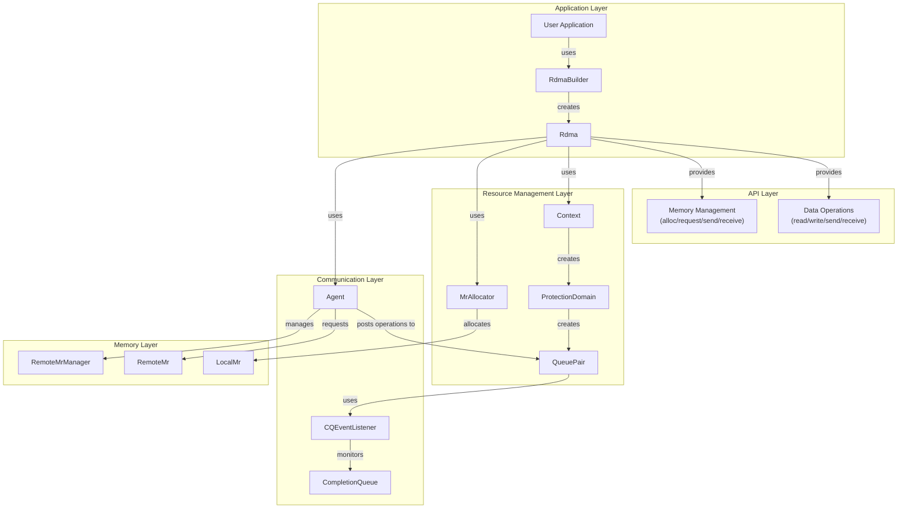

Sources: [src/lib.rs:123-165](). [Cargo.toml:1-40]().

### Core Components

1. **RdmaBuilder**: Entry point for configuring and establishing RDMA connections
2. **Rdma**: Primary interface for performing RDMA operations
3. **Context**: Represents an RDMA device and provides factory methods for other resources
4. **ProtectionDomain**: Provides security isolation for memory regions
5. **QueuePair**: Core communication channel between RDMA endpoints
6. **Agent**: Orchestrates high-level communication patterns and memory management
7. **MrAllocator**: Manages memory region allocation and registration
8. **LocalMr/RemoteMr**: Represents local and remote memory regions for RDMA operations

Sources: [src/lib.rs:167-204](). [src/lib.rs:327-368]().

## Key Features

### Connection Establishment

Async-rdma provides multiple ways to establish connections between RDMA endpoints:

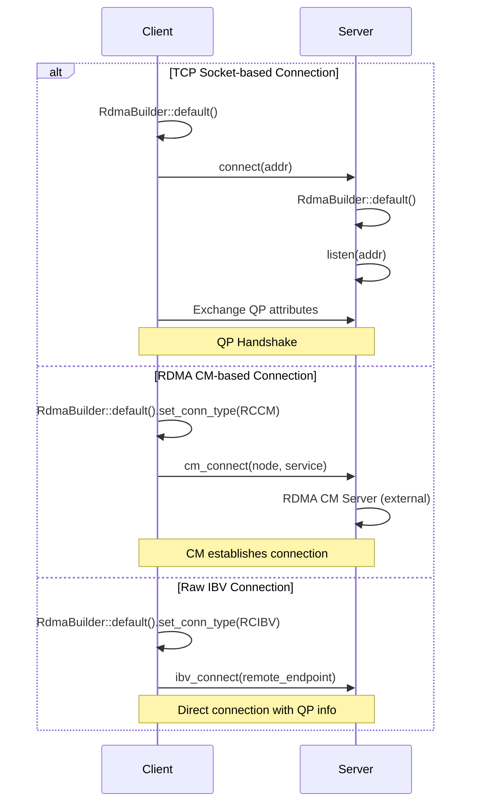

Sources: [src/lib.rs:371-421](). [src/lib.rs:545-562](). [src/lib.rs:435-455]().

### Memory Management System

Async-rdma provides a sophisticated memory management system that handles allocation, registration, and deallocation of memory regions:

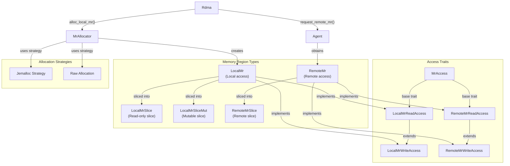

Sources: [src/lib.rs:178-182](). [src/lib.rs:183-184]().

### Data Transfer Operations

Async-rdma supports several RDMA operation patterns:

1. **Read/Write Operations**: Direct memory access between local and remote memory regions
2. **Send/Receive Operations**: Two-sided communication with notifications
3. **Atomic Operations**: Compare-and-swap operations on remote memory

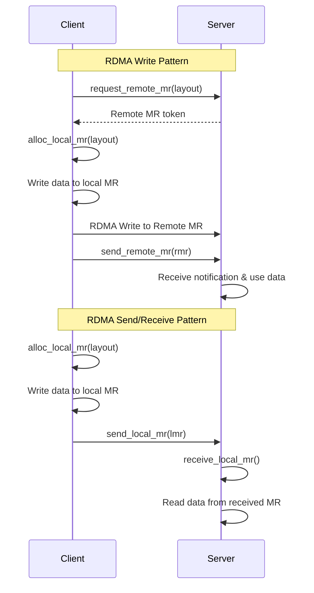

Sources: [src/lib.rs:25-71](). [README.md:126-179]().

## Basic Usage Example

Below is a simple example demonstrating how async-rdma can be used to establish a connection, allocate memory regions, and perform RDMA operations:

```rust
// Client side
async fn client(addr: SocketAddrV4) -> io::Result<()> {
    let layout = Layout::new::<[u8; 8]>();
    let rdma = RdmaBuilder::default().connect(addr).await?;
    // Request 8 bytes remote memory
    let mut rmr = rdma.request_remote_mr(layout).await?;
    // Allocate 8 bytes local memory
    let mut lmr = rdma.alloc_local_mr(layout)?;
    // Write data into local memory
    lmr.as_mut_slice().write(&[1_u8; 8])?;
    // Write data to remote memory
    rdma.write(&lmr.get(4..8).unwrap(), &mut rmr.get_mut(4..8).unwrap()).await?;
    // Send remote MR back to make server aware of it
    rdma.send_remote_mr(rmr).await?;
    Ok(())
}

// Server side
async fn server(addr: SocketAddrV4) -> io::Result<()> {
    let rdma = RdmaBuilder::default().listen(addr).await?;
    // Receive MR metadata from client
    let lmr = rdma.receive_local_mr().await?;
    // Read data that was written by client
    let data = *lmr.as_slice();
    println!("Data written by the client: {:?}", data);
    Ok(())
}
```

Sources: [src/lib.rs:33-59](). [README.md:141-166]().

## Underlying Architecture

Async-rdma builds upon RDMA system libraries and abstracts them with a Rust-friendly asynchronous API:

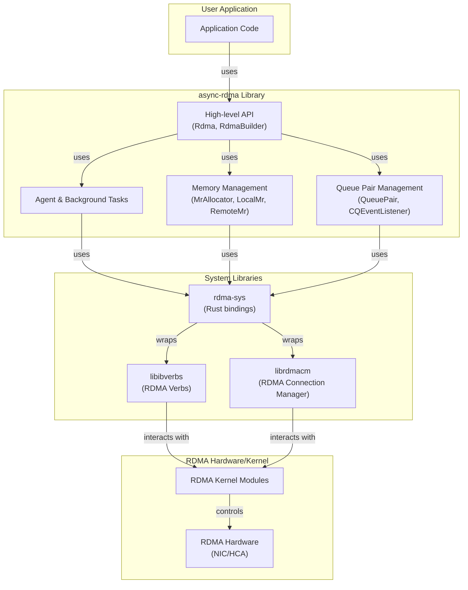

Sources: [Cargo.toml:11-39](). [src/lib.rs:124-164]().

## Conclusion

Async-rdma provides an ergonomic, high-performance Rust interface to RDMA technology. By abstracting away many of the complexities of RDMA programming, it allows developers to focus on their application logic while benefiting from the performance advantages of RDMA.

For more detailed information on specific aspects of the library:
- For connection establishment details, see [Connection Management](#3.1)
- For memory management details, see [Memory Management](#3.2)
- For data transfer operations, see [Data Transfer Operations](#3.3)
- For usage examples, see [Examples & Patterns](#5)

---

# Page: Getting Started

# Getting Started

<details>
<summary>Relevant source files</summary>

The following files were used as context for generating this wiki page:

- [.gitignore](.gitignore)
- [Cargo.toml](Cargo.toml)
- [ChangeLog.md](ChangeLog.md)
- [LICENSE](LICENSE)
- [README.md](README.md)
- [examples/client.rs](examples/client.rs)
- [examples/cm_client.rs](examples/cm_client.rs)
- [examples/server.rs](examples/server.rs)

</details>


This guide will help you install, configure, and begin using the async-rdma library. async-rdma is a Rust framework that provides high-level abstractions and asynchronous APIs for RDMA (Remote Direct Memory Access) operations, enabling direct memory access between computers with minimal CPU involvement.

For a high-level overview of the library and its architecture, see [Overview](#1).

## Prerequisites

Before using async-rdma, you need an environment with RDMA support. This section explains how to set up a test environment using software-based RDMA.

### RDMA Environment Setup

The following steps show how to configure RDMA in an Ubuntu 20.04 environment. If you already have a properly configured RDMA setup, you can skip to the [Installation](#installation) section.

#### 1. Check Kernel Support for RDMA

```bash
cat /boot/config-$(uname -r) | grep RXE
```

If `CONFIG_RDMA_RXE` is set to `y` or `m`, your kernel supports software-based RDMA (RXE).

#### 2. Install Dependencies

```bash
sudo apt install -y libibverbs1 ibverbs-utils librdmacm1 libibumad3 ibverbs-providers rdma-core libibverbs-dev iproute2 perftest build-essential net-tools git librdmacm-dev rdmacm-utils cmake libprotobuf-dev protobuf-compiler clang curl
```

#### 3. Configure RDMA Network Device

Load the kernel driver:
```bash
modprobe rdma_rxe
```

Configure a user-mode RDMA network device:
```bash
sudo rdma link add rxe_0 type rxe netdev ens33
```
Replace `ens33` with your network interface name (check with `ifconfig`).

Verify the RDMA device is active:
```bash
rdma link
```

#### 4. Test the RDMA Setup

```bash
# In terminal 1
ib_send_bw -d rxe_0

# In terminal 2
ib_send_bw -d rxe_0 localhost
```

Sources: [README.md:38-102]()

## Installation

### Install Rust (if needed)

```bash
curl --proto '=https' --tlsv1.2 -sSf https://sh.rustup.rs | sh -s -- -y
source $HOME/.cargo/env
```

### Add async-rdma to Your Project

To use async-rdma in your Rust project, add the following to your `Cargo.toml`:

```toml
[dependencies]
async-rdma = "0.5.0"
```

This will pull the latest released version from crates.io.

Sources: [Cargo.toml:1-9](), [README.md:102-106]()

## Basic Connection Setup

async-rdma uses a client-server model for establishing RDMA connections. The following diagram illustrates the connection process:

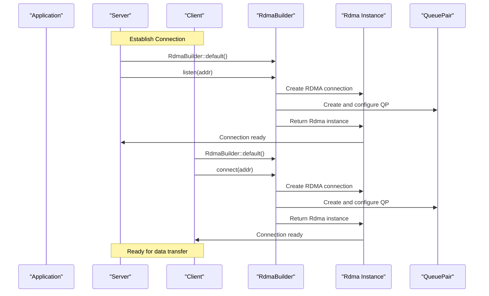

### Server Side

```rust
use async_rdma::RdmaBuilder;

// Listen for connection on specified address
let rdma = RdmaBuilder::default()
    .listen("192.168.1.1:7471")
    .await
    .unwrap();
```

### Client Side

```rust
use async_rdma::RdmaBuilder;

// Connect to server at specified address
let rdma = RdmaBuilder::default()
    .connect("192.168.1.1:7471")
    .await
    .unwrap();
```

Additional connection options are available with `RdmaBuilder`. For example, you can use RDMA Connection Manager (CM):

```rust
use async_rdma::{ConnectionType, RdmaBuilder};

// Connect using CM API
let rdma = RdmaBuilder::default()
    .set_conn_type(ConnectionType::RCCM)
    .set_raw(true)
    .cm_connect("192.168.1.1", "7471")
    .await
    .unwrap();
```

Sources: [examples/server.rs:107-108](), [examples/client.rs:135-136](), [examples/cm_client.rs:21-26]()

## Memory Management

RDMA operations require registered memory regions. async-rdma provides abstractions for local and remote memory regions.

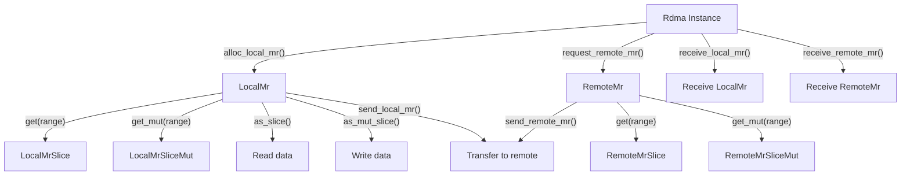

### Allocating Memory Regions

```rust
use std::alloc::Layout;
use async_rdma::{Rdma, LocalMrWriteAccess};

// Allocate a local memory region
let mut lmr = rdma.alloc_local_mr(Layout::new::<[u8; 8]>())?;

// Write data to the memory region
lmr.as_mut_slice().write(&[1_u8; 8])?;

// Request a remote memory region from the other endpoint
let rmr = rdma.request_remote_mr(Layout::new::<[u8; 8]>()).await?;
```

### Memory Region Slices

You can create slices of memory regions to work with specific portions:

```rust
// Get a read-only slice of bytes 4-8
let slice = lmr.get(4..8).unwrap();

// Get a mutable slice of bytes 4-8
let mut_slice = lmr.get_mut(4..8).unwrap();
```

Sources: [examples/client.rs:22-27](), [examples/client.rs:74-77]()

## Data Transfer Operations

async-rdma supports four primary RDMA operations:

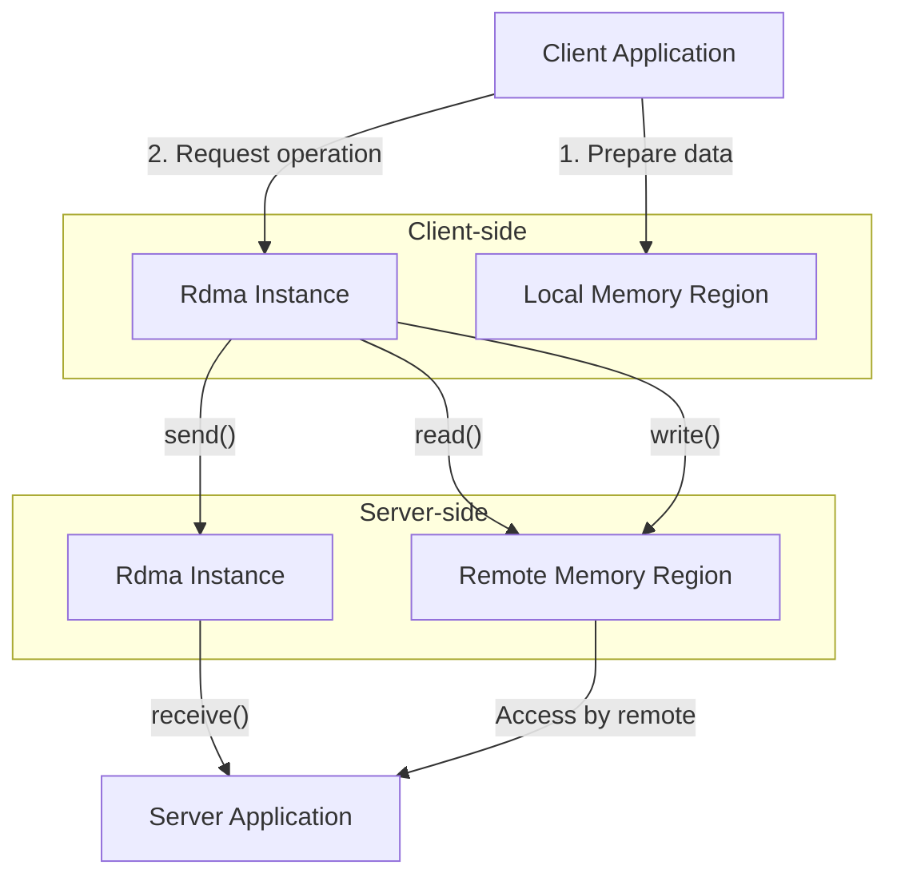

### Send and Receive

The send/receive operations involve both endpoints' CPUs:

```rust
// Client side
let mut lmr = rdma.alloc_local_mr(Layout::new::<[u8; 8]>())?;
lmr.as_mut_slice().write(&[1_u8; 8])?;
rdma.send(&lmr).await?;

// Server side
let lmr = rdma.receive().await?;
let data = *lmr.as_slice();
// Process received data
```

### Read and Write

RDMA read/write operations access remote memory directly without involving the remote CPU:

```rust
// Client side - Write to remote memory
let mut lmr = rdma.alloc_local_mr(Layout::new::<[u8; 8]>())?;
lmr.as_mut_slice().write(&[1_u8; 8])?;
let mut rmr = rdma.request_remote_mr(Layout::new::<[u8; 8]>()).await?;
rdma.write(&lmr, &mut rmr).await?;

// Client side - Read from remote memory
rdma.read(&mut lmr, &rmr).await?;
let data = *lmr.as_slice();
// Process read data
```

### Operations with Immediate Data

You can also perform operations with immediate data, which triggers a completion event on the remote side:

```rust
// Send with immediate data
rdma.send_with_imm(&lmr, 1_u32).await?;

// Receive with immediate data
let (lmr, imm) = rdma.receive_with_imm().await?;

// Write with immediate data
rdma.write_with_imm(&lmr, &mut rmr, 4_u32).await?;

// Receive write immediate data
let imm = rdma.receive_write_imm().await?;
```

Sources: [examples/client.rs:21-29](), [examples/server.rs:17-24](), [examples/client.rs:74-87](), [examples/server.rs:44-55](), [examples/client.rs:32-44](), [examples/server.rs:27-41]()

## Complete Example

Here's a simple client-server example demonstrating RDMA write operation:

```rust
// Server side
async fn server(addr: SocketAddrV4) -> io::Result<()> {
    // Listen for connection
    let rdma = RdmaBuilder::default().listen(addr).await?;
    
    // Receive memory region that was written to by client
    let lmr = rdma.receive_local_mr().await?;
    
    // Access the data
    let data = *lmr.as_slice();
    println!("Data written by client: {:?}", data);
    
    Ok(())
}

// Client side
async fn client(addr: SocketAddrV4) -> io::Result<()> {
    // Connect to server
    let rdma = RdmaBuilder::default().connect(addr).await?;
    
    // Allocate and prepare local memory
    let mut lmr = rdma.alloc_local_mr(Layout::new::<[u8; 8]>())?;
    lmr.as_mut_slice().write(&[1_u8; 8])?;
    
    // Request remote memory region from server
    let mut rmr = rdma.request_remote_mr(Layout::new::<[u8; 8]>()).await?;
    
    // Write to remote memory (second half only)
    rdma.write(
        &lmr.get(4..8).unwrap(), 
        &mut rmr.get_mut(4..8).unwrap()
    ).await?;
    
    // Notify server about the memory region
    rdma.send_remote_mr(rmr).await?;
    
    Ok(())
}
```

Sources: [README.md:125-178]()

## Next Steps

Now that you're familiar with the basics of async-rdma, you can explore:

- [Core Concepts](#3) for deeper understanding of RDMA operations
- [API Reference](#4) for detailed documentation of the library components
- [Examples & Patterns](#5) for more complex usage patterns

For troubleshooting or community support, you can:
- Check the [GitHub repository](https://github.com/datenlord/async-rdma)
- Join the [Gitter chat](https://gitter.im/datenlord/async-rdma)

Sources: [README.md:181-188]()

---

# Page: Core Concepts

# Core Concepts

<details>
<summary>Relevant source files</summary>

The following files were used as context for generating this wiki page:

- [.gitignore](.gitignore)
- [ChangeLog.md](ChangeLog.md)
- [LICENSE](LICENSE)
- [README.md](README.md)
- [src/lib.rs](src/lib.rs)

</details>


This page provides an overview of the fundamental concepts in async-rdma, the high-level Rust framework for Remote Direct Memory Access (RDMA) operations. These concepts form the foundation for understanding how to effectively use the library for building RDMA-enabled applications. For specific implementation details, see [API Reference](#4), and for practical usage examples, see [Examples & Patterns](#5).

## RDMA Overview

Remote Direct Memory Access (RDMA) is a technology that allows direct memory access from one computer to memory on another computer without involving the processor, cache, or operating system of either computer. This results in high-throughput, low-latency networking with minimal CPU overhead.

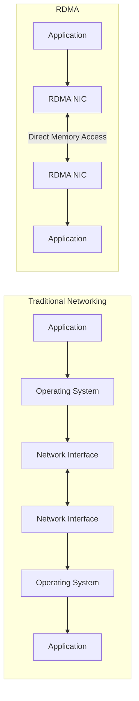

The async-rdma library provides a high-level abstraction over RDMA operations, making them accessible through an asynchronous Rust API. It handles the complex low-level RDMA operations and resource management while exposing a simpler interface to the application developer.

Sources: [src/lib.rs:1-72]()

## Key Components

The async-rdma library consists of several key components that work together to provide a complete RDMA solution:

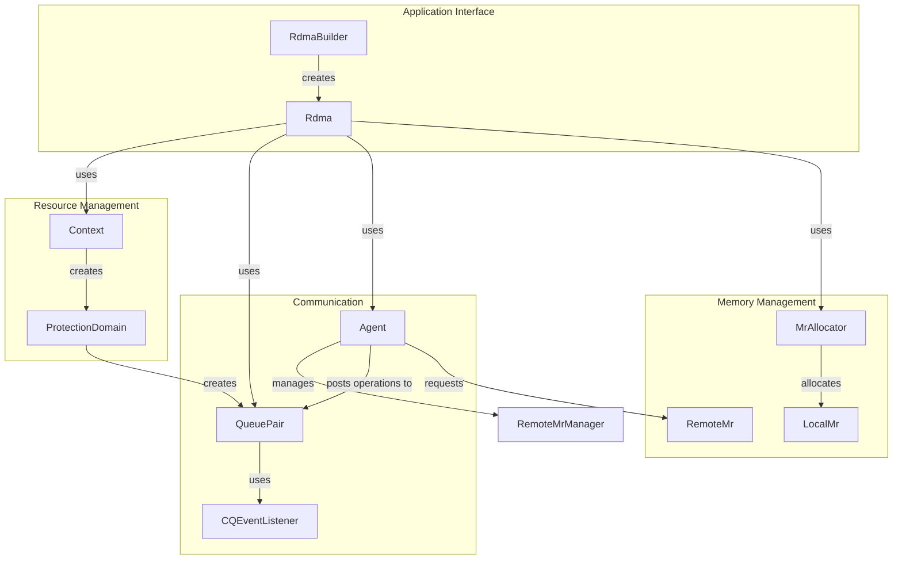

1. **RdmaBuilder**: Entry point for configuring and establishing RDMA connections
2. **Rdma**: Primary interface for performing RDMA operations
3. **QueuePair**: Core communication channel between RDMA endpoints
4. **Agent**: Background component that handles asynchronous operations
5. **Memory Regions**: LocalMr and RemoteMr for memory management

Sources: [src/lib.rs:123-166](), [README.md:21-32]()

## Connection Management

In RDMA, connections must be established between endpoints before data transfer can occur. The async-rdma library provides several ways to establish connections:

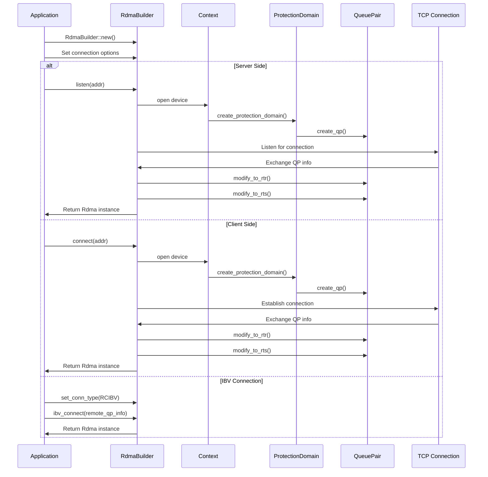

The library supports three connection types:
1. **RCSocket** (default): Uses TCP sockets to exchange QP information
2. **RCIBV**: Uses direct IBV (InfiniBand Verbs) information for connection
3. **RCCM**: Uses RDMA Connection Manager for connection (requires CM feature)

The choice of connection type depends on your application requirements and infrastructure.

Sources: [src/lib.rs:327-565]()

## Memory Management

RDMA operations require memory to be registered with the RDMA device before it can be used for data transfer. The async-rdma library provides a comprehensive memory management system:

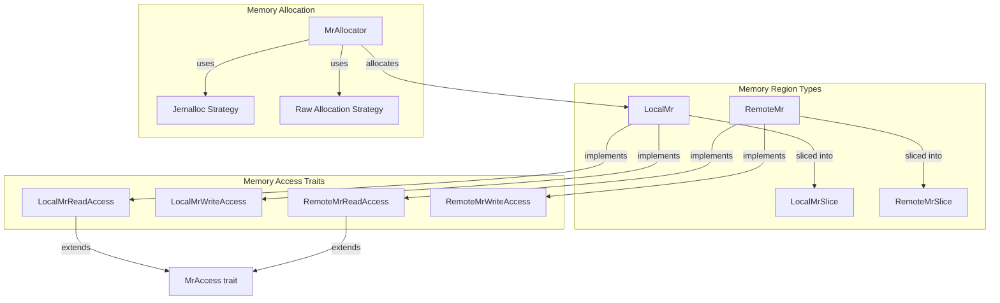

### Memory Region Types

1. **LocalMr**: Memory registered locally that can be accessed by the local process
2. **RemoteMr**: Memory on a remote node that can be accessed via RDMA operations
3. **Memory Slices**: Allow access to specific portions of memory regions

### Allocation Strategies

1. **Jemalloc Strategy**: Uses Jemalloc for efficient memory management and reuse
2. **Raw Allocation Strategy**: Provides direct control over memory allocation

### Memory Access Control

The library uses traits to define the operations that can be performed on memory regions:
- **ReadAccess**: Allows reading from memory regions
- **WriteAccess**: Allows writing to memory regions

Sources: [src/lib.rs:176-182](), [src/lib.rs:133-142](), [ChangeLog.md:95-101]()

## Data Transfer Operations

The async-rdma library provides several data transfer operations to meet different requirements:

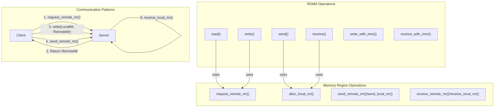

### Data Transfer Patterns

1. **Read/Write Pattern**: The client requests a RemoteMr from the server, then reads from or writes to it directly
   - Benefits: More efficient for large data transfers as the target CPU is not involved
   - Use cases: Bulk data transfer, storage operations

2. **Send/Receive Pattern**: Data is sent from one endpoint and received at the other
   - Benefits: Simpler to use, doesn't require memory region coordination
   - Use cases: Command/control messages, smaller data transfers

### Memory Region Transfer

The library also provides operations to transfer memory region metadata between endpoints:
- **send_remote_mr/send_local_mr**: Send memory region metadata to the remote endpoint
- **receive_remote_mr/receive_local_mr**: Receive memory region metadata from the remote endpoint

Sources: [src/lib.rs:8-15](), [README.md:130-168]()

## Background Components

Several components work in the background to facilitate RDMA operations:

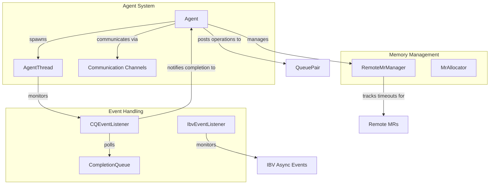

### Agent

The Agent component handles:
1. Memory region management requests
2. RDMA operation orchestration
3. Communication with the remote endpoint

### Event Listeners

1. **CQEventListener**: Monitors the completion queue for completed operations
2. **IbvEventListener**: Monitors for asynchronous IBV events

### RemoteMrManager

Manages the lifecycle of remote memory regions, including automatic timeout to prevent resource leaks.

Sources: [src/lib.rs:123-126](), [src/lib.rs:167-170](), [ChangeLog.md:99-101]()

## Example Workflow

Here's how these components work together in a typical RDMA workflow:

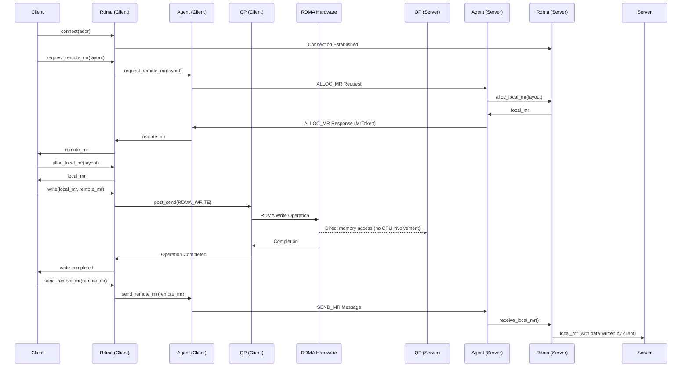

This example demonstrates the complete workflow of:
1. Establishing a connection
2. Requesting a remote memory region
3. Allocating a local memory region
4. Writing data from local to remote memory
5. Notifying the server about the memory transfer

Sources: [src/lib.rs:33-47](), [README.md:141-156]()

## Summary

The core concepts of async-rdma revolve around providing high-level abstractions for RDMA operations while managing the complexity of low-level RDMA resources. By understanding these concepts, you can effectively use the library to build high-performance RDMA applications with minimal boilerplate code.

- **RdmaBuilder** provides a flexible way to establish connections
- **Memory Regions** abstract away the complexity of RDMA memory registration
- **Data Transfer Operations** provide simple interfaces for RDMA data movement
- **Background Components** handle the details of resource management and event processing

For more detailed information on specific components, refer to the [API Reference](#4) section.

Sources: [src/lib.rs:1-20](), [README.md:4-32]()

---

# Page: Connection Management

# Connection Management

<details>
<summary>Relevant source files</summary>

The following files were used as context for generating this wiki page:

- [examples/client.rs](examples/client.rs)
- [examples/cm_client.rs](examples/cm_client.rs)
- [examples/server.rs](examples/server.rs)
- [src/lib.rs](src/lib.rs)
- [src/queue_pair.rs](src/queue_pair.rs)

</details>


This page explains how RDMA connections are established and managed in the async-rdma library. It covers the process of creating, configuring, and establishing RDMA connections between endpoints using the `RdmaBuilder` and `QueuePair` components.

## Overview

Connection management in async-rdma involves setting up and managing the communication channels between RDMA endpoints. The library supports multiple connection methods and provides a high-level API to simplify the connection process.

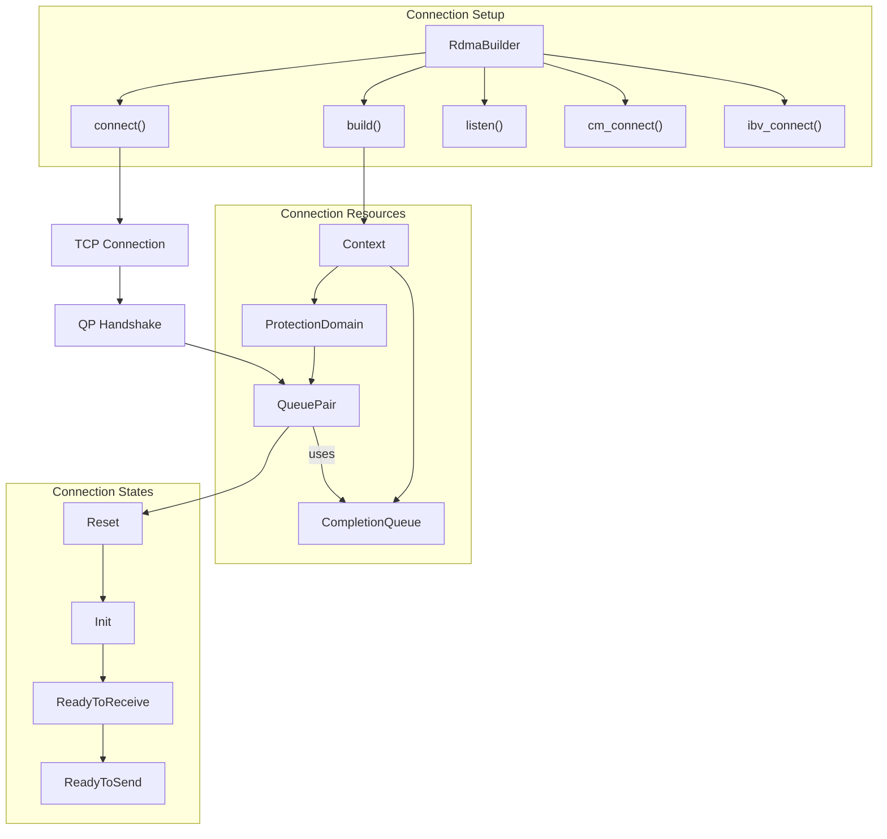

Sources: [src/lib.rs:327-1074](). [src/queue_pair.rs:494-513]()

## Connection Types

Async-rdma supports three connection types, each with a different mechanism for establishing connections:

| Connection Type | Description | Usage Scenario |
|----------------|-------------|----------------|
| `RCSocket` | Reliable Connection using TCP socket for connection setup | General purpose, easiest to use |
| `RCIBV` | Reliable Connection using IBV for direct connection setup | When you have connection info through another channel |
| `RCCM` | Reliable Connection using Connection Manager | When using RDMA CM for advanced connection management |

Sources: [src/lib.rs:546-562]()

## RdmaBuilder

The `RdmaBuilder` is the entry point for creating and configuring RDMA connections. It follows the builder pattern, allowing you to set various connection parameters before establishing a connection.

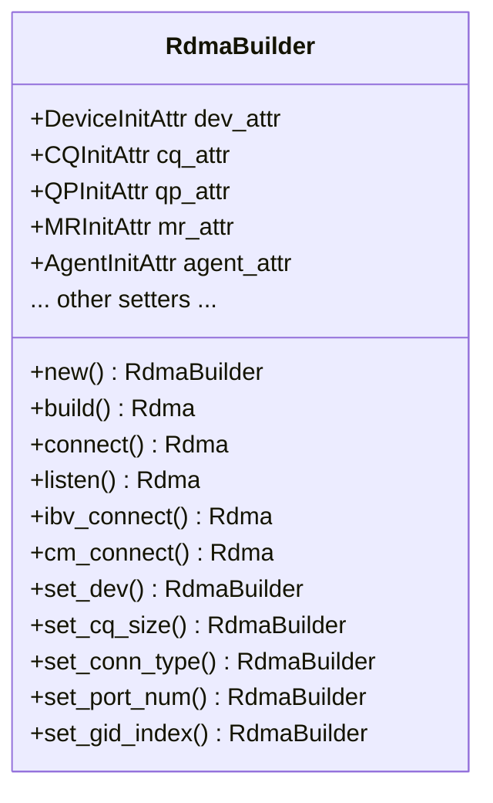

The builder provides methods to configure:
- Device selection
- Connection type
- Queue Pair attributes
- Memory region attributes
- Completion Queue attributes

Sources: [src/lib.rs:330-1073]()

## Establishing Connections

There are two main patterns for establishing connections:

1. Client-Server (Socket-based)
2. Direct connection (IBV or CM based)

### Client-Server Connection Process

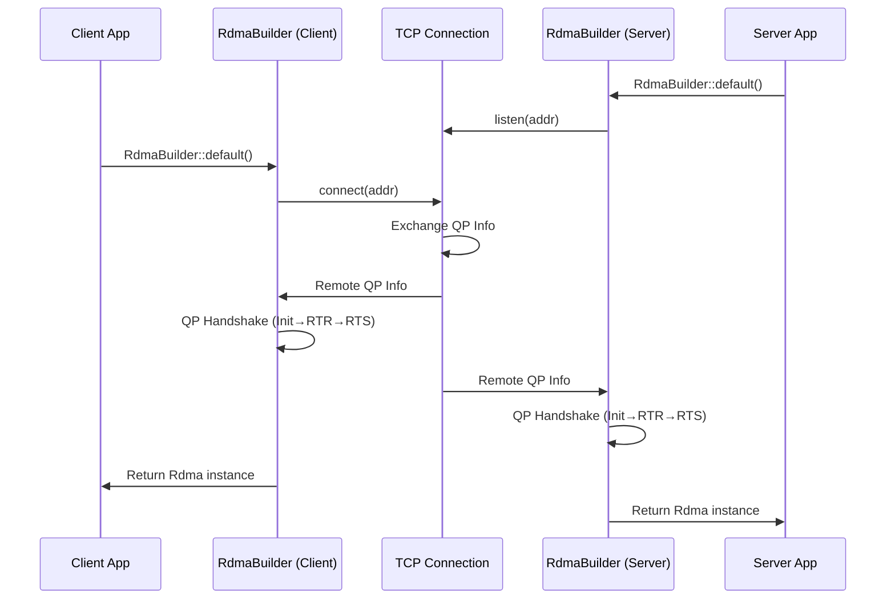

Examples:

Client-side connection:
```rust
// Connect to an RDMA server
let rdma = RdmaBuilder::default().connect(addr).await?;
```

Server-side connection:
```rust
// Listen for an RDMA connection
let rdma = RdmaBuilder::default().listen(addr).await?;
```

Sources: [src/lib.rs:407-428](), [src/lib.rs:601-628](), [examples/client.rs:135-136](), [examples/server.rs:107-108]()

### Connection Manager (CM) Connection Process

When using the Connection Manager approach:

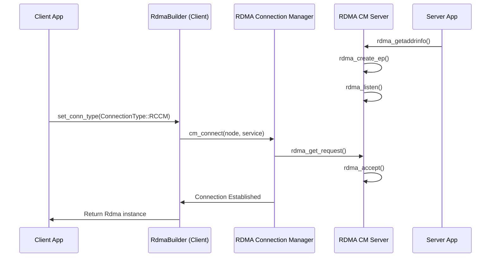

Example:
```rust
// Connect using Connection Manager
let rdma = RdmaBuilder::default()
    .set_conn_type(ConnectionType::RCCM)
    .set_raw(true)
    .cm_connect(node, service)
    .await?;
```

Sources: [src/lib.rs:546-562](), [examples/cm_client.rs:20-26]()

## Queue Pair State Management

The Queue Pair (QP) passes through several states during connection establishment:

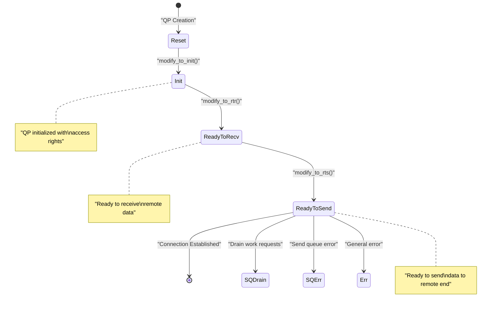

During connection establishment, the QP undergoes a handshake process:

1. **Init**: QP is initialized with access rights
2. **Ready to Receive (RTR)**: QP is configured to receive data
3. **Ready to Send (RTS)**: QP is configured to send data

Sources: [src/queue_pair.rs:494-513](), [src/queue_pair.rs:602-706]()

## QP Handshake Process

The QueuePair handshake process involves modifying the QP through state transitions:

```mermaid
flowchart TD
    subgraph "Client"
        CInit["modify_to_init()\n- Set port_num\n- Set access flags"]
        CRTR["modify_to_rtr()\n- Set path MTU\n- Set dest_qp_num\n- Set server address info"]
        CRTS["modify_to_rts()\n- Set timeout\n- Set retry params\n- Set sq_psn"]
    end
    
    subgraph "Server"
        SInit["modify_to_init()\n- Set port_num\n- Set access flags"]
        SRTR["modify_to_rtr()\n- Set path MTU\n- Set dest_qp_num\n- Set client address info"]
        SRTS["modify_to_rts()\n- Set timeout\n- Set retry params\n- Set sq_psn"]
    end
    
    Exchange["Exchange QP Information\n- QP number\n- LID\n- GID"]
    
    CInit --> Exchange
    SInit --> Exchange
    Exchange --> CRTR
    Exchange --> SRTR
    CRTR --> CRTS
    SRTR --> SRTS
```

Key QP attributes exchanged:
- `qp_num`: Queue Pair number
- `lid`: Local ID for the port
- `gid`: Global ID (128-bit identifier for the port)

Sources: [src/queue_pair.rs:610-707](), [src/lib.rs:1076-1154]()

## Configuration Options

Async-rdma provides extensive configuration options via the `RdmaBuilder`:

| Category | Options | Description |
|----------|---------|-------------|
| Device | `set_dev()` | Set RDMA device name |
| Connection | `set_conn_type()` | Set connection type (RCSocket, RCIBV, RCCM) |
| Queue Pair | `set_port_num()`, `set_gid_index()` | Set port and GID for the connection |
| Queue Size | `set_qp_max_send_wr()`, `set_qp_max_recv_wr()` | Set send/receive queue sizes |
| Access | `set_qp_access()`, `set_mr_access()` | Set access permissions |
| Retry | `set_retry_cnt()`, `set_rnr_retry()` | Configure retry behavior |
| Timeouts | `set_timeout()`, `set_cc_evnet_timeout()` | Set operation timeouts |

Sources: [src/lib.rs:631-1062]()

## Best Practices

When establishing RDMA connections:

1. **Port and GID Configuration**: Always set the port number and GID index appropriate for your network
   ```rust
   let rdma = RdmaBuilder::default()
       .set_port_num(1)
       .set_gid_index(1)
       .connect(addr)
       .await?;
   ```

2. **Choose the right connection type**:
   - Use `RCSocket` for standard client-server applications
   - Use `RCIBV` when you have connection info through other channels
   - Use `RCCM` when you need advanced connection management features

3. **Configure appropriate timeouts and retry counts** based on your network conditions and application requirements

Sources: [src/lib.rs:352-353](), [examples/client.rs:135-136](), [examples/cm_client.rs:20-26]()

---

# Page: Memory Management

# Memory Management

<details>
<summary>Relevant source files</summary>

The following files were used as context for generating this wiki page:

- [src/access.rs](src/access.rs)
- [src/id.rs](src/id.rs)
- [src/memory_region/local.rs](src/memory_region/local.rs)
- [src/memory_region/mod.rs](src/memory_region/mod.rs)
- [src/memory_region/raw.rs](src/memory_region/raw.rs)
- [src/memory_region/remote.rs](src/memory_region/remote.rs)
- [src/mr_allocator.rs](src/mr_allocator.rs)
- [src/rmr_manager.rs](src/rmr_manager.rs)
- [tests/rmr_access.rs](tests/rmr_access.rs)

</details>


This page documents the memory management system in the async-rdma library, which is responsible for allocating, registering, and managing memory regions for RDMA operations. Memory management is a critical component of RDMA programming as data must be explicitly registered with the RDMA hardware before it can be accessed remotely.

For information about data transfer operations that use these memory regions, see [Data Transfer Operations](#3.3).

## Memory Management Architecture

The memory management system in async-rdma consists of several components working together to provide a safe and efficient interface for RDMA memory operations.

```mermaid
graph TD
    subgraph "Memory Management API"
        Rdma["Rdma"] -->|allocates| MrAllocator
        Rdma -->|returns| LMR["LocalMr"]
        Rdma -->|requests| RMR["RemoteMr"]
    end
    
    subgraph "Memory Allocation"
        MrAllocator["MrAllocator"] -->|strategy| JE["Jemalloc Strategy"]
        MrAllocator -->|strategy| Raw["Raw Strategy"]
        JE -->|registers with| PD
        Raw -->|registers with| PD
    end
    
    subgraph "Memory Regions"
        LMR -->|contains| LMRInner["LocalMrInner"]
        LMRInner -->|references| Raw_MR["RawMemoryRegion"]
        LMR -->|sliced into| LMRSlice["LocalMrSlice"]
        LMR -->|sliced into| LMRSliceMut["LocalMrSliceMut"]
        
        RMR -->|contains| MrToken
        RMR -->|tracked by| RMRMgr["RemoteMrManager"]
        RMR -->|sliced into| RMRSlice["RemoteMrSlice"]
        RMR -->|sliced into| RMRSliceMut["RemoteMrSliceMut"]
    end
    
    subgraph "Protection & Access"
        PD["ProtectionDomain"] -->|secures| Raw_MR
        AccessFlags["AccessFlags"] -->|controls| Raw_MR
    end
```

Sources: [src/mr_allocator.rs](), [src/memory_region/local.rs](), [src/memory_region/remote.rs](), [src/memory_region/raw.rs]()

## Memory Region Types

The async-rdma library provides several types of memory regions, each serving a specific purpose in the RDMA communication model:

```mermaid
classDiagram
    class MrAccess {
        <<trait>>
        +addr() usize
        +length() usize
        +rkey() u32
        +access() BitFlags~AccessFlag~
    }
    
    class IbvAccess {
        <<trait>>
        +ibv_access() ibv_access_flags
    }
    
    class LocalMrReadAccess {
        <<trait>>
        +as_ptr() *const u8
        +as_slice() &[u8]
        +lkey() u32
    }
    
    class LocalMrWriteAccess {
        <<trait>>
        +as_mut_ptr() *mut u8
        +as_mut_slice() &mut [u8]
    }
    
    class RemoteMrReadAccess {
        <<trait>>
        +timeout_check() bool
        +token() MrToken
    }
    
    class RemoteMrWriteAccess {
        <<trait>>
    }
    
    class RawMemoryRegion {
        -inner_mr: NonNull~ibv_mr~
        -addr: *mut u8
        -len: usize
        -pd: Arc~ProtectionDomain~
        -access: ibv_access_flags
    }
    
    class LocalMr {
        -inner: Arc~RwLocalMrInner~
        -addr: usize
        -len: usize
        +get(Range) LocalMrSlice
        +get_mut(Range) LocalMrSliceMut
    }
    
    class LocalMrInner {
        -addr: usize
        -layout: Layout
        -raw: Arc~RawMemoryRegion~
        -strategy: MRManageStrategy
    }
    
    class RemoteMr {
        -token: MrToken
        -agent: Option~Arc~AgentInner~~
        +get(Range) RemoteMrSlice
        +get_mut(Range) RemoteMrSliceMut
    }
    
    class MrToken {
        +addr: usize
        +len: usize
        +rkey: u32
        +ddl: SystemTime
        +access: u32
    }
    
    MrAccess <|-- IbvAccess
    IbvAccess <|.. RawMemoryRegion
    IbvAccess <|.. LocalMr
    IbvAccess <|.. RemoteMr
    
    MrAccess <|.. RawMemoryRegion
    MrAccess <|.. LocalMr
    MrAccess <|.. RemoteMr
    
    LocalMrReadAccess --|> MrAccess
    LocalMrWriteAccess --|> LocalMrReadAccess
    
    RemoteMrReadAccess --|> MrAccess
    RemoteMrWriteAccess --|> RemoteMrReadAccess
    
    LocalMrReadAccess <|.. LocalMr
    LocalMrWriteAccess <|.. LocalMr
    
    RemoteMrReadAccess <|.. RemoteMr
    RemoteMrWriteAccess <|.. RemoteMr
    
    LocalMr o-- LocalMrInner
    LocalMrInner o-- RawMemoryRegion
    RemoteMr o-- MrToken
```

Sources: [src/memory_region/mod.rs](), [src/memory_region/local.rs](), [src/memory_region/remote.rs](), [src/memory_region/raw.rs]()

### Memory Region Abstractions

The library uses several abstractions to represent memory regions:

1. **RawMemoryRegion**: The lowest level abstraction that directly interacts with the RDMA hardware through the `ibv_mr` structure.

2. **LocalMr**: Represents a memory region on the local machine that can be used for RDMA operations. It contains:
   - A reference to `LocalMrInner` which holds the actual memory and metadata
   - Address and length information for easy access
   - Methods to create slices of the memory region

3. **RemoteMr**: Represents a memory region on a remote machine that can be accessed through RDMA operations. It contains:
   - A `MrToken` with the necessary information to access the remote memory
   - An optional reference to the `AgentInner` that requested this memory region
   - Methods to create slices of the remote memory region

4. **MrToken**: A serializable structure that contains the necessary information to access a memory region remotely:
   - Address, length, and remote key
   - Deadline (timeout) after which the memory region may no longer be valid
   - Access permissions encoded as a bitfield

Sources: [src/memory_region/raw.rs:10-114](), [src/memory_region/local.rs:368-533](), [src/memory_region/remote.rs:22-129](), [src/memory_region/mod.rs:44-63]()

## Memory Region Allocation

The `MrAllocator` component is responsible for allocating and registering memory regions for RDMA operations. It supports two allocation strategies:

### Allocation Strategies

1. **Jemalloc Strategy**: Uses the jemalloc memory allocator with custom extent hooks for efficient memory management. This strategy is more complex but provides better performance for certain workloads.

2. **Raw Strategy**: Uses the standard Rust allocator for simplicity. This strategy is easier to understand and debug but may not provide the same performance as the Jemalloc strategy.

```mermaid
flowchart TD
    subgraph "MrAllocator"
        Allocate["allocate(layout, access, pd)"]
        Strategy{"Which strategy?"}
        Allocate --> Strategy
        
        Strategy -->|"Jemalloc"| JeAlloc["Allocate with jemalloc"]
        Strategy -->|"Raw"| RawAlloc["Allocate with Rust allocator"]
        
        JeAlloc --> JeFind["Find appropriate arena\nor create new one"]
        JeFind --> JeRegister["Register memory with RDMA"]
        
        RawAlloc --> RawRegister["Register memory with RDMA"]
        
        JeRegister --> CreateLMR["Create LocalMrInner"]
        RawRegister --> CreateLMR
        CreateLMR --> ReturnLMR["Return LocalMr"]
    end
```

Sources: [src/mr_allocator.rs:132-295]()

### Memory Registration Process

When allocating a memory region, the following steps are performed:

1. Allocate memory using the selected strategy (Jemalloc or Raw)
2. Register the memory with the RDMA hardware through the Protection Domain
3. Create a `RawMemoryRegion` to track the registration
4. Create a `LocalMrInner` to manage the memory region
5. Return a `LocalMr` that provides a safe interface to the memory region

The memory registration process is critical for RDMA operations as it makes the memory accessible to the RDMA hardware for direct access.

### Custom Extent Hooks for Jemalloc

When using the Jemalloc strategy, the library registers custom extent hooks to intercept memory allocation and deallocation requests. These hooks are responsible for registering memory regions with the RDMA hardware and maintaining the necessary metadata.

```mermaid
sequenceDiagram
    participant App as Application
    participant MrAlloc as MrAllocator
    participant JeMalloc as Jemalloc
    participant ExtHooks as Custom Extent Hooks
    participant RDMA as RDMA Hardware
    
    App->>MrAlloc: alloc_local_mr(layout)
    MrAlloc->>JeMalloc: mallocx(size, arena_flags)
    JeMalloc->>ExtHooks: extent_alloc_hook()
    ExtHooks->>JeMalloc: origin_alloc()
    JeMalloc-->>ExtHooks: memory pointer
    ExtHooks->>RDMA: ibv_reg_mr()
    RDMA-->>ExtHooks: ibv_mr
    ExtHooks->>ExtHooks: store in EXTENT_TOKEN_MAP
    ExtHooks-->>JeMalloc: memory pointer
    JeMalloc-->>MrAlloc: memory pointer
    MrAlloc->>MrAlloc: Create LocalMrInner
    MrAlloc->>MrAlloc: Create LocalMr
    MrAlloc-->>App: LocalMr
```

Sources: [src/mr_allocator.rs:461-501](), [src/mr_allocator.rs:32-75]()

## Memory Region Access

The library provides a rich set of traits to define the access patterns for memory regions:

### Access Traits Hierarchy

- **MrAccess**: Base trait for all memory regions, providing methods to access address, length, and remote key.
- **IbvAccess**: Trait for accessing the IBVERBS access flags that control the permissions of the memory region.
- **LocalMrReadAccess**: Trait for read access to local memory regions, providing methods like `as_ptr()`, `as_slice()`, etc.
- **LocalMrWriteAccess**: Trait for write access to local memory regions, extending `LocalMrReadAccess` with methods like `as_mut_ptr()`, `as_mut_slice()`, etc.
- **RemoteMrReadAccess**: Trait for read access to remote memory regions, providing methods to check timeout and access the token.
- **RemoteMrWriteAccess**: Trait for write access to remote memory regions, extending `RemoteMrReadAccess`.

### Access Flags

The library uses a set of bit flags to control the access permissions of memory regions:

| Access Flag | Description |
|-------------|-------------|
| LocalWrite | Allows local write operations |
| RemoteWrite | Allows remote write operations |
| RemoteRead | Allows remote read operations |
| RemoteAtomic | Allows remote atomic operations |
| MwBind | Enables memory window binding |
| ZeroBased | Uses byte offset instead of pointer address |
| OnDemand | Creates an on-demand paging memory region |
| HugeTlb | Uses huge pages for the memory region |
| RelaxOrder | Allows system to reorder accesses |

These flags are used when registering memory regions with the RDMA hardware to control what operations are allowed on the memory.

Sources: [src/memory_region/mod.rs:19-42](), [src/access.rs:4-27]()

### Memory Region Slicing

Both `LocalMr` and `RemoteMr` support slicing operations, allowing users to work with specific portions of a memory region without creating new registrations:

```mermaid
graph TD
    LocalMr -->|get| LocalMrSlice
    LocalMr -->|get_mut| LocalMrSliceMut
    
    RemoteMr -->|get| RemoteMrSlice
    RemoteMr -->|get_mut| RemoteMrSliceMut
    
    subgraph "Original Memory Region"
        LMR_Data["Memory Data"]
    end
    
    subgraph "Sliced Memory Regions"
        Slice1["Slice 1"]
        Slice2["Slice 2"]
        Slice3["Slice 3"]
    end
    
    LMR_Data --- Slice1
    LMR_Data --- Slice2
    LMR_Data --- Slice3
```

Sources: [src/memory_region/local.rs:427-501](), [src/memory_region/remote.rs:94-128]()

## Remote Memory Region Management

The `RemoteMrManager` is responsible for managing remote memory regions, including tracking their lifetimes and handling timeouts.

```mermaid
sequenceDiagram
    participant Client as Client
    participant Agent as Agent Client
    participant RMR_Mgr as RemoteMrManager
    participant Timer as Timer Task
    participant Server as Server
    
    Client->>Agent: request_remote_mr(layout)
    Agent->>Server: ALLOC_MR Request
    Server->>Server: Allocate LocalMr
    Server->>RMR_Mgr: record_mr(token, mr, timeout)
    RMR_Mgr->>Timer: Spawn timer task
    Server->>Agent: ALLOC_MR Response (MrToken)
    Agent->>Client: RemoteMr
    
    Note over Timer,RMR_Mgr: After timeout period...
    
    alt MR still in use
        Client->>Agent: Drop RemoteMr
        Agent->>Server: RELEASE_MR Request
        Server->>RMR_Mgr: release_mr(token)
        RMR_Mgr->>Timer: Cancel timer
    else MR times out
        Timer->>RMR_Mgr: Token timeout notification
        RMR_Mgr->>RMR_Mgr: Remove MR from map
    end
```

Sources: [src/rmr_manager.rs:17-175]()

### Memory Region Tokens

Memory region tokens (`MrToken`) are used to exchange information about memory regions between nodes. They contain:

- Address and length of the memory region
- Remote key for accessing the memory region
- Deadline (timeout) after which the memory region may no longer be valid
- Access permissions encoded as a bitfield

When a remote memory region is requested, the server allocates a local memory region and creates a token that is sent back to the client. The client then uses this token to create a `RemoteMr` that can be used for RDMA operations.

Sources: [src/memory_region/mod.rs:44-63]()

### Timeout Mechanism

To prevent resource leaks, remote memory regions have a timeout mechanism:

1. When a `RemoteMr` is created, it is assigned a timeout period.
2. When the `RemoteMr` is dropped, it sends a release request to the server.
3. If the release request is not received before the timeout, the server automatically frees the resources.

This ensures that resources are not leaked even if a client crashes or fails to properly release the remote memory region.

Sources: [src/rmr_manager.rs:102-132](), [src/memory_region/remote.rs:63-77]()

## Memory Management API

The async-rdma library provides a simple and intuitive API for memory management through the `Rdma` interface:

```mermaid
flowchart TD
    subgraph "Application API"
        alloc_local_mr["alloc_local_mr(layout)"]
        alloc_local_mr_access["alloc_local_mr_with_access(layout, access)"]
        request_remote_mr["request_remote_mr(layout)"]
        send_local_mr["send_local_mr(lmr)"]
        receive_remote_mr["receive_remote_mr()"]
    end
    
    alloc_local_mr -->|creates| LMR["LocalMr"]
    alloc_local_mr_access -->|creates with specific access| LMR
    request_remote_mr -->|requests from peer| RMR["RemoteMr"]
    send_local_mr -->|exchanges| MrToken
    receive_remote_mr -->|receives| RMR
    
    subgraph "Memory Operations"
        read["read(lmr, rmr)"]
        write["write(lmr, rmr)"]
        send["send(lmr)"]
        receive["receive()"]
    end
    
    LMR --- read
    RMR --- read
    LMR --- write
    RMR --- write
    LMR --- send
    receive -->|creates| LMR
```

Sources: [src/mr_allocator.rs:175-230]()

### Key API Methods

| Method | Description |
|--------|-------------|
| `alloc_local_mr(layout)` | Allocates a local memory region with the specified layout |
| `alloc_local_mr_with_access(layout, access)` | Allocates a local memory region with the specified layout and access flags |
| `request_remote_mr(layout)` | Requests a remote memory region from the peer with the specified layout |
| `send_local_mr(lmr)` | Sends a local memory region to the peer |
| `receive_remote_mr()` | Receives a remote memory region from the peer |

These methods provide a high-level interface for managing memory regions in RDMA applications, abstracting away the complex details of memory registration and management.

## Best Practices

When working with the memory management system in async-rdma, consider the following best practices:

1. **Use appropriate access flags**: Only request the access permissions that are actually needed for your operations. This improves security and may enhance performance.

2. **Prefer slicing over new allocations**: When working with parts of a memory region, use the slicing methods rather than allocating new memory regions.

3. **Release remote memory regions promptly**: Although the timeout mechanism helps prevent resource leaks, it's best practice to explicitly release remote memory regions when they are no longer needed.

4. **Be aware of memory registration costs**: Memory registration with RDMA hardware can be expensive, so minimize the number of registrations and reuse memory regions when possible.

5. **Check for timeout**: When working with remote memory regions, check for timeouts using the `timeout_check()` method to ensure the region is still valid.

---

# Page: Data Transfer Operations

# Data Transfer Operations

<details>
<summary>Relevant source files</summary>

The following files were used as context for generating this wiki page:

- [examples/client.rs](examples/client.rs)
- [examples/cm_client.rs](examples/cm_client.rs)
- [examples/server.rs](examples/server.rs)
- [src/lib.rs](src/lib.rs)
- [tests/imm.rs](tests/imm.rs)
- [tests/loop.rs](tests/loop.rs)
- [tests/mr_slice.rs](tests/mr_slice.rs)

</details>


This page documents the data transfer operations available in the async-rdma library, explaining how they work and when to use each one. It covers the primary RDMA operations: Send/Receive, Read/Write, and Atomic operations. For details on memory management, see [Memory Management](#3.2).

## Overview of RDMA Data Transfer Operations

RDMA (Remote Direct Memory Access) offers several ways to transfer data between networked systems with minimal CPU involvement. The async-rdma library provides a high-level asynchronous Rust interface to these operations.

```mermaid
flowchart TD
    subgraph "Data Transfer Operations"
        direction TB
        SendRecv["Send/Receive Operations"]
        ReadWrite["Read/Write Operations"]
        Atomic["Atomic Operations"]
        
        SendRecv -->|"Types"| SR["send()
        send_with_imm()
        receive()
        receive_with_imm()"]
        
        ReadWrite -->|"Types"| RW["read()
        write()
        write_with_imm()
        receive_write_imm()"]
        
        Atomic -->|"Types"| AT["atomic_cas()"]
    end
    
    subgraph "Memory Region Management"
        direction TB
        MRExchange["Memory Region Exchange"]
        MRExchange -->|"Types"| MR["send_local_mr()
        send_remote_mr()
        receive_local_mr()
        receive_remote_mr()"]
    end
```

Sources: [src/lib.rs:8-12]()

## Data Transfer Operation Patterns

RDMA operations follow two main patterns, each with different performance characteristics and use cases.

```mermaid
sequenceDiagram
    participant App1 as "Application A"
    participant CPU1 as "CPU A"
    participant RNIC1 as "RNIC A"
    participant RNIC2 as "RNIC B"
    participant CPU2 as "CPU B"
    participant App2 as "Application B"
    
    note over App1, App2: "Send/Receive Pattern"
    App1->>CPU1: Prepare data in LocalMr
    CPU1->>RNIC1: Post send request
    RNIC1->>RNIC2: RDMA Send
    RNIC2->>CPU2: Completion notification
    CPU2->>App2: Deliver data in LocalMr
    
    note over App1, App2: "Read/Write Pattern"
    App1->>CPU1: Request remote memory
    CPU1->>RNIC1: Control message
    RNIC1->>RNIC2: Request memory
    RNIC2->>CPU2: Memory request
    CPU2->>RNIC2: Allocate & register memory
    RNIC2->>RNIC1: Return RemoteMr token
    RNIC1->>CPU1: Token available
    CPU1->>App1: RemoteMr available
    App1->>CPU1: Prepare data & post write
    CPU1->>RNIC1: Post RDMA Write
    RNIC1->>RNIC2: Direct memory write
    note right of RNIC2: No CPU B involvement
    RNIC1->>CPU1: Completion notification
    CPU1->>App1: Operation complete
```

Sources: [src/lib.rs:23-47]()

### Send/Receive Pattern

In this pattern:

1. Sender prepares data in a local memory region
2. Sender initiates the send operation
3. Receiver must post a corresponding receive operation
4. The receiver's CPU is involved in processing the incoming data

Best for:
- Small messages
- Control messages
- Cases where receiver needs immediate notification
- Simpler programming model

### Read/Write Pattern

In this pattern:

1. Client requests and receives a token for remote memory access
2. Client reads from or writes to the remote memory directly
3. Target CPU is not involved in the data transfer (zero-copy)

Best for:
- Large data transfers
- Highest performance requirements
- Cases where receiver doesn't need immediate notification

Sources: [examples/client.rs:20-107](), [examples/server.rs:16-91]()

## Send/Receive Operations

### Send Operation

The `send` operation transfers data from a local memory region to a remote endpoint. The remote endpoint must post a corresponding `receive` operation.

```
Client: rdma.send(&lmr).await?;
Server: let lmr = rdma.receive().await?;
```

Sources: [examples/client.rs:20-29](), [examples/server.rs:16-24]()

### Send with Immediate Data

The `send_with_imm` operation is similar to `send`, but includes a 32-bit immediate value. The immediate value is delivered to the receiver along with a completion notification.

```
Client: rdma.send_with_imm(&lmr, 1_u32).await?;
Server: let (lmr, imm) = rdma.receive_with_imm().await?;
```

This provides a way to send a small piece of metadata along with the main data. The immediate value can be used for things like message type, sequence number, or status codes.

Sources: [examples/client.rs:30-45](), [examples/server.rs:25-41](), [tests/imm.rs:6-49]()

### Receive Operation

The `receive` operation posts a receive request and waits for a corresponding `send` from the remote endpoint. When a matching send arrives, the data is placed into a newly allocated local memory region.

Sources: [examples/server.rs:16-24]()

### Receive with Immediate Data

The `receive_with_imm` operation is similar to `receive`, but it also returns any immediate value that was sent by the sender. If the sender did not include an immediate value, this returns `None`.

Sources: [examples/server.rs:25-41](), [tests/imm.rs:6-49]()

## Memory Region Exchange Operations

These operations are used to share memory region information between endpoints.

### Send/Receive Local Memory Region

These operations are used to transfer the metadata of a local memory region to the remote endpoint:

```
Client: rdma.send_local_mr(lmr).await?;
Server: let lmr = rdma.receive_local_mr().await?;
```

This is commonly used to inform the server about memory that the client has written to.

Sources: [examples/client.rs:47-71](), [examples/server.rs:58-65]()

### Send/Receive Remote Memory Region

These operations are used to transfer the metadata of a remote memory region:

```
Client: rdma.send_remote_mr(rmr).await?;
Server: let rmr = rdma.receive_remote_mr().await?;
```

This is commonly used after a client performs a write operation to a remote memory region, then informs the server about it.

Sources: [examples/client.rs:74-87](), [examples/server.rs:44-55]()

## RDMA Read/Write Operations

### RDMA Read

The `read` operation reads data from a remote memory region directly into a local memory region:

```
Client: let rmr = rdma.receive_remote_mr().await?;
Client: rdma.read(&mut lmr, &rmr).await?;
```

The operation is initiated by the client, and the server's CPU is not involved in the data transfer.

Sources: [examples/server.rs:44-55]()

### RDMA Write

The `write` operation writes data from a local memory region directly to a remote memory region:

```
Client: let mut rmr = rdma.request_remote_mr(Layout::new::<[u8; 8]>()).await?;
Client: rdma.write(&lmr.get(4..8).unwrap(), &mut rmr.get_mut(4..8).unwrap()).await?;
```

Like read, the operation is initiated by the client, and the server's CPU is not involved. The server must have previously allocated and shared the remote memory region.

Sources: [examples/client.rs:74-87](), [src/lib.rs:37-46]()

### RDMA Write with Immediate Data

The `write_with_imm` operation is similar to `write`, but also includes a 32-bit immediate value that generates a completion event on the remote side:

```
Client: rdma.write_with_imm(&lmr.get(4..8).unwrap(), &mut rmr.get_mut(4..8).unwrap(), 4_u32).await?;
Server: let imm = rdma.receive_write_imm().await?;
```

This operation combines the efficiency of RDMA write with the notification capability of immediate data. It's useful when you need to inform the server about write completion without requiring additional message exchanges.

Sources: [examples/client.rs:89-107](), [examples/server.rs:67-80](), [tests/imm.rs:51-84]()

## Atomic Operations

### Compare and Swap (CAS)

The `atomic_cas` operation performs an atomic compare-and-swap on a remote memory region:

```
Client: rdma.atomic_cas(0, new_value, &mut rmr).await?;
```

This operation:
1. Reads the current value at the target address
2. Compares it with a specified expected value
3. If they match, writes a new value
4. Returns the original value

This is useful for implementing distributed synchronization mechanisms and lock-free data structures.

Sources: [examples/client.rs:109-119](), [examples/server.rs:82-91]()

## Data Transfer with Memory Region Slices

The async-rdma library allows slicing memory regions to operate on specific portions of memory:

```
// Slicing a local memory region
let slice = lmr.get(4..8).unwrap();
let mut_slice = lmr.get_mut(4..8).unwrap();

// Slicing a remote memory region
let slice = rmr.get(4..8).unwrap();
let mut_slice = rmr.get_mut(4..8).unwrap();

// Using slices in operations
rdma.write(&lmr.get(4..8).unwrap(), &mut rmr.get_mut(4..8).unwrap()).await?;
```

This allows efficient operation on parts of memory regions without allocating new memory regions.

Sources: [examples/client.rs:82-83](), [examples/client.rs:98-102](), [tests/mr_slice.rs:10-219]()

## Advanced Usage Patterns

### Parallel Data Transfer

Multiple data transfer operations can be executed in parallel using tokio tasks:

```mermaid
flowchart TD
    App["Application"] -->|"Clone Rdma"| Task1["Task 1"]
    App -->|"Clone Rdma"| Task2["Task 2"]
    App -->|"Clone Rdma"| TaskN["Task N"]
    
    Task1 -->|"send()/receive()"| CQ["Completion Queue"]
    Task2 -->|"send()/receive()"| CQ
    TaskN -->|"send()/receive()"| CQ
    
    CQ -->|"Completions"| EventListener["CQ Event Listener"]
    EventListener -->|"Notifications"| Tasks["Tasks"]
```

The `Rdma` instance can be safely cloned and used across multiple tokio tasks. The completion queue and event listener ensure proper handling of completions.

Sources: [tests/loop.rs:1-52]()

## Best Practices

1. **Choose the right operation pattern:**
   - Use Send/Receive for control messages and small data transfers
   - Use Read/Write for large data transfers and maximum performance

2. **Leverage immediate data** when you need to send small metadata along with your operation

3. **Use memory region slices** to operate on parts of memory regions efficiently

4. **For high throughput applications**, consider:
   - Adding a small delay between rapid send operations
   - Using parallel tasks for concurrent operations
   - Tuning QP parameters using `RdmaBuilder`

5. **Error handling**: All operations return `io::Result<T>`, which should be properly handled to detect and recover from failures

Sources: [examples/client.rs:1-157](), [examples/server.rs:1-133](), [tests/loop.rs:26-37]()

---

# Page: API Reference

# API Reference

<details>
<summary>Relevant source files</summary>

The following files were used as context for generating this wiki page:

- [Cargo.toml](Cargo.toml)
- [src/lib.rs](src/lib.rs)

</details>


This page provides a high-level overview of the primary API components in the async-rdma library. It introduces the key abstractions and their relationships, serving as a gateway to more detailed documentation for each component.

For detailed implementation examples, see [Examples & Patterns](#5). For internal architecture details, see [Internals](#6).

## Core API Components

The async-rdma library provides several key components that work together to enable asynchronous RDMA operations in Rust:

```mermaid
graph TD
    subgraph "Connection Management"
        RdmaBuilder["RdmaBuilder"]
        ConnectionType["ConnectionType"]
        RdmaBuilder --> |"creates"| Rdma
    end

    subgraph "Data Operations"
        Rdma --> |"performs"| Operations["RDMA Operations"]
        Operations --> Read["read()"]
        Operations --> Write["write()"]
        Operations --> Send["send()"]
        Operations --> Receive["receive()"]
        Operations --> Atomic["atomic_cas()"]
    end

    subgraph "Memory Management"
        Rdma --> |"allocates"| LocalMr["LocalMr"]
        Rdma --> |"requests"| RemoteMr["RemoteMr"]
        MrAccess["MrAccess<T>"]
        LocalMrReadAccess["LocalMrReadAccess"]
        LocalMrWriteAccess["LocalMrWriteAccess"] 
        RemoteMrReadAccess["RemoteMrReadAccess"]
        RemoteMrWriteAccess["RemoteMrWriteAccess"]
        
        MrAccess --> LocalMrReadAccess
        LocalMrReadAccess --> LocalMrWriteAccess
        MrAccess --> RemoteMrReadAccess
        RemoteMrReadAccess --> RemoteMrWriteAccess
        
        LocalMr -.->|"implements"| LocalMrWriteAccess
        RemoteMr -.->|"implements"| RemoteMrWriteAccess
    end

    subgraph "Background Components"
        Rdma -.->|"uses"| Agent
        Agent -.->|"uses"| QueuePair
        QueuePair -.->|"uses"| CompletionQueue["Completion Queue"]
    end
```

Sources: [src/lib.rs:123-166](), [src/lib.rs:167-183]()

## Connection Management

The entry point for establishing RDMA connections is the `RdmaBuilder` class, which follows the builder pattern to configure and create `Rdma` instances.

### RdmaBuilder

`RdmaBuilder` provides methods to:

1. Configure connection parameters
2. Set RDMA device attributes
3. Establish connections using different methods
4. Define memory access permissions

The most common connection patterns:

```mermaid
sequenceDiagram
    participant Client as "Client Code"
    participant Builder as "RdmaBuilder"
    participant Rdma as "Rdma Instance"
    
    %% Socket-based connection (most common)
    Client->>Builder: RdmaBuilder::default()
    Client->>Builder: set_xxx() methods
    
    alt Socket-based Connection
        Client->>Builder: connect(addr)
        Builder->>Rdma: Create and configure
        Builder->>Rdma: TCP handshake
        Builder->>Rdma: QP handshake
        Builder->>Client: Return configured Rdma
        
        Note over Client, Rdma: On server side
        Client->>Builder: listen(addr)
        Builder->>Rdma: Create and wait for connection
        Builder->>Client: Return configured Rdma
        
    else IBV Direct Connection
        Client->>Builder: ibv_connect(remote_endpoint)
        Builder->>Rdma: Direct QP connection
        Builder->>Client: Return configured Rdma
        
    else CM-based Connection (with feature="cm")
        Client->>Builder: set_conn_type(ConnectionType::RCCM)
        Client->>Builder: cm_connect(node, service)
        Builder->>Rdma: CM-based connection
        Builder->>Client: Return configured Rdma
    end
```

Sources: [src/lib.rs:328-1073](), [src/lib.rs:1074-1128](), [src/lib.rs:1129-1205]()

### Connection Types

The library supports three connection types, defined in the `ConnectionType` enum:

| Connection Type | Description | Use Case |
|-----------------|-------------|----------|
| `RCSocket` | Establish reliable connection through Socket APIs | General purpose, easiest to use |
| `RCIBV` | Establish connection through IBV APIs directly | More control over connection parameters |
| `RCCM` | Establish connection through CM APIs (with feature="cm") | Integration with existing CM applications |

Sources: [src/lib.rs:1208-1216]()

## RDMA Operations

The `Rdma` class provides the main interface for performing RDMA operations. These operations follow standard RDMA semantics:

### Data Transfer Operations

```mermaid
graph LR
    subgraph "RDMA Operations"
        direction TB
        Send["send()/send_with_imm()"] -->|"Transfers local memory"| Receive["receive()/receive_with_imm()"]
        Write["write()/write_with_imm()"] -->|"One-sided write to"| RemoteMem["Remote Memory Region"]
        Read["read()"] -->|"One-sided read from"| RemoteMem
        Atomic["atomic_cas()"] -->|"Compare-and-swap on"| RemoteMem
    end
    
    subgraph "Raw Operations (feature=\"raw\")"
        direction TB
        SendRaw["send_raw()/send_raw_with_imm()"]
        ReceiveRaw["receive_raw()/receive_raw_with_imm()"]
        SendRaw --> ReceiveRaw
    end
    
    subgraph "Memory Region Management"
        direction TB
        AllocLocal["alloc_local_mr()"]
        RequestRemote["request_remote_mr()"]
        SendMr["send_local_mr()/send_remote_mr()"]
        ReceiveMr["receive_local_mr()/receive_remote_mr()"]
        
        AllocLocal -->|"Local memory"| SendMr
        RequestRemote -->|"Remote memory"| SendMr
        SendMr --> ReceiveMr
    end
```

Sources: [src/lib.rs:1607-2587]()

Each operation has specific semantics:

| Operation | Description | Method |
|-----------|-------------|--------|
| Send | Send local memory content to remote | `send(), send_with_imm()` |
| Receive | Receive data into local memory | `receive(), receive_with_imm()` |
| Write | Write local memory to remote memory | `write(), write_with_imm()` |
| Read | Read remote memory into local memory | `read()` |
| Atomic | Compare-and-swap on remote memory | `atomic_cas()` |

### Memory Region Management

The memory management APIs allow for allocating and accessing memory regions for RDMA operations:

| Operation | Description | Method |
|-----------|-------------|--------|
| Allocate Local MR | Create a local memory region | `alloc_local_mr()` |
| Request Remote MR | Request a memory region from remote peer | `request_remote_mr()` |
| Send MR | Send metadata for a memory region | `send_local_mr(), send_remote_mr()` |
| Receive MR | Receive metadata for a memory region | `receive_local_mr(), receive_remote_mr()` |

Sources: [src/lib.rs:2588-3154](), [src/lib.rs:3155-3351]()

## Memory Access Model

The memory region system uses a hierarchy of traits to control read and write access to local and remote memory:

```mermaid
classDiagram
    class MrAccess~T~ {
        <<trait>>
        +addr() u64
        +length() u32
        +rkey() u32
    }
    
    class LocalMrReadAccess {
        <<trait>>
        +as_ptr() *const u8
        +as_slice() &[u8]
        +get(range) Option~LocalMrSlice~
    }
    
    class LocalMrWriteAccess {
        <<trait>>
        +as_mut_ptr() *mut u8
        +as_mut_slice() &mut [u8]
        +get_mut(range) Option~LocalMrSliceMut~
    }
    
    class RemoteMrReadAccess {
        <<trait>>
        +get(range) Option~RemoteMrSlice~
    }
    
    class RemoteMrWriteAccess {
        <<trait>>
        +get_mut(range) Option~RemoteMrSlice~
    }
    
    class LocalMr {
        -inner: Arc~LocalMrInner~
        +as_ptr() *const u8
        +as_mut_ptr() *mut u8
        +as_slice() &[u8]
        +as_mut_slice() &mut [u8]
    }
    
    class RemoteMr {
        -token: MrToken
        -length: u32
        +addr() u64
        +rkey() u32
    }
    
    MrAccess <|-- LocalMrReadAccess
    MrAccess <|-- RemoteMrReadAccess
    LocalMrReadAccess <|-- LocalMrWriteAccess
    RemoteMrReadAccess <|-- RemoteMrWriteAccess
    
    LocalMrReadAccess <|.. LocalMr
    LocalMrWriteAccess <|.. LocalMr
    RemoteMrReadAccess <|.. RemoteMr
    RemoteMrWriteAccess <|.. RemoteMr
```

Sources: [src/lib.rs:178-183]()

## Access Flags and Permissions

Memory regions and queue pairs can have various access permissions defined using the `AccessFlag` enum and `BitFlags<AccessFlag>`:

| Access Flag | Description | 
|-------------|-------------|
| `LocalWrite` | Allow local write to the memory region |
| `RemoteWrite` | Allow remote write to the memory region |
| `RemoteRead` | Allow remote read from the memory region |
| `RemoteAtomic` | Allow remote atomic operations on the memory region |
| `MWBind` | Allow memory window binding |
| `ZeroBased` | Use zero-based addressing |
| `OnDemand` | Register memory on demand |
| `HugeTLB` | Use huge TLB pages |

Sources: [src/lib.rs:168-169]()

## Background Components

The following components work in the background to support RDMA operations:

### Agent

The Agent component:
- Manages memory regions in the background
- Handles control messages between endpoints
- Orchestrates asynchronous operations

### QueuePair

The QueuePair component:
- Maintains the connection state between endpoints
- Posts RDMA operations to the hardware
- Processes work completions

### Completion Queue & Event Handling

The completion queue system:
- Monitors for operation completions
- Notifies waiting operations
- Supports different polling strategies

Sources: [src/lib.rs:169-170](), [src/lib.rs:184-189]()

## Detailed API Documentation

For detailed documentation on specific API components, refer to the following pages:

- [RdmaBuilder](#4.1) - Documentation for connection and configuration
- [Rdma](#4.2) - Documentation for the main RDMA operations interface
- [Memory Regions](#4.3) - Documentation for memory region management and access
- [Agent](#4.4) - Documentation for the background agent component
- [Queue Pair](#4.5) - Documentation for queue pair management
- [Completion Queue & Event Handling](#4.6) - Documentation for the event system

---

# Page: RdmaBuilder

# RdmaBuilder

<details>
<summary>Relevant source files</summary>

The following files were used as context for generating this wiki page:

- [examples/client.rs](examples/client.rs)
- [examples/cm_client.rs](examples/cm_client.rs)
- [examples/server.rs](examples/server.rs)
- [src/lib.rs](src/lib.rs)

</details>


The `RdmaBuilder` component serves as the entry point for applications to configure and establish RDMA connections in the async-rdma library. It follows the builder pattern, allowing users to customize various aspects of the RDMA connection before creating the actual `Rdma` object, which provides the main interface for performing RDMA operations. For information about the Rdma interface itself, see [Rdma](#4.2).

## Architecture Overview

`RdmaBuilder` plays a crucial role in the initialization phase of RDMA communication. It abstracts the complex RDMA connection setup details and provides a clean, fluent interface for configuration.

```mermaid
graph TD
    Application["Application Code"] -->|"creates"| RdmaBuilder["RdmaBuilder"]
    RdmaBuilder -->|"configures"| DeviceConfig["Device Settings"]
    RdmaBuilder -->|"configures"| QpConfig["Queue Pair Settings"]
    RdmaBuilder -->|"configures"| MrConfig["Memory Region Settings"]
    RdmaBuilder -->|"configures"| AgentConfig["Agent Settings"]
    
    RdmaBuilder -->|"connect()/listen()"| Rdma["Rdma"]
    
    Rdma -->|"uses"| Context["Context"]
    Rdma -->|"uses"| PD["ProtectionDomain"]
    Rdma -->|"uses"| QP["QueuePair"]
    Rdma -->|"uses"| MrAlloc["MrAllocator"]
    Rdma -->|"uses"| Agent["Agent"]
    
    subgraph "Configuration Phase"
        RdmaBuilder
        DeviceConfig
        QpConfig
        MrConfig
        AgentConfig
    end
    
    subgraph "Operational Phase"
        Rdma
        Context
        PD
        QP
        MrAlloc
        Agent
    end
```

Sources: [src/lib.rs:330-343](), [src/lib.rs:1-25]()

## Creating a RdmaBuilder

Creating a new `RdmaBuilder` instance is straightforward:

```rust
// Create a new builder with default settings
let builder = RdmaBuilder::new();

// Alternatively, using default()
let builder = RdmaBuilder::default();
```

Both methods create a builder with default settings, which include:
- No specific device name (auto-selected)
- Default access rights: `LocalWrite | RemoteRead | RemoteWrite | RemoteAtomic`
- Default completion queue size: 16
- Default port number: 1
- Default GID index: 1

Sources: [src/lib.rs:343-357]()

## Configuration Methods

The `RdmaBuilder` provides numerous methods to customize various aspects of the RDMA connection. These methods follow a fluent interface pattern, allowing method chaining.

### Device Settings

```mermaid
classDiagram
    class RdmaBuilder {
        +set_dev(dev: &str) : RdmaBuilder
        +set_port_num(port_num: u8) : RdmaBuilder
        +set_gid_index(gid_index: usize) : RdmaBuilder
    }
    
    class DeviceInitAttr {
        +dev_name: Option<String>
    }
    
    RdmaBuilder --> DeviceInitAttr : contains
```

Sources: [src/lib.rs:214-219](), [src/lib.rs:631-636](), [src/lib.rs:655-666](), [src/lib.rs:669-673]()

| Method | Description |
|--------|-------------|
| `set_dev(dev: &str)` | Sets the RDMA device name |
| `set_port_num(port_num: u8)` | Sets the port number on the RDMA device |
| `set_gid_index(gid_index: usize)` | Sets the GID (Global Identifier) index |

### Queue Pair Settings

```mermaid
classDiagram
    class RdmaBuilder {
        +set_conn_type(conn_type: ConnectionType) : RdmaBuilder
        +set_raw(raw: bool) : RdmaBuilder
        +set_qp_max_send_wr(max_send_wr: u32) : RdmaBuilder
        +set_qp_max_recv_wr(max_recv_wr: u32) : RdmaBuilder
        +set_qp_max_send_sge(max_send_sge: u32) : RdmaBuilder
        +set_qp_max_recv_sge(max_recv_sge: u32) : RdmaBuilder
        +set_qp_access(flags: BitFlags<AccessFlag>) : RdmaBuilder
        +set_mtu(mtu: MTU) : RdmaBuilder
        +Many other QP config methods...
    }
    
    class QPInitAttr {
        +conn_type: ConnectionType
        +raw: bool
        +init_attr: QueuePairInitAttrBuilder
        +sq_attr: SQAttrBuilder
        +rq_attr: RQAttrBuilder
    }
    
    class ConnectionType {
        <<enumeration>>
        RCSocket
        RCCM
        RCIBV
    }
    
    RdmaBuilder --> QPInitAttr : contains
    QPInitAttr --> ConnectionType : uses
```

Sources: [src/lib.rs:242-276](), [src/lib.rs:676-726](), [src/lib.rs:767-945](), [src/lib.rs:1002-1007](), [src/lib.rs:1207-1216]()

The queue pair configuration methods allow fine-tuning of the RDMA queue pair capabilities:

| Method | Description |
|--------|-------------|
| `set_conn_type(conn_type: ConnectionType)` | Sets connection type (RCSocket, RCCM, or RCIBV) |
| `set_raw(raw: bool)` | Sets whether to send/receive raw data |
| `set_qp_max_send_wr(max_send_wr: u32)` | Maximum outstanding send requests |
| `set_qp_max_recv_wr(max_recv_wr: u32)` | Maximum outstanding receive requests |
| `set_qp_max_send_sge(max_send_sge: u32)` | Maximum SGEs per send work request |
| `set_qp_max_recv_sge(max_recv_sge: u32)` | Maximum SGEs per receive work request |
| `set_mtu(mtu: MTU)` | Sets the path MTU for the connection |

Additionally, there are numerous methods for fine-tuning low-level QP parameters such as retry counts, timeouts, and service levels.

### Memory Region Settings

| Method | Description |
|--------|-------------|
| `set_mr_access(flags: BitFlags<AccessFlag>)` | Sets memory region access permissions |
| `set_mr_strategy(strategy: MRManageStrategy)` | Sets strategy for managing memory regions (Jemalloc or Raw) |

Sources: [src/lib.rs:277-294](), [src/lib.rs:727-746]()

### Agent Settings

| Method | Description |
|--------|-------------|
| `set_max_message_length(max_msg_len: usize)` | Maximum length of messages handled by Agent |
| `set_max_rmr_access(flags: BitFlags<AccessFlag>)` | Maximum access permissions for remote MR requests |
| `set_cc_evnet_timeout(timeout: Duration)` | Timeout for completion channel event notifications |
| `set_polling_trigger(pt_type: PollingTriggerType)` | Sets the polling trigger type (Automatic or Manual) |

Sources: [src/lib.rs:295-326](), [src/lib.rs:747-762](), [src/lib.rs:1042-1062]()

## Connection Methods

After configuring the RDMA connection parameters, the `RdmaBuilder` offers several methods to establish the actual connection:

### Socket-based Connections

```mermaid
sequenceDiagram
    participant App as "Application"
    participant Builder as "RdmaBuilder"
    participant TcpConn as "TCP Connection"
    participant QP as "QueuePair"
    participant Rdma as "Rdma"
    
    App->>Builder: RdmaBuilder::default()
    App->>Builder: set_* methods (configuration)
    
    alt Server Side
        App->>Builder: listen(addr)
        Builder->>TcpConn: TcpListener::bind(addr)
        TcpConn->>TcpConn: Accept connection
        TcpConn->>Builder: Exchange QP endpoints
        Builder->>QP: Create and configure QP
        Builder->>Rdma: Create Rdma instance
        Builder->>App: Return Rdma
    else Client Side
        App->>Builder: connect(addr)
        Builder->>TcpConn: TcpStream::connect(addr)
        TcpConn->>Builder: Exchange QP endpoints
        Builder->>QP: Create and configure QP
        Builder->>Rdma: Create Rdma instance
        Builder->>App: Return Rdma
    end
```

Sources: [src/lib.rs:370-429](), [src/lib.rs:600-628](), [src/lib.rs:1076-1128]()

| Method | Description |
|--------|-------------|
| `connect<A: ToSocketAddrs>(addr: A) -> io::Result<Rdma>` | Establishes connection with an RDMA server |
| `listen<A: ToSocketAddrs>(addr: A) -> io::Result<Rdma>` | Listens for incoming connections |

These methods use TCP for the initial connection setup and exchange of Queue Pair information.

### Advanced Connection Methods

For more advanced scenarios, RdmaBuilder offers additional connection methods:

| Method | Description |
|--------|-------------|
| `ibv_connect(remote: QueuePairEndpoint) -> io::Result<Rdma>` | Connects using raw IBV information, without TCP |
| `cm_connect(node: &str, service: &str) -> io::Result<Rdma>` | Establishes connection using the RDMA Connection Manager (requires "cm" feature) |

Sources: [src/lib.rs:429-455](), [src/lib.rs:546-562]()

## Building the Rdma Object

If you need to create an `Rdma` object without establishing a connection immediately, you can use the `build()` method:

```rust
let rdma = RdmaBuilder::default().set_dev("mlx5_0").build()?;
```

This creates an `Rdma` object with the configured settings but without establishing a connection.

Sources: [src/lib.rs:360-369]()

## Usage Examples

### Basic Client Setup

```rust
// Create a builder with default settings and connect to a server
let rdma = RdmaBuilder::default()
    .connect("192.168.1.100:7471").await?;

// Now use the Rdma object for operations
let mut lmr = rdma.alloc_local_mr(Layout::new::<[u8; 8]>())?;
```

Sources: [src/lib.rs:33-39](), [examples/client.rs:135-136]()

### Basic Server Setup

```rust
// Create a builder with default settings and listen for connections
let rdma = RdmaBuilder::default()
    .listen("0.0.0.0:7471").await?;

// Now use the Rdma object for operations
let lmr = rdma.receive().await?;
```

Sources: [src/lib.rs:51-54](), [examples/server.rs:107]()

### Using Connection Manager (CM)

```rust
// Create a builder with CM connection type
let rdma = RdmaBuilder::default()
    .set_conn_type(ConnectionType::RCCM)
    .set_raw(true)
    .cm_connect("192.168.1.100", "7471")
    .await?;
```

Sources: [examples/cm_client.rs:20-26]()

## Best Practices

1. **Set Port Number and GID Index**: It's highly recommended to explicitly set these values rather than relying on defaults.

2. **Configure Queue Pair Parameters**: For performance-critical applications, adjust the queue pair parameters like max send/receive work requests based on your workload.

3. **Set Appropriate Timeouts**: Use `set_cc_evnet_timeout` to configure appropriate timeouts for your environment.

4. **Connection Type Selection**:
   - Use `RCSocket` for standard RDMA connections over TCP/IP
   - Use `RCIBV` when you need to manage the connection details manually
   - Use `RCCM` when working with RDMA Connection Manager

5. **Error Handling**: Always check the returned `io::Result<Rdma>` when establishing connections.

Sources: [src/lib.rs:351-353](), [src/lib.rs:764-766](), [src/lib.rs:1042-1047]()

## Summary

The `RdmaBuilder` provides a flexible interface for configuring and establishing RDMA connections with various parameters. It abstracts away the complexity of RDMA connection setup while still providing fine-grained control over all aspects of the connection. The builder pattern allows for clear, readable code with method chaining for configuration.

---

# Page: Rdma

# Rdma

<details>
<summary>Relevant source files</summary>

The following files were used as context for generating this wiki page:

- [examples/client.rs](examples/client.rs)
- [examples/cm_client.rs](examples/cm_client.rs)
- [examples/server.rs](examples/server.rs)
- [src/lib.rs](src/lib.rs)

</details>


The `Rdma` struct is the primary interface to perform RDMA operations in the async-rdma library. It provides high-level methods for memory management, data transfer, and connection handling. This page documents how to use the `Rdma` API for various RDMA operations.

For information about creating and configuring RDMA connections, see [RdmaBuilder](#4.1). For details about memory region types and operations, see [Memory Regions](#4.3).

## Overview

The `Rdma` struct serves as the central access point for all RDMA operations, providing:

1. **Memory management** - Allocation and management of local and remote memory regions
2. **Data transfer** - Methods for sending and receiving data using RDMA operations
3. **Connection management** - Handling multiple connections and cloning connections
4. **Advanced operations** - Atomic operations, immediate data, and manual polling

```mermaid
graph TD
    subgraph "Rdma API"
        R["Rdma"]
        
        subgraph "Memory Management"
            M1["alloc_local_mr()"]
            M2["request_remote_mr()"]
            M3["send_local_mr()/send_remote_mr()"]
            M4["receive_local_mr()/receive_remote_mr()"]
        end
        
        subgraph "Data Transfer"
            D1["send()/receive()"]
            D2["write()/read()"]
            D3["write_with_imm()/receive_write_imm()"]
            D4["atomic_cas()"]
        end
        
        subgraph "Connection Management"
            C1["endpoint()"]
            C2["listen()"]
            C3["new_connect()"]
            C4["ibv_connect()"]
        end
        
        R --> M1
        R --> M2
        R --> M3
        R --> M4
        R --> D1
        R --> D2
        R --> D3
        R --> D4
        R --> C1
        R --> C2
        R --> C3
        R --> C4
    end
```

Sources: [src/lib.rs:1241-1261]()

## Internal Structure

The `Rdma` struct consists of several critical components that work together to provide RDMA functionality:

```mermaid
classDiagram
    class Rdma {
        ctx: Arc<Context>
        pd: Arc<ProtectionDomain>
        allocator: Arc<MrAllocator>
        qp: Arc<QueuePair>
        agent: Option<Arc<Agent>>
        conn_type: ConnectionType
        raw: bool
        clone_attr: CloneAttr
        trigger_tx: Option<mpsc::Sender<()>>
    }
    
    Rdma --> Context
    Rdma --> ProtectionDomain
    Rdma --> MrAllocator
    Rdma --> QueuePair
    Rdma --> Agent
    Rdma --> ConnectionType
    Rdma --> CloneAttr
    
    class ConnectionType {
        <<enumeration>>
        RCSocket
        RCCM
        RCIBV
    }
    
    class Context {
        open(dev_name, port, gid_index)
        create_protection_domain()
        create_completion_queue()
        create_event_channel()
    }
    
    class ProtectionDomain {
        create_qp()
    }
    
    class MrAllocator {
        alloc(layout)
        dealloc(mr)
    }
    
    class QueuePair {
        post_send()
        post_recv()
        modify_to_rtr()
        modify_to_rts()
    }
    
    class Agent {
        send_data()
        recv_data()
        request_remote_mr()
        send_mr()
        recv_mr()
    }
```

Sources: [src/lib.rs:1241-1261]()

## Connection Management

The `Rdma` struct provides methods to manage connections with remote RDMA endpoints. These connections can be established in various ways depending on the specific requirements.

### Establishing Connections

Connections are typically established through the `RdmaBuilder` (see [RdmaBuilder](#4.1)), but the `Rdma` instance also provides methods for creating additional connections or accepting incoming connections:

1. **Accepting new connections (server-side)**:
   ```rust
   let new_rdma = rdma.listen().await?;
   ```

2. **Creating new connections (client-side)**:
   ```rust
   let new_rdma = rdma.new_connect(addr).await?;
   ```

3. **Connecting via IBV information**:
   ```rust
   rdma.ibv_connect(remote_endpoint).await?;
   ```

### Connection Flow

```mermaid
sequenceDiagram
    participant Client as Client Application
    participant RdmaClient as Rdma Client
    participant TcpClient as TCP Connection
    participant TcpServer as TCP Connection
    participant RdmaServer as Rdma Server
    participant Server as Server Application
    
    Server->>RdmaServer: listen(addr)
    Client->>RdmaClient: connect(addr)
    
    RdmaClient->>TcpClient: establish TCP connection
    TcpClient->>TcpServer: exchange QP info
    
    RdmaClient->>RdmaClient: qp_handshake
    RdmaServer->>RdmaServer: qp_handshake
    
    RdmaClient->>RdmaClient: init_agent
    RdmaServer->>RdmaServer: init_agent
    
    Client->>RdmaClient: perform RDMA operations
    RdmaClient-->>RdmaServer: RDMA operations
    RdmaServer->>Server: deliver results
```

Sources: [src/lib.rs:399-428](), [src/lib.rs:600-627]()

## Memory Management

Memory management is a fundamental aspect of RDMA operations, allowing you to control memory regions for data transfers.

### Local Memory Regions

Local memory regions (LocalMr) represent memory blocks that can be accessed locally and remotely:

```rust
// Allocate a local memory region of 8 bytes
let layout = Layout::new::<[u8; 8]>();
let mut lmr = rdma.alloc_local_mr(layout)?;
```

### Remote Memory Regions

Remote memory regions (RemoteMr) represent memory on a remote node that can be accessed via RDMA operations:

```rust
// Request a remote memory region from the remote endpoint
let layout = Layout::new::<[u8; 8]>();
let mut rmr = rdma.request_remote_mr(layout).await?;
```

### Memory Region Exchange

You can share memory region information between endpoints:

```rust
// Send a local memory region to the remote endpoint
rdma.send_local_mr(lmr).await?;

// Send a remote memory region to the remote endpoint
rdma.send_remote_mr(rmr).await?;

// Receive a local memory region from the remote endpoint
let lmr = rdma.receive_local_mr().await?;

// Receive a remote memory region from the remote endpoint
let rmr = rdma.receive_remote_mr().await?;
```

Sources: [src/lib.rs:179-181](), [examples/client.rs:48-71](), [examples/server.rs:58-65]()

## Data Transfer Operations

The `Rdma` API provides several methods for transferring data, catering to different requirements and use cases.

### Send/Receive Operations

Send/receive operations involve both the sender and receiver CPUs:

```rust
// Send data (sender side)
rdma.send(&lmr).await?;

// Receive data (receiver side)
let lmr = rdma.receive().await?;
```

With immediate data:

```rust
// Send data with immediate value (sender side)
rdma.send_with_imm(&lmr, imm_data).await?;

// Receive data with immediate value (receiver side)
let (lmr, imm) = rdma.receive_with_imm().await?;
```

### RDMA Read/Write Operations

RDMA read/write operations allow direct memory access without involving the remote CPU:

```rust
// Write local data to remote memory region (client side)
rdma.write(&lmr, &mut rmr).await?;

// Read from remote memory region to local memory region
rdma.read(&mut lmr, &rmr).await?;
```

With immediate data (for write):

```rust
// Write with immediate data (sender side)
rdma.write_with_imm(&lmr, &mut rmr, imm_data).await?;

// Receive write immediate notification (receiver side)
let imm = rdma.receive_write_imm().await?;
```

### Atomic Operations

Atomic operations provide a way to perform compound operations on remote memory:

```rust
// Compare and swap operation
rdma.atomic_cas(compare_value, swap_value, &mut rmr).await?;
```

### Data Transfer Flow

```mermaid
graph TD
    subgraph "Client"
        CLmr["LocalMr"]
        CRmr["RemoteMr"]
        
        subgraph "Client Operations"
            CSend["send()"]
            CWrite["write()"]
            CRead["read()"]
            CAtomic["atomic_cas()"]
        end
    end
    
    subgraph "Server"
        SLmr["LocalMr"]
        SRmr["RemoteMr"]
        
        subgraph "Server Operations"
            SRecv["receive()"]
            SRecvImm["receive_write_imm()"]
        end
    end
    
    CLmr --> CSend
    CSend -.-> SRecv
    SRecv --> SLmr
    
    CLmr --> CWrite
    CWrite -.-> SLmr
    
    CRmr --> CRead
    CRead -.-> SLmr
    
    CRmr --> CAtomic
    CAtomic -.-> SLmr
```

Sources: [examples/client.rs:21-45](), [examples/client.rs:74-119](), [examples/server.rs:17-91]()

## Example Usage Patterns

Here are some common patterns for using the `Rdma` API:

### Send and Receive Pattern

```mermaid
sequenceDiagram
    participant Client
    participant Server
    
    Client->>Client: alloc_local_mr(layout)
    Client->>Client: Write data to lmr
    Client->>Server: send(lmr)
    Server->>Server: receive()
    Server->>Server: Access received data
```

Example:

```rust
// Client side
let mut lmr = rdma.alloc_local_mr(Layout::new::<[u8; 8]>())?;
lmr.as_mut_slice().write(&[1_u8; 8])?;
rdma.send(&lmr).await?;

// Server side
let lmr = rdma.receive().await?;
let data = *lmr.as_slice();
```

### RDMA Write Pattern

```mermaid
sequenceDiagram
    participant Client
    participant Server
    
    Client->>Server: request_remote_mr(layout)
    Server->>Server: alloc_local_mr(layout)
    Server->>Client: Return rmr metadata
    Client->>Client: alloc_local_mr(layout)
    Client->>Client: Write data to lmr
    Client->>Server: write(lmr, rmr)
    Note over Client, Server: RDMA Write (zero-copy)
    Client->>Server: send_remote_mr(rmr)
    Server->>Server: receive_local_mr()
    Server->>Server: Access written data
```

Example:

```rust
// Client side
let mut rmr = rdma.request_remote_mr(Layout::new::<[u8; 8]>()).await?;
let mut lmr = rdma.alloc_local_mr(Layout::new::<[u8; 8]>())?;
lmr.as_mut_slice().write(&[1_u8; 8])?;
rdma.write(&lmr, &mut rmr).await?;
rdma.send_remote_mr(rmr).await?;

// Server side
let lmr = rdma.receive_local_mr().await?;
let data = *lmr.as_slice();
```

### RDMA Read Pattern

```mermaid
sequenceDiagram
    participant Client
    participant Server
    
    Server->>Server: alloc_local_mr(layout)
    Server->>Server: Write data to lmr
    Server->>Client: send_local_mr(lmr)
    Client->>Client: receive_remote_mr()
    Client->>Client: alloc_local_mr(layout)
    Client->>Server: read(lmr, rmr)
    Note over Client, Server: RDMA Read (zero-copy)
    Client->>Client: Access read data
```

Example:

```rust
// Server side
let mut lmr = rdma.alloc_local_mr(Layout::new::<[u8; 8]>())?;
lmr.as_mut_slice().write(&[1_u8; 8])?;
rdma.send_local_mr(lmr).await?;

// Client side
let rmr = rdma.receive_remote_mr().await?;
let mut lmr = rdma.alloc_local_mr(Layout::new::<[u8; 8]>())?;
rdma.read(&mut lmr, &rmr).await?;
let data = *lmr.as_slice();
```

Sources: [src/lib.rs:33-48](), [src/lib.rs:50-59](), [examples/client.rs:74-87](), [examples/server.rs:44-55]()

## Advanced Features

### Raw Data Operations

For performance-critical applications, you can bypass the Agent and work with raw data:

```rust
// Set raw mode in RdmaBuilder
let rdma = RdmaBuilder::default()
    .set_raw(true)
    .connect(addr).await?;

// Send raw data
rdma.send_raw(&lmr).await?;

// Receive raw data
let lmr = rdma.receive_raw(layout).await?;
```

### Manual Polling

You can manually control polling of the completion queue:

```rust
// Set manual polling trigger
let rdma = RdmaBuilder::default()
    .set_polling_trigger(PollingTriggerType::Manual)
    .connect(addr).await?;

// Get the manual trigger
let trigger = rdma.get_manual_trigger();

// Trigger polling manually
trigger.trigger();

// Poll all available completions
rdma.poll().await?;
```

### Multiple Connections

You can create multiple connections sharing resources:

```rust
// Create a new server connection from an existing one
let new_rdma = rdma.listen().await?;

// Create a new client connection from an existing one
let new_rdma = rdma.new_connect(addr).await?;
```

Sources: [examples/client.rs:145-156](), [examples/server.rs:119-131](), [examples/cm_client.rs:20-43]()

## Performance Considerations

- Use RDMA Read/Write operations instead of Send/Receive when possible, as they bypass the remote CPU
- Consider using immediate data with RDMA Write to notify the receiver without additional Send operations
- For small frequent transfers, batch operations to reduce overhead
- Use raw data operations when you need maximum performance
- Consider connection sharing to reduce resource usage

Sources: [src/lib.rs:1-71]()

## Error Handling

The `Rdma` API uses Rust's standard `io::Result` for error handling:

```rust
match rdma.send(&lmr).await {
    Ok(_) => println!("Data sent successfully"),
    Err(e) => eprintln!("Error sending data: {}", e),
}
```

Common errors include:
- Connection failures
- Memory allocation failures
- Timeout errors
- Permission errors (when attempting operations not allowed by the access rights)
- Queue pair state errors

## Summary

The `Rdma` API provides a comprehensive interface for RDMA operations, combining ease of use with powerful functionality. By leveraging the various memory management and data transfer methods, you can implement efficient RDMA-based communication patterns for your applications.

The key benefits of the async-rdma API include:
1. Asynchronous operations via Tokio
2. Safe memory management with Rust's ownership model
3. High-level abstractions that simplify RDMA programming
4. Support for multiple connection types and patterns
5. Efficient zero-copy data transfers

For more specific details about using memory regions, see [Memory Regions](#4.3), and for information about the background Agent component, see [Agent](#4.4).

---

# Page: Memory Regions

# Memory Regions

<details>
<summary>Relevant source files</summary>

The following files were used as context for generating this wiki page:

- [src/access.rs](src/access.rs)
- [src/id.rs](src/id.rs)
- [src/memory_region/local.rs](src/memory_region/local.rs)
- [src/memory_region/mod.rs](src/memory_region/mod.rs)
- [src/memory_region/raw.rs](src/memory_region/raw.rs)
- [src/memory_region/remote.rs](src/memory_region/remote.rs)
- [src/rmr_manager.rs](src/rmr_manager.rs)
- [tests/rmr_access.rs](tests/rmr_access.rs)

</details>


This page provides detailed documentation on the Memory Regions subsystem of async-rdma. Memory regions (MRs) are fundamental components in RDMA operations that allow applications to register memory buffers with the RDMA hardware, enabling direct memory access between remote systems.

For information about performing data transfer operations with memory regions, see [Data Transfer Operations](#3.3).

## Memory Regions Concepts

In RDMA, a Memory Region represents a registered segment of memory that has been made accessible for RDMA operations. Before performing any RDMA operation, memory must be registered with the RDMA device. This registration process creates a memory region and allows the hardware to directly access the memory without involving the CPU.

The async-rdma library provides a high-level abstraction over memory regions through two primary types: `LocalMr` and `RemoteMr`.

```mermaid
graph TD
    subgraph "Memory Region Concepts"
        LMR["LocalMr (Local Memory Region)"]
        RMR["RemoteMr (Remote Memory Region)"]
        Slice["Memory Region Slices"]
        Tokens["MrToken (Memory Region Token)"]
        RawMR["RawMemoryRegion (Low-level)"]
    end

    LMR -->|"registered with"| RNIC["RDMA NIC"]
    RMR -->|"accessed via"| RNIC
    LMR -->|"sliced into"| Slice
    RMR -->|"sliced into"| Slice
    LMR -->|"exposed as"| Tokens
    Tokens -->|"creates"| RMR

    subgraph "Access Permissions"
        LOCAL_WRITE["LocalWrite"]
        REMOTE_READ["RemoteRead"]
        REMOTE_WRITE["RemoteWrite"]
        REMOTE_ATOMIC["RemoteAtomic"]
    end

    LMR -->|"has"| ACCESS["Access Permissions"]
    RMR -->|"has"| ACCESS
    ACCESS --- LOCAL_WRITE
    ACCESS --- REMOTE_READ
    ACCESS --- REMOTE_WRITE
    ACCESS --- REMOTE_ATOMIC

    LMR -->|"backed by"| RawMR
```

Sources: [src/memory_region/mod.rs:10-37](), [src/memory_region/local.rs:367-425](), [src/memory_region/remote.rs:22-92](), [src/access.rs:4-27]()

### Memory Access Permissions

Each memory region can have different access permissions that determine what operations can be performed on it:

| Access Flag    | Description                                  | Use Case                                |
|----------------|----------------------------------------------|----------------------------------------|
| LocalWrite     | Local process can write to the memory        | Receiving data from remote nodes        |
| RemoteRead     | Remote processes can read from the memory    | Allowing others to read your data       |
| RemoteWrite    | Remote processes can write to the memory     | Allowing others to write to your memory |
| RemoteAtomic   | Remote processes can perform atomic ops      | Distributed locks and counters          |
| MwBind         | Enable memory window binding                 | Advanced memory management              |
| ZeroBased      | Use byte offset instead of pointer address   | Memory efficiency in some cases         |
| OnDemand       | Create an on-demand paging MR                | Dynamic memory allocation               |
| HugeTlb        | Use huge pages for this MR                   | Performance optimization                |
| RelaxOrder     | Allow reordering of accesses                 | Performance optimization                |

Sources: [src/access.rs:4-27](), [src/access.rs:30-101]()

## Memory Region Type Hierarchy

The memory region system in async-rdma consists of a hierarchy of types that represent different aspects of memory regions:

```mermaid
classDiagram
    class MrAccess {
        <<trait>>
        +addr() usize
        +length() usize
        +rkey() u32
        +access() BitFlags~AccessFlag~
    }
    
    class IbvAccess {
        <<trait>>
        +ibv_access() ibv_access_flags
    }
    
    class LocalMrReadAccess {
        <<trait>>
        +as_ptr() MappedRwLockReadGuard~*const u8~
        +as_slice() MappedRwLockReadGuard~&[u8]~
        +lkey() u32
        +token_with_timeout(timeout) Option~MrToken~
    }
    
    class LocalMrWriteAccess {
        <<trait>>
        +as_mut_ptr() MappedRwLockWriteGuard~*mut u8~
        +as_mut_slice() MappedRwLockWriteGuard~&mut [u8]~
    }
    
    class RemoteMrReadAccess {
        <<trait>>
        +timeout_check() bool
        +token() MrToken
    }
    
    class RemoteMrWriteAccess {
        <<trait>>
    }
    
    class LocalMr {
        -inner: Arc~RwLocalMrInner~
        -addr: usize
        -len: usize
        +new(inner) Self
        +get(i: Range~usize~) Option~LocalMrSlice~
        +get_mut(i: Range~usize~) Option~LocalMrSliceMut~
    }
    
    class LocalMrSlice {
        -lmr: &LocalMr
        -inner: Arc~RwLocalMrInner~
        -addr: usize
        -len: usize
    }
    
    class LocalMrSliceMut {
        -lmr: &mut LocalMr
        -inner: Arc~RwLocalMrInner~
        -addr: usize
        -len: usize
    }
    
    class RemoteMr {
        -token: MrToken
        -agent: Option~Arc~AgentInner~~
        +new(token) Self
        +get(i: Range~usize~) io::Result~RemoteMrSlice~
        +get_mut(i: Range~usize~) io::Result~RemoteMrSliceMut~
    }
    
    class RemoteMrSlice {
        -rmr: &RemoteMr
        -token: MrToken
    }
    
    class RemoteMrSliceMut {
        -rmr: &mut RemoteMr
        -token: MrToken
    }
    
    class RawMemoryRegion {
        -inner_mr: NonNull~ibv_mr~
        -addr: *mut u8
        -len: usize
        -pd: Arc~ProtectionDomain~
        -access: ibv_access_flags
    }
    
    class MrToken {
        +addr: usize
        +len: usize
        +rkey: u32
        +ddl: SystemTime
        +access: u32
    }
    
    MrAccess <|-- IbvAccess
    IbvAccess <|-- LocalMrReadAccess
    LocalMrReadAccess <|-- LocalMrWriteAccess
    MrAccess <|-- RemoteMrReadAccess
    RemoteMrReadAccess <|-- RemoteMrWriteAccess
    
    MrAccess <|.. LocalMr
    IbvAccess <|.. LocalMr
    LocalMrReadAccess <|.. LocalMr
    LocalMrWriteAccess <|.. LocalMr
    
    MrAccess <|.. LocalMrSlice
    IbvAccess <|.. LocalMrSlice
    LocalMrReadAccess <|.. LocalMrSlice
    
    MrAccess <|.. LocalMrSliceMut
    IbvAccess <|.. LocalMrSliceMut
    LocalMrReadAccess <|.. LocalMrSliceMut
    LocalMrWriteAccess <|.. LocalMrSliceMut
    
    MrAccess <|.. RemoteMr
    IbvAccess <|.. RemoteMr
    RemoteMrReadAccess <|.. RemoteMr
    RemoteMrWriteAccess <|.. RemoteMr
    
    MrAccess <|.. RemoteMrSlice
    IbvAccess <|.. RemoteMrSlice
    RemoteMrReadAccess <|.. RemoteMrSlice
    
    MrAccess <|.. RemoteMrSliceMut
    IbvAccess <|.. RemoteMrSliceMut
    RemoteMrReadAccess <|.. RemoteMrSliceMut
    RemoteMrWriteAccess <|.. RemoteMrSliceMut
    
    MrAccess <|.. RawMemoryRegion
    IbvAccess <|.. RawMemoryRegion
    
    LocalMr *-- RawMemoryRegion
    RemoteMr *-- MrToken
```

Sources: [src/memory_region/mod.rs:19-37](), [src/memory_region/local.rs:32-365](), [src/memory_region/remote.rs:8-20](), [src/memory_region/raw.rs:10-114]()

## Local Memory Regions

Local memory regions (`LocalMr`) represent memory that is registered with the local RDMA device. These memory regions can be allocated and registered with specific access permissions.

### Structure and Implementation

`LocalMr` is composed of:
- `inner`: An `Arc<RwLock<LocalMrInner>>` that holds the actual memory region data
- `addr`: The start address of the memory region
- `len`: The length of the memory region

The `LocalMrInner` contains:
- `addr`: The start address of the memory region
- `layout`: The memory layout
- `raw`: An `Arc<RawMemoryRegion>` that represents the low-level RDMA memory region
- `strategy`: The memory management strategy (Jemalloc or Raw)

Sources: [src/memory_region/local.rs:367-425](), [src/memory_region/local.rs:538-621]()

### Memory Access Operations

Local memory regions provide methods to access the memory through the `LocalMrReadAccess` and `LocalMrWriteAccess` traits:

```mermaid
graph TD
    subgraph "Read Operations"
        AsPtr["as_ptr()"] --> ReadData["Read data from MR"]
        AsSlice["as_slice()"] --> ReadData
        AsSliceCursor["as_slice_cursor()"] --> ReadData
    end
    
    subgraph "Write Operations"
        AsMutPtr["as_mut_ptr()"] --> WriteData["Write data to MR"]
        AsMutSlice["as_mut_slice()"] --> WriteData
        AsMutSliceCursor["as_mut_slice_cursor()"] --> WriteData
    end
    
    subgraph "Safety Mechanisms"
        LockRead["Read lock on inner RwLock"]
        LockWrite["Write lock on inner RwLock"]
        TryMethods["Try variants for non-blocking access"]
        UncheckedMethods["Unchecked variants for unsafe direct access"]
    end
    
    AsPtr --> LockRead
    AsSlice --> LockRead
    AsSliceCursor --> LockRead
    
    AsMutPtr --> LockWrite
    AsMutSlice --> LockWrite
    AsMutSliceCursor --> LockWrite
    
    TryAsPtr["try_as_ptr()"] --> TryMethods
    TryAsSlice["try_as_slice()"] --> TryMethods
    TryAsMutPtr["try_as_mut_ptr()"] --> TryMethods
    TryAsMutSlice["try_as_mut_slice()"] --> TryMethods
    
    AsPtr_Unchecked["as_ptr_unchecked()"] --> UncheckedMethods
    AsSlice_Unchecked["as_slice_unchecked()"] --> UncheckedMethods
    AsMutPtr_Unchecked["as_mut_ptr_unchecked()"] --> UncheckedMethods
    AsMutSlice_Unchecked["as_mut_slice_unchecked()"] --> UncheckedMethods
```

Sources: [src/memory_region/local.rs:32-365]()

### Memory Region Slicing

Local memory regions can be sliced to create smaller views of the memory region:

```mermaid
graph TD
    subgraph "Local Memory Region Slicing"
        LocalMr["LocalMr"]
        LocalMrSlice["LocalMrSlice"]
        LocalMrSliceMut["LocalMrSliceMut"]
        Get["get(Range)"]
        GetMut["get_mut(Range)"]
        GetUnchecked["get_unchecked(Range)"]
        GetUncheckedMut["get_unchecked_mut(Range)"]
    end
    
    LocalMr -->|"Creates immutable slice"| Get
    Get -->|"Returns"| LocalMrSlice
    
    LocalMr -->|"Creates mutable slice"| GetMut
    GetMut -->|"Returns"| LocalMrSliceMut
    
    LocalMr -->|"Creates unchecked slice (unsafe)"| GetUnchecked
    GetUnchecked -->|"Returns"| LocalMrSlice
    
    LocalMr -->|"Creates unchecked mutable slice (unsafe)"| GetUncheckedMut
    GetUncheckedMut -->|"Returns"| LocalMrSliceMut
    
    Checked["Range bounds checking"]
    Get --> Checked
    GetMut --> Checked
    
    Unchecked["No bounds checking"]
    GetUnchecked --> Unchecked
    GetUncheckedMut --> Unchecked
```

Sources: [src/memory_region/local.rs:426-533](), [src/memory_region/local.rs:659-795]()

## Remote Memory Regions

Remote memory regions (`RemoteMr`) represent memory that is located on a remote system and accessible through RDMA operations. Unlike local memory regions, remote memory regions are not directly registered but are represented by a `MrToken` that contains the necessary information to access the remote memory.

### Structure and Implementation

`RemoteMr` is composed of:
- `token`: A `MrToken` that contains metadata about the remote memory region
- `agent`: An optional `Arc<AgentInner>` that represents the agent which requested this remote memory region

The `MrToken` contains:
- `addr`: The start address of the memory region
- `len`: The length of the memory region
- `rkey`: The remote key used to access the memory region
- `ddl`: The deadline (expiration time) of the memory region
- `access`: The access permissions as a bitmask

Sources: [src/memory_region/remote.rs:22-92](), [src/memory_region/mod.rs:44-63]()

### Remote Memory Access Operations

Remote memory regions provide methods to get metadata about the memory region through the `RemoteMrReadAccess` and `RemoteMrWriteAccess` traits. The actual read and write operations are performed through RDMA operations, not through direct memory access.

```mermaid
graph TD
    subgraph "Remote Memory Region Operations"
        Token["token()"] --> GetMetadata["Get metadata for RDMA operations"]
        TimeoutCheck["timeout_check()"] --> ValidityCheck["Check if memory region is still valid"]
        Get["get(Range)"] --> CreateSlice["Create smaller view of remote memory"]
        GetMut["get_mut(Range)"] --> CreateMutableSlice["Create smaller mutable view"]
    end
    
    subgraph "Remote Memory Region Slices"
        RemoteMrSlice["RemoteMrSlice"]
        RemoteMrSliceMut["RemoteMrSliceMut"]
    end
    
    Get -->|"Returns"| RemoteMrSlice
    GetMut -->|"Returns"| RemoteMrSliceMut
    
    subgraph "Lifecycle Management"
        Drop["Drop implementation"] --> ReleaseCheck["Check if memory region should be released"]
        ReleaseCheck -->|"If requested by agent"| ReleaseMr["Release memory region on remote system"]
        ReleaseCheck -->|"If created by user"| LogOnly["Log drop event only"]
    end
```

Sources: [src/memory_region/remote.rs:8-20](), [src/memory_region/remote.rs:94-128](), [src/memory_region/remote.rs:193-290]()

## Remote Memory Region Management

Remote memory regions are managed by the `RemoteMrManager`, which handles the lifecycle of memory regions, including timeouts and cleanup of expired memory regions.

```mermaid
graph TD
    subgraph "Remote Memory Region Manager"
        RmrManager["RemoteMrManager"]
        RmrMap["RmrMap (Map of MrToken to LocalMr)"]
        TimerTx["Timer Channel (Sender)"]
        TimerRx["Timer Channel (Receiver)"]
        TimeoutMonitor["timeout_monitor task"]
    end
    
    subgraph "Memory Region Lifecycle"
        RecordMr["record_mr()"] --> StoreInMap["Store MR in map"]
        StoreInMap --> StartTimer["Start timer task"]
        
        MrTimer["mr_timer task"] -->|"On timeout"| NotifyManager["Notify manager of timeout"]
        NotifyManager --> RemoveMr["Remove expired MR"]
        
        ReleaseMr["release_mr()"] --> RemoveFromMap["Remove MR from map"]
        RemoveFromMap --> CancelTimer["Cancel timer task"]
    end
    
    RmrManager -->|"contains"| RmrMap
    RmrManager -->|"sends to"| TimerTx
    TimerTx -->|"received by"| TimerRx
    TimerRx -->|"monitored by"| TimeoutMonitor
    
    RecordMr -->|"calls"| RmrManager
    MrTimer -->|"sends to"| TimerTx
    TimeoutMonitor -->|"processes timeouts from"| TimerRx
    
    subgraph "Default Timeout"
        DefaultTimeout["DEFAULT_RMR_TIMEOUT (60 seconds)"]
    end
    
    StartTimer -->|"uses"| DefaultTimeout
```

Sources: [src/rmr_manager.rs:10-175]()

## Creating and Using Memory Regions

### Creating Local Memory Regions

Local memory regions are typically created through the `Rdma` interface:

1. `alloc_local_mr`: Allocates a new local memory region with a specified layout
2. `alloc_local_mr_with_access`: Allocates a new local memory region with specified layout and access permissions

### Creating Remote Memory Regions

Remote memory regions can be obtained in several ways:

1. `request_remote_mr`: Request a remote memory region from the remote endpoint
2. `new`: Create a remote memory region manually from a `MrToken`
3. `receive_remote_mr`: Receive a remote memory region that was sent by the remote endpoint

### Memory Region Lifecycle

```mermaid
sequenceDiagram
    participant App as Application
    participant Rdma as Rdma
    participant Local as LocalMr
    participant Remote as RemoteMr
    participant RNIC as RDMA Hardware
    participant RMgr as RemoteMrManager
    
    note over App, RMgr: Local Memory Region Lifecycle
    App->>Rdma: alloc_local_mr(layout)
    Rdma->>Local: new(inner)
    Local->>RNIC: Register memory region
    RNIC-->>Local: Return registration info
    Rdma-->>App: Return LocalMr
    App->>App: Use LocalMr for RDMA operations
    App->>+Local: Drop when done
    Local->>-RNIC: Deregister memory region
    
    note over App, RMgr: Remote Memory Region Lifecycle
    App->>Rdma: request_remote_mr(layout)
    Rdma->>Remote: Send request to remote endpoint
    Remote->>RMgr: Record MR and start timer
    RMgr-->>Remote: Return token
    Remote-->>Rdma: Return RemoteMr
    Rdma-->>App: Return RemoteMr
    App->>App: Use RemoteMr for RDMA operations
    App->>+Remote: Drop when done
    Remote->>-RMgr: Release remote memory region
```

Sources: [src/memory_region/local.rs:418-425](), [src/memory_region/local.rs:551-569](), [src/memory_region/remote.rs:63-77](), [src/memory_region/remote.rs:80-92](), [src/rmr_manager.rs:37-98]()

## Thread Safety and Concurrency

Memory regions in async-rdma are designed to be used safely in concurrent environments:

1. `LocalMr` uses `RwLock` to protect access to the underlying memory, ensuring that memory is not accessed during RDMA operations
2. Methods like `as_ptr()`, `as_slice()`, `as_mut_ptr()`, and `as_mut_slice()` return guarded objects that release the lock when they go out of scope
3. "Try" variants of these methods allow non-blocking attempts to access the memory
4. "Unchecked" variants provide unsafe direct access for performance-critical code that can guarantee correctness

Sources: [src/memory_region/local.rs:32-365]()

## Memory Region Error Handling

The async-rdma library uses Rust's `Result` type for error handling in memory region operations. Common errors include:

1. Invalid memory region layout
2. Registration failures
3. Out-of-bounds access when slicing memory regions
4. Remote memory region timeout
5. Insufficient access permissions for operations

The slicing operations (`get`, `get_mut`) on `LocalMr` return `Option<LocalMrSlice>` or `Option<LocalMrSliceMut>`, returning `None` if the requested range is invalid.

The slicing operations on `RemoteMr` return `io::Result<RemoteMrSlice>` or `io::Result<RemoteMrSliceMut>`, returning an error if the requested range is invalid.

Sources: [src/memory_region/local.rs:426-482](), [src/memory_region/remote.rs:94-128]()

## Optimizations and Performance Considerations

The memory region system in async-rdma includes several optimizations:

1. Memory slicing: Allows operations on portions of memory regions without additional registration
2. Arc sharing: The inner memory region implementation is shared using `Arc` to minimize copying
3. Read/write locks: Allow concurrent read access to memory regions
4. Memory access strategies: Support for both jemalloc and raw allocation strategies
5. Unsafe variants: Provide direct memory access for performance-critical code that can ensure safety

Sources: [src/memory_region/local.rs:419-425](), [src/memory_region/local.rs:538-621]()

---

# Page: Agent

# Agent

<details>
<summary>Relevant source files</summary>

The following files were used as context for generating this wiki page:

- [src/agent.rs](src/agent.rs)
- [src/lib.rs](src/lib.rs)

</details>


The Agent component in async-rdma serves as the orchestrator for memory management and communication between RDMA endpoints. It operates as a background service that manages asynchronous RDMA operations including memory region allocation, data transfer, and coordination with remote endpoints. This page documents the Agent's architecture, communication protocol, and key operations.

For information about memory regions themselves, see [Memory Regions](#4.3).

## Agent Architecture

The Agent component follows a multi-layered architecture that separates public interfaces from internal implementation details. It consists of several cooperating components that work together to provide high-level RDMA operations.

```mermaid
classDiagram
    class "Agent" {
        -Arc~AgentInner~ inner
        -Mutex~Receiver~LocalMr~~ local_mr_recv
        -Mutex~Receiver~RemoteMr~~ remote_mr_recv
        -Mutex~Receiver~(LocalMr, usize, Option~u32~)~~ data_recv
        -Mutex~Receiver~u32~~ imm_recv
        -Handles handles
        -Arc~AgentThread~ agent_thread
        -IbvEventListener ibv_event_listener
        +request_remote_mr_with_timeout()
        +send_local_mr_with_timeout()
        +send_remote_mr()
        +receive_local_mr()
        +receive_remote_mr()
        +send_data()
        +receive_data()
        +receive_imm()
    }
    
    class "AgentInner" {
        -Arc~QueuePair~ qp
        -ResponseWaitsMap response_waits
        -RemoteMrManager rmr_manager
        -Arc~MrAllocator~ allocator
        -usize max_sr_data_len
        +request_remote_mr_with_timeout()
        +release_mr()
        -send_request()
        -send_request_append_data()
        -send_response()
    }
    
    class "AgentThread" {
        -Arc~AgentInner~ inner
        -Sender~LocalMr~ local_mr_send
        -Sender~RemoteMr~ remote_mr_send
        -Sender~(LocalMr, usize, Option~u32~)~ data_send
        -Sender~u32~ imm_send
        -usize max_sr_data_len
        +run()
        -main()
        -handle_write_imm()
        -handle_request()
        -handle_response()
        -handle_send_req()
    }
    
    class "QueuePair" {
        +send_sge()
        +receive_sge()
        +read()
        +write()
    }
    
    class "RemoteMrManager" {
        -max_rmr_access
        -pd
        +record_mr()
        +release_mr()
    }

    Agent *-- AgentInner
    Agent *-- AgentThread
    AgentInner *-- RemoteMrManager
    AgentInner --> QueuePair
    AgentThread --> AgentInner
```

Sources: [src/agent.rs:49-69](), [src/agent.rs:79-281](), [src/agent.rs:284-320](), [src/agent.rs:587-599]()

### Core Components

The Agent consists of three primary components:

1. **Agent**: The public interface that exposes high-level operations to the Rdma object. It manages channels for receiving memory regions and data.

2. **AgentInner**: Handles the core logic for memory management and communication. It maintains references to the QueuePair, RemoteMrManager, and MrAllocator.

3. **AgentThread**: Runs in the background to process incoming requests and manage communication with the remote endpoint.

The Agent initializes these components and spawns background tasks to handle incoming RDMA operations. It creates multiple receiver threads (up to MAX_RECV_WR) to handle concurrent requests.

Sources: [src/agent.rs:79-124](), [src/agent.rs:303-336]()

## Communication Protocol

The Agent uses a message-based protocol for communication between RDMA endpoints. Each message is either a Request or a Response, with specific types defined for different operations.

```mermaid
graph TD
    subgraph "Message Types"
        Message["Message"] --> Request["Request"]
        Message --> Response["Response"]
        
        Request --> RequestKind["RequestKind"]
        Response --> ResponseKind["ResponseKind"]
        
        RequestKind --> AllocMRRequest["AllocMR"]
        RequestKind --> ReleaseMRRequest["ReleaseMR"]
        RequestKind --> SendMRRequest["SendMR"]
        RequestKind --> SendDataRequest["SendData"]
        
        ResponseKind --> AllocMRResponse["AllocMR"]
        ResponseKind --> ReleaseMRResponse["ReleaseMR"]
        ResponseKind --> SendMRResponse["SendMR"]
        ResponseKind --> SendDataResponse["SendData"]
    end
    
    subgraph "SendMR Types"
        SendMRRequest --> SendMRKind["SendMRKind"]
        SendMRKind --> Local["Local(MrToken)"]
        SendMRKind --> Remote["Remote(MrToken)"]
        
        SendMRResponse --> SendMRResponseKind["SendMRResponseKind"]
        SendMRResponseKind --> Success["Success"]
        SendMRResponseKind --> Timeout["Timeout"]
        SendMRResponseKind --> RemoteAgentErr["RemoteAgentErr"]
    end
```

Sources: [src/agent.rs:826-967]()

### Request/Response Flow

When an Agent operation is invoked, it follows this general flow:

1. Create a request with a unique ID
2. Serialize the request into a header buffer
3. Send the header (and any associated data) to the remote endpoint
4. Wait for a response with a matching request ID
5. Process the response and return the result

The Agent manages this process using a `response_waits` map that tracks pending requests and a timeout mechanism to prevent indefinite waits.

```mermaid
sequenceDiagram
    participant Client as Local Agent
    participant QP as QueuePair
    participant Server as Remote Agent
    
    Client->>Client: Generate request ID
    Client->>Client: Create request
    Client->>Client: Add to response_waits map
    Client->>Client: Serialize request
    Client->>QP: send_sge(header, [data])
    QP->>Server: RDMA Send Operation
    
    Server->>Server: Deserialize request
    Server->>Server: Process request
    Server->>Server: Create response
    Server->>QP: send_sge(response)
    QP->>Client: RDMA Send Operation
    
    Client->>Client: Match response to request ID
    Client->>Client: Remove from response_waits map
    Client->>Client: Return result
```

Sources: [src/agent.rs:626-638](), [src/agent.rs:641-686](), [src/agent.rs:529-552]()

## Memory Region Management

One of the primary responsibilities of the Agent is managing memory regions across RDMA endpoints. This includes allocating remote memory regions, transferring memory region metadata, and releasing memory when no longer needed.

### Requesting Remote Memory Regions

The Agent provides a mechanism to request memory allocation on a remote endpoint. This is a key operation for RDMA applications that need to access memory on remote machines.

```mermaid
sequenceDiagram
    participant App as Application
    participant Agent as Local Agent
    participant QP as QueuePair
    participant Remote as Remote Agent
    
    App->>Agent: request_remote_mr_with_timeout(layout, timeout)
    Agent->>Agent: Create AllocMR request
    Agent->>QP: send_request()
    QP->>Remote: RDMA Send(Request)
    
    Remote->>Remote: Allocate memory (MrAllocator)
    Remote->>Remote: Register with RemoteMrManager
    Remote->>QP: send_response()
    QP->>Agent: RDMA Send(Response)
    
    Agent->>Agent: Create RemoteMr from token
    Agent->>App: Return RemoteMr
```

Sources: [src/agent.rs:127-135](), [src/agent.rs:603-626](), [src/agent.rs:435-465]()

### Memory Region Transfer

The Agent allows transferring memory region metadata between endpoints, enabling one endpoint to access memory on another.

- **send_local_mr**: Sends a local memory region's metadata to the remote endpoint
- **send_remote_mr**: Sends a remote memory region's metadata to the remote endpoint
- **receive_local_mr**: Receives a local memory region's metadata from the remote endpoint
- **receive_remote_mr**: Receives a remote memory region's metadata from the remote endpoint

Sources: [src/agent.rs:138-161](), [src/agent.rs:163-192](), [src/agent.rs:195-212]()

## Data Transfer Operations

The Agent provides high-level operations for transferring data between endpoints:

### Send/Receive Data

The Agent handles data transfer by breaking large data blocks into manageable chunks and managing the underlying RDMA operations.

```mermaid
sequenceDiagram
    participant App as Application
    participant Agent as Local Agent
    participant Remote as Remote Agent
    
    App->>Agent: send_data(local_mr, imm)
    loop For each chunk
        Agent->>Agent: Create SendData request
        Agent->>Remote: send_request_append_data(request, data, imm)
        Remote->>Remote: allocate buffer
        Remote->>Remote: handle_send_req()
        Remote->>Remote: Send data to receiver channel
        Remote->>Agent: Send success response
    end
    Agent->>App: Return success
    
    alt On remote side
        App->>Remote: receive_data()
        Remote->>Remote: Wait on data_recv channel
        Remote->>App: Return (LocalMr, Option<u32>)
    end
```

The data transfer system is designed to handle arbitrary data sizes by breaking them into chunks that fit within the maximum message size. This chunking is transparent to the application.

Sources: [src/agent.rs:215-250](), [src/agent.rs:253-265](), [src/agent.rs:555-583]()

### Immediate Data Handling

The Agent supports RDMA operations with immediate data:

- **send_data with imm**: Sends data with an immediate value
- **receive_data**: Receives data and any associated immediate value
- **receive_imm**: Receives only the immediate value from a write_with_imm operation

Immediate data is useful for signaling the completion of operations without transferring additional data.

Sources: [src/agent.rs:215-250](), [src/agent.rs:253-265](), [src/agent.rs:268-275](), [src/agent.rs:422-429]()

## Agent Initialization and Lifecycle

The Agent is initialized by the Rdma object and operates for the lifetime of the RDMA connection. Its lifecycle follows these stages:

1. **Creation**: Created by the Rdma object with a QueuePair, MrAllocator, and context
2. **Initialization**: Sets up communication channels and spawns background threads
3. **Operation**: Processes RDMA operations (memory management, data transfer)
4. **Termination**: Aborts background threads when the Agent is dropped

```mermaid
flowchart TD
    A["Rdma.init_agent()"] --> B["Agent::new()"]
    B --> C["Create channels"]
    B --> D["Initialize RemoteMrManager"]
    B --> E["Create AgentInner"]
    B --> F["AgentThread::run()"]
    F --> G["Spawn background threads"]
    G --> H["Each thread runs main() loop"]
    H --> I["Process incoming requests"]
    H --> J["Handle responses"]
    
    K["Agent is dropped"] --> L["Abort background threads"]
```

Sources: [src/agent.rs:79-124](), [src/agent.rs:71-77](), [src/lib.rs:1444-1460]()

## Configuration Parameters

The Agent has several configuration parameters that affect its behavior:

| Parameter | Description | Default |
|-----------|-------------|---------|
| max_message_length | Maximum size of a message for send/receive operations | 512 bytes |
| max_rmr_access | Maximum access permissions for remote memory regions | LOCAL_WRITE \| REMOTE_WRITE \| REMOTE_READ \| REMOTE_ATOMIC |
| RESPONSE_TIMEOUT | Maximum time to wait for a response | 5 seconds |

These parameters can be configured when creating the Rdma object through RdmaBuilder.

Sources: [src/agent.rs:43-46](), [src/lib.rs:299-316](), [src/lib.rs:752-762]()

The Agent component is a critical part of the async-rdma system, providing the abstraction layer that makes complex RDMA operations accessible through a high-level asynchronous API. By managing memory regions and handling communication between endpoints, it enables applications to leverage RDMA technology without dealing with the low-level details of RDMA operations.

---

# Page: Queue Pair

# Queue Pair

<details>
<summary>Relevant source files</summary>

The following files were used as context for generating this wiki page:

- [src/protection_domain.rs](src/protection_domain.rs)
- [src/queue_pair.rs](src/queue_pair.rs)

</details>


Queue Pairs (QPs) are the core communication channels in RDMA (Remote Direct Memory Access) technology. In the async-rdma library, the QueuePair component provides an asynchronous Rust interface to manage RDMA connections and data transfer operations between endpoints.

For information about the higher-level Agent component that uses Queue Pairs, see [Agent](#4.4). For details about Completion Queues that interact with Queue Pairs, see [Completion Queue & Event Handling](#4.6).

## Queue Pair Overview

A Queue Pair consists of a Send Queue (SQ) and a Receive Queue (RQ) that together form a bidirectional communication channel between RDMA endpoints. Work requests are posted to these queues and processed asynchronously by the RDMA hardware.

```mermaid
flowchart LR
    subgraph "Queue Pair"
        SQ["Send Queue"]
        RQ["Receive Queue"]
    end
    
    App["Application"] -->|"post_send()"| SQ
    App -->|"post_recv()"| RQ
    
    SQ -->|"Work Completion"| CQ["Completion Queue"]
    RQ -->|"Work Completion"| CQ
    
    CQ -->|"notify"| CQListener["CQEventListener"]
    CQListener -->|"completion"| App
    
    SQ -->|"RDMA Operations"| Remote["Remote Queue Pair"]
    Remote -->|"RDMA Operations"| RQ
```

Sources: [src/queue_pair.rs:541-551](), [src/queue_pair.rs:718-776]()

## Queue Pair States

Queue Pairs follow a state machine model, transitioning through various states during their lifecycle:

```mermaid
stateDiagram-v2
    [*] --> Reset: "Create QP"
    Reset --> Init: "modify_to_init()"
    Init --> ReadyToRecv: "modify_to_rtr()"
    ReadyToRecv --> ReadyToSend: "modify_to_rts()"
    ReadyToSend --> [*]: "Operational State"
    
    ReadyToSend --> SQDrain: "Send Queue Draining"
    ReadyToSend --> SQErr: "Send Queue Error"
    ReadyToSend --> Err: "QP Error"
    
    Init --> Err: "Error"
    ReadyToRecv --> Err: "Error"
    SQDrain --> Err: "Error"
    SQErr --> Err: "Error"
```

Sources: [src/queue_pair.rs:494-513](), [src/queue_pair.rs:602-706]()

Each state represents a different phase in the QP lifecycle:

| State | Description | 
|-------|-------------|
| Reset | Initial state after QP creation |
| Init | QP is initialized with basic parameters but not ready for communication |
| ReadyToRecv (RTR) | QP is configured to receive messages |
| ReadyToSend (RTS) | QP is fully configured for bidirectional communication |
| SQDrain | Send Queue is in draining state (processing remaining requests) |
| SQErr | Send Queue has encountered an error |
| Err | QP is in error state |
| Unknown | QP state is unknown or uninitialized |

Sources: [src/queue_pair.rs:494-513]()

## QP Initialization and Configuration

Queue Pairs are created through the ProtectionDomain component and configured using a builder pattern. The configuration involves several stages and attribute sets:

```mermaid
flowchart TD
    Context -->|"create_protection_domain()"| PD["ProtectionDomain"]
    PD -->|"create_qp()"| QP["QueuePair"]
    
    subgraph "QP Creation Flow"
        QPInitBuilder["QueuePairInitAttrBuilder"] -->|"build()"| QPInitAttr["QueuePairInitAttr"]
        QPCapBuilder["QueuePairCapBuilder"] -->|"build()"| QPCap["QueuePairCap"]
        QPInitBuilder -->|"configures"| QPCapBuilder
    end
    
    PD --> QPInitBuilder
    
    subgraph "QP State Transition"
        QP -->|"modify_to_init()"| QP1["QP in Init state"]
        QP1 -->|"modify_to_rtr(RQAttr)"| QP2["QP in RTR state"]
        QP2 -->|"modify_to_rts(SQAttr)"| QP3["QP in RTS state"]
    end
    
    QPInitAttr -.->|"applied to"| QP
```

Sources: [src/protection_domain.rs:45-72](), [src/queue_pair.rs:602-706]()

### QP Capacity Configuration

The `QueuePairCap` struct defines limits for the QP operation:

| Attribute | Description | Default |
|-----------|-------------|---------|
| max_send_wr | Maximum number of outstanding Send Work Requests | 10 |
| max_recv_wr | Maximum number of outstanding Receive Work Requests | 10 |
| max_send_sge | Maximum Scatter/Gather Elements per Send | 5 |
| max_recv_sge | Maximum Scatter/Gather Elements per Receive | 5 |
| max_inline_data | Maximum bytes of inline data for Send operations | 0 |

Sources: [src/queue_pair.rs:99-125](), [src/queue_pair.rs:42-54]()

### QP Initialization Attributes

The `QueuePairInitAttr` defines the basic QP properties:

| Attribute | Description |
|-----------|-------------|
| send_cq | Completion Queue for Send operations |
| recv_cq | Completion Queue for Receive operations |
| qp_cap | Capacity parameters |
| qp_type | Type of QP (RC, UC, UD) - primarily supports RC (Reliable Connection) |
| sq_sig_all | Whether all Send WRs generate Work Completions |
| access | Access flags for memory regions |
| pkey_index | P_Key index for subnet partitioning |

Sources: [src/queue_pair.rs:149-187]()

### Connection Establishment Attributes

For a QP to connect to a remote endpoint, it needs several additional configurations:

1. **Address Handler (`AddressHandler`)**: Contains addressing information for the remote endpoint:
   - dest_lid: LID (Local Identifier) of the destination
   - grh: Global Route Header for routing between subnets
   - service_level, port_num, etc.

2. **Receive Queue Attributes (`RQAttr`)**: 
   - mtu: Maximum Transfer Unit
   - dest_qp_number: Remote QP number
   - rq_psn: Packet Sequence Number for receives
   - address_handler: Remote endpoint addressing information

3. **Send Queue Attributes (`SQAttr`)**:
   - timeout: ACK timeout for detecting lost packets
   - retry_cnt: Number of retry attempts for unacknowledged packets
   - rnr_retry: Number of retries on Receiver Not Ready
   - sq_psn: Packet Sequence Number for sends
   - max_rd_atomic: Maximum outstanding RDMA Read/Atomic operations

Sources: [src/queue_pair.rs:252-284](), [src/queue_pair.rs:395-428](), [src/queue_pair.rs:465-491]()

## Connection Establishment Process

The QP connection establishment process involves creating a QP, then transitioning it through various states while configuring connection parameters:

1. **Create QP**: Allocate and initialize the QP with basic parameters
2. **Modify to Init**: Set initial QP attributes and access flags
3. **Exchange QP Information**: Exchange `QueuePairEndpoint` data with remote peer (usually via a side channel like TCP)
4. **Modify to RTR**: Apply received remote QP attributes to enable receiving
5. **Modify to RTS**: Set final parameters to enable sending

```mermaid
sequenceDiagram
    participant Local as Local Node
    participant Remote as Remote Node
    participant TCP as TCP Side Channel
    
    Local->>Local: Create QP
    Remote->>Remote: Create QP
    
    Local->>Local: modify_to_init()
    Remote->>Remote: modify_to_init()
    
    Local->>Local: Generate QueuePairEndpoint
    Remote->>Remote: Generate QueuePairEndpoint
    
    Local->>TCP: Send QueuePairEndpoint
    Remote->>TCP: Send QueuePairEndpoint
    
    TCP->>Remote: Deliver Local QueuePairEndpoint
    TCP->>Local: Deliver Remote QueuePairEndpoint
    
    Local->>Local: modify_to_rtr(remote_info)
    Remote->>Remote: modify_to_rtr(local_info)
    
    Local->>Local: modify_to_rts()
    Remote->>Remote: modify_to_rts()
    
    Note over Local, Remote: QPs now ready for RDMA operations
```

Sources: [src/queue_pair.rs:602-706](), [src/queue_pair.rs:228-245]()

## QP Operations

Once a Queue Pair is established and in the Ready to Send (RTS) state, it supports several types of operations:

### Send/Receive Operations

Send and Receive operations work in pairs:
- **Send**: Posts data from a local memory region to be sent to the remote node
- **Receive**: Posts a buffer to receive incoming data

These operations require CPU involvement on both sides (sender and receiver).

```mermaid
sequenceDiagram
    participant App as Application
    participant QP as QueuePair
    participant CQListener as CQEventListener
    participant RQP as Remote QP
    
    App->>QP: send(local_mr)
    QP->>QP: submit_send()
    QP->>RQP: RDMA Send Operation
    
    RQP->>RQP: submit_receive() must be already posted
    RQP->>CQListener: Work Completion (receive)
    QP->>CQListener: Work Completion (send)
    
    CQListener->>App: send completion notification
```

Sources: [src/queue_pair.rs:718-742](), [src/queue_pair.rs:753-776](), [src/queue_pair.rs:857-932]()

### RDMA Operations

RDMA operations (Read and Write) allow direct memory access to remote memory:

- **Read**: Reads data from a remote memory region into a local memory region
- **Write**: Writes data from a local memory region to a remote memory region

These operations only require CPU involvement on the initiating side.

```mermaid
sequenceDiagram
    participant App as Application
    participant QP as QueuePair
    participant CQListener as CQEventListener
    participant RQP as Remote QP
    participant RMem as Remote Memory
    
    App->>QP: read(local_mr, remote_mr)
    QP->>QP: submit_read()
    QP->>RMem: RDMA Read Operation
    RMem-->>QP: Data transferred directly
    QP->>CQListener: Work Completion
    CQListener->>App: read completion notification
    
    App->>QP: write(local_mr, remote_mr)
    QP->>QP: submit_write()
    QP->>RMem: RDMA Write Operation
    QP->>CQListener: Work Completion
    CQListener->>App: write completion notification
```

Sources: [src/queue_pair.rs:788-813](), [src/queue_pair.rs:824-855](), [src/queue_pair.rs:997-1097]()

### Atomic Operations

Atomic operations provide hardware-level atomic memory operations:

- **Compare and Swap (CAS)**: Atomically compares a remote memory value with an expected value and, if they match, replaces it with a new value

```mermaid
sequenceDiagram
    participant App as Application
    participant QP as QueuePair
    participant RMem as Remote Memory
    
    App->>QP: atomic_cas(old_value, new_value, buf, remote_mr)
    QP->>QP: submit_cas()
    QP->>RMem: RDMA Atomic CAS Operation
    RMem-->>QP: Original value returned
    QP->>App: CAS completion with original value
```

Sources: [src/queue_pair.rs:866-888](), [src/queue_pair.rs:1044-1066]()

## Asynchronous Operation Handling

The async-rdma library provides asynchronous Rust interfaces for all QP operations. The `QueuePairOps` struct wraps operation submissions and completions into `Future` implementations:

```mermaid
flowchart TD
    subgraph "QueuePairOps&lt;Op&gt;"
        Submit["Submit Operation"]
        Wait["Wait for Completion"]
        Process["Process Result"]
    end
    
    App["Application"] -->|"async operation call"| Future["QueuePairOps Future"]
    Future --> Submit
    Submit --> Wait
    Wait -->|"Completion Event"| Process
    Process -->|"Result"| App
    
    subgraph "Operation Types"
        QPSend["QPSend"]
        QPRecv["QPRecv"]
    end
    
    QPSend -.->|"implements"| QueuePairOp["QueuePairOp trait"]
    QPRecv -.->|"implements"| QueuePairOp
```

Sources: [src/queue_pair.rs:1144-1214](), [src/queue_pair.rs:1277-1344]()

Each operation:
1. Registers with the CQEventListener
2. Submits the work request to the QP
3. Asynchronously waits for a completion event
4. Returns the result (success or error) when the operation completes

## Queue Pair Performance Considerations

When working with Queue Pairs, several factors can affect performance:

1. **Queue Capacity**: The `max_send_wr`, `max_recv_wr`, and SGE limits should be tuned based on your workload
2. **MTU Size**: Larger MTUs reduce packet overhead but may require more buffering
3. **Timeout and Retry Parameters**: These affect how aggressively lost packets are retried
4. **Inline Data**: Small sends can be optimized using inline data

Sources: [src/queue_pair.rs:99-125](), [src/queue_pair.rs:367-390]()

## Queue Pair Usage Example

Here's how Queue Pairs are typically used within the async-rdma library:

1. Create a Protection Domain from a Context
2. Create a Queue Pair on that Protection Domain
3. Transition the QP through state changes (Init -> RTR -> RTS)
4. Exchange QP information with the remote endpoint
5. Perform RDMA operations (send, receive, read, write)

The higher-level `Rdma` and `Agent` components handle most of these details, but understanding the QP lifecycle is crucial for advanced usage.

Sources: [src/protection_domain.rs:45-72](), [src/queue_pair.rs:602-706]()

## Related Components

- **ProtectionDomain**: Creates and manages Queue Pairs, providing security isolation
- **CQEventListener**: Monitors Completion Queue events from QP operations
- **Agent**: Uses Queue Pairs to implement higher-level communication patterns
- **Memory Regions**: Provide memory buffers that QPs operate on

For more information about these components, see their respective wiki pages.

---

# Page: Completion Queue & Event Handling

# Completion Queue & Event Handling

<details>
<summary>Relevant source files</summary>

The following files were used as context for generating this wiki page:

- [doc/cq_event_listener_arch.md](doc/cq_event_listener_arch.md)
- [doc/images/cq_event_listener.png](doc/images/cq_event_listener.png)
- [src/completion_queue.rs](src/completion_queue.rs)
- [src/cq_event_listener.rs](src/cq_event_listener.rs)

</details>


This page documents the completion queue and event handling system in async-rdma. These components are responsible for asynchronously processing RDMA operation completions and notifying the appropriate callers when their operations finish. Understanding this system is essential for working with asynchronous RDMA operations and implementing custom event handling strategies.

For information about Queue Pairs, see [Queue Pair](#4.5). For details on RDMA operations that generate these completions, see [Data Transfer Operations](#3.3).

## 1. Completion Queue Overview

A Completion Queue (CQ) is a kernel-level queue that stores notification of completed RDMA operations. When an RDMA operation completes (either successfully or with an error), a completion event is generated and placed in the CQ. The async-rdma library wraps the low-level RDMA completion queues with an asynchronous event notification system.

The `CompletionQueue` struct provides the core functionality for creating, managing, and polling completion queues:

```mermaid
classDiagram
    class CompletionQueue {
        -EventChannel ec
        -NonNull~ibv_cq~ inner_cq
        -i32 max_poll_cqe
        +as_ptr()
        +create()
        +req_notify()
        +poll_cq_multiple()
        +event_channel()
    }
    
    class WorkCompletion {
        -ibv_wc inner_wc
        +wr_id()
        +result()
        +result_with_imm()
    }
    
    class WorkRequestId {
        -u64 value
        +new()
    }
    
    class WCError {
        +enum variants
        +conversion methods
    }
    
    CompletionQueue --> "0..*" WorkCompletion : polls
    WorkCompletion --> "1" WorkRequestId : identifies
    WorkCompletion --> "0..1" WCError : may report
```

Sources: [src/completion_queue.rs:32-157](), [src/completion_queue.rs:160-220](), [src/completion_queue.rs:225-270](), [src/completion_queue.rs:282-304]()

### 1.1 CompletionQueue Structure

The `CompletionQueue` struct wraps the low-level RDMA completion queue (`ibv_cq`) and provides methods for interacting with it. Key components include:

- **Event Channel**: Used for asynchronous notification of completion events
- **Inner CQ**: The pointer to the actual RDMA completion queue
- **Max Poll CQE**: Maximum number of completion queue entries to poll at once (default is 32)

The completion queue is created with a specified size and bound to an event channel that notifies when completion events arrive.

### 1.2 Work Completions

Work completions represent the result of RDMA operations. The `WorkCompletion` struct provides methods to:

- Extract the work request ID that identifies which operation completed
- Get the result of the operation (success with length or an error)
- Handle immediate data if present in the completion

Work completion errors are represented by the `WCError` enum, which provides detailed error information for debugging RDMA operation failures.

Sources: [src/completion_queue.rs:160-220](), [src/completion_queue.rs:225-270]()

## 2. Event Handling System

The event handling system bridges the low-level RDMA completion queue with the asynchronous Rust API. The `CQEventListener` is the central component that monitors completion events and notifies waiting tasks.

```mermaid
flowchart TD
    subgraph "Event Handling System"
        direction TB
        CQEventListener["CQEventListener"]
        PollingTask["Polling Task"]
        ReqMap["Request Map"]
        WCBuffer["Work Completion Buffer"]
        
        CQEventListener --> PollingTask : "spawns"
        PollingTask --> ReqMap : "updates"
        PollingTask --> WCBuffer : "fills"
    end
    
    subgraph "Polling Triggers"
        AsyncFdTrigger["AsyncFdTrigger"]
        ChannelTrigger["ChannelTrigger"]
        ManualTrigger["ManualTrigger"]
        
        PollingTask --> AsyncFdTrigger : "uses in automatic mode"
        PollingTask --> ChannelTrigger : "uses in manual mode"
        ManualTrigger --> ChannelTrigger : "signals"
    end
    
    subgraph "RDMA Subsystem"
        CQ["CompletionQueue"]
        EventChannel["EventChannel"]
        
        CQ --> EventChannel : "notifies"
        EventChannel --> AsyncFdTrigger : "triggers"
        CQEventListener --> CQ : "polls"
    end
    
    subgraph "Client Code"
        RdmaOp["RDMA Operation"]
        Waiter["Awaiting Task"]
        
        RdmaOp --> CQEventListener : "registers"
        CQEventListener --> Waiter : "notifies completion"
    end
```

Sources: [src/cq_event_listener.rs:26-111](), [src/cq_event_listener.rs:112-185](), [doc/cq_event_listener_arch.md:1-59]()

### 2.1 CQEventListener

The `CQEventListener` struct is responsible for:

1. Spawning a background task that polls for completion events
2. Registering work requests before they're submitted
3. Maintaining a map from work request IDs to responders
4. Notifying waiting tasks when their operations complete

When an RDMA operation is initiated, it registers with the `CQEventListener` to get a work request ID and a channel for receiving the completion notification. After the operation is submitted, the task awaits on this channel for the completion event.

### 2.2 Polling Triggers

The `CQEventListener` supports two types of polling triggers:

1. **Automatic (AsyncFdTrigger)**: Uses an asynchronous file descriptor to monitor the event channel. When the event channel signals a completion, the polling task is awakened to poll the completion queue.

2. **Manual (ChannelTrigger)**: Requires explicit triggering from user code through a `ManualTrigger`. This is useful for controlling the timing of completion queue polling.

The polling type is selected when creating the RDMA connection and can be configured according to application requirements.

Sources: [src/cq_event_listener.rs:247-343](), [src/cq_event_listener.rs:344-419]()

### 2.3 Event Flow Diagram

The following diagram illustrates the flow of events in the completion notification process:

```mermaid
sequenceDiagram
    participant App as Application
    participant RDMA as Rdma API
    participant CQListener as CQEventListener
    participant Poller as Polling Task
    participant CQ as CompletionQueue
    participant HW as RDMA Hardware

    App->>RDMA: Initiate RDMA operation
    RDMA->>CQListener: Register operation (get wr_id)
    RDMA->>HW: Submit work request with wr_id
    App->>RDMA: await completion
    
    note over HW: Operation executes
    
    HW->>CQ: Generate completion event
    CQ->>Poller: Notify via event channel
    Poller->>CQ: poll_cq_multiple()
    CQ-->>Poller: Return work completions
    
    loop For each work completion
        Poller->>CQListener: Find responder for wr_id
        CQListener-->>Poller: Return channel sender
        Poller->>App: Send completion via channel
    end
    
    RDMA-->>App: Return operation result
```

Sources: [src/cq_event_listener.rs:112-185](), [doc/cq_event_listener_arch.md:30-59]()

## 3. Memory Management During Event Handling

The `CQEventListener` protects memory regions during RDMA operations by acquiring read or write locks on the memory before operations and holding these locks until completion. This ensures that memory regions aren't deallocated or modified while RDMA operations are in progress.

```mermaid
flowchart TD
    subgraph "Memory Protection"
        Register["register(inners, is_write)"]
        RegRead["register_for_read()"]
        RegWrite["register_for_write()"]
        LockGuards["LmrGuards (locks)"]
        ReqMap["Request Map"]
        
        RegRead --> Register
        RegWrite --> Register
        Register --> LockGuards : "acquires locks"
        Register --> ReqMap : "stores in map with wr_id"
    end
    
    subgraph "Completion Processing"
        Poller["Polling Task"]
        WC["Work Completion"]
        Lookup["Find in request map"]
        ReleaseLocks["Release locks"]
        
        Poller --> WC : "receives"
        WC --> Lookup : "using wr_id"
        Lookup --> ReleaseLocks : "by removing from map"
    end
    
    Register --> |"returns (wr_id, rx)"|User["User Code"]
    User --> |"await rx.recv()"|CompEvent["Completion Event"]
    Poller --> |"sends completion"|CompEvent
```

Sources: [src/cq_event_listener.rs:189-244]()

The `register`, `register_for_read`, and `register_for_write` methods handle the lock acquisition process:

1. For read operations, read locks are acquired on the local memory regions
2. For write operations, write locks are acquired on the local memory regions
3. Locks are stored in the request map along with the responder channel
4. When a completion event is processed, the corresponding entry is removed from the map, which releases the locks

This mechanism prevents race conditions and ensures memory safety during asynchronous RDMA operations.

## 4. Work Request and Completion Mapping

Each RDMA operation is assigned a unique `WorkRequestId` that is generated using a random u64 value. This ID is used to match work request submissions with their corresponding completion events:

```
Work Request ID Flow:
1. CQEventListener generates a new WorkRequestId
2. ID is stored in request map with responder channel
3. ID is included in the work request submitted to the RDMA hardware
4. When completion occurs, the same ID appears in the work completion
5. CQEventListener uses the ID to find the waiting task
```

Sources: [src/completion_queue.rs:282-304](), [src/cq_event_listener.rs:189-244]()

### 4.1 Error Handling

The `WorkCompletion` structure provides methods to extract either a successful result or an error:

- `result()`: Returns the length of the transfer on success or a `WCError` on failure
- `result_with_imm()`: Returns both the length and any immediate data on success, or an error on failure

The `WCError` enum provides detailed error information, including:

| Error Type | Description |
|------------|-------------|
| LocLenErr | Local Length Error: message size exceeds maximum supported |
| LocQpOpErr | Local QP Operation Error: QP consistency error detected |
| RemAccessErr | Remote Access Error: protection error on remote data buffer |
| RetryExc | Transport Retry Counter Exceeded: timeout on message delivery |
| RnrRetryExc | RNR Retry Counter Exceeded: receive queue not ready |
| Fatal | Fatal Error |
| GeneralErr | General Error: other errors |

Sources: [src/completion_queue.rs:225-270](), [src/completion_queue.rs:174-202]()

## 5. Usage Patterns

### 5.1 Automatic Polling

By default, the `CQEventListener` uses automatic polling with `AsyncFdTrigger`. This provides efficient event-driven notification of completions:

1. The event channel is registered with tokio's reactor
2. When a completion is available, the event channel becomes readable
3. The polling task is awakened to process completions
4. Completions are dispatched to waiting tasks

This approach minimizes CPU usage while providing good responsiveness.

### 5.2 Manual Polling

For applications that need control over when polling occurs, manual polling can be enabled:

```
let rdma = RdmaBuilder::default()
    .set_polling_trigger(PollingTriggerType::Manual)
    .connect(addr)
    .await?;

let trigger = rdma.get_manual_trigger().unwrap();

// In a separate task
tokio::spawn(async move {
    loop {
        tokio::time::sleep(POLLING_INTERVAL).await;
        trigger.pull().await.unwrap();
    }
});
```

This allows precise control over when completion queue polling occurs, which can be useful for coordinating with other asynchronous operations or implementing custom polling strategies.

Sources: [src/cq_event_listener.rs:344-419]()

## 6. Internal Implementation Details

### 6.1 Polling Implementation

The core polling logic is implemented in the polling task spawned by `CQEventListener`. This task:

1. Waits for a trigger (either AsyncFdTrigger or ChannelTrigger)
2. Calls `poll_cq_multiple` to retrieve completions
3. For each completion, looks up the responder in the request map
4. Sends the completion to the waiting task
5. Requests notification for the next completions

The event-driven nature of this implementation integrates well with tokio's asynchronous runtime.

Sources: [src/cq_event_listener.rs:112-185]()

### 6.2 Default Parameters

Several default parameters control the behavior of the completion queue and event listener:

| Parameter | Value | Description |
|-----------|-------|-------------|
| DEFAULT_CQ_SIZE | 1024 | Minimum number of entries CQ will support |
| DEFAULT_MAX_CQE | 32 | Maximum number of CQEs to poll at a time |
| DEFAULT_CC_EVENT_TIMEOUT | 100ms | Timeout for waiting for CQ notifications |

These values can be configured when creating the RDMA connection to optimize for specific workloads.

Sources: [src/completion_queue.rs:26-29](), [src/cq_event_listener.rs:37]()

## 7. Summary

The Completion Queue and Event Handling system in async-rdma provides a robust, asynchronous interface for processing RDMA operation completions. Key components include:

1. **CompletionQueue**: Wraps the low-level RDMA completion queue
2. **WorkCompletion**: Represents the result of an RDMA operation
3. **CQEventListener**: Bridges the low-level completion queue with async Rust tasks
4. **Polling Triggers**: Support both automatic and manual polling strategies

This system ensures that asynchronous RDMA operations integrate well with Rust's async/await syntax while maintaining the performance and efficiency expected from RDMA networking.

---

# Page: Examples & Patterns

# Examples & Patterns

<details>
<summary>Relevant source files</summary>

The following files were used as context for generating this wiki page:

- [examples/client.rs](examples/client.rs)
- [examples/cm_client.rs](examples/cm_client.rs)
- [examples/rpc.rs](examples/rpc.rs)
- [examples/server.rs](examples/server.rs)

</details>


This page provides an overview of common usage patterns and examples for the async-rdma library. It demonstrates how to effectively utilize RDMA operations in various scenarios, from basic client-server communication to more advanced patterns like RPC implementations.

For detailed API documentation, see [API Reference](#4). For understanding the core concepts behind these patterns, refer to [Core Concepts](#3).

## Basic Client-Server Communication

The async-rdma library provides a straightforward way to establish connections and transfer data between clients and servers. Below is a diagram that illustrates the basic client-server communication pattern:

```mermaid
sequenceDiagram
    participant "Client" as Client
    participant "RdmaBuilder" as ClientBuilder
    participant "Rdma" as ClientRdma
    participant "Network" as Network
    participant "Rdma" as ServerRdma
    participant "RdmaBuilder" as ServerBuilder
    participant "Server" as Server

    Server->>ServerBuilder: "RdmaBuilder::default()"
    ServerBuilder->>ServerBuilder: "listen(addr)"
    ServerBuilder-->>ServerRdma: "creates"
    Client->>ClientBuilder: "RdmaBuilder::default()"
    ClientBuilder->>ClientBuilder: "connect(addr)"
    ClientBuilder-->>ClientRdma: "creates"
    
    Note over Client, Server: "Data Transfer Operations"
    
    Client->>ClientRdma: "send(lmr)"
    ClientRdma->>Network: "RDMA send operation"
    Network->>ServerRdma: "deliver data"
    ServerRdma->>Server: "receive()"
    
    Client->>ClientRdma: "request_remote_mr(layout)"
    ClientRdma->>Network: "request memory"
    Network->>ServerRdma: "memory request"
    ServerRdma->>Server: "allocate memory region"
    Server->>ServerRdma: "return allocated memory"
    ServerRdma->>Network: "send memory metadata"
    Network->>ClientRdma: "remote memory metadata"
    ClientRdma->>Client: "return RemoteMr"
    
    Client->>ClientRdma: "write(local_mr, remote_mr)"
    ClientRdma->>Network: "RDMA write operation"
    Network-->>ServerRdma: "direct memory access"
    
    Client->>ClientRdma: "read(local_mr, remote_mr)"
    ClientRdma->>Network: "RDMA read operation"
    Network-->>ServerRdma: "direct memory access"
    Network->>ClientRdma: "return data"
    ClientRdma->>Client: "operation completed"
```

Sources: [examples/client.rs:135-143](), [examples/server.rs:107-108]()

### Connection Establishment

To establish a connection between a client and a server:

1. **Server Side**: The server listens for incoming connections using `RdmaBuilder::listen()`:
   ```rust
   let mut rdma = RdmaBuilder::default().listen(addr).await.unwrap();
   ```

2. **Client Side**: The client connects to the server using `RdmaBuilder::connect()`:
   ```rust
   let mut rdma = RdmaBuilder::default().connect(addr).await.unwrap();
   ```

3. **Creating Multiple Connections**: Both server and client can create additional connections that share the same memory allocator and event listener:
   ```rust
   // Server accepts a new connection
   let rdma = rdma.listen().await.unwrap();
   
   // Client creates a new connection
   let rdma = rdma.new_connect(addr).await.unwrap();
   ```

Sources: [examples/client.rs:135-143](), [examples/client.rs:147-148](), [examples/server.rs:107-108](), [examples/server.rs:121-122]()

### Data Transfer Operations

The async-rdma library supports various RDMA operations for data transfer:

```mermaid
graph TD
    subgraph "RDMA Operations"
        Send["Send/Receive"]
        Write["Write"]
        Read["Read"]
        Atomic["Atomic Operations"]
    end
    
    subgraph "Memory Management"
        LocalMr["LocalMr"]
        RemoteMr["RemoteMr"]
    end
    
    subgraph "API Calls"
        SendAPI["rdma.send(lmr)"]
        ReceiveAPI["rdma.receive()"]
        WriteAPI["rdma.write(lmr, rmr)"]
        ReadAPI["rdma.read(lmr, rmr)"]
        CasAPI["rdma.atomic_cas(old, new, rmr)"]
    end
    
    SendAPI --> Send
    ReceiveAPI --> Send
    WriteAPI --> Write
    ReadAPI --> Read
    CasAPI --> Atomic
    
    Send --> LocalMr
    Write --> LocalMr
    Write --> RemoteMr
    Read --> LocalMr
    Read --> RemoteMr
    Atomic --> RemoteMr
```

Sources: [examples/client.rs:21-29](), [examples/client.rs:73-86](), [examples/server.rs:16-24](), [examples/server.rs:43-55]()

#### Send/Receive Operations

Send/Receive operations involve both CPUs in the data transfer:

1. **Send Operation (Client)**:
   ```rust
   // Allocate and fill local memory region
   let mut lmr = rdma.alloc_local_mr(Layout::new::<[u8; 8]>())?;
   lmr.as_mut_slice().write(&[1_u8; 8])?;
   
   // Send data to remote endpoint
   rdma.send(&lmr).await?;
   ```

2. **Receive Operation (Server)**:
   ```rust
   // Receive data from client
   let lmr = rdma.receive().await?;
   let data = *lmr.as_slice();
   ```

Sources: [examples/client.rs:21-28](), [examples/server.rs:16-24]()

#### RDMA Read/Write Operations

RDMA Read/Write operations bypass the target CPU:

1. **Write Operation (Client)**:
   ```rust
   // Request remote memory region
   let mut rmr = rdma.request_remote_mr(Layout::new::<[u8; 8]>()).await?;
   
   // Allocate and fill local memory region
   let mut lmr = rdma.alloc_local_mr(Layout::new::<[u8; 8]>())?;
   lmr.as_mut_slice().write(&[1_u8; 8])?;
   
   // Write data from local to remote memory
   rdma.write(&lmr, &mut rmr).await?;
   
   // Send remote memory metadata to server
   rdma.send_remote_mr(rmr).await?;
   ```

2. **Read Operation (Server)**:
   ```rust
   // Allocate local memory region
   let mut lmr = rdma.alloc_local_mr(Layout::new::<[u8; 8]>())?;
   
   // Receive remote memory metadata
   let rmr = rdma.receive_remote_mr().await?;
   
   // Read data from remote to local memory
   rdma.read(&mut lmr, &rmr).await?;
   ```

Sources: [examples/client.rs:73-86](), [examples/server.rs:43-55]()

#### Atomic Operations

Atomic operations like Compare-and-Swap (CAS) provide atomic memory access:

```rust
// Request remote memory region
let mut rmr = rdma.request_remote_mr(Layout::new::<[u8; 8]>()).await?;
let new_value = u64::from_le_bytes([1_u8; 8]);

// Perform atomic CAS operation
rdma.atomic_cas(0, new_value, &mut rmr).await?;
```

Sources: [examples/client.rs:109-118]()

## Communication Patterns

The async-rdma library supports different communication patterns tailored to specific use cases.

### Send/Receive with Immediate Data

You can send immediate data (a 32-bit value) along with your RDMA operations:

1. **Send with Immediate (Client)**:
   ```rust
   // Allocate and fill local memory region
   let mut lmr = rdma.alloc_local_mr(Layout::new::<[u8; 8]>())?;
   lmr.as_mut_slice().write(&[1_u8; 8])?;
   
   // Send data with immediate value
   rdma.send_with_imm(&lmr, 1_u32).await?;
   ```

2. **Receive with Immediate (Server)**:
   ```rust
   // Receive data and immediate value
   let (lmr, imm) = rdma.receive_with_imm().await?;
   let data = *lmr.as_slice();
   ```

Sources: [examples/client.rs:31-45](), [examples/server.rs:26-41]()

### Write with Immediate Data

Similar to Send/Receive, RDMA Write operations can also include immediate data:

```rust
// Write with immediate value
rdma.write_with_imm(
    &lmr.get(4..8).unwrap(),
    &mut rmr.get_mut(4..8).unwrap(),
    4_u32,
).await?;
```

Sources: [examples/client.rs:89-107](), [examples/server.rs:67-80]()

### Connection Manager (CM) Pattern

For applications requiring reliable connection management, the CM pattern provides an alternative connection establishment method:

```mermaid
sequenceDiagram
    participant "Client" as Client
    participant "RdmaBuilder" as ClientBuilder
    participant "CM" as CM
    participant "RdmaBuilder" as ServerBuilder
    participant "Server" as Server

    Client->>ClientBuilder: "RdmaBuilder::default()"
    ClientBuilder->>ClientBuilder: "set_conn_type(ConnectionType::RCCM)"
    ClientBuilder->>ClientBuilder: "set_raw(true)"
    ClientBuilder->>CM: "cm_connect(node, service)"
    CM->>ServerBuilder: "Connection request"
    ServerBuilder->>Server: "Connection established"
    
    Client->>Client: "alloc_local_mr()"
    Client->>CM: "send_raw(lmr)"
    CM->>Server: "Deliver data"
    Server->>Server: "receive_raw()"
```

Sources: [examples/cm_client.rs:14-43]()

This pattern is implemented using:

```rust
// Client side
let rdma = RdmaBuilder::default()
    .set_conn_type(ConnectionType::RCCM)
    .set_raw(true)
    .cm_connect(node, service)
    .await
    .unwrap();

// Sending raw data
rdma.send_raw(&lmr).await.unwrap();

// Receiving raw data
let recv_mr = rdma
    .receive_raw(Layout::new::<[u8; BUF_SIZE]>())
    .await
    .unwrap();
```

Sources: [examples/cm_client.rs:20-42]()

## RPC Implementation Pattern

The async-rdma library can be used to implement Remote Procedure Call (RPC) patterns, where a client sends requests to a server and receives responses.

```mermaid
graph TD
    subgraph "RPC Architecture"
        Client["Client Application"]
        ClientStub["Client Stub (Rdma)"]
        ServerStub["Server Stub (Rdma)"]
        Server["Server Application"]
    end
    
    subgraph "RPC Patterns"
        SRPattern["Send/Receive Pattern"]
        WRPattern["Write/Read Pattern"]
    end
    
    Client -->|"Request"| ClientStub
    ClientStub -->|"RDMA Operations"| SRPattern
    ClientStub -->|"RDMA Operations"| WRPattern
    SRPattern -->|"Process"| ServerStub
    WRPattern -->|"Process"| ServerStub
    ServerStub -->|"Handle Request"| Server
    Server -->|"Generate Response"| ServerStub
    ServerStub -->|"RDMA Operations"| SRPattern
    ServerStub -->|"RDMA Operations"| WRPattern
    SRPattern -->|"Return"| ClientStub
    WRPattern -->|"Return"| ClientStub
    ClientStub -->|"Response"| Client
```

Sources: [examples/rpc.rs:10-277]()

### Send/Receive RPC Pattern

This pattern uses RDMA Send/Receive operations for RPC:

1. **Client Side**:
   ```rust
   // Allocate and prepare request
   let mut lmr_req = rdma.alloc_local_mr(Layout::new::<Request>()).unwrap();
   unsafe { *(*lmr_req.as_mut_ptr() as *mut Request) = request };
   
   // Send request
   rdma.send(&lmr_req).await.unwrap();
   
   // Receive response
   let response = rdma.receive().await.map(|lmr_resp| /* process response *).unwrap();
   ```

2. **Server Side**:
   ```rust
   // Receive request
   let request = rdma.receive().await.map(|lmr_req| /* extract request *).unwrap();
   
   // Process request
   let response = process_request(request);
   
   // Allocate and prepare response
   let mut lmr_resp = rdma.alloc_local_mr(Layout::new::<Response>()).unwrap();
   unsafe { *(*lmr_resp.as_mut_ptr() as *mut Response) = response };
   
   // Send response
   rdma.send(&lmr_resp).await.unwrap();
   ```

Sources: [examples/rpc.rs:151-178](), [examples/rpc.rs:85-110]()

### Read/Write RPC Pattern

This pattern uses RDMA Read/Write operations for RPC, which can be more efficient but requires synchronization:

1. **Client Side**:
   ```rust
   // Prepare request in local memory
   let mut lmr_req = rdma.alloc_local_mr(Layout::new::<Request>()).unwrap();
   unsafe { *(*lmr_req.as_mut_ptr() as *mut Request) = request };
   
   // Request remote memory and write request to it
   let mut rmr_req = rdma.request_remote_mr(Layout::new::<Request>()).await.unwrap();
   rdma.write(&lmr_req, &mut rmr_req).await.unwrap();
   
   // Send metadata to server
   rdma.send_remote_mr(rmr_req).await.unwrap();
   
   // Synchronize with server
   sync_with_server().await;
   
   // Receive response metadata
   let rmr_resp = rdma.receive_remote_mr().await.unwrap();
   
   // Allocate local memory and read response
   let mut lmr_resp = rdma.alloc_local_mr(Layout::new::<Response>()).unwrap();
   sync_with_server().await;
   rdma.read(&mut lmr_resp, &rmr_resp).await.unwrap();
   ```

2. **Server Side**:
   ```rust
   // Receive request metadata
   let lmr_req = rdma.receive_local_mr().await.unwrap();
   
   // Synchronize with client
   sync_with_client().await;
   
   // Process request
   let request = unsafe { &*(*lmr_req.as_ptr() as *const Request) };
   let response = process_request(request);
   
   // Prepare response
   let mut lmr_resp = rdma.alloc_local_mr(Layout::new::<Response>()).unwrap();
   unsafe { *(*lmr_resp.as_mut_ptr() as *mut Response) = response };
   
   // Synchronize with client
   sync_with_client().await;
   
   // Send response metadata
   rdma.send_local_mr(lmr_resp).await.unwrap();
   ```

Sources: [examples/rpc.rs:185-239](), [examples/rpc.rs:55-84]()

The Read/Write pattern requires explicit synchronization between client and server since RDMA operations bypass the CPU:

```rust
// Client synchronization
async fn sync_with_server(&self) {
    self.rdma_stub.receive().await.map(|lmr_resp| /* verify sync response *).unwrap()
}

// Server synchronization
async fn sync_with_client(rdma: &Rdma) {
    let mut lmr_sync = rdma.alloc_local_mr(Layout::new::<Request>()).unwrap();
    unsafe { *(*lmr_sync.as_mut_ptr() as *mut Request) = Request::Sync };
    rdma.send(&lmr_sync).await.unwrap();
}
```

Sources: [examples/rpc.rs:241-257](), [examples/rpc.rs:41-53]()

## Memory Region Operations

The async-rdma library provides several ways to work with memory regions:

### Memory Region Slicing

You can slice memory regions to access specific portions:

```rust
// Create a slice of a local memory region
let slice = lmr.get(4..8).unwrap();

// Create a mutable slice of a local memory region
let mut_slice = lmr.get_mut(4..8).unwrap();

// Create a slice of a remote memory region
let remote_slice = rmr.get(4..8).unwrap();

// Create a mutable slice of a remote memory region
let remote_mut_slice = rmr.get_mut(4..8).unwrap();
```

These slices can be used in RDMA operations:

```rust
// Write to a specific portion of a remote memory region
rdma.write(&lmr.get(4..8).unwrap(), &mut rmr.get_mut(4..8).unwrap()).await?;
```

Sources: [examples/client.rs:60-64](), [examples/client.rs:82-83]()

### Using Memory Region Cursors

For sequential writing to memory regions, you can use cursors:

```rust
// Create a mutable cursor
let mut mr_cursor = lmr.as_mut_slice_cursor();

// Write data sequentially
let _num = mr_cursor.write(&[1_u8; 4])?;
let _num = mr_cursor.write(&[1_u8; 4])?;
```

Sources: [examples/client.rs:35-42]()

This page provides an overview of the most common patterns and examples for using the async-rdma library. For more specific use cases or advanced operations, refer to the API documentation or the example files in the repository.

---

# Page: Basic Client-Server Communication

# Basic Client-Server Communication

<details>
<summary>Relevant source files</summary>

The following files were used as context for generating this wiki page:

- [examples/client.rs](examples/client.rs)
- [examples/cm_client.rs](examples/cm_client.rs)
- [examples/server.rs](examples/server.rs)

</details>


This page walks through the fundamental client-server communication patterns using the async-rdma library. We'll explore how to establish connections and perform various RDMA operations between clients and servers using the examples provided in the repository.

For more advanced communication patterns like RPC, see [RPC Pattern](#5.2). For detailed information about memory region operations, see [Memory Region Operations](#5.3).

## Connection Establishment

Before any RDMA operations can be performed, a connection must be established between the client and server. The async-rdma library provides two main methods for establishing connections:

### Standard Connection Method

```mermaid
sequenceDiagram
    participant "Client Application" as Client
    participant "RdmaBuilder (Client)" as ClientBuilder
    participant "Network" as Network
    participant "RdmaBuilder (Server)" as ServerBuilder
    participant "Server Application" as Server

    Server->>ServerBuilder: "listen(addr)"
    ServerBuilder->>Network: "Wait for connections"
    
    Client->>ClientBuilder: "connect(addr)"
    ClientBuilder->>Network: "Initiate connection"
    Network->>ServerBuilder: "Connection request"
    
    ServerBuilder->>ServerBuilder: "Create QueuePair"
    ServerBuilder->>Network: "Exchange QP information"
    ClientBuilder->>ClientBuilder: "Create QueuePair"
    Network->>ClientBuilder: "QP information exchange"
    
    ClientBuilder->>Client: "Return Rdma instance"
    ServerBuilder->>Server: "Return Rdma instance"
    
    Note over Client, Server: "RDMA Connection Established"
```

The standard connection process:

1. The server calls `listen()` on an `RdmaBuilder` to wait for incoming connections
2. The client calls `connect()` on an `RdmaBuilder` to initiate a connection
3. The builders exchange Queue Pair information over a TCP connection
4. Both sides create `Rdma` instances that can be used to perform RDMA operations

Sources: [examples/server.rs:107-108](), [examples/client.rs:135-136]()

### Connection Manager Method

For applications that need to use the RDMA Connection Manager (CM):

```mermaid
sequenceDiagram
    participant "Client Application" as Client
    participant "RdmaBuilder (CM Client)" as ClientBuilder
    participant "Network" as Network
    participant "RdmaBuilder (CM Server)" as ServerBuilder 
    participant "Server Application" as Server

    Client->>ClientBuilder: "set_conn_type(ConnectionType::RCCM)"
    Client->>ClientBuilder: "cm_connect(node, service)"
    
    ClientBuilder->>Network: "CM connection request"
    Network->>ServerBuilder: "CM connection request received"
    
    ServerBuilder->>Network: "CM connection response"
    Network->>ClientBuilder: "CM connection response received"
    
    ClientBuilder->>Client: "Return Rdma instance"
    
    Note over Client, Server: "RDMA CM Connection Established"
```

The CM connection process:
1. Set the connection type to `ConnectionType::RCCM`
2. Use `cm_connect()` with the node (IP) and service (port) to establish the connection

Sources: [examples/cm_client.rs:21-26]()

## Basic Data Transfer Patterns

The async-rdma library supports several data transfer patterns between clients and servers. Here are the fundamental patterns:

```mermaid
graph TD
    subgraph "RDMA Data Transfer Patterns"
        SendRecv["Send/Receive Pattern"]
        ReadWrite["Read/Write Pattern"]
    end
    
    subgraph "Send/Receive Pattern"
        Client1["Client"] -->|"1. send()"| Server1["Server"]
        Server1 -->|"2. receive()"| ServerApp["Server App"]
    end
    
    subgraph "Read/Write Pattern"
        Client2["Client"] -->|"1. request_remote_mr()"| Server2["Server"]
        Server2 -->|"2. allocate memory"| Server2
        Server2 -->|"3. return remote mr token"| Client2
        Client2 -->|"4. write()/read()"| RemoteMem["Server Memory"]
    end
    
    SendRecv --> CPU["Both CPUs involved"]
    ReadWrite --> DirectAccess["Zero-copy, target CPU not involved"]
```

Sources: [examples/client.rs:21-29](), [examples/client.rs:74-87](), [examples/server.rs:17-24](), [examples/server.rs:44-55]()

### Send/Receive Pattern

The Send/Receive pattern involves both the sender and receiver being active participants in the data transfer:

1. The sender allocates a local memory region (LocalMr) and puts data in it
2. The sender posts a Send operation with the LocalMr
3. The receiver posts a Receive operation
4. When the data is transferred, the receiver gets a new LocalMr containing the data

```mermaid
sequenceDiagram
    participant Client
    participant Server
    
    Note over Client: "Allocate local memory"
    Note over Client: "Write data to memory"
    
    Client->>Server: "send(lmr)"
    Server->>Server: "receive()"
    
    Note over Server: "Process received data"
```

Example client code:
- Allocate local memory with `alloc_local_mr()`
- Write data to the memory region
- Send the data with `send()`

Sources: [examples/client.rs:21-29]()

Example server code:
- Receive data with `receive()`
- Access the received data with `as_slice()`

Sources: [examples/server.rs:17-24]()

### Read/Write Pattern

The Read/Write pattern allows for one-sided RDMA operations where only the initiator's CPU is involved:

1. Client requests a remote memory region from the server
2. Server allocates memory and returns a token representing the remote memory region
3. Client can directly read from or write to the remote memory without server CPU involvement

```mermaid
sequenceDiagram
    participant Client
    participant ClientMem as "Client Memory"
    participant ServerMem as "Server Memory"
    participant Server
    
    Client->>Server: "request_remote_mr(layout)"
    Server->>ServerMem: "allocate memory"
    Server->>Client: "return RemoteMr token"
    
    Note over Client: "Allocate local memory"
    Note over Client: "Write data to local memory"
    
    Client->>ServerMem: "write(lmr, rmr)"
    Note over ServerMem: "Data written directly"
    
    alt Read operation
        Client->>ServerMem: "read(rmr, lmr)"
        ServerMem->>ClientMem: "Data transferred directly"
    end
```

Example client code for writing to remote memory:
- Request remote memory with `request_remote_mr()`
- Allocate local memory with `alloc_local_mr()`
- Write data to the local memory region
- Write from local to remote memory with `write()`

Sources: [examples/client.rs:74-87]()

Example server code for reading from remote memory:
- Allocate local memory with `alloc_local_mr()`
- Receive remote memory region metadata with `receive_remote_mr()`
- Read from remote to local memory with `read()`

Sources: [examples/server.rs:44-55]()

## Operations with Immediate Data

The async-rdma library supports operations with immediate data, which allows sending a 32-bit value along with the data transfer:

### Send with Immediate Data

```mermaid
sequenceDiagram
    participant Client
    participant Server
    
    Note over Client: "Allocate local memory"
    Note over Client: "Write data to memory"
    
    Client->>Server: "send_with_imm(lmr, imm_value)"
    Server->>Server: "receive_with_imm()"
    
    Note over Server: "Process data and immediate value"
```

Example client code:
- Allocate and fill local memory
- Send data with immediate value using `send_with_imm()`

Sources: [examples/client.rs:32-44]()

Example server code:
- Receive data and immediate value with `receive_with_imm()`
- Process both the data and the immediate value

Sources: [examples/server.rs:27-41]()

### Write with Immediate Data

```mermaid
sequenceDiagram
    participant Client
    participant Server
    
    Client->>Server: "request_remote_mr(layout)"
    Server->>Client: "Return RemoteMr token"
    
    Note over Client: "Prepare local data"
    
    Client->>Server: "write_with_imm(lmr, rmr, imm_value)"
    Server->>Server: "receive_write_imm()"
    
    Note over Server: "Get immediate value notification"
    Note over Server: "Access written data in local memory"
```

This pattern combines:
1. One-sided RDMA write to modify server memory
2. A notification to the server with an immediate value

Sources: [examples/client.rs:90-107](), [examples/server.rs:68-80]()

## Memory Management in Client-Server Communication

Understanding memory management is crucial for RDMA operations:

```mermaid
graph TD
    subgraph "Client"
        ClientLMR["LocalMr"]
        ClientLMRSlice["LocalMrSlice"]
    end
    
    subgraph "Server"
        ServerLMR["LocalMr"]
        ServerRMR["RemoteMr (for Client)"]
    end
    
    ClientLMR -->|"slice()"| ClientLMRSlice
    ClientLMR -->|"send()/write()"| ServerLMR
    ClientLMR -->|"write()"| ServerRMR
    
    ServerLMR -->|"exposed as"| ServerRMR
    ServerRMR -->|"accessed by"| ClientLMR
```

### Local Memory Regions (LocalMr)

A `LocalMr` represents memory that is registered with the RDMA device and can be used for RDMA operations:

- Allocated with `alloc_local_mr(layout)`
- Can be written to with `as_mut_slice()` or `as_mut_slice_cursor()`
- Can be read from with `as_slice()`
- Can be partially accessed with `get()` and `get_mut()`

Sources: [examples/client.rs:22-25](), [examples/client.rs:36-42]()

### Remote Memory Regions (RemoteMr)

A `RemoteMr` represents memory on a remote node that can be accessed via RDMA:

- Requested with `request_remote_mr(layout)`
- Allows direct access to memory on the remote node
- Can be written to with `write()` or read from with `read()`
- Can be partially accessed with `get()` and `get_mut()`

Sources: [examples/client.rs:76](), [examples/client.rs:82-83]()

## Advanced Operations

### Atomic Compare-and-Swap (CAS)

The async-rdma library supports atomic operations such as compare-and-swap:

```mermaid
sequenceDiagram
    participant Client
    participant ServerMem as "Server Memory"
    
    Client->>Client: "request_remote_mr(layout)"
    
    Note over Client: "Prepare compare and swap values"
    
    Client->>ServerMem: "atomic_cas(compare_value, new_value, rmr)"
    
    Note over ServerMem: "If memory contains compare_value, replace with new_value"
    Note over ServerMem: "Return previous value"
```

Example client code:
- Request remote memory
- Perform atomic compare-and-swap with `atomic_cas()`

Sources: [examples/client.rs:110-118]()

Example server code:
- Receive and verify memory after CAS operation

Sources: [examples/server.rs:83-91]()

## Practical Example Walkthrough

Let's examine a complete client-server communication example:

### Server Side

```mermaid
graph TD
    Start["Server Start"] -->|"1"| Listen["RdmaBuilder::listen(addr)"]
    Listen -->|"2"| Accept["Connection Accepted"]
    
    Accept -->|"3"| ReceiveData["receive_data_from_client()"]
    ReceiveData -->|"4"| ReceiveImm["receive_data_with_imm_from_client()"]
    ReceiveImm -->|"5"| ReadRmr["read_rmr_from_client()"]
    ReadRmr -->|"6"| ReceiveWritten["receive_mr_after_being_written()"]
    ReceiveWritten -->|"7"| ReceiveWrittenImm["receive_mr_after_being_written_with_imm()"]
    ReceiveWrittenImm -->|"8"| ReceiveCAS["receive_mr_after_being_written_by_cas()"]
    
    ReceiveCAS -->|"9"| NewConn["Accept new connections (optional)"]
```

The server:
1. Creates an `RdmaBuilder` and calls `listen(addr)` to wait for connections
2. Processes various types of RDMA operations from the client
3. Can accept multiple connections using the same resources

Sources: [examples/server.rs:107-108](), [examples/server.rs:109-116](), [examples/server.rs:119-132]()

### Client Side

```mermaid
graph TD
    Start["Client Start"] -->|"1"| Connect["RdmaBuilder::connect(addr)"]
    Connect -->|"2"| SendData["send_data_to_server()"]
    
    SendData -->|"3"| SendImm["send_data_with_imm_to_server()"]
    SendImm -->|"4"| SendLmr["send_lmr_to_server()"]
    SendLmr -->|"5"| ReqWrite["request_then_write()"]
    ReqWrite -->|"6"| ReqWriteImm["request_then_write_with_imm()"]
    ReqWriteImm -->|"7"| ReqWriteCAS["request_then_write_cas()"]
    
    ReqWriteCAS -->|"8"| NewConn["Create new connections (optional)"]
```

The client:
1. Creates an `RdmaBuilder` and calls `connect(addr)` to connect to the server
2. Performs various types of RDMA operations
3. Can create additional connections sharing the same resources

Sources: [examples/client.rs:135-136](), [examples/client.rs:137-142](), [examples/client.rs:146-155]()

## Running the Examples

To run the basic client-server examples:

1. Start the server:
```
cargo run --example server <server_ip> <port>
```

2. In another terminal, start the client:
```
cargo run --example client <server_ip> <port>
```

For the CM connection example:
```
cargo run --example cm_server
cargo run --example cm_client <server_ip> <port>
```

Sources: [examples/server.rs:1-10](), [examples/client.rs:1-10](), [examples/cm_client.rs:1-12]()

---

# Page: RPC Pattern

# RPC Pattern

<details>
<summary>Relevant source files</summary>

The following files were used as context for generating this wiki page:

- [examples/rpc.rs](examples/rpc.rs)

</details>


This page details how to implement Remote Procedure Call (RPC) patterns using the async-rdma library. RPC allows a client to execute procedures on a remote server as if they were local function calls, with RDMA providing high-performance data transfer capabilities that make this pattern particularly efficient.

For information about basic client-server communication without the structured RPC approach, see [Basic Client-Server Communication](#5.1).

## Overview of RPC with RDMA

Remote Procedure Calls over RDMA combine the structured request-response model of traditional RPCs with the high-performance data transfer capabilities of RDMA. The async-rdma library enables two distinct RPC implementation patterns:

1. **Send/Receive Pattern**: Uses RDMA send and receive operations for communication, involving both client and server CPUs in data processing.
2. **Read/Write Pattern**: Uses RDMA read and write operations for direct memory access, bypassing the server CPU for data transfer.

```mermaid
graph TB
    subgraph "Client"
        CReq["Request Data"]
        CSend["Send Operation"]
        CRead["Read Operation"]
        CWrite["Write Operation"]
        CResp["Response Processing"]
    end
    
    subgraph "Server"
        SReq["Request Processing"]
        SSend["Send Operation"]
        SResp["Response Data"]
    end
    
    CReq --> CSend
    CSend -->|"Pattern 1: Send/Receive"| SReq
    SReq --> SResp
    SResp --> SSend
    SSend -->|"Pattern 1: Send/Receive"| CResp
    
    CReq --> CWrite
    CWrite -->|"Pattern 2: Write"| SReq
    SReq --> SResp
    CRead -->|"Pattern 2: Read"| SResp
    SResp --> CResp
```

Sources: [examples/rpc.rs:151-178](). [examples/rpc.rs:180-239]()

## RPC Data Structures

In an RPC implementation, you need to define data structures to represent requests and responses. The example demonstrates a simple API with an addition operation:

```mermaid
classDiagram
    class Request {
        +Add(arg1: u32, arg2: u32)
        +Sync
    }
    
    class Response {
        +Add(res: u32)
        +Sync
    }
    
    class Client {
        -rdma_stub: Rdma
        +new(addr: ToSocketAddrs) async
        +handle_req_sr(req: Request) async -> Response
        +handle_req_wr(req: Request) async -> Response
        -sync_with_server() async
    }
    
    class Server {
        +start(addr: ToSocketAddrs) async
        -sr_task(rdma: Arc<Rdma>) async
        -wr_task(rdma: Arc<Rdma>) async
        -process_request(req: &Request) -> Response
        -add(arg1: &u32, arg2: &u32) -> Response
        -sync_with_client(rdma: &Rdma) async
    }
```

Sources: [examples/rpc.rs:14-24](). [examples/rpc.rs:27-123](). [examples/rpc.rs:134-258]()

## Server Implementation

The RPC server handles incoming client requests and provides responses. The server implementation consists of:

1. A listener component that accepts client connections
2. Task loops for processing requests using different RDMA patterns
3. Business logic for processing requests

```mermaid
sequenceDiagram
    participant Client
    participant Server
    participant SRTask as "Server SR Task"
    participant WRTask as "Server WR Task"
    participant Logic as "Business Logic"
    
    Client->>Server: Connect
    activate Server
    Server->>SRTask: Spawn task
    Server->>WRTask: Spawn task
    deactivate Server
    
    par SR Pattern
        Client->>SRTask: Send request
        activate SRTask
        SRTask->>Logic: Process request
        Logic-->>SRTask: Return response
        SRTask->>Client: Send response
        deactivate SRTask
    and WR Pattern
        Client->>WRTask: Send request metadata
        activate WRTask
        WRTask->>Client: Send sync
        Client->>WRTask: Write request
        WRTask->>Logic: Process request
        Logic-->>WRTask: Return response
        WRTask->>Client: Send sync
        Client->>WRTask: Read response
        deactivate WRTask
    end
```

The server implements two task loops:

1. **SR Task Loop** (`sr_task`): Handles RPC requests using RDMA send/receive operations
2. **WR Task Loop** (`wr_task`): Handles RPC requests using RDMA read/write operations

Sources: [examples/rpc.rs:27-123]()

### Server Initialization

The server is initialized with an RDMA listener that waits for client connections:

```rust
let rdma = Arc::new(RdmaBuilder::default().listen(addr).await.unwrap());
let sr_handler = tokio::spawn(Self::sr_task(rdma.clone()));
let wr_handler = tokio::spawn(Self::wr_task(rdma));
```

Sources: [examples/rpc.rs:30-37]()

### Send/Receive Task Loop

The `sr_task` method implements a loop that:

1. Receives a request from the client
2. Processes the request
3. Sends the response back to the client

This pattern involves both server and client CPUs in the data transfer process.

Sources: [examples/rpc.rs:85-110]()

### Read/Write Task Loop

The `wr_task` method implements a loop that:

1. Receives metadata about a remote memory region from the client
2. Synchronizes with the client
3. Processes the request data written by the client
4. Prepares response data for the client to read
5. Synchronizes with the client again

This pattern allows the client to directly read/write server memory, potentially improving performance.

Sources: [examples/rpc.rs:55-84]()

## Client Implementation

The client connects to the server and provides methods for executing remote procedures:

```mermaid
flowchart TD
    subgraph "Client Implementation"
        A["Create Client"] -->|"Connect to server"| B["RdmaBuilder.connect()"]
        B --> C["Client object with rdma_stub"]
        
        C --> D["Choose RPC pattern"]
        
        D -->|"Send/Receive Pattern"| E["handle_req_sr()"]
        E -->|"1. Prepare request"| E1["Allocate LocalMr"]
        E1 -->|"2. Send request"| E2["rdma_stub.send()"]
        E2 -->|"3. Receive response"| E3["rdma_stub.receive()"]
        E3 --> F["Process response"]
        
        D -->|"Read/Write Pattern"| G["handle_req_wr()"]
        G -->|"1. Prepare request"| G1["Allocate LocalMr"]
        G1 -->|"2. Request RemoteMr"| G2["request_remote_mr()"]
        G2 -->|"3. Write to RemoteMr"| G3["rdma_stub.write()"]
        G3 -->|"4. Send metadata"| G4["send_remote_mr()"]
        G4 -->|"5. Sync with server"| G5["sync_with_server()"]
        G5 -->|"6. Receive response"| G6["receive_remote_mr()"]
        G6 -->|"7. Sync with server"| G7["sync_with_server()"]
        G7 -->|"8. Read response"| G8["rdma_stub.read()"]
        G8 --> F
    end
```

Sources: [examples/rpc.rs:134-258]()

### Client Initialization

The client is initialized by connecting to the server using the RdmaBuilder:

```rust
let rdma_stub = RdmaBuilder::default()
    .connect(addr)
    .await
    .map_err(|err| println!("{}", &err))
    .unwrap();
```

Sources: [examples/rpc.rs:140-149]()

### Send/Receive Pattern Implementation

The `handle_req_sr` method implements the Send/Receive pattern:

1. Allocate a local memory region for the request
2. Serialize the request into the memory region
3. Send the memory region to the server
4. Receive the response memory region from the server
5. Deserialize the response from the memory region

This pattern is simpler but may not achieve the same performance as the Read/Write pattern.

Sources: [examples/rpc.rs:151-178]()

### Read/Write Pattern Implementation

The `handle_req_wr` method implements the Read/Write pattern:

1. Allocate a local memory region for the request
2. Serialize the request into the memory region
3. Request a remote memory region from the server
4. Write the request data to the remote memory region
5. Send metadata about the remote memory region to the server
6. Synchronize with the server
7. Receive metadata about the remote memory region for the response
8. Synchronize with the server
9. Read the response data from the remote memory region
10. Deserialize the response from the local memory region

This pattern may achieve better performance by using direct memory access but requires additional synchronization.

Sources: [examples/rpc.rs:180-239]()

## Synchronization in Read/Write Pattern

The Read/Write pattern requires synchronization between client and server because:

1. The server cannot be directly notified of RDMA read/write operations
2. The client needs to know when it's safe to read the response

Both client and server implement synchronization methods that use RDMA send/receive operations to communicate synchronization points:

```mermaid
sequenceDiagram
    participant Client
    participant Server
    
    Note over Client, Server: Client initiates write operation
    Client->>Server: Write to server memory
    Client->>Server: Send metadata of written memory
    Server->>Client: Send sync message
    Note over Client, Server: Server processes request
    
    Note over Client, Server: Server prepares response
    Server->>Client: Send metadata of response memory
    Client->>Server: Wait for sync signal
    Server->>Client: Send sync message
    Client->>Server: Read from server memory
```

Sources: [examples/rpc.rs:40-53](). [examples/rpc.rs:241-257]()

## Complete RPC Flow

The following diagram shows the complete flow of an RPC call using both patterns:

```mermaid
flowchart TD
    subgraph "Client"
        CReq["Create Request"]
        CPattern["Choose Pattern"]
        CResp["Process Response"]
    end
    
    subgraph "Send/Receive Pattern"
        SR1["Allocate LocalMr"]
        SR2["Serialize Request"]
        SR3["Send LocalMr"]
        SR4["Receive Response LocalMr"]
        SR5["Deserialize Response"]
    end
    
    subgraph "Read/Write Pattern"
        RW1["Allocate LocalMr"]
        RW2["Serialize Request"]
        RW3["Request RemoteMr"]
        RW4["Write to RemoteMr"]
        RW5["Send metadata"]
        RW6["Sync with server"]
        RW7["Receive response metadata"]
        RW8["Sync with server"]
        RW9["Read from RemoteMr"]
        RW10["Deserialize Response"]
    end
    
    subgraph "Server"
        SPattern["Handle Pattern"]
        SProc["Process Request"]
        SResp["Create Response"]
    end
    
    subgraph "Server SR Handler"
        SSR1["Receive Request LocalMr"]
        SSR2["Deserialize Request"]
        SSR3["Allocate Response LocalMr"]
        SSR4["Serialize Response"]
        SSR5["Send Response LocalMr"]
    end
    
    subgraph "Server WR Handler"
        SWR1["Receive Request metadata"]
        SWR2["Send sync"]
        SWR3["Deserialize Request"]
        SWR4["Allocate Response LocalMr"]
        SWR5["Serialize Response"]
        SWR6["Send sync"]
        SWR7["Send Response metadata"]
    end
    
    CReq --> CPattern
    CPattern -->|"Send/Receive"| SR1
    CPattern -->|"Read/Write"| RW1
    
    SR1 --> SR2 --> SR3 --> SSR1
    SSR1 --> SSR2 --> SProc
    SProc --> SResp
    SResp --> SSR3 --> SSR4 --> SSR5 --> SR4
    SR4 --> SR5 --> CResp
    
    RW1 --> RW2 --> RW3 --> RW4 --> RW5 --> SWR1
    SWR1 --> SWR2 --> RW6
    RW6 --> SWR3 --> SProc
    SProc --> SResp
    SResp --> SWR4 --> SWR5 --> SWR6 --> SWR7
    SWR7 --> RW7 --> RW8 --> SWR6
    RW8 --> RW9 --> RW10 --> CResp
```

Sources: [examples/rpc.rs:14-277]()

## Practical Example

The example code demonstrates a simple RPC service with an "Add" operation that adds two integer values:

1. The client creates a request with two arguments
2. The server receives the request, adds the numbers, and returns the result
3. The client receives and processes the response

The complete example demonstrates both Send/Receive and Read/Write patterns.

Sources: [examples/rpc.rs:260-277]()

## Performance Considerations

When implementing RPC patterns with async-rdma, consider the following:

1. **Send/Receive vs. Read/Write**: 
   - Send/Receive is simpler but involves both CPUs
   - Read/Write can achieve better performance but requires synchronization

2. **Memory Management**:
   - Properly allocate and free memory regions to avoid leaks
   - Use appropriate layouts for serialized data structures

3. **Error Handling**:
   - Implement robust error handling for network failures
   - Consider timeout mechanisms for unresponsive peers

4. **Serialization**:
   - The example uses raw pointer casting, which is unsafe but efficient
   - Consider using serialization libraries for more complex data structures

Sources: [examples/rpc.rs:151-178](). [examples/rpc.rs:180-239]()

---

# Page: Memory Region Operations

# Memory Region Operations

<details>
<summary>Relevant source files</summary>

The following files were used as context for generating this wiki page:

- [tests/imm.rs](tests/imm.rs)
- [tests/loop.rs](tests/loop.rs)
- [tests/mr_slice.rs](tests/mr_slice.rs)

</details>


This document details the advanced operations available for memory regions in the async-rdma library, focusing on slicing memory regions and using immediate data with RDMA operations. For basic concepts of memory management, please refer to [Memory Management](#3.2), and for the complete API reference, see [Memory Regions](#4.3).

## Memory Region Types

The async-rdma library provides two primary types of memory regions:

- **LocalMr**: A memory region registered in the local system that can be accessed directly
- **RemoteMr**: A representation of a memory region on a remote machine accessible via RDMA operations

Memory regions support various operations through a hierarchy of access traits:

```mermaid
graph TD
    MrAccess["MrAccess"] -->|"extended by"| LocalMrReadAccess["LocalMrReadAccess"]
    MrAccess -->|"extended by"| RemoteMrReadAccess["RemoteMrReadAccess"]
    LocalMrReadAccess -->|"extended by"| LocalMrWriteAccess["LocalMrWriteAccess"]
    RemoteMrReadAccess -->|"extended by"| RemoteMrWriteAccess["RemoteMrWriteAccess"]
    
    LocalMr["LocalMr"] -.->|"implements"| LocalMrReadAccess
    LocalMr -.->|"implements"| LocalMrWriteAccess
    RemoteMr["RemoteMr"] -.->|"implements"| RemoteMrReadAccess
    RemoteMr -.->|"implements"| RemoteMrWriteAccess
```

Sources: `tests/loop.rs`, `tests/imm.rs`

## Memory Region Slicing

Memory region slicing allows you to create references to subsets of existing memory regions without allocating new memory. This is useful for working with specific portions of data.

### LocalMr Slicing

LocalMr supports both read-only and mutable slicing through the `get` and `get_mut` methods:

```mermaid
sequenceDiagram
    participant App as "Application"
    participant LMR as "LocalMr"
    participant ROSlice as "LocalMrSlice"
    participant MutSlice as "LocalMrSliceMut"
    
    App->>LMR: "get(start..end)"
    LMR-->>ROSlice: "Creates read-only slice"
    App->>ROSlice: "as_slice()"
    ROSlice-->>App: "Returns &[u8]"
    
    App->>LMR: "get_mut(start..end)"
    LMR-->>MutSlice: "Creates mutable slice"
    App->>MutSlice: "as_mut_slice()"
    MutSlice-->>App: "Returns &mut [u8]"
```

Example usage:

```
// Create a slice referencing part of the memory region
let s1 = lmr.get(0..LEN).unwrap();
assert_eq!(s1.length(), LEN);
assert_eq!(s1.addr(), lmr.addr());

// Create a slice starting from an offset
let s2_offset = 2048;
let s2 = lmr.get(s2_offset..LEN).unwrap();
assert_eq!(s2.length(), LEN - s2_offset);
assert_eq!(s2.addr(), lmr.addr() + s2_offset);

// Create a mutable slice and write to it
let mut s5 = lmr.get_mut(0..hello.len()).unwrap();
s5.as_mut_slice().copy_from_slice(hello.as_bytes());
assert_eq!(*s5.as_slice(), b"hello");
```

Sources: `tests/mr_slice.rs:12-35`

### RemoteMr Slicing

RemoteMr also supports slicing through the `get` method:

```
// Create a slice of a remote memory region
let s1 = rmr.get(0..LEN).unwrap();
assert_eq!(s1.length(), LEN);
assert_eq!(s1.addr(), rmr.addr());

// Create a slice with specific start and end points
let s3_start = 1000;
let s3_end = 4000;
let s3 = rmr.get(s3_start..s3_end).unwrap();
assert_eq!(s3.length(), s3_end - s3_start);
assert_eq!(s3.addr(), rmr.addr() + s3_start);
```

Sources: `tests/mr_slice.rs:118-136`

### Slice Boundary Validation

Both `LocalMr` and `RemoteMr` validate slice boundaries and will panic if:

1. The start index is greater than the end index
2. The range is empty (start equals end)
3. The end index exceeds the memory region's length

The test cases in `tests/mr_slice.rs` demonstrate these validation rules.

Sources: `tests/mr_slice.rs:48-219`

## Operations with Immediate Data

The async-rdma library supports operations with "immediate data" - a 32-bit value that can be sent alongside RDMA operations. This is useful for signaling the completion of operations or sending small metadata.

### Send with Immediate Data

The `send_with_imm` method sends a local memory region with an immediate value:

```mermaid
sequenceDiagram
    participant Client as "Client"
    participant Server as "Server"
    
    Client->>Client: "alloc_local_mr(layout)"
    Client->>Client: "Write data to LocalMr"
    Client->>Server: "send_with_imm(&lmr, IMM_NUM)"
    Server->>Server: "receive_with_imm().await"
    Server-->>Server: "Extract (lmr, Some(IMM_NUM))"
```

Example:

```
// Client side
let mut lmr = rdma.alloc_local_mr(Layout::new::<Data>())?;
// Write data to the memory region
unsafe { std::ptr::write(*lmr.as_mut_ptr() as *mut Data, Data(MSG.to_string())) };
// Send with immediate data
rdma.send_with_imm(&lmr, IMM_NUM).await?;

// Server side
let (lmr, imm) = rdma.receive_with_imm().await?;
assert_eq!(imm, Some(IMM_NUM));
```

Sources: `tests/imm.rs:12-28`

Note that `receive_with_imm()` will return `None` as the immediate value if the client used `send()` without immediate data:

```
// Client side using regular send
rdma.send(&lmr).await?;

// Server side using receive_with_imm
let (lmr, imm) = rdma.receive_with_imm().await?;
assert_eq!(imm, None);
```

Sources: `tests/imm.rs:33-36`

### Write with Immediate Data

The `write_with_imm` method performs an RDMA write to a remote memory region with an immediate value. The remote endpoint can receive the immediate value using `receive_write_imm`:

```mermaid
sequenceDiagram
    participant Client as "Client"
    participant Server as "Server"
    
    Client->>Client: "alloc_local_mr(layout)"
    Client->>Server: "request_remote_mr(layout).await"
    Server-->>Client: "remote_mr"
    Client->>Client: "Write data to LocalMr"
    Client->>Server: "write_with_imm(&lmr, &mut rmr, IMM_NUM).await"
    Client->>Server: "send_remote_mr(rmr).await"
    Server->>Server: "receive_write_imm().await"
    Server-->>Server: "Process IMM_NUM"
    Server->>Server: "receive_local_mr().await"
```

Example:

```
// Client side
let mut lmr = rdma.alloc_local_mr(Layout::new::<Data>())?;
let mut rmr = rdma.request_remote_mr(Layout::new::<Data>()).await?;
// Write data to the local memory region
unsafe { std::ptr::write(*lmr.as_mut_ptr() as *mut Data, Data(MSG.to_string())) };
// Write to remote memory with immediate data
rdma.write_with_imm(&lmr, &mut rmr, IMM_NUM).await?;
// Send the remote memory region reference back
rdma.send_remote_mr(rmr).await?;

// Server side
// Receive just the immediate data
let imm = rdma.receive_write_imm().await?;
assert_eq!(imm, IMM_NUM);
// Receive the modified local memory region
let lmr = rdma.receive_local_mr().await?;
```

Sources: `tests/imm.rs:57-77`

## Parallel Usage of Memory Regions

Memory regions can be safely used in parallel across multiple threads by wrapping the `Rdma` instance in an `Arc` (Atomic Reference Counter):

```mermaid
graph TD
    App["Application"] -->|"Creates"| Rdma["Rdma"]
    App -->|"Wraps in"| ArcRdma["Arc<Rdma>"]
    
    ArcRdma -->|"Clone for"| Thread1["Thread 1"]
    ArcRdma -->|"Clone for"| Thread2["Thread 2"]
    ArcRdma -->|"Clone for"| ThreadN["Thread N"]
    
    Thread1 -->|"Allocates"| LocalMr1["LocalMr"]
    Thread2 -->|"Allocates"| LocalMr2["LocalMr"]
    ThreadN -->|"Allocates"| LocalMrN["LocalMr"]
    
    Thread1 -->|"send/receive"| RemoteEndpoint["Remote Endpoint"]
    Thread2 -->|"send/receive"| RemoteEndpoint
    ThreadN -->|"send/receive"| RemoteEndpoint
```

Example:

```
// Create shared Rdma instance
let rdma = Arc::new(rdma);
let mut handles = vec![];

// Spawn multiple tasks using memory regions
for _ in 0..10 {
    let rdma_clone = rdma.clone();
    handles.push(tokio::spawn(async move {
        let lm = rdma_clone.alloc_local_mr(Layout::new::<i32>()).unwrap();
        unsafe { *(*lm.as_ptr() as *mut i32) = 5 };
        rdma_clone.send(&lm).await.unwrap();
    }));
}

// Wait for all tasks to complete
for handle in handles {
    handle.await.unwrap();
}
```

Note: When performing high-frequency parallel operations, it may be necessary to introduce small delays between operations to prevent overwhelming the receiver.

Sources: `tests/loop.rs:26-46`

## Best Practices

1. **Use slices efficiently**: Rather than allocating new memory regions for each operation, use slices to work with portions of existing memory regions.

2. **Validate input ranges**: Always ensure your slice ranges are valid to avoid panics.

3. **Choose appropriate operations**:
   - Use `send/receive` when transferring ownership of data
   - Use `write/read` for direct memory access without CPU involvement on the target
   - Use immediate data when you need to signal completion or include small metadata

4. **For parallel operations**:
   - Wrap the `Rdma` instance in an `Arc` for thread safety
   - Consider adding small delays between operations for high-frequency scenarios
   - Use appropriate synchronization when multiple threads access the same memory region

Sources: `tests/mr_slice.rs`, `tests/imm.rs`, `tests/loop.rs`

---

# Page: Internals

# Internals

<details>
<summary>Relevant source files</summary>

The following files were used as context for generating this wiki page:

- [.github/workflows/ci.yml](.github/workflows/ci.yml)
- [src/lib.rs](src/lib.rs)

</details>


This document provides a detailed overview of the internal architecture of the async-rdma library. It is intended for developers who want to understand the library's implementation details or contribute to its development. For information about using the library's APIs, please refer to the [API Reference](#4) section.

## 1. Architecture Overview

The async-rdma library is built as a layered system that provides high-level asynchronous Rust interfaces to RDMA operations. It abstracts away much of the complexity of the low-level RDMA verbs while maintaining performance and flexibility.

```mermaid
flowchart TD
    subgraph "Application Layer"
        A["User Application"] --> B["RdmaBuilder"]
        B --> C["Rdma"]
    end

    subgraph "High-Level Operations Layer"
        C --> D["send/receive"]
        C --> E["read/write"]
        C --> F["memory management"]
    end

    subgraph "Core Framework Layer"
        D --> G["Agent"]
        E --> G
        F --> H["MrAllocator"]
        G --> I["QueuePair"]
        I --> J["CQEventListener"]
    end

    subgraph "Resource Management Layer"
        I --> K["ProtectionDomain"]
        K --> L["Context"]
        L --> M["RDMA Device"]
    end

    subgraph "Event Handling Layer"
        J --> N["CompletionQueue"]
        N --> O["CQEventChannel"]
    end
```

Sources: [src/lib.rs:124-165]()

The architecture follows a layered approach:

1. **Application Layer**: The entry point for users, providing high-level abstractions.
2. **High-Level Operations Layer**: Implements operations like send/receive and read/write.
3. **Core Framework Layer**: Manages memory regions and communication.
4. **Resource Management Layer**: Handles RDMA resources like protection domains.
5. **Event Handling Layer**: Processes completion events asynchronously.

## 2. Core Components

### 2.1 Resource Management

#### Context and Device Management

The `Context` represents an RDMA device and provides factory methods for creating other RDMA resources.

```mermaid
classDiagram
    class Context {
        +open(dev_name: Option<&str>, port_num: u8, gid_index: u8) -> Context
        +create_protection_domain() -> ProtectionDomain
        +create_completion_queue() -> CompletionQueue
        +create_event_channel() -> EventChannel
    }
    
    class ProtectionDomain {
        +create_qp() -> QueuePair
    }
    
    Context --> ProtectionDomain : creates
    ProtectionDomain --> QueuePair : creates
```

Sources: [src/lib.rs:127-129](), [src/lib.rs:158-163]()

The `Context` is initialized when creating an `Rdma` instance through the `RdmaBuilder`. It opens the specified RDMA device and handles port and GID (Global Identifier) configuration. The `ProtectionDomain` provides security isolation for memory regions and queue pairs.

### 2.2 Memory Management System

The memory management system in async-rdma is responsible for allocating, registering, and managing memory regions for RDMA operations.

```mermaid
classDiagram
    class MrAllocator {
        +new(pd: Arc<ProtectionDomain>, mr_attr: MRInitAttr) -> MrAllocator
        +alloc(layout: Layout) -> LocalMr
    }
    
    class LocalMr {
        +as_slice() -> &[u8]
        +as_mut_slice() -> &mut [u8]
        +get(range: Range<usize>) -> Option<LocalMrSlice>
        +get_mut(range: Range<usize>) -> Option<LocalMrSliceMut>
    }
    
    class RemoteMr {
        +addr() -> u64
        +length() -> u32
        +rkey() -> u32
        +get(range: Range<usize>) -> Option<RemoteMrSlice>
        +get_mut(range: Range<usize>) -> Option<RemoteMrSlice>
    }
    
    class RemoteMrManager {
        +request_remote_mr(layout: Layout) -> RemoteMr
        +track_remote_mr(mr: RemoteMr)
    }
    
    MrAllocator --> LocalMr : allocates
    Agent --> RemoteMrManager : manages
    RemoteMrManager --> RemoteMr : tracks
```

Sources: [src/lib.rs:153-157](), [src/lib.rs:178-182](), [src/lib.rs:184-185]()

The memory management system has two main parts:

1. **Local Memory Management**: `MrAllocator` handles local memory region allocation using either Jemalloc (with custom extent hooks) or a simpler raw allocation strategy.

2. **Remote Memory Management**: `RemoteMrManager` handles the lifecycle of remote memory regions, including requesting remote memory from peers and tracking timeouts.

Memory regions implement various access traits (`LocalMrReadAccess`, `LocalMrWriteAccess`, `RemoteMrReadAccess`, `RemoteMrWriteAccess`) that define the operations allowed on them.

### 2.3 Communication System

The communication system handles data transfer between RDMA peers through queue pairs.

```mermaid
classDiagram
    class QueuePair {
        +send_sge_raw() -> Result
        +receive_sge_raw() -> Result
        +read() -> Result
        +write() -> Result
        +atomic_cas() -> Result
        +modify_to_rtr() -> Result
        +modify_to_rts() -> Result
    }
    
    class Agent {
        +new() -> Agent
        +send_data() -> Result
        +receive_data() -> Result
        +receive_imm() -> Result
        +request_remote_mr() -> Result
    }
    
    class CQEventListener {
        +new() -> CQEventListener
        +poll() -> Result
    }
    
    Rdma --> Agent : uses
    Agent --> QueuePair : posts operations to
    QueuePair --> CQEventListener : uses
    CQEventListener --> CompletionQueue : monitors
```

Sources: [src/lib.rs:125-126](), [src/lib.rs:136-137](), [src/lib.rs:161]()

The communication system consists of:

1. **Queue Pair (QP)**: The core communication channel between RDMA endpoints. It handles sending and receiving operations and state transitions.

2. **Agent**: Orchestrates higher-level communication patterns. It manages memory registration, remote memory region requests, and wraps low-level send/receive operations.

3. **CQEventListener**: Asynchronously processes completion events from the completion queue. It monitors the completion queue and triggers callbacks when operations complete.

### 2.4 Event Handling

```mermaid
flowchart TD
    subgraph "Event Handling System"
        A["QueuePair"] -->|posts work requests| B["Send/Receive Queue"]
        B --> C["RDMA Hardware"]
        C -->|generates completions| D["CompletionQueue"]
        D -->|notifies| E["CQEventChannel"]
        E -->|triggers| F["CQEventListener"]
        F -->|polls| D
        F -->|notifies| G["Agent"]
        G -->|resolves| H["Futures"]
    end
```

Sources: [src/lib.rs:135](), [src/lib.rs:138-139](), [src/lib.rs:144-145]()

The event handling system processes asynchronous RDMA events:

1. When operations are posted to a queue pair, they eventually complete and generate completion events.
2. These completions are placed in the completion queue (CQ).
3. The completion queue notifies the event channel.
4. The CQEventListener monitors the event channel and polls the CQ when notified.
5. The Agent is notified of completions and resolves the corresponding futures, allowing asynchronous operations to complete.

## 3. Internal Workflows

### 3.1 Connection Establishment

The connection establishment process sets up the RDMA connection between peers.

```mermaid
sequenceDiagram
    participant App as Application
    participant Builder as RdmaBuilder
    participant Context as Context
    participant PD as ProtectionDomain
    participant QP as QueuePair
    participant TCP as TCP Connection

    App->>Builder: RdmaBuilder::new()
    App->>Builder: set options (device, port, etc.)
    
    alt Server Side
        App->>Builder: listen(addr)
        Builder->>Context: open device
        Context->>PD: create_protection_domain()
        PD->>QP: create_qp(...)
        Builder->>TCP: Listen for TCP connection
        TCP->>Builder: Accept and exchange QP info
        Builder->>QP: modify_to_rtr()
        QP->>QP: Transition to RTR state
        Builder->>QP: modify_to_rts()
        QP->>QP: Transition to RTS state
        Builder->>App: Return Rdma instance
    else Client Side
        App->>Builder: connect(addr)
        Builder->>Context: open device
        Context->>PD: create_protection_domain()
        PD->>QP: create_qp(...)
        Builder->>TCP: Establish TCP connection
        TCP->>Builder: Exchange QP info
        Builder->>QP: modify_to_rtr()
        QP->>QP: Transition to RTR state
        Builder->>QP: modify_to_rts()
        QP->>QP: Transition to RTS state
        Builder->>App: Return Rdma instance
    end
```

Sources: [src/lib.rs:329-1063](), [src/lib.rs:1076-1128]()

The connection establishment workflow handles:

1. **Resource Creation**: Creating the Context, ProtectionDomain, CompletionQueue, and QueuePair.
2. **Address Resolution**: Exchanging endpoint information (QP number, LID, GID) via TCP.
3. **QP State Transitions**: Moving the QP from RESET to RTR (Ready to Receive) to RTS (Ready to Send).
4. **Agent Initialization**: Setting up the Agent for handling async operations.

The library supports multiple connection methods (`RCSocket`, `RCIBV`, and optionally `RCCM` with the CM feature).

### 3.2 Memory Registration and Management

```mermaid
flowchart TD
    subgraph "Local Memory Registration"
        A["Rdma.alloc_local_mr()"] -->|calls| B["MrAllocator.alloc()"]
        B -->|allocates memory| C["Raw memory"]
        C -->|registers with RDMA device| D["LocalMr"]
    end
    
    subgraph "Remote Memory Operations"
        E["Rdma.request_remote_mr()"] -->|calls| F["Agent.request_remote_mr()"]
        F -->|sends request| G["Remote Agent"]
        G -->|allocates| H["Remote LocalMr"]
        H -->|sends token| I["RemoteMr"]
        I -->|tracked by| J["RemoteMrManager"]
    end
```

Sources: [src/lib.rs:153-157](), [src/lib.rs:184-185]()

Memory registration workflow:

1. **Local Memory**: `Rdma.alloc_local_mr()` uses the `MrAllocator` to allocate and register memory with the RDMA device, creating a `LocalMr`.

2. **Remote Memory**: `Rdma.request_remote_mr()` sends a request to the remote peer, which allocates a `LocalMr` and returns a token that is used to create a `RemoteMr` reference, tracked by the `RemoteMrManager`.

Memory regions can be sliced to provide access to specific portions without additional allocation, and they implement different access traits to control read/write operations.

### 3.3 Data Transfer Operations

```mermaid
sequenceDiagram
    participant App as Application
    participant Rdma as Rdma
    participant Agent as Agent
    participant QP as QueuePair
    participant HW as RDMA Hardware
    participant RQP as Remote QP
    participant RAgent as Remote Agent
    participant RApp as Remote App

    note over App, RApp: Send/Receive Pattern
    App->>Rdma: send(local_mr)
    Rdma->>Agent: send_data(local_mr)
    Agent->>QP: post_send(SEND_WITH_IMM)
    QP->>HW: Send operation
    HW->>RQP: Work Completion Event
    RQP->>RAgent: notify completion
    RAgent->>RApp: return received data

    note over App, RApp: RDMA Read/Write Pattern
    App->>Rdma: write(local_mr, remote_mr)
    Rdma->>QP: post_send(RDMA_WRITE)
    QP->>HW: RDMA Write operation
    HW->>RQP: Direct memory access
    QP->>Rdma: Operation Completed
    Rdma->>App: write completed

    note over App, RApp: Memory Request Pattern
    App->>Rdma: request_remote_mr(layout)
    Rdma->>Agent: request_remote_mr(layout)
    Agent->>RAgent: ALLOC_MR Request
    RAgent->>RAgent: alloc_local_mr(layout)
    RAgent->>Agent: ALLOC_MR Response
    Agent->>Rdma: remote_mr
    Rdma->>App: remote_mr
```

Sources: [src/lib.rs:1647-1674](), [src/lib.rs:2499-2505](), [src/lib.rs:2569-2575]()

The library supports several data transfer patterns:

1. **Send/Receive**: The sender posts a send operation with data from a local memory region, and the receiver posts a receive operation to a local memory region. Both sides' CPUs are involved.

2. **RDMA Read/Write**: One side directly reads from or writes to the remote memory without involving the remote CPU, using the remote memory key (rkey).

3. **Memory Region Exchange**: Memory regions can be sent between peers to enable direct access to memory, supporting various communication patterns.

4. **Atomic Operations**: Atomic compare-and-swap operations are supported for concurrent access to shared data.

## 4. Concurrency Model

Async-rdma implements an asynchronous concurrency model using Tokio for handling asynchronous I/O operations.

```mermaid
flowchart TD
    subgraph "Async Operation Flow"
        A["User calls async method"] -->|returns| B["Future"]
        B -->|awaited by| C["Tokio task"]
        D["Operation posted to QP"] -->|waits for| E["Completion event"]
        E -->|processed by| F["CQEventListener"]
        F -->|notifies| G["Agent"]
        G -->|resolves| B
    end
    
    subgraph "Polling Trigger Types"
        H["AsyncFd trigger"] -->|notification based| I["Event Channel"]
        J["Manual trigger"] -->|poll on demand| K["User calls rdma.poll()"]
    end
```

Sources: [src/lib.rs:173-174](), [src/lib.rs:1042-1061]()

Key aspects of the concurrency model:

1. **Future-based API**: All RDMA operations return Futures that can be awaited.
2. **Completion Event Handling**: The `CQEventListener` monitors completion events and processes them asynchronously.
3. **Polling Mechanisms**: The library supports different polling strategies:
   - **Notification-based polling**: The default approach waits for completion channel events.
   - **Manual polling**: Users can trigger polling manually through the `Rdma.poll()` method.
4. **Timeouts**: The library implements timeouts for operations to prevent waiting indefinitely.

## 5. Error Handling

```mermaid
classDiagram
    class io::Error {
        +kind() -> ErrorKind
        +new(kind: ErrorKind, error: String) -> Error
    }
    
    class ErrorUtilities {
        +log_ret_last_os_err() -> Error
    }
    
    Rdma ..> io::Error : returns
    QueuePair ..> io::Error : returns
    Agent ..> io::Error : returns
    ErrorUtilities --> io::Error : creates
```

Sources: [src/lib.rs:139]()

Error handling in async-rdma is designed around Rust's standard `io::Error` type:

1. **Error Propagation**: The library uses the `?` operator to propagate errors through the call chain.
2. **Error Mapping**: Low-level RDMA errors are mapped to appropriate `io::ErrorKind` variants.
3. **Error Logging**: The `error_utilities` module provides helpers for logging detailed error information.
4. **Timeout Handling**: Operations can be configured with timeouts to prevent hanging on failed operations.

## 6. Testing Infrastructure

The async-rdma codebase includes a robust testing infrastructure for verifying functionality.

```mermaid
flowchart TD
    subgraph "Testing Setup"
        A["CI workflow"] -->|runs| B["SoftRoCE setup script"]
        B -->|configures| C["Virtual RDMA devices"]
        C -->|used by| D["Integration tests"]
        E["Unit tests"] -->|verify| F["Individual components"]
        G["GitHub Actions"] -->|automates| A
    end
```

Sources: [.github/workflows/ci.yml:1-72]()

The testing approach includes:

1. **SoftRoCE Environment**: Tests use SoftRoCE (software implementation of RoCE) for running RDMA tests without hardware.
2. **Integration Tests**: End-to-end tests verify communication patterns between RDMA endpoints.
3. **Unit Tests**: Individual components are tested in isolation.
4. **CI Automation**: GitHub Actions workflow automatically runs tests, clippy, and formatting checks.

The test infrastructure ensures that the library works correctly across different environments and maintains compatibility as changes are made.

---

# Page: Context & Device Management

# Context & Device Management

<details>
<summary>Relevant source files</summary>

The following files were used as context for generating this wiki page:

- [src/context.rs](src/context.rs)
- [src/device.rs](src/device.rs)
- [src/error_utilities.rs](src/error_utilities.rs)
- [src/gid.rs](src/gid.rs)
- [src/memory_window.rs](src/memory_window.rs)

</details>


This page details the internal architecture and implementations for RDMA device discovery and context management in the async-rdma library. These components provide the foundation for all RDMA operations by establishing connectivity with hardware devices and exposing their capabilities to higher-level abstractions. For information about how these components are used by applications, see [Getting Started](#2) and [Connection Management](#3.1).

## Overview

The Context & Device Management subsystem is responsible for:

1. Discovering available RDMA devices in the system
2. Opening and initializing device contexts
3. Querying device capabilities and attributes
4. Creating RDMA resources like protection domains and completion queues
5. Managing device-specific identifiers (GIDs, LIDs)

The following diagram illustrates the key components of this subsystem and their relationships:

```mermaid
graph TD
    subgraph "Device Discovery"
        D["DeviceList"] -->|contains| DEV["Device"]
        DEV -->|has| G["Guid"]
    end
    
    subgraph "Context Management"
        DEV -->|open| CTX["Context"]
        CTX -->|has| GA["ibv_device_attr"]
        CTX -->|has| PA["ibv_port_attr"]
        CTX -->|has| GID["Gid"]
    end
    
    subgraph "Resource Creation"
        CTX -->|creates| PD["ProtectionDomain"]
        CTX -->|creates| EC["EventChannel"]
        CTX -->|creates| CQ["CompletionQueue"]
        PD -->|creates| MW["MemoryWindow"]
        EC -->|used by| CQ
    end
    
    CTX -.->|queries| PA
    CTX -.->|queries| GA
    CTX -.->|queries| GID
```

Sources: [src/device.rs](), [src/context.rs](), [src/gid.rs](), [src/memory_window.rs]()

## Device Discovery

To use RDMA, the application must first discover the available RDMA devices in the system. The `DeviceList` struct provides functionality to enumerate and access these devices.

### DeviceList and Device

```mermaid
classDiagram
    class DeviceList {
        -NonNull~Device~ arr
        -usize len
        +available() io::Result~DeviceList~
        +as_slice() &[Device]
    }
    
    class Device {
        -NonNull~ibv_device~ 0
        +ffi_ptr() *mut ibv_device
        +c_name() &CStr
        +name() &str
        +guid() Guid
    }
    
    class Guid {
        -__be64 0
        +from_bytes([u8; 8]) Guid
        +as_bytes() &[u8; 8]
    }
    
    DeviceList "1" --> "*" Device : contains
    Device "1" --> "1" Guid : has
```

The device discovery process works as follows:

1. Call `DeviceList::available()` to get a list of RDMA devices
2. Iterate through the list to find a device by name or use the most recently added device
3. Use the selected `Device` to open a device context

Example of device discovery:

```
let dev_list = DeviceList::available()?;
let dev = match dev_name {
    Some(name) => dev_list.iter().find(|&d| d.name() == name),
    None => dev_list.get(dev_list.len().saturating_sub(1)),
}
.ok_or(io::ErrorKind::NotFound)?;
```

Sources: [src/device.rs:46-103](), [src/context.rs:58-70]()

## Context Management

The `Context` struct is the central component for RDMA device interaction. It wraps an `ibv_context` pointer and provides methods to query device capabilities and create RDMA resources.

### Context Initialization

```mermaid
sequenceDiagram
    participant App as "Application"
    participant DevList as "DeviceList"
    participant Dev as "Device"
    participant Ctx as "Context"
    
    App->>DevList: available()
    App->>DevList: select device
    DevList-->>App: Device
    App->>Ctx: open(dev_name, port_num, gid_index)
    Ctx->>Dev: ibv_open_device()
    Dev-->>Ctx: ibv_context
    Ctx->>Ctx: ibv_query_gid()
    Ctx->>Ctx: ibv_query_port()
    Ctx->>Ctx: ibv_query_device()
    Ctx-->>App: Context
```

The `Context::open` method performs several steps to initialize a device context:

1. Discovers available devices using `DeviceList::available()`
2. Selects a device based on the provided name or uses the default
3. Opens the device using `ibv_open_device()`
4. Queries the GID (Global Identifier) for the specified port and GID index
5. Queries port attributes using `ibv_query_port()`
6. Queries device attributes using `ibv_query_device()`

The resulting `Context` object contains:
- A pointer to the RDMA device context (`ibv_context`)
- Port attributes (`ibv_port_attr`)
- Device attributes (`ibv_device_attr`)
- GID information (`Gid`)

Sources: [src/context.rs:20-32](), [src/context.rs:58-115]()

### Global Identifiers (GIDs)

The `Gid` struct represents a 128-bit identifier used to identify ports in an RDMA network. It wraps the `ibv_gid` struct and provides methods to access its components.

```mermaid
classDiagram
    class Gid {
        -ibv_gid 0
        +from_raw([u8; 16]) Gid
        +as_raw() &[u8; 16]
        +subnet_prefix() u64
        +interface_id() u64
    }
    
    class ibv_gid {
        +raw[16] u8
        +global struct
    }
    
    Gid "1" --|> "1" ibv_gid : wraps
```

The `Gid` structure is used within the Context to identify network endpoints for RDMA communication.

Sources: [src/gid.rs:6-93]()

## Resource Creation

The `Context` provides methods to create various RDMA resources:

1. Protection Domains (`ProtectionDomain`)
2. Event Channels (`EventChannel`)
3. Completion Queues (`CompletionQueue`)

### Creating Resources from Context

The following diagram shows how the Context is used to create RDMA resources:

```mermaid
sequenceDiagram
    participant App as "Application"
    participant Ctx as "Context"
    participant PD as "ProtectionDomain"
    participant EC as "EventChannel"
    participant CQ as "CompletionQueue"
    
    App->>+Ctx: create_protection_domain()
    Ctx->>+PD: create(context)
    PD-->>-Ctx: ProtectionDomain
    Ctx-->>-App: ProtectionDomain
    
    App->>+Ctx: create_event_channel()
    Ctx->>+EC: new(context)
    EC-->>-Ctx: EventChannel
    Ctx-->>-App: EventChannel
    
    App->>+Ctx: create_completion_queue(size, event_channel, max_cqe)
    Ctx->>+CQ: create(context, size, event_channel, max_cqe)
    CQ-->>-Ctx: CompletionQueue
    Ctx-->>-App: CompletionQueue
```

These resources form the foundation for RDMA operations:

| Resource | Purpose | Created By |
|----------|---------|------------|
| ProtectionDomain | Provides security isolation for RDMA memory regions | `Context::create_protection_domain()` |
| EventChannel | Provides a channel for asynchronous event notifications | `Context::create_event_channel()` |
| CompletionQueue | Stores completion notifications for RDMA operations | `Context::create_completion_queue()` |

Sources: [src/context.rs:117-136]()

## Async Event Handling

The Context provides access to the asynchronous event file descriptor, which can be used with tokio to handle asynchronous events:

```mermaid
graph TD
    CTX["Context"] -->|get_async_fd| AFD["AsyncFd&lt;RawFd&gt;"]
    AFD -->|used with| TEL["tokio::select!"]
    TEL -->|handles| AE["Async Events"]
```

The `Context::get_async_fd()` method:

1. Gets the raw file descriptor for async events from the ibv_context
2. Sets the file descriptor to non-blocking mode
3. Wraps the descriptor in tokio's AsyncFd for use with the async runtime

Sources: [src/context.rs:148-164]()

## Error Handling

The Context & Device Management subsystem uses a set of utility functions for error handling:

```mermaid
graph TD
    OS["OS Error"] -->|handled by| LE["last_error()"]
    OS -->|logged and returned| LRE["log_ret_last_os_err()"]
    OS -->|logged with note and returned| LREN["log_ret_last_os_err_with_note()"]
    OS -->|only logged| LLE["log_last_os_err()"]
    LR["log_ret()"] -->|logs and returns| R["Result"]
```

These utilities ensure consistent error handling and logging throughout the Context & Device Management code.

Sources: [src/error_utilities.rs]()

## Memory Windows

The codebase includes a partial implementation of Memory Windows, which are an alternative to Memory Regions for exposing memory to remote RDMA endpoints. However, as noted in the code comments, this implementation is not complete.

```mermaid
classDiagram
    class MemoryWindow {
        -inner_mw *mut ibv_mw
        +create(pd: &Arc<ProtectionDomain>) io::Result<MemoryWindow>
    }
    
    class ProtectionDomain {
        +as_ptr() *mut ibv_pd
    }
    
    MemoryWindow "1" --> "1" ProtectionDomain : created from
```

When implemented, Memory Windows would provide a way to dynamically control remote access to local memory regions.

Sources: [src/memory_window.rs]()

## Cleanup and Resource Management

The Context & Device Management subsystem implements proper cleanup through Rust's Drop trait:

```mermaid
sequenceDiagram
    participant App as "Application"
    participant Ctx as "Context"
    participant Dev as "Device"
    participant DevList as "DeviceList"
    
    App->>App: Context goes out of scope
    App->>+Ctx: Drop::drop()
    Ctx->>Ctx: ibv_close_device()
    Ctx-->>-App: Device closed
    
    App->>App: DeviceList goes out of scope
    App->>+DevList: Drop::drop()
    DevList->>DevList: ibv_free_device_list()
    DevList-->>-App: Device list freed
```

When a `Context` is dropped:
1. `ibv_close_device()` is called to close the device
2. Any errors are logged but not propagated

When a `DeviceList` is dropped:
1. `ibv_free_device_list()` is called to free the device list

Sources: [src/context.rs:186-195](), [src/device.rs:88-94]()

## Thread Safety

The Context & Device Management components are marked as `Send` and `Sync`, allowing them to be safely shared across threads:

```rust
unsafe impl Send for Context {}
unsafe impl Sync for Context {}

unsafe impl Send for DeviceList {}
unsafe impl Sync for DeviceList {}

unsafe impl Send for Device {}
unsafe impl Sync for Device {}
```

This is essential for the async-rdma library's ability to work with asynchronous Rust runtimes like tokio.

Sources: [src/context.rs:197-199](), [src/device.rs:27-29](), [src/device.rs:37-39]()

---

# Page: Protection Domains & Work Requests

# Protection Domains & Work Requests

<details>
<summary>Relevant source files</summary>

The following files were used as context for generating this wiki page:

- [src/protection_domain.rs](src/protection_domain.rs)
- [src/work_request.rs](src/work_request.rs)

</details>


## Overview

This document explains how Protection Domains and Work Requests function within the async-rdma library. These components are fundamental to RDMA operations, with Protection Domains providing security isolation and Work Requests representing the operations that are submitted to the RDMA hardware.

For information about memory regions that are registered with protection domains, see [Memory Management](#3.2). For details on completion queues that process work request completions, see [Completion Queue & Event Handling](#4.6).

## Protection Domains

Protection Domains (PDs) provide security isolation for RDMA operations. They act as a security boundary that defines which memory regions and queue pairs can interact with each other. Memory regions must be registered with a protection domain, and only queue pairs associated with the same protection domain can access those memory regions.

```mermaid
graph TD
    subgraph "Protection Domain"
        PD["ProtectionDomain"]
        QP["QueuePair"]
        LMR["LocalMr"]
        
        PD -->|"creates"| QP
        LMR -->|"registered with"| PD
        QP -->|"accesses"| LMR
    end
    
    Context -->|"create_protection_domain()"| PD
```

Sources: [src/protection_domain.rs:14-42](). [src/protection_domain.rs:45-72]()

### Implementation

In async-rdma, the `ProtectionDomain` struct wraps the underlying RDMA `ibv_pd` structure and provides methods to create and manage RDMA resources within that domain.

```mermaid
classDiagram
    class ProtectionDomain {
        ctx: Arc~Context~
        inner_pd: NonNull~ibv_pd~
        +as_ptr() *mut ibv_pd
        +create(ctx: &Arc~Context~) io::Result~Self~
        +create_queue_pair_builder() QueuePairBuilder
        +create_qp() io::Result~QueuePair~
    }
    
    Context <-- ProtectionDomain : contains
    ProtectionDomain --> QueuePair : creates
```

Sources: [src/protection_domain.rs:14-19](). [src/protection_domain.rs:21-72]()

The `ProtectionDomain` provides the following key functionalities:

1. **Creation**: A protection domain is created from a device context using the `create` method.

2. **Queue Pair Creation**: Protection domains can create queue pairs, which are the communication channels for RDMA operations. This is done using either:
   - `create_queue_pair_builder()` to get a builder for customized queue pairs
   - `create_qp()` to directly create a queue pair with specified parameters

3. **Resource Cleanup**: When a protection domain is dropped, it automatically deallocates the underlying RDMA resources.

## Work Requests

Work Requests (WRs) represent operations that an application wants to execute on an RDMA device. They encapsulate the details of an operation, such as the memory locations involved, the operation type, and any additional parameters.

```mermaid
graph TD
    App["Application"] -->|"creates"| WR["Work Request"]
    WR -->|"posted to"| QP["QueuePair"]
    QP -->|"processes"| WR
    WR -->|"completion reported in"| CQ["CompletionQueue"]
    
    subgraph "Work Request Types"
        SendWR["SendWr"]
        RecvWR["RecvWr"]
    end
    
    WR --- SendWR
    WR --- RecvWR
    
    subgraph "Send Operations"
        Send["SEND/SEND_WITH_IMM"]
        Read["RDMA_READ"]
        Write["RDMA_WRITE/RDMA_WRITE_WITH_IMM"]
        CAS["Atomic CMP_AND_SWP"]
    end
    
    SendWR --- Send
    SendWR --- Read
    SendWR --- Write
    SendWR --- CAS
```

Sources: [src/work_request.rs:14-148](). [src/work_request.rs:155-205]()

### Types of Work Requests

In async-rdma, there are two main types of work requests:

1. **Send Work Requests (`SendWr`)**: Used for all operations that initiate an RDMA action, including:
   - Send operations: `new_send()` creates send requests, optionally with immediate data
   - RDMA Read operations: `new_read()` creates read requests to fetch data from a remote memory region
   - RDMA Write operations: `new_write()` creates write requests to store data to a remote memory region
   - Atomic operations: `new_cas()` creates Compare-and-Swap atomic operation requests

2. **Receive Work Requests (`RecvWr`)**: Used to prepare for receiving data from remote peers
   - Receive operations: `new_recv()` creates requests to prepare for receiving data

### Work Request Structure

Work requests include scatter-gather elements (SGEs) that describe the memory segments involved in the operation:

```mermaid
classDiagram
    class SendWr {
        inner: ibv_send_wr
        sges: Vec~ibv_sge~
        +new_send() Self
        +new_read() Self
        +new_write() Self
        +new_cas() Self
    }
    
    class RecvWr {
        inner: ibv_recv_wr
        sges: Vec~ibv_sge~
        +new_recv() Self
    }
    
    class ibv_sge {
        addr: uintptr_t
        length: uint32_t
        lkey: uint32_t
    }
    
    SendWr --> ibv_sge : contains
    RecvWr --> ibv_sge : contains
```

Sources: [src/work_request.rs:14-42](). [src/work_request.rs:155-184](). [src/work_request.rs:215-227]()

### Memory Access in Work Requests

Work requests utilize memory access traits to ensure proper permissions for operations:

| Trait | Purpose |
|-------|---------|
| `LocalMrReadAccess` | Ensures local memory can be read from |
| `LocalMrWriteAccess` | Ensures local memory can be written to |
| `RemoteMrReadAccess` | Ensures remote memory can be read from |
| `RemoteMrWriteAccess` | Ensures remote memory can be written to |

These traits enforce compile-time checks to prevent inappropriate memory access in RDMA operations.

Sources: [src/work_request.rs:1-7](). [src/work_request.rs:23-26](). [src/work_request.rs:63-67]()

## Work Request Flow

The following diagram illustrates how work requests flow through the RDMA system:

```mermaid
sequenceDiagram
    participant App as Application
    participant QP as QueuePair
    participant HW as RDMA Hardware
    participant CQ as CompletionQueue
    
    App->>+App: Create Work Request (WR)
    App->>QP: Post WR
    QP->>HW: Submit WR to hardware
    Note over HW: Hardware processes the request
    HW->>CQ: Generate completion event
    CQ->>App: Notify completion through CQEventListener
    
    Note over App: For RDMA Read/Write
    App->>App: Create SendWr with remote memory info
    App->>QP: Post SendWr
    QP->>HW: Submit to hardware
    HW-->>HW: Direct memory access to/from remote node
    HW->>CQ: Generate completion event
    CQ->>App: Notify completion
    
    Note over App: For Send/Receive
    App->>App: Create SendWr and RecvWr
    App->>QP: Post RecvWr (prepare to receive)
    App->>QP: Post SendWr (send data)
    QP->>HW: Submit to hardware
    HW-->>HW: Transfer data to receive buffer
    HW->>CQ: Generate completion events
    CQ->>App: Notify completions
```

Sources: [src/work_request.rs:44-59](). [src/work_request.rs:92-116](). [src/work_request.rs:186-192]()

## Integration with Protection Domains

Protection domains, queue pairs, and work requests are tightly integrated:

```mermaid
graph TD
    Context -->|"create"| PD["ProtectionDomain"]
    PD -->|"create"| QP["QueuePair"]
    
    App["Application"] -->|"create"| LMR["LocalMr"]
    App -->|"create"| RMR["RemoteMr"]
    
    LMR -->|"registered with"| PD
    
    App -->|"create"| SendWR["SendWr"]
    App -->|"create"| RecvWR["RecvWr"]
    
    SendWR -->|"references"| LMR
    SendWR -->|"references"| RMR
    RecvWR -->|"references"| LMR
    
    SendWR -->|"posted to"| QP
    RecvWR -->|"posted to"| QP
    
    QP -->|"uses"| CQListener["CQEventListener"]
    CQListener -->|"monitors"| CQ["CompletionQueue"]
```

Sources: [src/protection_domain.rs:45-72](). [src/work_request.rs:63-87](). [src/work_request.rs:92-116]()

## Practical Example

To demonstrate how protection domains and work requests work together in a typical RDMA operation:

1. A context is created for an RDMA device
2. A protection domain is created from the context
3. Memory regions are registered with the protection domain
4. Queue pairs are created within the protection domain
5. Work requests are created referencing the memory regions
6. Work requests are posted to queue pairs for execution
7. Completions are monitored via completion queues

RDMA operations require matching memory access permissions and properly constructed work requests to ensure successful data transfer while maintaining the security guarantees provided by protection domains.

---

# Page: Testing Infrastructure

# Testing Infrastructure

<details>
<summary>Relevant source files</summary>

The following files were used as context for generating this wiki page:

- [.github/workflows/ci.yml](.github/workflows/ci.yml)
- [scripts/run.sh](scripts/run.sh)
- [tests/atomic.rs](tests/atomic.rs)
- [tests/test_utilities.rs](tests/test_utilities.rs)

</details>


This document provides an overview of the testing infrastructure in the async-rdma repository, focusing on how tests are organized, executed, and configured to verify the functionality of the asynchronous RDMA operations. The testing system enables validation of both low-level RDMA operations and high-level async abstractions provided by the library.

## Test Environment Setup

The async-rdma library uses both software-based RDMA implementations for testing, specifically Soft-RoCE (RXE) and SoftIWARP (SIW). These implementations allow for testing RDMA functionality without requiring physical RDMA hardware, making it possible to run tests in CI environments.

```mermaid
flowchart TD
    subgraph "Test Environment Setup"
        setupScript["run.sh Script"] -->|"Configures"| softRoCE["Soft-RoCE Device (rxe_eth0)"]
        setupScript -->|"Configures"| softIWARP["SoftIWARP Device (siw_eth0)"]
        setupScript -->|"Sets up"| networkConfig["Network Configuration"]
        setupScript -->|"Runs"| rdmaTests["RDMA Validation Tests"]
        setupScript -->|"Executes"| libraryTests["Library Tests (cargo test)"]
    end

    subgraph "RDMA Validation Tests"
        ibv["ibv_*_pingpong"] 
        rping["rping"]
        ucmatose["ucmatose"]
        udaddy["udaddy"]
    end

    subgraph "Network Configuration"
        ethDev["Ethernet Device"] -->|"Used by"| softRoCE
        ethDev -->|"Used by"| softIWARP
        ipConfig["IP Configuration"]
    end
```

Sources: [scripts/run.sh:1-119]()

### Prerequisites for Testing

Before running the tests, the following dependencies need to be installed:

| Dependency | Purpose |
|------------|---------|
| rdma-core | Core RDMA libraries |
| librdmacm-dev | RDMA communication manager |
| ibverbs-utils | InfiniBand utilities |
| rdmacm-utils | RDMA CM utilities |
| perftest | RDMA performance testing tools |

The setup script automatically configures the software-based RDMA devices and runs a series of validation tests to ensure the environment is properly configured.

Sources: [scripts/run.sh:1-33](), [.github/workflows/ci.yml:10-34]()

## Continuous Integration

The repository uses GitHub Actions for continuous integration testing. The CI workflow is configured to run on pull requests to the master branch and on a daily schedule.

```mermaid
flowchart TD
    pr["Pull Request"] -->|"Triggers"| ciWorkflow["CI Workflow"]
    schedule["Daily Schedule"] -->|"Triggers"| ciWorkflow
    
    subgraph "CI Workflow Jobs"
        rdmaEnvTest["Soft-RoCE/SoftIWARP Environment Test"]
        clippy["Clippy Linting"]
        fmt["Rustfmt Check"]
    end
    
    ciWorkflow -->|"Runs"| rdmaEnvTest
    ciWorkflow -->|"Runs"| clippy
    ciWorkflow -->|"Runs"| fmt
    
    subgraph "Soft-RoCE/SoftIWARP Test"
        checkout["Git Checkout"] -->|"Next"| setupEnv["Install Dependencies"]
        setupEnv -->|"Next"| runScript["Run setup.sh Script"]
        runScript -->|"Next"| runTests["Run Library Tests"]
    end
```

Sources: [.github/workflows/ci.yml:1-72]()

The CI workflow performs the following tasks:
1. Sets up the Soft-RoCE and SoftIWARP test environment
2. Runs the library tests using `cargo test`
3. Performs code quality checks using Clippy and Rustfmt

## Test Utilities

The library provides a set of test utilities that simplify the writing of RDMA tests, particularly for client-server communication patterns.

```mermaid
classDiagram
    class "test_utilities" {
        +test_server_client(server_fn, client_fn)
        +get_unused_ipv4_addr()
    }
    
    class "RdmaFn~R~" {
        <<type>>
        fn(Rdma) -> R
    }
    
    class "server_wrapper" {
        -async fn(addr, f: RdmaFn~R~)
    }
    
    class "client_wrapper" {
        -async fn(addr, f: RdmaFn~R~)
    }
    
    "test_utilities" --> "server_wrapper" : uses
    "test_utilities" --> "client_wrapper" : uses
    "test_utilities" --> "RdmaFn~R~" : uses
    "server_wrapper" --> "RdmaBuilder" : creates RDMA server
    "client_wrapper" --> "RdmaBuilder" : creates RDMA client
```

Sources: [tests/test_utilities.rs:1-46]()

### Client-Server Test Helper

The `test_server_client` function provides a convenient way to test client-server communication patterns. It:

1. Creates an unused IPv4 socket address
2. Spawns a server thread using the provided server function
3. Waits a short time for the server to initialize
4. Spawns a client thread using the provided client function
5. Waits for both threads to complete

This greatly simplifies writing tests that require both RDMA endpoints.

Sources: [tests/test_utilities.rs:29-42]()

## Writing Tests

Tests in the async-rdma library are typically structured using the client-server pattern, where both endpoints are defined as separate asynchronous functions.

```mermaid
sequenceDiagram
    participant Test as "Test Function"
    participant Server as "Server Function"
    participant Client as "Client Function"
    participant RdmaS as "Server RDMA Instance"
    participant RdmaC as "Client RDMA Instance"
    
    Test->>+Server: Spawn server thread
    Note over Server: RdmaBuilder::listen()
    Server->>RdmaS: Create server RDMA instance
    Test->>Test: Sleep (allow server to initialize)
    Test->>+Client: Spawn client thread
    Note over Client: RdmaBuilder::connect()
    Client->>RdmaC: Create client RDMA instance
    
    Client->>RdmaC: Perform RDMA operations
    RdmaC->>RdmaS: RDMA communication
    Server->>RdmaS: Handle RDMA operations
    
    Client-->>-Test: Return result
    Server-->>-Test: Return result
    Test->>Test: Assert test conditions
```

Sources: [tests/atomic.rs:1-100](), [tests/test_utilities.rs:29-42]()

### Example Test Case

Here's the structure of a typical test case:

1. Define server function that:
   - Accepts an `Rdma` instance
   - Performs server-side operations
   - Returns a `Result<(), io::Error>`

2. Define client function that:
   - Accepts an `Rdma` instance
   - Performs client-side operations
   - Returns a `Result<(), io::Error>`

3. Create a test function that calls `test_server_client` with the server and client functions

The atomic compare-and-swap test in [tests/atomic.rs:6-100]() demonstrates this pattern, with both success and failure test cases. The test cases verify:
- Successful atomic CAS operation
- Error handling for incorrect memory alignment
- Error handling for incorrect memory length

Sources: [tests/atomic.rs:6-100]()

## Running Tests

Tests can be run using standard Cargo commands, but due to the nature of RDMA operations, there are some special considerations.

### Privilege Requirements

RDMA operations typically require elevated privileges to:
- Configure RDMA devices
- Register memory regions
- Increase locked memory limits

The run script handles these requirements in CI by using sudo and setting the appropriate ulimit values.

```mermaid
flowchart TD
    runTests["Run Tests"] -->|"Set"| ulimit["ulimit -l unlimited"]
    runTests -->|"Use"| sudo["sudo for RDMA device setup"]
    runTests -->|"Execute"| cargoTest["cargo test"]
    
    subgraph "Test Types"
        unitTests["Unit Tests"]
        integrationTests["Integration Tests"]
        featureTests["Feature-specific Tests"]
        exampleTests["Example Tests"]
    end
    
    cargoTest -->|"Runs"| unitTests
    cargoTest -->|"Runs"| integrationTests
    cargoTest -->|"Runs"| featureTests
    cargoTest -->|"Runs"| exampleTests
    
    featureTests -->|"Includes"| cmTests["Connection Manager Tests (--features=cm)"]
    featureTests -->|"Includes"| rawTests["Raw Access Tests (--features=raw)"]
    featureTests -->|"Includes"| cancelSafetyTests["Cancel Safety Tests"]
```

Sources: [scripts/run.sh:63-78]()

### Test Commands

The main test commands used in the project are:

| Command | Purpose |
|---------|---------|
| `cargo test` | Run all standard tests |
| `cargo test --features="cm raw"` | Run tests with connection manager and raw access features |
| `cargo test --package async-rdma --test cancel_safety --features cancel_safety_test` | Run cancel safety tests |
| `cargo run --example rpc` | Run the RPC example |
| `cargo run --example server/client` | Run the server/client example |
| `cargo run --features="cm raw" --example cm_client` | Run the connection manager client example |

Sources: [scripts/run.sh:63-78]()

## Testing Different RDMA Implementations

The testing infrastructure supports validating the library against different RDMA implementations:

1. **Soft-RoCE (RXE)**: Software implementation of RoCE (RDMA over Converged Ethernet)
2. **SoftIWARP (SIW)**: Software implementation of iWARP (Internet Wide Area RDMA Protocol)

Both implementations are tested using standard RDMA test utilities like:
- `ibv_rc_pingpong`: Reliable Connection ping-pong test
- `ibv_uc_pingpong`: Unreliable Connection ping-pong test
- `ibv_ud_pingpong`: Unreliable Datagram ping-pong test
- `rping`: RDMA ping test
- `ucmatose`: RDMA connection manager test

This ensures that the library works correctly with different RDMA implementations and transport types.

Sources: [scripts/run.sh:34-118]()

## Adding New Tests

When adding new tests to the async-rdma library, developers should:

1. Use the existing test utilities in [tests/test_utilities.rs]() to simplify client-server testing
2. Structure tests with separate client and server functions
3. Consider both success and failure cases
4. Test with different RDMA features when applicable
5. Ensure tests run on both SoftIWARP and Soft-RoCE implementations

Following these guidelines ensures that tests are consistent and comprehensive across the codebase.