# Page: Overview

# Overview

<details>
<summary>Relevant source files</summary>

The following files were used as context for generating this wiki page:

- [ChangeLog](ChangeLog)
- [README.md](README.md)
- [src/GDS_VERSION](src/GDS_VERSION)
- [src/nvfs-vers.h](src/nvfs-vers.h)

</details>


NVIDIA GPUDirect Storage (GDS) is a technology that enables direct data transfers between GPU memory and storage devices, bypassing the CPU and system memory. The `nvidia-fs` kernel driver (located in this repository) orchestrates I/O operations directly from DMA/RDMA capable storage to user-allocated GPU memory on NVIDIA graphics cards.

This overview provides an introduction to the GDS kernel driver architecture, components, and capabilities. For detailed information about specific features and version history, see [Features and Version History](#1.1). For a deeper examination of the system architecture, see [System Architecture](#2).

## Purpose and Scope

The `nvidia-fs` kernel module is designed to accelerate data paths between storage and GPUs by eliminating unnecessary copies through host memory. This direct path improves I/O performance for GPU-accelerated applications that process large datasets, such as AI training, data analytics, and scientific computing.

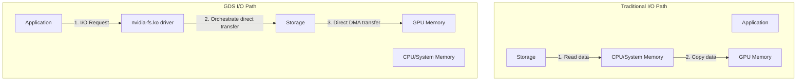

Sources: [README.md:5-8]()

## System Architecture

The NVIDIA-FS driver consists of several key components that work together to enable direct data transfers between storage and GPU memory:

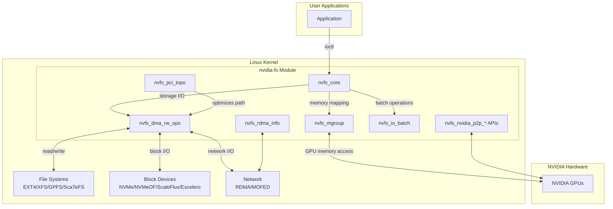

Sources: [README.md:7-14](), [ChangeLog:15-16](), [ChangeLog:127-132]()

## Core Components

The `nvidia-fs` driver consists of several interconnected components, each handling specific aspects of the GPUDirect Storage functionality:

### Core Module
The core module handles initialization, teardown, and IOCTL interfaces for applications. It provides the entry points for user applications to interact with the driver.

For detailed information about the core module, see [Core Module](#2.1).

### Memory Management
The memory management subsystem handles mapping and pinning of GPU memory. It establishes proper mappings between user space and GPU memory using NVIDIA's P2P APIs, such as `nvidia_p2p_get_pages_persistent` for modern drivers.

For detailed information about memory management, see [Memory Management](#2.2).

Sources: [ChangeLog:22-26]()

### DMA Operations
The DMA abstraction layer provides a unified interface for direct memory access operations across various storage technologies. It implements storage-specific optimizations, such as using `blk` based APIs to map NVMe DMA requests.

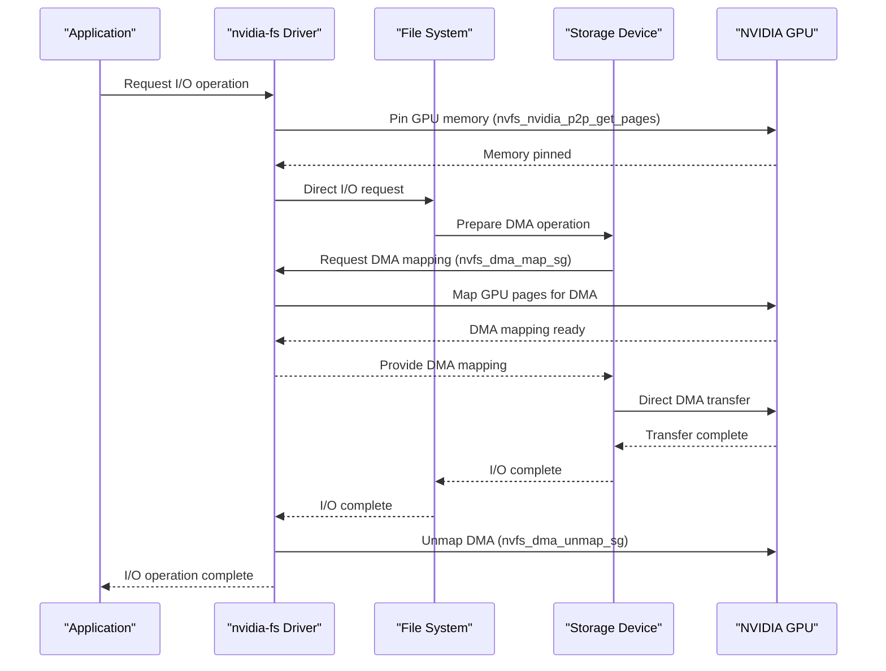

For detailed information about DMA operations, see [DMA Operations](#2.3).

Sources: [ChangeLog:3-3](), [ChangeLog:132-132](), [ChangeLog:138-139]()

### PCI Topology Management
The PCI topology manager optimizes data transfers by considering the physical layout of devices. It tracks peer affinity and distance, often exposed via `/proc/driver/nvidia-fs/peer_distance`.

For detailed information about PCI topology management, see [PCI Topology Management](#2.4).

Sources: [ChangeLog:101-101](), [ChangeLog:128-128]()

### RDMA Support
The RDMA support module enables direct memory access for distributed storage systems. It integrates with MOFED and supports protocols like NFS over RDMA.

For detailed information about RDMA support, see [RDMA Support](#2.5).

Sources: [README.md:12-13](), [ChangeLog:19-19](), [ChangeLog:89-89]()

### Batch I/O Operations
The batch I/O subsystem allows grouping multiple I/O operations to improve performance by reducing system call overhead and improving throughput.

For detailed information about batch I/O operations, see [Batch I/O Operations](#2.6).

Sources: [ChangeLog:84-84]()

## Supported Storage Technologies

The `nvidia-fs` driver supports a variety of storage technologies:

| Storage Type | Supported Technologies |
|--------------|------------------------|
| Local Filesystems | XFS, EXT4 (in ordered mode) |
| Block Devices | NVMe, NVMe-oF, ScaleFlux CSD, Excelero |
| Network Filesystems | NFS over RDMA (with MOFED 5.1+) |
| Distributed Filesystems | DDN Exascaler, WekaFS, VAST, IBM GPFS, ScaTeFS |

Sources: [README.md:9-15](), [ChangeLog:16-16](), [ChangeLog:97-97](), [ChangeLog:106-106]()

## Hardware and Software Requirements

For optimal performance with the `nvidia-fs` driver, the following requirements must be met:

### Hardware Requirements
- NVIDIA Tesla or Quadro class GPUs (Pascal, Volta, Turing, Ampere, or Hopper) [README.md:20-20](), [ChangeLog:47-47]()
- NVMe/NVMe-oF storage devices or supported distributed filesystem [README.md:21-21]()
- RDMA-capable network adapters for distributed storage [README.md:23-23]()

### Software Requirements
- Linux kernel 4.15.0 or later [README.md:22-22]()
- MOFED 5.1 or later [README.md:23-23]()
- CUDA toolkit 10.0 or later [README.md:24-24]()
- NVIDIA GPU display driver >= 418.40 [README.md:25-25]()

## Version Information

The current version of the `nvidia-fs` driver is 2.28.2. The underlying GDS version is 1.17.0.44.

Key capabilities added in recent versions include:
- Support for NEC Scalable Technology File System (ScaTeFS) [ChangeLog:16-16]()
- Support for Grace-Hopper platform with 4k and 64k page sizes [ChangeLog:47-47]()
- Persistent P2P API support for NVIDIA drivers >= 555 [ChangeLog:22-22]()
- Block-based API for NVMe DMA request mapping [ChangeLog:3-3]()

For a complete history of features and improvements, see [Features and Version History](#1.1).

Sources: [src/nvfs-vers.h:27-32](), [src/GDS_VERSION:1](), [ChangeLog:1-3]()

---

# Page: Features and Version History

# Features and Version History

<details>
<summary>Relevant source files</summary>

The following files were used as context for generating this wiki page:

- [ChangeLog](ChangeLog)
- [src/GDS_VERSION](src/GDS_VERSION)
- [src/nvfs-vers.h](src/nvfs-vers.h)

</details>


This page documents the key features, capabilities, and version history of the NVIDIA GPUDirect Storage (GDS) kernel driver (`nvidia-fs`). It tracks the evolution of the driver from its initial alpha release to the current production versions, highlighting support for various storage backends, filesystems, and hardware platforms.

## Features Overview

NVIDIA GPUDirect Storage (GDS) provides a direct data path between storage (local or remote) and GPU memory. By leveraging the `nvidia-fs` kernel module, applications can achieve higher throughput and lower latency by bypassing the CPU's system memory during I/O operations.

Key capabilities include:
- **Direct DMA**: Facilitates direct memory access between storage controllers and GPU VRAM [ChangeLog:138-139]().
- **Multi-Vendor Support**: A registration API allows third-party storage vendors to integrate their block devices and filesystems [ChangeLog:129-131]().
- **Topology Optimization**: Automated selection of the optimal data path based on PCIe and NUMA affinity [ChangeLog:101-102]().
- **RDMA Integration**: Support for remote storage via InfiniBand and RoCE, including integration with `nvidia_peermem` [ChangeLog:89-90]().
- **Batching**: A dedicated Batch I/O API to reduce syscall overhead for multiple small I/O requests [ChangeLog:84-85]().

Sources: [ChangeLog:1-141](), [src/nvfs-vers.h:27-36]()

## Feature Evolution Timeline

The following timeline illustrates the introduction of major architectural features and hardware support.

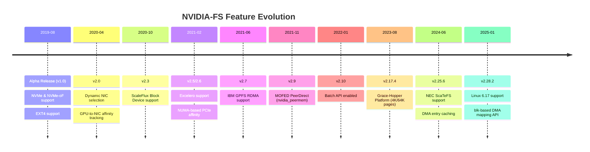

Sources: [ChangeLog:1-141]()

## Feature Capabilities Matrix

| Feature | Introduced | Description |
| :--- | :--- | :--- |
| **NVMe Direct** | v1.0 | Direct path for local NVMe and NVMe-over-Fabrics [ChangeLog:139](). |
| **Vendor Registration** | v2.0 | `nvfs_is_gpu_page`, `nvfs_gpu_index` for vendor callbacks [ChangeLog:131](). |
| **Distributed FS** | v2.0 | Dynamic NIC selection for remote filesystems [ChangeLog:127](). |
| **Block Device Support**| v2.3/2.5 | Support for ScaleFlux and Excelero (NVMesh) [ChangeLog:106,115](). |
| **RDMA DC Transport** | v2.7 | IBM GPFS support using userspace RDMA DC [ChangeLog:97](). |
| **Batch I/O** | v2.10 | High-performance batch submission for GDS [ChangeLog:84](). |
| **Persistent P2P** | v2.22.3 | `nvidia_p2p_get_pages_persistent` for x86 baremetal [ChangeLog:25-26](). |
| **Modern Kernels** | v2.28.2 | Support for Linux kernels up to 6.17 and `blk` DMA APIs [ChangeLog:2-3](). |

Sources: [ChangeLog:2-141]()

## Code Entity Map: Versioning and Components

This diagram maps the versioning logic and key driver components to their implementation symbols.

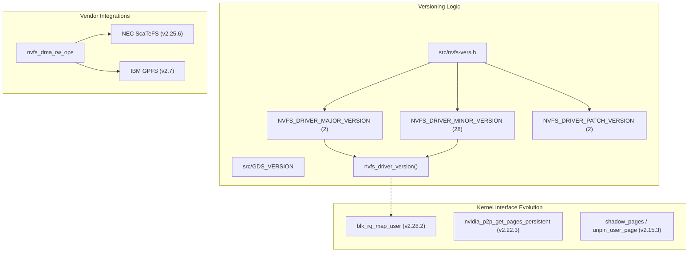

Sources: [src/nvfs-vers.h:27-44](), [src/GDS_VERSION:1](), [ChangeLog:2-16, 25-26, 57-58]()

## Detailed Version History

### Recent Releases (v2.20 - v2.28)
*   **v2.28.2**: Added support for Linux 6.17 and transitioned to a `blk` based API for mapping NVMe DMA requests [ChangeLog:2-3]().
*   **v2.26.6**: Compatibility fixes for Linux 6.11 and 6.14 [ChangeLog:7-8]().
*   **v2.25.6**: Introduced support for **NEC ScaTeFS** and implemented a domain-based key for the DMA entry cache hash table [ChangeLog:15-16]().
*   **v2.23.1**: Integrated `persistent_p2p` APIs for NVIDIA drivers >= 555 [ChangeLog:22]().
*   **v2.22.3**: Switched to `nvidia_p2p_get_pages_persistent()` for x86 baremetal environments [ChangeLog:25-26]().

### Mid-Life Updates (v2.10 - v2.19)
*   **v2.17.4**: Significant update for **Grace-Hopper** platforms, supporting both 4K and 64K page sizes [ChangeLog:47]().
*   **v2.15.3**: Fixed a critical memory leak in shadow pages by ensuring `unpin_user_page` is called [ChangeLog:58]().
*   **v2.10**: Enabled the **Batch API**, allowing userspace to submit multiple I/O operations in a single context [ChangeLog:84]().

### Early Development (v1.0 - v2.9)
*   **v2.9**: Added `nvidia_peermem` support for MOFED PeerDirect [ChangeLog:89]().
*   **v2.7**: Introduced IBM GPFS read support via userspace RDMA [ChangeLog:97]().
*   **v2.0**: Major architecture shift to support dynamic NIC selection and peer affinity statistics [ChangeLog:127-128]().
*   **v1.0**: Initial alpha release providing the core `nvidia-fs` kernel driver and the vendor DMA callback registration system [ChangeLog:137-138]().

Sources: [ChangeLog:1-141](), [src/nvfs-vers.h:27-33]()

## Versioning Implementation

The driver version is statically defined and can be retrieved via the `nvfs_driver_version` inline function, which packs the major and minor versions into a 32-bit integer.

*   **Major Version**: `NVFS_DRIVER_MAJOR_VERSION` [src/nvfs-vers.h:27]()
*   **Minor Version**: `NVFS_DRIVER_MINOR_VERSION` [src/nvfs-vers.h:29]()
*   **Patch Version**: `NVFS_DRIVER_PATCH_VERSION` [src/nvfs-vers.h:32]()
*   **GDS Release Version**: Tracked separately in `src/GDS_VERSION` (e.g., `1.17.0.44`) [src/GDS_VERSION:1]().

Sources: [src/nvfs-vers.h:27-44](), [src/GDS_VERSION:1]()

---

# Page: Contributing and Licensing

# Contributing and Licensing

<details>
<summary>Relevant source files</summary>

The following files were used as context for generating this wiki page:

- [CONTRIBUTING.md](CONTRIBUTING.md)
- [LICENSE](LICENSE)

</details>


This page outlines the protocols for contributing to the `gds-nvidia-fs` repository, the legal framework governing its distribution, and the requirements for certifying contributions via the Developer Certificate of Origin (DCO).

## Contribution Workflow

The `gds-nvidia-fs` project follows a standard GitHub-based fork and pull request (PR) model. Contributions are categorized by their impact on the system's public interfaces and supported filesystem backends.

### General Guidelines
*   **Issue First**: Before initiating code changes, contributors must file an issue for tracking and discussion to ensure alignment with the GPUDirect Storage (GDS) scope [CONTRIBUTING.md:10-16]().
*   **Branching**: The `master` branch contains the latest stable code [CONTRIBUTING.md:24-24]().
*   **Scope**: PRs should address a single feature or bug. Documentation updates related to code changes must be included in the same PR [CONTRIBUTING.md:41-45]().
*   **Commit Style**: All commit messages must adhere to [Conventional Commits](https://www.conventionalcommits.org) [CONTRIBUTING.md:38-39]().
*   **Merging**: Most contributions are integrated via "Squash and Merge" [CONTRIBUTING.md:48-49]().

### Versioning Policy
The project utilizes [Semantic Versioning](https://semver.org) [CONTRIBUTING.md:20-20](). Version increments are handled by maintainers in separate commits; contributors should not modify version strings in their PRs [CONTRIBUTING.md:27-28]().

| Release Type | Description |
| :--- | :--- |
| **MAJOR** | Aimed at maintaining backward compatibility; significant architectural shifts [CONTRIBUTING.md:34-34](). |
| **MINOR** | Re-evaluation of supported filesystems or addition of minor features without protocol changes [CONTRIBUTING.md:31-32](). |
| **PATCH** | Bug fixes and minor adjustments; not every change triggers a GitHub release [CONTRIBUTING.md:29-29](). |

**Sources:** [CONTRIBUTING.md:10-49]()

## Developer Certificate of Origin (DCO)

To ensure the legal integrity of the kernel driver, every contribution must be "signed off." This signifies that the contributor has the right to submit the code under the project's licenses [CONTRIBUTING.md:59-63]().

### Sign-off Requirement
Contributors must include a `Signed-off-by` line in every git commit message using their real name [CONTRIBUTING.md:104-108]().

**Mechanism: Contribution Certification**
The following diagram illustrates the relationship between the developer's local environment and the certification of the patch.

**Diagram: DCO Certification Flow**
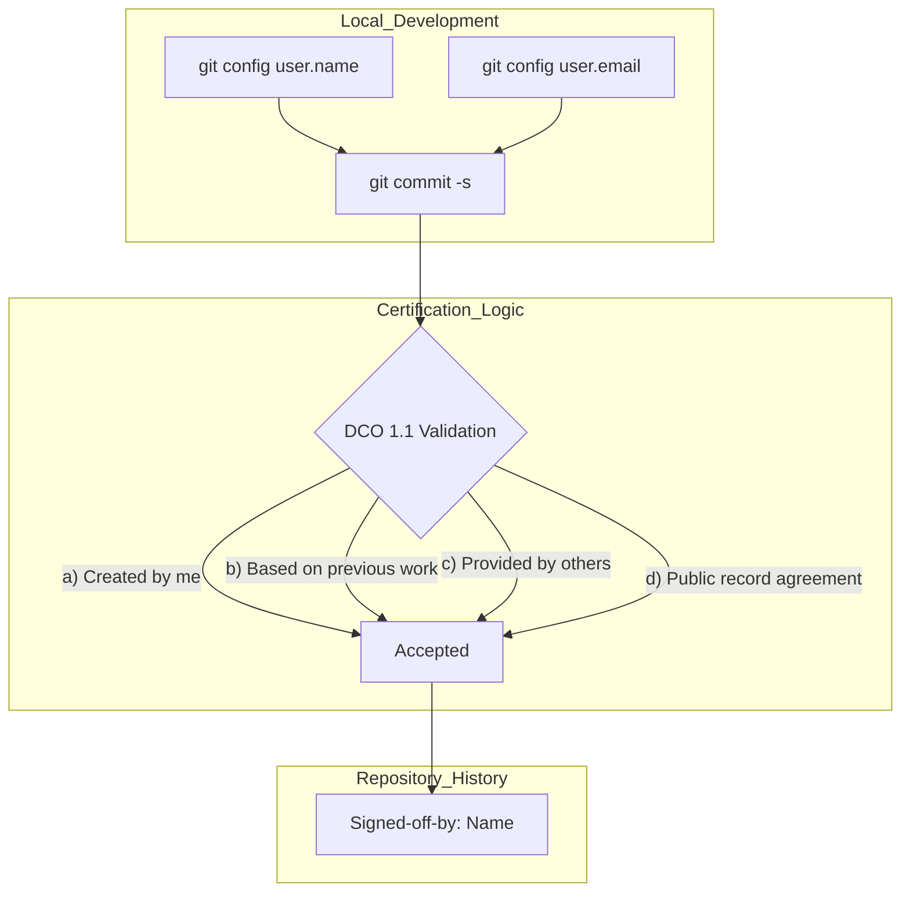
**Sources:** [CONTRIBUTING.md:65-111]()

## Licensing Terms

The `gds-nvidia-fs` project is distributed under a dual-licensing structure to accommodate both the kernel-space requirements and the associated software components.

### License Components
1.  **GPL v2**: Software developed as part of this kernel module is released under the **GNU General Public License version 2** [LICENSE:23-24]().
2.  **MIT/X11**: The broader permission notice grants the right to use, copy, modify, and distribute the software without restriction, provided the copyright notice is included [LICENSE:3-11]().

### Liability and Warranty
The software is provided "AS IS," without any warranty of any kind, including but not limited to the warranties of merchantability or fitness for a particular purpose [LICENSE:13-19]().

**Diagram: License Mapping to Code Entities**
This diagram maps the licensing requirements to the resulting repository artifacts.

**Diagram: License Application**
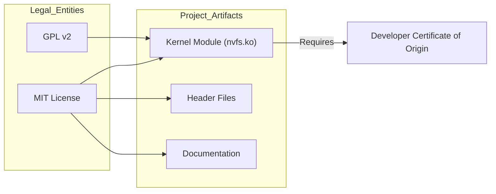
**Sources:** [LICENSE:1-25](), [CONTRIBUTING.md:79-91]()

---

# Page: System Architecture

# System Architecture

<details>
<summary>Relevant source files</summary>

The following files were used as context for generating this wiki page:

- [ChangeLog](ChangeLog)
- [src/nvfs-core.c](src/nvfs-core.c)
- [src/nvfs-core.h](src/nvfs-core.h)

</details>


This page provides a comprehensive overview of the NVIDIA GPUDirect Storage (GDS) system architecture, focusing on the `nvidia-fs` kernel driver components, their interactions, and data flows. This document covers the key subsystems that enable direct data paths between GPU memory and storage devices, bypassing CPU involvement for improved performance.

For installation details, see [Installation & Configuration](#3), and for details about specific subsystems, see the relevant child pages linked throughout this document.

## High-Level Architecture Overview

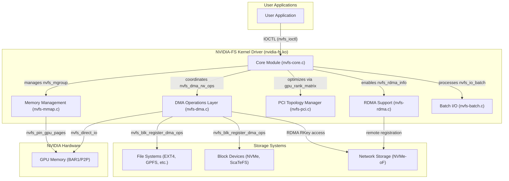

Sources: [src/nvfs-core.c:57-68](), [src/nvfs-core.h:22-63](), [ChangeLog:15-16]()

The NVIDIA GPUDirect Storage system consists of several interconnected components that work together to enable direct data transfers between storage and GPU memory:

1.  **Core Module**: Handles initialization, device management, IOCTL processing, and coordinates all other components via the `nvfs_ioctl` interface [src/nvfs-core.c:864-972]().
2.  **Memory Management**: Manages memory mappings between CPU and GPU address spaces using `nvfs_mgroup` and shadow buffers [src/nvfs-core.h:32-33]().
3.  **DMA Operations Layer**: Provides an abstraction layer for direct memory access across different storage types using the `nvfs_dma_rw_ops` structure [src/nvfs-core.c:59-60]().
4.  **PCI Topology Manager**: Analyzes and optimizes data paths based on PCI device relationships and distance [src/nvfs-core.c:60-61]().
5.  **RDMA Support**: Enables Remote Direct Memory Access for distributed storage systems like GPFS [src/nvfs-core.c:65-67](), [ChangeLog:97-98]().
6.  **Batch I/O Operations**: Allows grouping multiple I/O operations into a single `NVFS_IOCTL_BATCH_IO` call to improve performance [src/nvfs-core.h:130-137]().

## Data Flow

The following sequence diagram illustrates the typical data flow for a GPUDirect Storage operation, mapping high-level actions to internal state transitions:

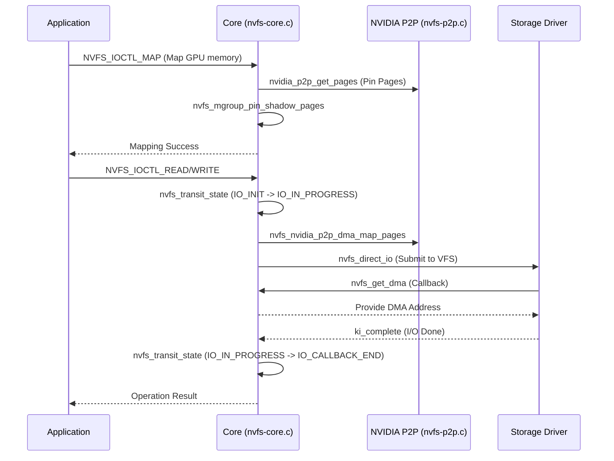

Sources: [src/nvfs-core.c:143-205](), [src/nvfs-core.c:1063-1099](), [src/nvfs-core.c:560-713]()

## Core Module

The Core Module serves as the central component of the NVIDIA-FS driver, providing fundamental functionality and coordination. It manages up to 16 GPU devices by default [src/nvfs-core.c:78-79]().

Key responsibilities include:
- **Device Management**: Creating the `nvidia-fs` character device and class [src/nvfs-core.h:24-25]().
- **IOCTL Dispatch**: Handling `NVFS_IOCTL_MAP`, `NVFS_IOCTL_READ`, `NVFS_IOCTL_WRITE`, and `NVFS_IOCTL_BATCH_IO` [src/nvfs-core.h:165-177]().
- **State Machine**: Managing the I/O lifecycle through states like `IO_FREE`, `IO_INIT`, `IO_IN_PROGRESS`, and `IO_TERMINATED` [src/nvfs-core.c:143-219]().

See the [Core Module](#2.1) page for more detailed information.

## Memory Management

The Memory Management subsystem facilitates data transfer between CPU and GPU memory spaces using the `nvfs_mgroup` structure. It supports features like sparse I/O via `nvfs_io_sparse_data` [src/nvfs-core.h:189-195]().

Key components:
- **nvfs_mgroup**: The primary structure for tracking pinned GPU pages and their associated shadow buffers.
- **Shadow Buffers**: CPU-side buffers used for metadata or fallback paths.
- **Reference Counting**: Using `nvfs_mgroup_get` and `nvfs_mgroup_put` to manage lifecycle [src/nvfs-core.c:165-166]().

See the [Memory Management](#2.2) page for more detailed information.

## DMA Operations Layer

The DMA Operations Layer provides a unified interface for direct memory access across different storage types, including NVMe, SCSI, and specialized block devices like ScaTeFS [ChangeLog:16-17]().

It manages the mapping of GPU pages to DMA addresses using the NVIDIA Peer-to-Peer (P2P) APIs. The driver supports both legacy P2P allocation and a newer persistent P2P mode for NVIDIA driver versions >= 555 [src/nvfs-core.c:107-108](), [ChangeLog:21-22]().

See the [DMA Operations](#2.3) page for more detailed information.

## PCI Topology Management

The PCI Topology Management component optimizes data paths based on the physical relationship between PCI devices. It calculates distances and ranks paths to ensure that DMA transfers occur over the most efficient bus routes, avoiding unnecessary traversals of the CPU root complex where possible [ChangeLog:101-102]().

See the [PCI Topology Management](#2.4) page for more detailed information.

## RDMA Support

The RDMA Support component enables Remote Direct Memory Access for distributed storage systems. It uses the `nvfs_ioctl_set_rdma_reg_info_args` structure to register memory keys (rkeys) and connection information in the kernel [src/nvfs-core.h:140-151](). This integration is critical for high-performance distributed filesystems like GPFS [ChangeLog:97-98]().

See the [RDMA Support](#2.5) page for more detailed information.

## Batch I/O Operations

The Batch I/O Operations component allows processing multiple I/O operations in a single call using the `nvfs_ioctl_batch_ioargs_t` structure [src/nvfs-core.h:131-137](). This reduces the overhead of multiple system calls and improves performance for GDS [ChangeLog:84-86]().

See the [Batch I/O Operations](#2.6) page for more detailed information.

## NVIDIA P2P API Integration

The driver acts as a shim for the NVIDIA Peer-to-Peer kernel API. It handles the pinning of GPU pages via `nvidia_p2p_get_pages` (or the persistent variant `nvidia_p2p_get_pages_persistent` on newer drivers) and mapping them for DMA via `nvidia_p2p_dma_map_pages` [ChangeLog:25-26]().

See the [NVIDIA P2P API Integration](#2.7) page for more detailed information.

---

# Page: Core Module

# Core Module

<details>
<summary>Relevant source files</summary>

The following files were used as context for generating this wiki page:

- [src/nvfs-core.c](src/nvfs-core.c)
- [src/nvfs-core.h](src/nvfs-core.h)
- [src/nvfs-kernel-interface.h](src/nvfs-kernel-interface.h)
- [src/nvfs-mod.c](src/nvfs-mod.c)

</details>


The Core Module is the central coordinator of the NVIDIA GPUDirect Storage (GDS) kernel driver. It manages the lifecycle of the `nvidia-fs` kernel module, provides the character device interface for userspace libraries (like `libcufile`), and implements the I/O state machine that orchestrates data transfers between storage and GPU memory.

## Module Initialization and Device Management

The module initializes by registering a major number and creating a class in `sysfs` to manage multiple character device nodes. By default, it supports up to 16 device instances to optimize parallel 4K I/O operations across multiple GPU devices [src/nvfs-core.c:75-78]().

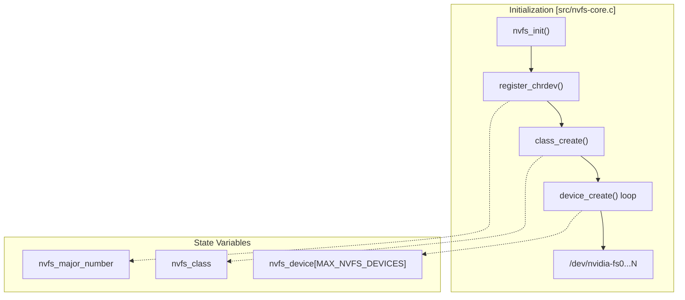
Sources: [src/nvfs-core.c:92-94](), [src/nvfs-core.c:75-78]()

### Module Parameters
The behavior of the core module is tunable via `insmod` parameters:
* `nvfs_dbg_enabled`: Enables verbose debug logging [src/nvfs-core.c:102]().
* `nvfs_max_devices`: Sets the number of character devices to create (default 16) [src/nvfs-core.c:106]().
* `nvfs_use_legacy_p2p_allocation`: Controls whether to use legacy P2P allocation modes [src/nvfs-core.c:107]().

## Character Device Interface (IOCTLs)

Userspace communicates with the driver via `ioctl` calls on `/dev/nvidia-fsX`. The driver defines a union, `nvfs_ioctl_param_union`, to handle various command structures [src/nvfs-core.h:165-177]().

| IOCTL Command | Structure | Description |
| :--- | :--- | :--- |
| `NVFS_IOCTL_MAP` | `nvfs_ioctl_map_t` | Pins GPU memory and creates a shadow buffer mapping [src/nvfs-core.h:91-101](). |
| `NVFS_IOCTL_READ` / `WRITE` | `nvfs_ioctl_ioargs_t` | Initiates a GDS I/O operation (Direct I/O) [src/nvfs-core.h:112-128](). |
| `NVFS_IOCTL_BATCH_IO` | `nvfs_ioctl_batch_ioargs_t` | Submits multiple I/O operations in a single call [src/nvfs-core.h:131-136](). |
| `NVFS_IOCTL_SET_RDMA_REG` | `nvfs_ioctl_set_rdma_reg_info_args_t` | Configures RDMA registration for remote storage [src/nvfs-core.h:140-151](). |

Sources: [src/nvfs-core.h:91-177]()

## I/O Lifecycle State Machine

To handle asynchronous events like process termination or GPU memory deallocation (via NVIDIA driver callbacks), the module implements a strict state machine for every I/O group (`nvfs_io_mgroup`).

### State Transitions
The function `nvfs_transit_state` manages transitions using atomic compare-and-swap (`atomic_cmpxchg`) to prevent race conditions between the I/O thread and the GPU memory eviction callback [src/nvfs-core.c:143-178]().

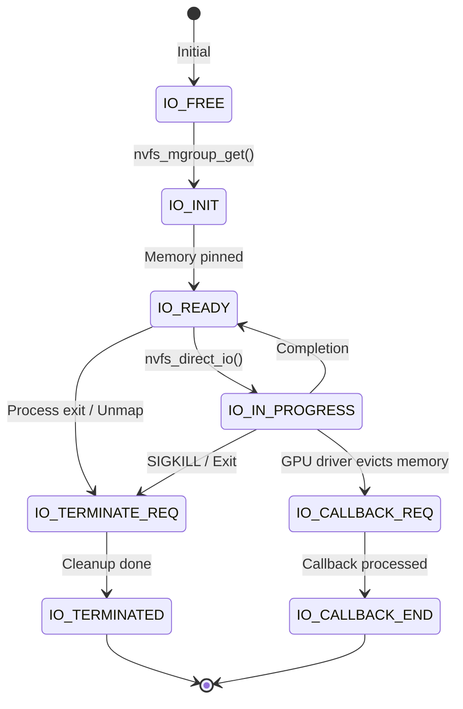
Sources: [src/nvfs-core.c:143-205](), [src/nvfs-core.c:207-219]()

## I/O Execution Path

The core module intercepts standard Linux file operations and converts them into Peer-to-Peer (P2P) DMA operations.

### Direct I/O Logic
When a `READ` or `WRITE` IOCTL is received, the driver performs the following:
1. **Validation**: Calls `nvfs_rw_verify_area` to check file permissions and offsets [src/nvfs-core.c:931-975]().
2. **Setup**: Initializes `nvfs_io_t` and `kiocb` structures for the VFS layer [src/nvfs-core.c:561-600]().
3. **Execution**: Calls `call_read_iter` or `call_write_iter` on the target file [src/nvfs-core.c:637-650]().
4. **DMA Mapping**: During the VFS iteration, the storage driver (e.g., NVMe) calls back into `nvfs_get_dma` to get the P2P DMA address of the GPU pages [src/nvfs-core.c:739-806]().

### Termination Handling
If a process is killed while I/O is in flight, `nvfs_io_terminate_requested` ensures that the driver waits for the hardware to finish the DMA transfer before releasing GPU memory references, preventing system crashes [src/nvfs-core.c:207-240]().

## Integration with Storage Vendors

The core module uses a registration system to allow different storage drivers (NVMe, ScaleOut, etc.) to hook into the GDS pipeline.

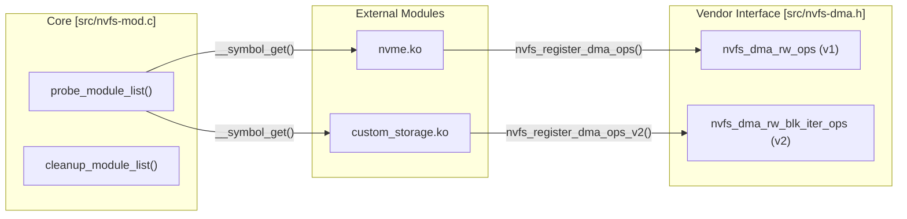
Sources: [src/nvfs-mod.c:40-129](), [src/nvfs-mod.c:131-162]()

The `probe_module_list` function scans a predefined list of modules and uses `__symbol_get` to find registration functions exported by storage drivers [src/nvfs-mod.c:56-64](). It supports both the legacy `v1` API and the newer `v2` iterator-based API required by modern Linux kernels [src/nvfs-mod.c:86-104]().

## Error Handling and Fault Injection
The module integrates with the Linux kernel's fault injection framework. If `CONFIG_FAULT_INJECTION` is enabled, the driver can simulate state transition failures in `nvfs_transit_state` to verify the robustness of the cleanup logic [src/nvfs-core.c:153-172]().

Sources:
* **Core Logic**: [src/nvfs-core.c:1-284](), [src/nvfs-core.h:24-177]()
* **Module Loading**: [src/nvfs-mod.c:40-162]()
* **Kernel Shim**: [src/nvfs-kernel-interface.h:38-50]()

---

# Page: Memory Management

# Memory Management

<details>
<summary>Relevant source files</summary>

The following files were used as context for generating this wiki page:

- [src/nvfs-mmap.c](src/nvfs-mmap.c)
- [src/nvfs-mmap.h](src/nvfs-mmap.h)

</details>


## Overview

The Memory Management subsystem in NVIDIA GPUDirect Storage (GDS) provides the foundation for efficient direct data transfers between storage and GPU memory. This subsystem manages the mapping, tracking, and synchronization of memory resources across user-space, kernel-space, and GPU memory domains.

The primary purpose of this system is to create and maintain "shadow buffers" — special memory regions that serve as intermediaries between traditional storage I/O operations and GPU memory. By establishing these mappings, GDS enables direct I/O to and from GPU memory without traditional CPU-based data copying.

Sources: [src/nvfs-mmap.h:22-24](), [src/nvfs-mmap.c:1-24]()

## Architecture

The memory management system relies on several key components working together to provide efficient memory mapping and tracking between CPU and GPU address spaces.

### System Mapping Data Flow
The following diagram bridges the natural language concept of "Memory Mapping" to the specific code entities in `nvfs-mmap.c` and `nvfs-mmap.h`.

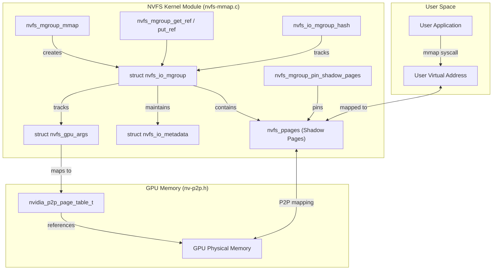

The architecture centers around the `nvfs_io_mgroup` structure, which serves as the core data structure for managing memory operations. It maintains shadow buffer pages in system memory that are mapped to both user virtual addresses and GPU memory via the NVIDIA Peer-to-Peer (P2P) APIs.

Sources: [src/nvfs-mmap.h:170-188](), [src/nvfs-mmap.c:53-56](), [src/nvfs-mmap.c:618-807]()

## Key Components

### Memory Group Structure (`nvfs_io_mgroup`)

The `nvfs_io_mgroup` structure is the fundamental building block of the memory management system. It encapsulates all state required for a specific memory mapping.

```mermaid
classDiagram
    class nvfs_io_mgroup {
        +atomic_t ref
        +atomic_t dma_ref
        +hlist_node hash_link
        +u64 cpu_base_vaddr
        +unsigned long base_index
        +unsigned long nvfs_blocks_count
        +struct page** nvfs_ppages
        +struct nvfs_io_metadata* nvfs_metadata
        +struct nvfs_gpu_args gpu_info
        +nvfs_io_t nvfsio
    }

    class nvfs_io_metadata {
        +u64 nvfs_start_magic
        +enum nvfs_block_state nvfs_state
        +struct page* page
    }

    class nvfs_gpu_args {
        +nvidia_p2p_page_table_t* page_table
        +u64 gpuvaddr
        +u64 gpu_buf_len
        +atomic_t io_state
        +HASHTABLE buckets
    }

    nvfs_io_mgroup --> nvfs_io_metadata : contains
    nvfs_io_mgroup --> nvfs_gpu_args : contains
    nvfs_io_mgroup --> "nvfs_io_t" : contains
```

Each memory group maintains:
- **Reference counts**: `ref` and `dma_ref` for lifecycle tracking [src/nvfs-mmap.c:74-82]().
- **Shadow buffer pages**: `nvfs_ppages` (array of `struct page*`) [src/nvfs-mmap.c:163-171]().
- **Metadata**: `nvfs_metadata` for tracking the state of each 4KB block [src/nvfs-mmap.h:154-158]().
- **GPU info**: `gpu_info` (`struct nvfs_gpu_args`) which holds the P2P page tables [src/nvfs-mmap.h:136-152]().

Sources: [src/nvfs-mmap.h:170-188](), [src/nvfs-mmap.h:129-145](), [src/nvfs-mmap.h:147-151]()

### Block State Tracking

GDS manages memory in 4KB units defined by `NVFS_BLOCK_SIZE` [src/nvfs-mmap.h:39](). Each block's lifecycle is tracked via `enum nvfs_block_state`:

| State | Description |
|-------|-------------|
| `NVFS_IO_FREE` | Block is initialized and available [src/nvfs-mmap.h:59](). |
| `NVFS_IO_ALLOC` | Block has been allocated for an operation [src/nvfs-mmap.h:60](). |
| `NVFS_IO_QUEUED` | Block is queued in the I/O subsystem [src/nvfs-mmap.h:62](). |
| `NVFS_IO_DMA_START` | DMA transfer has been initiated [src/nvfs-mmap.h:63](). |
| `NVFS_IO_DONE` | DMA operation completed successfully [src/nvfs-mmap.h:64](). |
| `NVFS_IO_DMA_ERROR` | DMA operation failed [src/nvfs-mmap.h:65](). |

Sources: [src/nvfs-mmap.h:58-67](), [src/nvfs-mmap.c:832-1003]()

## Memory Mapping Lifecycle

### The `mmap` Workflow

When a user application calls `mmap` on the NVIDIA-FS character device, the following sequence occurs:

1. **`nvfs_mgroup_mmap`**: The entry point for the mmap syscall. It allocates a new `nvfs_io_mgroup` [src/nvfs-mmap.c:618-650]().
2. **Hash Insertion**: The mgroup is assigned a `base_index` and inserted into the `nvfs_io_mgroup_hash` table using `hash_add_rcu` [src/nvfs-mmap.c:736-745]().
3. **Shadow Page Allocation**: System memory pages are allocated to back the shadow buffer [src/nvfs-mmap.c:680-700]().
4. **VMA Setup**: The `vm_area_struct` is configured with custom `nvfs_vm_ops` [src/nvfs-mmap.c:800-805]().

### Reference Counting and Cleanup

The lifecycle is strictly controlled by reference counts to prevent use-after-free during asynchronous DMA:
- `nvfs_mgroup_get`: Increments the reference count [src/nvfs-mmap.c:115-123]().
- `nvfs_mgroup_put_internal`: Decrements the count and triggers `nvfs_mgroup_free` if it reaches zero [src/nvfs-mmap.c:182-216]().
- **Process Context Check**: `nvfs_check_process_context` ensures that certain cleanup operations (like unpinning GPU pages) occur in the correct process context [src/nvfs-mmap.c:56-72]().

Sources: [src/nvfs-mmap.c:125-177](), [src/nvfs-mmap.c:182-216]()

## VMA Operations

NVIDIA-FS implements custom `vm_operations_struct` (`nvfs_vm_ops`) to manage the mapped memory region:

| Function | Role |
|----------|------|
| `nvfs_vma_open` | Increments mgroup reference when VMA is duplicated [src/nvfs-mmap.c:501-512](). |
| `nvfs_vma_close` | Decrements mgroup reference and cleans up resources [src/nvfs-mmap.c:514-539](). |
| `nvfs_vma_fault` | Handles page faults by mapping shadow pages into the process address space [src/nvfs-mmap.c:541-581](). |
| `nvfs_vma_split` / `mremap` | Explicitly disallowed to maintain mapping integrity [src/nvfs-mmap.c:590-602](). |

Sources: [src/nvfs-mmap.c:604-616]()

## Sparse I/O and Metadata Management

The system supports sparse I/O detection through the `nvfs_io_t` structure and metadata states:
- **`nvfs_metastate_enum`**: Tracks if a block is `NVFS_IO_META_CLEAN` or `NVFS_IO_META_SPARSE` [src/nvfs-mmap.h:87-91]().
- **Metadata Search**: `nvfs_mgroup_metadata_search` allows the driver to find the state of specific blocks within an mgroup [src/nvfs-mmap.c:905-930]().
- **State Updates**: `nvfs_mgroup_metadata_set_dma_state` updates the block state after DMA operations complete [src/nvfs-mmap.c:968-1003]().

Sources: [src/nvfs-mmap.h:154-158](), [src/nvfs-mmap.c:832-1003]()

## GPU Integration (P2P)

The connection to GPU memory is handled via `struct nvfs_gpu_args`:
- **Page Tables**: Holds the `nvidia_p2p_page_table_t` which contains the physical GPU addresses [src/nvfs-mmap.h:137]().
- **Physical Address Retrieval**: `nvfs_mgroup_get_gpu_physical_address` translates a GPU virtual address into a physical address suitable for DMA by storage controllers [src/nvfs-mmap.c:1079-1093]().
- **IO State**: `io_state` (e.g., `IO_IN_PROGRESS`, `IO_DONE`) synchronizes the GPU memory availability with the kernel I/O state [src/nvfs-mmap.h:69-85]().

Sources: [src/nvfs-mmap.h:136-152](), [src/nvfs-mmap.c:1018-1067]()

---

# Page: DMA Operations

# DMA Operations

<details>
<summary>Relevant source files</summary>

The following files were used as context for generating this wiki page:

- [src/nvfs-dma.c](src/nvfs-dma.c)
- [src/nvfs-dma.h](src/nvfs-dma.h)
- [src/nvfs-kernel-interface.h](src/nvfs-kernel-interface.h)
- [src/nvfs-mod.c](src/nvfs-mod.c)

</details>


The DMA Operations subsystem in NVIDIA GPUDirect Storage (GDS) provides a high-performance abstraction layer that enables direct data transfers between storage devices and GPU memory. By bypassing the CPU and system RAM, this layer facilitates unified Direct Memory Access (DMA) across diverse storage backends including NVMe, SCSI, ScaleFlux, and various RDMA-capable distributed filesystems.

## DMA Abstraction Layer

The DMA abstraction layer defines a standard interface (`nvfs_dma_rw_ops`) that allows the NVIDIA-FS kernel module to plug into the I/O paths of different storage drivers. This architecture ensures that regardless of the underlying storage technology, GPU memory can be mapped and accessed consistently.

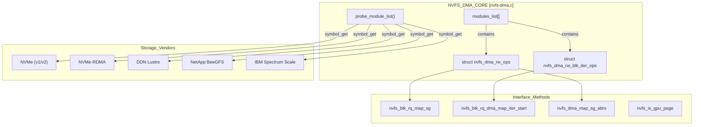

Sources: [src/nvfs-dma.c:52-59](), [src/nvfs-dma.c:61-206](), [src/nvfs-dma.h:74-101](), [src/nvfs-dma.h:137-166]()

## Key Interfaces and Structures

### V1 and V2 Operation Sets
NVIDIA-FS supports two primary interface versions depending on the host kernel's capabilities (specifically the presence of `HAVE_BLK_RQ_DMA_MAP_ITER_START`).

*   **V1 Interface (`nvfs_dma_rw_ops`)**: Uses traditional scatter-gather list mapping. It is used for most legacy storage drivers and kernels without the iterator-based DMA API [src/nvfs-dma.h:74-101]().
*   **V2 Interface (`nvfs_dma_rw_blk_iter_ops`)**: Leverages the block layer DMA iterator API, providing more efficient mapping for modern NVMe drivers [src/nvfs-dma.h:137-166]().

| Method | Description |
| :--- | :--- |
| `nvfs_blk_rq_map_sg` | Maps a block `request` to a `scatterlist`. Handles GPU page identification and coalescing [src/nvfs-dma.h:77-79](). |
| `nvfs_dma_map_sg_attrs` | Performs the actual DMA mapping of the scatterlist to the storage device [src/nvfs-dma.h:81-85](). |
| `nvfs_is_gpu_page` | Callback to verify if a specific `struct page` resides in GPU memory [src/nvfs-dma.h:92](). |
| `nvfs_gpu_index` | Returns the ordinal index of the GPU owning the page [src/nvfs-dma.h:94](). |
| `nvfs_blk_rq_dma_map_iter_start` | (V2 Only) Initializes the DMA iterator for a block request [src/nvfs-dma.h:140-144](). |

Sources: [src/nvfs-dma.h:74-166]()

### Module Registration
The `modules_list` array serves as the registry for all supported storage backends. Each `module_entry` defines the module name, the registration/unregistration symbols to look for in the kernel symbol table, and the specific ops structure to be passed to the vendor driver [src/nvfs-dma.c:61-206]().

Sources: [src/nvfs-dma.c:61-206](), [src/nvfs-dma.h:172-185]()

## DMA Operation Flow

The DMA flow involves validating the block request, constructing a scatter-gather list (or iterator), and establishing the hardware-level DMA mapping.

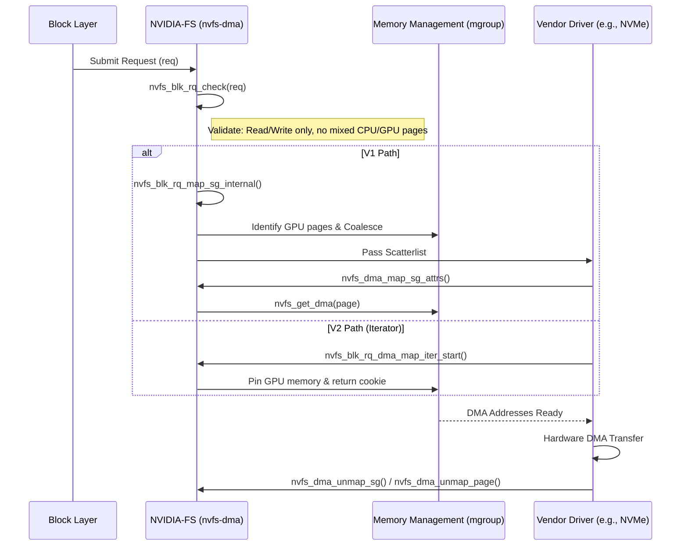

Sources: [src/nvfs-dma.c:246-264](), [src/nvfs-dma.c:298-310](), [src/nvfs-dma.c:515-534](), [src/nvfs-mod.c:86-104]()

## Implementation Details

### Scatter-Gather List Construction
The function `nvfs_blk_rq_map_sg_internal` is the core of the V1 path. It iterates through the `bio_vec` entries of a request, distinguishes between CPU and GPU pages, and builds a `scatterlist` [src/nvfs-dma.c:403-499]().

*   **Coalescing**: It attempts to merge contiguous GPU physical addresses into a single SG entry to improve DMA efficiency [src/nvfs-dma.c:440-449]().
*   **Validation**: It enforces that a single request cannot contain a mix of CPU and GPU pages. If both are found, the request is rejected with `NVFS_IO_ERR` [src/nvfs-dma.c:425-430]().
*   **Size Limits**: Requests are capped by `NVME_MAX_SEGS` (127) to remain compatible with standard NVMe driver limits [src/nvfs-dma.c:38](), [src/nvfs-dma.c:266-275]().

Sources: [src/nvfs-dma.c:38](), [src/nvfs-dma.c:266-275](), [src/nvfs-dma.c:403-499]()

### Iterator-Based V2 Path
On newer kernels, NVIDIA-FS registers `nvfs_nvme_dma_rw_blk_iter_ops` [src/nvfs-dma.c:58](). This path avoids the overhead of intermediate scatter-gather list allocation by using the kernel's `blk_dma_iter` interface [src/nvfs-dma.h:137-150]().

*   **`nvfs_blk_rq_dma_map_iter_start`**: Sets up the mapping state and pins the underlying GPU memory [src/nvfs-dma.h:140-144]().
*   **`nvfs_blk_rq_dma_map_iter_next`**: Advances the iterator to the next DMA-contiguous segment [src/nvfs-dma.h:146-149]().

Sources: [src/nvfs-dma.c:58](), [src/nvfs-dma.h:137-150]()

### Module Probing and Registration
During driver initialization, `probe_module_list()` iterates through the supported modules. It uses `__symbol_get` to find the registration functions exported by vendor drivers (e.g., `nvme_v2_register_nvfs_dma_ops`) and passes the corresponding NVIDIA-FS ops structure to them [src/nvfs-mod.c:40-129]().

Sources: [src/nvfs-mod.c:40-129](), [src/nvfs-dma.c:61-206]()

## Performance and Constraints

*   **IOVA Boundaries**: The system handles SMMU/IOMMU discontinuities, specifically checking for 4GB boundaries that might affect GPU page contiguity [src/nvfs-dma.c:443-448]().
*   **Error Codes**: 
    *   `NVFS_IO_ERR (-1)`: Returned for mapping failures or invalid hardware states [src/nvfs-dma.h:49]().
    *   `NVFS_BAD_REQ (-2)`: Returned when a request is valid but cannot be handled via GDS (e.g., CPU-only pages in a path expecting GPU pages) [src/nvfs-dma.h:50]().
*   **Memory Groups**: DMA operations rely on the `nvfs_mgroup` to track the lifecycle of pinned GPU pages and their associated DMA addresses [src/nvfs-dma.c:44-49]().

Sources: [src/nvfs-dma.c:44-49](), [src/nvfs-dma.c:443-448](), [src/nvfs-dma.h:49-50]()

---

# Page: PCI Topology Management

# PCI Topology Management

<details>
<summary>Relevant source files</summary>

The following files were used as context for generating this wiki page:

- [src/Makefile](src/Makefile)
- [src/dkms.conf](src/dkms.conf)
- [src/nvfs-pci.c](src/nvfs-pci.c)
- [src/nvfs-pci.h](src/nvfs-pci.h)

</details>


## Purpose and Scope

The PCI Topology Management subsystem in NVIDIA GPUDirect Storage (GDS) optimizes direct data transfers between GPUs and storage or network devices by analyzing and leveraging the underlying PCI topology of the system. This subsystem discovers the PCI topology, calculates device-to-device distances, and provides intelligence for path selection to minimize data transfer latency and maximize bandwidth.

This page describes the architecture and operation of the PCI topology management capabilities in the NVIDIA-FS driver.

Sources: [src/nvfs-pci.h:25-251](), [src/nvfs-pci.c:25-47]()

## Key Concepts

### PCI Device Paths and Topology

The PCI Topology Management subsystem constructs a representation of the system's PCIe hierarchy by discovering all GPUs, NVMe devices, and network adapters (Ethernet and InfiniBand). Key attributes tracked include:

- **PCIe Bridges**: Identifying relationships between switches and root complexes [src/nvfs-pci.c:308-425]().
- **ACS Detection**: Access Control Services (ACS) can force P2P traffic up to the root complex, impacting performance. The driver detects this via `nvfs_pci_check_acs_enabled` [src/nvfs-pci.c:229-253]().
- **Link Capabilities**: Link speeds (e.g., 16GT/s) and widths (e.g., x16) are stored to calculate theoretical bandwidth [src/nvfs-pci.h:155-200]().
- **NUMA Affinity**: Proximity to CPU sockets is factored into the final distance metric [src/nvfs-pci.c:434-474]().

Sources: [src/nvfs-pci.c:229-253](), [src/nvfs-pci.c:308-425](), [src/nvfs-pci.h:44-52](), [src/nvfs-pci.h:155-200]()

### Device Distance and Ranking

The system computes a "distance" between GPU devices and potential peer devices (NVMe drives or network adapters). This distance is stored in `struct nvfs_rank_data` [src/nvfs-pci.c:91-97]():

1. **PCI Distance**: Number of hops or logical separation in the PCIe tree.
2. **Bandwidth Index**: A rank derived from `nvfs_pcie_link_speed_table` and `nvfs_pcie_link_width_table` [src/nvfs-pci.c:48-88]().
3. **Cross-Root Port**: A flag indicating if traffic must traverse the CPU's internal interconnect [src/nvfs-pci.c:93]().

Sources: [src/nvfs-pci.c:48-97](), [src/nvfs-pci.c:483-608](), [src/nvfs-pci.h:54-61]()

## System Architecture

### PCI Topology Management Data Model

The following diagram maps the logical flow of topology discovery to the specific C functions and data structures that handle them.

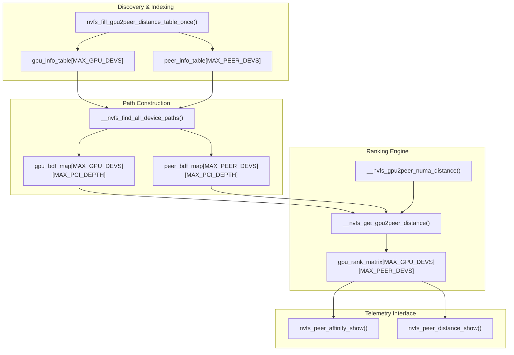

Sources: [src/nvfs-pci.c:90-110](), [src/nvfs-pci.c:308-425](), [src/nvfs-pci.c:645-665]()

### Core Data Structures

| Structure / Variable | File | Description |
|:---|:---|:---|
| `struct nvfs_rank_data` | [src/nvfs-pci.c:91]() | Stores rank, cross-RP flag, pci_dist, and bw_index for a GPU-Peer pair. |
| `gpu_info_table` | [src/nvfs-pci.c:105]() | Hash table for quick lookup of GPU BDF info. |
| `peer_info_table` | [src/nvfs-pci.c:107]() | Hash table for peer devices (NVMe/Network). |
| `gpu_bdf_map` | [src/nvfs-pci.c:100]() | Stores the full PCI path (ancestors) for each GPU. |
| `peer_bdf_map` | [src/nvfs-pci.c:102]() | Stores the full PCI path for each peer device. |
| `gpu_rank_matrix` | [src/nvfs-pci.c:110]() | The final computed matrix used for I/O path decisions. |

Sources: [src/nvfs-pci.c:90-110]()

## Initialization and Device Discovery

### PCI Device Discovery Process

The driver performs a one-time discovery of the PCI environment during module initialization or upon the first GDS I/O request via `nvfs_fill_gpu2peer_distance_table_once` [src/nvfs-pci.c:645]().

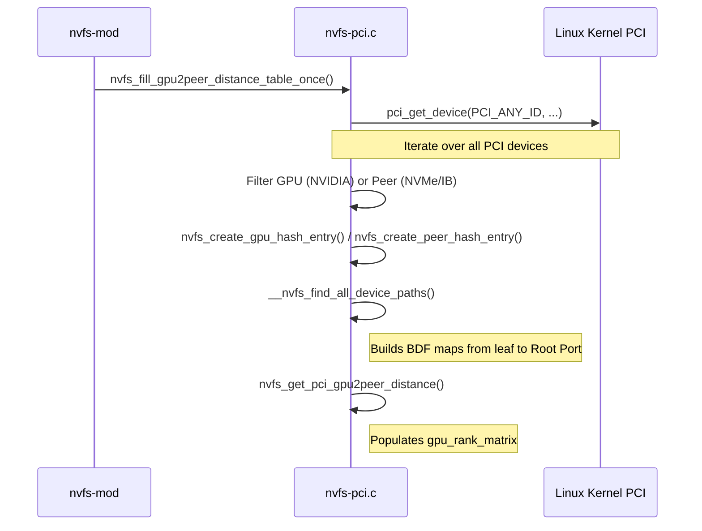

Sources: [src/nvfs-pci.c:645-665](), [src/nvfs-pci.c:308-425]()

### Device Path Discovery

The function `__nvfs_find_all_device_paths` [src/nvfs-pci.c:308]() traverses the PCI tree for each device. It uses `pci_upstream_bridge` to climb the hierarchy until it reaches a Root Port or a device with no parent. For each hop, it records the BDF and checks for ACS via `nvfs_pci_check_acs_enabled` [src/nvfs-pci.c:229]().

Sources: [src/nvfs-pci.c:308-425](), [src/nvfs-pci.c:229-253]()

## Distance Calculation Algorithm

### Path Comparison Logic

The core logic resides in `__nvfs_get_gpu2peer_distance` [src/nvfs-pci.c:483](). It compares the `gpu_bdf_map` and `peer_bdf_map` to find the "Lowest Common Ancestor" (LCA).

1.  **Top-Down Scan**: It iterates through the recorded paths of both devices starting from the root.
2.  **Common Ancestor Found**: If they share a bridge, the distance is the sum of hops from that bridge to each device.
3.  **Cross-Root Port**: If no common bridge exists, the devices are "Cross-RP". A penalty `BASE_PCI_DISTANCE_CROSSRP` (127) is applied [src/nvfs-pci.h:59]().
4.  **ACS Penalty**: If any bridge in the path has ACS enabled, the traffic is treated as if it must go through the Root Complex, increasing the effective distance [src/nvfs-pci.c:514-520]().

Sources: [src/nvfs-pci.c:483-608](), [src/nvfs-pci.h:59]()

### NUMA and Bandwidth Factors

-   **NUMA**: `__nvfs_gpu2peer_numa_distance` [src/nvfs-pci.c:434]() adds distance based on whether devices are on the same NUMA node or different nodes.
-   **Bandwidth Index**: Calculated using the minimum link speed and width found along the path [src/nvfs-pci.c:537-550]().

Sources: [src/nvfs-pci.c:434-474](), [src/nvfs-pci.c:537-550]()

## Runtime Operations and Statistics

### Usage Tracking

The driver tracks the number of P2P operations between specific GPU-Peer pairs to provide affinity telemetry.
-   **Update**: `nvfs_update_peer_usage(gpu_pdevinfo, peer_pdevinfo)` increments the `count` in the `gpu_rank_matrix` [src/nvfs-pci.c:709]().
-   **Retrieval**: Userspace can query these via the procfs interface.

Sources: [src/nvfs-pci.c:709-723]()

### Procfs Interface

The subsystem exposes topology and affinity data through `/proc/driver/nvidia-fs/`:
-   **`peer_distance`**: Shows the calculated `gpu_rank_matrix` via `nvfs_peer_distance_show` [src/nvfs-pci.c:804]().
-   **`peer_affinity`**: Shows usage statistics and cross-node traffic percentages via `nvfs_peer_affinity_show` [src/nvfs-pci.c:832]().

Sources: [src/nvfs-pci.c:804-865]()

## Configuration

System limits are defined in `nvfs-pci.h` but can be overridden at compile time via `ccflags-y` in the Makefile [src/Makefile:34-38]().

| Macro | Default | Description |
|:---|:---|:---|
| `MAX_PEER_DEVS` | 64 | Max number of storage/network peers tracked [src/nvfs-pci.h:48](). |
| `MAX_PCI_DEPTH` | 16 | Max depth of the PCI tree for path discovery [src/nvfs-pci.h:49](). |
| `MAX_GPU_DEVS` | 64 | Max number of NVIDIA GPUs supported [src/nvfs-pci.h:52](). |

Sources: [src/nvfs-pci.h:44-52](), [src/Makefile:34-38](), [src/dkms.conf:29-30]()

---

# Page: RDMA Support

# RDMA Support

<details>
<summary>Relevant source files</summary>

The following files were used as context for generating this wiki page:

- [src/nvfs-rdma.c](src/nvfs-rdma.c)
- [src/nvfs-rdma.h](src/nvfs-rdma.h)

</details>


## Purpose and Scope

This document details the Remote Direct Memory Access (RDMA) capabilities within the NVIDIA GPUDirect Storage (GDS) driver. RDMA support enables direct memory transfer between remote storage systems and GPU memory without CPU involvement, providing significant performance benefits for distributed storage workloads. This functionality is conditionally compiled under the `NVFS_ENABLE_KERN_RDMA_SUPPORT` macro [src/nvfs-rdma.c:25-25]().

## RDMA Architecture Overview

RDMA support in GDS extends the core functionality by providing mechanisms to register, retrieve, and manage RDMA-related information associated with GPU memory regions. This capability enables distributed storage systems (like IBM Spectrum Scale/GPFS) to perform direct RDMA transfers to/from GPU memory by leveraging registered keys and queue pair information.

### RDMA Data Flow and Entity Mapping

The following diagram bridges the high-level RDMA concepts to the specific code entities and functions defined in `nvfs-rdma.c`.

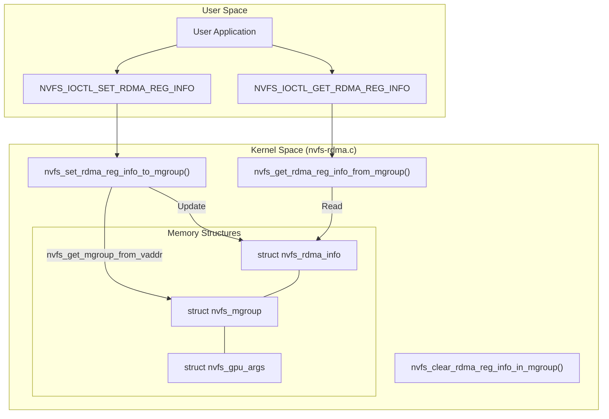

**RDMA Entity Mapping Diagram**

Sources: [src/nvfs-rdma.c:33-46](), [src/nvfs-rdma.c:116-132](), [src/nvfs-rdma.h:29-41]()

## RDMA Information Structure

The NVIDIA-FS driver maintains RDMA information within memory groups (`nvfs_mgroup`). Each memory group contains an `nvfs_rdma_info` structure that stores essential RDMA parameters needed for remote systems to access GPU memory.

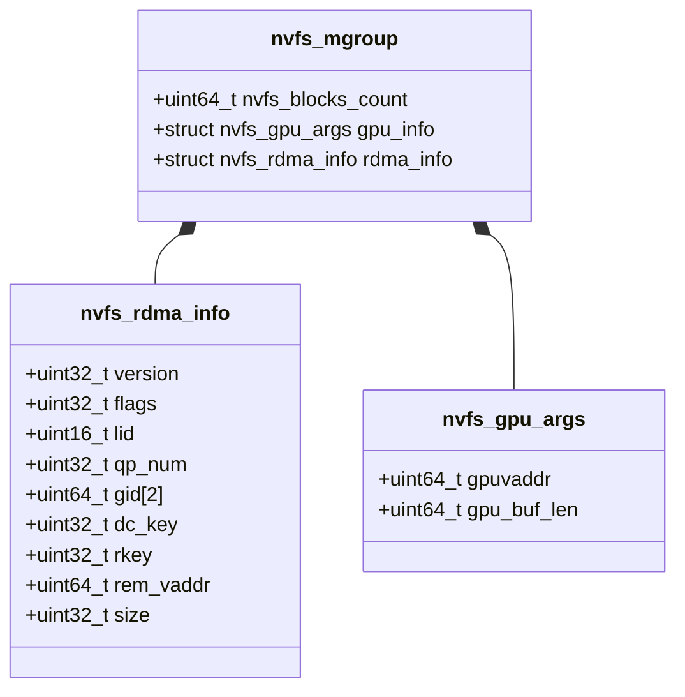

**Memory Group and RDMA Information Structure**

The `nvfs_rdma_info` structure contains:
- `version`: RDMA protocol version. The driver validates this against `NVFS_RDMA_MIN_SUPPORTED_VERSION` [src/nvfs-rdma.c:68-73]().
- `lid`: Local identifier for InfiniBand [src/nvfs-rdma.c:77-77]().
- `qp_num`: Queue pair number [src/nvfs-rdma.c:78-78]().
- `gid`: Global identifier (128-bit, stored as two 64-bit values) [src/nvfs-rdma.c:79-80]().
- `rkey`: Remote memory access key [src/nvfs-rdma.c:86-86]().
- `rem_vaddr`: Remote virtual address, which is mapped to the GPU virtual address (`gpuvaddr`) [src/nvfs-rdma.c:87-87]().
- `size`: Size of the memory region, derived from `gpu_info.gpu_buf_len` [src/nvfs-rdma.c:88-88]().

Sources: [src/nvfs-rdma.c:74-102]()

## RDMA Registration Process

The RDMA registration process involves three primary kernel functions invoked via IOCTLs.

### Setting RDMA Registration Information
The `nvfs_set_rdma_reg_info_to_mgroup()` function allows applications to register RDMA parameters with a specific GPU memory region:
1. **MGroup Lookup**: It retrieves the `nvfs_mgroup` using the CPU virtual address provided in `rdma_reg_info_args->cpuvaddr` [src/nvfs-rdma.c:46-46]().
2. **Validation**: It checks that `nkeys` is valid (currently supports 1 key) [src/nvfs-rdma.c:54-57]() and ensures the version meets the minimum requirement [src/nvfs-rdma.c:68-73]().
3. **Data Transfer**: It populates the `rdma_info` fields within the `mgroup` using data from the IOCTL arguments [src/nvfs-rdma.c:75-81]().
4. **GPU Binding**: It automatically fills `rem_vaddr` and `size` using the existing GPU buffer information stored in the `mgroup` [src/nvfs-rdma.c:83-88]().

### Retrieving RDMA Registration Information
The `nvfs_get_rdma_reg_info_from_mgroup()` function retrieves stored parameters:
1. It locates the `nvfs_mgroup` from the CPU virtual address [src/nvfs-rdma.c:132-132]().
2. It copies the entire `nvfs_rdma_info` structure from the kernel `mgroup` back to the user-provided IOCTL argument structure [src/nvfs-rdma.c:142-143]().

### Clearing RDMA Registration Information
The `nvfs_clear_rdma_reg_info_in_mgroup()` function removes RDMA registration:
1. It identifies the target `nvfs_mgroup` [src/nvfs-rdma.c:215-215]().
2. It uses `memset` to zero out the `rdma_info` structure within that group [src/nvfs-rdma.c:222-222]().

Sources: [src/nvfs-rdma.c:33-110](), [src/nvfs-rdma.c:116-206](), [src/nvfs-rdma.c:208-225]()

## Integration with Distributed Storage (GPFS)

The driver includes specific hooks and testing paths for GPFS (IBM Spectrum Scale). When `NVFS_TEST_GPFS_CALLBACK` is defined, the driver simulates the GPFS callback mechanism [src/nvfs-rdma.c:112-114]().

### GPFS RDMA Info Retrieval Logic
The driver provides a mechanism to extract RDMA info from a scatter-gather list (SGL) which is often used by filesystem IO paths:
- **SGL Construction**: In testing modes, the driver allocates an SGL and pins user pages using `pin_user_pages_fast` or `get_user_pages_fast` [src/nvfs-rdma.c:162-171]().
- **Callback Simulation**: It calls `nvfs_get_gpu_sglist_rdma_info()` to verify that RDMA metadata can be correctly associated with a list of physical pages [src/nvfs-rdma.c:183-183]().

| Feature | Implementation Detail |
|:---|:---|
| **Callback Function** | `nvfs_get_gpu_sglist_rdma_info` |
| **Memory Pinning** | Uses `pin_user_pages_fast` (Kernel 5.6+) or `get_user_pages_fast` |
| **Page Association** | `sg_set_page` maps specific GPU pages to the RDMA-enabled SGL |

Sources: [src/nvfs-rdma.c:157-185]()

## Error Handling and Constraints

The RDMA subsystem enforces several constraints to ensure stability:
- **Reference Counting**: Every lookup of an `mgroup` via `nvfs_get_mgroup_from_vaddr` is paired with `nvfs_mgroup_put` to prevent memory leaks [src/nvfs-rdma.c:104-108](), [src/nvfs-rdma.c:203-224]().
- **Key Limits**: The driver currently limits RDMA registration to a single key (`nkeys > 1` results in `-EINVAL`) [src/nvfs-rdma.c:54-57]().
- **Version Guard**: Versions lower than `NVFS_RDMA_MIN_SUPPORTED_VERSION` are rejected to prevent ABI mismatches between userspace libraries and the kernel module [src/nvfs-rdma.c:68-73]().

Sources: [src/nvfs-rdma.c:42-109](), [src/nvfs-rdma.c:133-136]()

---

# Page: Batch I/O Operations

# Batch I/O Operations

<details>
<summary>Relevant source files</summary>

The following files were used as context for generating this wiki page:

- [src/nvfs-batch.c](src/nvfs-batch.c)
- [src/nvfs-batch.h](src/nvfs-batch.h)

</details>


## Introduction

The NVIDIA GPUDirect Storage (GDS) Batch I/O Operations subsystem provides a mechanism for grouping multiple I/O operations into a single batch submission. This capability is designed to improve performance by reducing system call overhead and optimizing I/O patterns. The batch I/O system supports grouping of both read and write operations, allowing applications to efficiently process multiple data transfers in a single operation.

For information about the underlying DMA operations used by the batch system, see [DMA Operations](2.3).

Sources: [src/nvfs-batch.h:22-39](), [src/nvfs-batch.c:68-70]()

## Architecture Overview

The Batch I/O subsystem sits within the NVIDIA-FS driver and coordinates multiple I/O operations as a single unit:

```mermaid
graph TD
    subgraph "User Space"
        App["Application"]
    end
    
    subgraph "NVIDIA-FS Driver (nvfs-batch.c)"
        IOCTL["NVFS IOCTL Handler"]
        BatchInit["nvfs_io_batch_init"]
        BatchSubmit["nvfs_io_batch_submit"]
        SingleIO["nvfs_io_t (Individual Ops)"]
    end
    
    subgraph "Core & DMA Layer"
        IOCore["nvfs_io_start_op"]
        DMA["nvfs_dma_rw_ops"]
    end
    
    App -->|"NVFS_IOCTL_BATCH_RW"| IOCTL
    IOCTL -->|"nvfs_ioctl_batch_ioargs_t"| BatchInit
    BatchInit -->|"nvfs_io_init"| SingleIO
    IOCTL -->|"nvfs_batch_io_t"| BatchSubmit
    BatchSubmit -->|"iterates"| IOCore
    IOCore --> DMA
```

The batch I/O system provides two main functions:
1. **Initialization** (`nvfs_io_batch_init`): Prepares the batch context and individual I/O operations by copying user arguments and initializing `nvfs_io_t` structures.
2. **Submission** (`nvfs_io_batch_submit`): Executes all operations in the batch using the core state machine and tracks their completion.

Sources: [src/nvfs-batch.c:71-146](), [src/nvfs-batch.c:148-178](), [src/nvfs-batch.h:37-38]()

## Data Structures and Constants

The batch I/O system is built around the `nvfs_batch_io_t` structure, which represents a collection of I/O operations:

```mermaid
classDiagram
    class nvfs_batch_io_t {
        +uint64_t ctx_id
        +ktime_t start_io
        +uint64_t nents
        +nvfs_io_t* nvfsio[256]
    }
    
    class nvfs_ioctl_batch_ioargs_t {
        +uint64_t ctx_id
        +uint64_t nents
        +nvfs_ioctl_ioargs_t io_entries[]
    }

    class nvfs_io_t {
        +bool rw_stats_enabled
        +int optype
    }
    
    nvfs_batch_io_t "1" --> "0..256" nvfs_io_t : contains
    nvfs_ioctl_batch_ioargs_t ..> nvfs_batch_io_t : user_input_mapping
```

Key components include:
- **NVFS_MAX_BATCH_ENTRIES**: Defines the maximum number of I/O operations (256) that can be included in a single batch [src/nvfs-batch.h:28]().
- **ctx_id**: Context identifier for the batch operation [src/nvfs-batch.h:31]().
- **start_io**: Timestamp (`ktime_t`) for performance monitoring and latency calculation [src/nvfs-batch.h:32]().
- **nents**: Number of entries (I/O operations) currently in the batch [src/nvfs-batch.h:33]().
- **nvfsio**: Array of pointers to individual `nvfs_io_t` operation structures [src/nvfs-batch.h:34]().

Sources: [src/nvfs-batch.h:28-35](), [src/nvfs-batch.c:71-74]()

## Operation Workflow

The batch I/O operations follow a two-phase workflow:

### 1. Initialization Phase (`nvfs_io_batch_init`)

During initialization, the driver performs the following steps:
1. **Validation**: Checks if `nents` is within the allowed range (1 to `NVFS_MAX_BATCH_ENTRIES`) [src/nvfs-batch.c:82-85]().
2. **Allocation**: Allocates the `nvfs_batch_io_t` structure using `kzalloc` [src/nvfs-batch.c:87-90]().
3. **Loop Processing**: For each entry in the user-provided `io_entries` array:
    - Copies `nvfs_ioctl_ioargs_t` from user space using `copy_from_user` [src/nvfs-batch.c:101-106]().
    - Initializes an individual I/O tracking structure via `nvfs_io_init` [src/nvfs-batch.c:116]().
    - Updates global statistics (`nvfs_n_reads`, `nvfs_n_writes`) if stats are enabled [src/nvfs-batch.c:122-132]().

Sources: [src/nvfs-batch.c:71-146]()

### 2. Submission Phase (`nvfs_io_batch_submit`)

During submission:
1. **Execution**: Iterates through the `nvfsio` array and calls `nvfs_io_start_op` for each entry [src/nvfs-batch.c:152-153]().
2. **Error Handling**: If any individual operation fails to start, the loop terminates and enters the cleanup path [src/nvfs-batch.c:154-158]().
3. **Latency Tracking**: Calculates the time delta from `start_io` to the current time and updates `nvfs_batch_submit_latency_per_sec` [src/nvfs-batch.c:161-163]().
4. **Finalization**: Frees the batch container structure while individual I/O operations continue their lifecycle independently [src/nvfs-batch.c:164-165]().

Sources: [src/nvfs-batch.c:148-178]()

## Error Handling and Recovery

The batch I/O system implements robust cleanup logic to prevent memory leaks during failures:

- **Initialization Failure**: If an error occurs while processing entries (e.g., `copy_from_user` fails or `nvfs_io_init` fails), the driver enters a `cleanup` label. It iterates through all previously initialized entries in the batch and calls `nvfs_io_free` with `-EINVAL` before freeing the batch structure itself [src/nvfs-batch.c:137-145]().
- **Submission Failure**: If `nvfs_io_start_op` fails for an entry, the driver cleans up all entries in the batch using `nvfs_io_free` [src/nvfs-batch.c:167-174]().
- **Input Validation**: Rejects batches with zero or excessive entries immediately with `-EINVAL` [src/nvfs-batch.c:82-85]().

Sources: [src/nvfs-batch.c:82-85](), [src/nvfs-batch.c:137-145](), [src/nvfs-batch.c:167-174]()

## Performance Monitoring

The batch I/O system integrates with the `nvfs-stat` subsystem to provide telemetry:

| Metric | Code Entity | Description |
| :--- | :--- | :--- |
| **Read Ops** | `nvfs_n_reads`, `nvfs_n_op_reads` | Incremented during `nvfs_io_batch_init` for each READ entry [src/nvfs-batch.c:123-124](). |
| **Write Ops** | `nvfs_n_writes`, `nvfs_n_op_writes` | Incremented during `nvfs_io_batch_init` for each WRITE entry [src/nvfs-batch.c:128-129](). |
| **Batch Latency** | `nvfs_batch_submit_latency_per_sec` | Tracks the time taken from batch initialization to submission completion [src/nvfs-batch.c:161-163](). |

Sources: [src/nvfs-batch.c:122-132](), [src/nvfs-batch.c:161-163]()

## Usage Considerations

- **Conditional Compilation**: The entire batch system is wrapped in `#ifdef NVFS_BATCH_SUPPORT`, meaning it must be enabled at build time [src/nvfs-batch.c:24]().
- **Resource Limits**: The `NVFS_MAX_BATCH_ENTRIES` is hardcoded to 256 [src/nvfs-batch.h:28]().
- **Memory Context**: The system uses `GFP_KERNEL` for allocations, meaning initialization may sleep [src/nvfs-batch.c:87]().

Sources: [src/nvfs-batch.c:24-87](), [src/nvfs-batch.h:28]()

---

# Page: NVIDIA P2P API Integration

# NVIDIA P2P API Integration

<details>
<summary>Relevant source files</summary>

The following files were used as context for generating this wiki page:

- [src/nvfs-p2p.h](src/nvfs-p2p.h)

</details>


The NVIDIA Peer-to-Peer (P2P) API integration provides a shim layer between the `nvidia-fs` kernel module and the core NVIDIA GPU driver. This integration is critical for GPU Direct Storage (GDS) as it enables the pinning of GPU memory pages and the creation of DMA mappings that allow storage controllers to transfer data directly to or from GPU memory without CPU intervention.

## Architectural Overview

The P2P integration layer abstracts the complexities of GPU memory management, specifically focusing on the lifecycle of page tables and DMA mappings. The `nvidia-fs` driver utilizes these APIs to ensure that GPU memory addresses remain valid and accessible by peer PCI devices (such as NVMe controllers or NICs) during the lifetime of an I/O operation.

### Data Flow: GPU Memory Pinning and Mapping

The following diagram illustrates the lifecycle of a GPU memory buffer as it is prepared for P2P DMA operations.

**GPU P2P Mapping Lifecycle**
```mermaid
graph TD
    subgraph "NVIDIA-FS Logic"
        A["nvfs_mgroup"] -- "Requests Pinning" --> B["nvfs_nvidia_p2p_get_pages"]
        B -- "Success" --> C["nvidia_p2p_page_table"]
        C -- "Map for DMA" --> D["nvfs_nvidia_p2p_dma_map_pages"]
        D -- "Success" --> E["nvidia_p2p_dma_mapping"]
    end

    subgraph "NVIDIA GPU Driver (nv-p2p.h)"
        B -.-> B_CORE["nvidia_p2p_get_pages()"]
        D -.-> D_CORE["nvidia_p2p_dma_map_pages()"]
    end

    E -- "Used by" --> F["Storage Controller (DMA)"]
    F -- "I/O Complete" --> G["nvfs_nvidia_p2p_dma_unmap_pages"]
    G -- "Cleanup" --> H["nvfs_nvidia_p2p_put_pages"]
```
**Sources:** [src/nvfs-p2p.h:26-35](), [src/nvfs-p2p.h:1-21]()

## API Aliasing and Shim Layer

The file `src/nvfs-p2p.h` defines a set of macros that alias `nvfs_nvidia_p2p_*` functions to the underlying `nvidia_p2p_*` symbols provided by the NVIDIA kernel driver's P2P API. This abstraction allows the `nvidia-fs` codebase to maintain a consistent naming convention while interfacing with the `nv-p2p.h` header.

### Key Function Aliases

| NVIDIA-FS Alias | Core NVIDIA P2P Function | Purpose |
| :--- | :--- | :--- |
| `nvfs_nvidia_p2p_get_pages` | `nvidia_p2p_get_pages` | Pins GPU pages for a given virtual address range. [src/nvfs-p2p.h:30]() |
| `nvfs_nvidia_p2p_dma_map_pages` | `nvidia_p2p_dma_map_pages` | Maps pinned GPU pages into the DMA address space of a peer device. [src/nvfs-p2p.h:32]() |
| `nvfs_nvidia_p2p_put_pages` | `nvidia_p2p_put_pages` | Unpins and releases GPU pages. [src/nvfs-p2p.h:31]() |
| `nvfs_nvidia_p2p_dma_unmap_pages` | `nvidia_p2p_dma_unmap_pages` | Removes the DMA mapping for a peer device. [src/nvfs-p2p.h:33]() |
| `nvfs_nvidia_p2p_free_page_table` | `nvidia_p2p_free_page_table` | Frees the `nvidia_p2p_page_table` structure. [src/nvfs-p2p.h:34]() |
| `nvfs_nvidia_p2p_free_dma_mapping` | `nvidia_p2p_free_dma_mapping` | Frees the `nvidia_p2p_dma_mapping` structure. [src/nvfs-p2p.h:35]() |

**Sources:** [src/nvfs-p2p.h:23-37]()

## Persistent vs. Legacy P2P Modes

The driver supports two primary modes for managing GPU page lifetimes: Persistent and Legacy (Standard).

### Persistent P2P Mode
Persistent mode is used to reduce the overhead of frequently pinning and unpinning memory for long-lived buffers. This is particularly useful in high-performance computing (HPC) environments where the same GPU memory regions are reused for multiple I/O operations.

*   **`nvfs_nvidia_p2p_get_pages_persistent`**: Aliased to `nvidia_p2p_get_pages_persistent`. This function ensures that the pages remain pinned even if the calling process is not actively performing I/O, provided the memory handle remains valid. [src/nvfs-p2p.h:28]()
*   **`nvfs_nvidia_p2p_put_pages_persistent`**: Aliased to `nvidia_p2p_put_pages_persistent`. Used to release the persistent pinning. [src/nvfs-p2p.h:29]()

### Legacy P2P Mode
In standard mode, pages are pinned via `nvfs_nvidia_p2p_get_pages` at the start of a transaction (or memory group registration) and released via `nvfs_nvidia_p2p_put_pages` once the I/O or the memory group is destroyed. [src/nvfs-p2p.h:30-31]()

## Memory Mapping Lifecycle

The integration manages two distinct but related structures:
1.  **`nvidia_p2p_page_table`**: Represents the physical pages of the GPU memory.
2.  **`nvidia_p2p_dma_mapping`**: Represents the I/O Virtual Address (IOVA) mapping of those pages for a specific PCI device.

**Code Entity Relationship**
```mermaid
classDiagram
    class nvfs_mgroup {
        +struct nvidia_p2p_page_table* page_table
        +struct nvidia_p2p_dma_mapping* dma_mapping
    }
    class nvidia_p2p_page_table {
        +struct nvidia_p2p_page** pages
        +unsigned int entries
    }
    class nvidia_p2p_dma_mapping {
        +dma_addr_t* hw_address
        +unsigned int entries
    }
    nvfs_mgroup --> nvidia_p2p_page_table : "Uses nvfs_nvidia_p2p_get_pages"
    nvfs_mgroup --> nvidia_p2p_dma_mapping : "Uses nvfs_nvidia_p2p_dma_map_pages"
```

The `nvfs_nvidia_p2p_free_page_table` and `nvfs_nvidia_p2p_free_dma_mapping` functions are responsible for deallocating the metadata structures themselves, ensuring no memory leaks occur in the kernel shim after the actual unpinning/unmapping has been performed by the core NVIDIA driver. [src/nvfs-p2p.h:34-35]()

**Sources:** [src/nvfs-p2p.h:23-37]()

---

# Page: Installation & Configuration

# Installation & Configuration

<details>
<summary>Relevant source files</summary>

The following files were used as context for generating this wiki page:

- [src/Makefile](src/Makefile)
- [src/configure](src/configure)
- [src/dkms.conf](src/dkms.conf)
- [src/nvfs-pci.h](src/nvfs-pci.h)

</details>


This page provides comprehensive instructions for building, installing, and configuring the NVIDIA GPUDirect Storage (NVIDIA-FS) kernel driver. It covers the build system's automated feature detection, dependency resolution for NVIDIA symbols, and DKMS integration.

## Build Process Overview

The NVIDIA-FS build system is designed to handle kernel API shifts across different Linux distributions. It utilizes a custom configuration script to probe the host kernel and a symbol resolution script to link against the proprietary NVIDIA GPU driver.

### Build Workflow and Entity Mapping

The following diagram maps the build stages to the specific scripts and files responsible for them in the codebase.

```mermaid
graph TD
    subgraph "Configuration Space"
        A["src/configure"] -- "Probes Kernel" --> B["config-host.h"]
        B -- "Injected into" --> C["nvfs-kernel-interface.h"]
    end

    subgraph "Symbol Resolution"
        D["create_nv.symvers.sh"] -- "Extracts from" --> E["nvidia.ko"]
        D -- "Generates" --> F["nv.symvers"]
        F -- "Appended to" --> G["Module.symvers"]
    end

    subgraph "Compilation Space"
        H["src/Makefile"] -- "Uses" --> G
        H -- "Reads" --> B
        H -- "Links" --> I["nvidia-fs.ko"]
    end

    subgraph "Installation Space"
        J["dkms.conf"] -- "Automates" --> H
        H -- "Installs to" --> K["/lib/modules/extra/"]
    end
```
Sources: [src/Makefile:105-115](), [src/configure:1-35](), [src/dkms.conf:52-56]()

## Building the Driver

The driver build relies on `make` which orchestrates feature detection and symbol resolution before invoking the Kbuild system.

### Core Build Steps
1. **Feature Detection**: The `nv_configure` target runs `src/configure`, which performs trial compilations to detect supported kernel structures like `struct fd` [src/configure:117-130]() or `call_read_iter` [src/configure:183-197]().
2. **Symbol Resolution**: The `nv_symbols` target executes `create_nv.symvers.sh`. This is critical because `nvidia-fs` depends on symbols from the NVIDIA GPU driver (e.g., `nv_p2p_get_pages`) which are not part of the standard kernel headers [src/Makefile:108-112]().
3. **Compilation**: The `module` target compiles the object files defined in `nvidia-fs-y`, including core logic and optional features like RDMA or Batch I/O [src/Makefile:55-71]().

For a deep dive into the build logic and dependency resolution, see **[Building the Driver](#3.1)**.

## Configuration Options

Configuration is handled at three levels: automated detection, build-time flags, and DKMS environment variables.

### Automated Kernel Compatibility
The `src/configure` script generates `config-host.h`, defining macros that the source code uses to toggle implementation paths. For example:
* `HAVE_STRUCT_FD_FILE_PARAM`: Set if `struct fd` contains a `.file` member [src/configure:128-130]().
* `HAVE_KI_COMPLETE`: Set if `struct kiocb` has the `.ki_complete` field [src/configure:245-247]().
* `HAVE_VM_FAULT`: Detects the presence of the `vm_fault_t` type [src/configure:260-262]().

### Build-time Macros
Users can influence driver limits and features via `make` variables:
* `NVFS_MAX_PEER_DEVS`: Limits the number of supported peer storage/network devices (Default: 64) [src/nvfs-pci.h:44-50]().
* `NVFS_MAX_PCI_DEPTH`: Defines the maximum depth of the PCI tree for distance calculations (Default: 16) [src/nvfs-pci.h:44-50]().
* `CONFIG_NVFS_STATS`: Enables I/O and performance telemetry [src/Makefile:56]().

### Configuration System Architecture

```mermaid
graph LR
    subgraph "Input Probes"
        P1["linux/file.h"]
        P2["linux/blkdev.h"]
        P3["linux/pci.h"]
    end

    subgraph "Logic [src/configure]"
        C1["compile_prog()"]
        C2["output_sym()"]
    end

    subgraph "Output Macros"
        M1["HAVE_ACCESS_OK_2_PARAMS"]
        M2["HAVE_BLK_RQ_PAYLOAD_BYTES"]
        M3["HAVE_PCIE_SPEED_32_0GT"]
    end

    P1 & P2 & P3 --> C1
    C1 --> C2
    C2 --> M1 & M2 & M3
    M1 & M2 & M3 --> SC["Source Code Implementation"]
```
Sources: [src/configure:53-77](), [src/configure:146-180](), [src/configure:275-277]()

For a full list of supported macros and how they modify driver behavior, see **[Configuration Options](#3.2)**.

## DKMS Integration

The repository includes a `dkms.conf` file to support Automatic Kernel Module Building. This ensures that `nvidia-fs` is rebuilt automatically whenever the system kernel is updated.

* **Dependencies**: DKMS is configured to recognize the `nvidia` driver as a build dependency [src/dkms.conf:54]().
* **MOFED Detection**: The DKMS configuration includes logic to detect Mellanox OFED versions to ensure RDMA peer memory registration compatibility [src/dkms.conf:32-49]().
* **Custom Limits**: Environment variables `NVFS_MAX_PEER_DEVS` and `NVFS_MAX_PCI_DEPTH` can be passed to DKMS to override default topology limits [src/dkms.conf:29-30]().

Sources: [src/dkms.conf:23-62]()

## Installation

### Standard Installation
The driver can be installed manually after a successful build:
```bash
sudo make install
```
This copies `nvidia-fs.ko` to the kernel's `extra` directory and runs `depmod` to refresh the module dependency map [src/Makefile:117-120]().

### Loading the Driver
Once installed, the driver is loaded via `modprobe`:
```bash
sudo modprobe nvidia-fs
```
The driver will initialize the `/proc/driver/nvidia-fs` interface and begin discovery of supported PCI devices [src/nvfs-pci.h:64-77]().

Sources: [src/Makefile:117-120](), [src/nvfs-pci.h:31-40]()

---

# Page: Building the Driver

# Building the Driver

<details>
<summary>Relevant source files</summary>

The following files were used as context for generating this wiki page:

- [src/Makefile](src/Makefile)
- [src/create_nv.symvers.sh](src/create_nv.symvers.sh)
- [src/dkms.conf](src/dkms.conf)
- [src/nvfs-pci.h](src/nvfs-pci.h)

</details>


This document provides comprehensive instructions for building the NVIDIA GPUDirect Storage (GDS) kernel driver from source code. The build process involves checking system compatibility, gathering NVIDIA driver symbols, and compiling the kernel module.

For information about configuring the driver after building, see [Configuration Options](#3.2).

## Prerequisites

Before building the NVIDIA-FS driver, you must have the following components installed:

- Linux kernel headers for your running kernel.
- NVIDIA GPU driver (installed and loaded).
- GCC compiler toolchain.
- Make build system.

### Build Environment Logic
The `Makefile` identifies the target kernel version and source directories for both the Linux kernel and the NVIDIA driver.

| Entity | Code Reference | Description |
| :--- | :--- | :--- |
| **Kernel Version** | `KVER` | Defaults to `$(shell uname -r)` [src/Makefile:21]() |
| **Kernel Directory** | `KDIR` | Points to `/lib/modules/$(KVER)/build` [src/Makefile:94]() |
| **NVIDIA Sources** | `NVIDIA_SRC_DIR` | Scanned in `/usr/src/nvidia-$(nv_version)/` for `nv-p2p.h` [src/Makefile:23-29]() |

Title: Build System Dependency Flow
```mermaid
flowchart TD
    subgraph "Prerequisites"
        kernel["Kernel Headers 
        /lib/modules/$(KVER)/build"]
        nvidia["NVIDIA GPU Driver
        With nvidia.ko loaded"]
        gcc["GCC Compiler Toolchain"]
        make["Make Build System"]
    end
    
    nvidia -->|"provides symbols via create_nv.symvers.sh"| build
    kernel -->|"provides API via KDIR"| build
    gcc -->|"compiles"| build
    make -->|"orchestrates via src/Makefile"| build
    
    subgraph "Build Process"
        build["nvidia-fs.ko Build"]
    end
```
Sources: [src/Makefile:21-29](), [src/Makefile:92-94](), [src/create_nv.symvers.sh:31-33]()

## Build Process Overview

The build process consists of three main stages:

1.  **Symbol Collection**: Extracting `nvidia_p2p_*` symbols from the installed NVIDIA driver to resolve dependencies.
2.  **Configuration**: Running the `./configure` script to detect kernel features and generate `config-host.h`.
3.  **Compilation**: Invoking Kbuild to produce the `nvidia-fs.ko` module.

Title: Makefile Execution Sequence
```mermaid
sequenceDiagram
    participant User
    participant make as "src/Makefile"
    participant syms as "create_nv.symvers.sh"
    participant config as "configure Script"
    participant kbuild as "Kernel Build System (Kbuild)"
    
    User->>make: make all
    activate make
    make->>syms: ./create_nv.symvers.sh
    activate syms
    Note over syms: Extracts nvidia_p2p symbols
    syms-->>make: nv.symvers
    deactivate syms
    
    make->>make: cat nv.symvers >> Module.symvers
    
    make->>config: ./configure $(KVER)
    activate config
    Note over config: Generates config-host.h
    config-->>make: Ready
    deactivate config
    
    make->>kbuild: make -C $(KDIR) M=$PWD modules
    activate kbuild
    Note over kbuild: Compiles nvidia-fs-y objects
    kbuild-->>make: nvidia-fs.ko
    deactivate kbuild
    
    make-->>User: Build Complete
    deactivate make
```
Sources: [src/Makefile:103-115](), [src/create_nv.symvers.sh:67]()

## Symbol Resolution (create_nv.symvers.sh)

The NVIDIA-FS driver depends on the NVIDIA Peer-to-Peer (P2P) APIs provided by the base NVIDIA GPU driver. Since these symbols are not part of the standard kernel, the build system must resolve their CRCs (Cyclic Redundancy Checks).

The `create_nv.symvers.sh` script performs the following:
1.  **Binary Inspection**: Uses `nm -o` on the installed `nvidia.ko` to find `__crc_nvidia_p2p_` symbols [src/create_nv.symvers.sh:108-122]().
2.  **Fallback Compilation**: If the binary contains relative CRCs (common on PPC), it attempts to recompile the NVIDIA driver from `/usr/src/nvidia-*` to generate a fresh `Module.symvers` [src/create_nv.symvers.sh:97-106]().
3.  **Symbol Generation**: Outputs a formatted `nv.symvers` file which is appended to the local `Module.symvers` [src/Makefile:112]().

Sources: [src/create_nv.symvers.sh:36-71](), [src/create_nv.symvers.sh:108-126](), [src/Makefile:108-112]()

## DKMS Integration

The driver supports Dynamic Kernel Module Support (DKMS) via `src/dkms.conf`. This ensures the driver is automatically rebuilt when the system kernel is upgraded.

Key DKMS configurations:
-   **Package Name/Version**: `nvidia-fs` version `2.7` [src/dkms.conf:23-25]().
-   **Dependencies**: Explicitly depends on the `nvidia` module [src/dkms.conf:54]().
-   **Build Command**: Executes `make` with specific overrides for peer device limits and PCI depth [src/dkms.conf:55]().
-   **OFED Detection**: Checks for Mellanox OFED versions (4.6+) to ensure compatibility with `ib_register_peer_memory_client` [src/dkms.conf:32-49]().

Sources: [src/dkms.conf:23-56]()

## Platform and Feature Flags

The build system adjusts the driver based on the architecture and environment variables.

### Architecture Support
-   **ARM64**: If `uname -m` returns `aarch64`, the flag `-DAARCH64_PLATFORM` is added [src/Makefile:41-49]().

### Custom Limits
Users can override default PCI and peer device limits via environment variables:
-   `NVFS_MAX_PEER_DEVS`: Maximum number of peer storage/NIC devices (Default: 64) [src/nvfs-pci.h:45-50]().
-   `NVFS_MAX_PCI_DEPTH`: Maximum depth of the PCI tree for topology calculations (Default: 16) [src/nvfs-pci.h:45-50]().

### Feature Toggles
| Flag | Effect | Code Reference |
| :--- | :--- | :--- |
| `CONFIG_NVFS_STATS` | Enables I/O and telemetry tracking in `nvfs-stat.c` | [src/Makefile:56]() |
| `CONFIG_FAULT_INJECTION` | Enables error simulation in `nvfs-fault.c` | [src/Makefile:57]() |
| `NVFS_ENABLE_KERN_RDMA_SUPPORT` | Includes RDMA support in `nvfs-rdma.c` | [src/Makefile:64-67]() |
| `NVFS_BATCH_SUPPORT` | Enables high-throughput batch I/O via `nvfs-batch.c` | [src/Makefile:68-71]() |

Sources: [src/Makefile:33-71](), [src/nvfs-pci.h:44-50]()

## Module Components

The final `nvidia-fs.ko` is linked from several object files, categorized by subsystem:

Title: Object Composition Map
```mermaid
flowchart TD
    subgraph "Core Components (nvidia-fs-y)"
        core["nvfs-core.o"]
        dma["nvfs-dma.o"]
        mmap["nvfs-mmap.o"]
        pci["nvfs-pci.o"]
        proc["nvfs-proc.o"]
        mod["nvfs-mod.o"]
        kint["nvfs-kernel-interface.o"]
    end
    
    subgraph "Conditional Components"
        rdma["nvfs-rdma.o (RDMA)"]
        batch["nvfs-batch.o (Batch)"]
        stat["nvfs-stat.o (Stats)"]
        fault["nvfs-fault.o (Fault)"]
    end
    
    core & dma & mmap & pci & proc & mod & kint --> linker["Kbuild Linker"]
    rdma -.->|"if !CONFIG_DISABLE_NVFS_KERN_RDMA_SUPPORT"| linker
    batch -.->|"if CONFIG_NVFS_BATCH_SUPPORT"| linker
    stat -.->|"if CONFIG_NVFS_STATS"| linker
    fault -.->|"if CONFIG_FAULT_INJECTION"| linker
    
    linker --> final["nvidia-fs.ko"]
```
Sources: [src/Makefile:55-71]()

## Installation and Removal

### Install
The `make install` target performs the following:
1.  Creates the destination directory `/lib/modules/$(KVER)/extra/` [src/Makefile:118]().
2.  Copies `nvidia-fs.ko` to the extra modules path [src/Makefile:119]().
3.  Invokes `depmod -a` to update the module dependency database [src/Makefile:120]().

### Uninstall
The `make uninstall` target removes the `.ko` file and refreshes `depmod` [src/Makefile:123-124]().

Sources: [src/Makefile:117-125]()

---

# Page: Configuration Options

# Configuration Options

<details>
<summary>Relevant source files</summary>

The following files were used as context for generating this wiki page:

- [src/configure](src/configure)
- [src/nvfs-kernel-interface.c](src/nvfs-kernel-interface.c)

</details>


This page documents the available configuration options for the NVIDIA GPUDirect Storage kernel driver (`nvidia-fs`). It covers the automated kernel compatibility detection system, the generated `config-host.h` macros, and build-time parameters that affect driver behavior across different Linux kernel versions.

## Kernel Compatibility Detection System

The `nvidia-fs` driver utilizes a custom configuration script to handle the diversity of Linux kernel APIs. Instead of relying solely on `LINUX_VERSION_CODE` macros, the build system performs feature-based probing to ensure compatibility with various distributions and backported kernels.

```mermaid
graph TD
    subgraph "Phase 1: Environment Discovery"
        START["src/configure"] --> KVER["Detect Kernel Version (uname -r)"]
        KVER --> KDIR["Locate Kernel Build Dir (/lib/modules/.../build)"]
    end

    subgraph "Phase 2: Feature Probing"
        KDIR --> GEN_TEST["Generate test.c & Makefile"]
        GEN_TEST --> COMP_PROG["compile_prog() function"]
        COMP_PROG --> KBUILD["Invoke Kbuild (make -C $KDIR)"]
    end

    subgraph "Phase 3: Header Generation"
        KBUILD -- "Success" --> OUT_SYM["output_sym()"]
        OUT_SYM --> CONFIG_H["config-host.h"]
        KBUILD -- "Failure" --> LOG["Log to config.log"]
    end

    subgraph "Code Entity Space"
        CONFIG_H -->|#define| DRIVER_CODE["nvfs-kernel-interface.c"]
        DRIVER_CODE -->|#ifdef| COMPAT_LAYER["Kernel Compatibility Layer"]
    end

    style START stroke-width:2px
    style CONFIG_H stroke-width:2px
    style COMPAT_LAYER stroke-width:2px
```
Sources: [src/configure:1-35](), [src/configure:53-77](), [src/configure:90-105]()

### The `configure` Script
The `src/configure` script is a shell script that automates the detection of kernel structures and function signatures. It creates a temporary directory `build/` and attempts to compile small kernel modules (`test.c`) against the target kernel headers.

Key functions in `src/configure`:
- `compile_prog()`: The core execution engine that calls `make` on the generated test files and checks the return code [src/configure:53-77]().
- `output_sym()`: Appends a `#define` to `config-host.h` if a probe succeeds [src/configure:42-44]().

### Generated Macros in `config-host.h`
The following table describes the primary macros generated by the probing system and how they influence driver implementation:

| Macro | Probe Logic | Effect on Driver |
|-------|-------------|------------------|
| `HAVE_STRUCT_FD_FILE_PARAM` | Checks if `struct fd` has a `.file` member [src/configure:120-127](). | Affects how file descriptors are dereferenced in VFS operations. |
| `HAVE_ACCESS_OK_3_PARAMS` | Checks if `access_ok()` takes 3 arguments (older kernels) [src/configure:140-142](). | Used in `nvfs_check_access` to validate user buffers [src/nvfs-kernel-interface.c:28-39](). |
| `HAVE_ACCESS_OK_2_PARAMS` | Checks if `access_ok()` takes 2 arguments (newer kernels) [src/configure:157-158](). | Used in `nvfs_check_access` [src/nvfs-kernel-interface.c:41-47](). |
| `HAVE_BLK_RQ_PAYLOAD_BYTES` | Checks for `blk_rq_payload_bytes` in `blkdev.h` [src/configure:173-174](). | Enables optimized block request size calculations. |
| `HAVE_CALL_READ_WRITE_ITER` | Checks for `call_read_iter` and `call_write_iter` in `fs.h` [src/configure:189-191](). | Determines the VFS entry point for I/O operations. |
| `HAVE_SECURITY_FILE_PERMISSION` | Checks `System.map` and headers for LSM hooks [src/configure:222-229](). | Enables mandatory access control checks during I/O. |
| `HAVE_KI_COMPLETE` | Checks if `struct kiocb` has a `.ki_complete` field [src/configure:239-242](). | Necessary for asynchronous I/O completion callbacks. |
| `HAVE_VM_FAULT` | Checks for the `vm_fault_t` type [src/configure:255-257](). | Standardizes return types for page fault handlers. |

Sources: [src/configure:114-262](), [src/nvfs-kernel-interface.c:26-50]()

## Build-Time Configuration Parameters

The NVIDIA-FS driver provides several build-time configuration parameters that can be customized during installation to adapt the driver to specific system requirements.

```mermaid
flowchart TB
    subgraph "NVIDIA-FS Build Parameters"
        NVFS_MAX_PEER_DEVS["NVFS_MAX_PEER_DEVS"]
        NVFS_MAX_PCI_DEPTH["NVFS_MAX_PCI_DEPTH"]
        IGNORE_CC_MISMATCH["IGNORE_CC_MISMATCH"]
    end

    subgraph "Environment Setup"
        ENV["Environment Variables"]
    end
    
    subgraph "Build Process"
        MAKE["make command"]
        DKMS["DKMS build"]
    end
    
    ENV --> |"sets"| NVFS_MAX_PEER_DEVS
    ENV --> |"sets"| NVFS_MAX_PCI_DEPTH
    
    NVFS_MAX_PEER_DEVS --> MAKE
    NVFS_MAX_PCI_DEPTH --> MAKE
    IGNORE_CC_MISMATCH --> MAKE
    
    MAKE --> DKMS
```

### Key Build Parameters

| Parameter | Default Value | Description |
|-----------|---------------|-------------|
| `NVFS_MAX_PEER_DEVS` | 64 | Maximum number of peer devices (storage/network) that can be tracked for GPU affinity |
| `NVFS_MAX_PCI_DEPTH` | 16 | Maximum PCI tree depth for topology discovery |
| `IGNORE_CC_MISMATCH` | 1 | Ignore compiler version mismatches during build |

These parameters can be set as environment variables before building the driver or passed directly to the make command. When using DKMS for driver installation, these parameters are defined in the `dkms.conf` file.

Sources: [src/dkms.conf:29-30](), [src/dkms.conf:55]()

## PCI Topology Configuration

The PCI topology configuration parameters control how the driver discovers and optimizes data paths between GPUs and storage/network devices.

```mermaid
flowchart TD
    subgraph "PCI Topology Parameters (nvfs-pci.h)"
        MAX_PEER_DEVS["MAX_PEER_DEVS"]
        MAX_PCI_DEPTH["MAX_PCI_DEPTH"]
        MAX_GPU_DEVS["MAX_GPU_DEVS"]
        PROC_LIMIT["PROC_LIMIT_PCI_DISTANCE_COMMONRP"]
        BASE_DISTANCE["BASE_PCI_DISTANCE_CROSSRP"]
    end

    subgraph "Topology Discovery (nvfs-pci.c)"
        FILL_TABLE["nvfs_fill_gpu2peer_distance_table_once()"]
    end

    subgraph "Data Path Optimization"
        GET_DISTANCE["nvfs_get_gpu2peer_distance()"]
        UPDATE_USAGE["nvfs_update_peer_usage()"]
    end

    MAX_PEER_DEVS --> FILL_TABLE
    MAX_PCI_DEPTH --> FILL_TABLE
    MAX_GPU_DEVS --> FILL_TABLE
    
    FILL_TABLE --> |"creates distance table"| GET_DISTANCE
    GET_DISTANCE --> |"informs"| UPDATE_USAGE
    PROC_LIMIT --> GET_DISTANCE
    BASE_DISTANCE --> GET_DISTANCE
```

### PCI Topology Parameters

| Parameter | Default Value | Description |
|-----------|---------------|-------------|
| `MAX_PEER_DEVS` | 64 | Maximum number of peer devices that can be tracked. On DGX-2, this covers 8 IB ports [src/nvfs-pci.h:44](). |
| `MAX_PCI_DEPTH` | 16 | Maximum PCI tree depth for topology discovery [src/nvfs-pci.h:47](). |
| `MAX_GPU_DEVS` | 64 | Maximum number of GPUs that can be tracked [src/nvfs-pci.h:50](). |
| `PROC_LIMIT_PCI_DISTANCE_COMMONRP` | 2 × `MAX_PCI_DEPTH` | Distance limit for devices under the same Root Port [src/nvfs-pci.h:55](). |
| `BASE_PCI_DISTANCE_CROSSRP` | `S8_MAX` | Minimum distance applied when paths cross Root Ports [src/nvfs-pci.h:58](). |

Sources: [src/nvfs-pci.h:44-58]()

## Module Parameters

The NVIDIA-FS driver supports load-time parameters to adjust its behavior without recompilation. These can be set in `/etc/modprobe.d/nvidia-fs.conf`.

### Runtime Configuration

| Parameter | Default | Description |
|-----------|---------|-------------|
| `nvfs_peer_distance_debug` | 0 | Enable detailed logging of PCI distance calculations. |
| `nvfs_optimize_gpu_affinity` | 1 | Enable GPU affinity optimization based on PCI topology. |

### Verifying Configuration
The state of the driver and its affinity mapping can be inspected via the `procfs` interface:
- `/proc/fs/nvfs/peer_distance`: Displays the calculated PCI distance matrix between GPUs and peers.
- `/proc/fs/nvfs/peer_affinity`: Displays GPU-to-peer device affinity statistics.

Sources: [src/nvfs-pci.h:227-250]()

---

# Page: Debugging & Monitoring

# Debugging & Monitoring

<details>
<summary>Relevant source files</summary>

The following files were used as context for generating this wiki page:

- [src/nvfs-fault.c](src/nvfs-fault.c)
- [src/nvfs-proc.c](src/nvfs-proc.c)
- [src/nvfs-stat.c](src/nvfs-stat.c)
- [src/nvfs-stat.h](src/nvfs-stat.h)

</details>


This document provides a high-level overview of the debugging, monitoring, and fault injection capabilities of the NVIDIA GPUDirect Storage (GDS) driver. The `nvidia-fs` kernel module exposes internal state, performance metrics, and testing hooks through standard Linux interfaces like `procfs` and `debugfs`.

## Overview of Monitoring Facilities

The driver architecture includes dedicated subsystems for telemetry and error simulation. These components interact with the core I/O and memory management layers to provide visibility into the GDS pipeline.

```mermaid
flowchart TD
    subgraph "Monitoring & Debugging Facilities"
        Statistics["Statistics Collection\n/proc/fs/nvfs/stats"]
        ProcInterface["System Information\n/proc/driver/nvidia-fs/*"]
        FaultInjection["Fault Injection\n/sys/kernel/debug/nvfs_inject_fault/*"]
        Logging["Runtime Logging\ndbg_enabled / info_enabled"]
    end

    subgraph "Driver Components"
        CoreOps["Core Operations\nnvfs-core.c"]
        DMAOps["DMA Operations\nnvfs-dma.c"]
        MemMgmt["Memory Management\nnvfs-mmap.c"]
        BatchIO["Batch I/O\nnvfs-io.c"]
    end

    CoreOps --> |"updates"| Statistics
    DMAOps --> |"updates"| Statistics
    MemMgmt --> |"updates"| Statistics
    BatchIO --> |"updates"| Statistics
    
    FaultInjection --> |"injects failures"| CoreOps
    FaultInjection --> |"injects failures"| DMAOps
    FaultInjection --> |"injects failures"| MemMgmt

    ProcInterface --> |"exposes state"| CoreOps
    ProcInterface --> |"queries topology"| PCI["PCI Topology\nnvfs-pci.c"]
```

**Sources:** [src/nvfs-proc.c:241-285](), [src/nvfs-stat.c:38-110](), [src/nvfs-fault.c:39-63]()

---

## Statistics and Telemetry

The statistics subsystem tracks the lifecycle of GDS operations. It utilizes atomic counters (e.g., `atomic64_t`) to maintain performance metrics without significant lock contention. Key metrics include I/O throughput, average latency for reads/writes, and BAR1 memory pressure per GPU.

- **Per-GPU Metrics:** Tracks `active_bar_memory_pinned` and `max_bar_memory_pinned` using a hash table indexed by GPU UUID.
- **I/O Counters:** Monitors successful and failed operations, including sparse I/O regions and batch submission latencies.
- **Interface:** Exposed via `/proc/fs/nvfs/stats` (implemented in `nvfs_stats_show`).

For details on available counters and performance calculation logic, see **[Statistics and Telemetry](#4.1)**.

**Sources:** [src/nvfs-stat.h:42-123](), [src/nvfs-stat.c:163-205]()

---

## Procfs Interface

The driver maintains a structured directory under `/proc/driver/nvidia-fs/` to provide the userspace library (`libnvdls`) and administrators with system-level metadata. This interface is initialized during module load via `nvfs_proc_init`.

| Entry | Code Entity | Description |
|-------|-------------|-------------|
| `version` | `nvfs_version_show` | Driver major/minor version. |
| `devcount` | `nvfs_devices_show` | Total count of NVIDIA GPUs visible to the driver. |
| `bridges` | `nvfs_bridge_show` | PCI devices with Access Control Services (ACS) enabled. |
| `peer_distance` | `nvfs_peer_distance_show` | Matrix of PCI distances between storage and GPU devices. |
| `modules` | `nvfs_modules_show` | List of registered vendor-specific DMA modules. |

For a complete map of the procfs hierarchy and its role in peer affinity discovery, see **[Procfs Interface](#4.2)**.

**Sources:** [src/nvfs-proc.c:41-56](), [src/nvfs-proc.c:84-90](), [src/nvfs-proc.c:117-128](), [src/nvfs-proc.c:241-275]()

---

## Fault Injection

To ensure driver robustness, NVIDIA-FS integrates with the Linux Kernel Fault Injection framework. When `CONFIG_FAULT_INJECTION` is enabled, developers can simulate failures in critical code paths through `debugfs`.

```mermaid
flowchart LR
    subgraph "Injection Points (nvfs-fault.c)"
        DMA["dma_error"]
        RW["rw_verify_area_error"]
        P2P["invalid_p2p_get_page"]
        State["io_transit_state_fail"]
    end

    subgraph "Kernel Framework"
        FA["fault_create_debugfs_attr"]
        FT["should_fail (via nvfs_fault_trigger)"]
    end

    DMA & RW & P2P & State --> FA
    FA --> |"Control via"| DBG["/sys/kernel/debug/nvfs_inject_fault/"]
```

This framework allows testing of error recovery in the I/O state machine and memory pinning logic. For instructions on how to trigger specific failure modes, see **[Fault Injection](#4.3)**.

**Sources:** [src/nvfs-fault.c:31-37](), [src/nvfs-fault.c:49-62]()

---

## Logging Control

The driver supports three verbosity levels: `warn` (default), `info`, and `debug`. These are controlled by module parameters `dbg_enabled` and `info_enabled`. The current active level is reported in the general statistics output.

- **Debug Level:** Detailed trace of IOCTL arguments and internal state transitions.
- **Info Level:** High-level operation milestones and module registration events.
- **Warn/Error:** Critical failures and unexpected state machine conditions.

**Sources:** [src/nvfs-stat.c:192-194]()

---

# Page: Statistics and Telemetry

# Statistics and Telemetry

<details>
<summary>Relevant source files</summary>

The following files were used as context for generating this wiki page:

- [src/nvfs-stat.c](src/nvfs-stat.c)
- [src/nvfs-stat.h](src/nvfs-stat.h)

</details>


The NVIDIA-FS driver includes a comprehensive statistics collection subsystem designed to monitor the health, performance, and resource utilization of GPU Direct Storage (GDS) operations. This subsystem tracks I/O throughput, latency, memory usage (specifically BAR1 and bounce buffers), and error rates. Data is exposed to userspace through a dedicated `procfs` interface at `/proc/fs/nvfs/stats`.

## Architecture Overview

The statistics subsystem is centered around a set of global atomic counters and a per-GPU hash table. The collection is conditionally compiled based on the `CONFIG_NVFS_STATS` macro [src/nvfs-stat.h:40]().

### Data Flow and Update Mechanism
The driver uses inline helper functions to update counters during the I/O lifecycle. For example, when a read operation is initiated, `nvfs_stat64(&nvfs_n_reads)` is called [src/nvfs-stat.h:158-161](). If an error occurs, error-specific counters like `nvfs_n_read_err` are incremented [src/nvfs-stat.c:43]().

### Telemetry Entity Mapping
The following diagram illustrates how high-level telemetry concepts map to specific code entities and data structures within the driver.

**Telemetry to Code Mapping**
```mermaid
graph TD
    subgraph "Userspace Interface"
        PROC["/proc/fs/nvfs/stats"] -- "read()" --> FOP["nvfs_stats_fops"]
    end

    subgraph "Core Stats Engine (nvfs-stat.c)"
        FOP -- "calls" --> SHOW["nvfs_stats_show"]
        SHOW -- "iterates" --> HASH["nvfs_gpu_stat_hash"]
        SHOW -- "reads" --> GLOBALS["Global Atomic Counters"]
    end

    subgraph "Per-GPU Tracking"
        HASH -- "contains" --> GPU_STRUCT["struct nvfs_gpu_stat"]
        GPU_STRUCT --> BAR["active_bar_memory_pinned"]
        GPU_STRUCT --> BOUNCE["active_bounce_buffer_memory"]
    end

    subgraph "Metrics Collection"
        IO["I/O Lifecycle"] -- "nvfs_stat64()" --> GLOBALS
        MEM["Memory Alloc"] -- "nvfs_update_alloc_gpustat()" --> GPU_STRUCT
    end
```
**Sources:** [src/nvfs-stat.c:35-110](), [src/nvfs-stat.h:42-49](), [src/nvfs-stat.h:126-129]()

## Per-GPU Metrics

The driver tracks resource consumption on a per-GPU basis using the `nvfs_gpu_stat` structure. This is critical for monitoring BAR1 memory pressure and bounce buffer utilization in heterogeneous environments.

| Metric | Code Entity | Description |
| :--- | :--- | :--- |
| **BAR1 Pinned** | `active_bar_memory_pinned` | Current amount of GPU BAR1 memory pinned for DMA [src/nvfs-stat.h:45](). |
| **Max BAR1** | `max_bar_memory_pinned` | High-water mark for BAR1 memory pinning [src/nvfs-stat.h:47](). |
| **Bounce Buffer** | `active_bounce_buffer_memory` | Memory consumed by shadow/bounce buffers for this GPU [src/nvfs-stat.h:46](). |
| **Peer Usage** | `nvfs_aggregate_cross_peer_usage` | Percentage of traffic crossing PCIe root ports [src/nvfs-stat.c:151](). |

**Sources:** [src/nvfs-stat.h:42-49](), [src/nvfs-stat.c:132-155]()

## I/O Performance Tracking

The driver calculates throughput and latency for both standard and batch I/O operations. These metrics are updated via specific functions that handle time-averaging and accumulation.

### Throughput and Latency Functions
*   **`nvfs_update_read_throughput`**: Accumulates bytes read and updates `nvfs_read_throughput` [src/nvfs-stat.h:209-210]().
*   **`nvfs_update_read_latency`**: Tracks the time delta for read operations and updates `nvfs_avg_read_latency` [src/nvfs-stat.h:212-213]().
*   **`nvfs_update_batch_latency`**: Specifically tracks the submission latency for batch I/O operations [src/nvfs-stat.h:218-219]().

### Implementation of Metric Updates
The following sequence diagram shows how an I/O completion triggers a statistics update.

**I/O Completion Stats Update**
```mermaid
sequenceDiagram
    participant IO as "nvfs_io_done"
    participant STAT as "nvfs-stat.c"
    participant ATOMIC as "Atomic Counters"

    IO->>STAT: nvfs_update_read_throughput(bytes, &nvfs_n_read_bytes)
    STAT->>ATOMIC: atomic64_add(bytes, &nvfs_n_read_bytes)
    IO->>STAT: nvfs_update_read_latency(latency, &nvfs_read_latency_per_sec)
    STAT->>ATOMIC: atomic64_add(latency, &nvfs_read_latency_per_sec)
    Note over STAT, ATOMIC: Averages calculated during procfs read
```
**Sources:** [src/nvfs-stat.c:41-74](), [src/nvfs-stat.h:179-182](), [src/nvfs-stat.h:209-221]()

## The /proc/fs/nvfs/stats Interface

The primary method for accessing telemetry is reading `/proc/fs/nvfs/stats`. This interface is implemented using the kernel `seq_file` API.

### Output Content
When read, the `nvfs_stats_show` function generates a report including:
1.  **Driver Metadata**: GDS Version, Driver Version, and Mellanox PeerDirect support status [src/nvfs-stat.c:164-187]().
2.  **Global Counters**: Total reads/writes, success counts, and error counts [src/nvfs-stat.c:205-220]().
3.  **Performance Metrics**: Throughput (MiB/s) and Average Latency (us) [src/nvfs-stat.c:212-218]().
4.  **Sparse I/O**: Statistics on sparse file reads and region counts [src/nvfs-stat.c:222-225]().
5.  **Memory Stats**: Active shadow buffer size and process counts [src/nvfs-stat.c:196-201]().
6.  **Error Breakdown**: Detailed counters for DMA mapping errors, SG list errors, and CPU/GPU mixed memory errors [src/nvfs-stat.c:237-240]().

### Resetting Statistics
Writing to the proc file triggers a reset of the high-water marks and cumulative counters via `nvfs_stats_write` [src/nvfs-stat.c:306](). Specifically, it calls `nvfs_reset_gpuinfo_stats()` to clear the `max_bar_memory_pinned` metric for all registered GPUs [src/nvfs-stat.c:112-123]().

**Sources:** [src/nvfs-stat.c:163-260](), [src/nvfs-stat.c:306-320](), [src/nvfs-stat.h:125-129]()

## Configuration and Debugging

The statistics subsystem behavior can be tuned via kernel module parameters:
*   **`nvfs_rw_stats_enabled`**: Enables/disables the collection of I/O read/write counters [src/nvfs-stat.c:189]().
*   **`nvfs_peer_stats_enabled`**: Enables/disables tracking of PCIe peer-to-peer cross-traffic [src/nvfs-stat.c:190]().
*   **`CONFIG_NVFS_DEBUG_STATS`**: If enabled during compilation, the driver performs additional validation on statistics (e.g., checking for negative counter values) and issues warnings on inconsistency [src/nvfs-stat.h:138-142]().

**Sources:** [src/nvfs-stat.c:188-190](), [src/nvfs-stat.h:138-146](), [src/nvfs-stat.h:165-173]()

---

# Page: Procfs Interface

# Procfs Interface

<details>
<summary>Relevant source files</summary>

The following files were used as context for generating this wiki page:

- [src/nvfs-pci.c](src/nvfs-pci.c)
- [src/nvfs-proc.c](src/nvfs-proc.c)

</details>


The `nvidia-fs` kernel module exposes a structured interface via `procfs` located at `/proc/driver/nvidia-fs/`. This interface provides critical system metadata, PCI topology information, and driver state to userspace libraries (such as `libcufile`). It serves as the primary mechanism for userspace to discover GPU-to-Peer device distances, active storage modules, and hardware configuration constraints like ACS (Access Control Services) status.

## Directory Structure and Entry Overview

The interface is initialized during module loading via `nvfs_proc_init` [src/nvfs-proc.c:241-274](). It populates the `/proc/driver/nvidia-fs/` directory with several read-only entries.

| Entry Name | Functionality | Code Reference |
|:---|:---|:---|
| `version` | Returns the driver major and minor version. | [src/nvfs-proc.c:84-90]() |
| `devcount` | Returns the number of registered GPU devices. | [src/nvfs-proc.c:156-161]() |
| `bridges` | Lists PCI bridge BDFs with ACS enabled. | [src/nvfs-proc.c:117-128]() |
| `modules` | Lists registered storage vendor modules and versions. | [src/nvfs-proc.c:41-56]() |
| `peer_affinity` | Shows GPU-to-Peer device affinity and NUMA proximity. | [src/nvfs-proc.c:191-194]() |
| `peer_distance` | Displays the calculated PCI distance matrix. | [src/nvfs-proc.c:216-219]() |

**Sources:** [src/nvfs-proc.c:241-274](), [src/nvfs-proc.c:41-236]()

## Implementation and Data Flow

The procfs implementation relies on the Linux `seq_file` interface to handle potentially large outputs (like distance matrices) efficiently. Each entry is backed by a `proc_ops` (or `file_operations` on older kernels) structure that defines the `open`, `read`, and `release` handlers.

### Code Entity Mapping: Procfs to Internal State
The following diagram illustrates how procfs read operations traverse the driver's internal data structures to provide system information.

**Procfs Data Resolution Flow**
```mermaid
graph TD
    subgraph "Userspace"
        USR["Read /proc/driver/nvidia-fs/*"]
    end

    subgraph "nvfs-proc.c"
        OPS_V["nvfs_version_ops"]
        OPS_M["nvfs_module_ops"]
        OPS_B["nvfs_bridge_ops"]
        OPS_D["nvfs_pci_distance_map_ops"]
        
        SHOW_V["nvfs_version_show"]
        SHOW_M["nvfs_modules_show"]
        SHOW_B["nvfs_bridge_show"]
        SHOW_D["nvfs_peer_distance_show"]
    end

    subgraph "Kernel Driver State"
        VERS["nvfs_driver_version()"]
        MOD_LIST["modules_list"]
        PCI_ACS["nvfs_get_next_acs_device()"]
        RANK_MAT["gpu_rank_matrix"]
    end

    USR --> OPS_V --> SHOW_V --> VERS
    USR --> OPS_M --> SHOW_M --> MOD_LIST
    USR --> OPS_B --> SHOW_B --> PCI_ACS
    USR --> OPS_D --> SHOW_D --> RANK_MAT
```
**Sources:** [src/nvfs-proc.c:41-236](), [src/nvfs-pci.c:110]()

## Detailed Entry Descriptions

### 1. Driver Version and Device Count
*   **`version`**: Userspace libraries check this to ensure compatibility with the kernel module API. It calls `nvfs_driver_version()` [src/nvfs-proc.c:86]() and formats it using `nvfs_major_version` and `nvfs_minor_version` [src/nvfs-proc.c:87-88]().
*   **`devcount`**: Invokes `nvfs_get_device_count()` to report the total number of GPUs currently managed by the driver [src/nvfs-proc.c:158]().

### 2. Storage Modules (`modules`)
This entry iterates through the `modules_list`, protected by `nvfs_module_mutex` [src/nvfs-proc.c:46-54](). It displays the name and version of every storage vendor module (e.g., for DDN, Weka, or generic NVMe) that has successfully registered with the `nvidia-fs` core.

### 3. PCI Bridges and ACS (`bridges`)
The `bridges` entry identifies PCI switches that might impact Peer-to-Peer (P2P) performance. It uses `nvfs_get_next_acs_device()` to traverse the PCI tree and print the BDF (Bus:Device.Function) of bridges where Access Control Services (ACS) are detected [src/nvfs-proc.c:120-126](). ACS can force P2P traffic up to the Root Complex, significantly increasing latency.

### 4. Peer Distance and Affinity
These entries are critical for the GDS I/O path selection logic in `libcufile`.
*   **`peer_distance`**: Displays the `gpu_rank_matrix` [src/nvfs-pci.c:110](). This matrix contains `nvfs_rank_data` which includes:
    *   `pci_dist`: The hop count between GPU and Peer [src/nvfs-pci.c:94]().
    *   `bw_index`: An indicator of available PCIe bandwidth [src/nvfs-pci.c:95]().
    *   `count`: Number of P2P DMA operations performed between the pair [src/nvfs-pci.c:96]().
*   **`peer_affinity`**: Shows the NUMA node affinity for each GPU-Peer pair, allowing userspace to pin threads to the optimal CPU core for specific I/O operations.

**PCI Topology and Rank Mapping**
```mermaid
graph LR
    subgraph "nvfs-pci.c"
        RM["gpu_rank_matrix[MAX_GPU][MAX_PEER]"]
        RD["struct nvfs_rank_data"]
        LUP["_lookup_index_entry"]
    end

    subgraph "nvfs-proc.c"
        PDS["nvfs_peer_distance_show"]
    end

    PDS -- "Iterates" --> RM
    RM -- "Contains" --> RD
    RD -- "Rank/Dist/BW" --> PDS
    LUP -- "Provides Index for" --> RM
```
**Sources:** [src/nvfs-pci.c:91-110](), [src/nvfs-proc.c:216-219]()

## Usage by Userspace Libraries
The GDS userspace library (`libcufile.so`) parses these procfs entries during `cuFileDriverOpen()`.
1.  **Validation**: It reads `version` to check for API mismatches.
2.  **Topology Awareness**: It parses `peer_distance` and `bridges` to build an internal map of the fastest data paths.
3.  **Optimization**: If a storage device and GPU are behind a bridge listed in `bridges` with ACS enabled, the library may warn the user or attempt to route traffic differently to avoid the performance penalty.

**Sources:** [src/nvfs-proc.c:83-116](), [src/nvfs-pci.c:110-156]()

---

# Page: Fault Injection

# Fault Injection

<details>
<summary>Relevant source files</summary>

The following files were used as context for generating this wiki page:

- [src/nvfs-fault.c](src/nvfs-fault.c)
- [src/nvfs-fault.h](src/nvfs-fault.h)

</details>


The GDS-NVIDIA-FS driver includes a robust fault injection framework designed to simulate various error conditions within the kernel. This framework allows developers and QA engineers to verify the driver's error handling paths, state machine transitions, and resource cleanup logic by artificially triggering failures in critical operations such as DMA mapping, memory pinning, and VFS permission checks.

## Implementation Overview

The fault injection system is built upon the Linux kernel's standard `fault-injection` infrastructure. It is conditionally compiled based on the `CONFIG_FAULT_INJECTION` kernel configuration parameter [src/nvfs-fault.c:27]().

### Core Components

The framework defines several `fault_attr` structures that correspond to specific failure points within the driver's execution flow. These attributes are exposed via `debugfs`, allowing userspace to configure failure probabilities, intervals, and times for each specific fault type.

| Fault Attribute | Purpose |
| :--- | :--- |
| `nvfs_dma_error` | Simulates failures during DMA mapping or scatter-gather list operations. |
| `nvfs_rw_verify_area_error` | Simulates VFS-level permission or range verification failures. |
| `nvfs_io_transit_state_fail` | Forces failure in the I/O lifecycle state machine transitions. |
| `nvfs_pin_shadow_pages_error` | Simulates failures when pinning shadow buffer pages for CPU-mediated transfers. |
| `nvfs_vm_insert_page_error` | Simulates failures during the insertion of pages into a process's VMA. |
| `nvfs_invalid_p2p_get_page` | Simulates failures in the NVIDIA P2P page retrieval process. |
| `nvfs_end_fence_get_user_pages_fast_error` | Simulates failures in `get_user_pages_fast` during fence synchronization. |

**Sources:** [src/nvfs-fault.c:31-37](), [src/nvfs-fault.h:29-35]()

## Data Flow and Control

The framework initializes a directory in `debugfs` titled `nvfs_inject_fault` [src/nvfs-fault.c:41](). Each fault attribute is represented as a subdirectory within this root, containing files to control the fault behavior (e.g., `probability`, `interval`, `times`).

### Initialization and Cleanup

The lifecycle of the fault injection interface is managed during module load and unload:

1.  **Initialization**: `nvfs_init_debugfs()` creates the root directory and populates it with attributes using `fault_create_debugfs_attr` [src/nvfs-fault.c:49-62]().
2.  **Triggering**: The driver uses the inline helper `nvfs_fault_trigger(void *fault)` to check if a fault should be injected at a specific code site. This helper wraps the kernel's `should_fail()` function [src/nvfs-fault.h:37-40]().
3.  **Cleanup**: `nvfs_free_debugfs()` recursively removes the `debugfs` entries to prevent resource leaks [src/nvfs-fault.c:70]().

### Fault Injection Architecture

The following diagram illustrates how the `nvfs-fault` subsystem interacts with the Linux Kernel's fault injection core and exposes controls to Userspace.

**Fault Injection Control Flow**
```mermaid
graph TD
    subgraph "Userspace"
        US_ATTR["/sys/kernel/debug/nvfs_inject_fault/"]
        US_CONF["Write probability/interval"]
    end

    subgraph "nvfs-fault.c"
        INIT["nvfs_init_debugfs()"]
        ATTRS["DECLARE_FAULT_ATTR(nvfs_dma_error)"]
        TRIGGER["nvfs_fault_trigger()"]
    end

    subgraph "Linux Kernel Core"
        K_FI["fault-inject.h"]
        K_SF["should_fail()"]
        K_DBGFS["debugfs_create_dir()"]
    end

    US_CONF --> US_ATTR
    US_ATTR --> ATTRS
    INIT --> K_DBGFS
    ATTRS --> K_FI
    TRIGGER --> K_SF
```
**Sources:** [src/nvfs-fault.c:29-63](), [src/nvfs-fault.h:37-40]()

## Integration with Driver Operations

When `CONFIG_FAULT_INJECTION` is disabled, the fault injection calls are optimized out using no-op macros, ensuring zero performance overhead in production builds [src/nvfs-fault.h:47-48]().

When enabled, the driver logic incorporates checks at critical junctures. The following diagram shows how a generic driver function (e.g., a DMA mapping routine) utilizes the `nvfs_fault_trigger` to simulate a failure.

**Code Entity Space: Triggering a Fault**
```mermaid
graph LR
    subgraph "Internal Driver Logic"
        OP_START["Start Operation"]
        CHECK_FAULT{"nvfs_fault_trigger(&nvfs_dma_error)"}
        OP_EXEC["Execute Real DMA Mapping"]
        OP_ERR["Return -ENOMEM / -EIO"]
        OP_SUCCESS["Return Success"]
    end

    subgraph "nvfs-fault.h"
        ATTR_DMA["nvfs_dma_error"]
        FUNC_TRIG["nvfs_fault_trigger()"]
    end

    OP_START --> CHECK_FAULT
    CHECK_FAULT -- "True (Injected)" --> OP_ERR
    CHECK_FAULT -- "False" --> OP_EXEC
    OP_EXEC --> OP_SUCCESS
    CHECK_FAULT -.-> FUNC_TRIG
    FUNC_TRIG -.-> ATTR_DMA
```
**Sources:** [src/nvfs-fault.h:29-40](), [src/nvfs-fault.c:49-50]()

## Configuration and Usage

To use the fault injection framework:
1.  Ensure the kernel is compiled with `CONFIG_FAULT_INJECTION=y` and `CONFIG_FAULT_INJECTION_DEBUG_FS=y`.
2.  Mount debugfs: `mount -t debugfs none /sys/kernel/debug`.
3.  Configure a specific fault, for example, the DMA error:
    ```bash
    # Set 10% probability of failure
    echo 10 > /sys/kernel/debug/nvfs_inject_fault/dma_error/probability
    # Inject fault for the next 5 calls
    echo 5 > /sys/kernel/debug/nvfs_inject_fault/dma_error/times
    ```
4.  Run the GDS application. The driver will return errors as if the hardware or memory subsystem failed, allowing validation of the application's recovery logic.

**Sources:** [src/nvfs-fault.c:41-62](), [src/nvfs-fault.h:37-40]()

---

# Page: Development

# Development

<details>
<summary>Relevant source files</summary>

The following files were used as context for generating this wiki page:

- [CONTRIBUTING.md](CONTRIBUTING.md)
- [src/nvfs-kernel-interface.c](src/nvfs-kernel-interface.c)
- [src/nvfs-kernel-interface.h](src/nvfs-kernel-interface.h)
- [src/nvfs-mod.c](src/nvfs-mod.c)

</details>


This page provides essential information for developers who want to contribute to or work with the NVIDIA GPUDirect Storage (GDS) kernel driver codebase. It covers contribution guidelines, development workflows, and high-level architectural patterns for kernel compatibility and vendor integration.

## Contribution Guidelines

NVIDIA welcomes contributions to the GDS-NVIDIA-FS codebase. The project follows specific guidelines to ensure code quality and project consistency.

### Filing Issues First

Before submitting any code changes:
- Create an issue for bug reports or feature suggestions.
- Allow for discussion to ensure alignment with project goals.
- Use the issue as a reference when submitting your PR.

### Versioning

The project follows [Semantic Versioning](https://semver.org):
- **MAJOR** version for incompatible API changes.
- **MINOR** version for backward-compatible functionality additions (e.g., adding support for new filesystems).
- **PATCH** version for backward-compatible bug fixes.

Contributors should not include version changes in their pull requests. Version bumps are handled separately by maintainers.

### Contribution Workflow

The diagram below illustrates the standard fork and pull request workflow used in this project:

**GDS Contribution Lifecycle**
```mermaid
flowchart TD
    A["File Issue"] --> B["Fork Repository"]
    B --> C["Create Branch"]
    C --> D["Make Changes"]
    D --> E["Sign Commits (DCO)"]
    E --> F["Submit Pull Request"]
    F --> G["Code Review"]
    G --> H["Squash and Merge"]
    H --> I["Version Tag"]
```

Sources: [CONTRIBUTING.md:1-55]()

### Commit Message Format

All commit messages must follow the [Conventional Commits](https://www.conventionalcommits.org) specification. This makes history clearer and rollbacks more manageable.

Sources: [CONTRIBUTING.md:36-40]()

## Code Sign-off Process

GDS-NVIDIA-FS requires a Developer Certificate of Origin (DCO) sign-off for all contributions. This certifies that you have the right to submit the code under the project's license. To sign your commits, add a `Signed-off-by` line to your commit messages. You can automate this with `git commit -s`.

Sources: [CONTRIBUTING.md:57-111]()

## Kernel Compatibility Layer

The driver must support a wide range of Linux kernel versions. To manage this, the codebase uses a compatibility shim that abstracts version-specific kernel APIs.

- **Feature Probing**: The build system uses a `configure` script to detect kernel capabilities and generate `config-host.h` [src/nvfs-kernel-interface.h:35-35]().
- **Interface Abstraction**: Files like `nvfs-kernel-interface.h` and `nvfs-kernel-interface.c` provide wrappers for APIs that change across versions, such as `access_ok` [src/nvfs-kernel-interface.c:26-50]() and memory management types like `vm_fault_t` [src/nvfs-kernel-interface.h:41-45]().

For details, see [Kernel Compatibility Layer](#5.1).

Sources: [src/nvfs-kernel-interface.h:22-50](), [src/nvfs-kernel-interface.c:26-70]()

## Vendor and Peer Device Integration

The GDS driver uses a modular architecture to interface with third-party storage drivers (e.g., NVMe, distributed filesystems).

### Module Registration System

The driver maintains a `modules_list` [src/nvfs-mod.c:38-38]() containing `struct module_entry` objects. Each entry identifies a vendor module and the symbols required for registration.

**Module Discovery Logic**
```mermaid
classDiagram
    class module_entry {
        +char* name
        +char* reg_ksym
        +char* dreg_ksym
        +void* reg_func
        +void* ops
        +bool found
    }

    class NVFS_Module_Manager {
        +probe_module_list()
        +cleanup_module_list()
    }

    NVFS_Module_Manager --> module_entry : "iterates over modules_list"
    module_entry --> nvfs_dma_rw_ops : "registers ops via reg_func"
```

### Dynamic Symbol Resolution
During initialization, `probe_module_list` [src/nvfs-mod.c:40-40]() attempts to resolve vendor symbols using `__symbol_get` [src/nvfs-mod.c:56-56](). If found, it invokes the vendor's registration function, passing the appropriate version of the DMA operations structure (e.g., `nvfs_dma_rw_ops` for v1 or `nvfs_dma_rw_blk_iter_ops` for v2) [src/nvfs-mod.c:86-104]().

For details, see [Vendor and Peer Device Integration](#5.2).

Sources: [src/nvfs-mod.c:40-129](), [src/nvfs-mod.c:131-162]()

## Development Best Practices

### Code Formatting
- Follow existing file formats.
- Prioritize clarity over brevity.
- Keep lines under 80 columns whenever reasonable [CONTRIBUTING.md:51-55]().

### Adding Support for New Storage
1. Define a new entry in `modules_list`.
2. Implement the `nvfs_dma_rw_ops` callback interface.
3. Ensure compatibility with the `nvfs_extend_sg_markers` logic for scatter-gather list management [src/nvfs-kernel-interface.c:52-70]().

Sources: [CONTRIBUTING.md:51-55](), [src/nvfs-mod.c:38-44](), [src/nvfs-kernel-interface.c:52-70]()

---

# Page: Kernel Compatibility Layer

# Kernel Compatibility Layer

<details>
<summary>Relevant source files</summary>

The following files were used as context for generating this wiki page:

- [src/configure](src/configure)
- [src/nvfs-kernel-interface.c](src/nvfs-kernel-interface.c)
- [src/nvfs-kernel-interface.h](src/nvfs-kernel-interface.h)
- [src/nvfs-mod.c](src/nvfs-mod.c)

</details>


The **Kernel Compatibility Layer** in the NVIDIA-FS driver is a multi-tier abstraction system designed to ensure the driver remains functional across a wide range of Linux kernel versions. Because the Linux kernel does not maintain a stable internal ABI, the driver must adapt to changes in core structures (such as `struct fd`, `kiocb`, and `folio`), function signatures (like `access_ok`), and memory management types (such as `vm_fault_t`).

This layer consists of a build-time configuration probe system (`src/configure`) and a shim interface (`nvfs-kernel-interface.h/c`) that abstracts version-specific logic.

## 1. The Configure Probe System

The primary mechanism for detecting kernel capabilities is the `src/configure` script. Unlike standard GNU Autotools, this script performs targeted compilation tests against the specific kernel headers of the target environment.

### 1.1 Detection Logic
The script generates a temporary kernel module (`test.o`) to verify if specific symbols, structure members, or function signatures are present. Based on the success or failure of these compilations, it generates `config-host.h`, which contains macros used throughout the codebase.

| Probe Feature | Macro Generated | Code Entity Tested |
|:---|:---|:---|
| `struct fd` member | `HAVE_STRUCT_FD_FILE_PARAM` | `fd.file` [src/configure:122-123]() |
| `access_ok` signature | `HAVE_ACCESS_OK_3_PARAMS` | `access_ok(VERIFY_READ, ...)` [src/configure:140]() |
| `access_ok` signature | `HAVE_ACCESS_OK_2_PARAMS` | `access_ok(NULL, 0)` [src/configure:157]() |
| Block Layer I/O | `HAVE_BLK_RQ_PAYLOAD_BYTES` | `blk_rq_payload_bytes()` [src/configure:173]() |
| VFS Iterators | `HAVE_CALL_READ_WRITE_ITER` | `call_read_iter()` [src/configure:189]() |
| MM Types | `HAVE_VM_FAULT` | `vm_fault_t` [src/configure:255]() |
| Module Locking | `HAVE_MODULE_MUTEX` | `module_mutex` [src/configure:340]() |

**Sources:** [src/configure:42-44](), [src/configure:86-88](), [src/configure:114-130](), [src/configure:249-262]()

## 2. Kernel Interface Shim

The files `nvfs-kernel-interface.h` and `nvfs-kernel-interface.c` provide a unified API for the rest of the driver, hiding the complexity of the macros generated by the configure script.

### 2.1 User Access Validation
The function `nvfs_check_access` abstracts the transition of the `access_ok` macro from three parameters (type, addr, size) to two parameters (addr, size) in newer kernels.

**Flow of User Access Validation:**
The driver uses the probe-generated macros to determine which signature to invoke, ensuring that memory safety checks are performed correctly regardless of the kernel version.

**Kernel Interface Data Flow**
```mermaid
graph TD
    subgraph "Kernel Interface Layer (nvfs-kernel-interface.c)"
        A["nvfs_check_access(type, buf, count)"] --> B{Check Macros}
        B -- "HAVE_ACCESS_OK_3_PARAMS" --> C["access_ok(VERIFY_READ/WRITE, buf, count)"]
        B -- "HAVE_ACCESS_OK_2_PARAMS" --> D["access_ok(buf, count)"]
    end

    subgraph "Core Driver Logic"
        E["IOCTL Handlers"] --> A
    end
```
**Sources:** [src/nvfs-kernel-interface.c:26-50](), [src/nvfs-kernel-interface.h:47]()

### 2.2 Memory Management Compatibility
The driver defines `nvfs_vma_fault_t` to handle the transition from `int` to `vm_fault_t` for VMA fault handlers. This prevents type-mismatch warnings and errors in the memory mapping subsystem.

**Sources:** [src/nvfs-kernel-interface.h:41-45]()

## 3. Dynamic Module Integration

The compatibility layer also handles how the driver interacts with other kernel modules (like NVMe or vendor-specific storage drivers). It uses the `probe_module_list` function to resolve symbols at runtime.

### 3.1 Registration Versioning
Depending on the kernel version and block layer capabilities (e.g., `HAVE_BLK_RQ_DMA_MAP_ITER_START`), the driver chooses between different registration paths for DMA operations.

**Module Registration Logic**
```mermaid
graph TD
    subgraph "nvfs-mod.c: probe_module_list"
        M1["Iterate modules_list"] --> M2["__symbol_get(reg_ksym)"]
        M2 --> M3{Check Iter API}
        M3 -- "HAVE_BLK_RQ_DMA_MAP_ITER_START" --> M4["NVMe?"]
        M4 -- "Yes" --> M5["nvfs_register_dma_ops_v2"]
        M4 -- "No" --> M6["nvfs_register_dma_ops_v1"]
        M3 -- "No" --> M6
    end
```
**Sources:** [src/nvfs-mod.c:40-44](), [src/nvfs-mod.c:86-104]()

## 4. Scatter-Gather and Block Layer Shims

The driver must often manipulate scatter-gather lists in ways that are sensitive to internal kernel changes. For example, `nvfs_extend_sg_markers` handles SG chaining and termination, which is version-dependent due to changes in how drivers like NVMe handle segment limits.

| Function | Responsibility | Version Dependency |
|:---|:---|:---|
| `nvfs_extend_sg_markers` | Unmarks SG end and prepares next segment for chaining. | Requires `KERNEL_VERSION(4,18,0)` or higher [src/nvfs-kernel-interface.c:57-70]() |
| `GPU_BIOVEC_PHYS_MERGEABLE` | Macro to check if two BIO vectors are physically contiguous. | Relies on `page_index` [src/nvfs-kernel-interface.h:38-39]() |

**Sources:** [src/nvfs-kernel-interface.c:52-71](), [src/nvfs-kernel-interface.h:38-39]()

## 5. Summary of Key Entities

| Code Entity | File | Purpose |
|:---|:---|:---|
| `config-host.h` | Generated | Contains all `HAVE_*` compatibility macros [src/configure:32]() |
| `nvfs_check_access` | `nvfs-kernel-interface.c` | Version-agnostic wrapper for `access_ok` [src/nvfs-kernel-interface.c:26]() |
| `nvfs_vma_fault_t` | `nvfs-kernel-interface.h` | Typedef for VMA fault return types [src/nvfs-kernel-interface.h:42]() |
| `probe_module_list` | `nvfs-mod.c` | Dynamically links to vendor modules based on available APIs [src/nvfs-mod.c:40]() |

**Sources:** [src/configure:32](), [src/nvfs-kernel-interface.c:26](), [src/nvfs-kernel-interface.h:42](), [src/nvfs-mod.c:40]()

---

# Page: Vendor and Peer Device Integration

# Vendor and Peer Device Integration

<details>
<summary>Relevant source files</summary>

The following files were used as context for generating this wiki page:

- [src/nvfs-dma.h](src/nvfs-dma.h)
- [src/nvfs-kernel-interface.h](src/nvfs-kernel-interface.h)
- [src/nvfs-mod.c](src/nvfs-mod.c)

</details>


The NVIDIA-FS (GDS) driver provides a modular framework for third-party storage vendors and filesystem maintainers to integrate with the GPU Direct Storage pipeline. This integration is achieved through a registration mechanism where vendor-specific modules provide callbacks for DMA mapping, scatter-gather list construction, and GPU page identification.

## Module Registration Mechanism

The driver maintains a list of supported vendor modules and uses an auto-probing mechanism to link with them at runtime. This avoids hard dependencies and allows the GDS driver to load even if specific vendor drivers are absent.

### Probing and Symbol Resolution
The function `probe_module_list` iterates through a predefined `modules_list` [src/nvfs-mod.c:40-44](). For each entry, it attempts to resolve registration and de-registration symbols using `__symbol_get` [src/nvfs-mod.c:56-64](). 

If the symbols are found, the driver invokes the vendor's registration function, passing a structure of operation callbacks (`nvfs_dma_rw_ops` or `nvfs_dma_rw_blk_iter_ops`).

### Supported Vendor Keys
The driver identifies vendors using specific keys that correspond to their kernel module names or filesystem types:
*   **NVMe**: `nvme`, `nvme_rdma` [src/nvfs-dma.h:61-62]()
*   **SCSI**: `scsi_mod` [src/nvfs-dma.h:63]()
*   **Distributed/Network FS**: `lnet` (Lustre), `beegfs`, `mmfslinux` (GPFS), `rpcrdma` (NFS), `wekafsio` (Weka) [src/nvfs-dma.h:66-70]()
*   **Specialized Hardware**: `sfxvdriver` (ScaleFlux), `nvmeib_common` (Excelero/NVMesh) [src/nvfs-dma.h:64-65]()

**Module Registration Flow**
Title: GDS Vendor Module Registration Flow
```mermaid
graph TD
    subgraph "NVIDIA-FS Core"
        START["probe_module_list()"]
        MLIST["modules_list[]"]
        SYMGET["__symbol_get(reg_ksym)"]
    end

    subgraph "Vendor Module (e.g., NVMe/GPFS)"
        REG_FN["nvfs_register_dma_ops()"]
        OPS_STRUCT["struct nvfs_dma_rw_ops"]
    end

    START --> MLIST
    MLIST -->|Iterate| SYMGET
    SYMGET -->|Found Symbol| REG_FN
    REG_FN -->|Register Callbacks| OPS_STRUCT
    OPS_STRUCT -->|Return Success| START
```
Sources: [src/nvfs-mod.c:40-129](), [src/nvfs-dma.h:61-72]()

## The Callback Interface

Integration is defined by two primary versions of operation structures, depending on the kernel's support for DMA mapping iterators.

### Standard DMA Operations (v1)
The `struct nvfs_dma_rw_ops` is used for most storage integrations [src/nvfs-dma.h:74-101](). Key callbacks include:
*   `nvfs_blk_rq_map_sg`: Maps a block request to a scatter-gather list [src/nvfs-dma.h:77-79]().
*   `nvfs_dma_map_sg_attrs`: Performs the actual DMA mapping of the scatter-gather list to the device [src/nvfs-dma.h:81-85]().
*   `nvfs_is_gpu_page`: A critical callback used by the vendor driver to determine if a given `struct page` belongs to GPU memory [src/nvfs-dma.h:92]().

### Iterator-based Operations (v2)
For newer kernels supporting `HAVE_BLK_RQ_DMA_MAP_ITER_START`, the driver uses `struct nvfs_dma_rw_blk_iter_ops` [src/nvfs-dma.h:137-166](). This version is specifically utilized by the NVMe module [src/nvfs-mod.c:88-92]().
*   `nvfs_blk_rq_dma_map_iter_start`: Initializes the DMA mapping iterator for a request [src/nvfs-dma.h:140-144]().
*   `nvfs_blk_rq_dma_map_iter_next`: Fetches the next segment in the DMA iteration [src/nvfs-dma.h:146-149]().

### Feature Bitmaps
Vendors signal their capabilities using the `ft_bmap` field [src/nvfs-dma.h:75](). The driver provides macros to check these features:
*   `nvfs_ft_prep_sglist`: Support for preparing SG lists [src/nvfs-dma.h:105]().
*   `nvfs_ft_is_gpu_page`: Capability to identify GPU pages [src/nvfs-dma.h:107]().
*   `nvfs_ft_get_gpu_sglist_rdma_info`: Support for RDMA-specific GPU memory information [src/nvfs-dma.h:109]().

Sources: [src/nvfs-dma.h:74-169](), [src/nvfs-mod.c:86-104]()

## Peer Device Abstraction Layer

The peer device abstraction allows the GDS pipeline to interact with various storage controllers (NVMe, SCSI, RDMA NICs) uniformly.

### Data Flow Integration
When an I/O request is processed, the GDS driver uses the registered vendor callbacks to bridge the gap between the Linux Block Layer and NVIDIA's Peer Direct capabilities.

**Code Entity Interaction**
Title: Code Entity Interaction for DMA Mapping
```mermaid
sequenceDiagram
    participant NVFS as "nvfs-core (GDS)"
    participant VMOD as "Vendor Module (e.g. nvme.ko)"
    participant KERN as "Linux Kernel (Block/DMA)"

    NVFS->>VMOD: Call nvfs_blk_rq_map_sg(req, sglist)
    VMOD->>KERN: blk_rq_map_sg(q, req, sglist)
    KERN-->>VMOD: sglist populated
    VMOD-->>NVFS: return nents

    NVFS->>VMOD: Call nvfs_dma_map_sg_attrs(dev, sglist, ...)
    VMOD->>VMOD: Identify GPU pages via nvfs_is_gpu_page()
    VMOD->>KERN: dma_map_sg_attrs(dev, sglist, ...)
    KERN-->>VMOD: DMA addresses
    VMOD-->>NVFS: return mapped count
```

### Peer Priority and Topology
Integration also includes topology awareness via the `nvfs_device_priority` callback [src/nvfs-dma.h:96](). This allows vendor drivers to report the "distance" or affinity between a specific storage device and a GPU index, which GDS uses to optimize data paths [src/nvfs-dma.h:118]().

### RDMA Integration
For network-based storage, the `nvfs_get_gpu_sglist_rdma_info` callback [src/nvfs-dma.h:98-100]() allows the vendor to retrieve RDMA-specific metadata for a scatter-gather list, enabling Peer Direct RDMA transfers where the NIC directly accesses GPU memory.

Sources: [src/nvfs-dma.h:74-124](), [src/nvfs-kernel-interface.h:38-40]()

---

# Page: Glossary

# Glossary

<details>
<summary>Relevant source files</summary>

The following files were used as context for generating this wiki page:

- [ChangeLog](ChangeLog)
- [src/nvfs-batch.c](src/nvfs-batch.c)
- [src/nvfs-core.c](src/nvfs-core.c)
- [src/nvfs-dma.h](src/nvfs-dma.h)
- [src/nvfs-mmap.h](src/nvfs-mmap.h)
- [src/nvfs-p2p.h](src/nvfs-p2p.h)
- [src/nvfs-pci.c](src/nvfs-pci.c)
- [src/nvfs-rdma.c](src/nvfs-rdma.c)

</details>


This page defines codebase-specific terms, abbreviations, and domain concepts used within the `gds-nvidia-fs` driver. It provides technical details on implementation, data flow, and links to relevant code entities to assist onboarding engineers.

## Core Concepts & Data Structures

### nvfs_io (nvfsio)
The central structure representing a single I/O operation. It contains the user-space virtual address, file descriptor, offset, length, and the kernel `kiocb` used for asynchronous I/O submission.
*   **Implementation**: Defined in [src/nvfs-mmap.h:104-127]().
*   **Key Fields**:
    *   `cpuvaddr`: Shadow buffer address (4k aligned) [src/nvfs-mmap.h:105]().
    *   `common`: The `struct kiocb` used for VFS-level read/write [src/nvfs-mmap.h:123]().
    *   `state`: Tracks if the I/O encountered sparse data or errors [src/nvfs-mmap.h:120]().

### nvfs_io_mgroup (mgroup)
A "Memory Group" that encapsulates the relationship between a user-space memory mapping and the underlying GPU memory. It manages the lifecycle of pinned GPU pages and associated DMA mappings.
*   **Implementation**: Linked to `nvfs_gpu_args` [src/nvfs-mmap.h:136-152]().
*   **Data Flow**: When a user-space process initiates GDS, an `mgroup` is retrieved or created based on the virtual address [src/nvfs-rdma.c:46-50]().

### nvfs_gpu_args (gpu_info)
Contained within an `mgroup`, this structure tracks GPU-specific metadata for an I/O, including the NVIDIA Peer-to-Peer (P2P) page table and PCI topology information.
*   **Implementation**: Defined in [src/nvfs-mmap.h:136-152]().
*   **Key Fields**:
    *   `page_table`: Pointer to `nvidia_p2p_page_table_t` [src/nvfs-mmap.h:137]().
    *   `io_state`: Atomic state machine for I/O transitions [src/nvfs-mmap.h:142]().
    *   `buckets`: A hash table for caching DMA mappings per PCI device [src/nvfs-mmap.h:151]().

### I/O State Machine
The driver uses an atomic state machine to track the lifecycle of an I/O request and ensure safe cleanup during concurrent operations or process termination.
*   **States**: `IO_FREE`, `IO_INIT`, `IO_READY`, `IO_IN_PROGRESS`, `IO_TERMINATE_REQ`, `IO_TERMINATED`, `IO_CALLBACK_REQ`, `IO_CALLBACK_END` [src/nvfs-mmap.h:69-85]().
*   **Transitions**: Managed via `nvfs_transit_state` [src/nvfs-core.c:143-205]().

### PCI Ranking & Distance
To optimize performance, the driver calculates a "rank" for Peer-to-Peer (P2P) transfers based on PCI topology (e.g., whether devices share a Common Root Port).
*   **nvfs_rank_data**: Stores rank, PCI distance, and bandwidth index [src/nvfs-pci.c:91-97]().
*   **Calculation**: Performed during device discovery to determine the affinity between GPUs and storage controllers [src/nvfs-pci.c:110]().

---

## Code Entity Map: I/O Submission Path

The following diagram illustrates how natural language concepts of "I/O Request" and "Memory Mapping" map to specific code entities and functions during the submission flow.

**I/O Submission Logic Flow**
```mermaid
graph TD
    subgraph "Userspace Space"
        A["IOCTL Call"] 
    end

    subgraph "Kernel Entity Space (nvfs-core.c / nvfs-batch.c)"
        B["nvfs_io_init()"]
        C["nvfs_io_start_op()"]
        D["nvfs_io_batch_submit()"]
    end

    subgraph "Memory Management Space (nvfs-mmap.h)"
        E["struct nvfs_io (nvfsio)"]
        F["struct nvfs_gpu_args (gpu_info)"]
        G["nvfs_io_state (Atomic State)"]
    end

    A -- "Single IO" --> B
    A -- "Batch IO" --> D
    B -- "Allocates" --> E
    D -- "Iterates" --> C
    C -- "Updates" --> G
    E -- "Contains" --> F
    F -- "Tracks" --> G
```
Sources: [src/nvfs-batch.c:71-146](), [src/nvfs-core.c:143-205](), [src/nvfs-mmap.h:104-152]()

---

## Storage & DMA Integration

### nvfs_dma_rw_ops
A callback interface used by third-party storage drivers (vendors) to integrate with NVIDIA-FS. This allows the driver to support various filesystems (NVMe, GPFS, Weka, etc.).
*   **Implementation**: Defined in [src/nvfs-dma.h:74-101]().
*   **Key Callbacks**:
    *   `nvfs_blk_rq_map_sg`: Maps a block request to a scatter-gather list [src/nvfs-dma.h:77]().
    *   `nvfs_is_gpu_page`: Checks if a specific page resides on GPU memory [src/nvfs-dma.h:92]().

### RDMA Integration
For distributed filesystems like GPFS, the driver manages RDMA registration information to facilitate remote P2P transfers.
*   **nvfs_rdma_info**: Stores QP numbers, GIDs, and RKeys [src/nvfs-mmap.h:160-175]().
*   **Functions**: `nvfs_set_rdma_reg_info_to_mgroup` handles the IOCTL to register RDMA capabilities [src/nvfs-rdma.c:33-110]().

**DMA and Vendor Callback Mapping**
```mermaid
graph LR
    subgraph "Vendor Module Space"
        V["Vendor Driver (e.g., NVMe/GPFS)"]
    end

    subgraph "DMA Interface (nvfs-dma.h)"
        OPS["struct nvfs_dma_rw_ops"]
        MAP["nvfs_blk_rq_map_sg"]
        ISG["nvfs_is_gpu_page"]
    end

    subgraph "P2P Interface (nvfs-p2p.h)"
        P2P["nvfs_nvidia_p2p_dma_map_pages"]
    end

    V -- "Registers" --> OPS
    OPS -- "Implements" --> MAP
    OPS -- "Implements" --> ISG
    MAP -- "Triggers" --> P2P
```
Sources: [src/nvfs-dma.h:74-124](), [src/nvfs-p2p.h:28-35](), [src/nvfs-rdma.c:33-110]()

---

## Technical Glossary Table

| Term | Definition | Relevant Files |
| :--- | :--- | :--- |
| **P2P (Peer-to-Peer)** | Direct data transfer between two PCI devices (e.g., NVMe to GPU) bypassing CPU memory. | [src/nvfs-p2p.h]() |
| **Shadow Buffer** | A temporary CPU-side buffer used when direct P2P is not possible or for metadata. | [src/nvfs-mmap.h:105]() |
| **Scatter-Gather (SG)** | A list of non-contiguous memory pages involved in a single DMA operation. | [src/nvfs-dma.h:79]() |
| **RKey (Remote Key)** | A security token used in RDMA operations to access remote memory. | [src/nvfs-mmap.h:171]() |
| **ACS (Access Control Services)** | A PCI Express feature that can restrict P2P; the driver checks for this to determine path safety. | [src/nvfs-pci.c:229]() |
| **Batch I/O** | A mechanism to submit multiple I/O requests in a single IOCTL to reduce overhead. | [src/nvfs-batch.c]() |
| **VMA (Virtual Memory Area)** | A kernel structure representing a range of virtual memory in a process. | [src/nvfs-core.c:36]() |
| **kiocb** | Kernel I/O Control Block, used to track asynchronous I/O in the VFS layer. | [src/nvfs-mmap.h:123]() |

Sources: [src/nvfs-mmap.h:1-175](), [src/nvfs-dma.h:1-124](), [src/nvfs-pci.c:1-230](), [src/nvfs-batch.c:1-178]()