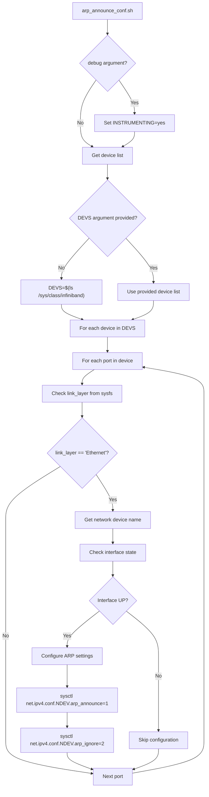
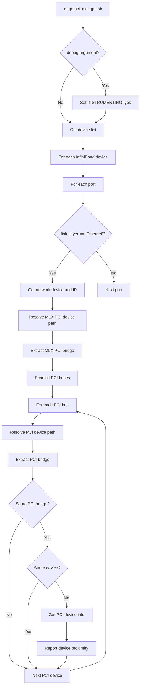
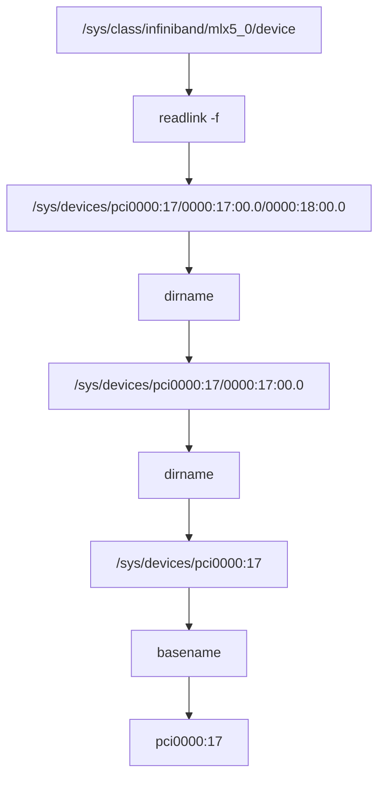

<!-- source: DeepWiki mcp.deepwiki.com · repo Mellanox/gpu_direct_rdma_access · page 7 System Configuration Scripts · fetched 2026-11-11 -->

# System Configuration Scripts

<details>
<summary>Relevant source files</summary>

The following files were used as context for generating this wiki page:

- [arp_announce_conf.sh](arp_announce_conf.sh)
- [map_pci_nic_gpu.sh](map_pci_nic_gpu.sh)

</details>


This document covers the system configuration scripts that prepare the network and hardware environment for optimal GPU Direct RDMA operation. These scripts automate the configuration of ARP settings for multi-homed RoCE networks and provide hardware topology discovery to identify optimal GPU-NIC pairings.

For information about the core RDMA functionality that these scripts support, see [Core RDMA Engine](#3). For details about the client-server applications that benefit from these configurations, see [Client-Server Applications](#5).

## Script Overview

The system includes two primary configuration scripts that address different aspects of system setup:

| Script | Purpose | Key Function |
|--------|---------|-------------|
| `arp_announce_conf.sh` | Network ARP configuration for RoCE | Configures `arp_announce` and `arp_ignore` settings |
| `map_pci_nic_gpu.sh` | Hardware topology discovery | Maps network devices to PCI bridge locations |

## Network Configuration Script

### ARP Configuration for Multi-homed RoCE

The `arp_announce_conf.sh` script configures ARP behavior for InfiniBand devices using Ethernet link layers (RoCE). This configuration is essential for multi-homed network environments where multiple network interfaces may respond to ARP requests.



The script performs the following key operations:

1. **Device Discovery**: Uses `ls /sys/class/infiniband/` to enumerate InfiniBand devices [arp_announce_conf.sh:41]()
2. **Link Layer Detection**: Reads `link_layer` from sysfs to identify Ethernet-based ports [arp_announce_conf.sh:48]()
3. **Network Device Mapping**: Extracts the network device name from `gid_attrs/ndevs/0` [arp_announce_conf.sh:51]()
4. **Interface State Check**: Uses `ip link show` to verify interface is UP [arp_announce_conf.sh:52]()
5. **ARP Configuration**: Sets `arp_announce=1` and `arp_ignore=2` via sysctl [arp_announce_conf.sh:55-56]()

### ARP Parameter Significance

The configured ARP parameters have specific meanings for multi-homed environments:

| Parameter | Value | Effect |
|-----------|-------|---------|
| `arp_announce` | 1 | Use best local address for ARP requests |
| `arp_ignore` | 2 | Reply only if target IP matches incoming interface |

Sources: [arp_announce_conf.sh:1-64]()

## Hardware Topology Discovery Script

### PCI Bridge Mapping for Optimal Device Pairing

The `map_pci_nic_gpu.sh` script discovers the PCI topology to identify network devices and other PCI devices (typically GPUs) that share the same PCI bridge, enabling optimal NUMA-aware device pairing.



### PCI Topology Analysis Process

The script implements a sophisticated PCI bridge analysis:

1. **Network Device Resolution**: Maps InfiniBand devices to network interfaces and IP addresses [map_pci_nic_gpu.sh:51-55]()
2. **PCI Path Resolution**: Uses `readlink -f` to resolve symbolic links to actual PCI device paths [map_pci_nic_gpu.sh:57]()
3. **Bridge Extraction**: Extracts PCI bridge identifier from device path hierarchy [map_pci_nic_gpu.sh:59-60]()
4. **PCI Bus Enumeration**: Scans all PCI buses in `/sys/class/pci_bus/` [map_pci_nic_gpu.sh:63]()
5. **Proximity Detection**: Identifies devices sharing the same PCI bridge [map_pci_nic_gpu.sh:70]()
6. **Device Information**: Retrieves human-readable PCI device descriptions using `lspci` [map_pci_nic_gpu.sh:75]()

### Path Resolution Logic

The script uses a specific path manipulation strategy to extract PCI bridge information:



This path resolution extracts the PCI bridge identifier by navigating up the sysfs hierarchy [map_pci_nic_gpu.sh:59-60]().

Sources: [map_pci_nic_gpu.sh:1-86]()

## Common Script Features

### Debug Infrastructure

Both scripts implement a common debug mechanism:

```bash
if [[ debug == "$1" ]]; then
  INSTRUMENTING=yes
  shift
fi
echodbg () {
  [[ "$INSTRUMENTING" ]] && builtin echo $@
}
```

This allows verbose output when scripts are invoked with `debug` as the first argument [arp_announce_conf.sh:31-37](), [map_pci_nic_gpu.sh:31-37]().

### Device Enumeration Pattern

Both scripts follow a consistent pattern for InfiniBand device discovery:

1. Accept optional device list as command-line argument
2. Default to scanning `/sys/class/infiniband/` if no devices specified
3. Iterate through each device and port combination
4. Filter for Ethernet link layer devices (RoCE)

Sources: [arp_announce_conf.sh:39-50](), [map_pci_nic_gpu.sh:39-50]()

## Integration with GPU Direct RDMA System

These configuration scripts prepare the system environment for optimal GPU Direct RDMA performance:

- **Network Configuration**: The ARP script ensures proper network behavior in multi-homed RoCE environments
- **Hardware Topology**: The PCI mapping script helps identify optimal GPU-NIC pairings for NUMA locality
- **Automation**: Both scripts can be integrated into system startup or deployment processes

The scripts work in conjunction with the memory management subsystem (see [Memory Management Subsystem](#4)) by ensuring that the network and hardware topology are optimally configured for the GPU Direct RDMA operations implemented in the core system.

Sources: [arp_announce_conf.sh:1-64](), [map_pci_nic_gpu.sh:1-86]()

---

