# Page: Overview

# Overview

<details>
<summary>Relevant source files</summary>

The following files were used as context for generating this wiki page:

- [Makefile](Makefile)
- [README.md](README.md)
- [gpu_direct_rdma_access.c](gpu_direct_rdma_access.c)

</details>


## Purpose and Scope

This document provides an overview of the GPU Direct RDMA Access system, a high-performance data transfer solution that enables direct memory access between distributed systems using Mellanox Dynamic Connect (DC) Queue Pairs. The system supports both GPU and CPU memory allocation with transparent RDMA operations, eliminating traditional CPU-mediated data transfers for optimal performance.

The system consists of client-server applications that demonstrate GPU Direct RDMA capabilities, along with supporting libraries for memory management, network configuration, and hardware topology discovery. For detailed information about specific subsystems, see the [Build System](#2), [Core RDMA Engine](#3), [Memory Management Subsystem](#4), and [Client-Server Applications](#5).

Sources: [README.md:1-4](), [gpu_direct_rdma_access.c:1-31]()

## High-Level Architecture

The GPU Direct RDMA Access system implements a distributed architecture where clients can perform high-performance data transfers to remote servers using RDMA operations directly to GPU or CPU memory buffers.

### System Architecture Overview

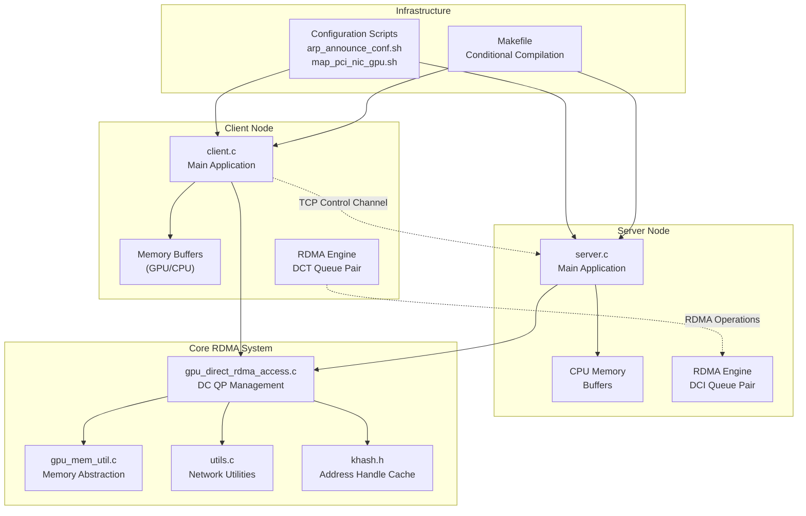

Sources: [Makefile:1-55](), [gpu_direct_rdma_access.c:97-154](), [README.md:10-16]()

## Key Features

### Dynamic Connect Queue Pairs
The system uses Mellanox-specific Dynamic Connect (DC) Queue Pairs to achieve high performance RDMA operations. The client creates a DCT (Dynamic Connect Target) while the server uses DCI (Dynamic Connect Initiator) for scalable one-to-many connections.

### Unified Memory Management
The memory subsystem provides a transparent abstraction layer supporting both CUDA GPU memory and traditional CPU memory allocation through a single API, enabling deployment flexibility across different hardware configurations.

### Address Handle Caching
Performance optimization through cached address resolution using hash tables to store `ibv_ah` structures, reducing overhead for repeated RDMA operations to the same destinations.

### Conditional Compilation
Sophisticated build system supporting multiple variants: GPU-enabled vs CPU-only builds, with optional latency measurement capabilities through preprocessor flags.

Sources: [gpu_direct_rdma_access.c:618-621](), [gpu_direct_rdma_access.c:796-798](), [gpu_direct_rdma_access.c:76](), [Makefile:5-19]()

## Core System Components

### RDMA Device Management

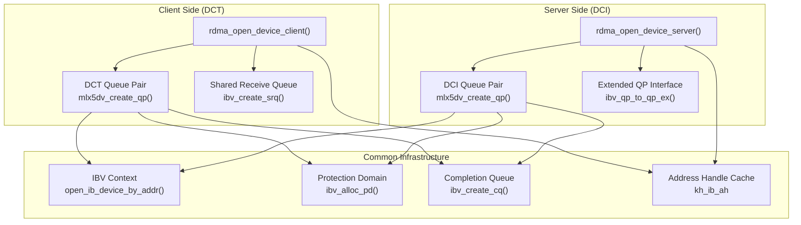

Sources: [gpu_direct_rdma_access.c:526-711](), [gpu_direct_rdma_access.c:714-886](), [gpu_direct_rdma_access.c:97-143]()

### Memory Management Architecture

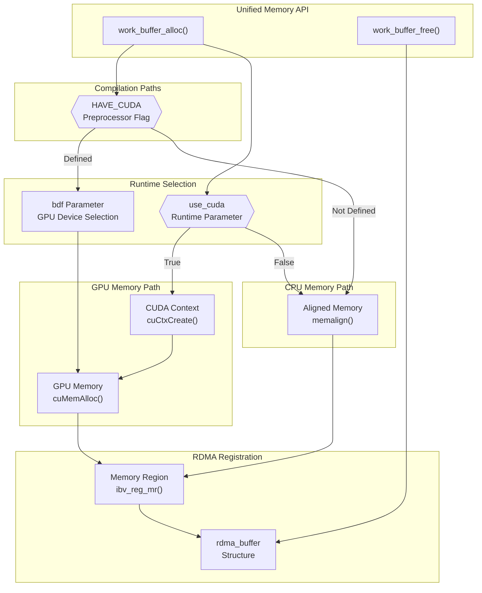

Sources: [gpu_mem_util.c:1-200](), [gpu_direct_rdma_access.c:1155-1212]()

## Build System Architecture

The build system uses conditional compilation to create different variants from the same codebase:

| Build Flag | Purpose | Libraries | Target Use Case |
|------------|---------|-----------|-----------------|
| `USE_CUDA=1` | Enable GPU support | `-lcuda` + RDMA libs | Client machines with GPU |
| `USE_CUDA=0` | CPU-only build | RDMA libs only | Server machines |
| `PRINT_LAT=1` | Enable latency measurement | Extended CQ support | Performance analysis |
| `PRINT_LAT=0` | Standard build | Standard CQ | Production deployment |

### Core Dependencies
- **RDMA Libraries**: `libverbs`, `lrdmacm`, `lmlx5` for InfiniBand/RoCE operations
- **CUDA Libraries**: `libcuda` for GPU memory management (conditional)
- **Source Components**: `gpu_direct_rdma_access.c`, `gpu_mem_util.c`, `utils.c`
- **Header Dependencies**: All `.h` files defining API interfaces

Sources: [Makefile:5-32](), [Makefile:37-45]()

## Task Execution Flow

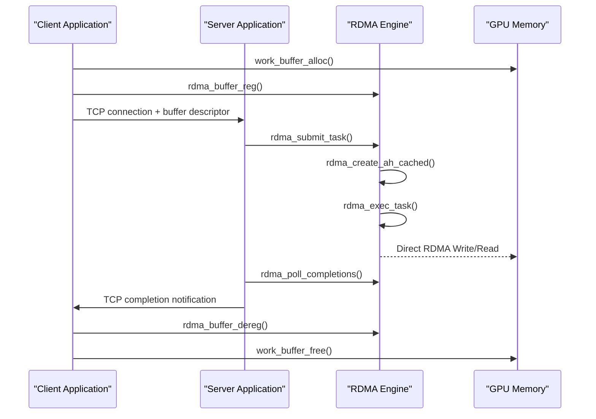

Sources: [gpu_direct_rdma_access.c:1342-1419](), [gpu_direct_rdma_access.c:890-1006](), [gpu_direct_rdma_access.c:1422-1548]()

## Hardware Requirements and Configuration

### Required Hardware
- **NICs**: Mellanox ConnectX-5 or newer for DC QP support
- **GPUs**: NVIDIA GPUs with CUDA support (client-side optional)
- **Network**: InfiniBand or RoCE-capable Ethernet infrastructure

### Configuration Scripts
- **`arp_announce_conf.sh`**: Configures ARP handling for multi-homed RoCE networks
- **`map_pci_nic_gpu.sh`**: Discovers optimal GPU-NIC pairings on same PCI bridge for performance

Sources: [README.md:23-42](), [README.md:75-84]()

## Performance Characteristics

The system is optimized for high-performance data transfer with several key optimizations:

- **Zero-copy transfers**: Direct GPU-to-GPU memory access bypassing CPU
- **Address handle caching**: Reduces connection setup overhead using `khash` implementation
- **Polling-based completion**: Eliminates interrupt overhead for low latency
- **Scatter-gather support**: Efficient handling of non-contiguous memory regions through `iovec` arrays

Optional latency measurement capabilities provide detailed timing analysis across the entire RDMA operation pipeline when compiled with `PRINT_LAT=1`.

Sources: [gpu_direct_rdma_access.c:128](), [gpu_direct_rdma_access.c:1422-1548](), [gpu_direct_rdma_access.c:88-142]()

---

# Page: Build System

# Build System

<details>
<summary>Relevant source files</summary>

The following files were used as context for generating this wiki page:

- [Makefile](Makefile)

</details>


This document describes the build system for the GPU Direct RDMA Access project, covering compilation options, dependencies, build targets, and configuration variants. The build system uses GNU Make with conditional compilation to support different hardware configurations and feature sets from a single codebase.

For information about the core RDMA functionality that gets built, see [Core RDMA Engine](#3). For details about the memory management compilation options, see [Memory Management Subsystem](#4).

## Build Configuration

The build system supports conditional compilation through environment variables that enable different feature sets and hardware support configurations.

### Compilation Flags

The build system recognizes two primary environment variables that control compilation behavior:

| Environment Variable | Purpose | Default Behavior |
|---------------------|---------|------------------|
| `USE_CUDA` | Enables GPU memory support via CUDA | CPU-only build |
| `PRINT_LAT` | Enables latency measurement output | No latency printing |

When `USE_CUDA=1` is set, the build system:
- Adds CUDA include paths [Makefile:6-7]()
- Defines the `HAVE_CUDA` preprocessor macro [Makefile:8]()
- Links against the CUDA runtime library [Makefile:9]()

When `PRINT_LAT=1` is set, the build system defines the `PRINT_LATENCY` preprocessor macro [Makefile:16]().

Sources: Makefile

### Build Flow Diagram

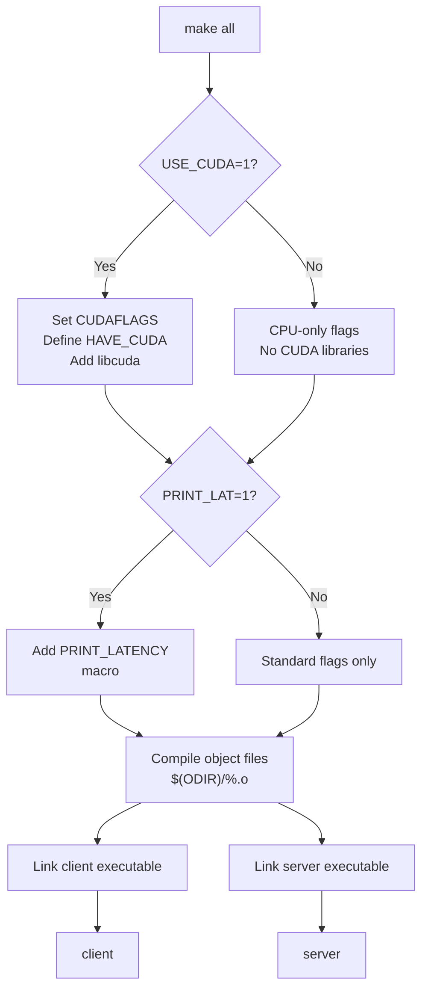

Sources: Makefile

## Build Targets

The build system produces two primary executables from shared object files and target-specific source files.

### Executable Targets

| Target | Source Files | Purpose |
|--------|-------------|---------|
| `client` | client.c + shared objects | Client application for RDMA operations |
| `server` | server.c + shared objects | Server application for RDMA operations |

Both executables share the same core object files but have different main application logic [Makefile:41-45]().

### Shared Object Files

The build system compiles these core source files into shared object files [Makefile:30-32]():

- `gpu_direct_rdma_access.o` - Core RDMA functionality
- `gpu_mem_util.o` - Memory management abstraction
- `utils.o` - Network and performance utilities

### Dependency Management

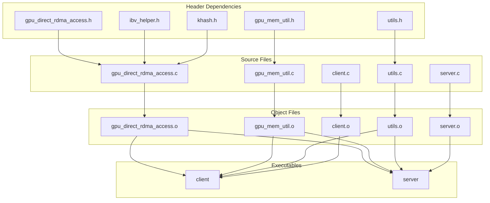

Sources: Makefile

## External Dependencies

The build system requires several external libraries that provide RDMA and GPU functionality.

### Required Libraries

| Library | Purpose | Conditional |
|---------|---------|-------------|
| `lrdmacm` | RDMA Connection Manager | Always required |
| `libverbs` | InfiniBand Verbs API | Always required |
| `lmlx5` | Mellanox ConnectX driver | Always required |
| `lcuda` | CUDA Runtime API | Only when `USE_CUDA=1` |

### CUDA Include Paths

When CUDA support is enabled, the build system searches for CUDA headers in these locations [Makefile:6-7]():
- `/usr/local/cuda-10.1/targets/x86_64-linux/include`
- `/usr/local/cuda/include`

The build system uses a hardcoded path approach rather than dynamic CUDA detection, requiring manual adjustment for different CUDA installations.

Sources: Makefile

## Build Process

The build process follows a standard GNU Make pattern with object file generation and linking phases.

### Object File Compilation

Object files are compiled using the pattern rule [Makefile:34-35]():
```makefile
$(ODIR)/%.o: %.c $(DEPS)
	$(CC) -c -o $@ $< $(CFLAGS)
```

All object files depend on the complete header dependency list defined in the `DEPS` variable [Makefile:24-28]().

### Directory Structure

The build system creates an `obj/` directory for intermediate object files [Makefile:47-48]():
- Source files remain in the root directory
- Object files are placed in `obj/`
- Executables are created in the root directory

### Clean Target

The clean target removes all build artifacts [Makefile:52-53]():
- Executable files (`client`, `server`)
- Object files in `obj/` directory  
- Backup files (`*~`, `core.*`)
- Header backup files

Sources: Makefile

## Configuration Variants

The conditional compilation system creates four possible build variants based on the two configuration flags.

### Build Variant Matrix

| USE_CUDA | PRINT_LAT | Features | Use Case |
|----------|-----------|----------|----------|
| 0 | 0 | CPU memory only | Basic testing |
| 0 | 1 | CPU memory + latency | Performance analysis (CPU) |
| 1 | 0 | GPU memory support | Production GPU workloads |
| 1 | 1 | GPU memory + latency | Performance analysis (GPU) |

### Preprocessor Macros

The build system defines these macros based on configuration:

- `HAVE_CUDA` - Enables GPU memory allocation code paths
- `PRINT_LATENCY` - Enables performance measurement output

These macros control conditional compilation within the source files, allowing the same codebase to support different hardware configurations and debugging levels.

Sources: Makefile

---

# Page: Core RDMA Engine

# Core RDMA Engine

<details>
<summary>Relevant source files</summary>

The following files were used as context for generating this wiki page:

- [gpu_direct_rdma_access.c](gpu_direct_rdma_access.c)
- [gpu_direct_rdma_access.h](gpu_direct_rdma_access.h)

</details>


## Purpose and Scope

The Core RDMA Engine provides the fundamental RDMA (Remote Direct Memory Access) functionality that enables GPU Direct memory operations using Mellanox Dynamic Connect Queue Pairs. This subsystem abstracts the complexities of InfiniBand/RoCE hardware management, memory registration, and task execution to provide a high-level API for direct memory transfers between distributed systems.

For information about the public API interfaces, see [RDMA Interface Definition](#3.1). For internal implementation details, see [RDMA Implementation Details](#3.2). For memory management abstractions used by this engine, see [Memory Management Subsystem](#4).

## Architecture Overview

The Core RDMA Engine implements a sophisticated architecture centered around Mellanox's Dynamic Connect (DC) transport, which provides scalable one-to-many connectivity without per-connection state overhead.

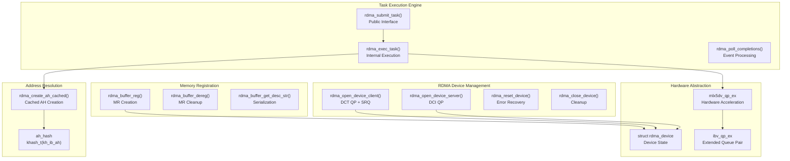

**Sources:** [gpu_direct_rdma_access.h:90-91](), [gpu_direct_rdma_access.c:526-711](), [gpu_direct_rdma_access.c:714-885]()

## Device Management

The RDMA engine supports two distinct device roles: client (target) and server (initiator), each with different Queue Pair configurations optimized for their respective functions.

### Client Device Initialization

Client devices use Dynamic Connect Target (DCT) Queue Pairs with Shared Receive Queues (SRQ) for scalable reception of RDMA operations:

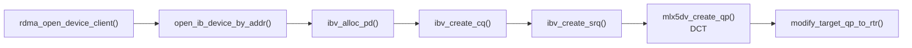

**Sources:** [gpu_direct_rdma_access.c:526-711](), [gpu_direct_rdma_access.c:586-596](), [gpu_direct_rdma_access.c:618-630]()

### Server Device Initialization

Server devices use Dynamic Connect Initiator (DCI) Queue Pairs with extended capabilities for issuing RDMA operations:

```mermaid
graph LR
    rdma_open_device_server["rdma_open_device_server()"] --> open_ib_device_by_addr["open_ib_device_by_addr()"]
    open_ib_device_by_addr --> ibv_alloc_pd["ibv_alloc_pd()"]
    ibv_alloc_pd --> ibv_create_cq["ibv_create_cq()"]
    ibv_create_cq --> mlx5dv_create_qp["mlx5dv_create_qp()<br/>DCI"]
    mlx5dv_create_qp --> ibv_qp_to_qp_ex["ibv_qp_to_qp_ex()"]
    ibv_qp_to_qp_ex --> mlx5dv_qp_ex_from_ibv_qp_ex["mlx5dv_qp_ex_from_ibv_qp_ex()"]
    mlx5dv_qp_ex_from_ibv_qp_ex --> modify_source_qp_rst2rts["modify_source_qp_rst2rts()"]
```

**Sources:** [gpu_direct_rdma_access.c:714-885](), [gpu_direct_rdma_access.c:796-827](), [gpu_direct_rdma_access.c:818-823]()

## Memory Registration Subsystem

The memory registration subsystem provides abstraction over InfiniBand Memory Regions (MRs) and serialization for network communication.

| Function | Purpose | Key Parameters |
|----------|---------|----------------|
| `rdma_buffer_reg()` | Register memory with RDMA device | `rdma_dev`, `addr`, `length` |
| `rdma_buffer_dereg()` | Unregister and cleanup | `rdma_buff` |
| `rdma_buffer_get_desc_str()` | Serialize buffer info | `rdma_buff`, `desc_str`, `desc_length` |

The `struct rdma_buffer` encapsulates both buffer metadata and RDMA-specific information:

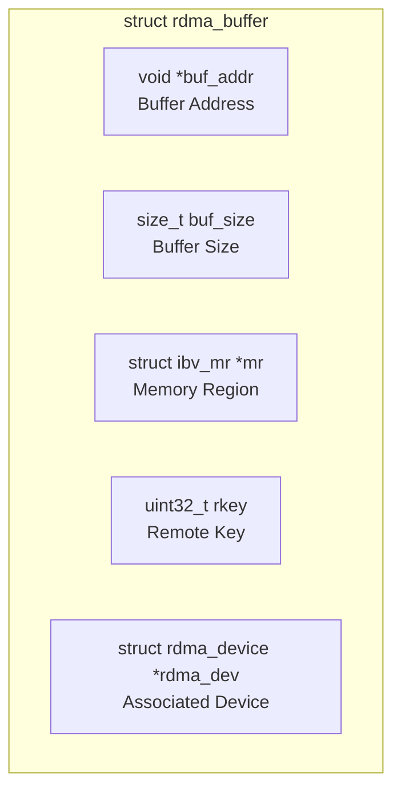

**Sources:** [gpu_direct_rdma_access.c:1155-1192](), [gpu_direct_rdma_access.c:1195-1212](), [gpu_direct_rdma_access.c:145-154]()

## Task Execution Engine

The task execution engine processes RDMA read/write operations through a multi-stage pipeline that handles address resolution, work request construction, and hardware interaction.

### Task Submission Flow

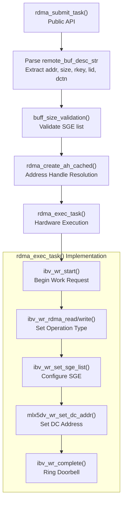

**Sources:** [gpu_direct_rdma_access.c:1342-1419](), [gpu_direct_rdma_access.c:890-1006](), [gpu_direct_rdma_access.c:904-905]()

### Completion Processing

The completion processing system handles both standard and extended (latency measurement) completion events:

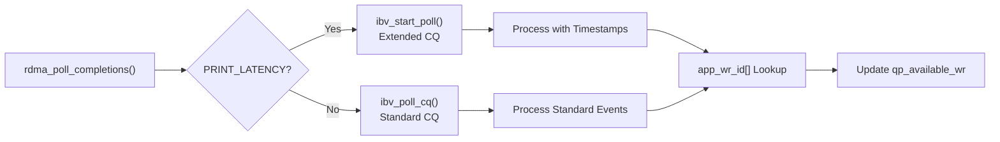

**Sources:** [gpu_direct_rdma_access.c:1422-1548](), [gpu_direct_rdma_access.c:1440-1522](), [gpu_direct_rdma_access.c:1524-1546]()

## Address Resolution Caching

The address resolution system uses a hash table to cache Address Handles (AHs), eliminating the overhead of repeated AH creation for the same destinations.

### Hash Table Implementation

The system employs `khash.h` with custom hash and equality functions for `struct ibv_ah_attr`:

| Component | Function | Purpose |
|-----------|----------|---------|
| `kh_ib_ah_hash_func()` | Hash calculation | XOR of GID and LID values |
| `kh_ib_ah_hash_equal()` | Equality comparison | `memcmp()` of attributes |
| `rdma_create_ah_cached()` | Cache management | Lookup or create AH |

**Sources:** [gpu_direct_rdma_access.c:178-194](), [gpu_direct_rdma_access.c:1264-1305](), [gpu_direct_rdma_access.c:76]()

## Core Data Structures

### struct rdma_device

The central device structure maintains all RDMA resources and state:

| Field Group | Key Members | Purpose |
|-------------|-------------|---------|
| **Context** | `context`, `pd`, `cq` | Basic InfiniBand resources |
| **Queue Pairs** | `qp`, `qpex`, `mqpex`, `srq` | Extended queue pair interfaces |
| **Address Info** | `ib_port`, `gid`, `lid`, `mtu` | Network addressing |
| **Work Management** | `app_wr_id[]`, `qp_available_wr` | Outstanding operation tracking |
| **Address Cache** | `ah_hash` | Cached address handles |

**Sources:** [gpu_direct_rdma_access.c:97-143](), [gpu_direct_rdma_access.c:109-112](), [gpu_direct_rdma_access.c:128]()

### struct rdma_task_attr

The task attribute structure defines RDMA operation parameters:

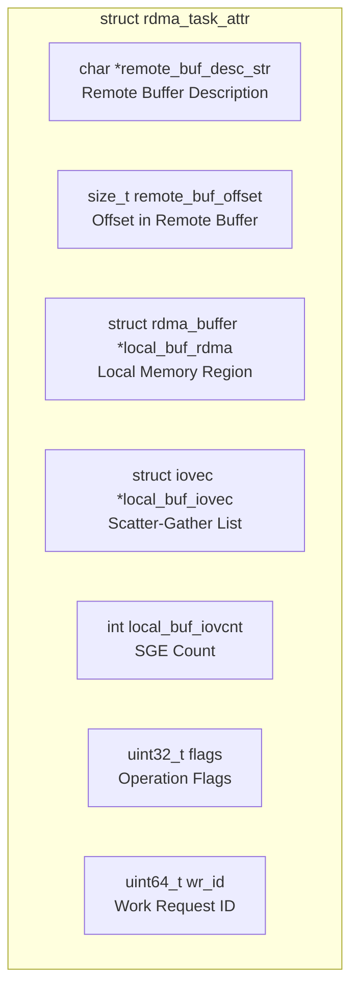

**Sources:** [gpu_direct_rdma_access.h:69-78](), [gpu_direct_rdma_access.h:65-67](), [gpu_direct_rdma_access.c:156-169]()

---

# Page: RDMA Interface Definition

# RDMA Interface Definition

<details>
<summary>Relevant source files</summary>

The following files were used as context for generating this wiki page:

- [gpu_direct_rdma_access.h](gpu_direct_rdma_access.h)

</details>


This document defines the public API interface for the GPU Direct RDMA Access system. It covers the data structures, function prototypes, and usage patterns that applications use to perform RDMA operations with GPU memory support.

For implementation details of how these interfaces are realized internally, see [RDMA Implementation Details](#3.2). For examples of how client and server applications use these interfaces, see [Client Application](#5.1) and [Server Application](#5.2).

## Core Data Structures

The RDMA interface is built around several key data structures that abstract the underlying InfiniBand hardware and provide a simplified API for applications.

### Device and Buffer Abstractions

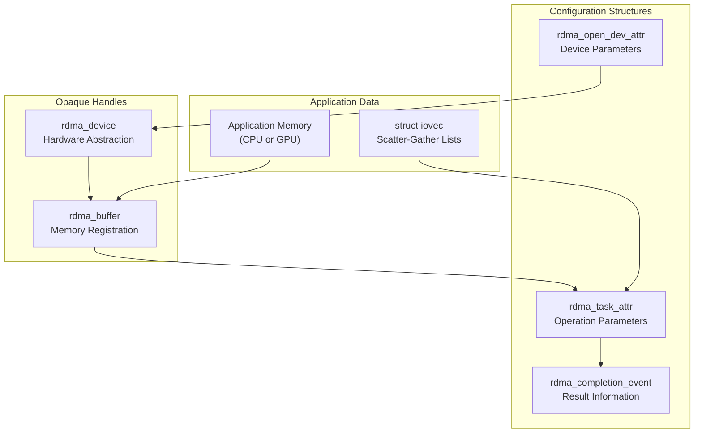

**Sources:** [gpu_direct_rdma_access.h:47-57]()

The system uses two primary opaque handle types:
- `struct rdma_device` represents a local RDMA-capable network interface
- `struct rdma_buffer` represents a registered memory region that can be accessed via RDMA

### Device Configuration Structure

The `rdma_open_dev_attr` structure specifies which RDMA device to open and how to configure it:

| Field | Type | Purpose |
|-------|------|---------|
| `ib_devname` | `const char *` | InfiniBand device name (e.g., "mlx5_0") |
| `ib_port` | `int` | Physical port number on the device |
| `gidx` | `int` | GID table index for address resolution |

**Sources:** [gpu_direct_rdma_access.h:59-63]()

### Task Execution Structure  

The `rdma_task_attr` structure contains all parameters needed to execute an RDMA operation:

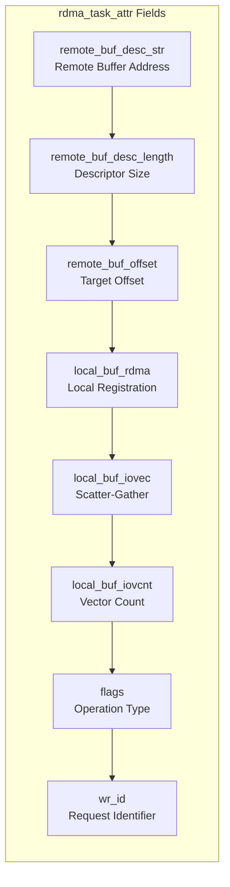

**Sources:** [gpu_direct_rdma_access.h:69-78]()

The `flags` field uses `enum rdma_task_attr_flags` values:
- `RDMA_TASK_ATTR_RDMA_READ` (bit 0): Perform RDMA read instead of write

## API Function Categories

### Device Management Functions

These functions manage the lifecycle of RDMA devices and handle role-specific initialization:

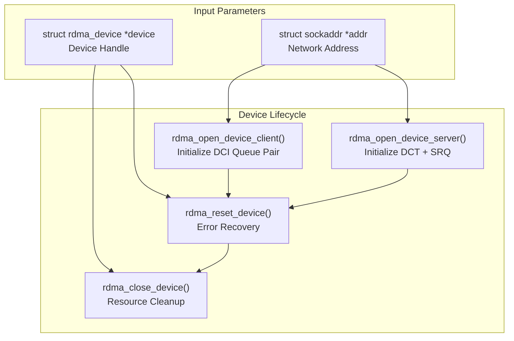

**Sources:** [gpu_direct_rdma_access.h:90-101]()

| Function | Purpose | Return Value |
|----------|---------|--------------|
| `rdma_open_device_client` | Initialize client-side RDMA device with DCI QP | `struct rdma_device *` or NULL |
| `rdma_open_device_server` | Initialize server-side RDMA device with DCT QP + SRQ | `struct rdma_device *` or NULL |  
| `rdma_reset_device` | Reset device from failed state to operational state | 0 on success, errno on failure |
| `rdma_close_device` | Release all device resources | void |

### Memory Registration Functions

These functions handle registration and deregistration of application memory buffers for RDMA access:

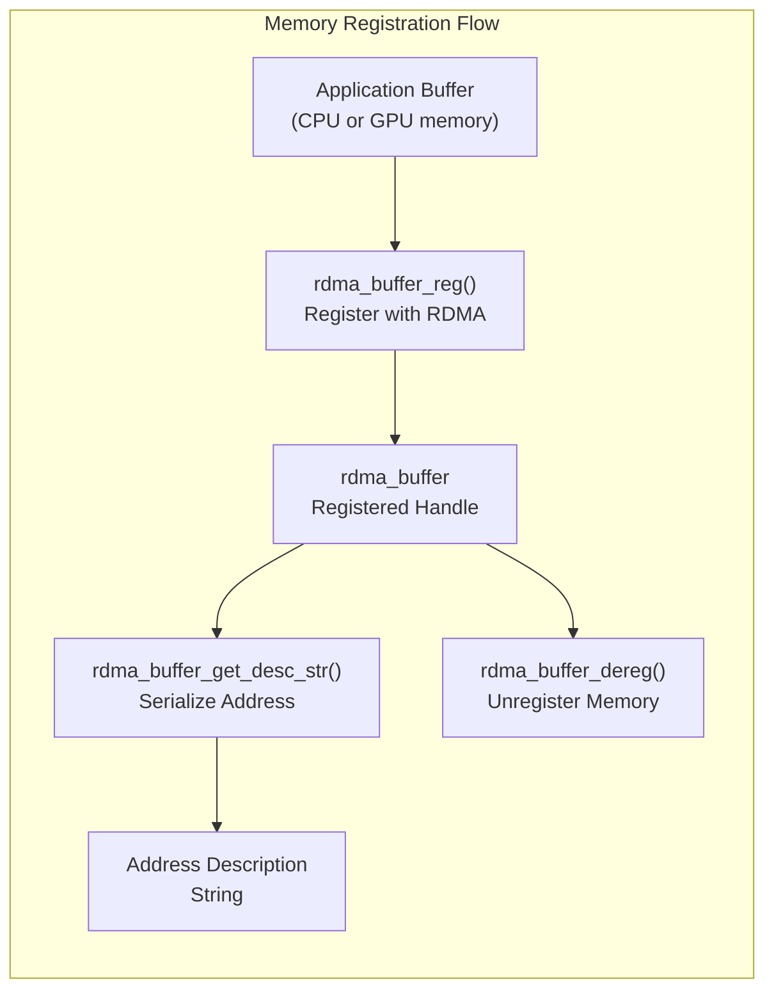

**Sources:** [gpu_direct_rdma_access.h:106-121]()

| Function | Parameters | Purpose |
|----------|------------|---------|
| `rdma_buffer_reg` | `device`, `addr`, `length` | Register memory region for RDMA access |
| `rdma_buffer_dereg` | `buffer` | Unregister and cleanup memory region |
| `rdma_buffer_get_desc_str` | `rdma_buff`, `desc_str`, `desc_length` | Serialize buffer address for remote access |

### Task Execution Functions

These functions handle the submission and completion of RDMA operations:

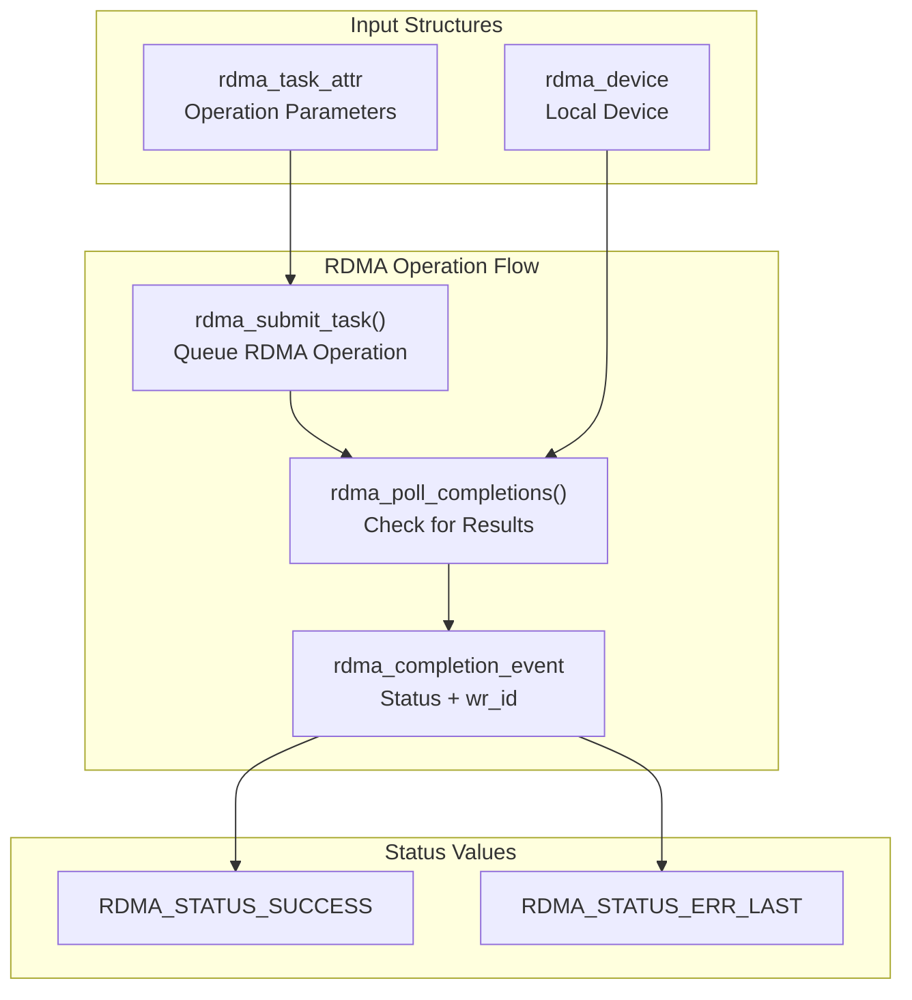

**Sources:** [gpu_direct_rdma_access.h:138-158]()

The `rdma_completion_event` structure reports operation results:

| Field | Type | Purpose |
|-------|------|---------|
| `wr_id` | `uint64_t` | Work request identifier from `rdma_task_attr` |
| `status` | `enum rdma_completion_status` | Operation result (success or error) |

## API Usage Workflow

The typical usage pattern follows this sequence:

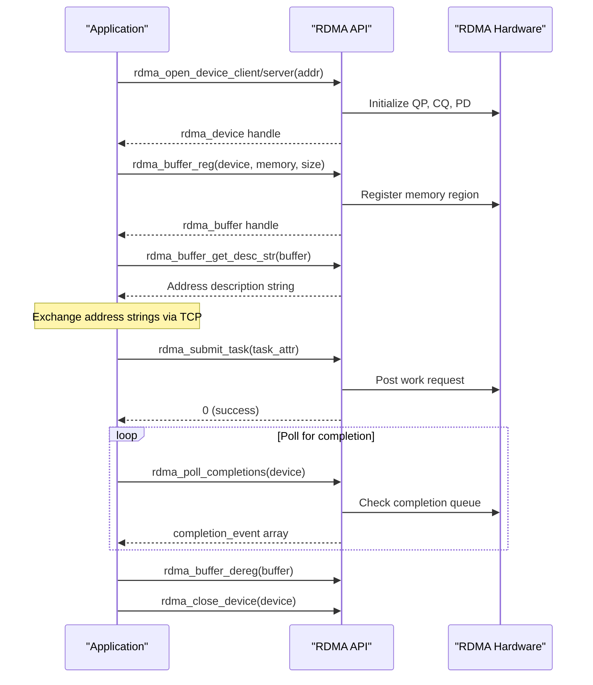

**Sources:** [gpu_direct_rdma_access.h:80-158]()

## Constants and Limits

The interface defines several important constants:

| Constant | Value | Purpose |
|----------|-------|---------|
| `MAX_SEND_SGE` | 10 | Maximum scatter-gather elements per operation |

**Sources:** [gpu_direct_rdma_access.h:45]()

The system requires specific header files for operation:
- `<sys/uio.h>` for `struct iovec` scatter-gather support
- `<infiniband/verbs.h>` for standard InfiniBand verbs
- `<infiniband/mlx5dv.h>` for Mellanox direct verbs extensions

**Sources:** [gpu_direct_rdma_access.h:36-39]()

---

# Page: RDMA Implementation Details

# RDMA Implementation Details

<details>
<summary>Relevant source files</summary>

The following files were used as context for generating this wiki page:

- [gpu_direct_rdma_access.c](gpu_direct_rdma_access.c)

</details>


This document covers the internal implementation architecture of the RDMA subsystem that enables GPU Direct memory access using Dynamic Connect Queue Pairs. It focuses on device management, task execution engines, address resolution caching, and completion handling mechanisms. For the public API interface and data structures, see [RDMA Interface Definition](#3.1).

## Core Data Structures

The RDMA implementation centers around three primary data structures that encapsulate device state, buffer management, and task execution parameters.

```mermaid
classDiagram
    class rdma_device {
        +rdma_event_channel* cm_channel
        +rdma_cm_id* cm_id
        +ibv_context* context
        +ibv_pd* pd
        +ibv_cq* cq
        +ibv_srq* srq
        +ibv_qp* qp
        +ibv_qp_ex* qpex
        +mlx5dv_qp_ex* mqpex
        +int ib_port
        +union ibv_gid gid
        +uint16_t lid
        +wr_id_reported app_wr_id[SEND_Q_DEPTH]
        +int app_wr_id_idx
        +int qp_available_wr
        +khash_t ah_hash
    }
    
    class rdma_buffer {
        +void* buf_addr
        +size_t buf_size
        +ibv_mr* mr
        +uint32_t rkey
        +rdma_device* rdma_dev
    }
    
    class rdma_exec_params {
        +rdma_device* device
        +uint64_t wr_id
        +unsigned long rem_buf_rkey
        +unsigned long long rem_buf_addr
        +uint32_t rem_buf_size
        +ibv_ah* ah
        +unsigned long rem_dctn
        +uint32_t local_buf_mr_lkey
        +void* local_buf_addr
        +iovec* local_buf_iovec
        +int local_buf_iovcnt
        +uint32_t flags
    }
    
    rdma_device ||--o{ rdma_buffer : "manages"
    rdma_exec_params ||--|| rdma_device : "executes on"
    rdma_exec_params ||--|| rdma_buffer : "operates on"
```

The `rdma_device` structure maintains both InfiniBand Verbs objects and mlx5dv extensions for hardware acceleration. The `srq` field distinguishes client (DCT) from server (DCI) configurations, while the address handle hash table `ah_hash` provides performance optimization for repeated connections.

**Sources:** [gpu_direct_rdma_access.c:97-143](), [gpu_direct_rdma_access.c:145-154](), [gpu_direct_rdma_access.c:156-169]()

## Device Initialization Architecture

The device initialization follows distinct paths for client and server roles, leveraging different Dynamic Connect queue pair types and initialization sequences.

```mermaid
flowchart TD
    rdma_open_device_client["rdma_open_device_client()"] --> client_path["Client Path (DCT)"]
    rdma_open_device_server["rdma_open_device_server()"] --> server_path["Server Path (DCI)"]
    
    client_path --> open_ib_device_by_addr["open_ib_device_by_addr()"]
    server_path --> open_ib_device_by_addr
    
    open_ib_device_by_addr --> rdma_set_lid_gid_from_port_info["rdma_set_lid_gid_from_port_info()"]
    
    rdma_set_lid_gid_from_port_info --> client_resources["Client Resources"]
    rdma_set_lid_gid_from_port_info --> server_resources["Server Resources"]
    
    client_resources --> ibv_alloc_pd_client["ibv_alloc_pd()"]
    client_resources --> ibv_create_cq_client["ibv_create_cq()"]
    client_resources --> ibv_create_srq["ibv_create_srq()"]
    client_resources --> mlx5dv_create_qp_dct["mlx5dv_create_qp(DCT)"]
    client_resources --> modify_target_qp_to_rtr["modify_target_qp_to_rtr()"]
    
    server_resources --> ibv_alloc_pd_server["ibv_alloc_pd()"]
    server_resources --> ibv_create_cq_server["ibv_create_cq()"]
    server_resources --> mlx5dv_create_qp_dci["mlx5dv_create_qp(DCI)"]
    server_resources --> modify_source_qp_rst2rts["modify_source_qp_rst2rts()"]
    
    modify_target_qp_to_rtr --> kh_init_inplace_client["kh_init_inplace(ah_hash)"]
    modify_source_qp_rst2rts --> kh_init_inplace_server["kh_init_inplace(ah_hash)"]
```

The key architectural difference lies in queue pair configuration: clients create DCT (Dynamic Connect Target) queue pairs with SRQ (Shared Receive Queue), while servers create DCI (Dynamic Connect Initiator) queue pairs without SRQ. The `is_server()` function uses the presence of SRQ to distinguish between roles.

**Sources:** [gpu_direct_rdma_access.c:526-711](), [gpu_direct_rdma_access.c:714-886](), [gpu_direct_rdma_access.c:172-175]()

## Task Execution Engine

The task execution engine implements a sophisticated work request submission system with virtual work request ID management and scatter-gather list support.

```mermaid
flowchart TD
    rdma_submit_task["rdma_submit_task()"] --> parse_desc["Parse remote_buf_desc_str"]
    parse_desc --> buff_size_validation["buff_size_validation()"]
    buff_size_validation --> rdma_create_ah_cached["rdma_create_ah_cached()"]
    rdma_create_ah_cached --> rdma_exec_task["rdma_exec_task()"]
    
    rdma_exec_task --> ibv_wr_start["ibv_wr_start()"]
    ibv_wr_start --> wr_id_management["Virtual WR ID Management"]
    wr_id_management --> sge_handling{"local_buf_iovcnt > 0?"}
    
    sge_handling -->|Yes| multi_sge["Multiple SGE Loop"]
    sge_handling -->|No| single_sge["Single SGE"]
    
    multi_sge --> ibv_wr_rdma_rw_post_multi["ibv_wr_rdma_read/write()"]
    single_sge --> ibv_wr_rdma_rw_post_single["ibv_wr_rdma_read/write()"]
    
    ibv_wr_rdma_rw_post_multi --> ibv_wr_set_sge_list["ibv_wr_set_sge_list()"]
    ibv_wr_rdma_rw_post_single --> ibv_wr_set_sge["ibv_wr_set_sge()"]
    
    ibv_wr_set_sge_list --> mlx5dv_wr_set_dc_addr_multi["mlx5dv_wr_set_dc_addr()"]
    ibv_wr_set_sge --> mlx5dv_wr_set_dc_addr_single["mlx5dv_wr_set_dc_addr()"]
    
    mlx5dv_wr_set_dc_addr_multi --> ibv_wr_complete["ibv_wr_complete()"]
    mlx5dv_wr_set_dc_addr_single --> ibv_wr_complete
```

The engine manages work request availability through `qp_available_wr` tracking and implements virtual work request IDs via circular indexing in `app_wr_id_idx`. For scatter-gather operations exceeding `MAX_SEND_SGE`, it automatically splits requests across multiple work requests.

**Sources:** [gpu_direct_rdma_access.c:1342-1419](), [gpu_direct_rdma_access.c:890-1006]()

## Address Resolution and Caching

The address handle caching system optimizes performance by avoiding repeated address handle creation for the same destination endpoints.

```mermaid
flowchart TD
    rdma_create_ah_cached["rdma_create_ah_cached()"] --> kh_get["kh_get(kh_ib_ah, ah_hash)"]
    kh_get --> cache_hit{"AH Found?"}
    
    cache_hit -->|Yes| return_cached["Return Cached AH"]
    cache_hit -->|No| ibv_create_ah["ibv_create_ah()"]
    
    ibv_create_ah --> kh_put["kh_put(kh_ib_ah, ah_hash)"]
    kh_put --> store_success{"Store Success?"}
    
    store_success -->|Yes| return_new["Return New AH"]
    store_success -->|No| ibv_destroy_ah["ibv_destroy_ah()"]
    ibv_destroy_ah --> return_error["Return Error"]
    
    return_cached --> ah_reuse["AH Reuse"]
    return_new --> ah_reuse
```

The caching mechanism uses a custom hash function `kh_ib_ah_hash_func()` that combines GID subnet prefix, interface ID, and LID values. The hash table implementation leverages the khash library with custom equality comparison through `kh_ib_ah_hash_equal()`.

**Sources:** [gpu_direct_rdma_access.c:1264-1305](), [gpu_direct_rdma_access.c:178-194]()

## Work Request Management

The implementation employs a sophisticated virtual work request ID system to decouple application work request IDs from hardware queue management.

```mermaid
graph TD
    subgraph "Virtual WR ID System"
        app_wr_id["app_wr_id[SEND_Q_DEPTH]"]
        app_wr_id_idx["app_wr_id_idx (circular)"]
        qp_available_wr["qp_available_wr"]
    end
    
    subgraph "WR Tracking Structure"
        wr_id_reported["wr_id_reported"]
        original_wr_id["uint64_t wr_id"]
        num_wrs["uint16_t num_wrs"]
        flags["uint16_t flags"]
    end
    
    app_wr_id --> wr_id_reported
    wr_id_reported --> original_wr_id
    wr_id_reported --> num_wrs
    wr_id_reported --> flags
    
    subgraph "Flow Control"
        available_check["qp_available_wr >= required_wr"]
        decrement["qp_available_wr -= required_wr"]
        increment["qp_available_wr += num_wrs"]
    end
```

Each work request submission decrements `qp_available_wr` by the number of hardware work requests required, while completion processing increments it back. The `WR_ID_FLAGS_ACTIVE` flag prevents double-processing of completion events.

**Sources:** [gpu_direct_rdma_access.c:82-86](), [gpu_direct_rdma_access.c:920-934](), [gpu_direct_rdma_access.c:1452-1456]()

## Completion Handling

The completion polling system supports both standard and extended completion queues with optional latency measurement capabilities.

```mermaid
flowchart TD
    rdma_poll_completions["rdma_poll_completions()"] --> print_latency_check{"PRINT_LATENCY?"}
    
    print_latency_check -->|Yes| ibv_start_poll["ibv_start_poll()"]
    print_latency_check -->|No| ibv_poll_cq["ibv_poll_cq()"]
    
    ibv_start_poll --> extended_loop["Extended CQ Loop"]
    ibv_poll_cq --> standard_loop["Standard CQ Loop"]
    
    extended_loop --> ibv_wc_read_completion_ts["ibv_wc_read_completion_ts()"]
    extended_loop --> ibv_query_rt_values_ex["ibv_query_rt_values_ex()"]
    extended_loop --> latency_calc["Latency Calculations"]
    extended_loop --> ibv_next_poll["ibv_next_poll()"]
    
    standard_loop --> wc_processing["Process ibv_wc array"]
    
    latency_calc --> wr_id_validation["WR_ID_FLAGS_ACTIVE Check"]
    wc_processing --> wr_id_validation
    
    wr_id_validation --> event_reporting["Update rdma_completion_event"]
    event_reporting --> qp_available_increment["qp_available_wr += num_wrs"]
    
    ibv_next_poll --> extended_loop
    ibv_start_poll --> ibv_end_poll["ibv_end_poll()"]
```

The latency measurement feature tracks three timing points: work request start (`wr_start_ts`), completion in hardware (`completion_ts`), and software polling (`read_comp_ts`). These measurements utilize the HCA core clock for nanosecond precision.

**Sources:** [gpu_direct_rdma_access.c:1422-1548](), [gpu_direct_rdma_access.c:89-95]()

## Memory Registration

RDMA buffer registration creates memory regions with appropriate access flags for both local and remote operations.

```mermaid
flowchart TD
    rdma_buffer_reg["rdma_buffer_reg()"] --> access_flags["Set Access Flags"]
    access_flags --> ibv_reg_mr["ibv_reg_mr()"]
    ibv_reg_mr --> success_check{"Registration Success?"}
    
    success_check -->|Yes| populate_buffer["Populate rdma_buffer"]
    success_check -->|No| cleanup["free(rdma_buff)"]
    
    populate_buffer --> increment_count["rdma_dev->rdma_buff_cnt++"]
    
    subgraph "Access Flags"
        local_write["IBV_ACCESS_LOCAL_WRITE"]
        remote_read["IBV_ACCESS_REMOTE_READ"]
        remote_write["IBV_ACCESS_REMOTE_WRITE"]
    end
    
    rdma_buffer_dereg["rdma_buffer_dereg()"] --> ibv_dereg_mr["ibv_dereg_mr()"]
    ibv_dereg_mr --> decrement_count["rdma_dev->rdma_buff_cnt--"]
    decrement_count --> free_buffer["free(rdma_buff)"]
```

The registration process includes reference counting in `rdma_buff_cnt` to prevent device closure while buffers remain registered. The `rdma_buffer_get_desc_str()` function serializes buffer metadata for network transmission.

**Sources:** [gpu_direct_rdma_access.c:1155-1192](), [gpu_direct_rdma_access.c:1195-1212](), [gpu_direct_rdma_access.c:1242-1262]()

## Error Recovery and Reset

The reset mechanism provides server-side error recovery by transitioning the queue pair through error states and flushing outstanding work completions.

```mermaid
flowchart TD
    rdma_reset_device["rdma_reset_device()"] --> is_server_check["is_server() Check"]
    is_server_check -->|No| return_error["Return EOPNOTSUPP"]
    is_server_check -->|Yes| modify_qp_err["Modify QP to ERR"]
    
    modify_qp_err --> find_ah["Find AH from ah_hash"]
    find_ah --> post_flush["Post WR_ID_FLUSH_MARKER"]
    post_flush --> poll_loop["Poll Completions Loop"]
    
    poll_loop --> flush_found{"Flush Marker Found?"}
    flush_found -->|No| continue_polling["Continue Polling"]
    flush_found -->|Yes| reset_state["Reset Device State"]
    
    continue_polling --> poll_loop
    
    reset_state --> clear_wr_id["memset(app_wr_id, 0)"]
    clear_wr_id --> reset_indices["Reset app_wr_id_idx = 0"]
    reset_indices --> restore_wr_count["qp_available_wr = SEND_Q_DEPTH"]
    restore_wr_count --> modify_qp_reset["Modify QP to RESET"]
    modify_qp_reset --> modify_source_qp_rst2rts["modify_source_qp_rst2rts()"]
```

The flush mechanism ensures all outstanding work completions are properly drained before resetting queue pair state. The special `WR_ID_FLUSH_MARKER` value (`UINT64_MAX`) serves as a sentinel to detect completion of the flush process.

**Sources:** [gpu_direct_rdma_access.c:1009-1075](), [gpu_direct_rdma_access.c:72]()

---

# Page: Memory Management Subsystem

# Memory Management Subsystem

<details>
<summary>Relevant source files</summary>

The following files were used as context for generating this wiki page:

- [gpu_mem_util.c](gpu_mem_util.c)
- [gpu_mem_util.h](gpu_mem_util.h)

</details>


## Purpose and Scope

The Memory Management Subsystem provides a unified abstraction layer for allocating memory buffers that can be used with RDMA operations. It supports both CPU and GPU memory allocation through a single interface, enabling the system to work optimally with GPU Direct RDMA while maintaining compatibility with CPU-only configurations.

This subsystem handles the complexity of CUDA context management, device selection, and memory allocation strategies while exposing a simple API to higher-level components. For information about how these memory buffers are registered with RDMA devices, see [Core RDMA Engine](#3).

**Sources:** [gpu_mem_util.h:40-50](), [gpu_mem_util.c:228-231]()

## Architecture Overview

The Memory Management Subsystem employs a dual-path architecture that makes allocation decisions at both compile-time and runtime. The system uses preprocessor directives to include CUDA support when available, and runtime parameters to select between GPU and CPU memory allocation.

```mermaid
graph TB
    subgraph "Public_API" ["Public API Layer"]
        work_buffer_alloc["work_buffer_alloc()"]
        work_buffer_free["work_buffer_free()"]
    end
    
    subgraph "Decision_Layer" ["Decision Layer"]
        HAVE_CUDA{"HAVE_CUDA<br/>Preprocessor"}
        use_cuda_param["use_cuda parameter"]
        bdf_param["bdf parameter"]
    end
    
    subgraph "GPU_Path" ["GPU Memory Path"]
        init_gpu["init_gpu()"]
        cuInit["cuInit()"]
        cuCtxCreate["cuCtxCreate()"]
        cuMemAlloc["cuMemAlloc()"]
        get_gpu_device_id_from_bdf["get_gpu_device_id_from_bdf()"]
    end
    
    subgraph "CPU_Path" ["CPU Memory Path"]
        memalign["memalign()"]
        sysconf["sysconf(_SC_PAGESIZE)"]
    end
    
    work_buffer_alloc --> use_cuda_param
    work_buffer_alloc --> HAVE_CUDA
    use_cuda_param --> init_gpu
    use_cuda_param --> memalign
    HAVE_CUDA --> init_gpu
    HAVE_CUDA --> memalign
    init_gpu --> bdf_param
    bdf_param --> get_gpu_device_id_from_bdf
    get_gpu_device_id_from_bdf --> cuInit
    cuInit --> cuCtxCreate
    cuCtxCreate --> cuMemAlloc
    memalign --> sysconf
```

**Sources:** [gpu_mem_util.c:232-258](), [gpu_mem_util.c:156-211]()

## Memory Allocation Interface

The subsystem exposes two primary functions that abstract the complexity of memory management:

| Function | Purpose | Parameters | Return Value |
|----------|---------|------------|--------------|
| `work_buffer_alloc` | Allocate memory buffer | `length`, `use_cuda`, `bdf` | Buffer pointer or NULL |
| `work_buffer_free` | Deallocate memory buffer | `buff`, `use_cuda` | void |

### Function Signatures

```c
void *work_buffer_alloc(size_t length, int use_cuda, const char *bdf);
void work_buffer_free(void *buff, int use_cuda);
```

The `bdf` parameter specifies the GPU device using Bus-Device-Function format (e.g., "3e:02.0"), enabling precise control over which GPU device is used for memory allocation.

**Sources:** [gpu_mem_util.h:45](), [gpu_mem_util.h:50](), [gpu_mem_util.c:232](), [gpu_mem_util.c:263]()

## GPU Memory Management Implementation

### CUDA Context Initialization

The GPU memory path begins with CUDA runtime initialization and context creation. The system performs device enumeration and selection based on the provided BDF identifier:

```mermaid
graph TB
    subgraph "GPU_Init_Flow" ["GPU Initialization Flow"]
        cuInit_call["cuInit(0)"]
        print_gpu_devices_info["print_gpu_devices_info()"]
        get_gpu_device_id_from_bdf_call["get_gpu_device_id_from_bdf()"]
        cuDeviceGet["cuDeviceGet()"]
        cuCtxCreate_call["cuCtxCreate()"]
        cuCtxSetCurrent["cuCtxSetCurrent()"]
        cuMemAlloc_call["cuMemAlloc()"]
    end
    
    subgraph "BDF_Resolution" ["BDF Resolution Process"]
        sscanf_bdf["sscanf(bdf, \"%x:%x.%x\")"]
        cuDeviceGetCount["cuDeviceGetCount()"]
        device_iteration["Device Iteration Loop"]
        cuDeviceGetAttribute["cuDeviceGetAttribute()"]
        bdf_match["BDF Match Check"]
    end
    
    cuInit_call --> print_gpu_devices_info
    print_gpu_devices_info --> get_gpu_device_id_from_bdf_call
    get_gpu_device_id_from_bdf_call --> sscanf_bdf
    sscanf_bdf --> cuDeviceGetCount
    cuDeviceGetCount --> device_iteration
    device_iteration --> cuDeviceGetAttribute
    cuDeviceGetAttribute --> bdf_match
    bdf_match --> cuDeviceGet
    cuDeviceGet --> cuCtxCreate_call
    cuCtxCreate_call --> cuCtxSetCurrent
    cuCtxSetCurrent --> cuMemAlloc_call
```

**Sources:** [gpu_mem_util.c:156-211](), [gpu_mem_util.c:113-154](), [gpu_mem_util.c:87-111]()

### GPU Device Selection Algorithm

The `get_gpu_device_id_from_bdf` function implements a precise device selection mechanism:

1. **BDF Parsing**: Parses the input BDF string using `sscanf` with format `"%x:%x.%x"` [gpu_mem_util.c:123]()
2. **Device Enumeration**: Iterates through all available CUDA devices [gpu_mem_util.c:140-151]()
3. **Attribute Matching**: Compares PCI bus ID and device ID attributes [gpu_mem_util.c:146-148]()
4. **Device Index Return**: Returns the matching device index for CUDA operations [gpu_mem_util.c:149]()

**Sources:** [gpu_mem_util.c:113-154]()

### GPU Memory Allocation Strategy

GPU memory allocation uses a page-aligned strategy with a 64KB alignment requirement:

- **Page Alignment**: GPU buffers are aligned to 64KB boundaries [gpu_mem_util.c:158-162]()
- **Memory Allocation**: Uses `cuMemAlloc` for GPU memory allocation [gpu_mem_util.c:203]()
- **Context Management**: Creates and manages CUDA context with `CU_CTX_MAP_HOST` flag [gpu_mem_util.c:188]()

**Sources:** [gpu_mem_util.c:158-162](), [gpu_mem_util.c:203](), [gpu_mem_util.c:188]()

## CPU Memory Management Implementation

### CPU Memory Allocation

For CPU memory allocation, the system uses page-aligned allocation to ensure compatibility with RDMA memory registration requirements:

```mermaid
graph TB
    subgraph "CPU_Alloc_Flow" ["CPU Memory Allocation Flow"]
        sysconf_call["sysconf(_SC_PAGESIZE)"]
        memalign_call["memalign(page_size, length)"]
        validation["Buffer Validation"]
        debug_log["DEBUG_LOG()"]
    end
    
    sysconf_call --> memalign_call
    memalign_call --> validation
    validation --> debug_log
```

The allocation process:
1. **Page Size Discovery**: Retrieves system page size using `sysconf(_SC_PAGESIZE)` [gpu_mem_util.c:249]()
2. **Aligned Allocation**: Uses `memalign` to ensure proper memory alignment [gpu_mem_util.c:250]()
3. **Error Handling**: Validates allocation success and provides error messages [gpu_mem_util.c:251-254]()

**Sources:** [gpu_mem_util.c:248-256]()

## Compilation and Runtime Configuration

### Preprocessor Directives

The system uses conditional compilation to support environments with and without CUDA:

| Directive | Purpose | Impact |
|-----------|---------|--------|
| `HAVE_CUDA` | Enable CUDA support | Includes CUDA headers and GPU functions |
| `_GNU_SOURCE` | GNU extensions | Enables advanced memory alignment functions |

**Sources:** [gpu_mem_util.c:51-54](), [gpu_mem_util.c:37]()

### Runtime Decision Flow

```mermaid
graph TB
    subgraph "Runtime_Decision" ["Runtime Decision Process"]
        work_buffer_alloc_entry["work_buffer_alloc() called"]
        use_cuda_check{"use_cuda == 1?"}
        have_cuda_check{"#ifdef HAVE_CUDA"}
        gpu_path["GPU Memory Path"]
        cpu_path["CPU Memory Path"]
        cuda_error["CUDA Not Available Error"]
    end
    
    work_buffer_alloc_entry --> use_cuda_check
    use_cuda_check -->|Yes| have_cuda_check
    use_cuda_check -->|No| cpu_path
    have_cuda_check -->|Defined| gpu_path
    have_cuda_check -->|Not Defined| cuda_error
```

**Sources:** [gpu_mem_util.c:236-246](), [gpu_mem_util.c:247-256]()

## Error Handling and Debugging

### Debug Infrastructure

The subsystem includes comprehensive debugging capabilities:

- **Debug Macros**: `DEBUG_LOG` and `FDEBUG_LOG` for conditional logging [gpu_mem_util.c:61-64]()
- **CUDA Assertion**: `CUCHECK` macro for CUDA error validation [gpu_mem_util.c:74-78]()
- **Device Information**: `print_gpu_devices_info` for device enumeration debugging [gpu_mem_util.c:87-111]()

### Error Conditions

| Error Type | Detection | Response |
|------------|-----------|----------|
| Invalid BDF Format | `sscanf` return value validation | Error message and -1 return [gpu_mem_util.c:124-127]() |
| No CUDA Devices | Device count check | Error message and NULL return [gpu_mem_util.c:135-138]() |
| CUDA Initialization Failure | `cuInit` return code | Error message and NULL return [gpu_mem_util.c:165-168]() |
| Memory Allocation Failure | Allocation result validation | Error message and cleanup [gpu_mem_util.c:204-207]() |

**Sources:** [gpu_mem_util.c:124-127](), [gpu_mem_util.c:135-138](), [gpu_mem_util.c:165-168](), [gpu_mem_util.c:204-207]()

## Memory Deallocation

### Unified Deallocation Interface

The `work_buffer_free` function provides symmetrical cleanup for both memory types:

```mermaid
graph TB
    subgraph "Free_Flow" ["Memory Deallocation Flow"]
        work_buffer_free_entry["work_buffer_free() called"]
        use_cuda_free_check{"use_cuda == 1?"}
        have_cuda_free_check{"#ifdef HAVE_CUDA"}
        free_gpu_call["free_gpu()"]
        free_call["free()"]
        cuda_free_error["CUDA Free Error"]
    end
    
    subgraph "GPU_Free_Details" ["GPU Deallocation Details"]
        cuMemFree["cuMemFree()"]
        cuCtxDestroy["cuCtxDestroy()"]
    end
    
    work_buffer_free_entry --> use_cuda_free_check
    use_cuda_free_check -->|Yes| have_cuda_free_check
    use_cuda_free_check -->|No| free_call
    have_cuda_free_check -->|Defined| free_gpu_call
    have_cuda_free_check -->|Not Defined| cuda_free_error
    free_gpu_call --> cuMemFree
    cuMemFree --> cuCtxDestroy
```

GPU memory deallocation includes:
- **Memory Release**: `cuMemFree` to release GPU memory [gpu_mem_util.c:218]()
- **Context Cleanup**: `cuCtxDestroy` to clean up CUDA context [gpu_mem_util.c:222]()

**Sources:** [gpu_mem_util.c:263-275](), [gpu_mem_util.c:213-225]()

---

# Page: Memory Interface

# Memory Interface

<details>
<summary>Relevant source files</summary>

The following files were used as context for generating this wiki page:

- [gpu_mem_util.h](gpu_mem_util.h)

</details>


## Purpose and Scope

This document covers the Memory Interface API that provides a unified abstraction layer for allocating memory buffers suitable for RDMA operations. The interface abstracts the complexity of choosing between CPU and GPU memory allocation based on both compile-time configuration and runtime parameters.

For detailed implementation of CUDA context management and device selection strategies, see [Memory Implementation](#4.2). For information about how allocated memory is registered with the RDMA subsystem, see [RDMA Interface Definition](#3.1).

## API Overview

The Memory Interface consists of two primary functions that provide allocation and deallocation services:

| Function | Purpose |
|----------|---------|
| `work_buffer_alloc` | Allocates memory on CPU or GPU based on configuration |
| `work_buffer_free` | Deallocates previously allocated memory |

The interface uses a dual-decision mechanism combining compile-time flags (`HAVE_CUDA`) with runtime parameters (`use_cuda`) to determine the appropriate memory allocation strategy.

**Sources:** [gpu_mem_util.h:40-50]()

## Function Signatures

### work_buffer_alloc

```c
void *work_buffer_alloc(size_t length, int use_cuda, const char *bdf);
```

**Parameters:**
- `length`: Size of the memory buffer to allocate in bytes
- `use_cuda`: Runtime flag indicating whether to use GPU memory (1) or CPU memory (0)
- `bdf`: Bus:Device.Function identifier for GPU device selection (used only when `use_cuda` is true)

**Return Value:**
- Pointer to allocated buffer on success
- `NULL` on allocation failure

### work_buffer_free

```c
void work_buffer_free(void *buff, int use_cuda);
```

**Parameters:**
- `buff`: Pointer to the buffer to deallocate
- `use_cuda`: Must match the value used during allocation to ensure proper cleanup

**Sources:** [gpu_mem_util.h:45-50]()

## Memory Allocation Decision Flow

The memory allocation process follows a structured decision tree that determines the appropriate allocation mechanism:

```mermaid
flowchart TD
    START["work_buffer_alloc()"] 
    COMPILE_CHECK{"HAVE_CUDA<br/>compile flag"}
    RUNTIME_CHECK{"use_cuda<br/>parameter"}
    GPU_PATH["GPU Memory Path<br/>CUDA Allocation"]
    CPU_PATH["CPU Memory Path<br/>memalign()"]
    BDF_PARSE["Parse BDF Parameter<br/>Device Selection"]
    RETURN_PTR["Return Buffer Pointer"]
    ERROR["Return NULL"]
    
    START --> COMPILE_CHECK
    COMPILE_CHECK -->|Defined| RUNTIME_CHECK
    COMPILE_CHECK -->|Not Defined| CPU_PATH
    RUNTIME_CHECK -->|use_cuda = 1| BDF_PARSE
    RUNTIME_CHECK -->|use_cuda = 0| CPU_PATH
    BDF_PARSE --> GPU_PATH
    GPU_PATH --> RETURN_PTR
    GPU_PATH -->|Failure| ERROR
    CPU_PATH --> RETURN_PTR
    CPU_PATH -->|Failure| ERROR
```

**Sources:** [gpu_mem_util.h:41-44]()

## Integration with RDMA System

The allocated memory buffers are designed to be registered with the RDMA subsystem for direct hardware access. The allocation interface ensures compatibility with RDMA memory registration requirements:

```mermaid
graph LR
    ALLOC["work_buffer_alloc()"]
    BUFFER["Memory Buffer"]
    RDMA_REG["rdma_buffer_reg()"]
    RDMA_MR["RDMA Memory Region"] 
    RDMA_OPS["RDMA Operations"]
    
    ALLOC --> BUFFER
    BUFFER --> RDMA_REG
    RDMA_REG --> RDMA_MR
    RDMA_MR --> RDMA_OPS
    
    subgraph "Memory Types"
        GPU_MEM["GPU Memory<br/>cuMemAlloc()"]
        CPU_MEM["CPU Memory<br/>memalign()"]
    end
    
    ALLOC -.-> GPU_MEM
    ALLOC -.-> CPU_MEM
    GPU_MEM --> BUFFER
    CPU_MEM --> BUFFER
```

**Sources:** [gpu_mem_util.h:41-44]()

## Usage Patterns

### Basic CPU Memory Allocation

```c
// Allocate CPU memory buffer
void *buffer = work_buffer_alloc(4096, 0, NULL);
if (buffer == NULL) {
    // Handle allocation failure
}

// Use buffer for RDMA operations
// ...

// Free when done
work_buffer_free(buffer, 0);
```

### GPU Memory Allocation with Device Selection

```c
// Allocate GPU memory on specific device
const char *gpu_bdf = "0000:3b:00.0";
void *gpu_buffer = work_buffer_alloc(4096, 1, gpu_bdf);
if (gpu_buffer == NULL) {
    // Handle allocation failure or fallback to CPU
}

// Use GPU buffer for RDMA operations
// ...

// Free GPU memory
work_buffer_free(gpu_buffer, 1);
```

### Conditional Allocation Based on Hardware Availability

```c
// Try GPU first, fallback to CPU if needed
int use_gpu = (cuda_available && gpu_bdf != NULL) ? 1 : 0;
void *buffer = work_buffer_alloc(buffer_size, use_gpu, gpu_bdf);

// Cleanup with matching use_gpu flag
work_buffer_free(buffer, use_gpu);
```

**Sources:** [gpu_mem_util.h:45-50]()

## Error Handling

The interface provides simple error reporting through `NULL` return values from `work_buffer_alloc`. Applications should always check for allocation failures and implement appropriate fallback strategies, such as:

- Falling back from GPU to CPU memory allocation
- Reducing buffer sizes if memory is constrained
- Gracefully degrading performance expectations

The `work_buffer_free` function does not return error codes and should be called with the same `use_cuda` parameter value used during allocation to ensure proper cleanup of the underlying memory management subsystem.

**Sources:** [gpu_mem_util.h:43-44]()

---

# Page: Memory Implementation

# Memory Implementation

<details>
<summary>Relevant source files</summary>

The following files were used as context for generating this wiki page:

- [gpu_mem_util.c](gpu_mem_util.c)

</details>


This document covers the internal implementation of the unified memory allocation subsystem that supports both CPU and GPU memory with RDMA registration capabilities. The implementation provides transparent memory allocation through compile-time and runtime configuration options, enabling flexible deployment across different hardware configurations.

For the high-level memory management API, see [Memory Interface](#4.1). For RDMA-specific memory registration details, see [RDMA Implementation Details](#3.2).

## Allocation Strategy Overview

The memory implementation uses a dual-path allocation strategy that selects between CPU and GPU memory based on both compile-time preprocessor flags and runtime parameters. This design enables the same codebase to support multiple deployment scenarios without requiring separate builds.

### Dual-Path Memory Allocation

```mermaid
flowchart TD
    start["work_buffer_alloc()"] --> compile_check{"HAVE_CUDA defined?"}
    compile_check -->|No| cpu_only["CPU Memory Path"]
    compile_check -->|Yes| runtime_check{"use_cuda parameter?"}
    runtime_check -->|False| cpu_fallback["CPU Memory Path"]
    runtime_check -->|True| gpu_path["GPU Memory Path"]
    
    cpu_only --> memalign["memalign()"]
    cpu_fallback --> memalign
    memalign --> cpu_buffer["Page-aligned CPU buffer"]
    
    gpu_path --> bdf_parse["Parse BDF parameter"]
    bdf_parse --> cuda_init["cuInit()"]
    cuda_init --> device_select["get_gpu_device_id_from_bdf()"]
    device_select --> context_create["cuCtxCreate()"]
    context_create --> gpu_alloc["cuMemAlloc()"]
    gpu_alloc --> gpu_buffer["GPU device memory"]
    
    cpu_buffer --> return_ptr["Return buffer pointer"]
    gpu_buffer --> return_ptr
```

**Sources:** [gpu_mem_util.c:232-258]()

## GPU Memory Implementation

The GPU memory allocation path involves several stages: CUDA initialization, device selection by PCI Bus-Device-Function (BDF), context creation, and memory allocation.

### CUDA Context Management

The system maintains a single global CUDA context (`cuContext`) that is created during the first GPU allocation and destroyed during cleanup. The context creation process follows this sequence:

```mermaid
sequenceDiagram
    participant App as "Application"
    participant init_gpu as "init_gpu()"
    participant CUDA as "CUDA Runtime"
    participant Device as "GPU Device"
    
    App->>init_gpu: init_gpu(size, bdf)
    init_gpu->>CUDA: cuInit(0)
    init_gpu->>CUDA: cuDeviceGetCount()
    init_gpu->>init_gpu: get_gpu_device_id_from_bdf(bdf)
    init_gpu->>CUDA: cuDeviceGet(dev_id)
    init_gpu->>CUDA: cuCtxCreate(&cuContext, CU_CTX_MAP_HOST, cu_dev)
    init_gpu->>CUDA: cuCtxSetCurrent(cuContext)
    init_gpu->>CUDA: cuMemAlloc(&d_A, aligned_size)
    init_gpu->>App: Return GPU buffer pointer
```

**Sources:** [gpu_mem_util.c:156-211](), [gpu_mem_util.c:82]()

### Device Selection by BDF

The GPU device selection mechanism uses PCI Bus-Device-Function (BDF) identifiers to select specific GPU devices. This enables optimal pairing with InfiniBand adapters on the same PCI bridge for maximum performance.

| Function | Purpose | Input Format |
|----------|---------|--------------|
| `get_gpu_device_id_from_bdf()` | Convert BDF string to CUDA device ID | "3e:02.0" (hex:hex.hex) |
| `print_gpu_devices_info()` | Debug listing of all CUDA devices | N/A |

The BDF parsing logic validates the format and matches against available CUDA devices by comparing PCI bus and device IDs:

```mermaid
flowchart TD
    bdf_input["BDF String (e.g., '3e:02.0')"] --> sscanf["sscanf() parsing"]
    sscanf --> validate["Validate format & function=0"]
    validate --> enum_devices["Enumerate CUDA devices"]
    enum_devices --> match_loop["For each device: cuDeviceGetAttribute()"]
    match_loop --> compare["Compare PCI bus & device IDs"]
    compare -->|Match| return_id["Return CUDA device ID"]
    compare -->|No match| next_device["Next device"]
    next_device --> match_loop
    match_loop -->|All checked| error["Return -1 (not found)"]
```

**Sources:** [gpu_mem_util.c:113-154](), [gpu_mem_util.c:87-111]()

### GPU Memory Alignment

GPU memory allocation uses 64KB page alignment to optimize memory access patterns and ensure compatibility with GPU memory management:

```c
const size_t gpu_page_size = 64*1024;
aligned_size = (gpu_buf_size + gpu_page_size - 1) & ~(gpu_page_size - 1);
```

**Sources:** [gpu_mem_util.c:158-162]()

## CPU Memory Implementation

The CPU memory allocation path provides a simpler fallback mechanism using standard system calls with page alignment for optimal RDMA performance.

### Page-Aligned Allocation

```mermaid
flowchart TD
    start["CPU Memory Path"] --> get_page_size["sysconf(_SC_PAGESIZE)"]
    get_page_size --> memalign_call["memalign(page_size, length)"]
    memalign_call --> success_check{"Allocation successful?"}
    success_check -->|Yes| return_buffer["Return aligned buffer"]
    success_check -->|No| error_return["Return NULL"]
```

The page alignment ensures that CPU buffers are properly aligned for efficient RDMA operations and memory registration with InfiniBand hardware.

**Sources:** [gpu_mem_util.c:249-254]()

## Memory Deallocation

The deallocation process mirrors the allocation strategy, using the `use_cuda` flag to determine the appropriate cleanup path:

### Deallocation Strategy

```mermaid
flowchart TD
    start["work_buffer_free(buff, use_cuda)"] --> runtime_check{"use_cuda flag?"}
    runtime_check -->|True| gpu_cleanup["GPU Cleanup Path"]
    runtime_check -->|False| cpu_cleanup["CPU Cleanup Path"]
    
    gpu_cleanup --> cuda_check{"HAVE_CUDA defined?"}
    cuda_check -->|Yes| free_gpu_call["free_gpu(buff)"]
    cuda_check -->|No| cuda_error["Print error message"]
    
    free_gpu_call --> cu_mem_free["cuMemFree()"]
    cu_mem_free --> ctx_destroy["cuCtxDestroy(cuContext)"]
    
    cpu_cleanup --> std_free["free(buff)"]
```

**Sources:** [gpu_mem_util.c:263-275](), [gpu_mem_util.c:213-225]()

## Compilation Strategy

The implementation uses conditional compilation to support deployments with and without CUDA capabilities:

| Preprocessor Flag | Effect | Code Path |
|-------------------|--------|-----------|
| `HAVE_CUDA` | Enables CUDA compilation | Includes cuda.h, enables GPU functions |
| Not defined | CPU-only build | GPU functions return errors |

This strategy allows the same source code to generate different binaries optimized for specific deployment environments while maintaining API compatibility.

**Sources:** [gpu_mem_util.c:51-54](), [gpu_mem_util.c:238-242](), [gpu_mem_util.c:266-270]()

## Error Handling and Debugging

The implementation includes comprehensive error handling and debug output controlled by global debug flags:

### Debug Infrastructure

```mermaid
flowchart TD
    debug_macros["Debug Macros"] --> debug_log["DEBUG_LOG (conditional printf)"]
    debug_macros --> fdebug_log["FDEBUG_LOG (conditional fprintf)"]
    debug_macros --> cucheck["CUCHECK (CUDA error checking)"]
    debug_macros --> assert_macro["ASSERT (custom assertion)"]
    
    debug_log --> device_info["print_gpu_devices_info()"]
    cucheck --> cuda_ops["All CUDA operations"]
    assert_macro --> cuda_validation["CUDA result validation"]
```

**Sources:** [gpu_mem_util.c:61-78](), [gpu_mem_util.c:87-111]()

---

# Page: Client-Server Applications

# Client-Server Applications

<details>
<summary>Relevant source files</summary>

The following files were used as context for generating this wiki page:

- [README.md](README.md)
- [client.c](client.c)
- [server.c](server.c)

</details>


This document covers the main application programs that demonstrate GPU Direct RDMA capabilities using Dynamic Connect Queue Pairs. The client and server applications work together to perform high-performance memory transfers between distributed systems, with the client capable of using either GPU or CPU memory while the server performs RDMA operations directly to the client's allocated buffers.

For details about the underlying RDMA engine used by these applications, see [Core RDMA Engine](#3). For information about memory allocation strategies, see [Memory Management Subsystem](#4).

## Application Architecture

The system implements a client-server architecture where the client allocates memory buffers and the server performs RDMA operations to those buffers. The applications use a hybrid communication model with TCP for control messages and RDMA for high-performance data transfer.

```mermaid
graph TB
    subgraph "Client Machine"
        CLIENT["client.c<br/>main()"]
        CLIENT_MEM["Memory Buffer<br/>CPU or GPU"]
        CLIENT_RDMA["RDMA Registration<br/>rdma_buffer_reg()"]
        CLIENT_TCP["TCP Socket<br/>open_client_socket()"]
    end
    
    subgraph "Server Machine"
        SERVER["server.c<br/>main()"]
        SERVER_MEM["CPU Memory Buffer<br/>work_buffer_alloc()"]
        SERVER_RDMA["RDMA Operations<br/>rdma_submit_task()"]
        SERVER_TCP["TCP Socket<br/>open_server_socket()"]
    end
    
    subgraph "Communication Channels"
        TCP_CTRL["TCP Control Channel<br/>Buffer Metadata & ACK"]
        RDMA_DATA["RDMA Data Channel<br/>Direct Memory Access"]
    end
    
    CLIENT --> CLIENT_MEM
    CLIENT_MEM --> CLIENT_RDMA
    CLIENT --> CLIENT_TCP
    CLIENT_TCP --> TCP_CTRL
    
    SERVER --> SERVER_MEM
    SERVER --> SERVER_TCP
    SERVER_TCP --> TCP_CTRL
    SERVER --> SERVER_RDMA
    SERVER_RDMA --> RDMA_DATA
    
    TCP_CTRL --> SERVER_TCP
    RDMA_DATA --> CLIENT_MEM
```

Sources: [client.c:302-466](), [server.c:239-427](), [README.md:1-91]()

## Communication Protocol

The applications implement a multi-phase protocol that separates control operations (over TCP) from data operations (over RDMA). Each iteration follows a strict sequence to ensure synchronization between client and server.

```mermaid
sequenceDiagram
    participant C as "Client<br/>client.c"
    participant TCP as "TCP Channel"
    participant S as "Server<br/>server.c"
    participant RDMA as "RDMA Channel"
    
    C->>C: "work_buffer_alloc()"
    C->>C: "rdma_buffer_reg()"
    C->>TCP: "connect(servername, port)"
    TCP->>S: "accept() connection"
    
    loop "for each iteration"
        C->>C: "pack_payload_data(RDMA_BUF_DESC)"
        C->>C: "pack_payload_data(TASK_ATTRS)"
        C->>TCP: "write(buffer_desc + task_attrs)"
        TCP->>S: "recv(buffer_desc + task_attrs)"
        S->>S: "rdma_submit_task()"
        S->>RDMA: "RDMA Write/Read to client buffer"
        RDMA->>C: "Direct memory access"
        S->>S: "rdma_poll_completions()"
        S->>TCP: "write(ACK_MSG)"
        TCP->>C: "recv(ACK_MSG)"
    end
```

Sources: [client.c:410-437](), [server.c:300-404](), [client.c:144-159]()

## Application Lifecycle

Both applications follow structured initialization, execution, and cleanup phases. The server can operate in persistent mode to handle multiple client connections sequentially.

### Client Application Lifecycle

```mermaid
graph TD
    START["main()"] --> PARSE["parse_command_line()"]
    PARSE --> VALIDATE["Validate hostaddr"]
    VALIDATE --> SOCKET["open_client_socket()"]
    SOCKET --> RDMA_DEV["rdma_open_device_client()"]
    RDMA_DEV --> MEM_ALLOC["work_buffer_alloc()<br/>CPU or GPU"]
    MEM_ALLOC --> RDMA_REG["rdma_buffer_reg()"]
    RDMA_REG --> DESC_STR["rdma_buffer_get_desc_str()"]
    DESC_STR --> TASK_STR["rdma_task_attr_flags_get_desc_str()"]
    TASK_STR --> PACKAGE["pack_payload_data()"]
    PACKAGE --> LOOP["Iteration Loop<br/>send/recv cycles"]
    LOOP --> TIMING["print_run_time()"]
    TIMING --> CLEANUP["Cleanup Resources"]
    
    CLEANUP --> CLEAN_PKG["free(package)"]
    CLEAN_PKG --> CLEAN_RDMA["rdma_buffer_dereg()"]
    CLEAN_RDMA --> CLEAN_MEM["work_buffer_free()"]
    CLEAN_MEM --> CLEAN_DEV["rdma_close_device()"]
    CLEAN_DEV --> CLEAN_SOCK["close(sockfd)"]
    CLEAN_SOCK --> END["return ret_val"]
```

Sources: [client.c:302-466](), [client.c:206-300]()

### Server Application Lifecycle

```mermaid
graph TD
    START["main()"] --> PARSE["parse_command_line()"]
    PARSE --> RDMA_DEV["rdma_open_device_server()"]
    RDMA_DEV --> MEM_ALLOC["work_buffer_alloc()<br/>CPU only"]
    MEM_ALLOC --> RDMA_REG["rdma_buffer_reg()"]
    RDMA_REG --> SIGNAL["Setup sigint_handler()"]
    SIGNAL --> LISTEN["open_server_socket()"]
    LISTEN --> TIMING["gettimeofday(&start)"]
    TIMING --> LOOP["Iteration Loop"]
    
    LOOP --> RECV_DESC["recv(RDMA_BUF_DESC)"]
    RECV_DESC --> RECV_TASK["recv(TASK_ATTRS)"]
    RECV_TASK --> SUBMIT["rdma_submit_task()"]
    SUBMIT --> POLL["rdma_poll_completions()"]
    POLL --> ACK["write(ACK_MSG)"]
    ACK --> CHECK{"keep_running &&<br/>cnt < iters?"}
    CHECK -->|Yes| LOOP
    CHECK -->|No| PRINT_TIME["print_run_time()"]
    
    PRINT_TIME --> CLOSE_SOCK["close(sockfd)"]
    CLOSE_SOCK --> PERSISTENT{"persistent &&<br/>keep_running?"}
    PERSISTENT -->|Yes| LISTEN
    PERSISTENT -->|No| CLEANUP["Cleanup Resources"]
    
    CLEANUP --> CLEAN_RDMA["rdma_buffer_dereg()"]
    CLEAN_RDMA --> CLEAN_MEM["work_buffer_free()"]
    CLEAN_MEM --> CLEAN_DEV["rdma_close_device()"]
    CLEAN_DEV --> END["return ret_val"]
```

Sources: [server.c:239-427](), [server.c:162-237](), [server.c:283-415]()

## Command Line Interfaces

Both applications provide comprehensive command line interfaces for configuration. The client supports GPU device selection while the server focuses on network and performance parameters.

### Client Parameters

| Parameter | Description | Default | Code Reference |
|-----------|-------------|---------|----------------|
| `-t, --task-flags` | RDMA operation type (0=WRITE, 1=READ) | 0 | [client.c:236-238]() |
| `-a, --addr` | Local host IP address (mandatory) | None | [client.c:240-242]() |
| `-p, --port` | Server port number | 18515 | [client.c:244-250]() |
| `-s, --size` | Message size in bytes | 4096 | [client.c:252-254]() |
| `-n, --iters` | Number of iterations | 1000 | [client.c:256-258]() |
| `-u, --use-cuda` | GPU device BDF (e.g., "3e:02.0") | None | [client.c:260-268]() |
| `-D, --debug-mask` | Debug flags (bit 0=debug, bit 1=fast path) | 0 | [client.c:270-273]() |

### Server Parameters

| Parameter | Description | Default | Code Reference |
|-----------|-------------|---------|----------------|
| `-P, --persistent` | Handle multiple client connections | 0 | [server.c:192-194]() |
| `-a, --addr` | Local host IP address (mandatory) | None | [server.c:196-198]() |
| `-p, --port` | Listen port number | 18515 | [server.c:200-206]() |
| `-s, --size` | Message size in bytes | 4096 | [server.c:208-210]() |
| `-n, --iters` | Number of iterations | 1000 | [server.c:212-214]() |
| `-l, --sg_list-len` | Scatter-gather list length | 0 | [server.c:216-218]() |
| `-D, --debug-mask` | Debug flags (bit 0=debug, bit 1=fast path) | 0 | [server.c:220-223]() |

Sources: [client.c:188-204](), [server.c:146-160](), [client.c:206-300](), [server.c:162-237]()

## Data Packaging Protocol

The client implements a custom protocol for sending buffer metadata and task attributes to the server. This protocol uses type-length-value encoding to support extensible message formats.

```mermaid
graph LR
    subgraph "Package Structure"
        TYPE1["uint8_t<br/>payload_t<br/>(RDMA_BUF_DESC)"]
        SIZE1["uint16_t<br/>payload_size"]
        DATA1["char*<br/>buffer_desc_str"]
        TYPE2["uint8_t<br/>payload_t<br/>(TASK_ATTRS)"]
        SIZE2["uint16_t<br/>payload_size"]
        DATA2["char*<br/>task_flags_str"]
    end
    
    TYPE1 --> SIZE1
    SIZE1 --> DATA1
    DATA1 --> TYPE2
    TYPE2 --> SIZE2
    SIZE2 --> DATA2
```

The `pack_payload_data()` function [client.c:144-159]() implements this protocol, while the server parses packages using the `recv()` loop [server.c:313-340]().

Sources: [client.c:123-159](), [client.c:378-398](), [server.c:313-340]()

## Memory Allocation Strategies

The applications use different memory allocation strategies based on their roles and hardware capabilities:

### Client Memory Allocation

```mermaid
graph TD
    CLIENT_ALLOC["work_buffer_alloc()"] --> CUDA_CHECK{"usr_par.use_cuda?"}
    CUDA_CHECK -->|Yes| GPU_ALLOC["GPU Memory<br/>CUDA allocation<br/>with BDF selection"]
    CUDA_CHECK -->|No| CPU_ALLOC["CPU Memory<br/>memalign() allocation"]
    
    GPU_ALLOC --> RDMA_REG["rdma_buffer_reg()"]
    CPU_ALLOC --> RDMA_REG
    RDMA_REG --> DESC_GEN["rdma_buffer_get_desc_str()"]
```

### Server Memory Allocation

```mermaid
graph TD
    SERVER_ALLOC["work_buffer_alloc()"] --> CPU_ONLY["CPU Memory Only<br/>use_cuda = 0"]
    CPU_ONLY --> RDMA_REG["rdma_buffer_reg()"]
    RDMA_REG --> TASK_SUBMIT["rdma_submit_task()"]
```

The client memory allocation [client.c:346-351]() supports both CPU and GPU memory based on the `use_cuda` parameter and optional BDF specification, while the server [server.c:264-268]() always uses CPU memory for its local buffer.

Sources: [client.c:346-357](), [server.c:264-268](), [client.c:260-268]()

## Error Handling and Recovery

Both applications implement comprehensive error handling with proper resource cleanup. The server supports device reset for error recovery in persistent mode.

### Error Handling Flow

```mermaid
graph TD
    ERROR["Error Detected"] --> CHECK_PERSISTENT{"persistent &&<br/>keep_running?"}
    CHECK_PERSISTENT -->|Yes| RESET["rdma_reset_device()"]
    CHECK_PERSISTENT -->|No| CLEANUP["Standard Cleanup"]
    
    RESET --> CONTINUE["Continue Operation"]
    CLEANUP --> EXIT["Application Exit"]
    
    subgraph "Cleanup Sequence"
        CLEAN_SOCK["close(sockfd)"]
        CLEAN_RDMA["rdma_buffer_dereg()"]
        CLEAN_MEM["work_buffer_free()"]
        CLEAN_DEV["rdma_close_device()"]
        
        CLEAN_SOCK --> CLEAN_RDMA
        CLEAN_RDMA --> CLEAN_MEM
        CLEAN_MEM --> CLEAN_DEV
    end
```

The server implements RDMA device reset [server.c:392-393]() for error recovery, while both applications use labeled goto statements for structured cleanup [client.c:445-464](), [server.c:412-426]().

Sources: [server.c:385-396](), [client.c:445-464](), [server.c:412-426]()

---

# Page: Client Application

# Client Application

<details>
<summary>Relevant source files</summary>

The following files were used as context for generating this wiki page:

- [client.c](client.c)

</details>


## Purpose and Scope

The Client Application is the initiating component in the GPU Direct RDMA system that performs memory allocation, RDMA registration, and coordinates remote memory operations with the server. It demonstrates how to use the core RDMA engine and memory management subsystem to perform high-performance GPU-to-GPU or CPU-to-CPU memory transfers over InfiniBand networks.

For information about the server-side counterpart, see [Server Application](#5.2). For details about the underlying RDMA operations, see [Core RDMA Engine](#3). For memory allocation specifics, see [Memory Management Subsystem](#4).

## Application Architecture

The client application follows a sequential initialization and execution pattern, coordinating between TCP control messages and RDMA data operations:

```mermaid
graph TB
    subgraph "Client Application Architecture"
        MAIN["main()"]
        
        subgraph "Initialization Phase"
            PARSE["parse_command_line()"]
            SOCKET["open_client_socket()"]
            RDMA_INIT["rdma_open_device_client()"]
            MEM_ALLOC["work_buffer_alloc()"]
            BUF_REG["rdma_buffer_reg()"]
            DESC_GEN["rdma_buffer_get_desc_str()"]
        end
        
        subgraph "Execution Phase"
            MAIN_LOOP["Main Loop (iters)"]
            PACK_DATA["pack_payload_data()"]
            SEND_MSG["write() - TCP Socket"]
            WAIT_ACK["recv() - TCP Socket"]
        end
        
        subgraph "Cleanup Phase"
            BUF_DEREG["rdma_buffer_dereg()"]
            MEM_FREE["work_buffer_free()"]
            DEV_CLOSE["rdma_close_device()"]
        end
        
        subgraph "Data Structures"
            USER_PARAMS["struct user_params"]
            PAYLOAD_ATTR["struct payload_attr"]
            RDMA_DEV["struct rdma_device"]
            RDMA_BUFF["struct rdma_buffer"]
        end
    end
    
    MAIN --> PARSE
    PARSE --> USER_PARAMS
    PARSE --> SOCKET
    SOCKET --> RDMA_INIT
    RDMA_INIT --> RDMA_DEV
    RDMA_INIT --> MEM_ALLOC
    MEM_ALLOC --> BUF_REG
    BUF_REG --> RDMA_BUFF
    BUF_REG --> DESC_GEN
    DESC_GEN --> MAIN_LOOP
    MAIN_LOOP --> PACK_DATA
    PACK_DATA --> PAYLOAD_ATTR
    PACK_DATA --> SEND_MSG
    SEND_MSG --> WAIT_ACK
    WAIT_ACK --> BUF_DEREG
    BUF_DEREG --> MEM_FREE
    MEM_FREE --> DEV_CLOSE
```

Sources: [client.c:302-466]()

## Command Line Interface

The client application accepts multiple configuration options through the `struct user_params` structure:

| Option | Long Form | Type | Default | Description |
|--------|-----------|------|---------|-------------|
| `-t` | `--task-flags` | `uint32_t` | 0 | RDMA operation type: 0=WRITE, 1=READ |
| `-a` | `--addr` | IP address | Required | Local host network device IP address |
| `-p` | `--port` | `int` | 18515 | TCP control connection port |
| `-s` | `--size` | `unsigned long` | 4096 | Message size in bytes |
| `-n` | `--iters` | `int` | 1000 | Number of iterations |
| `-u` | `--use-cuda` | BDF string | None | Enable GPU memory with device BDF |
| `-D` | `--debug-mask` | Bitmask | 0 | Debug output control |

The `parse_command_line()` function processes these options and validates parameters such as port ranges and required fields.

Sources: [client.c:188-300]()

## Initialization Sequence

The client follows a strict initialization sequence that establishes both control and data plane connectivity:

```mermaid
sequenceDiagram
    participant CLI as "Command Line"
    participant MAIN as "main()"
    participant NET as "Network Layer"
    participant RDMA as "RDMA Layer"
    participant MEM as "Memory Layer"
    
    CLI->>MAIN: "parse_command_line()"
    MAIN->>NET: "open_client_socket(servername, port)"
    NET-->>MAIN: "sockfd"
    MAIN->>RDMA: "rdma_open_device_client(&hostaddr)"
    RDMA-->>MAIN: "struct rdma_device *"
    MAIN->>MEM: "work_buffer_alloc(size, use_cuda, bdf)"
    MEM-->>MAIN: "void *buff"
    MAIN->>RDMA: "rdma_buffer_reg(rdma_dev, buff, size)"
    RDMA-->>MAIN: "struct rdma_buffer *"
    MAIN->>MAIN: "rdma_buffer_get_desc_str()"
    MAIN->>MAIN: "rdma_task_attr_flags_get_desc_str()"
    MAIN->>MAIN: "Ready for main loop"
```

Key initialization functions:
- `open_client_socket()` establishes TCP control connection using `getaddrinfo()` and `connect()`
- `rdma_open_device_client()` initializes RDMA device with Dynamic Connect Transport (DCT)
- `work_buffer_alloc()` allocates either CPU or GPU memory based on `use_cuda` flag
- `rdma_buffer_reg()` registers the buffer for RDMA operations

Sources: [client.c:78-121](), [client.c:337-376]()

## Main Execution Loop

The client coordinates RDMA operations through a TCP-based protocol with the server:

```mermaid
graph LR
    subgraph "Main Loop Iteration"
        PACK["pack_payload_data()<br/>RDMA_BUF_DESC + TASK_ATTRS"]
        SEND["write(sockfd, package, size)<br/>TCP Socket Send"]
        RECV["recv(sockfd, ackmsg, MSG_WAITALL)<br/>Wait for ACK_MSG"]
        DEBUG["DEBUG_LOG_FAST_PATH<br/>Optional Debug Output"]
    end
    
    PACK --> SEND
    SEND --> RECV  
    RECV --> DEBUG
    DEBUG --> PACK
```

The loop executes for the number of iterations specified by the `-n` parameter. Each iteration:

1. **Package Data**: Uses `pack_payload_data()` to create a binary protocol containing buffer descriptor and task attributes
2. **Send Trigger**: Transmits the package via TCP socket to signal the server to perform RDMA operation
3. **Wait for Completion**: Blocks on `recv()` waiting for the `ACK_MSG` acknowledgment
4. **Debug Output**: Optionally prints buffer contents and timing information

Sources: [client.c:410-437]()

## Protocol Implementation

The client implements a simple binary protocol for communicating RDMA metadata to the server:

```mermaid
graph TB
    subgraph "Protocol Package Structure"
        TYPE1["uint8_t data_t<br/>RDMA_BUF_DESC"]
        SIZE1["uint16_t payload_size<br/>Buffer Desc Length"]
        PAYLOAD1["char* payload_str<br/>Buffer Description"]
        
        TYPE2["uint8_t data_t<br/>TASK_ATTRS"]
        SIZE2["uint16_t payload_size<br/>Task Attrs Length"]
        PAYLOAD2["char* payload_str<br/>Task Attributes"]
    end
    
    TYPE1 --> SIZE1
    SIZE1 --> PAYLOAD1
    PAYLOAD1 --> TYPE2
    TYPE2 --> SIZE2
    SIZE2 --> PAYLOAD2
```

The `pack_payload_data()` function implements this protocol, while helper functions generate the string representations:
- `rdma_buffer_get_desc_str()` serializes RDMA buffer metadata (address, rkey, etc.)
- `rdma_task_attr_flags_get_desc_str()` creates an 8-character hex string for task flags

Sources: [client.c:123-186](), [client.c:378-398]()

## Memory Management Integration

The client abstracts memory allocation through the unified memory management interface:

| Function | Purpose | Parameters |
|----------|---------|------------|
| `work_buffer_alloc()` | Allocate CPU or GPU memory | `size`, `use_cuda`, `bdf` |
| `work_buffer_free()` | Deallocate memory | `buff`, `use_cuda` |
| `rdma_buffer_reg()` | Register for RDMA | `rdma_dev`, `buff`, `size` |
| `rdma_buffer_dereg()` | Unregister RDMA buffer | `rdma_buff` |

When `use_cuda` is enabled, the client allocates GPU memory using the specified Bus-Device-Function (BDF) identifier. Otherwise, it falls back to CPU memory allocation.

Sources: [client.c:345-366](), [client.c:448-452]()

## Error Handling and Cleanup

The client implements structured cleanup using goto-based error handling with labeled cleanup sections:

```mermaid
graph TB
    subgraph "Cleanup Sequence"
        ERR["Error Condition"]
        PKG["clean_package_data:<br/>free(package)"]
        RBUF["clean_rdma_buff:<br/>rdma_buffer_dereg()"]
        MEM["clean_mem_buff:<br/>work_buffer_free()"]
        DEV["clean_device:<br/>rdma_close_device()"]
        SOCK["clean_socket:<br/>close(sockfd)"]
        USR["clean_usr_par:<br/>free(bdf), free(servername)"]
    end
    
    ERR --> PKG
    PKG --> RBUF
    RBUF --> MEM
    MEM --> DEV
    DEV --> SOCK
    SOCK --> USR
```

Each cleanup label handles a specific resource type, ensuring proper deallocation regardless of where the error occurred during initialization or execution.

Sources: [client.c:445-465]()

---

# Page: Server Application

# Server Application

<details>
<summary>Relevant source files</summary>

The following files were used as context for generating this wiki page:

- [server.c](server.c)

</details>


This document covers the server-side application that performs RDMA operations to client memory and manages TCP control connections. The server application acts as the RDMA initiator, executing read and write operations against memory buffers registered by remote clients.

For information about the client-side counterpart, see [Client Application](#5.1). For details about the underlying RDMA operations, see [Core RDMA Engine](#3).

## Purpose and Architecture

The server application (`server.c`) implements the server-side logic for GPU Direct RDMA operations. Unlike the client application which can use either GPU or CPU memory, the server always allocates its local buffers in CPU memory and performs RDMA operations against remote client memory buffers.

```mermaid
graph TB
    subgraph "Server Application Architecture"
        MAIN["main()"]
        CMD_PARSE["parse_command_line()"]
        SOCK_SETUP["open_server_socket()"]
        
        subgraph "RDMA Initialization"
            RDMA_DEV["rdma_open_device_server()"]
            MEM_ALLOC["work_buffer_alloc()"]
            BUF_REG["rdma_buffer_reg()"]
        end
        
        subgraph "Client Communication Loop"
            TCP_RECV["TCP Socket Receive"]
            RDMA_TASK["rdma_submit_task()"]
            POLL_COMP["rdma_poll_completions()"]
            TCP_ACK["TCP Acknowledgment"]
        end
        
        subgraph "Cleanup"
            CLOSE_SOCK["close(sockfd)"]
            DEREG_BUF["rdma_buffer_dereg()"]
            FREE_MEM["work_buffer_free()"]
            CLOSE_DEV["rdma_close_device()"]
        end
    end
    
    MAIN --> CMD_PARSE
    MAIN --> RDMA_DEV
    RDMA_DEV --> MEM_ALLOC
    MEM_ALLOC --> BUF_REG
    MAIN --> SOCK_SETUP
    SOCK_SETUP --> TCP_RECV
    TCP_RECV --> RDMA_TASK
    RDMA_TASK --> POLL_COMP
    POLL_COMP --> TCP_ACK
    TCP_ACK --> TCP_RECV
    MAIN --> CLOSE_SOCK
    MAIN --> DEREG_BUF
    MAIN --> FREE_MEM
    MAIN --> CLOSE_DEV
```

Sources: [server.c:239-427]()

## Configuration Parameters

The server application accepts various command-line parameters through the `user_params` structure:

| Parameter | Flag | Default | Description |
|-----------|------|---------|-------------|
| `persistent` | `-P, --persistent` | 0 | Server waits for additional client connections after transfer completion |
| `hostaddr` | `-a, --addr` | Required | IP address of the local host network device |
| `port` | `-p, --port` | 18515 | TCP port to listen on for client connections |
| `size` | `-s, --size` | 4096 | Size of message to exchange in bytes |
| `iters` | `-n, --iters` | 1000 | Number of RDMA operations to perform |
| `num_sges` | `-l, --sg_list-len` | 0 | Number of scatter-gather elements (0 = legacy mode) |

Sources: [server.c:66-74](), [server.c:162-237]()

## Connection Management

The server implements a TCP-based control channel for coordination with clients:

```mermaid
sequenceDiagram
    participant S as "Server Process"
    participant TS as "TCP Socket"
    participant C as "Client Process"
    
    S->>TS: "open_server_socket(port)"
    TS->>TS: "bind(), listen()"
    Note over S: "Listening to remote client..."
    
    C->>TS: "connect()"
    TS->>S: "accept()"
    Note over S: "Connection accepted."
    
    loop "For each iteration"
        C->>S: "RDMA buffer descriptor"
        C->>S: "Task attributes"
        S->>S: "rdma_submit_task()"
        S->>S: "rdma_poll_completions()"
        S->>C: "ACK_MSG"
    end
    
    S->>TS: "close()"
```

The `open_server_socket()` function handles the complete TCP socket setup process, including address resolution, binding, and accepting client connections.

Sources: [server.c:89-144](), [server.c:283-289]()

## Memory Management

The server allocates and manages its local memory buffers using the unified memory management interface:

```mermaid
graph TB
    subgraph "Server Memory Allocation"
        ALLOC["work_buffer_alloc(size, use_cuda=0, bdf=NULL)"]
        CPU_MEM["CPU Memory Buffer"]
        RDMA_REG["rdma_buffer_reg(rdma_dev, buff, size)"]
        RDMA_BUF["struct rdma_buffer"]
    end
    
    ALLOC --> CPU_MEM
    CPU_MEM --> RDMA_REG
    RDMA_REG --> RDMA_BUF
    
    note1["Note: Server always uses CPU memory<br/>(use_cuda=0)"]
    note1 -.-> ALLOC
```

Unlike the client application, the server always allocates CPU memory by passing `use_cuda=0` to `work_buffer_alloc()`. This buffer serves as the local staging area for RDMA operations against remote client memory.

Sources: [server.c:262-277]()

## RDMA Operation Flow

The main processing loop coordinates RDMA operations with client synchronization:

```mermaid
graph TB
    subgraph "RDMA Operation Cycle"
        START["Iteration Start"]
        RECV_DESC["Receive RDMA Buffer Descriptor"]
        RECV_ATTRS["Receive Task Attributes"]
        SETUP_TASK["Setup rdma_task_attr"]
        
        subgraph "Optional Scatter-Gather"
            CHECK_SGE["num_sges > 0?"]
            SETUP_IOVEC["Setup buf_iovec array"]
            CALC_PORTIONS["Calculate portion sizes"]
        end
        
        SUBMIT["rdma_submit_task()"]
        POLL_LOOP["Polling Loop"]
        CHECK_COMP["rdma_poll_completions()"]
        VERIFY["Verify completion status"]
        SEND_ACK["Send ACK_MSG"]
        END["Iteration End"]
    end
    
    START --> RECV_DESC
    RECV_DESC --> RECV_ATTRS
    RECV_ATTRS --> SETUP_TASK
    SETUP_TASK --> CHECK_SGE
    CHECK_SGE -->|"Yes"| SETUP_IOVEC
    CHECK_SGE -->|"No"| SUBMIT
    SETUP_IOVEC --> CALC_PORTIONS
    CALC_PORTIONS --> SUBMIT
    SUBMIT --> POLL_LOOP
    POLL_LOOP --> CHECK_COMP
    CHECK_COMP --> VERIFY
    VERIFY --> SEND_ACK
    SEND_ACK --> END
```

The server receives two types of payload packages from the client:
- **RDMA_BUF_DESC** (type 0): Remote buffer descriptor string containing address, size, and rkey
- **TASK_ATTRS** (type 1): Task attribute flags specifying operation parameters

Sources: [server.c:300-404]()

## Task Attribute Configuration

The server constructs `rdma_task_attr` structures to specify RDMA operation parameters:

```mermaid
graph LR
    subgraph "Task Attribute Fields"
        DESC_STR["remote_buf_desc_str"]
        DESC_LEN["remote_buf_desc_length"]
        LOCAL_BUF["local_buf_rdma"]
        FLAGS["flags"]
        WR_ID["wr_id"]
        
        subgraph "Scatter-Gather (Optional)"
            IOVEC_CNT["local_buf_iovcnt"]
            IOVEC_PTR["local_buf_iovec"]
        end
    end
    
    DESC_STR --> |"From client"| DESC_LEN
    LOCAL_BUF --> |"Local rdma_buffer"| FLAGS
    FLAGS --> |"Operation type"| WR_ID
    WR_ID --> |"Iteration counter"| IOVEC_CNT
```

The scatter-gather functionality allows splitting large transfers into multiple segments, with each `iovec` entry specifying a 64-byte aligned portion of the local buffer.

Sources: [server.c:343-369]()

## Completion Handling

The server implements a polling-based completion handling mechanism:

```mermaid
stateDiagram-v2
    [*] --> PollingLoop
    PollingLoop --> CheckCompletions: "rdma_poll_completions()"
    CheckCompletions --> PollingLoop: "reported_ev < 1"
    CheckCompletions --> VerifyStatus: "reported_ev >= 1"
    VerifyStatus --> Success: "IBV_WC_SUCCESS"
    VerifyStatus --> Error: "Other status"
    Success --> SendAck
    Error --> ResetDevice: "if persistent"
    Error --> Cleanup: "if not persistent"
    SendAck --> [*]
    ResetDevice --> [*]
    Cleanup --> [*]
```

The completion polling loop continues until at least one completion event is received or the server is signaled to stop. Error conditions trigger device reset in persistent mode or application termination otherwise.

Sources: [server.c:375-396]()

## Persistent Mode Operation

When started with the `--persistent` flag, the server supports handling multiple client connections sequentially:

```mermaid
graph TB
    subgraph "Persistent Server Lifecycle"
        INIT["Initialize RDMA Device & Buffer"]
        LISTEN["Listen for Client Connection"]
        PROCESS["Process Client Requests"]
        CLOSE_CONN["Close Client Connection"]
        CHECK_PERSIST["Persistent Mode?"]
        CLEANUP["Cleanup Resources"]
        EXIT["Exit Application"]
    end
    
    INIT --> LISTEN
    LISTEN --> PROCESS
    PROCESS --> CLOSE_CONN
    CLOSE_CONN --> CHECK_PERSIST
    CHECK_PERSIST -->|"Yes"| LISTEN
    CHECK_PERSIST -->|"No"| CLEANUP
    CLEANUP --> EXIT
```

In persistent mode, RDMA device and buffer resources are preserved across client connections, improving efficiency for scenarios with multiple sequential client sessions.

Sources: [server.c:414-415](), [server.c:391-393]()

## Error Handling and Cleanup

The server implements structured cleanup using goto-based error handling:

| Cleanup Label | Resources Released |
|---------------|-------------------|
| `clean_socket` | TCP socket file descriptor |
| `clean_rdma_buff` | RDMA buffer registration |
| `clean_mem_buff` | Local memory buffer |
| `clean_device` | RDMA device context |

The cleanup sequence ensures proper resource deallocation regardless of where errors occur during execution.

Sources: [server.c:412-425]()

---

# Page: Core Utilities

# Core Utilities

<details>
<summary>Relevant source files</summary>

The following files were used as context for generating this wiki page:

- [utils.c](utils.c)
- [utils.h](utils.h)

</details>


## Purpose and Scope

The Core Utilities module provides essential support functions for network address resolution and performance measurement within the GPU Direct RDMA Access system. This module contains low-level utility functions that are used throughout the codebase for converting network addresses and measuring execution performance.

This page covers the utility functions defined in [utils.h]() and implemented in [utils.c](). For information about system configuration utilities and scripts, see [System Configuration Scripts](#7). For details about the main client and server applications that use these utilities, see [Client-Server Applications](#5).

## Utility Functions Overview

The core utilities module provides two primary categories of functionality through a simple C API:

| Function | Purpose | Input Parameters | Return Value |
|----------|---------|------------------|--------------|
| `get_addr` | Convert IP address string to `sockaddr` structure | hostname/IP string, sockaddr pointer | 0 on success, error code on failure |
| `print_run_time` | Calculate and display performance metrics | start time, data size, iteration count | 0 on success, 1 on error |

```mermaid
graph TB
    subgraph "Core Utilities Module"
        UTILS_H["utils.h<br/>Function Declarations"]
        UTILS_C["utils.c<br/>Function Implementations"]
        
        subgraph "Network Utilities"
            GET_ADDR["get_addr()<br/>Address Resolution"]
        end
        
        subgraph "Performance Utilities"
            PRINT_TIME["print_run_time()<br/>Performance Measurement"]
        end
    end
    
    subgraph "System Dependencies"
        LIBC["Standard C Library<br/>getaddrinfo, gettimeofday"]
        NETDB["Network Database<br/>Address Resolution"]
    end
    
    subgraph "Consuming Applications"
        CLIENT["client.c<br/>Client Application"]
        SERVER["server.c<br/>Server Application"]
    end
    
    UTILS_H --> GET_ADDR
    UTILS_H --> PRINT_TIME
    UTILS_C --> GET_ADDR
    UTILS_C --> PRINT_TIME
    
    GET_ADDR --> LIBC
    GET_ADDR --> NETDB
    PRINT_TIME --> LIBC
    
    CLIENT --> GET_ADDR
    CLIENT --> PRINT_TIME
    SERVER --> GET_ADDR
    SERVER --> PRINT_TIME
```

**Core Utilities Architecture**

Sources: [utils.h:1-61](), [utils.c:1-88]()

## Network Address Resolution

The `get_addr` function provides network address resolution capabilities by converting hostname strings or IP addresses into `sockaddr` structures suitable for network operations.

### Function Interface

The function signature is defined in [utils.h:45]():

```c
int get_addr(char *dst, struct sockaddr *addr);
```

### Implementation Details

The address resolution process follows this workflow:

```mermaid
flowchart TD
    START["get_addr() called"]
    GETADDRINFO["getaddrinfo(dst, NULL, NULL, &res)"]
    CHECK_ERROR{"getaddrinfo failed?"}
    ERROR_MSG["Print error message<br/>gai_strerror(ret)"]
    CHECK_FAMILY{"Address family?"}
    IPV4["PF_INET<br/>Copy sizeof(sockaddr_in)"]
    IPV6["PF_INET6<br/>Copy sizeof(sockaddr_in6)"]
    UNSUPPORTED["Set ret = -1<br/>Unsupported family"]
    CLEANUP["freeaddrinfo(res)"]
    RETURN["Return result code"]
    
    START --> GETADDRINFO
    GETADDRINFO --> CHECK_ERROR
    CHECK_ERROR -->|Yes| ERROR_MSG
    CHECK_ERROR -->|No| CHECK_FAMILY
    ERROR_MSG --> CLEANUP
    CHECK_FAMILY -->|PF_INET| IPV4
    CHECK_FAMILY -->|PF_INET6| IPV6
    CHECK_FAMILY -->|Other| UNSUPPORTED
    IPV4 --> CLEANUP
    IPV6 --> CLEANUP
    UNSUPPORTED --> CLEANUP
    CLEANUP --> RETURN
```

**Address Resolution Data Flow**

The implementation at [utils.c:44-64]() handles both IPv4 and IPv6 addresses:

- Uses `getaddrinfo()` for DNS resolution and address conversion
- Supports both hostname lookup and direct IP address conversion
- Copies the appropriate sockaddr structure based on address family
- Provides error handling with descriptive messages using `gai_strerror()`

Sources: [utils.c:44-64](), [utils.h:40-45]()

## Performance Measurement

The `print_run_time` function calculates and displays performance metrics for data transfer operations, providing both throughput and latency measurements.

### Function Interface

The function signature is defined in [utils.h:52]():

```c
int print_run_time(struct timeval start, unsigned long size, int iters);
```

### Measurement Calculations

The performance measurement process involves precise timing and throughput calculations:

```mermaid
graph TB
    subgraph "Performance Measurement Process"
        START_TIME["struct timeval start<br/>Initial timestamp"]
        END_TIME["gettimeofday(&end, NULL)<br/>Final timestamp"]
        
        subgraph "Time Calculation"
            USEC_CALC["usec = (end.tv_sec - start.tv_sec) * 1000000<br/>+ (end.tv_usec - start.tv_usec)"]
        end
        
        subgraph "Data Volume Calculation"
            BYTES_CALC["bytes = (long long) size * iters<br/>Total bytes transferred"]
        end
        
        subgraph "Performance Metrics"
            THROUGHPUT["Throughput: bytes * 8 / usec<br/>Megabits per second"]
            LATENCY["Latency: usec / iters<br/>Microseconds per iteration"]
        end
        
        subgraph "Output Display"
            THROUGHPUT_MSG["printf: X bytes in Y seconds = Z Mbit/sec"]
            LATENCY_MSG["printf: X iters in Y seconds = Z usec/iter"]
        end
    end
    
    START_TIME --> USEC_CALC
    END_TIME --> USEC_CALC
    USEC_CALC --> THROUGHPUT
    USEC_CALC --> LATENCY
    BYTES_CALC --> THROUGHPUT
    THROUGHPUT --> THROUGHPUT_MSG
    LATENCY --> LATENCY_MSG
```

**Performance Measurement Data Flow**

The implementation at [utils.c:66-86]() performs the following calculations:

- **Time Measurement**: Uses `gettimeofday()` to capture microsecond-precision timestamps
- **Throughput Calculation**: `(total_bytes * 8) / total_microseconds` for Mbit/sec
- **Latency Calculation**: `total_microseconds / iterations` for usec/iter
- **Data Volume**: `size * iterations` for total bytes processed

### Output Format

The function produces two lines of performance output:
1. Total data transferred with throughput in Mbit/sec
2. Total iterations with per-iteration latency in microseconds

Sources: [utils.c:66-86](), [utils.h:48-52]()

## Integration with System Components

The core utilities are used throughout the GPU Direct RDMA Access system:

```mermaid
graph LR
    subgraph "Core Utilities"
        GET_ADDR_FUNC["get_addr()"]
        PRINT_TIME_FUNC["print_run_time()"]
    end
    
    subgraph "Client Application"
        CLIENT_NET["Network Connection<br/>Setup"]
        CLIENT_PERF["Performance<br/>Measurement"]
    end
    
    subgraph "Server Application"
        SERVER_NET["Network Connection<br/>Handling"]
        SERVER_PERF["Benchmark<br/>Reporting"]
    end
    
    subgraph "RDMA Operations"
        RDMA_CONNECT["Connection<br/>Establishment"]
        RDMA_BENCH["Transfer<br/>Benchmarking"]
    end
    
    GET_ADDR_FUNC --> CLIENT_NET
    GET_ADDR_FUNC --> SERVER_NET
    CLIENT_NET --> RDMA_CONNECT
    SERVER_NET --> RDMA_CONNECT
    
    PRINT_TIME_FUNC --> CLIENT_PERF
    PRINT_TIME_FUNC --> SERVER_PERF
    CLIENT_PERF --> RDMA_BENCH
    SERVER_PERF --> RDMA_BENCH
```

**System Integration Overview**

The utilities provide essential infrastructure services:

- **Network Setup**: `get_addr()` enables hostname-to-address resolution for RDMA connections
- **Performance Analysis**: `print_run_time()` provides standardized benchmarking output across all applications
- **Cross-Platform Support**: Both functions handle IPv4/IPv6 and provide portable timing mechanisms

Sources: [utils.h:1-61](), [utils.c:1-88]()

---

# Page: Utility Interface

# Utility Interface

<details>
<summary>Relevant source files</summary>

The following files were used as context for generating this wiki page:

- [utils.h](utils.h)

</details>


This document describes the API interface for core utility functions that provide network address conversion and performance measurement capabilities within the GPU Direct RDMA Access system. These utilities support the basic operational needs of both client and server applications.

For implementation details of these utility functions, see [Utility Implementation](#6.2). For information about the client and server applications that use these utilities, see [Client-Server Applications](#5).

## Overview

The utility interface consists of two primary functions defined in [utils.h:40-52]():

- **Network Address Conversion**: Convert string IP addresses to `sockaddr` structures for network operations
- **Performance Measurement**: Calculate and display runtime performance metrics for RDMA operations

These utilities provide essential support functions used throughout the RDMA system for network connectivity and performance analysis.

## Function Interface Specifications

### Network Address Resolution

```mermaid
graph LR
    INPUT["String IP Address<br/>char *dst"] --> FUNC["get_addr()"] --> OUTPUT1["sockaddr structure<br/>struct sockaddr *addr"]
    FUNC --> OUTPUT2["Return Code<br/>0=success, 1=error"]
```

**Function: `get_addr`**

The `get_addr` function converts IP address strings into `sockaddr` structures suitable for network socket operations.

| Parameter | Type | Direction | Description |
|-----------|------|-----------|-------------|
| `dst` | `char *` | Input | String representation of IP address |
| `addr` | `struct sockaddr *` | Output | Populated sockaddr structure |
| **Return** | `int` | Output | 0 on success, 1 on error |

**Usage Context**: This function is primarily used by client and server applications during connection establishment to convert user-provided IP addresses into network-ready socket address structures.

### Performance Measurement

```mermaid
graph LR
    INPUT1["Start Time<br/>struct timeval start"] --> FUNC["print_run_time()"]
    INPUT2["Data Size<br/>unsigned long size"] --> FUNC
    INPUT3["Iterations<br/>int iters"] --> FUNC
    FUNC --> OUTPUT1["Performance Output<br/>Printed to stdout"]
    FUNC --> OUTPUT2["Return Code<br/>0=success, 1=error"]
```

**Function: `print_run_time`**

The `print_run_time` function calculates and displays performance metrics for RDMA operations, including throughput and timing information.

| Parameter | Type | Direction | Description |
|-----------|------|-----------|-------------|
| `start` | `struct timeval` | Input | Operation start timestamp |
| `size` | `unsigned long` | Input | Total data size transferred |
| `iters` | `int` | Input | Number of iterations performed |
| **Return** | `int` | Output | 0 on success, 1 on error |

**Usage Context**: This function is used by both client and server applications to measure and report the performance of RDMA read/write operations, providing insights into throughput and latency characteristics.

## Integration Architecture

```mermaid
graph TB
    subgraph "Client Application"
        CLIENT_MAIN["client.c<br/>main()"]
        CLIENT_CONN["Connection Setup"]
        CLIENT_PERF["Performance Analysis"]
    end
    
    subgraph "Server Application"
        SERVER_MAIN["server.c<br/>main()"]
        SERVER_CONN["Connection Setup"] 
        SERVER_PERF["Performance Analysis"]
    end
    
    subgraph "Utility Interface"
        GET_ADDR["get_addr()<br/>Network Address Conversion"]
        PRINT_RT["print_run_time()<br/>Performance Measurement"]
    end
    
    subgraph "System Libraries"
        SOCKADDR["struct sockaddr<br/>Network Structures"]
        TIMEVAL["struct timeval<br/>Time Structures"]
    end
    
    CLIENT_CONN --> GET_ADDR
    SERVER_CONN --> GET_ADDR
    CLIENT_PERF --> PRINT_RT
    SERVER_PERF --> PRINT_RT
    
    GET_ADDR --> SOCKADDR
    PRINT_RT --> TIMEVAL
```

The utility interface serves as a foundational layer that abstracts common network and performance measurement operations. Both client and server applications depend on these utilities for basic operational capabilities, while the utilities themselves interface with standard system libraries for network and time management.

## Header Definition

The complete utility interface is defined in a single header file that provides C and C++ compatibility:

```mermaid
graph TB
    subgraph "utils.h Structure"
        HEADER_GUARD["Header Guard<br/>_UTILS_H_"]
        CPP_GUARD["C++ Compatibility<br/>extern \"C\""]
        FUNC_DECLS["Function Declarations<br/>get_addr()<br/>print_run_time()"]
    end
    
    subgraph "Dependencies"
        SYS_HEADERS["System Headers<br/>struct sockaddr<br/>struct timeval"]
    end
    
    HEADER_GUARD --> CPP_GUARD
    CPP_GUARD --> FUNC_DECLS
    SYS_HEADERS --> FUNC_DECLS
```

The header file follows standard C conventions with include guards and C++ compatibility declarations, ensuring it can be safely included in both C and C++ compilation units.

**Sources:** [utils.h:33-59]()

---

# Page: Utility Implementation

# Utility Implementation

<details>
<summary>Relevant source files</summary>

The following files were used as context for generating this wiki page:

- [utils.c](utils.c)

</details>


This document covers the implementation details of core utility functions that provide network address resolution and performance measurement capabilities for the GPU Direct RDMA Access system. These utilities are implemented in [utils.c]() and support both the client and server applications with essential networking and timing services.

For the API documentation of these utilities, see [Utility Interface](#6.1).

## Address Resolution Implementation

The `get_addr` function provides hostname-to-socket address resolution using the POSIX `getaddrinfo` interface. The implementation supports both IPv4 and IPv6 address families with automatic protocol detection.

### Resolution Process Flow

```mermaid
flowchart TD
    START["get_addr(dst, addr)"] --> GETADDR["getaddrinfo(dst, NULL, NULL, &res)"]
    GETADDR --> CHECK_ERROR{"`ret != 0?`"}
    CHECK_ERROR -->|Yes| ERROR_MSG["printf getaddrinfo error"] 
    CHECK_ERROR -->|No| CHECK_FAMILY{"`res->ai_family`"}
    
    CHECK_FAMILY -->|PF_INET| COPY_IPV4["memcpy IPv4 sockaddr_in"]
    CHECK_FAMILY -->|PF_INET6| COPY_IPV6["memcpy IPv6 sockaddr_in6"] 
    CHECK_FAMILY -->|Other| SET_ERROR["ret = -1"]
    
    COPY_IPV4 --> CLEANUP["freeaddrinfo(res)"]
    COPY_IPV6 --> CLEANUP
    SET_ERROR --> CLEANUP
    ERROR_MSG --> CLEANUP
    CLEANUP --> RETURN["return ret"]
```

**Address Resolution Implementation Details**

The implementation handles several key aspects:

| Aspect | Implementation Detail | Location |
|--------|----------------------|----------|
| Input Validation | Uses `getaddrinfo` for robust hostname/IP parsing | [utils.c:49]() |
| Protocol Support | Supports both IPv4 (`PF_INET`) and IPv6 (`PF_INET6`) | [utils.c:55-58]() |
| Memory Management | Automatically frees `addrinfo` resources via `freeaddrinfo` | [utils.c:62]() |
| Error Handling | Returns `getaddrinfo` error codes with descriptive messages | [utils.c:50-52]() |

Sources: [utils.c:44-64]()

## Performance Measurement Implementation  

The `print_run_time` function calculates and displays throughput and latency metrics by measuring elapsed time between operation start and completion. The implementation uses high-resolution timing and supports arbitrary data sizes and iteration counts.

### Timing Calculation Flow

```mermaid
flowchart TD
    START["print_run_time(start, size, iters)"] --> GET_END["gettimeofday(&end, NULL)"]
    GET_END --> CHECK_TIME_ERROR{"`gettimeofday failed?`"}
    CHECK_TIME_ERROR -->|Yes| TIME_ERROR["perror, return 1"]
    CHECK_TIME_ERROR -->|No| CALC_USEC["usec = (end.tv_sec - start.tv_sec) * 1000000 + (end.tv_usec - start.tv_usec)"]
    
    CALC_USEC --> CALC_BYTES["bytes = size * iters"]
    CALC_BYTES --> PRINT_THROUGHPUT["printf throughput in Mbit/sec"]
    PRINT_THROUGHPUT --> PRINT_LATENCY["printf latency in usec/iter"]
    PRINT_LATENCY --> SUCCESS_RETURN["return 0"]
```

**Performance Calculation Details**

The timing implementation performs these calculations:

| Metric | Formula | Purpose |
|--------|---------|---------|
| Elapsed Time | `(end.tv_sec - start.tv_sec) * 1000000 + (end.tv_usec - start.tv_usec)` | Microsecond precision timing |
| Total Bytes | `size * iters` | Total data transferred across all iterations |
| Throughput | `bytes * 8. / usec` | Network bandwidth in Mbit/sec |
| Latency | `usec / iters` | Per-operation latency in usec/iter |

The implementation uses floating-point arithmetic to provide precise throughput and latency measurements suitable for performance analysis of RDMA operations.

Sources: [utils.c:66-86]()

## Utility Integration Architecture

The utility functions integrate with the broader GPU Direct RDMA system through a clean separation of concerns, providing essential services to both client and server components.

```mermaid
graph TB
    subgraph "Application Layer"
        CLIENT["client.c<br/>RDMA Client"]
        SERVER["server.c<br/>RDMA Server"] 
    end
    
    subgraph "Utility Implementation"
        UTILS_C["utils.c"]
        
        subgraph "Network Services"
            GET_ADDR["get_addr()<br/>Address Resolution"]
            GETADDRINFO["getaddrinfo()<br/>System Call"]
        end
        
        subgraph "Performance Services" 
            PRINT_TIME["print_run_time()<br/>Timing Analysis"]
            GETTIMEOFDAY["gettimeofday()<br/>System Call"]
        end
    end
    
    subgraph "System Libraries"
        LIBC["libc<br/>POSIX Functions"]
        NETDB["netdb.h<br/>Network Database"]
    end
    
    CLIENT --> GET_ADDR
    CLIENT --> PRINT_TIME
    SERVER --> GET_ADDR
    
    GET_ADDR --> GETADDRINFO
    PRINT_TIME --> GETTIMEOFDAY
    
    GETADDRINFO --> LIBC
    GETTIMEOFDAY --> LIBC
    GET_ADDR --> NETDB
```

**System Integration Points**

The utilities provide these integration points:

- **Network Resolution**: Client and server applications use `get_addr` to resolve destination addresses for RDMA connection establishment
- **Performance Monitoring**: Applications use `print_run_time` to measure and report RDMA operation performance metrics
- **Error Propagation**: Both functions return standard error codes that applications can handle appropriately

Sources: [utils.c:1-88]()

## Implementation Dependencies

The utility implementation relies on standard POSIX and GNU extensions for network and timing functionality:

```mermaid
graph LR
    subgraph "Preprocessor Directives"
        GNU_SOURCE["#define _GNU_SOURCE"]
    end
    
    subgraph "Standard Headers"
        STDIO["stdio.h<br/>I/O Functions"]
        TIME["time.h<br/>Time Structures"] 
        NETDB_H["netdb.h<br/>Network Database"]
        STRING["string.h<br/>Memory Operations"]
        SOCKET["sys/socket.h<br/>Socket Types"]
        TIMEVAL["sys/time.h<br/>Time Functions"]
    end
    
    subgraph "Implementation Functions"
        UTILS_IMPL["utils.c<br/>Function Implementations"]
    end
    
    GNU_SOURCE --> UTILS_IMPL
    STDIO --> UTILS_IMPL
    TIME --> UTILS_IMPL
    NETDB_H --> UTILS_IMPL
    STRING --> UTILS_IMPL
    SOCKET --> UTILS_IMPL
    TIMEVAL --> UTILS_IMPL
```

The `_GNU_SOURCE` feature test macro enables access to GNU-specific extensions while maintaining compatibility with standard POSIX functions.

Sources: [utils.c:33-42]()

---

# Page: System Configuration Scripts

# System Configuration Scripts

<details>
<summary>Relevant source files</summary>

The following files were used as context for generating this wiki page:

- [arp_announce_conf.sh](arp_announce_conf.sh)
- [map_pci_nic_gpu.sh](map_pci_nic_gpu.sh)

</details>


This document covers the system configuration scripts that prepare the network and hardware environment for optimal GPU Direct RDMA operation. These scripts automate the configuration of ARP settings for multi-homed RoCE networks and provide hardware topology discovery to identify optimal GPU-NIC pairings.

For information about the core RDMA functionality that these scripts support, see [Core RDMA Engine](#3). For details about the client-server applications that benefit from these configurations, see [Client-Server Applications](#5).

## Script Overview

The system includes two primary configuration scripts that address different aspects of system setup:

| Script | Purpose | Key Function |
|--------|---------|-------------|
| `arp_announce_conf.sh` | Network ARP configuration for RoCE | Configures `arp_announce` and `arp_ignore` settings |
| `map_pci_nic_gpu.sh` | Hardware topology discovery | Maps network devices to PCI bridge locations |

## Network Configuration Script

### ARP Configuration for Multi-homed RoCE

The `arp_announce_conf.sh` script configures ARP behavior for InfiniBand devices using Ethernet link layers (RoCE). This configuration is essential for multi-homed network environments where multiple network interfaces may respond to ARP requests.

```mermaid
flowchart TD
    START["arp_announce_conf.sh"] --> DEBUG{"debug argument?"}
    DEBUG -->|Yes| ENABLE_DEBUG["Set INSTRUMENTING=yes"]
    DEBUG -->|No| GET_DEVS["Get device list"]
    ENABLE_DEBUG --> GET_DEVS
    
    GET_DEVS --> CHECK_ARGS{"DEVS argument provided?"}
    CHECK_ARGS -->|No| SCAN_SYSFS["DEVS=$(ls /sys/class/infiniband)"]
    CHECK_ARGS -->|Yes| USE_ARGS["Use provided device list"]
    SCAN_SYSFS --> DEVICE_LOOP
    USE_ARGS --> DEVICE_LOOP
    
    DEVICE_LOOP["For each device in DEVS"] --> PORT_LOOP["For each port in device"]
    PORT_LOOP --> CHECK_LINK["Check link_layer from sysfs"]
    CHECK_LINK --> IS_ETHERNET{"link_layer == 'Ethernet'?"}
    
    IS_ETHERNET -->|Yes| GET_NDEV["Get network device name"]
    IS_ETHERNET -->|No| NEXT_PORT["Next port"]
    
    GET_NDEV --> CHECK_STATE["Check interface state"]
    CHECK_STATE --> IS_UP{"Interface UP?"}
    
    IS_UP -->|Yes| CONFIGURE_ARP["Configure ARP settings"]
    IS_UP -->|No| SKIP_CONFIG["Skip configuration"]
    
    CONFIGURE_ARP --> SET_ANNOUNCE["sysctl net.ipv4.conf.NDEV.arp_announce=1"]
    SET_ANNOUNCE --> SET_IGNORE["sysctl net.ipv4.conf.NDEV.arp_ignore=2"]
    SET_IGNORE --> NEXT_PORT
    SKIP_CONFIG --> NEXT_PORT
    NEXT_PORT --> PORT_LOOP
```

The script performs the following key operations:

1. **Device Discovery**: Uses `ls /sys/class/infiniband/` to enumerate InfiniBand devices [arp_announce_conf.sh:41]()
2. **Link Layer Detection**: Reads `link_layer` from sysfs to identify Ethernet-based ports [arp_announce_conf.sh:48]()
3. **Network Device Mapping**: Extracts the network device name from `gid_attrs/ndevs/0` [arp_announce_conf.sh:51]()
4. **Interface State Check**: Uses `ip link show` to verify interface is UP [arp_announce_conf.sh:52]()
5. **ARP Configuration**: Sets `arp_announce=1` and `arp_ignore=2` via sysctl [arp_announce_conf.sh:55-56]()

### ARP Parameter Significance

The configured ARP parameters have specific meanings for multi-homed environments:

| Parameter | Value | Effect |
|-----------|-------|---------|
| `arp_announce` | 1 | Use best local address for ARP requests |
| `arp_ignore` | 2 | Reply only if target IP matches incoming interface |

Sources: [arp_announce_conf.sh:1-64]()

## Hardware Topology Discovery Script

### PCI Bridge Mapping for Optimal Device Pairing

The `map_pci_nic_gpu.sh` script discovers the PCI topology to identify network devices and other PCI devices (typically GPUs) that share the same PCI bridge, enabling optimal NUMA-aware device pairing.

```mermaid
flowchart TD
    START["map_pci_nic_gpu.sh"] --> DEBUG{"debug argument?"}
    DEBUG -->|Yes| ENABLE_DEBUG["Set INSTRUMENTING=yes"]
    DEBUG -->|No| GET_DEVS["Get device list"]
    ENABLE_DEBUG --> GET_DEVS
    
    GET_DEVS --> DEVICE_LOOP["For each InfiniBand device"]
    DEVICE_LOOP --> PORT_LOOP["For each port"]
    PORT_LOOP --> CHECK_ETHERNET{"link_layer == 'Ethernet'?"}
    
    CHECK_ETHERNET -->|Yes| GET_NETWORK_INFO["Get network device and IP"]
    CHECK_ETHERNET -->|No| NEXT_PORT["Next port"]
    
    GET_NETWORK_INFO --> RESOLVE_PCI["Resolve MLX PCI device path"]
    RESOLVE_PCI --> GET_MLX_BRIDGE["Extract MLX PCI bridge"]
    GET_MLX_BRIDGE --> SCAN_PCI_BUSES["Scan all PCI buses"]
    
    SCAN_PCI_BUSES --> PCI_LOOP["For each PCI bus"]
    PCI_LOOP --> RESOLVE_PCI_PATH["Resolve PCI device path"]
    RESOLVE_PCI_PATH --> GET_PCI_BRIDGE["Extract PCI bridge"]
    GET_PCI_BRIDGE --> COMPARE_BRIDGES{"Same PCI bridge?"}
    
    COMPARE_BRIDGES -->|Yes| CHECK_SAME_DEV{"Same device?"}
    COMPARE_BRIDGES -->|No| NEXT_PCI["Next PCI device"]
    
    CHECK_SAME_DEV -->|No| GET_PCI_INFO["Get PCI device info"]
    CHECK_SAME_DEV -->|Yes| NEXT_PCI
    
    GET_PCI_INFO --> REPORT_PROXIMITY["Report device proximity"]
    REPORT_PROXIMITY --> NEXT_PCI
    NEXT_PCI --> PCI_LOOP
```

### PCI Topology Analysis Process

The script implements a sophisticated PCI bridge analysis:

1. **Network Device Resolution**: Maps InfiniBand devices to network interfaces and IP addresses [map_pci_nic_gpu.sh:51-55]()
2. **PCI Path Resolution**: Uses `readlink -f` to resolve symbolic links to actual PCI device paths [map_pci_nic_gpu.sh:57]()
3. **Bridge Extraction**: Extracts PCI bridge identifier from device path hierarchy [map_pci_nic_gpu.sh:59-60]()
4. **PCI Bus Enumeration**: Scans all PCI buses in `/sys/class/pci_bus/` [map_pci_nic_gpu.sh:63]()
5. **Proximity Detection**: Identifies devices sharing the same PCI bridge [map_pci_nic_gpu.sh:70]()
6. **Device Information**: Retrieves human-readable PCI device descriptions using `lspci` [map_pci_nic_gpu.sh:75]()

### Path Resolution Logic

The script uses a specific path manipulation strategy to extract PCI bridge information:

```mermaid
graph TB
    DEVICE_PATH["/sys/class/infiniband/mlx5_0/device"] --> READLINK["readlink -f"]
    READLINK --> REAL_PATH["/sys/devices/pci0000:17/0000:17:00.0/0000:18:00.0"]
    REAL_PATH --> DIRNAME1["dirname"]
    DIRNAME1 --> PARENT_PATH["/sys/devices/pci0000:17/0000:17:00.0"]
    PARENT_PATH --> DIRNAME2["dirname"]
    DIRNAME2 --> BRIDGE_PATH["/sys/devices/pci0000:17"]
    BRIDGE_PATH --> BASENAME["basename"]
    BASENAME --> BRIDGE_ID["pci0000:17"]
```

This path resolution extracts the PCI bridge identifier by navigating up the sysfs hierarchy [map_pci_nic_gpu.sh:59-60]().

Sources: [map_pci_nic_gpu.sh:1-86]()

## Common Script Features

### Debug Infrastructure

Both scripts implement a common debug mechanism:

```bash
if [[ debug == "$1" ]]; then
  INSTRUMENTING=yes
  shift
fi
echodbg () {
  [[ "$INSTRUMENTING" ]] && builtin echo $@
}
```

This allows verbose output when scripts are invoked with `debug` as the first argument [arp_announce_conf.sh:31-37](), [map_pci_nic_gpu.sh:31-37]().

### Device Enumeration Pattern

Both scripts follow a consistent pattern for InfiniBand device discovery:

1. Accept optional device list as command-line argument
2. Default to scanning `/sys/class/infiniband/` if no devices specified
3. Iterate through each device and port combination
4. Filter for Ethernet link layer devices (RoCE)

Sources: [arp_announce_conf.sh:39-50](), [map_pci_nic_gpu.sh:39-50]()

## Integration with GPU Direct RDMA System

These configuration scripts prepare the system environment for optimal GPU Direct RDMA performance:

- **Network Configuration**: The ARP script ensures proper network behavior in multi-homed RoCE environments
- **Hardware Topology**: The PCI mapping script helps identify optimal GPU-NIC pairings for NUMA locality
- **Automation**: Both scripts can be integrated into system startup or deployment processes

The scripts work in conjunction with the memory management subsystem (see [Memory Management Subsystem](#4)) by ensuring that the network and hardware topology are optimally configured for the GPU Direct RDMA operations implemented in the core system.

Sources: [arp_announce_conf.sh:1-64](), [map_pci_nic_gpu.sh:1-86]()

---

# Page: Network Configuration

# Network Configuration

<details>
<summary>Relevant source files</summary>

The following files were used as context for generating this wiki page:

- [arp_announce_conf.sh](arp_announce_conf.sh)

</details>


This document covers the network configuration requirements and scripts for GPU Direct RDMA systems, specifically focusing on ARP (Address Resolution Protocol) configuration for multi-homed RoCE (RDMA over Converged Ethernet) environments. The primary component is the `arp_announce_conf.sh` script that automatically configures proper ARP behavior for RDMA-capable Ethernet interfaces.

For information about hardware topology discovery and optimal GPU-NIC pairings, see [Hardware Topology Discovery](#7.2).

## Purpose and Scope

The network configuration system addresses the challenges of running RDMA over Ethernet in multi-homed environments where servers have multiple network interfaces. Proper ARP configuration is critical to ensure:

- Consistent network interface selection for outbound traffic
- Prevention of ARP response conflicts between multiple interfaces
- Optimal routing for RDMA traffic paths
- Stable connectivity in complex network topologies

## Multi-homed RoCE Network Topology

The following diagram illustrates the typical network environment where this configuration is essential:

```mermaid
graph TB
    subgraph "Client Machine"
        C_GPU["GPU Memory"]
        C_NIC1["RoCE NIC 1<br/>ens1f0"]
        C_NIC2["RoCE NIC 2<br/>ens1f1"]
    end
    
    subgraph "Network Infrastructure"
        SW1["ToR Switch 1"]
        SW2["ToR Switch 2"]
    end
    
    subgraph "Server Machine"
        S_GPU["GPU Memory"]
        S_NIC1["RoCE NIC 1<br/>ens2f0"]
        S_NIC2["RoCE NIC 2<br/>ens2f1"]
    end
    
    C_NIC1 --> SW1
    C_NIC2 --> SW2
    SW1 --> S_NIC1
    SW2 --> S_NIC2
    
    C_GPU -.->|"Direct Access"| C_NIC1
    C_GPU -.->|"Direct Access"| C_NIC2
    S_GPU -.->|"Direct Access"| S_NIC1
    S_GPU -.->|"Direct Access"| S_NIC2
```

**Sources:** [arp_announce_conf.sh:44-62]()

## ARP Configuration Script Architecture

The `arp_announce_conf.sh` script implements automatic discovery and configuration of RoCE interfaces:

```mermaid
flowchart TD
    START["Script Start"]
    PARSE_ARGS["Parse Arguments<br/>DEVS=$1"]
    CHECK_DEVS{"DEVS provided?"}
    DISCOVER_DEVS["Discover Devices<br/>ls /sys/class/infiniband/"]
    
    subgraph "Device Processing Loop"
        ITER_DEVS["For each device in DEVS"]
        ITER_PORTS["For each port in device"]
        CHECK_LINK["Read link_layer<br/>/sys/class/infiniband/$dev/ports/$port/link_layer"]
        IS_ETHERNET{"link_layer == 'Ethernet'?"}
        GET_NDEV["Get network device<br/>gid_attrs/ndevs/0"]
        CHECK_STATE["Check interface state<br/>ip -f inet link show"]
        IS_UP{"Interface UP?"}
        CONFIGURE_ARP["Configure ARP<br/>arp_announce=1<br/>arp_ignore=2"]
        SKIP_DOWN["Skip - Interface Down"]
    end
    
    END["Script Complete"]
    
    START --> PARSE_ARGS
    PARSE_ARGS --> CHECK_DEVS
    CHECK_DEVS -->|"No"| DISCOVER_DEVS
    CHECK_DEVS -->|"Yes"| ITER_DEVS
    DISCOVER_DEVS --> ITER_DEVS
    ITER_DEVS --> ITER_PORTS
    ITER_PORTS --> CHECK_LINK
    CHECK_LINK --> IS_ETHERNET
    IS_ETHERNET -->|"Yes"| GET_NDEV
    IS_ETHERNET -->|"No"| ITER_PORTS
    GET_NDEV --> CHECK_STATE
    CHECK_STATE --> IS_UP
    IS_UP -->|"Yes"| CONFIGURE_ARP
    IS_UP -->|"No"| SKIP_DOWN
    CONFIGURE_ARP --> ITER_PORTS
    SKIP_DOWN --> ITER_PORTS
    ITER_PORTS --> END
```

**Sources:** [arp_announce_conf.sh:39-62]()

## Core Configuration Functions

### Device Discovery

The script supports both explicit device specification and automatic discovery:

| Mode | Implementation | Purpose |
|------|----------------|---------|
| Explicit | `DEVS=$1` parameter | Target specific InfiniBand devices |
| Automatic | `ls /sys/class/infiniband/` | Configure all available devices |

**Sources:** [arp_announce_conf.sh:39-42]()

### Interface Type Detection

The script identifies RoCE interfaces by examining the link layer type:

```bash
ll=$(cat /sys/class/infiniband/$dev/ports/$port/link_layer)
if [ $ll = "Ethernet" ] ; then
    # Process RoCE interface
fi
```

**Sources:** [arp_announce_conf.sh:48-50]()

### Network Interface State Verification

Before applying configuration, the script verifies interface operational state:

```bash
link_st=$(ip -f inet link show $ndev | grep "state UP")
if [ -n "$link_st" ] ; then
    # Apply ARP configuration
fi
```

**Sources:** [arp_announce_conf.sh:52-53]()

## ARP Configuration Parameters

The script applies two critical ARP configuration parameters to prevent routing issues in multi-homed environments:

### arp_announce Parameter

| Value | Behavior | Use Case |
|-------|----------|----------|
| 0 | Use any local address | Default - can cause issues |
| 1 | Avoid addresses not in target subnet | **Applied by script** |
| 2 | Use only addresses on interface | Strict mode |

The script sets `net.ipv4.conf.$ndev.arp_announce=1` to ensure ARP requests use appropriate source addresses.

**Sources:** [arp_announce_conf.sh:55]()

### arp_ignore Parameter

| Value | Behavior | Use Case |
|-------|----------|----------|
| 0 | Reply for any address on any interface | Default - problematic |
| 1 | Reply only for addresses on receiving interface | Standard |
| 2 | Reply only if target address matches interface | **Applied by script** |

The script sets `net.ipv4.conf.$ndev.arp_ignore=2` to prevent interfaces from responding to ARP requests for addresses on other interfaces.

**Sources:** [arp_announce_conf.sh:56]()

## Debug Mode Support

The script includes optional debug instrumentation controlled by the first argument:

```mermaid
graph LR
    ARG1{"First argument == 'debug'?"}
    SET_DEBUG["Set INSTRUMENTING=yes<br/>Enable echodbg()"]
    NORMAL["Normal execution"]
    
    ARG1 -->|"Yes"| SET_DEBUG
    ARG1 -->|"No"| NORMAL
```

Debug mode enables verbose output through the `echodbg()` function for troubleshooting network configuration issues.

**Sources:** [arp_announce_conf.sh:31-37]()

## Usage Examples

### Basic Usage
```bash
# Configure all RoCE interfaces automatically
./arp_announce_conf.sh

# Configure specific device
./arp_announce_conf.sh mlx5_0

# Configure multiple devices
./arp_announce_conf.sh "mlx5_0 mlx5_1"
```

### Debug Mode
```bash
# Run with debug output
./arp_announce_conf.sh debug
./arp_announce_conf.sh debug mlx5_0
```

## Integration with GPU Direct RDMA System

This network configuration script serves as a foundational component for the GPU Direct RDMA system by:

1. **Preventing ARP conflicts** that could disrupt RDMA connections
2. **Ensuring consistent routing** for optimal GPU-NIC communication paths  
3. **Supporting multi-homed configurations** required for high-availability RDMA deployments
4. **Automating setup** to reduce manual configuration errors

The script is typically executed during system initialization or as part of the deployment process before starting RDMA applications.

**Sources:** [arp_announce_conf.sh:1-64]()

---

# Page: Hardware Topology Discovery

# Hardware Topology Discovery

<details>
<summary>Relevant source files</summary>

The following files were used as context for generating this wiki page:

- [map_pci_nic_gpu.sh](map_pci_nic_gpu.sh)

</details>


This document covers the PCI topology discovery system that identifies optimal GPU-NIC pairings by analyzing PCI bridge relationships. The system helps optimize GPU Direct RDMA performance by discovering which network adapters and accelerator devices share the same PCI root complex.

For network configuration settings, see [Network Configuration](#7.1). For build system configuration, see [Build System](#2).

## Purpose and Scope

The hardware topology discovery system automatically maps the relationship between InfiniBand/RoCE network adapters and PCI devices to identify co-located components that can achieve optimal GPU Direct RDMA performance. The system analyzes PCI bridge topology to recommend device pairings that minimize inter-socket traffic and maximize memory bandwidth.

Sources: [map_pci_nic_gpu.sh:1-86]()

## Topology Discovery Workflow

The topology discovery process follows a systematic approach to enumerate devices and analyze their PCI relationships:

```mermaid
flowchart TD
    START["Script Start"] --> PARSE_ARGS["Parse Arguments"]
    PARSE_ARGS --> GET_DEVS["Enumerate InfiniBand Devices"]
    GET_DEVS --> DEVICE_LOOP["For Each Device"]
    
    DEVICE_LOOP --> PORT_LOOP["For Each Port"]
    PORT_LOOP --> CHECK_LINK["Check Link Layer"]
    CHECK_LINK --> IS_ETH{"Link Layer == Ethernet?"}
    
    IS_ETH -->|No| NEXT_PORT["Next Port"]
    IS_ETH -->|Yes| GET_NDEV["Get Network Device"]
    GET_NDEV --> GET_IP["Extract IP Address"]
    GET_IP --> GET_PCI_PATH["Get PCI Device Path"]
    GET_PCI_PATH --> GET_PCI_BRIDGE["Extract PCI Bridge"]
    
    GET_PCI_BRIDGE --> PCI_SCAN["Scan All PCI Buses"]
    PCI_SCAN --> PCI_LOOP["For Each PCI Bus"]
    PCI_LOOP --> COMPARE_BRIDGE["Compare PCI Bridge"]
    COMPARE_BRIDGE --> SAME_BRIDGE{"Same Bridge?"}
    
    SAME_BRIDGE -->|No| NEXT_PCI["Next PCI Bus"]
    SAME_BRIDGE -->|Yes| CHECK_SAME_DEV["Check Same Device"]
    CHECK_SAME_DEV --> IS_SAME_DEV{"Same Device?"}
    IS_SAME_DEV -->|Yes| NEXT_PCI
    IS_SAME_DEV -->|No| OUTPUT_PAIR["Output Device Pair"]
    
    OUTPUT_PAIR --> NEXT_PCI
    NEXT_PCI --> PCI_LOOP
    NEXT_PORT --> PORT_LOOP
    
    PCI_LOOP --> NEXT_PORT
    PORT_LOOP --> DEVICE_LOOP
    DEVICE_LOOP --> END["End"]
```

The script processes devices in nested loops, examining each InfiniBand device's ports and correlating them with PCI topology information.

Sources: [map_pci_nic_gpu.sh:39-84]()

## Device Enumeration and Filtering

The system discovers InfiniBand devices and filters for Ethernet-based connections suitable for RoCE:

### InfiniBand Device Discovery

```mermaid
graph TB
    subgraph "Device Discovery Process"
        SYSFS["/sys/class/infiniband/"] --> DEV_LIST["Device List"]
        DEV_LIST --> DEV_FILTER["Device Filter"]
        
        subgraph "Per-Device Analysis"
            PORT_ENUM["/sys/class/infiniband/\$dev/ports/"]
            LINK_CHECK["link_layer file"]
            ETH_FILTER["Ethernet Filter"]
        end
        
        DEV_FILTER --> PORT_ENUM
        PORT_ENUM --> LINK_CHECK
        LINK_CHECK --> ETH_FILTER
        
        subgraph "Network Interface Mapping"
            NDEV_PATH["/sys/class/infiniband/\$dev/ports/\$port/gid_attrs/ndevs/0"]
            IP_EXTRACT["ip command output"]
        end
        
        ETH_FILTER --> NDEV_PATH
        NDEV_PATH --> IP_EXTRACT
    end
```

The system reads device information from sysfs and filters for Ethernet link layer devices that support RoCE.

Sources: [map_pci_nic_gpu.sh:40-56]()

## PCI Topology Analysis

The core topology analysis maps PCI bridge relationships to identify co-located devices:

### PCI Bridge Mapping Process

```mermaid
graph TB
    subgraph "PCI Hierarchy Analysis"
        MLX_PCI_DEV["mlx_pci_dev_path"] --> MLX_PCI_BR["mlx_pci_br"]
        PCI_BUS_SCAN["/sys/class/pci_bus/*"] --> PCI_DEV_PATH["pci_dev_path"]
        PCI_DEV_PATH --> PCI_BR_PATH["pci_br_path"]
        PCI_BR_PATH --> PCI_BR["pci_br"]
        
        subgraph "Bridge Comparison"
            BRIDGE_MATCH{"mlx_pci_br == pci_br"}
            DEVICE_EXCLUDE{"Same Device Check"}
            LSPCI_LOOKUP["lspci -D -s"]
        end
        
        MLX_PCI_BR --> BRIDGE_MATCH
        PCI_BR --> BRIDGE_MATCH
        BRIDGE_MATCH -->|Yes| DEVICE_EXCLUDE
        DEVICE_EXCLUDE -->|Different| LSPCI_LOOKUP
        LSPCI_LOOKUP --> OUTPUT["Device Pairing Output"]
    end
```

The analysis extracts PCI bridge identifiers by traversing the sysfs directory hierarchy and comparing bridge paths.

Sources: [map_pci_nic_gpu.sh:57-81]()

### PCI Path Resolution

The script uses specific path manipulation to extract PCI topology information:

| Operation | Path Extraction | Purpose |
|-----------|----------------|---------|
| `mlx_pci_dev_path` | `readlink -f /sys/class/infiniband/$dev/device` | Get InfiniBand device PCI path |
| `mlx_pci_dev` | `${mlx_pci_dev_path##*/}` | Extract PCI device ID |
| `mlx_pci_br_path` | `dirname $(dirname $mlx_pci_dev_path)` | Navigate to PCI bridge directory |
| `mlx_pci_br` | `${mlx_pci_br_path##*/}` | Extract PCI bridge ID |

Sources: [map_pci_nic_gpu.sh:57-61]()

## Output Format and Usage

The script generates human-readable output that maps network interfaces to nearby PCI devices:

### Output Structure

The script produces output in the format:
```
<ip_address> (<ib_device>) is near <pci_device_description>
```

Example output:
```
192.168.1.100 (mlx5_0) is near 0000:17:00.0 NVIDIA Corporation TU102 [GeForce RTX 2080 Ti]
10.0.0.50 (mlx5_1) is near 0000:65:00.0 NVIDIA Corporation GP100GL [Tesla P100 PCIe 16GB]
```

### Debug Mode

The script supports a debug mode activated by passing `debug` as the first parameter:

```mermaid
graph LR
    DEBUG_FLAG["debug parameter"] --> INSTRUMENTING["INSTRUMENTING=yes"]
    INSTRUMENTING --> ECHODBG_FUNC["echodbg() function"]
    ECHODBG_FUNC --> VERBOSE_OUTPUT["Detailed PCI information"]
```

Debug mode provides additional information including PCI device paths and bridge relationships.

Sources: [map_pci_nic_gpu.sh:31-37](), [map_pci_nic_gpu.sh:61]()

## Integration with GPU Direct RDMA

The topology discovery script supports the overall GPU Direct RDMA system by identifying optimal device pairings:

### Device Selection Strategy

| Scenario | Recommendation | Benefit |
|----------|----------------|---------|
| GPU and NIC on same bridge | Use paired devices | Minimized PCIe latency |
| Multiple GPUs available | Select GPU near target NIC | Optimized memory bandwidth |
| Multiple NICs available | Select NIC near target GPU | Reduced inter-socket traffic |

The script output helps administrators and applications make informed decisions about device selection for GPU Direct RDMA operations.

### Usage in GPU Memory Allocation

The topology information can be used in conjunction with the BDF (Bus:Device.Function) parameter in the memory management subsystem to select GPUs that are topologically close to the target network interface.

Sources: [map_pci_nic_gpu.sh:75-79]()

## Script Parameters and Execution

### Command Line Interface

The script accepts optional parameters for targeted device analysis:

```bash
./map_pci_nic_gpu.sh [debug] [device_list]
```

| Parameter | Purpose | Default Behavior |
|-----------|---------|------------------|
| `debug` | Enable verbose output | Silent operation |
| `device_list` | Specific InfiniBand devices | All devices in `/sys/class/infiniband/` |

### Error Handling

The script includes robust error handling for common scenarios:

- Missing IP addresses: Reports `[no ip addr]` for unconfigured interfaces
- Missing lspci information: Falls back to PCI bus identifier
- Invalid device paths: Continues processing remaining devices

Sources: [map_pci_nic_gpu.sh:53-55](), [map_pci_nic_gpu.sh:75-78]()

---

# Page: Supporting Libraries

# Supporting Libraries

<details>
<summary>Relevant source files</summary>

The following files were used as context for generating this wiki page:

- [ibv_helper.h](ibv_helper.h)
- [khash.h](khash.h)

</details>


This document covers the auxiliary libraries that provide foundational functionality to the GPU Direct RDMA Access system. These libraries handle generic data structures and InfiniBand-specific operations that are essential for the core RDMA engine's operation.

The supporting libraries consist of two main components: a generic hash table implementation for efficient address handle caching, and InfiniBand helper utilities for GID type detection and management. For information about the core RDMA functionality that uses these libraries, see [Core RDMA Engine](#3). For details about the main applications that benefit from these libraries, see [Client-Server Applications](#5).

## Hash Table Library

The hash table library provides a generic, high-performance hash table implementation used throughout the RDMA system for caching frequently accessed data structures. The library is implemented as a header-only C library that uses macro-based code generation to create type-specific hash table implementations.

### Architecture and Design

The hash table implementation uses several key design principles for optimal performance in the RDMA context:

```mermaid
graph TB
    subgraph "Hash Table Architecture"
        MACROS["KHASH_INIT Macros<br/>Code Generation"]
        
        subgraph "Core Data Structure"
            BUCKETS["n_buckets<br/>Hash Table Size"]
            FLAGS["flags Array<br/>Bucket State Tracking"]
            KEYS["keys Array<br/>Key Storage"]
            VALUES["vals Array<br/>Value Storage"]
        end
        
        subgraph "Hash Functions"
            INT_HASH["kh_int_hash_func<br/>Integer Hashing"]
            STR_HASH["__ac_X31_hash_string<br/>String Hashing"]
            WANG_HASH["__ac_Wang_hash<br/>Alternative Integer Hash"]
        end
        
        subgraph "Collision Resolution"
            QUAD_PROBE["Quadratic Probing<br/>i*(i+1)/2 Step Function"]
            CACHE_OPT["Cache Performance<br/>Power-of-2 Capacity"]
        end
        
        subgraph "Operations"
            PUT_OP["kh_put<br/>Insert/Update"]
            GET_OP["kh_get<br/>Lookup"]
            DEL_OP["kh_del<br/>Delete"]
            RESIZE_OP["kh_resize<br/>Dynamic Resizing"]
        end
    end
    
    MACROS --> BUCKETS
    MACROS --> FLAGS
    MACROS --> KEYS
    MACROS --> VALUES
    
    INT_HASH --> PUT_OP
    STR_HASH --> PUT_OP
    WANG_HASH --> PUT_OP
    
    QUAD_PROBE --> GET_OP
    CACHE_OPT --> GET_OP
    
    PUT_OP --> RESIZE_OP
    GET_OP --> DEL_OP
```

**Sources:** [khash.h:1-674]()

### Hash Table Types and Instantiation

The library supports multiple hash table configurations through macro-based instantiation:

| Macro | Key Type | Value Type | Use Case |
|-------|----------|------------|----------|
| `KHASH_SET_INIT_INT` | `khint32_t` | None (set) | Integer sets |
| `KHASH_MAP_INIT_INT` | `khint32_t` | User-defined | Integer-keyed maps |
| `KHASH_SET_INIT_INT64` | `khint64_t` | None (set) | 64-bit integer sets |
| `KHASH_MAP_INIT_INT64` | `khint64_t` | User-defined | 64-bit integer-keyed maps |
| `KHASH_SET_INIT_STR` | `const char*` | None (set) | String sets |
| `KHASH_MAP_INIT_STR` | `const char*` | User-defined | String-keyed maps |

The hash table structure is defined using the `__KHASH_TYPE` macro, which creates a structure containing bucket management fields, state flags, and separate arrays for keys and values.

**Sources:** [khash.h:197-203](), [khash.h:632-672]()

### Core Operations and Performance

The hash table provides a complete set of operations with performance optimizations specific to high-frequency RDMA operations:

```mermaid
graph TB
    subgraph "Hash Table Operations Flow"
        INIT["kh_init_name()<br/>Table Initialization"]
        
        subgraph "Insertion Path"
            PUT_START["kh_put_name()<br/>Insert Key"]
            HASH_CALC["Hash Calculation<br/>__hash_func(key)"]
            PROBE_SEQ["Quadratic Probing<br/>Find Empty Bucket"]
            RESIZE_CHECK["Load Factor Check<br/>n_occupied >= upper_bound"]
            DYNAMIC_RESIZE["kh_resize_name()<br/>Rehash All Elements"]
        end
        
        subgraph "Lookup Path"
            GET_START["kh_get_name()<br/>Find Key"]
            FAST_LOOKUP["Direct Hash Lookup<br/>key & mask"]
            PROBE_MATCH["Probe Until Match<br/>or Empty Bucket"]
        end
        
        subgraph "Memory Management"
            FLAG_BITS["Flag Bits Management<br/>2 bits per bucket"]
            EMPTY_BIT["Empty Flag<br/>Bit 1"]
            DEL_BIT["Deleted Flag<br/>Bit 0"]
        end
    end
    
    INIT --> PUT_START
    PUT_START --> HASH_CALC
    HASH_CALC --> PROBE_SEQ
    PROBE_SEQ --> RESIZE_CHECK
    RESIZE_CHECK --> DYNAMIC_RESIZE
    
    GET_START --> FAST_LOOKUP
    FAST_LOOKUP --> PROBE_MATCH
    
    PUT_START --> FLAG_BITS
    FLAG_BITS --> EMPTY_BIT
    FLAG_BITS --> DEL_BIT
```

The collision resolution uses quadratic probing with the step function `i*(i+1)/2`, which guarantees traversal of each bucket when the capacity is a power of 2. This approach provides better cache performance than double hashing while maintaining robustness against clustering.

**Sources:** [khash.h:244-256](), [khash.h:321-361](), [khash.h:48-76]()

### Integration with RDMA System

The hash table library is primarily used in the RDMA system for address handle caching, where it stores mappings between remote endpoints and their corresponding InfiniBand address handles. This caching mechanism is critical for performance in Dynamic Connect queue pair operations.

**Sources:** [khash.h:1-674]()

## InfiniBand Helpers

The InfiniBand helper library provides specialized utilities for querying and managing InfiniBand device properties, with particular focus on GID (Global Identifier) type detection and management. These utilities are essential for proper RoCE (RDMA over Converged Ethernet) operation and compatibility across different InfiniBand hardware generations.

### GID Type Management

The library defines and manages different GID types that correspond to various InfiniBand and RoCE protocol versions:

```mermaid
graph TB
    subgraph "GID Type Detection System"
        subgraph "GID Types"
            IB_ROCE_V1["IBV_GID_TYPE_IB_ROCE_V1<br/>Traditional IB/RoCE v1"]
            ROCE_V2["IBV_GID_TYPE_ROCE_V2<br/>RoCE v2 (IP-based)"]
        end
        
        subgraph "Detection Functions"
            QUERY_TYPE["ibv_query_gid_type()<br/>Read sysfs GID Attributes"]
            FIND_SGID["ibv_find_sgid_type()<br/>Locate Compatible Source GID"]
        end
        
        subgraph "System Interface"
            SYSFS_READ["ibv_read_sysfs_file()<br/>Kernel Interface"]
            PATH_BUILD["Device Path Construction<br/>ports/N/gid_attrs/types/M"]
        end
        
        subgraph "Fallback Handling"
            EINVAL_CASE["EINVAL Error<br/>Assume IB/RoCE v1"]
            ENOENT_CASE["ENOENT Error<br/>Old Kernel Detection"]
            DIR_CHECK["Directory Existence<br/>Kernel Capability Check"]
        end
    end
    
    QUERY_TYPE --> SYSFS_READ
    SYSFS_READ --> PATH_BUILD
    PATH_BUILD --> EINVAL_CASE
    PATH_BUILD --> ENOENT_CASE
    EINVAL_CASE --> DIR_CHECK
    
    FIND_SGID --> QUERY_TYPE
    IB_ROCE_V1 --> FIND_SGID
    ROCE_V2 --> FIND_SGID
```

**Sources:** [ibv_helper.h:39-42](), [ibv_helper.h:88-145]()

### System File Interface

The helper library interacts directly with the Linux kernel's sysfs interface to obtain InfiniBand device information:

| Function | Purpose | Sysfs Path Pattern |
|----------|---------|-------------------|
| `ibv_read_sysfs_file` | Generic sysfs file reader | `{device_path}/{file}` |
| `ibv_query_gid_type` | Query specific GID type | `ports/{port}/gid_attrs/types/{index}` |
| `ibv_find_sgid_type` | Find matching source GID | Iterates through GID table |

The system handles various kernel versions and hardware capabilities through robust error handling and fallback mechanisms. When GID attribute files don't exist, the system assumes compatibility with older IB/RoCE v1 protocols.

**Sources:** [ibv_helper.h:44-80](), [ibv_helper.h:88-145]()

### GID Type Detection Algorithm

The GID type detection process implements a comprehensive algorithm for determining protocol compatibility:

```mermaid
graph TB
    subgraph "GID Type Detection Flow"
        START["ibv_query_gid_type()"]
        
        subgraph "Sysfs Query"
            BUILD_PATH["Build sysfs Path<br/>ports/X/gid_attrs/types/Y"]
            READ_FILE["ibv_read_sysfs_file()<br/>Read Type String"]
        end
        
        subgraph "Error Handling"
            CHECK_ERRNO["Check errno Value"]
            EINVAL_PATH["errno == EINVAL<br/>IB Context"]
            ENOENT_PATH["errno == ENOENT<br/>Old Kernel"]
            DIR_EXISTS["Check gid_attrs<br/>Directory Existence"]
        end
        
        subgraph "String Matching"
            V1_MATCH["String == 'IB/RoCE v1'<br/>Set IBV_GID_TYPE_IB_ROCE_V1"]
            V2_MATCH["String == 'RoCE v2'<br/>Set IBV_GID_TYPE_ROCE_V2"]
            UNKNOWN["Unknown String<br/>Return ENOTSUP"]
        end
        
        subgraph "Result"
            SUCCESS["Return 0<br/>Type Set Successfully"]
            ERROR["Return -1<br/>Detection Failed"]
        end
    end
    
    START --> BUILD_PATH
    BUILD_PATH --> READ_FILE
    READ_FILE --> CHECK_ERRNO
    
    CHECK_ERRNO --> EINVAL_PATH
    CHECK_ERRNO --> ENOENT_PATH
    CHECK_ERRNO --> V1_MATCH
    
    EINVAL_PATH --> SUCCESS
    ENOENT_PATH --> DIR_EXISTS
    DIR_EXISTS --> SUCCESS
    DIR_EXISTS --> ERROR
    
    V1_MATCH --> SUCCESS
    READ_FILE --> V2_MATCH
    V2_MATCH --> SUCCESS
    READ_FILE --> UNKNOWN
    UNKNOWN --> ERROR
```

The detection algorithm handles three main scenarios: successful type detection from sysfs, fallback for IB-only contexts (EINVAL), and compatibility mode for older kernels (ENOENT). This robust approach ensures operation across diverse hardware and kernel configurations.

**Sources:** [ibv_helper.h:88-145](), [ibv_helper.h:86-87]()

### Source GID Selection

The `ibv_find_sgid_type` function implements an algorithm to locate appropriate source GIDs based on type and address family requirements:

```mermaid
graph TB
    subgraph "Source GID Selection Process"
        INIT["Initialize Index = 0<br/>Set Target Criteria"]
        
        subgraph "Iteration Loop"
            QUERY_GID["ibv_query_gid()<br/>Get GID at Index"]
            QUERY_TYPE_LOOP["ibv_query_gid_type()<br/>Get Type at Index"]
            CHECK_FAMILY["Determine Address Family<br/>IPv4 vs IPv6"]
        end
        
        subgraph "Match Criteria"
            TYPE_MATCH["gid_type == sgid_type"]
            FAMILY_MATCH["gid_family == sgid_family"]
            BOTH_MATCH["Both Criteria Met"]
        end
        
        subgraph "Result Handling"
            FOUND["Return Index<br/>Compatible GID Found"]
            INCREMENT["idx++<br/>Continue Search"]
            ERROR_RETURN["Return -1<br/>No Match Found"]
        end
    end
    
    INIT --> QUERY_GID
    QUERY_GID --> QUERY_TYPE_LOOP
    QUERY_TYPE_LOOP --> CHECK_FAMILY
    CHECK_FAMILY --> TYPE_MATCH
    TYPE_MATCH --> FAMILY_MATCH
    FAMILY_MATCH --> BOTH_MATCH
    
    BOTH_MATCH --> FOUND
    TYPE_MATCH --> INCREMENT
    FAMILY_MATCH --> INCREMENT
    INCREMENT --> QUERY_GID
```

The function iterates through the device's GID table, querying both the GID value and its type, then checking for compatibility with the requested criteria. Address family determination is based on the GID's raw bytes, where IPv4-mapped addresses have specific bit patterns in their prefix.

**Sources:** [ibv_helper.h:147-176]()

---

# Page: Hash Table Library

# Hash Table Library

<details>
<summary>Relevant source files</summary>

The following files were used as context for generating this wiki page:

- [khash.h](khash.h)

</details>


## Purpose and Scope

The Hash Table Library provides a generic, high-performance hash table implementation used throughout the GPU Direct RDMA Access system for efficient key-value storage and caching operations. The library is implemented as a header-only solution using C macros to generate type-specific hash table code at compile time.

This library serves as the foundation for address handle caching in the RDMA subsystem, enabling fast lookup of network address handles during RDMA operations. For information about the RDMA engine that uses this library, see [Core RDMA Engine](#3). For details about InfiniBand-specific utilities that complement this library, see [InfiniBand Helpers](#8.2).

## Library Architecture

The khash library implements a macro-based approach to create type-safe hash tables with optimal performance characteristics. The system generates specialized hash table code for each key-value type combination.

```mermaid
graph TB
    subgraph "Macro Generation System"
        KHASH_INIT["KHASH_INIT()"] --> TYPE_GEN["Type Generation"]
        KHASH_MAP_INIT_INT["KHASH_MAP_INIT_INT()"] --> TYPE_GEN
        KHASH_SET_INIT_INT["KHASH_SET_INIT_INT()"] --> TYPE_GEN
        KHASH_MAP_INIT_STR["KHASH_MAP_INIT_STR()"] --> TYPE_GEN
    end
    
    subgraph "Generated Components"
        TYPE_GEN --> STRUCT_DEF["kh_name_t struct"]
        TYPE_GEN --> FUNC_IMPL["Function Implementations"]
        FUNC_IMPL --> INIT_FUNCS["kh_init_name()"]
        FUNC_IMPL --> ACCESS_FUNCS["kh_put_name() kh_get_name()"]
        FUNC_IMPL --> MGMT_FUNCS["kh_resize_name() kh_del_name()"]
    end
    
    subgraph "Core Operations"
        HASH_FUNCS["Hash Functions"] --> COLLISION["Quadratic Probing"]
        COLLISION --> BUCKET_MGMT["Bucket Management"]
        BUCKET_MGMT --> FLAG_SYSTEM["Flag-based State Tracking"]
    end
    
    STRUCT_DEF --> CORE_OPERATIONS["Core Operations"]
    INIT_FUNCS --> CORE_OPERATIONS
    ACCESS_FUNCS --> CORE_OPERATIONS
    MGMT_FUNCS --> CORE_OPERATIONS
```

**Sources:** [khash.h:197-203](), [khash.h:371-387](), [khash.h:632-672]()

## Core Data Structures

### Hash Table Structure

The library defines a generic hash table structure that is instantiated for specific key-value type combinations:

| Field | Type | Purpose |
|-------|------|---------|
| `n_buckets` | `khint_t` | Total number of buckets in the hash table |
| `size` | `khint_t` | Number of key-value pairs currently stored |
| `n_occupied` | `khint_t` | Number of occupied buckets (including deleted) |
| `upper_bound` | `khint_t` | Resize threshold (77% of capacity) |
| `flags` | `khint32_t*` | Bucket state flags (empty/deleted/occupied) |
| `keys` | `khkey_t*` | Array of keys |
| `vals` | `khval_t*` | Array of values (maps only) |

The flag system uses a compact representation where each bucket's state is encoded in 2 bits, allowing 16 bucket states per 32-bit integer.

**Sources:** [khash.h:197-203](), [khash.h:165-172]()

### Type Definitions and Iterators

```mermaid
graph LR
    subgraph "Type System"
        khint32_t["khint32_t"] --> khint_t["khint_t (32-bit)"]
        khint64_t["khint64_t"] --> khint64_hash["64-bit Operations"]
        khint_t --> khiter_t["khiter_t (Iterator)"]
    end
    
    subgraph "Specialized Types"
        kh_cstr_t["kh_cstr_t (const char*)"] --> STR_HASH["String Hash Operations"]
        khiter_t --> ITERATION["Bucket Iteration"]
    end
```

**Sources:** [khash.h:134-144](), [khash.h:162-163](), [khash.h:658]()

## Hash Functions and Collision Resolution

### Built-in Hash Functions

The library provides optimized hash functions for common data types:

| Hash Function | Key Type | Implementation |
|---------------|----------|----------------|
| `kh_int_hash_func` | `khint32_t` | Identity function |
| `kh_int64_hash_func` | `khint64_t` | Bit mixing: `(key>>33^key^key<<11)` |
| `kh_str_hash_func` | `const char*` | X31 string hash |
| `__ac_Wang_hash` | `khint_t` | Wang's integer hash (optional) |

**Sources:** [khash.h:395-442]()

### Quadratic Probing Strategy

The library uses quadratic probing for collision resolution with the stepping function `i*(i+1)/2`, which guarantees traversal of all buckets when the capacity is a power of 2.

```mermaid
graph TB
    subgraph "Collision Resolution Process"
        HASH_KEY["hash = hash_func(key)"] --> INITIAL_POS["i = hash & mask"]
        INITIAL_POS --> CHECK_BUCKET["Check bucket[i]"]
        CHECK_BUCKET --> EMPTY_CHECK{"Bucket Empty?"}
        EMPTY_CHECK -->|Yes| FOUND["Position Found"]
        EMPTY_CHECK -->|No| KEY_MATCH{"Key Match?"}
        KEY_MATCH -->|Yes| FOUND
        KEY_MATCH -->|No| QUADRATIC_PROBE["i = (i + (++step)) & mask"]
        QUADRATIC_PROBE --> CHECK_BUCKET
    end
    
    subgraph "Bucket States"
        EMPTY["Empty (never used)"]
        DELETED["Deleted (tombstone)"]
        OCCUPIED["Occupied (active)"]
    end
```

**Sources:** [khash.h:247-256](), [khash.h:334-348](), [khash.h:51-60]()

## API Interface

### Core Operations

The library provides a comprehensive API through macro-generated functions:

| Operation Category | Functions | Purpose |
|-------------------|-----------|---------|
| **Initialization** | `kh_init()`, `kh_init_inplace()` | Create hash tables |
| **Destruction** | `kh_destroy()`, `kh_destroy_inplace()` | Free memory |
| **Access** | `kh_get()`, `kh_put()`, `kh_del()` | Key operations |
| **Management** | `kh_resize()`, `kh_clear()` | Table maintenance |
| **Iteration** | `kh_foreach()`, `kh_foreach_key()` | Traversal |

**Sources:** [khash.h:454-625]()

### Memory Management Strategy

The library implements automatic resizing with a load factor threshold of 77% (`__ac_HASH_UPPER`). When this threshold is exceeded, the table doubles in size and rehashes all elements.

```mermaid
graph TB
    subgraph "Resize Decision Process"
        INSERT_REQ["Insert Request"] --> LOAD_CHECK{"Load > 77%?"}
        LOAD_CHECK -->|No| DIRECT_INSERT["Direct Insert"]
        LOAD_CHECK -->|Yes| SIZE_DECISION{"size > 2*buckets?"}
        SIZE_DECISION -->|Yes| COMPACT["Compact (remove tombstones)"]
        SIZE_DECISION -->|No| EXPAND["Expand (double size)"]
    end
    
    subgraph "Rehashing Process"
        COMPACT --> REHASH["Rehash All Elements"]
        EXPAND --> REHASH
        REHASH --> KICKOUT["Kick-out Process"]
        KICKOUT --> NEW_TABLE["Updated Table"]
    end
```

**Sources:** [khash.h:195](), [khash.h:324-332](), [khash.h:258-319]()

## Integration with RDMA System

The hash table library is primarily used within the GPU Direct RDMA system for address handle caching, providing fast lookup of previously resolved network addresses.

```mermaid
graph TB
    subgraph "RDMA Address Resolution"
        AH_REQUEST["Address Handle Request"] --> CACHE_LOOKUP["Hash Table Lookup"]
        CACHE_LOOKUP --> CACHE_HIT{"Cache Hit?"}
        CACHE_HIT -->|Yes| RETURN_AH["Return Cached AH"]
        CACHE_HIT -->|No| RESOLVE_NEW["Resolve New Address"]
        RESOLVE_NEW --> CACHE_STORE["Store in Hash Table"]
        CACHE_STORE --> RETURN_AH
    end
    
    subgraph "Hash Table Operations"
        CACHE_LOOKUP --> kh_get["kh_get(ah_cache, key)"]
        CACHE_STORE --> kh_put["kh_put(ah_cache, key, &ret)"]
        kh_put --> kh_value["kh_value(ah_cache, iter) = ah"]
    end
```

This integration enables the RDMA engine to maintain high-performance address resolution while minimizing redundant network operations.

**Sources:** Based on system architecture diagrams and hash table usage patterns

## Usage Examples and Patterns

### Typical Hash Map Instantiation

The library follows a pattern where users first declare a hash table type, then use the generated functions:

1. **Type Declaration**: Use macros like `KHASH_MAP_INIT_INT(name, value_type)`
2. **Instance Creation**: Call `kh_init(name)` to allocate
3. **Operations**: Use `kh_put()`, `kh_get()`, `kh_del()` for access
4. **Cleanup**: Call `kh_destroy(name, h)` to free memory

The macro system ensures type safety while maintaining high performance through compile-time code generation.

**Sources:** [khash.h:27-45](), [khash.h:640-672]()

---

# Page: InfiniBand Helpers

# InfiniBand Helpers

<details>
<summary>Relevant source files</summary>

The following files were used as context for generating this wiki page:

- [ibv_helper.h](ibv_helper.h)

</details>


This document covers the InfiniBand helper utilities that provide low-level device queries and GID type detection capabilities for the GPU Direct RDMA system. These utilities abstract the complexity of InfiniBand device discovery and GID management, enabling the core RDMA engine to work with different InfiniBand and RoCE configurations.

For information about the core RDMA functionality that uses these helpers, see [Core RDMA Engine](#3). For details about the hash table library used alongside these helpers, see [Hash Table Library](#8.1).

## Purpose and Architecture

The InfiniBand helpers provide essential infrastructure for querying InfiniBand device capabilities and determining the appropriate GID (Global Identifier) types for RDMA connections. The system supports both traditional InfiniBand and RoCE (RDMA over Converged Ethernet) protocols, automatically detecting and adapting to the available transport types.

### InfiniBand Helper System Architecture

```mermaid
graph TB
    subgraph "InfiniBand Helper Layer"
        ENUM[ibv_gid_type<br/>"Enumeration"]
        SYSFS[ibv_read_sysfs_file<br/>"System Interface"]
        QUERY[ibv_query_gid_type<br/>"Type Detection"]  
        FIND[ibv_find_sgid_type<br/>"GID Discovery"]
    end
    
    subgraph "System Resources"
        KERNEL["Kernel sysfs<br/>/sys/class/infiniband"]
        DEVICE["InfiniBand Device<br/>Context"]
    end
    
    subgraph "RDMA Core Integration"
        AH_CACHE["Address Handle Cache<br/>khash-based"]
        RDMA_ENGINE["Core RDMA Engine<br/>gpu_direct_rdma_access"]
    end
    
    SYSFS --> KERNEL
    QUERY --> SYSFS
    QUERY --> DEVICE
    FIND --> QUERY
    FIND --> DEVICE
    
    FIND --> AH_CACHE
    QUERY --> RDMA_ENGINE
```

Sources: [ibv_helper.h:39-176]()

## GID Type Definitions

The system defines an enumeration for InfiniBand GID types that abstracts the different RDMA transport protocols supported by the hardware.

### GID Type Enumeration

| GID Type | Value | Description |
|----------|-------|-------------|
| `IBV_GID_TYPE_IB_ROCE_V1` | 0 | Traditional InfiniBand or RoCE version 1 |
| `IBV_GID_TYPE_ROCE_V2` | 1 | RoCE version 2 (UDP-based) |

The enumeration provides a standardized way to identify and work with different RDMA transport types, enabling the system to adapt to various network configurations.

Sources: [ibv_helper.h:39-42]()

## System File Interface

The helper functions provide a robust interface for reading InfiniBand device information from the Linux kernel's sysfs filesystem.

### Sysfs File Reading

The `ibv_read_sysfs_file()` function implements safe file reading from the InfiniBand device sysfs hierarchy. It handles:

- **Path Construction**: Dynamically builds paths within the device sysfs tree
- **File Operations**: Opens, reads, and closes device attribute files  
- **String Processing**: Handles newline termination and buffer management
- **Error Handling**: Provides comprehensive error detection and cleanup

Key features include:
- Automatic null termination of read strings
- Buffer overflow protection
- Resource cleanup on all code paths
- CLOEXEC flag usage for security

Sources: [ibv_helper.h:44-80]()

## GID Type Detection

The system provides sophisticated GID type detection that adapts to different kernel versions and device capabilities.

### GID Type Query Function

```mermaid
graph TB
    START["ibv_query_gid_type()"]
    PATH["Build sysfs path<br/>ports/{port}/gid_attrs/types/{index}"]
    READ["ibv_read_sysfs_file()"]
    
    subgraph "Error Handling"
        EINVAL_CHECK{errno == EINVAL?}
        ENOENT_CHECK{errno == ENOENT?}
        DEFAULT_V1["Set IBV_GID_TYPE_IB_ROCE_V1"]
    end
    
    subgraph "Type Parsing"
        V1_CHECK{"buff == 'IB/RoCE v1'?"}
        V2_CHECK{"buff == 'RoCE v2'?"}
        SET_V1["Set IBV_GID_TYPE_IB_ROCE_V1"]
        SET_V2["Set IBV_GID_TYPE_ROCE_V2"]
        ERROR["Return ENOTSUP"]
    end
    
    START --> PATH
    PATH --> READ
    READ --> EINVAL_CHECK
    READ --> V1_CHECK
    
    EINVAL_CHECK -->|Yes| DEFAULT_V1
    EINVAL_CHECK -->|No| ENOENT_CHECK
    ENOENT_CHECK -->|Yes| DEFAULT_V1
    
    V1_CHECK -->|Yes| SET_V1
    V1_CHECK -->|No| V2_CHECK
    V2_CHECK -->|Yes| SET_V2  
    V2_CHECK -->|No| ERROR
```

The function handles multiple scenarios:
- **Modern Kernels**: Read GID type directly from sysfs attributes
- **Legacy Kernels**: Fall back to IB/RoCE v1 when attributes don't exist
- **Error Cases**: Distinguish between missing files and actual errors

Sources: [ibv_helper.h:88-145]()

## GID Discovery and Matching

The system provides advanced GID discovery capabilities that find appropriate GIDs based on transport type and address family requirements.

### GID Search Algorithm

The `ibv_find_sgid_type()` function implements a comprehensive search through available GIDs:

```mermaid
graph TB
    START["ibv_find_sgid_type()"]
    INIT["Initialize: idx=0, sgid_type=0"]
    
    subgraph "Search Loop"
        QUERY_GID["ibv_query_gid(idx)"]
        QUERY_TYPE["ibv_query_gid_type(idx)"]
        CHECK_FAMILY["Determine sgid_family<br/>from GID raw bytes"]
        MATCH_CHECK{"gid_type == sgid_type &&<br/>gid_family == sgid_family?"}
        INCREMENT["idx++"]
    end
    
    FOUND["Return idx"]
    CONTINUE["Continue loop"]
    
    START --> INIT
    INIT --> QUERY_GID
    QUERY_GID --> QUERY_TYPE
    QUERY_TYPE --> CHECK_FAMILY
    CHECK_FAMILY --> MATCH_CHECK
    MATCH_CHECK -->|Yes| FOUND
    MATCH_CHECK -->|No| INCREMENT
    INCREMENT --> CONTINUE
    CONTINUE --> QUERY_GID
```

### Address Family Detection

The function determines address families by examining GID raw bytes:
- **IPv4 (AF_INET)**: When `sgid.raw[0] == 0 && sgid.raw[1] == 0`
- **IPv6**: Default case for other GID patterns

This enables proper matching of GIDs to the intended network protocol stack.

Sources: [ibv_helper.h:147-176]()

## Integration with Core System

The InfiniBand helpers integrate seamlessly with the broader GPU Direct RDMA system, providing essential services to multiple components.

### System Integration Points

```mermaid
graph TB
    subgraph "Application Layer"
        CLIENT["client.c"]
        SERVER["server.c"]
    end
    
    subgraph "RDMA Core"
        RDMA_LIB["gpu_direct_rdma_access.c<br/>DC QP Management"]
        AH_CACHE["Address Handle Cache<br/>khash-based resolution"]
    end
    
    subgraph "InfiniBand Helpers"
        GID_QUERY["ibv_query_gid_type()"]
        GID_FIND["ibv_find_sgid_type()"]
        SYSFS_READ["ibv_read_sysfs_file()"]
    end
    
    subgraph "System Resources"
        KERNEL_SYSFS["/sys/class/infiniband/*<br/>Device Attributes"]
        IBV_CONTEXT["InfiniBand Device Context"]
    end
    
    CLIENT --> RDMA_LIB
    SERVER --> RDMA_LIB
    RDMA_LIB --> AH_CACHE
    AH_CACHE --> GID_FIND
    GID_FIND --> GID_QUERY
    GID_QUERY --> SYSFS_READ
    SYSFS_READ --> KERNEL_SYSFS
    
    GID_QUERY --> IBV_CONTEXT
    GID_FIND --> IBV_CONTEXT
```

The helpers serve critical functions in the RDMA workflow:
- **Device Discovery**: Identify available transport types during initialization
- **Address Resolution**: Select appropriate GIDs for connection establishment  
- **Transport Adaptation**: Enable seamless operation across IB and RoCE networks
- **Compatibility**: Support both modern and legacy kernel interfaces

Sources: [ibv_helper.h:1-179]()