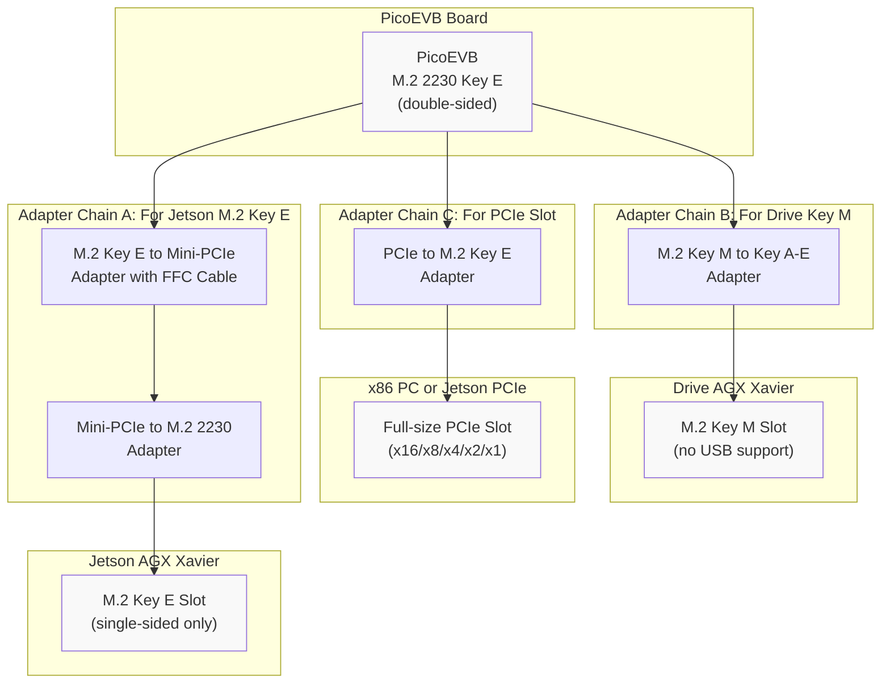
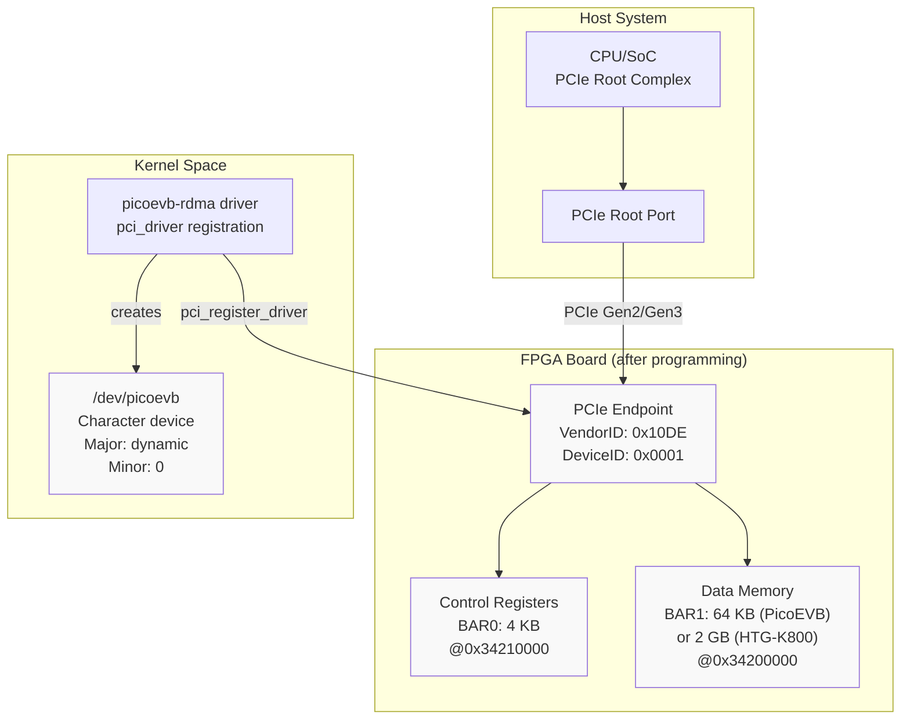

<!-- source: DeepWiki mcp.deepwiki.com · repo NVIDIA/jetson-rdma-picoevb · page 2.1 Hardware Setup · fetched 2026-11-11 -->

# Hardware Setup

<details>
<summary>Relevant source files</summary>

The following files were used as context for generating this wiki page:

- [README.md](README.md)

</details>


This page provides detailed instructions for physically installing and connecting FPGA boards to host systems. It covers mechanical installation, adapter requirements, and connection verification procedures.

For information about software compatibility and build requirements, see [Software Prerequisites](#2.2). For a complete list of supported hardware combinations, see [Hardware Compatibility](#1.2).

---

## FPGA Board Options

The system supports two FPGA development boards with different form factors and capabilities:

| Board | Form Factor | FPGA | RAM | PCIe Interface | Programming Interface |
|-------|-------------|------|-----|----------------|----------------------|
| **PicoEVB** | M.2 2230 Key E (double-sided) | Xilinx Artix-7 | 64 KB | PCIe via M.2 connector | USB via M.2 connector |
| **HTG-K800** | Full-size PCIe x16 card | Xilinx XCKU-60 | 2 GB | PCIe x16 edge connector | JTAG (Xilinx Platform Cable USB II) |

**Sources:** [README.md:19-92]()

### PicoEVB Board

The PicoEVB is a compact M.2 form-factor FPGA board designed for embedded applications. Key characteristics:

- **Form Factor:** M.2 2230 (22mm × 30mm) with Key E notch
- **Double-Sided Design:** Components on both sides of the PCB, requiring special mechanical considerations
- **Dual-Function M.2 Connector:** Carries both PCIe lanes for data transfer and USB signals for FPGA programming
- **LED Indicators:** Three user-controllable LEDs accessible via GPIO registers

**Acquisition:**
- Primary vendor: [picoevb.com](https://picoevb.com)
- Secondary vendor: Amazon (ASIN B0779PC8S4, search "PicoEVB")

**Sources:** [README.md:29-38]()

### HTG-K800 Board

The HTG-K800 is a full-size PCIe development card suitable for high-performance applications. Key characteristics:

- **Form Factor:** Standard PCIe x16 card with edge connector
- **FPGA:** Xilinx Kintex UltraScale XCKU-60 (configurable to other XCKU variants)
- **RAM:** 2 GB onboard memory (vs. 64 KB on PicoEVB)
- **Programming:** Requires external Xilinx Platform Cable USB II connected to JTAG header

**Acquisition:**
- Vendor: HiTech Global
- Product page: http://www.hitechglobal.com/Boards/Kintex-UltraScale.htm

**Sources:** [README.md:75-91]()

---

## Adapter Requirements for PicoEVB

The PicoEVB board's double-sided M.2 design and Key E notch require adapter boards for reliable mechanical connection to most host systems. Different adapter chains are needed depending on the host platform's available connectors.

### Connection Topology Diagram



**Sources:** [README.md:40-73]()

### Adapter Chain A: Jetson AGX Xavier M.2 Key E Connection

Jetson AGX Xavier provides an M.2 Key E slot, but it only supports single-sided M.2 cards. A two-adapter chain is required:

**Adapter 1:** M.2 2230 Key E to Mini-PCIe adapter with FFC cable
- Amazon ASIN B07JFYSNVL: "M.2 (NGFF) Key A/E/A+E to Mini PCI-E Adapter with FFC Cable"
- Alternative ASIN B00JSBPF70: "Bplus: P15S-P15F, M.2 (NGFF) to mPCIe Extender Board"

**Adapter 2:** Mini-PCIe to M.2 2230 adapter
- Amazon ASIN B07D4FCD1K: "HLT M.2 (NGFF) to mPCIe (PCIe+USB) Adapter"

**Signal Path:** PicoEVB → Adapter 2 → Mini-PCIe cable → Adapter 1 → Jetson M.2 slot

This chain provides both PCIe data lanes and USB programming signals.

**Sources:** [README.md:52-61]()

### Adapter Chain B: Drive AGX Xavier M.2 Key M Connection

Drive AGX Xavier provides an M.2 Key M slot (typically used for NVMe SSDs). A key converter adapter is required:

**Adapter:** M.2 Key M to Key A-E interface adapter
- Available from AliExpress
- Product description: "M.2 Wifi Adapter M.2 M Key to A+E Key Slot"

**Important Limitation:** Drive AGX Xavier's M.2 Key M slot does **not** provide USB signals. The PicoEVB board must be programmed on a different system (Jetson or x86 PC) before connection to Drive AGX Xavier.

**Signal Path:** PicoEVB → Key M-to-A-E adapter → Drive M.2 slot (PCIe only)

**Sources:** [README.md:63-69](), [README.md:117-120]()

### Adapter Chain C: PCIe Slot Connection

For systems with full-size PCIe slots (x86 PCs or Jetson's PCIe connector), a single adapter is sufficient:

**Adapter:** PCIe x16/x8/x4/x2/x1 to M.2 Key E adapter
- Amazon ASIN B013U4401W: "Sourcingbay M.2(NGFF) Wireless Card to PCI-e 1X Adapter"

**Signal Path:** PicoEVB → PCIe-to-M.2 adapter → PCIe slot

This provides both PCIe data lanes and USB programming signals (if the PCIe slot's USB pins are wired).

**Sources:** [README.md:47-50]()

### Adapter Availability Note

Adapter availability varies significantly over time and by region. The specific ASINs and product names listed above may become unavailable. When searching for alternatives, look for:
- M.2 Key E compatibility
- Support for both PCIe and USB signals (if programming support is needed)
- Mechanical stability for double-sided M.2 devices

**Sources:** [README.md:71-73]()

---

## HTG-K800 Installation

The HTG-K800 requires no adapters and installs directly into standard PCIe slots.

### Physical Installation

1. **Power down** the host system completely
2. **Open the chassis** and locate an available PCIe x16, x8, or x4 slot
3. **Remove the slot cover** corresponding to the chosen PCIe slot
4. **Insert the HTG-K800** into the PCIe slot, applying even pressure until the edge connector is fully seated
5. **Secure the bracket** using the chassis screw
6. **Connect the JTAG cable** (Xilinx Platform Cable USB II) to the JTAG header on the HTG-K800
7. **Close the chassis** and power on the system

### JTAG Programmer Requirement

The HTG-K800 requires the Xilinx Platform Cable USB II for FPGA programming:
- Product page: https://www.xilinx.com/products/boards-and-kits/hw-usb-ii-g.html
- Connection: USB to JTAG header on HTG-K800 board

**Sources:** [README.md:75-91]()

---

## Physical Installation Procedures

### Pre-Installation Checklist

Before beginning physical installation:

- [ ] FPGA board acquired (PicoEVB or HTG-K800)
- [ ] Appropriate adapters acquired (if using PicoEVB)
- [ ] Host system powered down and unplugged
- [ ] Anti-static precautions taken (ESD wrist strap recommended)
- [ ] Workspace cleared and well-lit

### Installing PicoEVB on Jetson AGX Xavier

**Required Components:**
- PicoEVB board
- M.2 Key E to Mini-PCIe adapter with FFC cable
- Mini-PCIe to M.2 2230 adapter

**Procedure:**

1. **Power down** Jetson AGX Xavier completely and unplug power supply
2. **Remove the carrier board cover** to access the M.2 Key E slot
3. **Assemble the adapter chain:**
   - Insert PicoEVB into the Mini-PCIe to M.2 adapter (Adapter 2)
   - Connect the FFC cable between Adapter 2 and the M.2 to Mini-PCIe adapter (Adapter 1)
   - Ensure the FFC cable is properly oriented (contacts facing correct direction)
4. **Insert Adapter 1** into Jetson's M.2 Key E slot at approximately 30-degree angle
5. **Press down** Adapter 1 until it lies flat against the carrier board
6. **Secure with mounting screw** (if provided with adapter)
7. **Verify mechanical stability** - the adapter chain should not flex or move
8. **Replace the carrier board cover**
9. **Reconnect power** and boot Jetson

**Sources:** [README.md:42-61]()

### Installing PicoEVB on Drive AGX Xavier

**Required Components:**
- PicoEVB board (pre-programmed with FPGA bitstream)
- M.2 Key M to Key A-E adapter

**Critical Note:** Program the PicoEVB on Jetson or x86 PC **before** installation on Drive AGX Xavier, as the Drive's M.2 slot does not provide USB signals for programming.

**Procedure:**

1. **Power down** Drive AGX Xavier completely and unplug power supply
2. **Access the M.2 Key M slot** (typically used for NVMe SSD)
3. **Insert PicoEVB** into the M.2 Key M to Key A-E adapter
4. **Insert the adapter** into Drive's M.2 Key M slot at approximately 30-degree angle
5. **Press down** until the adapter lies flat
6. **Secure with mounting screw** (if slot provides one)
7. **Reconnect power** and boot Drive AGX Xavier

**Sources:** [README.md:63-69](), [README.md:117-120]()

### Installing PicoEVB on x86 PC

**Required Components:**
- PicoEVB board
- PCIe to M.2 Key E adapter

**Procedure:**

1. **Power down** the PC completely and unplug power cord
2. **Open the chassis** and locate an available PCIe slot (x1, x4, x8, or x16)
3. **Remove the slot cover** for the chosen PCIe slot
4. **Insert PicoEVB** into the PCIe-to-M.2 Key E adapter
5. **Insert the adapter** into the PCIe slot, applying even pressure until fully seated
6. **Secure the adapter bracket** using the chassis screw
7. **Close the chassis**
8. **Reconnect power** and boot the PC

**Sources:** [README.md:42-50]()

### Installing HTG-K800

**Applicable to:** Jetson AGX Xavier (via PCIe connector) or x86 PC

**Procedure:**

1. **Power down** the system completely and unplug power
2. **Open the chassis** and locate an available PCIe x16, x8, or x4 slot
3. **Remove the slot cover** corresponding to the chosen PCIe slot
4. **Align the HTG-K800** with the PCIe slot, ensuring the edge connector is properly oriented
5. **Insert the card** into the PCIe slot with firm, even pressure until the edge connector is fully seated and the bracket aligns with the chassis
6. **Secure the bracket** using the chassis screw
7. **Connect the JTAG cable** (Xilinx Platform Cable USB II) to the 14-pin JTAG header on the HTG-K800
   - Ensure proper pin 1 orientation (consult HTG-K800 documentation)
8. **Route the JTAG cable** through a chassis opening or expansion slot cover
9. **Close the chassis**
10. **Connect the JTAG cable** to your x86 Linux PC running Vivado
11. **Reconnect power** and boot the system

**Sources:** [README.md:75-91]()

---

## Hardware Verification

After physical installation, verify that the FPGA board is correctly detected by the host system.

### PCIe Enumeration Check

After booting the host system, verify PCIe enumeration using `lspci`:

```bash
lspci -v
```

**Expected Output (before driver loading):**

The FPGA board should appear as an unrecognized or generic device. The specific PCIe bus address varies by system.

**Expected Output (after driver loading):**

```
0003:01:00.0 Memory controller: NVIDIA Corporation Device 0001
	Subsystem: NVIDIA Corporation Device 0001
	Flags: bus master, fast devsel, latency 0, IRQ 36
	Memory at 34210000 (32-bit, non-prefetchable) [size=4K]
	Memory at 34200000 (32-bit, non-prefetchable) [size=64K]
	Capabilities: <access denied>
	Kernel driver in use: picoevb-rdma
```

The key indicators of successful detection:
- Device appears at a PCIe bus address (format: `DDDD:BB:DD.F`)
- Two memory regions are mapped (4 KB control registers, 64 KB or 2 GB data memory)
- After module load, `Kernel driver in use: picoevb-rdma` appears

**Sources:** [README.md:265-278]()

### PCIe Detection Failure Troubleshooting

If the FPGA board does not appear in `lspci` output:

1. **Verify physical installation:**
   - Ensure the card/adapter is fully seated in the PCIe slot
   - Check that all adapters in the chain are firmly connected
   - Inspect for bent pins or damaged connectors

2. **Check power and boot sequence:**
   - Some systems require enabling PCIe slots in BIOS/UEFI
   - Verify the system completed POST successfully
   - Try a different PCIe slot if available

3. **Verify FPGA programming:**
   - The FPGA must be programmed with a valid bitstream before PCIe enumeration
   - See [Programming FPGAs](#6.3) for programming instructions

4. **Check PCIe link status:**
   ```bash
   sudo lspci -vvv -s [bus:device.function]
   ```
   Look for `LnkSta:` line indicating link width and speed

**Sources:** [README.md:265-278]()

### PCIe Topology Diagram



**Sources:** [README.md:268-278]()

### Device File Verification

After loading the `picoevb-rdma.ko` kernel module (see [Installation and Module Loading](#7.5)), verify that the device file is created:

```bash
ls -l /dev/picoevb
```

**Expected Output:**
```
crw------- 1 root root 244, 0 [date] [time] /dev/picoevb
```

The device file `/dev/picoevb` is the user-space interface for all RDMA operations. Applications open this file and issue `ioctl()` calls to perform DMA transfers.

**Sources:** [README.md:350]()

### LED Test (PicoEVB Only)

The PicoEVB board includes three user-controllable LEDs that can be used to verify basic hardware communication. After loading the kernel module, test LED control:

```bash
sudo ./set-leds 0  # All LEDs ON (hardware inverts the value)
sudo ./set-leds 7  # All LEDs OFF
sudo ./set-leds 2  # Specific LED pattern
```

The `set-leds` utility writes to GPIO control registers via `PICOEVB_IOC_SET_LEDS` ioctl. Successful LED changes indicate:
- PCIe communication is functional
- Control register (BAR0) mapping is correct
- The kernel driver is operational

**Note:** The hardware inverts the LED values, so a parameter of `0` illuminates all LEDs, and `7` turns them all off.

**Sources:** [README.md:373-383]()

---

## Hardware-Specific Considerations

### PicoEVB Memory Limitation

The PicoEVB board contains only **64 KB** of onboard FPGA memory. This limitation affects DMA transfer operations:

- Large transfers are automatically divided into 64 KB (or smaller) chunks by the kernel driver
- Each chunk requires a two-stage transfer: Host → FPGA → Host (for H2C2H operations)
- The chunking strategy impacts performance but enables testing of GPUDirect RDMA concepts

This limitation does not apply to HTG-K800, which provides 2 GB of memory.

**Sources:** [README.md:352-359]()

### Drive AGX Xavier USB Limitation

The Drive AGX Xavier's M.2 Key M slot does **not** provide USB signals. This has critical implications:

- PicoEVB **cannot be programmed** while connected to Drive AGX Xavier
- The programming workflow requires:
  1. Program PicoEVB on Jetson or x86 PC
  2. Power down the programming system
  3. Remove PicoEVB from the programming system
  4. Install PicoEVB on Drive AGX Xavier
  5. Boot Drive AGX Xavier

**FPGA bitstream persistence:** The PicoEVB retains its programming in flash memory, so it remains programmed across power cycles.

**Sources:** [README.md:117-120]()

### Mechanical Stability

The PicoEVB's double-sided design and adapter chains create mechanical considerations:

- **Ensure secure mounting:** Use all provided mounting screws for adapters
- **Minimize flexing:** The adapter chain should not bend or flex during normal operation
- **Cable routing:** For FFC cable adapters, avoid sharp bends or kinks in the flexible cable
- **Vibration sensitivity:** In mobile or vibration-prone environments, verify that all connections remain secure

HTG-K800's single-piece design provides superior mechanical stability.

---

## Next Steps

After successful hardware installation and verification:

1. **Install software prerequisites:** See [Software Prerequisites](#2.2) for Vivado, CUDA drivers, and development tools
2. **Program the FPGA:** See [Programming FPGAs](#6.3) for bitstream programming instructions
3. **Build and load the kernel module:** See [Building the Kernel Module](#7.2)
4. **Run functional tests:** See [Running Tests](#8.1) to validate the complete system

---

**Sources:** [README.md:1-383]()

---

