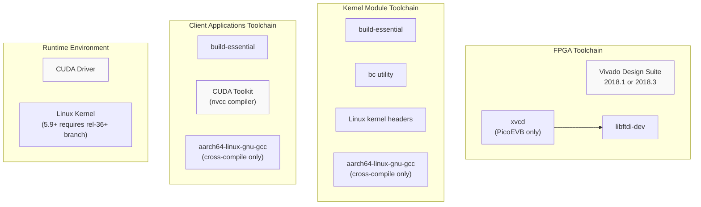
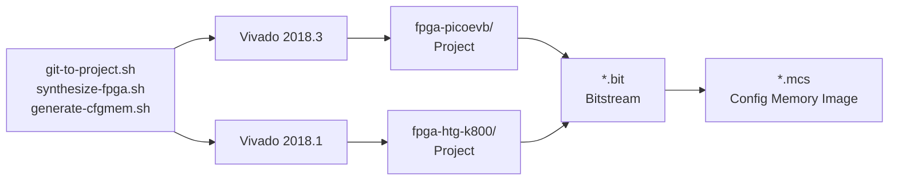
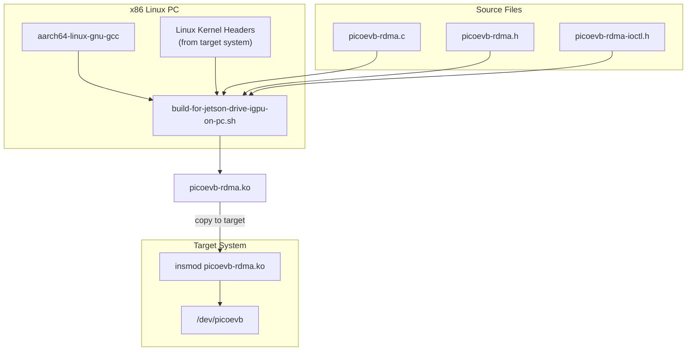
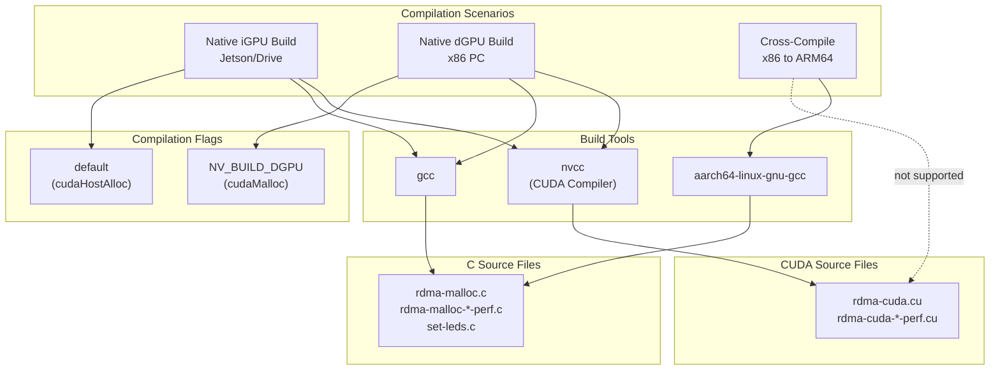

<!-- source: DeepWiki mcp.deepwiki.com · repo NVIDIA/jetson-rdma-picoevb · page 2.2 Software Prerequisites · fetched 2026-11-11 -->

# Software Prerequisites

<details>
<summary>Relevant source files</summary>

The following files were used as context for generating this wiki page:

- [README.md](README.md)

</details>


This page documents all software packages and tools required to build, deploy, and run the jetson-rdma-picoevb system. Requirements are organized by build scenario (native vs cross-compilation) and target platform. For hardware requirements and physical setup, see [Hardware Setup](#2.1). For a quick-start workflow after installing prerequisites, see [Quick Start Guide](#2.3).

## Overview of Software Components

The system requires three distinct toolchains, each with specific dependencies:



**Sources**: [README.md:93-134](), [README.md:211-256](), [README.md:282-321]()

## Platform Requirements Matrix

Different hardware platforms and build scenarios require specific software configurations:

| Platform | Build Location | FPGA Tools | Kernel Build | App Build | Notes |
|----------|---------------|------------|--------------|-----------|-------|
| Jetson AGX Xavier | Native | Optional¹ | build-essential, bc | build-essential, bc, CUDA Toolkit | Integrated GPU (iGPU) |
| Drive AGX Xavier | Native | Not supported² | build-essential, bc | build-essential, bc, CUDA Toolkit | Integrated GPU (iGPU) |
| x86 Linux PC | Native | Vivado, xvcd³ | build-essential, bc | build-essential, bc, CUDA Toolkit | Discrete GPU (dGPU) |
| Jetson/Drive | Cross-compile on x86 | N/A | aarch64 toolchain, kernel headers | aarch64 toolchain⁴ | Target deployment platform |

¹ FPGA programming possible on Jetson via xvcd and network connection to Vivado on x86 PC  
² Drive AGX Xavier's M.2 slot does not support USB; FPGA must be programmed elsewhere  
³ xvcd only required for PicoEVB board; HTG-K800 uses JTAG via Xilinx Platform Cable  
⁴ CUDA application cross-compilation not yet fully supported

**Sources**: [README.md:93-134](), [README.md:211-244](), [README.md:282-321]()

## FPGA Programming Software

### Xilinx Vivado Design Suite

**Required for**: Synthesizing FPGA bitstreams and programming FPGA hardware  
**Platform**: x86 Linux PC only  
**License**: Free WebPACK Edition is sufficient  
**Version requirements**:
- **PicoEVB projects**: Vivado 2018.3
- **HTG-K800 projects**: Vivado 2018.1
- Newer versions can import these projects but may require project migration

**Installation**: Download from [https://www.xilinx.com/](https://www.xilinx.com)



**Sources**: [README.md:93-107](), [README.md:136-161]()

### xvcd (Xilinx Virtual Cable Daemon)

**Required for**: Programming PicoEVB board only (not required for HTG-K800)  
**Platform**: System where PicoEVB is installed (Jetson AGX Xavier or x86 Linux PC)  
**Repository**: [https://github.com/RHSResearchLLC/xvcd](https://github.com/RHSResearchLLC/xvcd)

**Installation steps**:

```bash
sudo apt update
sudo apt install build-essential libftdi-dev
git clone https://github.com/RHSResearchLLC/xvcd.git
cd xvcd/linux/src
make
```

**Note**: Drive AGX Xavier's M.2 slot does not support USB, so PicoEVB cannot be programmed when connected to Drive. Program the board on another system first.

**Network setup**: If running xvcd on Jetson while Vivado runs on x86 PC, use SSH port forwarding:

```bash
ssh -L 2542:127.0.0.1:2542 <jetson_ip_address>
```

**Sources**: [README.md:109-134](), [README.md:165-192]()

## Kernel Module Build Requirements

The kernel module [`picoevb-rdma.ko`] implements the PCIe driver and DMA operations. Build requirements vary by scenario:

### Native Build (Jetson/Drive AGX Xavier)

**Required packages**:
- `build-essential` - GCC compiler, make, and standard build tools
- `bc` - Basic calculator utility used by kernel build system

**Installation**:
```bash
sudo apt update
sudo apt install build-essential bc
```

**Build command**: Execute [`build-for-jetson-drive-igpu-native.sh`] in `kernel-module/` directory

**Sources**: [README.md:211-222]()

### Native Build (x86 Linux PC)

**Required packages**:
- `build-essential`
- `bc`

**Installation**: Same as Jetson native build

**Build command**: Execute [`build-for-pc-native.sh`] in `kernel-module/` directory

**Sources**: [README.md:246-255]()

### Cross-Compilation Build (x86 PC to Jetson/Drive)

**Required packages**:
- `build-essential`
- `bc`
- Cross-compilation toolchain: `aarch64-linux-gnu-gcc`
- Linux kernel headers for target platform

**Kernel headers acquisition**:
- Option 1: Copy from `/usr/src/` on target Jetson/Drive system
- Option 2: Download from NVIDIA L4T/Drive downloads website

**Environment variable**: Set `KDIR` to kernel headers path:

```bash
KDIR=/path/to/linux-headers-4.9.140-tegra-linux_x86_64/kernel-4.9/ \
  ./build-for-jetson-drive-igpu-on-pc.sh
```

**Note**: The generated `picoevb-rdma.ko` must be copied to the target system for deployment.



**Sources**: [README.md:224-244](), [kernel-module/build-for-jetson-drive-igpu-on-pc.sh:1-15]()

## Client Application Build Requirements

Client applications include functional tests ([`rdma-cuda.cu`], [`rdma-malloc.c`]) and performance benchmarks ([`rdma-cuda-c2h-perf.cu`], [`rdma-malloc-h2c-perf.c`], etc.).

### Native Build (Jetson/Drive AGX Xavier)

**Required packages**:
- `build-essential`
- `bc`
- CUDA Toolkit (includes `nvcc` compiler)

**Installation**:
```bash
sudo apt update
sudo apt install build-essential bc
# CUDA Toolkit should be pre-installed on Jetson/Drive systems
```

**Build command**: Execute [`build-for-jetson-drive-igpu-native.sh`] in `client-applications/` directory

**Memory allocation strategy**: On integrated GPU (iGPU) platforms, CUDA applications use `cudaHostAlloc()` for unified memory allocation.

**Sources**: [README.md:282-292]()

### Native Build (x86 Linux PC)

**Required packages**:
- `build-essential`
- `bc`
- CUDA Toolkit (includes `nvcc` compiler for discrete GPU)

**Installation**:
```bash
sudo apt update
sudo apt install build-essential bc
# Install CUDA Toolkit from NVIDIA website
```

**Build command**: Execute [`build-for-pc-native.sh`] in `client-applications/` directory

**Memory allocation strategy**: On discrete GPU (dGPU) platforms, CUDA applications use `cudaMalloc()` for device memory allocation. This behavior is controlled by the `NV_BUILD_DGPU` compilation flag.

**Sources**: [README.md:312-321]()

### Cross-Compilation Build (x86 PC to Jetson/Drive)

**Required packages**:
- `build-essential`
- `bc`
- Cross-compilation toolchain: `aarch64-linux-gnu-gcc`

**Limitation**: CUDA application cross-compilation is **not yet fully supported**. The Makefile can cross-compile non-CUDA applications ([`rdma-malloc.c`], [`set-leds.c`]) but not CUDA applications ([`rdma-cuda.cu`], performance benchmarks).

**Build command**: Execute [`build-for-jetson-drive-igpu-on-pc.sh`] in `client-applications/` directory

**Configuration**: Adjust `CROSS_COMPILE` variable in the build script if needed:

```bash
# Example from build script
CROSS_COMPILE=aarch64-linux-gnu-
```



**Sources**: [README.md:294-310](), [client-applications/build-for-jetson-drive-igpu-on-pc.sh:1-10]()

## Runtime Requirements

### Linux Kernel Version

**Standard operation**: Most kernel versions supported  
**Kernel 5.9+**: Requires `rel-36+` branch of this repository

**Note from codebase**: [README.md:208-209]()

```
## Note:
Please use rel-36+ branch for kernel 5.9+ version.
```

### CUDA Driver

**Required for**: All CUDA-based applications and NVIDIA P2P API integration  
**Platform-specific**:
- **Jetson/Drive AGX Xavier**: Pre-installed with L4T
- **x86 Linux PC**: Must install NVIDIA driver for Quadro/Tesla GPU

**Driver functionality required**:
- CUDA runtime API
- NVIDIA P2P (peer-to-peer) API for GPUDirect RDMA
- Functions used: `nvidia_p2p_get_pages()`, `nvidia_p2p_dma_map_pages()`, `nvidia_p2p_put_pages()`, `nvidia_p2p_free_page_table()`

### Module Loading

After building, the kernel module is loaded with:

```bash
sudo insmod ./picoevb-rdma.ko
```

**Verification**: Use `lspci -v` to confirm the driver is loaded:

```
0003:01:00.0 Memory controller: NVIDIA Corporation Device 0001
    ...
    Kernel driver in use: picoevb-rdma
```

**Device file**: Module creates `/dev/picoevb` character device for user-space communication.

**Sources**: [README.md:257-278]()

## Software Version Summary

| Component | Version/Requirement | Platform | Notes |
|-----------|-------------------|----------|-------|
| Vivado | 2018.3 | x86 Linux | PicoEVB projects |
| Vivado | 2018.1 | x86 Linux | HTG-K800 projects |
| xvcd | Latest from GitHub | Jetson/x86 Linux | PicoEVB only |
| libftdi-dev | System package | Jetson/x86 Linux | xvcd dependency |
| build-essential | System package | All platforms | GCC, make, etc. |
| bc | System package | All platforms | Kernel build utility |
| CUDA Toolkit | L4T version / Latest | Jetson/Drive / x86 PC | Includes nvcc compiler |
| CUDA Driver | L4T version / Latest | Jetson/Drive / x86 PC | Runtime requirement |
| Linux Kernel | 5.9+ requires rel-36+ | All platforms | Branch selection |
| aarch64-linux-gnu-gcc | System package | x86 Linux | Cross-compilation only |
| Kernel Headers | Match target kernel | x86 Linux | Cross-compilation only |

**Sources**: [README.md:93-321]()

## Build Script Reference

The repository provides platform-specific build scripts:

**Kernel Module**:
- [`kernel-module/build-for-jetson-drive-igpu-native.sh`]() - Native ARM64 build
- [`kernel-module/build-for-jetson-drive-igpu-on-pc.sh`]() - Cross-compile from x86
- [`kernel-module/build-for-pc-native.sh`]() - Native x86 build

**Client Applications**:
- [`client-applications/build-for-jetson-drive-igpu-native.sh`]() - Native ARM64 build
- [`client-applications/build-for-jetson-drive-igpu-on-pc.sh`]() - Cross-compile from x86 (partial)
- [`client-applications/build-for-pc-native.sh`]() - Native x86 build

**FPGA Build**:
- [`fpga-picoevb/git-to-project.sh`]() - Generate Vivado project
- [`fpga-picoevb/synthesize-fpga.sh`]() - Run synthesis and implementation
- [`fpga-picoevb/generate-cfgmem.sh`]() - Generate configuration memory image
- [`fpga-htg-k800/git-to-project.sh`]() - Generate Vivado project (HTG-K800)
- [`fpga-htg-k800/synthesize-fpga.sh`]() - Run synthesis (HTG-K800)

Each script sets appropriate compiler flags and paths for its target platform.

**Sources**: [README.md:136-161](), [README.md:211-255](), [README.md:282-321]()

---

