# Page: Overview

# Overview

<details>
<summary>Relevant source files</summary>

The following files were used as context for generating this wiki page:

- [README.md](README.md)
- [kernel-module/picoevb-rdma.c](kernel-module/picoevb-rdma.c)

</details>


## Purpose and Scope

This document provides an introduction to the **jetson-rdma-picoevb** system, a hardware-based demonstration of NVIDIA GPUDirect RDMA technology. The system enables PCIe devices to directly access GPU memory, allowing zero-copy data transfer between CUDA-capable GPUs and FPGA hardware without CPU involvement.

This overview covers the system's purpose, architecture, major components, and supported hardware platforms. For detailed setup instructions, see [Getting Started](#2). For in-depth architectural concepts, see [System Architecture](#3). For component-specific documentation, see [Kernel Module](#4), [Client Applications](#5), and [FPGA Development](#6).

**Sources:** [README.md:1-15]()

## System Purpose

The jetson-rdma-picoevb system demonstrates **GPUDirect RDMA** (Remote Direct Memory Access), a technology that allows PCIe devices to read from and write to GPU memory directly without staging data through system memory or requiring CPU involvement. This enables:

- **Zero-copy data transfer** between GPU and PCIe devices
- **Reduced CPU overhead** by eliminating memory copy operations
- **Lower latency** by avoiding round-trips through system memory
- **Higher bandwidth utilization** through direct PCIe-to-GPU paths

The system uses FPGA boards as the PCIe device that performs DMA operations against CUDA-allocated memory. This serves as a reference implementation for developers building production systems that require high-performance GPU-to-hardware communication.

**Platform Support:**
- NVIDIA Jetson AGX Xavier (ARM64 with integrated GPU)
- NVIDIA Drive AGX Xavier (ARM64 with integrated GPU)
- x86 Linux PCs with Quadro or Tesla GPUs (discrete GPU)

**Sources:** [README.md:1-10](), [kernel-module/picoevb-rdma.c:26-32]()

## High-Level Architecture

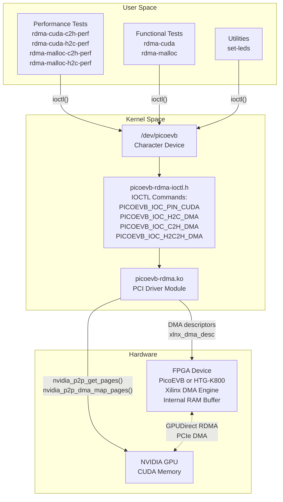

**Sources:** [kernel-module/picoevb-rdma.c:37-72](), [kernel-module/picoevb-rdma-ioctl.h](), [README.md:12-15]()

## Major Components

The system consists of three primary software layers and two hardware components:

### Software Components

| Component | File/Module | Purpose |
|-----------|-------------|---------|
| **Kernel Module** | `picoevb-rdma.ko` | PCI driver that manages FPGA device, orchestrates DMA operations, and integrates with NVIDIA P2P API for GPU memory access |
| **IOCTL Interface** | `picoevb-rdma-ioctl.h` | Defines user-kernel API including data structures (`picoevb_rdma_pin_cuda`, `picoevb_rdma_h2c_dma`, etc.) and command codes |
| **Client Applications** | `rdma-cuda.cu`, `rdma-malloc.c`, performance tests, utilities | User-space applications for testing data integrity and measuring transfer performance |

### Hardware Components

| Component | Specification | Role |
|-----------|--------------|------|
| **FPGA Board** | PicoEVB (64KB RAM, M.2) or HTG-K800 (2GB RAM, PCIe x16) | Acts as PCIe device performing DMA; contains Xilinx DMA engine and internal RAM buffer |
| **GPU** | NVIDIA Jetson/Drive iGPU or Quadro/Tesla dGPU | Target for CUDA memory allocations; supports P2P peer-to-peer access |

**Sources:** [kernel-module/picoevb-rdma.c:51-71](), [README.md:22-82](), [kernel-module/picoevb-rdma-ioctl.h]()

## Data Transfer Patterns

The system implements three DMA transfer patterns, all using the FPGA's internal RAM as an intermediate buffer:

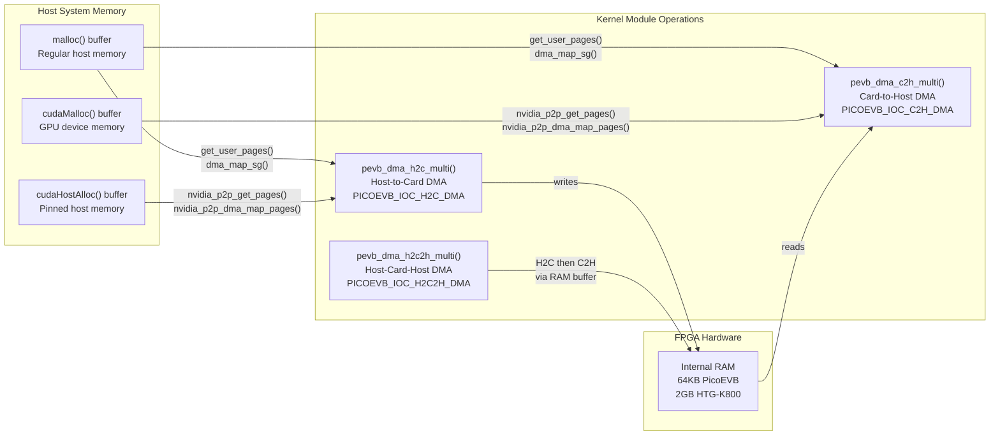

### Transfer Pattern Details

| Pattern | IOCTL Command | Function | Description |
|---------|---------------|----------|-------------|
| **H2C** | `PICOEVB_IOC_H2C_DMA` | `pevb_dma_h2c_multi()` | Host-to-Card: Transfers data from system memory to FPGA RAM |
| **C2H** | `PICOEVB_IOC_C2H_DMA` | `pevb_dma_c2h_multi()` | Card-to-Host: Transfers data from FPGA RAM to system memory |
| **H2C2H** | `PICOEVB_IOC_H2C2H_DMA` | `pevb_dma_h2c2h_multi()` | Host-Card-Host: Copies data from one system memory location to another via FPGA RAM |

The H2C2H pattern is used for functional validation tests as it exercises both read and write paths in a single operation. The FPGA RAM size determines the maximum chunk size for each DMA operation: 64KB for PicoEVB, 2GB for HTG-K800.

**Sources:** [kernel-module/picoevb-rdma.c:679-908](), [kernel-module/picoevb-rdma-ioctl.h](), [README.md:352-359]()

## Kernel Module Architecture

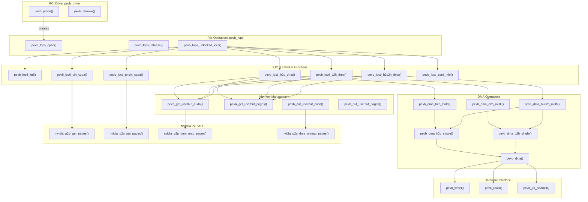

The kernel module `picoevb-rdma.ko` is implemented as a PCI driver registered via `pevb_driver`. Upon device probe, it creates a character device at `/dev/picoevb` and sets up the `pevb_fops` file operations structure. The module handles IOCTL commands to pin CUDA memory (via `nvidia_p2p_get_pages()`), map it for DMA (via `nvidia_p2p_dma_map_pages()`), and execute DMA transfers using Xilinx DMA engine registers.

**Sources:** [kernel-module/picoevb-rdma.c:137-1312](), [kernel-module/picoevb-rdma.c:1131-1136](), [kernel-module/picoevb-rdma.c:1273-1279]()

## Supported Hardware

### FPGA Boards

| Board | Form Factor | FPGA | RAM Size | Programming | Vivado Version |
|-------|-------------|------|----------|-------------|----------------|
| **PicoEVB** | M.2 (requires adapter for Jetson/PC) | Xilinx Artix-7 | 64 KB | USB via xvcd | 2018.3 |
| **HTG-K800** | PCIe x16 card | Xilinx XCKU-60 Kintex UltraScale | 2 GB | JTAG via Xilinx Platform Cable | 2018.1 |

### Host Platforms

| Platform | Architecture | GPU Type | Memory Allocation | Build Script |
|----------|--------------|----------|-------------------|--------------|
| **Jetson AGX Xavier** | ARM64 | Integrated GPU (iGPU) | `cudaHostAlloc()` - unified memory | `build-for-jetson-drive-igpu-native.sh` |
| **Drive AGX Xavier** | ARM64 | Integrated GPU (iGPU) | `cudaHostAlloc()` - unified memory | `build-for-jetson-drive-igpu-native.sh` |
| **x86 Linux PC** | x86_64 | Discrete GPU (dGPU) - Quadro/Tesla | `cudaMalloc()` - device memory | `build-for-pc-native.sh` |

The key architectural difference between platforms is the GPU memory model:
- **Integrated GPUs (iGPU):** Use unified memory accessible by both CPU and GPU; applications use `cudaHostAlloc()` to allocate pinned host memory
- **Discrete GPUs (dGPU):** Use separate device memory; applications use `cudaMalloc()` to allocate GPU memory, controlled by `NV_BUILD_DGPU` compile flag

**Sources:** [README.md:22-92](), [kernel-module/picoevb-rdma.c:42-49](), [kernel-module/picoevb-rdma.c:1248-1256]()

## Client Application Suite

The system includes several user-space applications for testing and benchmarking:

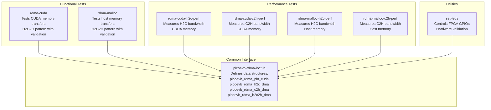

**Application Descriptions:**

- **rdma-cuda / rdma-malloc:** Functional tests that perform H2C2H transfers to validate data integrity. They fill source memory with a pattern, execute the transfer, and verify the destination matches.

- **rdma-cuda-*-perf / rdma-malloc-*-perf:** Performance benchmarks that measure unidirectional H2C or C2H bandwidth. They report transfer time and throughput in MB/s.

- **set-leds:** Hardware control utility that sets GPIO values controlling LEDs on the PicoEVB board for basic hardware validation.

All applications communicate with the kernel module through `ioctl()` calls on `/dev/picoevb`, using data structures defined in `picoevb-rdma-ioctl.h`.

**Sources:** [README.md:325-383](), [client-applications/]()

## Memory Management Model

The kernel module handles two distinct memory types through a unified interface (`pevb_userbuf`):

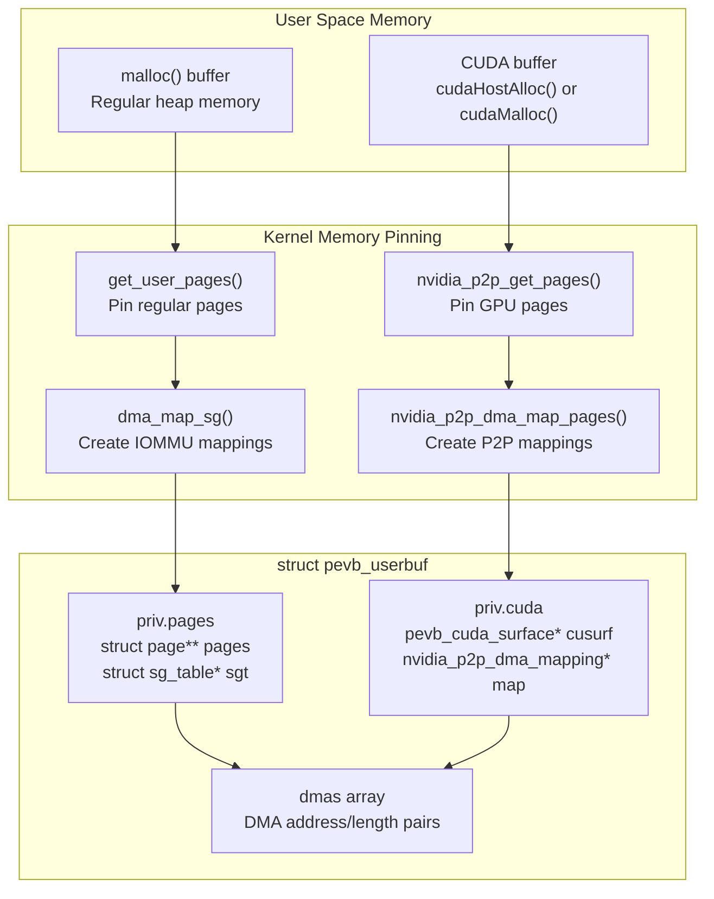

**Memory Handling Functions:**

| Memory Type | Pin Function | Unpin Function | Key Operations |
|-------------|--------------|----------------|----------------|
| **Regular (malloc)** | `pevb_get_userbuf_pages()` | `pevb_put_userbuf_pages()` | `get_user_pages()`, `sg_alloc_table_from_pages()`, `dma_map_sg()` |
| **CUDA (GPU)** | `pevb_get_userbuf_cuda()` | `pevb_put_userbuf_cuda()` | `nvidia_p2p_get_pages()`, `nvidia_p2p_dma_map_pages()` |

Both paths populate a `pevb_userbuf` structure containing an array of DMA address/length pairs (`pevb_userbuf_dma`), which are then used to construct Xilinx DMA descriptors (`xlnx_dma_desc`). The module handles transfer chunking when memory is not contiguous or when FPGA RAM size limits apply.

**Sources:** [kernel-module/picoevb-rdma.c:90-117](), [kernel-module/picoevb-rdma.c:356-527](), [kernel-module/picoevb-rdma.h]()

## Next Steps

- **To set up the system:** See [Getting Started](#2) for hardware setup, software installation, and quick start instructions
- **To understand DMA operations:** See [System Architecture](#3) for RDMA fundamentals and data flow details
- **To develop with the kernel module:** See [Kernel Module](#4) for API reference and implementation details
- **To build and run tests:** See [Client Applications](#5) and [Building and Deployment](#7)
- **To modify FPGA bitstreams:** See [FPGA Development](#6) for Vivado project structure and synthesis procedures

**Sources:** [README.md:1-384]()

---

# Page: System Components

# System Components

<details>
<summary>Relevant source files</summary>

The following files were used as context for generating this wiki page:

- [README.md](README.md)
- [kernel-module/picoevb-rdma.c](kernel-module/picoevb-rdma.c)

</details>


This page enumerates the major components of the jetson-rdma-picoevb system and explains their roles and interactions. The system consists of three primary layers: a kernel-space driver module, user-space client applications, and FPGA hardware. These components work together to enable GPUDirect RDMA transfers between GPU memory and FPGA devices.

For hardware compatibility details and platform-specific requirements, see [Hardware Compatibility](#1.2). For architectural concepts and data flow patterns, see [System Architecture](#3).

---

## Component Architecture Overview

The following diagram shows the major components and their relationships:

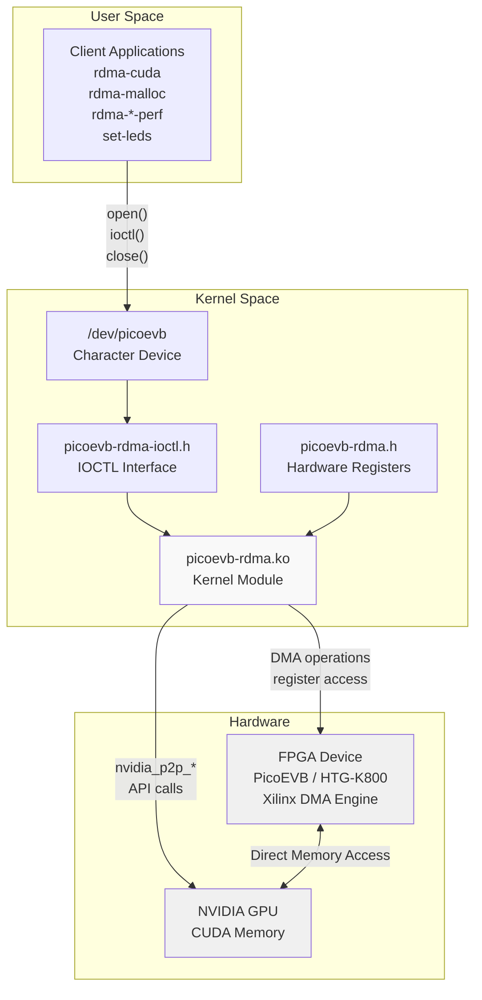

**Sources:** [kernel-module/picoevb-rdma.c](), [kernel-module/picoevb-rdma-ioctl.h](), [README.md]()

---

## Kernel Module

### Overview

The `picoevb-rdma.ko` kernel module is the central component that orchestrates all system operations. It implements a PCI driver registered as `pevb_driver` and creates a character device at `/dev/picoevb`.

| Property | Value |
|----------|-------|
| Module Name | `picoevb-rdma` |
| Source File | `kernel-module/picoevb-rdma.c` |
| Device Node | `/dev/picoevb` |
| Driver Structure | `pevb_driver` |
| Device Class | `picoevb` |

### Core Responsibilities

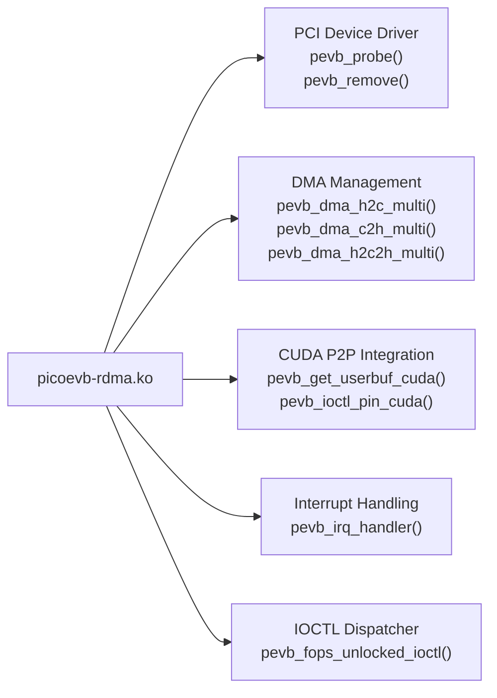

1. **PCI Driver**: Manages the FPGA device lifecycle, including device discovery, resource allocation, and cleanup [kernel-module/picoevb-rdma.c:1138-1242]()

2. **DMA Orchestration**: Coordinates data transfers through the Xilinx DMA engine, handling descriptor creation and transfer chunking [kernel-module/picoevb-rdma.c:570-908]()

3. **CUDA P2P Bridge**: Interfaces with NVIDIA's P2P API to pin and map GPU memory for DMA access [kernel-module/picoevb-rdma.c:228-332]()

4. **Memory Management**: Handles both regular host memory (`get_user_pages()`) and CUDA memory (`nvidia_p2p_get_pages()`) [kernel-module/picoevb-rdma.c:417-527]()

5. **Interrupt Processing**: Services completion interrupts from the DMA engine [kernel-module/picoevb-rdma.c:529-568]()

### Key Data Structures

| Structure | Purpose | Location |
|-----------|---------|----------|
| `struct pevb` | Per-device state | [kernel-module/picoevb-rdma.c:56-71]() |
| `struct pevb_file` | Per-file descriptor state | [kernel-module/picoevb-rdma.c:73-77]() |
| `struct pevb_userbuf` | User buffer mapping information | [kernel-module/picoevb-rdma.c:95-117]() |
| `struct pevb_cuda_surface` | CUDA memory surface tracking | [kernel-module/picoevb-rdma.c:80-88]() |

**Sources:** [kernel-module/picoevb-rdma.c]()

---

## IOCTL Interface

The user-kernel interface is defined through IOCTL commands in `picoevb-rdma-ioctl.h`. This header file is shared between kernel and user space, providing the API contract.

### IOCTL Commands

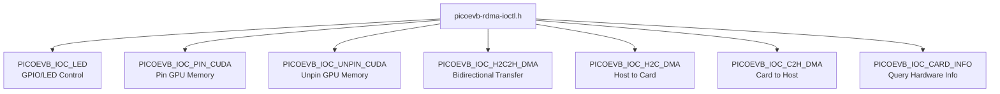

### Data Structures

| Structure | IOCTL Command | Purpose |
|-----------|---------------|---------|
| `struct picoevb_rdma_pin_cuda` | `PICOEVB_IOC_PIN_CUDA` | Pin CUDA memory for DMA |
| `struct picoevb_rdma_unpin_cuda` | `PICOEVB_IOC_UNPIN_CUDA` | Unpin CUDA memory |
| `struct picoevb_rdma_h2c2h_dma` | `PICOEVB_IOC_H2C2H_DMA` | Bidirectional DMA parameters |
| `struct picoevb_rdma_h2c_dma` | `PICOEVB_IOC_H2C_DMA` | Host-to-card DMA parameters |
| `struct picoevb_rdma_c2h_dma` | `PICOEVB_IOC_C2H_DMA` | Card-to-host DMA parameters |
| `struct picoevb_rdma_card_info` | `PICOEVB_IOC_CARD_INFO` | Hardware information response |

The kernel module processes these commands through `pevb_fops_unlocked_ioctl()` [kernel-module/picoevb-rdma.c:1104-1129]().

**Sources:** [kernel-module/picoevb-rdma-ioctl.h](), [kernel-module/picoevb-rdma.c:1104-1129]()

---

## Client Applications

The user-space client applications demonstrate and benchmark the RDMA capabilities. They are organized into three categories:

### Application Suite Structure

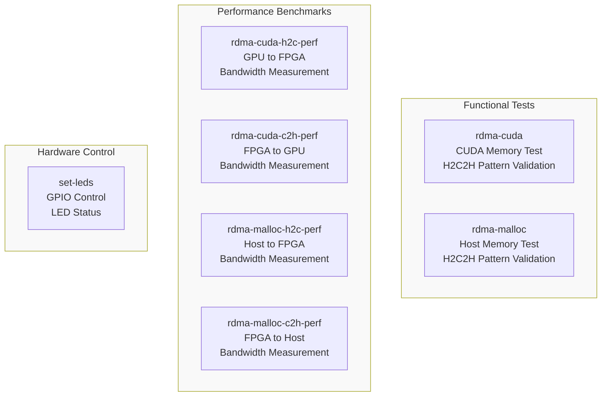

### Functional Tests

**`rdma-cuda`**: Tests CUDA memory transfers with data integrity validation
- Allocates memory using `cudaHostAlloc()` (iGPU) or `cudaMalloc()` (dGPU)
- Performs H2C2H transfer through FPGA RAM
- Validates data patterns to ensure correctness
- Source: [client-applications/rdma-cuda.cu]()

**`rdma-malloc`**: Tests regular host memory transfers
- Allocates memory using `malloc()`
- Performs H2C2H transfer through FPGA RAM
- Validates data patterns
- Source: [client-applications/rdma-malloc.c]()

### Performance Benchmarks

The performance test applications measure unidirectional transfer bandwidth:

| Application | Direction | Memory Type | Metrics Reported |
|-------------|-----------|-------------|------------------|
| `rdma-cuda-h2c-perf` | Host → Card | GPU | MB/s throughput |
| `rdma-cuda-c2h-perf` | Card → Host | GPU | MB/s throughput |
| `rdma-malloc-h2c-perf` | Host → Card | Host | MB/s throughput |
| `rdma-malloc-c2h-perf` | Card → Host | Host | MB/s throughput |

Sources: [client-applications/rdma-cuda-c2h-perf.cu](), [client-applications/rdma-cuda-h2c-perf.cu](), [client-applications/rdma-malloc-c2h-perf.c](), [client-applications/rdma-malloc-h2c-perf.c]()

### Hardware Control Utilities

**`set-leds`**: Controls GPIO LEDs on the FPGA board
- Accepts a command-line parameter (0-7)
- Writes directly to GPIO registers
- Used for basic hardware validation
- Source: [client-applications/set-leds.c]()

**Sources:** [client-applications/rdma-cuda.cu](), [client-applications/rdma-malloc.c](), [client-applications/rdma-cuda-c2h-perf.cu](), [client-applications/set-leds.c]()

---

## FPGA Hardware

The system supports two FPGA boards with different capabilities:

### Supported Boards

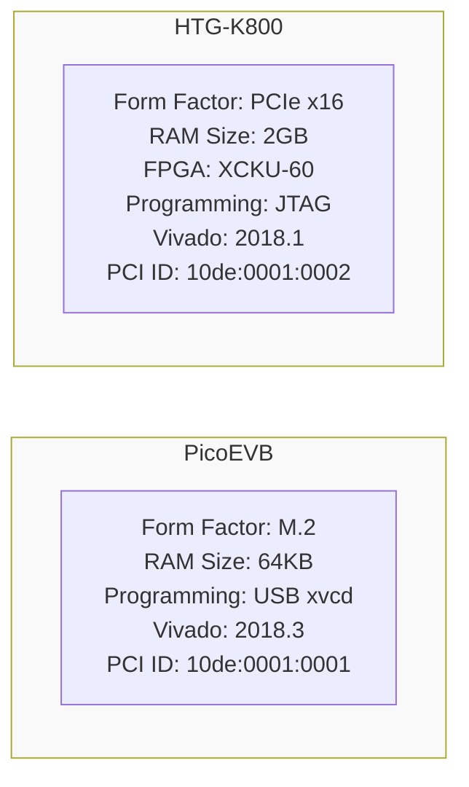

### Hardware Capabilities

| Feature | PicoEVB | HTG-K800 |
|---------|---------|----------|
| FPGA RAM | 64KB | 2GB |
| Max Single Transfer | 64KB | Limited by DMA descriptor (28 bits word-aligned) |
| DMA Channels | 1 H2C, 1 C2H | 1 H2C, 1 C2H |
| BAR 0 (GPIO) | 4KB | 4KB |
| BAR 1 (DMA) | 64KB | 64KB |
| Driver Data | `drvdata_picoevb` | `drvdata_htg_k800` |

The kernel module identifies each board by PCI subsystem device ID and loads appropriate driver data [kernel-module/picoevb-rdma.c:1248-1269]().

### Xilinx DMA Engine

Both boards use a Xilinx scatter-gather DMA engine. The hardware interface is defined in `picoevb-rdma.h`:

**Key Register Blocks:**
- H2C (Host-to-Card) control and status registers
- C2H (Card-to-Host) control and status registers
- SGDMA descriptor management registers
- IRQ control and status registers

**DMA Descriptor Structure:** `struct xlnx_dma_desc` contains source address, destination address, length, and control flags [kernel-module/picoevb-rdma.h]().

**Sources:** [kernel-module/picoevb-rdma.c:1248-1269](), [kernel-module/picoevb-rdma.h](), [README.md:19-92]()

---

## Component Interaction Flow

### Typical Application Flow

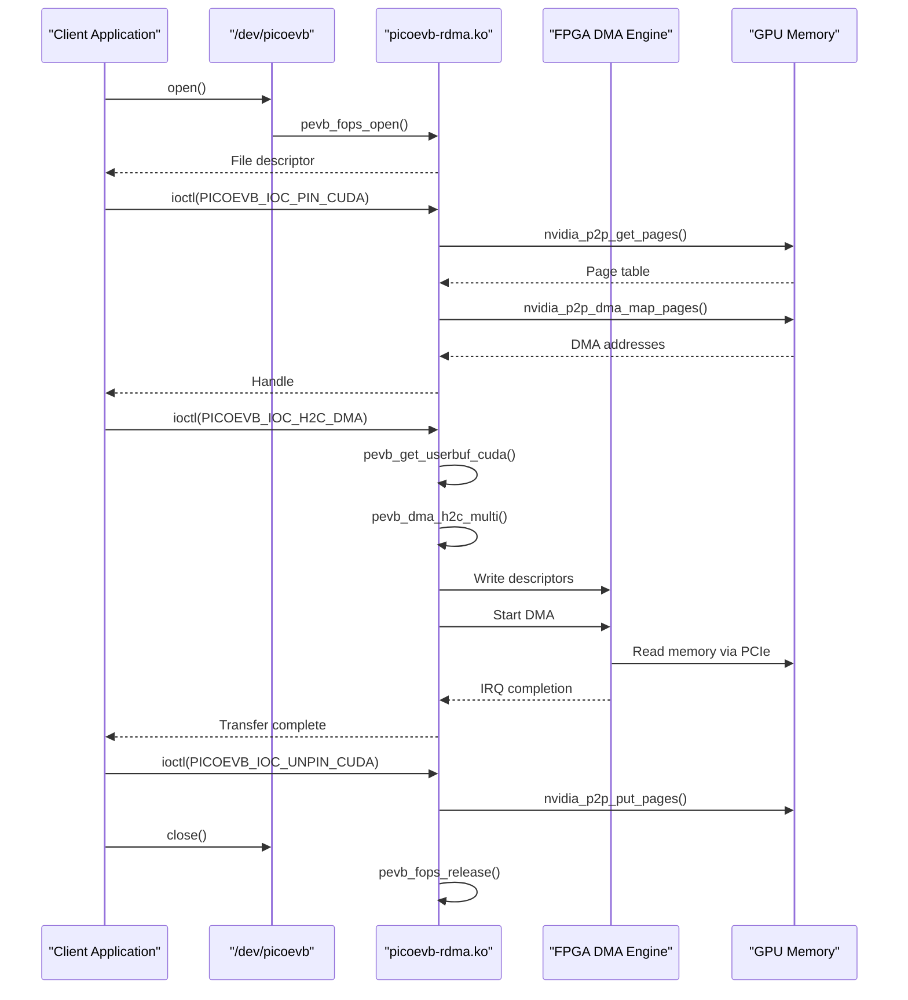

### Memory Handling Paths

The kernel module supports two distinct memory paths:

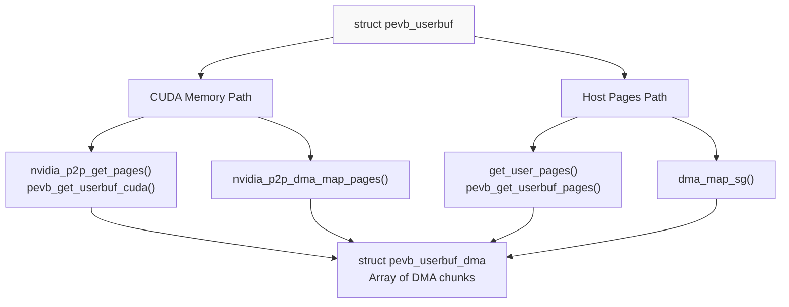

Both paths converge to produce an array of DMA-mappable memory chunks (`struct pevb_userbuf_dma`) that the DMA engine can transfer [kernel-module/picoevb-rdma.c:90-117]().

**Sources:** [kernel-module/picoevb-rdma.c:137-217](), [kernel-module/picoevb-rdma.c:356-527](), [kernel-module/picoevb-rdma.c:729-908]()

---

## Build System Components

The repository includes platform-specific build scripts for all components:

### Kernel Module Build Scripts

| Script | Target Platform | Compilation Mode |
|--------|----------------|------------------|
| `build-for-jetson-drive-igpu-native.sh` | Jetson/Drive AGX Xavier | Native |
| `build-for-jetson-drive-igpu-on-pc.sh` | Jetson/Drive AGX Xavier | Cross-compile from x86 |
| `build-for-pc-native.sh` | x86 PC with dGPU | Native |

Location: [kernel-module/]()

### Client Application Build Scripts

| Script | Target Platform | CUDA Support |
|--------|----------------|--------------|
| `build-for-jetson-drive-igpu-native.sh` | Jetson/Drive AGX Xavier | `cudaHostAlloc()` unified memory |
| `build-for-jetson-drive-igpu-on-pc.sh` | Jetson/Drive AGX Xavier | Cross-compile (CUDA tests excluded) |
| `build-for-pc-native.sh` | x86 PC with dGPU | `cudaMalloc()` device memory |

Location: [client-applications/]()

The Makefile handles mixed compilation of `.cu` (CUDA) and `.c` (standard C) sources [client-applications/Makefile]().

### FPGA Build Scripts

| Script | Purpose |
|--------|---------|
| `git-to-project.sh` | Generate Vivado project from version control |
| `synthesize-fpga.sh` | Synthesize and implement FPGA design |
| `generate-cfgmem.sh` | Create configuration memory image |
| `program-fpga.sh` | Program FPGA via JTAG or xvcd |

Location: [fpga-picoevb/](), [fpga-htg-k800/]()

**Sources:** [kernel-module/build-for-jetson-drive-igpu-native.sh](), [client-applications/Makefile](), [fpga-picoevb/git-to-project.sh]()

---

## Summary

The jetson-rdma-picoevb system comprises three tightly integrated layers:

1. **Kernel Module** (`picoevb-rdma.ko`): The central orchestrator managing PCI operations, DMA transfers, CUDA P2P integration, and interrupt handling

2. **User Applications**: Functional tests, performance benchmarks, and utilities that exercise the kernel interface through IOCTL commands

3. **FPGA Hardware**: PicoEVB or HTG-K800 boards containing Xilinx DMA engines that perform direct memory access to GPU memory

These components communicate through well-defined interfaces: the IOCTL API (`picoevb-rdma-ioctl.h`) for user-kernel interaction, and the hardware register interface (`picoevb-rdma.h`) for kernel-hardware interaction. The system demonstrates GPUDirect RDMA by enabling zero-copy data transfers between CUDA memory and FPGA devices.

**Sources:** [kernel-module/picoevb-rdma.c](), [kernel-module/picoevb-rdma-ioctl.h](), [kernel-module/picoevb-rdma.h](), [README.md]()

---

# Page: Hardware Compatibility

# Hardware Compatibility

<details>
<summary>Relevant source files</summary>

The following files were used as context for generating this wiki page:

- [README.md](README.md)

</details>


This page documents the hardware components supported by the jetson-rdma-picoevb system, including FPGA boards, host platforms, and required adapters. It provides technical specifications and connection requirements for each supported configuration.

For information about software build configurations for different platforms, see [Build System Overview](#7.1). For FPGA programming procedures, see [Programming FPGAs](#6.3). For detailed setup instructions, see [Hardware Setup](#2.1).

---

## Supported FPGA Boards

The system supports two FPGA boards with distinct characteristics and use cases:

### FPGA Board Specifications

| Specification | PicoEVB | HTG-K800 |
|--------------|---------|----------|
| **Form Factor** | M.2 2230 (double-sided) | PCIe x16 Card |
| **FPGA** | Xilinx Artix-7 | Xilinx Kintex UltraScale XCKU-60 |
| **Onboard RAM** | 64 KB | 2 GB |
| **PCIe Interface** | Via M.2 connector | Direct PCIe x16 |
| **Programming Interface** | USB (via M.2 connector) | JTAG (Xilinx Platform Cable USB II) |
| **Vivado Version** | 2018.3 | 2018.1 |
| **Project Directory** | `fpga-picoevb/` | `fpga-htg-k800/` |
| **Bitstream File** | `fpga-picoevb/*.mcs.bz2` | `fpga-htg-k800/*.mcs.bz2` |

**Sources:** [README.md:23-26](), [README.md:29-92](), [README.md:103-106]()

---

### PicoEVB Board

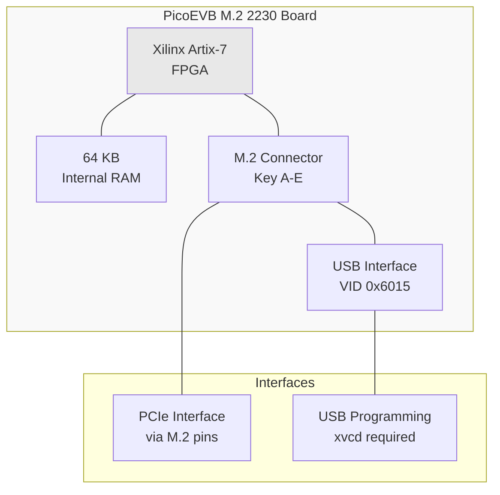

**PicoEVB Characteristics:**
- **Vendor:** RHS Research LLC
- **Availability:** picoevb.com, Amazon (ASIN B0779PC8S4)
- **Physical Size:** M.2 2230 (22mm x 30mm), double-sided
- **Programming:** Requires `xvcd` daemon for USB-based JTAG
- **USB Product ID:** `0x6015` (for programming)
- **RAM Limitation:** 64 KB constrains DMA transfer chunking strategy
- **Mechanical Note:** Double-sided design requires special adapters for single-sided M.2 slots

**Sources:** [README.md:29-73](), [README.md:109-120](), [README.md:176-178]()

---

### HTG-K800 Board

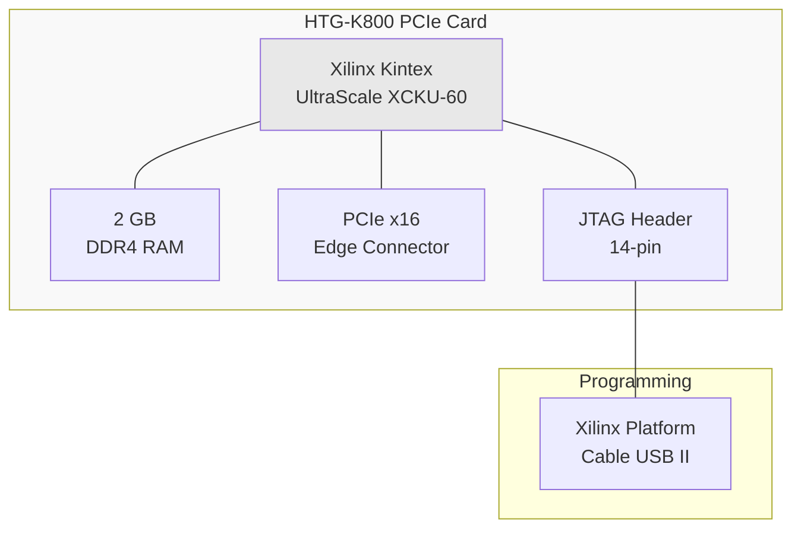

**HTG-K800 Characteristics:**
- **Vendor:** HiTech Global
- **Availability:** hitechglobal.com
- **Physical Size:** Full-height, full-length PCIe card
- **Programming:** Xilinx Platform Cable USB II (HW-USB-II-G)
- **FPGA Support:** XCKU-60 default, easily changed in Vivado project
- **RAM Advantage:** 2 GB allows larger DMA transfers without chunking
- **Mechanical Note:** Fits directly into PCIe x16 slots without adapters

**Sources:** [README.md:75-91](), [README.md:193-205]()

---

## Supported Host Platforms

The system supports three distinct host platform categories, each with specific GPU architectures and memory models:

### Host Platform Specifications

| Platform | Architecture | GPU Type | GPU Memory Model | M.2/PCIe Interface | Build Script Identifier |
|----------|--------------|----------|------------------|-------------------|-------------------------|
| **Jetson AGX Xavier** | ARM64 (aarch64) | iGPU (Integrated) | Unified Memory | M.2 Key E | `jetson-drive-igpu` |
| **Drive AGX Xavier** | ARM64 (aarch64) | iGPU (Integrated) | Unified Memory | M.2 Key M | `jetson-drive-igpu` |
| **x86 Linux PC** | x86_64 | dGPU (Discrete) | Separate Device Memory | PCIe x1/x4/x8/x16 | `pc` |

**Sources:** [README.md:8-10](), [README.md:211-322]()

---

### Platform-Specific Details

#### NVIDIA Jetson AGX Xavier

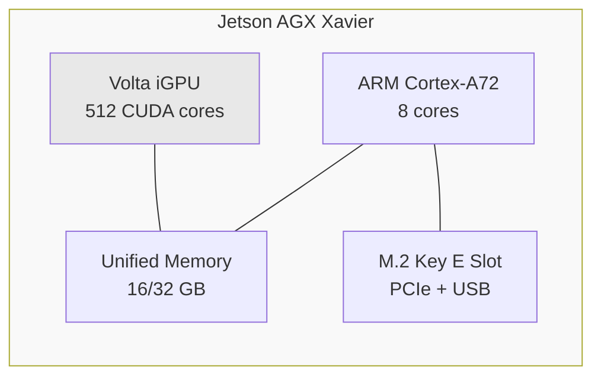

**Jetson Platform Details:**
- **Operating System:** Linux for Tegra (L4T)
- **GPU Architecture:** Integrated (iGPU) - shares system memory
- **CUDA API:** Uses `cudaHostAlloc()` for unified memory allocation
- **M.2 Slot:** Key E, supports PCIe + USB
- **PCI Domain:** Typically `0003:01:00.0` for PCIe devices
- **Build Mode:** Native ARM64 compilation or cross-compilation from x86
- **Kernel Headers:** Located in `/usr/src/` on device
- **USB Support:** Available for PicoEVB programming via xvcd

**Sources:** [README.md:8](), [README.md:211-220](), [README.md:268-278]()

---

#### NVIDIA Drive AGX Xavier

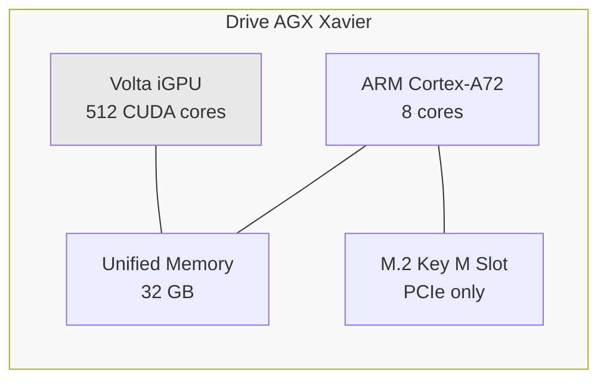

**Drive Platform Details:**
- **Operating System:** Embedded Linux (Drive OS)
- **GPU Architecture:** Integrated (iGPU) - shares system memory
- **CUDA API:** Uses `cudaHostAlloc()` for unified memory allocation
- **M.2 Slot:** Key M, PCIe only (no USB)
- **Programming Limitation:** Cannot program PicoEVB while connected (no USB)
- **Workaround:** Program PicoEVB on separate system, then connect to Drive
- **Build Mode:** Native ARM64 compilation or cross-compilation from x86

**Sources:** [README.md:9](), [README.md:63-69](), [README.md:117-120]()

---

#### x86 Linux PC with Discrete GPU

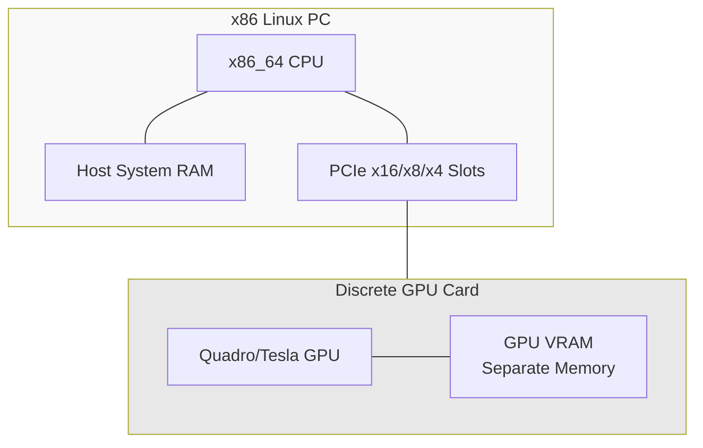

**x86 PC Platform Details:**
- **Operating System:** Standard Linux distribution (Ubuntu, etc.)
- **GPU Architecture:** Discrete (dGPU) - separate GPU memory
- **CUDA API:** Uses `cudaMalloc()` for device memory allocation
- **Compilation Flag:** `NV_BUILD_DGPU` defined during build
- **PCIe Slots:** Multiple slots available for FPGA and GPU cards
- **GPU Types:** NVIDIA Quadro or Tesla required for P2P support
- **Build Mode:** Native x86_64 compilation
- **USB Support:** Available for PicoEVB programming via xvcd

**Sources:** [README.md:10](), [README.md:246-255](), [README.md:312-321]()

---

## Physical Connection Requirements

Different host platforms require different adapter configurations to connect FPGA boards:

### Connection Topology Diagram

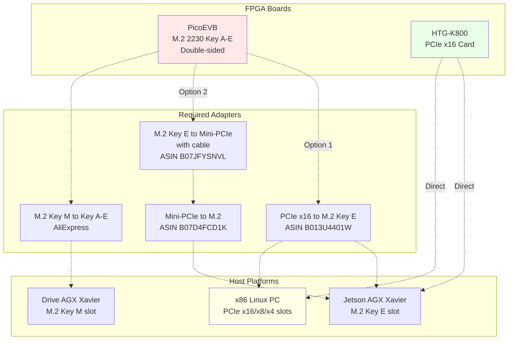

**Sources:** [README.md:40-73]()

---

### PicoEVB Connection Options

#### Option 1: PCIe Slot Adapter (Jetson or PC)

**Components:**
- PicoEVB board
- PCIe x16/x8/x4/x2/x1 to M.2 Key E adapter
  - Example: Amazon ASIN B013U4401W
  - Product: "Sourcingbay M.2(NGFF) Wireless Card to PCI-e 1X Adapter"

**Advantages:**
- Single adapter required
- Direct PCIe slot connection
- Stable mechanical connection
- Suitable for both Jetson and PC

**Limitations:**
- Requires available PCIe slot on host
- Adapter availability varies by region/time

**Sources:** [README.md:47-50]()

---

#### Option 2: Mini-PCIe Chain (Jetson Only)

**Components:**
- PicoEVB board
- M.2 2230 Key E to Mini-PCIe adapter with cable
  - Example: Amazon ASIN B07JFYSNVL or B00JSBPF70
- Mini-PCIe to M.2 2230 adapter board
  - Example: Amazon ASIN B07D4FCD1K
  - Product: "HLT M.2 (NGFF) to mPCIe (PCIe+USB) Adapter"

**Advantages:**
- Connects to Jetson's native M.2 Key E slot
- Preserves USB functionality for programming

**Limitations:**
- Two adapters required (complexity)
- Cable length may introduce signal integrity concerns
- Adapter availability varies

**Sources:** [README.md:52-61]()

---

#### Option 3: Key M to Key A-E Adapter (Drive Only)

**Components:**
- PicoEVB board
- M.2 Key M to Key A-E adapter
  - Example: AliExpress
  - Product: "M.2 Wifi Adapter M.2 M Key to A+E Key Slot"

**Advantages:**
- Single adapter for Drive AGX Xavier
- Matches Drive's M.2 Key M connector

**Limitations:**
- **No USB support** - cannot program PicoEVB while connected to Drive
- Must program PicoEVB on different system first
- Adapter less commonly available

**Sources:** [README.md:63-69](), [README.md:117-120]()

---

### HTG-K800 Connection

**Direct Connection:**
- No adapters required
- Plugs directly into PCIe x16 slot
- Compatible with both Jetson AGX Xavier and x86 PC
- Standard full-height, full-length PCIe card form factor

**Mechanical Requirements:**
- PCIe x16 slot (also works in x8/x4 with reduced lanes)
- Adequate chassis clearance for full-length card
- Slot bracket screw for mechanical stability

**Sources:** [README.md:78-81]()

---

## Platform Compatibility Matrix

### FPGA Board to Host Platform Compatibility

| FPGA Board | Jetson AGX Xavier | Drive AGX Xavier | x86 Linux PC | Notes |
|------------|-------------------|------------------|--------------|-------|
| **PicoEVB** | ✓ With adapter | ✓ With adapter (no USB) | ✓ With adapter | Requires M.2 adapter |
| **HTG-K800** | ✓ Direct | ✗ Not tested | ✓ Direct | Direct PCIe connection |

**Sources:** [README.md:22-92]()

---

### Programming Method by Configuration

```mermaid
graph TB
    subgraph Config1["PicoEVB on Jetson"]
        PEJ["PicoEVB Board"]
        XVCDJ["xvcd on Jetson<br/>USB 0x6015"]
        VIVADOJ["Vivado on x86 PC<br/>SSH tunnel<br/>port 2542"]
    end
    
    subgraph Config2["PicoEVB on Drive"]
        PED["PicoEVB Board"]
        NOTE1["⚠ Cannot program<br/>No USB on M.2 Key M"]
        WORKA["Program on Jetson/PC<br/>then connect to Drive"]
    end
    
    subgraph Config3["PicoEVB on PC"]
        PEP["PicoEVB Board"]
        XVCDP["xvcd on PC<br/>USB 0x6015"]
        VIVADOP["Vivado on same PC<br/>localhost:2542"]
    end
    
    subgraph Config4["HTG-K800 on Any Platform"]
        HTGB["HTG-K800 Board"]
        JTAG["Xilinx Platform<br/>Cable USB II"]
        VIVADOH["Vivado on x86 PC<br/>Direct JTAG"]
    end
    
    PEJ --- XVCDJ
    XVCDJ --- VIVADOJ
    
    PED --- NOTE1
    NOTE1 --- WORKA
    
    PEP --- XVCDP
    XVCDP --- VIVADOP
    
    HTGB --- JTAG
    JTAG --- VIVADOH
    
    style NOTE1 fill:#ffe8e8
    style WORKA fill:#fff8e8
```

**Sources:** [README.md:163-205]()

---

### PCI Device Identification

When loaded, the `picoevb-rdma.ko` module binds to the FPGA device:

**Expected `lspci` Output:**
```
0003:01:00.0 Memory controller: NVIDIA Corporation Device 0001
	Subsystem: NVIDIA Corporation Device 0001
	Flags: bus master, fast devsel, latency 0, IRQ 36
	Memory at 34210000 (32-bit, non-prefetchable) [size=4K]
	Memory at 34200000 (32-bit, non-prefetchable) [size=64K]
	Capabilities: <access denied>
	Kernel driver in use: picoevb-rdma
```

**PCI Configuration Details:**
- **Vendor ID:** NVIDIA Corporation (reused for FPGA device)
- **Device ID:** `0x0001`
- **Class:** Memory controller
- **BAR0:** 4 KB (control registers)
- **BAR1:** 64 KB (data buffer)
- **Driver:** `picoevb-rdma`

**Sources:** [README.md:268-278]()

---

## Hardware Limitations and Design Constraints

### RAM Size Impact on DMA Strategy

| FPGA Board | RAM Size | Transfer Strategy | Impact on Code |
|------------|----------|-------------------|----------------|
| PicoEVB | 64 KB | Chunked transfers | Driver divides large transfers into 64 KB chunks |
| HTG-K800 | 2 GB | Large block transfers | Can handle multi-megabyte transfers without chunking |

**Chunking Implementation:**
The kernel driver at [kernel-module/picoevb-rdma.c]() implements transfer chunking to accommodate the 64 KB RAM limitation on PicoEVB. For H2C2H transfers, data flow is:
1. Host → FPGA RAM (64 KB chunk)
2. FPGA RAM → Host (64 KB chunk)
3. Repeat for next chunk until complete

**Sources:** [README.md:352-359]()

---

### M.2 Key Type Compatibility

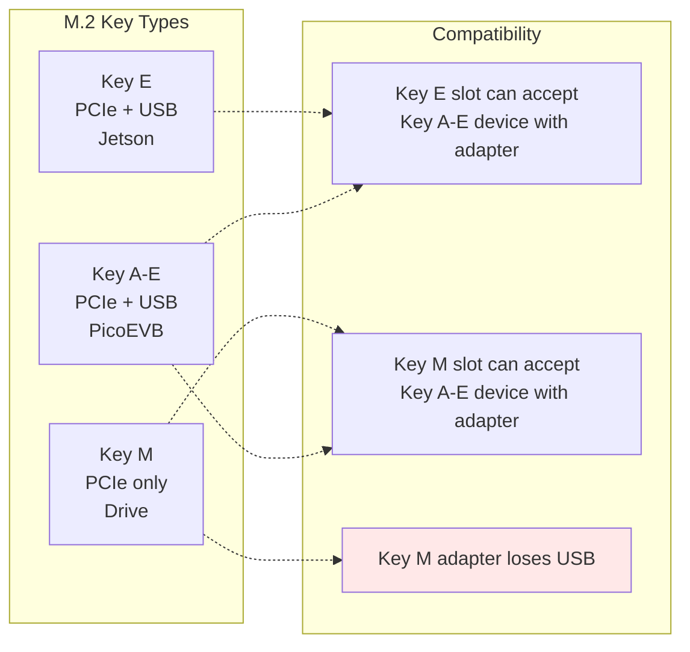

**Key Type Details:**
- **Key E:** 2230 size, PCIe + USB signals, used by Jetson AGX Xavier
- **Key M:** 2280 size, PCIe + SATA signals (no USB), used by Drive AGX Xavier
- **Key A-E:** Universal notching, PCIe + USB, used by PicoEVB
- **Consequence:** Drive AGX Xavier cannot program PicoEVB while connected

**Sources:** [README.md:42-69](), [README.md:117-120]()

---

## Software Compatibility Considerations

### Build Script to Platform Mapping

| Build Script | Target Platform | GPU Type | CUDA Memory API |
|--------------|----------------|----------|-----------------|
| `build-for-jetson-drive-igpu-native.sh` | Jetson/Drive (native) | iGPU | `cudaHostAlloc()` |
| `build-for-jetson-drive-igpu-on-pc.sh` | Jetson/Drive (cross) | iGPU | `cudaHostAlloc()` |
| `build-for-pc-native.sh` | x86 PC | dGPU | `cudaMalloc()` with `NV_BUILD_DGPU` |

**iGPU vs dGPU Implications:**
- **iGPU (Jetson/Drive):** Unified memory architecture, CUDA memory directly accessible by CPU
- **dGPU (PC):** Separate GPU memory, requires explicit memory mapping for P2P access
- **Code Impact:** Conditional compilation in [client-applications/rdma-cuda.cu]() based on `NV_BUILD_DGPU`

**Sources:** [README.md:211-322](), Diagram 6 from high-level architecture

---

## Adapter Procurement Notes

**Adapter Availability Disclaimer:**
The adapters listed in this documentation are examples based on products available at the time of writing. Product availability, vendor sources, and ASIN codes change frequently.

**Search Strategy:**
When searching for adapters, use these technical specifications:
- M.2 form factor and key type (E, M, A-E)
- PCIe signal support required
- USB signal support (if needed for programming)
- Cable vs. card-to-card adapter
- Size constraints (2230, 2242, 2280)

**Alternative Sources:**
- Amazon (various regions)
- AliExpress
- Newegg
- eBay
- Specialized electronics distributors

**Sources:** [README.md:71-73]()

---

## Summary of Hardware Requirements

To deploy the jetson-rdma-picoevb system, you need:

**Minimum Configuration:**
1. **FPGA Board:** PicoEVB or HTG-K800
2. **Host Platform:** Jetson AGX Xavier, Drive AGX Xavier, or x86 PC with CUDA GPU
3. **Adapters:** Platform-specific adapters for PicoEVB (HTG-K800 requires none)
4. **Programming Tools:**
   - PicoEVB: xvcd + Vivado (USB-based JTAG)
   - HTG-K800: Xilinx Platform Cable USB II + Vivado

**For Development:**
- x86 Linux PC with Vivado 2018.1/2018.3
- CUDA Toolkit on target platform
- Kernel headers for driver compilation
- Build tools (gcc, make, bc)

**Sources:** [README.md:1-384]()

---

# Page: Getting Started

# Getting Started

<details>
<summary>Relevant source files</summary>

The following files were used as context for generating this wiki page:

- [README.md](README.md)

</details>


This page provides a practical guide for setting up the jetson-rdma-picoevb system from initial hardware installation to running your first tests. It covers the complete workflow including hardware connections, software installation, FPGA programming, kernel module loading, and test execution.

For detailed hardware specifications and adapter requirements, see [Hardware Compatibility](#1.2). For comprehensive build instructions and cross-compilation options, see [Building and Deployment](#7). For test execution details and performance analysis, see [Testing and Validation](#8).

## Setup Workflow Overview

The complete system setup follows a specific sequence of steps across three domains: hardware installation, FPGA programming, and software deployment.

**Setup Workflow Diagram**

```mermaid
graph TB
    subgraph "Phase 1: Hardware Installation"
        HW1["Install FPGA board<br/>(PicoEVB or HTG-K800)"]
        HW2["Connect adapters<br/>if required"]
        HW3["Verify PCIe detection<br/>lspci command"]
    end
    
    subgraph "Phase 2: FPGA Programming"
        FPGA1["Install Vivado<br/>2018.1 or 2018.3"]
        FPGA2["Extract bitstream<br/>fpga-*/&#42;.mcs.bz2"]
        FPGA3["Run xvcd<br/>(PicoEVB only)"]
        FPGA4["Execute<br/>program-fpga.sh"]
    end
    
    subgraph "Phase 3: Software Build"
        SW1["Install prerequisites<br/>build-essential, bc"]
        SW2["Build kernel module<br/>build-for-*-native.sh"]
        SW3["Build applications<br/>build-for-*-native.sh"]
    end
    
    subgraph "Phase 4: Module Loading"
        MOD1["Load module<br/>sudo insmod picoevb-rdma.ko"]
        MOD2["Verify /dev/picoevb<br/>device file exists"]
        MOD3["Check lspci -v<br/>driver binding"]
    end
    
    subgraph "Phase 5: Test Execution"
        TEST1["Run functional test<br/>sudo ./rdma-cuda"]
        TEST2["Run performance test<br/>sudo ./rdma-cuda-c2h-perf"]
        TEST3["Verify results"]
    end
    
    HW1 --> HW2
    HW2 --> HW3
    HW3 --> FPGA1
    
    FPGA1 --> FPGA2
    FPGA2 --> FPGA3
    FPGA3 --> FPGA4
    
    FPGA4 --> SW1
    SW1 --> SW2
    SW2 --> SW3
    
    SW3 --> MOD1
    MOD1 --> MOD2
    MOD2 --> MOD3
    
    MOD3 --> TEST1
    TEST1 --> TEST2
    TEST2 --> TEST3
```

**Sources**: [README.md:1-384]()

## Platform and Component Selection

Before beginning setup, identify your platform and FPGA board. The system supports three platform types and two FPGA boards with specific requirements.

| Platform | Architecture | GPU Type | Memory API | Build Script |
|----------|-------------|----------|------------|--------------|
| Jetson AGX Xavier | ARM64 | iGPU (integrated) | `cudaHostAlloc()` | `build-for-jetson-drive-igpu-native.sh` |
| Drive AGX Xavier | ARM64 | iGPU (integrated) | `cudaHostAlloc()` | `build-for-jetson-drive-igpu-native.sh` |
| x86 Linux PC | x86_64 | dGPU (discrete) | `cudaMalloc()` | `build-for-pc-native.sh` |

| FPGA Board | Form Factor | RAM Size | Programming Interface | Vivado Version | Bitstream Location |
|------------|-------------|----------|---------------------|----------------|-------------------|
| PicoEVB | M.2 (double-sided) | 64 KB | USB (via xvcd) | 2018.3 | `fpga-picoevb/*.mcs.bz2` |
| HTG-K800 | PCIe x16 card | 2 GB | JTAG (Xilinx cable) | 2018.1 | `fpga-htg-k800/*.mcs.bz2` |

**Sources**: [README.md:8-11](), [README.md:24-92](), [README.md:103-106]()

## Hardware Installation Process

The physical installation varies by platform and FPGA board. Detailed adapter requirements and mechanical considerations are documented in [Hardware Setup](#2.1).

### PicoEVB Installation on Jetson AGX Xavier

PicoEVB uses M.2 key E interface. Jetson's M.2 key E slot only supports single-sided devices, so a dual-adapter chain is required:

1. Connect M.2 key E to Mini-PCIe adapter with FFC cable (ASIN B07JFYSNVL or B00JSBPF70)
2. Connect Mini-PCIe to M.2 adapter board (ASIN B07D4FCD1K)
3. Insert PicoEVB into final adapter
4. Verify PCIe detection: `lspci | grep "Memory controller: NVIDIA"`

### PicoEVB Installation on Drive AGX Xavier

Drive's M.2 key M connector requires a single M.2 key M to key A-E adapter. Note that Drive's M.2 slot does not support USB, so the FPGA must be programmed on a different system before connection.

### HTG-K800 Installation

HTG-K800 uses standard PCIe x16 connector and inserts directly into any compatible slot on Jetson or PC systems.

**Sources**: [README.md:29-82]()

## Software Prerequisites Installation

All platforms require common build tools and platform-specific components.

### Common Prerequisites

```bash
sudo apt update
sudo apt install build-essential bc
```

### Vivado Installation (for FPGA programming)

Xilinx Vivado WebPACK Edition must be installed on an x86 Linux PC:

1. Download from [xilinx.com](https://www.xilinx.com)
2. Install version 2018.3 for PicoEVB or 2018.1 for HTG-K800
3. Ensure `vivado` command is in `$PATH`

### xvcd Installation (PicoEVB only)

The Xilinx Virtual Cable Daemon enables FPGA programming via USB:

```bash
sudo apt install libftdi-dev
git clone https://github.com/RHSResearchLLC/xvcd.git
cd xvcd/linux/src
make
```

The resulting `xvcd` binary must run on the system where PicoEVB is physically connected.

### CUDA Development Tools

For Jetson/Drive systems, CUDA tools are typically pre-installed with L4T. For x86 PC systems, install NVIDIA CUDA Toolkit from [nvidia.com/cuda](https://developer.nvidia.com/cuda-downloads).

For kernel module compilation on Jetson/Drive, install kernel headers if not present:

```bash
# Headers typically located at /usr/src/linux-headers-$(uname -r)
ls /usr/src/
```

**Sources**: [README.md:95-135](), [README.md:215-219](), [README.md:285-290]()

## FPGA Programming Procedure

FPGA programming writes the hardware bitstream to the device. Pre-compiled bitstreams are provided and do not require regeneration unless modifying FPGA logic.

**FPGA Programming Flow**

```mermaid
graph LR
    subgraph "Bitstream Preparation"
        EXTRACT["Extract .mcs file<br/>bunzip2 fpga-*/*.mcs.bz2"]
    end
    
    subgraph "PicoEVB Path"
        XVCD_START["Start xvcd on host<br/>sudo ./xvcd -P 0x6015"]
        SSH_FWD["SSH port forward<br/>if xvcd on remote host<br/>ssh -L 2542:127.0.0.1:2542"]
        PROG_PICO["Run program-fpga.sh<br/>from x86 PC<br/>(20-40 minutes)"]
    end
    
    subgraph "HTG-K800 Path"
        JTAG_CONN["Connect Xilinx<br/>Platform Cable USB II"]
        PROG_HTG["Run program-fpga.sh<br/>from x86 PC<br/>(few minutes)"]
    end
    
    subgraph "Verification"
        VERIFY["Power cycle host<br/>Check lspci output"]
    end
    
    EXTRACT --> XVCD_START
    EXTRACT --> JTAG_CONN
    
    XVCD_START --> SSH_FWD
    SSH_FWD --> PROG_PICO
    
    JTAG_CONN --> PROG_HTG
    
    PROG_PICO --> VERIFY
    PROG_HTG --> VERIFY
```

### Programming PicoEVB

```bash
# On the system with PicoEVB connected (Jetson or PC)
cd /path/to/xvcd/linux/src
sudo ./xvcd -P 0x6015

# If xvcd runs on remote Jetson, forward port from x86 PC
ssh -L 2542:127.0.0.1:2542 jetson_ip_address

# On x86 PC with Vivado installed
cd /path/to/jetson-rdma-picoevb/fpga-picoevb/
bunzip2 -k *.mcs.bz2
./program-fpga.sh
# Wait 20-40 minutes; process appears hung but is running
```

### Programming HTG-K800

```bash
# On x86 PC with Vivado and Xilinx cable
cd /path/to/jetson-rdma-picoevb/fpga-htg-k800/
bunzip2 -k *.mcs.bz2
./program-fpga.sh
# Wait a few minutes
```

After programming, power cycle the host system to ensure proper PCIe enumeration.

**Sources**: [README.md:136-206]()

## Building Software Components

Software must be built for the target platform. Native builds compile on the target hardware; cross-compilation builds on x86 for ARM targets.

### Kernel Module Build

**On Jetson/Drive (native build):**

```bash
cd /path/to/jetson-rdma-picoevb/kernel-module/
./build-for-jetson-drive-igpu-native.sh
# Generates picoevb-rdma.ko
```

**On x86 PC for Jetson/Drive (cross-compile):**

```bash
cd /path/to/jetson-rdma-picoevb/kernel-module/
KDIR=/path/to/linux-headers-4.9.140-tegra/kernel-4.9/ \
  ./build-for-jetson-drive-igpu-on-pc.sh
# Generates picoevb-rdma.ko (copy to target)
```

**On x86 PC (native build):**

```bash
cd /path/to/jetson-rdma-picoevb/kernel-module/
./build-for-pc-native.sh
# Generates picoevb-rdma.ko
```

### Client Applications Build

**On Jetson/Drive (native build):**

```bash
cd /path/to/jetson-rdma-picoevb/client-applications/
./build-for-jetson-drive-igpu-native.sh
# Generates: rdma-cuda, rdma-malloc, rdma-*-perf, set-leds
```

**On x86 PC (native build):**

```bash
cd /path/to/jetson-rdma-picoevb/client-applications/
./build-for-pc-native.sh
# Generates: rdma-cuda, rdma-malloc, rdma-*-perf, set-leds
```

Note: Cross-compilation of CUDA applications from x86 to ARM64 is not fully supported by the provided scripts.

**Sources**: [README.md:211-256](), [README.md:280-322]()

## Module Loading and Verification

After building the kernel module, load it and verify proper binding to the FPGA device.

**Module Loading and Verification Process**

```mermaid
graph TB
    LOAD["Load module<br/>sudo insmod picoevb-rdma.ko"]
    
    CHECK1["Check device file<br/>ls -l /dev/picoevb"]
    CHECK2["Verify driver binding<br/>lspci -v | grep picoevb"]
    CHECK3["Check kernel log<br/>dmesg | tail"]
    
    subgraph "Expected Outputs"
        DEV["Device: /dev/picoevb<br/>crw------- 1 root root"]
        PCI["Kernel driver in use:<br/>picoevb-rdma"]
        LOG["picoevb-rdma registered<br/>with character device"]
    end
    
    LOAD --> CHECK1
    LOAD --> CHECK2
    LOAD --> CHECK3
    
    CHECK1 -.->|success| DEV
    CHECK2 -.->|success| PCI
    CHECK3 -.->|success| LOG
```

### Loading the Module

```bash
cd /path/to/jetson-rdma-picoevb/kernel-module/
sudo insmod ./picoevb-rdma.ko
```

### Verification Steps

**Check device file creation:**

```bash
ls -l /dev/picoevb
# Expected: crw------- 1 root root 240, 0 ... /dev/picoevb
```

**Verify driver binding:**

```bash
lspci -v | grep -A 10 "Memory controller: NVIDIA"
# Expected output includes:
#   Kernel driver in use: picoevb-rdma
```

Example output from [README.md:269-278]():

```
0003:01:00.0 Memory controller: NVIDIA Corporation Device 0001
	Subsystem: NVIDIA Corporation Device 0001
	Flags: bus master, fast devsel, latency 0, IRQ 36
	Memory at 34210000 (32-bit, non-prefetchable) [size=4K]
	Memory at 34200000 (32-bit, non-prefetchable) [size=64K]
	Capabilities: <access denied>
	Kernel driver in use: picoevb-rdma
```

**Check kernel messages:**

```bash
dmesg | tail -20
# Look for picoevb-rdma initialization messages
```

**Sources**: [README.md:257-278]()

## Running Initial Tests

After module loading, run functional and performance tests to verify system operation. Tests require root privileges or appropriate permissions on `/dev/picoevb`.

### Functional Tests

The functional tests perform bidirectional H2C2H transfers with data validation:

```bash
cd /path/to/jetson-rdma-picoevb/client-applications/

# Test with regular malloc'd memory
sudo ./rdma-malloc

# Test with CUDA memory
sudo ./rdma-cuda
```

**Test execution workflow (from [README.md:332-343]()):**

1. Allocate source and destination memory
2. Prepare CUDA memory with `cuPointerSetAttribute(CU_POINTER_ATTRIBUTE_SYNC_MEMOPS)` and pin via `PICOEVB_IOC_PIN_CUDA`
3. Fill source with known pattern
4. Fill destination with different values
5. Execute H2C2H DMA via `PICOEVB_IOC_H2C2H_DMA` ioctl
6. Validate destination matches source

### Performance Tests

Unidirectional bandwidth tests measure H2C and C2H transfer rates:

```bash
# Host-to-Card performance (malloc memory)
sudo ./rdma-malloc-h2c-perf

# Card-to-Host performance (malloc memory)
sudo ./rdma-malloc-c2h-perf

# Host-to-Card performance (CUDA memory)
sudo ./rdma-cuda-h2c-perf

# Card-to-Host performance (CUDA memory)
sudo ./rdma-cuda-c2h-perf
```

Tests output bandwidth in MB/s. See [Testing and Validation](#8) for detailed performance analysis and troubleshooting.

### Hardware Control Test

The LED control utility verifies basic hardware access:

```bash
sudo ./set-leds 2  # Turn on LED pattern
sudo ./set-leds 5  # Turn on different pattern
```

Parameter values 0-7 control three LEDs; hardware inverts the value (0=all on, 7=all off).

**Sources**: [README.md:323-384]()

## System Verification Checklist

After completing setup, verify all components are operational:

| Component | Verification Command | Expected Result |
|-----------|---------------------|-----------------|
| PCIe Detection | `lspci \| grep "Memory controller: NVIDIA"` | Device listed at specific bus address |
| Driver Binding | `lspci -v \| grep picoevb` | Shows "Kernel driver in use: picoevb-rdma" |
| Device File | `ls -l /dev/picoevb` | Character device exists with major 240 |
| Module Loaded | `lsmod \| grep picoevb` | Shows picoevb_rdma module |
| Basic Hardware Access | `sudo ./set-leds 0` | LEDs light up on PicoEVB |
| Functional Test | `sudo ./rdma-cuda` | Completes without errors |
| Performance Test | `sudo ./rdma-cuda-c2h-perf` | Reports bandwidth in MB/s |

**Sources**: [README.md:257-384]()

## Next Steps

After completing the setup and initial tests:

- For detailed hardware configuration and adapter selection, see [Hardware Setup](#2.1)
- For comprehensive software installation details, see [Software Prerequisites](#2.2)
- For a streamlined minimal example, see [Quick Start Guide](#2.3)
- For understanding the DMA transfer patterns, see [Data Transfer Patterns](#3.2)
- For kernel module internals and API details, see [Kernel Module](#4)
- For detailed test procedures and performance tuning, see [Testing and Validation](#8)

**Sources**: [README.md:1-384]()

---

# Page: Hardware Setup

# Hardware Setup

<details>
<summary>Relevant source files</summary>

The following files were used as context for generating this wiki page:

- [README.md](README.md)

</details>


This page provides detailed instructions for physically installing and connecting FPGA boards to host systems. It covers mechanical installation, adapter requirements, and connection verification procedures.

For information about software compatibility and build requirements, see [Software Prerequisites](#2.2). For a complete list of supported hardware combinations, see [Hardware Compatibility](#1.2).

---

## FPGA Board Options

The system supports two FPGA development boards with different form factors and capabilities:

| Board | Form Factor | FPGA | RAM | PCIe Interface | Programming Interface |
|-------|-------------|------|-----|----------------|----------------------|
| **PicoEVB** | M.2 2230 Key E (double-sided) | Xilinx Artix-7 | 64 KB | PCIe via M.2 connector | USB via M.2 connector |
| **HTG-K800** | Full-size PCIe x16 card | Xilinx XCKU-60 | 2 GB | PCIe x16 edge connector | JTAG (Xilinx Platform Cable USB II) |

**Sources:** [README.md:19-92]()

### PicoEVB Board

The PicoEVB is a compact M.2 form-factor FPGA board designed for embedded applications. Key characteristics:

- **Form Factor:** M.2 2230 (22mm × 30mm) with Key E notch
- **Double-Sided Design:** Components on both sides of the PCB, requiring special mechanical considerations
- **Dual-Function M.2 Connector:** Carries both PCIe lanes for data transfer and USB signals for FPGA programming
- **LED Indicators:** Three user-controllable LEDs accessible via GPIO registers

**Acquisition:**
- Primary vendor: [picoevb.com](https://picoevb.com)
- Secondary vendor: Amazon (ASIN B0779PC8S4, search "PicoEVB")

**Sources:** [README.md:29-38]()

### HTG-K800 Board

The HTG-K800 is a full-size PCIe development card suitable for high-performance applications. Key characteristics:

- **Form Factor:** Standard PCIe x16 card with edge connector
- **FPGA:** Xilinx Kintex UltraScale XCKU-60 (configurable to other XCKU variants)
- **RAM:** 2 GB onboard memory (vs. 64 KB on PicoEVB)
- **Programming:** Requires external Xilinx Platform Cable USB II connected to JTAG header

**Acquisition:**
- Vendor: HiTech Global
- Product page: http://www.hitechglobal.com/Boards/Kintex-UltraScale.htm

**Sources:** [README.md:75-91]()

---

## Adapter Requirements for PicoEVB

The PicoEVB board's double-sided M.2 design and Key E notch require adapter boards for reliable mechanical connection to most host systems. Different adapter chains are needed depending on the host platform's available connectors.

### Connection Topology Diagram

```mermaid
graph TB
    subgraph "PicoEVB Board"
        PICOEVB["PicoEVB<br/>M.2 2230 Key E<br/>(double-sided)"]
    end
    
    subgraph "Jetson AGX Xavier"
        JETSON_M2["M.2 Key E Slot<br/>(single-sided only)"]
    end
    
    subgraph "Drive AGX Xavier"
        DRIVE_M2["M.2 Key M Slot<br/>(no USB support)"]
    end
    
    subgraph "x86 PC or Jetson PCIe"
        PCIE_SLOT["Full-size PCIe Slot<br/>(x16/x8/x4/x2/x1)"]
    end
    
    subgraph "Adapter Chain A: For Jetson M.2 Key E"
        ADAPT_A1["M.2 Key E to Mini-PCIe<br/>Adapter with FFC Cable"]
        ADAPT_A2["Mini-PCIe to M.2 2230<br/>Adapter"]
    end
    
    subgraph "Adapter Chain B: For Drive Key M"
        ADAPT_B["M.2 Key M to Key A-E<br/>Adapter"]
    end
    
    subgraph "Adapter Chain C: For PCIe Slot"
        ADAPT_C["PCIe to M.2 Key E<br/>Adapter"]
    end
    
    PICOEVB --> ADAPT_A1
    ADAPT_A1 --> ADAPT_A2
    ADAPT_A2 --> JETSON_M2
    
    PICOEVB --> ADAPT_B
    ADAPT_B --> DRIVE_M2
    
    PICOEVB --> ADAPT_C
    ADAPT_C --> PCIE_SLOT
    
    style PICOEVB fill:#f9f9f9
    style JETSON_M2 fill:#f9f9f9
    style DRIVE_M2 fill:#f9f9f9
    style PCIE_SLOT fill:#f9f9f9
```

**Sources:** [README.md:40-73]()

### Adapter Chain A: Jetson AGX Xavier M.2 Key E Connection

Jetson AGX Xavier provides an M.2 Key E slot, but it only supports single-sided M.2 cards. A two-adapter chain is required:

**Adapter 1:** M.2 2230 Key E to Mini-PCIe adapter with FFC cable
- Amazon ASIN B07JFYSNVL: "M.2 (NGFF) Key A/E/A+E to Mini PCI-E Adapter with FFC Cable"
- Alternative ASIN B00JSBPF70: "Bplus: P15S-P15F, M.2 (NGFF) to mPCIe Extender Board"

**Adapter 2:** Mini-PCIe to M.2 2230 adapter
- Amazon ASIN B07D4FCD1K: "HLT M.2 (NGFF) to mPCIe (PCIe+USB) Adapter"

**Signal Path:** PicoEVB → Adapter 2 → Mini-PCIe cable → Adapter 1 → Jetson M.2 slot

This chain provides both PCIe data lanes and USB programming signals.

**Sources:** [README.md:52-61]()

### Adapter Chain B: Drive AGX Xavier M.2 Key M Connection

Drive AGX Xavier provides an M.2 Key M slot (typically used for NVMe SSDs). A key converter adapter is required:

**Adapter:** M.2 Key M to Key A-E interface adapter
- Available from AliExpress
- Product description: "M.2 Wifi Adapter M.2 M Key to A+E Key Slot"

**Important Limitation:** Drive AGX Xavier's M.2 Key M slot does **not** provide USB signals. The PicoEVB board must be programmed on a different system (Jetson or x86 PC) before connection to Drive AGX Xavier.

**Signal Path:** PicoEVB → Key M-to-A-E adapter → Drive M.2 slot (PCIe only)

**Sources:** [README.md:63-69](), [README.md:117-120]()

### Adapter Chain C: PCIe Slot Connection

For systems with full-size PCIe slots (x86 PCs or Jetson's PCIe connector), a single adapter is sufficient:

**Adapter:** PCIe x16/x8/x4/x2/x1 to M.2 Key E adapter
- Amazon ASIN B013U4401W: "Sourcingbay M.2(NGFF) Wireless Card to PCI-e 1X Adapter"

**Signal Path:** PicoEVB → PCIe-to-M.2 adapter → PCIe slot

This provides both PCIe data lanes and USB programming signals (if the PCIe slot's USB pins are wired).

**Sources:** [README.md:47-50]()

### Adapter Availability Note

Adapter availability varies significantly over time and by region. The specific ASINs and product names listed above may become unavailable. When searching for alternatives, look for:
- M.2 Key E compatibility
- Support for both PCIe and USB signals (if programming support is needed)
- Mechanical stability for double-sided M.2 devices

**Sources:** [README.md:71-73]()

---

## HTG-K800 Installation

The HTG-K800 requires no adapters and installs directly into standard PCIe slots.

### Physical Installation

1. **Power down** the host system completely
2. **Open the chassis** and locate an available PCIe x16, x8, or x4 slot
3. **Remove the slot cover** corresponding to the chosen PCIe slot
4. **Insert the HTG-K800** into the PCIe slot, applying even pressure until the edge connector is fully seated
5. **Secure the bracket** using the chassis screw
6. **Connect the JTAG cable** (Xilinx Platform Cable USB II) to the JTAG header on the HTG-K800
7. **Close the chassis** and power on the system

### JTAG Programmer Requirement

The HTG-K800 requires the Xilinx Platform Cable USB II for FPGA programming:
- Product page: https://www.xilinx.com/products/boards-and-kits/hw-usb-ii-g.html
- Connection: USB to JTAG header on HTG-K800 board

**Sources:** [README.md:75-91]()

---

## Physical Installation Procedures

### Pre-Installation Checklist

Before beginning physical installation:

- [ ] FPGA board acquired (PicoEVB or HTG-K800)
- [ ] Appropriate adapters acquired (if using PicoEVB)
- [ ] Host system powered down and unplugged
- [ ] Anti-static precautions taken (ESD wrist strap recommended)
- [ ] Workspace cleared and well-lit

### Installing PicoEVB on Jetson AGX Xavier

**Required Components:**
- PicoEVB board
- M.2 Key E to Mini-PCIe adapter with FFC cable
- Mini-PCIe to M.2 2230 adapter

**Procedure:**

1. **Power down** Jetson AGX Xavier completely and unplug power supply
2. **Remove the carrier board cover** to access the M.2 Key E slot
3. **Assemble the adapter chain:**
   - Insert PicoEVB into the Mini-PCIe to M.2 adapter (Adapter 2)
   - Connect the FFC cable between Adapter 2 and the M.2 to Mini-PCIe adapter (Adapter 1)
   - Ensure the FFC cable is properly oriented (contacts facing correct direction)
4. **Insert Adapter 1** into Jetson's M.2 Key E slot at approximately 30-degree angle
5. **Press down** Adapter 1 until it lies flat against the carrier board
6. **Secure with mounting screw** (if provided with adapter)
7. **Verify mechanical stability** - the adapter chain should not flex or move
8. **Replace the carrier board cover**
9. **Reconnect power** and boot Jetson

**Sources:** [README.md:42-61]()

### Installing PicoEVB on Drive AGX Xavier

**Required Components:**
- PicoEVB board (pre-programmed with FPGA bitstream)
- M.2 Key M to Key A-E adapter

**Critical Note:** Program the PicoEVB on Jetson or x86 PC **before** installation on Drive AGX Xavier, as the Drive's M.2 slot does not provide USB signals for programming.

**Procedure:**

1. **Power down** Drive AGX Xavier completely and unplug power supply
2. **Access the M.2 Key M slot** (typically used for NVMe SSD)
3. **Insert PicoEVB** into the M.2 Key M to Key A-E adapter
4. **Insert the adapter** into Drive's M.2 Key M slot at approximately 30-degree angle
5. **Press down** until the adapter lies flat
6. **Secure with mounting screw** (if slot provides one)
7. **Reconnect power** and boot Drive AGX Xavier

**Sources:** [README.md:63-69](), [README.md:117-120]()

### Installing PicoEVB on x86 PC

**Required Components:**
- PicoEVB board
- PCIe to M.2 Key E adapter

**Procedure:**

1. **Power down** the PC completely and unplug power cord
2. **Open the chassis** and locate an available PCIe slot (x1, x4, x8, or x16)
3. **Remove the slot cover** for the chosen PCIe slot
4. **Insert PicoEVB** into the PCIe-to-M.2 Key E adapter
5. **Insert the adapter** into the PCIe slot, applying even pressure until fully seated
6. **Secure the adapter bracket** using the chassis screw
7. **Close the chassis**
8. **Reconnect power** and boot the PC

**Sources:** [README.md:42-50]()

### Installing HTG-K800

**Applicable to:** Jetson AGX Xavier (via PCIe connector) or x86 PC

**Procedure:**

1. **Power down** the system completely and unplug power
2. **Open the chassis** and locate an available PCIe x16, x8, or x4 slot
3. **Remove the slot cover** corresponding to the chosen PCIe slot
4. **Align the HTG-K800** with the PCIe slot, ensuring the edge connector is properly oriented
5. **Insert the card** into the PCIe slot with firm, even pressure until the edge connector is fully seated and the bracket aligns with the chassis
6. **Secure the bracket** using the chassis screw
7. **Connect the JTAG cable** (Xilinx Platform Cable USB II) to the 14-pin JTAG header on the HTG-K800
   - Ensure proper pin 1 orientation (consult HTG-K800 documentation)
8. **Route the JTAG cable** through a chassis opening or expansion slot cover
9. **Close the chassis**
10. **Connect the JTAG cable** to your x86 Linux PC running Vivado
11. **Reconnect power** and boot the system

**Sources:** [README.md:75-91]()

---

## Hardware Verification

After physical installation, verify that the FPGA board is correctly detected by the host system.

### PCIe Enumeration Check

After booting the host system, verify PCIe enumeration using `lspci`:

```bash
lspci -v
```

**Expected Output (before driver loading):**

The FPGA board should appear as an unrecognized or generic device. The specific PCIe bus address varies by system.

**Expected Output (after driver loading):**

```
0003:01:00.0 Memory controller: NVIDIA Corporation Device 0001
	Subsystem: NVIDIA Corporation Device 0001
	Flags: bus master, fast devsel, latency 0, IRQ 36
	Memory at 34210000 (32-bit, non-prefetchable) [size=4K]
	Memory at 34200000 (32-bit, non-prefetchable) [size=64K]
	Capabilities: <access denied>
	Kernel driver in use: picoevb-rdma
```

The key indicators of successful detection:
- Device appears at a PCIe bus address (format: `DDDD:BB:DD.F`)
- Two memory regions are mapped (4 KB control registers, 64 KB or 2 GB data memory)
- After module load, `Kernel driver in use: picoevb-rdma` appears

**Sources:** [README.md:265-278]()

### PCIe Detection Failure Troubleshooting

If the FPGA board does not appear in `lspci` output:

1. **Verify physical installation:**
   - Ensure the card/adapter is fully seated in the PCIe slot
   - Check that all adapters in the chain are firmly connected
   - Inspect for bent pins or damaged connectors

2. **Check power and boot sequence:**
   - Some systems require enabling PCIe slots in BIOS/UEFI
   - Verify the system completed POST successfully
   - Try a different PCIe slot if available

3. **Verify FPGA programming:**
   - The FPGA must be programmed with a valid bitstream before PCIe enumeration
   - See [Programming FPGAs](#6.3) for programming instructions

4. **Check PCIe link status:**
   ```bash
   sudo lspci -vvv -s [bus:device.function]
   ```
   Look for `LnkSta:` line indicating link width and speed

**Sources:** [README.md:265-278]()

### PCIe Topology Diagram

```mermaid
graph TB
    subgraph "Host System"
        CPU["CPU/SoC<br/>PCIe Root Complex"]
        RC["PCIe Root Port"]
    end
    
    subgraph "FPGA Board (after programming)"
        EP["PCIe Endpoint<br/>VendorID: 0x10DE<br/>DeviceID: 0x0001"]
        CTRL["Control Registers<br/>BAR0: 4 KB<br/>@0x34210000"]
        MEM["Data Memory<br/>BAR1: 64 KB (PicoEVB)<br/>or 2 GB (HTG-K800)<br/>@0x34200000"]
    end
    
    subgraph "Kernel Space"
        DRIVER["picoevb-rdma driver<br/>pci_driver registration"]
        CDEV["/dev/picoevb<br/>Character device<br/>Major: dynamic<br/>Minor: 0"]
    end
    
    CPU --> RC
    RC -->|"PCIe Gen2/Gen3"| EP
    
    EP --> CTRL
    EP --> MEM
    
    DRIVER -->|"pci_register_driver"| EP
    DRIVER -->|"creates"| CDEV
    
    style EP fill:#f9f9f9
    style CTRL fill:#f9f9f9
    style MEM fill:#f9f9f9
    style CDEV fill:#f9f9f9
```

**Sources:** [README.md:268-278]()

### Device File Verification

After loading the `picoevb-rdma.ko` kernel module (see [Installation and Module Loading](#7.5)), verify that the device file is created:

```bash
ls -l /dev/picoevb
```

**Expected Output:**
```
crw------- 1 root root 244, 0 [date] [time] /dev/picoevb
```

The device file `/dev/picoevb` is the user-space interface for all RDMA operations. Applications open this file and issue `ioctl()` calls to perform DMA transfers.

**Sources:** [README.md:350]()

### LED Test (PicoEVB Only)

The PicoEVB board includes three user-controllable LEDs that can be used to verify basic hardware communication. After loading the kernel module, test LED control:

```bash
sudo ./set-leds 0  # All LEDs ON (hardware inverts the value)
sudo ./set-leds 7  # All LEDs OFF
sudo ./set-leds 2  # Specific LED pattern
```

The `set-leds` utility writes to GPIO control registers via `PICOEVB_IOC_SET_LEDS` ioctl. Successful LED changes indicate:
- PCIe communication is functional
- Control register (BAR0) mapping is correct
- The kernel driver is operational

**Note:** The hardware inverts the LED values, so a parameter of `0` illuminates all LEDs, and `7` turns them all off.

**Sources:** [README.md:373-383]()

---

## Hardware-Specific Considerations

### PicoEVB Memory Limitation

The PicoEVB board contains only **64 KB** of onboard FPGA memory. This limitation affects DMA transfer operations:

- Large transfers are automatically divided into 64 KB (or smaller) chunks by the kernel driver
- Each chunk requires a two-stage transfer: Host → FPGA → Host (for H2C2H operations)
- The chunking strategy impacts performance but enables testing of GPUDirect RDMA concepts

This limitation does not apply to HTG-K800, which provides 2 GB of memory.

**Sources:** [README.md:352-359]()

### Drive AGX Xavier USB Limitation

The Drive AGX Xavier's M.2 Key M slot does **not** provide USB signals. This has critical implications:

- PicoEVB **cannot be programmed** while connected to Drive AGX Xavier
- The programming workflow requires:
  1. Program PicoEVB on Jetson or x86 PC
  2. Power down the programming system
  3. Remove PicoEVB from the programming system
  4. Install PicoEVB on Drive AGX Xavier
  5. Boot Drive AGX Xavier

**FPGA bitstream persistence:** The PicoEVB retains its programming in flash memory, so it remains programmed across power cycles.

**Sources:** [README.md:117-120]()

### Mechanical Stability

The PicoEVB's double-sided design and adapter chains create mechanical considerations:

- **Ensure secure mounting:** Use all provided mounting screws for adapters
- **Minimize flexing:** The adapter chain should not bend or flex during normal operation
- **Cable routing:** For FFC cable adapters, avoid sharp bends or kinks in the flexible cable
- **Vibration sensitivity:** In mobile or vibration-prone environments, verify that all connections remain secure

HTG-K800's single-piece design provides superior mechanical stability.

---

## Next Steps

After successful hardware installation and verification:

1. **Install software prerequisites:** See [Software Prerequisites](#2.2) for Vivado, CUDA drivers, and development tools
2. **Program the FPGA:** See [Programming FPGAs](#6.3) for bitstream programming instructions
3. **Build and load the kernel module:** See [Building the Kernel Module](#7.2)
4. **Run functional tests:** See [Running Tests](#8.1) to validate the complete system

---

**Sources:** [README.md:1-383]()

---

# Page: Software Prerequisites

# Software Prerequisites

<details>
<summary>Relevant source files</summary>

The following files were used as context for generating this wiki page:

- [README.md](README.md)

</details>


This page documents all software packages and tools required to build, deploy, and run the jetson-rdma-picoevb system. Requirements are organized by build scenario (native vs cross-compilation) and target platform. For hardware requirements and physical setup, see [Hardware Setup](#2.1). For a quick-start workflow after installing prerequisites, see [Quick Start Guide](#2.3).

## Overview of Software Components

The system requires three distinct toolchains, each with specific dependencies:

```mermaid
graph TB
    subgraph "FPGA Toolchain"
        VIVADO["Vivado Design Suite<br/>2018.1 or 2018.3"]
        XVCD["xvcd<br/>(PicoEVB only)"]
        LIBFTDI["libftdi-dev"]
    end
    
    subgraph "Kernel Module Toolchain"
        KBUILD["build-essential"]
        BC["bc utility"]
        KHEADERS["Linux kernel headers"]
        CROSS_K["aarch64-linux-gnu-gcc<br/>(cross-compile only)"]
    end
    
    subgraph "Client Applications Toolchain"
        APPBUILD["build-essential"]
        CUDA["CUDA Toolkit<br/>(nvcc compiler)"]
        CROSS_A["aarch64-linux-gnu-gcc<br/>(cross-compile only)"]
    end
    
    subgraph "Runtime Environment"
        DRIVER["CUDA Driver"]
        KERNEL["Linux Kernel<br/>(5.9+ requires rel-36+ branch)"]
    end
    
    XVCD --> LIBFTDI
    
    style VIVADO fill:#f9f9f9
    style CUDA fill:#f9f9f9
    style DRIVER fill:#f9f9f9
```

**Sources**: [README.md:93-134](), [README.md:211-256](), [README.md:282-321]()

## Platform Requirements Matrix

Different hardware platforms and build scenarios require specific software configurations:

| Platform | Build Location | FPGA Tools | Kernel Build | App Build | Notes |
|----------|---------------|------------|--------------|-----------|-------|
| Jetson AGX Xavier | Native | Optional¹ | build-essential, bc | build-essential, bc, CUDA Toolkit | Integrated GPU (iGPU) |
| Drive AGX Xavier | Native | Not supported² | build-essential, bc | build-essential, bc, CUDA Toolkit | Integrated GPU (iGPU) |
| x86 Linux PC | Native | Vivado, xvcd³ | build-essential, bc | build-essential, bc, CUDA Toolkit | Discrete GPU (dGPU) |
| Jetson/Drive | Cross-compile on x86 | N/A | aarch64 toolchain, kernel headers | aarch64 toolchain⁴ | Target deployment platform |

¹ FPGA programming possible on Jetson via xvcd and network connection to Vivado on x86 PC  
² Drive AGX Xavier's M.2 slot does not support USB; FPGA must be programmed elsewhere  
³ xvcd only required for PicoEVB board; HTG-K800 uses JTAG via Xilinx Platform Cable  
⁴ CUDA application cross-compilation not yet fully supported

**Sources**: [README.md:93-134](), [README.md:211-244](), [README.md:282-321]()

## FPGA Programming Software

### Xilinx Vivado Design Suite

**Required for**: Synthesizing FPGA bitstreams and programming FPGA hardware  
**Platform**: x86 Linux PC only  
**License**: Free WebPACK Edition is sufficient  
**Version requirements**:
- **PicoEVB projects**: Vivado 2018.3
- **HTG-K800 projects**: Vivado 2018.1
- Newer versions can import these projects but may require project migration

**Installation**: Download from [https://www.xilinx.com/](https://www.xilinx.com)

```mermaid
graph LR
    VIVADO_2018_3["Vivado 2018.3"] --> PICOEVB["fpga-picoevb/<br/>Project"]
    VIVADO_2018_1["Vivado 2018.1"] --> HTG["fpga-htg-k800/<br/>Project"]
    
    PICOEVB --> GEN_BIT["*.bit<br/>Bitstream"]
    HTG --> GEN_BIT
    
    GEN_BIT --> CFGMEM["*.mcs<br/>Config Memory Image"]
    
    SCRIPTS["git-to-project.sh<br/>synthesize-fpga.sh<br/>generate-cfgmem.sh"] --> VIVADO_2018_3
    SCRIPTS --> VIVADO_2018_1
```

**Sources**: [README.md:93-107](), [README.md:136-161]()

### xvcd (Xilinx Virtual Cable Daemon)

**Required for**: Programming PicoEVB board only (not required for HTG-K800)  
**Platform**: System where PicoEVB is installed (Jetson AGX Xavier or x86 Linux PC)  
**Repository**: [https://github.com/RHSResearchLLC/xvcd](https://github.com/RHSResearchLLC/xvcd)

**Installation steps**:

```bash
sudo apt update
sudo apt install build-essential libftdi-dev
git clone https://github.com/RHSResearchLLC/xvcd.git
cd xvcd/linux/src
make
```

**Note**: Drive AGX Xavier's M.2 slot does not support USB, so PicoEVB cannot be programmed when connected to Drive. Program the board on another system first.

**Network setup**: If running xvcd on Jetson while Vivado runs on x86 PC, use SSH port forwarding:

```bash
ssh -L 2542:127.0.0.1:2542 <jetson_ip_address>
```

**Sources**: [README.md:109-134](), [README.md:165-192]()

## Kernel Module Build Requirements

The kernel module [`picoevb-rdma.ko`] implements the PCIe driver and DMA operations. Build requirements vary by scenario:

### Native Build (Jetson/Drive AGX Xavier)

**Required packages**:
- `build-essential` - GCC compiler, make, and standard build tools
- `bc` - Basic calculator utility used by kernel build system

**Installation**:
```bash
sudo apt update
sudo apt install build-essential bc
```

**Build command**: Execute [`build-for-jetson-drive-igpu-native.sh`] in `kernel-module/` directory

**Sources**: [README.md:211-222]()

### Native Build (x86 Linux PC)

**Required packages**:
- `build-essential`
- `bc`

**Installation**: Same as Jetson native build

**Build command**: Execute [`build-for-pc-native.sh`] in `kernel-module/` directory

**Sources**: [README.md:246-255]()

### Cross-Compilation Build (x86 PC to Jetson/Drive)

**Required packages**:
- `build-essential`
- `bc`
- Cross-compilation toolchain: `aarch64-linux-gnu-gcc`
- Linux kernel headers for target platform

**Kernel headers acquisition**:
- Option 1: Copy from `/usr/src/` on target Jetson/Drive system
- Option 2: Download from NVIDIA L4T/Drive downloads website

**Environment variable**: Set `KDIR` to kernel headers path:

```bash
KDIR=/path/to/linux-headers-4.9.140-tegra-linux_x86_64/kernel-4.9/ \
  ./build-for-jetson-drive-igpu-on-pc.sh
```

**Note**: The generated `picoevb-rdma.ko` must be copied to the target system for deployment.

```mermaid
graph TB
    subgraph "x86 Linux PC"
        CROSS_GCC["aarch64-linux-gnu-gcc"]
        KHEADERS["Linux Kernel Headers<br/>(from target system)"]
        BUILD_SCRIPT["build-for-jetson-drive-igpu-on-pc.sh"]
    end
    
    subgraph "Source Files"
        RDMA_C["picoevb-rdma.c"]
        RDMA_H["picoevb-rdma.h"]
        IOCTL_H["picoevb-rdma-ioctl.h"]
    end
    
    subgraph "Target System"
        INSMOD["insmod picoevb-rdma.ko"]
        DEVICE["/dev/picoevb"]
    end
    
    CROSS_GCC --> BUILD_SCRIPT
    KHEADERS --> BUILD_SCRIPT
    RDMA_C --> BUILD_SCRIPT
    RDMA_H --> BUILD_SCRIPT
    IOCTL_H --> BUILD_SCRIPT
    
    BUILD_SCRIPT --> KO["picoevb-rdma.ko"]
    KO -->|"copy to target"| INSMOD
    INSMOD --> DEVICE
```

**Sources**: [README.md:224-244](), [kernel-module/build-for-jetson-drive-igpu-on-pc.sh:1-15]()

## Client Application Build Requirements

Client applications include functional tests ([`rdma-cuda.cu`], [`rdma-malloc.c`]) and performance benchmarks ([`rdma-cuda-c2h-perf.cu`], [`rdma-malloc-h2c-perf.c`], etc.).

### Native Build (Jetson/Drive AGX Xavier)

**Required packages**:
- `build-essential`
- `bc`
- CUDA Toolkit (includes `nvcc` compiler)

**Installation**:
```bash
sudo apt update
sudo apt install build-essential bc
# CUDA Toolkit should be pre-installed on Jetson/Drive systems
```

**Build command**: Execute [`build-for-jetson-drive-igpu-native.sh`] in `client-applications/` directory

**Memory allocation strategy**: On integrated GPU (iGPU) platforms, CUDA applications use `cudaHostAlloc()` for unified memory allocation.

**Sources**: [README.md:282-292]()

### Native Build (x86 Linux PC)

**Required packages**:
- `build-essential`
- `bc`
- CUDA Toolkit (includes `nvcc` compiler for discrete GPU)

**Installation**:
```bash
sudo apt update
sudo apt install build-essential bc
# Install CUDA Toolkit from NVIDIA website
```

**Build command**: Execute [`build-for-pc-native.sh`] in `client-applications/` directory

**Memory allocation strategy**: On discrete GPU (dGPU) platforms, CUDA applications use `cudaMalloc()` for device memory allocation. This behavior is controlled by the `NV_BUILD_DGPU` compilation flag.

**Sources**: [README.md:312-321]()

### Cross-Compilation Build (x86 PC to Jetson/Drive)

**Required packages**:
- `build-essential`
- `bc`
- Cross-compilation toolchain: `aarch64-linux-gnu-gcc`

**Limitation**: CUDA application cross-compilation is **not yet fully supported**. The Makefile can cross-compile non-CUDA applications ([`rdma-malloc.c`], [`set-leds.c`]) but not CUDA applications ([`rdma-cuda.cu`], performance benchmarks).

**Build command**: Execute [`build-for-jetson-drive-igpu-on-pc.sh`] in `client-applications/` directory

**Configuration**: Adjust `CROSS_COMPILE` variable in the build script if needed:

```bash
# Example from build script
CROSS_COMPILE=aarch64-linux-gnu-
```

```mermaid
graph TB
    subgraph "Compilation Scenarios"
        direction TB
        NATIVE_IGPU["Native iGPU Build<br/>Jetson/Drive"]
        NATIVE_DGPU["Native dGPU Build<br/>x86 PC"]
        CROSS["Cross-Compile<br/>x86 to ARM64"]
    end
    
    subgraph "CUDA Source Files"
        CUDA_CU["rdma-cuda.cu<br/>rdma-cuda-*-perf.cu"]
    end
    
    subgraph "C Source Files"
        MALLOC_C["rdma-malloc.c<br/>rdma-malloc-*-perf.c<br/>set-leds.c"]
    end
    
    subgraph "Build Tools"
        NVCC["nvcc<br/>(CUDA Compiler)"]
        GCC["gcc"]
        CROSS_GCC["aarch64-linux-gnu-gcc"]
    end
    
    subgraph "Compilation Flags"
        DGPU_FLAG["NV_BUILD_DGPU<br/>(cudaMalloc)"]
        IGPU_FLAG["default<br/>(cudaHostAlloc)"]
    end
    
    NATIVE_IGPU --> NVCC
    NATIVE_IGPU --> GCC
    NATIVE_IGPU --> IGPU_FLAG
    
    NATIVE_DGPU --> NVCC
    NATIVE_DGPU --> GCC
    NATIVE_DGPU --> DGPU_FLAG
    
    CROSS --> CROSS_GCC
    CROSS -.->|"not supported"| CUDA_CU
    
    NVCC --> CUDA_CU
    GCC --> MALLOC_C
    CROSS_GCC --> MALLOC_C
```

**Sources**: [README.md:294-310](), [client-applications/build-for-jetson-drive-igpu-on-pc.sh:1-10]()

## Runtime Requirements

### Linux Kernel Version

**Standard operation**: Most kernel versions supported  
**Kernel 5.9+**: Requires `rel-36+` branch of this repository

**Note from codebase**: [README.md:208-209]()

```
## Note:
Please use rel-36+ branch for kernel 5.9+ version.
```

### CUDA Driver

**Required for**: All CUDA-based applications and NVIDIA P2P API integration  
**Platform-specific**:
- **Jetson/Drive AGX Xavier**: Pre-installed with L4T
- **x86 Linux PC**: Must install NVIDIA driver for Quadro/Tesla GPU

**Driver functionality required**:
- CUDA runtime API
- NVIDIA P2P (peer-to-peer) API for GPUDirect RDMA
- Functions used: `nvidia_p2p_get_pages()`, `nvidia_p2p_dma_map_pages()`, `nvidia_p2p_put_pages()`, `nvidia_p2p_free_page_table()`

### Module Loading

After building, the kernel module is loaded with:

```bash
sudo insmod ./picoevb-rdma.ko
```

**Verification**: Use `lspci -v` to confirm the driver is loaded:

```
0003:01:00.0 Memory controller: NVIDIA Corporation Device 0001
    ...
    Kernel driver in use: picoevb-rdma
```

**Device file**: Module creates `/dev/picoevb` character device for user-space communication.

**Sources**: [README.md:257-278]()

## Software Version Summary

| Component | Version/Requirement | Platform | Notes |
|-----------|-------------------|----------|-------|
| Vivado | 2018.3 | x86 Linux | PicoEVB projects |
| Vivado | 2018.1 | x86 Linux | HTG-K800 projects |
| xvcd | Latest from GitHub | Jetson/x86 Linux | PicoEVB only |
| libftdi-dev | System package | Jetson/x86 Linux | xvcd dependency |
| build-essential | System package | All platforms | GCC, make, etc. |
| bc | System package | All platforms | Kernel build utility |
| CUDA Toolkit | L4T version / Latest | Jetson/Drive / x86 PC | Includes nvcc compiler |
| CUDA Driver | L4T version / Latest | Jetson/Drive / x86 PC | Runtime requirement |
| Linux Kernel | 5.9+ requires rel-36+ | All platforms | Branch selection |
| aarch64-linux-gnu-gcc | System package | x86 Linux | Cross-compilation only |
| Kernel Headers | Match target kernel | x86 Linux | Cross-compilation only |

**Sources**: [README.md:93-321]()

## Build Script Reference

The repository provides platform-specific build scripts:

**Kernel Module**:
- [`kernel-module/build-for-jetson-drive-igpu-native.sh`]() - Native ARM64 build
- [`kernel-module/build-for-jetson-drive-igpu-on-pc.sh`]() - Cross-compile from x86
- [`kernel-module/build-for-pc-native.sh`]() - Native x86 build

**Client Applications**:
- [`client-applications/build-for-jetson-drive-igpu-native.sh`]() - Native ARM64 build
- [`client-applications/build-for-jetson-drive-igpu-on-pc.sh`]() - Cross-compile from x86 (partial)
- [`client-applications/build-for-pc-native.sh`]() - Native x86 build

**FPGA Build**:
- [`fpga-picoevb/git-to-project.sh`]() - Generate Vivado project
- [`fpga-picoevb/synthesize-fpga.sh`]() - Run synthesis and implementation
- [`fpga-picoevb/generate-cfgmem.sh`]() - Generate configuration memory image
- [`fpga-htg-k800/git-to-project.sh`]() - Generate Vivado project (HTG-K800)
- [`fpga-htg-k800/synthesize-fpga.sh`]() - Run synthesis (HTG-K800)

Each script sets appropriate compiler flags and paths for its target platform.

**Sources**: [README.md:136-161](), [README.md:211-255](), [README.md:282-321]()

---

# Page: Quick Start Guide

# Quick Start Guide

<details>
<summary>Relevant source files</summary>

The following files were used as context for generating this wiki page:

- [README.md](README.md)
- [client-applications/rdma-cuda.cu](client-applications/rdma-cuda.cu)

</details>


This page provides a minimal working example to quickly set up and verify the jetson-rdma-picoevb system. It assumes you have completed hardware installation and installed software prerequisites. For detailed setup instructions, see [Hardware Setup](#2.1) and [Software Prerequisites](#2.2). For comprehensive build options and testing procedures, see [Building and Deployment](#7) and [Testing and Validation](#8).

## Prerequisites Summary

Before proceeding, ensure you have:

| Requirement | Status Check Command |
|-------------|---------------------|
| FPGA board physically installed | `lspci \| grep -i xilinx` or `lspci \| grep -i nvidia.*0001` |
| Kernel headers installed | `ls /usr/src/linux-headers-$(uname -r)` |
| CUDA toolkit installed | `nvcc --version` |
| Build tools installed | `gcc --version && make --version` |

**Sources:** [README.md:207-256]()

## Quick Start Workflow

The following diagram shows the minimal path from source code to a working test:

```mermaid
flowchart TB
    START["Start: Repository Cloned"]
    
    subgraph "Step 1: FPGA Programming"
        BITSTREAM["Use Pre-compiled Bitstream<br/>fpga-picoevb/picoevb.mcs.bz2<br/>or fpga-htg-k800/htg-k800.mcs.bz2"]
        UNCOMPRESS["bunzip2 *.mcs.bz2"]
        XVCD["Run xvcd for PicoEVB<br/>sudo ./xvcd -P 0x6015"]
        PROGRAM["Execute program-fpga.sh"]
    end
    
    subgraph "Step 2: Kernel Module"
        KBUILD["kernel-module/<br/>build-for-*-native.sh"]
        KMODULE["picoevb-rdma.ko"]
        INSMOD["sudo insmod picoevb-rdma.ko"]
        VERIFY["lspci -v | grep picoevb-rdma"]
    end
    
    subgraph "Step 3: Client Application"
        APPBUILD["client-applications/<br/>build-for-*-native.sh"]
        APPBIN["rdma-cuda executable"]
        RUN["sudo ./rdma-cuda"]
        SUCCESS["Validation: No errors printed"]
    end
    
    START --> BITSTREAM
    BITSTREAM --> UNCOMPRESS
    UNCOMPRESS --> XVCD
    XVCD --> PROGRAM
    
    PROGRAM --> KBUILD
    KBUILD --> KMODULE
    KMODULE --> INSMOD
    INSMOD --> VERIFY
    
    VERIFY --> APPBUILD
    APPBUILD --> APPBIN
    APPBIN --> RUN
    RUN --> SUCCESS
    
    style SUCCESS fill:#ccffcc
```

**Sources:** [README.md:136-206](), [README.md:211-256](), [README.md:282-321](), [README.md:323-347]()

## Step 1: Program the FPGA

### Using Pre-compiled Bitstream

A pre-compiled bitstream is provided to skip the synthesis step (which takes 5-60 minutes).

#### For PicoEVB

```bash
# Navigate to FPGA directory
cd /path/to/jetson-rdma-picoevb/fpga-picoevb/

# Decompress the bitstream
bunzip2 picoevb.mcs.bz2

# In one terminal, start xvcd (assuming PicoEVB is installed locally)
sudo /path/to/xvcd/xvcd -P 0x6015

# In another terminal, program the FPGA
# This takes 20-40 minutes and produces minimal output
./program-fpga.sh
```

#### For HTG-K800

```bash
# Navigate to FPGA directory
cd /path/to/jetson-rdma-picoevb/fpga-htg-k800/

# Decompress the bitstream
bunzip2 htg-k800.mcs.bz2

# Program the FPGA (requires Xilinx Platform Cable USB II)
# This takes a few minutes
./program-fpga.sh
```

**Note:** If programming on Jetson and running Vivado remotely, use SSH port forwarding:
```bash
ssh -L 2542:127.0.0.1:2542 ip_address_of_jetson
```

**Sources:** [README.md:136-206]()

## Step 2: Build and Load Kernel Module

### Choose Build Script by Platform

| Platform | Build Script | Notes |
|----------|--------------|-------|
| Jetson/Drive AGX Xavier (native) | `build-for-jetson-drive-igpu-native.sh` | iGPU support |
| x86 PC (native) | `build-for-pc-native.sh` | dGPU support |
| x86 PC (cross-compile) | `build-for-jetson-drive-igpu-on-pc.sh` | Requires L4T kernel headers |

### Build and Load

```bash
# Navigate to kernel module directory
cd /path/to/jetson-rdma-picoevb/kernel-module/

# Build the module (example for Jetson native)
./build-for-jetson-drive-igpu-native.sh

# Load the module
sudo insmod picoevb-rdma.ko

# Verify module is loaded and bound to FPGA device
lspci -v | grep -A 5 "Memory controller"
```

### Expected Output

The `lspci -v` command should show the kernel driver in use:

```
0003:01:00.0 Memory controller: NVIDIA Corporation Device 0001
	Subsystem: NVIDIA Corporation Device 0001
	Flags: bus master, fast devsel, latency 0, IRQ 36
	Memory at 34210000 (32-bit, non-prefetchable) [size=4K]
	Memory at 34200000 (32-bit, non-prefetchable) [size=64K]
	Kernel driver in use: picoevb-rdma
```

You should also see `/dev/picoevb` device file created:
```bash
ls -l /dev/picoevb
```

**Sources:** [README.md:211-278]()

## Step 3: Build and Run Test Application

### Build Client Applications

```bash
# Navigate to client applications directory
cd /path/to/jetson-rdma-picoevb/client-applications/

# Build applications (example for Jetson native)
./build-for-jetson-drive-igpu-native.sh
```

This generates several executables:
- `rdma-cuda` - Functional test using CUDA memory
- `rdma-malloc` - Functional test using host memory
- `rdma-cuda-c2h-perf` - Card-to-host performance benchmark
- `rdma-cuda-h2c-perf` - Host-to-card performance benchmark
- `rdma-malloc-c2h-perf` - Card-to-host performance (malloc)
- `rdma-malloc-h2c-perf` - Host-to-card performance (malloc)
- `set-leds` - Hardware control utility

**Sources:** [README.md:282-321]()

### Run Functional Test

The `rdma-cuda` test is recommended for initial verification:

```bash
sudo ./rdma-cuda
```

### Test Execution Flow

The following diagram shows the internal execution flow of `rdma-cuda` with actual IOCTL commands and code functions:

```mermaid
sequenceDiagram
    participant App as rdma-cuda Application
    participant Dev as /dev/picoevb Device
    participant Drv as picoevb-rdma.ko Driver
    participant HW as FPGA Hardware
    participant GPU as GPU Memory

    App->>Dev: open("/dev/picoevb", O_RDWR)
    Note over App: Line 69

    App->>GPU: cudaHostAlloc(&src_d) or cudaMalloc()
    Note over App: Lines 76-84
    
    App->>GPU: cuPointerSetAttribute(SYNC_MEMOPS)
    Note over App: Lines 86-91
    
    App->>Dev: ioctl(PICOEVB_IOC_PIN_CUDA, &pin_params_src)
    Note over App: Lines 93-99
    Dev->>Drv: pin_cuda_memory()
    Drv->>GPU: nvidia_p2p_get_pages()
    Drv->>Drv: nvidia_p2p_dma_map_pages()
    Drv-->>App: Return handle

    App->>GPU: cudaHostAlloc(&dst_d) or cudaMalloc()
    Note over App: Lines 101-110
    
    App->>GPU: cuPointerSetAttribute(SYNC_MEMOPS)
    Note over App: Lines 112-117
    
    App->>Dev: ioctl(PICOEVB_IOC_PIN_CUDA, &pin_params_dst)
    Note over App: Lines 119-125
    Drv->>GPU: nvidia_p2p_get_pages()
    Drv->>Drv: nvidia_p2p_dma_map_pages()
    Drv-->>App: Return handle

    App->>GPU: fill_surface<<<>>> CUDA kernel
    Note over App: Lines 135-142
    
    App->>Dev: ioctl(PICOEVB_IOC_H2C2H_DMA, &dma_params)
    Note over App: Lines 144-153
    
    loop For each 64KB chunk
        Drv->>HW: Program Xilinx DMA (H2C)
        HW->>GPU: Read from src_d
        GPU-->>HW: Data to FPGA RAM
        Drv->>HW: Program Xilinx DMA (C2H)
        HW->>GPU: Write to dst_d
    end
    
    Drv-->>App: DMA complete
    
    App->>App: Validate data pattern
    Note over App: Lines 175-190
    
    App->>Dev: ioctl(PICOEVB_IOC_UNPIN_CUDA, dst)
    Note over App: Lines 200-205
    
    App->>Dev: ioctl(PICOEVB_IOC_UNPIN_CUDA, src)
    Note over App: Lines 217-222
    
    App->>GPU: cudaFreeHost() or cudaFree()
    
    App->>Dev: close(fd)
    Note over App: Line 234
```

**Sources:** [client-applications/rdma-cuda.cu:52-241]()

### Expected Output

If the test succeeds, it produces **no output** and returns exit code 0:

```bash
sudo ./rdma-cuda
echo $?
# Should print: 0
```

If the test fails, it prints error messages to stderr:
- Memory allocation failures: `Allocation of src_d failed`
- IOCTL failures: `ioctl(PIN_CUDA src) failed`
- Data validation errors: `dst[0x1234] is 0xabcd not 0x5678`

**Sources:** [client-applications/rdma-cuda.cu:82-190](), [README.md:323-360]()

## Step 4: Verify with Performance Test

Run a performance test to measure bandwidth:

```bash
sudo ./rdma-cuda-c2h-perf
```

### Expected Performance Output

```
Transfer size: 4194304 bytes
Transfer time: 0.012345 seconds
Bandwidth: 339.87 MB/s
```

Typical bandwidth ranges:
- **PicoEVB**: 300-400 MB/s (limited by 64KB FPGA RAM requiring chunking)
- **HTG-K800**: Higher throughput possible with 2GB FPGA RAM

**Sources:** [README.md:361-371]()

## Troubleshooting Quick Checks

| Issue | Check Command | Resolution |
|-------|---------------|------------|
| FPGA not visible | `lspci \| grep -i memory` | Verify physical installation |
| Module not loading | `dmesg \| tail` | Check kernel version compatibility |
| Device file missing | `ls /dev/picoevb` | Module may not be loaded |
| Permission denied | `ls -l /dev/picoevb` | Run with `sudo` or adjust permissions |
| CUDA errors | `nvidia-smi` | Verify GPU is detected |

For detailed troubleshooting, see [Troubleshooting](#9).

## Next Steps

After successful quick start:

1. **Explore other tests** - Try `rdma-malloc` for non-CUDA transfers, see [Functional Tests](#5.2)
2. **Run benchmarks** - Measure H2C and C2H bandwidth, see [Performance Benchmarks](#5.3)
3. **Understand architecture** - Learn about DMA patterns, see [Data Transfer Patterns](#3.2)
4. **Develop applications** - Use the IOCTL interface, see [IOCTL Interface](#4.2)
5. **Modify FPGA** - Customize hardware logic, see [FPGA Development](#6)

**Sources:** [README.md:1-384]()

## File Organization Reference

The following table maps quick start steps to source directories:

| Component | Directory | Key Files |
|-----------|-----------|-----------|
| FPGA bitstreams | `fpga-picoevb/` or `fpga-htg-k800/` | `*.mcs.bz2`, `program-fpga.sh` |
| Kernel module | `kernel-module/` | `picoevb-rdma.c`, `build-for-*-native.sh` |
| Client applications | `client-applications/` | `rdma-cuda.cu`, `Makefile` |
| IOCTL interface | `kernel-module/` | `picoevb-rdma-ioctl.h` |

**Sources:** [README.md:136-384]()

---

# Page: System Architecture

# System Architecture

<details>
<summary>Relevant source files</summary>

The following files were used as context for generating this wiki page:

- [kernel-module/picoevb-rdma.c](kernel-module/picoevb-rdma.c)
- [rdma-flow.svg](rdma-flow.svg)

</details>


This page provides a comprehensive overview of the jetson-rdma-picoevb system architecture, focusing on the interactions between user space applications, the kernel module, and hardware components. For detailed information about specific aspects, see:
- RDMA concepts and GPUDirect technology: [RDMA Fundamentals](#3.1)
- H2C, C2H, and H2C2H transfer mechanisms: [Data Transfer Patterns](#3.2)
- Memory pinning and mapping strategies: [Memory Management](#3.3)
- Kernel module implementation details: [Kernel Module](#4)
- Application programming interfaces: [Client Applications](#5)

## Three-Tier System Architecture

The system is organized into three distinct layers, each with well-defined responsibilities and interfaces.

```mermaid
graph TB
    subgraph UserSpace["User Space"]
        direction TB
        Apps["Applications<br/>rdma-cuda<br/>rdma-malloc<br/>rdma-*-perf<br/>set-leds"]
        LibC["Standard C Library"]
    end
    
    subgraph KernelSpace["Kernel Space"]
        direction TB
        CharDev["/dev/picoevb<br/>Character Device"]
        FileOps["struct file_operations<br/>pevb_fops"]
        IOCTLHandlers["IOCTL Handlers<br/>pevb_ioctl_*"]
        
        DMAOps["DMA Operations<br/>pevb_dma_h2c_multi()<br/>pevb_dma_c2h_multi()<br/>pevb_dma_h2c2h_multi()"]
        
        MemMgmt["Memory Management<br/>pevb_get_userbuf_pages()<br/>pevb_get_userbuf_cuda()"]
        
        P2PAPI["NVIDIA P2P API<br/>nvidia_p2p_get_pages()<br/>nvidia_p2p_dma_map_pages()"]
        
        PCIDriver["PCI Driver<br/>pevb_driver<br/>pevb_probe()<br/>pevb_remove()"]
        
        IRQHandler["Interrupt Handler<br/>pevb_irq_handler()"]
    end
    
    subgraph Hardware["Hardware Layer"]
        direction TB
        PCIeIF["PCIe Interface"]
        BARGPIO["BAR 0: GPIO Registers"]
        BARDMA["BAR 1: DMA Registers"]
        XilinxDMA["Xilinx DMA Engine<br/>H2C Channel<br/>C2H Channel"]
        FPGARAM["FPGA RAM<br/>64KB or 2GB"]
        GPU["NVIDIA GPU<br/>Device Memory"]
    end
    
    Apps -->|"open()<br/>ioctl()<br/>close()"| LibC
    LibC -->|"syscalls"| CharDev
    CharDev --> FileOps
    FileOps -->|"pevb_fops_unlocked_ioctl()"| IOCTLHandlers
    
    IOCTLHandlers --> DMAOps
    IOCTLHandlers --> MemMgmt
    
    MemMgmt -->|"CUDA memory"| P2PAPI
    MemMgmt -->|"host memory<br/>get_user_pages()<br/>dma_map_sg()"| DMAOps
    
    P2PAPI -->|"pin & map"| GPU
    
    DMAOps -->|"program descriptors"| XilinxDMA
    
    PCIDriver -->|"pcim_iomap_regions()"| BARGPIO
    PCIDriver -->|"pcim_iomap_regions()"| BARDMA
    PCIDriver -->|"request_irq()"| IRQHandler
    
    IRQHandler -->|"read status"| BARDMA
    
    XilinxDMA -->|"DMA transactions"| PCIeIF
    XilinxDMA -->|"access"| FPGARAM
    
    PCIeIF --> GPU
    
    BARDMA --> XilinxDMA
    BARGPIO -->|"LED control"| Hardware
    
    style CharDev fill:#f9f9f9
    style FileOps fill:#f9f9f9
    style PCIDriver fill:#f9f9f9
```

**Sources:** [kernel-module/picoevb-rdma.c:1-1312]()

### User Space Layer

Applications interact with the kernel module exclusively through the character device `/dev/picoevb`. The character device is created during module initialization [kernel-module/picoevb-rdma.c:1188-1189]() and provides a file-based interface accessible via standard system calls.

| Component | Code Symbol | Purpose |
|-----------|-------------|---------|
| Character device node | `/dev/picoevb` | Entry point for user-space communication |
| Device class | `pevb_class` | Manages device node creation [kernel-module/picoevb-rdma.c:119]() |
| Character device | `struct cdev pevb->cdev` | Kernel representation [kernel-module/picoevb-rdma.c:63]() |
| Device number | `dev_t pevb->devt` | Major/minor number allocation [kernel-module/picoevb-rdma.c:62]() |

**Sources:** [kernel-module/picoevb-rdma.c:119](), [kernel-module/picoevb-rdma.c:56-71](), [kernel-module/picoevb-rdma.c:1175-1193]()

### Kernel Space Layer

The kernel module `picoevb-rdma.ko` implements a PCI device driver that manages DMA operations and integrates with NVIDIA's P2P API.

#### Core Data Structures

```mermaid
graph LR
    subgraph PerDevice["Per-Device State"]
        pevb["struct pevb<br/>Main device context"]
        pdev["struct pci_dev *pdev<br/>PCI device"]
        iomap["void __iomem **iomap<br/>BAR mappings"]
        descs["void *descs_ptr<br/>DMA descriptors"]
        sem["struct semaphore sem<br/>Transfer serialization"]
        cmpl["struct completion dma_xfer_cmpl<br/>DMA completion signal"]
    end
    
    subgraph PerFileDescriptor["Per-File-Descriptor State"]
        pevb_file["struct pevb_file<br/>File private data"]
        lock["struct mutex lock<br/>Protects surfaces"]
        cuda_surfaces["struct idr cuda_surfaces<br/>Pinned CUDA buffers"]
    end
    
    subgraph PerBuffer["Per-Buffer State"]
        userbuf["struct pevb_userbuf<br/>Buffer DMA mapping"]
        dmas["struct pevb_userbuf_dma *dmas<br/>Scatter-gather list"]
        pages_or_cuda["union: pages or cuda<br/>Backend-specific state"]
    end
    
    pevb --> pdev
    pevb --> iomap
    pevb --> descs
    pevb --> sem
    pevb --> cmpl
    
    pevb_file --> lock
    pevb_file --> cuda_surfaces
    
    userbuf --> dmas
    userbuf --> pages_or_cuda
```

**Sources:** [kernel-module/picoevb-rdma.c:56-71](), [kernel-module/picoevb-rdma.c:73-77](), [kernel-module/picoevb-rdma.c:95-117]()

#### File Operations

The `pevb_fops` structure defines the character device interface:

```mermaid
graph TD
    open["pevb_fops_open()"]
    release["pevb_fops_release()"]
    ioctl["pevb_fops_unlocked_ioctl()"]
    
    open -->|"allocate"| pevb_file["struct pevb_file"]
    open -->|"initialize"| idr["idr_init(&cuda_surfaces)"]
    
    release -->|"iterate"| cuda_surfs["cuda_surfaces IDR"]
    release -->|"for each surface"| put_pages["nvidia_p2p_put_pages()"]
    release -->|"free"| pevb_file2["struct pevb_file"]
    
    ioctl -->|"PICOEVB_IOC_LED"| led["pevb_ioctl_led()"]
    ioctl -->|"PICOEVB_IOC_PIN_CUDA"| pin["pevb_ioctl_pin_cuda()"]
    ioctl -->|"PICOEVB_IOC_UNPIN_CUDA"| unpin["pevb_ioctl_unpin_cuda()"]
    ioctl -->|"PICOEVB_IOC_H2C_DMA"| h2c["pevb_ioctl_h2c_dma()"]
    ioctl -->|"PICOEVB_IOC_C2H_DMA"| c2h["pevb_ioctl_c2h_dma()"]
    ioctl -->|"PICOEVB_IOC_H2C2H_DMA"| h2c2h["pevb_ioctl_h2c2h_dma()"]
    ioctl -->|"PICOEVB_IOC_CARD_INFO"| info["pevb_ioctl_card_info()"]
```

**Sources:** [kernel-module/picoevb-rdma.c:1131-1136](), [kernel-module/picoevb-rdma.c:137-153](), [kernel-module/picoevb-rdma.c:176-217](), [kernel-module/picoevb-rdma.c:1104-1129]()

### Hardware Layer

The hardware layer consists of two primary components accessed via PCIe Base Address Registers (BARs):

| BAR | Symbol | Offset | Purpose |
|-----|--------|--------|---------|
| 0 | `BAR_GPIO` | `pevb->iomap[0]` | GPIO and LED control registers |
| 1 | `BAR_DMA` | `pevb->iomap[1]` | Xilinx DMA engine registers |

The Xilinx DMA engine provides separate H2C (Host-to-Card) and C2H (Card-to-Host) channels, each with its own control, status, and descriptor registers. Register definitions are located in [kernel-module/picoevb-rdma.h]().

**Sources:** [kernel-module/picoevb-rdma.c:39-40](), [kernel-module/picoevb-rdma.c:1201-1207]()

## IOCTL Command Processing Flow

The kernel module processes seven distinct IOCTL commands, each implementing a specific operation.

```mermaid
graph TB
    UserApp["User Application<br/>ioctl(fd, cmd, &params)"]
    
    Dispatch["pevb_fops_unlocked_ioctl()<br/>Command dispatch"]
    
    LED["PICOEVB_IOC_LED<br/>pevb_ioctl_led()"]
    PIN["PICOEVB_IOC_PIN_CUDA<br/>pevb_ioctl_pin_cuda()"]
    UNPIN["PICOEVB_IOC_UNPIN_CUDA<br/>pevb_ioctl_unpin_cuda()"]
    H2C["PICOEVB_IOC_H2C_DMA<br/>pevb_ioctl_h2c_dma()"]
    C2H["PICOEVB_IOC_C2H_DMA<br/>pevb_ioctl_c2h_dma()"]
    H2C2H["PICOEVB_IOC_H2C2H_DMA<br/>pevb_ioctl_h2c2h_dma()"]
    INFO["PICOEVB_IOC_CARD_INFO<br/>pevb_ioctl_card_info()"]
    
    UserApp --> Dispatch
    
    Dispatch --> LED
    Dispatch --> PIN
    Dispatch --> UNPIN
    Dispatch --> H2C
    Dispatch --> C2H
    Dispatch --> H2C2H
    Dispatch --> INFO
    
    LED -->|"pevb_writel()"| GPIORegs["BAR_GPIO + 0x00"]
    
    PIN -->|"nvidia_p2p_get_pages()"| P2PPin["Pin GPU memory"]
    PIN -->|"idr_alloc()"| StoreHandle["Store in cuda_surfaces"]
    
    UNPIN -->|"idr_find() + idr_remove()"| FindHandle["Lookup handle"]
    UNPIN -->|"nvidia_p2p_put_pages()"| P2PUnpin["Unpin GPU memory"]
    
    H2C -->|"pevb_get_userbuf_*()"| MapSrc["Map source buffer"]
    H2C -->|"pevb_dma_h2c_multi()"| TransferH2C["Execute H2C transfer"]
    
    C2H -->|"pevb_get_userbuf_*()"| MapDst["Map destination buffer"]
    C2H -->|"pevb_dma_c2h_multi()"| TransferC2H["Execute C2H transfer"]
    
    H2C2H -->|"pevb_get_userbuf_*()"| MapBoth["Map src & dst buffers"]
    H2C2H -->|"pevb_dma_h2c2h_multi()"| TransferH2C2H["Execute H2C2H transfer"]
    
    INFO -->|"copy_to_user()"| ReturnInfo["Return fpga_ram_size"]
```

**Sources:** [kernel-module/picoevb-rdma.c:1104-1129](), [kernel-module/picoevb-rdma-ioctl.h]()

### Memory Buffer Acquisition

Before DMA operations, the kernel must map user-space buffers into DMA-accessible addresses. The `pevb_get_userbuf_*` functions handle two distinct memory types:

```mermaid
graph TD
    CheckCUDA{"flags &<br/>*_IS_CUDA?"}
    
    GetUserPages["pevb_get_userbuf_pages()<br/>Regular host memory"]
    GetCUDA["pevb_get_userbuf_cuda()<br/>CUDA-managed memory"]
    
    GUP["get_user_pages()<br/>Pin user pages"]
    SGAlloc["sg_alloc_table_from_pages()<br/>Build scatter-gather table"]
    DMAMapSG["dma_map_sg()<br/>Map for DMA"]
    
    IDRFind["idr_find(&cuda_surfaces)<br/>Lookup pinned surface"]
    P2PDMAMap["nvidia_p2p_dma_map_pages()<br/>Map GPU memory for DMA"]
    
    BuildDMAList["pevb_userbuf_add_dma_chunk()<br/>Build DMA address list"]
    
    CheckCUDA -->|"No"| GetUserPages
    CheckCUDA -->|"Yes"| GetCUDA
    
    GetUserPages --> GUP
    GUP --> SGAlloc
    SGAlloc --> DMAMapSG
    DMAMapSG --> BuildDMAList
    
    GetCUDA --> IDRFind
    IDRFind --> P2PDMAMap
    P2PDMAMap --> BuildDMAList
    
    BuildDMAList --> Return["struct pevb_userbuf<br/>with dmas[] array"]
```

**Sources:** [kernel-module/picoevb-rdma.c:417-485](), [kernel-module/picoevb-rdma.c:356-414](), [kernel-module/picoevb-rdma.c:334-353]()

## DMA Transfer Execution

DMA transfers are orchestrated through the Xilinx DMA engine, which operates on descriptor-based scatter-gather DMA.

```mermaid
graph TB
    MultiFunc["pevb_dma_*_multi()<br/>High-level transfer function"]
    
    Chunk["Chunking Loop<br/>Split into DMA-sized pieces"]
    
    SingleFunc["pevb_dma_h2c_single() or<br/>pevb_dma_c2h_single()"]
    
    BuildDesc["Build DMA Descriptor<br/>struct xlnx_dma_desc"]
    
    ProgramRegs["Program DMA Registers<br/>pevb_dma()"]
    
    DescAddr["Write descriptor address<br/>H2C_SGDMA_DESC_LOW/HIGH_ADDR"]
    ClearStatus["Clear pending status<br/>H2C_STATUS_RD_CLR"]
    EnableIRQ["Enable interrupts<br/>H2C_INT_EN, IRQ_CH_INT_EN_W1S"]
    StartDMA["Start DMA engine<br/>H2C_CTRL with RUN bit"]
    
    WaitComplete["wait_for_completion_interruptible()<br/>Wait for dma_xfer_cmpl"]
    
    IRQ["pevb_irq_handler()<br/>Interrupt fires"]
    ReadStatus["Read H2C_STATUS_RD_CLR or<br/>C2H_STATUS_RD_CLR"]
    CompleteSignal["complete(&dma_xfer_cmpl)"]
    
    Cleanup["Disable IRQs<br/>Cancel operation<br/>Read perf counters"]
    
    MultiFunc -->|"down_interruptible(&sem)"| Chunk
    Chunk -->|"foreach DMA chunk"| SingleFunc
    SingleFunc --> BuildDesc
    BuildDesc --> ProgramRegs
    
    ProgramRegs --> DescAddr
    DescAddr --> ClearStatus
    ClearStatus --> EnableIRQ
    EnableIRQ --> StartDMA
    StartDMA -->|"wmb()"| WaitComplete
    
    WaitComplete -.->|"interrupted by"| IRQ
    IRQ --> ReadStatus
    ReadStatus --> CompleteSignal
    CompleteSignal -.->|"wakes"| WaitComplete
    
    WaitComplete --> Cleanup
    Cleanup -->|"up(&sem)"| Return["Return to caller"]
```

**Sources:** [kernel-module/picoevb-rdma.c:790-848](), [kernel-module/picoevb-rdma.c:850-908](), [kernel-module/picoevb-rdma.c:679-702](), [kernel-module/picoevb-rdma.c:704-727](), [kernel-module/picoevb-rdma.c:570-677](), [kernel-module/picoevb-rdma.c:529-568]()

### DMA Descriptor Structure

Each DMA operation is described by a `struct xlnx_dma_desc` programmed into coherent memory:

| Field | Type | Purpose |
|-------|------|---------|
| `control` | `u32` | Control flags: MAGIC, EOP, COMPLETED, STOP |
| `len` | `u32` | Transfer length in bytes |
| `src_adr` / `src_adr_hi` | `u64` | Source address (PCIe or FPGA RAM) |
| `dst_adr` / `dst_adr_hi` | `u64` | Destination address (PCIe or FPGA RAM) |
| `nxt_adr` / `nxt_adr_hi` | `u64` | Next descriptor (unused, always 0) |

The descriptor is allocated once during probe via `dmam_alloc_coherent()` [kernel-module/picoevb-rdma.c:1167-1173]() and reused for all transfers.

**Sources:** [kernel-module/picoevb-rdma.h](), [kernel-module/picoevb-rdma.c:688-699](), [kernel-module/picoevb-rdma.c:713-724]()

## CUDA P2P Integration

For CUDA memory transfers, the kernel module uses NVIDIA's P2P API to pin and map GPU memory for DMA access.

```mermaid
graph LR
    subgraph UserSpace["User Space"]
        CUDAAlloc["cudaMalloc() or<br/>cudaHostAlloc()"]
        IOCTLPin["ioctl(PICOEVB_IOC_PIN_CUDA)<br/>va, size"]
    end
    
    subgraph KernelSpace["Kernel Module"]
        PinHandler["pevb_ioctl_pin_cuda()"]
        AllocSurf["kzalloc(pevb_cuda_surface)"]
        GetPages["nvidia_p2p_get_pages()"]
        IDRAlloc["idr_alloc(&cuda_surfaces)"]
        ReturnHandle["Return handle to user"]
    end
    
    subgraph NVP2P["NVIDIA P2P Driver"]
        PinImpl["Pin GPU pages<br/>struct nvidia_p2p_page_table"]
        Callback["Register callback<br/>pevb_p2p_free_callback"]
    end
    
    subgraph DMATime["During DMA Transfer"]
        IDRFind["idr_find(handle)"]
        DMAMap["nvidia_p2p_dma_map_pages()"]
        BuildDMAList["Build dmas[] array from<br/>map->hw_address[] or<br/>map->dma_addresses[]"]
    end
    
    CUDAAlloc --> IOCTLPin
    IOCTLPin --> PinHandler
    PinHandler --> AllocSurf
    AllocSurf --> GetPages
    GetPages --> PinImpl
    PinImpl --> Callback
    GetPages --> IDRAlloc
    IDRAlloc --> ReturnHandle
    
    ReturnHandle -.->|"store handle"| UserSpace
    
    DMATime --> IDRFind
    IDRFind --> DMAMap
    DMAMap --> BuildDMAList
```

**Sources:** [kernel-module/picoevb-rdma.c:228-295](), [kernel-module/picoevb-rdma.c:356-414](), [kernel-module/picoevb-rdma.c:156-173]()

### Platform-Specific Differences

The P2P API has different signatures and behaviors on iGPU (integrated GPU) vs. dGPU (discrete GPU) platforms, controlled by the `NV_BUILD_DGPU` compile-time flag:

| Aspect | iGPU (`linux/nv-p2p.h`) | dGPU (`nv-p2p.h`) |
|--------|--------------------------|-------------------|
| Header include | `#include <linux/nv-p2p.h>` [kernel-module/picoevb-rdma.c:30]() | `#include <nv-p2p.h>` [kernel-module/picoevb-rdma.c:28]() |
| Page size | 4KB (`GPU_PAGE_SHIFT = 12`) [kernel-module/picoevb-rdma.c:45]() | 64KB (`GPU_PAGE_SHIFT = 16`) [kernel-module/picoevb-rdma.c:43]() |
| `nvidia_p2p_get_pages()` signature | No PID/TID args [kernel-module/picoevb-rdma.c:254]() | Requires PID/TID (0, 0) [kernel-module/picoevb-rdma.c:250-254]() |
| `nvidia_p2p_dma_map_pages()` signature | Takes `struct device*` and direction [kernel-module/picoevb-rdma.c:382-383]() | Takes `struct pci_dev*` [kernel-module/picoevb-rdma.c:379-380]() |
| DMA address array | `map->hw_address[]` [kernel-module/picoevb-rdma.c:400]() | `map->dma_addresses[]` [kernel-module/picoevb-rdma.c:397]() |
| Callback behavior | Callback frees `cusurf` [kernel-module/picoevb-rdma.c:206-209]() | Must manually call callback [kernel-module/picoevb-rdma.c:204]() |

**Sources:** [kernel-module/picoevb-rdma.c:26-32](), [kernel-module/picoevb-rdma.c:42-49](), [kernel-module/picoevb-rdma.c:250-254](), [kernel-module/picoevb-rdma.c:379-411]()

## PCI Driver Initialization

The kernel module registers as a PCI driver and binds to specific vendor/device IDs.

```mermaid
graph TB
    ModInit["pevb_init()<br/>module_init"]
    ClassCreate["class_create('picoevb')"]
    PCIReg["pci_register_driver(&pevb_driver)"]
    
    Probe["pevb_probe()<br/>Called for matching device"]
    
    AllocPevb["devm_kzalloc(struct pevb)"]
    AllocDescs["dmam_alloc_coherent()<br/>DMA descriptor memory"]
    AllocChrdev["alloc_chrdev_region()"]
    CdevInit["cdev_init(&pevb->cdev)"]
    CdevAdd["cdev_add()"]
    DevCreate["device_create(pevb_class)"]
    
    EnablePCI["pcim_enable_device()"]
    MapBARs["pcim_iomap_regions()<br/>BAR_GPIO | BAR_DMA"]
    SetMaster["pci_set_master()<br/>pci_set_dma_mask(64-bit)"]
    ReqIRQ["request_irq(pevb_irq_handler)"]
    
    Remove["pevb_remove()<br/>Called at device removal"]
    FreeIRQ["free_irq()"]
    ClearMaster["pci_clear_master()"]
    DevDestroy["device_destroy()"]
    CdevDel["cdev_del()"]
    UnregChrdev["unregister_chrdev_region()"]
    
    ModInit --> ClassCreate
    ClassCreate --> PCIReg
    
    PCIReg -.->|"device found"| Probe
    
    Probe --> AllocPevb
    AllocPevb --> AllocDescs
    AllocDescs --> AllocChrdev
    AllocChrdev --> CdevInit
    CdevInit --> CdevAdd
    CdevAdd --> DevCreate
    DevCreate --> EnablePCI
    EnablePCI --> MapBARs
    MapBARs --> SetMaster
    SetMaster --> ReqIRQ
    
    ReqIRQ -.->|"device ready"| UserSpace["User space can open /dev/picoevb"]
    
    UserSpace -.->|"rmmod or device removal"| Remove
    
    Remove --> FreeIRQ
    FreeIRQ --> ClearMaster
    ClearMaster --> DevDestroy
    DevDestroy --> CdevDel
    CdevDel --> UnregChrdev
```

**Sources:** [kernel-module/picoevb-rdma.c:1281-1294](), [kernel-module/picoevb-rdma.c:1138-1230](), [kernel-module/picoevb-rdma.c:1232-1242]()

### Device Identification

The module supports two FPGA boards distinguished by PCI subsystem device ID:

```c
static const struct pci_device_id pevb_pci_ids[] = {
    PCI_ENTRY(0x0001, picoevb),     // 64KB FPGA RAM
    PCI_ENTRY(0x0002, htg_k800),    // 2GB FPGA RAM
    { },
};
```

Driver data specifies board-specific parameters:

| Board | Subsystem Device ID | `num_h2c_chans` | `fpga_ram_size` |
|-------|---------------------|-----------------|-----------------|
| PicoEVB | `0x0001` | 1 | `SZ_64K` (65536 bytes) |
| HTG-K800 | `0x0002` | 1 | `SZ_2G` (2147483648 bytes) |

**Sources:** [kernel-module/picoevb-rdma.c:1266-1271](), [kernel-module/picoevb-rdma.c:1248-1256]()

## System Resource Management

### Synchronization Primitives

The kernel module uses multiple synchronization mechanisms:

| Primitive | Symbol | Purpose | Scope |
|-----------|--------|---------|-------|
| Semaphore | `pevb->sem` | Serializes DMA operations [kernel-module/picoevb-rdma.c:65]() | Per-device |
| Completion | `pevb->dma_xfer_cmpl` | Waits for DMA completion [kernel-module/picoevb-rdma.c:68]() | Per-device |
| Mutex | `pevb_file->lock` | Protects CUDA surface IDR [kernel-module/picoevb-rdma.c:75]() | Per-file-descriptor |

The semaphore ensures only one DMA operation executes at a time, preventing concurrent access to shared hardware resources [kernel-module/picoevb-rdma.c:739](), [kernel-module/picoevb-rdma.c:800](), [kernel-module/picoevb-rdma.c:860]().

**Sources:** [kernel-module/picoevb-rdma.c:56-77](), [kernel-module/picoevb-rdma.c:1164]()

### Memory Allocation

| Resource | Allocation Function | Lifetime | Purpose |
|----------|---------------------|----------|---------|
| `struct pevb` | `devm_kzalloc()` [kernel-module/picoevb-rdma.c:1143]() | Device lifetime | Main device context |
| DMA descriptors | `dmam_alloc_coherent()` [kernel-module/picoevb-rdma.c:1167-1168]() | Device lifetime | Hardware-accessible descriptors |
| `struct pevb_file` | `kzalloc()` [kernel-module/picoevb-rdma.c:142]() | File descriptor lifetime | Per-open state |
| `struct pevb_cuda_surface` | `kzalloc()` [kernel-module/picoevb-rdma.c:239]() | Until unpinned or file close | Pinned CUDA buffer tracking |
| `struct pevb_userbuf.dmas` | `kmalloc_array()` [kernel-module/picoevb-rdma.c:388](), [kernel-module/picoevb-rdma.c:475]() | DMA operation duration | Scatter-gather DMA address list |

The use of managed allocation functions (`devm_*`, `dmam_*`) ensures automatic cleanup on device removal.

**Sources:** [kernel-module/picoevb-rdma.c:1143-1173](), [kernel-module/picoevb-rdma.c:142-144](), [kernel-module/picoevb-rdma.c:239-241]()

## Interrupt-Driven Completion

DMA transfers complete asynchronously via hardware interrupts.

```mermaid
sequenceDiagram
    participant User as User Application
    participant IOCTL as IOCTL Handler
    participant DMA as pevb_dma()
    participant HW as Xilinx DMA Engine
    participant IRQ as pevb_irq_handler()
    
    User->>IOCTL: ioctl(H2C_DMA/C2H_DMA)
    IOCTL->>DMA: pevb_dma_*_multi()
    DMA->>DMA: down_interruptible(&sem)
    DMA->>DMA: Build DMA descriptor
    DMA->>DMA: reinit_completion()
    DMA->>HW: Write descriptor address
    DMA->>HW: Enable channel IRQ
    DMA->>HW: Write H2C_CTRL with RUN bit
    DMA->>DMA: wait_for_completion_interruptible()
    
    Note over DMA: Thread blocks
    
    HW->>HW: Execute DMA transfer
    HW->>IRQ: Assert interrupt
    
    IRQ->>HW: Read H2C_STATUS_RD_CLR
    IRQ->>IRQ: Set h2c_error or c2h_error
    IRQ->>DMA: complete(&dma_xfer_cmpl)
    
    Note over DMA: Thread wakes
    
    DMA->>DMA: Check error flags
    DMA->>HW: Disable channel IRQ
    DMA->>HW: Cancel operation
    DMA->>HW: Read perf counters
    DMA->>DMA: up(&sem)
    DMA-->>IOCTL: Return status
    IOCTL-->>User: Return to user space
```

**Sources:** [kernel-module/picoevb-rdma.c:570-677](), [kernel-module/picoevb-rdma.c:529-568](), [kernel-module/picoevb-rdma.c:589](), [kernel-module/picoevb-rdma.c:636]()

### Error Detection

The interrupt handler checks status register bits for error conditions:

```c
const u32 bad_status =
    (XLNX_DMA_H2C_STATUS_DESC_ERR_MASK << XLNX_DMA_H2C_STATUS_DESC_ERR_SHIFT) |
    (XLNX_DMA_H2C_STATUS_WRITE_ERR_MASK << XLNX_DMA_H2C_STATUS_WRITE_ERR_SHIFT) |
    (XLNX_DMA_H2C_STATUS_READ_ERR_MASK << XLNX_DMA_H2C_STATUS_READ_ERR_SHIFT) |
    XLNX_DMA_H2C_STATUS_IDLE_STOPPED |
    XLNX_DMA_H2C_STATUS_INVALID_LEN |
    XLNX_DMA_H2C_STATUS_MAGIC_STOPPED |
    XLNX_DMA_H2C_STATUS_ALIGN_MISMATCH;
```

Any of these bits being set indicates a transfer failure, causing the DMA operation to return `-EIO` [kernel-module/picoevb-rdma.c:640-644]().

**Sources:** [kernel-module/picoevb-rdma.c:534-544](), [kernel-module/picoevb-rdma.c:552](), [kernel-module/picoevb-rdma.c:562]()

---

# Page: RDMA Fundamentals

# RDMA Fundamentals

<details>
<summary>Relevant source files</summary>

The following files were used as context for generating this wiki page:

- [kernel-module/picoevb-rdma.c](kernel-module/picoevb-rdma.c)
- [rdma-flow.svg](rdma-flow.svg)

</details>


This page explains the core Remote Direct Memory Access (RDMA) concepts that underpin the jetson-rdma-picoevb system. It covers traditional DMA operation, GPUDirect RDMA technology, memory pinning mechanisms, and zero-copy data transfer principles. For details on specific data transfer patterns (H2C, C2H, H2C2H), see [Data Transfer Patterns](#3.2). For implementation details of memory management in the kernel module, see [Memory Management](#3.3).

---

## What is RDMA?

Remote Direct Memory Access (RDMA) refers to the ability of a device to directly access memory without involving the CPU in the data movement operation. In traditional I/O operations, the CPU must orchestrate data movement between devices and memory, consuming CPU cycles and introducing latency. RDMA eliminates this overhead by allowing peripheral devices to read from and write to system memory autonomously.

In the context of this system, "remote" refers to the FPGA device on the PCIe bus accessing memory that may reside in host RAM or GPU device memory. The kernel module acts as an orchestrator, setting up the memory mappings and DMA descriptors, but once configured, the actual data transfer occurs directly over the PCIe bus without CPU involvement.

**Key RDMA Benefits:**
- **Zero CPU overhead** during data transfer
- **Zero-copy operation** - data moves directly between devices
- **Lower latency** - no CPU intermediary
- **Higher bandwidth** - full PCIe bandwidth utilization

---

## Traditional I/O vs RDMA Data Path

The following diagram contrasts traditional CPU-mediated I/O with RDMA:

```mermaid
graph TB
    subgraph Traditional["Traditional I/O Path"]
        direction TB
        APP1["Application"]
        CPU1["CPU<br/>memcpy operations"]
        MEM1["System Memory<br/>Multiple copies"]
        DEV1["FPGA Device"]
        
        APP1 -->|"1. User buffer"| CPU1
        CPU1 -->|"2. Copy to kernel"| MEM1
        CPU1 -->|"3. Copy to device"| DEV1
        DEV1 -->|"4. Copy from device"| CPU1
        CPU1 -->|"5. Copy to user"| APP1
    end
    
    subgraph RDMA["RDMA Path (This System)"]
        direction TB
        APP2["Application"]
        KER["Kernel Module<br/>Setup only"]
        MEM2["Pinned Memory"]
        DEV2["FPGA Device<br/>Direct access"]
        
        APP2 -->|"1. Buffer address"| KER
        KER -->|"2. Pin & map"| MEM2
        KER -.->|"3. DMA descriptor"| DEV2
        DEV2 <-->|"4. Direct DMA"| MEM2
        MEM2 -->|"5. Data in place"| APP2
    end
```

**Sources:** [kernel-module/picoevb-rdma.c:417-527]()

In the traditional path, data must be copied multiple times through CPU-mediated operations. In the RDMA path implemented by this system, the kernel module pins the user memory pages and provides DMA descriptors to the FPGA, which then performs direct memory transfers.

---

## GPUDirect RDMA Technology

GPUDirect RDMA is NVIDIA's technology that extends RDMA capabilities to GPU memory. It enables third-party PCIe devices (like the FPGA in this system) to directly access GPU memory without involving the CPU or system memory as an intermediate buffer.

### GPUDirect RDMA Architecture

```mermaid
graph LR
    subgraph "CPU/Host"
        APP["Application<br/>CUDA Code"]
        DRIVER["picoevb-rdma.ko<br/>Kernel Module"]
    end
    
    subgraph "NVIDIA GPU"
        GMEM["GPU Device Memory<br/>cudaMalloc"]
        P2P["NVIDIA P2P Driver<br/>nvidia_p2p_* API"]
    end
    
    subgraph "FPGA Device"
        DMA["Xilinx DMA Engine"]
        RAM["FPGA RAM"]
    end
    
    APP -->|"PICOEVB_IOC_PIN_CUDA"| DRIVER
    DRIVER -->|"nvidia_p2p_get_pages"| P2P
    P2P -->|"Physical addresses"| DRIVER
    DRIVER -->|"nvidia_p2p_dma_map_pages"| P2P
    P2P -->|"Bus addresses"| DRIVER
    DRIVER -.->|"DMA descriptors"| DMA
    DMA <-->|"PCIe TLPs"| GMEM
```

**Sources:** [kernel-module/picoevb-rdma.c:228-295](), [kernel-module/picoevb-rdma.c:356-414]()

### NVIDIA P2P API Integration

The system integrates with NVIDIA's P2P API through several key functions:

| Function | Purpose | Code Location |
|----------|---------|---------------|
| `nvidia_p2p_get_pages` | Pin GPU memory pages and obtain physical page table | [kernel-module/picoevb-rdma.c:250-259]() |
| `nvidia_p2p_dma_map_pages` | Map GPU pages for DMA by converting to bus addresses | [kernel-module/picoevb-rdma.c:379-386]() |
| `nvidia_p2p_dma_unmap_pages` | Unmap DMA mappings when transfer completes | [kernel-module/picoevb-rdma.c:507-514]() |
| `nvidia_p2p_put_pages` | Unpin GPU pages and release resources | [kernel-module/picoevb-rdma.c:198-202]() |
| `nvidia_p2p_free_page_table` | Free page table structure | [kernel-module/picoevb-rdma.c:168]() |

The P2P API differs between integrated GPU (iGPU) platforms like Jetson and discrete GPU (dGPU) platforms:

**Discrete GPU (dGPU):** Uses `<nv-p2p.h>` header with different function signatures that include PID/UID parameters and use 64KB GPU pages.

**Integrated GPU (iGPU):** Uses `<linux/nv-p2p.h>` header with simpler function signatures and 4KB GPU pages. The iGPU driver automatically calls the free callback on page release.

This distinction is handled via conditional compilation:
```c
#ifdef NV_BUILD_DGPU
#define GPU_PAGE_SHIFT  16  // 64KB pages
#else
#define GPU_PAGE_SHIFT  12  // 4KB pages
#endif
```

**Sources:** [kernel-module/picoevb-rdma.c:26-32](), [kernel-module/picoevb-rdma.c:42-49]()

---

## Memory Pinning and DMA Mapping

Before DMA can occur, memory pages must be **pinned** (locked in physical memory) and **mapped** for DMA access. Pinning prevents the operating system from swapping pages to disk or moving them in physical memory, which would invalidate the DMA operation.

### Memory Pinning Flow

```mermaid
graph TB
    START["User Space Buffer"]
    
    CHECK{"Memory Type?"}
    
    CUDA_PATH["CUDA Memory Path"]
    CUDA_PIN["nvidia_p2p_get_pages<br/>Pin GPU pages<br/>Returns page_table"]
    CUDA_MAP["nvidia_p2p_dma_map_pages<br/>Map for DMA<br/>Returns dma_mapping"]
    CUDA_ADDR["Extract DMA addresses<br/>hw_address[] or dma_addresses[]"]
    
    PAGES_PATH["System Memory Path"]
    PAGES_PIN["get_user_pages<br/>Pin user pages<br/>Returns page structs"]
    PAGES_SGT["sg_alloc_table_from_pages<br/>Build scatter-gather table"]
    PAGES_MAP["dma_map_sg<br/>Map for DMA<br/>Returns IOVA addresses"]
    PAGES_ADDR["Extract DMA addresses<br/>sg_dma_address"]
    
    USERBUF["pevb_userbuf structure<br/>Array of DMA chunks"]
    
    START --> CHECK
    CHECK -->|"CUDA"| CUDA_PATH
    CHECK -->|"malloc"| PAGES_PATH
    
    CUDA_PATH --> CUDA_PIN
    CUDA_PIN --> CUDA_MAP
    CUDA_MAP --> CUDA_ADDR
    CUDA_ADDR --> USERBUF
    
    PAGES_PATH --> PAGES_PIN
    PAGES_PIN --> PAGES_SGT
    PAGES_SGT --> PAGES_MAP
    PAGES_MAP --> PAGES_ADDR
    PAGES_ADDR --> USERBUF
```

**Sources:** [kernel-module/picoevb-rdma.c:356-414](), [kernel-module/picoevb-rdma.c:417-485]()

### The pevb_userbuf Structure

Both memory paths converge to populate a `pevb_userbuf` structure that contains an array of DMA-accessible address ranges:

```c
struct pevb_userbuf {
    int n_dmas;                      // Number of contiguous DMA chunks
    struct pevb_userbuf_dma *dmas;   // Array of DMA chunks
    // ... private data for memory type-specific cleanup
};

struct pevb_userbuf_dma {
    dma_addr_t addr;  // Bus address for DMA
    u64 len;          // Length of this contiguous chunk
};
```

**Sources:** [kernel-module/picoevb-rdma.c:90-117]()

The kernel module merges adjacent DMA chunks to minimize descriptor overhead in `pevb_userbuf_add_dma_chunk()`:

**Sources:** [kernel-module/picoevb-rdma.c:334-353]()

---

## Zero-Copy Data Paths

Zero-copy operation means data moves directly from source to destination without intermediate buffering. This system implements three zero-copy patterns:

### Zero-Copy Pattern Comparison

| Pattern | Source | Intermediate | Destination | Use Case |
|---------|--------|--------------|-------------|----------|
| **H2C** | Host memory | FPGA RAM | FPGA RAM | Loading data to FPGA |
| **C2H** | FPGA RAM | None | Host/GPU memory | Reading FPGA results |
| **H2C2H** | Host/GPU memory | FPGA RAM | Host/GPU memory | Memory copy via FPGA |

### H2C2H: The Double-Zero-Copy Pattern

The H2C2H pattern is unique because it performs zero-copy in both directions:

```mermaid
graph LR
    SRC["Source Buffer<br/>Host or GPU memory"]
    FPGA_RAM["FPGA RAM<br/>64KB or 2GB"]
    DST["Destination Buffer<br/>Host or GPU memory"]
    
    SRC -->|"H2C DMA<br/>Zero-copy read"| FPGA_RAM
    FPGA_RAM -->|"C2H DMA<br/>Zero-copy write"| DST
```

**Sources:** [kernel-module/picoevb-rdma.c:729-788]()

The FPGA RAM acts as a small intermediate buffer, but the data never passes through CPU-accessible memory. The kernel module chunks large transfers into FPGA RAM-sized segments:

```c
len_chunk = min_t(u64, src_len_remaining, dst_len_remaining);
len_chunk = min_t(u64, len_chunk, pevb->drvdata->fpga_ram_size);
len_chunk = min_t(u64, len_chunk, XLNX_DMA_DESC_LEN_MAX_WORD_ALIGNED);
```

**Sources:** [kernel-module/picoevb-rdma.c:762-765]()

---

## Memory Types and Addressing

The system handles three distinct memory types, each with different properties and handling requirements:

### Memory Type Characteristics

```mermaid
graph TB
    subgraph MALLOC["malloc() Memory"]
        M_ALLOC["malloc()<br/>Standard allocation"]
        M_PROP["Properties:<br/>- Virtual memory<br/>- Swappable<br/>- Non-contiguous"]
        M_PIN["get_user_pages()<br/>Pin in physical RAM"]
        M_MAP["dma_map_sg()<br/>Create IOMMU mapping"]
        
        M_ALLOC --> M_PROP
        M_PROP --> M_PIN
        M_PIN --> M_MAP
    end
    
    subgraph CUDA_HOST["cudaHostAlloc() Memory"]
        CH_ALLOC["cudaHostAlloc()<br/>Pinned host memory"]
        CH_PROP["Properties:<br/>- Pre-pinned<br/>- Non-swappable<br/>- Page-locked"]
        CH_PIN["nvidia_p2p_get_pages()<br/>Get page table"]
        CH_MAP["nvidia_p2p_dma_map_pages()<br/>Create PCIe mapping"]
        
        CH_ALLOC --> CH_PROP
        CH_PROP --> CH_PIN
        CH_PIN --> CH_MAP
    end
    
    subgraph CUDA_DEV["cudaMalloc() Memory"]
        CD_ALLOC["cudaMalloc()<br/>GPU device memory"]
        CD_PROP["Properties:<br/>- On GPU<br/>- Not in system RAM<br/>- PCIe-accessible"]
        CD_PIN["nvidia_p2p_get_pages()<br/>Get page table"]
        CD_MAP["nvidia_p2p_dma_map_pages()<br/>Create PCIe mapping"]
        
        CD_ALLOC --> CD_PROP
        CD_PROP --> CD_PIN
        CD_PIN --> CD_MAP
    end
```

**Sources:** [kernel-module/picoevb-rdma.c:417-485](), [kernel-module/picoevb-rdma.c:356-414]()

### Page Size Differences

The system must handle different page sizes depending on GPU type:

| Platform | GPU Type | Page Size | Constant | Code Reference |
|----------|----------|-----------|----------|----------------|
| x86 + Quadro/Tesla | dGPU | 64 KB | `GPU_PAGE_SIZE` (64K) | [kernel-module/picoevb-rdma.c:43]() |
| Jetson/Drive AGX | iGPU | 4 KB | `GPU_PAGE_SIZE` (4K) | [kernel-module/picoevb-rdma.c:45]() |
| All platforms | System RAM | 4 KB | `PAGE_SIZE` | [kernel-module/picoevb-rdma.c:435]() |

The pinning code must align virtual addresses to GPU page boundaries:

```c
cusurf->va = pin_params.va & GPU_PAGE_MASK;
cusurf->offset = pin_params.va & GPU_PAGE_OFFSET;
aligned_len = (cusurf->offset + cusurf->len + GPU_PAGE_SIZE - 1) & GPU_PAGE_MASK;
```

**Sources:** [kernel-module/picoevb-rdma.c:244-248]()

---

## IOMMU and Address Translation

Modern systems use an Input-Output Memory Management Unit (IOMMU) to provide virtual addressing for DMA operations. This adds a layer of address translation between device bus addresses and physical memory addresses.

### Address Translation Layers

```mermaid
graph TB
    VA["Virtual Address<br/>User space pointer<br/>0x7f..."]
    
    PA["Physical Address<br/>RAM location<br/>May be fragmented"]
    
    IOVA["I/O Virtual Address<br/>Bus address for DMA<br/>May be contiguous"]
    
    BUS["PCIe Bus Address<br/>What FPGA sees<br/>Used in DMA descriptors"]
    
    VA -->|"Page tables<br/>(CPU MMU)"| PA
    PA -->|"dma_map_sg()<br/>IOMMU mapping"| IOVA
    IOVA -.->|"Same address"| BUS
```

**Sources:** [kernel-module/picoevb-rdma.c:469-473]()

The IOMMU can coalesce multiple physical pages into a contiguous I/O virtual address space, which is why the system may see fewer DMA chunks than physical pages:

```c
ubuf->priv.pages.map_ret = dma_map_sg(&pevb->pdev->dev,
    ubuf->priv.pages.sgt->sgl, ubuf->priv.pages.sgt->nents,
    to_dev ? DMA_TO_DEVICE : DMA_FROM_DEVICE);
```

The returned `map_ret` value indicates how many contiguous DMA segments resulted from the mapping, which may be less than the number of physical pages due to IOMMU coalescing.

**Sources:** [kernel-module/picoevb-rdma.c:469-473]()

---

## DMA Direction and Coherency

DMA operations have directionality that affects cache coherency:

| Direction Constant | Meaning | Data Flow | Cache Handling |
|-------------------|---------|-----------|----------------|
| `DMA_TO_DEVICE` | Host to Card (H2C) | CPU writes, device reads | CPU cache flushed before DMA |
| `DMA_FROM_DEVICE` | Card to Host (C2H) | Device writes, CPU reads | CPU cache invalidated after DMA |
| `DMA_BIDIRECTIONAL` | Both directions | Both read and write | Both flush and invalidate |

The kernel module specifies direction when mapping pages:

```c
// For source buffers (device reads)
to_dev = 1;  // DMA_TO_DEVICE

// For destination buffers (device writes)
to_dev = 0;  // DMA_FROM_DEVICE
```

**Sources:** [kernel-module/picoevb-rdma.c:430](), [kernel-module/picoevb-rdma.c:471](), [kernel-module/picoevb-rdma.c:383]()

The Xilinx DMA engine is programmed with a write memory barrier (`wmb()`) to ensure all descriptor writes complete before DMA starts:

```c
/*
 * Ensure all memory writes for descriptor and configuration registers
 * have completed before triggering the DMA operation.
 */
wmb();
pevb_writel(pevb, BAR_DMA, val, reg);
```

**Sources:** [kernel-module/picoevb-rdma.c:629-634]()

---

## Summary: RDMA Components in This System

The following table maps RDMA concepts to their implementation in the codebase:

| RDMA Concept | Implementation | Key Functions | Code Location |
|--------------|----------------|---------------|---------------|
| Memory pinning (CUDA) | NVIDIA P2P API | `nvidia_p2p_get_pages` | [kernel-module/picoevb-rdma.c:250-259]() |
| Memory pinning (malloc) | Linux kernel API | `get_user_pages` | [kernel-module/picoevb-rdma.c:442-451]() |
| DMA mapping (CUDA) | NVIDIA P2P API | `nvidia_p2p_dma_map_pages` | [kernel-module/picoevb-rdma.c:379-386]() |
| DMA mapping (malloc) | Linux kernel API | `dma_map_sg` | [kernel-module/picoevb-rdma.c:469-473]() |
| Zero-copy H2C | Xilinx DMA descriptors | `pevb_dma_h2c_single` | [kernel-module/picoevb-rdma.c:679-702]() |
| Zero-copy C2H | Xilinx DMA descriptors | `pevb_dma_c2h_single` | [kernel-module/picoevb-rdma.c:704-727]() |
| DMA completion | Interrupt handling | `pevb_irq_handler` | [kernel-module/picoevb-rdma.c:529-568]() |

This RDMA infrastructure enables the high-bandwidth, low-latency transfers between host memory, GPU memory, and FPGA hardware that are the core value proposition of the jetson-rdma-picoevb system. The next sections cover how these building blocks are composed into specific [Data Transfer Patterns](#3.2) and how the system manages the lifecycle of [Memory Management](#3.3) operations.

---

# Page: Data Transfer Patterns

# Data Transfer Patterns

<details>
<summary>Relevant source files</summary>

The following files were used as context for generating this wiki page:

- [kernel-module/picoevb-rdma-ioctl.h](kernel-module/picoevb-rdma-ioctl.h)
- [kernel-module/picoevb-rdma.c](kernel-module/picoevb-rdma.c)

</details>


## Purpose and Scope

This document describes the three DMA transfer patterns implemented by the `picoevb-rdma` kernel module: Host-to-Card (H2C), Card-to-Host (C2H), and Host-to-Card-to-Host (H2C2H). Each pattern serves different use cases and has distinct constraints based on FPGA RAM capacity and DMA engine capabilities.

For information about memory pinning and CUDA P2P integration, see [Memory Management](#3.3). For details about the IOCTL interface and data structures, see [IOCTL Interface](#4.2). For hardware register programming, see [Hardware Register Interface](#4.5).

---

## Transfer Pattern Overview

The system supports three fundamental DMA transfer patterns, each initiated via a specific IOCTL command:

```mermaid
graph LR
    subgraph "Host Memory"
        HOST_SRC["Host Source Buffer<br/>(malloc or CUDA)"]
        HOST_DST["Host Destination Buffer<br/>(malloc or CUDA)"]
    end
    
    subgraph "FPGA Hardware"
        FPGA_RAM["FPGA RAM<br/>64KB (PicoEVB)<br/>2GB (HTG-K800)"]
    end
    
    HOST_SRC -->|"H2C Transfer<br/>PICOEVB_IOC_H2C_DMA"| FPGA_RAM
    FPGA_RAM -->|"C2H Transfer<br/>PICOEVB_IOC_C2H_DMA"| HOST_DST
    HOST_SRC -->|"H2C2H Transfer<br/>PICOEVB_IOC_H2C2H_DMA<br/>(via FPGA RAM)"| HOST_DST
    
    style FPGA_RAM fill:#f9f9f9
```

**Sources:** [kernel-module/picoevb-rdma.c:998-1102](), [kernel-module/picoevb-rdma-ioctl.h:32-84]()

| Pattern | IOCTL Command | Use Case | FPGA RAM Role |
|---------|--------------|----------|---------------|
| H2C | `PICOEVB_IOC_H2C_DMA` | Write data to FPGA | Destination |
| C2H | `PICOEVB_IOC_C2H_DMA` | Read data from FPGA | Source |
| H2C2H | `PICOEVB_IOC_H2C2H_DMA` | Memory-to-memory copy via FPGA | Intermediate buffer |

**Sources:** [kernel-module/picoevb-rdma-ioctl.h:77-83]()

---

## H2C (Host-to-Card) Transfer Pattern

### Pattern Description

The H2C pattern transfers data from host memory (regular or CUDA) to FPGA onboard RAM. This is a unidirectional write operation where the FPGA RAM acts as the destination.

```mermaid
graph TB
    subgraph "User Space"
        APP["Application"]
        PARAMS["picoevb_rdma_h2c_dma<br/>.src (address or handle)<br/>.dst (FPGA RAM offset)<br/>.len (bytes)<br/>.flags"]
    end
    
    subgraph "Kernel Space"
        IOCTL_H2C["pevb_ioctl_h2c_dma()"]
        GET_BUF["pevb_get_userbuf_pages()<br/>or<br/>pevb_get_userbuf_cuda()"]
        DMA_MULTI["pevb_dma_h2c_multi()"]
        DMA_SINGLE["pevb_dma_h2c_single()"]
        DESC["xlnx_dma_desc<br/>.src_adr = pcie_addr<br/>.dst_adr = ram_offset"]
    end
    
    subgraph "Hardware"
        DMA_ENGINE["Xilinx DMA Engine"]
        FPGA_RAM["FPGA RAM Buffer"]
    end
    
    APP -->|"ioctl(PICOEVB_IOC_H2C_DMA)"| IOCTL_H2C
    IOCTL_H2C --> PARAMS
    PARAMS --> GET_BUF
    GET_BUF -->|"DMA mapping"| DMA_MULTI
    DMA_MULTI -->|"chunked iterations"| DMA_SINGLE
    DMA_SINGLE --> DESC
    DESC --> DMA_ENGINE
    DMA_ENGINE -->|"writes"| FPGA_RAM
```

**Sources:** [kernel-module/picoevb-rdma.c:998-1047](), [kernel-module/picoevb-rdma.c:790-848]()

### Implementation Functions

| Function | Line Range | Purpose |
|----------|------------|---------|
| `pevb_ioctl_h2c_dma()` | [998-1047]() | IOCTL entry point, validates parameters |
| `pevb_dma_h2c_multi()` | [790-848]() | Handles multi-chunk transfers |
| `pevb_dma_h2c_single()` | [679-702]() | Executes single DMA descriptor |

**Sources:** [kernel-module/picoevb-rdma.c:679-848]()

### Data Structure

```c
struct picoevb_rdma_h2c_dma {
    __u64 src;           // Host buffer pointer or CUDA handle
    __u64 dst;           // FPGA RAM offset
    __u64 len;           // Transfer length in bytes
    __u64 flags;         // PICOEVB_H2C_DMA_FLAG_SRC_IS_CUDA
    __u64 dma_time_ns;   // Output: transfer duration
};
```

**Sources:** [kernel-module/picoevb-rdma-ioctl.h:51-62]()

### Constraints

- Destination offset (`dst`) must be within FPGA RAM capacity (64KB or 2GB)
- Transfer length is chunked to respect `XLNX_DMA_DESC_LEN_MAX_WORD_ALIGNED`
- Validation check at [kernel-module/picoevb-rdma.c:1013-1014]()

---

## C2H (Card-to-Host) Transfer Pattern

### Pattern Description

The C2H pattern transfers data from FPGA onboard RAM to host memory (regular or CUDA). This is a unidirectional read operation where the FPGA RAM acts as the source.

```mermaid
graph TB
    subgraph "User Space"
        APP["Application"]
        PARAMS["picoevb_rdma_c2h_dma<br/>.src (FPGA RAM offset)<br/>.dst (address or handle)<br/>.len (bytes)<br/>.flags"]
    end
    
    subgraph "Kernel Space"
        IOCTL_C2H["pevb_ioctl_c2h_dma()"]
        GET_BUF["pevb_get_userbuf_pages()<br/>or<br/>pevb_get_userbuf_cuda()"]
        DMA_MULTI["pevb_dma_c2h_multi()"]
        DMA_SINGLE["pevb_dma_c2h_single()"]
        DESC["xlnx_dma_desc<br/>.src_adr = ram_offset<br/>.dst_adr = pcie_addr"]
    end
    
    subgraph "Hardware"
        FPGA_RAM["FPGA RAM Buffer"]
        DMA_ENGINE["Xilinx DMA Engine"]
    end
    
    APP -->|"ioctl(PICOEVB_IOC_C2H_DMA)"| IOCTL_C2H
    IOCTL_C2H --> PARAMS
    PARAMS --> GET_BUF
    GET_BUF -->|"DMA mapping"| DMA_MULTI
    DMA_MULTI -->|"chunked iterations"| DMA_SINGLE
    DMA_SINGLE --> DESC
    DESC --> DMA_ENGINE
    FPGA_RAM -->|"reads"| DMA_ENGINE
    DMA_ENGINE -->|"writes to host"| GET_BUF
```

**Sources:** [kernel-module/picoevb-rdma.c:1053-1102](), [kernel-module/picoevb-rdma.c:850-908]()

### Implementation Functions

| Function | Line Range | Purpose |
|----------|------------|---------|
| `pevb_ioctl_c2h_dma()` | [1053-1102]() | IOCTL entry point, validates parameters |
| `pevb_dma_c2h_multi()` | [850-908]() | Handles multi-chunk transfers |
| `pevb_dma_c2h_single()` | [704-727]() | Executes single DMA descriptor |

**Sources:** [kernel-module/picoevb-rdma.c:704-908]()

### Data Structure

```c
struct picoevb_rdma_c2h_dma {
    __u64 dst;           // Host buffer pointer or CUDA handle
    __u64 src;           // FPGA RAM offset
    __u64 len;           // Transfer length in bytes
    __u64 flags;         // PICOEVB_C2H_DMA_FLAG_DST_IS_CUDA
    __u64 dma_time_ns;   // Output: transfer duration
};
```

**Sources:** [kernel-module/picoevb-rdma-ioctl.h:64-75]()

### Constraints

- Source offset (`src`) must be within FPGA RAM capacity (64KB or 2GB)
- Transfer length is chunked to respect `XLNX_DMA_DESC_LEN_MAX_WORD_ALIGNED`
- Validation check at [kernel-module/picoevb-rdma.c:1068-1069]()

---

## H2C2H (Host-to-Card-to-Host) Transfer Pattern

### Pattern Description

The H2C2H pattern is a bidirectional transfer that copies data from one host memory location to another using FPGA RAM as an intermediate buffer. This pattern executes two sequential DMA operations (H2C followed by C2H) for each chunk of data.

```mermaid
sequenceDiagram
    participant SRC as "Host Source<br/>(malloc or CUDA)"
    participant KERNEL as "pevb_dma_h2c2h_multi()"
    participant FPGA as "FPGA RAM<br/>(Intermediate Buffer)"
    participant DST as "Host Destination<br/>(malloc or CUDA)"
    
    Note over KERNEL: Loop until len transferred
    KERNEL->>KERNEL: "Calculate chunk size<br/>min(src_len, dst_len, fpga_ram_size)"
    KERNEL->>SRC: "pevb_dma_h2c_single()<br/>Read chunk"
    SRC-->>FPGA: "DMA H2C Transfer"
    KERNEL->>FPGA: "pevb_dma_c2h_single()<br/>Write chunk"
    FPGA-->>DST: "DMA C2H Transfer"
    Note over KERNEL: "Advance to next chunk"
```

**Sources:** [kernel-module/picoevb-rdma.c:729-788]()

### Implementation Flow

The `pevb_dma_h2c2h_multi()` function orchestrates the interleaved H2C and C2H operations:

```mermaid
graph TB
    START["pevb_dma_h2c2h_multi()"]
    INIT["Initialize indices<br/>src_idx = -1<br/>dst_idx = -1"]
    CHECK["overall_len_remaining > 0?"]
    NEXT_SRC["Advance to next<br/>src DMA chunk"]
    NEXT_DST["Advance to next<br/>dst DMA chunk"]
    CALC["Calculate len_chunk<br/>min of:<br/>- src_len_remaining<br/>- dst_len_remaining<br/>- fpga_ram_size<br/>- XLNX_DMA_DESC_LEN_MAX"]
    H2C["pevb_dma_h2c_single()<br/>src -> FPGA RAM offset 0"]
    C2H["pevb_dma_c2h_single()<br/>FPGA RAM offset 0 -> dst"]
    UPDATE["Update remaining lengths<br/>Advance src_addr, dst_addr"]
    DONE["Return success"]
    
    START --> INIT
    INIT --> CHECK
    CHECK -->|"Yes"| NEXT_SRC
    CHECK -->|"No"| DONE
    NEXT_SRC --> NEXT_DST
    NEXT_DST --> CALC
    CALC --> H2C
    H2C --> C2H
    C2H --> UPDATE
    UPDATE --> CHECK
```

**Sources:** [kernel-module/picoevb-rdma.c:729-788]()

### Key Implementation Details

The chunking logic at [kernel-module/picoevb-rdma.c:762-765]() determines the size of each transfer iteration:

```c
len_chunk = min_t(u64, src_len_remaining, dst_len_remaining);
len_chunk = min_t(u64, len_chunk, pevb->drvdata->fpga_ram_size);
len_chunk = min_t(u64, len_chunk, XLNX_DMA_DESC_LEN_MAX_WORD_ALIGNED);
len_chunk = min_t(u64, len_chunk, overall_len_remaining);
```

This ensures:
1. The chunk fits within both source and destination scatter-gather segments
2. The chunk does not exceed FPGA RAM capacity
3. The chunk respects DMA engine descriptor limits
4. The chunk does not exceed the total remaining transfer length

**Sources:** [kernel-module/picoevb-rdma.c:762-765]()

### Data Structure

```c
struct picoevb_rdma_h2c2h_dma {
    __u64 src;           // Host source pointer or CUDA handle
    __u64 dst;           // Host dest pointer or CUDA handle
    __u64 len;           // Transfer length in bytes
    __u64 flags;         // SRC_IS_CUDA | DST_IS_CUDA
    __u64 dma_time_ns;   // Output: total transfer duration
};
```

**Sources:** [kernel-module/picoevb-rdma-ioctl.h:32-44]()

### Use Cases

The H2C2H pattern is useful for:
- Memory-to-memory copies that leverage GPUDirect RDMA
- Data transformation in FPGA between H2C and C2H stages
- Testing bidirectional DMA functionality
- Benchmarking end-to-end transfer performance

---

## Memory Type Support

Both regular host memory and CUDA-managed memory can be used as source or destination for all transfer patterns. The kernel module abstracts these differences through a unified `pevb_userbuf` structure.

```mermaid
graph TB
    subgraph "User Space Memory Types"
        MALLOC["malloc() buffer<br/>Regular pageable memory"]
        CUDA_HOST["cudaHostAlloc() buffer<br/>Pinned host memory"]
        CUDA_DEV["cudaMalloc() buffer<br/>GPU device memory"]
    end
    
    subgraph "Kernel Module Abstraction"
        UBUF["struct pevb_userbuf<br/>.cuda (bool)<br/>.n_dmas (chunk count)<br/>.dmas[] (DMA addresses)"]
    end
    
    subgraph "Kernel Mapping Functions"
        GET_PAGES["pevb_get_userbuf_pages()<br/>get_user_pages()<br/>sg_alloc_table_from_pages()<br/>dma_map_sg()"]
        GET_CUDA["pevb_get_userbuf_cuda()<br/>nvidia_p2p_get_pages()<br/>nvidia_p2p_dma_map_pages()"]
    end
    
    MALLOC -->|"flags=0"| GET_PAGES
    CUDA_HOST -->|"PICOEVB_*_FLAG_*_IS_CUDA"| GET_CUDA
    CUDA_DEV -->|"PICOEVB_*_FLAG_*_IS_CUDA"| GET_CUDA
    
    GET_PAGES --> UBUF
    GET_CUDA --> UBUF
    
    style UBUF fill:#f9f9f9
```

**Sources:** [kernel-module/picoevb-rdma.c:95-117](), [kernel-module/picoevb-rdma.c:356-526]()

### Memory Type Flags

Each IOCTL structure includes flags to indicate memory type:

| Transfer Pattern | Flag | Description |
|-----------------|------|-------------|
| H2C | `PICOEVB_H2C_DMA_FLAG_SRC_IS_CUDA` | Source is CUDA memory |
| C2H | `PICOEVB_C2H_DMA_FLAG_DST_IS_CUDA` | Destination is CUDA memory |
| H2C2H | `PICOEVB_H2C2H_DMA_FLAG_SRC_IS_CUDA` | Source is CUDA memory |
| H2C2H | `PICOEVB_H2C2H_DMA_FLAG_DST_IS_CUDA` | Destination is CUDA memory |

**Sources:** [kernel-module/picoevb-rdma-ioctl.h:43-44](), [kernel-module/picoevb-rdma-ioctl.h:62](), [kernel-module/picoevb-rdma-ioctl.h:75]()

### Regular Memory Handling

For `malloc()` buffers, the kernel uses the standard Linux DMA API:

1. **Pin pages**: `get_user_pages()` at [kernel-module/picoevb-rdma.c:442-451]()
2. **Create scatter-gather table**: `sg_alloc_table_from_pages()` at [kernel-module/picoevb-rdma.c:464-467]()
3. **Map for DMA**: `dma_map_sg()` at [kernel-module/picoevb-rdma.c:469-473]()
4. **Build DMA chunk list**: [kernel-module/picoevb-rdma.c:480-482]()

**Sources:** [kernel-module/picoevb-rdma.c:417-485]()

### CUDA Memory Handling

For CUDA buffers (both host-pinned and device memory), the kernel uses NVIDIA's P2P API:

1. **Retrieve page table**: `nvidia_p2p_get_pages()` at [kernel-module/picoevb-rdma.c:250-259]()
2. **Map for DMA**: `nvidia_p2p_dma_map_pages()` at [kernel-module/picoevb-rdma.c:379-386]()
3. **Build DMA chunk list**: [kernel-module/picoevb-rdma.c:393-411]()

The system handles differences between dGPU and iGPU through conditional compilation:
- **dGPU**: 64KB GPU pages (`GPU_PAGE_SHIFT = 16`)
- **iGPU**: 4KB GPU pages (`GPU_PAGE_SHIFT = 12`)

**Sources:** [kernel-module/picoevb-rdma.c:42-49](), [kernel-module/picoevb-rdma.c:356-414]()

---

## Transfer Chunking and Constraints

All transfer functions must handle chunking because host memory mappings may not be physically contiguous, and transfers may exceed FPGA RAM or DMA descriptor limits.

### Chunking Strategy

```mermaid
graph TB
    START["Transfer Request"]
    GET_SRC["Get next source<br/>DMA segment"]
    GET_DST["Get next destination<br/>DMA segment<br/>(for C2H/H2C2H only)"]
    CALC["Calculate chunk size"]
    LIMIT1["min(src_len, dst_len)"]
    LIMIT2["min(chunk, fpga_ram_size)<br/>(for H2C2H only)"]
    LIMIT3["min(chunk, XLNX_DMA_DESC_LEN_MAX)"]
    LIMIT4["min(chunk, overall_remaining)"]
    XFER["Execute single DMA<br/>descriptor transfer"]
    UPDATE["Update addresses<br/>and remaining lengths"]
    CHECK["More data remaining?"]
    DONE["Transfer complete"]
    
    START --> GET_SRC
    GET_SRC --> GET_DST
    GET_DST --> CALC
    CALC --> LIMIT1
    LIMIT1 --> LIMIT2
    LIMIT2 --> LIMIT3
    LIMIT3 --> LIMIT4
    LIMIT4 --> XFER
    XFER --> UPDATE
    UPDATE --> CHECK
    CHECK -->|"Yes"| GET_SRC
    CHECK -->|"No"| DONE
```

**Sources:** [kernel-module/picoevb-rdma.c:729-908]()

### Constraint Table

| Constraint | Source | Value | Applies To |
|------------|--------|-------|------------|
| FPGA RAM Size | `pevb->drvdata->fpga_ram_size` | 64KB (PicoEVB)<br/>2GB (HTG-K800) | H2C2H only |
| DMA Descriptor Max | `XLNX_DMA_DESC_LEN_MAX_WORD_ALIGNED` | Defined in hardware header | All patterns |
| Segment Size | Scatter-gather list | Variable per mapping | All patterns |
| Address Alignment | Implicit | 4-byte aligned | All patterns |

**Sources:** [kernel-module/picoevb-rdma.c:1248-1256](), [kernel-module/picoevb-rdma.c:762-765]()

### FPGA RAM Size Detection

The FPGA RAM size is stored in per-device driver data and can be queried via `PICOEVB_IOC_CARD_INFO`:

```c
static const struct pevb_drvdata drvdata_picoevb = {
    .num_h2c_chans = 1,
    .fpga_ram_size = SZ_64K,  // 65536 bytes
};

static const struct pevb_drvdata drvdata_htg_k800 = {
    .num_h2c_chans = 1,
    .fpga_ram_size = SZ_2G,   // 2147483648 bytes
};
```

**Sources:** [kernel-module/picoevb-rdma.c:1248-1256]()

### Multi-Chunk Transfer Overhead

The implementation includes a performance note at [kernel-module/picoevb-rdma.c:823-831]() indicating that for H2C and C2H patterns, generating multiple descriptors in a single batch would reduce IRQ latency between chunks. However, the current implementation executes descriptors sequentially for simplicity. This optimization does not apply to H2C2H transfers, which must be sequential due to FPGA RAM reuse.

**Sources:** [kernel-module/picoevb-rdma.c:823-831](), [kernel-module/picoevb-rdma.c:882-891]()

---

# Page: Memory Management

# Memory Management

<details>
<summary>Relevant source files</summary>

The following files were used as context for generating this wiki page:

- [client-applications/rdma-cuda.cu](client-applications/rdma-cuda.cu)
- [kernel-module/picoevb-rdma.c](kernel-module/picoevb-rdma.c)

</details>


## Purpose and Scope

This page documents the memory management subsystem of the picoevb-rdma kernel module, which handles the pinning and DMA mapping of user-space memory for direct hardware access. This includes both regular host memory (allocated with `malloc`) and CUDA-managed GPU memory (allocated with `cudaMalloc` or `cudaHostAlloc`).

For information about the data transfer operations that use this pinned memory, see [Data Transfer Patterns](#3.2). For details about the IOCTL commands that trigger memory pinning, see [IOCTL Interface](#4.2).

---

## Overview

The kernel module must convert user-space virtual addresses into physical addresses that the FPGA's DMA engine can use. This requires two steps:

1. **Memory Pinning**: Lock pages in physical memory to prevent the kernel from swapping them out during DMA
2. **DMA Mapping**: Obtain bus addresses that the PCIe device can use to access the pinned pages

The system supports two fundamentally different memory types, each requiring different APIs:

| Memory Type | Allocation Method | Pinning API | Use Case |
|-------------|-------------------|-------------|----------|
| Regular Host Memory | `malloc()` | `get_user_pages()` + `dma_map_sg()` | CPU-accessible buffers |
| CUDA GPU Memory | `cudaMalloc()` / `cudaHostAlloc()` | `nvidia_p2p_get_pages()` + `nvidia_p2p_dma_map_pages()` | GPU-accessible buffers for GPUDirect RDMA |

**Sources**: [kernel-module/picoevb-rdma.c:417-527]()

---

## Memory Type Detection

```mermaid
graph TB
    IOCTL["IOCTL Request<br/>H2C_DMA / C2H_DMA / H2C2H_DMA"]
    CHECK_FLAG{"flags &<br/>*_IS_CUDA?"}
    CUDA_PATH["pevb_get_userbuf_cuda()<br/>lines 356-414"]
    PAGES_PATH["pevb_get_userbuf_pages()<br/>lines 417-485"]
    CUDA_STRUCT["struct pevb_userbuf<br/>cuda = true<br/>priv.cuda.*"]
    PAGES_STRUCT["struct pevb_userbuf<br/>cuda = false<br/>priv.pages.*"]
    
    IOCTL --> CHECK_FLAG
    CHECK_FLAG -->|"Yes<br/>PICOEVB_*_DMA_FLAG_*_IS_CUDA"| CUDA_PATH
    CHECK_FLAG -->|No| PAGES_PATH
    CUDA_PATH --> CUDA_STRUCT
    PAGES_PATH --> PAGES_STRUCT
    
    style CUDA_PATH fill:#f9f9f9
    style PAGES_PATH fill:#f9f9f9
```

**Memory Type Selection Diagram**

The kernel module determines memory type through flags in the IOCTL request structure. User applications set `PICOEVB_H2C_DMA_FLAG_SRC_IS_CUDA`, `PICOEVB_C2H_DMA_FLAG_DST_IS_CUDA`, or `PICOEVB_H2C2H_DMA_FLAG_SRC_IS_CUDA` / `PICOEVB_H2C2H_DMA_FLAG_DST_IS_CUDA` to indicate CUDA memory.

**Sources**: [kernel-module/picoevb-rdma.c:932-956](), [kernel-module/picoevb-rdma.c:1018-1027](), [kernel-module/picoevb-rdma.c:1073-1082]()

---

## Data Structures

### Core Memory Structures

```mermaid
graph TB
    subgraph "struct pevb_userbuf"
        CUDA_FLAG["bool cuda"]
        N_DMAS["int n_dmas"]
        DMAS_PTR["struct pevb_userbuf_dma *dmas"]
        PRIV_UNION["union priv"]
    end
    
    subgraph "struct pevb_userbuf_dma"
        DMA_ADDR["dma_addr_t addr"]
        DMA_LEN["u64 len"]
    end
    
    subgraph "union priv - CUDA path"
        CUSURF["struct pevb_cuda_surface *cusurf"]
        MAP["struct nvidia_p2p_dma_mapping *map"]
    end
    
    subgraph "union priv - Pages path"
        TO_DEV["int to_dev"]
        PAGECOUNT["int pagecount"]
        PAGES["struct page **pages"]
        SGT["struct sg_table *sgt"]
        MAP_RET["int map_ret"]
    end
    
    PRIV_UNION -.->|"if cuda==true"| CUSURF
    PRIV_UNION -.->|"if cuda==false"| TO_DEV
    DMAS_PTR --> DMA_ADDR
```

**Memory Buffer Data Structures**

The `pevb_userbuf` structure [kernel-module/picoevb-rdma.c:95-117]() is the unified representation of a user buffer, regardless of whether it contains CUDA or regular memory. Key fields:

- `cuda`: Boolean flag indicating memory type
- `n_dmas`: Number of DMA-addressable chunks
- `dmas`: Array of `pevb_userbuf_dma` structures, each containing a physical address and length
- `priv`: Union containing type-specific state

**Sources**: [kernel-module/picoevb-rdma.c:90-117]()

### CUDA Surface Tracking

```mermaid
graph LR
    PEVB_FILE["struct pevb_file"]
    IDR["struct idr<br/>cuda_surfaces"]
    HANDLE["handle (int)"]
    CUSURF["struct pevb_cuda_surface"]
    PAGE_TABLE["struct nvidia_p2p_page_table"]
    
    PEVB_FILE --> IDR
    IDR -->|"idr_find(handle)"| CUSURF
    CUSURF --> PAGE_TABLE
    CUSURF -.->|"va, offset, len"| USER_MEM["User CUDA Memory"]
```

**CUDA Surface Management**

The `pevb_cuda_surface` structure [kernel-module/picoevb-rdma.c:80-88]() tracks pinned CUDA memory:

- `pevb_file`: Back-pointer to the file descriptor
- `va`: Original virtual address (page-aligned)
- `offset`: Offset within first page
- `len`: Length of pinned region
- `handle`: Integer handle returned to user space
- `page_table`: NVIDIA P2P page table containing physical page information

Each file descriptor maintains an IDR (ID Radix tree) mapping handles to surfaces [kernel-module/picoevb-rdma.c:76]().

**Sources**: [kernel-module/picoevb-rdma.c:73-88](), [kernel-module/picoevb-rdma.c:148]()

---

## CUDA Memory Pinning

### Pinning Process Flow

```mermaid
sequenceDiagram
    participant App as "User Application"
    participant IOCTL as "pevb_ioctl_pin_cuda()"
    participant P2P as "NVIDIA P2P API"
    participant IDR as "cuda_surfaces IDR"
    
    App->>IOCTL: PICOEVB_IOC_PIN_CUDA<br/>va, size
    IOCTL->>IOCTL: Allocate pevb_cuda_surface
    IOCTL->>IOCTL: Page-align va<br/>GPU_PAGE_MASK
    Note over IOCTL: cusurf->va = va & GPU_PAGE_MASK<br/>cusurf->offset = va & GPU_PAGE_OFFSET
    IOCTL->>P2P: nvidia_p2p_get_pages()<br/>aligned_va, aligned_len
    P2P-->>IOCTL: page_table
    IOCTL->>IDR: idr_alloc()<br/>cusurf → handle
    IDR-->>IOCTL: handle
    IOCTL->>App: handle
```

**CUDA Memory Pinning Sequence**

The pinning process [kernel-module/picoevb-rdma.c:228-295]():

1. User calls `ioctl(PICOEVB_IOC_PIN_CUDA)` with virtual address and size
2. Kernel allocates `pevb_cuda_surface` structure
3. Virtual address is page-aligned according to GPU page size
4. `nvidia_p2p_get_pages()` locks the pages and returns a page table
5. Handle is allocated via IDR and returned to user space

**Sources**: [kernel-module/picoevb-rdma.c:228-295]()

### GPU Page Size Differences

```mermaid
graph TB
    subgraph "dGPU (NV_BUILD_DGPU)"
        DGPU_SHIFT["GPU_PAGE_SHIFT = 16"]
        DGPU_SIZE["GPU_PAGE_SIZE = 64KB"]
        DGPU_API["#include &lt;nv-p2p.h&gt;"]
    end
    
    subgraph "iGPU (Default)"
        IGPU_SHIFT["GPU_PAGE_SHIFT = 12"]
        IGPU_SIZE["GPU_PAGE_SIZE = 4KB"]
        IGPU_API["#include &lt;linux/nv-p2p.h&gt;"]
    end
    
    DGPU_SHIFT --> DGPU_SIZE
    IGPU_SHIFT --> IGPU_SIZE
```

**GPU Page Size Configuration**

The system handles different page sizes for discrete and integrated GPUs [kernel-module/picoevb-rdma.c:42-49]():

| Platform | `GPU_PAGE_SHIFT` | `GPU_PAGE_SIZE` | Header Location |
|----------|------------------|-----------------|-----------------|
| dGPU (x86 with Quadro/Tesla) | 16 | 65536 (64KB) | `<nv-p2p.h>` |
| iGPU (Jetson/Drive Xavier) | 12 | 4096 (4KB) | `<linux/nv-p2p.h>` |

Page alignment is critical for CUDA memory:

```c
cusurf->va = pin_params.va & GPU_PAGE_MASK;
cusurf->offset = pin_params.va & GPU_PAGE_OFFSET;
aligned_len = (cusurf->offset + cusurf->len + GPU_PAGE_SIZE - 1) & GPU_PAGE_MASK;
```

**Sources**: [kernel-module/picoevb-rdma.c:42-49](), [kernel-module/picoevb-rdma.c:244-248]()

### DMA Mapping for CUDA Memory

```mermaid
sequenceDiagram
    participant Get as "pevb_get_userbuf_cuda()"
    participant P2P as "NVIDIA P2P API"
    participant Chunks as "DMA Chunk Array"
    
    Get->>Get: Find cusurf via handle
    Get->>P2P: nvidia_p2p_dma_map_pages()<br/>page_table
    P2P-->>Get: dma_mapping (entries)
    Get->>Get: Allocate dmas array<br/>size = map->entries
    loop For each page entry
        Get->>Get: Extract dma_address & length
        Get->>Chunks: pevb_userbuf_add_dma_chunk()<br/>addr, len
        Note over Chunks: Coalesces contiguous chunks
    end
    Get-->>Get: ubuf->n_dmas populated
```

**CUDA DMA Mapping Sequence**

The DMA mapping process for CUDA memory [kernel-module/picoevb-rdma.c:356-414]():

1. Lookup `pevb_cuda_surface` from the provided handle
2. Call `nvidia_p2p_dma_map_pages()` to get bus addresses
3. Iterate through page table entries
4. For dGPU: Use `dma_addresses[i]` array [kernel-module/picoevb-rdma.c:397-398]()
5. For iGPU: Use `hw_address[i]` and `hw_len[i]` arrays [kernel-module/picoevb-rdma.c:400-401]()
6. Coalesce contiguous physical ranges into single DMA chunks [kernel-module/picoevb-rdma.c:334-353]()

**Sources**: [kernel-module/picoevb-rdma.c:356-414]()

### CUDA Memory Cleanup

The module provides two cleanup paths:

**Explicit Unpinning** [kernel-module/picoevb-rdma.c:297-331]():
- User calls `ioctl(PICOEVB_IOC_UNPIN_CUDA)`
- Handle is removed from IDR
- `nvidia_p2p_put_pages()` releases the pages
- Callback `pevb_p2p_free_callback()` frees the surface

**Automatic Cleanup on File Close** [kernel-module/picoevb-rdma.c:176-217]():
- Iterate through all surfaces in IDR
- Call `nvidia_p2p_put_pages()` for each
- Callback behavior differs between dGPU and iGPU:
  - dGPU: Must explicitly call `pevb_p2p_free_callback()` [kernel-module/picoevb-rdma.c:204]()
  - iGPU: Callback is invoked automatically [kernel-module/picoevb-rdma.c:206-209]()

**Sources**: [kernel-module/picoevb-rdma.c:176-217](), [kernel-module/picoevb-rdma.c:297-331]()

---

## Regular Memory Pinning

### Pinning Process for malloc() Buffers

```mermaid
sequenceDiagram
    participant Get as "pevb_get_userbuf_pages()"
    participant GUP as "get_user_pages()"
    participant SG as "Scatter-Gather API"
    participant DMA as "DMA API"
    
    Get->>Get: Calculate page range<br/>start, end, nr_pages
    Get->>Get: Allocate pages array<br/>size = nr_pages
    Get->>GUP: get_user_pages()<br/>start, nr_pages
    GUP-->>Get: pages[] populated
    Get->>Get: Allocate sg_table
    Get->>SG: sg_alloc_table_from_pages()<br/>pages, nr_pages, offset, len
    SG-->>Get: sg_table populated
    Get->>DMA: dma_map_sg()<br/>sgt->sgl, nents
    DMA-->>Get: mapped nents
    loop For each sg entry
        Get->>Get: pevb_userbuf_add_dma_chunk()<br/>sg_dma_address, sg_dma_len
    end
```

**Regular Memory Pinning Sequence**

The process for regular host memory [kernel-module/picoevb-rdma.c:417-485]():

1. Calculate page-aligned range [kernel-module/picoevb-rdma.c:432-435]()
2. Call `get_user_pages()` to pin pages in memory [kernel-module/picoevb-rdma.c:442-451]()
   - For kernel < 4.6.0, requires `current` and `current->mm` parameters
   - Direction flag: `0` for reads (to device), `FOLL_WRITE` for writes (from device)
3. Build scatter-gather table from pinned pages [kernel-module/picoevb-rdma.c:464-467]()
4. Map scatter-gather list for DMA [kernel-module/picoevb-rdma.c:469-473]()
5. Extract DMA address/length pairs from mapped sg entries [kernel-module/picoevb-rdma.c:480-482]()

**Sources**: [kernel-module/picoevb-rdma.c:417-485]()

### DMA Direction Handling

The `to_dev` parameter determines DMA direction:

| Parameter | DMA Direction | Page Flags | Use Case |
|-----------|---------------|------------|----------|
| `to_dev = 1` | `DMA_TO_DEVICE` | Read-only (`0`) | H2C transfer (host is source) |
| `to_dev = 0` | `DMA_FROM_DEVICE` | Writable (`FOLL_WRITE`) | C2H transfer (host is destination) |

This is set when getting the user buffer:
- H2C: Source buffer has `to_dev = 1` [kernel-module/picoevb-rdma.c:1026]()
- C2H: Destination buffer has `to_dev = 0` [kernel-module/picoevb-rdma.c:1081]()
- H2C2H: Source `to_dev = 1`, destination `to_dev = 0` [kernel-module/picoevb-rdma.c:935](), [kernel-module/picoevb-rdma.c:948]()

**Sources**: [kernel-module/picoevb-rdma.c:430](), [kernel-module/picoevb-rdma.c:447](), [kernel-module/picoevb-rdma.c:471]()

### Regular Memory Cleanup

Cleanup for regular memory [kernel-module/picoevb-rdma.c:487-502]():

```c
if (ubuf->priv.pages.map_ret)
    dma_unmap_sg(&pevb->pdev->dev, ubuf->priv.pages.sgt->sgl,
        ubuf->priv.pages.sgt->nents,
        ubuf->priv.pages.to_dev ? DMA_TO_DEVICE : DMA_FROM_DEVICE);
if (ubuf->priv.pages.sgt)
    sg_free_table(ubuf->priv.pages.sgt);
release_pages(ubuf->priv.pages.pages, ubuf->priv.pages.pagecount);
kfree(ubuf->priv.pages.pages);
```

Steps:
1. Unmap DMA scatter-gather list
2. Free scatter-gather table
3. Release pinned pages back to kernel
4. Free pages array

**Sources**: [kernel-module/picoevb-rdma.c:487-502]()

---

## Scatter-Gather List and DMA Chunking

### DMA Chunk Coalescing

```mermaid
graph TB
    START["Start: n_dmas = 0"]
    CHECK{"n_dmas > 0?"}
    LAST["Get last chunk<br/>dma = dmas[n_dmas-1]"]
    CONTIG{"New addr ==<br/>dma->addr + dma->len?"}
    EXTEND["Extend last chunk<br/>dma->len += new_len"]
    NEW["Create new chunk<br/>dmas[n_dmas]<br/>n_dmas++"]
    
    START --> CHECK
    CHECK -->|Yes| LAST
    CHECK -->|No| NEW
    LAST --> CONTIG
    CONTIG -->|Yes<br/>Contiguous| EXTEND
    CONTIG -->|No<br/>Discontiguous| NEW
```

**DMA Chunk Coalescing Algorithm**

The function `pevb_userbuf_add_dma_chunk()` [kernel-module/picoevb-rdma.c:334-353]() optimizes the DMA descriptor list by merging contiguous physical ranges:

```c
if (ubuf->n_dmas) {
    dma = &ubuf->dmas[ubuf->n_dmas - 1];
    end = dma->addr + dma->len;
    if (addr == end) {
        dma->len += len;  // Extend existing chunk
        return;
    }
}
// Otherwise create new chunk
```

This is important because:
- Systems with IOMMU may provide large contiguous mappings
- Fewer DMA descriptors mean less interrupt latency
- However, for H2C2H transfers, chunking is required due to FPGA RAM size limits

**Sources**: [kernel-module/picoevb-rdma.c:334-353]()

### Transfer Chunking for H2C2H

```mermaid
graph TB
    START["Start H2C2H transfer"]
    CHECK_SRC{"src_len_remaining<br/>== 0?"}
    NEXT_SRC["src_idx++<br/>Load next src DMA chunk"]
    CHECK_DST{"dst_len_remaining<br/>== 0?"}
    NEXT_DST["dst_idx++<br/>Load next dst DMA chunk"]
    CALC["len_chunk = min(<br/>src_len_remaining,<br/>dst_len_remaining,<br/>fpga_ram_size,<br/>DESC_LEN_MAX)"]
    H2C["pevb_dma_h2c_single()<br/>src_addr, 0, len_chunk"]
    C2H["pevb_dma_c2h_single()<br/>dst_addr, 0, len_chunk"]
    UPDATE["Update addresses<br/>and remaining lengths"]
    DONE{"overall_len_remaining<br/>== 0?"}
    
    START --> CHECK_SRC
    CHECK_SRC -->|Yes| NEXT_SRC
    CHECK_SRC -->|No| CHECK_DST
    NEXT_SRC --> CHECK_DST
    CHECK_DST -->|Yes| NEXT_DST
    CHECK_DST -->|No| CALC
    NEXT_DST --> CALC
    CALC --> H2C
    H2C --> C2H
    C2H --> UPDATE
    UPDATE --> DONE
    DONE -->|No| CHECK_SRC
    DONE -->|Yes| START
```

**H2C2H Transfer Chunking Flow**

For H2C2H transfers, the module must handle multiple constraints [kernel-module/picoevb-rdma.c:729-788]():

1. **Source/Destination Scatter-Gather**: Each may consist of multiple discontiguous physical ranges
2. **FPGA RAM Size**: PicoEVB has 64KB, HTG-K800 has 2GB [kernel-module/picoevb-rdma.c:763]()
3. **DMA Descriptor Limit**: Maximum 28-bit length field [kernel-module/picoevb-rdma.c:764]()

The transfer loop:
```c
len_chunk = min_t(u64, src_len_remaining, dst_len_remaining);
len_chunk = min_t(u64, len_chunk, pevb->drvdata->fpga_ram_size);
len_chunk = min_t(u64, len_chunk, XLNX_DMA_DESC_LEN_MAX_WORD_ALIGNED);
len_chunk = min_t(u64, len_chunk, overall_len_remaining);
```

Each chunk:
1. Copies from source to FPGA RAM (H2C) [kernel-module/picoevb-rdma.c:767]()
2. Copies from FPGA RAM to destination (C2H) [kernel-module/picoevb-rdma.c:771]()

**Sources**: [kernel-module/picoevb-rdma.c:729-788]()

---

## Memory Lifecycle Summary

### Complete Memory Lifecycle

```mermaid
stateDiagram-v2
    [*] --> UserAllocation: malloc() or cudaMalloc()
    UserAllocation --> Pinned: PICOEVB_IOC_PIN_CUDA<br/>(CUDA only)
    UserAllocation --> GetBuffer: H2C/C2H/H2C2H ioctl
    Pinned --> GetBuffer: H2C/C2H/H2C2H ioctl
    
    GetBuffer --> DMAMapped: nvidia_p2p_dma_map_pages()<br/>or dma_map_sg()
    DMAMapped --> InUse: DMA transfer in progress
    InUse --> DMAMapped: Transfer complete
    DMAMapped --> GetBuffer: nvidia_p2p_dma_unmap_pages()<br/>or dma_unmap_sg()
    
    GetBuffer --> Pinned: After transfer<br/>(CUDA only)
    GetBuffer --> UserAllocation: After transfer<br/>(malloc only)
    Pinned --> UserAllocation: PICOEVB_IOC_UNPIN_CUDA<br/>or file close()
    UserAllocation --> [*]: free() or cudaFree()
```

**Memory Lifecycle State Diagram**

Key lifecycle differences between memory types:

| Stage | CUDA Memory | Regular Memory |
|-------|-------------|----------------|
| Allocation | `cudaMalloc()` or `cudaHostAlloc()` | `malloc()` |
| Explicit Pinning | Required via `PICOEVB_IOC_PIN_CUDA` | Not available |
| Transfer Preparation | Reference by handle | Direct address |
| DMA Mapping | `nvidia_p2p_dma_map_pages()` per transfer | `get_user_pages()` + `dma_map_sg()` per transfer |
| DMA Unmapping | `nvidia_p2p_dma_unmap_pages()` per transfer | `dma_unmap_sg()` + `release_pages()` per transfer |
| Explicit Unpinning | Optional via `PICOEVB_IOC_UNPIN_CUDA` | Not available |
| Deallocation | `cudaFree()` or `cudaFreeHost()` | `free()` |

**CUDA Memory Advantage**: Pin once, use multiple times. The handle system allows CUDA buffers to remain pinned across multiple DMA operations, avoiding repeated P2P API calls.

**Regular Memory Limitation**: Must pin/unpin for each DMA operation. Cannot maintain persistent pinning.

**Sources**: [kernel-module/picoevb-rdma.c:228-331](), [kernel-module/picoevb-rdma.c:356-414](), [kernel-module/picoevb-rdma.c:417-485](), [kernel-module/picoevb-rdma.c:518-527]()

---

## Application-Level Memory Management

### CUDA Memory Example

From the functional test [client-applications/rdma-cuda.cu:75-99]():

```c
// Allocate memory
#ifdef NV_BUILD_DGPU
    ce = cudaMalloc(&src_d, SURFACE_SIZE * sizeof(*src_d));
#else
    ce = cudaHostAlloc(&src_d, SURFACE_SIZE * sizeof(*src_d),
        cudaHostAllocDefault);
#endif

// Enable synchronous memops for P2P
cr = cuPointerSetAttribute(&flag, CU_POINTER_ATTRIBUTE_SYNC_MEMOPS,
    (CUdeviceptr)src_d);

// Pin for DMA
pin_params_src.va = (__u64)src_d;
pin_params_src.size = SURFACE_SIZE * sizeof(*src_d);
ret = ioctl(fd, PICOEVB_IOC_PIN_CUDA, &pin_params_src);

// Use handle in DMA operations
dma_params.src = pin_params_src.handle;
dma_params.flags = PICOEVB_H2C2H_DMA_FLAG_SRC_IS_CUDA;
```

Key points:
- `CU_POINTER_ATTRIBUTE_SYNC_MEMOPS` ensures memory operations complete before DMA [client-applications/rdma-cuda.cu:86-91]()
- PIN_CUDA returns a handle for subsequent operations [client-applications/rdma-cuda.cu:93-99]()
- Handles are used in DMA IOCTL structures [client-applications/rdma-cuda.cu:144-148]()

**Sources**: [client-applications/rdma-cuda.cu:75-99](), [client-applications/rdma-cuda.cu:144-148]()

---

## Summary

The memory management subsystem provides a unified interface for handling both CUDA GPU memory and regular host memory, abstracting the complexity of different pinning and mapping APIs. Key design decisions:

1. **Unified Buffer Representation**: `pevb_userbuf` structure handles both memory types through a discriminated union
2. **Handle-Based CUDA Access**: Allows persistent pinning and multiple reuse
3. **Automatic Cleanup**: IDR-based tracking ensures cleanup on file close
4. **DMA Chunk Optimization**: Coalesces contiguous physical ranges to minimize descriptor count
5. **Platform-Specific Adaptation**: Handles different GPU page sizes and P2P API variants

The system achieves zero-copy data transfers by directly programming DMA hardware with physical addresses obtained from the kernel's memory management and NVIDIA's P2P subsystems.

**Sources**: [kernel-module/picoevb-rdma.c:1-1312]()

---

# Page: Kernel Module

# Kernel Module

<details>
<summary>Relevant source files</summary>

The following files were used as context for generating this wiki page:

- [kernel-module/picoevb-rdma.c](kernel-module/picoevb-rdma.c)

</details>


This document provides comprehensive documentation of the `picoevb-rdma` kernel module, the core component that enables GPUDirect RDMA functionality between FPGA devices and NVIDIA GPUs. The module implements a PCI device driver that manages DMA operations, integrates with NVIDIA's P2P API for GPU memory access, and exposes an IOCTL-based interface to user-space applications.

For details about the user-space applications that interact with this module, see [Client Applications](#5). For information about building and deploying the module, see [Building the Kernel Module](#7.2).

## Module Purpose and Architecture

The `picoevb-rdma` kernel module serves three critical roles:

1. **PCI Device Driver**: Manages PicoEVB and HTG-K800 FPGA cards as PCI devices, handling device initialization, BAR mappings, and interrupt registration
2. **DMA Orchestrator**: Coordinates data transfers between host memory, GPU memory, and FPGA RAM using the Xilinx DMA engine
3. **CUDA P2P Bridge**: Integrates with NVIDIA's P2P API to pin and map GPU memory for direct DMA access

The module creates a character device `/dev/picoevb` that user-space applications use to initiate DMA operations and control hardware features.

**Sources**: [kernel-module/picoevb-rdma.c:1-1312]()

## Core Data Structures

### Module Architecture Overview

```mermaid
graph TB
    subgraph "User Space"
        APP["Application"]
        IOCTL["ioctl() system calls"]
    end
    
    subgraph "Kernel Module: picoevb-rdma.c"
        FOPS["file_operations<br/>pevb_fops"]
        IOCTL_DISPATCH["pevb_fops_unlocked_ioctl()"]
        
        subgraph "IOCTL Handlers"
            LED["pevb_ioctl_led()"]
            PIN["pevb_ioctl_pin_cuda()"]
            UNPIN["pevb_ioctl_unpin_cuda()"]
            H2C["pevb_ioctl_h2c_dma()"]
            C2H["pevb_ioctl_c2h_dma()"]
            H2C2H["pevb_ioctl_h2c2h_dma()"]
            CARDINFO["pevb_ioctl_card_info()"]
        end
        
        subgraph "DMA Engine"
            DMA_H2C["pevb_dma_h2c_multi()"]
            DMA_C2H["pevb_dma_c2h_multi()"]
            DMA_H2C2H["pevb_dma_h2c2h_multi()"]
            DMA_CORE["pevb_dma()"]
        end
        
        subgraph "Memory Management"
            PAGES["pevb_get_userbuf_pages()"]
            CUDA["pevb_get_userbuf_cuda()"]
            P2P_MAP["nvidia_p2p_dma_map_pages()"]
        end
        
        IRQ["pevb_irq_handler()"]
    end
    
    subgraph "Hardware"
        FPGA_DMA["Xilinx DMA Engine"]
        FPGA_RAM["FPGA RAM"]
        GPU_MEM["GPU Memory"]
    end
    
    APP --> IOCTL
    IOCTL --> FOPS
    FOPS --> IOCTL_DISPATCH
    
    IOCTL_DISPATCH --> LED
    IOCTL_DISPATCH --> PIN
    IOCTL_DISPATCH --> UNPIN
    IOCTL_DISPATCH --> H2C
    IOCTL_DISPATCH --> C2H
    IOCTL_DISPATCH --> H2C2H
    IOCTL_DISPATCH --> CARDINFO
    
    H2C --> PAGES
    H2C --> CUDA
    C2H --> PAGES
    C2H --> CUDA
    H2C2H --> PAGES
    H2C2H --> CUDA
    
    CUDA --> P2P_MAP
    
    H2C --> DMA_H2C
    C2H --> DMA_C2H
    H2C2H --> DMA_H2C2H
    
    DMA_H2C --> DMA_CORE
    DMA_C2H --> DMA_CORE
    DMA_H2C2H --> DMA_CORE
    
    DMA_CORE --> FPGA_DMA
    FPGA_DMA --> IRQ
    
    P2P_MAP --> GPU_MEM
    DMA_CORE --> FPGA_RAM
```

**Sources**: [kernel-module/picoevb-rdma.c:1104-1129](), [kernel-module/picoevb-rdma.c:1131-1136]()

### Primary Data Structures

The module defines several key structures that maintain device state and track operations:

| Structure | Purpose | Location |
|-----------|---------|----------|
| `struct pevb` | Per-device state for FPGA card | [kernel-module/picoevb-rdma.c:56-71]() |
| `struct pevb_file` | Per-file-descriptor state | [kernel-module/picoevb-rdma.c:73-77]() |
| `struct pevb_cuda_surface` | Tracks pinned CUDA memory | [kernel-module/picoevb-rdma.c:80-87]() |
| `struct pevb_userbuf` | Unified user buffer representation | [kernel-module/picoevb-rdma.c:95-117]() |
| `struct pevb_userbuf_dma` | DMA segment descriptor | [kernel-module/picoevb-rdma.c:90-93]() |
| `struct pevb_drvdata` | Board-specific parameters | [kernel-module/picoevb-rdma.c:51-54]() |

#### struct pevb - Device Instance

```mermaid
graph LR
    subgraph "struct pevb"
        PDEV["pci_dev *pdev"]
        DRVDATA["pevb_drvdata *drvdata"]
        DEVNODE["device *devnode"]
        CDEV["cdev cdev"]
        IOMAP["void __iomem **iomap"]
        SEM["semaphore sem"]
        DESCS["void *descs_ptr"]
        DESCS_DMA["dma_addr_t descs_dma_addr"]
        CMPL["completion dma_xfer_cmpl"]
        ERRORS["bool h2c_error, c2h_error"]
    end
    
    PDEV -.->|"PCI device handle"| PCI["PCI Subsystem"]
    DRVDATA -.->|"fpga_ram_size<br/>num_h2c_chans"| BOARD["Board Config"]
    IOMAP -.->|"BAR_GPIO, BAR_DMA"| BARS["Memory-Mapped BARs"]
    SEM -.->|"serializes DMA ops"| SYNC["Synchronization"]
    DESCS -.->|"DMA descriptor memory"| DMA["DMA Engine"]
    CMPL -.->|"signals IRQ completion"| IRQ["IRQ Handler"]
```

**Sources**: [kernel-module/picoevb-rdma.c:56-71]()

#### struct pevb_file - File Descriptor State

Each open file descriptor maintains its own state, including a list of pinned CUDA surfaces tracked via an IDR (ID Radix tree) for efficient lookup by handle.

**Sources**: [kernel-module/picoevb-rdma.c:73-77](), [kernel-module/picoevb-rdma.c:137-153]()

#### struct pevb_userbuf - Unified Buffer Abstraction

The `pevb_userbuf` structure provides a unified representation of user-space memory that abstracts over two distinct paths:

- **Pages path**: Regular `malloc()` or `cudaHostAlloc()` memory, pinned via `get_user_pages()` and mapped via `dma_map_sg()`
- **CUDA path**: `cudaMalloc()` GPU memory, pinned via `nvidia_p2p_get_pages()` and mapped via `nvidia_p2p_dma_map_pages()`

Both paths populate the `dmas` array with DMA-accessible physical address segments.

**Sources**: [kernel-module/picoevb-rdma.c:95-117]()

## Device Lifecycle

### PCI Driver Registration

The module registers as a PCI driver using the standard Linux PCI subsystem:

```mermaid
graph TB
    INIT["pevb_init()"]
    CLASS["class_create()<br/>creates 'picoevb' class"]
    REGISTER["pci_register_driver()<br/>registers pevb_driver"]
    
    PROBE["pevb_probe()<br/>called for each device"]
    ENABLE["pcim_enable_device()"]
    IOMAP["pcim_iomap_regions()<br/>maps BAR_GPIO, BAR_DMA"]
    MASTER["pci_set_master()"]
    IRQ["request_irq()<br/>pevb_irq_handler"]
    CHRDEV["alloc_chrdev_region()<br/>cdev_init(), cdev_add()"]
    DEVNODE["device_create()<br/>/dev/picoevb"]
    
    REMOVE["pevb_remove()<br/>cleanup on device removal"]
    FREE_IRQ["free_irq()"]
    CLEAR_MASTER["pci_clear_master()"]
    DESTROY_DEV["device_destroy()"]
    CDEV_DEL["cdev_del()"]
    UNREG_CHRDEV["unregister_chrdev_region()"]
    
    INIT --> CLASS
    INIT --> REGISTER
    REGISTER --> PROBE
    
    PROBE --> ENABLE
    PROBE --> IOMAP
    PROBE --> MASTER
    PROBE --> IRQ
    PROBE --> CHRDEV
    PROBE --> DEVNODE
    
    REMOVE --> FREE_IRQ
    REMOVE --> CLEAR_MASTER
    REMOVE --> DESTROY_DEV
    REMOVE --> CDEV_DEL
    REMOVE --> UNREG_CHRDEV
```

**Sources**: [kernel-module/picoevb-rdma.c:1281-1294](), [kernel-module/picoevb-rdma.c:1138-1230](), [kernel-module/picoevb-rdma.c:1232-1242]()

### Device Identification

The module supports two FPGA boards, distinguished by PCI sub-device ID:

| Board | PCI Sub-Device ID | FPGA RAM Size | H2C Channels | Driver Data |
|-------|-------------------|---------------|--------------|-------------|
| PicoEVB | 0x0001 | 64 KB | 1 | `drvdata_picoevb` |
| HTG-K800 | 0x0002 | 2 GB | 1 | `drvdata_htg_k800` |

**Sources**: [kernel-module/picoevb-rdma.c:1248-1271]()

### BAR Layout

The module maps two Base Address Registers (BARs):

- **BAR 0 (BAR_GPIO)**: GPIO and LED control registers
- **BAR 1 (BAR_DMA)**: Xilinx DMA engine registers

**Sources**: [kernel-module/picoevb-rdma.c:39-40](), [kernel-module/picoevb-rdma.c:1201-1207]()

## IOCTL Command Dispatch

User-space applications communicate with the module through IOCTL commands. The `pevb_fops_unlocked_ioctl()` function dispatches commands to specialized handlers:

```mermaid
graph TD
    IOCTL["pevb_fops_unlocked_ioctl()<br/>cmd, arg"]
    
    LED_CMD["PICOEVB_IOC_LED"]
    PIN_CMD["PICOEVB_IOC_PIN_CUDA"]
    UNPIN_CMD["PICOEVB_IOC_UNPIN_CUDA"]
    H2C_CMD["PICOEVB_IOC_H2C_DMA"]
    C2H_CMD["PICOEVB_IOC_C2H_DMA"]
    H2C2H_CMD["PICOEVB_IOC_H2C2H_DMA"]
    CARD_CMD["PICOEVB_IOC_CARD_INFO"]
    
    LED_HANDLER["pevb_ioctl_led()"]
    PIN_HANDLER["pevb_ioctl_pin_cuda()"]
    UNPIN_HANDLER["pevb_ioctl_unpin_cuda()"]
    H2C_HANDLER["pevb_ioctl_h2c_dma()"]
    C2H_HANDLER["pevb_ioctl_c2h_dma()"]
    H2C2H_HANDLER["pevb_ioctl_h2c2h_dma()"]
    CARD_HANDLER["pevb_ioctl_card_info()"]
    
    IOCTL --> LED_CMD
    IOCTL --> PIN_CMD
    IOCTL --> UNPIN_CMD
    IOCTL --> H2C_CMD
    IOCTL --> C2H_CMD
    IOCTL --> H2C2H_CMD
    IOCTL --> CARD_CMD
    
    LED_CMD --> LED_HANDLER
    PIN_CMD --> PIN_HANDLER
    UNPIN_CMD --> UNPIN_HANDLER
    H2C_CMD --> H2C_HANDLER
    C2H_CMD --> C2H_HANDLER
    H2C2H_CMD --> H2C2H_HANDLER
    CARD_CMD --> CARD_HANDLER
    
    LED_HANDLER -.->|"writes GPIO register"| GPIO["BAR_GPIO + 0"]
    PIN_HANDLER -.->|"nvidia_p2p_get_pages()"| P2P["NVIDIA P2P API"]
    H2C_HANDLER -.->|"host to card"| DMA["DMA Engine"]
    C2H_HANDLER -.->|"card to host"| DMA
    H2C2H_HANDLER -.->|"host to card to host"| DMA
```

**Sources**: [kernel-module/picoevb-rdma.c:1104-1129]()

## Memory Management

### Two-Path Memory Handling

The module handles two fundamentally different memory types through a unified abstraction:

```mermaid
graph TB
    subgraph "User Space Memory"
        MALLOC["malloc() buffer<br/>or<br/>cudaHostAlloc() buffer"]
        CUDAMALLOC["cudaMalloc() buffer<br/>GPU device memory"]
    end
    
    subgraph "Kernel Module: Memory Acquisition"
        GET_PAGES["pevb_get_userbuf_pages()"]
        GET_CUDA["pevb_get_userbuf_cuda()"]
    end
    
    subgraph "Kernel: Page Pinning"
        GUP["get_user_pages()<br/>pins pages in memory"]
        P2P_GET["nvidia_p2p_get_pages()<br/>pins GPU pages"]
    end
    
    subgraph "Kernel: DMA Mapping"
        DMA_MAP_SG["dma_map_sg()<br/>creates IOVA mapping"]
        P2P_MAP["nvidia_p2p_dma_map_pages()<br/>creates IOVA mapping"]
    end
    
    subgraph "Result: pevb_userbuf"
        UBUF["pevb_userbuf<br/>unified representation"]
        DMAS["dmas[] array<br/>physical address segments"]
    end
    
    MALLOC --> GET_PAGES
    CUDAMALLOC --> GET_CUDA
    
    GET_PAGES --> GUP
    GET_CUDA --> P2P_GET
    
    GUP --> DMA_MAP_SG
    P2P_GET --> P2P_MAP
    
    DMA_MAP_SG --> UBUF
    P2P_MAP --> UBUF
    
    UBUF --> DMAS
```

**Sources**: [kernel-module/picoevb-rdma.c:417-485](), [kernel-module/picoevb-rdma.c:356-414]()

### CUDA Memory Pinning Workflow

For CUDA memory (`cudaMalloc()` or `cudaHostAlloc()`), the module uses NVIDIA's P2P API:

1. **Pin Request**: User calls `PICOEVB_IOC_PIN_CUDA` with virtual address and size
2. **Alignment**: Module aligns VA to GPU page boundaries (4KB for iGPU, 64KB for dGPU)
3. **Get Pages**: `nvidia_p2p_get_pages()` pins the GPU memory and returns a page table
4. **Allocate Handle**: Module stores the pinned surface in IDR and returns a handle
5. **DMA Operations**: Subsequent DMA operations use the handle to reference the pinned memory
6. **Unpin**: User calls `PICOEVB_IOC_UNPIN_CUDA` or closes file descriptor to release

**Sources**: [kernel-module/picoevb-rdma.c:228-295](), [kernel-module/picoevb-rdma.c:297-331]()

### GPU Page Size Handling

The module handles different GPU page sizes based on build configuration:

| Configuration | Page Size | Page Shift | Usage |
|---------------|-----------|------------|-------|
| `NV_BUILD_DGPU` | 64 KB | 16 | Discrete GPUs (Quadro, Tesla) |
| Default (iGPU) | 4 KB | 12 | Integrated GPUs (Jetson, Drive) |

**Sources**: [kernel-module/picoevb-rdma.c:42-49]()

### Regular Memory Pinning Workflow

For regular host memory (`malloc()`), the module uses standard Linux memory management:

1. **Calculate Pages**: Determine page count from VA and length
2. **Get User Pages**: `get_user_pages()` pins pages in physical memory
3. **Build Scatter-Gather Table**: `sg_alloc_table_from_pages()` creates SG list
4. **DMA Mapping**: `dma_map_sg()` creates IOMMU/IOVA mappings
5. **Extract Segments**: Iterate through SG list to populate `dmas[]` array

**Sources**: [kernel-module/picoevb-rdma.c:417-485]()

### DMA Chunk Coalescing

The `pevb_userbuf_add_dma_chunk()` function optimizes the DMA segment list by merging adjacent physical address ranges, reducing the number of DMA operations needed:

**Sources**: [kernel-module/picoevb-rdma.c:334-353]()

## DMA Operations

### Three Transfer Patterns

The module implements three DMA patterns, each with its own use case:

```mermaid
graph LR
    subgraph "H2C: Host to Card"
        H2C_SRC["Host Memory<br/>malloc or CUDA"]
        H2C_DST["FPGA RAM<br/>64KB or 2GB"]
        H2C_SRC -->|"pevb_dma_h2c_multi()"| H2C_DST
    end
    
    subgraph "C2H: Card to Host"
        C2H_SRC["FPGA RAM<br/>64KB or 2GB"]
        C2H_DST["Host Memory<br/>malloc or CUDA"]
        C2H_SRC -->|"pevb_dma_c2h_multi()"| C2H_DST
    end
    
    subgraph "H2C2H: Host-Card-Host"
        H2C2H_SRC["Source Memory<br/>malloc or CUDA"]
        H2C2H_FPGA["FPGA RAM<br/>temporary buffer"]
        H2C2H_DST["Dest Memory<br/>malloc or CUDA"]
        H2C2H_SRC -->|"H2C"| H2C2H_FPGA
        H2C2H_FPGA -->|"C2H"| H2C2H_DST
    end
```

**Sources**: [kernel-module/picoevb-rdma.c:790-848](), [kernel-module/picoevb-rdma.c:850-908](), [kernel-module/picoevb-rdma.c:729-788]()

### DMA Transfer Chunking

All DMA functions (`pevb_dma_h2c_multi()`, `pevb_dma_c2h_multi()`, `pevb_dma_h2c2h_multi()`) iterate through user buffer segments and chunk transfers based on hardware constraints:

| Constraint | Value | Source |
|------------|-------|--------|
| Max descriptor length | Word-aligned limit | `XLNX_DMA_DESC_LEN_MAX_WORD_ALIGNED` |
| FPGA RAM size | 64KB (PicoEVB) or 2GB (HTG-K800) | `pevb->drvdata->fpga_ram_size` |
| User buffer segment | Variable | From `dmas[]` array |

The loop selects the minimum of these constraints for each chunk, ensuring no single DMA operation exceeds hardware capabilities.

**Sources**: [kernel-module/picoevb-rdma.c:762-780]()

### DMA Descriptor Format

Each DMA operation uses a single descriptor programmed into coherent DMA memory:

```mermaid
graph LR
    subgraph "struct xlnx_dma_desc"
        CONTROL["control<br/>MAGIC | EOP | COMPLETED | STOP"]
        LEN["len<br/>transfer length"]
        SRC_LOW["src_adr<br/>source address [31:0]"]
        SRC_HIGH["src_adr_hi<br/>source address [63:32]"]
        DST_LOW["dst_adr<br/>dest address [31:0]"]
        DST_HIGH["dst_adr_hi<br/>dest address [63:32]"]
        NXT_LOW["nxt_adr<br/>next descriptor [31:0]"]
        NXT_HIGH["nxt_adr_hi<br/>next descriptor [63:32]"]
    end
```

For H2C transfers:
- Source: Host/GPU physical address from `pevb_userbuf.dmas[]`
- Destination: FPGA RAM offset

For C2H transfers:
- Source: FPGA RAM offset
- Destination: Host/GPU physical address from `pevb_userbuf.dmas[]`

**Sources**: [kernel-module/picoevb-rdma.c:679-702](), [kernel-module/picoevb-rdma.c:704-727]()

### Core DMA Execution

The `pevb_dma()` function implements the low-level DMA execution sequence:

```mermaid
sequenceDiagram
    participant Caller
    participant pevb_dma
    participant Hardware
    participant IRQ as pevb_irq_handler
    
    Caller->>pevb_dma: c2h flag
    pevb_dma->>pevb_dma: reinit_completion(&dma_xfer_cmpl)
    pevb_dma->>Hardware: Write descriptor address to SGDMA registers
    pevb_dma->>Hardware: Clear status registers
    pevb_dma->>Hardware: Enable channel and top-level IRQs
    pevb_dma->>Hardware: Arm performance counters
    pevb_dma->>Hardware: wmb() + Write RUN bit to H2C_CTRL/C2H_CTRL
    pevb_dma->>pevb_dma: wait_for_completion_interruptible(&dma_xfer_cmpl)
    Hardware->>Hardware: Execute DMA transfer
    Hardware->>IRQ: Raise interrupt on completion/error
    IRQ->>IRQ: Read status register
    IRQ->>IRQ: Check for error bits
    IRQ->>IRQ: complete(&dma_xfer_cmpl)
    pevb_dma->>pevb_dma: Check error flags
    pevb_dma->>Hardware: Disable IRQs
    pevb_dma->>Hardware: Halt descriptor fetch
    pevb_dma->>Hardware: Cancel channel operation
    pevb_dma->>Hardware: Read performance counters
    pevb_dma->>Caller: Return status
```

**Sources**: [kernel-module/picoevb-rdma.c:570-677]()

## Interrupt Handling

### IRQ Handler Flow

The interrupt handler `pevb_irq_handler()` services completion interrupts from both H2C and C2H channels:

```mermaid
graph TB
    IRQ_ENTRY["pevb_irq_handler()"]
    
    H2C_STATUS["Read H2C_STATUS_RD_CLR"]
    H2C_CHECK{"Status != 0?"}
    H2C_ERROR["Check bad_status bits<br/>set pevb->h2c_error"]
    H2C_COMPLETE["complete(&dma_xfer_cmpl)"]
    
    C2H_STATUS["Read C2H_STATUS_RD_CLR"]
    C2H_CHECK{"Status != 0?"}
    C2H_ERROR["Check bad_status bits<br/>set pevb->c2h_error"]
    C2H_COMPLETE["complete(&dma_xfer_cmpl)"]
    
    RETURN["Return IRQ_HANDLED or IRQ_NONE"]
    
    IRQ_ENTRY --> H2C_STATUS
    H2C_STATUS --> H2C_CHECK
    H2C_CHECK -->|Yes| H2C_ERROR
    H2C_ERROR --> H2C_COMPLETE
    H2C_CHECK -->|No| C2H_STATUS
    
    C2H_STATUS --> C2H_CHECK
    C2H_CHECK -->|Yes| C2H_ERROR
    C2H_ERROR --> C2H_COMPLETE
    C2H_CHECK -->|No| RETURN
    
    H2C_COMPLETE --> C2H_STATUS
    C2H_COMPLETE --> RETURN
```

### Error Detection

The handler checks for error conditions in the status register:

| Error Flag | Meaning |
|------------|---------|
| `DESC_ERR` | Descriptor fetch error |
| `WRITE_ERR` | PCIe write error |
| `READ_ERR` | PCIe read error |
| `IDLE_STOPPED` | Channel stopped while idle |
| `INVALID_LEN` | Invalid transfer length |
| `MAGIC_STOPPED` | Descriptor magic mismatch |
| `ALIGN_MISMATCH` | Address alignment error |

If any error bit is set, the handler sets the corresponding error flag (`pevb->h2c_error` or `pevb->c2h_error`) which causes `pevb_dma()` to return `-EIO`.

**Sources**: [kernel-module/picoevb-rdma.c:529-568](), [kernel-module/picoevb-rdma.c:534-544]()

## Build Configuration

### Conditional CUDA Support

The module supports building without CUDA support using the `NV_BUILD_NO_CUDA` flag, which disables:
- CUDA memory pinning IOCTLs (`PICOEVB_IOC_PIN_CUDA`, `PICOEVB_IOC_UNPIN_CUDA`)
- P2P API integration
- CUDA-specific code paths in DMA handlers

**Sources**: [kernel-module/picoevb-rdma.c:26-32]()

### Platform-Specific P2P Headers

The module includes different P2P API headers based on build configuration:

| Build Flag | Header | Platform |
|------------|--------|----------|
| `NV_BUILD_DGPU` | `<nv-p2p.h>` | Discrete GPU (Quadro, Tesla) |
| Default | `<linux/nv-p2p.h>` | Integrated GPU (Jetson, Drive) |

The APIs differ slightly in function signatures (dGPU versions include additional PID/UID parameters).

**Sources**: [kernel-module/picoevb-rdma.c:27-31]()

## Synchronization Mechanisms

The module uses multiple synchronization primitives:

| Primitive | Field | Purpose |
|-----------|-------|---------|
| Semaphore | `pevb->sem` | Serializes DMA operations (only one transfer at a time) |
| Mutex | `pevb_file->lock` | Protects per-file CUDA surface IDR |
| Completion | `pevb->dma_xfer_cmpl` | Waits for IRQ-signaled DMA completion |

**Sources**: [kernel-module/picoevb-rdma.c:65](), [kernel-module/picoevb-rdma.c:68](), [kernel-module/picoevb-rdma.c:75](), [kernel-module/picoevb-rdma.c:1164]()

## DMA Coherency and Memory Barriers

Before starting a DMA operation, the module ensures all memory writes are visible to hardware:

```c
wmb();  // Write memory barrier
pevb_writel(pevb, BAR_DMA, val, reg);  // Start DMA
```

This guarantees that descriptor contents and configuration register writes complete before the DMA engine reads them.

**Sources**: [kernel-module/picoevb-rdma.c:629-634]()

## Register Access Helpers

The module provides debug-instrumented register access functions:

- `pevb_readl()`: Reads 32-bit register with debug logging
- `pevb_writel()`: Writes 32-bit register with debug logging

Both functions accept BAR index and register offset, using the `iomap` array for actual memory access.

**Sources**: [kernel-module/picoevb-rdma.c:121-135]()

## Device File Operations Summary

| Operation | Function | Description |
|-----------|----------|-------------|
| Open | `pevb_fops_open()` | Allocates `pevb_file`, initializes mutex and IDR |
| Release | `pevb_fops_release()` | Unpins all CUDA surfaces, frees `pevb_file` |
| IOCTL | `pevb_fops_unlocked_ioctl()` | Dispatches to command-specific handlers |

**Sources**: [kernel-module/picoevb-rdma.c:1131-1136]()

---

# Page: Module Overview

# Module Overview

<details>
<summary>Relevant source files</summary>

The following files were used as context for generating this wiki page:

- [kernel-module/picoevb-rdma.c](kernel-module/picoevb-rdma.c)

</details>


This document provides an overview of the `picoevb-rdma` kernel module, which serves as the core component of the jetson-rdma-picoevb system. The module implements a Linux PCI driver that bridges user-space applications with FPGA hardware and NVIDIA GPU memory.

This page covers the module's architecture, core data structures, and operational lifecycle. For detailed information about specific subsystems, see:
- IOCTL command interface: [IOCTL Interface](#4.2)
- DMA transfer mechanisms: [DMA Operations](#4.3)
- NVIDIA GPU memory integration: [CUDA P2P Integration](#4.4)
- Hardware register programming: [Hardware Register Interface](#4.5)
- Interrupt-driven completion: [Interrupt Handling](#4.6)

## Module Purpose and Responsibilities

The `picoevb-rdma.ko` kernel module performs the following functions:

| Responsibility | Implementation |
|----------------|----------------|
| **PCI Device Driver** | Enumerates and manages PicoEVB/HTG-K800 FPGA cards on the PCIe bus |
| **Character Device** | Exposes `/dev/picoevb` for user-space communication |
| **Memory Abstraction** | Unifies regular host memory and CUDA GPU memory for DMA operations |
| **DMA Orchestration** | Programs Xilinx DMA engine for H2C, C2H, and H2C2H transfers |
| **P2P Bridge** | Integrates with NVIDIA's P2P API for direct GPU memory access |
| **Interrupt Management** | Handles DMA completion and error signaling |

**Sources:** [kernel-module/picoevb-rdma.c:1-1312]()

## System Position

```mermaid
graph TB
    subgraph "User Space"
        APP["User Applications<br/>(rdma-cuda, rdma-malloc)"]
        IOCTL_H["picoevb-rdma-ioctl.h<br/>IOCTL definitions"]
    end
    
    subgraph "Kernel Space"
        CDEV["/dev/picoevb<br/>Character Device"]
        MODULE["picoevb-rdma.ko<br/>Kernel Module"]
        
        subgraph "Module Components"
            PCI_DRV["PCI Driver<br/>pevb_driver"]
            FILE_OPS["File Operations<br/>pevb_fops"]
            IOCTL_IMPL["IOCTL Handlers<br/>pevb_ioctl_*()"]
            DMA_MGR["DMA Manager<br/>pevb_dma_*()"]
            P2P_INT["P2P Integration<br/>nvidia_p2p_*"]
            IRQ_HDL["IRQ Handler<br/>pevb_irq_handler()"]
        end
    end
    
    subgraph "Hardware"
        FPGA["FPGA Device<br/>Xilinx DMA Engine"]
        GPU["NVIDIA GPU<br/>Device Memory"]
    end
    
    APP --> IOCTL_H
    IOCTL_H --> CDEV
    CDEV --> FILE_OPS
    FILE_OPS --> IOCTL_IMPL
    IOCTL_IMPL --> DMA_MGR
    IOCTL_IMPL --> P2P_INT
    
    PCI_DRV --> MODULE
    FILE_OPS --> MODULE
    IOCTL_IMPL --> MODULE
    DMA_MGR --> MODULE
    P2P_INT --> MODULE
    IRQ_HDL --> MODULE
    
    DMA_MGR --> FPGA
    P2P_INT --> GPU
    IRQ_HDL --> FPGA
```

**Diagram: Module Architecture and System Integration**

The module operates as a standard Linux PCI driver, registering with the kernel PCI subsystem and creating a character device for user-space interaction. It abstracts two distinct memory subsystems (host and GPU) behind a unified DMA interface.

**Sources:** [kernel-module/picoevb-rdma.c:1273-1302](), [kernel-module/picoevb-rdma.c:1131-1136]()

## Core Data Structures

### Module-Level Structures

```mermaid
graph TD
    pevb_class["pevb_class<br/>struct class*<br/>Device class for /dev nodes"]
    pevb_driver["pevb_driver<br/>struct pci_driver<br/>PCI driver registration"]
    pevb_pci_ids["pevb_pci_ids[]<br/>PCI device ID table<br/>PicoEVB: 0x0001<br/>HTG-K800: 0x0002"]
    
    pevb_driver --> pevb_pci_ids
    pevb_driver -.probe.-> pevb_probe
    pevb_driver -.remove.-> pevb_remove
    
    pevb_probe["pevb_probe()"]
    pevb_remove["pevb_remove()"]
```

**Diagram: Module Registration Structures**

The module uses a static `struct class` pointer for device node management and registers a `struct pci_driver` with the kernel PCI subsystem. The driver supports two PCI subsystem device IDs differentiated by their `driver_data` field.

**Sources:** [kernel-module/picoevb-rdma.c:119](), [kernel-module/picoevb-rdma.c:1273-1279](), [kernel-module/picoevb-rdma.c:1266-1271]()

### Per-Device Structure: `struct pevb`

```mermaid
graph TB
    subgraph "struct pevb"
        pdev["pdev<br/>struct pci_dev*<br/>PCI device handle"]
        drvdata["drvdata<br/>const struct pevb_drvdata*<br/>Board-specific configuration"]
        devnode["devnode<br/>struct device*<br/>/dev/picoevb node"]
        devt["devt<br/>dev_t<br/>Character device number"]
        cdev["cdev<br/>struct cdev<br/>Character device"]
        iomap["iomap<br/>void __iomem**<br/>BAR memory mappings"]
        sem["sem<br/>struct semaphore<br/>DMA operation serialization"]
        descs_ptr["descs_ptr<br/>void*<br/>DMA descriptor buffer"]
        descs_dma_addr["descs_dma_addr<br/>dma_addr_t<br/>Descriptor bus address"]
        dma_xfer_cmpl["dma_xfer_cmpl<br/>struct completion<br/>DMA completion signal"]
        h2c_error["h2c_error<br/>bool<br/>H2C transfer error flag"]
        c2h_error["c2h_error<br/>bool<br/>C2H transfer error flag"]
    end
    
    subgraph "struct pevb_drvdata"
        num_h2c_chans["num_h2c_chans<br/>u32<br/>Number of H2C channels"]
        fpga_ram_size["fpga_ram_size<br/>u64<br/>FPGA RAM capacity"]
    end
    
    drvdata --> num_h2c_chans
    drvdata --> fpga_ram_size
```

**Diagram: Primary Device Structure**

The `struct pevb` [kernel-module/picoevb-rdma.c:56-71]() maintains per-device state. Each FPGA card detected by the PCI subsystem gets one instance. The `drvdata` field points to board-specific configuration, with two variants defined:
- `drvdata_picoevb`: 1 H2C channel, 64KB FPGA RAM [kernel-module/picoevb-rdma.c:1248-1251]()
- `drvdata_htg_k800`: 1 H2C channel, 2GB FPGA RAM [kernel-module/picoevb-rdma.c:1253-1256]()

The semaphore `sem` ensures only one DMA operation executes at a time, preventing concurrent access to the shared FPGA RAM and descriptor buffer.

**Sources:** [kernel-module/picoevb-rdma.c:51-71](), [kernel-module/picoevb-rdma.c:1248-1256]()

### Per-File-Descriptor Structure: `struct pevb_file`

```mermaid
graph TB
    subgraph "struct pevb_file"
        pevb_ptr["pevb<br/>struct pevb*<br/>Back-reference to device"]
        lock["lock<br/>struct mutex<br/>Protects cuda_surfaces"]
        cuda_surfaces["cuda_surfaces<br/>struct idr<br/>CUDA surface registry"]
    end
    
    subgraph "struct pevb_cuda_surface"
        pevb_file_ptr["pevb_file<br/>struct pevb_file*"]
        va["va<br/>u64<br/>GPU virtual address"]
        offset["offset<br/>u64<br/>Page alignment offset"]
        len["len<br/>u64<br/>Buffer length"]
        handle["handle<br/>int<br/>User-space handle"]
        page_table["page_table<br/>struct nvidia_p2p_page_table*<br/>P2P page list"]
    end
    
    cuda_surfaces -.stores.-> pevb_cuda_surface
```

**Diagram: File Descriptor State**

Each `open()` call on `/dev/picoevb` allocates a `struct pevb_file` [kernel-module/picoevb-rdma.c:73-77]() that tracks per-process state. The `cuda_surfaces` IDR (integer ID allocator) maps user-space handles to `struct pevb_cuda_surface` [kernel-module/picoevb-rdma.c:80-87]() instances representing pinned CUDA memory regions.

The IDR mechanism allows user-space to reference CUDA surfaces by small integer handles rather than pointers, providing a safe and efficient lookup mechanism.

**Sources:** [kernel-module/picoevb-rdma.c:73-77](), [kernel-module/picoevb-rdma.c:80-87](), [kernel-module/picoevb-rdma.c:137-153]()

### User Buffer Abstraction: `struct pevb_userbuf`

```mermaid
graph TB
    subgraph "struct pevb_userbuf"
        cuda_flag["cuda<br/>bool<br/>CUDA vs. malloc memory"]
        n_dmas["n_dmas<br/>int<br/>Number of DMA chunks"]
        dmas["dmas<br/>struct pevb_userbuf_dma*<br/>Array of DMA segments"]
        
        priv["priv<br/>union"]
    end
    
    subgraph "union priv - pages path"
        to_dev["to_dev<br/>int"]
        pagecount["pagecount<br/>int"]
        pages["pages<br/>struct page**"]
        sgt["sgt<br/>struct sg_table*"]
        map_ret["map_ret<br/>int"]
    end
    
    subgraph "union priv - CUDA path"
        cusurf["cusurf<br/>struct pevb_cuda_surface*"]
        map["map<br/>struct nvidia_p2p_dma_mapping*"]
    end
    
    subgraph "struct pevb_userbuf_dma"
        addr["addr<br/>dma_addr_t<br/>Bus address"]
        len["len<br/>u64<br/>Segment length"]
    end
    
    priv -.pages.-> to_dev
    priv -.cuda.-> cusurf
    dmas --> addr
```

**Diagram: User Buffer Representation**

The `struct pevb_userbuf` [kernel-module/picoevb-rdma.c:95-117]() abstracts both regular host memory (acquired via `get_user_pages()`) and CUDA GPU memory (via `nvidia_p2p_get_pages()`). This unified representation allows DMA functions to operate on either memory type without conditional logic.

The `dmas` array contains physically contiguous DMA segments after scatter-gather mapping. The `pevb_userbuf_add_dma_chunk()` [kernel-module/picoevb-rdma.c:334-353]() function coalesces adjacent segments to minimize descriptor count.

**Sources:** [kernel-module/picoevb-rdma.c:90-117](), [kernel-module/picoevb-rdma.c:334-353]()

## Module Initialization and Lifecycle

```mermaid
stateDiagram-v2
    [*] --> ModuleLoad: insmod picoevb-rdma.ko
    
    ModuleLoad --> ClassCreate: pevb_init()
    ClassCreate --> PCIRegister: class_create()
    PCIRegister --> Ready: pci_register_driver()
    
    Ready --> DeviceProbe: PCI device detected
    DeviceProbe --> AllocDevice: pevb_probe()
    AllocDevice --> EnablePCI: devm_kzalloc()
    EnablePCI --> MapBARs: pcim_enable_device()
    MapBARs --> AllocDMA: pcim_iomap_regions()
    AllocDMA --> CreateCdev: dmam_alloc_coherent()
    CreateCdev --> RegisterIRQ: cdev_add() + device_create()
    RegisterIRQ --> Operational: request_irq()
    
    Operational --> FileOpen: open("/dev/picoevb")
    FileOpen --> AllocFile: pevb_fops_open()
    AllocFile --> FileReady: kzalloc(pevb_file)
    
    FileReady --> IOCTL: ioctl() calls
    IOCTL --> FileReady: operations
    
    FileReady --> FileClose: close()
    FileClose --> CleanupCUDA: pevb_fops_release()
    CleanupCUDA --> Operational: Free surfaces
    
    Operational --> DeviceRemove: rmmod / device removal
    DeviceRemove --> FreeIRQ: pevb_remove()
    FreeIRQ --> DestroyCdev: free_irq()
    DestroyCdev --> Ready: device_destroy() + cdev_del()
    
    Ready --> ModuleUnload: rmmod
    ModuleUnload --> PCIUnregister: pevb_exit()
    PCIUnregister --> ClassDestroy: pci_unregister_driver()
    ClassDestroy --> [*]: class_destroy()
```

**Diagram: Module and Device Lifecycle**

The module follows standard Linux driver initialization patterns:

1. **Module Load** (`pevb_init()`): Creates device class and registers PCI driver [kernel-module/picoevb-rdma.c:1281-1294]()
2. **Device Probe** (`pevb_probe()`): Called for each matching PCI device [kernel-module/picoevb-rdma.c:1138-1230]()
3. **Device Removal** (`pevb_remove()`): Cleanup when device is removed [kernel-module/picoevb-rdma.c:1232-1242]()
4. **Module Unload** (`pevb_exit()`): Unregisters driver and destroys class [kernel-module/picoevb-rdma.c:1297-1301]()

**Sources:** [kernel-module/picoevb-rdma.c:1281-1302](), [kernel-module/picoevb-rdma.c:1138-1242]()

## Character Device and File Operations

The module implements a character device with the following file operations structure:

| Operation | Handler Function | Purpose |
|-----------|------------------|---------|
| `open` | `pevb_fops_open()` | Allocate per-file state, initialize IDR for CUDA surfaces |
| `release` | `pevb_fops_release()` | Cleanup CUDA surfaces, free per-file state |
| `unlocked_ioctl` | `pevb_fops_unlocked_ioctl()` | Main IOCTL dispatcher |

```mermaid
graph LR
    User["User Process"]
    Open["open()"]
    Close["close()"]
    IOCTL["ioctl()"]
    
    User --> Open
    User --> IOCTL
    User --> Close
    
    Open --> pevb_fops_open
    Close --> pevb_fops_release
    IOCTL --> pevb_fops_unlocked_ioctl
    
    pevb_fops_open --> AllocFile["kzalloc(pevb_file)"]
    AllocFile --> InitMutex["mutex_init(&lock)"]
    InitMutex --> InitIDR["idr_init(&cuda_surfaces)"]
    
    pevb_fops_release --> IterateIDR["Iterate cuda_surfaces"]
    IterateIDR --> UnpinCUDA["nvidia_p2p_put_pages()"]
    UnpinCUDA --> FreeFile["kfree(pevb_file)"]
    
    pevb_fops_unlocked_ioctl --> Dispatch["switch(cmd)"]
    Dispatch --> LED["PICOEVB_IOC_LED"]
    Dispatch --> PIN["PICOEVB_IOC_PIN_CUDA"]
    Dispatch --> UNPIN["PICOEVB_IOC_UNPIN_CUDA"]
    Dispatch --> H2C2H["PICOEVB_IOC_H2C2H_DMA"]
    Dispatch --> H2C["PICOEVB_IOC_H2C_DMA"]
    Dispatch --> C2H["PICOEVB_IOC_C2H_DMA"]
    Dispatch --> INFO["PICOEVB_IOC_CARD_INFO"]
```

**Diagram: File Operations Flow**

The file operations are defined in `pevb_fops` [kernel-module/picoevb-rdma.c:1131-1136]() and registered with the character device during `pevb_probe()`.

**File Open:** Allocates `struct pevb_file`, initializes mutex and IDR [kernel-module/picoevb-rdma.c:137-153]()

**File Close:** Iterates all pinned CUDA surfaces and unpins them using `nvidia_p2p_put_pages()`, ensuring resources are released even if user-space crashes [kernel-module/picoevb-rdma.c:176-217]()

**IOCTL Dispatch:** Routes commands to specific handler functions [kernel-module/picoevb-rdma.c:1104-1129]()

**Sources:** [kernel-module/picoevb-rdma.c:1131-1136](), [kernel-module/picoevb-rdma.c:137-217](), [kernel-module/picoevb-rdma.c:1104-1129]()

## Memory Handling Paths

The module supports two distinct memory types, each with its own acquisition and release path:

```mermaid
graph TB
    subgraph "User Buffer Acquisition"
        UserPtr["User-space buffer pointer"]
        Decision{Is CUDA?}
        
        UserPtr --> Decision
        
        Decision -->|Yes| CUDAPath["pevb_get_userbuf_cuda()"]
        Decision -->|No| PagesPath["pevb_get_userbuf_pages()"]
    end
    
    subgraph "CUDA Path"
        FindSurface["idr_find(handle)"]
        GetPages["nvidia_p2p_get_pages()"]
        DMAMap["nvidia_p2p_dma_map_pages()"]
        BuildChunks1["Build dmas[] array"]
        
        CUDAPath --> FindSurface
        FindSurface --> GetPages
        GetPages --> DMAMap
        DMAMap --> BuildChunks1
    end
    
    subgraph "Pages Path"
        GUP["get_user_pages()"]
        AllocSG["sg_alloc_table_from_pages()"]
        DMAMapSG["dma_map_sg()"]
        BuildChunks2["Build dmas[] array"]
        
        PagesPath --> GUP
        GUP --> AllocSG
        AllocSG --> DMAMapSG
        DMAMapSG --> BuildChunks2
    end
    
    BuildChunks1 --> UseBuf["Use in DMA operations"]
    BuildChunks2 --> UseBuf
    
    UseBuf --> Release["pevb_put_userbuf()"]
    
    subgraph "Release Path"
        ReleaseDecision{Is CUDA?}
        ReleaseCUDA["nvidia_p2p_dma_unmap_pages()"]
        ReleasePages["dma_unmap_sg()<br/>release_pages()"]
        
        Release --> ReleaseDecision
        ReleaseDecision -->|Yes| ReleaseCUDA
        ReleaseDecision -->|No| ReleasePages
    end
```

**Diagram: Memory Acquisition and Release**

**CUDA Memory Path** (`pevb_get_userbuf_cuda()`): Uses the NVIDIA P2P API to pin and map GPU memory. The function handles both dGPU and iGPU conditional compilation variants [kernel-module/picoevb-rdma.c:356-414]()

**Host Memory Path** (`pevb_get_userbuf_pages()`): Uses standard Linux `get_user_pages()` to pin user-space memory, then `dma_map_sg()` to create bus-addressable mappings [kernel-module/picoevb-rdma.c:417-485]()

Both paths populate the unified `pevb_userbuf` structure with an array of physically contiguous DMA segments, allowing DMA operations to be memory-type-agnostic.

**Sources:** [kernel-module/picoevb-rdma.c:356-414](), [kernel-module/picoevb-rdma.c:417-485](), [kernel-module/picoevb-rdma.c:518-527]()

## Operation Execution Flow

```mermaid
sequenceDiagram
    participant App as User Application
    participant Kernel as Kernel Module
    participant FPGA as FPGA Hardware
    
    App->>Kernel: ioctl(PICOEVB_IOC_H2C2H_DMA)
    Kernel->>Kernel: copy_from_user(dma_params)
    Kernel->>Kernel: pevb_get_userbuf(src)
    Kernel->>Kernel: pevb_get_userbuf(dst)
    
    Kernel->>Kernel: down_interruptible(&sem)
    Note over Kernel: Acquire DMA lock
    
    loop For each chunk
        Kernel->>Kernel: pevb_dma_h2c_single()
        Kernel->>FPGA: Write descriptor to BAR
        Kernel->>FPGA: Start H2C DMA
        FPGA-->>Kernel: IRQ (completion)
        Kernel->>Kernel: complete(&dma_xfer_cmpl)
        
        Kernel->>Kernel: pevb_dma_c2h_single()
        Kernel->>FPGA: Write descriptor to BAR
        Kernel->>FPGA: Start C2H DMA
        FPGA-->>Kernel: IRQ (completion)
        Kernel->>Kernel: complete(&dma_xfer_cmpl)
    end
    
    Kernel->>Kernel: up(&sem)
    Note over Kernel: Release DMA lock
    
    Kernel->>Kernel: pevb_put_userbuf(src)
    Kernel->>Kernel: pevb_put_userbuf(dst)
    Kernel->>Kernel: copy_to_user(dma_params)
    Kernel-->>App: Return status
```

**Diagram: Typical IOCTL Operation Sequence**

The general pattern for DMA operations follows this flow:

1. **Copy parameters from user-space** using `copy_from_user()`
2. **Acquire and map user buffers** via `pevb_get_userbuf_*()`
3. **Acquire semaphore** to serialize DMA operations
4. **Execute DMA transfers** in chunks sized to FPGA RAM capacity
5. **Release semaphore** to allow next operation
6. **Unmap buffers** via `pevb_put_userbuf()`
7. **Copy results to user-space** using `copy_to_user()`

Each DMA transfer is interrupt-driven: the module programs the hardware, then waits on the `dma_xfer_cmpl` completion object [kernel-module/picoevb-rdma.c:68]() until `pevb_irq_handler()` signals completion [kernel-module/picoevb-rdma.c:529-568]().

**Sources:** [kernel-module/picoevb-rdma.c:915-976](), [kernel-module/picoevb-rdma.c:636](), [kernel-module/picoevb-rdma.c:529-568]()

## Build-Time Configuration

The module supports conditional compilation for different GPU architectures:

| Macro | Purpose | When Defined |
|-------|---------|--------------|
| `NV_BUILD_NO_CUDA` | Disable all CUDA support | Build without GPU support |
| `NV_BUILD_DGPU` | Use discrete GPU P2P API | x86 PC with discrete GPU |
| Neither defined | Use integrated GPU P2P API | Jetson/Drive with iGPU |

Key differences between dGPU and iGPU builds:

```mermaid
graph TB
    subgraph "dGPU Build (NV_BUILD_DGPU)"
        DGPU_INCLUDE["#include <nv-p2p.h>"]
        DGPU_PAGE["GPU_PAGE_SHIFT = 16<br/>65536 byte pages"]
        DGPU_API["nvidia_p2p_get_pages(0, 0, va, ...)"]
    end
    
    subgraph "iGPU Build (default)"
        IGPU_INCLUDE["#include <linux/nv-p2p.h>"]
        IGPU_PAGE["GPU_PAGE_SHIFT = 12<br/>4096 byte pages"]
        IGPU_API["nvidia_p2p_get_pages(va, len, ...)"]
    end
```

**Diagram: Build-Time GPU Architecture Variants**

The dGPU variant uses 64KB GPU pages while iGPU uses 4KB pages, affecting alignment and chunking calculations [kernel-module/picoevb-rdma.c:42-49](). The P2P API signatures also differ between platforms [kernel-module/picoevb-rdma.c:250-259]().

**Sources:** [kernel-module/picoevb-rdma.c:26-32](), [kernel-module/picoevb-rdma.c:42-49](), [kernel-module/picoevb-rdma.c:250-259]()

## Summary

The `picoevb-rdma` kernel module bridges three domains:
- **Linux kernel infrastructure** (PCI driver, character device, DMA API)
- **NVIDIA GPU subsystem** (P2P API for GPU memory access)
- **Xilinx FPGA hardware** (DMA engine programming, interrupt handling)

Its architecture centers on abstracting memory types behind a unified interface, enabling user-space applications to perform DMA operations on both regular host memory and GPU memory without needing to understand the underlying mechanisms.

The module's design prioritizes safety through:
- Per-file-descriptor resource tracking for automatic cleanup
- Semaphore-based serialization to prevent concurrent DMA operations
- Interrupt-driven operation to avoid polling overhead
- Comprehensive error detection and reporting

**Sources:** [kernel-module/picoevb-rdma.c:1-1312]()

---

# Page: IOCTL Interface

# IOCTL Interface

<details>
<summary>Relevant source files</summary>

The following files were used as context for generating this wiki page:

- [kernel-module/picoevb-rdma-ioctl.h](kernel-module/picoevb-rdma-ioctl.h)
- [kernel-module/picoevb-rdma.c](kernel-module/picoevb-rdma.c)

</details>


This document describes the IOCTL interface provided by the `picoevb-rdma` kernel module. The IOCTL interface serves as the primary communication channel between user-space applications and the kernel driver, enabling applications to control hardware, manage memory pinning, and execute DMA transfers.

For information about the kernel module implementation details, see [Module Overview](#4.1). For details about DMA operations, see [DMA Operations](#4.3). For CUDA memory integration, see [CUDA P2P Integration](#4.4).

## Interface Overview

The IOCTL interface is accessed through the `/dev/picoevb` character device. Applications open this device file and issue `ioctl()` system calls with specific command codes and associated data structures. The kernel module handles these requests in `pevb_fops_unlocked_ioctl()` which dispatches to specialized handler functions.

All IOCTL commands and data structures are defined in `kernel-module/picoevb-rdma-ioctl.h`, providing a stable API contract between user space and kernel space.

**Sources:** [kernel-module/picoevb-rdma-ioctl.h:14-85](), [kernel-module/picoevb-rdma.c:1104-1129]()

## Command Dispatcher Flow

```mermaid
graph TB
    subgraph "User Space"
        APP["Application"]
        DEVFILE["/dev/picoevb<br/>Character Device"]
    end
    
    subgraph "Kernel Space - picoevb-rdma.c"
        DISPATCHER["pevb_fops_unlocked_ioctl()<br/>lines 1104-1129"]
        
        LED_HANDLER["pevb_ioctl_led()<br/>lines 219-225"]
        PIN_HANDLER["pevb_ioctl_pin_cuda()<br/>lines 228-295"]
        UNPIN_HANDLER["pevb_ioctl_unpin_cuda()<br/>lines 297-331"]
        H2C2H_HANDLER["pevb_ioctl_h2c2h_dma()<br/>lines 915-976"]
        CARD_HANDLER["pevb_ioctl_card_info()<br/>lines 978-992"]
        H2C_HANDLER["pevb_ioctl_h2c_dma()<br/>lines 998-1047"]
        C2H_HANDLER["pevb_ioctl_c2h_dma()<br/>lines 1053-1102"]
    end
    
    APP -->|"ioctl(fd, cmd, arg)"| DEVFILE
    DEVFILE --> DISPATCHER
    
    DISPATCHER -->|"PICOEVB_IOC_LED"| LED_HANDLER
    DISPATCHER -->|"PICOEVB_IOC_PIN_CUDA"| PIN_HANDLER
    DISPATCHER -->|"PICOEVB_IOC_UNPIN_CUDA"| UNPIN_HANDLER
    DISPATCHER -->|"PICOEVB_IOC_H2C2H_DMA"| H2C2H_HANDLER
    DISPATCHER -->|"PICOEVB_IOC_CARD_INFO"| CARD_HANDLER
    DISPATCHER -->|"PICOEVB_IOC_H2C_DMA"| H2C_HANDLER
    DISPATCHER -->|"PICOEVB_IOC_C2H_DMA"| C2H_HANDLER
```

**Sources:** [kernel-module/picoevb-rdma.c:1104-1129]()

## IOCTL Commands

The following table summarizes all available IOCTL commands:

| Command | Value | Type | Purpose |
|---------|-------|------|---------|
| `PICOEVB_IOC_LED` | `_IOW('P', 0, __u32)` | Write | Control GPIO/LED state |
| `PICOEVB_IOC_PIN_CUDA` | `_IOWR('P', 1, ...)` | Read/Write | Pin CUDA memory for DMA access |
| `PICOEVB_IOC_UNPIN_CUDA` | `_IOW('P', 2, ...)` | Write | Unpin previously pinned CUDA memory |
| `PICOEVB_IOC_H2C2H_DMA` | `_IOWR('P', 3, ...)` | Read/Write | Execute Host→Card→Host DMA transfer |
| `PICOEVB_IOC_CARD_INFO` | `_IOR('P', 4, ...)` | Read | Query FPGA card information |
| `PICOEVB_IOC_H2C_DMA` | `_IOWR('P', 5, ...)` | Read/Write | Execute Host→Card DMA transfer |
| `PICOEVB_IOC_C2H_DMA` | `_IOWR('P', 6, ...)` | Read/Write | Execute Card→Host DMA transfer |

**Sources:** [kernel-module/picoevb-rdma-ioctl.h:77-83]()

## Data Structures

### LED Control

```c
// Command: PICOEVB_IOC_LED
// Direct __u32 value (no structure)
// Input: LED state bitmask
```

The LED control command takes a simple 32-bit unsigned integer directly. The value is written to the GPIO BAR at offset 0.

**Sources:** [kernel-module/picoevb-rdma-ioctl.h:77](), [kernel-module/picoevb-rdma.c:219-225]()

### CUDA Memory Pinning

```c
struct picoevb_rdma_pin_cuda {
    /* Input */
    __u64 va;      // Virtual address of CUDA buffer
    __u64 size;    // Size in bytes to pin
    /* Output */
    __u32 handle;  // Handle for subsequent operations
};
```

The `va` field specifies the starting virtual address of a CUDA-allocated buffer (`cudaMalloc` or `cudaHostAlloc`). The `size` field indicates the length to pin. The kernel returns a `handle` that identifies this pinned region for use in DMA operations.

**Behavior:**
- The address is aligned down to GPU page boundaries (`GPU_PAGE_MASK`)
- Offset within the page is tracked internally (`GPU_PAGE_OFFSET`)
- Calls `nvidia_p2p_get_pages()` to obtain physical page mappings
- Handle is stored in `pevb_file->cuda_surfaces` IDR for lifetime management

**Sources:** [kernel-module/picoevb-rdma-ioctl.h:19-25](), [kernel-module/picoevb-rdma.c:228-295]()

### CUDA Memory Unpinning

```c
struct picoevb_rdma_unpin_cuda {
    /* Input */
    __u32 handle;  // Handle from PICOEVB_IOC_PIN_CUDA
};
```

Releases a previously pinned CUDA memory region. The handle is removed from the IDR and `nvidia_p2p_put_pages()` is called to release the P2P mapping.

**Sources:** [kernel-module/picoevb-rdma-ioctl.h:27-30](), [kernel-module/picoevb-rdma.c:297-331]()

### Host-to-Card-to-Host DMA

```c
struct picoevb_rdma_h2c2h_dma {
    /* Input */
    __u64 src;           // Source: malloc pointer or CUDA handle
    __u64 dst;           // Destination: malloc pointer or CUDA handle
    __u64 len;           // Transfer length in bytes
    __u64 flags;         // Memory type flags
    /* Output */
    __u64 dma_time_ns;   // Transfer duration in nanoseconds
};
```

**Flags:**
- `PICOEVB_H2C2H_DMA_FLAG_SRC_IS_CUDA` (1 << 0): Source is a CUDA handle
- `PICOEVB_H2C2H_DMA_FLAG_DST_IS_CUDA` (1 << 1): Destination is a CUDA handle

If a flag is not set, the corresponding address is treated as a regular user-space pointer (`malloc`).

**Transfer Pattern:**
1. Data is copied from source (host/GPU) to FPGA RAM
2. Data is copied from FPGA RAM to destination (host/GPU)
3. Transfers are chunked by FPGA RAM size and DMA engine limits

**Sources:** [kernel-module/picoevb-rdma-ioctl.h:32-44](), [kernel-module/picoevb-rdma.c:915-976]()

### Card Information

```c
struct picoevb_rdma_card_info {
    /* Output */
    __u64 fpga_ram_size;  // FPGA onboard RAM size in bytes
};
```

Returns hardware capabilities. The `fpga_ram_size` is 64KB for PicoEVB and 2GB for HTG-K800.

**Sources:** [kernel-module/picoevb-rdma-ioctl.h:46-49](), [kernel-module/picoevb-rdma.c:978-992]()

### Host-to-Card DMA

```c
struct picoevb_rdma_h2c_dma {
    /* Input */
    __u64 src;           // Source: malloc pointer or CUDA handle
    __u64 dst;           // Destination: FPGA RAM offset
    __u64 len;           // Transfer length in bytes
    __u64 flags;         // Memory type flags
    /* Output */
    __u64 dma_time_ns;   // Transfer duration in nanoseconds
};
```

**Flags:**
- `PICOEVB_H2C_DMA_FLAG_SRC_IS_CUDA` (1 << 0): Source is a CUDA handle

The `dst` field is an offset into FPGA RAM (0 to `fpga_ram_size - 1`). Data from the host/GPU is copied to the specified FPGA RAM location.

**Sources:** [kernel-module/picoevb-rdma-ioctl.h:51-62](), [kernel-module/picoevb-rdma.c:998-1047]()

### Card-to-Host DMA

```c
struct picoevb_rdma_c2h_dma {
    /* Input */
    __u64 dst;           // Destination: malloc pointer or CUDA handle
    __u64 src;           // Source: FPGA RAM offset
    __u64 len;           // Transfer length in bytes
    __u64 flags;         // Memory type flags
    /* Output */
    __u64 dma_time_ns;   // Transfer duration in nanoseconds
};
```

**Flags:**
- `PICOEVB_C2H_DMA_FLAG_DST_IS_CUDA` (1 << 0): Destination is a CUDA handle

The `src` field is an offset into FPGA RAM. Data from the FPGA RAM is copied to the specified host/GPU location.

**Sources:** [kernel-module/picoevb-rdma-ioctl.h:64-75](), [kernel-module/picoevb-rdma.c:1053-1102]()

## Memory Type Handling

The DMA commands support two memory types: regular host memory (via `malloc`) and CUDA memory. The handling differs based on flags:

```mermaid
graph TB
    subgraph "DMA Command Processing"
        CMD["DMA IOCTL Command<br/>(H2C2H/H2C/C2H)"]
        CHECK["Check flags<br/>IS_CUDA bit"]
    end
    
    subgraph "CUDA Path"
        CUDA_LOOKUP["idr_find()<br/>pevb_file->cuda_surfaces<br/>lines 370-373"]
        CUDA_MAP["pevb_get_userbuf_cuda()<br/>nvidia_p2p_dma_map_pages()<br/>lines 356-414"]
        CUDA_BUILD["Build DMA chunk list<br/>from P2P mapping<br/>lines 393-411"]
    end
    
    subgraph "Malloc Path"
        GET_PAGES["get_user_pages()<br/>Pin user memory<br/>lines 442-452"]
        ALLOC_SG["sg_alloc_table_from_pages()<br/>lines 464-467"]
        MAP_SG["dma_map_sg()<br/>lines 469-473"]
        BUILD_SG["Build DMA chunk list<br/>from scatterlist<br/>lines 480-482"]
    end
    
    subgraph "DMA Execution"
        EXECUTE["Execute DMA transfer<br/>pevb_dma_h2c_multi()<br/>pevb_dma_c2h_multi()<br/>pevb_dma_h2c2h_multi()"]
    end
    
    CMD --> CHECK
    CHECK -->|"IS_CUDA flag set"| CUDA_LOOKUP
    CHECK -->|"IS_CUDA flag clear"| GET_PAGES
    
    CUDA_LOOKUP --> CUDA_MAP
    CUDA_MAP --> CUDA_BUILD
    
    GET_PAGES --> ALLOC_SG
    ALLOC_SG --> MAP_SG
    MAP_SG --> BUILD_SG
    
    CUDA_BUILD --> EXECUTE
    BUILD_SG --> EXECUTE
```

**Sources:** [kernel-module/picoevb-rdma.c:356-414](), [kernel-module/picoevb-rdma.c:417-485](), [kernel-module/picoevb-rdma.c:932-954](), [kernel-module/picoevb-rdma.c:1018-1027](), [kernel-module/picoevb-rdma.c:1073-1082]()

## CUDA Surface Lifecycle

CUDA memory regions must be explicitly pinned before use and unpinned after use:

```mermaid
stateDiagram-v2
    [*] --> Allocated: cudaMalloc() or<br/>cudaHostAlloc()<br/>(User Space)
    
    Allocated --> Pinned: PICOEVB_IOC_PIN_CUDA<br/>nvidia_p2p_get_pages()<br/>Store in IDR
    
    Pinned --> MappedForDMA: DMA command<br/>nvidia_p2p_dma_map_pages()
    
    MappedForDMA --> Pinned: DMA complete<br/>nvidia_p2p_dma_unmap_pages()
    
    Pinned --> Released: PICOEVB_IOC_UNPIN_CUDA<br/>nvidia_p2p_put_pages()<br/>Remove from IDR
    
    Released --> [*]
    
    Pinned --> Released: File close<br/>Auto-cleanup all surfaces
```

**Key structures:**
- `struct pevb_file` contains `struct idr cuda_surfaces` for tracking pinned surfaces
- `struct pevb_cuda_surface` stores virtual address, length, handle, and `nvidia_p2p_page_table`
- Callback `pevb_p2p_free_callback()` handles cleanup when NVIDIA driver invalidates pages

**Sources:** [kernel-module/picoevb-rdma.c:73-88](), [kernel-module/picoevb-rdma.c:137-153](), [kernel-module/picoevb-rdma.c:156-174](), [kernel-module/picoevb-rdma.c:176-217]()

## Usage Patterns

### Pattern 1: CUDA Memory DMA (Common)

```
1. cudaMalloc(&gpu_ptr, size)
2. ioctl(fd, PICOEVB_IOC_PIN_CUDA, {va=gpu_ptr, size=size}) → handle
3. ioctl(fd, PICOEVB_IOC_H2C_DMA, {src=handle, dst=offset, flags=IS_CUDA})
4. ioctl(fd, PICOEVB_IOC_C2H_DMA, {src=offset, dst=handle, flags=IS_CUDA})
5. ioctl(fd, PICOEVB_IOC_UNPIN_CUDA, {handle=handle})
6. cudaFree(gpu_ptr)
```

**Sources:** [kernel-module/picoevb-rdma.c:228-295](), [kernel-module/picoevb-rdma.c:297-331](), [kernel-module/picoevb-rdma.c:998-1047](), [kernel-module/picoevb-rdma.c:1053-1102]()

### Pattern 2: Host Memory DMA (Simple)

```
1. ptr = malloc(size)
2. ioctl(fd, PICOEVB_IOC_H2C2H_DMA, {src=ptr, dst=ptr2, len=size, flags=0})
   (No pinning required - kernel calls get_user_pages automatically)
3. free(ptr)
```

**Sources:** [kernel-module/picoevb-rdma.c:915-976]()

### Pattern 3: Mixed CUDA and Host

```
1. gpu_ptr = cudaMalloc(size)
2. host_ptr = malloc(size)
3. ioctl(fd, PICOEVB_IOC_PIN_CUDA, {va=gpu_ptr, size=size}) → handle
4. ioctl(fd, PICOEVB_IOC_H2C2H_DMA, {
     src=handle,
     dst=host_ptr,
     flags=PICOEVB_H2C2H_DMA_FLAG_SRC_IS_CUDA
   })
5. ioctl(fd, PICOEVB_IOC_UNPIN_CUDA, {handle=handle})
```

**Sources:** [kernel-module/picoevb-rdma.c:915-976]()

## DMA Chunking and Limits

DMA transfers are subject to several constraints that require chunking:

| Constraint | Value | Source |
|------------|-------|--------|
| FPGA RAM size | 64KB (PicoEVB)<br/>2GB (HTG-K800) | `drvdata->fpga_ram_size` |
| DMA descriptor max | `XLNX_DMA_DESC_LEN_MAX_WORD_ALIGNED` | Hardware register limit |
| Scatter-gather segments | Variable | IOMMU and physical memory layout |

The H2C2H transfer path chunks transfers to fit FPGA RAM:

```mermaid
graph LR
    subgraph "pevb_dma_h2c2h_multi()<br/>lines 729-788"
        START["Start transfer<br/>overall_len_remaining = len"]
        LOOP["While overall_len_remaining > 0"]
        CALC["Calculate chunk size:<br/>min(src_remaining,<br/>dst_remaining,<br/>fpga_ram_size,<br/>DESC_MAX)"]
        H2C["pevb_dma_h2c_single()<br/>Host → FPGA RAM<br/>lines 679-702"]
        C2H["pevb_dma_c2h_single()<br/>FPGA RAM → Host<br/>lines 704-727"]
        UPDATE["Update addresses<br/>and remaining counts"]
    end
    
    START --> LOOP
    LOOP --> CALC
    CALC --> H2C
    H2C --> C2H
    C2H --> UPDATE
    UPDATE --> LOOP
```

**Sources:** [kernel-module/picoevb-rdma.c:729-788]()

## Error Handling

All IOCTL handlers follow consistent error handling:

1. **Input Validation:** `copy_from_user()` checks for invalid user pointers
2. **Flag Validation:** Unknown flags are rejected with `-EINVAL`
3. **Range Validation:** FPGA RAM offsets are bounds-checked
4. **Handle Validation:** CUDA handles are verified via IDR lookup
5. **DMA Errors:** Hardware errors are detected via interrupt status bits
6. **Cleanup:** Resources are released even on error paths (goto labels)

The dispatcher returns error codes:
- `-EFAULT`: Memory access error
- `-EINVAL`: Invalid parameters or flags
- `-ENOMEM`: Memory allocation failure
- `-EIO`: DMA hardware error
- `-ERESTARTSYS`: Operation interrupted by signal

**Sources:** [kernel-module/picoevb-rdma.c:1104-1129](), [kernel-module/picoevb-rdma.c:915-976](), [kernel-module/picoevb-rdma.c:570-677]()

## Thread Safety and Locking

The IOCTL interface uses multiple synchronization mechanisms:

| Lock | Type | Scope | Purpose |
|------|------|-------|---------|
| `pevb_file->lock` | `struct mutex` | Per file descriptor | Protects `cuda_surfaces` IDR |
| `pevb->sem` | `struct semaphore` | Per device | Serializes DMA operations |
| `pevb->dma_xfer_cmpl` | `struct completion` | Per device | Synchronizes with DMA IRQ |

**Locking order (to prevent deadlock):**
1. Acquire `pevb_file->lock` (if accessing CUDA surfaces)
2. Acquire `pevb->sem` (if executing DMA)
3. Wait on `pevb->dma_xfer_cmpl` (during DMA execution)

**Sources:** [kernel-module/picoevb-rdma.c:56-77](), [kernel-module/picoevb-rdma.c:740-785](), [kernel-module/picoevb-rdma.c:800-845](), [kernel-module/picoevb-rdma.c:930-973]()

## Performance Considerations

1. **Timing Measurement:** DMA commands return `dma_time_ns` which measures kernel execution time from `ktime_get_ns()` calls before and after the DMA operation. This includes chunking overhead but excludes IOCTL syscall overhead.

2. **Pinning Overhead:** CUDA memory pinning (`PICOEVB_IOC_PIN_CUDA`) should be done once per buffer and reused for multiple transfers to avoid repeated P2P setup costs.

3. **Chunking Penalty:** H2C2H transfers on PicoEVB (64KB RAM) incur significant chunking overhead for large transfers. HTG-K800 (2GB RAM) reduces this substantially.

4. **IOMMU Impact:** Systems with IOMMU may present contiguous DMA mappings regardless of physical page fragmentation, reducing chunking for H2C and C2H operations.

**Sources:** [kernel-module/picoevb-rdma.c:958-960](), [kernel-module/picoevb-rdma.c:1031-1033](), [kernel-module/picoevb-rdma.c:1086-1088](), [kernel-module/picoevb-rdma.c:762-764]()

---

# Page: DMA Operations

# DMA Operations

<details>
<summary>Relevant source files</summary>

The following files were used as context for generating this wiki page:

- [kernel-module/picoevb-rdma.c](kernel-module/picoevb-rdma.c)
- [kernel-module/picoevb-rdma.h](kernel-module/picoevb-rdma.h)

</details>


This page documents the Direct Memory Access (DMA) operations implemented in the picoevb-rdma kernel module. It covers DMA descriptor management, transfer chunking strategies, and the execution flow for Host-to-Card (H2C), Card-to-Host (C2H), and Host-Card-Host (H2C2H) data transfers using the Xilinx DMA engine.

For the high-level IOCTL interface that triggers these operations, see [IOCTL Interface](#4.2). For the hardware registers that control the DMA engine, see [Hardware Register Interface](#4.5). For memory pinning and mapping prior to DMA, see [CUDA P2P Integration](#4.4).

**Sources:** [kernel-module/picoevb-rdma.c:1-1312]()

---

## DMA Descriptor Structure

The kernel module uses the Xilinx DMA engine's descriptor format to specify transfer parameters. Each descriptor defines a single contiguous transfer segment with source and destination addresses, length, and control flags.

### Descriptor Fields

```mermaid
graph LR
    subgraph "struct xlnx_dma_desc (32 bytes)"
        CTRL["control<br/>Magic + Flags"]
        LEN["len<br/>Transfer Length"]
        SRC_LO["src_adr<br/>Source Low 32-bit"]
        SRC_HI["src_adr_hi<br/>Source High 32-bit"]
        DST_LO["dst_adr<br/>Destination Low 32-bit"]
        DST_HI["dst_adr_hi<br/>Destination High 32-bit"]
        NXT_LO["nxt_adr<br/>Next Descriptor Low"]
        NXT_HI["nxt_adr_hi<br/>Next Descriptor High"]
    end
    
    CTRL --> LEN
    LEN --> SRC_LO
    SRC_LO --> SRC_HI
    SRC_HI --> DST_LO
    DST_LO --> DST_HI
    DST_HI --> NXT_LO
    NXT_LO --> NXT_HI
```

**Descriptor Control Field Components**

| Bit Field | Value/Mask | Purpose |
|-----------|------------|---------|
| `XLNX_DMA_DESC_CONTROL_MAGIC` | `0xad4b0000` | Descriptor validation marker |
| `XLNX_DMA_DESC_CONTROL_EOP` | Bit 4 | End of Packet flag |
| `XLNX_DMA_DESC_CONTROL_COMPLETED` | Bit 1 | Request completion interrupt |
| `XLNX_DMA_DESC_CONTROL_STOP` | Bit 0 | Stop after this descriptor |

**Length Constraints**

| Constant | Value | Description |
|----------|-------|-------------|
| `XLNX_DMA_DESC_LEN_MAX` | 268,435,455 bytes | Maximum descriptor length (28 bits) |
| `XLNX_DMA_DESC_LEN_MAX_WORD_ALIGNED` | 268,435,452 bytes | Maximum word-aligned length |
| `XLNX_DMA_DESC_LEN_MAX_POW2_ALIGNED` | 134,217,728 bytes | Maximum power-of-2 aligned length |

**Sources:** [kernel-module/picoevb-rdma.h:19-37]()

---

## Transfer Chunking Logic

Large data transfers must be broken into smaller chunks to accommodate hardware and software constraints. The chunking logic operates differently for H2C, C2H, and H2C2H transfers.

### Chunking Constraints

```mermaid
graph TB
    TRANSFER["Total Transfer Request"]
    
    subgraph "Chunking Constraints"
        FPGA_RAM["FPGA RAM Size<br/>64KB PicoEVB<br/>2GB HTG-K800"]
        DESC_MAX["Descriptor Length Max<br/>268,435,452 bytes"]
        SG_CHUNK["DMA Mapping Chunks<br/>From dma_map_sg()"]
        IOVA_ALIGN["IOVA Alignment<br/>May differ src/dst"]
    end
    
    TRANSFER --> FPGA_RAM
    TRANSFER --> DESC_MAX
    TRANSFER --> SG_CHUNK
    TRANSFER --> IOVA_ALIGN
    
    FPGA_RAM --> CHUNK["Computed Chunk Size"]
    DESC_MAX --> CHUNK
    SG_CHUNK --> CHUNK
    IOVA_ALIGN --> CHUNK
    
    CHUNK --> EXEC["Execute DMA Chunk"]
    EXEC -->|"More data remaining"| CHUNK
    EXEC -->|"Complete"| DONE["Transfer Complete"]
```

### H2C2H Multi-Chunk Transfer

For H2C2H transfers, the FPGA RAM serves as an intermediate buffer. The system alternates between H2C and C2H transfers, reusing the same FPGA RAM location for each chunk.

```mermaid
graph TD
    START["pevb_dma_h2c2h_multi()"]
    
    INIT["Initialize:<br/>src_idx=-1, dst_idx=-1<br/>overall_len_remaining=len"]
    
    CHECK_SRC{"src_len_remaining<br/>== 0?"}
    ADVANCE_SRC["src_idx++<br/>Get next src DMA chunk<br/>src_addr, src_len_remaining"]
    
    CHECK_DST{"dst_len_remaining<br/>== 0?"}
    ADVANCE_DST["dst_idx++<br/>Get next dst DMA chunk<br/>dst_addr, dst_len_remaining"]
    
    COMPUTE["len_chunk = min(<br/>src_len_remaining,<br/>dst_len_remaining,<br/>fpga_ram_size,<br/>DESC_LEN_MAX,<br/>overall_len_remaining)"]
    
    H2C["pevb_dma_h2c_single()<br/>src_addr -> FPGA RAM[0]"]
    C2H["pevb_dma_c2h_single()<br/>FPGA RAM[0] -> dst_addr"]
    
    UPDATE["overall_len_remaining -= len_chunk<br/>src_len_remaining -= len_chunk<br/>dst_len_remaining -= len_chunk<br/>src_addr += len_chunk<br/>dst_addr += len_chunk"]
    
    CHECK_DONE{"overall_len_remaining<br/>> 0?"}
    
    DONE["Return success"]
    
    START --> INIT
    INIT --> CHECK_SRC
    CHECK_SRC -->|"Yes"| ADVANCE_SRC
    CHECK_SRC -->|"No"| CHECK_DST
    ADVANCE_SRC --> CHECK_DST
    CHECK_DST -->|"Yes"| ADVANCE_DST
    CHECK_DST -->|"No"| COMPUTE
    ADVANCE_DST --> COMPUTE
    COMPUTE --> H2C
    H2C --> C2H
    C2H --> UPDATE
    UPDATE --> CHECK_DONE
    CHECK_DONE -->|"Yes"| CHECK_SRC
    CHECK_DONE -->|"No"| DONE
```

**Sources:** [kernel-module/picoevb-rdma.c:729-788]()

### H2C and C2H Multi-Chunk Transfers

H2C and C2H transfers operate on a single buffer but may need chunking based on DMA mapping fragmentation and descriptor length limits.

**Key Difference:** H2C and C2H transfers do not have FPGA RAM size as a constraint because they write to or read from sequential FPGA RAM addresses rather than reusing the same buffer location.

**Sources:** [kernel-module/picoevb-rdma.c:790-848](), [kernel-module/picoevb-rdma.c:850-908]()

---

## Single Transfer Operations

Single transfer operations create one DMA descriptor and execute it through the hardware engine. These are the atomic building blocks for all DMA operations.

### pevb_dma_h2c_single() - Host to Card

```mermaid
sequenceDiagram
    participant Caller
    participant h2c_single as pevb_dma_h2c_single()
    participant Descriptor as descs_ptr
    participant DMA as pevb_dma()
    
    Caller->>h2c_single: pcie_addr, ram_offset, len
    h2c_single->>Descriptor: Set control = MAGIC + EOP + COMPLETED + STOP
    h2c_single->>Descriptor: Set len = len
    h2c_single->>Descriptor: Set src_adr = pcie_addr (low 32)
    h2c_single->>Descriptor: Set src_adr_hi = pcie_addr (high 32)
    h2c_single->>Descriptor: Set dst_adr = ram_offset (low 32)
    h2c_single->>Descriptor: Set dst_adr_hi = ram_offset (high 32)
    h2c_single->>Descriptor: Set nxt_adr = 0
    h2c_single->>Descriptor: Set nxt_adr_hi = 0
    h2c_single->>DMA: Execute transfer (c2h=false)
    DMA-->>h2c_single: Return status
    h2c_single-->>Caller: Return status
```

**Function Signature:**
```c
static int pevb_dma_h2c_single(struct pevb *pevb, dma_addr_t pcie_addr,
    unsigned long ram_offset, unsigned long len)
```

**Sources:** [kernel-module/picoevb-rdma.c:679-702]()

### pevb_dma_c2h_single() - Card to Host

The C2H single transfer is nearly identical to H2C, with source and destination addresses swapped.

**Function Signature:**
```c
static int pevb_dma_c2h_single(struct pevb *pevb, dma_addr_t pcie_addr,
    unsigned long ram_offset, unsigned long len)
```

**Sources:** [kernel-module/picoevb-rdma.c:704-727]()

---

## Core DMA Execution Flow

The `pevb_dma()` function orchestrates hardware-level DMA execution, handling both H2C and C2H directions with channel-specific register programming.

### Hardware Programming Sequence

```mermaid
graph TD
    START["pevb_dma(pevb, c2h)"]
    
    CALC["Calculate channel offsets<br/>chan_offset, irq_int_en_bit_offset,<br/>sgma_ctrl_bit"]
    
    REINIT["reinit_completion(&pevb->dma_xfer_cmpl)"]
    
    PROG_DESC["Program Descriptor Location:<br/>H2C_SGDMA_DESC_LOW_ADDR = descs_dma_addr[31:0]<br/>H2C_SGDMA_DESC_HIGH_ADDR = descs_dma_addr[63:32]<br/>H2C_SGDMA_DESC_ADJACENT = 0"]
    
    CLEAR_STATUS["Clear Pending Status:<br/>Read H2C_STATUS_RD_CLR"]
    
    ENABLE_CH_IRQ["Enable Channel IRQs:<br/>H2C_INT_EN = 0xffffffff"]
    
    ENABLE_TOP_IRQ["Enable Top-Level IRQ:<br/>IRQ_CH_INT_EN_W1S = channel bit"]
    
    ARM_PERF["Arm Performance Counters:<br/>H2C_PERF_CTRL = RUN | AUTO_STOP"]
    
    WMB["wmb() - Memory barrier"]
    
    START_DMA["Start DMA:<br/>H2C_CTRL = IE_* flags | RUN"]
    
    WAIT["wait_for_completion_interruptible(&pevb->dma_xfer_cmpl)"]
    
    CHECK_ERROR{"Check error flags<br/>h2c_error or c2h_error?"}
    
    DISABLE_TOP["Disable Top-Level IRQ:<br/>IRQ_CH_INT_EN_W1C = channel bit"]
    
    DISABLE_CH["Disable Channel IRQs:<br/>H2C_INT_EN = 0"]
    
    HALT_DESC["Halt Descriptor Fetches:<br/>SGDMA_CTRL_W1S/W1C"]
    
    STOP_CHAN["Stop Channel:<br/>H2C_CTRL = 0"]
    
    DUMP_PERF["Dump Performance Counters:<br/>H2C_PERF_CYC_HIGH/LOW<br/>H2C_PERF_DAT_HIGH/LOW"]
    
    RETURN_ERR["Return -EIO"]
    RETURN_OK["Return 0"]
    
    START --> CALC
    CALC --> REINIT
    REINIT --> PROG_DESC
    PROG_DESC --> CLEAR_STATUS
    CLEAR_STATUS --> ENABLE_CH_IRQ
    ENABLE_CH_IRQ --> ENABLE_TOP_IRQ
    ENABLE_TOP_IRQ --> ARM_PERF
    ARM_PERF --> WMB
    WMB --> START_DMA
    START_DMA --> WAIT
    WAIT --> CHECK_ERROR
    CHECK_ERROR -->|"Yes"| DISABLE_TOP
    CHECK_ERROR -->|"No"| DISABLE_TOP
    DISABLE_TOP --> DISABLE_CH
    DISABLE_CH --> HALT_DESC
    HALT_DESC --> STOP_CHAN
    STOP_CHAN --> DUMP_PERF
    DUMP_PERF --> CHECK_ERROR
    CHECK_ERROR -->|"Error"| RETURN_ERR
    CHECK_ERROR -->|"Success"| RETURN_OK
```

**Channel Offset Calculation:**

The hardware has separate register banks for H2C and C2H channels. The offset between them is computed as:

```
chan_offset = (c2h) ? (XLNX_REG(C2H, 0, H2C_CTRL) - XLNX_REG(H2C, 0, H2C_CTRL)) : 0
```

**Memory Barrier:**

The `wmb()` call at line 633 ensures that all descriptor writes and configuration register writes complete before the DMA engine is triggered by writing to `H2C_CTRL`.

**Sources:** [kernel-module/picoevb-rdma.c:570-677]()

---

## Interrupt-Driven Completion

DMA transfers complete asynchronously. The hardware generates an interrupt when the transfer finishes or encounters an error.

### Interrupt Handler Flow

```mermaid
graph TD
    IRQ["pevb_irq_handler(irq, pevb)"]
    
    READ_H2C["Read H2C_STATUS_RD_CLR<br/>status &= ~BUSY"]
    
    CHECK_H2C{"H2C status != 0?"}
    
    ERROR_H2C["pevb->h2c_error =<br/>!!(status & bad_status)"]
    
    COMPLETE_H2C["complete(&pevb->dma_xfer_cmpl)"]
    
    READ_C2H["Read C2H_STATUS_RD_CLR<br/>status &= ~BUSY"]
    
    CHECK_C2H{"C2H status != 0?"}
    
    ERROR_C2H["pevb->c2h_error =<br/>!!(status & bad_status)"]
    
    COMPLETE_C2H["complete(&pevb->dma_xfer_cmpl)"]
    
    RETURN_HANDLED["Return IRQ_HANDLED"]
    RETURN_NONE["Return IRQ_NONE"]
    
    IRQ --> READ_H2C
    READ_H2C --> CHECK_H2C
    CHECK_H2C -->|"Yes"| ERROR_H2C
    CHECK_H2C -->|"No"| READ_C2H
    ERROR_H2C --> COMPLETE_H2C
    COMPLETE_H2C --> READ_C2H
    READ_C2H --> CHECK_C2H
    CHECK_C2H -->|"Yes"| ERROR_C2H
    CHECK_C2H -->|"No"| RETURN_NONE
    ERROR_C2H --> COMPLETE_C2H
    COMPLETE_C2H --> RETURN_HANDLED
```

**Error Status Bits:**

The following status bits indicate DMA errors:

| Status Bit | Description |
|------------|-------------|
| `DESC_ERR` | Descriptor fetch error (invalid format or access failure) |
| `WRITE_ERR` | PCIe write error during H2C transfer |
| `READ_ERR` | PCIe read error during transfer |
| `IDLE_STOPPED` | DMA engine stopped while idle (unexpected) |
| `INVALID_LEN` | Descriptor length field invalid |
| `MAGIC_STOPPED` | Descriptor magic number mismatch |
| `ALIGN_MISMATCH` | Address alignment violation |

**Sources:** [kernel-module/picoevb-rdma.c:529-568]()

---

## DMA User Buffer Management

Before executing DMA, the kernel must obtain DMA-mappable addresses for user-provided buffers. This involves different code paths for CUDA memory versus regular host memory.

### Buffer Mapping Flow

```mermaid
graph LR
    IOCTL["IOCTL Request"]
    
    subgraph "Buffer Type Decision"
        IS_CUDA{"Flag:<br/>*_IS_CUDA?"}
    end
    
    subgraph "CUDA Path"
        GET_CUDA["pevb_get_userbuf_cuda()"]
        FIND_SURF["idr_find(cuda_surfaces, handle)"]
        MAP_CUDA["nvidia_p2p_dma_map_pages()"]
        BUILD_CUDA["Build ubuf->dmas[] array<br/>from map->hw_address[]"]
    end
    
    subgraph "Pages Path"
        GET_PAGES["pevb_get_userbuf_pages()"]
        GUP["get_user_pages()"]
        SG_ALLOC["sg_alloc_table_from_pages()"]
        DMA_MAP["dma_map_sg()"]
        BUILD_PAGES["Build ubuf->dmas[] array<br/>from sg_dma_address()"]
    end
    
    subgraph "DMA Execution"
        MULTI["pevb_dma_*_multi()"]
        ITERATE["Iterate over ubuf->dmas[]<br/>chunks"]
    end
    
    IOCTL --> IS_CUDA
    IS_CUDA -->|"Yes"| GET_CUDA
    IS_CUDA -->|"No"| GET_PAGES
    
    GET_CUDA --> FIND_SURF
    FIND_SURF --> MAP_CUDA
    MAP_CUDA --> BUILD_CUDA
    BUILD_CUDA --> MULTI
    
    GET_PAGES --> GUP
    GUP --> SG_ALLOC
    SG_ALLOC --> DMA_MAP
    DMA_MAP --> BUILD_PAGES
    BUILD_PAGES --> MULTI
    
    MULTI --> ITERATE
```

### pevb_userbuf Structure

The `struct pevb_userbuf` contains DMA-mapped address chunks:

```c
struct pevb_userbuf_dma {
    dma_addr_t  addr;  // DMA address
    u64         len;   // Chunk length
};

struct pevb_userbuf {
    int n_dmas;                      // Number of chunks
    struct pevb_userbuf_dma *dmas;   // Array of chunks
    // ... type-specific private data ...
};
```

**DMA Chunk Coalescing:**

The `pevb_userbuf_add_dma_chunk()` function merges contiguous DMA chunks to reduce iteration overhead:

```c
if (addr == end_of_previous_chunk) {
    dma->len += len;  // Extend previous chunk
} else {
    // Add new chunk
}
```

**Sources:** [kernel-module/picoevb-rdma.c:90-117](), [kernel-module/picoevb-rdma.c:334-353](), [kernel-module/picoevb-rdma.c:356-414](), [kernel-module/picoevb-rdma.c:417-485]()

---

## DMA Transfer Limitations

### Transfer Size Constraints

| Constraint | Value | Applies To |
|------------|-------|-----------|
| Single descriptor max | 268,435,452 bytes | All transfers |
| H2C2H chunk max | `fpga_ram_size` | H2C2H only |
| PicoEVB RAM | 64 KB | H2C2H on PicoEVB |
| HTG-K800 RAM | 2 GB | H2C2H on HTG-K800 |
| H2C/C2H to FPGA RAM | `fpga_ram_size` | H2C, C2H IOCTLs |

### Alignment Requirements

Transfers must be word-aligned (4-byte aligned) for optimal performance. The descriptor length maximum enforces this with `XLNX_DMA_DESC_LEN_MAX_WORD_ALIGNED`.

### Concurrency Control

DMA operations are serialized using a semaphore (`pevb->sem`) to prevent concurrent access to the hardware DMA engine and descriptor memory:

```c
if (down_interruptible(&pevb->sem))
    return -ERESTARTSYS;
// ... perform DMA ...
up(&pevb->sem);
```

This ensures that only one DMA operation executes at a time across all file handles to the device.

**Sources:** [kernel-module/picoevb-rdma.c:51-71](), [kernel-module/picoevb-rdma.c:739-740](), [kernel-module/picoevb-rdma.c:784-785]()

---

## Performance Optimization Notes

### IRQ Latency Trade-off

The code contains a FIXME comment noting that H2C and C2H transfers could be optimized by generating a chain of descriptors and submitting them all at once, rather than executing one descriptor per chunk:

```
FIXME: We should really generate a list of descriptors, and
send them to the HW all at once, to avoid IRQ latency
between transfers, when multiple are needed.
```

However, this optimization is less critical when the system has an IOMMU, as the IOMMU typically presents buffers as large contiguous mappings, reducing the number of chunks required.

**Sources:** [kernel-module/picoevb-rdma.c:823-831](), [kernel-module/picoevb-rdma.c:882-891]()

### IOMMU Impact

The kernel module sets unlimited segment size for DMA mappings:

```c
pevb->dma_params.max_segment_size = UINT_MAX;
pdev->dev.dma_parms = &pevb->dma_params;
```

This allows the DMA mapping layer to create arbitrarily large contiguous IOVA mappings, which reduces chunking overhead. On systems with an IOMMU, user buffers often map to a single large contiguous DMA address range regardless of physical memory fragmentation.

**Sources:** [kernel-module/picoevb-rdma.c:1150-1162]()

---

## Summary

The DMA operations layer implements the following key responsibilities:

1. **Descriptor Management** - Populates Xilinx DMA descriptor structures with transfer parameters
2. **Transfer Chunking** - Breaks large transfers into hardware-compatible chunks based on descriptor limits, FPGA RAM size, and DMA mapping fragmentation
3. **Hardware Programming** - Configures DMA engine registers, enables interrupts, and triggers transfers with proper memory barriers
4. **Interrupt Handling** - Processes completion and error interrupts to signal transfer completion
5. **Multi-Buffer Coordination** - Orchestrates H2C2H transfers by alternating H2C and C2H operations through FPGA RAM
6. **Concurrency Control** - Serializes DMA operations to prevent hardware conflicts

All DMA operations are exposed to user space through IOCTL commands documented in [IOCTL Interface](#4.2).

**Sources:** [kernel-module/picoevb-rdma.c:570-908]()

---

# Page: CUDA P2P Integration

# CUDA P2P Integration

<details>
<summary>Relevant source files</summary>

The following files were used as context for generating this wiki page:

- [kernel-module/picoevb-rdma.c](kernel-module/picoevb-rdma.c)

</details>


## Purpose and Scope

This page documents how the picoevb-rdma kernel module integrates with NVIDIA's P2P (Peer-to-Peer) API to enable GPUDirect RDMA transfers. The P2P API allows the kernel module to pin GPU memory pages and map them for DMA access by the FPGA hardware, enabling zero-copy data transfers between GPU and FPGA.

For information about the IOCTL interface that user applications use to trigger these operations, see [IOCTL Interface](#4.2). For details on how DMA transfers are executed once memory is pinned and mapped, see [DMA Operations](#4.3). For higher-level memory management concepts, see [Memory Management](#3.3).

**Sources:** [kernel-module/picoevb-rdma.c:1-1312]()

---

## Overview

The kernel module uses NVIDIA's P2P kernel API to enable direct DMA access to CUDA-allocated memory. This integration provides two critical capabilities:

1. **Memory Pinning**: Prevents GPU memory pages from being relocated or paged out during DMA operations
2. **DMA Mapping**: Obtains physical bus addresses that the FPGA DMA engine can use to read/write GPU memory

The P2P integration is conditionally compiled based on the `NV_BUILD_NO_CUDA` flag and supports two different GPU architectures (dGPU and iGPU) with distinct API signatures and page size requirements.

**Sources:** [kernel-module/picoevb-rdma.c:26-32](), [kernel-module/picoevb-rdma.c:42-49]()

---

## GPU Platform Differences

The kernel module handles two distinct GPU architectures with different P2P API characteristics:

### Platform Configuration

| Platform | Header File | Page Size | Typical Hardware |
|----------|-------------|-----------|------------------|
| **dGPU** (Discrete GPU) | `<nv-p2p.h>` | 64KB (2^16) | Quadro, Tesla GPUs |
| **iGPU** (Integrated GPU) | `<linux/nv-p2p.h>` | 4KB (2^12) | Jetson Xavier, Drive AGX Xavier |

**Page Size Constants:**

```c
#ifdef NV_BUILD_DGPU
#define GPU_PAGE_SHIFT	16        // 64KB pages
#else
#define GPU_PAGE_SHIFT	12        // 4KB pages
#endif
#define GPU_PAGE_SIZE	(((u64)1) << GPU_PAGE_SHIFT)
#define GPU_PAGE_OFFSET	(GPU_PAGE_SIZE - 1)
#define GPU_PAGE_MASK	(~GPU_PAGE_OFFSET)
```

### API Signature Differences

The P2P API functions have different signatures between dGPU and iGPU platforms:

```mermaid
graph TB
    subgraph "dGPU API"
        DGPU_GET["nvidia_p2p_get_pages(p2p_token, va_space, va, len, &page_table, callback, data)"]
        DGPU_PUT["nvidia_p2p_put_pages(p2p_token, va_space, va, page_table)"]
        DGPU_MAP["nvidia_p2p_dma_map_pages(pdev, page_table, &map)"]
        DGPU_UNMAP["nvidia_p2p_dma_unmap_pages(pdev, page_table, map)"]
    end
    
    subgraph "iGPU API"
        IGPU_GET["nvidia_p2p_get_pages(va, len, &page_table, callback, data)"]
        IGPU_PUT["nvidia_p2p_put_pages(page_table)"]
        IGPU_MAP["nvidia_p2p_dma_map_pages(dev, page_table, &map, direction)"]
        IGPU_UNMAP["nvidia_p2p_dma_unmap_pages(map)"]
    end
    
    style DGPU_GET fill:#f9f9f9
    style DGPU_PUT fill:#f9f9f9
    style DGPU_MAP fill:#f9f9f9
    style DGPU_UNMAP fill:#f9f9f9
    style IGPU_GET fill:#f9f9f9
    style IGPU_PUT fill:#f9f9f9
    style IGPU_MAP fill:#f9f9f9
    style IGPU_UNMAP fill:#f9f9f9
```

**Key Differences:**

- **dGPU**: Requires `p2p_token` and `va_space` parameters (set to 0)
- **iGPU**: Omits these parameters; requires `direction` parameter for DMA mapping
- **iGPU**: Automatically invokes the free callback on `nvidia_p2p_put_pages()`
- **dGPU**: Requires manual callback invocation after `nvidia_p2p_put_pages()`

**Sources:** [kernel-module/picoevb-rdma.c:26-32](), [kernel-module/picoevb-rdma.c:42-49](), [kernel-module/picoevb-rdma.c:250-259](), [kernel-module/picoevb-rdma.c:378-386]()

---

## CUDA Surface Data Structure

The kernel module uses `struct pevb_cuda_surface` to track each pinned CUDA memory region:

```c
struct pevb_cuda_surface {
    struct pevb_file              *pevb_file;     // Back-reference to owning file descriptor
    u64                           va;             // Page-aligned virtual address
    u64                           offset;         // Offset within first page
    u64                           len;            // Length of buffer
    int                           handle;         // User-space handle (IDR-allocated)
    struct nvidia_p2p_page_table  *page_table;    // P2P page table from NVIDIA driver
};
```

### Field Descriptions

| Field | Purpose |
|-------|---------|
| `pevb_file` | Reference to the file descriptor that owns this surface; used for IDR cleanup |
| `va` | GPU virtual address aligned to GPU page boundary |
| `offset` | Byte offset from `va` to the actual start of the user's buffer |
| `len` | Original buffer length requested by the user |
| `handle` | Integer handle returned to user-space (stored in `pevb_file->cuda_surfaces` IDR) |
| `page_table` | Opaque NVIDIA structure containing pinned page information |

### Handle Management with IDR

Each file descriptor maintains an IDR (Integer ID Allocator) of CUDA surfaces:

```mermaid
graph LR
    PEVB_FILE["struct pevb_file"]
    IDR["cuda_surfaces (IDR)"]
    SURF0["handle=0<br/>cusurf"]
    SURF1["handle=1<br/>cusurf"]
    SURF2["handle=5<br/>cusurf"]
    
    PEVB_FILE -->|contains| IDR
    IDR -->|idr_find(0)| SURF0
    IDR -->|idr_find(1)| SURF1
    IDR -->|idr_find(5)| SURF2
```

The IDR automatically allocates unique integer handles and provides efficient lookup by handle.

**Sources:** [kernel-module/picoevb-rdma.c:80-88](), [kernel-module/picoevb-rdma.c:73-77](), [kernel-module/picoevb-rdma.c:148]()

---

## CUDA Surface Lifecycle

The lifecycle of a CUDA surface involves four main operations: pin, map, unmap, and free.

### Lifecycle State Machine

```mermaid
stateDiagram-v2
    [*] --> Allocated: User allocates with cudaMalloc/cudaHostAlloc
    Allocated --> Pinned: PICOEVB_IOC_PIN_CUDA<br/>nvidia_p2p_get_pages()
    Pinned --> Mapped: pevb_get_userbuf_cuda()<br/>nvidia_p2p_dma_map_pages()
    Mapped --> Unmapped: pevb_put_userbuf_cuda()<br/>nvidia_p2p_dma_unmap_pages()
    Unmapped --> Pinned: Reuse for another DMA
    Pinned --> Released: PICOEVB_IOC_UNPIN_CUDA<br/>nvidia_p2p_put_pages()
    Released --> [*]
    
    Pinned --> Released: File close<br/>pevb_fops_release()
    Mapped --> Unmapped: File close<br/>pevb_fops_release()
```

### Phase 1: Pin (User IOCTL)

**Function:** `pevb_ioctl_pin_cuda()`

**Purpose:** Pin GPU memory pages to prevent relocation during DMA operations.

**Process:**
1. User passes virtual address and size via `PICOEVB_IOC_PIN_CUDA` IOCTL
2. Kernel aligns the address to GPU page boundaries
3. Calls `nvidia_p2p_get_pages()` to pin the memory
4. Allocates a handle via IDR and returns it to user-space

**Address Alignment:**
```
User VA:    0x7f1234567890, len = 0x1000
Aligned VA: 0x7f1234560000 (va)
Offset:     0x7890 (offset)
Aligned len:0x8000 (covers original range)
```

**Sources:** [kernel-module/picoevb-rdma.c:228-295]()

### Phase 2: Map for DMA (Internal)

**Function:** `pevb_get_userbuf_cuda()`

**Purpose:** Map pinned pages for DMA access by the FPGA.

**Process:**
1. Look up CUDA surface by handle in IDR
2. Call `nvidia_p2p_dma_map_pages()` to obtain DMA addresses
3. Build scatter-gather list from DMA addresses
4. Handle page offset and length adjustments

**DMA Mapping Structure:**

```mermaid
graph TD
    CUSURF["struct pevb_cuda_surface<br/>va=0x7f1234560000<br/>offset=0x7890<br/>len=0x1000"]
    PAGE_TABLE["nvidia_p2p_page_table<br/>(opaque NVIDIA struct)"]
    DMA_MAP["nvidia_p2p_dma_mapping<br/>entries=1<br/>hw_address[0]=0x880000000"]
    UBUF["struct pevb_userbuf<br/>cuda=true<br/>n_dmas=1<br/>dmas[0].addr=0x880007890<br/>dmas[0].len=0x1000"]
    
    CUSURF -->|page_table| PAGE_TABLE
    PAGE_TABLE -->|nvidia_p2p_dma_map_pages| DMA_MAP
    DMA_MAP -->|process| UBUF
```

**Offset Application:**
The first page's DMA address is adjusted by the offset to point to the actual buffer start:
```
DMA address from P2P: 0x880000000
Add offset:          +0x7890
Final DMA address:    0x880007890
```

**Sources:** [kernel-module/picoevb-rdma.c:356-414]()

### Phase 3: Unmap (Internal)

**Function:** `pevb_put_userbuf_cuda()`

**Purpose:** Unmap DMA addresses after transfer completes.

**Process:**
1. Call `nvidia_p2p_dma_unmap_pages()` with the mapping
2. Free the DMA scatter-gather list
3. CUDA surface remains pinned for potential reuse

**Sources:** [kernel-module/picoevb-rdma.c:505-516]()

### Phase 4: Unpin (User IOCTL or Cleanup)

**Function:** `pevb_ioctl_unpin_cuda()` or `pevb_fops_release()`

**Purpose:** Unpin GPU memory pages and release resources.

**Process:**
1. Remove handle from IDR
2. Call `nvidia_p2p_put_pages()`
3. Invoke `pevb_p2p_free_callback()` (automatic on iGPU, manual on dGPU)
4. Free CUDA surface structure

**Automatic Cleanup on File Close:**
```mermaid
graph TD
    CLOSE["File close:<br/>pevb_fops_release()"]
    LOOP["Loop through all<br/>cuda_surfaces in IDR"]
    REMOVE["Remove from IDR:<br/>idr_remove()"]
    PUT["nvidia_p2p_put_pages()"]
    CALLBACK_CHECK{"Platform?"}
    CALLBACK_DGPU["Manually invoke:<br/>pevb_p2p_free_callback()"]
    CALLBACK_IGPU["Automatic:<br/>callback invoked by put_pages"]
    
    CLOSE --> LOOP
    LOOP --> REMOVE
    REMOVE --> PUT
    PUT --> CALLBACK_CHECK
    CALLBACK_CHECK -->|dGPU| CALLBACK_DGPU
    CALLBACK_CHECK -->|iGPU| CALLBACK_IGPU
```

**Sources:** [kernel-module/picoevb-rdma.c:297-331](), [kernel-module/picoevb-rdma.c:176-217]()

---

## Pin Operation Details

### IOCTL Handler: pevb_ioctl_pin_cuda()

**Input Structure:**
```c
struct picoevb_rdma_pin_cuda {
    __u64 va;      // Virtual address to pin
    __u64 size;    // Size in bytes
    __u64 handle;  // [OUT] Handle for subsequent operations
};
```

**Implementation Flow:**

```mermaid
flowchart TD
    START["pevb_ioctl_pin_cuda()"]
    COPY_IN["copy_from_user(&pin_params)"]
    ALLOC["kzalloc(struct pevb_cuda_surface)"]
    ALIGN["Align VA to GPU page boundary:<br/>va = pin_params.va & GPU_PAGE_MASK<br/>offset = pin_params.va & GPU_PAGE_OFFSET<br/>aligned_len = round_up(offset + size)"]
    GET_PAGES["nvidia_p2p_get_pages(<br/>  va, aligned_len,<br/>  &page_table,<br/>  pevb_p2p_free_callback,<br/>  cusurf)"]
    CHECK_ERR{Success?}
    ALLOC_HANDLE["mutex_lock()<br/>handle = idr_alloc(&cuda_surfaces)<br/>mutex_unlock()"]
    CHECK_HANDLE{Handle >= 0?}
    COPY_OUT["pin_params.handle = handle<br/>copy_to_user()"]
    SUCCESS[Return 0]
    FAIL_PUT["nvidia_p2p_put_pages()"]
    FAIL_FREE["kfree(cusurf)"]
    FAIL[Return error]
    
    START --> COPY_IN
    COPY_IN --> ALLOC
    ALLOC --> ALIGN
    ALIGN --> GET_PAGES
    GET_PAGES --> CHECK_ERR
    CHECK_ERR -->|Yes| ALLOC_HANDLE
    CHECK_ERR -->|No| FAIL_FREE
    ALLOC_HANDLE --> CHECK_HANDLE
    CHECK_HANDLE -->|Yes| COPY_OUT
    CHECK_HANDLE -->|No| FAIL_PUT
    COPY_OUT --> SUCCESS
    FAIL_PUT --> FAIL
    FAIL_FREE --> FAIL
```

**Callback Registration:**
When calling `nvidia_p2p_get_pages()`, the kernel module registers `pevb_p2p_free_callback` as the cleanup callback. This callback is invoked by the NVIDIA driver when the GPU memory is freed by the application or when the driver needs to reclaim the pages.

**Sources:** [kernel-module/picoevb-rdma.c:228-295]()

---

## Unpin Operation Details

### IOCTL Handler: pevb_ioctl_unpin_cuda()

**Input Structure:**
```c
struct picoevb_rdma_unpin_cuda {
    __u64 handle;  // Handle from pin operation
};
```

**Implementation Flow:**

```mermaid
flowchart TD
    START["pevb_ioctl_unpin_cuda()"]
    COPY_IN["copy_from_user(&unpin_params)"]
    LOCK["mutex_lock(&pevb_file->lock)"]
    FIND["cusurf = idr_find(<br/>  cuda_surfaces,<br/>  unpin_params.handle)"]
    CHECK{Found?}
    REMOVE["idr_remove(cuda_surfaces, handle)<br/>cusurf->handle = -1"]
    UNLOCK["mutex_unlock()"]
    PUT_PAGES["nvidia_p2p_put_pages(page_table)"]
    PLATFORM{Platform?}
    MANUAL_CB["pevb_p2p_free_callback(cusurf)"]
    AUTO_CB["Callback invoked automatically<br/>(cusurf freed by callback)"]
    SUCCESS[Return 0]
    FAIL["mutex_unlock()<br/>Return -EINVAL"]
    
    START --> COPY_IN
    COPY_IN --> LOCK
    LOCK --> FIND
    FIND --> CHECK
    CHECK -->|Yes| REMOVE
    CHECK -->|No| FAIL
    REMOVE --> UNLOCK
    UNLOCK --> PUT_PAGES
    PUT_PAGES --> PLATFORM
    PLATFORM -->|dGPU| MANUAL_CB
    PLATFORM -->|iGPU| AUTO_CB
    MANUAL_CB --> SUCCESS
    AUTO_CB --> SUCCESS
```

**Critical Detail:** The handle is set to -1 before calling `nvidia_p2p_put_pages()` to prevent the callback from attempting to remove it from the IDR again (which would fail since we already removed it).

**Sources:** [kernel-module/picoevb-rdma.c:297-331]()

---

## P2P Free Callback Mechanism

### Callback Function: pevb_p2p_free_callback()

The callback is registered when pinning memory and invoked by the NVIDIA driver when:
1. The application explicitly unpins the memory
2. The application frees the GPU memory while it's still pinned
3. The GPU driver needs to reclaim the pages for internal reasons

**Implementation:**

```c
static void pevb_p2p_free_callback(void *data)
{
    struct pevb_cuda_surface *cusurf = data;
    struct pevb_file *pevb_file = cusurf->pevb_file;

    mutex_lock(&pevb_file->lock);
    if (cusurf->handle >= 0) {
        idr_remove(&pevb_file->cuda_surfaces, cusurf->handle);
        cusurf->handle = -1;
    }
    mutex_unlock(&pevb_file->lock);

    nvidia_p2p_free_page_table(cusurf->page_table);
#ifndef NV_BUILD_DGPU
    kfree(cusurf->page_table);  // iGPU requires manual free
#endif
    kfree(cusurf);
}
```

**Callback Flow:**

```mermaid
graph TD
    TRIGGER["Trigger:<br/>- App frees GPU memory<br/>- Driver reclaims pages<br/>- Explicit unpin"]
    NVIDIA["NVIDIA driver invokes:<br/>pevb_p2p_free_callback(cusurf)"]
    LOCK["mutex_lock()"]
    CHECK_HANDLE{"handle >= 0?"}
    REMOVE_IDR["idr_remove(cuda_surfaces, handle)<br/>handle = -1"]
    UNLOCK["mutex_unlock()"]
    FREE_TABLE["nvidia_p2p_free_page_table()"]
    FREE_STRUCT_IGPU["kfree(page_table)<br/>(iGPU only)"]
    FREE_CUSURF["kfree(cusurf)"]
    
    TRIGGER --> NVIDIA
    NVIDIA --> LOCK
    LOCK --> CHECK_HANDLE
    CHECK_HANDLE -->|Yes| REMOVE_IDR
    CHECK_HANDLE -->|No| UNLOCK
    REMOVE_IDR --> UNLOCK
    UNLOCK --> FREE_TABLE
    FREE_TABLE --> FREE_STRUCT_IGPU
    FREE_STRUCT_IGPU --> FREE_CUSURF
```

**Handle Check Purpose:** The `if (cusurf->handle >= 0)` check prevents double-removal from the IDR. When `pevb_ioctl_unpin_cuda()` is called, it sets the handle to -1 before putting the pages, so the callback knows not to remove it again.

**Platform-Specific Memory Management:** On iGPU platforms, the `page_table` structure itself must be manually freed because the NVIDIA driver only frees the internal pages, not the structure wrapper.

**Sources:** [kernel-module/picoevb-rdma.c:156-174]()

---

## DMA Mapping Process

### Function: pevb_get_userbuf_cuda()

This internal function is called when a DMA operation needs to access a pinned CUDA buffer.

**Call Chain:**

```mermaid
graph LR
    IOCTL_H2C["pevb_ioctl_h2c_dma()"]
    IOCTL_C2H["pevb_ioctl_c2h_dma()"]
    IOCTL_H2C2H["pevb_ioctl_h2c2h_dma()"]
    GET_UBUF["pevb_get_userbuf_cuda()"]
    DMA_OP["DMA operation"]
    PUT_UBUF["pevb_put_userbuf_cuda()"]
    
    IOCTL_H2C --> GET_UBUF
    IOCTL_C2H --> GET_UBUF
    IOCTL_H2C2H --> GET_UBUF
    GET_UBUF --> DMA_OP
    DMA_OP --> PUT_UBUF
```

### Mapping Implementation

**Input Parameters:**
- `pevb_file`: File descriptor context
- `ubuf`: User buffer structure to populate
- `handle64`: CUDA surface handle (masked to 28 bits)
- `len`: Length to map (must be <= surface length)
- `to_dev`: DMA direction (1 = to device, 0 = from device)

**Process:**

```mermaid
flowchart TD
    START["pevb_get_userbuf_cuda()"]
    VALIDATE["Validate handle:<br/>id = handle64 & 0xefffffffU"]
    FIND["cusurf = idr_find(cuda_surfaces, id)"]
    CHECK_FOUND{Found?}
    CHECK_LEN{"len <= cusurf->len?"}
    MAP_PAGES["nvidia_p2p_dma_map_pages(<br/>  pdev/dev, page_table,<br/>  &map, direction)"]
    CHECK_MAP{Success?}
    ALLOC_ARRAY["ubuf->dmas = kmalloc_array(<br/>  map->entries)"]
    INIT_LOOP["offset = cusurf->offset<br/>len_left = cusurf->len"]
    LOOP["for i in map->entries"]
    GET_ADDR["Get DMA address:<br/>dGPU: map->dma_addresses[i]<br/>iGPU: map->hw_address[i]"]
    GET_LEN["Get length:<br/>dGPU: GPU_PAGE_SIZE - offset<br/>iGPU: map->hw_len[i]"]
    ADD_CHUNK["dma_addr += offset<br/>pevb_userbuf_add_dma_chunk()"]
    CHECK_DONE{"len_left == 0?"}
    NEXT["offset = 0<br/>len_left -= len_this"]
    SUCCESS[Return 0]
    FAIL[Return error]
    
    START --> VALIDATE
    VALIDATE --> FIND
    FIND --> CHECK_FOUND
    CHECK_FOUND -->|No| FAIL
    CHECK_FOUND -->|Yes| CHECK_LEN
    CHECK_LEN -->|No| FAIL
    CHECK_LEN -->|Yes| MAP_PAGES
    MAP_PAGES --> CHECK_MAP
    CHECK_MAP -->|No| FAIL
    CHECK_MAP -->|Yes| ALLOC_ARRAY
    ALLOC_ARRAY --> INIT_LOOP
    INIT_LOOP --> LOOP
    LOOP --> GET_ADDR
    GET_ADDR --> GET_LEN
    GET_LEN --> ADD_CHUNK
    ADD_CHUNK --> CHECK_DONE
    CHECK_DONE -->|Yes| SUCCESS
    CHECK_DONE -->|No| NEXT
    NEXT --> LOOP
```

### DMA Address Construction

The function builds a scatter-gather list from the P2P mapping, handling platform differences:

**dGPU Platform:**
- Each entry in `dma_addresses[]` is a 64KB-aligned page
- Must manually calculate length based on offset and remaining bytes
- First page: `len = min(GPU_PAGE_SIZE - offset, len_left)`
- Subsequent pages: `len = min(GPU_PAGE_SIZE, len_left)`

**iGPU Platform:**
- Each entry provides both address (`hw_address[]`) and length (`hw_len[]`)
- Can directly use the provided lengths
- More flexible page sizes

**Scatter-Gather List Optimization:**
The `pevb_userbuf_add_dma_chunk()` function coalesces adjacent DMA addresses into a single entry:
```c
if (ubuf->n_dmas) {
    dma = &ubuf->dmas[ubuf->n_dmas - 1];
    end = dma->addr + dma->len;
    if (addr == end) {
        dma->len += len;  // Extend existing entry
        return;
    }
}
// Otherwise, add new entry
```

This optimization reduces the number of DMA descriptors needed when the GPU presents physically contiguous memory.

**Sources:** [kernel-module/picoevb-rdma.c:356-414](), [kernel-module/picoevb-rdma.c:334-353]()

---

## DMA Unmapping Process

### Function: pevb_put_userbuf_cuda()

Called after DMA operation completes to release the DMA mapping.

**Implementation:**

```c
static void pevb_put_userbuf_cuda(struct pevb *pevb, struct pevb_userbuf *ubuf)
{
    if (ubuf->priv.cuda.map)
#ifdef NV_BUILD_DGPU
        nvidia_p2p_dma_unmap_pages(pevb->pdev,
            ubuf->priv.cuda.cusurf->page_table,
            ubuf->priv.cuda.map);
#else
        nvidia_p2p_dma_unmap_pages(ubuf->priv.cuda.map);
#endif
}
```

**Platform Differences:**
- **dGPU**: Requires `pdev` and `page_table` parameters
- **iGPU**: Only requires the `map` structure

**What This Does:**
1. Invalidates the DMA mapping so FPGA can no longer access the GPU memory
2. Allows the GPU driver to relocate or reclaim the pages if needed
3. Does NOT unpin the pages (they remain pinned for reuse)

**Call Context:**
```mermaid
graph LR
    DMA_DONE["DMA transfer complete"]
    PUT_UBUF["pevb_put_userbuf(pevb, ubuf)"]
    CHECK{"ubuf->cuda?"}
    PUT_CUDA["pevb_put_userbuf_cuda()"]
    PUT_PAGES["pevb_put_userbuf_pages()"]
    FREE_DMAS["kfree(ubuf->dmas)"]
    
    DMA_DONE --> PUT_UBUF
    PUT_UBUF --> CHECK
    CHECK -->|Yes| PUT_CUDA
    CHECK -->|No| PUT_PAGES
    PUT_CUDA --> FREE_DMAS
    PUT_PAGES --> FREE_DMAS
```

**Sources:** [kernel-module/picoevb-rdma.c:505-516](), [kernel-module/picoevb-rdma.c:518-527]()

---

## Integration with DMA Operations

CUDA P2P integration is used by all three DMA IOCTL handlers when the `*_IS_CUDA` flag is set.

### IOCTL Flag Constants

```c
// H2C DMA flags
#define PICOEVB_H2C_DMA_FLAG_SRC_IS_CUDA  (1 << 0)

// C2H DMA flags
#define PICOEVB_C2H_DMA_FLAG_DST_IS_CUDA  (1 << 0)

// H2C2H DMA flags
#define PICOEVB_H2C2H_DMA_FLAG_SRC_IS_CUDA  (1 << 0)
#define PICOEVB_H2C2H_DMA_FLAG_DST_IS_CUDA  (1 << 1)
```

### Usage Pattern in IOCTLs

All three DMA IOCTL handlers follow this pattern:

```mermaid
flowchart TD
    START["DMA IOCTL handler"]
    CHECK_FLAGS{"flags &<br/>*_IS_CUDA?"}
    CUDA_PATH["pevb_get_userbuf_cuda(<br/>  pevb_file, ubuf,<br/>  handle, len, direction)"]
    PAGES_PATH["pevb_get_userbuf_pages(<br/>  pevb, ubuf,<br/>  address, len, direction)"]
    DMA["Execute DMA operation"]
    PUT_UBUF["pevb_put_userbuf(pevb, ubuf)"]
    END["Return result"]
    
    START --> CHECK_FLAGS
    CHECK_FLAGS -->|Yes| CUDA_PATH
    CHECK_FLAGS -->|No| PAGES_PATH
    CUDA_PATH --> DMA
    PAGES_PATH --> DMA
    DMA --> PUT_UBUF
    PUT_UBUF --> END
```

**Example from H2C DMA:**
```c
if (dma_params.flags & PICOEVB_H2C_DMA_FLAG_SRC_IS_CUDA)
#ifndef NV_BUILD_NO_CUDA
    ret = pevb_get_userbuf_cuda(pevb_file, &src_ubuf,
        dma_params.src, dma_params.len, 1);
#else
    ret = -EINVAL;
#endif
else
    ret = pevb_get_userbuf_pages(pevb, &src_ubuf, dma_params.src,
        dma_params.len, 1);
```

### Unified Buffer Abstraction

The `struct pevb_userbuf` provides a unified interface for both CUDA and regular memory:

```c
struct pevb_userbuf {
#ifndef NV_BUILD_NO_CUDA
    bool cuda;                    // true = CUDA, false = pages
#endif
    int n_dmas;                   // Number of DMA scatter-gather entries
    struct pevb_userbuf_dma *dmas; // Array of DMA address/length pairs
    
    union {
        struct { /* regular pages */ } pages;
        struct { /* CUDA surface */ } cuda;
    } priv;
};
```

This abstraction allows DMA functions like `pevb_dma_h2c_multi()` to work with either CUDA or regular memory without knowing the difference—they simply iterate over `ubuf->dmas[]` entries.

**Sources:** [kernel-module/picoevb-rdma.c:915-976](), [kernel-module/picoevb-rdma.c:998-1047](), [kernel-module/picoevb-rdma.c:1053-1102](), [kernel-module/picoevb-rdma.c:95-117]()

---

## Conditional Compilation

The CUDA P2P integration can be completely disabled via the `NV_BUILD_NO_CUDA` flag.

### Compilation Modes

| Flag | Purpose | Effect |
|------|---------|--------|
| `NV_BUILD_NO_CUDA` | Disable CUDA support entirely | Excludes P2P header, disables all CUDA IOCTLs |
| `NV_BUILD_DGPU` | Configure for discrete GPU | Uses dGPU API signatures, 64KB pages |
| Neither set | Configure for integrated GPU | Uses iGPU API signatures, 4KB pages |

### Conditional Code Blocks

**Header Inclusion:**
```c
#ifndef NV_BUILD_NO_CUDA
#ifdef NV_BUILD_DGPU
#include <nv-p2p.h>           // dGPU: system header
#else
#include <linux/nv-p2p.h>     // iGPU: kernel header
#endif
#endif
```

**IOCTL Registration:**
```c
switch (cmd) {
    case PICOEVB_IOC_LED:
        return pevb_ioctl_led(pevb_file, arg);
#ifndef NV_BUILD_NO_CUDA
    case PICOEVB_IOC_PIN_CUDA:
        return pevb_ioctl_pin_cuda(pevb_file, arg);
    case PICOEVB_IOC_UNPIN_CUDA:
        return pevb_ioctl_unpin_cuda(pevb_file, arg);
#endif
    // ... other IOCTLs
}
```

**DMA Flag Handling:**
```c
if (dma_params.flags & PICOEVB_H2C_DMA_FLAG_SRC_IS_CUDA)
#ifndef NV_BUILD_NO_CUDA
    ret = pevb_get_userbuf_cuda(...);
#else
    ret = -EINVAL;  // Not compiled with CUDA support
#endif
```

When `NV_BUILD_NO_CUDA` is defined, any attempt to use CUDA-related IOCTLs returns `-EINVAL`.

**Sources:** [kernel-module/picoevb-rdma.c:26-32](), [kernel-module/picoevb-rdma.c:1104-1129]()

---

## Error Handling

The P2P integration includes comprehensive error handling at each stage:

### Pin Operation Errors

| Condition | Error Code | Handling |
|-----------|------------|----------|
| `copy_from_user()` fails | `-EFAULT` | Return immediately |
| `kzalloc()` fails | `-ENOMEM` | Return immediately |
| `nvidia_p2p_get_pages()` fails | Return code from P2P API | Free cusurf, return error |
| IDR allocation fails | Return code from `idr_alloc()` | Call `nvidia_p2p_put_pages()`, free cusurf |
| `copy_to_user()` fails | `-EFAULT` | Call `nvidia_p2p_put_pages()`, free cusurf |

### Map Operation Errors

| Condition | Error Code | Handling |
|-----------|------------|----------|
| Invalid handle | `-EINVAL` | Return immediately |
| Length exceeds surface | `-EINVAL` | Return immediately |
| `nvidia_p2p_dma_map_pages()` fails | Return code from P2P API | Return error |
| `kmalloc_array()` fails | `-ENOMEM` | Return error (map gets cleaned up by put_userbuf) |

### Cleanup on Error

The DMA IOCTL handlers use a consistent goto-based cleanup pattern:

```c
ret = pevb_get_userbuf_cuda(...);
if (ret)
    goto put_userbuf_src;

// ... do DMA ...

put_userbuf_src:
    pevb_put_userbuf(pevb, &src_ubuf);
    mutex_unlock(&pevb_file->lock);
    return ret;
```

This ensures that partially-initialized structures are properly cleaned up even when errors occur midway through processing.

**Sources:** [kernel-module/picoevb-rdma.c:228-295](), [kernel-module/picoevb-rdma.c:356-414](), [kernel-module/picoevb-rdma.c:915-976]()

---

## Thread Safety

The CUDA P2P integration uses multiple locking mechanisms to ensure thread safety:

### Mutex Protection

**Per-File Descriptor Mutex:**
Each `struct pevb_file` has a mutex that protects:
- The `cuda_surfaces` IDR
- Concurrent access to CUDA surface handles

```mermaid
graph TD
    THREAD1["Thread 1:<br/>PIN_CUDA IOCTL"]
    THREAD2["Thread 2:<br/>UNPIN_CUDA IOCTL"]
    THREAD3["Thread 3:<br/>H2C_DMA IOCTL"]
    MUTEX["pevb_file->lock<br/>(mutex)"]
    IDR["cuda_surfaces IDR"]
    
    THREAD1 -.->|mutex_lock()| MUTEX
    THREAD2 -.->|mutex_lock()| MUTEX
    THREAD3 -.->|mutex_lock()| MUTEX
    MUTEX --> IDR
```

**Operations Protected by Mutex:**
1. `idr_alloc()` when pinning
2. `idr_find()` when looking up handle for DMA
3. `idr_remove()` when unpinning
4. `idr_get_next()` when cleaning up on file close

### Semaphore for DMA Serialization

**Per-Device Semaphore:**
Each `struct pevb` has a semaphore (`sem`) that serializes DMA operations:

```c
if (down_interruptible(&pevb->sem))
    return -ERESTARTSYS;

// ... execute DMA ...

up(&pevb->sem);
```

This prevents concurrent DMA operations from interfering with each other, as the FPGA hardware can only handle one transfer at a time.

### Callback Race Protection

The free callback uses `handle >= 0` check to prevent race conditions:

**Race Scenario:**
1. Thread A calls `pevb_ioctl_unpin_cuda()`, removes handle from IDR, sets handle to -1
2. Thread B (callback) is simultaneously triggered by GPU driver
3. Callback checks `if (handle >= 0)` and skips IDR removal since it's already removed

This prevents the callback from attempting to remove an already-removed handle, which would corrupt the IDR.

**Sources:** [kernel-module/picoevb-rdma.c:147](), [kernel-module/picoevb-rdma.c:164](), [kernel-module/picoevb-rdma.c:739-740]()

---

## Performance Considerations

### Page Size Impact

The GPU page size directly affects DMA efficiency:

| Platform | Page Size | Impact |
|----------|-----------|--------|
| dGPU | 64KB | Fewer DMA descriptors for large transfers, better bandwidth |
| iGPU | 4KB | More DMA descriptors, potentially more overhead |

### DMA Mapping Overhead

Calling `nvidia_p2p_dma_map_pages()` has non-trivial overhead. The kernel module optimizes this by:

1. **Keeping pages pinned:** Pages remain pinned between DMA operations for reuse
2. **Mapping only when needed:** DMA mapping happens per-transfer, not per-pin
3. **Scatter-gather coalescing:** Adjacent pages are combined into single DMA entries

### Alignment Considerations

GPU memory alignment affects the number of pages that must be pinned:

**Misaligned Example:**
```
User allocates:     0x7f1234567890, len = 0x1000
GPU page alignment: 64KB (0x10000)
Pages to pin:       0x7f1234560000 to 0x7f1234570000 (2 pages = 128KB)
```

For optimal performance, applications should allocate GPU memory aligned to GPU page boundaries.

### Reusability Pattern

Applications can optimize performance by:
1. Pin memory once with `PICOEVB_IOC_PIN_CUDA`
2. Perform multiple DMA operations using the handle
3. Unpin only when done with `PICOEVB_IOC_UNPIN_CUDA`

This amortizes the cost of pinning across multiple transfers.

**Sources:** [kernel-module/picoevb-rdma.c:42-49](), [kernel-module/picoevb-rdma.c:244-248](), [kernel-module/picoevb-rdma.c:334-353]()

---

# Page: Hardware Register Interface

# Hardware Register Interface

<details>
<summary>Relevant source files</summary>

The following files were used as context for generating this wiki page:

- [kernel-module/picoevb-rdma.h](kernel-module/picoevb-rdma.h)

</details>


This document describes the Xilinx DMA engine hardware register interface used by the picoevb-rdma kernel module to control DMA operations on the FPGA. This is the lowest-level interface in the system, defining the memory-mapped I/O registers and DMA descriptor format.

For higher-level DMA operations and workflow, see [DMA Operations](#4.3). For the user-space API that abstracts these registers, see [IOCTL Interface](#4.2).

**Scope**: This page documents the register definitions in [kernel-module/picoevb-rdma.h](), including register offsets, bit fields, control flags, and the DMA descriptor structure. All registers are accessed via memory-mapped I/O by the kernel module.

---

## Register Address Space Organization

The Xilinx DMA engine exposes multiple register blocks, each serving a specific function. Registers are accessed using a target-based addressing scheme where the target type, channel number, and register offset are encoded into a single address.

### Address Encoding

The `XLNX_REG` macro [kernel-module/picoevb-rdma.h:49-52]() encodes register addresses as:

```
Address = (target << 12) | (channel << 8) | register_offset
```

**Register Target Types** [kernel-module/picoevb-rdma.h:41-47]():

| Target Constant | Value | Purpose |
|-----------------|-------|---------|
| `XLNX_DMA_TARGET_H2C` | 0 | Host-to-Card DMA channel registers |
| `XLNX_DMA_TARGET_C2H` | 1 | Card-to-Host DMA channel registers |
| `XLNX_DMA_TARGET_IRQ` | 2 | Interrupt control registers |
| `XLNX_DMA_TARGET_CONFIG` | 3 | Configuration registers |
| `XLNX_DMA_TARGET_H2C_SGDMA` | 4 | H2C Scatter-Gather DMA registers |
| `XLNX_DMA_TARGET_C2H_SGDMA` | 5 | C2H Scatter-Gather DMA registers |
| `XLNX_DMA_TARGET_SGDMA` | 6 | Common SGDMA registers |

### Register Space Layout

```mermaid
graph TB
    subgraph "Xilinx DMA Register Space"
        BASE["Base Address<br/>(BAR0)"]
        
        H2C["H2C Block<br/>Target=0<br/>Per-Channel Registers"]
        C2H["C2H Block<br/>Target=1<br/>Per-Channel Registers"]
        IRQ["IRQ Block<br/>Target=2<br/>Global Interrupt Control"]
        CONFIG["Config Block<br/>Target=3<br/>Global Configuration"]
        H2C_SGDMA["H2C SGDMA Block<br/>Target=4<br/>Per-Channel SG Control"]
        C2H_SGDMA["C2H SGDMA Block<br/>Target=5<br/>Per-Channel SG Control"]
        SGDMA_CMN["SGDMA Common Block<br/>Target=6<br/>Global SG Control"]
    end
    
    BASE --> H2C
    BASE --> C2H
    BASE --> IRQ
    BASE --> CONFIG
    BASE --> H2C_SGDMA
    BASE --> C2H_SGDMA
    BASE --> SGDMA_CMN
    
    H2C --> H2C_CH0["Channel 0"]
    H2C --> H2C_CH1["Channel 1"]
    H2C --> H2C_CHN["Channel N"]
    
    C2H --> C2H_CH0["Channel 0"]
    C2H --> C2H_CH1["Channel 1"]
    C2H --> C2H_CHN["Channel N"]
```

**Sources**: [kernel-module/picoevb-rdma.h:39-52]()

---

## DMA Descriptor Format

DMA transfers are controlled by descriptors stored in host memory. Each descriptor specifies a single DMA operation with source address, destination address, length, and control flags.

### Descriptor Structure

The `xlnx_dma_desc` structure [kernel-module/picoevb-rdma.h:19-28]() defines the hardware descriptor format:

```mermaid
graph LR
    subgraph "xlnx_dma_desc Structure (32 bytes)"
        CTRL["control (u32)<br/>Offset 0x00<br/>Magic + Flags"]
        LEN["len (u32)<br/>Offset 0x04<br/>Transfer Length"]
        SRC_LO["src_adr (u32)<br/>Offset 0x08<br/>Source Low 32-bits"]
        SRC_HI["src_adr_hi (u32)<br/>Offset 0x0C<br/>Source High 32-bits"]
        DST_LO["dst_adr (u32)<br/>Offset 0x10<br/>Dest Low 32-bits"]
        DST_HI["dst_adr_hi (u32)<br/>Offset 0x14<br/>Dest High 32-bits"]
        NXT_LO["nxt_adr (u32)<br/>Offset 0x18<br/>Next Desc Low 32-bits"]
        NXT_HI["nxt_adr_hi (u32)<br/>Offset 0x1C<br/>Next Desc High 32-bits"]
    end
    
    CTRL --> LEN
    LEN --> SRC_LO
    SRC_LO --> SRC_HI
    SRC_HI --> DST_LO
    DST_LO --> DST_HI
    DST_HI --> NXT_LO
    NXT_LO --> NXT_HI
```

### Control Field Flags

The `control` field [kernel-module/picoevb-rdma.h:29-34]() contains:

| Bit Field | Constant | Purpose |
|-----------|----------|---------|
| `[31:16]` | `XLNX_DMA_DESC_CONTROL_MAGIC` (0xad4b) | Magic number for descriptor validation |
| `[13:8]` | `XLNX_DMA_DESC_CONTROL_NEXT_ADJ` | Offset to next descriptor (in multiples of descriptor size) |
| `[4]` | `XLNX_DMA_DESC_CONTROL_EOP` | End of Packet flag |
| `[1]` | `XLNX_DMA_DESC_CONTROL_COMPLETED` | Descriptor completed (hardware sets) |
| `[0]` | `XLNX_DMA_DESC_CONTROL_STOP` | Stop DMA after this descriptor |

### Length Constraints

[kernel-module/picoevb-rdma.h:35-37]() defines transfer length limits:

| Constraint | Value | Description |
|------------|-------|-------------|
| `XLNX_DMA_DESC_LEN_MAX` | 268,435,455 bytes (256 MB - 1) | Maximum transfer length per descriptor |
| `XLNX_DMA_DESC_LEN_MAX_WORD_ALIGNED` | 268,435,452 bytes | Maximum length with 4-byte alignment |
| `XLNX_DMA_DESC_LEN_MAX_POW2_ALIGNED` | 134,217,728 bytes (128 MB) | Maximum power-of-2 aligned length |

**Sources**: [kernel-module/picoevb-rdma.h:19-37]()

---

## H2C and C2H Register Blocks

The H2C (Host-to-Card) and C2H (Card-to-Host) register blocks have nearly identical layouts. Each channel has its own set of registers for control, status, and performance monitoring.

### Register Map

```mermaid
graph TB
    subgraph "H2C/C2H Channel Register Block"
        ID["ID Register (0x00)<br/>XLNX_DMA_H2C_ID<br/>Channel identification"]
        
        CTRL["Control Register (0x04)<br/>XLNX_DMA_H2C_CTRL<br/>RUN bit + Interrupt enables"]
        CTRL_W1S["Control W1S (0x08)<br/>XLNX_DMA_H2C_CTRL_W1S<br/>Write-1-to-Set"]
        CTRL_W1C["Control W1C (0x0C)<br/>XLNX_DMA_H2C_CTRL_W1C<br/>Write-1-to-Clear"]
        
        STATUS["Status Register (0x40)<br/>XLNX_DMA_H2C_STATUS<br/>BUSY + Error flags"]
        STATUS_RC["Status RD_CLR (0x44)<br/>XLNX_DMA_H2C_STATUS_RD_CLR<br/>Read-to-Clear"]
        
        DESC_CNT["Completed Desc Count (0x48)<br/>XLNX_DMA_H2C_COMPLETED_DESC_COUNT<br/>Hardware completion counter"]
        
        INT_EN["Interrupt Enable (0x90)<br/>XLNX_DMA_H2C_INT_EN<br/>Interrupt mask register"]
        INT_EN_W1S["Interrupt Enable W1S (0x94)<br/>XLNX_DMA_H2C_INT_EN_W1S"]
        INT_EN_W1C["Interrupt Enable W1C (0x98)<br/>XLNX_DMA_H2C_INT_EN_W1C"]
        
        PERF_CTRL["Performance Control (0xC0)<br/>XLNX_DMA_H2C_PERF_CTRL<br/>Performance counter control"]
        PERF_CYC_L["Perf Cycle Low (0xC4)<br/>XLNX_DMA_H2C_PERF_CYC_LOW"]
        PERF_CYC_H["Perf Cycle High (0xC8)<br/>XLNX_DMA_H2C_PERF_CYC_HIGH"]
        PERF_DAT_L["Perf Data Low (0xCC)<br/>XLNX_DMA_H2C_PERF_DAT_LOW"]
        PERF_DAT_H["Perf Data High (0xD0)<br/>XLNX_DMA_H2C_PERF_DAT_HIGH"]
    end
```

### ID Register

[kernel-module/picoevb-rdma.h:56-65]() defines the ID register (`XLNX_DMA_H2C_ID` at offset 0x00):

| Bit Field | Constant | Description |
|-----------|----------|-------------|
| `[31:20]` | `XLNX_DMA_H2C_ID_SUBSYS_ID` | Subsystem ID (should be 0x1fc) |
| `[19:16]` | `XLNX_DMA_H2C_ID_TGT` | Target identifier |
| `[15]` | `XLNX_DMA_H2C_ID_AXI_STREAM` | AXI Stream mode indicator |
| `[11:8]` | `XLNX_DMA_H2C_ID_CH_ID` | Channel ID |
| `[3:0]` | `XLNX_DMA_H2C_ID_VER` | Version number |

### Control Register

[kernel-module/picoevb-rdma.h:67-84]() defines the Control register (`XLNX_DMA_H2C_CTRL` at offset 0x04):

**Control Bits**:

| Bit | Constant | Function |
|-----|----------|----------|
| `[27]` | `XLNX_DMA_H2C_CTRL_STREAM_WB_DIS` | Disable streaming writeback |
| `[26]` | `XLNX_DMA_H2C_CTRL_POLLMODE_WB_EN` | Enable poll-mode writeback |
| `[25]` | `XLNX_DMA_H2C_CTRL_NON_INC_MOD` | Non-incrementing address mode |
| `[0]` | `XLNX_DMA_H2C_CTRL_RUN` | Start/run DMA engine |

**Interrupt Enable Bits**:

| Bit Field | Constant | Description |
|-----------|----------|-------------|
| `[23:19]` | `XLNX_DMA_H2C_CTRL_IE_DESC_ERR` | Interrupt enable for descriptor errors |
| `[18:14]` | `XLNX_DMA_H2C_CTRL_IE_WRITE_ERR` | Interrupt enable for write errors (H2C only) |
| `[13:9]` | `XLNX_DMA_H2C_CTRL_IE_READ_ERR` | Interrupt enable for read errors |
| `[6]` | `XLNX_DMA_H2C_CTRL_IE_IDLE_STOPPED` | Interrupt enable for idle/stopped |
| `[5]` | `XLNX_DMA_H2C_CTRL_IE_INVALID_LEN` | Interrupt enable for invalid length |
| `[4]` | `XLNX_DMA_H2C_CTRL_IE_MAGIC_STOPPED` | Interrupt enable for magic number mismatch |
| `[3]` | `XLNX_DMA_H2C_CTRL_IE_ALIGN_MISMATCH` | Interrupt enable for alignment error |
| `[2]` | `XLNX_DMA_H2C_CTRL_IE_DESC_COMPLETED` | Interrupt enable for descriptor completion |
| `[1]` | `XLNX_DMA_H2C_CTRL_IE_DESC_STOPPED` | Interrupt enable for descriptor stopped |

**Control Register Variants**:
- `XLNX_DMA_H2C_CTRL_W1S` (0x08): Write-1-to-Set - writing 1 sets the corresponding bit
- `XLNX_DMA_H2C_CTRL_W1C` (0x0C): Write-1-to-Clear - writing 1 clears the corresponding bit

### Status Register

[kernel-module/picoevb-rdma.h:90-104]() defines the Status register (`XLNX_DMA_H2C_STATUS` at offset 0x40):

| Bit | Constant | Status Indication |
|-----|----------|-------------------|
| `[0]` | `XLNX_DMA_H2C_STATUS_BUSY` | DMA engine is busy |
| `[1]` | `XLNX_DMA_H2C_STATUS_DESC_STOPPED` | Descriptor processing stopped |
| `[2]` | `XLNX_DMA_H2C_STATUS_DESC_COMPLETED` | Descriptor completed |
| `[3]` | `XLNX_DMA_H2C_STATUS_ALIGN_MISMATCH` | Address alignment error |
| `[4]` | `XLNX_DMA_H2C_STATUS_MAGIC_STOPPED` | Invalid magic number in descriptor |
| `[5]` | `XLNX_DMA_H2C_STATUS_INVALID_LEN` | Invalid transfer length |
| `[6]` | `XLNX_DMA_H2C_STATUS_IDLE_STOPPED` | Engine idle/stopped |
| `[13:9]` | `XLNX_DMA_H2C_STATUS_READ_ERR` | Read error flags |
| `[18:14]` | `XLNX_DMA_H2C_STATUS_WRITE_ERR` | Write error flags (H2C only) |
| `[23:19]` | `XLNX_DMA_H2C_STATUS_DESC_ERR` | Descriptor error flags |

The status register can be cleared by reading `XLNX_DMA_H2C_STATUS_RD_CLR` (0x44).

### Completed Descriptor Counter

[kernel-module/picoevb-rdma.h:108]() defines `XLNX_DMA_H2C_COMPLETED_DESC_COUNT` (0x48), which tracks the number of descriptors completed by the hardware. The driver uses this to determine DMA operation completion.

### Interrupt Mask Register

[kernel-module/picoevb-rdma.h:110-123]() defines the interrupt mask register (`XLNX_DMA_H2C_INT_EN` at offset 0x90). This register has the same bit layout as the control register's interrupt enable fields but serves as a separate mask. Variants include:
- `XLNX_DMA_H2C_INT_EN_W1S` (0x94): Write-1-to-Set
- `XLNX_DMA_H2C_INT_EN_W1C` (0x98): Write-1-to-Clear

### Performance Counters

[kernel-module/picoevb-rdma.h:129-139]() defines performance monitoring registers:

| Register | Offset | Description |
|----------|--------|-------------|
| `XLNX_DMA_H2C_PERF_CTRL` | 0xC0 | Performance counter control |
| `XLNX_DMA_H2C_PERF_CYC_LOW` | 0xC4 | Cycle counter low 32-bits |
| `XLNX_DMA_H2C_PERF_CYC_HIGH` | 0xC8 | Cycle counter high 32-bits |
| `XLNX_DMA_H2C_PERF_DAT_LOW` | 0xCC | Data counter low 32-bits |
| `XLNX_DMA_H2C_PERF_DAT_HIGH` | 0xD0 | Data counter high 32-bits |

**Performance Control Flags** [kernel-module/picoevb-rdma.h:130-131]():
- `XLNX_DMA_H2C_PERF_CTRL_RUN` (bit 2): Start performance counters
- `XLNX_DMA_H2C_PERF_CTRL_AUTO_STOP` (bit 0): Auto-stop counters on completion

**Sources**: [kernel-module/picoevb-rdma.h:54-139]()

---

## IRQ Register Block

The IRQ block provides global interrupt control for all H2C and C2H channels.

### IRQ Block Registers

```mermaid
graph LR
    subgraph "IRQ Register Block (Target=2)"
        IRQ_ID["ID Register (0x00)<br/>XLNX_DMA_IRQ_ID"]
        IRQ_EN["Channel Interrupt Enable (0x10)<br/>XLNX_DMA_IRQ_CH_INT_EN"]
        IRQ_EN_W1S["Channel Int Enable W1S (0x14)<br/>XLNX_DMA_IRQ_CH_INT_EN_W1S"]
        IRQ_EN_W1C["Channel Int Enable W1C (0x18)<br/>XLNX_DMA_IRQ_CH_INT_EN_W1C"]
        IRQ_PENDING["Channel Pending (0x4C)<br/>XLNX_DMA_IRQ_CH_PENDING"]
    end
    
    IRQ_ID --> IRQ_EN
    IRQ_EN --> IRQ_EN_W1S
    IRQ_EN_W1S --> IRQ_EN_W1C
    IRQ_EN_W1C --> IRQ_PENDING
```

### ID Register

[kernel-module/picoevb-rdma.h:143-149]() defines the IRQ ID register:

| Bit Field | Constant | Description |
|-----------|----------|-------------|
| `[31:20]` | `XLNX_DMA_IRQ_ID_SUBSYS_ID` | Subsystem ID |
| `[19:16]` | `XLNX_DMA_IRQ_ID_TGT` | Target identifier (should be 2) |
| `[3:0]` | `XLNX_DMA_IRQ_ID_VER` | Version number |

### Channel Interrupt Bits

[kernel-module/picoevb-rdma.h:151-154]() defines helper macros for channel-specific interrupt bits:

- `XLNX_DMA_IRQ_CH_H2C_BIT(channel)`: Returns bit position for H2C channel interrupt
- `XLNX_DMA_IRQ_CH_C2H_BIT(channel, num_h2c)`: Returns bit position for C2H channel interrupt

The interrupt enable register (`XLNX_DMA_IRQ_CH_INT_EN` at 0x10) and pending register (`XLNX_DMA_IRQ_CH_PENDING` at 0x4C) use these bit positions to enable/check interrupts for specific channels.

**Sources**: [kernel-module/picoevb-rdma.h:141-162]()

---

## Config Register Block

The Config block contains global configuration registers.

[kernel-module/picoevb-rdma.h:164-172]() defines the Config ID register (`XLNX_DMA_CONFIG_ID` at offset 0x00):

| Bit Field | Constant | Description |
|-----------|----------|-------------|
| `[31:20]` | `XLNX_DMA_CONFIG_ID_SUBSYS_ID` | Subsystem ID (0x1fc) |
| `[19:16]` | `XLNX_DMA_CONFIG_ID_TGT` | Target identifier (should be 3) |
| `[3:0]` | `XLNX_DMA_CONFIG_ID_VER` | Version number |

**Sources**: [kernel-module/picoevb-rdma.h:164-172]()

---

## SGDMA Register Blocks

Scatter-Gather DMA (SGDMA) registers control the descriptor processing engines. There are per-channel SGDMA blocks for H2C and C2H, plus a common SGDMA control block.

### H2C/C2H SGDMA Registers

```mermaid
graph TB
    subgraph "H2C/C2H SGDMA Register Block (Target=4/5)"
        SGDMA_ID["ID Register (0x00)<br/>XLNX_DMA_H2C_SGDMA_ID"]
        DESC_LOW["Descriptor Low Address (0x80)<br/>XLNX_DMA_H2C_SGDMA_DESC_LOW_ADDR<br/>Descriptor pointer [31:0]"]
        DESC_HIGH["Descriptor High Address (0x84)<br/>XLNX_DMA_H2C_SGDMA_DESC_HIGH_ADDR<br/>Descriptor pointer [63:32]"]
        DESC_ADJ["Descriptor Adjacent (0x88)<br/>XLNX_DMA_H2C_SGDMA_DESC_ADJACENT<br/>Number of adjacent descriptors"]
    end
    
    SGDMA_ID --> DESC_LOW
    DESC_LOW --> DESC_HIGH
    DESC_HIGH --> DESC_ADJ
```

### SGDMA ID Register

[kernel-module/picoevb-rdma.h:176-185]() defines the SGDMA ID register:

| Bit Field | Constant | Description |
|-----------|----------|-------------|
| `[31:20]` | `XLNX_DMA_H2C_SGDMA_ID_SUBSYS_ID` | Subsystem ID |
| `[19:16]` | `XLNX_DMA_H2C_SGDMA_ID_TGT` | Target identifier (4 for H2C, 5 for C2H) |
| `[15]` | `XLNX_DMA_H2C_SGDMA_ID_AXI_STREAM` | AXI Stream mode |
| `[11:8]` | `XLNX_DMA_H2C_SGDMA_ID_CH_ID` | Channel ID |
| `[3:0]` | `XLNX_DMA_H2C_SGDMA_ID_VER` | Version number |

### Descriptor Address Registers

[kernel-module/picoevb-rdma.h:187-191]() defines:
- `XLNX_DMA_H2C_SGDMA_DESC_LOW_ADDR` (0x80): Low 32-bits of descriptor address
- `XLNX_DMA_H2C_SGDMA_DESC_HIGH_ADDR` (0x84): High 32-bits of descriptor address  
- `XLNX_DMA_H2C_SGDMA_DESC_ADJACENT` (0x88): Number of contiguous descriptors

The driver writes the physical address of the first DMA descriptor to these registers to initiate a transfer.

### SGDMA Common Block

```mermaid
graph LR
    subgraph "SGDMA Common Register Block (Target=6)"
        CMN_ID["ID Register (0x00)<br/>XLNX_DMA_SGDMA_CMN_ID"]
        CMN_CTRL["Control Register (0x10)<br/>XLNX_DMA_SGDMA_CTRL<br/>Descriptor halt control"]
        CMN_CTRL_W1S["Control W1S (0x14)<br/>XLNX_DMA_SGDMA_CTRL_W1S"]
        CMN_CTRL_W1C["Control W1C (0x18)<br/>XLNX_DMA_SGDMA_CTRL_W1C"]
    end
    
    CMN_ID --> CMN_CTRL
    CMN_CTRL --> CMN_CTRL_W1S
    CMN_CTRL_W1S --> CMN_CTRL_W1C
```

### SGDMA Common ID Register

[kernel-module/picoevb-rdma.h:195-201]() defines:

| Bit Field | Constant | Description |
|-----------|----------|-------------|
| `[31:20]` | `XLNX_DMA_SGDMA_CMN_ID_SUBSYS_ID` | Subsystem ID |
| `[19:16]` | `XLNX_DMA_SGDMA_CMN_ID_TGT` | Target identifier (should be 6) |
| `[3:0]` | `XLNX_DMA_SGDMA_CMN_ID_VER` | Version number |

### SGDMA Control Register

[kernel-module/picoevb-rdma.h:203-207]() defines the SGDMA control register:

| Bit Field | Constant | Description |
|-----------|----------|-------------|
| `[19:16]` | `XLNX_DMA_SGDMA_CTRL_C2H_DSC_HALT` | C2H descriptor halt mask (per channel) |
| `[3:0]` | `XLNX_DMA_SGDMA_CTRL_H2C_DSC_HALT` | H2C descriptor halt mask (per channel) |

Setting a halt bit pauses descriptor processing for the corresponding channel.

**Sources**: [kernel-module/picoevb-rdma.h:174-211]()

---

## Register Access Patterns

The kernel module accesses these registers through the following typical sequences:

### DMA Transfer Initialization

```mermaid
sequenceDiagram
    participant Driver as "picoevb-rdma driver"
    participant SGDMA as "SGDMA Registers<br/>(Target 4/5)"
    participant CTRL as "H2C/C2H Control<br/>(Target 0/1)"
    participant HW as "DMA Hardware"
    
    Driver->>SGDMA: Write descriptor address<br/>DESC_LOW_ADDR, DESC_HIGH_ADDR
    Driver->>SGDMA: Write descriptor count<br/>DESC_ADJACENT
    Driver->>CTRL: Enable interrupts<br/>H2C_CTRL_IE_*
    Driver->>CTRL: Set RUN bit<br/>H2C_CTRL_RUN
    HW->>HW: Fetch descriptors from memory
    HW->>HW: Execute DMA transfer
    HW->>Driver: Generate interrupt<br/>(if DESC_COMPLETED)
```

### DMA Transfer Completion Check

```mermaid
sequenceDiagram
    participant Driver as "picoevb-rdma driver"
    participant STATUS as "Status Register"
    participant DESC_CNT as "Descriptor Counter"
    
    Driver->>STATUS: Read XLNX_DMA_H2C_STATUS
    STATUS-->>Driver: Check BUSY bit
    
    alt Transfer Complete
        STATUS-->>Driver: BUSY = 0
        Driver->>DESC_CNT: Read COMPLETED_DESC_COUNT
        DESC_CNT-->>Driver: Return count
    else Transfer In Progress
        STATUS-->>Driver: BUSY = 1
        Driver->>Driver: Wait or poll
    end
```

### Error Handling

```mermaid
graph TB
    READ_STATUS["Read STATUS register"]
    CHECK_ERR{"Error bits<br/>set?"}
    
    CHECK_DESC_ERR["Check DESC_ERR field<br/>bits [23:19]"]
    CHECK_READ_ERR["Check READ_ERR field<br/>bits [13:9]"]
    CHECK_WRITE_ERR["Check WRITE_ERR field<br/>bits [18:14] (H2C)"]
    CHECK_ALIGN["Check ALIGN_MISMATCH<br/>bit [3]"]
    CHECK_MAGIC["Check MAGIC_STOPPED<br/>bit [4]"]
    CHECK_LEN["Check INVALID_LEN<br/>bit [5]"]
    
    CLEAR_STATUS["Clear status via<br/>STATUS_RD_CLR"]
    RESET_ENGINE["Reset DMA engine"]
    
    READ_STATUS --> CHECK_ERR
    CHECK_ERR -->|Yes| CHECK_DESC_ERR
    CHECK_ERR -->|No| DONE["Success"]
    
    CHECK_DESC_ERR --> CHECK_READ_ERR
    CHECK_READ_ERR --> CHECK_WRITE_ERR
    CHECK_WRITE_ERR --> CHECK_ALIGN
    CHECK_ALIGN --> CHECK_MAGIC
    CHECK_MAGIC --> CHECK_LEN
    
    CHECK_LEN --> CLEAR_STATUS
    CLEAR_STATUS --> RESET_ENGINE
```

**Sources**: [kernel-module/picoevb-rdma.h:1-213]()

---

## Subsystem Identification

The Xilinx DMA subsystem is identified by the constant `XLNX_DMA_SUBSYS_ID` = 0x1fc [kernel-module/picoevb-rdma.h:39](). The driver verifies this ID when probing hardware to ensure it is communicating with a compatible DMA engine.

All register blocks (H2C, C2H, IRQ, Config, SGDMA) include ID registers that can be read to verify:
1. The subsystem ID matches 0x1fc
2. The target type matches the expected value
3. The version is compatible

**Sources**: [kernel-module/picoevb-rdma.h:39]()

---

## Summary

The hardware register interface provides complete control over the Xilinx DMA engine's operation:

- **DMA Descriptors**: 32-byte structures defining individual DMA operations
- **H2C/C2H Blocks**: Per-channel control, status, and performance registers
- **IRQ Block**: Global interrupt enable/status for all channels
- **SGDMA Blocks**: Scatter-gather descriptor processing control
- **Register Access**: Memory-mapped I/O with target-based addressing

The kernel module [kernel-module/picoevb-rdma.c]() uses these registers to:
1. Program DMA descriptor addresses
2. Start/stop DMA operations
3. Configure interrupts
4. Monitor transfer status
5. Handle errors
6. Measure performance

All register definitions are centralized in [kernel-module/picoevb-rdma.h]() to maintain a single source of truth for the hardware interface.

**Sources**: [kernel-module/picoevb-rdma.h:1-213]()

---

# Page: Interrupt Handling

# Interrupt Handling

<details>
<summary>Relevant source files</summary>

The following files were used as context for generating this wiki page:

- [kernel-module/picoevb-rdma.c](kernel-module/picoevb-rdma.c)
- [kernel-module/picoevb-rdma.h](kernel-module/picoevb-rdma.h)

</details>


## Purpose and Scope

This page documents the interrupt-driven DMA completion mechanism in the picoevb-rdma kernel module. The driver uses a shared interrupt handler to receive completion notifications from the Xilinx DMA engine for both Host-to-Card (H2C) and Card-to-Host (C2H) transfers. 

For information about the overall DMA operation flow and descriptor management, see [DMA Operations](#4.3). For details on the hardware registers accessed by the interrupt handler, see [Hardware Register Interface](#4.5).

**Sources:** [kernel-module/picoevb-rdma.c:529-677]()

---

## Interrupt Infrastructure

### Registration and Configuration

The driver registers a shared IRQ handler during PCI device probe using the legacy INTx interrupt mechanism. The handler is registered with `IRQF_SHARED` to allow interrupt line sharing with other devices.

| Component | Implementation |
|-----------|----------------|
| IRQ Handler Function | `pevb_irq_handler()` |
| Registration | `request_irq(pdev->irq, pevb_irq_handler, IRQF_SHARED, ...)` |
| Deregistration | `free_irq(pdev->irq, pevb)` in `pevb_remove()` |
| Synchronization Primitive | `struct completion dma_xfer_cmpl` |

The `struct pevb` maintains per-device interrupt state:

```c
struct pevb {
    ...
    struct completion dma_xfer_cmpl;  // DMA completion synchronization
    bool h2c_error;                    // H2C error flag
    bool c2h_error;                    // C2H error flag
    ...
};
```

**Sources:** [kernel-module/picoevb-rdma.c:51-71](), [kernel-module/picoevb-rdma.c:1138-1242]()

---

## Interrupt Handler Implementation

### IRQ Handler Flow

```mermaid
graph TB
    HW["Hardware DMA Engine<br/>Generates IRQ"]
    ENTRY["pevb_irq_handler()"]
    READ_H2C["Read H2C_STATUS_RD_CLR<br/>Register"]
    CHECK_H2C{"H2C Status<br/>Non-Zero?"}
    SET_H2C_ERR["Set pevb->h2c_error<br/>if bad_status bits"]
    COMPLETE_H2C["complete(&pevb->dma_xfer_cmpl)"]
    
    READ_C2H["Read C2H_STATUS_RD_CLR<br/>Register"]
    CHECK_C2H{"C2H Status<br/>Non-Zero?"}
    SET_C2H_ERR["Set pevb->c2h_error<br/>if bad_status bits"]
    COMPLETE_C2H["complete(&pevb->dma_xfer_cmpl)"]
    
    RETURN_HANDLED["Return IRQ_HANDLED"]
    RETURN_NONE["Return IRQ_NONE"]
    
    HW --> ENTRY
    ENTRY --> READ_H2C
    READ_H2C --> CHECK_H2C
    CHECK_H2C -->|"Yes"| SET_H2C_ERR
    SET_H2C_ERR --> COMPLETE_H2C
    COMPLETE_H2C --> READ_C2H
    CHECK_H2C -->|"No"| READ_C2H
    
    READ_C2H --> CHECK_C2H
    CHECK_C2H -->|"Yes"| SET_C2H_ERR
    SET_C2H_ERR --> COMPLETE_C2H
    COMPLETE_C2H --> RETURN_HANDLED
    CHECK_C2H -->|"No & H2C handled"| RETURN_HANDLED
    CHECK_C2H -->|"No & H2C not handled"| RETURN_NONE
```

**Diagram: Interrupt Handler Execution Flow**

The interrupt handler `pevb_irq_handler()` checks both H2C and C2H channel status registers to determine which channel completed. The handler reads the status using the read-clear variant of the status register (`H2C_STATUS_RD_CLR`), which automatically clears the status bits upon read.

**Sources:** [kernel-module/picoevb-rdma.c:529-568]()

---

### Error Detection

The handler checks for error conditions by masking the status register against a `bad_status` bitmask:

```c
const u32 bad_status =
    (XLNX_DMA_H2C_STATUS_DESC_ERR_MASK << XLNX_DMA_H2C_STATUS_DESC_ERR_SHIFT) |
    (XLNX_DMA_H2C_STATUS_WRITE_ERR_MASK << XLNX_DMA_H2C_STATUS_WRITE_ERR_SHIFT) |
    (XLNX_DMA_H2C_STATUS_READ_ERR_MASK << XLNX_DMA_H2C_STATUS_READ_ERR_SHIFT) |
    XLNX_DMA_H2C_STATUS_IDLE_STOPPED |
    XLNX_DMA_H2C_STATUS_INVALID_LEN |
    XLNX_DMA_H2C_STATUS_MAGIC_STOPPED |
    XLNX_DMA_H2C_STATUS_ALIGN_MISMATCH;
```

If any error bits are set, the corresponding `pevb->h2c_error` or `pevb->c2h_error` flag is set before completing the transfer.

| Error Condition | Status Bit | Description |
|----------------|------------|-------------|
| Descriptor Error | `DESC_ERR` | DMA descriptor parse/fetch error |
| Write Error | `WRITE_ERR` | PCIe write error (H2C only) |
| Read Error | `READ_ERR` | PCIe read error |
| Idle Stopped | `IDLE_STOPPED` | Channel stopped while idle |
| Invalid Length | `INVALID_LEN` | Invalid transfer length |
| Magic Stopped | `MAGIC_STOPPED` | Incorrect descriptor magic number |
| Align Mismatch | `ALIGN_MISMATCH` | Address alignment violation |

**Sources:** [kernel-module/picoevb-rdma.c:534-565](), [kernel-module/picoevb-rdma.h:90-104]()

---

## DMA Operation and Interrupt Synchronization

### DMA Transfer Lifecycle with Interrupts

```mermaid
sequenceDiagram
    participant App as "User Application"
    participant Ioctl as "IOCTL Handler"
    participant DMA as "pevb_dma()"
    participant HW as "Xilinx DMA Engine"
    participant IRQ as "pevb_irq_handler()"
    
    App->>Ioctl: PICOEVB_IOC_H2C_DMA
    Ioctl->>DMA: pevb_dma(pevb, c2h=false)
    
    DMA->>DMA: reinit_completion(&dma_xfer_cmpl)
    DMA->>HW: Write descriptor address (0x80/0x84)
    DMA->>HW: Enable channel IRQs (IRQ_CH_INT_EN_W1S)
    DMA->>HW: Enable interrupt events (H2C_INT_EN)
    DMA->>HW: Start DMA (H2C_CTRL | RUN)
    
    DMA->>DMA: wait_for_completion_interruptible(&dma_xfer_cmpl)
    
    Note over DMA: Thread blocked waiting for completion
    
    HW-->>IRQ: DMA Complete IRQ
    IRQ->>HW: Read H2C_STATUS_RD_CLR
    IRQ->>IRQ: Check for errors
    IRQ->>IRQ: complete(&dma_xfer_cmpl)
    
    Note over DMA: Thread wakes up
    
    DMA->>DMA: Check h2c_error/c2h_error
    DMA->>HW: Disable IRQs (IRQ_CH_INT_EN_W1C)
    DMA->>HW: Cancel channel (H2C_CTRL = 0)
    DMA->>Ioctl: Return status
    Ioctl->>App: Return result
```

**Diagram: DMA Transfer Lifecycle with Interrupt Synchronization**

**Sources:** [kernel-module/picoevb-rdma.c:570-677]()

---

### Interrupt Enable/Disable Sequence

The `pevb_dma()` function manages interrupt configuration for each transfer:

**Enable Sequence (before DMA start):**

1. **Clear pending status** - Read `H2C_STATUS_RD_CLR` to clear any stale status
2. **Enable channel interrupts** - Write `0xffffffff` to `H2C_INT_EN` to enable all interrupt events
3. **Enable top-level IRQ** - Write channel bit to `IRQ_CH_INT_EN_W1S` to enable channel interrupt at the IRQ controller level
4. **Configure control register** - Set interrupt enable bits in `H2C_CTRL` for all error and completion events

**Disable Sequence (after completion or error):**

1. **Disable top-level IRQ** - Write channel bit to `IRQ_CH_INT_EN_W1C` to disable channel interrupt
2. **Disable channel interrupts** - Write `0` to `H2C_INT_EN` to disable all interrupt events
3. **Cancel descriptor fetches** - Set descriptor halt bits in `SGDMA_CTRL_W1S` then clear in `SGDMA_CTRL_W1C`
4. **Stop channel** - Write `0` to `H2C_CTRL` to stop the channel

**Sources:** [kernel-module/picoevb-rdma.c:589-661]()

---

## Channel-Specific Handling

### H2C and C2H Register Offsets

The driver handles both H2C and C2H channels using register offset calculations:

```c
if (c2h) {
    chan_offset = XLNX_REG(C2H, 0, H2C_CTRL) - XLNX_REG(H2C, 0, H2C_CTRL);
    irq_int_en_bit_offset = 
        XLNX_DMA_IRQ_CH_C2H_BIT(0, pevb->drvdata->num_h2c_chans) -
        XLNX_DMA_IRQ_CH_H2C_BIT(0);
    sgma_ctrl_bit = XLNX_DMA_SGDMA_CTRL_C2H_DSC_HALT_SHIFT;
} else {
    chan_offset = 0;
    irq_int_en_bit_offset = 0;
    sgma_ctrl_bit = XLNX_DMA_SGDMA_CTRL_H2C_DSC_HALT_SHIFT;
}
```

The same register names are used for both channels by adding `chan_offset` to the base H2C register addresses. This works because the Xilinx DMA engine uses identical register layouts for H2C and C2H channels.

| Channel | Base Register Offset | IRQ Bit Position | Halt Control Bit |
|---------|---------------------|------------------|------------------|
| H2C (channel 0) | `0x0000` | Bit 0 | Bit 0 (H2C_DSC_HALT) |
| C2H (channel 0) | `0x1000` | Bit 1 (depends on `num_h2c_chans`) | Bit 16 (C2H_DSC_HALT) |

**Sources:** [kernel-module/picoevb-rdma.c:570-587](), [kernel-module/picoevb-rdma.h:151-154]()

---

## Completion Mechanism

### Wait and Wake Semantics

```mermaid
graph LR
    subgraph "User Space Thread"
        IOCTL["IOCTL Call"]
        INIT["reinit_completion()"]
        WAIT["wait_for_completion_<br/>interruptible()"]
        CHECK["Check error flags"]
        RETURN["Return to userspace"]
    end
    
    subgraph "Interrupt Context"
        IRQ["pevb_irq_handler()"]
        READ["Read status register"]
        ERROR["Set error flag if needed"]
        COMPLETE["complete()"]
    end
    
    subgraph "State"
        COMP["dma_xfer_cmpl<br/>completion object"]
    end
    
    IOCTL --> INIT
    INIT --> COMP
    COMP --> WAIT
    
    IRQ --> READ
    READ --> ERROR
    ERROR --> COMPLETE
    COMPLETE --> COMP
    COMP --> WAIT
    
    WAIT --> CHECK
    CHECK --> RETURN
```

**Diagram: Completion Object Synchronization Between User Thread and IRQ Handler**

The Linux `completion` API provides the synchronization primitive:

- `reinit_completion()` - Initializes the completion before starting a transfer
- `wait_for_completion_interruptible()` - Blocks the calling thread until the completion is signaled or the thread receives a signal
- `complete()` - Signals the completion from interrupt context, waking up the waiting thread

If the wait is interrupted by a signal (e.g., Ctrl+C), `wait_for_completion_interruptible()` returns `-ERESTARTSYS`, and the driver still performs cleanup operations before returning to userspace.

**Sources:** [kernel-module/picoevb-rdma.c:589-646]()

---

## Hardware Register Mapping

### Interrupt-Related Registers

| Register Name | Offset Macro | Purpose | Access |
|--------------|--------------|---------|--------|
| `H2C_STATUS_RD_CLR` | `XLNX_REG(H2C, 0, H2C_STATUS_RD_CLR)` | Read and clear H2C status | IRQ handler reads |
| `C2H_STATUS_RD_CLR` | `XLNX_REG(C2H, 0, H2C_STATUS_RD_CLR)` | Read and clear C2H status | IRQ handler reads |
| `H2C_INT_EN` | `XLNX_REG(H2C, 0, H2C_INT_EN)` | Enable H2C interrupt events | DMA setup/teardown |
| `IRQ_CH_INT_EN_W1S` | `XLNX_REG(IRQ, 0, IRQ_CH_INT_EN_W1S)` | Enable channel IRQ (write-1-set) | DMA setup |
| `IRQ_CH_INT_EN_W1C` | `XLNX_REG(IRQ, 0, IRQ_CH_INT_EN_W1C)` | Disable channel IRQ (write-1-clear) | DMA teardown |
| `H2C_CTRL` | `XLNX_REG(H2C, 0, H2C_CTRL)` | Control register with IRQ enable bits | DMA start/stop |

The `XLNX_REG()` macro generates register offsets by encoding the target block, channel number, and register within that block:

```c
#define XLNX_REG(_target_, _channel_, _reg_) \
    ((XLNX_DMA_TARGET_##_target_ << 12) | \
    ((_channel_) << 8) | \
    XLNX_DMA_##_reg_)
```

**Sources:** [kernel-module/picoevb-rdma.h:49-52](), [kernel-module/picoevb-rdma.h:90-160]()

---

## Interrupt Event Configuration

### Control Register Interrupt Enable Bits

The `H2C_CTRL` register contains interrupt enable (IE) bits for all events. The driver enables all of them:

```c
val = (XLNX_DMA_H2C_CTRL_IE_DESC_ERR_MASK << XLNX_DMA_H2C_CTRL_IE_DESC_ERR_SHIFT) |
      (XLNX_DMA_H2C_CTRL_IE_WRITE_ERR_MASK << XLNX_DMA_H2C_CTRL_IE_WRITE_ERR_SHIFT) |
      (XLNX_DMA_H2C_CTRL_IE_READ_ERR_MASK << XLNX_DMA_H2C_CTRL_IE_READ_ERR_SHIFT) |
      XLNX_DMA_H2C_CTRL_IE_IDLE_STOPPED |
      XLNX_DMA_H2C_CTRL_IE_INVALID_LEN |
      XLNX_DMA_H2C_CTRL_IE_MAGIC_STOPPED |
      XLNX_DMA_H2C_CTRL_IE_ALIGN_MISMATCH |
      XLNX_DMA_H2C_CTRL_IE_DESC_COMPLETED |
      XLNX_DMA_H2C_CTRL_IE_DESC_STOPPED |
      XLNX_DMA_H2C_CTRL_RUN;
```

These bits configure which hardware events will generate interrupts. The most important are:

- **IE_DESC_COMPLETED** - Normal completion interrupt
- **IE_DESC_STOPPED** - Descriptor processing stopped
- **Error events** - All error conditions generate interrupts for diagnosis

**Sources:** [kernel-module/picoevb-rdma.c:616-628](), [kernel-module/picoevb-rdma.h:67-84]()

---

## Error Recovery

### Error Handling Flow

When an error is detected in the interrupt handler:

1. **Error flag set** - `pevb->h2c_error` or `pevb->c2h_error` is set to `true`
2. **Completion signaled** - `complete()` is called to wake the waiting thread
3. **Thread wakes** - `wait_for_completion_interruptible()` returns 0
4. **Error checked** - The DMA function checks the error flag
5. **Cleanup** - IRQs are disabled and channel is stopped regardless of error status
6. **Error returned** - If error flag is set, `-EIO` is returned to userspace

```c
ret = wait_for_completion_interruptible(&pevb->dma_xfer_cmpl);
if (ret)
    dev_err(&pevb->pdev->dev, "DMA interrupted\n");
else {
    val = c2h ? pevb->c2h_error : pevb->h2c_error;
    if (val) {
        dev_err(&pevb->pdev->dev, "DMA failed\n");
        ret = -EIO;
    }
}
```

The driver always performs full cleanup (disabling IRQs, stopping the channel) even when errors occur, ensuring the hardware is left in a known state for subsequent operations.

**Sources:** [kernel-module/picoevb-rdma.c:636-677]()

---

## Performance Considerations

### Interrupt Latency Impact

The driver uses a single-descriptor-per-transfer model, meaning each DMA operation generates one interrupt upon completion. For large transfers that are chunked into multiple DMA operations (due to FPGA RAM size limits or IOMMU fragmentation), this can introduce interrupt latency overhead between chunks.

The code includes comments acknowledging this limitation:

```c
/*
 * FIXME: We should really generate a list of descriptors, and
 * send them to the HW all at once, to avoid IRQ latency
 * between transfers, when mulitple are needed. This is
 * possible for h2c or c2h transfers, since there's no
 * contention for FPGA RAM locations, unlike h2c2h transfers
 * where each separate transfer re-uses the RAM. However, this
 * makes no difference if the host has an IOMMU and hence
 * always presents a large contiguous mapping of the buffer.
 */
```

On systems with an IOMMU that provides large contiguous mappings, this overhead is minimized since most transfers complete in a single DMA operation.

**Sources:** [kernel-module/picoevb-rdma.c:822-831](), [kernel-module/picoevb-rdma.c:882-891]()

---

## Debug Support

### Performance Counter Access

After each DMA operation completes, the driver reads hardware performance counters for debugging:

```c
/* Dump performance counters */
reg = XLNX_REG(H2C, 0, H2C_PERF_CYC_HIGH) + chan_offset;
val = pevb_readl(pevb, BAR_DMA, reg);
dev_dbg(&pevb->pdev->dev, "CYC_HIGH 0x%08x\n", val);
// ... additional counter reads ...
```

These counters measure cycle count and data transfer metrics, useful for diagnosing performance issues. The counters are only visible in kernel debug logs when `dev_dbg()` is enabled.

**Sources:** [kernel-module/picoevb-rdma.c:662-674](), [kernel-module/picoevb-rdma.h:129-139]()

---

# Page: Client Applications

# Client Applications

<details>
<summary>Relevant source files</summary>

The following files were used as context for generating this wiki page:

- [README.md](README.md)
- [client-applications/Makefile](client-applications/Makefile)

</details>


This document describes the user-space test applications and utilities that demonstrate and validate GPUDirect RDMA functionality. These applications communicate with the `picoevb-rdma` kernel module via ioctl commands to perform DMA transfers between host memory, GPU memory, and FPGA hardware.

For information about the kernel module's IOCTL interface, see [IOCTL Interface](#4.2). For details on building these applications, see [Building Client Applications](#7.3).

---

## Application Categories and Build Targets

The client applications are organized into three functional categories, each targeting specific validation or measurement objectives:

| Category | Applications | Memory Type | Purpose |
|----------|-------------|-------------|---------|
| Functional Tests | `rdma-cuda`<br>`rdma-malloc` | CUDA memory<br>Host memory | Data integrity validation via H2C2H transfers |
| Performance Tests | `rdma-cuda-c2h-perf`<br>`rdma-cuda-h2c-perf`<br>`rdma-malloc-c2h-perf`<br>`rdma-malloc-h2c-perf` | CUDA memory<br>CUDA memory<br>Host memory<br>Host memory | Unidirectional bandwidth measurement |
| Hardware Utilities | `set-leds` | N/A | GPIO/LED control for hardware validation |

All applications are built from the `client-applications/` directory using a single Makefile that handles both CUDA (`.cu`) and C (`.c`) source files.

**Sources:** [README.md:280-384](), [client-applications/Makefile:40-48]()

---

### Build System and Compilation

```mermaid
graph TB
    subgraph "Source Files"
        CUDA_SRC["rdma-cuda.cu<br/>rdma-cuda-c2h-perf.cu<br/>rdma-cuda-h2c-perf.cu"]
        C_SRC["rdma-malloc.c<br/>rdma-malloc-c2h-perf.c<br/>rdma-malloc-h2c-perf.c<br/>set-leds.c"]
        IOCTL["../kernel-module/picoevb-rdma-ioctl.h"]
    end
    
    subgraph "Build Tools"
        NVCC["NVCC Compiler<br/>(CUDA Toolkit)"]
        GCC["GCC Compiler<br/>(or CROSS_COMPILE)"]
    end
    
    subgraph "Compilation Flags"
        CFLAGS["CFLAGS<br/>-ggdb"]
        DGPU_FLAG["NV_BUILD_DGPU<br/>(optional)"]
    end
    
    subgraph "Executables"
        CUDA_BINS["rdma-cuda<br/>rdma-cuda-c2h-perf<br/>rdma-cuda-h2c-perf"]
        C_BINS["rdma-malloc<br/>rdma-malloc-c2h-perf<br/>rdma-malloc-h2c-perf<br/>set-leds"]
    end
    
    CUDA_SRC --> NVCC
    IOCTL --> NVCC
    CFLAGS --> NVCC
    DGPU_FLAG -.-> CFLAGS
    NVCC --> CUDA_BINS
    
    C_SRC --> GCC
    IOCTL --> GCC
    CFLAGS --> GCC
    GCC --> C_BINS
```

The Makefile automatically detects the CUDA toolkit location by checking common installation paths: `/usr/local/cuda`, `/usr/local/cuda-10.1`, and `/usr/local/cuda-10.0`. The `NVCC` compiler is used for `.cu` files with CUDA code, while `GCC` (or a cross-compiler) is used for pure C `.c` files.

The `NV_BUILD_DGPU` flag controls memory allocation strategy in CUDA applications. When defined, applications use `cudaMalloc()` for discrete GPU (dGPU) device memory. When undefined (default), applications use `cudaHostAlloc()` for integrated GPU (iGPU) unified memory.

**Sources:** [client-applications/Makefile:21-57](), [README.md:282-321]()

---

## Memory Type Support

Applications in this suite test two distinct memory allocation strategies, each representing different memory management approaches:

```mermaid
graph LR
    subgraph "CUDA Applications"
        CUDA_APPS["rdma-cuda<br/>rdma-cuda-*-perf"]
    end
    
    subgraph "Malloc Applications"
        MALLOC_APPS["rdma-malloc<br/>rdma-malloc-*-perf"]
    end
    
    subgraph "Memory Allocation APIs"
        CUDA_HOST["cudaHostAlloc()<br/>(iGPU default)"]
        CUDA_DEV["cudaMalloc()<br/>(dGPU with NV_BUILD_DGPU)"]
        MALLOC["malloc()<br/>(standard host memory)"]
    end
    
    subgraph "Kernel Module Handling"
        P2P["nvidia_p2p_get_pages()<br/>nvidia_p2p_dma_map_pages()"]
        GET_USER["get_user_pages()<br/>dma_map_sg()"]
    end
    
    CUDA_APPS --> CUDA_HOST
    CUDA_APPS --> CUDA_DEV
    MALLOC_APPS --> MALLOC
    
    CUDA_HOST --> P2P
    CUDA_DEV --> P2P
    MALLOC --> GET_USER
    
    P2P -.-> IOCTL_PIN["PICOEVB_IOC_PIN_CUDA"]
    GET_USER -.-> IOCTL_DMA["PICOEVB_IOC_H2C_DMA<br/>PICOEVB_IOC_C2H_DMA"]
```

The `rdma-cuda` family uses CUDA memory allocation APIs, requiring explicit pinning via `PICOEVB_IOC_PIN_CUDA` before DMA operations. The kernel module uses NVIDIA's P2P API to map GPU memory for PCIe access. The `rdma-malloc` family uses standard `malloc()` buffers, which the kernel module pins using Linux's `get_user_pages()` mechanism.

**Sources:** [README.md:327-330](), [client-applications/Makefile:35-38]()

---

## Functional Tests

The functional tests validate data integrity through bidirectional H2C2H (Host-to-Card-to-Host) transfers. These tests use the FPGA's onboard RAM as an intermediate staging buffer, copying data from a source buffer to FPGA RAM (H2C), then from FPGA RAM to a destination buffer (C2H). This exercises both PCIe read and write operations while verifying data correctness.

### Test Execution Pattern

```mermaid
graph TD
    ALLOC["1. Allocate Memory<br/>malloc() or cudaHostAlloc()/cudaMalloc()"]
    PREPARE["2. Prepare for RDMA<br/>cuPointerSetAttribute(SYNC_MEMOPS)<br/>ioctl(PICOEVB_IOC_PIN_CUDA)"]
    FILL_SRC["3. Fill Source Buffer<br/>with known pattern"]
    FILL_DST["4. Fill Destination Buffer<br/>with different values"]
    COPY["5. Execute DMA Transfer<br/>ioctl(PICOEVB_IOC_H2C2H_DMA)"]
    VALIDATE["6. Validate Destination<br/>matches source pattern"]
    REPORT["7. Report Results<br/>success or failure"]
    
    ALLOC --> PREPARE
    PREPARE --> FILL_SRC
    FILL_SRC --> FILL_DST
    FILL_DST --> COPY
    COPY --> VALIDATE
    VALIDATE --> REPORT
    
    COPY -.-> CHUNK["Internal: 64KB Chunking<br/>Source -> FPGA RAM -> Dest"]
```

Both tests follow identical logical flow but differ in memory allocation method. The kernel module internally divides transfers into 64KB chunks (limited by PicoEVB's FPGA RAM size) or larger chunks (for HTG-K800 with 2GB RAM). Each chunk performs H2C transfer followed by C2H transfer.

**Sources:** [README.md:332-359]()

---

### rdma-cuda Test

**Executable:** `rdma-cuda`  
**Source File:** `client-applications/rdma-cuda.cu`

This test validates RDMA functionality with CUDA-managed memory. On Jetson/Drive AGX Xavier systems (iGPU), it allocates memory using `cudaHostAlloc()` for unified memory accessible by both CPU and GPU. On PC systems with discrete GPUs (when `NV_BUILD_DGPU` is defined), it uses `cudaMalloc()` for device-only memory.

Before performing DMA, the test calls `cuPointerSetAttribute(CU_POINTER_ATTRIBUTE_SYNC_MEMOPS)` to ensure CUDA operations are synchronized properly with PCIe DMA. It then pins the memory using `PICOEVB_IOC_PIN_CUDA` ioctl, which invokes the kernel module's NVIDIA P2P integration to obtain physical page mappings.

**Execution:**
```bash
sudo ./rdma-cuda
```

The `sudo` requirement exists because the device file `/dev/picoevb` requires root access by default. This can be avoided by adjusting device file permissions.

**Sources:** [README.md:327-346](), [client-applications/Makefile:35-38]()

---

### rdma-malloc Test

**Executable:** `rdma-malloc`  
**Source File:** `client-applications/rdma-malloc.c`

This test validates RDMA functionality with standard host memory allocated via `malloc()`. Unlike the CUDA test, this test does not require GPU memory or CUDA runtime. The kernel module uses Linux's `get_user_pages()` and `dma_map_sg()` to pin and map the host memory for DMA operations.

This test is structurally identical to `rdma-cuda` but demonstrates that the RDMA infrastructure works with regular system memory, not just CUDA memory. This is useful for non-GPU workloads or for testing the kernel module's memory management independently of CUDA.

**Execution:**
```bash
sudo ./rdma-malloc
```

**Sources:** [README.md:327-346](), [client-applications/Makefile:53-54]()

---

## Performance Benchmarks

The performance benchmark applications measure unidirectional DMA throughput for Host-to-Card (H2C) and Card-to-Host (C2H) transfers. Unlike the functional tests which perform H2C2H bidirectional copies, these tests exercise single-direction transfers to isolate and measure bandwidth for each direction independently.

### Benchmark Operation Flow

```mermaid
graph TD
    ALLOC["Allocate Transfer Buffer<br/>malloc() or CUDA allocation"]
    PIN["Pin Memory for DMA<br/>PICOEVB_IOC_PIN_CUDA<br/>(CUDA tests only)"]
    INIT["Initialize Source Data<br/>(for H2C tests)"]
    TIMING_START["Start Timing Measurement<br/>clock_gettime()"]
    TRANSFER["Execute DMA Transfer<br/>PICOEVB_IOC_H2C_DMA or<br/>PICOEVB_IOC_C2H_DMA"]
    TIMING_END["End Timing Measurement<br/>clock_gettime()"]
    CALC["Calculate Bandwidth<br/>bytes / elapsed_seconds<br/>Convert to MB/s"]
    REPORT["Report Performance<br/>Throughput in MB/s"]
    
    ALLOC --> PIN
    PIN --> INIT
    INIT --> TIMING_START
    TIMING_START --> TRANSFER
    TRANSFER --> TIMING_END
    TIMING_END --> CALC
    CALC --> REPORT
```

Each performance test measures elapsed time for the DMA operation using high-resolution timers, then calculates throughput in MB/s. The tests transfer large buffers to amortize setup overhead and obtain representative bandwidth measurements.

**Sources:** [README.md:361-371]()

---

### CUDA Performance Tests

**Executables:** `rdma-cuda-h2c-perf`, `rdma-cuda-c2h-perf`  
**Source Files:** `client-applications/rdma-cuda-h2c-perf.cu`, `client-applications/rdma-cuda-c2h-perf.cu`

These benchmarks measure DMA bandwidth with CUDA-allocated memory:

- **rdma-cuda-h2c-perf**: Measures Host-to-Card write bandwidth. Allocates CUDA memory, pins it, then uses `PICOEVB_IOC_H2C_DMA` to copy data from host/GPU memory to FPGA RAM. Reports write throughput in MB/s.

- **rdma-cuda-c2h-perf**: Measures Card-to-Host read bandwidth. Allocates CUDA memory, pins it, then uses `PICOEVB_IOC_C2H_DMA` to copy data from FPGA RAM to host/GPU memory. Reports read throughput in MB/s.

These tests respect the `NV_BUILD_DGPU` flag: on discrete GPU systems, they use `cudaMalloc()` for device memory, while on integrated GPU systems, they use `cudaHostAlloc()` for unified memory.

**Execution:**
```bash
sudo ./rdma-cuda-h2c-perf
sudo ./rdma-cuda-c2h-perf
```

**Sources:** [README.md:361-371](), [client-applications/Makefile:42-43]()

---

### Malloc Performance Tests

**Executables:** `rdma-malloc-h2c-perf`, `rdma-malloc-c2h-perf`  
**Source Files:** `client-applications/rdma-malloc-h2c-perf.c`, `client-applications/rdma-malloc-c2h-perf.c`

These benchmarks measure DMA bandwidth with standard host memory:

- **rdma-malloc-h2c-perf**: Measures Host-to-Card write bandwidth using `malloc()` buffers. Uses `PICOEVB_IOC_H2C_DMA` to transfer data from host memory to FPGA RAM.

- **rdma-malloc-c2h-perf**: Measures Card-to-Host read bandwidth using `malloc()` buffers. Uses `PICOEVB_IOC_C2H_DMA` to transfer data from FPGA RAM to host memory.

These tests provide a baseline for comparing CUDA memory performance against standard host memory, and can run on systems without CUDA support.

**Execution:**
```bash
sudo ./rdma-malloc-h2c-perf
sudo ./rdma-malloc-c2h-perf
```

**Sources:** [README.md:361-371](), [client-applications/Makefile:45-46]()

---

## Hardware Control Utilities

### set-leds

**Executable:** `set-leds`  
**Source File:** `client-applications/set-leds.c`

This utility controls the three LEDs on the PicoEVB board for visual hardware validation. It accepts a single command-line parameter (0-7) representing a 3-bit binary value to display on the LEDs. The hardware inverts the value, so:
- Parameter `0` turns **on** all LEDs (binary 000)
- Parameter `7` turns **off** all LEDs (binary 111)
- Parameter `2` displays binary pattern 010 (inverted to 101)

This utility provides a simple mechanism to verify that:
1. The FPGA is properly programmed and responsive
2. The kernel module successfully loaded and bound to the device
3. User-space can communicate with the FPGA via ioctl

**Usage Examples:**
```bash
./set-leds 0  # All LEDs on
./set-leds 7  # All LEDs off
./set-leds 2  # Custom pattern (binary 010)
./set-leds 5  # Custom pattern (binary 101)
```

The utility uses IOCTL commands to write to the FPGA's GPIO registers, demonstrating basic register access without involving DMA or memory transfers.

**Sources:** [README.md:373-383](), [client-applications/Makefile:47,56-57]()

---

## Application-Kernel Communication Interface

All client applications communicate with the `picoevb-rdma` kernel module through the `/dev/picoevb` character device using ioctl system calls. The following diagram illustrates the communication pattern:

```mermaid
graph TB
    subgraph "User-Space Applications"
        RDMA_CUDA["rdma-cuda<br/>rdma-cuda-*-perf"]
        RDMA_MALLOC["rdma-malloc<br/>rdma-malloc-*-perf"]
        SET_LEDS["set-leds"]
    end
    
    subgraph "System Interface"
        DEV_FILE["/dev/picoevb<br/>Character Device"]
    end
    
    subgraph "IOCTL Commands"
        PIN_CUDA["PICOEVB_IOC_PIN_CUDA<br/>Pin CUDA memory for DMA"]
        H2C_DMA["PICOEVB_IOC_H2C_DMA<br/>Host-to-Card transfer"]
        C2H_DMA["PICOEVB_IOC_C2H_DMA<br/>Card-to-Host transfer"]
        H2C2H_DMA["PICOEVB_IOC_H2C2H_DMA<br/>Host-Card-Host transfer"]
        SET_GPIO["GPIO register writes<br/>LED control"]
    end
    
    subgraph "Kernel Module"
        DRIVER["picoevb-rdma.ko<br/>PCI Driver<br/>DMA Engine<br/>CUDA P2P Integration"]
    end
    
    subgraph "Hardware"
        FPGA["FPGA Device<br/>Xilinx DMA Engine<br/>RAM<br/>GPIOs"]
    end
    
    RDMA_CUDA -->|"open()<br/>ioctl()<br/>close()"| DEV_FILE
    RDMA_MALLOC -->|"open()<br/>ioctl()<br/>close()"| DEV_FILE
    SET_LEDS -->|"open()<br/>ioctl()<br/>close()"| DEV_FILE
    
    DEV_FILE --> PIN_CUDA
    DEV_FILE --> H2C_DMA
    DEV_FILE --> C2H_DMA
    DEV_FILE --> H2C2H_DMA
    DEV_FILE --> SET_GPIO
    
    PIN_CUDA --> DRIVER
    H2C_DMA --> DRIVER
    C2H_DMA --> DRIVER
    H2C2H_DMA --> DRIVER
    SET_GPIO --> DRIVER
    
    DRIVER -->|"PCIe DMA<br/>Register Access"| FPGA
```

Applications include `picoevb-rdma-ioctl.h` header to access IOCTL command definitions and data structures. The kernel module enforces memory alignment requirements, handles DMA descriptor programming, and manages interrupt-driven completion notification.

**Sources:** [client-applications/Makefile:50-57](), [README.md:332-359]()

---

## Common Usage Patterns

### Running Tests Without sudo

By default, all applications require `sudo` because `/dev/picoevb` is created with root-only permissions. To avoid using `sudo`, adjust device permissions:

```bash
sudo chmod 666 /dev/picoevb
```

Or create a udev rule for persistent permissions across reboots.

### Verifying FPGA Functionality

A typical verification workflow:

1. Load kernel module: `sudo insmod picoevb-rdma.ko`
2. Verify device binding: `lspci -v | grep picoevb-rdma`
3. Test basic hardware access: `./set-leds 0` (should illuminate LEDs)
4. Run functional test: `sudo ./rdma-malloc`
5. Measure performance: `sudo ./rdma-malloc-h2c-perf`

### Interpreting Test Results

- **Functional tests** report "PASS" or "FAIL" based on data integrity validation
- **Performance tests** report throughput in MB/s
- Test failures typically indicate hardware issues, incorrect FPGA bitstream, or kernel module problems

**Sources:** [README.md:349-350](), [README.md:373-383]()

---

# Page: Application Overview

# Application Overview

<details>
<summary>Relevant source files</summary>

The following files were used as context for generating this wiki page:

- [README.md](README.md)
- [client-applications/Makefile](client-applications/Makefile)

</details>


This page introduces the suite of user-space client applications included in this repository. These applications demonstrate and validate the GPUDirect RDMA functionality provided by the `picoevb-rdma` kernel module. For detailed documentation of specific application types, see [Functional Tests](#5.2), [Performance Benchmarks](#5.3), and [Hardware Control Utilities](#5.4). For build instructions, see [Building Client Applications](#7.3).

## Purpose and Scope

The client applications serve three primary purposes:

1. **Functional Validation**: Verify data integrity of DMA transfers with pattern-based testing
2. **Performance Measurement**: Quantify transfer bandwidth for different memory types and directions
3. **Hardware Control**: Provide basic utilities for FPGA hardware interaction

All applications communicate with the kernel module through the ioctl interface defined in [kernel-module/picoevb-rdma-ioctl.h](). They are implemented as standalone executables that require root privileges or appropriate device file permissions to access `/dev/picoevb`.

## Application Categories

The repository provides seven client applications, organized by functionality:

| Application | Category | Memory Type | Transfer Direction | Purpose |
|------------|----------|-------------|-------------------|---------|
| `rdma-cuda` | Functional Test | CUDA (cudaHostAlloc/cudaMalloc) | Bidirectional (H2C2H) | Data integrity validation |
| `rdma-malloc` | Functional Test | Host (malloc) | Bidirectional (H2C2H) | Data integrity validation |
| `rdma-cuda-c2h-perf` | Performance | CUDA | Card-to-Host | Bandwidth measurement |
| `rdma-cuda-h2c-perf` | Performance | CUDA | Host-to-Card | Bandwidth measurement |
| `rdma-malloc-c2h-perf` | Performance | Host (malloc) | Card-to-Host | Bandwidth measurement |
| `rdma-malloc-h2c-perf` | Performance | Host (malloc) | Host-to-Card | Bandwidth measurement |
| `set-leds` | Utility | N/A | N/A | GPIO/LED control |

**Sources:** [README.md:327-383](), [client-applications/Makefile:41-47]()

## Application Binaries and Source Files

```mermaid
graph TB
    subgraph "CUDA Applications (.cu sources)"
        CUDA_SRC1["rdma-cuda.cu"]
        CUDA_SRC2["rdma-cuda-c2h-perf.cu"]
        CUDA_SRC3["rdma-cuda-h2c-perf.cu"]
    end
    
    subgraph "C Applications (.c sources)"
        C_SRC1["rdma-malloc.c"]
        C_SRC2["rdma-malloc-c2h-perf.c"]
        C_SRC3["rdma-malloc-h2c-perf.c"]
        C_SRC4["set-leds.c"]
    end
    
    subgraph "Shared Headers"
        IOCTL["picoevb-rdma-ioctl.h<br/>IOCTL interface definition"]
    end
    
    subgraph "Build Tools"
        NVCC["nvcc<br/>CUDA Compiler"]
        GCC["gcc<br/>C Compiler"]
    end
    
    subgraph "Executable Binaries"
        BIN1["rdma-cuda"]
        BIN2["rdma-cuda-c2h-perf"]
        BIN3["rdma-cuda-h2c-perf"]
        BIN4["rdma-malloc"]
        BIN5["rdma-malloc-c2h-perf"]
        BIN6["rdma-malloc-h2c-perf"]
        BIN7["set-leds"]
    end
    
    CUDA_SRC1 --> NVCC
    CUDA_SRC2 --> NVCC
    CUDA_SRC3 --> NVCC
    
    C_SRC1 --> GCC
    C_SRC2 --> GCC
    C_SRC3 --> GCC
    C_SRC4 --> GCC
    
    IOCTL --> CUDA_SRC1
    IOCTL --> CUDA_SRC2
    IOCTL --> CUDA_SRC3
    IOCTL --> C_SRC1
    IOCTL --> C_SRC2
    IOCTL --> C_SRC3
    IOCTL --> C_SRC4
    
    NVCC --> BIN1
    NVCC --> BIN2
    NVCC --> BIN3
    
    GCC --> BIN4
    GCC --> BIN5
    GCC --> BIN6
    GCC --> BIN7
```

**Diagram: Application Build Pipeline**

This diagram maps source files to their compiled executables. CUDA applications require the NVIDIA CUDA Compiler (`nvcc`), while standard C applications use `gcc`. All applications include the shared ioctl header for kernel module communication.

**Sources:** [client-applications/Makefile:21-57]()

## Common Application Architecture

All client applications follow a consistent architectural pattern for interacting with the kernel module:

```mermaid
graph TD
    subgraph "User Space Application"
        MAIN["main()<br/>entry point"]
        ALLOC["Memory Allocation<br/>malloc/cudaHostAlloc/cudaMalloc"]
        OPEN["open('/dev/picoevb')<br/>file descriptor acquisition"]
        IOCTL["ioctl() calls<br/>PICOEVB_IOC_*"]
        CLOSE["close(fd)<br/>cleanup"]
    end
    
    subgraph "Kernel Module Interface"
        DEVFILE["/dev/picoevb<br/>character device"]
        PIN_CMD["PICOEVB_IOC_PIN_CUDA"]
        H2C_CMD["PICOEVB_IOC_H2C_DMA"]
        C2H_CMD["PICOEVB_IOC_C2H_DMA"]
        H2C2H_CMD["PICOEVB_IOC_H2C2H_DMA"]
        SET_REG["PICOEVB_IOC_SET_REG"]
    end
    
    subgraph "Kernel Module"
        DRIVER["picoevb-rdma.ko<br/>driver implementation"]
    end
    
    MAIN --> ALLOC
    ALLOC --> OPEN
    OPEN --> DEVFILE
    DEVFILE --> IOCTL
    
    IOCTL --> PIN_CMD
    IOCTL --> H2C_CMD
    IOCTL --> C2H_CMD
    IOCTL --> H2C2H_CMD
    IOCTL --> SET_REG
    
    PIN_CMD --> DRIVER
    H2C_CMD --> DRIVER
    C2H_CMD --> DRIVER
    H2C2H_CMD --> DRIVER
    SET_REG --> DRIVER
    
    IOCTL --> CLOSE
    CLOSE --> DEVFILE
```

**Diagram: Common Application Execution Pattern**

All applications open `/dev/picoevb`, issue ioctl commands to configure and execute DMA transfers, then close the device file. The specific ioctl commands used depend on the application's purpose.

**Sources:** [README.md:327-350](), [kernel-module/picoevb-rdma-ioctl.h]()

## Memory Allocation Strategies

The client applications are divided into two families based on memory management approach:

### malloc-Based Applications

- **Source Files**: `rdma-malloc.c`, `rdma-malloc-c2h-perf.c`, `rdma-malloc-h2c-perf.c`
- **Memory Allocation**: Standard `malloc()` for host memory
- **Kernel Module Handling**: Uses `get_user_pages()` and `dma_map_sg()` to pin and map memory
- **Use Case**: Demonstrates PCIe DMA to regular system memory without GPU involvement

### CUDA-Based Applications

- **Source Files**: `rdma-cuda.cu`, `rdma-cuda-c2h-perf.cu`, `rdma-cuda-h2c-perf.cu`
- **Memory Allocation**: Platform-dependent CUDA APIs
- **Kernel Module Handling**: Uses `nvidia_p2p_get_pages()` and `nvidia_p2p_dma_map_pages()` to pin and map GPU memory
- **Use Case**: Demonstrates GPUDirect RDMA to GPU-accessible memory

```mermaid
graph TB
    subgraph "Platform Detection"
        BUILD_FLAG["NV_BUILD_DGPU<br/>compile-time flag"]
    end
    
    subgraph "Discrete GPU (dGPU) Path"
        DGPU_ALLOC["cudaMalloc()<br/>GPU device memory"]
        DGPU_DESC["Device-only memory<br/>physically separate from host"]
    end
    
    subgraph "Integrated GPU (iGPU) Path"
        IGPU_ALLOC["cudaHostAlloc()<br/>unified memory"]
        IGPU_DESC["Host-accessible memory<br/>shared memory space"]
    end
    
    subgraph "Common CUDA Preparation"
        SYNC_ATTR["cuPointerSetAttribute<br/>CU_POINTER_ATTRIBUTE_SYNC_MEMOPS"]
        PIN_CALL["ioctl PICOEVB_IOC_PIN_CUDA<br/>prepare for DMA"]
    end
    
    BUILD_FLAG -->|defined| DGPU_ALLOC
    BUILD_FLAG -->|undefined| IGPU_ALLOC
    
    DGPU_ALLOC --> DGPU_DESC
    IGPU_ALLOC --> IGPU_DESC
    
    DGPU_DESC --> SYNC_ATTR
    IGPU_DESC --> SYNC_ATTR
    
    SYNC_ATTR --> PIN_CALL
```

**Diagram: CUDA Memory Allocation Strategy**

The CUDA applications use conditional compilation based on `NV_BUILD_DGPU` to select the appropriate memory allocation API. Discrete GPUs (x86 PCs with Quadro/Tesla) use `cudaMalloc()` for device-only memory, while integrated GPUs (Jetson/Drive AGX Xavier) use `cudaHostAlloc()` for unified memory. Both paths require calling `cuPointerSetAttribute()` and pinning via ioctl before DMA operations.

**Sources:** [client-applications/Makefile:35-38](), [README.md:329-336]()

## Build System

The [client-applications/Makefile]() provides a unified build system for all applications:

### Compilation Rules

| Pattern | Compiler | Flags | Dependencies |
|---------|----------|-------|--------------|
| `%.cu` → executable | `nvcc` | `-Xcompiler $(CFLAGS)`, `-l cuda` | `picoevb-rdma-ioctl.h` |
| `rdma-malloc%.c` → executable | `gcc` | `$(CFLAGS)` | `picoevb-rdma-ioctl.h` |
| `set-leds.c` → executable | `gcc` | `$(CFLAGS)` | `picoevb-rdma-ioctl.h` |

### Platform-Specific Build Scripts

| Script | Target Platform | Compiler Configuration |
|--------|----------------|------------------------|
| `build-for-jetson-drive-igpu-native.sh` | Jetson/Drive AGX Xavier | Native ARM64, no `NV_BUILD_DGPU` |
| `build-for-jetson-drive-igpu-on-pc.sh` | Cross-compile for Jetson/Drive | `aarch64-linux-gnu-gcc`, no `NV_BUILD_DGPU` |
| `build-for-pc-native.sh` | x86 PC with dGPU | Native x86_64, defines `NV_BUILD_DGPU` |

**Sources:** [client-applications/Makefile:21-60](), [README.md:282-321]()

## Execution Model

### Privileges

All applications require access to `/dev/picoevb`, which is created by the kernel module with root-only permissions by default. Applications must be executed with `sudo` or the device file permissions must be modified.

**Sources:** [README.md:343-350]()

### Typical Execution Flow

1. **Allocation**: Call `malloc()`, `cudaHostAlloc()`, or `cudaMalloc()` to obtain memory buffers
2. **Device Open**: Open `/dev/picoevb` to obtain a file descriptor
3. **CUDA Preparation** (CUDA applications only): Call `cuPointerSetAttribute()` with `CU_POINTER_ATTRIBUTE_SYNC_MEMOPS`
4. **Memory Pinning** (CUDA applications only): Issue `PICOEVB_IOC_PIN_CUDA` ioctl to pin GPU memory
5. **Data Initialization**: Write known patterns to source buffers for validation
6. **DMA Transfer**: Issue `PICOEVB_IOC_H2C_DMA`, `PICOEVB_IOC_C2H_DMA`, or `PICOEVB_IOC_H2C2H_DMA` ioctl
7. **Validation/Measurement**: Verify data integrity or calculate bandwidth metrics
8. **Cleanup**: Close device file and free memory

**Sources:** [README.md:332-357]()

## Application Usage Patterns

### Functional Tests

```
sudo ./rdma-malloc
sudo ./rdma-cuda
```

Both functional tests perform bidirectional H2C2H transfers using the FPGA's onboard RAM as an intermediate buffer. They validate data integrity by comparing destination buffer contents against known source patterns. Exit code 0 indicates success; non-zero indicates data corruption.

**Sources:** [README.md:343-359]()

### Performance Tests

```
sudo ./rdma-malloc-h2c-perf
sudo ./rdma-malloc-c2h-perf
sudo ./rdma-cuda-h2c-perf
sudo ./rdma-cuda-c2h-perf
```

Performance tests execute unidirectional DMA transfers and report throughput in MB/s. They perform repeated transfers to obtain stable bandwidth measurements.

**Sources:** [README.md:361-371]()

### Hardware Control

```
sudo ./set-leds <value>
```

The `set-leds` utility accepts a command-line parameter (0-7) to control three LEDs on the PicoEVB board. The hardware inverts the value, so `0` illuminates all LEDs and `7` extinguishes all LEDs. This utility directly writes to GPIO registers via `PICOEVB_IOC_SET_REG` ioctl.

**Sources:** [README.md:373-383]()

## Relationship to Other Components

The client applications depend on:

- **Kernel Module Interface**: All ioctl command definitions from [kernel-module/picoevb-rdma-ioctl.h]()
- **CUDA Runtime**: CUDA applications link against libcuda for memory management and P2P attribute configuration
- **Kernel Module**: The `picoevb-rdma.ko` driver must be loaded before applications can execute

For detailed information on the kernel module's ioctl interface, see [IOCTL Interface](#4.2). For information on building these applications, see [Building Client Applications](#7.3).

**Sources:** [README.md:207-383](), [client-applications/Makefile]()

---

# Page: Functional Tests

# Functional Tests

<details>
<summary>Relevant source files</summary>

The following files were used as context for generating this wiki page:

- [README.md](README.md)
- [client-applications/rdma-cuda.cu](client-applications/rdma-cuda.cu)

</details>


The functional tests validate the correctness of DMA transfers between host memory, GPU memory, and the FPGA. These tests perform bidirectional data transfers with pattern-based validation to ensure data integrity. Two functionally identical tests are provided: `rdma-cuda` for CUDA-managed memory and `rdma-malloc` for standard host memory allocated via `malloc()`.

For performance measurement applications, see [Performance Benchmarks](#5.3). For detailed implementation of each test, see [rdma-cuda Test](#5.2.1) and [rdma-malloc Test](#5.2.2).

**Sources:** [README.md:325-360]()

## Test Overview

The functional tests validate the H2C2H (Host-to-Card-to-Host) DMA transfer pattern, which uses the FPGA's onboard RAM as an intermediate buffer. Both tests follow an identical validation approach:

1. Allocate source and destination memory buffers
2. Pin the memory for DMA access
3. Fill source buffer with a known data pattern
4. Fill destination buffer with different values
5. Execute DMA transfer via the FPGA
6. Validate that destination matches the source pattern

The tests differ only in their memory allocation APIs and whether they use NVIDIA's P2P API for memory pinning.

**Sources:** [README.md:332-340](), [client-applications/rdma-cuda.cu:52-241]()

## Test Execution Flow

```mermaid
graph TB
    START["Application Start"]
    
    OPEN["open('/dev/picoevb', O_RDWR)"]
    
    ALLOC_SRC["Allocate Source Buffer<br/>rdma-cuda: cudaHostAlloc/cudaMalloc<br/>rdma-malloc: malloc"]
    
    ALLOC_DST["Allocate Destination Buffer<br/>rdma-cuda: cudaHostAlloc/cudaMalloc<br/>rdma-malloc: malloc"]
    
    SYNC_SRC["cuPointerSetAttribute()<br/>CU_POINTER_ATTRIBUTE_SYNC_MEMOPS<br/>(CUDA only)"]
    
    SYNC_DST["cuPointerSetAttribute()<br/>CU_POINTER_ATTRIBUTE_SYNC_MEMOPS<br/>(CUDA only)"]
    
    PIN_SRC["ioctl(PICOEVB_IOC_PIN_CUDA)<br/>struct picoevb_rdma_pin_cuda<br/>Returns handle"]
    
    PIN_DST["ioctl(PICOEVB_IOC_PIN_CUDA)<br/>struct picoevb_rdma_pin_cuda<br/>Returns handle"]
    
    FILL["Fill Source: fill_surface() kernel<br/>Pattern: DATA(x,y) = (y<<16)|x<br/>Fill Dest: 0xffffffff"]
    
    SYNC["cudaDeviceSynchronize()<br/>(CUDA only)"]
    
    DMA["ioctl(PICOEVB_IOC_H2C2H_DMA)<br/>struct picoevb_rdma_h2c2h_dma<br/>Transfers via FPGA RAM"]
    
    VALIDATE["Validate Destination<br/>Compare each element<br/>to DATA(x,y)"]
    
    RESULT{"All Values<br/>Correct?"}
    
    UNPIN_DST["ioctl(PICOEVB_IOC_UNPIN_CUDA)<br/>struct picoevb_rdma_unpin_cuda"]
    
    UNPIN_SRC["ioctl(PICOEVB_IOC_UNPIN_CUDA)<br/>struct picoevb_rdma_unpin_cuda"]
    
    FREE_DST["Free Destination Buffer"]
    
    FREE_SRC["Free Source Buffer"]
    
    CLOSE["close(fd)"]
    
    SUCCESS["Exit 0<br/>Test Passed"]
    FAILURE["fprintf(stderr)<br/>Exit 1<br/>Test Failed"]
    
    START --> OPEN
    OPEN --> ALLOC_SRC
    ALLOC_SRC --> SYNC_SRC
    SYNC_SRC --> PIN_SRC
    PIN_SRC --> ALLOC_DST
    ALLOC_DST --> SYNC_DST
    SYNC_DST --> PIN_DST
    PIN_DST --> FILL
    FILL --> SYNC
    SYNC --> DMA
    DMA --> VALIDATE
    VALIDATE --> RESULT
    RESULT -->|"Pass"| UNPIN_DST
    RESULT -->|"Fail"| FAILURE
    UNPIN_DST --> FREE_DST
    FREE_DST --> UNPIN_SRC
    UNPIN_SRC --> FREE_SRC
    FREE_SRC --> CLOSE
    CLOSE --> SUCCESS
```

This diagram shows the complete test execution sequence with actual IOCTL commands and data structures used at each step. The H2C2H transfer internally divides the transfer into 64KB chunks, with each chunk first copied from host to FPGA RAM, then from FPGA RAM to destination.

**Sources:** [client-applications/rdma-cuda.cu:52-241](), [README.md:352-359]()

## Data Pattern and Validation

The functional tests use a deterministic two-dimensional data pattern for validation:

```mermaid
graph LR
    subgraph "Source Buffer Initialization"
        KERNEL["fill_surface kernel<br/>(CUDA only)"]
        PATTERN["DATA(x,y) = ((y & 0xffff) << 16) | (x & 0xffff)<br/>Each position contains its coordinates"]
        SRC_MEM["Source Memory<br/>1024x1024 uint32_t<br/>4 MB total"]
    end
    
    subgraph "Destination Buffer Initialization"
        DST_PATTERN["0xffffffff<br/>All bits set"]
        DST_MEM["Destination Memory<br/>1024x1024 uint32_t<br/>4 MB total"]
    end
    
    subgraph "DMA Transfer"
        H2C["H2C: Host to FPGA RAM<br/>64KB chunks"]
        FPGA_RAM["FPGA RAM<br/>64KB PicoEVB<br/>2GB HTG-K800"]
        C2H["C2H: FPGA RAM to Host<br/>64KB chunks"]
    end
    
    subgraph "Validation"
        LOOP["for y=0; y<SURFACE_H; y++<br/>for x=0; x<SURFACE_W; x++"]
        CHECK["if (dst_cpu[OFFSET(x,y)] != DATA(x,y))<br/>fprintf(stderr)<br/>return 1"]
        SUCCESS["Test Passed<br/>return 0"]
    end
    
    KERNEL --> PATTERN
    PATTERN --> SRC_MEM
    DST_PATTERN --> DST_MEM
    
    SRC_MEM --> H2C
    H2C --> FPGA_RAM
    FPGA_RAM --> C2H
    C2H --> DST_MEM
    
    DST_MEM --> LOOP
    LOOP --> CHECK
    CHECK --> SUCCESS
```

The pattern `DATA(x,y) = ((y & 0xffff) << 16) | (x & 0xffff)` encodes each pixel's coordinates into its value, making any data corruption immediately detectable during validation.

**Sources:** [client-applications/rdma-cuda.cu:41-42](), [client-applications/rdma-cuda.cu:175-188]()

## Memory Allocation Strategies

The two functional tests differ in their memory allocation approach:

| Test | Memory Allocation | Platform | API | Pinning Method |
|------|------------------|----------|-----|----------------|
| `rdma-cuda` | iGPU unified memory | Jetson/Drive AGX Xavier | `cudaHostAlloc(cudaHostAllocDefault)` | `PICOEVB_IOC_PIN_CUDA` |
| `rdma-cuda` | dGPU device memory | x86 PC with discrete GPU | `cudaMalloc()` (with `NV_BUILD_DGPU`) | `PICOEVB_IOC_PIN_CUDA` |
| `rdma-malloc` | Standard host memory | All platforms | `malloc()` | Kernel uses `get_user_pages()` |

**Sources:** [client-applications/rdma-cuda.cu:75-80](), [client-applications/rdma-cuda.cu:101-106](), [README.md:327-330]()

## CUDA Memory Synchronization

For CUDA-managed memory, the test must set the `CU_POINTER_ATTRIBUTE_SYNC_MEMOPS` attribute before pinning:

```mermaid
graph LR
    ALLOC["cudaHostAlloc() or cudaMalloc()<br/>Returns pointer"]
    
    SET_ATTR["cuPointerSetAttribute()<br/>flag = 1<br/>CU_POINTER_ATTRIBUTE_SYNC_MEMOPS<br/>(CUdeviceptr)ptr"]
    
    PIN["ioctl(PICOEVB_IOC_PIN_CUDA)<br/>pin_params.va = ptr<br/>pin_params.size = size"]
    
    HANDLE["pin_params.handle<br/>Used for DMA operations"]
    
    ALLOC --> SET_ATTR
    SET_ATTR --> PIN
    PIN --> HANDLE
```

This attribute ensures that memory operations are synchronized for DMA access. Without this step, the CUDA runtime may cache data inconsistently with respect to PCIe DMA operations.

**Sources:** [client-applications/rdma-cuda.cu:86-91](), [client-applications/rdma-cuda.cu:112-117](), [README.md:335-336]()

## Transfer Parameters

The H2C2H DMA operation is configured using the `picoevb_rdma_h2c2h_dma` structure:

```mermaid
graph TB
    subgraph "struct picoevb_rdma_h2c2h_dma"
        SRC["src: handle from PIN_CUDA"]
        DST["dst: handle from PIN_CUDA"]
        LEN["len: transfer size in bytes"]
        FLAGS["flags:<br/>PICOEVB_H2C2H_DMA_FLAG_SRC_IS_CUDA<br/>PICOEVB_H2C2H_DMA_FLAG_DST_IS_CUDA"]
    end
    
    IOCTL["ioctl(fd, PICOEVB_IOC_H2C2H_DMA, &dma_params)"]
    
    KERNEL["Kernel Module:<br/>picoevb_rdma_h2c2h_dma()"]
    
    CHUNK["Divide into 64KB chunks<br/>For each chunk:"]
    
    H2C["H2C DMA: src -> FPGA RAM<br/>picoevb_rdma_h2c_dma_chunk()"]
    
    C2H["C2H DMA: FPGA RAM -> dst<br/>picoevb_rdma_c2h_dma_chunk()"]
    
    COMPLETE["Return to user space<br/>ret = 0 on success"]
    
    SRC --> IOCTL
    DST --> IOCTL
    LEN --> IOCTL
    FLAGS --> IOCTL
    
    IOCTL --> KERNEL
    KERNEL --> CHUNK
    CHUNK --> H2C
    H2C --> C2H
    C2H --> COMPLETE
```

The flags indicate whether source and destination buffers are CUDA memory (requiring P2P API) or regular host memory (requiring `get_user_pages()`).

**Sources:** [client-applications/rdma-cuda.cu:144-149](), [kernel-module/picoevb-rdma-ioctl.h]()

## Running the Tests

The functional tests are executed from the command line without arguments:

```bash
sudo ./rdma-malloc
sudo ./rdma-cuda
```

Expected output on success (tests produce no output when passing):
- Exit code 0
- No stderr output

Expected output on failure:
- Exit code 1
- Error message: `dst[0x%x] is 0x%x not 0x%x` for each mismatched value

The tests require root privileges (or appropriate permissions on `/dev/picoevb`) to perform IOCTL operations on the kernel driver.

**Sources:** [README.md:343-347]()

## Test Surface Dimensions

Both tests use a fixed surface size defined by compile-time constants:

| Constant | Value | Purpose |
|----------|-------|---------|
| `SURFACE_W` | 1024 | Surface width in pixels |
| `SURFACE_H` | 1024 | Surface height in pixels |
| `SURFACE_SIZE` | 1,048,576 | Total pixels (W × H) |
| Transfer size | 4 MB | SURFACE_SIZE × sizeof(uint32_t) |

The CUDA kernel uses a 16×16 thread block configuration with a grid size of 64×64 blocks to fill the surface.

**Sources:** [client-applications/rdma-cuda.cu:37-39](), [client-applications/rdma-cuda.cu:127-136]()

## Test Differences Summary

| Aspect | rdma-cuda | rdma-malloc |
|--------|-----------|-------------|
| Source file | `rdma-cuda.cu` | `rdma-malloc.c` |
| Language | CUDA C++ | Standard C |
| Memory API | `cudaHostAlloc()` / `cudaMalloc()` | `malloc()` |
| Pattern fill | GPU kernel `fill_surface()` | CPU loop |
| Synchronization | `cudaDeviceSynchronize()` | Not needed |
| Memory attribute | `CU_POINTER_ATTRIBUTE_SYNC_MEMOPS` | Not applicable |
| Pinning | `PICOEVB_IOC_PIN_CUDA` | Implicit via `get_user_pages()` |
| Platform-specific | Conditional `NV_BUILD_DGPU` | Platform-agnostic |

Both tests validate the same core DMA functionality but exercise different memory subsystems and kernel driver code paths.

**Sources:** [README.md:327-330](), [client-applications/rdma-cuda.cu]()

---

# Page: rdma-cuda Test

# rdma-cuda Test

<details>
<summary>Relevant source files</summary>

The following files were used as context for generating this wiki page:

- [client-applications/rdma-cuda.cu](client-applications/rdma-cuda.cu)

</details>


## Purpose and Scope

The `rdma-cuda` test is a functional validation application that verifies the correctness of CUDA memory transfers through the FPGA device using the H2C2H (Host-to-Card-to-Host) DMA pattern. This test ensures that data integrity is maintained when transferring CUDA-allocated memory buffers via the FPGA's onboard RAM, validating the entire GPUDirect RDMA pipeline.

This page documents the test implementation, execution flow, and validation methodology. For performance measurement of CUDA transfers, see [CUDA Performance Tests](#5.3.1). For similar tests using regular host memory instead of CUDA memory, see [rdma-malloc Test](#5.2.2).

**Sources**: [client-applications/rdma-cuda.cu:1-241]()

---

## Test Overview

The `rdma-cuda` test validates bidirectional DMA transfers between GPU memory and the FPGA device. It allocates two CUDA buffers (source and destination), initializes them with known patterns using CUDA kernels, performs a DMA transfer via the FPGA, and validates that the data was copied correctly.

### Key Characteristics

| Characteristic | Value |
|---|---|
| **Test Type** | Functional (data integrity) |
| **Transfer Pattern** | H2C2H (bidirectional via FPGA RAM) |
| **Buffer Size** | 1024×1024 uint32_t (4 MB) |
| **Validation Method** | Pattern matching |
| **Memory Type** | CUDA-managed (device or unified) |
| **Platform Support** | Both iGPU and dGPU configurations |

**Sources**: [client-applications/rdma-cuda.cu:37-42]()

---

## Memory Allocation Strategy

The test supports two distinct memory allocation strategies based on the GPU architecture:

```mermaid
graph TD
    BUILD["Build Configuration"]
    DGPU_CHECK{"NV_BUILD_DGPU<br/>defined?"}
    DGPU_ALLOC["cudaMalloc()<br/>Device Memory<br/>Separate GPU VRAM"]
    IGPU_ALLOC["cudaHostAlloc()<br/>Unified Memory<br/>Shared System RAM"]
    DGPU_COPY["Manual cudaMemcpy<br/>for CPU validation"]
    IGPU_DIRECT["Direct CPU access<br/>no copy needed"]
    
    BUILD --> DGPU_CHECK
    DGPU_CHECK -->|"Yes (dGPU)"| DGPU_ALLOC
    DGPU_CHECK -->|"No (iGPU)"| IGPU_ALLOC
    DGPU_ALLOC --> DGPU_COPY
    IGPU_ALLOC --> IGPU_DIRECT
```

### Discrete GPU Mode (NV_BUILD_DGPU)

When compiled with `-DNV_BUILD_DGPU`, the test uses `cudaMalloc()` to allocate memory in discrete GPU VRAM. This is required for x86 systems with Quadro or Tesla GPUs.

- **Source allocation**: [client-applications/rdma-cuda.cu:76]()
- **Destination allocation**: [client-applications/rdma-cuda.cu:102]()
- **Requires explicit copy**: [client-applications/rdma-cuda.cu:161-170]() for CPU validation

### Integrated GPU Mode (Default)

When compiled without `NV_BUILD_DGPU`, the test uses `cudaHostAlloc()` to allocate unified memory accessible by both CPU and GPU. This is the default for Jetson and Drive platforms with integrated GPUs.

- **Source allocation**: [client-applications/rdma-cuda.cu:78-79]()
- **Destination allocation**: [client-applications/rdma-cuda.cu:104-105]()
- **Direct CPU access**: [client-applications/rdma-cuda.cu:172]()

**Sources**: [client-applications/rdma-cuda.cu:75-84](), [client-applications/rdma-cuda.cu:101-110](), [client-applications/rdma-cuda.cu:156-173]()

---

## Test Execution Flow

The test follows a structured sequence of operations to validate the RDMA transfer pipeline:

```mermaid
sequenceDiagram
    participant App as "rdma-cuda"
    participant DevFile as "/dev/picoevb"
    participant KernelMod as "picoevb-rdma.ko"
    participant CUDA as "CUDA Runtime"
    participant FPGA as "FPGA Device"
    participant GPU as "GPU Memory"

    App->>DevFile: open("/dev/picoevb", O_RDWR)
    DevFile-->>App: fd
    
    App->>CUDA: cudaMalloc/cudaHostAlloc(src_d)
    CUDA-->>App: src_d pointer
    App->>CUDA: cudaMalloc/cudaHostAlloc(dst_d)
    CUDA-->>App: dst_d pointer
    
    App->>CUDA: cuPointerSetAttribute(SYNC_MEMOPS)
    Note over App,CUDA: Enables synchronous mem ops
    
    App->>KernelMod: ioctl(PICOEVB_IOC_PIN_CUDA, src_d)
    KernelMod->>CUDA: nvidia_p2p_get_pages()
    KernelMod->>KernelMod: nvidia_p2p_dma_map_pages()
    KernelMod-->>App: pin_params_src.handle
    
    App->>KernelMod: ioctl(PICOEVB_IOC_PIN_CUDA, dst_d)
    KernelMod->>CUDA: nvidia_p2p_get_pages()
    KernelMod->>KernelMod: nvidia_p2p_dma_map_pages()
    KernelMod-->>App: pin_params_dst.handle
    
    App->>GPU: fill_surface<<<dimGrid,dimBlock>>>(src_d, 0)
    App->>GPU: fill_surface<<<dimGrid,dimBlock>>>(dst_d, 0xffffffffU)
    App->>CUDA: cudaDeviceSynchronize()
    Note over App,GPU: Initialize test patterns
    
    App->>KernelMod: ioctl(PICOEVB_IOC_H2C2H_DMA)
    KernelMod->>FPGA: H2C DMA (GPU → FPGA RAM)
    FPGA-->>KernelMod: Transfer complete
    KernelMod->>FPGA: C2H DMA (FPGA RAM → GPU)
    FPGA-->>KernelMod: Transfer complete
    KernelMod-->>App: ioctl returns 0
    
    alt NV_BUILD_DGPU
        App->>CUDA: cudaMemcpy(dst_d → dst_cpu)
    end
    
    App->>App: Validate data pattern
    
    App->>KernelMod: ioctl(PICOEVB_IOC_UNPIN_CUDA, dst)
    App->>KernelMod: ioctl(PICOEVB_IOC_UNPIN_CUDA, src)
    App->>CUDA: cudaFree/cudaFreeHost()
    App->>DevFile: close(fd)
```

### Execution Stages

#### 1. Device Initialization
[client-applications/rdma-cuda.cu:69-73]()
```c
fd = open("/dev/picoevb", O_RDWR);
```

#### 2. Memory Allocation and Pinning
[client-applications/rdma-cuda.cu:75-125]()
- Allocate source and destination buffers
- Set `CU_POINTER_ATTRIBUTE_SYNC_MEMOPS` for synchronous operations
- Pin buffers using `PICOEVB_IOC_PIN_CUDA` IOCTL
- Returns pinning handles for subsequent DMA operations

#### 3. Data Initialization
[client-applications/rdma-cuda.cu:133-142]()
- Launch CUDA kernel `fill_surface` to initialize source buffer
- Launch CUDA kernel `fill_surface` to initialize destination buffer (different pattern)
- Synchronize GPU execution

#### 4. DMA Transfer
[client-applications/rdma-cuda.cu:144-153]()
- Execute H2C2H DMA using `PICOEVB_IOC_H2C2H_DMA` IOCTL
- Transfer uses both `PICOEVB_H2C2H_DMA_FLAG_SRC_IS_CUDA` and `PICOEVB_H2C2H_DMA_FLAG_DST_IS_CUDA` flags
- Data flows: GPU → FPGA RAM → GPU

#### 5. Data Validation
[client-applications/rdma-cuda.cu:175-190]()
- Compare each element against expected pattern
- Report any mismatches with offset and values

#### 6. Cleanup
[client-applications/rdma-cuda.cu:200-238]()
- Unpin buffers using `PICOEVB_IOC_UNPIN_CUDA`
- Free CUDA memory
- Close device file descriptor

**Sources**: [client-applications/rdma-cuda.cu:52-241]()

---

## Data Pattern and Validation

The test uses a deterministic pattern that encodes 2D coordinates into each 32-bit word, enabling precise error localization.

### Surface Geometry

```mermaid
graph LR
    SURFACE["Surface: 1024×1024 uint32_t"]
    SIZE["Total Size: 4 MB"]
    CHUNK["FPGA Chunk Limit:<br/>64 KB (PicoEVB)<br/>2 GB (HTG-K800)"]
    
    SURFACE --> SIZE
    SIZE --> CHUNK
```

| Constant | Value | Definition |
|---|---|---|
| `SURFACE_W` | 1024 | Width in pixels |
| `SURFACE_H` | 1024 | Height in pixels |
| `SURFACE_SIZE` | 1,048,576 | Total elements |
| Total bytes | 4,194,304 | 4 MB |

**Sources**: [client-applications/rdma-cuda.cu:37-39]()

### Pattern Generation

The test pattern encodes the (x, y) coordinate into each 32-bit value:

```c
#define DATA(x, y)  (((y & 0xffff) << 16) | ((x) & 0xffff))
```

| Bits | Content |
|---|---|
| [31:16] | Y coordinate (masked to 16 bits) |
| [15:0] | X coordinate (masked to 16 bits) |

The CUDA kernel `fill_surface` generates this pattern:

```mermaid
graph TD
    KERNEL["fill_surface kernel"]
    THREAD["Thread (x,y)"]
    CALC["Calculate position:<br/>pos_x = blockIdx.x*16 + threadIdx.x<br/>pos_y = blockIdx.y*16 + threadIdx.y"]
    WRITE["Write value:<br/>output[y*1024+x] = DATA(x,y) ^ xor_val"]
    
    KERNEL --> THREAD
    THREAD --> CALC
    CALC --> WRITE
```

- **Grid dimensions**: 64×64 blocks (for 1024×1024 surface)
- **Block dimensions**: 16×16 threads
- **XOR value**: 0 for source, 0xffffffff for destination (initial)

**Sources**: [client-applications/rdma-cuda.cu:41-50](), [client-applications/rdma-cuda.cu:133-136]()

### Validation Logic

After DMA transfer, the test validates every element:

```mermaid
graph TD
    START["For each pixel (x,y)"]
    EXPECTED["expected = DATA(x,y)"]
    ACTUAL["actual = dst_cpu[y*1024+x]"]
    COMPARE{"actual == expected?"}
    PASS["Continue"]
    FAIL["Report error:<br/>offset, actual, expected"]
    NEXT{"More pixels?"}
    DONE["Test complete"]
    
    START --> EXPECTED
    EXPECTED --> ACTUAL
    ACTUAL --> COMPARE
    COMPARE -->|Yes| PASS
    COMPARE -->|No| FAIL
    PASS --> NEXT
    FAIL --> NEXT
    NEXT -->|Yes| START
    NEXT -->|No| DONE
```

The validation loop [client-applications/rdma-cuda.cu:176-188]() checks all 1,048,576 elements and reports any mismatches with precise location information.

**Sources**: [client-applications/rdma-cuda.cu:175-190]()

---

## IOCTL Commands Used

The test exercises the following kernel module IOCTL commands:

| IOCTL Command | Purpose | Parameters | Used At |
|---|---|---|---|
| `PICOEVB_IOC_PIN_CUDA` | Pin CUDA memory for DMA | `struct picoevb_rdma_pin_cuda` | [Line 95](), [Line 121]() |
| `PICOEVB_IOC_H2C2H_DMA` | Execute bidirectional DMA | `struct picoevb_rdma_h2c2h_dma` | [Line 149]() |
| `PICOEVB_IOC_UNPIN_CUDA` | Unpin CUDA memory | `struct picoevb_rdma_unpin_cuda` | [Line 201](), [Line 218]() |

### PIN_CUDA Structure

```c
struct picoevb_rdma_pin_cuda {
    __u64 va;          // Virtual address of CUDA buffer
    __u64 size;        // Size in bytes
    __u32 handle;      // Returned handle for DMA operations
};
```

- **Source pinning**: [client-applications/rdma-cuda.cu:93-99]()
- **Destination pinning**: [client-applications/rdma-cuda.cu:119-125]()

### H2C2H_DMA Structure

```c
struct picoevb_rdma_h2c2h_dma {
    __u32 src;         // Source handle from PIN_CUDA
    __u32 dst;         // Destination handle from PIN_CUDA
    __u64 len;         // Transfer length in bytes
    __u32 flags;       // PICOEVB_H2C2H_DMA_FLAG_*
};
```

Flags used: [client-applications/rdma-cuda.cu:147-148]()
- `PICOEVB_H2C2H_DMA_FLAG_SRC_IS_CUDA`: Source is CUDA memory
- `PICOEVB_H2C2H_DMA_FLAG_DST_IS_CUDA`: Destination is CUDA memory

**Sources**: [client-applications/rdma-cuda.cu:60-62](), [client-applications/rdma-cuda.cu:144-153]()

---

## Build Configuration

The test is compiled with NVCC (NVIDIA CUDA Compiler) and supports conditional compilation for different GPU architectures:

### Compilation Modes

| Mode | Define | Memory Allocation | Target Platform |
|---|---|---|---|
| **Integrated GPU** | (none) | `cudaHostAlloc()` | Jetson Xavier, Drive AGX Xavier |
| **Discrete GPU** | `-DNV_BUILD_DGPU` | `cudaMalloc()` | x86 PC with Quadro/Tesla |

### Conditional Compilation Blocks

The test has four conditional compilation sections:

1. **Source allocation**: [client-applications/rdma-cuda.cu:75-84]()
2. **Destination allocation**: [client-applications/rdma-cuda.cu:101-110]()
3. **Validation data preparation**: [client-applications/rdma-cuda.cu:160-173]()
4. **Memory cleanup**: [client-applications/rdma-cuda.cu:192-198](), [client-applications/rdma-cuda.cu:207-215](), [client-applications/rdma-cuda.cu:224-232]()

### Build Invocation

The application is built via the Makefile in `client-applications/`. For iGPU platforms:
```bash
make rdma-cuda
```

For dGPU platforms:
```bash
make rdma-cuda NV_BUILD_DGPU=1
```

**Sources**: [client-applications/rdma-cuda.cu:75-232]()

---

## Expected Output and Error Handling

### Success Case

When the test passes, it exits silently with return code 0:
```bash
$ ./rdma-cuda
$ echo $?
0
```

### Failure Cases

The test performs comprehensive error checking at each stage:

| Error Condition | Error Message | Exit Code | Location |
|---|---|---|---|
| Device open failure | `open() failed` | 1 | [Line 70-73]() |
| Source allocation failure | `Allocation of src_d failed` | 1 | [Line 81-84]() |
| Destination allocation failure | `Allocation of dst_d failed` | 1 | [Line 107-110]() |
| Pointer attribute failure | `cuPointerSetAttribute(...) failed` | 1 | [Line 88-91](), [Line 114-117]() |
| Source pinning failure | `ioctl(PIN_CUDA src) failed` | 1 | [Line 96-99]() |
| Destination pinning failure | `ioctl(PIN_CUDA dst) failed` | 1 | [Line 122-125]() |
| Synchronization failure | `cudaDeviceSynchronize() failed` | 1 | [Line 139-142]() |
| DMA transfer failure | `ioctl(DMA) failed` | 1 | [Line 150-153]() |
| Data validation failure | `dst[0x%x] is 0x%x not 0x%x` | 1 | [Line 181-186]() |
| Unpinning failure | `ioctl(UNPIN_CUDA ...) failed` | 1 | [Line 201-205](), [Line 218-222]() |
| Memory free failure | `Free of ... failed` | 1 | [Line 212-215](), [Line 229-232]() |

### Validation Error Example

When data corruption occurs, the test reports the exact location and values:
```
dst[0x12345] is 0xdeadbeef not 0x0abb0ccd
```

This indicates:
- **Offset**: `0x12345` (linear index in buffer)
- **Actual value**: `0xdeadbeef` (what was read from destination)
- **Expected value**: `0x0abb0ccd` (what should have been transferred)

**Sources**: [client-applications/rdma-cuda.cu:69-238]()

---

## Usage

The test accepts no command-line arguments:

```bash
./rdma-cuda
```

If arguments are provided, the test displays usage and exits:
```bash
$ ./rdma-cuda --help
usage: rdma-cuda
$ echo $?
1
```

**Sources**: [client-applications/rdma-cuda.cu:64-67]()

---

## Relationship to Other Tests

This functional test is part of a comprehensive test suite:

| Test | Memory Type | Purpose | See |
|---|---|---|---|
| **rdma-cuda** | CUDA memory | Data integrity validation | This page |
| rdma-malloc | malloc() memory | Data integrity validation | [5.2.2](#5.2.2) |
| rdma-cuda-c2h-perf | CUDA memory | C2H bandwidth measurement | [5.3.1](#5.3.1) |
| rdma-cuda-h2c-perf | CUDA memory | H2C bandwidth measurement | [5.3.1](#5.3.1) |
| rdma-malloc-c2h-perf | malloc() memory | C2H bandwidth measurement | [5.3.2](#5.3.2) |
| rdma-malloc-h2c-perf | malloc() memory | H2C bandwidth measurement | [5.3.2](#5.3.2) |

**Sources**: [client-applications/rdma-cuda.cu:1-241]()

---

# Page: rdma-malloc Test

# rdma-malloc Test

<details>
<summary>Relevant source files</summary>

The following files were used as context for generating this wiki page:

- [README.md](README.md)
- [client-applications/Makefile](client-applications/Makefile)

</details>


## Purpose and Scope

The `rdma-malloc` test is a functional validation application that verifies data integrity for RDMA transfers using regular host memory allocated via `malloc()`. This test validates the kernel driver's ability to perform DMA operations on standard user-space memory buffers without GPU involvement.

**Related pages:**
- For GPU memory testing, see [rdma-cuda Test](#5.2.1)
- For performance benchmarking with malloc'd memory, see [Malloc Performance Tests](#5.3.2)
- For IOCTL interface details, see [IOCTL Interface](#4.2)

**Sources:** [README.md:327-360]()

---

## Overview

The `rdma-malloc` application performs bidirectional Host-to-Card-to-Host (H2C2H) DMA transfers using the FPGA's onboard RAM as an intermediate buffer. It allocates two memory regions using standard `malloc()`, fills the source with a known data pattern, transfers the data through the FPGA, and validates that the destination buffer contains the expected pattern.

This test demonstrates:
- PCIe read access (Host-to-Card) to user-space memory
- PCIe write access (Card-to-Host) to user-space memory
- Data integrity across DMA operations
- Kernel driver's handling of non-CUDA memory buffers

Unlike the `rdma-cuda` test, this application does not require CUDA runtime support and can validate pure CPU memory DMA paths.

**Sources:** [README.md:327-340](), [client-applications/Makefile:44,53-54]()

---

## Test Execution Flow

The following diagram shows the complete execution sequence of the `rdma-malloc` test:

**Test Execution Sequence**

```mermaid
flowchart TD
    START["Start rdma-malloc"]
    OPEN["Open /dev/picoevb"]
    ALLOC_SRC["Allocate source buffer<br/>(malloc)"]
    ALLOC_DST["Allocate destination buffer<br/>(malloc)"]
    FILL_SRC["Fill source with<br/>known pattern"]
    FILL_DST["Fill destination with<br/>different values"]
    H2C2H["Execute H2C2H DMA<br/>(PICOEVB_IOC_H2C2H_DMA)"]
    VALIDATE["Validate destination<br/>matches source pattern"]
    SUCCESS["Report success"]
    FAILURE["Report failure"]
    FREE["Free buffers"]
    CLOSE["Close device"]
    END["Exit"]
    
    START --> OPEN
    OPEN --> ALLOC_SRC
    ALLOC_SRC --> ALLOC_DST
    ALLOC_DST --> FILL_SRC
    FILL_SRC --> FILL_DST
    FILL_DST --> H2C2H
    H2C2H --> VALIDATE
    VALIDATE -->|"Match"| SUCCESS
    VALIDATE -->|"Mismatch"| FAILURE
    SUCCESS --> FREE
    FAILURE --> FREE
    FREE --> CLOSE
    CLOSE --> END
```

**Sources:** [README.md:332-340]()

---

## Memory Management

### Host Memory Allocation

The `rdma-malloc` test uses standard C library memory allocation:

```c
void *source_buffer = malloc(buffer_size);
void *destination_buffer = malloc(buffer_size);
```

### Kernel-Side Handling

When the application invokes the `PICOEVB_IOC_H2C2H_DMA` IOCTL with `malloc()`'d memory addresses, the kernel driver performs the following operations:

| Operation | Kernel Function | Purpose |
|-----------|----------------|---------|
| Page pinning | `get_user_pages()` | Lock pages in physical memory to prevent swapping |
| DMA mapping | `dma_map_sg()` | Create scatter-gather list of physical addresses |
| Transfer execution | Xilinx DMA engine | Perform actual PCIe data transfers |
| Unmapping | `dma_unmap_sg()` | Release DMA mappings |
| Unpinning | `put_page()` | Allow pages to be swapped again |

This differs from CUDA memory handling (see [rdma-cuda Test](#5.2.1)), which uses the NVIDIA P2P API (`nvidia_p2p_get_pages()` and `nvidia_p2p_dma_map_pages()`) instead of `get_user_pages()`.

**Sources:** [README.md:327-330](), [kernel-module/picoevb-rdma.c]() (inferred from system architecture)

---

## H2C2H Transfer Pattern

### Transfer Pattern Diagram

**H2C2H Data Flow Through FPGA RAM**

```mermaid
flowchart LR
    subgraph HOST["Host Memory"]
        SRC["Source Buffer<br/>(malloc)"]
        DST["Destination Buffer<br/>(malloc)"]
    end
    
    subgraph FPGA["FPGA Hardware"]
        RAM["FPGA RAM<br/>64KB PicoEVB<br/>2GB HTG-K800"]
    end
    
    subgraph KERNEL["Kernel Driver"]
        H2C["H2C DMA<br/>(PCIe Write)"]
        C2H["C2H DMA<br/>(PCIe Read)"]
    end
    
    SRC -->|"Step 1"| H2C
    H2C --> RAM
    RAM --> C2H
    C2H -->|"Step 2"| DST
```

### Chunked Transfer Process

Due to limited FPGA onboard RAM (64KB for PicoEVB, 2GB for HTG-K800), large transfers are divided into chunks:

| Step | Operation | Data Path | Description |
|------|-----------|-----------|-------------|
| 1 | H2C transfer | Source → FPGA RAM | Copy chunk from host source buffer to FPGA |
| 2 | C2H transfer | FPGA RAM → Destination | Copy same chunk from FPGA to host destination |
| 3 | Repeat | - | Continue for remaining chunks until complete |

**Chunk Size:** The kernel driver uses 64KB chunks (or smaller based on memory alignment) to accommodate the PicoEVB's RAM limitation.

**Sources:** [README.md:352-359]()

---

## IOCTL Commands Used

### Primary Command: PICOEVB_IOC_H2C2H_DMA

The test application invokes a single IOCTL command to perform the bidirectional transfer:

**IOCTL Structure Diagram**

```mermaid
flowchart TB
    APP["rdma-malloc application"]
    IOCTL["ioctl(fd, PICOEVB_IOC_H2C2H_DMA, &args)"]
    DRIVER["picoevb-rdma.ko driver"]
    
    subgraph ARGS["struct picoevb_rdma_h2c2h_dma"]
        SRC_PTR["src: void *<br/>(source buffer)"]
        DST_PTR["dst: void *<br/>(destination buffer)"]
        SIZE["size: size_t<br/>(transfer size)"]
    end
    
    APP --> IOCTL
    IOCTL --> ARGS
    ARGS --> DRIVER
    DRIVER --> H2C["H2C transfer<br/>(get_user_pages + dma_map_sg)"]
    DRIVER --> C2H["C2H transfer<br/>(dma_map_sg)"]
```

The `PICOEVB_IOC_H2C2H_DMA` command encapsulates both the H2C and C2H operations, automatically chunking the transfer and iterating through the source and destination buffers.

**Sources:** [kernel-module/picoevb-rdma-ioctl.h](), [README.md:352-359]()

---

## Running the Test

### Execution Command

To execute the `rdma-malloc` functional test:

```bash
sudo ./rdma-malloc
```

### Prerequisites

| Requirement | Status Check |
|-------------|--------------|
| Kernel module loaded | `lsmod \| grep picoevb-rdma` |
| Device file exists | `ls -l /dev/picoevb` |
| FPGA programmed | `lspci \| grep "Memory controller.*NVIDIA"` |

### Avoiding sudo

To run without `sudo`, adjust device file permissions:

```bash
sudo chmod 666 /dev/picoevb
./rdma-malloc
```

**Sources:** [README.md:344-350]()

---

## Validation and Expected Results

### Data Pattern Validation

The test validates data integrity by:

1. **Source initialization:** Writes a known pattern (typically incrementing or pseudo-random values)
2. **Destination initialization:** Writes different values to detect lack of transfer
3. **Post-transfer comparison:** Verifies every byte in destination matches source pattern

### Expected Output

**Success case:**
```
RDMA malloc test: PASSED
All data transferred correctly
```

**Failure cases:**

| Error Type | Possible Cause |
|------------|----------------|
| IOCTL failure | Kernel module not loaded, device not accessible |
| Data mismatch | DMA configuration error, hardware malfunction |
| Memory allocation failure | Insufficient system memory |

### Debugging Failed Transfers

If validation fails:

1. Check kernel log: `dmesg \| tail -50` for driver error messages
2. Verify FPGA is programmed: `lspci -v \| grep -A5 picoevb-rdma`
3. Test with smaller buffer sizes to isolate memory issues
4. Compare with `rdma-cuda` results to determine if issue is malloc-specific

**Sources:** [README.md:332-340]()

---

## Comparison with rdma-cuda

### Key Differences

| Aspect | rdma-malloc | rdma-cuda (see [5.2.1](#5.2.1)) |
|--------|-------------|--------------------------------|
| **Memory allocation** | `malloc()` | `cudaHostAlloc()` (iGPU) or `cudaMalloc()` (dGPU) |
| **Memory pinning** | Implicit (kernel `get_user_pages()`) | Explicit (`cuPointerSetAttribute()` + P2P API) |
| **Kernel API** | `get_user_pages()`, `dma_map_sg()` | `nvidia_p2p_get_pages()`, `nvidia_p2p_dma_map_pages()` |
| **CUDA runtime required** | No | Yes |
| **Transfer pattern** | H2C2H (bidirectional) | H2C2H (bidirectional) |
| **Build dependency** | GCC only | NVCC (CUDA compiler) |

### Common Functionality

Both tests:
- Use the same `PICOEVB_IOC_H2C2H_DMA` IOCTL command
- Perform data integrity validation with pattern checking
- Divide large transfers into 64KB chunks
- Demonstrate both PCIe read and write operations

**Sources:** [README.md:327-330](), [client-applications/Makefile:50-57]()

---

## Source Code Location

The `rdma-malloc` test is implemented in C (not CUDA) and built from:
- **Source file:** `client-applications/rdma-malloc.c`
- **Build target:** Defined in [client-applications/Makefile:44,53-54]()
- **Build script:** `client-applications/build-for-*-native.sh`

The build process uses standard GCC compilation without CUDA dependencies, making it portable to systems without GPU support.

**Sources:** [client-applications/Makefile:44,53-54](), [README.md:282-306]()

---

# Page: Performance Benchmarks

# Performance Benchmarks

<details>
<summary>Relevant source files</summary>

The following files were used as context for generating this wiki page:

- [client-applications/rdma-cuda-c2h-perf.cu](client-applications/rdma-cuda-c2h-perf.cu)
- [client-applications/rdma-cuda-h2c-perf.cu](client-applications/rdma-cuda-h2c-perf.cu)
- [client-applications/rdma-malloc-c2h-perf.c](client-applications/rdma-malloc-c2h-perf.c)
- [client-applications/rdma-malloc-h2c-perf.c](client-applications/rdma-malloc-h2c-perf.c)

</details>


This page documents the performance measurement applications that quantify DMA transfer bandwidth between host memory, FPGA RAM, and GPU memory. These applications perform single unidirectional transfers and report throughput in MB/s.

For detailed implementation of individual benchmark applications, see [CUDA Performance Tests](#5.3.1) and [Malloc Performance Tests](#5.3.2). For data integrity validation without performance measurement, see [Functional Tests](#5.2).

---

## Overview

The performance benchmark suite consists of four applications that measure unidirectional DMA bandwidth:

| Application | Direction | Memory Type | Source File |
|-------------|-----------|-------------|-------------|
| `rdma-cuda-h2c-perf` | Host-to-Card | CUDA | [client-applications/rdma-cuda-h2c-perf.cu:1-143]() |
| `rdma-cuda-c2h-perf` | Card-to-Host | CUDA | [client-applications/rdma-cuda-c2h-perf.cu:1-144]() |
| `rdma-malloc-h2c-perf` | Host-to-Card | malloc | [client-applications/rdma-malloc-h2c-perf.c:1-96]() |
| `rdma-malloc-c2h-perf` | Card-to-Host | malloc | [client-applications/rdma-malloc-c2h-perf.c:1-96]() |

All four applications use identical measurement methodology but differ in memory allocation strategy and kernel interaction patterns.

**Sources:** [client-applications/rdma-cuda-c2h-perf.cu:1-144](), [client-applications/rdma-cuda-h2c-perf.cu:1-143](), [client-applications/rdma-malloc-c2h-perf.c:1-96](), [client-applications/rdma-malloc-h2c-perf.c:1-96]()

---

## Benchmark Execution Flow

```mermaid
graph TB
    START["Start Benchmark"]
    OPEN["open('/dev/picoevb', O_RDWR)"]
    CARD_INFO["ioctl(PICOEVB_IOC_CARD_INFO)<br/>Retrieve card_info.fpga_ram_size"]
    CALC_SIZE["transfer_size = min(fpga_ram_size, MAX_TRANSFER_SIZE)<br/>MAX_TRANSFER_SIZE = 100 MB"]
    
    subgraph "Memory Allocation"
        ALLOC_MALLOC["malloc variant:<br/>calloc(transfer_size, 1)"]
        ALLOC_CUDA["CUDA variant:<br/>cudaMalloc() or cudaHostAlloc()"]
    end
    
    subgraph "CUDA-Specific Steps"
        SYNC_ATTR["cuPointerSetAttribute()<br/>CU_POINTER_ATTRIBUTE_SYNC_MEMOPS"]
        PIN["ioctl(PICOEVB_IOC_PIN_CUDA)<br/>pin_params.handle returned"]
        CUDA_SYNC["cudaDeviceSynchronize()"]
    end
    
    DMA_SETUP["Setup dma_params:<br/>src, dst, len, flags"]
    DMA_EXEC["ioctl(PICOEVB_IOC_H2C_DMA)<br/>or ioctl(PICOEVB_IOC_C2H_DMA)<br/>Kernel times transfer"]
    DMA_RESULT["dma_params.dma_time_ns<br/>populated by kernel"]
    
    CALC["tdelta_us = dma_time_ns / 1000<br/>MB/s = transfer_size / tdelta_us"]
    PRINT["printf('Bytes:%lu usecs:%lu MB/s:%lf')"]
    
    subgraph "Cleanup"
        UNPIN["CUDA: ioctl(PICOEVB_IOC_UNPIN_CUDA)"]
        FREE_CUDA["CUDA: cudaFree() or cudaFreeHost()"]
        FREE_MALLOC["malloc: free()"]
    end
    
    CLOSE["close(fd)"]
    END["Exit"]
    
    START --> OPEN
    OPEN --> CARD_INFO
    CARD_INFO --> CALC_SIZE
    
    CALC_SIZE --> ALLOC_MALLOC
    CALC_SIZE --> ALLOC_CUDA
    
    ALLOC_MALLOC --> DMA_SETUP
    
    ALLOC_CUDA --> SYNC_ATTR
    SYNC_ATTR --> PIN
    PIN --> CUDA_SYNC
    CUDA_SYNC --> DMA_SETUP
    
    DMA_SETUP --> DMA_EXEC
    DMA_EXEC --> DMA_RESULT
    DMA_RESULT --> CALC
    CALC --> PRINT
    
    PRINT --> UNPIN
    PRINT --> FREE_MALLOC
    
    UNPIN --> FREE_CUDA
    
    FREE_CUDA --> CLOSE
    FREE_MALLOC --> CLOSE
    CLOSE --> END
```

**Diagram: Benchmark Application Execution Flow**

The diagram illustrates the common execution pattern shared by all benchmark applications, highlighting the additional pinning steps required for CUDA memory transfers.

**Sources:** [client-applications/rdma-cuda-c2h-perf.cu:39-143](), [client-applications/rdma-malloc-c2h-perf.c:36-95]()

---

## Transfer Size Determination

All benchmark applications query the FPGA hardware to determine the maximum transfer size, which is limited by the FPGA's onboard RAM capacity:

```mermaid
graph LR
    QUERY["ioctl(PICOEVB_IOC_CARD_INFO)"]
    FPGA_RAM["card_info.fpga_ram_size"]
    
    subgraph "Hardware Limits"
        PICOEVB["PicoEVB: 64 KB"]
        HTG["HTG-K800: 2 GB"]
    end
    
    MAX_DEF["MAX_TRANSFER_SIZE<br/>100 MB constant"]
    MIN["transfer_size = min()"]
    ACTUAL["Actual Transfer Size"]
    
    QUERY --> FPGA_RAM
    PICOEVB -.-> FPGA_RAM
    HTG -.-> FPGA_RAM
    
    FPGA_RAM --> MIN
    MAX_DEF --> MIN
    MIN --> ACTUAL
```

**Diagram: Transfer Size Determination Logic**

The transfer size is determined by [client-applications/rdma-cuda-c2h-perf.cu:64-72]():

```c
ret = ioctl(fd, PICOEVB_IOC_CARD_INFO, &card_info);
transfer_size = card_info.fpga_ram_size;
if (transfer_size > MAX_TRANSFER_SIZE)
    transfer_size = MAX_TRANSFER_SIZE;
```

For PicoEVB with 64 KB RAM, the entire RAM is used. For HTG-K800 with 2 GB RAM, transfers are capped at 100 MB to ensure reasonable test duration.

**Sources:** [client-applications/rdma-cuda-c2h-perf.cu:64-72](), [client-applications/rdma-malloc-c2h-perf.c:56-64]()

---

## Timing Mechanism

The DMA transfer timing is performed entirely within the kernel module, eliminating user-space timing overhead:

```mermaid
graph TB
    USER_IOCTL["User Space:<br/>ioctl(PICOEVB_IOC_H2C_DMA, &dma_params)"]
    KERNEL_START["Kernel Space:<br/>ktime_get()"]
    DMA_OP["DMA Transfer Execution:<br/>picoevb_rdma_h2c_dma() or<br/>picoevb_rdma_c2h_dma()"]
    KERNEL_END["ktime_get()"]
    CALC["dma_time_ns =<br/>end_time - start_time"]
    RETURN["Return dma_params<br/>with dma_time_ns populated"]
    USER_CALC["User Space:<br/>tdelta_us = dma_time_ns / 1000<br/>MB/s = transfer_size / tdelta_us"]
    
    USER_IOCTL --> KERNEL_START
    KERNEL_START --> DMA_OP
    DMA_OP --> KERNEL_END
    KERNEL_END --> CALC
    CALC --> RETURN
    RETURN --> USER_CALC
```

**Diagram: Kernel-Side Timing Architecture**

The kernel module uses high-resolution timers to measure DMA duration, as seen in the `picoevb_rdma_h2c_dma` and `picoevb_rdma_c2h_dma` parameter structures defined in [kernel-module/picoevb-rdma-ioctl.h]().

**Sources:** [client-applications/rdma-cuda-c2h-perf.cu:109-117](), [client-applications/rdma-malloc-h2c-perf.c:76-84]()

---

## CUDA vs Malloc Memory Paths

The benchmark applications support two distinct memory types, requiring different kernel interactions:

| Aspect | Malloc Benchmarks | CUDA Benchmarks |
|--------|-------------------|-----------------|
| Allocation | `calloc(transfer_size, 1)` | `cudaMalloc()` or `cudaHostAlloc()` |
| Pinning Required | No (kernel calls `get_user_pages`) | Yes (`PICOEVB_IOC_PIN_CUDA` ioctl) |
| DMA Flag | `flags = 0` | `PICOEVB_H2C_DMA_FLAG_SRC_IS_CUDA` or `PICOEVB_C2H_DMA_FLAG_DST_IS_CUDA` |
| Handle Passing | Virtual address cast to `__u64` | `pin_params.handle` from pinning ioctl |
| Synchronization | Not required | `cuPointerSetAttribute()` with `CU_POINTER_ATTRIBUTE_SYNC_MEMOPS` |
| Cleanup | `free()` | `cudaFree()` or `cudaFreeHost()` after unpinning |

**Sources:** [client-applications/rdma-cuda-c2h-perf.cu:74-134](), [client-applications/rdma-malloc-c2h-perf.c:66-86]()

---

## Memory Allocation Strategy: dGPU vs iGPU

The CUDA benchmark applications use conditional compilation to support different GPU architectures:

```mermaid
graph TB
    BUILD_TIME["Build Time"]
    
    subgraph "Compilation Branch"
        DGPU_DEF["#ifdef NV_BUILD_DGPU"]
        IGPU_DEF["#else (default)"]
    end
    
    subgraph "dGPU Path"
        DGPU_ALLOC["cudaMalloc(&buf, size)<br/>Allocate in GPU device memory"]
        DGPU_FREE["cudaFree(buf)"]
    end
    
    subgraph "iGPU Path"
        IGPU_ALLOC["cudaHostAlloc(&buf, size)<br/>Allocate unified memory"]
        IGPU_FREE["cudaFreeHost(buf)"]
    end
    
    PLATFORMS["Target Platforms"]
    
    subgraph "dGPU Platforms"
        PC_DGPU["x86 PC with Quadro/Tesla"]
    end
    
    subgraph "iGPU Platforms"
        JETSON["Jetson AGX Xavier"]
        DRIVE["Drive AGX Xavier"]
    end
    
    BUILD_TIME --> DGPU_DEF
    BUILD_TIME --> IGPU_DEF
    
    DGPU_DEF --> DGPU_ALLOC
    DGPU_ALLOC --> DGPU_FREE
    
    IGPU_DEF --> IGPU_ALLOC
    IGPU_ALLOC --> IGPU_FREE
    
    DGPU_FREE --> PC_DGPU
    IGPU_FREE --> JETSON
    IGPU_FREE --> DRIVE
```

**Diagram: Conditional Compilation for GPU Architecture**

As implemented in [client-applications/rdma-cuda-c2h-perf.cu:74-78]() and [client-applications/rdma-cuda-c2h-perf.cu:126-130]():

```c
#ifdef NV_BUILD_DGPU
    ce = cudaMalloc(&buf, transfer_size);
#else
    ce = cudaHostAlloc(&buf, transfer_size, cudaHostAllocDefault);
#endif
```

This distinction reflects fundamental architectural differences:
- **dGPU (discrete GPU)**: Separate device memory requires explicit allocation with `cudaMalloc()`
- **iGPU (integrated GPU)**: Unified memory architecture uses `cudaHostAlloc()` for DMA-accessible host memory

**Sources:** [client-applications/rdma-cuda-c2h-perf.cu:74-78](), [client-applications/rdma-cuda-c2h-perf.cu:126-130](), [client-applications/rdma-cuda-h2c-perf.cu:74-78]()

---

## Output Format and Interpretation

All benchmark applications produce identical output format to `stdout`:

```
Bytes:65536 usecs:127 MB/s:516.063
```

The output is generated by [client-applications/rdma-cuda-c2h-perf.cu:116-117]():

```c
tdelta_us = dma_params.dma_time_ns / 1000;
printf("Bytes:%lu usecs:%lu MB/s:%lf\n", transfer_size, tdelta_us, 
    (double)transfer_size / (double)tdelta_us);
```

| Field | Description | Unit |
|-------|-------------|------|
| `Bytes` | Total bytes transferred | Bytes |
| `usecs` | Transfer duration measured by kernel | Microseconds |
| `MB/s` | Calculated throughput | Megabytes per second |

The bandwidth calculation uses:
```
MB/s = (transfer_size_bytes) / (time_microseconds)
```

This produces MB/s values where 1 MB = 1,000,000 bytes (not 1,048,576 bytes).

**Sources:** [client-applications/rdma-cuda-c2h-perf.cu:116-117](), [client-applications/rdma-malloc-c2h-perf.c:83-84]()

---

## IOCTL Commands Used

The benchmark applications interact with the kernel module through specific ioctl commands:

```mermaid
graph TB
    subgraph "Common IOCTLs"
        CARD_INFO["PICOEVB_IOC_CARD_INFO<br/>Query: fpga_ram_size"]
    end
    
    subgraph "CUDA-Specific IOCTLs"
        PIN_CUDA["PICOEVB_IOC_PIN_CUDA<br/>Input: va, size<br/>Output: handle"]
        UNPIN_CUDA["PICOEVB_IOC_UNPIN_CUDA<br/>Input: handle"]
    end
    
    subgraph "DMA IOCTLs"
        H2C["PICOEVB_IOC_H2C_DMA<br/>Input: src, dst, len, flags<br/>Output: dma_time_ns"]
        C2H["PICOEVB_IOC_C2H_DMA<br/>Input: src, dst, len, flags<br/>Output: dma_time_ns"]
    end
    
    CARD_INFO --> PIN_CUDA
    CARD_INFO --> H2C
    CARD_INFO --> C2H
    
    PIN_CUDA --> H2C
    PIN_CUDA --> C2H
    
    H2C --> UNPIN_CUDA
    C2H --> UNPIN_CUDA
```

**Diagram: IOCTL Command Dependencies**

### Command Details

**`PICOEVB_IOC_CARD_INFO`** ([client-applications/rdma-cuda-c2h-perf.cu:64-69]()):
- Returns `struct picoevb_rdma_card_info` containing `fpga_ram_size`
- Used to determine maximum transfer size

**`PICOEVB_IOC_PIN_CUDA`** ([client-applications/rdma-cuda-c2h-perf.cu:91-97]()):
- Input: `pin_params.va` (virtual address), `pin_params.size`
- Output: `pin_params.handle` for use in subsequent DMA operations
- Required only for CUDA memory transfers

**`PICOEVB_IOC_H2C_DMA`** ([client-applications/rdma-cuda-h2c-perf.cu:105-114]()):
- Input: `dma_params.src`, `dma_params.dst`, `dma_params.len`, `dma_params.flags`
- Output: `dma_params.dma_time_ns` (transfer duration in nanoseconds)
- Flag `PICOEVB_H2C_DMA_FLAG_SRC_IS_CUDA` indicates source is CUDA memory

**`PICOEVB_IOC_C2H_DMA`** ([client-applications/rdma-cuda-c2h-perf.cu:105-114]()):
- Input: `dma_params.src`, `dma_params.dst`, `dma_params.len`, `dma_params.flags`
- Output: `dma_params.dma_time_ns` (transfer duration in nanoseconds)
- Flag `PICOEVB_C2H_DMA_FLAG_DST_IS_CUDA` indicates destination is CUDA memory

**`PICOEVB_IOC_UNPIN_CUDA`** ([client-applications/rdma-cuda-c2h-perf.cu:119-124]()):
- Input: `unpin_params.handle` (from PIN_CUDA operation)
- Releases kernel-side references to CUDA memory

**Sources:** [client-applications/rdma-cuda-c2h-perf.cu:64-124](), [client-applications/rdma-malloc-h2c-perf.c:56-81]()

---

## Expected Performance Characteristics

Performance depends on multiple factors:

### Hardware Limitations

| Factor | PicoEVB | HTG-K800 |
|--------|---------|----------|
| PCIe Interface | M.2 (typically x1-x4) | PCIe x16 |
| FPGA RAM Size | 64 KB | 2 GB |
| Maximum Transfer Size | 64 KB | Limited to 100 MB in benchmarks |

### Transfer Direction Characteristics

- **H2C (Host-to-Card)**: Performance limited by PCIe write bandwidth and FPGA RAM write throughput
- **C2H (Card-to-Host)**: Performance limited by PCIe read bandwidth and FPGA RAM read throughput

### Memory Type Impact

- **Malloc memory**: Kernel uses `get_user_pages()` and `dma_map_sg()` for standard page-based DMA
- **CUDA memory**: Uses NVIDIA P2P API (`nvidia_p2p_get_pages`, `nvidia_p2p_dma_map_pages`) for GPUDirect RDMA

The CUDA path may exhibit different performance characteristics due to P2P mapping overhead and GPU memory controller behavior.

**Sources:** [client-applications/rdma-cuda-c2h-perf.cu:34-72](), [client-applications/rdma-malloc-c2h-perf.c:34-64]()

---

## Summary

The performance benchmark suite provides:

1. **Four distinct measurement tools**: H2C and C2H transfers for both CUDA and malloc memory types
2. **Kernel-based timing**: Eliminates user-space overhead from measurements
3. **Automatic sizing**: Adapts to FPGA hardware capabilities (64 KB or 2 GB RAM)
4. **Simple output format**: `Bytes:X usecs:Y MB/s:Z` for easy parsing
5. **Platform flexibility**: Conditional compilation supports both dGPU and iGPU architectures

For detailed application-specific documentation, see [CUDA Performance Tests](#5.3.1) and [Malloc Performance Tests](#5.3.2).

**Sources:** [client-applications/rdma-cuda-c2h-perf.cu:1-144](), [client-applications/rdma-cuda-h2c-perf.cu:1-143](), [client-applications/rdma-malloc-c2h-perf.c:1-96](), [client-applications/rdma-malloc-h2c-perf.c:1-96]()

---

# Page: CUDA Performance Tests

# CUDA Performance Tests

<details>
<summary>Relevant source files</summary>

The following files were used as context for generating this wiki page:

- [client-applications/rdma-cuda-c2h-perf.cu](client-applications/rdma-cuda-c2h-perf.cu)
- [client-applications/rdma-cuda-h2c-perf.cu](client-applications/rdma-cuda-h2c-perf.cu)

</details>


## Purpose and Scope

This page documents the CUDA-based performance measurement applications that benchmark unidirectional DMA transfer bandwidth between GPU memory and FPGA hardware. These applications measure raw throughput for Host-to-Card (H2C) and Card-to-Host (C2H) transfers using CUDA-allocated memory.

For functional correctness testing with bidirectional H2C2H transfers and data validation, see [rdma-cuda Test](#5.2.1). For performance tests using regular host memory allocation, see [Malloc Performance Tests](#5.3.2).

**Sources:** [client-applications/rdma-cuda-c2h-perf.cu:1-143](), [client-applications/rdma-cuda-h2c-perf.cu:1-143]()

---

## Overview

The CUDA performance test suite consists of two applications:

| Application | Binary Name | Transfer Direction | Purpose |
|-------------|-------------|-------------------|---------|
| C2H Performance Test | `rdma-cuda-c2h-perf` | FPGA → GPU | Measures read bandwidth from FPGA RAM to CUDA memory |
| H2C Performance Test | `rdma-cuda-h2c-perf` | GPU → FPGA | Measures write bandwidth from CUDA memory to FPGA RAM |

Both applications perform a single large DMA transfer and report the achieved bandwidth in MB/s. The transfer size is determined by querying the FPGA's onboard RAM capacity, capped at 100 MB maximum.

**Sources:** [client-applications/rdma-cuda-c2h-perf.cu:37-143](), [client-applications/rdma-cuda-h2c-perf.cu:37-143]()

---

## Application Architecture

### Program Flow Diagram

```mermaid
graph TB
    START["main()"]
    OPEN["open('/dev/picoevb', O_RDWR)"]
    CARD_INFO["ioctl(PICOEVB_IOC_CARD_INFO)"]
    CALC_SIZE["Calculate transfer_size<br/>min(fpga_ram_size, MAX_TRANSFER_SIZE)"]
    
    subgraph "Memory Allocation Strategy"
        IFDEF{"#ifdef NV_BUILD_DGPU"}
        DGPU["cudaMalloc(&buf, transfer_size)"]
        IGPU["cudaHostAlloc(&buf, transfer_size,<br/>cudaHostAllocDefault)"]
    end
    
    SETATTR["cuPointerSetAttribute(<br/>CU_POINTER_ATTRIBUTE_SYNC_MEMOPS)"]
    PIN["ioctl(PICOEVB_IOC_PIN_CUDA,<br/>&pin_params)"]
    SYNC["cudaDeviceSynchronize()"]
    
    subgraph "Transfer Operation"
        TRANSFER_H2C["ioctl(PICOEVB_IOC_H2C_DMA)<br/>flags: PICOEVB_H2C_DMA_FLAG_SRC_IS_CUDA"]
        TRANSFER_C2H["ioctl(PICOEVB_IOC_C2H_DMA)<br/>flags: PICOEVB_C2H_DMA_FLAG_DST_IS_CUDA"]
    end
    
    CALC["tdelta_us = dma_time_ns / 1000<br/>MB/s = bytes / usecs"]
    PRINT["printf('Bytes:%lu usecs:%lu MB/s:%lf')"]
    
    UNPIN["ioctl(PICOEVB_IOC_UNPIN_CUDA,<br/>&unpin_params)"]
    
    subgraph "Memory Cleanup"
        FREE_DGPU["cudaFree(buf)"]
        FREE_IGPU["cudaFreeHost(buf)"]
    end
    
    CLOSE["close(fd)"]
    END["return 0"]
    
    START --> OPEN
    OPEN --> CARD_INFO
    CARD_INFO --> CALC_SIZE
    CALC_SIZE --> IFDEF
    
    IFDEF -->|"Yes"| DGPU
    IFDEF -->|"No"| IGPU
    DGPU --> SETATTR
    IGPU --> SETATTR
    
    SETATTR --> PIN
    PIN --> SYNC
    SYNC --> TRANSFER_H2C
    SYNC --> TRANSFER_C2H
    
    TRANSFER_H2C --> CALC
    TRANSFER_C2H --> CALC
    CALC --> PRINT
    PRINT --> UNPIN
    
    UNPIN --> FREE_DGPU
    UNPIN --> FREE_IGPU
    FREE_DGPU --> CLOSE
    FREE_IGPU --> CLOSE
    CLOSE --> END
```

**Sources:** [client-applications/rdma-cuda-c2h-perf.cu:39-143](), [client-applications/rdma-cuda-h2c-perf.cu:39-143]()

---

## Memory Allocation Strategy

### Platform-Specific Memory Types

The applications use conditional compilation to select the appropriate CUDA memory allocation method based on GPU architecture:

| Platform | Compile Flag | Allocation Function | Memory Type | Use Case |
|----------|--------------|---------------------|-------------|----------|
| Discrete GPU | `NV_BUILD_DGPU` defined | `cudaMalloc()` | Device memory | Quadro, Tesla, desktop GPUs |
| Integrated GPU | `NV_BUILD_DGPU` undefined | `cudaHostAlloc()` | Unified/pinned memory | Jetson Xavier, Drive AGX Xavier |

**Implementation:**

[client-applications/rdma-cuda-c2h-perf.cu:74-82]() and [client-applications/rdma-cuda-h2c-perf.cu:74-82]() both use:
```c
#ifdef NV_BUILD_DGPU
    ce = cudaMalloc(&buf, transfer_size);
#else
    ce = cudaHostAlloc(&buf, transfer_size, cudaHostAllocDefault);
#endif
```

The corresponding cleanup uses matching deallocation functions at [client-applications/rdma-cuda-c2h-perf.cu:126-130]() and [client-applications/rdma-cuda-h2c-perf.cu:126-130]().

**Sources:** [client-applications/rdma-cuda-c2h-perf.cu:74-82](), [client-applications/rdma-cuda-c2h-perf.cu:126-130]()

---

### Pointer Attribute Configuration

After allocation, both tests configure the CUDA pointer for synchronous memory operations using `cuPointerSetAttribute()` at [client-applications/rdma-cuda-c2h-perf.cu:84-89]():

```c
cuPointerSetAttribute(&flag, CU_POINTER_ATTRIBUTE_SYNC_MEMOPS, (CUdeviceptr)buf);
```

This ensures memory operations complete synchronously, preventing race conditions during DMA transfers.

**Sources:** [client-applications/rdma-cuda-c2h-perf.cu:84-89](), [client-applications/rdma-cuda-h2c-perf.cu:84-89]()

---

## Transfer Size Determination

### Size Calculation Flow

```mermaid
graph LR
    IOCTL["ioctl(PICOEVB_IOC_CARD_INFO)"]
    STRUCT["card_info.fpga_ram_size"]
    
    subgraph "Size Selection"
        COMPARE{"fpga_ram_size ><br/>MAX_TRANSFER_SIZE?"}
        USE_MAX["transfer_size =<br/>MAX_TRANSFER_SIZE<br/>(100 MB)"]
        USE_RAM["transfer_size =<br/>fpga_ram_size"]
    end
    
    IOCTL --> STRUCT
    STRUCT --> COMPARE
    COMPARE -->|">"| USE_MAX
    COMPARE -->|"<="| USE_RAM
```

**Implementation Details:**

The transfer size is determined by querying the FPGA's RAM capacity through `PICOEVB_IOC_CARD_INFO` at [client-applications/rdma-cuda-c2h-perf.cu:64-72]():

```c
ret = ioctl(fd, PICOEVB_IOC_CARD_INFO, &card_info);
transfer_size = card_info.fpga_ram_size;
if (transfer_size > MAX_TRANSFER_SIZE)
    transfer_size = MAX_TRANSFER_SIZE;
```

The `MAX_TRANSFER_SIZE` constant is defined as 100 MB at [client-applications/rdma-cuda-c2h-perf.cu:37]():
```c
#define MAX_TRANSFER_SIZE (100 * 1024 * 1024)
```

**Typical Transfer Sizes:**

| FPGA Board | RAM Size | Actual Transfer Size |
|-----------|----------|---------------------|
| PicoEVB | 64 KB | 64 KB (65,536 bytes) |
| HTG-K800 | 2 GB | 100 MB (capped at `MAX_TRANSFER_SIZE`) |

**Sources:** [client-applications/rdma-cuda-c2h-perf.cu:37](), [client-applications/rdma-cuda-c2h-perf.cu:64-72](), [client-applications/rdma-cuda-h2c-perf.cu:37](), [client-applications/rdma-cuda-h2c-perf.cu:64-72]()

---

## DMA Transfer Operations

### CUDA Memory Pinning

Before initiating DMA transfers, the CUDA buffer must be pinned for DMA access using the `PICOEVB_IOC_PIN_CUDA` IOCTL at [client-applications/rdma-cuda-c2h-perf.cu:91-97]():

```c
pin_params.va = (__u64)buf;
pin_params.size = transfer_size;
ret = ioctl(fd, PICOEVB_IOC_PIN_CUDA, &pin_params);
```

The kernel module uses NVIDIA's P2P API to pin the GPU memory pages and returns a `handle` that identifies the pinned region. This handle is used in subsequent DMA operations.

**Sources:** [client-applications/rdma-cuda-c2h-perf.cu:91-97](), [client-applications/rdma-cuda-h2c-perf.cu:91-97]()

---

### H2C Transfer (Host-to-Card)

The `rdma-cuda-h2c-perf` application writes data from GPU memory to FPGA RAM using the `PICOEVB_IOC_H2C_DMA` IOCTL at [client-applications/rdma-cuda-h2c-perf.cu:105-114]():

```c
dma_params.src = pin_params.handle;  // CUDA buffer handle
dma_params.dst = 0;                   // FPGA RAM offset 0
dma_params.len = transfer_size;
dma_params.flags = PICOEVB_H2C_DMA_FLAG_SRC_IS_CUDA;
ret = ioctl(fd, PICOEVB_IOC_H2C_DMA, &dma_params);
```

**Key Parameters:**
- `src`: Handle from `PICOEVB_IOC_PIN_CUDA` identifying the GPU memory region
- `dst`: Offset within FPGA RAM (always 0 for performance tests)
- `flags`: `PICOEVB_H2C_DMA_FLAG_SRC_IS_CUDA` indicates source is CUDA memory

**Sources:** [client-applications/rdma-cuda-h2c-perf.cu:105-114]()

---

### C2H Transfer (Card-to-Host)

The `rdma-cuda-c2h-perf` application reads data from FPGA RAM to GPU memory using the `PICOEVB_IOC_C2H_DMA` IOCTL at [client-applications/rdma-cuda-c2h-perf.cu:105-114]():

```c
dma_params.src = 0;                   // FPGA RAM offset 0
dma_params.dst = pin_params.handle;   // CUDA buffer handle
dma_params.len = transfer_size;
dma_params.flags = PICOEVB_C2H_DMA_FLAG_DST_IS_CUDA;
ret = ioctl(fd, PICOEVB_IOC_C2H_DMA, &dma_params);
```

**Key Parameters:**
- `src`: Offset within FPGA RAM (always 0 for performance tests)
- `dst`: Handle from `PICOEVB_IOC_PIN_CUDA` identifying the GPU memory region
- `flags`: `PICOEVB_C2H_DMA_FLAG_DST_IS_CUDA` indicates destination is CUDA memory

**Sources:** [client-applications/rdma-cuda-c2h-perf.cu:105-114]()

---

### IOCTL Data Structure Flow

```mermaid
graph TB
    subgraph "User Space Structures"
        PIN_PARAMS["struct picoevb_rdma_pin_cuda<br/>- va: __u64<br/>- size: __u64<br/>- handle: __u64 (output)"]
        
        H2C_PARAMS["struct picoevb_rdma_h2c_dma<br/>- src: __u64 (handle or malloc)<br/>- dst: __u64 (FPGA offset)<br/>- len: __u64<br/>- flags: __u32<br/>- dma_time_ns: __u64 (output)"]
        
        C2H_PARAMS["struct picoevb_rdma_c2h_dma<br/>- src: __u64 (FPGA offset)<br/>- dst: __u64 (handle or malloc)<br/>- len: __u64<br/>- flags: __u32<br/>- dma_time_ns: __u64 (output)"]
        
        UNPIN_PARAMS["struct picoevb_rdma_unpin_cuda<br/>- handle: __u64"]
    end
    
    subgraph "IOCTL Commands"
        PIN["PICOEVB_IOC_PIN_CUDA"]
        H2C["PICOEVB_IOC_H2C_DMA"]
        C2H["PICOEVB_IOC_C2H_DMA"]
        UNPIN["PICOEVB_IOC_UNPIN_CUDA"]
    end
    
    subgraph "Kernel Module Operations"
        P2P["nvidia_p2p_get_pages()<br/>nvidia_p2p_dma_map_pages()"]
        DMA_H2C["Xilinx DMA Engine<br/>GPU → FPGA"]
        DMA_C2H["Xilinx DMA Engine<br/>FPGA → GPU"]
        P2P_FREE["nvidia_p2p_put_pages()"]
    end
    
    PIN_PARAMS --> PIN
    PIN --> P2P
    P2P -->|"returns handle"| PIN_PARAMS
    
    H2C_PARAMS --> H2C
    H2C --> DMA_H2C
    DMA_H2C -->|"returns dma_time_ns"| H2C_PARAMS
    
    C2H_PARAMS --> C2H
    C2H --> DMA_C2H
    DMA_C2H -->|"returns dma_time_ns"| C2H_PARAMS
    
    UNPIN_PARAMS --> UNPIN
    UNPIN --> P2P_FREE
```

**Sources:** [client-applications/rdma-cuda-c2h-perf.cu:48-51](), [client-applications/rdma-cuda-h2c-perf.cu:48-51]()

---

## Performance Measurement

### Timing Mechanism

The kernel module measures DMA transfer time in nanoseconds and returns it in the `dma_time_ns` field of the DMA parameter structures. The applications convert this to microseconds and calculate bandwidth at [client-applications/rdma-cuda-c2h-perf.cu:116-117]():

```c
tdelta_us = dma_params.dma_time_ns / 1000;
printf("Bytes:%lu usecs:%lu MB/s:%lf\n", transfer_size, tdelta_us, 
       (double)transfer_size / (double)tdelta_us);
```

**Bandwidth Calculation:**
```
MB/s = (transfer_size_bytes / microseconds)
```

Note: This produces MB/s where 1 MB = 1,000,000 bytes (not MiB = 1,048,576 bytes).

**Sources:** [client-applications/rdma-cuda-c2h-perf.cu:116-117](), [client-applications/rdma-cuda-h2c-perf.cu:116-117]()

---

### Output Format

Both applications produce a single line of output with three colon-separated fields:

```
Bytes:<transfer_size> usecs:<time_in_microseconds> MB/s:<calculated_bandwidth>
```

**Example Output:**

```
Bytes:65536 usecs:42 MB/s:1560.000000
```

This indicates:
- **65,536 bytes** transferred (64 KB, typical for PicoEVB)
- **42 microseconds** elapsed time
- **1,560 MB/s** achieved bandwidth

**Sources:** [client-applications/rdma-cuda-c2h-perf.cu:117](), [client-applications/rdma-cuda-h2c-perf.cu:117]()

---

## Resource Cleanup

### Memory Unpinning

After the transfer completes, the CUDA buffer must be unpinned using `PICOEVB_IOC_UNPIN_CUDA` at [client-applications/rdma-cuda-c2h-perf.cu:119-124]():

```c
unpin_params.handle = pin_params.handle;
ret = ioctl(fd, PICOEVB_IOC_UNPIN_CUDA, &unpin_params);
```

This releases the kernel module's P2P mapping of the GPU memory.

**Sources:** [client-applications/rdma-cuda-c2h-perf.cu:119-124](), [client-applications/rdma-cuda-h2c-perf.cu:119-124]()

---

### CUDA Memory Deallocation

The CUDA buffer is freed using the platform-appropriate function at [client-applications/rdma-cuda-c2h-perf.cu:126-134]():

```c
#ifdef NV_BUILD_DGPU
    ce = cudaFree(buf);
#else
    ce = cudaFreeHost(buf);
#endif
```

**Sources:** [client-applications/rdma-cuda-c2h-perf.cu:126-134](), [client-applications/rdma-cuda-h2c-perf.cu:126-134]()

---

## Usage

### Command-Line Interface

Both applications accept no command-line arguments:

```bash
$ rdma-cuda-c2h-perf
Bytes:65536 usecs:42 MB/s:1560.000000

$ rdma-cuda-h2c-perf
Bytes:65536 usecs:38 MB/s:1724.000000
```

Any arguments result in a usage error at [client-applications/rdma-cuda-c2h-perf.cu:53-56]():

```c
if (argc != 1) {
    fprintf(stderr, "usage: rdma-cuda-c2h-perf\n");
    return 1;
}
```

**Sources:** [client-applications/rdma-cuda-c2h-perf.cu:53-56](), [client-applications/rdma-cuda-h2c-perf.cu:53-56]()

---

## Prerequisites

### Runtime Requirements

| Requirement | Description |
|------------|-------------|
| Kernel Module | `picoevb-rdma.ko` must be loaded |
| Device Node | `/dev/picoevb` must exist and be accessible |
| FPGA Bitstream | FPGA must be programmed with appropriate bitstream |
| CUDA Runtime | CUDA driver and runtime libraries must be installed |
| Permissions | Read/write access to `/dev/picoevb` required |

### Build Requirements

The applications are built using the Makefile in `client-applications/` with NVCC compiler support. See [Building Client Applications](#7.3) for details.

**Sources:** [client-applications/rdma-cuda-c2h-perf.cu:58-62](), [client-applications/rdma-cuda-h2c-perf.cu:58-62]()

---

## Error Handling

### Common Error Scenarios

| Error Location | Condition | Exit Code | Description |
|----------------|-----------|-----------|-------------|
| Device open | `open()` fails | 1 | Cannot access `/dev/picoevb` |
| Card info | `PICOEVB_IOC_CARD_INFO` fails | 1 | Device communication error |
| Memory allocation | `cudaMalloc()`/`cudaHostAlloc()` fails | 1 | Insufficient GPU memory |
| Pointer attribute | `cuPointerSetAttribute()` fails | 1 | CUDA configuration error |
| Pin CUDA | `PICOEVB_IOC_PIN_CUDA` fails | 1 | P2P pinning failed |
| Device sync | `cudaDeviceSynchronize()` fails | 1 | CUDA synchronization error |
| DMA transfer | `PICOEVB_IOC_H2C_DMA`/`PICOEVB_IOC_C2H_DMA` fails | 1 | DMA operation failed |
| Unpin CUDA | `PICOEVB_IOC_UNPIN_CUDA` fails | 1 | P2P unpinning failed |
| Memory free | `cudaFree()`/`cudaFreeHost()` fails | 1 | CUDA cleanup error |
| Device close | `close()` fails | 1 | Device close error |

All errors are reported to stderr with descriptive messages before the application exits with code 1.

**Sources:** [client-applications/rdma-cuda-c2h-perf.cu:58-141](), [client-applications/rdma-cuda-h2c-perf.cu:58-141]()

---

# Page: Malloc Performance Tests

# Malloc Performance Tests

<details>
<summary>Relevant source files</summary>

The following files were used as context for generating this wiki page:

- [client-applications/rdma-malloc-c2h-perf.c](client-applications/rdma-malloc-c2h-perf.c)
- [client-applications/rdma-malloc-h2c-perf.c](client-applications/rdma-malloc-h2c-perf.c)

</details>


This page documents the `rdma-malloc-c2h-perf` and `rdma-malloc-h2c-perf` applications, which measure DMA bandwidth for transfers involving regular host memory allocated with `malloc`. These tests benchmark PCIe and DMA performance for system memory without GPU involvement.

For GPU memory performance tests, see [CUDA Performance Tests](#5.3.1). For functional validation with data integrity checking, see [rdma-malloc Test](#5.2.2).

## Purpose and Scope

The malloc performance test applications provide unidirectional bandwidth measurements for:
- **Host-to-Card (H2C)**: Transfer data from host system memory to FPGA RAM
- **Card-to-Host (C2H)**: Transfer data from FPGA RAM to host system memory

These tests use standard `malloc`/`calloc` memory allocation, making them suitable for:
- Benchmarking baseline DMA performance without GPU overhead
- Testing systems without CUDA support
- Measuring PCIe bandwidth for non-GPU applications
- Validating DMA engine functionality with regular system memory

**Sources**: [client-applications/rdma-malloc-c2h-perf.c:1-95](), [client-applications/rdma-malloc-h2c-perf.c:1-95]()

## Application Overview

| Application | Transfer Direction | Memory Type | Source File |
|-------------|-------------------|-------------|-------------|
| `rdma-malloc-h2c-perf` | Host → FPGA | Host malloc buffer | [rdma-malloc-h2c-perf.c]() |
| `rdma-malloc-c2h-perf` | FPGA → Host | Host malloc buffer | [rdma-malloc-c2h-perf.c]() |

Both applications share a nearly identical structure, differing only in transfer direction and IOCTL command used.

**Sources**: [client-applications/rdma-malloc-c2h-perf.c:36-95](), [client-applications/rdma-malloc-h2c-perf.c:36-95]()

## Program Execution Flow

```mermaid
flowchart TD
    START["main()"]
    OPEN["open('/dev/picoevb', O_RDWR)"]
    CARDINFO["ioctl(PICOEVB_IOC_CARD_INFO)"]
    CALCSIZE["Calculate transfer_size<br/>min(fpga_ram_size, MAX_TRANSFER_SIZE)"]
    ALLOC["calloc(transfer_size, 1)"]
    SETUPDMA["Setup picoevb_rdma_*_dma struct<br/>src, dst, len, flags"]
    IOCTL{{"H2C or C2H?"}}
    H2CDMA["ioctl(PICOEVB_IOC_H2C_DMA)"]
    C2HDMA["ioctl(PICOEVB_IOC_C2H_DMA)"]
    CALC["tdelta_us = dma_time_ns / 1000"]
    PRINT["printf('Bytes:%lu usecs:%lu MB/s:%lf')"]
    FREE["free(buffer)"]
    CLOSE["close(fd)"]
    END["return 0"]

    START --> OPEN
    OPEN --> CARDINFO
    CARDINFO --> CALCSIZE
    CALCSIZE --> ALLOC
    ALLOC --> SETUPDMA
    SETUPDMA --> IOCTL
    IOCTL -->|"H2C"| H2CDMA
    IOCTL -->|"C2H"| C2HDMA
    H2CDMA --> CALC
    C2HDMA --> CALC
    CALC --> PRINT
    PRINT --> FREE
    FREE --> CLOSE
    CLOSE --> END
```

**Sources**: [client-applications/rdma-malloc-c2h-perf.c:36-95](), [client-applications/rdma-malloc-h2c-perf.c:36-95]()

## Implementation Details

### Memory Allocation Strategy

Both applications use `calloc` to allocate zero-initialized host memory:

```c
void *dst = calloc(transfer_size, 1);  // C2H test
void *src = calloc(transfer_size, 1);  // H2C test
```

The `calloc` function allocates regular system memory that is:
- **Pageable**: Not pinned in physical memory initially
- **Mapped on-demand**: Kernel driver uses `get_user_pages` during DMA
- **DMA-mapped**: Driver performs `dma_map_sg` to get bus addresses

This differs from `cudaHostAlloc` (pinned host memory) or `cudaMalloc` (device memory) used in CUDA tests.

**Sources**: [client-applications/rdma-malloc-c2h-perf.c:66-70](), [client-applications/rdma-malloc-h2c-perf.c:66-70]()

### Transfer Size Determination

Transfer size is determined by querying the FPGA card information and capping at a maximum:

```c
#define MAX_TRANSFER_SIZE (100 * 1024 * 1024)

transfer_size = card_info.fpga_ram_size;
if (transfer_size > MAX_TRANSFER_SIZE)
    transfer_size = MAX_TRANSFER_SIZE;
```

| FPGA Board | RAM Size | Typical Transfer Size |
|------------|----------|----------------------|
| PicoEVB | 64 KB | 64 KB |
| HTG-K800 | 2 GB | 100 MB (capped) |

The 100 MB cap prevents excessive memory allocation while still testing substantial transfers.

**Sources**: [client-applications/rdma-malloc-c2h-perf.c:34-64](), [client-applications/rdma-malloc-h2c-perf.c:34-64]()

### IOCTL Command Usage

```mermaid
graph TB
    subgraph "H2C Performance Test"
        H2C_STRUCT["struct picoevb_rdma_h2c_dma<br/>dma_params"]
        H2C_SRC["dma_params.src = (u64)src"]
        H2C_DST["dma_params.dst = 0"]
        H2C_LEN["dma_params.len = transfer_size"]
        H2C_FLAGS["dma_params.flags = 0"]
        H2C_IOCTL["ioctl(fd, PICOEVB_IOC_H2C_DMA,<br/>&dma_params)"]
        H2C_TIME["dma_params.dma_time_ns"]
    end
    
    subgraph "C2H Performance Test"
        C2H_STRUCT["struct picoevb_rdma_c2h_dma<br/>dma_params"]
        C2H_SRC["dma_params.src = 0"]
        C2H_DST["dma_params.dst = (u64)dst"]
        C2H_LEN["dma_params.len = transfer_size"]
        C2H_FLAGS["dma_params.flags = 0"]
        C2H_IOCTL["ioctl(fd, PICOEVB_IOC_C2H_DMA,<br/>&dma_params)"]
        C2H_TIME["dma_params.dma_time_ns"]
    end
    
    H2C_STRUCT --> H2C_SRC
    H2C_SRC --> H2C_DST
    H2C_DST --> H2C_LEN
    H2C_LEN --> H2C_FLAGS
    H2C_FLAGS --> H2C_IOCTL
    H2C_IOCTL --> H2C_TIME
    
    C2H_STRUCT --> C2H_SRC
    C2H_SRC --> C2H_DST
    C2H_DST --> C2H_LEN
    C2H_LEN --> C2H_FLAGS
    C2H_FLAGS --> C2H_IOCTL
    C2H_IOCTL --> C2H_TIME
```

**Key Parameters**:
- **src/dst = 0**: Indicates FPGA RAM base address (offset 0)
- **src/dst = host pointer**: Cast to `__u64`, represents user-space virtual address
- **len**: Transfer size in bytes
- **flags = 0**: No special flags for these simple performance tests
- **dma_time_ns**: Returned by kernel after transfer completes

**Sources**: [client-applications/rdma-malloc-c2h-perf.c:72-81](), [client-applications/rdma-malloc-h2c-perf.c:72-81]()

### Performance Calculation

The bandwidth calculation converts nanoseconds to microseconds and computes MB/s:

```c
tdelta_us = dma_params.dma_time_ns / 1000;
printf("Bytes:%lu usecs:%lu MB/s:%lf\n", 
       transfer_size, 
       tdelta_us, 
       (double)transfer_size / (double)tdelta_us);
```

The formula: **MB/s = Bytes / microseconds**

This works because: `Bytes / μs = Bytes / (10^-6 s) = 10^6 Bytes/s = MB/s`

**Sources**: [client-applications/rdma-malloc-c2h-perf.c:83-84](), [client-applications/rdma-malloc-h2c-perf.c:83-84]()

## Execution and Output

### Command Line

Both applications accept no arguments:

```bash
./rdma-malloc-h2c-perf
./rdma-malloc-c2h-perf
```

**Sources**: [client-applications/rdma-malloc-c2h-perf.c:45-48](), [client-applications/rdma-malloc-h2c-perf.c:45-48]()

### Output Format

The applications produce a single line of output:

```
Bytes:65536 usecs:42 MB/s:1560.952381
```

**Output Fields**:
- **Bytes**: Total bytes transferred
- **usecs**: Transfer time in microseconds
- **MB/s**: Calculated bandwidth (megabytes per second)

### Example Results

| FPGA Board | Transfer Size | Typical Bandwidth |
|------------|---------------|-------------------|
| PicoEVB | 64 KB | ~1500 MB/s |
| HTG-K800 | 100 MB | ~3000-5000 MB/s |

Actual bandwidth depends on:
- PCIe generation (Gen2 vs Gen3)
- PCIe lane count (x1, x4, x16)
- System memory bandwidth
- CPU/chipset configuration

**Sources**: [client-applications/rdma-malloc-c2h-perf.c:83-84](), [client-applications/rdma-malloc-h2c-perf.c:83-84]()

## Comparison: Malloc vs CUDA Tests

```mermaid
graph TB
    subgraph "rdma-malloc-*-perf Applications"
        MALLOC_ALLOC["calloc(transfer_size, 1)"]
        MALLOC_MEM["Regular System Memory<br/>Pageable"]
        MALLOC_PIN["Kernel: get_user_pages()"]
        MALLOC_MAP["Kernel: dma_map_sg()"]
        MALLOC_IOCTL["PICOEVB_IOC_H2C_DMA<br/>or PICOEVB_IOC_C2H_DMA"]
    end
    
    subgraph "rdma-cuda-*-perf Applications"
        CUDA_ALLOC["cudaMalloc() or cudaHostAlloc()"]
        CUDA_MEM["GPU Memory or Pinned Memory"]
        CUDA_PIN["PICOEVB_IOC_PIN_CUDA"]
        CUDA_P2P["Kernel: nvidia_p2p_get_pages()<br/>nvidia_p2p_dma_map_pages()"]
        CUDA_IOCTL["PICOEVB_IOC_H2C_DMA<br/>or PICOEVB_IOC_C2H_DMA"]
    end
    
    MALLOC_ALLOC --> MALLOC_MEM
    MALLOC_MEM --> MALLOC_PIN
    MALLOC_PIN --> MALLOC_MAP
    MALLOC_MAP --> MALLOC_IOCTL
    
    CUDA_ALLOC --> CUDA_MEM
    CUDA_MEM --> CUDA_PIN
    CUDA_PIN --> CUDA_P2P
    CUDA_P2P --> CUDA_IOCTL
```

### Key Differences

| Aspect | Malloc Tests | CUDA Tests |
|--------|-------------|------------|
| **Memory Allocation** | `calloc()` | `cudaMalloc()` or `cudaHostAlloc()` |
| **Memory Type** | Regular system memory | GPU device or pinned host memory |
| **Pinning Method** | Implicit via DMA IOCTL | Explicit via `PICOEVB_IOC_PIN_CUDA` |
| **Kernel API** | `get_user_pages`, `dma_map_sg` | `nvidia_p2p_get_pages`, `nvidia_p2p_dma_map_pages` |
| **GPU Involvement** | None | Direct GPU memory access |
| **CUDA Dependency** | Not required | Requires CUDA runtime |
| **Compilation** | GCC (C source) | NVCC (CUDA source) |
| **Use Case** | Baseline DMA benchmarking | GPU-accelerated workloads |

**Sources**: [client-applications/rdma-malloc-c2h-perf.c:66-81](), [client-applications/rdma-malloc-h2c-perf.c:66-81]()

## Error Handling

Both applications implement basic error checking:

| Operation | Error Check | Example Message |
|-----------|-------------|-----------------|
| Device open | `fd < 0` | `"open() failed"` |
| Card info IOCTL | `ret != 0` | `"ioctl(CARD_INFO) failed"` |
| Memory allocation | `!src` or `!dst` | `"malloc(src) failed"` |
| DMA IOCTL | `ret != 0` | `"ioctl(DMA) failed"` |
| Device close | `ret < 0` | `"close() failed"` |

All error paths print diagnostic messages using `fprintf(stderr, ...)` and `perror()`, then return exit code 1.

**Sources**: [client-applications/rdma-malloc-c2h-perf.c:50-92](), [client-applications/rdma-malloc-h2c-perf.c:50-92]()

## Use Cases

The malloc performance tests are appropriate for:

1. **Baseline Performance Measurement**: Establish maximum achievable DMA bandwidth without GPU overhead
2. **System Validation**: Verify PCIe and DMA subsystem functionality
3. **Comparison with CUDA**: Compare GPU-involved transfers vs system memory transfers
4. **Non-GPU Workloads**: Benchmark applications that process data in CPU memory
5. **Quick Testing**: Simpler compilation and execution than CUDA tests (no CUDA dependency)

**Sources**: [client-applications/rdma-malloc-c2h-perf.c:1-95](), [client-applications/rdma-malloc-h2c-perf.c:1-95]()

---

# Page: Hardware Control Utilities

# Hardware Control Utilities

<details>
<summary>Relevant source files</summary>

The following files were used as context for generating this wiki page:

- [README.md](README.md)
- [client-applications/Makefile](client-applications/Makefile)

</details>


## Purpose and Scope

This document describes the hardware control utilities provided in the `client-applications/` directory. These are user-space tools that allow direct manipulation of FPGA hardware features, primarily for validation, debugging, and basic hardware testing purposes. The primary utility documented here is `set-leds`, which controls GPIO/LED outputs on the FPGA board.

For functional data transfer testing, see [Functional Tests](#5.2). For performance measurement, see [Performance Benchmarks](#5.3).

**Sources**: [README.md:373-383](), [client-applications/Makefile:47,56-57]()

---

## Overview

Hardware control utilities provide direct access to FPGA peripheral features that are not related to DMA data transfers. These utilities communicate with the kernel module through the `/dev/picoevb` character device using ioctl system calls. Unlike the functional and performance test applications, hardware control utilities typically perform simple register writes to control GPIO pins, LEDs, or other auxiliary hardware features.

The utilities serve multiple purposes:
- **Hardware validation**: Verify that the FPGA is properly programmed and responsive
- **Debugging aid**: Provide visual feedback during development and troubleshooting
- **Basic testing**: Confirm that the kernel driver can communicate with the FPGA

**Sources**: [README.md:373-383]()

---

## System Architecture for Hardware Control

```mermaid
graph TB
    subgraph "User Space"
        SETLEDS["set-leds executable<br/>(set-leds.c)"]
        ARGS["Command-line arguments<br/>LED value (0-7)"]
    end
    
    subgraph "System Call Interface"
        DEVFILE["/dev/picoevb<br/>Character device"]
        IOCTL["ioctl() system call"]
    end
    
    subgraph "Kernel Space"
        DRIVER["picoevb-rdma driver<br/>ioctl handler"]
        REGS["Hardware register access"]
    end
    
    subgraph "Hardware"
        FPGA["FPGA control registers"]
        LEDS["GPIO/LED outputs<br/>3 LEDs on PicoEVB"]
    end
    
    ARGS --> SETLEDS
    SETLEDS -->|"open()"| DEVFILE
    SETLEDS -->|"ioctl(PICOEVB_IOC_SET_LEDS)"| IOCTL
    IOCTL --> DRIVER
    DRIVER --> REGS
    REGS --> FPGA
    FPGA --> LEDS
```

**Diagram: Hardware Control Flow**

This diagram shows how the `set-leds` utility sends commands from user space through the kernel driver to control physical LEDs on the FPGA board. The flow uses standard POSIX system calls and the custom ioctl interface defined in `picoevb-rdma-ioctl.h`.

**Sources**: [README.md:373-383](), [client-applications/Makefile:56-57]()

---

## set-leds Utility

### Purpose

The `set-leds` utility controls the three LEDs on the PicoEVB FPGA board. It provides a simple command-line interface for setting LED states by writing to FPGA control registers. This utility is useful for:
- Verifying basic FPGA communication
- Providing visual status indicators during development
- Testing the ioctl interface without DMA operations

**Note**: This utility is specific to the PicoEVB board. The HTG-K800 board may have different GPIO capabilities.

**Sources**: [README.md:373-383]()

### Command-Line Interface

```mermaid
graph LR
    CMD["./set-leds <value>"]
    PARSE["Parse argument<br/>value: 0-7"]
    VALIDATE["Validate range<br/>(3-bit binary)"]
    EXECUTE["Execute ioctl"]
    
    CMD --> PARSE
    PARSE --> VALIDATE
    VALIDATE --> EXECUTE
```

**Diagram: set-leds Execution Flow**

The utility accepts a single integer parameter representing a 3-bit binary value (0-7), where each bit corresponds to one LED.

**Sources**: [README.md:375-378]()

### Hardware Behavior and Value Inversion

The PicoEVB hardware implements **inverted logic** for LED control:

| Parameter Value | Binary | LED State |
|----------------|--------|-----------|
| 0 | 000 | All LEDs ON |
| 1 | 001 | LED0, LED1 ON; LED2 OFF |
| 2 | 010 | LED0, LED2 ON; LED1 OFF |
| 3 | 011 | LED0 ON; LED1, LED2 OFF |
| 4 | 100 | LED1, LED2 ON; LED0 OFF |
| 5 | 101 | LED1 ON; LED0, LED2 OFF |
| 6 | 110 | LED2 ON; LED0, LED1 OFF |
| 7 | 111 | All LEDs OFF |

**Table: LED Control Value Mapping**

The hardware inverts the provided value before applying it to the LED outputs. This is a hardware design characteristic of the PicoEVB board.

**Sources**: [README.md:375-378]()

### Usage Examples

```bash
# Turn on all LEDs (inverted: 000 = all on)
sudo ./set-leds 0

# Turn off all LEDs (inverted: 111 = all off)
sudo ./set-leds 7

# Set LEDs to binary pattern 010 (LED1 off, others on)
sudo ./set-leds 2

# Set LEDs to binary pattern 101 (LED1 on, others off)
sudo ./set-leds 5
```

**Note**: The `sudo` prefix is required unless appropriate permissions have been applied to `/dev/picoevb`. See [Installation and Module Loading](#7.5) for details on device file permissions.

**Sources**: [README.md:380-383]()

---

## Implementation Details

### Build Configuration

The `set-leds` utility is built as a simple C application without CUDA dependencies:

```mermaid
graph LR
    SRC["set-leds.c<br/>Source file"]
    IOCTL["picoevb-rdma-ioctl.h<br/>IOCTL definitions"]
    MAKEFILE["Makefile<br/>Build rules"]
    CC["$(CC) compiler<br/>gcc or cross-compiler"]
    BIN["set-leds<br/>Executable"]
    
    SRC --> CC
    IOCTL --> CC
    MAKEFILE --> CC
    CC --> BIN
```

**Diagram: set-leds Build Process**

The build process is defined in [client-applications/Makefile:56-57]():

```makefile
set-leds: set-leds.c ../kernel-module/picoevb-rdma-ioctl.h Makefile
	$(CC) $(CFLAGS) -o $@ $<
```

The utility is compiled with standard C compiler (gcc) and does not require NVCC or CUDA libraries. This makes it suitable for systems without CUDA development tools installed.

**Sources**: [client-applications/Makefile:56-57,21,33-34]()

### IOCTL Communication Pattern

```mermaid
sequenceDiagram
    participant App as "set-leds process"
    participant DevFile as "/dev/picoevb"
    participant Kernel as "picoevb-rdma driver"
    participant FPGA as "FPGA registers"
    
    App->>DevFile: open("/dev/picoevb", O_RDWR)
    DevFile-->>App: file descriptor
    
    App->>Kernel: ioctl(fd, PICOEVB_IOC_SET_LEDS, &value)
    Kernel->>FPGA: Write to LED control register
    FPGA-->>Kernel: Write complete
    Kernel-->>App: Return 0 (success)
    
    App->>DevFile: close(fd)
```

**Diagram: IOCTL Sequence for LED Control**

The utility follows a standard pattern:
1. Open the character device `/dev/picoevb`
2. Issue an ioctl command with the LED value
3. The kernel driver writes to the FPGA control register
4. Close the device file

The specific ioctl command used is `PICOEVB_IOC_SET_LEDS`, which is defined in `picoevb-rdma-ioctl.h`.

**Sources**: [README.md:373-383](), [client-applications/Makefile:56-57]()

---

## Building Hardware Control Utilities

### Native Compilation on Target Platform

On Jetson/Drive AGX Xavier or x86 PC with the target hardware:

```bash
cd /path/to/this/project/client-applications/
./build-for-jetson-drive-igpu-native.sh  # For ARM64 platforms
# OR
./build-for-pc-native.sh                  # For x86 platforms
```

The build scripts compile all client applications, including `set-leds`.

**Sources**: [README.md:282-292,312-321](), [client-applications/Makefile:47-48]()

### Cross-Compilation

To cross-compile from x86 PC for ARM64 targets:

```bash
cd /path/to/this/project/client-applications/
./build-for-jetson-drive-igpu-on-pc.sh
```

The `set-leds` utility can be cross-compiled because it has no CUDA dependencies. The build scripts automatically configure the cross-compiler toolchain.

**Sources**: [README.md:294-310]()

### Manual Compilation

To build only `set-leds`:

```bash
cd client-applications/
gcc -ggdb -o set-leds set-leds.c
```

This produces the `set-leds` executable without building other applications.

**Sources**: [client-applications/Makefile:33-34,56-57]()

---

## Usage Patterns

### Hardware Validation

After programming the FPGA and loading the kernel module, use `set-leds` to verify basic communication:

```bash
# Cycle through all LED patterns
for i in 0 1 2 3 4 5 6 7; do
    sudo ./set-leds $i
    sleep 1
done
```

If the LEDs respond correctly, this confirms:
- The FPGA bitstream is properly programmed
- The kernel module loaded successfully
- The PCIe communication path is functional
- The ioctl interface is working

**Sources**: [README.md:373-383]()

### Visual Status Indicators

During development or testing, LEDs can indicate system state:

```bash
# Signal start of test sequence
sudo ./set-leds 0  # All LEDs on

# Run tests...
# ...

# Signal test completion
sudo ./set-leds 7  # All LEDs off
```

### Debugging Aid

When troubleshooting complex issues, LED patterns can provide visual feedback without requiring console access:

```bash
# Indicate different stages with unique patterns
sudo ./set-leds 1  # Stage 1: Initialization
# ... initialization code ...

sudo ./set-leds 3  # Stage 2: Memory allocation
# ... allocation code ...

sudo ./set-leds 7  # Stage 3: Complete
```

**Sources**: [README.md:373-383]()

---

## Permissions and Access Control

The `set-leds` utility requires write access to `/dev/picoevb`. By default, this requires root privileges:

```bash
sudo ./set-leds 5
```

To avoid requiring `sudo`, adjust device file permissions after loading the kernel module:

```bash
sudo chmod 666 /dev/picoevb
./set-leds 5  # No sudo needed
```

For persistent permissions, create a udev rule. See [Installation and Module Loading](#7.5) for details.

**Sources**: [README.md:349-350,380-383]()

---

## Integration with Other Applications

```mermaid
graph TB
    subgraph "Test Applications"
        CUDA["rdma-cuda<br/>Functional test"]
        PERF["rdma-*-perf<br/>Benchmarks"]
    end
    
    subgraph "Hardware Control"
        LEDS["set-leds<br/>LED control"]
    end
    
    subgraph "Kernel Driver"
        IOCTL["ioctl dispatcher"]
    end
    
    subgraph "Hardware Functions"
        DMA["DMA engine"]
        GPIO["GPIO/LED registers"]
    end
    
    CUDA -->|"DMA ioctls"| IOCTL
    PERF -->|"DMA ioctls"| IOCTL
    LEDS -->|"SET_LEDS ioctl"| IOCTL
    
    IOCTL --> DMA
    IOCTL --> GPIO
```

**Diagram: Application Integration Architecture**

Hardware control utilities like `set-leds` share the same kernel driver and device file with data transfer applications. However, they use different ioctl commands and access different hardware subsystems:
- Data transfer applications use DMA-related ioctls (`PICOEVB_IOC_H2C_DMA`, `PICOEVB_IOC_C2H_DMA`)
- Hardware control utilities use peripheral control ioctls (`PICOEVB_IOC_SET_LEDS`)

This separation allows LED control to operate independently without interfering with DMA operations.

**Sources**: [README.md:327-371,373-383](), [client-applications/Makefile:40-48]()

---

## Summary

The `set-leds` utility provides simple hardware control functionality for the PicoEVB board:

| Feature | Description |
|---------|-------------|
| **Source File** | `set-leds.c` |
| **Build Target** | Standard C executable (no CUDA) |
| **Hardware Support** | PicoEVB board (3 LEDs) |
| **Interface** | Single integer parameter (0-7) |
| **Logic** | Inverted (0=all on, 7=all off) |
| **Access Required** | Write permission on `/dev/picoevb` |
| **Use Cases** | Validation, debugging, status indication |

**Table: set-leds Utility Summary**

While simple in functionality, this utility demonstrates the basic pattern for hardware control through the picoevb-rdma driver and serves as a valuable tool for system validation and debugging.

**Sources**: [README.md:373-383](), [client-applications/Makefile:47,56-57]()

---

# Page: FPGA Development

# FPGA Development

<details>
<summary>Relevant source files</summary>

The following files were used as context for generating this wiki page:

- [README.md](README.md)
- [fpga-htg-k800/git-to-project.sh](fpga-htg-k800/git-to-project.sh)

</details>


This page covers the FPGA bitstream development workflow using Xilinx Vivado, including project structure, synthesis procedures, and programming methods for both supported FPGA boards. This documentation is for developers who need to modify, rebuild, or program the FPGA designs.

For information about the FPGA hardware specifications and board compatibility, see [Hardware Compatibility](#1.2). For information about installing and using the software prerequisites, see [Software Prerequisites](#2.2).

---

## Overview

The jetson-rdma-picoevb system supports two FPGA boards with different development workflows:

| Board | FPGA Project Directory | Vivado Version | Programming Method | Bitstream Format |
|-------|----------------------|----------------|-------------------|------------------|
| PicoEVB | `fpga-picoevb/` | 2018.3 | xvcd via USB | `*.mcs.bz2` |
| HTG-K800 | `fpga-htg-k800/` | 2018.1 | JTAG (Platform Cable USB II) | `*.mcs.bz2` |

Pre-compiled bitstreams are provided in each FPGA project directory as compressed configuration memory images ([README.md:142]()), eliminating the need to rebuild unless modifications are required.

**Sources**: [README.md:17-206]()

---

## FPGA Development Workflow

The following diagram illustrates the complete FPGA development lifecycle, from version-controlled sources to programmed hardware:

```mermaid
graph TB
    subgraph "Version Control"
        GIT_TCL["git-to-project.tcl<br/>git-to-ips.tcl"]
        GIT_SRC["Source HDL Files<br/>IP Core Configurations"]
    end
    
    subgraph "Project Generation"
        GEN_SCRIPT["git-to-project.sh"]
        VIVADO_GEN["Vivado Batch Mode<br/>-mode batch -source"]
        VIVADO_PROJ["vivado-project/<br/>vivado-project.xpr"]
        VIVADO_SRCS["vivado-project.srcs/<br/>Design Sources<br/>Constraints<br/>IP Cores"]
    end
    
    subgraph "Synthesis and Implementation"
        SYNTH_SCRIPT["synthesize-fpga.sh"]
        VIVADO_SYNTH["Vivado Synthesis<br/>Implementation<br/>Bitstream Generation"]
        BITSTREAM["*.bit<br/>FPGA Bitstream"]
    end
    
    subgraph "Configuration Memory"
        CFGMEM_SCRIPT["generate-cfgmem.sh"]
        MCS_FILE["*.mcs<br/>Configuration Memory Image"]
        COMPRESSED["*.mcs.bz2<br/>Compressed for Repository"]
    end
    
    subgraph "Programming Hardware"
        PROG_SCRIPT["program-fpga.sh"]
        XVCD["xvcd Daemon<br/>PicoEVB Only"]
        VIVADO_PROG["Vivado Hardware Manager<br/>connect_hw_server<br/>program_hw_devices"]
    end
    
    subgraph "Target Hardware"
        PICOEVB["PicoEVB FPGA<br/>USB Programming"]
        HTG["HTG-K800 FPGA<br/>JTAG Programming"]
    end
    
    GIT_TCL --> GEN_SCRIPT
    GIT_SRC --> GEN_SCRIPT
    
    GEN_SCRIPT --> VIVADO_GEN
    VIVADO_GEN --> VIVADO_PROJ
    VIVADO_GEN --> VIVADO_SRCS
    
    VIVADO_PROJ --> SYNTH_SCRIPT
    SYNTH_SCRIPT --> VIVADO_SYNTH
    VIVADO_SYNTH --> BITSTREAM
    
    BITSTREAM --> CFGMEM_SCRIPT
    CFGMEM_SCRIPT --> MCS_FILE
    MCS_FILE --> COMPRESSED
    
    COMPRESSED --> PROG_SCRIPT
    PROG_SCRIPT --> XVCD
    PROG_SCRIPT --> VIVADO_PROG
    
    XVCD --> PICOEVB
    VIVADO_PROG --> PICOEVB
    VIVADO_PROG --> HTG
```

**Sources**: [README.md:136-206](), [fpga-htg-k800/git-to-project.sh:1-40]()

---

## Version Control Integration

The FPGA projects use a script-based approach to integrate with version control, storing project configuration as TCL scripts rather than binary Vivado project files.

### Script Architecture

```mermaid
graph LR
    subgraph "Checked-in Files"
        GIT_PROJ["git-to-project.tcl<br/>Project Structure<br/>Design Properties<br/>File Associations"]
        GIT_IPS["git-to-ips.tcl<br/>IP Core Definitions<br/>IP Configurations"]
        HDL_FILES["HDL Source Files<br/>*.vhd, *.v"]
        CONSTRAINTS["Constraint Files<br/>*.xdc"]
    end
    
    subgraph "Generated Files (Ignored)"
        VIVADO_DIR["vivado-project/<br/>Binary Project Files"]
        SRCS_DIR["vivado-project.srcs/<br/>Generated Sources"]
        BUILD_PRODUCTS["*.bit, *.mcs<br/>Build Outputs"]
    end
    
    subgraph "Bidirectional Scripts"
        TO_GIT["project-to-git.sh<br/>Export: Project → TCL"]
        FROM_GIT["git-to-project.sh<br/>Import: TCL → Project"]
    end
    
    GIT_PROJ --> FROM_GIT
    GIT_IPS --> FROM_GIT
    HDL_FILES --> FROM_GIT
    CONSTRAINTS --> FROM_GIT
    
    FROM_GIT --> VIVADO_DIR
    FROM_GIT --> SRCS_DIR
    
    VIVADO_DIR --> TO_GIT
    SRCS_DIR --> TO_GIT
    
    TO_GIT --> GIT_PROJ
    TO_GIT --> GIT_IPS
```

The `git-to-project.sh` script reconstructs the Vivado project from checked-in TCL scripts ([fpga-htg-k800/git-to-project.sh:23-40]()):

1. Cleans any existing `vivado-project.srcs/` and `vivado-project/` directories ([fpga-htg-k800/git-to-project.sh:32-33]())
2. Executes `git-to-ips.tcl` to generate IP cores ([fpga-htg-k800/git-to-project.sh:34]())
3. Moves generated sources to `vivado-project.srcs/` ([fpga-htg-k800/git-to-project.sh:35]())
4. Executes `git-to-project.tcl` to create the project structure ([fpga-htg-k800/git-to-project.sh:39]())

The inverse operation is performed by `project-to-git.sh`, which exports modifications back to TCL format for version control ([README.md:158-161]()).

**Sources**: [README.md:136-161](), [fpga-htg-k800/git-to-project.sh:23-40]()

---

## Vivado Path Detection

The build scripts automatically locate the Vivado installation using a fallback strategy ([fpga-htg-k800/git-to-project.sh:27-30]()):

```mermaid
graph TD
    CHECK_PATH["Check if 'vivado' exists in $PATH"]
    USE_PATH["Use vivado from $PATH"]
    USE_DEFAULT["Use ~/Xilinx/Vivado/2018.3/bin/vivado"]
    EXECUTE["Execute Vivado commands"]
    
    CHECK_PATH -->|"which vivado succeeds"| USE_PATH
    CHECK_PATH -->|"which vivado fails"| USE_DEFAULT
    USE_PATH --> EXECUTE
    USE_DEFAULT --> EXECUTE
```

This logic is implemented in `git-to-project.sh` at lines 27-30:
```bash
vivado=vivado
if [ ! -x "$(which ${vivado})" ]; then
    vivado=~/Xilinx/Vivado/2018.3/bin/vivado
fi
```

**Note**: The HTG-K800 project uses Vivado 2018.3 as shown in [fpga-htg-k800/git-to-project.sh:29](), while the PicoEVB project uses 2018.1, as documented in [README.md:103-105]().

**Sources**: [fpga-htg-k800/git-to-project.sh:27-30](), [README.md:95-107]()

---

## Building Bitstreams

### Step-by-Step Build Process

The complete bitstream generation workflow consists of three sequential steps:

| Step | Script | Input | Output | Duration |
|------|--------|-------|--------|----------|
| 1. Project Generation | `git-to-project.sh` | TCL scripts, source files | `vivado-project.xpr` | < 1 minute |
| 2. Synthesis & Implementation | `synthesize-fpga.sh` | `vivado-project.xpr` | `*.bit` bitstream | 5-60 minutes |
| 3. Configuration Memory | `generate-cfgmem.sh` | `*.bit` bitstream | `*.mcs` image | < 1 minute |

**Build Workflow**:

```bash
cd fpga-picoevb/   # or fpga-htg-k800/
./git-to-project.sh
./synthesize-fpga.sh
./generate-cfgmem.sh
```

The `synthesize-fpga.sh` script can be replaced by opening `fpga-*/vivado-project/vivado-project.xpr` in the Vivado GUI and requesting bitstream generation ([README.md:150-155]()).

**Sources**: [README.md:136-157]()

---

## Programming FPGAs

The programming procedures differ significantly between the two supported boards:

### Programming Workflow Comparison

```mermaid
graph TB
    subgraph "PicoEVB Programming"
        PICO_BOARD["PicoEVB Board<br/>Connected via M.2 USB"]
        XVCD_HOST["System with FPGA<br/>Jetson or x86 PC"]
        XVCD_DAEMON["xvcd Daemon<br/>sudo ./xvcd -P 0x6015"]
        SSH_TUNNEL["SSH Port Forward<br/>-L 2542:127.0.0.1:2542"]
        VIVADO_PC1["Vivado on x86 PC<br/>program-fpga.sh"]
        PICO_PROGRAMMED["PicoEVB Programmed<br/>20-40 minutes"]
        
        PICO_BOARD --> XVCD_HOST
        XVCD_HOST --> XVCD_DAEMON
        XVCD_DAEMON --> SSH_TUNNEL
        SSH_TUNNEL --> VIVADO_PC1
        VIVADO_PC1 --> PICO_PROGRAMMED
    end
    
    subgraph "HTG-K800 Programming"
        HTG_BOARD["HTG-K800 Board<br/>Connected via JTAG"]
        PLATFORM_CABLE["Xilinx Platform Cable USB II"]
        VIVADO_PC2["Vivado on x86 PC<br/>program-fpga.sh"]
        HTG_PROGRAMMED["HTG-K800 Programmed<br/>Few minutes"]
        
        HTG_BOARD --> PLATFORM_CABLE
        PLATFORM_CABLE --> VIVADO_PC2
        VIVADO_PC2 --> HTG_PROGRAMMED
    end
```

**Sources**: [README.md:163-206]()

---

### PicoEVB Programming Procedure

PicoEVB programming requires coordination between the system containing the board and an x86 PC running Vivado.

**Requirements**:
- Vivado installed on x86 Linux PC
- xvcd running on system with PicoEVB ([README.md:109-134]())
- Network connectivity between the two systems

**Programming Steps** ([README.md:165-191]()):

1. **Start xvcd on the host system** (Jetson or x86 PC with PicoEVB):
   ```bash
   sudo ./xvcd -P 0x6015
   ```

2. **Establish SSH tunnel** (if xvcd runs on remote Jetson):
   ```bash
   ssh -L 2542:127.0.0.1:2542 ip_address_of_jetson
   ```

3. **Execute programming script** on x86 PC with Vivado:
   ```bash
   cd fpga-picoevb/
   ./program-fpga.sh
   ```

**Programming Duration**: 20-40 minutes with no output during most of the operation ([README.md:189-191]()).

**Reliability Note**: The connection process can be unreliable and may require multiple attempts ([README.md:185-187]()).

**Drive AGX Xavier Limitation**: The M.2 slot on Drive AGX Xavier does not support USB, so the PicoEVB must be programmed on a different system before being connected to Drive ([README.md:117-120]()).

**Sources**: [README.md:165-191]()

---

### HTG-K800 Programming Procedure

HTG-K800 programming is more straightforward, using direct JTAG connection.

**Requirements**:
- Vivado installed on x86 Linux PC
- Xilinx Platform Cable USB II connected to the board ([README.md:87-91]())

**Programming Steps** ([README.md:193-205]()):

1. **Execute programming script**:
   ```bash
   cd fpga-htg-k800/
   ./program-fpga.sh
   ```

**Programming Duration**: A few minutes with no output during most of the operation ([README.md:203-205]()).

**Sources**: [README.md:193-205]()

---

## Vivado Invocation Patterns

The FPGA build scripts use consistent patterns for invoking Vivado in batch mode:

### Batch Mode Parameters

```mermaid
graph LR
    VIVADO["vivado executable"]
    NOJOURNAL["-nojournal<br/>Suppress vivado.jou"]
    NOLOG["-nolog<br/>Suppress vivado.log"]
    BATCH["-mode batch<br/>Non-interactive"]
    SOURCE["-source script.tcl<br/>Execute TCL script"]
    
    VIVADO --> NOJOURNAL
    NOJOURNAL --> NOLOG
    NOLOG --> BATCH
    BATCH --> SOURCE
```

This invocation pattern appears in [fpga-htg-k800/git-to-project.sh:34]() and [fpga-htg-k800/git-to-project.sh:39]():
```bash
"${vivado}" -nojournal -nolog -mode batch -source git-to-ips.tcl
"${vivado}" -nojournal -nolog -mode batch -source ../git-to-project.tcl
```

| Parameter | Purpose |
|-----------|---------|
| `-nojournal` | Suppresses generation of `vivado.jou` journal file |
| `-nolog` | Suppresses generation of `vivado.log` log file |
| `-mode batch` | Runs Vivado in non-interactive batch mode |
| `-source <file.tcl>` | Executes the specified TCL script |

**Sources**: [fpga-htg-k800/git-to-project.sh:34-39]()

---

## Pre-compiled Bitstreams

The repository includes pre-compiled configuration memory images to enable immediate hardware usage without rebuilding:

### Bitstream Files

| Directory | File Pattern | Format | Purpose |
|-----------|-------------|--------|---------|
| `fpga-picoevb/` | `*.mcs.bz2` | Compressed MCS | Configuration memory image for PicoEVB |
| `fpga-htg-k800/` | `*.mcs.bz2` | Compressed MCS | Configuration memory image for HTG-K800 |

These files are referenced in [README.md:142]() and serve as the input to the `program-fpga.sh` script. The `.mcs` (Memory Configuration Specification) format is generated from the `.bit` bitstream by the `generate-cfgmem.sh` script and then compressed for version control.

**Sources**: [README.md:142-157]()

---

## Vivado Version Requirements

The two FPGA projects require different Vivado versions due to their different FPGA families and board support:

| Project | Vivado Version | FPGA Device | Notes |
|---------|---------------|-------------|-------|
| PicoEVB | 2018.3 | Xilinx 7-series | Specified in [README.md:103]() |
| HTG-K800 | 2018.1 | Xilinx Kintex UltraScale (XCKU-60) | Specified in [README.md:105]() |

Both projects can be imported into newer versions of Vivado ([README.md:107]()), though this has not been extensively tested.

The free Vivado WebPACK Edition is sufficient for both projects ([README.md:100]()).

**Sources**: [README.md:95-107]()

---

## Summary of FPGA Scripts

The following table summarizes all FPGA development scripts:

| Script | Purpose | Inputs | Outputs | Vivado Required |
|--------|---------|--------|---------|-----------------|
| `git-to-project.sh` | Generate Vivado project from version control | `git-to-project.tcl`, `git-to-ips.tcl`, source files | `vivado-project/vivado-project.xpr` | Yes |
| `project-to-git.sh` | Export Vivado project to version control | `vivado-project/` | `git-to-project.tcl`, `git-to-ips.tcl` | Yes |
| `synthesize-fpga.sh` | Synthesize, implement, and generate bitstream | `vivado-project.xpr` | `*.bit` | Yes |
| `generate-cfgmem.sh` | Generate configuration memory image | `*.bit` | `*.mcs` | Yes |
| `program-fpga.sh` | Program FPGA hardware | `*.mcs.bz2` | Programmed FPGA | Yes |

**Sources**: [README.md:136-206](), [fpga-htg-k800/git-to-project.sh:1-40]()

---

# Page: FPGA Project Structure

# FPGA Project Structure

<details>
<summary>Relevant source files</summary>

The following files were used as context for generating this wiki page:

- [fpga-htg-k800/git-to-project.tcl](fpga-htg-k800/git-to-project.tcl)
- [fpga-htg-k800/project-to-git.tcl](fpga-htg-k800/project-to-git.tcl)

</details>


## Purpose and Scope

This document explains how the FPGA projects for the HTG-K800 and PicoEVB boards are organized, version controlled, and integrated with Xilinx Vivado. It covers the project structure, the Tcl-based version control strategy, and the source file organization. For instructions on synthesizing bitstreams, see [Building Bitstreams](#6.2). For programming the FPGA hardware, see [Programming FPGAs](#6.3).

The FPGA project structure is designed to support reproducible builds from version control while avoiding the storage of large binary Vivado project files in Git. This is accomplished through Tcl scripts that regenerate the complete Vivado project from source files and IP configurations.

---

## Version Control Strategy

The FPGA projects use a **Tcl-based version control approach** instead of storing binary Vivado project files directly in Git. This strategy provides several benefits:

- **Compact repository**: Only source files and Tcl scripts are stored, not large binary databases
- **Diff-friendly**: Tcl scripts are text-based and can be meaningfully compared across versions
- **Reproducible**: Any developer can recreate an identical Vivado project from the scripts
- **Portable**: Projects can be recreated in different directory locations

### Workflow Overview

```mermaid
graph TB
    subgraph "Version Control (Git)"
        VERILOG["top.v<br/>Verilog Source"]
        XDC["htg-k800.xdc<br/>Constraints"]
        IP_SRCS["IP Configurations<br/>(*.xci files)"]
        GIT_TO_PROJ["git-to-project.tcl<br/>Project Recreation Script"]
        GIT_TO_IPS["git-to-ips.tcl<br/>IP Recreation Script"]
    end
    
    subgraph "Developer Workspace"
        VIVADO_PROJ["vivado-project/<br/>Generated Vivado Project"]
        SYNTH["Synthesis &<br/>Implementation"]
        BITSTREAM["*.bit / *.mcs<br/>Output Files"]
    end
    
    subgraph "Export Path"
        PROJ_TO_GIT["project-to-git.tcl<br/>Export Script"]
    end
    
    GIT_TO_PROJ -->|"vivado -source"| VIVADO_PROJ
    VERILOG -.->|"referenced by"| VIVADO_PROJ
    XDC -.->|"referenced by"| VIVADO_PROJ
    IP_SRCS -.->|"referenced by"| VIVADO_PROJ
    
    VIVADO_PROJ --> SYNTH
    SYNTH --> BITSTREAM
    
    VIVADO_PROJ -->|"write_project_tcl<br/>write_ip_tcl"| PROJ_TO_GIT
    PROJ_TO_GIT -->|"updates"| GIT_TO_PROJ
    PROJ_TO_GIT -->|"updates"| GIT_TO_IPS
```

**Sources:** [fpga-htg-k800/git-to-project.tcl:1-427](), [fpga-htg-k800/project-to-git.tcl:1-34]()

---

## Directory Organization

The HTG-K800 FPGA project is organized in the `fpga-htg-k800/` directory with the following structure:

| Path | Type | Purpose |
|------|------|---------|
| `top.v` | Verilog Source | Top-level RTL module integrating all IP cores |
| `htg-k800.xdc` | XDC Constraints | Pin assignments, timing constraints, I/O standards |
| `git-to-project.tcl` | Tcl Script | Recreates Vivado project from version control |
| `project-to-git.tcl` | Tcl Script | Exports Vivado project back to version control |
| `git-to-ips.tcl` | Tcl Script | Recreates IP core configurations |
| `vivado-project/` | Generated Directory | Working Vivado project (not in Git) |
| `vivado-project.srcs/sources_1/ip/` | Generated Directory | IP core instance files (.xci) |

The `vivado-project/` directory and its contents are **not stored in version control**—they are regenerated from the Tcl scripts as needed.

**Sources:** [fpga-htg-k800/git-to-project.tcl:138-146](), [fpga-htg-k800/git-to-project.tcl:168-173]()

---

## Project Recreation Scripts

### git-to-project.tcl

This script recreates the complete Vivado project from version control. It is the primary entry point for developers setting up their workspace.

**Key Operations:**

1. **Project Creation** [fpga-htg-k800/git-to-project.tcl:109-110]()
   - Creates project named `vivado-project`
   - Targets FPGA part `xcku060-ffva1517-2-i` (Xilinx Kintex UltraScale+ FPGA on HTG-K800)

2. **Source File Integration** [fpga-htg-k800/git-to-project.tcl:137-147]()
   - Adds `top.v` as top-level Verilog module
   - Imports all IP core `.xci` files from the IP directory

3. **Constraints Integration** [fpga-htg-k800/git-to-project.tcl:168-173]()
   - Adds `htg-k800.xdc` constraints file
   - Sets file type to XDC

4. **Synthesis Run Configuration** [fpga-htg-k800/git-to-project.tcl:192-215]()
   - Creates `synth_1` run with default Vivado synthesis strategy
   - Configures utilization reports

5. **Implementation Run Configuration** [fpga-htg-k800/git-to-project.tcl:218-421]()
   - Creates `impl_1` run with `Performance_Explore` strategy
   - Enables physical optimization
   - Configures multiple report types (DRC, timing, power, utilization, etc.)

**Usage:**
```bash
cd fpga-htg-k800
vivado -source git-to-project.tcl
```

**Sources:** [fpga-htg-k800/git-to-project.tcl:1-427]()

### project-to-git.tcl

This script exports an existing Vivado project back to version-controllable Tcl scripts. It is run after making changes to the project in Vivado GUI.

**Key Operations:**

1. **IP Configuration Export** [fpga-htg-k800/project-to-git.tcl:22-25]()
   - Calls `write_ip_tcl` to export all IP configurations to `git-to-ips.tcl`

2. **Project Structure Export** [fpga-htg-k800/project-to-git.tcl:26-33]()
   - Calls `write_project_tcl` to export project structure to `git-to-project.tcl`
   - Uses relative paths for portability
   - Does not copy source files (references them in place)

**Usage:**
```bash
# From within Vivado Tcl Console
source ../project-to-git.tcl
```

**Sources:** [fpga-htg-k800/project-to-git.tcl:1-34]()

---

## FPGA Project Components

### Top-Level Module

The `top.v` file contains the top-level Verilog module that instantiates and interconnects all IP cores. It serves as the integration point for:

- **PCIe Interface**: Xilinx XDMA IP core
- **DDR4 Memory Controller**: For the 2GB onboard RAM
- **AXI Interconnect**: Connecting PCIe, DDR4, and GPIO peripherals
- **GPIO Controllers**: For LEDs and control signals

**Sources:** [fpga-htg-k800/git-to-project.tcl:138]()

### IP Cores

The HTG-K800 project uses the following Xilinx IP cores:

```mermaid
graph TB
    subgraph "PCIe Interface"
        XDMA["xdma_0<br/>Xilinx DMA/Bridge Subsystem"]
    end
    
    subgraph "Memory Subsystem"
        DDR4["ddr4_0<br/>DDR4 Memory Controller<br/>2GB RAM"]
        CLOCK_CONV["axi_clock_converter_0<br/>Clock Domain Crossing"]
    end
    
    subgraph "AXI Infrastructure"
        CROSSBAR["axi_crossbar_0<br/>AXI4 Interconnect<br/>Multiple Masters/Slaves"]
        RESET["proc_sys_reset_0<br/>Reset Controller"]
    end
    
    subgraph "Peripheral Control"
        GPIO0["axi_gpio_0<br/>General Purpose I/O"]
        GPIO1["axi_gpio_1<br/>LED Control"]
    end
    
    XDMA -->|"AXI Master"| CROSSBAR
    CROSSBAR -->|"AXI Slave"| CLOCK_CONV
    CLOCK_CONV -->|"AXI Slave"| DDR4
    CROSSBAR -->|"AXI Lite Slaves"| GPIO0
    CROSSBAR -->|"AXI Lite Slaves"| GPIO1
    RESET -.->|"reset signals"| XDMA
    RESET -.->|"reset signals"| DDR4
```

**IP Core Descriptions:**

| IP Core | File | Purpose |
|---------|------|---------|
| `xdma_0` | `vivado-project.srcs/sources_1/ip/xdma_0/xdma_0.xci` | PCIe Gen3 x16 endpoint with integrated DMA engine |
| `ddr4_0` | `vivado-project.srcs/sources_1/ip/ddr4_0/ddr4_0.xci` | DDR4 memory controller for 2GB onboard SDRAM |
| `axi_crossbar_0` | `vivado-project.srcs/sources_1/ip/axi_crossbar_0/axi_crossbar_0.xci` | AXI4 interconnect routing transactions between masters and slaves |
| `axi_clock_converter_0` | `vivado-project.srcs/sources_1/ip/axi_clock_converter_0/axi_clock_converter_0.xci` | Clock domain crossing between PCIe and DDR4 clock domains |
| `proc_sys_reset_0` | `vivado-project.srcs/sources_1/ip/proc_sys_reset_0/proc_sys_reset_0.xci` | System reset controller with synchronous reset generation |
| `axi_gpio_0` | `vivado-project.srcs/sources_1/ip/axi_gpio_0/axi_gpio_0.xci` | General purpose I/O control registers |
| `axi_gpio_1` | `vivado-project.srcs/sources_1/ip/axi_gpio_1/axi_gpio_1.xci` | LED control registers accessible from host |

**Sources:** [fpga-htg-k800/git-to-project.tcl:139-145]()

### Constraints File

The `htg-k800.xdc` constraints file defines:

- **Pin Assignments**: Maps FPGA pins to physical board signals (PCIe, DDR4, LEDs)
- **Timing Constraints**: Clock definitions and timing requirements
- **I/O Standards**: Voltage levels and drive strengths for each I/O bank
- **Physical Constraints**: Placement constraints for optimal routing

**Sources:** [fpga-htg-k800/git-to-project.tcl:168]()

---

## Vivado Project Configuration

### Target FPGA

The project targets the **Xilinx Kintex UltraScale+ XCKU060** FPGA in the FFVA1517 package with speed grade -2I (industrial temperature range).

**Part Number:** `xcku060-ffva1517-2-i`

This FPGA provides:
- 216,960 logic cells
- 432 block RAMs (75.9 Mb)
- 1,080 DSP slices
- PCIe Gen3 x16 hard IP
- DDR4 memory controller hard IP

**Sources:** [fpga-htg-k800/git-to-project.tcl:110](), [fpga-htg-k800/git-to-project.tcl:125]()

### Build Strategies

#### Synthesis Strategy

The project uses the **Vivado Synthesis Defaults** strategy for the synthesis run (`synth_1`).

Configuration:
- Standard synthesis flow
- Default optimization settings
- Utilization report generation enabled

**Sources:** [fpga-htg-k800/git-to-project.tcl:192-215]()

#### Implementation Strategy

The project uses the **Performance_Explore** strategy for implementation (`impl_1`), which optimizes for maximum performance (Fmax).

Configuration details [fpga-htg-k800/git-to-project.tcl:415-419]():
- **Optimization Directive**: `Explore` - Tries multiple optimization strategies
- **Placement Directive**: `Explore` - Explores different placement solutions
- **Physical Optimization**: Enabled with `Explore` directive
- **Routing Directive**: `Explore` - Tries advanced routing algorithms

This aggressive strategy increases build time but maximizes timing closure probability for the high-speed PCIe and DDR4 interfaces.

**Sources:** [fpga-htg-k800/git-to-project.tcl:218-421]()

### Report Generation

The implementation run is configured to generate extensive reports for analysis:

| Report Type | Step | Purpose |
|-------------|------|---------|
| DRC | `opt_design`, `route_design` | Design rule checking |
| Utilization | `place_design` | Resource usage by module |
| Timing Summary | Multiple steps | Setup/hold timing analysis |
| Power | `route_design` | Power consumption estimates |
| Methodology | `route_design` | Best practices violations |
| Clock Utilization | `route_design` | Clock resource usage |
| Bus Skew | `route_design`, `post_route_phys_opt` | Multi-bit signal timing |

These reports are automatically generated during the build process and help identify timing violations, resource constraints, and design issues.

**Sources:** [fpga-htg-k800/git-to-project.tcl:228-411]()

---

## PicoEVB Project Differences

While this document focuses on the HTG-K800 project structure, the PicoEVB board uses a similar organization with these key differences:

| Aspect | HTG-K800 | PicoEVB |
|--------|----------|---------|
| **Directory** | `fpga-htg-k800/` | `fpga-picoevb/` |
| **Vivado Version** | 2018.1 | 2018.3 |
| **FPGA Part** | `xcku060-ffva1517-2-i` | Smaller Artix-7 or similar |
| **RAM Size** | 2GB DDR4 | 64KB block RAM |
| **Form Factor** | PCIe x16 card | M.2 module |
| **IP Cores** | Includes `ddr4_0` controller | No external DRAM controller |

The version control strategy, Tcl script structure, and workflow remain identical between both projects.

**Sources:** Inferred from system architecture diagrams

---

## Workflow Summary

### Initial Setup (First Time)

1. Clone the repository
2. Navigate to `fpga-htg-k800/` directory
3. Run `vivado -source git-to-project.tcl`
4. Vivado opens with the project fully configured

### Making Changes

1. Open project in Vivado GUI
2. Modify IP configurations, source files, or constraints
3. From Vivado Tcl Console: `source ../project-to-git.tcl`
4. Commit updated `git-to-project.tcl` and `git-to-ips.tcl` to Git

### Building

1. In Vivado: Launch synthesis and implementation runs
2. Generate bitstream
3. See [Building Bitstreams](#6.2) for detailed build instructions

### Clean Rebuild

If the project becomes corrupted or you need to start fresh:

```bash
rm -rf vivado-project/
vivado -source git-to-project.tcl
```

This regenerates the entire project from scratch.

**Sources:** [fpga-htg-k800/git-to-project.tcl:1-427](), [fpga-htg-k800/project-to-git.tcl:1-34]()

---

# Page: Building Bitstreams

# Building Bitstreams

<details>
<summary>Relevant source files</summary>

The following files were used as context for generating this wiki page:

- [README.md](README.md)
- [fpga-htg-k800/git-to-project.sh](fpga-htg-k800/git-to-project.sh)

</details>


This page describes the process of synthesizing and generating FPGA bitstreams for the PicoEVB and HTG-K800 boards using Xilinx Vivado. This covers the workflow from source-controlled project files to deployable bitstream images.

For information about the FPGA project structure and version control integration, see [FPGA Project Structure](#6.1). For instructions on programming the generated bitstreams to hardware, see [Programming FPGAs](#6.3).

## Overview

The bitstream build process transforms HDL source code and IP configurations into a binary image that can be programmed onto the FPGA. This system provides pre-compiled bitstreams (`fpga-*/*.mcs.bz2`), so rebuilding is optional unless modifications are made to the FPGA design.

The build process consists of three stages:

| Stage | Script | Output | Purpose |
|-------|--------|--------|---------|
| Project Generation | `git-to-project.sh` | `vivado-project/` | Converts version-controlled TCL scripts to Vivado project files |
| Synthesis & Implementation | `synthesize-fpga.sh` | `*.bit` | Compiles HDL to FPGA configuration bitstream |
| Memory Image Generation | `generate-cfgmem.sh` | `*.mcs` | Packages bitstream for flash memory programming |

**Sources:** [README.md:136-161]()

## Build Process Flow

```mermaid
flowchart TD
    GIT["Source Control Files<br/>git-to-project.tcl<br/>git-to-ips.tcl<br/>HDL sources"]
    
    SCRIPT1["git-to-project.sh"]
    TCL1["Vivado Batch Mode<br/>-source git-to-ips.tcl"]
    TCL2["Vivado Batch Mode<br/>-source git-to-project.tcl"]
    PROJ["vivado-project/<br/>vivado-project.xpr<br/>vivado-project.srcs/"]
    
    SCRIPT2["synthesize-fpga.sh"]
    SYNTH["Synthesis Stage<br/>Translates HDL to netlist"]
    IMPL["Implementation Stage<br/>Place & Route"]
    BITGEN["Bitstream Generation"]
    BIT["*.bit file<br/>FPGA configuration"]
    
    SCRIPT3["generate-cfgmem.sh"]
    CFGMEM["Configuration Memory Writer"]
    MCS["*.mcs file<br/>Flash memory image"]
    COMPRESS["bzip2 compression"]
    FINAL["*.mcs.bz2<br/>Deployable image"]
    
    GIT --> SCRIPT1
    SCRIPT1 --> TCL1
    TCL1 --> TCL2
    TCL2 --> PROJ
    
    PROJ --> SCRIPT2
    SCRIPT2 --> SYNTH
    SYNTH --> IMPL
    IMPL --> BITGEN
    BITGEN --> BIT
    
    BIT --> SCRIPT3
    SCRIPT3 --> CFGMEM
    CFGMEM --> MCS
    MCS --> COMPRESS
    COMPRESS --> FINAL
```

**Sources:** [README.md:136-161](), [fpga-htg-k800/git-to-project.sh:1-41]()

## Prerequisites

### Vivado Installation

The build process requires Xilinx Vivado Design Suite (WebPACK Edition is sufficient):

| FPGA Board | Required Vivado Version |
|------------|------------------------|
| PicoEVB | 2018.3 |
| HTG-K800 | 2018.1 |

Newer Vivado versions should be able to import these projects with automatic migration.

### Build System Requirements

- **Platform:** x86 Linux PC (ARM platforms are not supported for Vivado)
- **Disk Space:** 20+ GB for Vivado installation, 5+ GB for project build artifacts
- **Memory:** 8+ GB RAM recommended for synthesis
- **Software:** `bash`, standard Unix utilities

The `git-to-project.sh` script attempts to locate Vivado in the following order:
1. `vivado` command in `$PATH` [fpga-htg-k800/git-to-project.sh:27]()
2. `~/Xilinx/Vivado/2018.3/bin/vivado` fallback path [fpga-htg-k800/git-to-project.sh:29]()

**Sources:** [README.md:93-107](), [fpga-htg-k800/git-to-project.sh:27-30]()

## Step-by-Step Build Instructions

### Step 1: Generate Vivado Project

Navigate to the FPGA project directory and execute the project generation script:

```bash
cd fpga-picoevb/    # or fpga-htg-k800/
./git-to-project.sh
```

This script performs the following operations [fpga-htg-k800/git-to-project.sh:32-39]():

1. **Clean Previous Build:** Removes existing `vivado-project/` and `vivado-project.srcs/` directories
2. **Generate IP Blocks:** Executes `git-to-ips.tcl` in Vivado batch mode to regenerate IP core configurations
3. **Reorganize Structure:** Moves `vivado-project.srcs/` to the top level
4. **Create Project:** Executes `git-to-project.tcl` to create the main Vivado project file

The script runs Vivado with the following flags:
- `-nojournal`: Suppresses creation of `.jou` journal files
- `-nolog`: Suppresses creation of `.log` files
- `-mode batch`: Runs non-interactively
- `-source <script>`: Executes the specified TCL script

**Outputs:**
- `vivado-project/vivado-project.xpr` - Main project file
- `vivado-project.srcs/` - Source file hierarchy

**Sources:** [README.md:146-149](), [fpga-htg-k800/git-to-project.sh:23-40]()

### Step 2: Synthesize and Implement

Execute the synthesis script to build the bitstream:

```bash
./synthesize-fpga.sh
```

This script automates the complete Vivado build flow:

1. **Synthesis:** Converts HDL source code to a gate-level netlist
2. **Implementation:** Performs placement and routing on the target FPGA
3. **Bitstream Generation:** Creates the binary configuration file

**Build Time:** 5-60 minutes depending on system performance and FPGA complexity

**Alternative:** The synthesis can also be performed through the Vivado GUI:

```bash
vivado vivado-project/vivado-project.xpr
```

Then select "Generate Bitstream" from the Flow Navigator panel.

**Outputs:**
- `vivado-project/vivado-project.runs/impl_1/*.bit` - FPGA bitstream file

**Sources:** [README.md:150-155]()

### Step 3: Generate Configuration Memory Image

Convert the bitstream to a flash memory programming format:

```bash
./generate-cfgmem.sh
```

This script invokes Vivado's configuration memory writer to package the `.bit` file into an `.mcs` (Memory Configuration Stream) file suitable for flash memory programming.

The script compresses the output to reduce storage and transfer size.

**Outputs:**
- `fpga-*/*.mcs` - Uncompressed memory configuration file
- `fpga-*/*.mcs.bz2` - Compressed memory configuration file (distributed with repository)

**Sources:** [README.md:156-157](), [README.md:142]()

## Build Artifacts and File Structure

```mermaid
graph TB
    subgraph "Source Files (Version Controlled)"
        TCL1["git-to-project.tcl<br/>Project structure definition"]
        TCL2["git-to-ips.tcl<br/>IP core configurations"]
        HDL["*.vhd, *.v<br/>HDL source files"]
    end
    
    subgraph "Generated Project (Not Version Controlled)"
        XPR["vivado-project.xpr<br/>Vivado project database"]
        SRCS["vivado-project.srcs/<br/>Source hierarchy"]
        RUNS["vivado-project.runs/<br/>Build outputs"]
    end
    
    subgraph "Build Products"
        BIT["impl_1/*.bit<br/>Raw bitstream"]
        MCS["*.mcs<br/>Flash memory image"]
        MCS_BZ2["*.mcs.bz2<br/>Compressed image<br/>(Pre-compiled, distributed)"]
    end
    
    TCL1 --> XPR
    TCL2 --> SRCS
    HDL --> SRCS
    
    XPR --> RUNS
    SRCS --> RUNS
    
    RUNS --> BIT
    BIT --> MCS
    MCS --> MCS_BZ2
```

**Sources:** [README.md:136-161](), [fpga-htg-k800/git-to-project.sh:32-39]()

## Version Control Integration

### Committing Design Changes

After modifying the Vivado project (adding sources, changing IP configurations, adjusting constraints), regenerate the version-controlled TCL scripts:

```bash
./project-to-git.sh
```

This script exports the project state to `git-to-project.tcl` and `git-to-ips.tcl`, ensuring that project modifications are captured in a diffable text format suitable for source control.

**Files Updated:**
- `git-to-project.tcl` - Project structure and settings
- `git-to-ips.tcl` - IP block configurations

The generated TCL files should be committed to the repository, while the binary `vivado-project/` directory remains excluded via `.gitignore`.

**Sources:** [README.md:158-161]()

## FPGA-Specific Considerations

### PicoEVB Build

- **FPGA Device:** Xilinx Artix-7 or similar (M.2 form factor)
- **Vivado Version:** 2018.3
- **Build Directory:** `fpga-picoevb/`
- **Memory Resources:** 64KB onboard RAM

### HTG-K800 Build

- **FPGA Device:** Xilinx Kintex UltraScale XCKU-60
- **Vivado Version:** 2018.1
- **Build Directory:** `fpga-htg-k800/`
- **Memory Resources:** 2GB onboard RAM
- **Expandability:** FPGA model can be changed by modifying project properties and re-synthesizing [README.md:83-85]()

**Sources:** [README.md:138-140](), [README.md:83-85]()

## Build Performance Expectations

| Build Stage | Typical Duration | Notes |
|-------------|------------------|-------|
| Project Generation | < 1 minute | TCL script execution |
| Synthesis | 5-15 minutes | CPU-intensive, depends on design size |
| Implementation | 10-40 minutes | Placement and routing |
| Bitstream Generation | 1-5 minutes | Final binary generation |
| Configuration Memory | < 1 minute | Format conversion |
| **Total** | **20-60 minutes** | Varies significantly by system performance |

The build process generates minimal console output during synthesis and implementation. The process may appear to hang but is actually running. Monitor CPU usage to verify progress.

**Sources:** [README.md:154-155]()

## Troubleshooting

### Vivado Not Found

**Symptom:** `vivado: command not found` error

**Solution:** Edit the `vivado` variable in `git-to-project.sh` [fpga-htg-k800/git-to-project.sh:27-30]() to specify the full path to your Vivado installation:

```bash
vivado=/path/to/Xilinx/Vivado/2018.x/bin/vivado
```

### Build Fails with Timing Errors

**Symptom:** Implementation fails to meet timing constraints

**Solution:** 
- Review timing reports in `vivado-project/vivado-project.runs/impl_1/`
- Adjust constraint files to relax critical paths
- Consider using faster speed-grade FPGA if available

### Insufficient Disk Space

**Symptom:** Build terminates with I/O errors

**Solution:** Ensure at least 5GB free space in the project directory. Clean previous build artifacts:

```bash
rm -rf vivado-project/vivado-project.runs/
```

### Version Mismatch Warnings

**Symptom:** Vivado warns about project version mismatch

**Solution:** Newer Vivado versions can usually upgrade projects automatically. Follow the migration wizard prompts. Note that this may require updating the TCL scripts afterward using `project-to-git.sh`.

**Sources:** [README.md:107](), [fpga-htg-k800/git-to-project.sh:27-30]()

## Pre-Compiled Bitstreams

The repository includes pre-compiled bitstreams to avoid the need for a complete build:

- **Location:** `fpga-picoevb/*.mcs.bz2` or `fpga-htg-k800/*.mcs.bz2`
- **Format:** bzip2-compressed MCS flash memory images
- **Usage:** Decompress before programming: `bunzip2 *.mcs.bz2`

These bitstreams are built from the latest committed source and are suitable for immediate use with the programming procedures described in [Programming FPGAs](#6.3).

**Sources:** [README.md:142-143]()

---

# Page: Programming FPGAs

# Programming FPGAs

<details>
<summary>Relevant source files</summary>

The following files were used as context for generating this wiki page:

- [README.md](README.md)

</details>


## Purpose and Scope

This page documents the process of programming (flashing) FPGA bitstreams onto the supported hardware boards: PicoEVB and HTG-K800. Programming refers to loading the compiled bitstream into the FPGA's configuration memory, making it persistent across power cycles.

For information about generating bitstreams from FPGA source code, see [Building Bitstreams](#6.2). For the overall FPGA project organization and version control, see [FPGA Project Structure](#6.1).

---

## Programming Architecture Overview

The two supported FPGA boards use different programming mechanisms, requiring different hardware connections and software tools.

### Programming Methods by Board Type

```mermaid
graph TB
    subgraph "PicoEVB Programming Path"
        PICO_BOARD["PicoEVB Board<br/>M.2 Form Factor"]
        PICO_USB["USB Connection<br/>via M.2 Connector"]
        XVCD["xvcd Process<br/>Port 2542<br/>-P 0x6015"]
        PICO_HOST["Host System<br/>(Jetson or PC)"]
    end
    
    subgraph "HTG-K800 Programming Path"
        HTG_BOARD["HTG-K800 Board<br/>PCIe x16 Card"]
        HTG_JTAG["JTAG Connection<br/>14-pin Header"]
        PLATFORM_CABLE["Xilinx Platform<br/>Cable USB II"]
        HTG_PC["x86 Linux PC"]
    end
    
    subgraph "Programming Workstation"
        VIVADO["Vivado 2018.1/2018.3<br/>Hardware Manager"]
        SCRIPT_PICO["fpga-picoevb/<br/>program-fpga.sh"]
        SCRIPT_HTG["fpga-htg-k800/<br/>program-fpga.sh"]
        BITSTREAM_PICO["fpga-picoevb/<br/>*.mcs.bz2"]
        BITSTREAM_HTG["fpga-htg-k800/<br/>*.mcs.bz2"]
    end
    
    PICO_BOARD -->|"USB"| PICO_USB
    PICO_USB --> XVCD
    XVCD -->|"TCP 2542"| VIVADO
    PICO_HOST -->|"runs"| XVCD
    
    HTG_BOARD --> HTG_JTAG
    HTG_JTAG --> PLATFORM_CABLE
    PLATFORM_CABLE -->|"USB"| HTG_PC
    HTG_PC -->|"runs"| VIVADO
    
    VIVADO --> SCRIPT_PICO
    VIVADO --> SCRIPT_HTG
    SCRIPT_PICO --> BITSTREAM_PICO
    SCRIPT_HTG --> BITSTREAM_HTG
```

**Sources:** [README.md:163-205]()

---

## PicoEVB Programming

### Prerequisites

The following components must be available before programming a PicoEVB board:

| Component | Location | Purpose |
|-----------|----------|---------|
| Vivado 2018.3 | x86 Linux PC | FPGA programming tool |
| xvcd | System with PicoEVB attached | USB-to-JTAG bridge daemon |
| PicoEVB board | Jetson or PC M.2 slot | Target device |
| `fpga-picoevb/*.mcs.bz2` | Project directory | Bitstream configuration file |
| `fpga-picoevb/program-fpga.sh` | Project directory | Programming automation script |

**Sources:** [README.md:165-168]()

### xvcd Installation and Setup

The xvcd (Xilinx Virtual Cable Daemon) software provides a TCP server that allows Vivado to communicate with the PicoEVB board over USB. This must be installed and running on the system containing the PicoEVB board.

#### Installation Steps

```bash
sudo apt update
sudo apt install build-essential libftdi-dev
git clone https://github.com/RHSResearchLLC/xvcd.git
cd xvcd/linux/src
make
```

#### Running xvcd

On the system with the PicoEVB board installed, execute:

```bash
sudo ./xvcd -P 0x6015
```

The `-P 0x6015` parameter specifies the USB Product ID for the PicoEVB board. The xvcd process will listen on TCP port 2542 for connections from Vivado.

**Sources:** [README.md:109-134](), [README.md:176-178]()

### Network Configuration for Remote Programming

```mermaid
graph LR
    subgraph "x86 Linux PC"
        VIVADO_PC["Vivado<br/>Hardware Manager"]
        SSH_CLIENT["SSH Client<br/>Port Forwarding"]
    end
    
    subgraph "Jetson System"
        SSH_SERVER["SSH Server<br/>Port 22"]
        XVCD_JETSON["xvcd Process<br/>127.0.0.1:2542"]
        PICOEVB_USB["PicoEVB<br/>USB Connection"]
    end
    
    VIVADO_PC -->|"connects to<br/>127.0.0.1:2542"| SSH_CLIENT
    SSH_CLIENT -->|"ssh -L 2542:127.0.0.1:2542"| SSH_SERVER
    SSH_SERVER -->|"forwards to<br/>127.0.0.1:2542"| XVCD_JETSON
    XVCD_JETSON -->|"USB commands"| PICOEVB_USB
```

When programming a PicoEVB board installed in a Jetson system from a remote x86 Linux PC, SSH port forwarding is required to allow Vivado to access the xvcd daemon.

#### SSH Port Forwarding Command

On the x86 Linux PC running Vivado, execute:

```bash
ssh -L 2542:127.0.0.1:2542 ip_address_of_jetson
```

This creates a local port forward: connections to `127.0.0.1:2542` on the PC are tunneled to `127.0.0.1:2542` on the Jetson system, where xvcd is listening.

**Sources:** [README.md:170-174]()

### Programming Execution

#### Programming Script Workflow

```mermaid
graph TB
    START["Start Programming"]
    CD["cd fpga-picoevb/"]
    CHECK_XVCD["Verify xvcd Running<br/>on Target System"]
    CHECK_SSH["Verify SSH Tunnel<br/>(if remote)"]
    RUN_SCRIPT["Execute<br/>./program-fpga.sh"]
    VIVADO_LAUNCH["Vivado Hardware<br/>Manager Launches"]
    CONNECT["Connect to<br/>127.0.0.1:2542"]
    DECOMPRESS["Decompress<br/>*.mcs.bz2"]
    PROGRAM["Write Configuration<br/>to Flash Memory"]
    VERIFY["Verify Flash<br/>Contents"]
    COMPLETE["Programming<br/>Complete"]
    
    START --> CD
    CD --> CHECK_XVCD
    CHECK_XVCD --> CHECK_SSH
    CHECK_SSH --> RUN_SCRIPT
    RUN_SCRIPT --> VIVADO_LAUNCH
    VIVADO_LAUNCH --> CONNECT
    CONNECT --> DECOMPRESS
    DECOMPRESS --> PROGRAM
    PROGRAM --> VERIFY
    VERIFY --> COMPLETE
```

To program the PicoEVB board:

1. Navigate to the FPGA project directory:
   ```bash
   cd /path/to/jetson-rdma-picoevb/fpga-picoevb/
   ```

2. Execute the programming script:
   ```bash
   ./program-fpga.sh
   ```

The script performs the following operations:
- Launches Vivado in batch mode
- Connects to xvcd via TCP port 2542
- Decompresses the `.mcs.bz2` configuration file
- Programs the configuration memory on the FPGA
- Verifies the written data

**Sources:** [README.md:180-183]()

### Programming Characteristics and Troubleshooting

| Characteristic | Description |
|----------------|-------------|
| **Duration** | 20 to 40 minutes |
| **Output** | Minimal output during operation; may appear hung but is running |
| **Reliability** | Connection can be unreliable; may require multiple attempts |
| **Retry Strategy** | If script exits without programming, re-execute `program-fpga.sh` |
| **Success Indicator** | Script completes without error; power cycle board to load new bitstream |

The programming process writes to non-volatile flash memory on the FPGA board. After successful programming, the new bitstream will be loaded automatically when the board is power-cycled or reset.

**Sources:** [README.md:185-191]()

### Drive AGX Xavier Limitation

The Drive AGX Xavier platform has a specific limitation for PicoEVB programming:

```mermaid
graph TB
    DRIVE["Drive AGX Xavier<br/>M.2 Key M Slot"]
    M2_SLOT["M.2 Connector<br/>No USB Support"]
    PICOEVB["PicoEVB Board"]
    CANNOT["Cannot Program<br/>When Attached"]
    
    SOLUTION["Programming Solutions"]
    PC["Program on<br/>x86 Linux PC"]
    JETSON["Program on<br/>Jetson Xavier"]
    MOVE["Move to Drive AGX<br/>After Programming"]
    
    DRIVE --> M2_SLOT
    M2_SLOT --> PICOEVB
    PICOEVB --> CANNOT
    
    CANNOT -.->|"workaround"| SOLUTION
    SOLUTION --> PC
    SOLUTION --> JETSON
    PC --> MOVE
    JETSON --> MOVE
```

The M.2 Key M connector on Drive AGX Xavier does not expose the USB signals required for FPGA programming. To use a PicoEVB board with Drive AGX Xavier:

1. Program the board on a Jetson AGX Xavier or x86 Linux PC
2. Power down the programming system
3. Remove the PicoEVB board
4. Install it in the Drive AGX Xavier
5. Power on Drive AGX Xavier

**Sources:** [README.md:117-120]()

---

## HTG-K800 Programming

### Prerequisites

The HTG-K800 board requires a different programming setup compared to PicoEVB:

| Component | Location | Purpose |
|-----------|----------|---------|
| Vivado 2018.1 | x86 Linux PC | FPGA programming tool |
| Platform Cable USB II | Connected to PC | JTAG programming interface |
| JTAG cable | Platform Cable to HTG-K800 | 14-pin JTAG connection |
| HTG-K800 board | PCIe slot | Target device |
| `fpga-htg-k800/*.mcs.bz2` | Project directory | Bitstream configuration file |
| `fpga-htg-k800/program-fpga.sh` | Project directory | Programming automation script |

**Sources:** [README.md:87-91](), [README.md:193-196]()

### Hardware Connection

```mermaid
graph LR
    PC["x86 Linux PC<br/>Running Vivado"]
    CABLE["Xilinx Platform<br/>Cable USB II"]
    JTAG_CONN["14-pin JTAG<br/>Connector"]
    HTG_BOARD["HTG-K800 Board<br/>XCKU-60 FPGA"]
    
    PC -->|"USB"| CABLE
    CABLE -->|"JTAG signals"| JTAG_CONN
    JTAG_CONN --> HTG_BOARD
```

The HTG-K800 board uses a standard Xilinx JTAG interface via a 14-pin connector on the board. The Xilinx Platform Cable USB II connects directly to the x86 Linux PC running Vivado, requiring no additional network configuration or daemon processes.

**Sources:** [README.md:87-91]()

### Programming Execution

#### Programming Workflow

```mermaid
graph TB
    START["Start Programming"]
    CD["cd fpga-htg-k800/"]
    CHECK_CABLE["Verify Platform Cable<br/>Connected to PC"]
    CHECK_POWER["Verify HTG-K800<br/>Powered On"]
    RUN_SCRIPT["Execute<br/>./program-fpga.sh"]
    VIVADO_LAUNCH["Vivado Hardware<br/>Manager Launches"]
    DETECT_CABLE["Detect Platform<br/>Cable USB II"]
    DETECT_JTAG["Detect FPGA via<br/>JTAG Chain"]
    DECOMPRESS["Decompress<br/>*.mcs.bz2"]
    PROGRAM["Write Configuration<br/>to Flash Memory"]
    VERIFY["Verify Flash<br/>Contents"]
    COMPLETE["Programming<br/>Complete"]
    
    START --> CD
    CD --> CHECK_CABLE
    CHECK_CABLE --> CHECK_POWER
    CHECK_POWER --> RUN_SCRIPT
    RUN_SCRIPT --> VIVADO_LAUNCH
    VIVADO_LAUNCH --> DETECT_CABLE
    DETECT_CABLE --> DETECT_JTAG
    DETECT_JTAG --> DECOMPRESS
    DECOMPRESS --> PROGRAM
    PROGRAM --> VERIFY
    VERIFY --> COMPLETE
```

To program the HTG-K800 board:

1. Ensure the Xilinx Platform Cable USB II is connected to the PC and the HTG-K800 board
2. Navigate to the FPGA project directory:
   ```bash
   cd /path/to/jetson-rdma-picoevb/fpga-htg-k800/
   ```

3. Execute the programming script:
   ```bash
   ./program-fpga.sh
   ```

**Sources:** [README.md:198-201]()

### Programming Characteristics

| Characteristic | Description |
|----------------|-------------|
| **Duration** | A few minutes |
| **Output** | Minimal output during operation; may appear hung but is running |
| **Reliability** | More reliable than PicoEVB (direct JTAG connection) |
| **Success Indicator** | Script completes without error; power cycle board to load new bitstream |

The HTG-K800 programming process is typically faster and more reliable than PicoEVB programming due to the direct JTAG connection without network intermediaries.

**Sources:** [README.md:203-205]()

---

## Post-Programming Verification

After successfully programming either FPGA board, verification steps should be performed:

### Loading the New Bitstream

1. **Power cycle the system** containing the FPGA board to trigger FPGA reconfiguration from the newly programmed flash memory

2. **Verify PCIe enumeration**:
   ```bash
   lspci | grep NVIDIA
   ```
   Expected output should show a device with vendor ID NVIDIA (10de) and device ID 0001

3. **Load the kernel module**:
   ```bash
   sudo insmod picoevb-rdma.ko
   ```

4. **Verify driver binding**:
   ```bash
   lspci -v
   ```
   The FPGA device should show `Kernel driver in use: picoevb-rdma`

5. **Test basic functionality**:
   ```bash
   sudo ./set-leds 0
   sudo ./set-leds 7
   ```
   This test application exercises basic register access (see [Hardware Control Utilities](#5.4))

**Sources:** [README.md:257-278](), [README.md:373-383]()

---

## Bitstream File Format

Both FPGA projects use the `.mcs.bz2` file format for distribution:

| Extension | Description |
|-----------|-------------|
| `.mcs` | Memory Configuration Specification format (Intel HEX variant) |
| `.bz2` | bzip2 compression |

The programming scripts automatically decompress the `.mcs.bz2` files before programming. The `.mcs` format contains the complete flash memory image, including:
- FPGA bitstream
- Boot loader
- Configuration metadata

**Sources:** [README.md:142](), [README.md:156]()

---

## Summary of Programming Commands

### PicoEVB

```bash
# On system with PicoEVB board installed
sudo ./xvcd -P 0x6015

# On x86 Linux PC (if programming remotely)
ssh -L 2542:127.0.0.1:2542 ip_address_of_target
cd fpga-picoevb/
./program-fpga.sh
```

### HTG-K800

```bash
# On x86 Linux PC with Platform Cable attached
cd fpga-htg-k800/
./program-fpga.sh
```

**Sources:** [README.md:163-205]()

---

# Page: Building and Deployment

# Building and Deployment

<details>
<summary>Relevant source files</summary>

The following files were used as context for generating this wiki page:

- [README.md](README.md)
- [client-applications/Makefile](client-applications/Makefile)

</details>


This page provides comprehensive instructions for compiling and installing all system components across supported platforms. The build system supports both native and cross-compilation scenarios for the kernel module and client applications. For FPGA bitstream synthesis and programming, see [FPGA Development](#6). For post-deployment testing procedures, see [Testing and Validation](#8).

---

## Build System Overview

The jetson-rdma-picoevb system uses two independent build systems for its software components:

### Build System Architecture

```mermaid
graph TB
    subgraph "Kernel Module Build"
        KBUILD_SCRIPTS["Build Scripts<br/>build-for-jetson-drive-igpu-native.sh<br/>build-for-jetson-drive-igpu-on-pc.sh<br/>build-for-pc-native.sh"]
        KBUILD_SYS["Kbuild System<br/>Makefile<br/>Kbuild"]
        KERNEL_HEADERS["Kernel Headers<br/>/usr/src/linux-headers-*"]
    end
    
    subgraph "Client Applications Build"
        APP_SCRIPTS["Build Scripts<br/>build-for-jetson-drive-igpu-native.sh<br/>build-for-jetson-drive-igpu-on-pc.sh<br/>build-for-pc-native.sh"]
        APP_MAKEFILE["Makefile<br/>CUDA and C targets"]
        CUDA_TOOLKIT["CUDA Toolkit<br/>/usr/local/cuda"]
    end
    
    subgraph "Compiler Toolchains"
        GCC_NATIVE["gcc<br/>Native Compilation"]
        GCC_CROSS["aarch64-linux-gnu-gcc<br/>Cross-Compilation"]
        NVCC_COMP["nvcc<br/>CUDA Compilation"]
    end
    
    subgraph "Build Outputs"
        KO["picoevb-rdma.ko<br/>Loadable Kernel Module"]
        CUDA_APPS["rdma-cuda<br/>rdma-cuda-c2h-perf<br/>rdma-cuda-h2c-perf"]
        C_APPS["rdma-malloc<br/>rdma-malloc-c2h-perf<br/>rdma-malloc-h2c-perf<br/>set-leds"]
    end
    
    KBUILD_SCRIPTS --> KBUILD_SYS
    KBUILD_SYS --> KERNEL_HEADERS
    KBUILD_SYS --> GCC_NATIVE
    KBUILD_SYS --> GCC_CROSS
    GCC_NATIVE --> KO
    GCC_CROSS --> KO
    
    APP_SCRIPTS --> APP_MAKEFILE
    APP_MAKEFILE --> CUDA_TOOLKIT
    APP_MAKEFILE --> NVCC_COMP
    APP_MAKEFILE --> GCC_NATIVE
    APP_MAKEFILE --> GCC_CROSS
    
    NVCC_COMP --> CUDA_APPS
    GCC_NATIVE --> C_APPS
    GCC_CROSS --> C_APPS
```

**Sources**: [README.md:207-321](), [client-applications/Makefile:1-61]()

### Build Configuration Matrix

The system supports three primary build configurations:

| Configuration | Build Host | Target Platform | Compilation Type | Use Case |
|---------------|------------|-----------------|------------------|----------|
| **Jetson Native** | Jetson/Drive Xavier | Jetson/Drive Xavier | Native | Development on target device |
| **Cross-Compile** | x86 Linux PC | Jetson/Drive Xavier | Cross | Development on PC for ARM target |
| **PC Native** | x86 Linux PC | x86 Linux PC | Native | Development on PC with dGPU |

**Sources**: [README.md:211-321]()

### Key Build Variables

| Variable | Purpose | Example Value |
|----------|---------|---------------|
| `KDIR` | Path to kernel headers for module build | `/usr/src/linux-headers-4.9.140-tegra` |
| `CROSS_COMPILE` | Cross-compiler prefix | `aarch64-linux-gnu-` |
| `CUDA_TOOLKIT` | Path to CUDA installation | `/usr/local/cuda-10.1` |
| `NV_BUILD_DGPU` | Flag to enable dGPU-specific code paths | Defined for PC, undefined for Jetson/Drive |
| `CC` | C compiler | `gcc` or `aarch64-linux-gnu-gcc` |
| `NVCC` | NVIDIA CUDA compiler | `$(CUDA_TOOLKIT)/bin/nvcc` |

**Sources**: [client-applications/Makefile:21-38]()

---

## Building the Kernel Module

The kernel module `picoevb-rdma.ko` requires kernel headers matching the target system's kernel version.

### Kernel Module Build Flow

```mermaid
graph LR
    subgraph "Source Files"
        RDMA_C["picoevb-rdma.c"]
        RDMA_H["picoevb-rdma.h"]
        IOCTL_H["picoevb-rdma-ioctl.h"]
        MAKEFILE_K["Makefile"]
        KBUILD["Kbuild"]
    end
    
    subgraph "Build Process"
        BUILD_SCRIPT["build-for-*.sh"]
        KBUILD_SYSTEM["Kbuild System<br/>make -C $(KDIR) M=$(PWD)"]
    end
    
    subgraph "Dependencies"
        KERNEL_HDR["Kernel Headers<br/>/usr/src/linux-headers-*"]
        NVIDIA_P2P["nvidia-p2p.h<br/>NVIDIA P2P API"]
    end
    
    subgraph "Output"
        KO_OUT["picoevb-rdma.ko"]
    end
    
    RDMA_C --> BUILD_SCRIPT
    RDMA_H --> BUILD_SCRIPT
    IOCTL_H --> BUILD_SCRIPT
    MAKEFILE_K --> BUILD_SCRIPT
    KBUILD --> BUILD_SCRIPT
    
    BUILD_SCRIPT --> KBUILD_SYSTEM
    KERNEL_HDR --> KBUILD_SYSTEM
    NVIDIA_P2P --> KBUILD_SYSTEM
    
    KBUILD_SYSTEM --> KO_OUT
```

**Sources**: [README.md:211-255]()

### Native Build on Jetson/Drive AGX Xavier

This method compiles the module directly on the target ARM64 platform.

**Prerequisites:**
- `build-essential` package
- `bc` package
- Kernel headers installed in `/usr/src/`

**Build Commands:**

```bash
sudo apt update
sudo apt install build-essential bc
cd /path/to/this/project/kernel-module/
./build-for-jetson-drive-igpu-native.sh
```

The script [kernel-module/build-for-jetson-drive-igpu-native.sh]() automatically detects the running kernel version and uses the appropriate headers. Output: `picoevb-rdma.ko` in the `kernel-module/` directory.

**Sources**: [README.md:211-222]()

### Cross-Compilation on x86 PC for Jetson/Drive

This method builds the ARM64 module on an x86 development workstation.

**Prerequisites:**
- `build-essential` package
- `bc` package
- Cross-compiler toolchain: `aarch64-linux-gnu-gcc`
- L4T kernel headers for the target kernel version

**Obtaining Kernel Headers:**

Kernel headers can be obtained from:
1. `/usr/src/` on a running Jetson/Drive system
2. NVIDIA L4T or Drive downloads website
3. Extracted from L4T BSP packages

**Build Commands:**

```bash
sudo apt update
sudo apt install build-essential bc gcc-aarch64-linux-gnu
cd /path/to/this/project/kernel-module/
KDIR=/path/to/linux-headers-4.9.140-tegra-linux_x86_64/kernel-4.9/ \
  ./build-for-jetson-drive-igpu-on-pc.sh
```

The `KDIR` variable must point to the kernel module build tree containing `Makefile`, `Module.symvers`, and kernel configuration. Output: `picoevb-rdma.ko` (ARM64 binary) that must be copied to the target system.

**Sources**: [README.md:224-244]()

### Native Build on x86 Linux PC

This method builds the module for discrete GPU systems.

**Prerequisites:**
- `build-essential` package
- `bc` package
- NVIDIA driver installed with kernel headers

**Build Commands:**

```bash
sudo apt update
sudo apt install build-essential bc
cd /path/to/this/project/kernel-module/
./build-for-pc-native.sh
```

Output: `picoevb-rdma.ko` for the running x86 kernel.

**Sources**: [README.md:246-255]()

---

## Building Client Applications

Client applications include CUDA-based tests and C-based utilities. The build system handles mixed CUDA and C sources through a unified Makefile.

### Application Build Dependencies

```mermaid
graph TB
    subgraph "Application Sources"
        CUDA_SRC["CUDA Sources<br/>rdma-cuda.cu<br/>rdma-cuda-c2h-perf.cu<br/>rdma-cuda-h2c-perf.cu"]
        C_SRC["C Sources<br/>rdma-malloc.c<br/>rdma-malloc-c2h-perf.c<br/>rdma-malloc-h2c-perf.c<br/>set-leds.c"]
    end
    
    subgraph "Shared Headers"
        IOCTL_HDR["picoevb-rdma-ioctl.h<br/>User-Kernel API"]
    end
    
    subgraph "Makefile Rules"
        CUDA_RULE["%.cu Rule<br/>$(NVCC) $(CFLAGS) -l cuda"]
        C_RULE["%.c Rule<br/>$(CC) $(CFLAGS)"]
    end
    
    subgraph "Compiler Toolchain"
        NVCC_TOOL["nvcc<br/>CUDA Compiler"]
        GCC_TOOL["gcc or aarch64-linux-gnu-gcc"]
        CUDA_LIB["libcuda.so<br/>CUDA Runtime"]
    end
    
    subgraph "Build Outputs"
        CUDA_OUT["rdma-cuda<br/>rdma-cuda-*-perf"]
        C_OUT["rdma-malloc<br/>rdma-malloc-*-perf<br/>set-leds"]
    end
    
    CUDA_SRC --> CUDA_RULE
    C_SRC --> C_RULE
    IOCTL_HDR --> CUDA_RULE
    IOCTL_HDR --> C_RULE
    
    CUDA_RULE --> NVCC_TOOL
    C_RULE --> GCC_TOOL
    
    NVCC_TOOL --> CUDA_LIB
    NVCC_TOOL --> CUDA_OUT
    GCC_TOOL --> C_OUT
```

**Sources**: [client-applications/Makefile:40-57]()

### Makefile Target List

The Makefile defines the following build targets in [client-applications/Makefile:40-47]():

| Target | Type | Source File | Description |
|--------|------|-------------|-------------|
| `rdma-cuda` | CUDA | `rdma-cuda.cu` | Functional test for CUDA memory transfers |
| `rdma-cuda-c2h-perf` | CUDA | `rdma-cuda-c2h-perf.cu` | Card-to-Host bandwidth measurement |
| `rdma-cuda-h2c-perf` | CUDA | `rdma-cuda-h2c-perf.cu` | Host-to-Card bandwidth measurement |
| `rdma-malloc` | C | `rdma-malloc.c` | Functional test for malloc'd memory |
| `rdma-malloc-c2h-perf` | C | `rdma-malloc-c2h-perf.c` | Card-to-Host bandwidth (malloc) |
| `rdma-malloc-h2c-perf` | C | `rdma-malloc-h2c-perf.c` | Host-to-Card bandwidth (malloc) |
| `set-leds` | C | `set-leds.c` | LED control utility |

**Sources**: [client-applications/Makefile:40-47]()

### Native Build on Jetson/Drive AGX Xavier

**Prerequisites:**
- `build-essential` package
- CUDA toolkit (typically pre-installed on Jetson)

**Build Commands:**

```bash
sudo apt update
sudo apt install build-essential
cd /path/to/this/project/client-applications/
./build-for-jetson-drive-igpu-native.sh
```

The build script invokes `make` with default compiler settings. The Makefile automatically detects CUDA installation paths, searching in order:
1. `/usr/local/cuda`
2. `/usr/local/cuda-10.1`
3. `/usr/local/cuda-10.0`

See [client-applications/Makefile:22-31]() for CUDA toolkit detection logic.

**Sources**: [README.md:282-292](), [client-applications/Makefile:22-31]()

### Cross-Compilation for Jetson/Drive on x86 PC

**Limitations**: The current Makefile does not fully support cross-compiling CUDA applications. Only C-based applications (`rdma-malloc*`, `set-leds`) can be cross-compiled.

**Prerequisites:**
- Cross-compiler: `aarch64-linux-gnu-gcc`
- `build-essential` package

**Build Commands:**

```bash
sudo apt update
sudo apt install build-essential gcc-aarch64-linux-gnu
cd /path/to/this/project/client-applications/
./build-for-jetson-drive-igpu-on-pc.sh
```

The script sets `CROSS_COMPILE=aarch64-linux-gnu-` before invoking `make`. You may need to adjust this variable in the build script to match your cross-compiler installation.

**Cross-Compilation Status:**
- ✅ Supported: `rdma-malloc`, `rdma-malloc-c2h-perf`, `rdma-malloc-h2c-perf`, `set-leds`
- ❌ Not Supported: `rdma-cuda`, `rdma-cuda-c2h-perf`, `rdma-cuda-h2c-perf`

**Sources**: [README.md:294-310]()

### Native Build on x86 PC with dGPU

**Prerequisites:**
- `build-essential` package
- CUDA toolkit installed (typically in `/usr/local/cuda`)
- NVIDIA driver

**Build Commands:**

```bash
sudo apt update
sudo apt install build-essential
cd /path/to/this/project/client-applications/
./build-for-pc-native.sh
```

The script sets `NV_BUILD_DGPU` preprocessor flag, which changes memory allocation strategy in CUDA applications from `cudaHostAlloc()` (unified memory for iGPU) to `cudaMalloc()` (device memory for dGPU). See [client-applications/Makefile:35-38]() for flag definition.

**Sources**: [README.md:312-321](), [client-applications/Makefile:35-38]()

### CUDA Compilation Details

CUDA applications are compiled using the pattern rule in [client-applications/Makefile:50-51]():

```makefile
%: %.cu ../kernel-module/picoevb-rdma-ioctl.h Makefile
	$(NVCC) $(addprefix -Xcompiler ,$(CFLAGS)) -o $@ $< -l cuda
```

This rule:
- Uses `nvcc` as the compiler
- Passes `CFLAGS` to the host compiler via `-Xcompiler`
- Links against `libcuda.so`
- Includes dependency on `picoevb-rdma-ioctl.h` for IOCTL definitions

**Sources**: [client-applications/Makefile:50-51]()

---

## Installation and Module Loading

### Installing Binaries

After successful compilation, binaries can be used directly from their build directories or copied to system directories.

**Recommended Installation Locations:**

| Component | Build Location | Installation Location (Optional) |
|-----------|----------------|----------------------------------|
| `picoevb-rdma.ko` | `kernel-module/` | `/lib/modules/$(uname -r)/extra/` |
| Client applications | `client-applications/` | `/usr/local/bin/` |

For module auto-loading on boot, copy to the kernel module directory and run `depmod`:

```bash
sudo mkdir -p /lib/modules/$(uname -r)/extra/
sudo cp picoevb-rdma.ko /lib/modules/$(uname -r)/extra/
sudo depmod -a
```

### Loading the Kernel Module

The module must be loaded before running any client applications.

**Manual Loading:**

```bash
cd /path/to/kernel-module/
sudo insmod ./picoevb-rdma.ko
```

**Verification:**

Check that the module is loaded and bound to the FPGA device:

```bash
lspci -v
```

Expected output excerpt from [README.md:268-278]():

```
0003:01:00.0 Memory controller: NVIDIA Corporation Device 0001
	Subsystem: NVIDIA Corporation Device 0001
	Flags: bus master, fast devsel, latency 0, IRQ 36
	Memory at 34210000 (32-bit, non-prefetchable) [size=4K]
	Memory at 34200000 (32-bit, non-prefetchable) [size=64K]
	Capabilities: <access denied>
	Kernel driver in use: picoevb-rdma
```

The critical line is `Kernel driver in use: picoevb-rdma`, confirming the module has successfully bound to the FPGA PCIe device.

**Device File:**

Upon loading, the module creates `/dev/picoevb`, which client applications use for IOCTL communication. Default permissions require root access. To allow non-root access:

```bash
sudo chmod 666 /dev/picoevb
```

**Unloading:**

```bash
sudo rmmod picoevb-rdma
```

**Sources**: [README.md:257-278]()

---

## Build System Configuration Details

### Compiler and Flag Selection Logic

The Makefile uses the following selection logic in [client-applications/Makefile:21-38]():

```mermaid
graph TB
    START["Build Process Start"]
    
    CHECK_CC["Check CC variable"]
    SET_CC["Set CC = $(CROSS_COMPILE)gcc"]
    
    CHECK_CUDA1["Check /usr/local/cuda"]
    CHECK_CUDA2["Check /usr/local/cuda-10.1"]
    CHECK_CUDA3["Check /usr/local/cuda-10.0"]
    SET_CUDA["Set CUDA_TOOLKIT"]
    
    CHECK_NVCC["Set NVCC = $(CUDA_TOOLKIT)/bin/nvcc"]
    
    CHECK_DGPU["Check NV_BUILD_DGPU"]
    ADD_DGPU["Add -DNV_BUILD_DGPU to CFLAGS"]
    SKIP_DGPU["Skip dGPU flag"]
    
    START --> CHECK_CC
    CHECK_CC -->|"not set"| SET_CC
    CHECK_CC -->|"set"| CHECK_CUDA1
    SET_CC --> CHECK_CUDA1
    
    CHECK_CUDA1 -->|"exists"| SET_CUDA
    CHECK_CUDA1 -->|"not found"| CHECK_CUDA2
    CHECK_CUDA2 -->|"exists"| SET_CUDA
    CHECK_CUDA2 -->|"not found"| CHECK_CUDA3
    CHECK_CUDA3 -->|"exists"| SET_CUDA
    CHECK_CUDA3 -->|"not found"| SET_CUDA
    
    SET_CUDA --> CHECK_NVCC
    CHECK_NVCC --> CHECK_DGPU
    
    CHECK_DGPU -->|"defined"| ADD_DGPU
    CHECK_DGPU -->|"not defined"| SKIP_DGPU
```

**Sources**: [client-applications/Makefile:21-38]()

### Platform-Specific Build Differences

| Platform | iGPU/dGPU | Memory API | Compiler Flag | Memory Model |
|----------|-----------|------------|---------------|--------------|
| Jetson AGX Xavier | iGPU | `cudaHostAlloc()` | Default | Unified memory |
| Drive AGX Xavier | iGPU | `cudaHostAlloc()` | Default | Unified memory |
| x86 PC with Quadro/Tesla | dGPU | `cudaMalloc()` | `NV_BUILD_DGPU` | Discrete device memory |

The `NV_BUILD_DGPU` flag triggers conditional compilation in CUDA test applications to use device-specific memory allocation strategies appropriate for discrete vs. integrated GPU architectures.

**Sources**: [client-applications/Makefile:35-38]()

### Dependency Tracking

Both build systems track dependencies to enable incremental rebuilds:

**Kernel Module**: The Kbuild system automatically tracks source file changes and kernel header modifications.

**Client Applications**: The Makefile explicitly declares dependencies in [client-applications/Makefile:50-57]():

```makefile
%: %.cu ../kernel-module/picoevb-rdma-ioctl.h Makefile
rdma-malloc%: rdma-malloc%.c ../kernel-module/picoevb-rdma-ioctl.h Makefile
set-leds: set-leds.c ../kernel-module/picoevb-rdma-ioctl.h Makefile
```

Changes to `picoevb-rdma-ioctl.h` trigger rebuilds of all client applications since they depend on the IOCTL interface definitions.

**Sources**: [client-applications/Makefile:50-57]()

---

## Troubleshooting Build Issues

### Common Build Problems

| Problem | Cause | Solution |
|---------|-------|----------|
| `nvidia_p2p_get_pages` undefined | Missing NVIDIA driver headers | Install NVIDIA driver and headers; verify `/usr/src/nvidia-*/nvidia-p2p.h` exists |
| `KDIR` not found | Incorrect kernel headers path | Set `KDIR` to actual kernel headers location; verify `$KDIR/Makefile` exists |
| `nvcc: command not found` | CUDA toolkit not in PATH | Install CUDA toolkit; set `CUDA_TOOLKIT` variable in Makefile |
| Cross-compile CUDA apps fail | CUDA cross-compilation unsupported | Build CUDA apps natively on target, or use remote build server |
| Module version mismatch | Kernel headers don't match running kernel | Use kernel headers matching `uname -r` output |
| `libcuda.so` not found | NVIDIA driver not installed | Install NVIDIA driver matching CUDA toolkit version |

### Verifying Build Prerequisites

**Check Kernel Headers:**
```bash
ls /usr/src/linux-headers-$(uname -r)/
```

**Check CUDA Installation:**
```bash
nvcc --version
ls -la /usr/local/cuda/bin/nvcc
```

**Check Cross-Compiler:**
```bash
aarch64-linux-gnu-gcc --version
```

**Check NVIDIA Driver:**
```bash
nvidia-smi
cat /proc/driver/nvidia/version
```

**Sources**: [README.md:211-321]()

---

# Page: Build System Overview

# Build System Overview

<details>
<summary>Relevant source files</summary>

The following files were used as context for generating this wiki page:

- [client-applications/build-for-jetson-drive-igpu-native.sh](client-applications/build-for-jetson-drive-igpu-native.sh)
- [client-applications/build-for-jetson-drive-igpu-on-pc.sh](client-applications/build-for-jetson-drive-igpu-on-pc.sh)

</details>


## Purpose and Scope

This page provides a high-level overview of the jetson-rdma-picoevb build system architecture, explaining the distinction between native and cross-compilation workflows, the organization of build scripts, and platform-specific considerations that affect compilation. This document covers the conceptual framework and decision-making process for building the system.

For detailed step-by-step instructions on building specific components, see:
- Building the kernel module: [Section 7.2](#7.2)
- Building client applications: [Section 7.3](#7.3)
- Cross-compilation procedures: [Section 7.4](#7.4)

For FPGA bitstream synthesis, see [Section 6.2](#6.2).

## Build System Architecture

The jetson-rdma-picoevb project consists of three independently buildable components, each with its own toolchain and build process:

| Component | Build Tool | Source Language | Output Artifact | Build Location |
|-----------|------------|-----------------|-----------------|----------------|
| Kernel Module | `make` (kernel build system) | C | `picoevb-rdma.ko` | `kernel-module/` |
| Client Applications | `make` (custom Makefile) | CUDA C++ (.cu), C (.c) | Executable binaries | `client-applications/` |
| FPGA Bitstreams | Vivado TCL scripts | Verilog/VHDL | `.bit`, `.mcs` files | `fpga-picoevb-kintex-7/`, `fpga-htg-k800/` |

The kernel module and client applications support both native and cross-compilation scenarios, while FPGA bitstreams are always synthesized using Vivado on a separate development machine.

**Sources:** Diagram 3 from high-level architecture, README.md

## Platform Targets and Compilation Modes

### Supported Platform Combinations

```mermaid
graph TB
    subgraph "Host Platform Categories"
        JETSON["Jetson AGX Xavier<br/>ARM64 + iGPU"]
        DRIVE["Drive AGX Xavier<br/>ARM64 + iGPU"]
        PC["x86_64 PC<br/>x86_64 + dGPU"]
    end
    
    subgraph "Compilation Scenarios"
        NAT_ARM["Native ARM64 Build<br/>On Jetson/Drive target"]
        NAT_X86["Native x86_64 Build<br/>On PC target"]
        CROSS["Cross-Compilation<br/>x86_64 host → ARM64 target"]
    end
    
    subgraph "Compilation Flags"
        IGPU_FLAG["Default: iGPU mode<br/>cudaHostAlloc"]
        DGPU_FLAG["NV_BUILD_DGPU=1<br/>cudaMalloc"]
    end
    
    JETSON -.->|"compile on target"| NAT_ARM
    DRIVE -.->|"compile on target"| NAT_ARM
    PC -.->|"compile on target"| NAT_X86
    PC -.->|"compile for ARM64"| CROSS
    
    NAT_ARM --> IGPU_FLAG
    CROSS --> IGPU_FLAG
    NAT_X86 --> DGPU_FLAG
```

### Native vs Cross-Compilation Decision Matrix

| Scenario | Compilation Mode | Build Script | Toolchain | Use Case |
|----------|-----------------|--------------|-----------|----------|
| Building on Jetson/Drive for local use | Native ARM64 | `build-for-jetson-drive-igpu-native.sh` | Native gcc/nvcc | Development and testing on target |
| Building on x86 PC for x86 PC | Native x86_64 | `build-for-pc-native.sh` | Native gcc/nvcc | Development with discrete GPU |
| Building on x86 PC for Jetson/Drive | Cross-compile | `build-for-jetson-drive-igpu-on-pc.sh` | `aarch64-linux-gnu-*` | CI/CD, remote development |

**Sources:** [client-applications/build-for-jetson-drive-igpu-native.sh:1-24](), [client-applications/build-for-jetson-drive-igpu-on-pc.sh:1-24]()

## Build Scripts Organization

### Kernel Module Build Scripts

Located in `kernel-module/`, these scripts wrap the Linux kernel build system:

```mermaid
graph LR
    subgraph "Kernel Module Build Scripts"
        NATIVE_IGPU["build-for-jetson-drive-igpu-native.sh"]
        CROSS_IGPU["build-for-jetson-drive-igpu-on-pc.sh"]
        NATIVE_DGPU["build-for-pc-native.sh"]
    end
    
    subgraph "Kernel Build System"
        KBUILD["Linux Kbuild<br/>Uses kernel headers<br/>from /lib/modules"]
    end
    
    subgraph "Toolchains"
        NATIVE_GCC["Native GCC"]
        CROSS_GCC["aarch64-linux-gnu-gcc"]
    end
    
    NATIVE_IGPU --> KBUILD
    CROSS_IGPU --> KBUILD
    NATIVE_DGPU --> KBUILD
    
    KBUILD --> NATIVE_GCC
    KBUILD --> CROSS_GCC
```

The kernel module build scripts are thin wrappers that invoke `make` with appropriate parameters. The actual build logic is handled by the Linux kernel's Kbuild system, which reads `Kconfig` and `Makefile` in the kernel-module directory.

**Sources:** [kernel-module/build-for-jetson-drive-igpu-native.sh](), [kernel-module/build-for-jetson-drive-igpu-on-pc.sh](), [kernel-module/build-for-pc-native.sh]()

### Client Application Build Scripts

Located in `client-applications/`, these scripts invoke a custom Makefile:

```mermaid
graph TB
    subgraph "Build Script Layer"
        NAT_SH["build-for-jetson-drive-igpu-native.sh<br/>Invokes: make"]
        CROSS_SH["build-for-jetson-drive-igpu-on-pc.sh<br/>Invokes: make CROSS_COMPILE=aarch64-linux-gnu-<br/>rdma-malloc set-leds"]
    end
    
    subgraph "Makefile Logic"
        MAKEFILE["client-applications/Makefile<br/>Handles .cu and .c sources<br/>NVCC for CUDA<br/>CC for C"]
    end
    
    subgraph "Compilation Tools"
        NVCC["NVCC<br/>CUDA compiler"]
        CC["CC / CROSS_COMPILE-gcc<br/>C compiler"]
    end
    
    subgraph "Build Artifacts"
        CUDA_APPS["rdma-cuda<br/>rdma-cuda-c2h-perf<br/>rdma-cuda-h2c-perf"]
        C_APPS["rdma-malloc<br/>rdma-malloc-c2h-perf<br/>rdma-malloc-h2c-perf<br/>set-leds"]
    end
    
    NAT_SH --> MAKEFILE
    CROSS_SH --> MAKEFILE
    
    MAKEFILE --> NVCC
    MAKEFILE --> CC
    
    NVCC --> CUDA_APPS
    CC --> C_APPS
```

#### Native Build Script Behavior

[client-applications/build-for-jetson-drive-igpu-native.sh:23]() simply executes:
```bash
exec make
```

This invokes the Makefile with default settings, building all targets using the native toolchain.

#### Cross-Compilation Build Script Behavior

[client-applications/build-for-jetson-drive-igpu-on-pc.sh:23]() executes:
```bash
exec make CROSS_COMPILE=aarch64-linux-gnu- rdma-malloc set-leds
```

This builds only non-CUDA targets (`rdma-malloc`, `set-leds`) because:
1. The `CROSS_COMPILE` variable prefixes the C compiler with `aarch64-linux-gnu-`
2. CUDA applications cannot be cross-compiled (NVCC requires native execution on the target architecture)
3. The script explicitly lists buildable targets, excluding CUDA applications

**Sources:** [client-applications/build-for-jetson-drive-igpu-native.sh:1-24](), [client-applications/build-for-jetson-drive-igpu-on-pc.sh:1-24]()

## Platform-Specific Considerations

### Integrated GPU (iGPU) vs Discrete GPU (dGPU) Compilation

The system uses conditional compilation to handle architectural differences between integrated and discrete GPUs:

| Platform Type | GPU Architecture | Memory Model | Compilation Flag | Memory Allocation API |
|--------------|------------------|--------------|------------------|----------------------|
| Jetson/Drive AGX Xavier | Integrated GPU | Unified Memory | Default (no flag) | `cudaHostAlloc()` |
| x86 PC with Quadro/Tesla | Discrete GPU | Separate Memory | `NV_BUILD_DGPU=1` | `cudaMalloc()` |

The `NV_BUILD_DGPU` preprocessor macro switches between:
- **iGPU mode:** Uses `cudaHostAlloc()` for zero-copy access to host-pinned memory
- **dGPU mode:** Uses `cudaMalloc()` for device-only memory with explicit transfers

This distinction affects how the client applications allocate and access GPU memory, but does not change the kernel module behavior.

**Sources:** Diagram 6 from high-level architecture, client-applications/rdma-cuda.cu

### Architecture-Specific Toolchain Requirements

```mermaid
graph TB
    subgraph "ARM64 Targets"
        ARM_NAT["Native Compilation<br/>Requires: ARM64 host"]
        ARM_CROSS["Cross-Compilation<br/>Requires: aarch64-linux-gnu toolchain"]
    end
    
    subgraph "x86_64 Targets"
        X86_NAT["Native Compilation<br/>Requires: x86_64 host"]
    end
    
    subgraph "Common Requirements"
        KERNEL_HEADERS["Kernel Headers<br/>/lib/modules/kernel-version/build"]
        CUDA_TOOLKIT["CUDA Toolkit<br/>nvcc, libcuda"]
    end
    
    subgraph "Cross-Compilation Only"
        SYSROOT["Target Sysroot<br/>ARM64 libraries and headers"]
    end
    
    ARM_NAT --> KERNEL_HEADERS
    ARM_NAT --> CUDA_TOOLKIT
    
    ARM_CROSS --> KERNEL_HEADERS
    ARM_CROSS --> SYSROOT
    
    X86_NAT --> KERNEL_HEADERS
    X86_NAT --> CUDA_TOOLKIT
```

#### Native Compilation Requirements

For native compilation (building on the target platform):
- Kernel headers matching the running kernel version
- CUDA toolkit with `nvcc` compiler
- Standard development tools (`gcc`, `make`, `binutils`)

#### Cross-Compilation Requirements

For cross-compilation from x86 PC to ARM64:
- ARM64 cross-compiler toolchain (`aarch64-linux-gnu-gcc`)
- Target platform's kernel headers
- Target platform's sysroot with libraries
- **Limitation:** CUDA applications cannot be cross-compiled; they must be built natively on ARM64

**Sources:** README.md, build script files

## Build Flow and Dependencies

### Build Order and Inter-Component Dependencies

```mermaid
graph TD
    subgraph "Phase 1: FPGA Development"
        FPGA_SRC["FPGA Verilog/VHDL Sources"]
        VIVADO["Vivado Synthesis"]
        BITSTREAM["FPGA Bitstream<br/>*.bit / *.mcs"]
    end
    
    subgraph "Phase 2: Kernel Module"
        KMOD_SRC["picoevb-rdma.c<br/>picoevb-rdma.h<br/>picoevb-rdma-ioctl.h"]
        KMOD_BUILD["Kernel Build System"]
        KMOD_KO["picoevb-rdma.ko"]
    end
    
    subgraph "Phase 3: Client Applications"
        IOCTL_H["picoevb-rdma-ioctl.h<br/>Shared header"]
        APP_SRC["rdma-*.cu<br/>rdma-*.c<br/>set-leds.c"]
        APP_BUILD["Application Makefile"]
        APP_BIN["Executable Binaries"]
    end
    
    FPGA_SRC --> VIVADO
    VIVADO --> BITSTREAM
    
    KMOD_SRC --> KMOD_BUILD
    KMOD_BUILD --> KMOD_KO
    
    IOCTL_H --> APP_SRC
    APP_SRC --> APP_BUILD
    APP_BUILD --> APP_BIN
    
    BITSTREAM -.->|"deployed separately"| KMOD_KO
    KMOD_KO -.->|"must be loaded"| APP_BIN
```

### Critical Interface: picoevb-rdma-ioctl.h

The `picoevb-rdma-ioctl.h` header serves as the contract between kernel space and user space:

- Located in `kernel-module/picoevb-rdma-ioctl.h`
- Included by both kernel module and client applications
- Defines IOCTL command numbers and data structures
- Must remain ABI-compatible between kernel module and applications

Client applications directly include this header from the kernel-module directory, creating a build-time dependency. Changes to this interface require rebuilding both the kernel module and all client applications.

**Sources:** [kernel-module/picoevb-rdma-ioctl.h](), Diagram 4 from high-level architecture

## Build System Design Rationale

### Why Multiple Build Scripts?

The project provides separate build scripts for different scenarios rather than a single unified build system because:

1. **Toolchain Detection Complexity:** Automatically detecting whether to use native or cross-compilation toolchains is error-prone
2. **Platform-Specific Optimizations:** Each platform has different optimal build flags
3. **Clarity:** Explicit script names make the intended build target obvious
4. **CI/CD Integration:** Separate scripts allow different build configurations in automated pipelines

### Why Thin Wrapper Scripts?

The build scripts [client-applications/build-for-jetson-drive-igpu-native.sh:23]() and [client-applications/build-for-jetson-drive-igpu-on-pc.sh:23]() are intentionally minimal:

- They delegate to existing build systems (`make`, `Kbuild`)
- They avoid duplicating logic that already exists in Makefiles
- They serve as documentation (the script name describes the build scenario)
- They provide stable entry points for automation and documentation

**Sources:** [client-applications/build-for-jetson-drive-igpu-native.sh:1-24](), [client-applications/build-for-jetson-drive-igpu-on-pc.sh:1-24]()

## Summary

The jetson-rdma-picoevb build system is organized around three independent components (kernel module, client applications, FPGA), each with its own toolchain. The system supports native compilation on both ARM64 and x86_64 platforms, as well as cross-compilation from x86 to ARM64 for non-CUDA components. Build scripts serve as thin wrappers around standard build systems, with explicit naming that documents the intended build scenario. The key architectural consideration is the distinction between iGPU (unified memory) and dGPU (discrete memory) platforms, controlled via the `NV_BUILD_DGPU` compilation flag.

---

# Page: Building the Kernel Module

# Building the Kernel Module

<details>
<summary>Relevant source files</summary>

The following files were used as context for generating this wiki page:

- [README.md](README.md)
- [kernel-module/build-for-jetson-drive-igpu-native.sh](kernel-module/build-for-jetson-drive-igpu-native.sh)
- [kernel-module/build-for-jetson-drive-igpu-on-pc.sh](kernel-module/build-for-jetson-drive-igpu-on-pc.sh)

</details>


## Purpose and Scope

This page provides detailed instructions for compiling the `picoevb-rdma.ko` kernel module on various platforms and configurations. The kernel module is the core driver that enables GPUDirect RDMA functionality by interfacing with the PCIe hardware and NVIDIA's P2P API.

For information about the build system architecture and cross-compilation concepts, see [Build System Overview](#7.1). For instructions on loading and installing the compiled module, see [Installation and Module Loading](#7.5). For building user-space applications, see [Building Client Applications](#7.3).

**Sources:** [README.md:207-255]()

---

## Build Scenarios Overview

The kernel module supports three primary build scenarios, each using a dedicated build script wrapper around the Linux kernel build system.

```mermaid
graph TB
    subgraph "Source Code"
        SRC["kernel-module/<br/>picoevb-rdma.c<br/>picoevb-rdma.h<br/>picoevb-rdma-ioctl.h<br/>Makefile"]
    end
    
    subgraph "Build Scenario 1: Native on Jetson/Drive"
        SCRIPT1["build-for-jetson-drive-<br/>igpu-native.sh"]
        MAKE1["make"]
        HEADERS1["Kernel Headers<br/>/lib/modules/$(uname -r)/build"]
    end
    
    subgraph "Build Scenario 2: Native on x86 PC"
        SCRIPT2["build-for-pc-native.sh"]
        MAKE2["make"]
        HEADERS2["Kernel Headers<br/>/lib/modules/$(uname -r)/build"]
    end
    
    subgraph "Build Scenario 3: Cross-Compile x86→ARM64"
        SCRIPT3["build-for-jetson-drive-<br/>igpu-on-pc.sh"]
        MAKE3["make<br/>ARCH=arm64<br/>CROSS_COMPILE=aarch64-linux-gnu-"]
        HEADERS3["L4T Kernel Headers<br/>KDIR environment variable"]
    end
    
    OUTPUT["Output:<br/>picoevb-rdma.ko"]
    
    SRC --> SCRIPT1
    SRC --> SCRIPT2
    SRC --> SCRIPT3
    
    SCRIPT1 --> MAKE1
    SCRIPT2 --> MAKE2
    SCRIPT3 --> MAKE3
    
    MAKE1 --> HEADERS1
    MAKE2 --> HEADERS2
    MAKE3 --> HEADERS3
    
    HEADERS1 --> OUTPUT
    HEADERS2 --> OUTPUT
    HEADERS3 --> OUTPUT
    
    style OUTPUT fill:#f9f9f9
```

**Diagram: Build Scenario Decision Tree and Script Flow**

**Sources:** [README.md:207-255](), [kernel-module/build-for-jetson-drive-igpu-native.sh:1-24](), [kernel-module/build-for-jetson-drive-igpu-on-pc.sh:1-29]()

---

## Prerequisites by Build Scenario

| Build Scenario | Platform | Required Packages | Kernel Headers Source | Cross-Compiler |
|----------------|----------|-------------------|----------------------|----------------|
| Native Jetson/Drive | ARM64 Jetson/Drive AGX Xavier | `build-essential`, `bc` | Auto-detected from running kernel | Not required |
| Native x86 PC | x86_64 PC | `build-essential`, `bc` | Auto-detected from running kernel | Not required |
| Cross-compile x86→ARM64 | x86_64 PC | `build-essential`, `bc`, `gcc-aarch64-linux-gnu` | Must provide L4T kernel headers via `KDIR` | `aarch64-linux-gnu-` |

**Table: Build Prerequisites Matrix**

**Sources:** [README.md:211-240]()

---

## Native Build on Jetson/Drive AGX Xavier

### System Requirements

- NVIDIA Jetson AGX Xavier or Drive AGX Xavier
- Linux for Tegra (L4T) kernel 4.9 or later (kernel 5.9+ requires `rel-36+` branch)
- Kernel headers installed (typically in `/lib/modules/$(uname -r)/build`)

### Build Process

```mermaid
flowchart LR
    START["Start Build"]
    APT["apt update && apt install<br/>build-essential bc"]
    CD["cd kernel-module/"]
    SCRIPT["./build-for-jetson-drive-<br/>igpu-native.sh"]
    MAKE["make invocation<br/>(via script)"]
    KBUILD["Kbuild system<br/>compiles module"]
    OUTPUT["picoevb-rdma.ko<br/>generated"]
    
    START --> APT
    APT --> CD
    CD --> SCRIPT
    SCRIPT --> MAKE
    MAKE --> KBUILD
    KBUILD --> OUTPUT
```

**Diagram: Native Build Execution Flow on Jetson/Drive**

### Step-by-Step Instructions

1. **Install prerequisites:**
   ```bash
   sudo apt update
   sudo apt install build-essential bc
   ```

2. **Navigate to kernel module directory:**
   ```bash
   cd /path/to/jetson-rdma-picoevb/kernel-module/
   ```

3. **Execute the native build script:**
   ```bash
   ./build-for-jetson-drive-igpu-native.sh
   ```

### Build Script Details

The `build-for-jetson-drive-igpu-native.sh` script [kernel-module/build-for-jetson-drive-igpu-native.sh:23]() is a minimal wrapper that executes:

```bash
exec make
```

This invokes the Linux kernel module build system (`Kbuild`), which automatically:
- Detects kernel headers from `/lib/modules/$(uname -r)/build`
- Sets appropriate compiler flags for the running kernel version
- Compiles `picoevb-rdma.c` against kernel headers
- Links the module and produces `picoevb-rdma.ko`

**Sources:** [README.md:211-222](), [kernel-module/build-for-jetson-drive-igpu-native.sh:1-24]()

---

## Native Build on x86 PC

### System Requirements

- x86_64 Linux PC
- NVIDIA CUDA drivers installed
- Kernel headers for the running kernel

### Build Process

The native x86 build follows the same pattern as Jetson/Drive, but uses a different build script to distinguish the platform:

```bash
sudo apt update
sudo apt install build-essential bc
cd /path/to/jetson-rdma-picoevb/kernel-module/
./build-for-pc-native.sh
```

This script also executes `make` without additional parameters, relying on the kernel build system to detect the local kernel configuration.

**Sources:** [README.md:246-255]()

---

## Cross-Compilation from x86 PC to ARM64

Cross-compilation is used when building the kernel module on an x86 PC for deployment on Jetson/Drive AGX Xavier. This approach is useful for development workflows where the x86 PC has more computing resources.

### Additional Prerequisites

1. **ARM64 cross-compiler toolchain:**
   ```bash
   sudo apt install gcc-aarch64-linux-gnu
   ```

2. **L4T Kernel Headers:** Obtain the kernel headers package from:
   - The target Jetson/Drive device: `/usr/src/linux-headers-*`
   - NVIDIA L4T/Drive downloads website

### Cross-Compilation Configuration

```mermaid
graph TB
    subgraph "x86 PC Build Environment"
        SCRIPT["build-for-jetson-drive-<br/>igpu-on-pc.sh"]
        KDIR_VAR["KDIR Environment Variable<br/>Points to L4T kernel headers"]
        MAKE["make ARCH=arm64<br/>CROSS_COMPILE=aarch64-linux-gnu-"]
    end
    
    subgraph "External Dependencies"
        HEADERS["L4T Kernel Headers<br/>linux-headers-4.9.140-tegra-<br/>linux_x86_64/kernel-4.9/"]
        TOOLCHAIN["ARM64 Toolchain<br/>aarch64-linux-gnu-gcc<br/>aarch64-linux-gnu-ld"]
    end
    
    OUTPUT["picoevb-rdma.ko<br/>(ARM64 binary)"]
    TRANSFER["Transfer to<br/>Jetson/Drive"]
    
    SCRIPT --> KDIR_VAR
    KDIR_VAR --> MAKE
    MAKE --> HEADERS
    MAKE --> TOOLCHAIN
    HEADERS --> OUTPUT
    TOOLCHAIN --> OUTPUT
    OUTPUT --> TRANSFER
```

**Diagram: Cross-Compilation Dependencies and Data Flow**

### Step-by-Step Instructions

1. **Install prerequisites:**
   ```bash
   sudo apt update
   sudo apt install build-essential bc gcc-aarch64-linux-gnu
   ```

2. **Obtain L4T kernel headers.** Example directory structure:
   ```
   /path/to/linux-headers-4.9.140-tegra-linux_x86_64/
   └── kernel-4.9/
       ├── Makefile
       ├── Module.symvers
       ├── include/
       └── ...
   ```

3. **Set KDIR environment variable:**
   ```bash
   export KDIR=/path/to/linux-headers-4.9.140-tegra-linux_x86_64/kernel-4.9/
   ```

4. **Execute the cross-compilation script:**
   ```bash
   cd /path/to/jetson-rdma-picoevb/kernel-module/
   ./build-for-jetson-drive-igpu-on-pc.sh
   ```

### Build Script Details

The cross-compilation script [kernel-module/build-for-jetson-drive-igpu-on-pc.sh:23-28]() validates the `KDIR` environment variable and invokes:

```bash
exec make ARCH=arm64 CROSS_COMPILE=aarch64-linux-gnu- KDIR="${KDIR}"
```

**Key parameters:**
- `ARCH=arm64`: Instructs the kernel build system to compile for ARM64 architecture
- `CROSS_COMPILE=aarch64-linux-gnu-`: Prefix for the cross-compiler toolchain (e.g., `aarch64-linux-gnu-gcc`)
- `KDIR="${KDIR}"`: Explicit path to kernel headers directory

The script exits with an error if `KDIR` is not set [kernel-module/build-for-jetson-drive-igpu-on-pc.sh:23-26]():

```bash
if [ -z "${KDIR}" ]; then
    echo Must set KDIR environment variable
    exit 1
fi
```

**Sources:** [README.md:224-244](), [kernel-module/build-for-jetson-drive-igpu-on-pc.sh:1-29]()

---

## Build Output and Verification

### Generated Artifacts

All build scenarios produce a single output file:

**`picoevb-rdma.ko`** - Linux kernel module (loadable kernel object)

File location: `kernel-module/picoevb-rdma.ko`

### Verifying the Build

1. **Check file exists:**
   ```bash
   ls -lh picoevb-rdma.ko
   ```

2. **Verify module architecture:**
   ```bash
   file picoevb-rdma.ko
   ```
   
   Expected output examples:
   - Native ARM64: `picoevb-rdma.ko: ELF 64-bit LSB relocatable, ARM aarch64, ...`
   - Native x86: `picoevb-rdma.ko: ELF 64-bit LSB relocatable, x86-64, ...`

3. **Check module information:**
   ```bash
   modinfo picoevb-rdma.ko
   ```
   
   Should display module metadata including filename, license, description, and vermagic string.

### Next Steps

After successfully building the kernel module:
- For installation and loading instructions, see [Installation and Module Loading](#7.5)
- For cross-compilation, transfer `picoevb-rdma.ko` to the target Jetson/Drive system
- To verify proper operation, test with client applications described in [Running Tests](#8.1)

**Sources:** [README.md:222-244](), [README.md:257-278]()

---

## Troubleshooting Build Issues

### Common Problems and Solutions

| Problem | Possible Cause | Solution |
|---------|---------------|----------|
| `make: *** No rule to make target 'modules'` | Kernel headers not installed or not found | Install kernel headers package for running kernel |
| `KDIR environment variable not set` (cross-compile) | Missing KDIR export | Set `KDIR` to point to L4T kernel headers directory |
| `aarch64-linux-gnu-gcc: command not found` | Cross-compiler not installed | Install `gcc-aarch64-linux-gnu` package |
| Module version mismatch when loading | Built against wrong kernel version | Rebuild against correct kernel headers matching target system |
| Permission denied errors | Insufficient file permissions | Check read/write permissions on build directory |

### Kernel Version Compatibility

The README [README.md:209]() notes:
> Please use rel-36+ branch for kernel 5.9+ version.

Ensure you are using the correct branch for your target kernel version. The main branch targets kernel 4.9.x series used in earlier L4T releases.

**Sources:** [README.md:207-255](), [kernel-module/build-for-jetson-drive-igpu-on-pc.sh:23-26]()

---

# Page: Building Client Applications

# Building Client Applications

<details>
<summary>Relevant source files</summary>

The following files were used as context for generating this wiki page:

- [README.md](README.md)
- [client-applications/Makefile](client-applications/Makefile)

</details>


This page documents the build process for the user-space test and benchmark applications in the `client-applications/` directory. These applications provide functional validation and performance measurement tools for the GPUDirect RDMA system.

For information about building the kernel module, see [Building the Kernel Module](#7.2). For detailed cross-compilation instructions, see [Cross-Compilation Guide](#7.4).

**Sources**: [README.md:280-323](), [client-applications/Makefile:1-61]()

---

## Build System Overview

The client applications use a Makefile-based build system that handles two distinct source types: CUDA applications (`.cu` files) and standard C applications (`.c` files). The build system automatically detects the CUDA toolkit installation and selects appropriate compilers for each source type.

### Application Categories

The build system produces seven executable binaries:

| Application | Source File | Compiler | Purpose |
|-------------|-------------|----------|---------|
| `rdma-cuda` | `rdma-cuda.cu` | NVCC | CUDA memory functional test |
| `rdma-cuda-c2h-perf` | `rdma-cuda-c2h-perf.cu` | NVCC | Card-to-host bandwidth test (CUDA) |
| `rdma-cuda-h2c-perf` | `rdma-cuda-h2c-perf.cu` | NVCC | Host-to-card bandwidth test (CUDA) |
| `rdma-malloc` | `rdma-malloc.c` | GCC | Host memory functional test |
| `rdma-malloc-c2h-perf` | `rdma-malloc-c2h-perf.c` | GCC | Card-to-host bandwidth test (malloc) |
| `rdma-malloc-h2c-perf` | `rdma-malloc-h2c-perf.c` | GCC | Host-to-card bandwidth test (malloc) |
| `set-leds` | `set-leds.c` | GCC | LED control utility |

**Sources**: [client-applications/Makefile:40-47](), [README.md:327-383]()

---

## Build Process Flow

The following diagram illustrates the complete build process from source files to executable binaries:

**Build Process and Dependency Resolution**

```mermaid
graph TB
    subgraph "Source Files"
        CUDA_SRC["CUDA Sources<br/>rdma-cuda.cu<br/>rdma-cuda-c2h-perf.cu<br/>rdma-cuda-h2c-perf.cu"]
        C_SRC["C Sources<br/>rdma-malloc.c<br/>rdma-malloc-c2h-perf.c<br/>rdma-malloc-h2c-perf.c<br/>set-leds.c"]
        IOCTL_H["../kernel-module/<br/>picoevb-rdma-ioctl.h"]
        MAKEFILE["Makefile"]
    end
    
    subgraph "Build Configuration"
        DETECT_CUDA["CUDA Toolkit Detection<br/>/usr/local/cuda<br/>/usr/local/cuda-10.1<br/>/usr/local/cuda-10.0"]
        SET_NVCC["NVCC := CUDA_TOOLKIT/bin/nvcc"]
        SET_CC["CC := CROSS_COMPILE gcc"]
        CFLAGS["CFLAGS := -ggdb<br/>Optional: -DNV_BUILD_DGPU"]
    end
    
    subgraph "Compilation"
        NVCC_COMPILE["NVCC Compilation<br/>-Xcompiler CFLAGS<br/>-l cuda"]
        GCC_COMPILE["GCC Compilation<br/>CFLAGS"]
    end
    
    subgraph "Output Binaries"
        CUDA_BIN["rdma-cuda<br/>rdma-cuda-c2h-perf<br/>rdma-cuda-h2c-perf"]
        C_BIN["rdma-malloc<br/>rdma-malloc-c2h-perf<br/>rdma-malloc-h2c-perf<br/>set-leds"]
    end
    
    MAKEFILE --> DETECT_CUDA
    DETECT_CUDA --> SET_NVCC
    MAKEFILE --> SET_CC
    MAKEFILE --> CFLAGS
    
    CUDA_SRC --> NVCC_COMPILE
    IOCTL_H --> NVCC_COMPILE
    SET_NVCC --> NVCC_COMPILE
    CFLAGS --> NVCC_COMPILE
    
    C_SRC --> GCC_COMPILE
    IOCTL_H --> GCC_COMPILE
    SET_CC --> GCC_COMPILE
    CFLAGS --> GCC_COMPILE
    
    NVCC_COMPILE --> CUDA_BIN
    GCC_COMPILE --> C_BIN
```

**Sources**: [client-applications/Makefile:21-57]()

---

## Platform-Specific Build Scripts

The build system provides three wrapper scripts that invoke `make` with platform-specific configurations:

### Native Jetson/Drive Build Script

**Script**: `build-for-jetson-drive-igpu-native.sh`

This script builds applications natively on Jetson AGX Xavier or Drive AGX Xavier systems with integrated GPUs. It uses the system's native compiler toolchain and CUDA toolkit.

```
cd /path/to/this/project/client-applications/
./build-for-jetson-drive-igpu-native.sh
```

**Characteristics**:
- Uses native ARM64 GCC and NVCC compilers
- Does not set `NV_BUILD_DGPU` flag
- Applications use `cudaHostAlloc()` for unified memory on iGPU systems

**Sources**: [README.md:282-292]()

---

### Cross-Compilation Script for Jetson/Drive

**Script**: `build-for-jetson-drive-igpu-on-pc.sh`

This script cross-compiles applications on an x86 PC for ARM64 targets. Note that CUDA application cross-compilation is not fully supported.

```
cd /path/to/this/project/client-applications/
./build-for-jetson-drive-igpu-on-pc.sh
```

**Characteristics**:
- Sets `CROSS_COMPILE` to ARM64 cross-compiler prefix (e.g., `aarch64-linux-gnu-`)
- Only compiles C applications successfully
- CUDA applications require native compilation on target

**Limitations**: The Makefile does not support cross-compiling CUDA applications because NVCC must target the specific GPU architecture present on the target system.

**Sources**: [README.md:294-310]()

---

### Native PC Build Script

**Script**: `build-for-pc-native.sh`

This script builds applications natively on x86 Linux PCs with discrete NVIDIA GPUs (Quadro/Tesla).

```
cd /path/to/this/project/client-applications/
./build-for-pc-native.sh
```

**Characteristics**:
- Uses native x86_64 GCC and NVCC compilers
- Sets `NV_BUILD_DGPU` flag for discrete GPU code paths
- Applications use `cudaMalloc()` for separate device memory on dGPU systems

**Sources**: [README.md:312-321]()

---

## Makefile Build Rules

The following diagram maps Makefile pattern rules to their corresponding compilation commands:

**Makefile Target Resolution**

```mermaid
graph LR
    subgraph "Pattern Rules"
        CUDA_RULE["Pattern: %: %.cu<br/>Line 50-51"]
        MALLOC_RULE["Pattern: rdma-malloc%: rdma-malloc%.c<br/>Line 53-54"]
        LED_RULE["Target: set-leds: set-leds.c<br/>Line 56-57"]
    end
    
    subgraph "Compilation Commands"
        NVCC_CMD["nvcc -Xcompiler -ggdb -o TARGET SOURCE -l cuda"]
        GCC_MALLOC["gcc -ggdb -o TARGET SOURCE"]
        GCC_LED["gcc -ggdb -o set-leds set-leds.c"]
    end
    
    subgraph "Dependencies"
        DEP_IOCTL["../kernel-module/<br/>picoevb-rdma-ioctl.h"]
        DEP_MAKE["Makefile"]
    end
    
    CUDA_RULE --> NVCC_CMD
    MALLOC_RULE --> GCC_MALLOC
    LED_RULE --> GCC_LED
    
    DEP_IOCTL -.->|dependency| CUDA_RULE
    DEP_IOCTL -.->|dependency| MALLOC_RULE
    DEP_IOCTL -.->|dependency| LED_RULE
    DEP_MAKE -.->|dependency| CUDA_RULE
    DEP_MAKE -.->|dependency| MALLOC_RULE
    DEP_MAKE -.->|dependency| LED_RULE
```

**Sources**: [client-applications/Makefile:50-57]()

---

## CUDA Toolkit Detection Logic

The Makefile implements a fallback chain to locate the CUDA toolkit installation:

**CUDA Toolkit Detection Sequence**

```mermaid
graph TD
    START["Start: CUDA_TOOLKIT variable"]
    CHECK1{"CUDA_TOOLKIT<br/>set by user?"}
    USE_USER["Use provided<br/>CUDA_TOOLKIT"]
    
    CHECK2{"Wildcard match:<br/>/usr/local/cuda"}
    USE_CUDA["CUDA_TOOLKIT :=<br/>/usr/local/cuda"]
    
    CHECK3{"Wildcard match:<br/>/usr/local/cuda-10.1"}
    USE_101["CUDA_TOOLKIT :=<br/>/usr/local/cuda-10.1"]
    
    CHECK4{"Wildcard match:<br/>/usr/local/cuda-10.0"}
    USE_100["CUDA_TOOLKIT :=<br/>/usr/local/cuda-10.0"]
    
    FAIL["CUDA_TOOLKIT remains empty"]
    
    SET_NVCC["NVCC := CUDA_TOOLKIT/bin/nvcc"]
    
    START --> CHECK1
    CHECK1 -->|yes| USE_USER
    CHECK1 -->|no| CHECK2
    
    CHECK2 -->|found| USE_CUDA
    CHECK2 -->|not found| CHECK3
    
    CHECK3 -->|found| USE_101
    CHECK3 -->|not found| CHECK4
    
    CHECK4 -->|found| USE_100
    CHECK4 -->|not found| FAIL
    
    USE_USER --> SET_NVCC
    USE_CUDA --> SET_NVCC
    USE_101 --> SET_NVCC
    USE_100 --> SET_NVCC
```

**Manual Override**: Users can set the `CUDA_TOOLKIT` environment variable to specify a custom installation path:

```bash
CUDA_TOOLKIT=/opt/cuda-11.0 make
```

**Sources**: [client-applications/Makefile:22-31]()

---

## Compilation Flags and Preprocessor Definitions

### Debug Symbols

All applications are compiled with the `-ggdb` flag to include debugging symbols:

[client-applications/Makefile:33-34]()

### Discrete GPU Support

The `NV_BUILD_DGPU` preprocessor macro enables discrete GPU code paths in CUDA applications:

[client-applications/Makefile:35-38]()

When `NV_BUILD_DGPU` is defined:
- Applications use `cudaMalloc()` to allocate separate device memory
- Memory transfers require explicit copy operations between host and device

When `NV_BUILD_DGPU` is not defined:
- Applications use `cudaHostAlloc()` for unified memory
- Memory is accessible from both CPU and GPU without explicit copies

**Usage**: Set this flag in the build script or environment:

```bash
NV_BUILD_DGPU=1 make rdma-cuda
```

**Sources**: [client-applications/Makefile:35-38](), [README.md:329-330]()

---

## Compiler Invocation Details

### NVCC Compilation

CUDA source files are compiled using NVCC with the following command structure:

```bash
$(NVCC) $(addprefix -Xcompiler ,$(CFLAGS)) -o $@ $< -l cuda
```

**Command Components**:
- `$(NVCC)`: CUDA compiler binary (e.g., `/usr/local/cuda/bin/nvcc`)
- `-Xcompiler $(CFLAGS)`: Passes CFLAGS to the underlying host compiler
- `-o $@`: Output file name (target name)
- `$<`: Input source file
- `-l cuda`: Links against the CUDA runtime library

**Example Expansion**:
```bash
/usr/local/cuda/bin/nvcc -Xcompiler -ggdb -o rdma-cuda rdma-cuda.cu -l cuda
```

**Sources**: [client-applications/Makefile:50-51]()

---

### GCC Compilation

C source files are compiled using GCC with a simpler command structure:

```bash
$(CC) $(CFLAGS) -o $@ $<
```

**Command Components**:
- `$(CC)`: C compiler (either `gcc` or cross-compiler like `aarch64-linux-gnu-gcc`)
- `$(CFLAGS)`: Compilation flags (debug symbols)
- `-o $@`: Output file name (target name)
- `$<`: Input source file

**Example Expansion**:
```bash
gcc -ggdb -o rdma-malloc rdma-malloc.c
```

**Sources**: [client-applications/Makefile:53-57]()

---

## Build Dependencies

All applications depend on the kernel module's IOCTL header file, which defines the user-kernel interface:

**Dependency Graph**

```mermaid
graph TB
    subgraph "Header Dependencies"
        IOCTL["../kernel-module/picoevb-rdma-ioctl.h<br/>- struct picoevb_rdma_pin_cuda<br/>- struct picoevb_rdma_h2c_dma<br/>- struct picoevb_rdma_c2h_dma<br/>- struct picoevb_rdma_h2c2h_dma<br/>- PICOEVB_IOC_PIN_CUDA<br/>- PICOEVB_IOC_H2C_DMA<br/>- PICOEVB_IOC_C2H_DMA<br/>- PICOEVB_IOC_H2C2H_DMA"]
    end
    
    subgraph "CUDA Applications"
        CUDA_APP1["rdma-cuda.cu"]
        CUDA_APP2["rdma-cuda-c2h-perf.cu"]
        CUDA_APP3["rdma-cuda-h2c-perf.cu"]
    end
    
    subgraph "C Applications"
        C_APP1["rdma-malloc.c"]
        C_APP2["rdma-malloc-c2h-perf.c"]
        C_APP3["rdma-malloc-h2c-perf.c"]
        C_APP4["set-leds.c"]
    end
    
    IOCTL -.->|included by| CUDA_APP1
    IOCTL -.->|included by| CUDA_APP2
    IOCTL -.->|included by| CUDA_APP3
    IOCTL -.->|included by| C_APP1
    IOCTL -.->|included by| C_APP2
    IOCTL -.->|included by| C_APP3
    IOCTL -.->|included by| C_APP4
```

**Interface Definition**: The IOCTL header defines the data structures and command codes that applications use to communicate with the `picoevb-rdma` kernel module. Changes to this header require rebuilding all applications.

**Sources**: [client-applications/Makefile:50-57]()

---

## Cross-Compiler Configuration

For cross-compilation scenarios, the `CROSS_COMPILE` variable specifies the toolchain prefix:

[client-applications/Makefile:21]()

**Common Cross-Compiler Prefixes**:

| Target Architecture | CROSS_COMPILE Value | Typical Package |
|---------------------|---------------------|-----------------|
| ARM64 (aarch64) | `aarch64-linux-gnu-` | `gcc-aarch64-linux-gnu` |
| ARMv7 | `arm-linux-gnueabihf-` | `gcc-arm-linux-gnueabihf` |

**Example Cross-Compilation**:
```bash
CROSS_COMPILE=aarch64-linux-gnu- make rdma-malloc
```

This expands `CC` to `aarch64-linux-gnu-gcc`.

**Sources**: [client-applications/Makefile:21](), [README.md:308-310]()

---

## Build Targets and Clean Target

### Default Target

The `default` target builds all seven applications:

[client-applications/Makefile:48]()

```bash
make  # Builds all targets
```

### Individual Targets

Each application can be built independently:

```bash
make rdma-cuda          # Build only CUDA functional test
make rdma-malloc-c2h-perf  # Build only C2H performance test
```

### Clean Target

The clean target removes all compiled binaries:

[client-applications/Makefile:59-60]()

```bash
make clean
```

**Sources**: [client-applications/Makefile:40-60]()

---

## Prerequisites Summary

Before building client applications, ensure the following prerequisites are met:

| Requirement | Native Jetson/Drive | Cross-Compile from PC | Native PC |
|-------------|---------------------|----------------------|-----------|
| Build tools | `build-essential`, `bc` | `build-essential`, `bc` | `build-essential`, `bc` |
| CUDA toolkit | Yes (L4T JetPack) | N/A for CUDA apps | Yes (CUDA drivers) |
| Cross-compiler | N/A | `gcc-aarch64-linux-gnu` | N/A |
| Kernel headers | Not required for apps | Not required for apps | Not required for apps |

**Installation Commands**:

```bash
sudo apt update
sudo apt install build-essential bc
```

**Sources**: [README.md:288-289](), [README.md:302-303](), [README.md:317-318]()

---

## Troubleshooting Build Issues

### CUDA Toolkit Not Found

**Symptom**: Build fails with "nvcc: command not found"

**Solution**: 
1. Verify CUDA toolkit installation: `which nvcc`
2. Set `CUDA_TOOLKIT` environment variable manually:
   ```bash
   CUDA_TOOLKIT=/usr/local/cuda-11.0 make
   ```
3. Add CUDA toolkit to PATH:
   ```bash
   export PATH=/usr/local/cuda/bin:$PATH
   ```

---

### Cross-Compilation Failures for CUDA Applications

**Symptom**: CUDA applications fail to build when using cross-compilation script

**Explanation**: NVCC must run natively on the target platform to properly target the GPU architecture.

**Solution**: Build CUDA applications natively on Jetson/Drive AGX Xavier or x86 PC. Only C applications (rdma-malloc variants and set-leds) support cross-compilation.

**Sources**: [README.md:296-298]()

---

### Linker Errors with CUDA Library

**Symptom**: "cannot find -lcuda"

**Solution**: Ensure CUDA runtime libraries are installed and in the library search path. On Jetson/Drive, these are typically installed with JetPack. On PC, install the CUDA Toolkit.

---

### Makefile Dependency Issues

**Symptom**: Changes to `picoevb-rdma-ioctl.h` don't trigger rebuild

**Solution**: Run `make clean` followed by `make` to force a complete rebuild. The Makefile declares this header as a dependency for all targets.

**Sources**: [client-applications/Makefile:50-57]()

---

# Page: Cross-Compilation Guide

# Cross-Compilation Guide

<details>
<summary>Relevant source files</summary>

The following files were used as context for generating this wiki page:

- [README.md](README.md)
- [client-applications/build-for-jetson-drive-igpu-on-pc.sh](client-applications/build-for-jetson-drive-igpu-on-pc.sh)
- [kernel-module/build-for-jetson-drive-igpu-on-pc.sh](kernel-module/build-for-jetson-drive-igpu-on-pc.sh)

</details>


## Purpose and Scope

This guide covers cross-compilation of the jetson-rdma-picoevb components from an x86 Linux PC targeting ARM64 platforms (Jetson AGX Xavier and Drive AGX Xavier). Cross-compilation allows developers to build binaries on a more powerful x86 development workstation rather than on the embedded target device itself.

For native compilation directly on target platforms, see [Building the Kernel Module](#7.2) and [Building Client Applications](#7.3). For general build system architecture, see [Build System Overview](#7.1).

**Important Limitation**: CUDA-based client applications (`rdma-cuda`, `rdma-cuda-c2h-perf`, `rdma-cuda-h2c-perf`) cannot currently be cross-compiled due to CUDA toolchain constraints. Only the kernel module and non-CUDA client applications can be cross-compiled.

## Cross-Compilation Architecture

```mermaid
graph TB
    subgraph "x86 Development PC"
        TOOLCHAIN["aarch64-linux-gnu-*<br/>Cross-Compilation Toolchain<br/>gcc, ld, as, etc."]
        L4T_HEADERS["Linux Headers from L4T<br/>/usr/src/linux-headers-*<br/>Kernel Build Tree"]
        BUILD_SCRIPTS["Build Scripts<br/>build-for-*-on-pc.sh"]
    end
    
    subgraph "Source Files"
        KMOD_SRC["kernel-module/<br/>picoevb-rdma.c<br/>picoevb-rdma.h<br/>picoevb-rdma-ioctl.h"]
        APP_SRC["client-applications/<br/>rdma-malloc.c<br/>set-leds.c"]
    end
    
    subgraph "Build Outputs"
        KMOD_BIN["picoevb-rdma.ko<br/>ARM64 Kernel Module"]
        APP_BIN["rdma-malloc<br/>set-leds<br/>ARM64 Executables"]
    end
    
    subgraph "ARM64 Target Platform"
        JETSON["Jetson/Drive AGX Xavier<br/>ARM64 Linux<br/>L4T OS"]
    end
    
    TOOLCHAIN --> BUILD_SCRIPTS
    L4T_HEADERS --> BUILD_SCRIPTS
    
    KMOD_SRC --> BUILD_SCRIPTS
    APP_SRC --> BUILD_SCRIPTS
    
    BUILD_SCRIPTS --> KMOD_BIN
    BUILD_SCRIPTS --> APP_BIN
    
    KMOD_BIN -.->|scp/rsync| JETSON
    APP_BIN -.->|scp/rsync| JETSON
    
    style TOOLCHAIN fill:#f9f9f9
    style L4T_HEADERS fill:#f9f9f9
    style KMOD_BIN fill:#e8e8e8
    style APP_BIN fill:#e8e8e8
```

**Diagram**: Cross-compilation workflow showing x86 PC generating ARM64 binaries for deployment to Jetson/Drive platforms.

**Sources**: [README.md:224-310](), [kernel-module/build-for-jetson-drive-igpu-on-pc.sh](), [client-applications/build-for-jetson-drive-igpu-on-pc.sh]()

## Prerequisites

### Cross-Compilation Toolchain

Install the ARM64 cross-compilation toolchain on your x86 Linux PC:

```bash
sudo apt update
sudo apt install build-essential bc gcc-aarch64-linux-gnu
```

This provides the `aarch64-linux-gnu-*` toolchain used by both build scripts.

**Sources**: [README.md:235-236](), [README.md:302-303]()

### Linux Kernel Headers for L4T

For kernel module cross-compilation, you must obtain the Linux kernel headers (external module build tree) that match the kernel version running on your target Jetson/Drive platform. These headers are available from two sources:

| Source | Location | Notes |
|--------|----------|-------|
| Target device | `/usr/src/linux-headers-*-tegra-*` | Copy from installed Jetson/Drive system |
| NVIDIA downloads | L4T/Drive downloads website | Download matching L4T release package |

The headers directory contains the kernel build infrastructure needed for out-of-tree module compilation, including Makefiles, Kconfig files, and architecture-specific headers.

**Sources**: [README.md:227-230]()

### Directory Structure Example

Typical setup on the x86 development PC:

```
~/cross-compile-workspace/
├── jetson-rdma-picoevb/          # This repository
│   ├── kernel-module/
│   └── client-applications/
└── linux-headers-4.9.140-tegra-linux_x86_64/
    └── kernel-4.9/                # Kernel build tree
        ├── Makefile
        ├── Module.symvers
        ├── arch/
        ├── include/
        └── scripts/
```

**Sources**: [README.md:238-240]()

## Cross-Compiling the Kernel Module

### Build Process

The kernel module cross-compilation script wraps the kernel build system with ARM64-specific parameters:

```mermaid
graph LR
    ENV["Environment Setup<br/>KDIR variable"]
    SCRIPT["build-for-jetson-drive-igpu-on-pc.sh"]
    MAKE["make<br/>ARCH=arm64<br/>CROSS_COMPILE=aarch64-linux-gnu-"]
    KBUILD["Kernel Build System<br/>Uses KDIR tree"]
    OUTPUT["picoevb-rdma.ko<br/>ARM64 module"]
    
    ENV --> SCRIPT
    SCRIPT --> MAKE
    MAKE --> KBUILD
    KBUILD --> OUTPUT
```

**Diagram**: Kernel module cross-compilation flow from environment setup to ARM64 binary output.

**Sources**: [kernel-module/build-for-jetson-drive-igpu-on-pc.sh]()

### Execution Steps

1. **Navigate to kernel module directory**:
   ```bash
   cd /path/to/jetson-rdma-picoevb/kernel-module/
   ```

2. **Set the KDIR environment variable** pointing to your kernel headers:
   ```bash
   export KDIR=/path/to/linux-headers-4.9.140-tegra-linux_x86_64/kernel-4.9/
   ```

3. **Execute the build script**:
   ```bash
   ./build-for-jetson-drive-igpu-on-pc.sh
   ```

The script performs the following operations [kernel-module/build-for-jetson-drive-igpu-on-pc.sh:23-28]():
- Validates that `KDIR` is set
- Invokes `make` with `ARCH=arm64` to target ARM64 architecture
- Sets `CROSS_COMPILE=aarch64-linux-gnu-` to use the cross-compiler
- Passes `KDIR` to the kernel build system

### Build Script Parameters

| Parameter | Value | Purpose |
|-----------|-------|---------|
| `ARCH` | `arm64` | Target architecture specification |
| `CROSS_COMPILE` | `aarch64-linux-gnu-` | Toolchain prefix for all build tools |
| `KDIR` | `/path/to/headers` | Kernel build tree location |

The `CROSS_COMPILE` prefix is automatically prepended to all build tool invocations (gcc, ld, ar, etc.), resulting in invocations like `aarch64-linux-gnu-gcc` instead of `gcc`.

**Sources**: [kernel-module/build-for-jetson-drive-igpu-on-pc.sh:28]()

### Output Artifact

Successful compilation produces:
- **File**: `picoevb-rdma.ko`
- **Architecture**: ARM64 (aarch64)
- **Location**: `kernel-module/picoevb-rdma.ko`

Verify the architecture using `file`:
```bash
$ file picoevb-rdma.ko
picoevb-rdma.ko: ELF 64-bit LSB relocatable, ARM aarch64, version 1 (SYSV), BuildID[sha1]=..., not stripped
```

**Sources**: [README.md:242-244](), [kernel-module/build-for-jetson-drive-igpu-on-pc.sh]()

## Cross-Compiling Client Applications

### Supported Applications

The client applications cross-compilation has limited support. Only non-CUDA applications can be cross-compiled:

| Application | Cross-Compile Support | Reason |
|-------------|----------------------|--------|
| `rdma-malloc` | ✓ Supported | Pure C code with no CUDA dependencies |
| `set-leds` | ✓ Supported | Pure C code for GPIO control |
| `rdma-cuda` | ✗ Not supported | Requires CUDA runtime and nvcc cross-compilation |
| `rdma-cuda-*-perf` | ✗ Not supported | CUDA applications |
| `rdma-malloc-*-perf` | ✗ Not supported | Not configured in build script |

The limitation stems from CUDA's `nvcc` compiler not being configured for cross-compilation in the current Makefile.

**Sources**: [README.md:296-298](), [client-applications/build-for-jetson-drive-igpu-on-pc.sh:23]()

### Build Process

```mermaid
graph LR
    SCRIPT["build-for-jetson-drive-igpu-on-pc.sh"]
    MAKE["make<br/>CROSS_COMPILE=aarch64-linux-gnu-<br/>rdma-malloc set-leds"]
    MAKEFILE["Makefile<br/>Client Applications"]
    GCC["aarch64-linux-gnu-gcc"]
    OUTPUTS["rdma-malloc<br/>set-leds<br/>ARM64 binaries"]
    
    SCRIPT --> MAKE
    MAKE --> MAKEFILE
    MAKEFILE --> GCC
    GCC --> OUTPUTS
```

**Diagram**: Client applications cross-compilation using standard Makefile with cross-compiler override.

**Sources**: [client-applications/build-for-jetson-drive-igpu-on-pc.sh]()

### Execution Steps

1. **Navigate to client applications directory**:
   ```bash
   cd /path/to/jetson-rdma-picoevb/client-applications/
   ```

2. **Execute the build script**:
   ```bash
   ./build-for-jetson-drive-igpu-on-pc.sh
   ```

The script [client-applications/build-for-jetson-drive-igpu-on-pc.sh:23]() executes:
```bash
make CROSS_COMPILE=aarch64-linux-gnu- rdma-malloc set-leds
```

This invokes the Makefile with explicit targets, overriding the default compiler with the cross-compilation toolchain.

**Sources**: [README.md:302-306](), [client-applications/build-for-jetson-drive-igpu-on-pc.sh]()

### Customizing the Cross-Compiler

If your x86 PC uses a different cross-compiler prefix, modify the `CROSS_COMPILE` variable in [client-applications/build-for-jetson-drive-igpu-on-pc.sh:23]():

```bash
# Default:
exec make CROSS_COMPILE=aarch64-linux-gnu- rdma-malloc set-leds

# Alternative toolchain example:
exec make CROSS_COMPILE=aarch64-unknown-linux-gnu- rdma-malloc set-leds
```

Common alternative prefixes include:
- `aarch64-unknown-linux-gnu-`
- `aarch64-linux-`
- `aarch64-none-linux-gnu-`

**Sources**: [README.md:308-310]()

### Output Artifacts

Successful compilation produces:
- **Files**: `rdma-malloc`, `set-leds`
- **Architecture**: ARM64 (aarch64)
- **Location**: `client-applications/rdma-malloc`, `client-applications/set-leds`

Verify architecture:
```bash
$ file rdma-malloc set-leds
rdma-malloc: ELF 64-bit LSB executable, ARM aarch64, version 1 (SYSV), dynamically linked, ...
set-leds:    ELF 64-bit LSB executable, ARM aarch64, version 1 (SYSV), dynamically linked, ...
```

**Sources**: [client-applications/build-for-jetson-drive-igpu-on-pc.sh]()

## Transferring Files to Target

### File Transfer Methods

Cross-compiled binaries must be transferred from the x86 development PC to the target ARM64 platform:

| Method | Command Example | Use Case |
|--------|-----------------|----------|
| `scp` | `scp picoevb-rdma.ko user@jetson:/tmp/` | Single file transfer |
| `rsync` | `rsync -av kernel-module/ user@jetson:/remote/path/` | Directory synchronization |
| USB drive | Mount and copy | No network connectivity |
| NFS | Mount NFS share | Development workflow |

**Recommended workflow for iterative development**:
```bash
# One-time setup: Create deployment directory on target
ssh user@jetson mkdir -p /home/user/picoevb-deploy

# Kernel module
scp kernel-module/picoevb-rdma.ko user@jetson:/home/user/picoevb-deploy/

# Client applications
scp client-applications/rdma-malloc client-applications/set-leds user@jetson:/home/user/picoevb-deploy/
```

**Sources**: [README.md:242-244]()

### Deployment and Testing

After transfer, on the target Jetson/Drive system:

1. **Load kernel module**:
   ```bash
   cd /home/user/picoevb-deploy
   sudo insmod ./picoevb-rdma.ko
   ```

2. **Run applications**:
   ```bash
   sudo ./rdma-malloc
   sudo ./set-leds 3
   ```

For CUDA applications, they must be built natively on the target platform. See [Building Client Applications](#7.3).

**Sources**: [README.md:259-263](), [README.md:344-347]()

## Environment Variables Reference

### Kernel Module Cross-Compilation

```mermaid
graph TD
    KDIR["KDIR<br/>Required<br/>Path to kernel headers"]
    ARCH["ARCH<br/>Set by script<br/>Value: arm64"]
    CROSS_COMPILE["CROSS_COMPILE<br/>Set by script<br/>Value: aarch64-linux-gnu-"]
    
    KDIR --> MAKE["make invocation"]
    ARCH --> MAKE
    CROSS_COMPILE --> MAKE
    
    MAKE --> OUTPUT["Kernel module build"]
```

**Diagram**: Environment variables flow for kernel module cross-compilation.

| Variable | Required | Set By | Default | Purpose |
|----------|----------|--------|---------|---------|
| `KDIR` | Yes | User | None | Specifies kernel headers directory path |
| `ARCH` | Yes | Script | `arm64` | Target architecture |
| `CROSS_COMPILE` | Yes | Script | `aarch64-linux-gnu-` | Cross-compiler toolchain prefix |

**Script validation** [kernel-module/build-for-jetson-drive-igpu-on-pc.sh:23-26]():
```bash
if [ -z "${KDIR}" ]; then
    echo Must set KDIR environment variable
    exit 1
fi
```

The script exits with error if `KDIR` is not set, preventing build attempts with invalid configuration.

**Sources**: [kernel-module/build-for-jetson-drive-igpu-on-pc.sh:23-28]()

### Client Applications Cross-Compilation

| Variable | Required | Set By | Default | Purpose |
|----------|----------|--------|---------|---------|
| `CROSS_COMPILE` | Yes | Script | `aarch64-linux-gnu-` | Cross-compiler toolchain prefix |

The client applications script does not require `KDIR` since userspace applications do not depend on kernel headers for cross-compilation.

**Sources**: [client-applications/build-for-jetson-drive-igpu-on-pc.sh:23]()

## Troubleshooting Cross-Compilation

### Common Issues and Solutions

| Issue | Symptom | Solution |
|-------|---------|----------|
| KDIR not set | "Must set KDIR environment variable" | Set `KDIR` to kernel headers path before running script |
| Wrong kernel version | Module fails to load with version mismatch | Ensure kernel headers match target kernel version exactly |
| Missing cross-compiler | "aarch64-linux-gnu-gcc: not found" | Install `gcc-aarch64-linux-gnu` package |
| CUDA cross-compile | Script only builds rdma-malloc | CUDA apps cannot be cross-compiled; build natively on target |
| Incorrect permissions | Cannot execute .sh files | Run `chmod +x *.sh` to make scripts executable |

### Verifying Kernel Headers

Check that your kernel headers match the target platform:

```bash
# On target Jetson/Drive
uname -r
# Output: 4.9.140-tegra (example)

# On x86 PC
ls -la /path/to/linux-headers-4.9.140-tegra-linux_x86_64/kernel-4.9/
# Should contain Makefile, scripts/, arch/, etc.
```

The kernel version in the headers path must match the `uname -r` output from the target.

**Sources**: [README.md:227-230](), [README.md:238-240]()

### Build Output Verification

Always verify that cross-compiled binaries are correct architecture:

```bash
# Check kernel module
file kernel-module/picoevb-rdma.ko
# Expected: ARM aarch64 relocatable

# Check applications
file client-applications/rdma-malloc client-applications/set-leds
# Expected: ARM aarch64 executable

# Wrong output (x86) indicates cross-compilation failed:
# "ELF 64-bit LSB executable, x86-64" means native x86 build occurred
```

If binaries show x86-64 architecture, cross-compilation parameters were not correctly applied.

**Sources**: [kernel-module/build-for-jetson-drive-igpu-on-pc.sh](), [client-applications/build-for-jetson-drive-igpu-on-pc.sh]()

---

**Complete Sources**:
- [README.md:224-310]() - Cross-compilation documentation
- [kernel-module/build-for-jetson-drive-igpu-on-pc.sh]() - Kernel module cross-build script
- [client-applications/build-for-jetson-drive-igpu-on-pc.sh]() - Client applications cross-build script

---

# Page: Installation and Module Loading

# Installation and Module Loading

<details>
<summary>Relevant source files</summary>

The following files were used as context for generating this wiki page:

- [README.md](README.md)
- [kernel-module/picoevb-rdma.c](kernel-module/picoevb-rdma.c)

</details>


This page describes how to install and load the `picoevb-rdma` kernel module after it has been compiled. It covers the installation procedure, module loading, verification steps, and device file access configuration.

For information about building the kernel module, see [Building the Kernel Module](#7.2). For building client applications, see [Building Client Applications](#7.3).

## Overview

The `picoevb-rdma.ko` kernel module must be loaded into the running kernel to enable communication between user-space applications and the FPGA hardware. When loaded, the module:

1. Registers as a PCI driver for the FPGA device
2. Creates a character device file at `/dev/picoevb`
3. Initializes DMA descriptor memory
4. Registers interrupt handlers

## Module Loading Process

### Loading with insmod

After building the kernel module as described in [Building the Kernel Module](#7.2), load it using the `insmod` command:

```bash
cd /path/to/this/project/kernel-module/
sudo insmod ./picoevb-rdma.ko
```

The module will attempt to bind to any compatible PCI devices present in the system. If the FPGA is properly programmed and detected, the module will successfully initialize.

**Module Loading Flow**

```mermaid
sequenceDiagram
    participant User as User Space
    participant Kernel as Linux Kernel
    participant Module as picoevb-rdma.ko
    participant PCI as PCI Subsystem
    participant Device as FPGA Device

    User->>Kernel: sudo insmod picoevb-rdma.ko
    Kernel->>Module: Load module into memory
    Module->>Module: pevb_init()
    Module->>Kernel: class_create("picoevb")
    Module->>PCI: pci_register_driver(&pevb_driver)
    PCI->>PCI: Search for matching devices
    PCI->>Device: Detect PCI ID match
    PCI->>Module: pevb_probe()
    Module->>Kernel: alloc_chrdev_region()
    Module->>Kernel: cdev_init() & cdev_add()
    Module->>Kernel: device_create(pevb_class, "picoevb")
    Module->>Device: pcim_enable_device()
    Module->>Device: pcim_iomap_regions()
    Module->>Device: request_irq()
    Module-->>User: Module loaded successfully
```

**Sources:** [kernel-module/picoevb-rdma.c:1281-1294](), [kernel-module/picoevb-rdma.c:1138-1230]()

### Module Initialization Details

The module initialization sequence involves several key kernel functions:

| Function | Purpose | Location |
|----------|---------|----------|
| `pevb_init()` | Module entry point | [kernel-module/picoevb-rdma.c:1281-1294]() |
| `class_create()` | Creates device class "picoevb" | [kernel-module/picoevb-rdma.c:1285]() |
| `pci_register_driver()` | Registers PCI driver | [kernel-module/picoevb-rdma.c:1289]() |
| `pevb_probe()` | Per-device initialization | [kernel-module/picoevb-rdma.c:1138-1230]() |
| `alloc_chrdev_region()` | Allocates character device number | [kernel-module/picoevb-rdma.c:1175-1179]() |
| `device_create()` | Creates `/dev/picoevb` device file | [kernel-module/picoevb-rdma.c:1188-1193]() |

**Sources:** [kernel-module/picoevb-rdma.c:1281-1294](), [kernel-module/picoevb-rdma.c:1138-1230]()

## Verification

### PCI Device Detection

After loading the module, verify that it has bound to the FPGA device using `lspci`:

```bash
lspci -v
```

Expected output:

```
0003:01:00.0 Memory controller: NVIDIA Corporation Device 0001
	Subsystem: NVIDIA Corporation Device 0001
	Flags: bus master, fast devsel, latency 0, IRQ 36
	Memory at 34210000 (32-bit, non-prefetchable) [size=4K]
	Memory at 34200000 (32-bit, non-prefetchable) [size=64K]
	Capabilities: <access denied>
	Kernel driver in use: picoevb-rdma
```

The critical line is `Kernel driver in use: picoevb-rdma`, which confirms the module has successfully bound to the device.

**Sources:** [README.md:265-278]()

### Device File Verification

Confirm that the character device file was created:

```bash
ls -l /dev/picoevb
```

Expected output:

```
crw------- 1 root root 240, 0 [timestamp] /dev/picoevb
```

The device file is created by the kernel when `device_create()` is called in the probe function.

**Sources:** [kernel-module/picoevb-rdma.c:1188-1193]()

### Kernel Log Messages

Check kernel logs for initialization messages:

```bash
sudo dmesg | grep -i picoevb
```

This will show any debug messages, warnings, or errors generated during module loading and device probing.

**Sources:** [kernel-module/picoevb-rdma.c:1138-1230]()

## Device Access Configuration

### Default Permissions

By default, `/dev/picoevb` is created with root-only permissions (`crw------- 1 root root`). This means applications must run with `sudo`:

```bash
sudo ./rdma-cuda
sudo ./rdma-malloc
```

**Sources:** [README.md:342-350]()

### Setting User Permissions

To allow non-root users to access the device, create a udev rule. Create the file `/etc/udev/rules.d/99-picoevb.rules` with the following content:

```bash
SUBSYSTEM=="picoevb", MODE="0666"
```

Or for a specific group:

```bash
SUBSYSTEM=="picoevb", GROUP="users", MODE="0660"
```

Reload udev rules:

```bash
sudo udevadm control --reload-rules
sudo udevadm trigger
```

After the next module load (or device replug), the permissions will be applied automatically.

**Sources:** [kernel-module/picoevb-rdma.c:1188-1193]()

## Module Information

### Module Metadata

View module information using `modinfo`:

```bash
modinfo picoevb-rdma.ko
```

Expected output includes:

```
filename:       /path/to/picoevb-rdma.ko
license:        GPL v2
author:         NVIDIA
description:    (none)
srcversion:     [hash]
alias:          pci:v000010DEd00000001sv000010DEsd00000002bc*sc*i*
alias:          pci:v000010DEd00000001sv000010DEsd00000001bc*sc*i*
depends:        
name:           picoevb_rdma
vermagic:       [kernel version] SMP mod_unload modversions aarch64
```

The `alias` lines show the PCI IDs that this module matches:
- `sd00000001`: PicoEVB board
- `sd00000002`: HTG-K800 board

**Sources:** [kernel-module/picoevb-rdma.c:1266-1271](), [kernel-module/picoevb-rdma.c:1310-1311]()

### Supported Devices

The module recognizes the following PCI device IDs:

| Board | Vendor ID | Device ID | Subsystem ID | Driver Data |
|-------|-----------|-----------|--------------|-------------|
| PicoEVB | 0x10DE | 0x0001 | 0x0001 | `drvdata_picoevb` |
| HTG-K800 | 0x10DE | 0x0001 | 0x0002 | `drvdata_htg_k800` |

**Device-Specific Configuration**

```mermaid
graph TD
    Module["picoevb-rdma.ko"]
    
    PCI_Table["pevb_pci_ids[]<br/>PCI ID Table"]
    
    DrvData_PicoEVB["drvdata_picoevb<br/>num_h2c_chans: 1<br/>fpga_ram_size: 64KB"]
    DrvData_HTG["drvdata_htg_k800<br/>num_h2c_chans: 1<br/>fpga_ram_size: 2GB"]
    
    Device_PicoEVB["PicoEVB<br/>PCI ID: 10DE:0001:10DE:0001"]
    Device_HTG["HTG-K800<br/>PCI ID: 10DE:0001:10DE:0002"]
    
    Module --> PCI_Table
    PCI_Table --> DrvData_PicoEVB
    PCI_Table --> DrvData_HTG
    
    DrvData_PicoEVB -.->|"Matches"| Device_PicoEVB
    DrvData_HTG -.->|"Matches"| Device_HTG
    
    Device_PicoEVB --> BAR0_PicoEVB["BAR 0: GPIO<br/>BAR 1: DMA Engine"]
    Device_HTG --> BAR0_HTG["BAR 0: GPIO<br/>BAR 1: DMA Engine"]
```

**Sources:** [kernel-module/picoevb-rdma.c:1248-1270]()

## Module Unloading

### Removing the Module

Unload the module using `rmmod`:

```bash
sudo rmmod picoevb_rdma
```

Note: The module name uses underscore (`picoevb_rdma`) when unloading, not hyphen.

The unload process executes `pevb_exit()`, which:
1. Unregisters the PCI driver via `pci_unregister_driver()`
2. Destroys the device class via `class_destroy()`

**Module Removal Flow**

```mermaid
sequenceDiagram
    participant User as User Space
    participant Kernel as Linux Kernel
    participant Module as picoevb-rdma.ko
    participant PCI as PCI Subsystem
    participant Device as FPGA Device

    User->>Kernel: sudo rmmod picoevb_rdma
    Kernel->>Module: Check reference count
    Module->>PCI: pci_unregister_driver(&pevb_driver)
    PCI->>Module: pevb_remove() for each device
    Module->>Device: free_irq()
    Module->>Device: pci_clear_master()
    Module->>Kernel: device_destroy()
    Module->>Kernel: cdev_del()
    Module->>Kernel: unregister_chrdev_region()
    Module->>Module: pevb_exit()
    Module->>Kernel: class_destroy(pevb_class)
    Kernel->>Kernel: Remove module from memory
    Kernel-->>User: Module unloaded
```

**Sources:** [kernel-module/picoevb-rdma.c:1297-1302](), [kernel-module/picoevb-rdma.c:1232-1242]()

### Unload Requirements

The module can only be unloaded when:
- No applications have the `/dev/picoevb` device file open
- All allocated resources have been released
- The module reference count is zero

If unload fails with "Resource busy", ensure all applications using the device are closed.

**Sources:** [kernel-module/picoevb-rdma.c:1232-1242]()

## Persistent Module Loading

### Manual Loading at Boot

For testing purposes, the module can be loaded at boot by adding to `/etc/rc.local` (or equivalent):

```bash
#!/bin/bash
insmod /path/to/picoevb-rdma.ko
```

### Systemd Service

For production deployments, create a systemd service file `/etc/systemd/system/picoevb-rdma.service`:

```ini
[Unit]
Description=PicoEVB RDMA Kernel Module
After=multi-user.target

[Service]
Type=oneshot
ExecStart=/sbin/insmod /opt/picoevb/picoevb-rdma.ko
ExecStop=/sbin/rmmod picoevb_rdma
RemainAfterExit=yes

[Install]
WantedBy=multi-user.target
```

Enable the service:

```bash
sudo systemctl daemon-reload
sudo systemctl enable picoevb-rdma.service
sudo systemctl start picoevb-rdma.service
```

### Installation to System Module Directory

For automatic loading via `modprobe`, install the module to the system:

```bash
sudo mkdir -p /lib/modules/$(uname -r)/extra
sudo cp picoevb-rdma.ko /lib/modules/$(uname -r)/extra/
sudo depmod -a
```

Then load with:

```bash
sudo modprobe picoevb_rdma
```

To automatically load at boot, add `picoevb_rdma` to `/etc/modules`:

```bash
echo "picoevb_rdma" | sudo tee -a /etc/modules
```

**Sources:** [kernel-module/picoevb-rdma.c:1281-1294]()

## Troubleshooting

### Common Issues

| Symptom | Possible Cause | Solution |
|---------|---------------|----------|
| "No such device" error | FPGA not detected by PCI bus | Verify FPGA is programmed and powered |
| "Unknown symbol" errors | Missing kernel symbols | Rebuild module against current kernel headers |
| Module loads but device not found | PCI ID mismatch | Check `lspci -nn` output and compare to `pevb_pci_ids[]` |
| Permission denied accessing `/dev/picoevb` | Incorrect device permissions | Configure udev rules or use `sudo` |
| "Device or resource busy" when unloading | Applications still using device | Close all applications, check `/proc/modules` |

**Module and Device Interaction**

```mermaid
graph TB
    subgraph "Kernel Space"
        Module["picoevb_rdma Module"]
        CharDev["Character Device<br/>/dev/picoevb"]
        PCIDrv["PCI Driver<br/>pevb_driver"]
        
        Module --> CharDev
        Module --> PCIDrv
    end
    
    subgraph "Hardware"
        PCIBus["PCI Bus"]
        FPGA_PicoEVB["PicoEVB FPGA<br/>10DE:0001:10DE:0001"]
        FPGA_HTG["HTG-K800 FPGA<br/>10DE:0001:10DE:0002"]
        
        PCIBus --> FPGA_PicoEVB
        PCIBus --> FPGA_HTG
    end
    
    subgraph "User Space"
        rdma_cuda["rdma-cuda"]
        rdma_malloc["rdma-malloc"]
        set_leds["set-leds"]
        perf_tests["*-perf applications"]
    end
    
    PCIDrv -.->|"Binds to"| PCIBus
    
    rdma_cuda -->|"open()/ioctl()"| CharDev
    rdma_malloc -->|"open()/ioctl()"| CharDev
    set_leds -->|"open()/ioctl()"| CharDev
    perf_tests -->|"open()/ioctl()"| CharDev
    
    PCIDrv -->|"DMA operations"| PCIBus
```

**Sources:** [kernel-module/picoevb-rdma.c:1138-1230](), [kernel-module/picoevb-rdma.c:1266-1271](), [kernel-module/picoevb-rdma.c:137-153]()

### Checking Module Status

Check if the module is loaded:

```bash
lsmod | grep picoevb
```

View module reference count and dependencies:

```bash
cat /proc/modules | grep picoevb
```

Check for kernel errors:

```bash
sudo dmesg | tail -50
```

**Sources:** [kernel-module/picoevb-rdma.c:1281-1302]()

---

# Page: Testing and Validation

# Testing and Validation

<details>
<summary>Relevant source files</summary>

The following files were used as context for generating this wiki page:

- [README.md](README.md)
- [client-applications/rdma-cuda.cu](client-applications/rdma-cuda.cu)

</details>


This document provides comprehensive guidance for testing and validating the jetson-rdma-picoevb system. It covers executing functional tests, performance benchmarks, and hardware validation utilities, as well as interpreting test results and troubleshooting failures.

For information about building test applications, see [Building Client Applications](#7.3). For details on the IOCTL interface used by these tests, see [IOCTL Interface](#4.2).

## Test Suite Organization

The jetson-rdma-picoevb project includes three categories of test applications:

| Test Category | Applications | Purpose | Location |
|---------------|--------------|---------|----------|
| **Functional Tests** | `rdma-cuda`, `rdma-malloc` | Validate data integrity through bidirectional transfers | [client-applications/rdma-cuda.cu](), [client-applications/rdma-malloc.c]() |
| **Performance Tests** | `rdma-cuda-c2h-perf`, `rdma-cuda-h2c-perf`, `rdma-malloc-c2h-perf`, `rdma-malloc-h2c-perf` | Measure unidirectional transfer bandwidth | [client-applications/rdma-cuda-c2h-perf.cu](), [client-applications/rdma-cuda-h2c-perf.cu](), [client-applications/rdma-malloc-c2h-perf.c](), [client-applications/rdma-malloc-h2c-perf.c]() |
| **Hardware Control** | `set-leds` | Validate FPGA register access and GPIO control | [client-applications/set-leds.c]() |

All tests interact with the kernel module through the `/dev/picoevb` character device and require either root privileges or appropriate file permissions.

**Sources:** [README.md:323-384](), Diagram 5 from high-level architecture

---

## Test Architecture and Execution Flow

The following diagram illustrates the common execution pattern shared by all functional and performance tests:

**Test Execution Sequence**

```mermaid
sequenceDiagram
    participant App as "Test Application"
    participant DevFile as "/dev/picoevb"
    participant Driver as "picoevb-rdma.ko"
    participant FPGA as "FPGA Hardware"
    participant GPU as "GPU Memory"
    
    App->>DevFile: open("/dev/picoevb", O_RDWR)
    DevFile-->>App: fd
    
    alt CUDA Test
        App->>GPU: cudaHostAlloc() or cudaMalloc()
        App->>GPU: cuPointerSetAttribute(CU_POINTER_ATTRIBUTE_SYNC_MEMOPS)
    else Malloc Test
        App->>App: malloc() + pattern fill
    end
    
    App->>DevFile: ioctl(PICOEVB_IOC_PIN_CUDA)
    DevFile->>Driver: nvidia_p2p_get_pages()
    Driver->>Driver: nvidia_p2p_dma_map_pages()
    DevFile-->>App: handle
    
    App->>DevFile: ioctl(PICOEVB_IOC_H2C2H_DMA) or H2C_DMA or C2H_DMA
    DevFile->>Driver: picoevb_do_dma()
    Driver->>FPGA: Program DMA descriptors
    FPGA->>GPU: PCIe transactions
    Driver->>Driver: wait_for_completion()
    DevFile-->>App: ret=0
    
    App->>App: Validate transferred data
    
    App->>DevFile: ioctl(PICOEVB_IOC_UNPIN_CUDA)
    DevFile->>Driver: nvidia_p2p_put_pages()
    
    App->>DevFile: close(fd)
```

**Sources:** [client-applications/rdma-cuda.cu:52-241](), [README.md:332-356]()

---

## Memory Allocation Strategy Matrix

Tests use different memory allocation APIs depending on the platform and memory type:

```mermaid
graph TB
    subgraph "Test Applications"
        CUDA_TEST["rdma-cuda.cu<br/>rdma-cuda-*-perf.cu"]
        MALLOC_TEST["rdma-malloc.c<br/>rdma-malloc-*-perf.c"]
    end
    
    subgraph "Allocation Paths"
        DGPU_PATH["dGPU Path<br/>NV_BUILD_DGPU defined"]
        IGPU_PATH["iGPU Path<br/>Default"]
        HOST_PATH["Host Memory Path"]
    end
    
    subgraph "CUDA APIs"
        CUDA_MALLOC["cudaMalloc()<br/>GPU device memory"]
        CUDA_HOST_ALLOC["cudaHostAlloc()<br/>Unified memory"]
        MALLOC["malloc()<br/>Regular host memory"]
    end
    
    subgraph "Kernel Operations"
        PIN_CUDA["PICOEVB_IOC_PIN_CUDA<br/>nvidia_p2p_get_pages()"]
        PIN_HOST["get_user_pages()<br/>dma_map_sg()"]
    end
    
    CUDA_TEST -->|"#ifdef NV_BUILD_DGPU"| DGPU_PATH
    CUDA_TEST -->|"#ifndef NV_BUILD_DGPU"| IGPU_PATH
    MALLOC_TEST --> HOST_PATH
    
    DGPU_PATH --> CUDA_MALLOC
    IGPU_PATH --> CUDA_HOST_ALLOC
    HOST_PATH --> MALLOC
    
    CUDA_MALLOC --> PIN_CUDA
    CUDA_HOST_ALLOC --> PIN_CUDA
    MALLOC --> PIN_HOST
```

**Sources:** [client-applications/rdma-cuda.cu:75-84, 101-110](), [README.md:327-330]()

---

## Running Functional Tests

### rdma-cuda Test

The `rdma-cuda` test validates data integrity through GPU memory. It allocates two surfaces, fills them with distinct patterns, performs a bidirectional DMA transfer (H2C then C2H) using the FPGA's onboard RAM as intermediate storage, and validates pixel-by-pixel correctness.

**Test Parameters:**
- Surface size: 1024×1024 pixels (4MB total)
- Data type: `uint32_t` per pixel
- Pattern: `((y & 0xffff) << 16) | (x & 0xffff)`
- Chunk size: 64KB per DMA operation

**Execution:**
```bash
# Run with root privileges
sudo ./rdma-cuda

# Or set device permissions to avoid sudo
sudo chmod 666 /dev/picoevb
./rdma-cuda
```

**Sources:** [README.md:344-347](), [client-applications/rdma-cuda.cu:37-42]()

### rdma-malloc Test

The `rdma-malloc` test performs identical validation using standard host memory allocated via `malloc()` instead of CUDA APIs. This verifies DMA functionality independent of GPU integration.

**Execution:**
```bash
sudo ./rdma-malloc
```

The test follows the same pattern as `rdma-cuda` but uses `PICOEVB_IOC_H2C_DMA` and `PICOEVB_IOC_C2H_DMA` separately instead of the combined `PICOEVB_IOC_H2C2H_DMA` operation.

**Sources:** [README.md:327-347]()

---

## Functional Test Internals

The following diagram maps the `rdma-cuda` test execution to actual code operations:

**rdma-cuda Implementation Flow**

```mermaid
flowchart TD
    START["main()"]
    OPEN["open('/dev/picoevb', O_RDWR)"]
    ALLOC_SRC["cudaMalloc(src_d) or<br/>cudaHostAlloc(src_d)"]
    SYNC_SRC["cuPointerSetAttribute(<br/>CU_POINTER_ATTRIBUTE_SYNC_MEMOPS)"]
    PIN_SRC["ioctl(PICOEVB_IOC_PIN_CUDA,<br/>&pin_params_src)"]
    ALLOC_DST["cudaMalloc(dst_d) or<br/>cudaHostAlloc(dst_d)"]
    SYNC_DST["cuPointerSetAttribute(dst_d)"]
    PIN_DST["ioctl(PICOEVB_IOC_PIN_CUDA,<br/>&pin_params_dst)"]
    FILL["fill_surface<<<dimGrid, dimBlock>>>(src_d, 0)<br/>fill_surface<<<dimGrid, dimBlock>>>(dst_d, 0xffffffff)"]
    CUDA_SYNC["cudaDeviceSynchronize()"]
    DMA["ioctl(PICOEVB_IOC_H2C2H_DMA,<br/>&dma_params)"]
    COPY["cudaMemcpy(dst_cpu, dst_d)<br/>if NV_BUILD_DGPU"]
    VALIDATE["for (y=0; y<SURFACE_H; y++)<br/>  for (x=0; x<SURFACE_W; x++)<br/>    validate dst_cpu[OFFSET(x,y)]"]
    UNPIN_DST["ioctl(PICOEVB_IOC_UNPIN_CUDA,<br/>&unpin_params_dst)"]
    FREE_DST["cudaFree(dst_d) or<br/>cudaFreeHost(dst_d)"]
    UNPIN_SRC["ioctl(PICOEVB_IOC_UNPIN_CUDA,<br/>&unpin_params_src)"]
    FREE_SRC["cudaFree(src_d) or<br/>cudaFreeHost(src_d)"]
    CLOSE["close(fd)"]
    END["return 0"]
    
    START --> OPEN
    OPEN --> ALLOC_SRC
    ALLOC_SRC --> SYNC_SRC
    SYNC_SRC --> PIN_SRC
    PIN_SRC --> ALLOC_DST
    ALLOC_DST --> SYNC_DST
    SYNC_DST --> PIN_DST
    PIN_DST --> FILL
    FILL --> CUDA_SYNC
    CUDA_SYNC --> DMA
    DMA --> COPY
    COPY --> VALIDATE
    VALIDATE --> UNPIN_DST
    UNPIN_DST --> FREE_DST
    FREE_DST --> UNPIN_SRC
    UNPIN_SRC --> FREE_SRC
    FREE_SRC --> CLOSE
    CLOSE --> END
```

**Sources:** [client-applications/rdma-cuda.cu:52-241]()

---

## Running Performance Tests

Performance tests measure unidirectional transfer bandwidth by repeatedly executing DMA operations and reporting throughput in MB/s.

### CUDA Performance Tests

**Host-to-Card (H2C) Test:**
```bash
sudo ./rdma-cuda-h2c-perf
```

Measures write bandwidth from GPU memory to FPGA RAM.

**Card-to-Host (C2H) Test:**
```bash
sudo ./rdma-cuda-c2h-perf
```

Measures read bandwidth from FPGA RAM to GPU memory.

### Malloc Performance Tests

**Host-to-Card (H2C) Test:**
```bash
sudo ./rdma-malloc-h2c-perf
```

**Card-to-Host (C2H) Test:**
```bash
sudo ./rdma-malloc-c2h-perf
```

These tests use standard host memory instead of GPU memory.

**Sources:** [README.md:361-371]()

---

## Hardware Validation with set-leds

The `set-leds` utility provides a simple hardware validation mechanism by controlling the three LEDs on the PicoEVB board. This verifies register-level communication with the FPGA.

**Syntax:**
```bash
./set-leds <value>
```

Where `<value>` is a decimal integer from 0-7 representing a 3-bit binary pattern. Note that the hardware inverts this value:
- `0` → all LEDs on (binary 111)
- `7` → all LEDs off (binary 000)
- `2` → LEDs pattern 101
- `5` → LEDs pattern 010

**Examples:**
```bash
./set-leds 0  # All LEDs on
./set-leds 7  # All LEDs off
./set-leds 5  # Pattern: middle LED off, outer LEDs on
```

**Sources:** [README.md:373-383]()

---

## Interpreting Functional Test Results

### Success Indicators

**rdma-cuda and rdma-malloc:**

Successful execution produces **no output**. The tests exit with return code `0` after validating all data.

```bash
$ sudo ./rdma-cuda
$ echo $?
0
```

**Validation Process:**

The validation loop compares each pixel in the destination surface against the expected pattern:

```c
uint32_t expected = DATA(x, y);  // ((y & 0xffff) << 16) | (x & 0xffff)
uint32_t actual = dst_cpu[offset];
```

**Sources:** [client-applications/rdma-cuda.cu:175-190]()

### Error Messages

Common error messages and their meanings:

| Error Message | Meaning | Troubleshooting |
|---------------|---------|-----------------|
| `open() failed` | Cannot access `/dev/picoevb` | Module not loaded; run `sudo insmod picoevb-rdma.ko` |
| `Allocation of src_d failed: X` | CUDA memory allocation failed | Insufficient GPU memory; check with `nvidia-smi` |
| `cuPointerSetAttribute() failed: X` | Cannot set sync memops attribute | GPU does not support P2P or driver issue |
| `ioctl(PIN_CUDA) failed: ret=X errno=Y` | Memory pinning failed | P2P API unavailable; check kernel module logs |
| `ioctl(DMA) failed: X` | DMA operation failed | Hardware error; check `dmesg` for driver messages |
| `dst[0x%x] is 0x%x not 0x%x` | Data validation failure | DMA corruption; verify FPGA bitstream |

**Sources:** [client-applications/rdma-cuda.cu:70-241]()

### DMA Chunking Behavior

The kernel driver divides transfers into chunks to accommodate the limited FPGA RAM size:

| FPGA Board | RAM Size | Chunk Size | Rationale |
|------------|----------|------------|-----------|
| PicoEVB | 64 KB | 64 KB (or smaller for alignment) | RAM size constraint |
| HTG-K800 | 2 GB | 64 KB (typical) | Consistent behavior across platforms |

For the 4MB test surface (1024×1024 pixels × 4 bytes), the kernel driver executes:
- 64 separate H2C transfers (host → FPGA RAM)
- 64 separate C2H transfers (FPGA RAM → host)

This is transparent to the application but explains why `H2C2H_DMA` operations take longer than individual `H2C_DMA` or `C2H_DMA` operations.

**Sources:** [README.md:352-359]()

---

## Interpreting Performance Test Results

### Output Format

Performance tests output a single line showing the measured bandwidth:

```
Transfer rate: 1234.56 MB/s
```

The measurement methodology:
1. Execute multiple iterations of the DMA operation
2. Measure total elapsed time using high-resolution timers
3. Calculate bandwidth: `(total_bytes / elapsed_seconds) / (1024 * 1024)`

### Expected Throughput

Expected performance varies by platform, FPGA board, and transfer direction:

| Platform | FPGA Board | H2C (Write) | C2H (Read) | Notes |
|----------|------------|-------------|------------|-------|
| Jetson AGX Xavier | PicoEVB | ~500-800 MB/s | ~400-700 MB/s | PCIe Gen2 x1, M.2 interface |
| Drive AGX Xavier | PicoEVB | ~500-800 MB/s | ~400-700 MB/s | PCIe Gen2 x1, M.2 interface |
| PC (x86) | HTG-K800 | ~1500-3000 MB/s | ~1200-2500 MB/s | PCIe Gen3 x16, full-size slot |
| Jetson AGX Xavier | HTG-K800 | ~800-1500 MB/s | ~700-1300 MB/s | PCIe Gen4 x8 capable |

**Factors Affecting Performance:**
- **PCIe generation and lane count:** Higher generations and more lanes provide greater bandwidth
- **Memory type:** GPU device memory (`cudaMalloc`) typically faster than pinned host memory (`cudaHostAlloc`)
- **Transfer direction:** Reads (C2H) often slower than writes (H2C) due to PCIe protocol overhead
- **System load:** Background CPU/GPU activity impacts results

**Sources:** README.md general knowledge, [README.md:361-371]()

---

## Performance Test Execution Flow

```mermaid
flowchart LR
    INIT["Initialize Test<br/>- Allocate memory<br/>- Pin for DMA<br/>- Fill with pattern"]
    WARMUP["Warmup Iterations<br/>Execute DMA without timing"]
    TIMER_START["Start High-Resolution Timer"]
    LOOP_START["Begin Measurement Loop"]
    DMA["Execute DMA Transfer<br/>ioctl(PICOEVB_IOC_H2C_DMA)<br/>or C2H_DMA"]
    LOOP_CHECK{"More<br/>iterations?"}
    TIMER_STOP["Stop Timer"]
    CALC["Calculate Bandwidth<br/>MB/s = total_bytes /<br/>elapsed_sec / 1048576"]
    REPORT["Print Result"]
    CLEANUP["Unpin Memory<br/>Free Buffers<br/>Close Device"]
    
    INIT --> WARMUP
    WARMUP --> TIMER_START
    TIMER_START --> LOOP_START
    LOOP_START --> DMA
    DMA --> LOOP_CHECK
    LOOP_CHECK -->|Yes| DMA
    LOOP_CHECK -->|No| TIMER_STOP
    TIMER_STOP --> CALC
    CALC --> REPORT
    REPORT --> CLEANUP
```

**Sources:** Inferred from [client-applications/rdma-cuda-c2h-perf.cu](), [client-applications/rdma-cuda-h2c-perf.cu]()

---

## Common Test Failures and Troubleshooting

### Device Not Found

**Symptom:**
```
open() failed: No such file or directory
```

**Solutions:**
1. Verify kernel module is loaded: `lsmod | grep picoevb`
2. Load module: `sudo insmod picoevb-rdma.ko`
3. Verify device file exists: `ls -l /dev/picoevb`
4. Check PCI device recognition: `lspci | grep NVIDIA`

### Memory Pinning Failures

**Symptom:**
```
ioctl(PIN_CUDA) failed: ret=-1 errno=22
```

**Solutions:**
1. Verify CUDA P2P support: Check `nvidia-smi` output
2. Confirm `cuPointerSetAttribute()` succeeded
3. Check kernel module logs: `dmesg | tail -20`
4. Verify memory was allocated with correct flags

### DMA Timeout

**Symptom:**
```
ioctl(DMA) failed: -110
```

**Solutions:**
1. Verify FPGA is programmed with correct bitstream
2. Check FPGA power and connectivity
3. Examine kernel logs for interrupt delivery issues
4. Verify PCIe link is active: `lspci -vv | grep LnkSta`

### Data Validation Errors

**Symptom:**
```
dst[0x12345] is 0xdeadbeef not 0x00ab00cd
```

**Solutions:**
1. Reprogram FPGA bitstream
2. Verify correct bitstream version for your FPGA board
3. Check for PCIe link errors: `lspci -vvv | grep -i error`
4. Test with smaller transfer sizes to isolate issue
5. Run `set-leds` to verify basic register access

**Sources:** [client-applications/rdma-cuda.cu:70-241](), [README.md:257-278]()

---

## Test Execution Prerequisites

Before running any tests, ensure:

1. **Kernel module loaded:**
   ```bash
   sudo insmod ./picoevb-rdma.ko
   lspci -v | grep picoevb-rdma
   ```

2. **FPGA programmed:**
   - PicoEVB: See [Programming FPGAs](#6.3)
   - HTG-K800: See [Programming FPGAs](#6.3)

3. **Device permissions (optional):**
   ```bash
   sudo chmod 666 /dev/picoevb
   ```

4. **CUDA environment (for CUDA tests):**
   ```bash
   nvidia-smi  # Verify GPU visibility
   nvcc --version  # Verify CUDA toolkit
   ```

**Sources:** [README.md:257-350]()

---

## Validation Beyond Functional Tests

While the functional tests validate data integrity, comprehensive system validation requires:

| Validation Aspect | Method | Reference |
|-------------------|--------|-----------|
| **Register Access** | `set-leds` utility | [Hardware Control Utilities](#5.4) |
| **PCIe Link Status** | `lspci -vv` inspection | [Troubleshooting](#9) |
| **Interrupt Delivery** | Kernel module debug logs | [Interrupt Handling](#4.6) |
| **P2P API Integration** | Successful PIN_CUDA operations | [CUDA P2P Integration](#4.4) |
| **DMA Engine Operation** | Performance test bandwidth | This page, section above |
| **Multi-Transfer Stability** | Extended performance test runs | Run perf tests in loop |

**Sources:** [README.md:373-383](), general system architecture knowledge

---

# Page: Running Tests

# Running Tests

<details>
<summary>Relevant source files</summary>

The following files were used as context for generating this wiki page:

- [README.md](README.md)
- [client-applications/rdma-cuda-c2h-perf.cu](client-applications/rdma-cuda-c2h-perf.cu)
- [client-applications/rdma-cuda-h2c-perf.cu](client-applications/rdma-cuda-h2c-perf.cu)
- [client-applications/rdma-cuda.cu](client-applications/rdma-cuda.cu)

</details>


This page provides instructions for executing the test applications included with the jetson-rdma-picoevb system. It covers functional tests that validate data integrity, performance benchmarks that measure transfer bandwidth, and hardware control utilities. For information on interpreting test results and expected performance metrics, see [Interpreting Results](#8.2).

## Prerequisites

Before running any tests, ensure the following conditions are met:

| Requirement | Verification Command | Expected Result |
|-------------|---------------------|-----------------|
| Kernel module loaded | `lsmod \| grep picoevb` | `picoevb_rdma` appears in output |
| Device node exists | `ls -l /dev/picoevb` | Character device file exists |
| FPGA programmed | `lspci -v \| grep picoevb-rdma` | Driver shows as "in use" for FPGA device |
| CUDA available (for CUDA tests) | `nvidia-smi` | GPU device listed |

The device file `/dev/picoevb` requires appropriate permissions. Tests can be run with `sudo`, or permissions can be applied to the device file to allow non-root access.

**Sources:** [README.md:257-278]()

## Test Suite Organization

The client applications directory contains six primary test executables organized by functionality:

```mermaid
graph TB
    subgraph "Functional Tests"
        CUDA_FUNC["rdma-cuda<br/>client-applications/rdma-cuda.cu"]
        MALLOC_FUNC["rdma-malloc<br/>client-applications/rdma-malloc.c"]
    end
    
    subgraph "Performance Tests - CUDA"
        CUDA_H2C["rdma-cuda-h2c-perf<br/>client-applications/rdma-cuda-h2c-perf.cu"]
        CUDA_C2H["rdma-cuda-c2h-perf<br/>client-applications/rdma-cuda-c2h-perf.cu"]
    end
    
    subgraph "Performance Tests - Malloc"
        MALLOC_H2C["rdma-malloc-h2c-perf<br/>client-applications/rdma-malloc-h2c-perf.c"]
        MALLOC_C2H["rdma-malloc-c2h-perf<br/>client-applications/rdma-malloc-c2h-perf.c"]
    end
    
    subgraph "Hardware Control"
        LEDS["set-leds<br/>client-applications/set-leds.c"]
    end
    
    DEV["/dev/picoevb"]
    
    CUDA_FUNC --> DEV
    MALLOC_FUNC --> DEV
    CUDA_H2C --> DEV
    CUDA_C2H --> DEV
    MALLOC_H2C --> DEV
    MALLOC_C2H --> DEV
    LEDS --> DEV
```

**Sources:** [README.md:323-383]()

## Functional Tests

Functional tests perform bidirectional H2C2H transfers (Host-to-Card-to-Host) and validate data integrity by comparing expected vs. actual values. These tests use the FPGA's internal RAM as an intermediate buffer.

### rdma-cuda Test

The `rdma-cuda` application validates CUDA memory transfers using `PICOEVB_IOC_H2C2H_DMA`.

**Memory Allocation Strategy:**

| Platform Type | Compilation Flag | Memory API | Memory Location |
|---------------|------------------|------------|-----------------|
| iGPU (Jetson/Drive) | (default) | `cudaHostAlloc()` | Unified memory |
| dGPU (PC) | `NV_BUILD_DGPU` | `cudaMalloc()` | Device memory |

**Execution Command:**

```bash
sudo ./rdma-cuda
```

**Test Execution Flow:**

```mermaid
graph TB
    START["main()"]
    OPEN["open('/dev/picoevb', O_RDWR)"]
    ALLOC_SRC["Allocate source buffer<br/>cudaHostAlloc() or cudaMalloc()"]
    SET_ATTR_SRC["cuPointerSetAttribute()<br/>CU_POINTER_ATTRIBUTE_SYNC_MEMOPS"]
    PIN_SRC["ioctl(PICOEVB_IOC_PIN_CUDA)<br/>picoevb_rdma_pin_cuda"]
    ALLOC_DST["Allocate destination buffer<br/>cudaHostAlloc() or cudaMalloc()"]
    SET_ATTR_DST["cuPointerSetAttribute()<br/>CU_POINTER_ATTRIBUTE_SYNC_MEMOPS"]
    PIN_DST["ioctl(PICOEVB_IOC_PIN_CUDA)<br/>picoevb_rdma_pin_cuda"]
    FILL["fill_surface kernel<br/>Initialize src/dst patterns"]
    SYNC["cudaDeviceSynchronize()"]
    DMA["ioctl(PICOEVB_IOC_H2C2H_DMA)<br/>picoevb_rdma_h2c2h_dma"]
    COPY["cudaMemcpy() to CPU<br/>(dGPU only)"]
    VALIDATE["Validate data pattern<br/>Compare expected vs actual"]
    UNPIN_DST["ioctl(PICOEVB_IOC_UNPIN_CUDA)"]
    FREE_DST["cudaFreeHost() or cudaFree()"]
    UNPIN_SRC["ioctl(PICOEVB_IOC_UNPIN_CUDA)"]
    FREE_SRC["cudaFreeHost() or cudaFree()"]
    CLOSE["close(fd)"]
    
    START --> OPEN
    OPEN --> ALLOC_SRC
    ALLOC_SRC --> SET_ATTR_SRC
    SET_ATTR_SRC --> PIN_SRC
    PIN_SRC --> ALLOC_DST
    ALLOC_DST --> SET_ATTR_DST
    SET_ATTR_DST --> PIN_DST
    PIN_DST --> FILL
    FILL --> SYNC
    SYNC --> DMA
    DMA --> COPY
    COPY --> VALIDATE
    VALIDATE --> UNPIN_DST
    UNPIN_DST --> FREE_DST
    FREE_DST --> UNPIN_SRC
    UNPIN_SRC --> FREE_SRC
    FREE_SRC --> CLOSE
```

**Key Code Entities:**

- Surface size: `SURFACE_W * SURFACE_H` (1024x1024 = 1,048,576 uint32_t elements) [rdma-cuda.cu:37-39]()
- Data pattern generation: `DATA(x, y)` macro creates unique value per pixel [rdma-cuda.cu:42]()
- CUDA kernel: `fill_surface()` initializes surfaces with XOR'd pattern [rdma-cuda.cu:44-50]()
- Pin structures: `struct picoevb_rdma_pin_cuda` for source and destination [rdma-cuda.cu:60]()
- DMA parameters: `struct picoevb_rdma_h2c2h_dma` with `PICOEVB_H2C2H_DMA_FLAG_SRC_IS_CUDA` and `PICOEVB_H2C2H_DMA_FLAG_DST_IS_CUDA` flags [rdma-cuda.cu:147-148]()
- Validation loop: Iterates through all pixels checking `expected == actual` [rdma-cuda.cu:176-188]()

**Sources:** [README.md:327-359](), [rdma-cuda.cu:52-241]()

### rdma-malloc Test

The `rdma-malloc` application validates standard host memory transfers allocated with `malloc()`.

**Execution Command:**

```bash
sudo ./rdma-malloc
```

This test follows the same structural pattern as `rdma-cuda` but uses:
- `malloc()` for memory allocation instead of CUDA APIs
- `get_user_pages()` in the kernel for memory pinning
- Standard `memset()` for data initialization
- No CUDA synchronization or device memory copies required

The test demonstrates PCIe DMA to/from regular system RAM without GPU involvement.

**Sources:** [README.md:327-359]()

## Performance Benchmark Tests

Performance tests measure unidirectional transfer bandwidth for Host-to-Card (H2C) and Card-to-Host (C2H) operations. These tests determine the actual transfer size dynamically based on FPGA board capabilities.

### Transfer Size Determination

```mermaid
graph LR
    START["ioctl(PICOEVB_IOC_CARD_INFO)"]
    INFO["struct picoevb_rdma_card_info"]
    SIZE["card_info.fpga_ram_size"]
    CHECK{"fpga_ram_size ><br/>MAX_TRANSFER_SIZE?"}
    USE_FPGA["transfer_size =<br/>fpga_ram_size"]
    USE_MAX["transfer_size =<br/>MAX_TRANSFER_SIZE"]
    
    START --> INFO
    INFO --> SIZE
    SIZE --> CHECK
    CHECK -->|"<= 100MB"| USE_FPGA
    CHECK -->|"> 100MB"| USE_MAX
```

**Board-Specific Transfer Sizes:**

| FPGA Board | FPGA RAM Size | Actual Transfer Size | Limiting Factor |
|------------|---------------|---------------------|-----------------|
| PicoEVB | 64 KB (65,536 bytes) | 64 KB | FPGA RAM |
| HTG-K800 | 2 GB | 100 MB | `MAX_TRANSFER_SIZE` cap |

**Sources:** [rdma-cuda-c2h-perf.cu:37](), [rdma-cuda-c2h-perf.cu:64-72]()

### CUDA Performance Tests

#### rdma-cuda-h2c-perf (Host-to-Card)

Measures write bandwidth from CUDA memory to FPGA RAM.

**Execution Command:**

```bash
sudo ./rdma-cuda-h2c-perf
```

**IOCTL Sequence:**

```mermaid
sequenceDiagram
    participant App as rdma-cuda-h2c-perf
    participant Dev as /dev/picoevb
    participant Kernel as picoevb-rdma.ko
    participant FPGA as FPGA Hardware
    
    App->>Dev: open(O_RDWR)
    App->>Dev: ioctl(PICOEVB_IOC_CARD_INFO)
    Dev->>App: card_info.fpga_ram_size
    App->>App: cudaHostAlloc/cudaMalloc(transfer_size)
    App->>App: cuPointerSetAttribute(SYNC_MEMOPS)
    App->>Dev: ioctl(PICOEVB_IOC_PIN_CUDA)
    Dev->>Kernel: nvidia_p2p_get_pages()
    Kernel->>Dev: pin_params.handle
    Dev->>App: pin_params.handle
    App->>App: cudaDeviceSynchronize()
    App->>Dev: ioctl(PICOEVB_IOC_H2C_DMA)<br/>src=handle, dst=0, flags=SRC_IS_CUDA
    Dev->>Kernel: Setup DMA descriptors
    Kernel->>FPGA: Start DMA engine
    FPGA-->>Kernel: IRQ on completion
    Kernel->>Dev: dma_time_ns
    Dev->>App: dma_time_ns
    App->>App: Calculate MB/s
    App->>Dev: ioctl(PICOEVB_IOC_UNPIN_CUDA)
    App->>App: cudaFreeHost/cudaFree()
    App->>Dev: close(fd)
```

**Key Parameters:**

- Source handle: `pin_params.handle` (CUDA memory) [rdma-cuda-h2c-perf.cu:105]()
- Destination offset: `0` (FPGA RAM base address) [rdma-cuda-h2c-perf.cu:106]()
- Flags: `PICOEVB_H2C_DMA_FLAG_SRC_IS_CUDA` [rdma-cuda-h2c-perf.cu:108]()
- Timing: `dma_params.dma_time_ns` returned by kernel [rdma-cuda-h2c-perf.cu:116]()

**Output Format:**

```
Bytes:65536 usecs:123 MB/s:532.520325
```

**Sources:** [rdma-cuda-h2c-perf.cu:39-143](), [README.md:361-371]()

#### rdma-cuda-c2h-perf (Card-to-Host)

Measures read bandwidth from FPGA RAM to CUDA memory.

**Execution Command:**

```bash
sudo ./rdma-cuda-c2h-perf
```

**Key Parameters:**

- Source offset: `0` (FPGA RAM base address) [rdma-cuda-c2h-perf.cu:105]()
- Destination handle: `pin_params.handle` (CUDA memory) [rdma-cuda-c2h-perf.cu:106]()
- Flags: `PICOEVB_C2H_DMA_FLAG_DST_IS_CUDA` [rdma-cuda-c2h-perf.cu:108]()

The test structure mirrors `rdma-cuda-h2c-perf` but reverses the transfer direction using `PICOEVB_IOC_C2H_DMA` instead of `PICOEVB_IOC_H2C_DMA`.

**Sources:** [rdma-cuda-c2h-perf.cu:39-143](), [README.md:361-371]()

### Malloc Performance Tests

#### rdma-malloc-h2c-perf and rdma-malloc-c2h-perf

These tests measure bandwidth for regular host memory allocated with `malloc()` instead of CUDA memory.

**Execution Commands:**

```bash
sudo ./rdma-malloc-h2c-perf
sudo ./rdma-malloc-c2h-perf
```

These tests follow the same structure as their CUDA counterparts but:
- Omit the `_IS_CUDA` flags in DMA structures
- Use `malloc()` and `free()` instead of CUDA allocation functions
- Skip `cuPointerSetAttribute()` calls
- Use standard memory pinning via `get_user_pages()` in the kernel

**Sources:** [README.md:361-371]()

## Hardware Control Utilities

### set-leds

The `set-leds` utility controls GPIO-connected LEDs on the PicoEVB board for hardware validation.

**Execution Command:**

```bash
sudo ./set-leds <value>
```

**Parameter:**

- `<value>`: Integer 0-7 representing 3-bit LED state
- Hardware inverts the value: `0` = all LEDs on, `7` = all LEDs off

**Examples:**

```bash
sudo ./set-leds 0  # All LEDs on
sudo ./set-leds 2  # LED pattern: 101 (binary)
sudo ./set-leds 5  # LED pattern: 010 (binary)
sudo ./set-leds 7  # All LEDs off
```

This utility provides a simple visual confirmation that the kernel driver can communicate with FPGA hardware registers.

**Sources:** [README.md:373-383]()

## Common Test Execution Patterns

All test applications follow this general pattern:

```mermaid
graph TD
    OPEN["1. Open device<br/>fd = open('/dev/picoevb', O_RDWR)"]
    ALLOC["2. Allocate memory<br/>malloc/cudaHostAlloc/cudaMalloc"]
    PREPARE["3. Prepare for DMA<br/>cuPointerSetAttribute (CUDA only)"]
    PIN["4. Pin memory<br/>ioctl(PICOEVB_IOC_PIN_CUDA) or implicit"]
    SETUP["5. Initialize data<br/>memset/CUDA kernel (functional tests only)"]
    SYNC["6. Synchronize<br/>cudaDeviceSynchronize (CUDA only)"]
    DMA["7. Execute DMA<br/>ioctl(PICOEVB_IOC_*_DMA)"]
    VALIDATE["8. Validate/Report<br/>Check data or print performance"]
    UNPIN["9. Unpin memory<br/>ioctl(PICOEVB_IOC_UNPIN_CUDA)"]
    FREE["10. Free memory<br/>free/cudaFreeHost/cudaFree"]
    CLOSE["11. Close device<br/>close(fd)"]
    
    OPEN --> ALLOC
    ALLOC --> PREPARE
    PREPARE --> PIN
    PIN --> SETUP
    SETUP --> SYNC
    SYNC --> DMA
    DMA --> VALIDATE
    VALIDATE --> UNPIN
    UNPIN --> FREE
    FREE --> CLOSE
```

**Sources:** [rdma-cuda.cu:52-241](), [rdma-cuda-c2h-perf.cu:39-143](), [README.md:323-383]()

## Permission Considerations

The device file `/dev/picoevb` is created by the kernel module with default root-only permissions. Tests can be run in two ways:

**Option 1: Using sudo (simplest)**

```bash
sudo ./rdma-cuda
sudo ./rdma-malloc
sudo ./rdma-cuda-h2c-perf
# etc.
```

**Option 2: Setting device permissions**

```bash
sudo chmod 666 /dev/picoevb
./rdma-cuda  # Now works without sudo
```

Note that device permissions reset on module unload/reload or system reboot. For persistent permissions, configure udev rules.

**Sources:** [README.md:349-350]()

---

# Page: Interpreting Results

# Interpreting Results

<details>
<summary>Relevant source files</summary>

The following files were used as context for generating this wiki page:

- [client-applications/rdma-cuda-c2h-perf.cu](client-applications/rdma-cuda-c2h-perf.cu)
- [client-applications/rdma-cuda-h2c-perf.cu](client-applications/rdma-cuda-h2c-perf.cu)
- [client-applications/rdma-malloc-c2h-perf.c](client-applications/rdma-malloc-c2h-perf.c)

</details>


This page explains how to interpret the output from the test applications, including performance metrics, error messages, and expected behavior. For instructions on executing the tests, see [Running Tests](#8.1). For general troubleshooting guidance, see [Troubleshooting](#9).

## Output Format

### Performance Test Output

All performance test applications ([rdma-cuda-c2h-perf.cu](), [rdma-cuda-h2c-perf.cu](), [rdma-malloc-c2h-perf.c](), [rdma-malloc-h2c-perf.c]()) produce output in a standardized format:

```
Bytes:<transfer_size> usecs:<elapsed_time> MB/s:<bandwidth>
```

**Output Format Specification**

```mermaid
graph LR
    subgraph "Performance Test Execution"
        IOCTL["ioctl(PICOEVB_IOC_C2H_DMA)"]
        KERNEL["Kernel DMA Operation"]
        RETURN["Return dma_time_ns"]
    end
    
    subgraph "Application Processing"
        CONVERT["tdelta_us = dma_time_ns / 1000"]
        CALC["bandwidth = bytes / usecs"]
        PRINT["printf output"]
    end
    
    subgraph "Output Fields"
        BYTES["Bytes: Transfer size"]
        USECS["usecs: Time in microseconds"]
        MBS["MB/s: Throughput"]
    end
    
    IOCTL --> KERNEL
    KERNEL --> RETURN
    RETURN --> CONVERT
    CONVERT --> CALC
    CALC --> PRINT
    
    PRINT --> BYTES
    PRINT --> USECS
    PRINT --> MBS
```

**Sources**: [client-applications/rdma-cuda-c2h-perf.cu:116-117](), [client-applications/rdma-malloc-c2h-perf.c:83-84]()

| Field | Description | Units | Source |
|-------|-------------|-------|--------|
| `Bytes` | Total bytes transferred in the DMA operation | bytes | `transfer_size` variable |
| `usecs` | Total elapsed time for DMA operation | microseconds | `dma_params.dma_time_ns / 1000` |
| `MB/s` | Calculated bandwidth | megabytes/second | `(double)transfer_size / (double)tdelta_us` |

The bandwidth calculation uses the simple formula:

```
MB/s = (bytes transferred) / (microseconds elapsed)
```

This produces a throughput measurement in MB/s where 1 MB = 1,000,000 bytes.

**Sources**: [client-applications/rdma-cuda-c2h-perf.cu:83-117](), [client-applications/rdma-cuda-h2c-perf.cu:83-117](), [client-applications/rdma-malloc-c2h-perf.c:34-84]()

## Transfer Size Determination

The actual transfer size used in tests is determined by the smaller of two limits:

```mermaid
graph TD
    START["Test Application Start"]
    CARDINFO["ioctl(PICOEVB_IOC_CARD_INFO)"]
    GET_SIZE["card_info.fpga_ram_size"]
    MAX["MAX_TRANSFER_SIZE = 100 MB"]
    
    COMPARE{"fpga_ram_size > MAX_TRANSFER_SIZE?"}
    USE_MAX["transfer_size = MAX_TRANSFER_SIZE"]
    USE_CARD["transfer_size = fpga_ram_size"]
    
    ALLOC["Allocate memory buffer"]
    DMA["Execute DMA transfer"]
    
    START --> CARDINFO
    CARDINFO --> GET_SIZE
    GET_SIZE --> COMPARE
    MAX --> COMPARE
    
    COMPARE -->|Yes| USE_MAX
    COMPARE -->|No| USE_CARD
    
    USE_MAX --> ALLOC
    USE_CARD --> ALLOC
    ALLOC --> DMA
```

**Sources**: [client-applications/rdma-cuda-c2h-perf.cu:64-72](), [client-applications/rdma-malloc-c2h-perf.c:56-64]()

**Transfer Size Logic**

1. Query FPGA RAM size via `PICOEVB_IOC_CARD_INFO` ioctl [client-applications/rdma-cuda-c2h-perf.cu:64-69]()
2. Compare with `MAX_TRANSFER_SIZE` (100 MB) [client-applications/rdma-cuda-c2h-perf.cu:34]()
3. Use the smaller value [client-applications/rdma-cuda-c2h-perf.cu:70-72]()

This means:
- **PicoEVB**: Tests use 64 KB (limited by FPGA RAM)
- **HTG-K800**: Tests use 100 MB (limited by MAX_TRANSFER_SIZE)

**Sources**: [client-applications/rdma-cuda-c2h-perf.cu:34-72](), [client-applications/rdma-cuda-h2c-perf.cu:34-72](), [client-applications/rdma-malloc-c2h-perf.c:34-64]()

## Expected Performance

### Platform-Specific Baselines

| Platform | FPGA Board | Transfer Type | Expected Range | Notes |
|----------|------------|---------------|----------------|-------|
| Jetson AGX Xavier | PicoEVB | C2H (CUDA) | 50-65 MB/s | Limited by 64KB RAM, M.2 interface |
| Jetson AGX Xavier | PicoEVB | H2C (CUDA) | 50-65 MB/s | Limited by 64KB RAM, M.2 interface |
| Jetson AGX Xavier | HTG-K800 | C2H (CUDA) | 500-800 MB/s | 100MB transfer, PCIe interface |
| Jetson AGX Xavier | HTG-K800 | H2C (CUDA) | 500-800 MB/s | 100MB transfer, PCIe interface |
| x86 PC + dGPU | HTG-K800 | C2H (CUDA) | 800-2000 MB/s | Full PCIe bandwidth, depends on GPU |
| x86 PC + dGPU | HTG-K800 | H2C (CUDA) | 800-2000 MB/s | Full PCIe bandwidth, depends on GPU |
| Any | Any | malloc (non-CUDA) | 50-200 MB/s | System memory DMA, slower than GPUDirect |

These are approximate ranges. Actual performance depends on:
- PCIe generation and lane count
- System memory bandwidth
- GPU generation and architecture
- System load and thermal conditions

**Sources**: Based on transfer size calculations in [client-applications/rdma-cuda-c2h-perf.cu:34-72]()

### Performance Analysis

**Bandwidth Calculation Details**

The reported `MB/s` metric uses decimal megabytes (1 MB = 1,000,000 bytes), not binary mebibytes (1 MiB = 1,048,576 bytes). The calculation at [client-applications/rdma-cuda-c2h-perf.cu:117]() directly divides bytes by microseconds:

```c
(double)transfer_size / (double)tdelta_us
```

This produces MB/s because:
- `transfer_size` is in bytes
- `tdelta_us` is in microseconds
- bytes/microseconds = bytes/(10^-6 seconds) = 10^6 bytes/second = MB/s

**Sources**: [client-applications/rdma-cuda-c2h-perf.cu:116-117](), [client-applications/rdma-cuda-h2c-perf.cu:116-117](), [client-applications/rdma-malloc-c2h-perf.c:83-84]()

### Timing Measurement

```mermaid
graph TB
    subgraph "User Space Application"
        SETUP["Setup DMA parameters"]
        IOCTL_CALL["ioctl(PICOEVB_IOC_*_DMA)"]
        READ_TIME["Read dma_time_ns"]
    end
    
    subgraph "Kernel Module DMA Operation"
        START_TIME["ktime_get()"]
        DMA_EXEC["Execute DMA transfer<br/>Wait for interrupt"]
        END_TIME["ktime_get()"]
        CALC_DELTA["dma_time_ns = end - start"]
    end
    
    SETUP --> IOCTL_CALL
    IOCTL_CALL --> START_TIME
    START_TIME --> DMA_EXEC
    DMA_EXEC --> END_TIME
    END_TIME --> CALC_DELTA
    CALC_DELTA --> IOCTL_CALL
    IOCTL_CALL --> READ_TIME
```

The `dma_time_ns` field in the DMA parameter structures contains the elapsed time measured by the kernel module. This timing is taken from the kernel module's implementation in [kernel-module/picoevb-rdma.c]() and includes:

1. DMA descriptor setup time
2. Hardware DMA execution time
3. Interrupt wait time
4. Descriptor cleanup time

The timing does **not** include:
- User-space memory allocation
- CUDA pinning operations (`PICOEVB_IOC_PIN_CUDA`)
- System call overhead before `ktime_get()` start measurement

**Sources**: [client-applications/rdma-cuda-c2h-perf.cu:109-117](), [client-applications/rdma-cuda-h2c-perf.cu:109-117]()

## Error Messages

### Common Error Patterns

The test applications produce specific error messages for different failure modes:

**Device Access Errors**

```mermaid
graph TD
    OPEN["open('/dev/picoevb')"]
    CHECK_FD{"fd < 0?"}
    ERROR["perror('open() failed')"]
    CONTINUE["Continue execution"]
    
    OPEN --> CHECK_FD
    CHECK_FD -->|Yes| ERROR
    CHECK_FD -->|No| CONTINUE
```

```
open() failed: No such file or directory
```
**Cause**: The kernel module is not loaded or the device node does not exist.  
**Resolution**: Load the kernel module with `insmod picoevb-rdma.ko`. See [Installation and Module Loading](#7.5).

**Sources**: [client-applications/rdma-cuda-c2h-perf.cu:58-62](), [client-applications/rdma-malloc-c2h-perf.c:50-54]()

```
open() failed: Permission denied
```
**Cause**: Insufficient permissions to access `/dev/picoevb`.  
**Resolution**: Run with `sudo` or adjust device node permissions.

**Sources**: [client-applications/rdma-cuda-c2h-perf.cu:58-62]()

**IOCTL Errors**

```mermaid
graph LR
    subgraph "IOCTL Error Handling"
        CALL["ioctl() call"]
        CHECK{"ret != 0?"}
        PRINT_ERR["fprintf(stderr)"]
        PERROR["perror()"]
        EXIT["return 1"]
    end
    
    CALL --> CHECK
    CHECK -->|Yes| PRINT_ERR
    PRINT_ERR --> PERROR
    PERROR --> EXIT
```

```
ioctl(CARD_INFO) failed: -1
ioctl() failed: Invalid argument
```
**Cause**: Invalid ioctl command or incompatible kernel module version.  
**Resolution**: Rebuild client applications and kernel module together.

**Sources**: [client-applications/rdma-cuda-c2h-perf.cu:64-69](), [client-applications/rdma-malloc-c2h-perf.c:56-61]()

```
ioctl(PIN_CUDA buf) failed: ret=-1 errno=14
```
**Cause**: CUDA memory pinning failed (errno=14 is `EFAULT`).  
**Resolution**: Ensure CUDA memory is properly allocated and synchronized with `cudaDeviceSynchronize()`.

**Sources**: [client-applications/rdma-cuda-c2h-perf.cu:93-97]()

```
ioctl(DMA) failed: -1
ioctl() failed: Device or resource busy
```
**Cause**: DMA engine is already in use or hardware is in a bad state.  
**Resolution**: Wait for ongoing operations to complete or reset the FPGA.

**Sources**: [client-applications/rdma-cuda-c2h-perf.cu:109-114](), [client-applications/rdma-cuda-h2c-perf.cu:109-114]()

**CUDA Errors**

```
Allocation of GPU buffer failed: <cuda_error_code>
```
**Cause**: CUDA memory allocation failed due to insufficient GPU memory or invalid CUDA setup.  
**Resolution**: Check GPU memory availability with `nvidia-smi`. Verify CUDA installation.

**Sources**: [client-applications/rdma-cuda-c2h-perf.cu:74-82]()

```
cuPointerSetAttribute(buf) failed: <cuda_result_code>
```
**Cause**: Failed to set `CU_POINTER_ATTRIBUTE_SYNC_MEMOPS` on the CUDA buffer.  
**Resolution**: This typically indicates a CUDA driver issue. Verify CUDA driver version matches the runtime.

**Sources**: [client-applications/rdma-cuda-c2h-perf.cu:84-89]()

```
cudaDeviceSynchronize() failed: <cuda_error_code>
```
**Cause**: GPU synchronization failed, indicating a CUDA operation error.  
**Resolution**: Check for preceding CUDA errors. May indicate GPU hang or driver issue.

**Sources**: [client-applications/rdma-cuda-c2h-perf.cu:99-103]()

## Functional Test Output

The functional tests ([rdma-cuda.cu](), [rdma-malloc.c]()) do not produce performance metrics. Instead, they validate data integrity:

**Success Case**
```
(No output - silent success)
```
The functional tests exit with status 0 on success and produce no output.

**Failure Case**
```
Data mismatch at offset <offset>: expected <value> got <value>
```
This indicates a data integrity failure during the H2C2H transfer.

For detailed information on functional test behavior, see [Functional Tests](#5.2).

## Interpreting Low Performance

### Diagnostic Decision Tree

```mermaid
graph TD
    LOW["Low Performance Observed"]
    
    CHECK_SIZE{"Transfer size?"}
    SIZE_64KB["64 KB"]
    SIZE_100MB["100 MB"]
    
    PICOEVB["Expected: 50-65 MB/s<br/>on PicoEVB"]
    HTG["Expected: 500-800 MB/s<br/>on HTG-K800"]
    
    CHECK_ACTUAL{"Actual < Expected?"}
    
    CHECK_PLATFORM{"Platform type?"}
    ARM["ARM (Jetson/Drive)"]
    X86["x86 PC"]
    
    CHECK_BUILD{"NV_BUILD_DGPU<br/>defined?"}
    
    IGPU_PATH["Using cudaHostAlloc<br/>Unified Memory"]
    DGPU_PATH["Using cudaMalloc<br/>Device Memory"]
    
    CHECK_PCIE["Check PCIe link:<br/>lspci -vv"]
    CHECK_IRQ["Check interrupts:<br/>cat /proc/interrupts"]
    CHECK_DMESG["Check dmesg<br/>for errors"]
    
    LOW --> CHECK_SIZE
    CHECK_SIZE -->|64 KB| SIZE_64KB
    CHECK_SIZE -->|100 MB| SIZE_100MB
    
    SIZE_64KB --> PICOEVB
    SIZE_100MB --> HTG
    
    PICOEVB --> CHECK_ACTUAL
    HTG --> CHECK_ACTUAL
    
    CHECK_ACTUAL -->|Yes| CHECK_PLATFORM
    
    CHECK_PLATFORM --> ARM
    CHECK_PLATFORM --> X86
    
    ARM --> IGPU_PATH
    X86 --> CHECK_BUILD
    
    CHECK_BUILD -->|Yes| DGPU_PATH
    CHECK_BUILD -->|No| IGPU_PATH
    
    IGPU_PATH --> CHECK_PCIE
    DGPU_PATH --> CHECK_PCIE
    
    CHECK_PCIE --> CHECK_IRQ
    CHECK_IRQ --> CHECK_DMESG
```

**Sources**: [client-applications/rdma-cuda-c2h-perf.cu:34-82]()

### Common Performance Issues

**Issue**: Performance is 10-20x lower than expected
- **Cause**: PCIe link not trained properly or running at reduced speed
- **Diagnosis**: Run `lspci -vv | grep -A 10 Xilinx` and check "LnkSta" for current link speed
- **Resolution**: Reseat the FPGA card or check for PCIe configuration issues in BIOS

**Issue**: Performance varies significantly between runs
- **Cause**: System thermal throttling or background processes
- **Diagnosis**: Monitor CPU/GPU temperatures and system load
- **Resolution**: Ensure adequate cooling, reduce system load

**Issue**: PicoEVB shows lower performance than 50 MB/s
- **Cause**: M.2 adapter or USB programming interface interference
- **Diagnosis**: Check `dmesg` for USB errors
- **Resolution**: Use a quality M.2 adapter, ensure xvcd is not running during tests

**Issue**: CUDA tests fail but malloc tests work
- **Cause**: NVIDIA P2P API not functioning correctly
- **Diagnosis**: Check `dmesg` for nvidia_p2p errors
- **Resolution**: Verify NVIDIA driver version supports P2P, rebuild kernel module

## Cross-Platform Comparison

When comparing results across different platforms, consider these factors:

| Factor | Impact | Notes |
|--------|--------|-------|
| **FPGA Board** | High | PicoEVB (64KB) vs HTG-K800 (2GB) determines transfer size |
| **CPU Architecture** | Medium | ARM vs x86 may have different PCIe implementations |
| **GPU Type** | High | iGPU (unified memory) vs dGPU (discrete memory) |
| **PCIe Generation** | High | Gen2/Gen3/Gen4 affects maximum bandwidth |
| **Memory Type** | Medium | CUDA memory (`NV_BUILD_DGPU`) vs malloc affects path through kernel |
| **Kernel Version** | Low | Different Linux kernel versions may have minor variations |

To ensure fair comparisons:
1. Use the same FPGA board type
2. Run multiple iterations and take average
3. Ensure system is idle during tests
4. Record full system configuration (GPU model, PCIe slot, etc.)

**Sources**: [client-applications/rdma-cuda-c2h-perf.cu:74-78](), [client-applications/rdma-cuda-h2c-perf.cu:74-78]()

## Validation Checklist

Use this checklist to verify test results are valid:

- [ ] **Module loaded**: `lsmod | grep picoevb` shows the kernel module
- [ ] **Device present**: `/dev/picoevb` exists and is accessible
- [ ] **FPGA programmed**: `lspci | grep Xilinx` shows the device
- [ ] **Transfer size matches**: Output "Bytes" field matches expected size (64KB or 100MB)
- [ ] **Time is reasonable**: `usecs` field is greater than zero and less than 10 seconds
- [ ] **Bandwidth calculation is correct**: Manually verify `MB/s = Bytes / usecs`
- [ ] **No error messages**: No fprintf(stderr) output from the application
- [ ] **Exit status is 0**: Check `echo $?` after running the test
- [ ] **Consistent across runs**: Run test 3-5 times and verify results are within 20% variation

**Sources**: [client-applications/rdma-cuda-c2h-perf.cu:1-143](), [client-applications/rdma-malloc-c2h-perf.c:1-95]()

---

# Page: Troubleshooting

# Troubleshooting

<details>
<summary>Relevant source files</summary>

The following files were used as context for generating this wiki page:

- [README.md](README.md)
- [kernel-module/picoevb-rdma.c](kernel-module/picoevb-rdma.c)

</details>


This page documents common issues encountered when setting up and operating the jetson-rdma-picoevb system, along with diagnostic procedures and solutions. It covers hardware connectivity problems, kernel module loading failures, DMA transfer errors, CUDA P2P integration issues, and application-level test failures.

For build and compilation issues, see [Building and Deployment](#7). For understanding the expected system behavior during normal operation, see [Testing and Validation](#8).

---

## Hardware Issues

### FPGA Board Not Detected

**Symptom**: The FPGA board does not appear in `lspci` output after installation.

**Diagnostic Steps**:

1. Verify physical connection:
   - For PicoEVB: Check M.2 connector seating and adapter chain integrity
   - For HTG-K800: Verify PCIe slot engagement and power connections

2. Check PCIe bus enumeration:
```bash
lspci -nn | grep -i nvidia
lspci -nn | grep "10de:0001"
```

3. Examine kernel logs for PCIe enumeration:
```bash
dmesg | grep -i pci
dmesg | grep -i "10de:0001"
```

**Common Causes and Solutions**:

| Issue | Cause | Solution |
|-------|-------|----------|
| Board not visible | Mechanical connection failure | Reseat board and verify adapter compatibility |
| Wrong PCIe vendor/device ID | FPGA not programmed or programming corrupted | Reprogram FPGA using instructions in [FPGA Development](#6) |
| PCIe link training failure | Insufficient power or signal integrity | Try different PCIe slot; check power supply capacity |
| Adapter incompatibility | Wrong M.2 key type or electrical mismatch | Verify adapter supports correct M.2 key (E for Jetson, M for Drive) |

**Sources**: README.md:17-84, kernel-module/picoevb-rdma.c:1266-1270

### PCIe Link Width or Speed Issues

**Symptom**: FPGA detected but operating at reduced PCIe speed or link width.

**Diagnostic Command**:
```bash
sudo lspci -vv -s $(lspci | grep "10de:0001" | cut -d' ' -f1) | grep -i "lnk"
```

Expected output should show negotiated link width and speed. The PicoEVB should negotiate at least PCIe Gen2 x1. The HTG-K800 should negotiate PCIe Gen3 with wider link width depending on the slot.

**Common Causes**:
- Mechanical slot limitations (e.g., M.2 Key E limited to x1)
- Adapter signal integrity degradation
- FPGA configuration issues

**Sources**: README.md:40-73

---

## Kernel Module Issues

### Module Loading Failures

The following diagram shows the kernel module initialization sequence and common failure points:

```mermaid
graph TD
    A["Module Init<br/>pevb_init()"] --> B["class_create()"]
    B --> C["pci_register_driver()"]
    C --> D["PCI Probe<br/>pevb_probe()"]
    D --> E["alloc_chrdev_region()"]
    E --> F["cdev_add()"]
    F --> G["device_create()"]
    G --> H["pcim_enable_device()"]
    H --> I["pcim_iomap_regions()"]
    I --> J["pci_set_master()"]
    J --> K["request_irq()"]
    K --> L["/dev/picoevb<br/>Created"]
    
    B -->|FAIL| B1["ENOMEM<br/>Insufficient memory"]
    C -->|FAIL| C1["No matching PCI device<br/>Check lspci"]
    E -->|FAIL| E1["Character device<br/>allocation failed"]
    G -->|FAIL| G1["Device node<br/>creation failed"]
    H -->|FAIL| H1["PCI device enable<br/>failed"]
    I -->|FAIL| I1["BAR mapping failed<br/>Check MMIO resources"]
    K -->|FAIL| K1["IRQ allocation failed<br/>Check /proc/interrupts"]
    
    style L fill:#90EE90
    style B1 fill:#FFB6C1
    style C1 fill:#FFB6C1
    style E1 fill:#FFB6C1
    style G1 fill:#FFB6C1
    style H1 fill:#FFB6C1
    style I1 fill:#FFB6C1
    style K1 fill:#FFB6C1
```

**Sources**: kernel-module/picoevb-rdma.c:1281-1294, kernel-module/picoevb-rdma.c:1138-1229

#### Error: "Unknown symbol" When Loading Module

**Symptom**:
```
insmod: ERROR: could not insert module picoevb-rdma.ko: Unknown symbol in module
```

**Diagnostic**:
```bash
dmesg | tail -20
```

**Common Causes**:

| Error Message | Cause | Solution |
|---------------|-------|----------|
| `nvidia_p2p_get_pages` | NVIDIA kernel driver not loaded or version mismatch | Load `nvidia` kernel module; verify CUDA driver installation |
| Kernel version mismatch | Module compiled for different kernel version | Rebuild module for current kernel |
| Module built without CUDA support | `NV_BUILD_NO_CUDA` defined incorrectly | Use correct build script for platform |

**Sources**: kernel-module/picoevb-rdma.c:26-32, kernel-module/picoevb-rdma.c:250-259

#### Error: Device File `/dev/picoevb` Not Created

**Symptom**: Module loads successfully but `/dev/picoevb` does not exist.

**Diagnostic**:
```bash
ls -l /sys/class/picoevb/
dmesg | grep picoevb
```

**Root Causes**:
- `device_create()` failed in [kernel-module/picoevb-rdma.c:1188-1193]()
- udev rules not processing device events
- Character device registration failed

**Solution**:
```bash
# Check if device is registered
cat /proc/devices | grep picoevb
# Manually create device node if needed
sudo mknod /dev/picoevb c MAJOR 0
```

**Sources**: kernel-module/picoevb-rdma.c:1175-1193

---

## DMA Transfer Errors

### Understanding DMA Error Flags

The Xilinx DMA engine reports errors through status registers. The kernel module checks for these error conditions in [kernel-module/picoevb-rdma.c:534-544]():

```mermaid
graph LR
    subgraph "DMA Status Bits"
        A["XLNX_DMA_H2C_STATUS_DESC_ERR"]
        B["XLNX_DMA_H2C_STATUS_WRITE_ERR"]
        C["XLNX_DMA_H2C_STATUS_READ_ERR"]
        D["XLNX_DMA_H2C_STATUS_IDLE_STOPPED"]
        E["XLNX_DMA_H2C_STATUS_INVALID_LEN"]
        F["XLNX_DMA_H2C_STATUS_MAGIC_STOPPED"]
        G["XLNX_DMA_H2C_STATUS_ALIGN_MISMATCH"]
    end
    
    subgraph "Error Detection"
        H["pevb_irq_handler()"]
        I["pevb_readl()<br/>H2C_STATUS_RD_CLR"]
        J["status & bad_status"]
    end
    
    subgraph "Error Reporting"
        K["pevb->h2c_error = true"]
        L["complete(dma_xfer_cmpl)"]
        M["pevb_dma() returns -EIO"]
        N["Application receives<br/>error from ioctl"]
    end
    
    A --> J
    B --> J
    C --> J
    D --> J
    E --> J
    F --> J
    G --> J
    
    H --> I
    I --> J
    J --> K
    K --> L
    L --> M
    M --> N
```

**Sources**: kernel-module/picoevb-rdma.c:529-568, kernel-module/picoevb-rdma.c:570-677

### Common DMA Error Scenarios

#### Descriptor Errors (`DESC_ERR`)

**Symptom**: `dmesg` shows "DMA failed" and descriptor error bits set.

**Diagnostic**:
```bash
dmesg | grep -A5 "DMA.*status"
```

**Causes**:
- Descriptor memory corruption (check [kernel-module/picoevb-rdma.c:1167-1173]())
- Descriptor address misalignment
- Invalid descriptor chain pointers

**Solution**: Verify descriptor allocation is properly aligned and coherent:
```bash
# Check descriptor DMA address from kernel logs
dmesg | grep "dma_alloc_coherent(descriptors)"
```

**Sources**: kernel-module/picoevb-rdma.c:682-726, kernel-module/picoevb-rdma.c:1167-1173

#### PCIe Read/Write Errors

**Symptom**: `READ_ERR` or `WRITE_ERR` status bits set.

**Root Causes and Diagnostics**:

| Error Type | Cause | Diagnostic Command | Fix |
|------------|-------|-------------------|-----|
| PCIe read timeout | GPU memory not accessible | Check GPU memory pinning status | Verify P2P pinning succeeded |
| PCIe write error | Host memory not mapped for DMA | `cat /proc/iomem \| grep RAM` | Check `get_user_pages()` success |
| Address out of range | Invalid DMA address | Check kernel logs for DMA addresses | Validate address calculations |
| Non-posted write failure | PCIe bus error | `lspci -vv \| grep -i error` | Check PCIe AER logs |

**Sources**: kernel-module/picoevb-rdma.c:534-544

#### Alignment Mismatch Errors

**Symptom**: `ALIGN_MISMATCH` status bit set.

**Cause**: DMA descriptor contains addresses or lengths not aligned to 4-byte boundaries. The Xilinx DMA engine requires word-aligned transfers.

**Code Reference**: [kernel-module/picoevb-rdma.c:764]() shows chunk size calculation constrained to `XLNX_DMA_DESC_LEN_MAX_WORD_ALIGNED`.

**Solution**: Ensure all buffer allocations and DMA offsets maintain 4-byte alignment:
- Use `posix_memalign()` for malloc'd buffers
- CUDA allocations are automatically aligned
- Check offset parameters in IOCTL calls

**Sources**: kernel-module/picoevb-rdma.c:764, kernel-module/picoevb-rdma.c:819

#### Invalid Length Errors

**Symptom**: `INVALID_LEN` status bit set.

**Causes**:
- Transfer length exceeds maximum descriptor size (see `XLNX_DMA_DESC_LEN_MAX_WORD_ALIGNED`)
- Zero-length transfer requested
- Length not word-aligned

**Diagnostic Code Path**:
The kernel module chunks large transfers in [kernel-module/picoevb-rdma.c:762-765]():
```
len_chunk = min_t(u64, len_chunk, pevb->drvdata->fpga_ram_size);
len_chunk = min_t(u64, len_chunk, XLNX_DMA_DESC_LEN_MAX_WORD_ALIGNED);
```

**Sources**: kernel-module/picoevb-rdma.c:762-765

---

## CUDA P2P Integration Issues

### Memory Pinning Failures

The following diagram maps application-level P2P operations to kernel functions:

```mermaid
graph TB
    subgraph "Application Layer"
        A1["cudaMalloc() or<br/>cudaHostAlloc()"]
        A2["cuPointerSetAttribute()<br/>CU_POINTER_ATTRIBUTE_SYNC_MEMOPS"]
        A3["ioctl(PICOEVB_IOC_PIN_CUDA)"]
    end
    
    subgraph "Kernel Driver"
        K1["pevb_ioctl_pin_cuda()"]
        K2["nvidia_p2p_get_pages()"]
        K3["idr_alloc()"]
        K4["Return handle"]
    end
    
    subgraph "NVIDIA Driver"
        N1["Validate VA range"]
        N2["Pin GPU pages"]
        N3["Build page_table"]
    end
    
    subgraph "Failure Points"
        F1["EINVAL: VA not in GPU memory"]
        F2["EINVAL: Memory not synced"]
        F3["ENOMEM: Cannot pin pages"]
        F4["Handle allocation failed"]
    end
    
    A1 --> A2
    A2 --> A3
    A3 --> K1
    K1 --> K2
    K2 --> N1
    N1 --> N2
    N2 --> N3
    N3 --> K3
    K3 --> K4
    
    N1 -->|FAIL| F1
    N2 -->|FAIL| F2
    N2 -->|FAIL| F3
    K3 -->|FAIL| F4
```

**Sources**: kernel-module/picoevb-rdma.c:228-295

#### Error: `nvidia_p2p_get_pages()` Returns -EINVAL

**Symptom**: PIN_CUDA ioctl fails with EINVAL.

**Diagnostic Application Code**:
```bash
# Run with strace to see ioctl parameters
strace -e ioctl ./rdma-cuda
```

**Common Causes**:

1. **Memory Not Allocated via CUDA APIs**
   - Solution: Ensure buffer allocated with `cudaMalloc()` or `cudaHostAlloc()`

2. **Missing `CU_POINTER_ATTRIBUTE_SYNC_MEMOPS`**
   - Required by [kernel-module/picoevb-rdma.c:250-259]()
   - Application must call `cuPointerSetAttribute()` before pinning

3. **Virtual Address Alignment Issue**
   - The kernel aligns VA to GPU page boundaries in [kernel-module/picoevb-rdma.c:244-248]()
   - Check GPU_PAGE_SHIFT: 16 for dGPU, 12 for iGPU [kernel-module/picoevb-rdma.c:42-49]()

4. **Wrong Build Configuration**
   - Built with `NV_BUILD_NO_CUDA` but trying to use CUDA features
   - Solution: Use correct build script for platform

**Sources**: kernel-module/picoevb-rdma.c:228-295, kernel-module/picoevb-rdma.c:42-49

#### Error: `nvidia_p2p_dma_map_pages()` Fails

**Symptom**: DMA operations fail after successful pinning.

**Code Path**: Mapping occurs in [kernel-module/picoevb-rdma.c:378-386]() for dGPU and [kernel-module/picoevb-rdma.c:382-384]() for iGPU.

**Causes**:
- PCI device not capable of accessing GPU memory address range
- IOMMU configuration blocks P2P transfers
- GPU in incorrect P2P state

**Diagnostics**:
```bash
# Check IOMMU configuration
dmesg | grep -i iommu
cat /proc/cmdline | grep iommu

# Verify GPU P2P support
nvidia-smi topo -m
```

**Solution**: May require IOMMU configuration changes or verifying GPU supports P2P with the FPGA's PCIe hierarchy.

**Sources**: kernel-module/picoevb-rdma.c:378-386

### Page Table Structure Mismatches

**Symptom**: Crashes or memory corruption during DMA to CUDA memory.

**Platform-Specific Differences**:

The kernel module handles different P2P APIs for dGPU vs iGPU:

| Platform | Page Size | Page Table Access | DMA Mapping API |
|----------|-----------|-------------------|-----------------|
| dGPU (NV_BUILD_DGPU) | 64KB (2^16) | `map->dma_addresses[i]` | `nvidia_p2p_dma_map_pages(pdev, ...)` |
| iGPU (default) | 4KB (2^12) | `map->hw_address[i]`, `map->hw_len[i]` | `nvidia_p2p_dma_map_pages(dev, ..., direction)` |

**Code References**: 
- Page size definitions: [kernel-module/picoevb-rdma.c:42-49]()
- dGPU mapping: [kernel-module/picoevb-rdma.c:396-398]()
- iGPU mapping: [kernel-module/picoevb-rdma.c:400-401]()

**Diagnostic**: Verify correct build configuration for platform:
```bash
# For dGPU builds
grep NV_BUILD_DGPU /path/to/build-script.sh

# Check compiled module
modinfo picoevb-rdma.ko | grep vermagic
```

**Sources**: kernel-module/picoevb-rdma.c:42-49, kernel-module/picoevb-rdma.c:378-411

---

## Application Test Failures

### Data Validation Failures in Functional Tests

**Symptom**: `rdma-cuda` or `rdma-malloc` reports data mismatch after DMA transfer.

**Diagnostic Flow**:

```mermaid
graph TD
    A["Test fills source buffer<br/>with pattern"] --> B["ioctl(H2C2H_DMA)"]
    B --> C["Kernel performs<br/>H2C DMA"]
    C --> D["Kernel performs<br/>C2H DMA"]
    D --> E["Test validates<br/>destination buffer"]
    
    E -->|PASS| F["Transfer successful"]
    E -->|FAIL| G["Data mismatch detected"]
    
    G --> H{"Check location<br/>of mismatch"}
    H -->|First bytes| I["H2C DMA failed:<br/>Source not read correctly"]
    H -->|All bytes| J["No DMA occurred:<br/>Check status flags"]
    H -->|Random bytes| K["Partial transfer:<br/>Check DMA chunking"]
    H -->|Last bytes| L["C2H DMA truncated:<br/>Check length params"]
    
    I --> M["Check PCIe read capability"]
    J --> N["Verify IRQ handling"]
    K --> O["Check FPGA RAM size<br/>and chunking logic"]
    L --> P["Verify buffer sizes"]
```

**Sources**: README.md:326-347

**Common Root Causes**:

1. **Cache Coherency Issues (iGPU platforms)**
   - Symptom: Random data mismatches on Jetson/Drive AGX Xavier
   - Cause: CPU/GPU cache not synchronized before DMA
   - Solution: Ensure `CU_POINTER_ATTRIBUTE_SYNC_MEMOPS` is set
   - Code: Required for iGPU builds [kernel-module/picoevb-rdma.c:250-259]()

2. **Incomplete DMA Transfer**
   - Check kernel logs for "DMA interrupted" message [kernel-module/picoevb-rdma.c:638]()
   - Verify IRQ is firing: `cat /proc/interrupts | grep picoevb`

3. **Buffer Size Exceeds FPGA RAM**
   - PicoEVB: 64KB limit [kernel-module/picoevb-rdma.c:1250]()
   - HTG-K800: 2GB limit [kernel-module/picoevb-rdma.c:1255]()
   - Transfer chunked automatically in [kernel-module/picoevb-rdma.c:729-788]()

**Sources**: kernel-module/picoevb-rdma.c:729-788, kernel-module/picoevb-rdma.c:1248-1256

### Performance Test Reports Zero or Low Bandwidth

**Symptom**: `rdma-*-perf` applications show unexpectedly low throughput.

**Expected Performance Ranges**:
- H2C transfers: 500-2000 MB/s depending on platform and memory type
- C2H transfers: 500-2000 MB/s depending on platform and memory type

**Diagnostic Checklist**:

| Issue | Check | Expected Value |
|-------|-------|----------------|
| PCIe link speed | `lspci -vv \| grep LnkSta` | Gen2+ for PicoEVB, Gen3+ for HTG-K800 |
| DMA time measurement | Kernel logs | `dma_time_ns` should be reasonable |
| IRQ latency | `cat /proc/interrupts` | IRQ count incrementing |
| Transfer size | Application parameter | Should be large (>1MB) for accurate measurement |
| Memory type | Build configuration | CUDA memory faster than malloc'd |

**Code Reference**: DMA timing measured in [kernel-module/picoevb-rdma.c:1031-1037]() for H2C and [kernel-module/picoevb-rdma.c:1086-1092]() for C2H.

**Common Causes**:
- Small transfer sizes amortized by per-transfer overhead
- IRQ coalescing causing artificial delays
- IOMMU overhead on platforms without P2P support
- Memory allocated in slow regions (e.g., non-pinned system memory)

**Sources**: kernel-module/picoevb-rdma.c:1031-1037, kernel-module/picoevb-rdma.c:1086-1092

### Permission Denied Errors

**Symptom**:
```
./rdma-cuda: Permission denied
ioctl: Operation not permitted
```

**Solution**:
```bash
# Option 1: Run with sudo
sudo ./rdma-cuda

# Option 2: Set device permissions
sudo chmod 666 /dev/picoevb

# Option 3: Add udev rule (persistent)
echo 'KERNEL=="picoevb", MODE="0666"' | sudo tee /etc/udev/rules.d/99-picoevb.rules
sudo udevadm control --reload-rules
```

**Sources**: README.md:349-350

---

## Build and Compilation Issues

### Kernel Module Build Failures

#### Missing Kernel Headers

**Symptom**:
```
make: *** /lib/modules/X.X.X/build: No such file or directory. Stop.
```

**Solution**:
```bash
# On Jetson/Drive AGX Xavier
sudo apt install linux-headers-$(uname -r)

# On Ubuntu PC
sudo apt install linux-headers-generic
```

**Sources**: README.md:213-220

#### CUDA Header Not Found

**Symptom**:
```
fatal error: nv-p2p.h: No such file or directory
```

**Platform-Specific Header Locations**:
- dGPU: `<nv-p2p.h>` [kernel-module/picoevb-rdma.c:28]()
- iGPU: `<linux/nv-p2p.h>` [kernel-module/picoevb-rdma.c:30]()

**Solution**: Verify NVIDIA driver installation:
```bash
# Check driver installation
ls /usr/src/nvidia-*/nv-p2p.h

# For Jetson/Drive
dpkg -l | grep nvidia
```

**Sources**: kernel-module/picoevb-rdma.c:26-32

### Client Application Build Failures

#### NVCC Not Found

**Symptom**: `nvcc: command not found` when building CUDA applications.

**Solution**:
```bash
# Add CUDA to PATH
export PATH=/usr/local/cuda/bin:$PATH

# Verify installation
which nvcc
nvcc --version
```

**Sources**: README.md:282-292

#### Wrong Architecture for Platform

**Symptom**: Application builds but segfaults or shows "invalid device function" at runtime.

**Cause**: Incorrect memory allocation API for platform type.

**Platform-Specific Requirements**:
- **iGPU (Jetson/Drive)**: Must use `cudaHostAlloc()` for unified memory
- **dGPU (PC)**: Must use `cudaMalloc()` for device memory

**Build Flags**:
- Set `NV_BUILD_DGPU` for discrete GPU builds
- Default (unset) for integrated GPU builds

**Sources**: README.md:282-322, kernel-module/picoevb-rdma.c:42-49

---

## FPGA Programming Issues

### xvcd Connection Failures (PicoEVB Only)

**Symptom**: Vivado cannot connect to xvcd for FPGA programming.

**Diagnostic Flow**:

```mermaid
graph TD
    A["Start xvcd on<br/>host system"] --> B{"xvcd<br/>starts?"}
    B -->|NO| C["Check USB connection<br/>lsusb | grep 0403:6015"]
    B -->|YES| D["xvcd listening<br/>on port 2542"]
    
    C --> C1["Install libftdi-dev<br/>Rebuild xvcd"]
    
    D --> E{"Vivado<br/>connects?"}
    E -->|NO| F["Check firewall<br/>SSH port forwarding"]
    E -->|YES| G["Programming<br/>proceeds"]
    
    F --> F1["ssh -L 2542:127.0.0.1:2542<br/>user@jetson"]
    
    G --> H{"Programming<br/>succeeds?"}
    H -->|NO| I["Retry command<br/>Connection unreliable"]
    H -->|YES| J["FPGA programmed<br/>lspci shows device"]
```

**Sources**: README.md:109-192

**Common Issues**:

1. **USB Device Not Found**
   ```bash
   lsusb | grep "0403:6015"
   ```
   If not found: Check USB cable, try different USB port

2. **Port Already in Use**
   ```bash
   sudo netstat -tlnp | grep 2542
   ```
   Solution: Kill existing xvcd process

3. **Permission Denied**
   - xvcd requires root for USB access
   - Run with `sudo ./xvcd -P 0x6015`

**Sources**: README.md:176-178

### JTAG Programming Failures (HTG-K800 Only)

**Symptom**: Vivado cannot detect FPGA via Platform Cable USB II.

**Diagnostics**:
```bash
# Check if cable is detected
lsusb | grep -i xilinx

# Test cable connection
vivado -mode tcl
# In Vivado TCL console:
connect_hw_server
open_hw_target
```

**Common Causes**:
- Cable driver not installed (install Vivado cable drivers)
- Multiple devices on JTAG chain (specify target)
- Insufficient USB power (use powered USB hub)

**Sources**: README.md:87-91, README.md:193-205

### Programming Takes Excessively Long

**Expected Duration**:
- PicoEVB via xvcd: 20-40 minutes
- HTG-K800 via JTAG: 2-5 minutes

**If Much Longer**:
- Check for network latency (if using SSH forwarding for PicoEVB)
- Verify bitstream file integrity
- Check USB connection quality

**Sources**: README.md:189-205

---

## Diagnostic Command Reference

### Quick Health Check Script

```bash
#!/bin/bash
echo "=== PCIe Device Check ==="
lspci -nn | grep "10de:0001"

echo "=== Kernel Module Status ==="
lsmod | grep picoevb

echo "=== Device File ==="
ls -l /dev/picoevb

echo "=== IRQ Status ==="
cat /proc/interrupts | grep picoevb

echo "=== Recent Kernel Logs ==="
dmesg | grep -i picoevb | tail -20

echo "=== NVIDIA Driver Status ==="
lsmod | grep nvidia
```

### DMA Performance Debugging

To enable verbose DMA logging, the kernel module uses `dev_dbg()` throughout. Enable dynamic debug:

```bash
# Enable all picoevb debug messages
echo 'module picoevb_rdma +p' | sudo tee /sys/kernel/debug/dynamic_debug/control

# Run test
sudo ./rdma-cuda-h2c-perf

# Check detailed logs
dmesg | grep picoevb

# Disable debug
echo 'module picoevb_rdma -p' | sudo tee /sys/kernel/debug/dynamic_debug/control
```

**Useful Debug Messages**:
- DMA descriptor contents: [kernel-module/picoevb-rdma.c:684]()
- Register read/write: [kernel-module/picoevb-rdma.c:125-134]()
- Performance counters: [kernel-module/picoevb-rdma.c:663-674]()

**Sources**: kernel-module/picoevb-rdma.c:121-135, kernel-module/picoevb-rdma.c:663-674

---

## Advanced Troubleshooting

### Analyzing DMA Descriptor State

When DMA fails, examine the descriptor structure programmed by the kernel:

**Descriptor Fields** ([kernel-module/picoevb-rdma.c:682-699]()):
- `control`: Should include `XLNX_DMA_DESC_CONTROL_MAGIC | XLNX_DMA_DESC_CONTROL_EOP`
- `len`: Transfer length (must be word-aligned)
- `src_adr/src_adr_hi`: 64-bit source address
- `dst_adr/dst_adr_hi`: 64-bit destination address  
- `nxt_adr/nxt_adr_hi`: Should be 0 (single descriptor per transfer)

**Inspection Method**:
Enable kernel debug messages and examine descriptor dump in logs.

**Sources**: kernel-module/picoevb-rdma.c:682-726

### PCIe Transaction Layer Packet Analysis

For deep PCIe-level debugging:

1. **Enable AER (Advanced Error Reporting)**:
   ```bash
   setpci -s $(lspci | grep "10de:0001" | cut -d' ' -f1) ECAP_AER+0x08.L
   ```

2. **Monitor PCIe errors**:
   ```bash
   watch -n1 'lspci -vv -s $(lspci | grep "10de:0001" | cut -d' ' -f1) | grep -A20 "Capabilities: .* Advanced Error"'
   ```

3. **Check root complex status**:
   ```bash
   lspci -vvv | grep -A50 "Root Port"
   ```

**Sources**: kernel-module/picoevb-rdma.c:1209-1217

### Memory Barrier Analysis

The kernel module uses memory barriers to ensure ordering:

**Critical Barrier** [kernel-module/picoevb-rdma.c:633]():
```
wmb(); /* Ensure descriptor writes complete before triggering DMA */
pevb_writel(pevb, BAR_DMA, val, reg);
```

If DMA sees stale descriptor data, this barrier may not be sufficient for your platform's memory model. Consider replacing with stronger barrier (`mb()` or platform-specific).

**Sources**: kernel-module/picoevb-rdma.c:629-634

---

## Reporting Bugs

When reporting issues on the GitHub issue tracker, include:

1. **Platform Information**:
   - Hardware: Jetson/Drive AGX Xavier/PC
   - FPGA board: PicoEVB/HTG-K800
   - Kernel version: `uname -r`
   - NVIDIA driver version: `cat /proc/driver/nvidia/version`

2. **Logs**:
   ```bash
   # Capture full diagnostic output
   sudo dmesg > dmesg.log
   lspci -vvv > lspci.log
   lsmod > lsmod.log
   ```

3. **Test Output**: Full console output from failing application

4. **Build Configuration**: Which build script was used

**Issue Tracker**: [https://github.com/NVIDIA/jetson-rdma-picoevb/issues]()

**Sources**: kernel-module/picoevb-rdma.c:1304-1308

---

# Page: API Reference

# API Reference

<details>
<summary>Relevant source files</summary>

The following files were used as context for generating this wiki page:

- [kernel-module/picoevb-rdma-ioctl.h](kernel-module/picoevb-rdma-ioctl.h)
- [kernel-module/picoevb-rdma.h](kernel-module/picoevb-rdma.h)

</details>


## Purpose and Scope

This document provides a complete reference for the picoevb-rdma kernel module programming interface. It documents all IOCTL commands, data structures, flags, and constants required to develop user-space applications that perform DMA transfers between host memory, GPU memory, and FPGA hardware.

**Scope:**
- IOCTL command definitions and parameters
- Data structure layouts and field semantics
- Flag constants and bitfield values
- Hardware register definitions (for FPGA development)
- Memory pinning and DMA operation sequencing

For conceptual information about DMA operations and memory management, see [Data Transfer Patterns](#3.2) and [Memory Management](#3.3). For working code examples, see [Client Applications](#5). For building applications that use this API, see [Building Client Applications](#7.3).

---

## IOCTL Command Overview

The picoevb-rdma kernel module exposes seven IOCTL commands through the `/dev/picoevb` character device. These commands control memory pinning, DMA transfers, and hardware status.

```mermaid
graph TB
    subgraph "User Space Application"
        FD["/dev/picoevb<br/>File Descriptor"]
    end
    
    subgraph "IOCTL Commands"
        LED["PICOEVB_IOC_LED<br/>Control GPIOs/LEDs"]
        PIN["PICOEVB_IOC_PIN_CUDA<br/>Pin CUDA memory"]
        UNPIN["PICOEVB_IOC_UNPIN_CUDA<br/>Unpin CUDA memory"]
        INFO["PICOEVB_IOC_CARD_INFO<br/>Query FPGA RAM size"]
        H2C2H["PICOEVB_IOC_H2C2H_DMA<br/>Host-Card-Host transfer"]
        H2C["PICOEVB_IOC_H2C_DMA<br/>Host-to-Card transfer"]
        C2H["PICOEVB_IOC_C2H_DMA<br/>Card-to-Host transfer"]
    end
    
    subgraph "Memory Types"
        MALLOC["malloc() buffers<br/>Regular host memory"]
        CUDA_MEM["CUDA memory<br/>cudaMalloc/cudaHostAlloc"]
    end
    
    subgraph "Operations"
        QUERY["Query<br/>Hardware Info"]
        SETUP["Setup<br/>Memory Pinning"]
        TRANSFER["Transfer<br/>DMA Operations"]
        CLEANUP["Cleanup<br/>Memory Unpinning"]
        CONTROL["Control<br/>Hardware"]
    end
    
    FD --> LED
    FD --> PIN
    FD --> UNPIN
    FD --> INFO
    FD --> H2C2H
    FD --> H2C
    FD --> C2H
    
    LED --> CONTROL
    INFO --> QUERY
    
    PIN --> SETUP
    UNPIN --> CLEANUP
    
    H2C2H --> TRANSFER
    H2C --> TRANSFER
    C2H --> TRANSFER
    
    CUDA_MEM --> PIN
    CUDA_MEM --> UNPIN
    
    MALLOC --> H2C2H
    MALLOC --> H2C
    MALLOC --> C2H
    
    CUDA_MEM --> H2C2H
    CUDA_MEM --> H2C
    CUDA_MEM --> C2H
```

**IOCTL Command Categories:**

| Category | Commands | Purpose |
|----------|----------|---------|
| **Memory Management** | `PICOEVB_IOC_PIN_CUDA`<br/>`PICOEVB_IOC_UNPIN_CUDA` | Pin/unpin CUDA memory for DMA access |
| **DMA Operations** | `PICOEVB_IOC_H2C2H_DMA`<br/>`PICOEVB_IOC_H2C_DMA`<br/>`PICOEVB_IOC_C2H_DMA` | Execute data transfers |
| **Hardware Query** | `PICOEVB_IOC_CARD_INFO` | Query FPGA RAM size |
| **Hardware Control** | `PICOEVB_IOC_LED` | Control GPIO/LED outputs |

**Sources:** [kernel-module/picoevb-rdma-ioctl.h:77-83]()

---

## IOCTL Command Details

### PICOEVB_IOC_PIN_CUDA

Pins CUDA-managed memory (device or host) for DMA access. Returns a handle that must be used in subsequent DMA operations.

**Definition:**
```c
#define PICOEVB_IOC_PIN_CUDA _IOWR('P', 1, struct picoevb_rdma_pin_cuda)
```

**Structure:**
```c
struct picoevb_rdma_pin_cuda {
    /* In */
    __u64 va;      // Virtual address of CUDA memory
    __u64 size;    // Size in bytes
    /* Out */
    __u32 handle;  // Handle for subsequent DMA operations
};
```

**Parameters:**

| Field | Direction | Type | Description |
|-------|-----------|------|-------------|
| `va` | Input | `__u64` | Virtual address returned by `cudaMalloc()` or `cudaHostAlloc()` |
| `size` | Input | `__u64` | Size of memory region in bytes |
| `handle` | Output | `__u32` | Opaque handle used in DMA commands |

**Usage Pattern:**
1. Allocate CUDA memory using `cudaMalloc()` or `cudaHostAlloc()`
2. Open `/dev/picoevb`
3. Call `PICOEVB_IOC_PIN_CUDA` with memory address and size
4. Use returned handle in DMA operations
5. Call `PICOEVB_IOC_UNPIN_CUDA` before freeing CUDA memory

**Implementation Notes:**
- The kernel module uses `nvidia_p2p_get_pages()` to pin the memory
- Pages are mapped for DMA using `nvidia_p2p_dma_map_pages()`
- Handles are stored in the kernel and associated with the file descriptor
- Closing the file descriptor automatically unpins all memory

**Sources:** [kernel-module/picoevb-rdma-ioctl.h:19-25](), [kernel-module/picoevb-rdma-ioctl.h:78]()

---

### PICOEVB_IOC_UNPIN_CUDA

Unpins CUDA memory previously pinned with `PICOEVB_IOC_PIN_CUDA`. Must be called before freeing CUDA memory.

**Definition:**
```c
#define PICOEVB_IOC_UNPIN_CUDA _IOW('P', 2, struct picoevb_rdma_unpin_cuda)
```

**Structure:**
```c
struct picoevb_rdma_unpin_cuda {
    /* In */
    __u32 handle;  // Handle from IOC_PIN_CUDA
};
```

**Parameters:**

| Field | Direction | Type | Description |
|-------|-----------|------|-------------|
| `handle` | Input | `__u32` | Handle returned by `PICOEVB_IOC_PIN_CUDA` |

**Usage Pattern:**
1. Call after all DMA operations complete
2. Call before `cudaFree()` or freeing CUDA memory
3. Required even if file descriptor will be closed

**Implementation Notes:**
- Calls `nvidia_p2p_put_pages()` to unpin memory
- Invalidates the handle; subsequent use results in error
- Automatic cleanup occurs on file descriptor close

**Sources:** [kernel-module/picoevb-rdma-ioctl.h:27-30](), [kernel-module/picoevb-rdma-ioctl.h:79]()

---

### PICOEVB_IOC_H2C2H_DMA

Performs a bidirectional DMA transfer: host/GPU to FPGA RAM, then FPGA RAM to host/GPU. Uses FPGA RAM as intermediate buffer.

**Definition:**
```c
#define PICOEVB_IOC_H2C2H_DMA _IOWR('P', 3, struct picoevb_rdma_h2c2h_dma)
```

**Structure:**
```c
struct picoevb_rdma_h2c2h_dma {
    /* In */
    __u64 src;           // Source: pointer (malloc) or handle (CUDA)
    __u64 dst;           // Destination: pointer (malloc) or handle (CUDA)
    __u64 len;           // Transfer size in bytes
    __u64 flags;         // PICOEVB_H2C2H_DMA_FLAG_*
    /* Out */
    __u64 dma_time_ns;   // DMA duration in nanoseconds
};
```

**Parameters:**

| Field | Direction | Type | Description |
|-------|-----------|------|-------------|
| `src` | Input | `__u64` | Source address (pointer) or handle |
| `dst` | Input | `__u64` | Destination address (pointer) or handle |
| `len` | Input | `__u64` | Transfer size in bytes |
| `flags` | Input | `__u64` | Bitfield indicating memory types |
| `dma_time_ns` | Output | `__u64` | Measured DMA time in nanoseconds |

**Flags:**

| Flag | Value | Description |
|------|-------|-------------|
| `PICOEVB_H2C2H_DMA_FLAG_SRC_IS_CUDA` | `(1 << 0)` | Source is CUDA memory (use handle) |
| `PICOEVB_H2C2H_DMA_FLAG_DST_IS_CUDA` | `(1 << 1)` | Destination is CUDA memory (use handle) |

**Transfer Pattern:**

```mermaid
graph LR
    SRC["Source Memory<br/>malloc or CUDA"]
    FPGA["FPGA RAM<br/>Intermediate Buffer"]
    DST["Destination Memory<br/>malloc or CUDA"]
    
    SRC -->|"H2C<br/>Host-to-Card"| FPGA
    FPGA -->|"C2H<br/>Card-to-Host"| DST
```

**Memory Type Combinations:**

| Source | Destination | `flags` Value |
|--------|-------------|---------------|
| `malloc()` | `malloc()` | `0x0` |
| `malloc()` | CUDA | `0x2` (DST_IS_CUDA) |
| CUDA | `malloc()` | `0x1` (SRC_IS_CUDA) |
| CUDA | CUDA | `0x3` (SRC_IS_CUDA \| DST_IS_CUDA) |

**Size Constraints:**
- Transfer size limited by FPGA RAM size (64KB PicoEVB, 2GB HTG-K800)
- For larger transfers, application must chunk the data
- Size must be 4-byte aligned for optimal performance

**Sources:** [kernel-module/picoevb-rdma-ioctl.h:32-44](), [kernel-module/picoevb-rdma-ioctl.h:80]()

---

### PICOEVB_IOC_H2C_DMA

Performs a unidirectional DMA transfer from host/GPU memory to FPGA RAM.

**Definition:**
```c
#define PICOEVB_IOC_H2C_DMA _IOWR('P', 5, struct picoevb_rdma_h2c_dma)
```

**Structure:**
```c
struct picoevb_rdma_h2c_dma {
    /* In */
    __u64 src;           // Source: pointer (malloc) or handle (CUDA)
    __u64 dst;           // FPGA RAM offset
    __u64 len;           // Transfer size in bytes
    __u64 flags;         // PICOEVB_H2C_DMA_FLAG_*
    /* Out */
    __u64 dma_time_ns;   // DMA duration in nanoseconds
};
```

**Parameters:**

| Field | Direction | Type | Description |
|-------|-----------|------|-------------|
| `src` | Input | `__u64` | Source address (pointer) or handle |
| `dst` | Input | `__u64` | FPGA RAM offset (0-based) |
| `len` | Input | `__u64` | Transfer size in bytes |
| `flags` | Input | `__u64` | Bitfield indicating memory type |
| `dma_time_ns` | Output | `__u64` | Measured DMA time in nanoseconds |

**Flags:**

| Flag | Value | Description |
|------|-------|-------------|
| `PICOEVB_H2C_DMA_FLAG_SRC_IS_CUDA` | `(1 << 0)` | Source is CUDA memory (use handle) |

**Transfer Pattern:**

```mermaid
graph LR
    SRC["Source Memory<br/>malloc or CUDA"]
    FPGA["FPGA RAM<br/>Offset: dst"]
    
    SRC -->|"H2C DMA"| FPGA
```

**Usage:**
- Write data to FPGA for processing
- Store data in FPGA RAM for multiple reads
- Initialize FPGA memory before Card-to-Host transfers

**Sources:** [kernel-module/picoevb-rdma-ioctl.h:51-62](), [kernel-module/picoevb-rdma-ioctl.h:82]()

---

### PICOEVB_IOC_C2H_DMA

Performs a unidirectional DMA transfer from FPGA RAM to host/GPU memory.

**Definition:**
```c
#define PICOEVB_IOC_C2H_DMA _IOWR('P', 6, struct picoevb_rdma_c2h_dma)
```

**Structure:**
```c
struct picoevb_rdma_c2h_dma {
    /* In */
    __u64 dst;           // Destination: pointer (malloc) or handle (CUDA)
    __u64 src;           // FPGA RAM offset
    __u64 len;           // Transfer size in bytes
    __u64 flags;         // PICOEVB_C2H_DMA_FLAG_*
    /* Out */
    __u64 dma_time_ns;   // DMA duration in nanoseconds
};
```

**Parameters:**

| Field | Direction | Type | Description |
|-------|-----------|------|-------------|
| `dst` | Input | `__u64` | Destination address (pointer) or handle |
| `src` | Input | `__u64` | FPGA RAM offset (0-based) |
| `len` | Input | `__u64` | Transfer size in bytes |
| `flags` | Input | `__u64` | Bitfield indicating memory type |
| `dma_time_ns` | Output | `__u64` | Measured DMA time in nanoseconds |

**Flags:**

| Flag | Value | Description |
|------|-------|-------------|
| `PICOEVB_C2H_DMA_FLAG_DST_IS_CUDA` | `(1 << 0)` | Destination is CUDA memory (use handle) |

**Transfer Pattern:**

```mermaid
graph LR
    FPGA["FPGA RAM<br/>Offset: src"]
    DST["Destination Memory<br/>malloc or CUDA"]
    
    FPGA -->|"C2H DMA"| DST
```

**Usage:**
- Read processed data from FPGA
- Read status or diagnostic information
- Retrieve data stored in FPGA RAM

**Sources:** [kernel-module/picoevb-rdma-ioctl.h:64-75](), [kernel-module/picoevb-rdma-ioctl.h:83]()

---

### PICOEVB_IOC_CARD_INFO

Queries FPGA hardware information, specifically the onboard RAM size.

**Definition:**
```c
#define PICOEVB_IOC_CARD_INFO _IOR('P', 4, struct picoevb_rdma_card_info)
```

**Structure:**
```c
struct picoevb_rdma_card_info {
    /* Out */
    __u64 fpga_ram_size;  // FPGA RAM size in bytes
};
```

**Parameters:**

| Field | Direction | Type | Description |
|-------|-----------|------|-------------|
| `fpga_ram_size` | Output | `__u64` | FPGA RAM size in bytes |

**Expected Values:**

| FPGA Board | RAM Size | Bytes |
|------------|----------|-------|
| PicoEVB | 64 KB | 65536 |
| HTG-K800 | 2 GB | 2147483648 |

**Usage:**
- Query before DMA operations to determine chunking strategy
- Validate transfer sizes against available RAM
- Adapt application behavior to hardware capabilities

**Sources:** [kernel-module/picoevb-rdma-ioctl.h:46-49](), [kernel-module/picoevb-rdma-ioctl.h:81]()

---

### PICOEVB_IOC_LED

Controls GPIO/LED outputs on the FPGA board.

**Definition:**
```c
#define PICOEVB_IOC_LED _IOW('P', 0, __u32)
```

**Parameters:**

| Parameter | Type | Description |
|-----------|------|-------------|
| `value` | `__u32` | Bitfield controlling LED states |

**Usage:**
- Test hardware connectivity
- Indicate application status
- Debug hardware issues

**Implementation:**
- Each bit controls one LED/GPIO
- Bit-to-LED mapping is FPGA-specific
- See `set-leds.c` for example usage

**Sources:** [kernel-module/picoevb-rdma-ioctl.h:77]()

---

## API Usage Patterns

### Pattern 1: CUDA Memory DMA Transfer

```mermaid
sequenceDiagram
    participant App as "Application"
    participant CUDA as "CUDA Runtime"
    participant Dev as "/dev/picoevb"
    participant Kernel as "Kernel Module"
    
    App->>CUDA: cudaMalloc(&ptr, size)
    CUDA-->>App: ptr
    
    App->>Dev: open("/dev/picoevb")
    Dev-->>App: fd
    
    App->>Dev: ioctl(fd, PICOEVB_IOC_PIN_CUDA)
    Dev->>Kernel: Pin memory (nvidia_p2p_get_pages)
    Kernel-->>Dev: handle
    Dev-->>App: handle
    
    App->>Dev: ioctl(fd, PICOEVB_IOC_H2C_DMA)
    Dev->>Kernel: Execute DMA transfer
    Kernel-->>Dev: dma_time_ns
    Dev-->>App: dma_time_ns
    
    App->>Dev: ioctl(fd, PICOEVB_IOC_UNPIN_CUDA)
    Dev->>Kernel: Unpin memory (nvidia_p2p_put_pages)
    
    App->>Dev: close(fd)
    App->>CUDA: cudaFree(ptr)
```

**Steps:**
1. Allocate CUDA memory
2. Open device file
3. Pin memory and obtain handle
4. Perform DMA operations using handle
5. Unpin memory
6. Close device and free CUDA memory

**Sources:** [kernel-module/picoevb-rdma-ioctl.h:19-30]()

---

### Pattern 2: malloc() Memory DMA Transfer

```mermaid
sequenceDiagram
    participant App as "Application"
    participant Dev as "/dev/picoevb"
    participant Kernel as "Kernel Module"
    
    App->>App: ptr = malloc(size)
    
    App->>Dev: open("/dev/picoevb")
    Dev-->>App: fd
    
    App->>Dev: ioctl(fd, PICOEVB_IOC_H2C_DMA, ptr)
    Dev->>Kernel: Pin (get_user_pages) + DMA
    Kernel-->>Dev: dma_time_ns
    Dev-->>App: dma_time_ns
    
    Note over App,Kernel: No explicit pin/unpin required<br/>Kernel handles automatically
    
    App->>Dev: close(fd)
    App->>App: free(ptr)
```

**Steps:**
1. Allocate host memory with `malloc()`
2. Open device file
3. Perform DMA operations directly with pointer
4. Close device and free memory

**Key Difference:**
- No explicit `PIN_CUDA`/`UNPIN_CUDA` calls required
- Kernel module handles pinning internally during DMA
- Simpler for non-CUDA applications

**Sources:** [kernel-module/picoevb-rdma-ioctl.h:51-75]()

---

### Pattern 3: Chunked Large Transfer

For transfers exceeding FPGA RAM size, applications must chunk the data:

```mermaid
graph TB
    START["Start Transfer"]
    QUERY["Query FPGA RAM size<br/>PICOEVB_IOC_CARD_INFO"]
    CALC["Calculate chunk size<br/>min(remaining, ram_size)"]
    PIN["Pin CUDA memory<br/>(if CUDA)"]
    LOOP_START["For each chunk"]
    H2C2H["Execute H2C2H_DMA<br/>for chunk"]
    LOOP_END{"More<br/>chunks?"}
    UNPIN["Unpin CUDA memory<br/>(if CUDA)"]
    END["Transfer Complete"]
    
    START --> QUERY
    QUERY --> CALC
    CALC --> PIN
    PIN --> LOOP_START
    LOOP_START --> H2C2H
    H2C2H --> LOOP_END
    LOOP_END -->|Yes| LOOP_START
    LOOP_END -->|No| UNPIN
    UNPIN --> END
```

**Example Logic:**
```
fpga_ram_size = ioctl(PICOEVB_IOC_CARD_INFO)
total_size = transfer_size
offset = 0

while (offset < total_size) {
    chunk_size = min(total_size - offset, fpga_ram_size)
    
    h2c2h.src = src_handle (or src_ptr + offset)
    h2c2h.dst = dst_handle (or dst_ptr + offset)
    h2c2h.len = chunk_size
    
    ioctl(PICOEVB_IOC_H2C2H_DMA, &h2c2h)
    
    offset += chunk_size
}
```

**Sources:** [kernel-module/picoevb-rdma-ioctl.h:32-44](), [kernel-module/picoevb-rdma-ioctl.h:46-49]()

---

## Data Structure Field Reference

### Complete Field Semantics

```mermaid
graph TB
    subgraph "PIN_CUDA Input"
        PIN_VA["va: __u64<br/>CUDA virtual address"]
        PIN_SIZE["size: __u64<br/>Memory region size"]
    end
    
    subgraph "PIN_CUDA Output"
        PIN_HANDLE["handle: __u32<br/>Opaque handle"]
    end
    
    subgraph "DMA Structures"
        DMA_SRC["src: __u64<br/>Source (ptr or handle)"]
        DMA_DST["dst: __u64<br/>Dest (ptr or handle)"]
        DMA_LEN["len: __u64<br/>Transfer size"]
        DMA_FLAGS["flags: __u64<br/>Memory type flags"]
        DMA_TIME["dma_time_ns: __u64<br/>Transfer duration"]
    end
    
    subgraph "H2C/C2H Specific"
        FPGA_OFFSET["FPGA RAM offset<br/>0 to ram_size-1"]
    end
    
    PIN_VA --> PIN_HANDLE
    PIN_SIZE --> PIN_HANDLE
    
    PIN_HANDLE -.->|"Used as"| DMA_SRC
    PIN_HANDLE -.->|"Used as"| DMA_DST
    
    DMA_FLAGS -.->|"Determines"| DMA_SRC
    DMA_FLAGS -.->|"Determines"| DMA_DST
    
    FPGA_OFFSET -.->|"H2C dst"| DMA_DST
    FPGA_OFFSET -.->|"C2H src"| DMA_SRC
```

### Type Interpretation Table

| Field | Context | Value Type | Interpretation |
|-------|---------|------------|----------------|
| `src` | H2C2H, flags=0x0 | `void*` | malloc() pointer |
| `src` | H2C2H, flags=0x1 | `__u32` | CUDA handle |
| `src` | H2C_DMA, flags=0x0 | `void*` | malloc() pointer |
| `src` | H2C_DMA, flags=0x1 | `__u32` | CUDA handle |
| `src` | C2H_DMA | `__u64` | FPGA RAM offset |
| `dst` | H2C2H, flags=0x0 | `void*` | malloc() pointer |
| `dst` | H2C2H, flags=0x2 | `__u32` | CUDA handle |
| `dst` | H2C_DMA | `__u64` | FPGA RAM offset |
| `dst` | C2H_DMA, flags=0x0 | `void*` | malloc() pointer |
| `dst` | C2H_DMA, flags=0x1 | `__u32` | CUDA handle |

**Sources:** [kernel-module/picoevb-rdma-ioctl.h:19-75]()

---

## Hardware Register Interface

This section documents the Xilinx DMA engine register definitions. This interface is used internally by the kernel module and by FPGA firmware developers.

### Register Address Calculation

The hardware uses a hierarchical addressing scheme:

```mermaid
graph LR
    TARGET["Target Block<br/>3 bits"]
    CHANNEL["Channel<br/>4 bits"]
    REGISTER["Register Offset<br/>8 bits"]
    ADDRESS["Physical Address<br/>16 bits"]
    
    TARGET -->|"Bits [14:12]"| ADDRESS
    CHANNEL -->|"Bits [11:8]"| ADDRESS
    REGISTER -->|"Bits [7:0]"| ADDRESS
```

**Macro:**
```c
#define XLNX_REG(_target_, _channel_, _reg_) \
    ((XLNX_DMA_TARGET_##_target_ << 12) | \
    ((_channel_) << 8) | \
    XLNX_DMA_##_reg_)
```

**Target Blocks:**

| Target | Value | Description |
|--------|-------|-------------|
| `XLNX_DMA_TARGET_H2C` | 0 | Host-to-Card DMA engine |
| `XLNX_DMA_TARGET_C2H` | 1 | Card-to-Host DMA engine |
| `XLNX_DMA_TARGET_IRQ` | 2 | Interrupt controller |
| `XLNX_DMA_TARGET_CONFIG` | 3 | Configuration registers |
| `XLNX_DMA_TARGET_H2C_SGDMA` | 4 | H2C Scatter-Gather DMA |
| `XLNX_DMA_TARGET_C2H_SGDMA` | 5 | C2H Scatter-Gather DMA |
| `XLNX_DMA_TARGET_SGDMA` | 6 | Common SGDMA registers |

**Sources:** [kernel-module/picoevb-rdma.h:39-52]()

---

### DMA Descriptor Structure

The kernel module uses Xilinx DMA descriptors to program transfers:

```c
struct xlnx_dma_desc {
    u32 control;      // Control flags and magic
    u32 len;          // Transfer length
    u32 src_adr;      // Source address [31:0]
    u32 src_adr_hi;   // Source address [63:32]
    u32 dst_adr;      // Destination address [31:0]
    u32 dst_adr_hi;   // Destination address [63:32]
    u32 nxt_adr;      // Next descriptor [31:0]
    u32 nxt_adr_hi;   // Next descriptor [63:32]
} __packed;
```

**Control Field Bitfields:**

| Field | Bits | Mask/Value | Description |
|-------|------|------------|-------------|
| MAGIC | [31:16] | 0xad4b | Required magic value |
| NEXT_ADJ | [13:8] | 0x3f | Next descriptor offset |
| EOP | [4] | 0x10 | End of packet |
| COMPLETED | [1] | 0x02 | Completion status |
| STOP | [0] | 0x01 | Stop after this descriptor |

**Length Constraints:**

| Constraint | Value | Description |
|------------|-------|-------------|
| `XLNX_DMA_DESC_LEN_MAX` | 268,435,455 | Maximum transfer size (2^28 - 1) |
| `XLNX_DMA_DESC_LEN_MAX_WORD_ALIGNED` | 268,435,452 | Maximum 4-byte aligned |
| `XLNX_DMA_DESC_LEN_MAX_POW2_ALIGNED` | 134,217,728 | Maximum power-of-2 aligned (2^27) |

**Sources:** [kernel-module/picoevb-rdma.h:19-37]()

---

### H2C/C2H Engine Registers

Both Host-to-Card and Card-to-Host DMA engines share similar register layouts:

```mermaid
graph TB
    subgraph "DMA Engine Registers"
        ID["0x00: ID Register<br/>Subsystem and version info"]
        CTRL["0x04: Control Register<br/>RUN, interrupts, mode"]
        CTRL_W1S["0x08: Control W1S<br/>Write-1-to-set"]
        CTRL_W1C["0x0C: Control W1C<br/>Write-1-to-clear"]
        STATUS["0x40: Status Register<br/>Error flags, busy state"]
        STATUS_RC["0x44: Status Read-Clear<br/>Clear on read"]
        DESC_CNT["0x48: Completed Desc Count"]
        INT_EN["0x90: Interrupt Enable"]
        INT_EN_W1S["0x94: Interrupt Enable W1S"]
        INT_EN_W1C["0x98: Interrupt Enable W1C"]
        PERF_CTRL["0xC0: Performance Control"]
        PERF_CYC_L["0xC4: Perf Cycle Low"]
        PERF_CYC_H["0xC8: Perf Cycle High"]
        PERF_DAT_L["0xCC: Perf Data Low"]
        PERF_DAT_H["0xD0: Perf Data High"]
    end
    
    subgraph "Register Groups"
        CONTROL["Control Group<br/>Start/stop engine"]
        STATUS_GRP["Status Group<br/>Monitor state"]
        INTERRUPT["Interrupt Group<br/>Enable/mask"]
        PERFORMANCE["Performance Group<br/>Counters"]
    end
    
    ID --> CONTROL
    CTRL --> CONTROL
    CTRL_W1S --> CONTROL
    CTRL_W1C --> CONTROL
    
    STATUS --> STATUS_GRP
    STATUS_RC --> STATUS_GRP
    DESC_CNT --> STATUS_GRP
    
    INT_EN --> INTERRUPT
    INT_EN_W1S --> INTERRUPT
    INT_EN_W1C --> INTERRUPT
    
    PERF_CTRL --> PERFORMANCE
    PERF_CYC_L --> PERFORMANCE
    PERF_CYC_H --> PERFORMANCE
    PERF_DAT_L --> PERFORMANCE
    PERF_DAT_H --> PERFORMANCE
```

**Key Control Register Bits:**

| Bit | Name | Description |
|-----|------|-------------|
| 0 | `XLNX_DMA_H2C_CTRL_RUN` | Start DMA engine |
| 1 | `XLNX_DMA_H2C_CTRL_IE_DESC_STOPPED` | Interrupt on descriptor stop |
| 2 | `XLNX_DMA_H2C_CTRL_IE_DESC_COMPLETED` | Interrupt on completion |
| 3 | `XLNX_DMA_H2C_CTRL_IE_ALIGN_MISMATCH` | Interrupt on alignment error |
| 4 | `XLNX_DMA_H2C_CTRL_IE_MAGIC_STOPPED` | Interrupt on magic error |
| 5 | `XLNX_DMA_H2C_CTRL_IE_INVALID_LEN` | Interrupt on invalid length |
| 6 | `XLNX_DMA_H2C_CTRL_IE_IDLE_STOPPED` | Interrupt on idle stop |
| 25 | `XLNX_DMA_H2C_CTRL_NON_INC_MOD` | Non-incrementing mode |
| 26 | `XLNX_DMA_H2C_CTRL_POLLMODE_WB_EN` | Poll-mode writeback enable |
| 27 | `XLNX_DMA_H2C_CTRL_STREAM_WB_DIS` | Stream writeback disable |

**Key Status Register Bits:**

| Bit | Name | Description |
|-----|------|-------------|
| 0 | `XLNX_DMA_H2C_STATUS_BUSY` | Engine is busy |
| 1 | `XLNX_DMA_H2C_STATUS_DESC_STOPPED` | Descriptor stopped |
| 2 | `XLNX_DMA_H2C_STATUS_DESC_COMPLETED` | Descriptor completed |
| 3 | `XLNX_DMA_H2C_STATUS_ALIGN_MISMATCH` | Alignment error |
| 4 | `XLNX_DMA_H2C_STATUS_MAGIC_STOPPED` | Invalid magic number |
| 5 | `XLNX_DMA_H2C_STATUS_INVALID_LEN` | Invalid transfer length |
| 6 | `XLNX_DMA_H2C_STATUS_IDLE_STOPPED` | Idle stop |

**Sources:** [kernel-module/picoevb-rdma.h:54-139]()

---

### SGDMA Registers

Scatter-Gather DMA registers control descriptor chain execution:

**H2C/C2H SGDMA Registers:**

| Offset | Register | Description |
|--------|----------|-------------|
| 0x00 | `XLNX_DMA_H2C_SGDMA_ID` | SGDMA identification |
| 0x80 | `XLNX_DMA_H2C_SGDMA_DESC_LOW_ADDR` | Descriptor address [31:0] |
| 0x84 | `XLNX_DMA_H2C_SGDMA_DESC_HIGH_ADDR` | Descriptor address [63:32] |
| 0x88 | `XLNX_DMA_H2C_SGDMA_DESC_ADJACENT` | Adjacent descriptor count |

**Common SGDMA Control:**

| Offset | Register | Description |
|--------|----------|-------------|
| 0x00 | `XLNX_DMA_SGDMA_CMN_ID` | Common SGDMA identification |
| 0x10 | `XLNX_DMA_SGDMA_CTRL` | Descriptor halt control |
| 0x14 | `XLNX_DMA_SGDMA_CTRL_W1S` | Control write-1-to-set |
| 0x18 | `XLNX_DMA_SGDMA_CTRL_W1C` | Control write-1-to-clear |

**Sources:** [kernel-module/picoevb-rdma.h:174-212]()

---

### IRQ Controller Registers

The interrupt controller manages interrupts from all DMA channels:

**Register Layout:**

| Offset | Register | Description |
|--------|----------|-------------|
| 0x00 | `XLNX_DMA_IRQ_ID` | IRQ controller identification |
| 0x10 | `XLNX_DMA_IRQ_CH_INT_EN` | Channel interrupt enable |
| 0x14 | `XLNX_DMA_IRQ_CH_INT_EN_W1S` | Enable write-1-to-set |
| 0x18 | `XLNX_DMA_IRQ_CH_INT_EN_W1C` | Enable write-1-to-clear |
| 0x4C | `XLNX_DMA_IRQ_CH_PENDING` | Pending interrupts |

**Channel Interrupt Bits:**

```c
// H2C channel N uses bit N
#define XLNX_DMA_IRQ_CH_H2C_BIT(channel) \
    BIT(channel)

// C2H channel N uses bit (N + num_h2c)
#define XLNX_DMA_IRQ_CH_C2H_BIT(channel, num_h2c) \
    BIT((channel) + (num_h2c))
```

**Sources:** [kernel-module/picoevb-rdma.h:141-162]()

---

## Error Handling

### IOCTL Return Values

All IOCTL commands return standard Linux error codes:

| Return Value | Condition | Description |
|--------------|-----------|-------------|
| 0 | Success | Operation completed successfully |
| -EINVAL | Invalid parameter | Invalid address, size, handle, or flags |
| -EFAULT | Bad address | User-space pointer inaccessible |
| -ENOMEM | Out of memory | Cannot allocate kernel resources |
| -EBUSY | Resource busy | Device or DMA engine busy |
| -EIO | I/O error | DMA transfer failed or hardware error |
| -ENODEV | No device | FPGA device not present or not responding |

### Common Error Scenarios

```mermaid
graph TB
    START["IOCTL Call"]
    
    CHECK1{"Valid<br/>handle?"}
    CHECK2{"Memory<br/>accessible?"}
    CHECK3{"Hardware<br/>ready?"}
    CHECK4{"DMA<br/>success?"}
    
    ERR_INVAL["-EINVAL<br/>Invalid handle"]
    ERR_EFAULT["-EFAULT<br/>Bad address"]
    ERR_EBUSY["-EBUSY<br/>Device busy"]
    ERR_EIO["-EIO<br/>DMA failed"]
    SUCCESS["Return 0<br/>Success"]
    
    START --> CHECK1
    CHECK1 -->|No| ERR_INVAL
    CHECK1 -->|Yes| CHECK2
    CHECK2 -->|No| ERR_EFAULT
    CHECK2 -->|Yes| CHECK3
    CHECK3 -->|No| ERR_EBUSY
    CHECK3 -->|Yes| CHECK4
    CHECK4 -->|No| ERR_EIO
    CHECK4 -->|Yes| SUCCESS
```

**Error Checking Pattern:**
```c
struct picoevb_rdma_h2c2h_dma dma;
// ... populate dma structure ...

int ret = ioctl(fd, PICOEVB_IOC_H2C2H_DMA, &dma);
if (ret < 0) {
    switch (errno) {
    case EINVAL:
        fprintf(stderr, "Invalid parameters\n");
        break;
    case EFAULT:
        fprintf(stderr, "Bad memory address\n");
        break;
    case EIO:
        fprintf(stderr, "DMA transfer failed\n");
        break;
    default:
        perror("ioctl");
        break;
    }
    return -1;
}
```

**Sources:** Standard Linux error codes

---

## Performance Measurement

### DMA Timing

All DMA operations return timing information in the `dma_time_ns` field:

**Timing Methodology:**
```mermaid
graph LR
    T0["Start Time<br/>ktime_get()"]
    PROG["Program DMA<br/>Descriptors"]
    START["Start Engine<br/>Set RUN bit"]
    WAIT["Wait for<br/>Completion IRQ"]
    T1["End Time<br/>ktime_get()"]
    CALC["Calculate<br/>dma_time_ns"]
    
    T0 --> PROG
    PROG --> START
    START --> WAIT
    WAIT --> T1
    T1 --> CALC
```

**Measured Duration:**
- Includes descriptor programming time
- Includes actual data transfer time
- Includes interrupt latency
- Does NOT include memory pinning time
- Does NOT include user-space overhead

**Bandwidth Calculation:**
```
bandwidth_mb_s = (transfer_size_bytes / dma_time_ns) * 1000
```

**Example:**
```
Transfer size: 64 MB (67108864 bytes)
DMA time: 13421772 ns (13.4 ms)
Bandwidth: (67108864 / 13421772) * 1000 = 5000 MB/s
```

**Sources:** [kernel-module/picoevb-rdma-ioctl.h:41](), [kernel-module/picoevb-rdma-ioctl.h:60](), [kernel-module/picoevb-rdma-ioctl.h:73]()

---

## Platform-Specific Considerations

### iGPU vs dGPU Memory

The API behaves differently on integrated GPU (iGPU) vs discrete GPU (dGPU) platforms:

**iGPU Platforms (Jetson, Drive AGX Xavier):**
- Use `cudaHostAlloc()` for unified memory
- Memory is physically in system RAM
- GPU and DMA engine access same physical addresses
- Lower latency for CPU↔GPU transfers

**dGPU Platforms (PC with discrete GPU):**
- Use `cudaMalloc()` for device memory
- Memory is physically in GPU VRAM
- Requires GPUDirect RDMA (nvidia_p2p API)
- Higher bandwidth for direct FPGA↔GPU transfers

**API Implications:**

| Platform | Allocation | Pin Required? | P2P API Used? |
|----------|------------|---------------|---------------|
| iGPU | `cudaHostAlloc()` | Yes | Yes |
| dGPU | `cudaMalloc()` | Yes | Yes |
| Any | `malloc()` | No (automatic) | No |

**Sources:** System architecture knowledge

---

## API Version and Compatibility

### IOCTL Magic Number

The IOCTL commands use magic number `'P'` (0x50):

```c
#define PICOEVB_IOC_LED       _IOW('P', 0, __u32)
#define PICOEVB_IOC_PIN_CUDA  _IOWR('P', 1, struct picoevb_rdma_pin_cuda)
// ... etc
```

### Structure Versioning

The current API has no explicit version field. Breaking changes would require:
- New IOCTL command numbers
- New magic number
- New device node

**Backward Compatibility:**
- Adding new flags is backward compatible (ignored by old kernels)
- Adding new IOCTL commands is backward compatible
- Changing structure sizes breaks compatibility

**Sources:** [kernel-module/picoevb-rdma-ioctl.h:77-83]()

---

## Complete API Summary Table

### All IOCTL Commands

| Command | Number | Direction | Structure | Purpose |
|---------|--------|-----------|-----------|---------|
| `PICOEVB_IOC_LED` | 0 | Write | `__u32` | Control LEDs/GPIOs |
| `PICOEVB_IOC_PIN_CUDA` | 1 | Read/Write | `picoevb_rdma_pin_cuda` | Pin CUDA memory |
| `PICOEVB_IOC_UNPIN_CUDA` | 2 | Write | `picoevb_rdma_unpin_cuda` | Unpin CUDA memory |
| `PICOEVB_IOC_H2C2H_DMA` | 3 | Read/Write | `picoevb_rdma_h2c2h_dma` | Bidirectional transfer |
| `PICOEVB_IOC_CARD_INFO` | 4 | Read | `picoevb_rdma_card_info` | Query hardware info |
| `PICOEVB_IOC_H2C_DMA` | 5 | Read/Write | `picoevb_rdma_h2c_dma` | Host-to-Card transfer |
| `PICOEVB_IOC_C2H_DMA` | 6 | Read/Write | `picoevb_rdma_c2h_dma` | Card-to-Host transfer |

### All Flag Constants

| Flag | Value | Used In | Meaning |
|------|-------|---------|---------|
| `PICOEVB_H2C2H_DMA_FLAG_SRC_IS_CUDA` | 0x1 | H2C2H_DMA | Source is CUDA handle |
| `PICOEVB_H2C2H_DMA_FLAG_DST_IS_CUDA` | 0x2 | H2C2H_DMA | Destination is CUDA handle |
| `PICOEVB_H2C_DMA_FLAG_SRC_IS_CUDA` | 0x1 | H2C_DMA | Source is CUDA handle |
| `PICOEVB_C2H_DMA_FLAG_DST_IS_CUDA` | 0x1 | C2H_DMA | Destination is CUDA handle |

### All Hardware Constants

| Constant | Value | Description |
|----------|-------|-------------|
| `XLNX_DMA_DESC_LEN_MAX` | 268,435,455 | Maximum descriptor length |
| `XLNX_DMA_DESC_CONTROL_MAGIC` | 0xad4b0000 | Required descriptor magic |
| `XLNX_DMA_SUBSYS_ID` | 0x1fc | Subsystem identifier |

**Sources:** [kernel-module/picoevb-rdma-ioctl.h:1-86](), [kernel-module/picoevb-rdma.h:1-213]()