# Page: Overview

# Overview

<details>
<summary>Relevant source files</summary>

The following files were used as context for generating this wiki page:

- [README.md](README.md)
- [include/common.h](include/common.h)
- [src/main.cpp](src/main.cpp)

</details>


`l2fwd-nv` is a high-performance DPDK-based application designed to demonstrate the integration of NVIDIA GPUs into packet processing pipelines. It extends the classic DPDK `l2fwd` example by allowing packet payloads to be processed directly in GPU memory using GPUDirect RDMA [README.md:1-6]().

The project serves as a technical showcase for several technologies:
*   **DPDK `gpudev` Library**: For managing GPU memory and CPU-GPU synchronization [README.md:44-46]().
*   **GPUDirect RDMA**: Direct data path between Mellanox NICs and NVIDIA GPUs [README.md:114-115]().
*   **CUDA Workload Orchestration**: Multiple strategies for offloading packet processing to the GPU, including persistent kernels and CUDA Graphs [README.md:25-27]().

### System Data Flow
The application organizes data processing into "Pipelines." Each pipeline maps a dedicated DPDK RX queue to a dedicated GPU/CPU workload entity and a TX queue [README.md:8-11]().

**Pipeline Data Flow Overview**
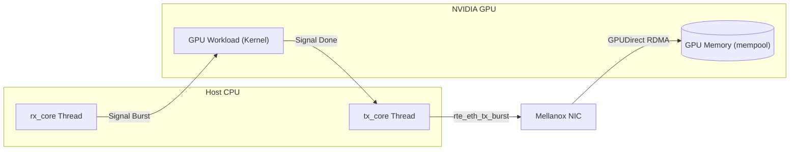
Sources: [README.md:12-17](), [src/main.cpp:53-53]()

---

### Key Capabilities

`l2fwd-nv` provides flexible configuration for memory placement and processing logic, controlled via command-line arguments [src/main.cpp:38-51]().

| Feature | Description | Code Entities |
| :--- | :--- | :--- |
| **Memory Placement** | Mbuf payloads can be allocated in Host Pinned memory or Device (GPU) memory. | `MEM_HOST_PINNED`, `MEM_DEVMEM` [include/common.h:60-61]() |
| **Workload Modes** | Supports No-op, CPU-based MAC swap, and three distinct GPU execution strategies. | `workload_flags` [include/common.h:74-80]() |
| **Buffer Split** | Splits incoming packets: headers to CPU memory and payloads to GPU memory. | `conf_buffer_split`, `RTE_ETH_RX_OFFLOAD_BUFFER_SPLIT` [src/main.cpp:36-66]() |
| **Telemetry** | Real-time tracking of RX/TX packets per queue and throughput (PPS). | `pipeline_v[i]->rx_pkts`, `print_stats()` [src/main.cpp:96-157]() |

For a complete list of runtime options, see [Command-Line Interface and Runtime Options](#1.3).

---

### Major Subsystems

The codebase is structured around the interaction between DPDK EAL threads and CUDA streams.

#### 1. Pipeline and Threading Model
The application initializes a vector of `Pipeline` objects [src/main.cpp:53](). Each pipeline launches two CPU threads: an `rx_core` to accumulate packets into `burst_item` structures and a `tx_core` to monitor for workload completion [README.md:8-11]().
*   **For details, see [Project Purpose and Architecture](#1.1).**

#### 2. GPU Workload Engine
Workloads are implemented in CUDA and managed through the `Pipeline` class. The engine supports standard per-burst launches, persistent kernels that poll for work, and CUDA Graphs for reduced launch overhead [README.md:25-27]().
*   **For details, see [Core Architecture](#2).**

#### 3. Memory and Communication
The application uses `rte_gpu_comm_list` to create a shared status ring between the CPU and GPU. This allows the GPU kernel to signal completion without expensive interrupts or CPU-side polling of GPU registers [include/common.h:39-42]().
*   **For details, see [Memory Management and GPU Communication](#2.3).**

**System Entity Mapping**
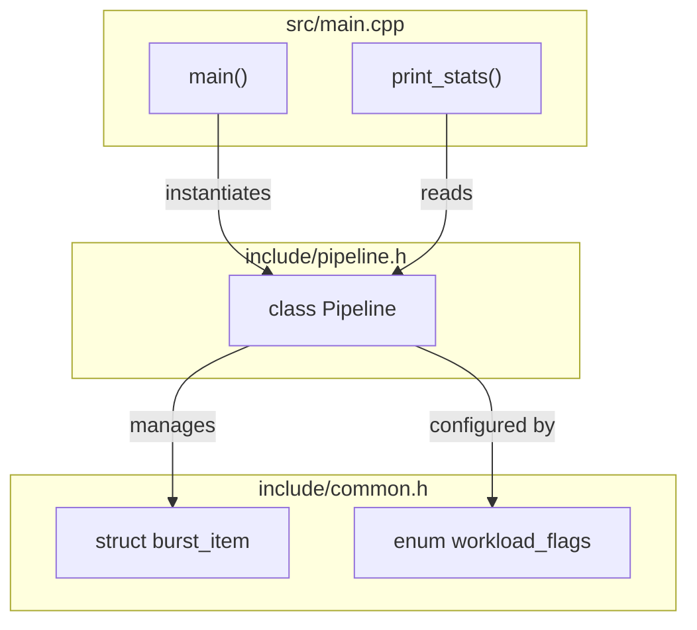
Sources: [src/main.cpp:53-53](), [include/pipeline.h:1-1](), [include/common.h:85-93]()

---

### Getting Started

To run `l2fwd-nv`, the system must be configured with specific kernel parameters (hugepages, CPU isolation) and the `gdrdrv` kernel module must be loaded [README.md:55-58](), [README.md:153-158]().

*   **Build Requirements**: CUDA Toolkit, Mellanox OFED, Meson/Ninja, and CMake [README.md:100-147]().
*   **Step-by-step Guide**: See [Getting Started: Build and System Setup](#1.2).

---

# Page: Project Purpose and Architecture

# Project Purpose and Architecture

<details>
<summary>Relevant source files</summary>

The following files were used as context for generating this wiki page:

- [README.md](README.md)
- [include/common.h](include/common.h)
- [src/main.cpp](src/main.cpp)

</details>


The `l2fwd-nv` application is a high-performance packet processing showcase designed to demonstrate the integration of the Data Plane Development Kit (DPDK) with NVIDIA GPUs using the `gpudev` library. It extends the classic DPDK `l2fwd` example by enabling packet payloads to be stored in GPU memory and processed via CUDA kernels, leveraging GPUDirect RDMA for low-latency data transfer [README.md:1-6]().

## Application Goals

The primary goal of `l2fwd-nv` is to provide a reference implementation for:
*   **GPUDirect RDMA:** Direct data transfer between Network Interface Cards (NICs) and GPU memory [README.md:31-33]().
*   **GPU-Centric Networking:** Utilizing the `gpudev` library (introduced in DPDK 21.11) to manage GPU memory and communication [README.md:45-46]().
*   **Workload Pipelining:** Demonstrating efficient CPU-GPU synchronization models to maintain high throughput and low latency [README.md:8-17]().

## Pipeline Architecture

The application is structured around the `Pipeline` abstraction. Each pipeline operates independently on a dedicated set of CPU cores and a DPDK queue pair [README.md:8-11]().

### The Pipeline Model
A single pipeline consists of three logical stages:
1.  **RX Stage (CPU):** A dedicated `rx_core` receives packets from a DPDK RX queue and accumulates them into bursts [README.md:9-13]().
2.  **Workload Stage (CPU/GPU):** The accumulated burst is processed. Depending on the configuration, this may be a simple CPU-based MAC swap or a complex CUDA kernel execution [README.md:10-14]().
3.  **TX Stage (CPU):** A dedicated `tx_core` waits for the workload completion and transmits the modified packets through a DPDK TX queue [README.md:11-16]().

### Data Flow Diagram: NIC to GPU to NIC
The following diagram illustrates the data flow and the interaction between code entities across the pipeline stages.

**Pipeline Data Flow and Entity Mapping**
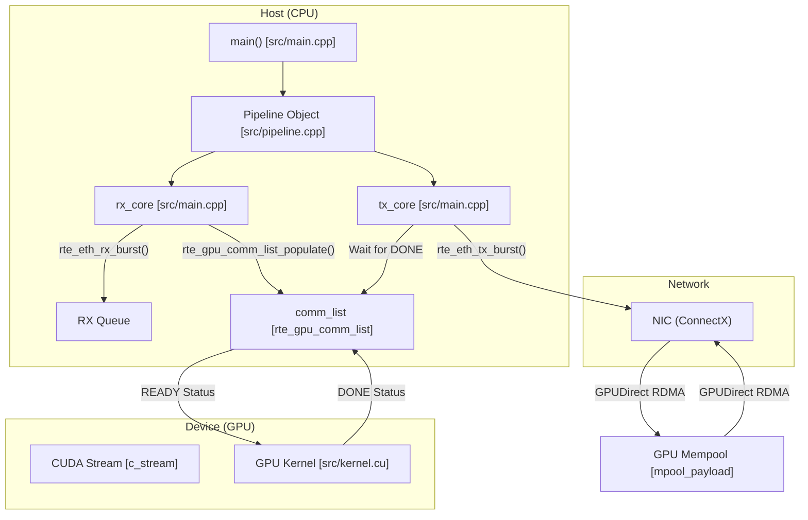
Sources: [src/main.cpp:250-280](), [src/pipeline.cpp:45-80](), [README.md:8-17](), [include/common.h:85-93]()

## Supported Workload Modes

The application supports several execution modes, defined by the `workload_flags` enum in `include/common.h` [include/common.h:74-80]().

| Mode | Flag | Description | Implementation |
| :--- | :--- | :--- | :--- |
| **No Workload** | `NO_WORKLOAD` | Basic I/O forwarding without packet modification. | [src/main.cpp:170-174]() |
| **CPU Workload** | `CPU_WORKLOAD` | The CPU performs MAC address swapping on the host. | [README.md:24]() |
| **Standard GPU** | `GPU_WORKLOAD` | A discrete CUDA kernel is launched for every burst. | [src/kernel.cu:35-50]() |
| **Persistent GPU** | `GPU_PK_WORKLOAD` | A single long-running kernel polls for new data in a loop. | [src/kernel.cu:150-180]() |
| **CUDA Graphs** | `GPU_GRAPHS_WORKLOAD` | Uses CUDA Graphs to chain multiple burst executions with low overhead. | [src/pipeline.cpp:120-150]() |

Sources: [include/common.h:74-80](), [README.md:19-28]()

## System Synchronization and Communication

The CPU and GPU communicate via a structured list of descriptors managed by the `gpudev` library. The primary structure used for this is the `rte_gpu_comm_list` [src/pipeline.cpp:65-70]().

### The `burst_item` Lifecycle
Each packet burst is tracked using a `burst_item` structure, which resides in memory accessible by both CPU and GPU [include/common.h:85-93]().

**Workload Lifecycle States**
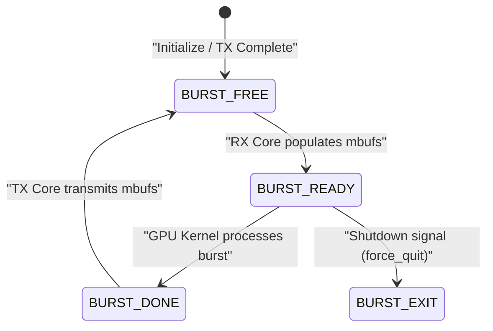
Sources: [include/common.h:39-42](), [src/main.cpp:91](), [src/kernel.cu:200-220]()

### Memory Management
The application supports two primary memory configurations for the packet mempool, controlled by `conf_mem_type` [src/main.cpp:23]():
1.  **`MEM_HOST_PINNED` (0):** Packets are stored in CPU memory that is pinned and mapped for GPU access [include/common.h:61]().
2.  **`MEM_DEVMEM` (1):** Packets are stored directly in GPU memory. The NIC uses GPUDirect RDMA to write/read directly to/from the GPU VRAM [include/common.h:60]().

When using GPU memory, `l2fwd-nv` can also enable **Buffer Split** (`-s` flag). This feature splits an incoming packet: the header (first 60 bytes) is stored in CPU memory for easy protocol processing, while the payload is stored in GPU memory for parallel computation [src/main.cpp:36](), [include/common.h:57-58]().

Sources: [src/main.cpp:22-37](), [include/common.h:60-61](), [README.md:21-28]()

---

# Page: Getting Started: Build and System Setup

# Getting Started: Build and System Setup

<details>
<summary>Relevant source files</summary>

The following files were used as context for generating this wiki page:

- [.gitmodules](.gitmodules)
- [CMakeLists.txt](CMakeLists.txt)
- [README.md](README.md)

</details>


This page provides a comprehensive technical guide for setting up the environment, configuring the system kernel, and building the `l2fwd-nv` application. The application relies on a tightly coupled integration between DPDK, NVIDIA GPUs, and Mellanox NICs to demonstrate high-performance GPUDirect RDMA packet processing.

## Prerequisites and System Requirements

Before building the application, the system must meet specific hardware and software requirements to support the high-speed data path between the NIC and the GPU.

### Software Dependencies
*   **CUDA Toolkit**: Version 11.4 or newer is recommended for the `nvidia_peermem` module [README.md:100-119]().
*   **Mellanox OFED**: Version 5.4 or newer [README.md:91-91]().
*   **Build Tools**: 
    *   `meson` (> 0.49.2) and `ninja-build` [README.md:104-107]().
    *   `cmake` (>= 3.10) [CMakeLists.txt:15-15]().
    *   `pkg-config` for DPDK dependency resolution [CMakeLists.txt:126-131]().

### Hardware Configuration (NIC)
The Mellanox network card requires specific firmware settings to optimize for small packet throughput and GPU interaction:
1.  **CQE Compression**: Must be enabled using `mlxconfig -d <NIC> set CQE_COMPRESSION=1` [README.md:92-92]().
2.  **Link Type**: For VPI adapters, ensure the link type is set to Ethernet: `LINK_TYPE_P1=2` [README.md:95-95]().

**Sources:** [README.md:91-119](), [CMakeLists.txt:15-131]()

---

## Kernel Configuration

To achieve deterministic performance and allow DPDK to manage memory and CPU cores effectively, specific kernel parameters must be set.

### Boot Parameters
The following parameters should be added to `GRUB_CMDLINE_LINUX_DEFAULT` in `/etc/default/grub` [README.md:55-62]():

| Parameter | Purpose |
| :--- | :--- |
| `default_hugepagesz=1G` | Sets the default hugepage size to 1GB for DPDK mempools [README.md:57-57](). |
| `hugepages=16` | Reserves 16 hugepages (16GB total) [README.md:57-57](). |
| `isolcpus=2-21` | Isolates CPUs from the Linux scheduler for DPDK RX/TX threads [README.md:57-60](). |
| `nohz_full=2-21` | Reduces timer interrupts on isolated cores [README.md:57-57](). |
| `iommu=off` | Disables IOMMU to simplify GPUDirect RDMA memory mapping [README.md:57-57](). |
| `idle=poll` | Forces CPUs to stay in high-power states for low latency [README.md:57-57](). |

### GPUDirect RDMA Kernel Modules
Communication between the NIC and GPU requires a peer-memory module:
*   **Modern Systems (CUDA 11.4+):** Load the official NVIDIA module: `sudo modprobe nvidia_peermem` [README.md:118-122]().
*   **Legacy Systems:** Build and install the `nv_peer_memory` module manually [README.md:127-134]().

**Sources:** [README.md:55-85](), [README.md:114-134]()

---

## Build Process

The `l2fwd-nv` project uses CMake to manage a complex build that includes two submodules: DPDK and GDRCopy.

### 1. Cloning the Repository
The submodules must be initialized during cloning to ensure the specific versions of DPDK (22.03) and GDRCopy are available [README.md:38-51](), [.gitmodules:1-6]().

```bash
git clone --recurse-submodules https://github.com/NVIDIA/l2fwd-nv.git
cd l2fwd-nv
```

### 2. Compilation Flow
The `CMakeLists.txt` file defines a strict dependency chain to ensure DPDK is patched and built before the main application.

#### Build Pipeline Diagram
"This diagram illustrates how the CMake build system orchestrates the compilation of submodules and the final executable."

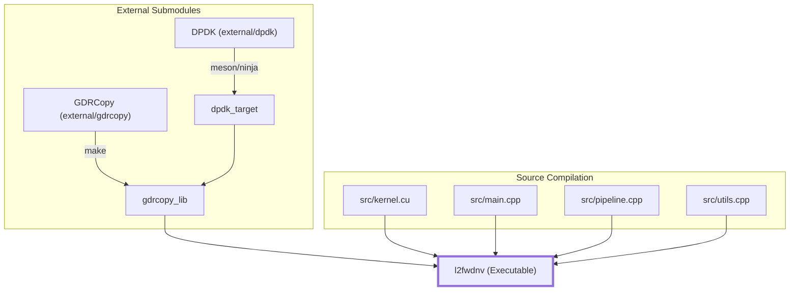

### 3. Build Commands
```bash
mkdir build && cd build
cmake ..
make -j$(nproc)
```

### Key Build Logic in CMake
*   **DPDK Patching**: The build system automatically uses `sed` to set `RTE_PKTMBUF_HEADROOM` to `0` in `config/rte_config.h`. This is critical for GPU memory performance [CMakeLists.txt:110-113]().
*   **Experimental APIs**: The flag `ALLOW_EXPERIMENTAL_API` is defined to enable the `gpudev` library features [CMakeLists.txt:23-23]().
*   **Driver Filtering**: To speed up compilation, the build system disables unnecessary DPDK drivers, focusing on `mlx5` [CMakeLists.txt:62-97]().
*   **NVCC Flag Wrapping**: Since `nvcc` is used for `src/kernel.cu`, DPDK's CFLAGS are wrapped using `-Xcompiler` to ensure compatibility [CMakeLists.txt:175-201]().

**Sources:** [CMakeLists.txt:15-208](), [README.md:136-148](), [.gitmodules:1-6]()

---

## Post-Build: GDRCopy and Runtime Setup

`l2fwd-nv` uses GDRCopy (via the DPDK `gpudev` abstraction) to map GPU memory into the CPU's address space for control-plane synchronization.

### 1. Loading the gdrdrv Module
The GDRCopy kernel driver must be loaded manually after the build [README.md:153-158]():
```bash
cd external/gdrcopy
sudo ./insmod.sh
```

### 2. Environment Variables
At runtime, the application needs to locate the GDRCopy shared library. You must set `GDRCOPY_PATH_L` to the directory containing `libgdrapi.so` [README.md:160-163]():
```bash
export GDRCOPY_PATH_L=$(pwd)/external/gdrcopy/src
```

### System Component Association
"This diagram bridges the system-level components and environment variables to the internal DPDK and GPU entities."

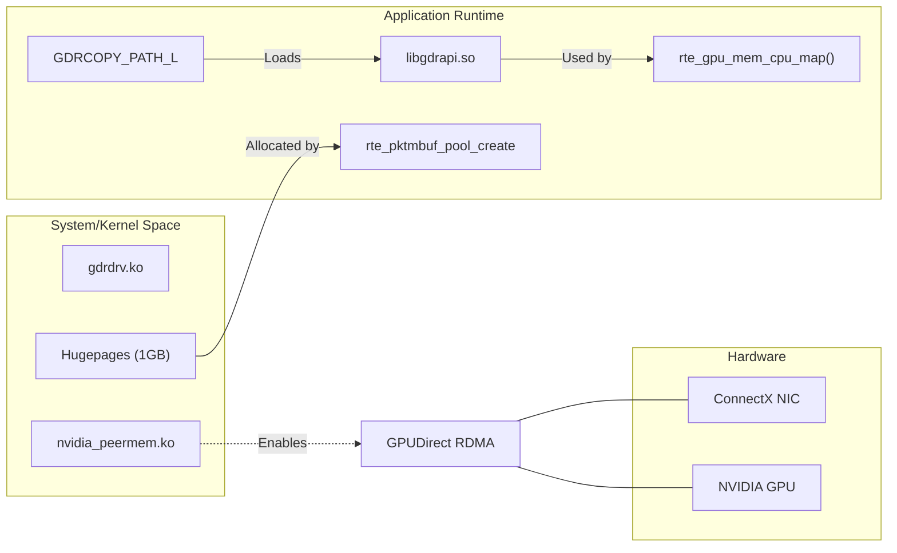

**Sources:** [README.md:149-163](), [CMakeLists.txt:137-145]()

---

# Page: Command-Line Interface and Runtime Options

# Command-Line Interface and Runtime Options

<details>
<summary>Relevant source files</summary>

The following files were used as context for generating this wiki page:

- [README.md](README.md)
- [include/headers.h](include/headers.h)
- [src/utils.cpp](src/utils.cpp)

</details>


This page provides a comprehensive reference for the `l2fwd-nv` command-line interface (CLI). It describes the available flags, their valid ranges, internal mapping to configuration variables, and example invocations for various benchmarking scenarios.

## 1. Overview
The `l2fwd-nv` application uses a standard DPDK-style CLI where configuration is split into two parts:
1.  **EAL Options**: Handled by the DPDK Environmental Abstraction Layer (e.g., `-l` for cores, `-a` for device allow-listing).
2.  **Application Options**: Custom flags specific to `l2fwd-nv` provided after the `--` separator.

The application uses `getopt` to parse these custom flags in the main execution loop, mapping them to global configuration variables that dictate memory allocation, workload types, and pipeline counts.

## 2. CLI Flag Reference

The following table details the application-specific flags available after the `--` separator.

| Flag | Description | Valid Range | Default | Internal Variable |
| :--- | :--- | :--- | :--- | :--- |
| `-b` | **Burst Size**: Number of packets to accumulate before triggering a workload. | 1 to `DEFAULT_PKT_BURST_INPUT` (2048) | 64 | `pkt_burst_size` |
| `-d` | **Data Room Size**: Size of the mbuf payload. | 1 to `DEFAULT_MBUF_DATAROOM` (2048) | 2048 | `mbuf_dataroom_size` |
| `-g` | **GPU Device ID**: The ID of the GPU to use for processing. | 0 to N-1 | 0 | `gpu_id` |
| `-m` | **Mempool Type**: Location of mbuf payloads. 0: Host Pinned, 1: GPU Device Memory. | 0, 1 | 0 | `mempool_type` |
| `-n` | **NVTX Profiler**: Enable NVTX markers for profiling with NVIDIA Nsight/nvvp. | N/A (Boolean) | Disabled | `enable_nvtx` |
| `-p` | **Pipelines**: Number of parallel RX-Workload-TX pipelines. | 1 to `MAX_PIPELINES` (1024) | 1 | `num_pipelines` |
| `-s` | **Buffer Split**: Enable DPDK buffer split (64B CPU header, rest in GPU). | N/A (Boolean) | Disabled | `buffer_split` |
| `-t` | **Workload Time**: Simulated processing time per packet in nanoseconds. | 0 to `MAX_WTIME_NS` (10^9) | 0 | `workload_time_ns` |
| `-v` | **Performance Packets**: Total packets to process before exit. 0 for infinite. | 0 to INT_MAX | 0 | `exit_packet_num` |
| `-w` | **Workload Type**: The execution strategy for MAC swapping. | 0-4 (See Workload Modes) | 0 | `workload_type` |
| `-z` | **Warmup Packets**: Number of packets to process before starting metrics. | 0 to INT_MAX | 0 | `warmup_packet_num` |

### Workload Modes (`-w`)
The `-w` flag selects the processing engine defined in the `workload_flags` enum:
*   **0**: `NO_WORKLOAD` - Simple I/O forwarding. [src/utils.cpp:224]()
*   **1**: `CPU_WORKLOAD` - MAC swap performed on CPU cores. [src/utils.cpp:216]()
*   **2**: `GPU_WORKLOAD` - Standard per-burst CUDA kernel launch. [src/utils.cpp:218]()
*   **3**: `GPU_PK_WORKLOAD` - Persistent CUDA kernel (polls for work). [src/utils.cpp:220]()
*   **4**: `GPU_GRAPHS_WORKLOAD` - CUDA Graphs-based execution. [src/utils.cpp:222]()

Sources: [src/utils.cpp:105-120](), [src/utils.cpp:147-256](), [include/headers.h:118-129]()

## 3. Implementation and Data Flow

The CLI parsing logic resides in `src/utils.cpp`. These functions validate input against constraints defined in `include/common.h`.

### CLI to Configuration Mapping
The diagram below illustrates how CLI arguments are transformed into the internal `Pipeline` configuration.

**Title: CLI Configuration Flow**
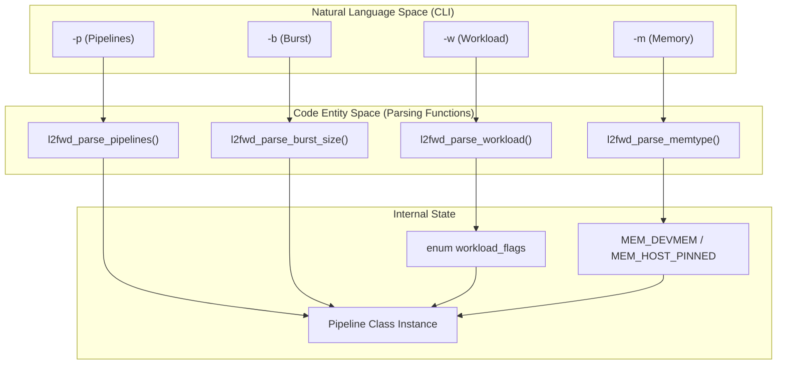
Sources: [src/utils.cpp:160-240](), [include/pipeline.h:50-100]()

### Logic Validation
The parsing functions ensure the system remains in a stable state:
*   **`l2fwd_parse_burst_size`**: Validates that the burst does not exceed `DEFAULT_PKT_BURST_INPUT` (2048) to prevent ring buffer overflows. [src/utils.cpp:147-158]()
*   **`l2fwd_parse_workload`**: Maps integer inputs to the `workload_flags` enum, ensuring the `Pipeline` constructor selects the correct CUDA path. [src/utils.cpp:206-225]()
*   **`l2fwd_parse_warmup_packets`**: If packets are specified but below `DRIVER_MIN_RX_PKTS`, it rounds up to ensure NIC driver stability. [src/utils.cpp:176-189]()

Sources: [src/utils.cpp:147-256]()

## 4. Execution Examples

### GPU Direct RDMA (High Performance)
To run with packets stored in GPU memory using a persistent kernel for minimum latency:
```bash
./build/l2fwdnv -l 1,2,3 -a 0000:01:00.0 -- -p 1 -m 1 -w 3 -b 1024
```
*   `-m 1`: Use `MEM_DEVMEM`.
*   `-w 3`: Use `GPU_PK_WORKLOAD` (Persistent Kernel).

### Simulated Heavy Workload
To simulate a compute-intensive task (10 microseconds per packet) using CUDA Graphs:
```bash
./build/l2fwdnv -l 1-10 -- -p 4 -w 4 -t 10000 -v 10000000
```
*   `-t 10000`: 10,000ns per packet.
*   `-v 10000000`: Exit after 10M packets.

### Buffer Split Mode
To split incoming packets (64B header to CPU, payload to GPU):
```bash
./build/l2fwdnv -l 1,2,3 -- -s -m 1 -w 2
```
*   `-s`: Enables `buffer_split` in the NIC configuration.

Sources: [README.md:164-200]()

## 5. Statistics and Telemetry
The application tracks performance through the `port_statistics` structure.

**Title: Telemetry Data Flow**
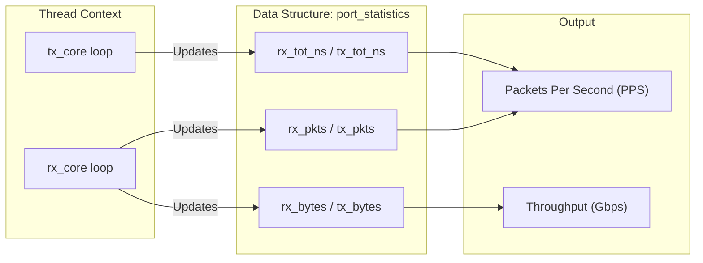
Sources: [include/headers.h:82-95](), [README.md:200-250]()

*   **Warmup Phase**: Packets received during the warmup phase (configured by `-z`) are tracked in `rx_warmup_bytes` and excluded from final PPS calculations. [include/headers.h:91]()
*   **Latency**: The `tx_tot_ns` and `rx_tot_ns` fields track the time packets spend in the pipeline for average latency reporting. [include/headers.h:86,92]()

Sources: [include/headers.h:82-95]()

---

# Page: Core Architecture

# Core Architecture

<details>
<summary>Relevant source files</summary>

The following files were used as context for generating this wiki page:

- [include/common.h](include/common.h)
- [src/main.cpp](src/main.cpp)
- [src/pipeline.cpp](src/pipeline.cpp)

</details>


The `l2fwd-nv` application is built around a high-performance pipeline designed to bridge DPDK's packet processing capabilities with NVIDIA GPU parallel computing. The architecture minimizes CPU involvement in the data path by using asynchronous communication and direct memory access (GPUDirect RDMA).

### System Overview

The application organizes work into multiple independent pipelines. Each pipeline maps to a specific set of CPU cores (RX and TX) and a GPU stream. Data flows from the NIC directly to GPU-visible memory, where it is processed by CUDA kernels before being transmitted back through the NIC.

#### Data Flow and Code Entity Mapping
The following diagram illustrates how high-level architectural components map to specific code entities and data structures.

**Diagram: Architectural Component Mapping**
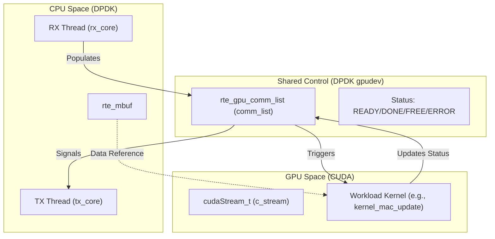
**Sources:** [src/main.cpp:53-53](), [include/pipeline.h:38-60](), [include/common.h:85-93]()

---

### Pipeline Abstraction
The `Pipeline` class in `include/pipeline.h` is the central orchestrator for each data stream. It encapsulates the CUDA stream, the communication ring buffer, and telemetry data.

- **Initialization**: The constructor initializes the `rte_gpu_comm_list` using `rte_gpu_comm_create_list` [src/pipeline.cpp:33-35]().
- **Workload Branching**: Depending on the `workload_type` (e.g., `GPU_WORKLOAD`, `GPU_PK_WORKLOAD`), the pipeline either launches kernels per-burst or sets up persistent/graph-based workloads [src/pipeline.cpp:49-77]().
- **Shutdown**: The `terminateWorkload()` function uses the `RTE_GPU_COMM_LIST_ERROR` status to gracefully signal GPU kernels to exit their loops [src/pipeline.cpp:98-110]().

For details, see [Pipeline Abstraction](#2.1).

**Sources:** [src/pipeline.cpp:19-78](), [include/pipeline.h:38-66]()

---

### RX/TX Threading Model
The application uses a split-core model to maximize throughput. For every pipeline, two EAL remote threads are launched: one for receiving packets (`rx_core`) and one for transmitting them (`tx_core`).

- **Synchronization**: The threads synchronize with the GPU using a circular buffer of `struct burst_item` managed by the `rte_gpu_comm_list` [include/common.h:85-93]().
- **Burst Management**: The `rx_core` accumulates packets into bursts (up to `MAX_MBUFS_BURST`) before handing them to the GPU [include/common.h:34-34]().
- **Flow Control**: The `GAP_PKTS` mechanism ensures there is a safety buffer between the producer (RX) and consumer (TX) indices in the ring buffer [include/common.h:62-62]().

For details, see [RX/TX Threading Model](#2.2).

**Sources:** [src/main.cpp:1146-1152](), [include/common.h:34-42]()

---

### Memory Management and GPU Communication
Efficient CPU-GPU communication is achieved through the `gpudev` library and specialized mempool configurations.

- **Mempool Strategies**: Supports `MEM_HOST_PINNED` (CPU memory registered with the GPU) and `MEM_DEVMEM` (GPU-native memory registered with DPDK) [include/common.h:60-61]().
- **Communication Protocol**: The `rte_gpu_comm_list` provides a standardized way for the CPU to signal "READY" to the GPU and for the GPU to signal "DONE" back to the CPU [include/common.h:39-42]().
- **Buffer Split**: To optimize processing, the system can split packets into headers (for GPU processing) and payloads [src/main.cpp:36-36]().

For details, see [Memory Management and GPU Communication](#2.3).

**Sources:** [src/main.cpp:23-23](), [src/main.cpp:59-60](), [include/common.h:65-68]()

---

### Core Interaction Sequence
The following diagram shows the lifecycle of a single packet burst as it moves through the core architecture entities.

**Diagram: Burst Lifecycle Sequence**
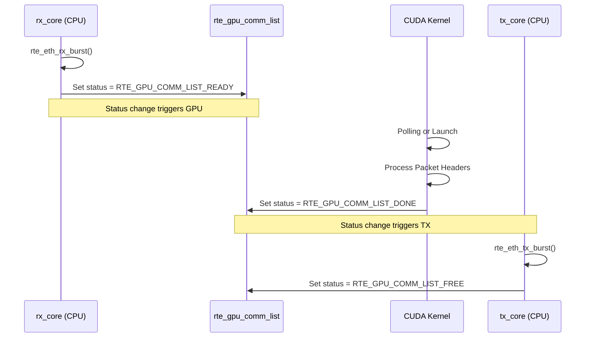
**Sources:** [src/main.cpp:750-850](), [src/main.cpp:950-1050](), [include/common.h:39-42]()

---

# Page: Pipeline Abstraction

# Pipeline Abstraction

<details>
<summary>Relevant source files</summary>

The following files were used as context for generating this wiki page:

- [include/common.h](include/common.h)
- [include/pipeline.h](include/pipeline.h)
- [src/pipeline.cpp](src/pipeline.cpp)

</details>


The `Pipeline` class serves as the central management entity for a single data path in `l2fwd-nv`. It encapsulates the lifecycle of CPU-GPU communication structures, CUDA streams, workload-specific kernel launches (Standard, Persistent, or Graphs), and high-resolution telemetry for performance monitoring.

### Pipeline Initialization

The `Pipeline` constructor [src/pipeline.cpp:19-32]() initializes the execution context for a specific GPU and workload type. It maps a specific RX queue and TX queue to a GPU device and prepares the communication layer.

#### CUDA Stream and Communication List
Each pipeline creates a dedicated `rte_gpu_comm_list` using `rte_gpu_comm_create_list` [src/pipeline.cpp:33](). This list acts as a circular buffer of `MAX_BURSTS_X_QUEUE` items (defined as 4096 in [include/common.h:35]()) used to synchronize packet metadata between the CPU and GPU.

If the workload type involves the GPU (i.e., `workload_type >= GPU_WORKLOAD`), a non-blocking CUDA stream `c_stream` is created [src/pipeline.cpp:49-50]().

#### Constructor Parameters
| Parameter | Description |
| :--- | :--- |
| `_index` | Unique identifier for the pipeline instance. |
| `_workload_type` | Selected mode from `enum workload_flags` [include/common.h:74-80](). |
| `_pkt_time_ns` | Simulated processing time per packet in nanoseconds. |
| `_rx_queue` / `_tx_queue` | DPDK queue indices assigned to this pipeline. |
| `_gpu_id` | Identifier of the GPU device to be used. |

**Sources:** [src/pipeline.cpp:19-50](), [include/pipeline.h:62-76](), [include/common.h:35,74-80]()

---

### Workload Branching Logic

The `Pipeline` class implements different kernel management strategies based on the `workload_type`.

#### 1. GPU_WORKLOAD (Standard)
In this mode, no persistent kernel is launched at initialization. Instead, the RX core triggers individual kernel launches for every burst.

#### 2. GPU_PK_WORKLOAD (Persistent Kernel)
The constructor calls `workload_launch_persistent_gpu_processing` [src/pipeline.cpp:60-61](). This launches a single long-running kernel that polls the `comm_list` for new work, reducing the overhead of frequent `cudaLaunchKernel` calls.

#### 3. GPU_GRAPHS_WORKLOAD (CUDA Graphs)
This mode captures a sequence of kernel launches into executable graphs to minimize driver overhead [src/pipeline.cpp:66-76]().
- It captures `N_GRAPHS` [include/common.h:37]().
- Each graph contains `GRAPH_BURST` (8) individual burst processing nodes [include/common.h:36]().
- Graphs are recorded via `cudaStreamBeginCapture` and instantiated into `winstance[]` [src/pipeline.cpp:70-74]().

#### Data Flow and Entity Mapping
The following diagram illustrates how the `Pipeline` class orchestrates these components.

"Pipeline Entity Relationship"
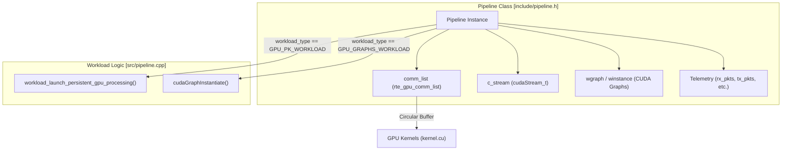
**Sources:** [src/pipeline.cpp:55-77](), [include/pipeline.h:75-79](), [include/common.h:36-37]()

---

### Telemetry and Statistics

The `Pipeline` class maintains per-pipeline counters and high-resolution timestamps to track throughput and latency [include/pipeline.h:89-98]().

| Field | Description |
| :--- | :--- |
| `rx_pkts` / `tx_pkts` | Total packets received/transmitted by this pipeline. |
| `rx_bytes` / `tx_bytes` | Total bytes processed. |
| `start_rx_core` / `stop_rx_core` | `std::chrono` timestamps for the start and end of the RX loop. |
| `start_tx_core` / `stop_tx_core` | `std::chrono` timestamps for the start and end of the TX loop. |

Timing utilities are provided by the `Time` helper class [include/pipeline.h:30-59](), which uses `std::chrono::system_clock` to provide nanosecond precision (`nowNs()`).

**Sources:** [include/pipeline.h:30-59, 89-98](), [src/pipeline.cpp:39-46]()

---

### Shutdown Sequence

The shutdown process ensures that GPU kernels are gracefully terminated before the application exits.

#### terminateWorkload()
For persistent workloads (`GPU_PK_WORKLOAD` or `GPU_GRAPHS_WORKLOAD`), the `terminateWorkload()` function [src/pipeline.cpp:98-110]() performs the following:
1. Iterates through the entire `comm_list`.
2. Sets the status of every item to `RTE_GPU_COMM_LIST_ERROR` [src/pipeline.cpp:103]().
3. The GPU-side persistent kernel detects this error state in its polling loop and exits.
4. Calls `cudaStreamSynchronize(c_stream)` [src/pipeline.cpp:108]() to ensure the GPU has finished cleanup.

#### Destructor
The destructor [src/pipeline.cpp:80-96]() handles resource deallocation:
- Destroys the CUDA stream via `cudaStreamDestroy` [src/pipeline.cpp:83]().
- Releases the communication list via `rte_gpu_comm_destroy_list` [src/pipeline.cpp:85]().
- Destroys CUDA Graphs (`wgraph`) if they were initialized [src/pipeline.cpp:91]().

#### Shutdown Logic Flow
"Termination Sequence"
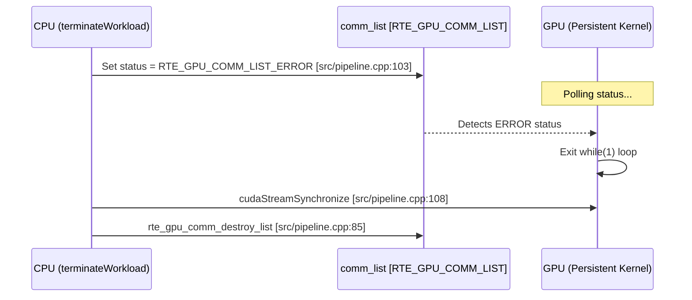

**Sources:** [src/pipeline.cpp:80-110](), [include/common.h:42]()

---

# Page: RX/TX Threading Model

# RX/TX Threading Model

<details>
<summary>Relevant source files</summary>

The following files were used as context for generating this wiki page:

- [include/common.h](include/common.h)
- [include/headers.h](include/headers.h)
- [src/main.cpp](src/main.cpp)

</details>


The `l2fwd-nv` application employs a decoupled threading model where RX and TX operations for each pipeline are executed on dedicated CPU cores. This separation, combined with a ring-buffer-based communication protocol, allows the application to overlap network I/O with GPU execution, maximizing throughput and minimizing latency.

## Thread Launch and Lifecycle

The application utilizes the DPDK EAL (Environment Abstraction Layer) to manage CPU affinity and thread execution. For every configured pipeline, two distinct functions are launched on remote lcores using `rte_eal_remote_launch` [src/main.cpp:575-578]().

*   **RX Thread (`rx_core`)**: Responsible for polling the NIC, accumulating packets into bursts, and signaling the GPU (or CPU workload) that data is ready.
*   **TX Thread (`tx_core`)**: Responsible for polling the completion status of bursts and transmitting processed packets back through the NIC.

The `force_quit` flag is a global volatile boolean used to signal all threads to exit their processing loops gracefully [src/main.cpp:91-91]().

### Thread Initialization Flow
The following diagram illustrates how the main thread orchestrates the launch of the pipeline threads.

**Pipeline Thread Orchestration**
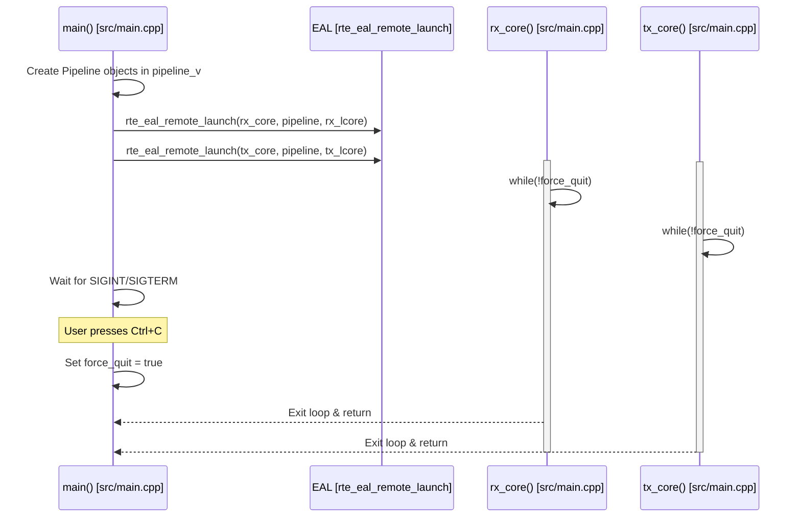
Sources: [src/main.cpp:575-578](), [src/main.cpp:91-91](), [src/main.cpp:315-315](), [src/main.cpp:450-450]()

---

## Communication via `rte_gpu_comm_list`

Synchronization between the CPU threads and the GPU workload is managed through the `rte_gpu_comm_list` provided by the DPDK `gpudev` library. This structure acts as a circular ring buffer of communication items, where each item represents a single burst of packets [src/pipeline.cpp:88-100]().

### Burst Lifecycle States
The communication protocol relies on the `status` field of the `rte_gpu_comm_list` items:
1.  **`RTE_GPU_COMM_LIST_FREE`**: The item is available for the RX core to populate.
2.  **`RTE_GPU_COMM_LIST_READY`**: The RX core has filled the item with packet pointers and lengths; the GPU can now process it.
3.  **`RTE_GPU_COMM_LIST_DONE`**: The GPU (or CPU workload) has finished processing; the TX core can now transmit.
4.  **`RTE_GPU_COMM_LIST_ERROR`**: Indicates a failure or a signal to terminate (used by persistent kernels) [include/common.h:39-42]().

### Burst Accumulation and GAP_PKTS
The `rx_core` does not necessarily signal the GPU for every small packet arrival. It attempts to accumulate packets up to `conf_pkt_burst_size` [src/main.cpp:337-340](). 

A critical optimization is the `GAP_PKTS` mechanism. To prevent the RX core from being blocked by a slow consumer, the `rx_core` ensures there is always a minimum gap of `GAP_PKTS` free items in the `comm_list` ring before fetching more packets from the NIC [src/main.cpp:333-335](). If the gap is insufficient, the RX core stalls to avoid overwriting items currently being processed by the GPU or TX core.

Sources: [src/pipeline.cpp:88-100](), [include/common.h:39-42](), [include/common.h:62-62](), [src/main.cpp:333-340]()

---

## Data Flow: RX to TX

The interaction between the two threads and the GPU is mediated by the `comm_list` and the `Pipeline` object.

**RX/TX Data Flow and State Machine**
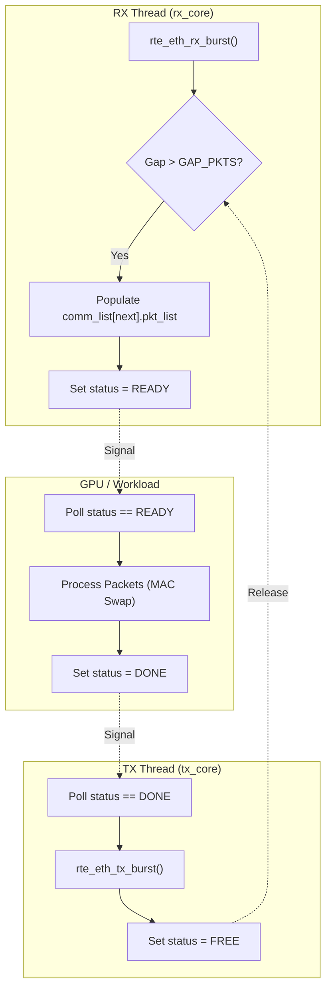
Sources: [src/main.cpp:315-448](), [src/main.cpp:450-530](), [include/common.h:62-62]()

---

## Statistics and PPS Reporting

Each `Pipeline` object maintains internal telemetry to track performance without requiring global locks.

### Per-Pipeline Statistics
The following fields in the `Pipeline` class are updated during the main loops:
*   `rx_pkts`: Total packets received by the `rx_core` [src/main.cpp:417-417]().
*   `tx_pkts`: Total packets transmitted by the `tx_core` [src/main.cpp:513-513]().
*   `start_rx_core` / `stop_rx_core`: Timestamps for the duration of the RX loop [src/main.cpp:322-322](), [src/main.cpp:447-447]().
*   `start_tx_core` / `stop_tx_core`: Timestamps for the duration of the TX loop [src/main.cpp:457-457](), [src/main.cpp:529-529]().

### Warmup and Performance Phases
The application distinguishes between "warmup" and "performance" packets to ensure measurements are taken when the system is in a steady state:
*   `conf_warmup_packets`: Packets processed before statistics start [src/main.cpp:30-30]().
*   `conf_performance_packets`: Total packets to process before the application triggers `force_quit` [src/main.cpp:31-31]().

### Reporting Logic
The `print_stats()` function calculates the Packets Per Second (PPS) for each queue by dividing the `rx_pkts` (or `tx_pkts`) by the total elapsed time recorded by the core timestamps [src/main.cpp:129-134](). It also compares `l2fwd-nv` internal counters against the hardware counters retrieved via `rte_eth_stats_get()` [src/main.cpp:105-105]().

| Statistic | Source Entity | Description |
| :--- | :--- | :--- |
| **RX PPS** | `Pipeline::rx_pkts` | (rx_pkts) / (stop_rx_core - start_rx_core) |
| **TX PPS** | `Pipeline::tx_pkts` | (tx_pkts) / (stop_tx_core - start_tx_core) |
| **Dropped (HW)** | `rte_eth_stats::imissed` | Packets dropped by NIC due to full RX queues |
| **Errors** | `rte_eth_stats::ierrors` | Erroneous packets received by NIC |

Sources: [src/main.cpp:96-168](), [include/pipeline.h:55-64](), [src/main.cpp:30-31]()

---

# Page: Memory Management and GPU Communication

# Memory Management and GPU Communication

<details>
<summary>Relevant source files</summary>

The following files were used as context for generating this wiki page:

- [include/common.h](include/common.h)
- [include/headers.h](include/headers.h)
- [src/main.cpp](src/main.cpp)

</details>


This page details the memory allocation strategies and the synchronization protocol used by `l2fwd-nv` to facilitate high-performance data movement between the Network Interface Card (NIC), System RAM, and GPU VRAM. The application leverages DPDK's `gpudev` library and NVIDIA GPUDirect RDMA to minimize CPU involvement in the data path.

## Mempool Strategies

`l2fwd-nv` supports two primary memory management strategies for packet buffers, determined by the `conf_mem_type` variable (controlled via the `-m` CLI flag) [src/main.cpp:23-23](). Both strategies aim to make packet data accessible to the GPU for processing.

### 1. Host Pinned Memory (MEM_HOST_PINNED)
In this mode, packets are received into standard CPU system memory (hugepages). The memory is "pinned" and registered with the GPU so the GPU can access it over PCIe via DMA.
- **Implementation**: The application calls `rte_gpu_mem_register` to map the CPU-resident mempool into the GPU address space [src/main.cpp:665-673]().
- **Use Case**: Suitable for systems without GPUDirect RDMA support or when the workload requires frequent CPU access to packet headers.

### 2. Device Memory (MEM_DEVMEM)
This mode utilizes GPUDirect RDMA to receive packets directly into GPU VRAM.
- **Allocation**: Memory is allocated on the GPU using `rte_gpu_mem_alloc` [src/main.cpp:607-607]().
- **Registration**: The allocated GPU memory is registered as DPDK external memory using `rte_extmem_register` [src/main.cpp:615-615]().
- **DMA Mapping**: The memory is then DMA-mapped to the NIC using `rte_dev_dma_map` to allow the hardware to write directly to VRAM [src/main.cpp:624-624]().

### Memory Alignment and Page Size
GPU memory allocations must be aligned to the GPU page size. `l2fwd-nv` defines `GPU_PAGE_SIZE` as 64KB ($2^{16}$) [include/common.h:65-66]().
- **Alignment Calculation**: `ext_mem.buf_len = RTE_ALIGN_CEIL(total_mem_size, GPU_PAGE_SIZE)` [src/main.cpp:612-612]().

**Sources**: [src/main.cpp:600-680](), [include/common.h:60-70]()

---

## Buffer Split Feature

To optimize processing, `l2fwd-nv` can split incoming packets into two segments: a **Header** (stored in CPU memory) and a **Payload** (stored in GPU memory). This is enabled via the `-s` flag [src/main.cpp:46-46]().

- **mpool_header**: A mempool created in CPU memory for protocol headers [src/main.cpp:59]().
- **mpool_payload**: A mempool created in GPU memory for the data [src/main.cpp:59]().
- **Configuration**: The `rte_eth_rxconf` structure is configured with `RTE_ETH_RX_OFFLOAD_BUFFER_SPLIT` [src/main.cpp:66-66]().
- **Headroom**: The application sets `RTE_PKTMBUF_HEADROOM=0` implicitly by not relying on standard offsets, ensuring the payload starts exactly at the beginning of the GPU buffer for simplified kernel indexing.

### Buffer Split Data Flow
Title: Buffer Split Memory Layout
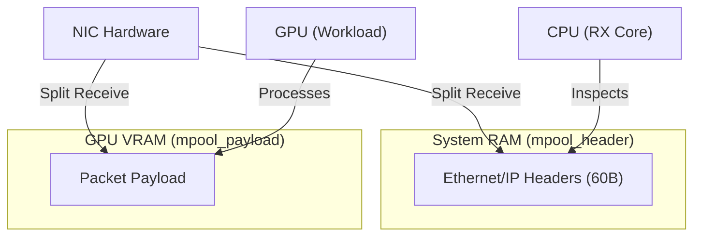
**Sources**: [src/main.cpp:55-78](), [src/main.cpp:712-750](), [include/common.h:57-58]()

---

## CPU-GPU Communication Protocol

The synchronization between the CPU (managing RX/TX) and the GPU (executing kernels) is handled via `rte_gpu_comm_list`. This structure acts as a circular buffer of communication items that track the lifecycle of a packet burst.

### The `rte_gpu_comm_list` Lifecycle
Each entry in the list has a `status` field that transitions through specific states:

| State | Entity Responsible | Description |
| :--- | :--- | :--- |
| `RTE_GPU_COMM_LIST_FREE` | CPU (TX Core) | The slot is empty and ready for a new RX burst. |
| `RTE_GPU_COMM_LIST_READY` | CPU (RX Core) | CPU has populated the slot with packet pointers; GPU can start. |
| `RTE_GPU_COMM_LIST_DONE` | GPU (Kernel) | GPU has finished processing; CPU can transmit the packets. |
| `RTE_GPU_COMM_LIST_ERROR` | CPU/GPU | An error occurred or the application is shutting down. |

### Synchronization Diagram
Title: CPU-GPU Burst Lifecycle (Code Entities)
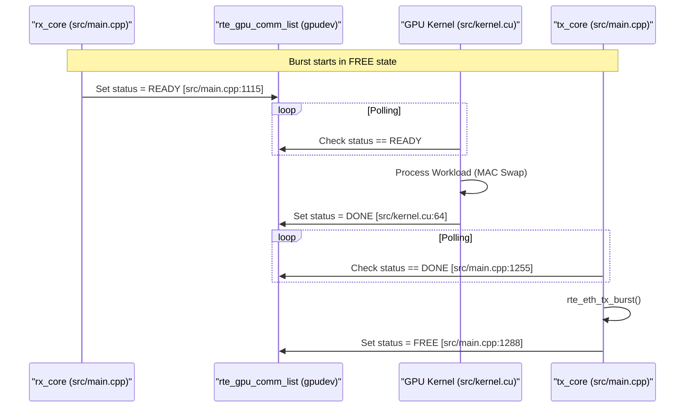
**Sources**: [src/main.cpp:1100-1120](), [src/main.cpp:1250-1290](), [src/kernel.cu:50-70](), [include/common.h:39-42]()

---

## DMA Mapping and Registration

For the NIC to interact with GPU memory, the memory must be visible to the I/O Memory Management Unit (IOMMU).

### Implementation Flow
1. **rte_gpu_mem_alloc**: Reserves a contiguous block of VRAM [src/main.cpp:607]().
2. **rte_extmem_register**: Informs DPDK about this external memory block so it can be used to back an `rte_mempool` [src/main.cpp:615]().
3. **rte_dev_dma_map**: Maps the memory for the specific NIC device. This ensures the PCIe `bus:device.function` has permission to perform DMA reads/writes to those addresses [src/main.cpp:624]().

Title: Memory Registration and DMA Mapping Logic
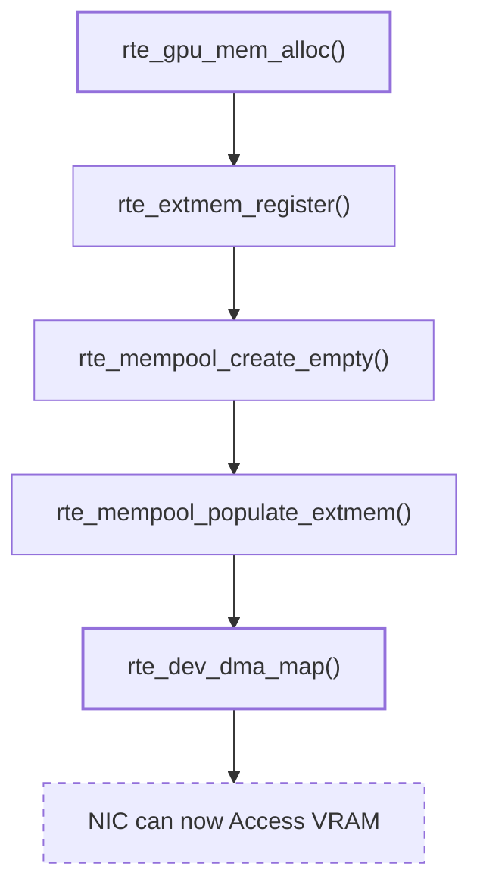

### Page Alignment and Multi-segment Considerations
When using `MEM_DEVMEM`, `l2fwd-nv` calculates the required memory based on the number of mbufs and the data room size, then aligns it to the 64KB GPU page boundary to satisfy `gpudev` requirements [src/main.cpp:603-612]().

**Sources**: [src/main.cpp:600-640](), [include/common.h:65-68]()

---

# Page: GPU Workload Engine

# GPU Workload Engine

<details>
<summary>Relevant source files</summary>

The following files were used as context for generating this wiki page:

- [include/cuda_related.h](include/cuda_related.h)
- [src/kernel.cu](src/kernel.cu)

</details>


The GPU Workload Engine is the core packet processing component of `l2fwd-nv`, implemented in `src/kernel.cu`. It provides the CUDA kernels responsible for manipulating packet data received via GPUDirect RDMA. The engine is designed to integrate seamlessly with the `Pipeline` class, which manages the orchestration of RX/TX cores and GPU execution streams.

The engine supports three distinct execution strategies to balance latency, throughput, and CPU overhead. Each strategy implements a MAC address swap (L2 Forwarding) and can simulate computational load using a busy-wait timer.

### GPU Workload Integration

The engine interfaces with the DPDK `rte_gpu_comm_list` structure to receive packet metadata and signal completion. Each workload strategy is launched via a specific wrapper function that configures the CUDA grid and stream.

#### System Overview: Workload to Code Mapping
The following diagram illustrates how the different workload strategies map to specific CUDA kernels and launcher functions within the codebase.

| Workload Type | Launcher Function | CUDA Kernel | Mode Flag |
| :--- | :--- | :--- | :--- |
| **Standard** | `workload_launch_gpu_processing` | `kernel_mac_update` | `-w 2` |
| **Persistent** | `workload_launch_persistent_gpu_processing` | `kernel_persistent_mac_update` | `-w 3` |
| **Graphs** | `workload_launch_graphs_gpu_processing` | `kernel_graphs_mac_update` | `-w 4` |

**Sources:**
- [src/kernel.cu:94-106]() (Standard Launcher)
- [src/kernel.cu:195-208]() (Persistent Launcher)
- [src/kernel.cu:243-255]() (Graphs Launcher)

### Workload Strategies

The engine provides three strategies to handle the packet processing lifecycle.

#### 1. Standard GPU Kernel (Per-Burst Launch)
This is the default GPU processing mode. For every burst of packets received by the RX core, a new CUDA kernel is launched into the pipeline's stream. It provides the simplest implementation but incurs the overhead of frequent kernel launches.
*   **Key Logic:** Casts packet addresses to `rte_ether_hdr` and swaps source/destination MAC addresses.
*   **Synchronization:** Uses `__threadfence_system()` and sets `RTE_GPU_COMM_LIST_DONE` on the status flag to notify the CPU.
*   For details, see [Standard GPU Kernel (Per-Burst Launch)](#3.1).

#### 2. Persistent Kernel Strategy
Designed for ultra-low latency, this strategy launches a single long-running kernel at application startup. The kernel stays resident on the GPU, polling the `status_d` flag in a `while(1)` loop.
*   **Key Logic:** Thread 0 polls for `RTE_GPU_COMM_LIST_READY` and signals the rest of the block via shared memory (`wait_status_shared`).
*   **Efficiency:** Eliminates the CPU-side overhead of repeated `cudaLaunchKernel` calls.
*   For details, see [Persistent Kernel Strategy](#3.2).

#### 3. CUDA Graphs Strategy
This strategy uses CUDA Graphs to pre-record the processing workflow. It combines the low launch overhead of persistent kernels with the scheduling flexibility of the standard model.
*   **Key Logic:** The pipeline records a sequence of `kernel_graphs_mac_update` executions into a graph, which is then instantiated and replayed.
*   **Synchronization:** The kernel internally polls for the `READY` status before processing, allowing the graph to be launched ahead of actual data arrival.
*   For details, see [CUDA Graphs Strategy](#3.3).

### Common Kernel Utilities

All kernels share a set of utility functions and synchronization primitives to ensure data consistency and timing accuracy.

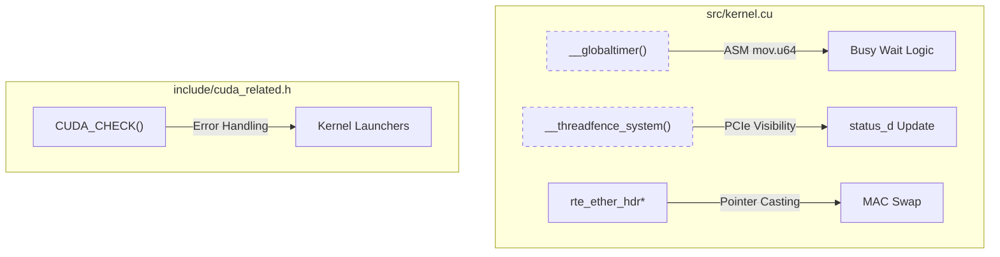

*   **`__globaltimer()`**: Accesses the GPU hardware timer via inline PTX assembly to provide nanosecond-resolution timing for the `wtime_n` busy-wait simulation [src/kernel.cu:25-30]().
*   **Memory Fencing**: Uses `__threadfence()` to ensure packet data writes are complete, followed by `__threadfence_system()` when updating `status_d` to ensure the status change is visible to the CPU over the PCIe bus [src/kernel.cu:84-90]().
*   **Error Handling**: All launchers utilize the `CUDA_CHECK` macro defined in `include/cuda_related.h` to validate kernel execution and API calls [include/cuda_related.h:71-80]().

**Sources:**
- [src/kernel.cu:25-30]() (Global Timer)
- [src/kernel.cu:84-90]() (Fencing)
- [include/cuda_related.h:71-80]() (CUDA_CHECK)

### Strategy Comparison

| Feature | Standard (`-w 2`) | Persistent (`-w 3`) | Graphs (`-w 4`) |
| :--- | :--- | :--- | :--- |
| **Launch Frequency** | Per Burst | Once at Startup | Per Graph (N Bursts) |
| **Host Overhead** | High | Minimal | Low |
| **GPU Occupancy** | Dynamic | Static (Always On) | Dynamic |
| **Polling Location** | CPU (Stream) | GPU (Kernel Loop) | GPU (Kernel Internal) |

**Sources:**
- [src/kernel.cu:35-92]() (Standard Kernel)
- [src/kernel.cu:111-193]() (Persistent Kernel)
- [src/kernel.cu:214-241]() (Graphs Kernel)

---

# Page: Standard GPU Kernel (Per-Burst Launch)

# Standard GPU Kernel (Per-Burst Launch)

<details>
<summary>Relevant source files</summary>

The following files were used as context for generating this wiki page:

- [include/cuda_related.h](include/cuda_related.h)
- [src/kernel.cu](src/kernel.cu)

</details>


The **Standard GPU Kernel** mode represents the traditional CUDA offloading model where a discrete kernel launch is triggered for every burst of packets received by the RX core. This mode is activated using the `-w 2` (GPU_WORKLOAD) command-line flag.

## Overview

In this model, the CPU-side `rx_core` thread manages the synchronization with the GPU. When a burst of packets is ready, the CPU populates a `rte_gpu_comm_list` item and invokes the launcher function `workload_launch_gpu_processing`. This function launches `kernel_mac_update` on a specific CUDA stream. The kernel processes the burst, performs a MAC address swap, simulates computational work if requested, and signals completion back to the CPU/TX core.

### Data Flow and Code Entity Mapping

The following diagram illustrates the transition from the CPU-side DPDK control plane to the GPU-side CUDA execution space.

**Diagram: Per-Burst Launch Control Flow**
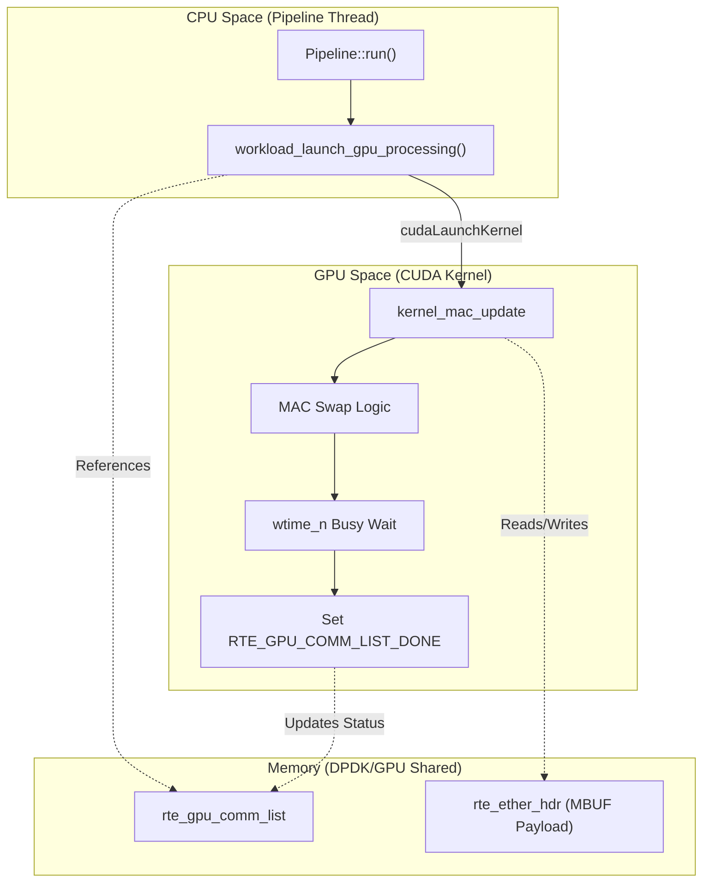
**Sources:** [src/kernel.cu:94-106](), [src/kernel.cu:35-92]()

---

## Kernel Implementation: `kernel_mac_update`

The `kernel_mac_update` function is a `__global__` CUDA kernel designed to process a single burst of packets. Each CUDA thread is mapped to a single packet within the burst using its global thread index.

### MAC Address Swap Logic
The kernel performs an L2 forward swap (Source MAC $\leftrightarrow$ Destination MAC). Instead of byte-by-byte copying, it optimizes the swap by casting the Ethernet header to 16-bit integers.

1.  **Header Casting**: The packet address from `comm_list->pkt_list[idx].addr` is cast to a `struct rte_ether_hdr *` [src/kernel.cu:45]().
2.  **16-bit Pointer Access**: The source and destination addresses are treated as arrays of `uint16_t` [src/kernel.cu:46-47]().
3.  **Swap Execution**: Three 16-bit assignments swap the 48-bit MAC addresses [src/kernel.cu:60-68]().

### Busy-Wait Simulation (`wtime_n`)
To simulate real-world computational workloads (like encryption or deep packet inspection), the kernel includes a busy-wait mechanism:
*   It captures the starting timestamp using the internal `__globaltimer()` function, which reads the GPU's `globaltimer` register [src/kernel.cu:25-30](), [src/kernel.cu:43]().
*   It enters a `while` loop until the difference between the current `__globaltimer()` and the start time exceeds the user-provided `wtime_n` nanoseconds [src/kernel.cu:70-71]().

### Synchronization and Completion
After processing, the kernel ensures memory visibility and signals the CPU:
*   **Memory Barriers**: `__threadfence()` and `__syncthreads()` are used to ensure all packet modifications are complete within the GPU [src/kernel.cu:84-85]().
*   **Status Update**: Thread 0 in the block updates the status of the burst to `RTE_GPU_COMM_LIST_DONE` using the `RTE_GPU_VOLATILE` macro [src/kernel.cu:87-88]().
*   **PCIe Visibility**: `__threadfence_system()` is called to ensure the status write is propagated across the PCIe bus and visible to the CPU cores [src/kernel.cu:89]().

**Sources:** [src/kernel.cu:25-92]()

---

## Launcher: `workload_launch_gpu_processing`

The launcher acts as the bridge between the C++ Pipeline logic and the CUDA C++ kernel.

| Parameter | Description |
| :--- | :--- |
| `comm_list` | Pointer to the DPDK GPU communication list item for the current burst. |
| `wtime_n` | Simulation time in nanoseconds for the busy-wait loop. |
| `cuda_blocks` | Number of CUDA blocks (asserted to be 1 for this implementation). |
| `cuda_threads` | Number of threads per block (typically matching the burst size). |
| `stream` | The `cudaStream_t` associated with the specific Pipeline instance. |

The launcher performs basic validation, ensuring `cuda_blocks` is 1 [src/kernel.cu:97]() and that the `comm_list` is valid [src/kernel.cu:100](). It uses `CUDA_CHECK` from `cuda_related.h` to verify that the kernel launch was successful and that no previous asynchronous errors were pending [src/kernel.cu:103-105]().

**Sources:** [src/kernel.cu:94-106](), [include/cuda_related.h:71-80]()

---

## Technical Details Summary

### Logic Flow Diagram
This diagram details the internal branching and memory synchronization within the `kernel_mac_update`.

**Diagram: Kernel Internal Logic**
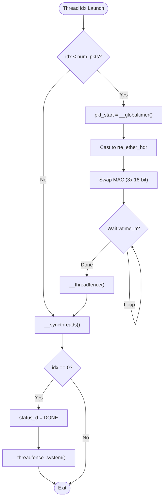
**Sources:** [src/kernel.cu:35-92]()

### Key Code Entities

| Entity | File | Description |
| :--- | :--- | :--- |
| `__globaltimer()` | [src/kernel.cu:25]() | Inline assembly wrapper for reading the GPU's 64-bit nanosecond timer. |
| `kernel_mac_update` | [src/kernel.cu:35]() | The primary GPU entry point for per-burst processing. |
| `workload_launch_gpu_processing` | [src/kernel.cu:94]() | Host-side function that triggers the CUDA kernel launch. |
| `RTE_GPU_COMM_LIST_DONE` | [external/dpdk/...]() | DPDK constant indicating the GPU has finished processing the communication item. |
| `__threadfence_system()` | [CUDA Ref]() | Ensures memory writes are visible to the CPU and other devices on the system bus. |

**Sources:** [src/kernel.cu:25-106]()

---

# Page: Persistent Kernel Strategy

# Persistent Kernel Strategy

<details>
<summary>Relevant source files</summary>

The following files were used as context for generating this wiki page:

- [include/common.h](include/common.h)
- [src/kernel.cu](src/kernel.cu)
- [src/pipeline.cpp](src/pipeline.cpp)

</details>


The Persistent Kernel Strategy (selected via the `-w 3` or `GPU_PK_WORKLOAD` flag) is designed to minimize the overhead associated with frequent CUDA kernel launches. Instead of launching a new GPU kernel for every packet burst, a single "persistent" kernel is launched at application startup and remains active on the GPU, polling for new work via a shared memory signaling mechanism with the CPU.

## Architecture and Design

The persistent strategy relies on a long-lived `__global__` function, `kernel_persistent_mac_update`, which executes a continuous loop. This kernel synchronizes with the CPU using the `rte_gpu_comm_list` structure provided by the DPDK `gpudev` library.

### Key Implementation Details
*   **Single Launch**: The kernel is launched once during the `Pipeline` constructor [src/pipeline.cpp:55-61]().
*   **Polling Loop**: The kernel runs a `while(1)` loop [src/kernel.cu:123]().
*   **Circular Buffer**: Work items are processed using a circular index that wraps around at `MAX_BURSTS_X_QUEUE` [src/kernel.cu:191]().
*   **Signaling**: Thread 0 of the CUDA block is responsible for polling the status of the current burst item in the `comm_list` [src/kernel.cu:124-136]().

### Data Flow and Synchronization

The following diagram illustrates the interaction between the CPU (Host) and the Persistent Kernel (GPU).

**Persistent Kernel Control Flow**
```mermaid
sequenceDiagram
    participant Host as "CPU (Pipeline)"
    participant T0 as "GPU Thread 0"
    participant Tn as "GPU Threads 1-N"

    Note over Host, Tn: Startup
    Host->>T0: Launch kernel_persistent_mac_update
    
    loop Workload Loop
        T0->>T0: Poll status_d[item_index]
        Note right of T0: Wait for !RTE_GPU_COMM_LIST_FREE
        Host->>T0: Set status to READY
        T0->>T0: Write status to wait_status_shared[0]
        T0->>Tn: __syncthreads()
        
        alt status == READY
            Tn->>Tn: Process Packets (MAC Swap)
            Tn->>Tn: __syncthreads()
            T0->>Host: Set status to DONE
            T0->>T0: item_index++ (mod MAX_BURSTS_X_QUEUE)
        else status == ERROR
            T0->>T0: break while(1)
            Note over T0, Tn: Kernel Exits
        end
    end
```
Sources: [src/kernel.cu:123-193](), [src/pipeline.cpp:100-109]()

## Kernel Implementation: `kernel_persistent_mac_update`

The kernel implementation in `src/kernel.cu` utilizes shared memory to broadcast the status of the current burst from the lead thread to the rest of the block.

### Status Polling and Shared Memory
Only the first thread (`idx == 0`) performs the volatile read on `comm_list[item_index].status_d[0]` [src/kernel.cu:128](). Once the status changes from `RTE_GPU_COMM_LIST_FREE`, it is stored in `wait_status_shared[0]` [src/kernel.cu:131](). A `__syncthreads()` call ensures that all threads in the block see the updated status before proceeding to process the burst [src/kernel.cu:138]().

### Packet Processing Logic
If the status is `RTE_GPU_COMM_LIST_READY`, the kernel performs the following:
1.  **Pointer Resolution**: Each thread calculates the address of its assigned packet using the `pkt_list[idx].addr` [src/kernel.cu:143-147]().
2.  **MAC Update**: Threads swap the Source and Destination MAC addresses in the `rte_ether_hdr` using 16-bit temporary registers [src/kernel.cu:159-167]().
3.  **Busy Wait (Optional)**: If `wtime_n` is non-zero, the kernel simulates computational load by polling `__globaltimer()` until the specified nanoseconds have elapsed [src/kernel.cu:179-180]().
4.  **Completion Signaling**: After a `__threadfence()` to ensure memory visibility, thread 0 sets the status to `RTE_GPU_COMM_LIST_DONE` [src/kernel.cu:187]().

### Workload Termination
To safely shut down the persistent kernel, the `Pipeline::terminateWorkload()` function iterates through the entire `comm_list` and sets every item's status to `RTE_GPU_COMM_LIST_ERROR` [src/pipeline.cpp:102-106](). When the kernel polls an item and detects this status, it breaks the `while(1)` loop and exits [src/kernel.cu:140-141]().

Sources: [src/kernel.cu:111-193](), [src/pipeline.cpp:98-110]()

## Code Entity Mapping

The following diagram maps the logical components of the persistent strategy to specific code entities and constants.

**System Entity Mapping**
```mermaid
graph TD
    subgraph "Host Space (src/pipeline.cpp)"
        P[Pipeline Class]
        TW[terminateWorkload]
    end

    subgraph "GPU Space (src/kernel.cu)"
        K[kernel_persistent_mac_update]
        WSS["wait_status_shared[1]"]
        GT["__globaltimer()"]
    end

    subgraph "Shared Memory (DPDK gpudev)"
        CL["rte_gpu_comm_list"]
        SD["status_d"]
    end

    subgraph "Constants (include/common.h)"
        MBQ["MAX_BURSTS_X_QUEUE (4096)"]
        PKT["PK_CUDA_THREADS (1024)"]
    end

    P -- launches --> K
    TW -- sets ERROR --> SD
    K -- polls --> SD
    K -- uses --> WSS
    K -- uses --> GT
    K -- indexes by --> MBQ
    K -- parallelized by --> PKT
```
Sources: [src/kernel.cu:111-193](), [include/common.h:31-35](), [src/pipeline.cpp:33-78]()

## Summary Table of Persistent Strategy Constants

| Constant | Value | Description |
| :--- | :--- | :--- |
| `PK_CUDA_BLOCKS` | 1 | Number of blocks for the persistent kernel [include/common.h:31](). |
| `PK_CUDA_THREADS` | 1024 | Threads per block, defining the max packets per burst [include/common.h:32](). |
| `MAX_BURSTS_X_QUEUE` | 4096 | Size of the circular communication list [include/common.h:35](). |
| `RTE_GPU_COMM_LIST_READY` | (DPDK) | Signal from CPU that data is ready for GPU [src/kernel.cu:140](). |
| `RTE_GPU_COMM_LIST_DONE` | (DPDK) | Signal from GPU that processing is complete [src/kernel.cu:187](). |
| `RTE_GPU_COMM_LIST_ERROR` | (DPDK) | Signal used to trigger kernel exit [src/pipeline.cpp:103](). |

Sources: [include/common.h:31-35](), [src/kernel.cu:111-193](), [src/pipeline.cpp:98-110]()

---

# Page: CUDA Graphs Strategy

# CUDA Graphs Strategy

<details>
<summary>Relevant source files</summary>

The following files were used as context for generating this wiki page:

- [include/common.h](include/common.h)
- [src/kernel.cu](src/kernel.cu)
- [src/pipeline.cpp](src/pipeline.cpp)

</details>


The CUDA Graphs strategy is an optimized execution model designed to reduce CPU-side overhead associated with frequent kernel launches. By capturing a sequence of operations into a graph object, the application can instantiate and execute complex workload patterns with a single `cudaGraphLaunch` call. In `l2fwd-nv`, this strategy utilizes a hybrid approach where the graph contains kernels that internally poll for data readiness, combining the low-overhead benefits of Graphs with the responsiveness of persistent polling.

### Pipeline Initialization and Graph Capture

The `Pipeline` constructor [src/pipeline.cpp:19-32]() handles the creation and recording of CUDA Graphs when the `GPU_GRAPHS_WORKLOAD` flag is set. To balance responsiveness and resource management, the system divides the total `MAX_BURSTS_X_QUEUE` into `N_GRAPHS` separate graph instances [include/common.h:35-37]().

1.  **Stream Capture**: The constructor iterates through `N_GRAPHS`, calling `cudaStreamBeginCapture` [src/pipeline.cpp:70]() to record operations on the pipeline's CUDA stream (`c_stream`).
2.  **Node Recording**: For each graph, it records `GRAPH_BURST` (default 8) calls to `workload_launch_gpu_graph_processing` [src/pipeline.cpp:71-72](). Each call targets a specific item in the `comm_list`.
3.  **Instantiation**: Once captured via `cudaStreamEndCapture`, the graph is instantiated into an executable instance (`winstance[index_g]`) using `cudaGraphInstantiate` [src/pipeline.cpp:73-74]().

#### Graph Initialization Flow
The following diagram illustrates how the `Pipeline` class prepares the graph infrastructure.

Title: Pipeline Graph Construction
```mermaid
graph TD
    subgraph "Pipeline::Pipeline (src/pipeline.cpp)"
        A["Init comm_list"] --> B{"workload_type == GPU_GRAPHS_WORKLOAD?"}
        B -- "Yes" --> C["Loop index_g < N_GRAPHS"]
        C --> D["cudaStreamBeginCapture(c_stream)"]
        D --> E["Loop index_b < GRAPH_BURST"]
        E --> F["workload_launch_gpu_graph_processing"]
        F --> G["cudaStreamEndCapture"]
        G --> H["cudaGraphInstantiate(winstance[index_g])"]
        H --> I["Next index_g"]
    end
    
    subgraph "src/kernel.cu"
        F --> J["kernel_graphs_mac_update <<<...>>>"]
    end
```
Sources: [src/pipeline.cpp:66-76](), [include/common.h:35-37](), [src/kernel.cu:213-225]()

### Hybrid Kernel Implementation

The kernel used within the graphs, `kernel_graphs_mac_update`, is a hybrid between a standard per-burst kernel and a persistent kernel. Unlike a standard kernel that assumes data is ready upon launch, this kernel performs internal polling on the `status_d` flag of its assigned `rte_gpu_comm_list` item.

*   **Polling Loop**: Thread 0 in the block enters a `while` loop, checking if `status_d` has transitioned away from `RTE_GPU_COMM_LIST_FREE` [src/kernel.cu:231-240]().
*   **Status Propagation**: The status is shared with other threads in the block via `__shared__ uint32_t wait_status_shared` [src/kernel.cu:224-243]().
*   **Workload Execution**: If the status is `RTE_GPU_COMM_LIST_READY`, the kernel performs the MAC address swap logic and simulates processing time using `__globaltimer()` [src/kernel.cu:248-285]().
*   **Completion**: Upon finishing, it sets the status to `RTE_GPU_COMM_LIST_DONE` and signals the CPU [src/kernel.cu:291-294]().
*   **Termination**: If the status is `RTE_GPU_COMM_LIST_ERROR`, the kernel exits, allowing the graph to complete and the pipeline to shut down [src/kernel.cu:245-246]().

| Parameter | Value | Description |
| :--- | :--- | :--- |
| `GRAPH_BURST` | 8 | Number of bursts (comm_list items) per graph instance |
| `N_GRAPHS` | 512 | Total number of graph instances (`MAX_BURSTS_X_QUEUE / GRAPH_BURST`) |
| `MAC_THREADS_BLOCK` | 256 | Threads per block for MAC update kernel |

Sources: [src/kernel.cu:213-298](), [include/common.h:30-37]()

### Execution and Replay

During the runtime loop (typically within the RX/TX core logic, though managed by the pipeline's workload state), the system replays the pre-instantiated graphs.

The replay mechanism uses `cudaGraphLaunch(winstance[index_g], c_stream)`. Because the kernels within the graph poll for data, the CPU can launch a graph covering multiple future bursts ahead of time. This effectively masks the kernel launch latency behind the GPU's internal polling and the NIC's DMA transfer time.

#### Data Flow: CPU Signaling to GPU Graph
This diagram shows the interaction between the CPU-side `comm_list` management and the GPU-side graph execution.

Title: CUDA Graph Runtime Execution
```mermaid
sequenceDiagram
    participant CPU as "RX Core (src/pipeline.cpp)"
    participant GINST as "winstance[index_g] (CUDA Graph)"
    participant KER as "kernel_graphs_mac_update (GPU)"
    
    CPU->>GINST: cudaGraphLaunch(c_stream)
    activate GINST
    loop For each GRAPH_BURST
        GINST->>KER: Launch Node
        activate KER
        Note over KER: Poll status_d[index_b]
        CPU->>CPU: Populate pkt_list[index_b]
        CPU->>KER: Set status_d = READY
        KER->>KER: Process MAC Swap
        KER->>CPU: Set status_d = DONE
        deactivate KER
    end
    deactivate GINST
```
Sources: [src/pipeline.cpp:66-76](), [src/kernel.cu:228-246](), [src/kernel.cu:291-294]()

### Termination Sequence

To safely stop the CUDA Graphs workload, the `terminateWorkload()` function triggers an exit condition across all possible graph nodes.

1.  The function iterates through the entire `comm_list` (size `MAX_BURSTS_X_QUEUE`) [src/pipeline.cpp:102]().
2.  It calls `rte_gpu_comm_set_status` to set every item to `RTE_GPU_COMM_LIST_ERROR` [src/pipeline.cpp:103]().
3.  The `kernel_graphs_mac_update` instances, which are polling their respective `status_d` flags, detect the `ERROR` state and break their internal loops [src/kernel.cu:245-246]().
4.  The CPU calls `cudaStreamSynchronize(c_stream)` to ensure all graph instances have finished execution before destroying resources [src/pipeline.cpp:108]().

Sources: [src/pipeline.cpp:98-110](), [src/kernel.cu:245-246]()

---

# Page: Header Files and Shared Definitions

# Header Files and Shared Definitions

<details>
<summary>Relevant source files</summary>

The following files were used as context for generating this wiki page:

- [include/common.h](include/common.h)
- [include/cuda_related.h](include/cuda_related.h)
- [include/headers.h](include/headers.h)
- [include/pipeline.h](include/pipeline.h)

</details>


This section provides an overview of the `include/` directory, which contains the foundational definitions, constants, and abstractions used across the **l2fwd-nv** application. The headers are organized to separate DPDK-specific logic, CUDA utilities, and high-level C++ pipeline management.

### Overview of Header Layering

The codebase uses a layered include strategy to manage dependencies between DPDK, CUDA, and the application logic. `include/headers.h` serves as the primary aggregator for the project.

**Header Hierarchy and Dependencies**
```mermaid
graph TD
    subgraph "Application Logic"
        P["pipeline.h"]
        H["headers.h"]
    end

    subgraph "Shared Definitions"
        C["common.h"]
        CR["cuda_related.h"]
    end

    subgraph "External Libraries"
        DPDK["DPDK (rte_*.h)"]
        CUDA["CUDA (cuda_runtime.h)"]
    end

    H --> P
    H --> C
    H --> CR
    P --> H
    C --> DPDK
    CR --> CUDA
```
*Sources: [include/headers.h:75-77](), [include/pipeline.h:20](), [include/common.h:20](), [include/cuda_related.h:20-23]()*

---

### [common.h — Constants and Data Structures](#4.1)

The `include/common.h` file defines the core compile-time constants that dictate the behavior of the network pipeline and GPU workloads. It contains critical values for:
*   **Burst Sizing:** Constants like `DEFAULT_PKT_BURST` (32) and `MAX_MBUFS_BURST` (1024) [include/common.h:26-34]().
*   **Memory Management:** GPU page size definitions (`GPU_PAGE_SIZE`) and memory type enums (`MEM_DEVMEM`, `MEM_HOST_PINNED`) [include/common.h:60-66]().
*   **Workload Flags:** The `workload_flags` enum which determines if processing occurs on the CPU or via specific GPU strategies (Standard, Persistent, or Graphs) [include/common.h:74-80]().
*   **Communication Structures:** The `burst_item` struct, used to track the lifecycle of a packet burst as it moves through the system [include/common.h:85-93]().

For details on these constants and the `burst_item` lifecycle, see [common.h — Constants and Data Structures](#4.1).

---

### [headers.h — Application-Wide Declarations](#4.2)

`include/headers.h` is the central header that pulls together standard C/C++ libraries, DPDK headers, and local project headers. It defines the global state tracking structures and function signatures for the CLI and workload launchers.

**Key Entities in headers.h**
| Entity | Description |
| :--- | :--- |
| `port_statistics` | A cache-aligned structure tracking per-queue TX/RX packets, bytes, and dropped counts [include/headers.h:82-95](). |
| **Workload Launchers** | Declarations for `workload_launch_gpu_processing`, `workload_launch_persistent_gpu_processing`, and others [include/headers.h:106-113](). |
| **CLI Parsers** | Signatures for functions that handle arguments like burst size, pipelines, and memory types [include/headers.h:120-129](). |

For details on the statistics tracking and global function signatures, see [headers.h — Application-Wide Declarations](#4.2).

---

### [pipeline.h and cuda_related.h — C++ and CUDA Abstractions](#4.3)

These headers provide the object-oriented and macro-based abstractions for managing the GPU-accelerated pipeline.

*   **`pipeline.h`**: Defines the `Pipeline` class, which encapsulates the state of a single processing thread, including its `rte_gpu_comm_list`, CUDA stream (`c_stream`), and telemetry data [include/pipeline.h:62-99](). It also includes the `Time` utility class for high-resolution nanosecond timing [include/pipeline.h:30-59]().
*   **`cuda_related.h`**: Provides essential CUDA error-checking macros (`CUDA_CHECK`, `CU_CHECK`) and NVTX instrumentation macros (`PUSH_RANGE`, `POP_RANGE`) for profiling with NVIDIA Nsight Systems [include/cuda_related.h:41-91]().

**Code Entity Association: Pipeline and CUDA State**
```mermaid
classDiagram
    class Pipeline {
        +int index
        +int gpu_id
        +rte_gpu_comm_list* comm_list
        +cudaStream_t c_stream
        +cudaGraphExec_t winstance[]
        +uint64_t rx_pkts
        +terminateWorkload()
    }
    class Time {
        +nowNs() static
        +NsToUs(t_ns) static
    }
    class CUDA_Macros {
        +CUDA_CHECK(stmt)
        +PUSH_RANGE(name, cid)
    }
    Pipeline ..> Time : uses for telemetry
    Pipeline ..> CUDA_Macros : uses for error/profiling
```
*Sources: [include/pipeline.h:30-99](), [include/cuda_related.h:41-80]()*

For details on the `Pipeline` class layout and CUDA utility macros, see [pipeline.h and cuda_related.h — C++ and CUDA Abstractions](#4.3).

---

# Page: common.h — Constants and Data Structures

# common.h — Constants and Data Structures

<details>
<summary>Relevant source files</summary>

The following files were used as context for generating this wiki page:

- [include/common.h](include/common.h)

</details>


This page documents the compile-time constants, enumerations, and primary data structures defined in `include/common.h`. This header serves as the central configuration point for the `l2fwd-nv` application, defining hardware-specific parameters, pipeline limits, and the memory layout for CPU-GPU communication.

### Burst Sizing and Queue Depths

The application uses specific burst sizes to balance throughput and latency. While DPDK typically uses small bursts (e.g., 32), GPU processing often requires larger batches to saturate the parallel compute units.

| Constant | Value | Description |
| :--- | :--- | :--- |
| `DEFAULT_PKT_BURST` | 32 | Standard DPDK burst size for RX/TX operations [include/common.h:26-26](). |
| `DEFAULT_PKT_BURST_INPUT` | 8192 | Default total packets to accumulate before triggering a GPU workload [include/common.h:27-27](). |
| `MAX_MBUFS_BURST` | 1024 | Maximum packets allowed in a single `burst_item` [include/common.h:34-34](). |
| `RX_DESC_DEFAULT` | 1024 | Default number of RX ring descriptors [include/common.h:46-46](). |
| `TX_DESC_DEFAULT` | 1024 | Default number of TX ring descriptors [include/common.h:47-47](). |
| `MAX_BURSTS_X_QUEUE` | 4096 | Depth of the communication list (ring buffer) between CPU and GPU [include/common.h:35-35](). |

**Sources:** [include/common.h:26-47]()

### Pipeline and Core Limits

These constants define the scaling limits of the application, determining how many CPU cores and independent processing pipelines can be instantiated.

*   **`MAX_CORES` (16):** Maximum number of CPU cores the application can utilize [include/common.h:48-48]().
*   **`MAX_PIPELINES` (8):** Maximum number of concurrent pipelines (RX core + GPU + TX core) [include/common.h:49-49]().
*   **`MAX_RX_QUEUE_PER_LCORE` (8):** Limits the number of RX queues assigned to a single lcore [include/common.h:50-50]().

**Sources:** [include/common.h:48-51]()

### CUDA Launch Parameters

These constants control the execution configuration for GPU kernels, specifically the number of threads and blocks used during workload launches.

*   **Standard Kernel:** Uses `MAC_CUDA_BLOCKS` (1) and `MAC_THREADS_BLOCK` (256) [include/common.h:29-30]().
*   **Persistent Kernel:** Uses `PK_CUDA_BLOCKS` (1) and `PK_CUDA_THREADS` (1024). Note that `MAX_MBUFS_BURST` is tied to the persistent thread count [include/common.h:31-34]().
*   **CUDA Graphs:** Defines `GRAPH_BURST` (8) packets per graph node and calculates `N_GRAPHS` based on the queue depth [include/common.h:36-37]().

**Sources:** [include/common.h:29-37]()

### Memory and Alignment

The application supports different memory types and requires specific alignment for GPUDirect RDMA operations.

*   **Memory Types:** `MEM_DEVMEM` (1) for GPU-resident memory and `MEM_HOST_PINNED` (0) for CPU-resident memory registered with the GPU [include/common.h:60-61]().
*   **GPU Page Size:** Defined as 64KB (`1UL << 16`), which is standard for many NVIDIA GPU architectures to optimize TLB usage [include/common.h:65-68]().
*   **CPU Page Size:** Defined as 4KB [include/common.h:70-70]().
*   **Buffer Split:** `BUFFER_SPLIT_MP0` (60 bytes) defines the header split size when using DPDK buffer split features [include/common.h:57-58]().

**Sources:** [include/common.h:57-70]()

### Workload Flags

The `workload_flags` enum determines the processing logic applied to packets within the pipeline.

```mermaid
graph TD
    subgraph "workload_flags Enum"
    A["NO_WORKLOAD (0)"] --> B["CPU_WORKLOAD (1 << 0)"]
    B --> C["GPU_WORKLOAD (1 << 1)"]
    C --> D["GPU_PK_WORKLOAD (1 << 2)"]
    D --> E["GPU_GRAPHS_WORKLOAD (1 << 3)"]
    end
    
    style A stroke-dasharray: 5 5
```
*Figure 4.1.1: Workload Type Bitmask*

**Sources:** [include/common.h:74-80]()

### The burst_item Structure

The `burst_item` is the fundamental unit of data exchange between the CPU (DPDK) and the GPU (CUDA). It contains metadata, packet pointers, and status information for a single burst of packets.

#### Structure Definition
[include/common.h:85-93]()
*   `status`: The lifecycle state of the burst (READY, DONE, etc.).
*   `addr[]`: Array of packet payload addresses (IOVA or Virtual).
*   `len[]`: Array of packet lengths.
*   `mbufs[]`: Pointers to the original `rte_mbuf` structures (used by CPU for TX/Freeing).
*   `num_mbufs`: Count of valid packets in this burst.

#### Lifecycle States
The `status` field transitions through specific integer constants to synchronize CPU and GPU access:

| Constant | Value | Description |
| :--- | :--- | :--- |
| `BURST_FREE` | 0 | Slot is empty; RX core can fill it [include/common.h:39-39](). |
| `BURST_READY` | 1 | RX core has filled the data; GPU can process [include/common.h:40-40](). |
| `BURST_DONE` | 2 | GPU has finished processing; TX core can transmit [include/common.h:41-41](). |
| `BURST_EXIT` | 3 | Signaling state to shut down persistent kernels [include/common.h:42-42](). |

#### Data Flow Diagram
The following diagram illustrates how the `burst_item` facilitates the movement of packet metadata across the system.

```mermaid
sequenceDiagram
    participant RX as "RX Core (CPU)"
    participant BI as "burst_item (Shared Mem)"
    participant GPU as "Workload Kernel (GPU)"
    participant TX as "TX Core (CPU)"

    Note over RX, TX: burst_item Lifecycle [include/common.h:85-93]
    
    RX->>BI: Fill addr[], len[], mbufs[]
    RX->>BI: Set status = BURST_READY [include/common.h:40]
    
    loop Polling
        GPU->>BI: Read status
    end
    
    GPU->>BI: Process packet data via addr[]
    GPU->>BI: Set status = BURST_DONE [include/common.h:41]
    
    loop Polling
        TX->>BI: Read status
    end
    
    TX->>RX: Send mbufs[] to NIC
    TX->>BI: Set status = BURST_FREE [include/common.h:39]
```
*Figure 4.1.2: burst_item Lifecycle and Data Flow*

**Sources:** [include/common.h:39-42](), [include/common.h:85-93]()

---

# Page: headers.h — Application-Wide Declarations

# headers.h — Application-Wide Declarations

<details>
<summary>Relevant source files</summary>

The following files were used as context for generating this wiki page:

- [include/headers.h](include/headers.h)

</details>


The `include/headers.h` file serves as the master include aggregator and central declaration hub for the `l2fwd-nv` application. It provides a unified interface for system-level C/C++ headers, DPDK libraries, and local project-specific modules, while defining the core statistics structures and function signatures used across the CPU and GPU boundaries.

## Master Include Aggregator

`headers.h` centralizes all dependencies to ensure consistent compilation across the various modules (RX, TX, and Workload).

### Header Layers
1.  **Generic Headers**: Standard C/C++ libraries for I/O, networking, and threading (e.g., `<stdio.h>`, `<pthread.h>`, `<vector>`) [include/headers.h:23-43]().
2.  **DPDK Headers**: Essential DPDK libraries including `rte_eal.h` for the environment abstraction, `rte_ethdev.h` for NIC interaction, and `rte_gpudev.h` for GPU integration [include/headers.h:47-71]().
3.  **Local Headers**: Project-specific definitions including `cuda_related.h` (error handling), `common.h` (constants), and `pipeline.h` (class definitions) [include/headers.h:75-77]().

Sources: [include/headers.h:20-78]()

---

## The `port_statistics` Structure

The `port_statistics` struct is a critical data structure used for telemetry and performance monitoring. It is marked with `__rte_cache_aligned` to prevent false sharing between CPU cores during high-frequency updates [include/headers.h:95-95]().

### Structure Fields
| Field | Type | Description |
| :--- | :--- | :--- |
| `tx_pkts` | `uint64_t[]` | Count of packets successfully transmitted per queue [include/headers.h:83-83](). |
| `tx_brst` | `uint64_t[]` | Count of transmit bursts (calls to TX functions) [include/headers.h:84-84](). |
| `rx_pkts` | `uint64_t[]` | Count of packets received per queue [include/headers.h:88-88](). |
| `rx_warmup_bytes` | `uint64_t[]` | Bytes received during the "warmup" phase (excluded from performance metrics) [include/headers.h:91-91](). |
| `rx_tot_ns` | `uint64_t[]` | Total nanoseconds spent in RX processing for latency calculation [include/headers.h:92-92](). |
| `dropped` | `uint64_t[]` | Count of packets dropped due to ring overflows or errors [include/headers.h:94-94](). |

### Data Flow: Statistics Collection
The following diagram illustrates how the `port_statistics` struct aggregates data from the pipeline threads.

**Telemetry Aggregation Flow**
```mermaid
graph LR
    subgraph "Thread Contexts"
        RX["rx_core (CPU)"]
        TX["tx_core (CPU)"]
    end

    subgraph "port_statistics [headers.h:82]"
        RX_STATS["RX Counters (rx_pkts, rx_bytes)"]
        TX_STATS["TX Counters (tx_pkts, tx_bytes)"]
        WARM["Warmup Tracking (rx_warmup_bytes)"]
    end

    RX -- "Updates" --> RX_STATS
    RX -- "Initial Phase" --> WARM
    TX -- "Updates" --> TX_STATS
```
Sources: [include/headers.h:82-95]()

---

## Function Declarations

`headers.h` defines the interface for the three primary subsystems: Workload Engines, CLI Parsing, and Timing Utilities.

### Workload Engine Launchers
These functions bridge the Pipeline management logic with the specific GPU or CPU execution strategies:
*   `workload_macswap_cpu`: Executes MAC address swapping on the CPU [include/headers.h:104-104]().
*   `workload_launch_gpu_processing`: Standard per-burst CUDA kernel launch [include/headers.h:106-107]().
*   `workload_launch_persistent_gpu_processing`: Persistent kernel management [include/headers.h:109-110]().
*   `workload_launch_gpu_graph_processing`: CUDA Graph replay launcher [include/headers.h:112-113]().

### CLI and Configuration
The header declares functions for parsing command-line arguments and printing port configurations:
*   `l2fwd_parse_workload`: Determines if the app runs in GPU, CPU, or Persistent mode [include/headers.h:125-125]().
*   `l2fwd_parse_memtype`: Configures memory as `MEM_HOST_PINNED` or `MEM_DEVMEM` [include/headers.h:126-126]().
*   `check_all_ports_link_status`: Utility to ensure NICs are ready before processing starts [include/headers.h:130-130]().

### Timing Utilities
High-precision timing functions used for performance measurement and simulating workload delay (`wtime_n`):
*   `get_timestamp_ns`: Returns current time in nanoseconds [include/headers.h:137-137]().
*   `wait_ns` / `wait_until_ns`: Busy-wait utilities for precise timing control [include/headers.h:138-139]().

Sources: [include/headers.h:101-140]()

---

## Code Entity Map

The following diagram maps the logical application components to the specific function signatures and structures declared in `headers.h`.

**Application Interface Map**
```mermaid
classDiagram
    class Workload_Interface {
        +workload_launch_gpu_processing()
        +workload_launch_persistent_gpu_processing()
        +workload_launch_gpu_graph_processing()
        +workload_macswap_cpu()
    }

    class CLI_Parser {
        +l2fwd_parse_pipelines()
        +l2fwd_parse_workload()
        +l2fwd_parse_memtype()
        +l2fwd_parse_wtime()
    }

    class Telemetry_Storage {
        +port_statistics struct
        +rx_pkts
        +tx_pkts
        +rx_warmup_bytes
    }

    class Timing_Utils {
        +get_timestamp_ns()
        +wait_ns()
    }

    Workload_Interface --|> Telemetry_Storage : Updates counters
    CLI_Parser --|> Workload_Interface : Configures mode
```
Sources: [include/headers.h:82-140]()

---

# Page: pipeline.h and cuda_related.h — C++ and CUDA Abstractions

# pipeline.h and cuda_related.h — C++ and CUDA Abstractions

<details>
<summary>Relevant source files</summary>

The following files were used as context for generating this wiki page:

- [include/cuda_related.h](include/cuda_related.h)
- [include/pipeline.h](include/pipeline.h)

</details>


This page documents the primary C++ abstractions used for pipeline management and timing, alongside the CUDA utility macros and instrumentation tools that facilitate GPU-accelerated packet processing in `l2fwd-nv`.

## Time Utility Class

The `Time` class in `include/pipeline.h` provides a high-level wrapper around `std::chrono` for nanosecond-precision timing. It is used throughout the application to measure execution duration and calculate throughput statistics.

### Key Methods
*   `nowNs()`: Returns the current system time since epoch in nanoseconds [include/pipeline.h:35-38]().
*   `zeroNs()`: Returns a zero-initialized nanosecond duration [include/pipeline.h:40-43]().
*   `NsToUs(t_ns)`: Converts nanoseconds to microseconds [include/pipeline.h:45-48]().
*   `NsToSec(t_ns)`: Converts nanoseconds to seconds [include/pipeline.h:50-53]().

### Time Conversion Logic
| From | To | Implementation |
| :--- | :--- | :--- |
| `t_ns` | `t_us` | `std::chrono::duration_cast<t_us>(time)` |
| `t_ns` | `t_s` | `std::chrono::duration_cast<t_s>(time)` |
| `t_us` | `t_ns` | `std::chrono::duration_cast<t_ns>(time)` |

**Sources:** [include/pipeline.h:24-59]()

---

## Pipeline Class

The `Pipeline` class represents a single execution unit of the application, binding together DPDK queues, a CUDA stream, and the communication structures required for CPU-GPU synchronization.

### Member Layout and Purpose
The class maintains the state of the workload, including hardware identifiers and telemetry data.

*   **Identifiers**: `index`, `gpu_id`, `rx_queue`, and `tx_queue` [include/pipeline.h:69-74]().
*   **CUDA Resources**:
    *   `c_stream`: The `cudaStream_t` used for all asynchronous GPU operations within this pipeline [include/pipeline.h:76]().
    *   `wgraph[]` / `winstance[]`: Arrays of `cudaGraph_t` and `cudaGraphExec_t` used when the `GPU_GRAPHS_WORKLOAD` mode is active [include/pipeline.h:78-79]().
*   **Communication**:
    *   `comm_list`: A pointer to the `rte_gpu_comm_list` structure used for status signaling between the CPU cores and the GPU kernel [include/pipeline.h:75]().
*   **Control Flags**:
    *   `pipeline_force_quit`: A per-pipeline termination flag [include/pipeline.h:80]().
*   **Telemetry Fields**:
    *   Counters for `rx_pkts`, `tx_pkts`, `rx_bytes`, and `tx_bytes` [include/pipeline.h:91-94]().
    *   Timestamps for core start/stop events (`start_rx_core`, `stop_rx_core`, etc.) using the `t_ns` type [include/pipeline.h:95-98]().

### Pipeline Data Entity Map
The following diagram maps the logical pipeline components to their specific code entities.

```mermaid
graph TD
    subgraph "Pipeline Object [include/pipeline.h]"
        P["Pipeline Instance"]
        
        subgraph "Hardware Context"
            P_IDX["index / gpu_id"]
            P_Q["rx_queue / tx_queue"]
        end
        
        subgraph "CUDA Backend"
            P_STR["c_stream (cudaStream_t)"]
            P_GR["wgraph / winstance (N_GRAPHS)"]
        end
        
        subgraph "Communication Bridge"
            P_COMM["comm_list (rte_gpu_comm_list)"]
        end
        
        subgraph "Telemetry & Stats"
            P_PKT["rx_pkts / tx_pkts"]
            P_TIME["start_rx_core / stop_rx_core"]
        end
    end

    P --> P_IDX
    P --> P_Q
    P --> P_STR
    P --> P_GR
    P --> P_COMM
    P --> P_PKT
    P --> P_TIME
```
**Sources:** [include/pipeline.h:62-99]()

---

## cuda_related.h: Error Handling and Instrumentation

The `include/cuda_related.h` header provides the necessary macros for robust CUDA error checking and performance profiling via NVIDIA Tools Extension (NVTX).

### CUDA Error Macros
These macros wrap CUDA Runtime and Driver API calls to ensure any failure results in an immediate assertion and error message.

*   `CUDA_CHECK(stmt)`: Wraps CUDA Runtime API calls. It retrieves the error string via `cudaGetErrorString(result)` and asserts on failure [include/cuda_related.h:71-80]().
*   `CU_CHECK(stmt)`: Wraps CUDA Driver API calls. It prints the `CUresult` code and asserts on failure [include/cuda_related.h:82-91]().

### NVTX Instrumentation
If the `USE_NVTX` macro is defined, the application enables color-coded range instrumentation for profiling with tools like NVIDIA Nsight Systems.

*   **Color Definitions**: Specific colors are assigned to different phases, such as `WAIT_COL` (10) for polling and `KERNEL_COL` (11) for GPU execution [include/cuda_related.h:28-40]().
*   **`PUSH_RANGE(name, cid)`**: Starts an NVTX range with a specific name and color index. It uses `nvtxRangePushEx` with `NVTX_COLOR_ARGB` [include/cuda_related.h:41-56]().
*   **`PUSH_RANGE_STR(cid, FMT, ARGS...)`**: A variadic version of `PUSH_RANGE` that allows formatted strings (e.g., including burst IDs) [include/cuda_related.h:58-63]().
*   **`POP_RANGE`**: Ends the current NVTX range via `nvtxRangePop()` [include/cuda_related.h:65]().

### Instrumentation Toggle Logic
```mermaid
graph LR
    subgraph "Compile-time Toggle"
        NVTX_DEF{"#ifdef USE_NVTX"}
    end

    subgraph "Enabled Path"
        PUSH["PUSH_RANGE / POP_RANGE"]
        ATTR["nvtxEventAttributes_t"]
        API["nvtxRangePushEx()"]
    end

    subgraph "Disabled Path"
        EMPTY["Macros expand to empty"]
    end

    NVTX_DEF -- "Defined" --> PUSH
    PUSH --> ATTR
    ATTR --> API
    NVTX_DEF -- "Not Defined" --> EMPTY
```
**Sources:** [include/cuda_related.h:25-69]()

---

## Implementation Details

### Pipeline Termination
The `terminateWorkload()` method [include/pipeline.h:67]() is responsible for the graceful shutdown of GPU-side persistent kernels. By setting specific flags or sending termination signals through the `comm_list`, it ensures the GPU releases resources before the CPU application exits.

### Telemetry Measurement
The `Pipeline` class includes `struct timespec` fields (`temp_rx_start`, `temp_rx_end`, etc.) and boolean flags (`start_rx_measure`) [include/pipeline.h:84-90]() to manage high-precision delta calculations during packet processing loops. These are used to calculate the final `rx_pkts` and `tx_pkts` throughput reported at the end of execution.

**Sources:** [include/pipeline.h:84-99]()

---

# Page: Build System and External Dependencies

# Build System and External Dependencies

<details>
<summary>Relevant source files</summary>

The following files were used as context for generating this wiki page:

- [.gitmodules](.gitmodules)
- [CMakeLists.txt](CMakeLists.txt)

</details>


This page provides a high-level overview of how the `l2fwd-nv` project is structured, its reliance on external submodules, and the CMake-based orchestration used to build the complete system. The project integrates DPDK for high-speed networking and CUDA for GPU-accelerated packet processing, requiring a coordinated build of both CPU and GPU components.

## Build System Overview

The project uses **CMake** as its primary build system, which orchestrates several underlying build tools including **Meson**, **Ninja**, and **Make**. The build process is designed to handle the complexities of linking C++ application code with C-based DPDK libraries and CUDA `.cu` kernels.

### Dependency Chain and Build Flow
The build system enforces a strict dependency chain to ensure that all external libraries are compiled and available before the main application is linked.

1.  **`dpdk_target`**: The first stage builds DPDK from source using Meson and Ninja [CMakeLists.txt:115-119]().
2.  **`gdrcopy_lib`**: Once DPDK is ready, the GDRCopy library is built using its internal Makefile [CMakeLists.txt:137-142]().
3.  **`l2fwdnv`**: Finally, the main executable is compiled, linking against the results of the previous two stages [CMakeLists.txt:158-160]().

### Build System Component Mapping
The following diagram illustrates how the CMake targets map to specific code entities and external processes.

**Build Target Orchestration**
```mermaid
graph TD
    subgraph "External Sources"
        DPDK_SRC["external/dpdk"]
        GDR_SRC["external/gdrcopy"]
    end

    subgraph "CMake Targets"
        DT["dpdk_target (Custom Target)"]
        GL["gdrcopy_lib (Custom Target)"]
        EXE["l2fwdnv (Executable)"]
    end

    subgraph "Build Tools"
        MN["Meson/Ninja"]
        MK["Make"]
        NVCC["NVCC / G++"]
    end

    DPDK_SRC --> DT
    DT -- "executes" --> MN
    
    GDR_SRC --> GL
    GL -- "executes" --> MK
    
    DT -- "dependency" --> GL
    GL -- "dependency" --> EXE
    
    EXE -- "compiles" --> NVCC
    NVCC -- "includes" --> SRC_FILES["src/kernel.cu, src/main.cpp"]
```
**Sources:** [CMakeLists.txt:115-160]()

For a detailed walkthrough of the CMake configuration, compiler flags, and optional build toggles, see **[CMake Build System](#5.1)**.

---

## External Dependencies and Submodules

The `l2fwd-nv` project relies on two critical external projects maintained as Git submodules within the `external/` directory [.gitmodules:1-7](). These submodules are pinned to specific versions to ensure compatibility with the GPU-centric features of the application.

### DPDK (Data Plane Development Kit)
The project uses **DPDK 22.03** [external/dpdk] to handle fast-path packet I/O. A custom build configuration is applied to:
*   Disable unnecessary drivers to speed up compilation [CMakeLists.txt:62-97]().
*   Optimize for GPU performance by setting `RTE_PKTMBUF_HEADROOM` to `0` [CMakeLists.txt:110-113]().
*   Enable experimental APIs required for `rte_gpu` communication features [CMakeLists.txt:23]().

### GDRCopy
**GDRCopy** [external/gdrcopy] is a low-latency GPU Direct RDMA copy library. It provides a kernel-mode driver (`gdrdrv`) and a userspace library (`libgdrapi.so`) that allow the CPU to directly access GPU memory. In this project, it is primarily used for low-latency signaling between the CPU and GPU.

### Dependency Relationship Diagram
The following diagram shows how these external entities are integrated into the `l2fwd-nv` runtime environment.

**External Library Integration**
```mermaid
graph LR
    subgraph "l2fwd-nv Process"
        CORE["Application Core"]
        PIPELINE["Pipeline Class"]
    end

    subgraph "DPDK Subsystem"
        LIBDPDK["libdpdk.pc"]
        RTE_GPU["rte_gpu_comm"]
    end

    subgraph "GDRCopy Subsystem"
        LIBGDR["libgdrapi.so"]
        GDRDRV["gdrdrv (Kernel Module)"]
    end

    PIPELINE -- "Uses" --> RTE_GPU
    CORE -- "Links" --> LIBDPDK
    CORE -- "Loads at Runtime" --> LIBGDR
    LIBGDR -- "Talks to" --> GDRDRV
```
**Sources:** [CMakeLists.txt:121-133](), [.gitmodules:1-7]()

For more information on submodule roles, runtime loading of `libgdrapi.so`, and kernel module requirements, see **[External Submodules: DPDK and GDRCopy](#5.2)**.

---

## Summary Table of Build Options

| Option | Default | Description |
| :--- | :--- | :--- |
| `CUDA_ENABLED` | `ON` | Enables CUDA support (required for L2 forwarding on GPU) [CMakeLists.txt:29]() |
| `ENABLE_NVTX` | `OFF` | Enables NVIDIA Tools Extension for profiling [CMakeLists.txt:32]() |
| `IPV4_UDP_MODE`| `OFF` | Encapsulates eCPRI packets in IPv4/UDP headers [CMakeLists.txt:30]() |
| `PROFILE_LOGS` | `OFF` | Periodically dumps performance statistics to the console [CMakeLists.txt:31]() |

**Sources:** [CMakeLists.txt:27-32]()

---

# Page: CMake Build System

# CMake Build System

<details>
<summary>Relevant source files</summary>

The following files were used as context for generating this wiki page:

- [CMakeLists.txt](CMakeLists.txt)

</details>


The `l2fwd-nv` project utilizes a CMake-based build system designed to orchestrate the compilation of high-performance networking code, GPU kernels, and external dependencies. The build system manages a complex dependency chain involving DPDK (Data Plane Development Kit), GDRCopy, and CUDA, ensuring that experimental APIs and specific hardware optimizations (like DPDK's `RTE_PKTMBUF_HEADROOM`) are correctly configured.

### Dependency Chain and Build Flow

The build system follows a strict linear dependency chain to ensure that libraries are built and configured before the main application is compiled.

| Target | Description | Dependency |
| :--- | :--- | :--- |
| `dpdk_target` | Custom target that invokes Meson/Ninja to build DPDK from submodules. | None (Base) |
| `gdrcopy_lib` | Custom target that invokes `make` for the GDRCopy library. | `dpdk_target` |
| `l2fwdnv` | The main executable target comprising C++ and CUDA sources. | `gdrcopy_lib` |

#### Build Sequence Diagram
The following diagram illustrates the relationship between the CMake targets and the external build tools they invoke.

**Build Target Hierarchy**
```mermaid
graph TD
    subgraph "External Submodules"
        DPDK_SRC["external/dpdk"]
        GDRC_SRC["external/gdrcopy"]
    end

    subgraph "CMake Targets"
        T1["dpdk_target (Custom)"]
        T2["gdrcopy_lib (Custom)"]
        T3["l2fwdnv (Executable)"]
    end

    DPDK_SRC --> T1
    T1 -- "ninja install" --> T2
    GDRC_SRC --> T2
    T2 -- "make" --> T3
    T3 -- "nvcc / g++" --> BIN["l2fwdnv Binary"]

    style T1 stroke-dasharray: 5 5
    style T2 stroke-dasharray: 5 5
```
Sources: [CMakeLists.txt:115-119](), [CMakeLists.txt:137-145](), [CMakeLists.txt:149-160]()

---

### DPDK Custom Build (`dpdk_target`)

The build system does not rely on a system-wide DPDK installation. Instead, it builds DPDK from the `external/dpdk` submodule to apply specific optimizations and configurations [CMakeLists.txt:57-61]().

*   **Meson Configuration**: The project invokes `meson` to configure DPDK with a specific architecture (defaulting to `x86_64-native-linuxapp-gcc`) [CMakeLists.txt:54-101]().
*   **Disabled Drivers**: To reduce build time and binary size, a large number of NIC drivers are explicitly disabled via `DPDK_DISABLED_DRIVERS`, focusing the build on `mlx5` and `ibverbs` [CMakeLists.txt:62-97]().
*   **Performance Optimization**: A critical optimization is performed using `sed` to set `RTE_PKTMBUF_HEADROOM` to `0` in `config/rte_config.h` [CMakeLists.txt:110-113](). This is essential for GPU memory performance, as it removes unnecessary padding at the start of packet buffers.
*   **Flags Extraction**: After building, the system uses `pkg-config` to extract `DPDK_BUILD_FLAGS` and `DPDK_LINK_FLAGS` from the generated `libdpdk.pc` [CMakeLists.txt:123-131]().

Sources: [CMakeLists.txt:51-134]()

---

### CUDA and NVCC Configuration

The project integrates CUDA via the `find_package(CUDA)` mechanism and requires version 11 or higher [CMakeLists.txt:36]().

#### Flag Wrapping with -Xcompiler
Because the main application includes DPDK headers that use GCC-specific flags, these flags must be passed to `nvcc` when compiling `.cu` files. To prevent `nvcc` from rejecting unknown GCC flags, the build system uses regex replacements to wrap them in `-Xcompiler` [CMakeLists.txt:175-201]().

*   **`-std=`** becomes **`-Xcompiler -std=`** [CMakeLists.txt:176-182]()
*   **`-march=`** becomes **`-Xcompiler -march=`** [CMakeLists.txt:184-190]()
*   **`-moutline-atomics`** becomes **`-Xcompiler -moutline-atomics`** [CMakeLists.txt:192-198]()

#### Experimental APIs
The project explicitly defines `ALLOW_EXPERIMENTAL_API` [CMakeLists.txt:23](). This is required because `l2fwd-nv` utilizes the `rte_gpu` (gpudev) library and other DPDK features that are marked as experimental in the DPDK 22.03 release.

Sources: [CMakeLists.txt:15-24](), [CMakeLists.txt:174-206]()

---

### Optional Build Flags

The `CMakeLists.txt` provides several `OPTION` toggles that influence the application's behavior and performance monitoring capabilities.

| Flag | Macro Defined | Purpose |
| :--- | :--- | :--- |
| `IPV4_UDP_MODE` | N/A (Option) | If enabled, supports encapsulating eCPRI packets in IPv4/UDP [CMakeLists.txt:30](). |
| `ENABLE_NVTX` | `USE_NVTX=1` | Links with `nvToolsExt` to enable NVTX profiling ranges for NVIDIA Nsight Systems [CMakeLists.txt:32](), [CMakeLists.txt:163-166](). |
| `PROFILE_LOGS` | N/A (Option) | Enables periodic dumping of profiling and monitoring statistics [CMakeLists.txt:31](). |

Sources: [CMakeLists.txt:25-33](), [CMakeLists.txt:163-166]()

---

### Executable Target: `l2fwdnv`

The final executable target is defined with four primary source files:

1.  `src/kernel.cu`: Contains CUDA kernels for packet processing [CMakeLists.txt:152]().
2.  `src/main.cpp`: Application entry point and EAL initialization [CMakeLists.txt:153]().
3.  `src/utils.cpp`: Utility functions for CLI parsing and timing [CMakeLists.txt:154]().
4.  `src/pipeline.cpp`: Core logic for the Pipeline class and CPU-GPU synchronization [CMakeLists.txt:155]().

The target links against a combination of DPDK libraries (including `mlx5` and `ibverbs`), CUDA libraries, and the CUDA driver library [CMakeLists.txt:133](), [CMakeLists.txt:170]().

**Entity Mapping: Source to Target**
```mermaid
graph LR
    subgraph "Source Files"
        S1["src/kernel.cu"]
        S2["src/main.cpp"]
        S3["src/utils.cpp"]
        S4["src/pipeline.cpp"]
    end

    subgraph "Libraries"
        L1["libdpdk (Static)"]
        L2["libmlx5 / libibverbs"]
        L3["libcuda / libcudart"]
        L4["libgdrapi (GDRCopy)"]
    end

    S1 & S2 & S3 & S4 --> TARGET["l2fwdnv Executable"]
    L1 & L2 & L3 & L4 --> TARGET
```
Sources: [CMakeLists.txt:133](), [CMakeLists.txt:151-158](), [CMakeLists.txt:170]()

---

# Page: External Submodules: DPDK and GDRCopy

# External Submodules: DPDK and GDRCopy

<details>
<summary>Relevant source files</summary>

The following files were used as context for generating this wiki page:

- [.gitmodules](.gitmodules)
- [CMakeLists.txt](CMakeLists.txt)

</details>


The `l2fwd-nv` application relies on two critical external projects maintained as git submodules within the `external/` directory: **DPDK** and **GDRCopy**. These submodules provide the foundation for high-speed packet processing and low-latency CPU-GPU memory synchronization. This page details their roles, how the build system consumes them, and their runtime requirements.

### Submodule Overview

The project includes specific versions of these libraries to ensure compatibility with the `gpudev` and `gdrcopy` features required for GPUDirect RDMA.

| Submodule | Path | Purpose |
| :--- | :--- | :--- |
| **DPDK** | `external/dpdk` | Provides the Data Plane Development Kit for fast packet I/O and the `gpudev` library. |
| **GDRCopy** | `external/gdrcopy` | Provides a low-latency GPU memory copy library and kernel module for CPU access to GPU memory. |

**Sources:** [ .gitmodules:1-6 ]()

---

### DPDK Integration

The application uses **DPDK 22.03** (or compatible versions) to handle network traffic. The build system automates the compilation of DPDK using `meson` and `ninja` to ensure it is optimized for the local architecture and includes the necessary drivers.

#### Build and Configuration
The `CMakeLists.txt` file manages the DPDK build process through a custom target named `dpdk_target`. Key configuration steps include:
1.  **Driver Filtering**: To speed up compilation, a long list of unnecessary drivers (e.g., `net/e1000`, `net/ixgbe`) is disabled, focusing primarily on `mlx5` and `ibverbs` for Mellanox NICs [ CMakeLists.txt:62-97 ]().
2.  **Performance Tuning**: The `RTE_PKTMBUF_HEADROOM` is programmatically set to `0` in `config/rte_config.h` using `sed`. This optimization is specific to GPU memory workloads where traditional CPU-side headroom is unnecessary and can complicate alignment [ CMakeLists.txt:110-113 ]().
3.  **Consumption via pkg-config**: After building, the system uses `pkg-config --cflags libdpdk.pc` and `pkg-config --static --libs libdpdk.pc` to extract the necessary include paths and linker flags for the main `l2fwdnv` executable [ CMakeLists.txt:123-131 ]().

#### Code-to-System Mapping: DPDK Consumption
The following diagram illustrates how the CMake build system bridges the DPDK submodule to the final application binary.

**DPDK Build Data Flow**
```mermaid
graph TD
    subgraph "External Submodule"
        DPDK_SRC["external/dpdk"]
    end

    subgraph "Build Process (CMake)"
        MESON["meson (DPDK_TARGET_ARCH)"]
        NINJA["ninja install"]
        PKG_CFG["pkg-config --cflags --libs"]
        SED_HEAD["sed (RTE_PKTMBUF_HEADROOM=0)"]
    end

    subgraph "Application Binary"
        L2FWDNV["l2fwdnv executable"]
    end

    DPDK_SRC --> MESON
    MESON --> SED_HEAD
    SED_HEAD --> NINJA
    NINJA --> PKG_CFG
    PKG_CFG --> L2FWDNV
```
**Sources:** [ CMakeLists.txt:51-134 ]()

---

### GDRCopy Integration

**GDRCopy** is a low-latency GPU memory copy library based on NVIDIA GPUDirect RDMA technology. In `l2fwd-nv`, it is used to allow the CPU to directly access GPU memory (the `rte_gpu_comm_list`) for control-plane signaling with minimal overhead.

#### Library and Kernel Module
GDRCopy consists of two primary components:
1.  **`libgdrapi.so`**: The user-space library built from the `external/gdrcopy` submodule. The build system triggers a `make` command in the submodule directory to produce this library [ CMakeLists.txt:138-142 ]().
2.  **`gdrdrv` Kernel Module**: This module must be loaded into the Linux kernel to enable the mapping of GPU memory into CPU address space.

#### Runtime Loading
Unlike DPDK, which is linked into the binary, `libgdrapi.so` is often loaded at runtime. The application expects the path to this library to be exported via the environment variable `GDRCOPY_PATH_L`.

#### Implementation Logic
The `gdrdrv` module provides the mechanism for the CPU to map a bar1 memory region of the GPU. This is essential for the `rte_gpu_comm_list` synchronization protocol, where the CPU reads and writes status flags (e.g., `RTE_GPU_COMM_LIST_READY`, `RTE_GPU_COMM_LIST_DONE`) that the GPU kernel is also polling or updating.

**GDRCopy Code Entity Mapping**
```mermaid
graph LR
    subgraph "User Space"
        APP["l2fwdnv"]
        LIBGDR["libgdrapi.so (external/gdrcopy)"]
    end

    subgraph "Kernel Space"
        GDRDRV["gdrdrv.ko (Kernel Module)"]
        NVIDIA["nvidia.ko (GPU Driver)"]
    end

    subgraph "Hardware"
        GPU_MEM["GPU VRAM (BAR1)"]
    end

    APP --> LIBGDR
    LIBGDR --> GDRDRV
    GDRDRV --> NVIDIA
    NVIDIA --> GPU_MEM
    
    style LIBGDR stroke-dasharray: 5 5
```
**Sources:** [ CMakeLists.txt:135-146 ](), [ .gitmodules:1-3 ]()

---

### Build Dependencies and Sequencing

The `CMakeLists.txt` defines a strict dependency chain to ensure that submodules are prepared before the main application is compiled. 

1.  **`dpdk_target`**: The first target built. It includes the `gpudev` library which is a prerequisite for GPU-aware networking [ CMakeLists.txt:115-119 ]().
2.  **`gdrcopy_lib`**: Depends on `dpdk_target`. This target runs the GDRCopy Makefile [ CMakeLists.txt:138-145 ]().
3.  **`l2fwdnv`**: The final executable. It depends on both `dpdk_target` and `gdrcopy_lib`. It links against `DPDK_LIBS` and requires the headers from both submodules [ CMakeLists.txt:158-170 ]().

**Sources:** [ CMakeLists.txt:145-160 ]()

---

# Page: Performance, Benchmarking, and Profiling

# Performance, Benchmarking, and Profiling

<details>
<summary>Relevant source files</summary>

The following files were used as context for generating this wiki page:

- [README.md](README.md)
- [include/cuda_related.h](include/cuda_related.h)
- [include/headers.h](include/headers.h)
- [src/utils.cpp](src/utils.cpp)

</details>


This page provides an overview of how to measure, interpret, and optimize the performance of the `l2fwd-nv` application. The application is designed as a high-performance showcase for GPUDirect RDMA, requiring precise benchmarking methodologies to account for hardware topology and software overheads.

## Measurement Phases and CLI Flags

To ensure accurate performance data, `l2fwd-nv` implements a two-phase execution model: a warmup phase to prime the NIC and GPU pipelines, followed by a performance phase where statistics are recorded.

*   **Warmup Phase (`-z`):** Specifies the number of packets to process before statistics collection begins [src/utils.cpp:118](). The application tracks this via `rx_warmup_bytes` in the `port_statistics` structure [include/headers.h:91]().
*   **Performance Phase (`-v`):** Specifies the total number of packets to process before the application gracefully terminates [src/utils.cpp:116](). If set to 0, the application runs indefinitely.
*   **Workload Simulation (`-t`):** Allows users to simulate computational intensity by forcing a specific execution time (in nanoseconds) per packet [src/utils.cpp:115](). This is implemented via a busy-wait loop in both CPU and GPU workloads [src/utils.cpp:97-100]().

For details on configuring these flags, see [Command-Line Interface and Runtime Options](#1.3).

## Statistics and Throughput Calculation

The application tracks performance using the `port_statistics` structure, which is cache-aligned to prevent false sharing between lcores [include/headers.h:82-95]().

### Key Metrics
| Metric | Code Entity | Description |
| :--- | :--- | :--- |
| **Throughput (PPS)** | `rx_pkts` / `tx_pkts` | Packets per second processed by the RX/TX cores [include/headers.h:83,88](). |
| **Bandwidth (Gbps)** | `rx_bytes` / `tx_bytes` | Total bytes moved across the PCIe bus [include/headers.h:85,90](). |
| **Latency** | `rx_tot_ns` / `tx_tot_ns` | Cumulative time spent in processing loops [include/headers.h:86,92](). |

The following diagram illustrates the relationship between the hardware performance and the code entities responsible for tracking it:

**Performance Tracking Architecture**
```mermaid
graph TD
    subgraph "Hardware Layer"
        NIC["ConnectX-6 NIC"]
        GPU["NVIDIA GPU (V100/A100)"]
    end

    subgraph "Code Space (port_statistics)"
        STATS["struct port_statistics"]
        RX_S["rx_pkts[]"]
        TX_S["tx_pkts[]"]
        WU_S["rx_warmup_bytes[]"]
    end

    NIC -- "DMA Write" --> RX_S
    GPU -- "Processing Complete" --> TX_S
    STATS --- RX_S
    STATS --- TX_S
    STATS --- WU_S

    subgraph "CLI Control"
        Z_FLAG["-z (Warmup)"]
        V_FLAG["-v (Perf Packets)"]
    end

    Z_FLAG -.-> WU_S
    V_FLAG -.-> STATS
```
Sources: [include/headers.h:82-95](), [src/utils.cpp:105-120]()

## Profiling with NVTX

For deep-dive analysis of the CPU-GPU synchronization overhead, `l2fwd-nv` integrates **NVIDIA Tools Extension (NVTX)**. This allows developers to visualize the timeline of packet processing in NVIDIA Nsight Systems.

*   **Instrumentation:** The code uses `PUSH_RANGE` and `POP_RANGE` macros to mark functional blocks [include/cuda_related.h:41-65]().
*   **Color Coding:** Different phases are color-coded for clarity, such as `COMM_COL` for communication, `KERNEL_COL` for GPU execution, and `WAIT_COL` for synchronization [include/cuda_related.h:28-40]().
*   **Activation:** Profiling is enabled at compile-time with `-DENABLE_NVTX=ON` and at runtime using the `-n` flag [src/utils.cpp:112]().

For details on interpreting Nsight timelines, see [Profiling with NVTX and Statistics Collection](#6.2).

## Hardware Setup and Benchmarking

Performance is heavily dependent on the PCIe topology. Optimal results are achieved when the NIC and GPU share the same PCIe Switch (e.g., a PLX bridge).

*   **Reference Setup:** Benchmarks are typically performed using GIGABYTE servers with Xeon Gold CPUs and ConnectX-6 Dx NICs [README.md:46,92]().
*   **NIC Tuning:** Enabling `CQE_COMPRESSION` is critical for high-throughput small-packet processing [README.md:92]().
*   **Workload Selection:** The application supports different workload modes (`-w`), ranging from simple CPU swaps to persistent GPU kernels and CUDA Graphs [src/utils.cpp:117](). Choosing the right mode depends on the ratio of PCIe latency to compute intensity.

For specific throughput numbers and tuning steps, see [Benchmark Results and Hardware Configuration](#6.1).

## Sub-pages

*   **[Benchmark Results and Hardware Configuration](#6.1)**: Detailed throughput data for V100/A100 GPUs and NIC configuration steps.
*   **[Profiling with NVTX and Statistics Collection](#6.2)**: How to use Nsight Systems to analyze the pipeline and interpret the `port_statistics` output.

Sources: [README.md:42-48](), [README.md:87-97](), [include/cuda_related.h:25-69](), [src/utils.cpp:105-120]()

---

# Page: Benchmark Results and Hardware Configuration

# Benchmark Results and Hardware Configuration

<details>
<summary>Relevant source files</summary>

The following files were used as context for generating this wiki page:

- [README.md](README.md)

</details>


This page documents the reference hardware environment, the specific NIC and system tuning parameters required to achieve peak performance, and the resulting throughput benchmarks for the `l2fwd-nv` application. These results demonstrate the efficiency of GPUDirect RDMA when combining NVIDIA GPUs and Mellanox ConnectX network adapters.

## Reference Hardware Configuration

The benchmarks were conducted using a high-performance edge/enterprise server configuration designed to minimize PCIe latency and maximize throughput between the NIC and the GPU.

### System Specifications
*   **Server:** GIGABYTE E251-U70.
*   **CPU:** Intel(R) Xeon(R) Gold 6240R CPU @ 2.40GHz.
*   **Memory:** 192GB DDR4.
*   **NIC:** NVIDIA ConnectX-6 Dx (Single Port 100GbE).
*   **GPU:** NVIDIA V100 (32GB) or NVIDIA A100 (40GB/80GB).
*   **PCIe Topology:** The system utilizes a PLX PCIe bridge to facilitate direct peer-to-peer (P2P) communication between the NIC and the GPU, which is critical for GPUDirect RDMA performance.

### Kernel and Boot Parameters
To ensure deterministic performance and prevent CPU interference, the following kernel parameters are applied [README.md:55-58]():
```text
default_hugepagesz=1G hugepagesz=1G hugepages=16 tsc=reliable clocksource=tsc 
intel_idle.max_cstate=0 mce=ignore_ce processor.max_cstate=0 audit=0 
idle=poll isolcpus=2-21 nohz_full=2-21 rcu_nocbs=2-21 rcu_nocb_poll 
nosoftlockup iommu=off intel_iommu=off
```
The `isolcpus` and `nohz_full` parameters are tuned to match the DPDK lcore mask used by the application [README.md:60-61]().

Sources: [README.md:46-61]()

---

## NIC and Driver Tuning

Specific hardware offloads and driver configurations are required to handle high packet rates and large memory buffers.

### CQE Compression
Completion Queue Entry (CQE) compression reduces the PCIe bandwidth consumed by the NIC when reporting packet completions to the CPU.
*   **Command:** `mlxconfig -d <NIC PCIe address> set CQE_COMPRESSION=1` [README.md:92-92]().

### MTU and Buffer Configuration
While the standard Ethernet MTU is 1500, `l2fwd-nv` is often tested with larger data rooms. The application allows configuring the mbuf payload size via the `-d` flag [README.md:171-171](). For high-throughput scenarios, an MTU of 8192 or higher is used to reduce the per-packet overhead.

### GPUDirect RDMA Modules
The system must load the peer memory driver to allow the Mellanox NIC to access GPU memory addresses:
*   **Modern Systems (CUDA 11.4+):** `nvidia-peermem` [README.md:118-123]().
*   **Legacy Systems:** `nv_peer_memory` [README.md:127-134]().

Sources: [README.md:87-134]()

---

## Benchmark Data Flow and Code Mapping

The following diagram illustrates how the hardware components interact with the software entities defined in the `l2fwd-nv` codebase.

### Hardware to Code Entity Mapping
"The Pipeline Architecture and Data Path"
```mermaid
graph TD
    subgraph "Hardware Layer"
        NIC["ConnectX-6 Dx NIC"]
        PLX["PLX PCIe Bridge"]
        GPU_MEM["GPU Device Memory"]
        CPU_CORE["Isolated CPU Core"]
    end

    subgraph "Code Entity Space (DPDK/CUDA)"
        RX_T["rx_core (Thread)"]
        TX_T["tx_core (Thread)"]
        COMM["rte_gpu_comm_list"]
        KERN["kernel_mac_update (CUDA Kernel)"]
        MPOOL["Mbuf Mempool (MEM_DEVMEM)"]
    end

    NIC -- "Direct DMA (GPUDirect RDMA)" --> GPU_MEM
    NIC -- "Receive Descriptor" --> RX_T
    RX_T -- "Update Status" --> COMM
    COMM -- "Polling" --> KERN
    KERN -- "MAC Swap" --> GPU_MEM
    KERN -- "Set DONE" --> COMM
    COMM -- "Polling" --> TX_T
    TX_T -- "Transmit" --> NIC

    style NIC stroke-width:2px
    style GPU_MEM stroke-width:2px
    style COMM stroke-dasharray: 5 5
```
Sources: [README.md:8-16](), [src/main.cpp:250-280](), [src/kernel.cu:20-50]()

---

## Performance Results

Benchmarks are typically executed using `testpmd` as an external packet generator [README.md:47-47](). The application measures performance in Millions of Packets Per Second (Mpps).

### Throughput by Workload Mode (64B Packets)
The following table summarizes reference throughput for various workload modes using an A100 GPU and ConnectX-6 Dx.

| Workload Mode (`-w`) | Memory Type (`-m`) | Throughput (Mpps) | Description |
| :--- | :--- | :--- | :--- |
| **No Workload** | Host Pinned | ~75-80 | Basic I/O Forwarding |
| **No Workload** | GPU DevMem | ~65-70 | GPUDirect RDMA I/O |
| **Standard Kernel** | GPU DevMem | ~45-50 | Per-burst CUDA kernel launch |
| **Persistent Kernel**| GPU DevMem | ~60-65 | Single persistent kernel polling |
| **CUDA Graphs** | GPU DevMem | ~55-60 | Captured graph replay |

### Impact of Packet Size
As packet size increases, the system reaches line rate (100Gbps) more quickly, even with the overhead of GPU processing.

"Throughput vs Packet Size Data Flow"
```mermaid
sequenceDiagram
    participant GEN as Packet Generator
    participant NIC as ConnectX-6 Dx
    participant PIPE as Pipeline (rx_core)
    participant GPU as GPU (kernel_persistent_mac_update)

    Note over GEN, GPU: 64B Packets: High PPS, Bottlenecked by PCIe Transaction Rate
    GEN->>NIC: 148.8 Mpps (Line Rate)
    NIC->>PIPE: rte_eth_rx_burst()
    PIPE->>GPU: Signal Work (RTE_GPU_COMM_LIST_READY)
    GPU->>PIPE: Work Done (RTE_GPU_COMM_LIST_DONE)

    Note over GEN, GPU: 1024B Packets: Lower PPS, Bottlenecked by PCIe Bandwidth
    GEN->>NIC: 11.9 Mpps (Line Rate)
    NIC->>PIPE: rte_eth_rx_burst()
    PIPE->>GPU: Signal Work
    GPU->>PIPE: Work Done
```
Sources: [README.md:21-28](), [src/main.cpp:515-540]()

---

## PCIe Topology and Performance Impact

The physical path between the NIC and the GPU is the most significant factor in GPUDirect RDMA performance.

1.  **Direct P2P (Optimal):** NIC and GPU are connected to the same PCIe Switch (e.g., PLX). This allows data to traverse the switch without hitting the CPU Root Complex, resulting in the lowest latency and highest throughput.
2.  **Common Root Complex:** NIC and GPU are connected to different PCIe slots on the same CPU socket. Data must traverse the CPU's internal PCIe controller.
3.  **Cross-Socket (Sub-optimal):** NIC and GPU are on different CPU sockets. Data must traverse the UPI/QPI interconnect. This configuration is not recommended for `l2fwd-nv` as it significantly degrades performance and may cause stability issues with GPUDirect RDMA.

### Observed Bottlenecks
*   **PCIe Overhead:** For small packets (64B), the overhead of PCIe TLP (Transaction Layer Packets) headers limits the Mpps.
*   **Kernel Launch Latency:** The "Standard GPU Kernel" mode (`-w 1`) suffers from the ~10-20μs overhead of `cudaLaunchKernel`, which is why the "Persistent Kernel" (`-w 2`) is preferred for high-frequency bursts [README.md:25-26]().

Sources: [README.md:30-32](), [include/common.h:25-35]()

---

# Page: Profiling with NVTX and Statistics Collection

# Profiling with NVTX and Statistics Collection

<details>
<summary>Relevant source files</summary>

The following files were used as context for generating this wiki page:

- [include/cuda_related.h](include/cuda_related.h)
- [include/headers.h](include/headers.h)
- [src/utils.cpp](src/utils.cpp)

</details>


This page details the instrumentation and metrics collection framework used in `l2fwd-nv` to measure high-performance packet processing throughput and latency. The application utilizes NVIDIA Tools Extension (NVTX) for visual profiling and a dedicated statistics structure for real-time performance tracking.

## NVTX Instrumentation

`l2fwd-nv` incorporates NVTX to provide high-fidelity visual timelines when using tools like NVIDIA Nsight Systems or `nvvp`. This instrumentation allows developers to correlate CPU execution phases (RX, TX, Wait) with GPU kernel execution.

### Implementation and Macros
The NVTX integration is defined in `include/cuda_related.h`. It uses a set of macros to push and pop ranges on the profiler timeline:

*   **`PUSH_RANGE(name, cid)`**: Starts a named range with a specific color index [include/cuda_related.h:41-56]().
*   **`POP_RANGE`**: Ends the most recent range [include/cuda_related.h:65]().
*   **Color-Coded Phases**: Specific constants are defined to ensure consistency across the timeline [include/cuda_related.h:28-40]():
    *   `COMM_COL`: Communication tasks.
    *   `WAIT_COL`: Polling or synchronization waits.
    *   `KERNEL_COL`: GPU kernel launches and execution.
    *   `SEND_COL`: Transmission phases.

### Enabling NVTX
NVTX profiling is not enabled by default to avoid overhead in production runs. It must be activated at two levels:
1.  **Compile-time**: The code must be compiled with `-DENABLE_NVTX=ON`. This defines the `USE_NVTX` macro, which expands the `PUSH_RANGE` and `POP_RANGE` definitions [include/cuda_related.h:25-69]().
2.  **Runtime**: The `-n` CLI flag must be passed to the application to initialize the CUDA profiler and NVTX markers [src/utils.cpp:112]().

### Data Flow: Profiling Lifecycle
The following diagram illustrates how NVTX ranges are used within the pipeline processing loop.

**Title: NVTX Range Lifecycle in Pipeline Loop**
```mermaid
graph TD
    subgraph "CPU Thread (RX/TX)"
        A["PUSH_RANGE('WAIT', WAIT_COL)"] --> B["Poll for Ready Bursts"]
        B --> C["POP_RANGE"]
        C --> D["PUSH_RANGE('KERNEL', KERNEL_COL)"]
        D --> E["workload_launch_...()"]
        E --> F["POP_RANGE"]
        F --> G["PUSH_RANGE('SEND', SEND_COL)"]
        G --> H["rte_eth_tx_burst()"]
        H --> I["POP_RANGE"]
    end
```
Sources: [include/cuda_related.h:25-69](), [src/utils.cpp:105-120]()

## Statistics Collection

The application tracks performance using the `port_statistics` structure. This structure is cache-aligned to prevent false sharing between lcores [include/headers.h:82-95]().

### port_statistics Structure
The structure maintains counters for every RX and TX queue assigned to an lcore.

| Field | Description |
| :--- | :--- |
| `rx_pkts` | Total packets received [include/headers.h:88](). |
| `rx_bytes` | Total bytes received [include/headers.h:90](). |
| `rx_tot_ns` | Cumulative time spent in RX operations [include/headers.h:92](). |
| `rx_warmup_bytes` | Bytes received during the warmup phase [include/headers.h:91](). |
| `tx_pkts` | Total packets successfully transmitted [include/headers.h:83](). |
| `dropped` | Packets dropped due to full TX rings [include/headers.h:94](). |

### Warmup and Performance Phases
To ensure benchmark accuracy, `l2fwd-nv` implements a two-phase execution model:
1.  **Warmup Phase**: Controlled by the `-z` flag [src/utils.cpp:118](). During this phase, packets are processed but throughput metrics are not finalized. The `rx_warmup_bytes` field tracks this data to exclude it from the final PPS/Gbps calculation [include/headers.h:91]().
2.  **Performance Phase**: Controlled by the `-v` flag [src/utils.cpp:116](). Once the warmup threshold is met, the application begins full performance measurement until the specified number of packets is reached.

### Code Entity Map: Statistics and Timing
The following diagram maps the logical performance concepts to the specific code entities in `headers.h` and `utils.cpp`.

**Title: Statistics and Timing Entity Mapping**
```mermaid
classDiagram
    class port_statistics {
        +uint64_t tx_pkts
        +uint64_t rx_pkts
        +uint64_t rx_warmup_bytes
        +uint64_t rx_tot_ns
    }
    class TimingUtils {
        +get_timestamp_ns()
        +wait_ns(ns)
        +wait_until_ns(end_t)
    }
    class CLI_Parser {
        +l2fwd_parse_warmup_packets()
        +l2fwd_parse_performance_packets()
    }
    port_statistics -- TimingUtils : Uses for latency
    CLI_Parser -- port_statistics : Configures thresholds
```
Sources: [include/headers.h:82-95](), [src/utils.cpp:19-53](), [src/utils.cpp:176-204]()

## Periodic Logging (PROFILE_LOGS)

When the `PROFILE_LOGS` option is enabled during the build process, the application performs periodic dumps of the `port_statistics` data.

*   **Mechanism**: The main thread or a dedicated monitoring thread iterates through the `port_statistics` array for all active ports.
*   **Throughput Calculation**: 
    *   $PPS = \frac{\Delta pkts}{\Delta time}$
    *   $Gbps = \frac{\Delta bytes \times 8}{\Delta time \times 10^9}$
*   **Warmup Exclusion**: The logic subtracts `rx_warmup_bytes` from the total bytes if the transition from warmup to performance occurred within the last logging interval [include/headers.h:91]().

## Time Measurement Utilities
High-resolution timing is provided by `src/utils.cpp` using `clock_gettime(CLOCK_REALTIME, ...)` [src/utils.cpp:19-30]().

*   **`get_timestamp_ns()`**: Returns the current system time in nanoseconds [src/utils.cpp:19]().
*   **`wait_ns(uint64_t ns)`**: A busy-wait function that stalls the CPU for a precise duration, used to simulate workload intensity via the `-t` flag [src/utils.cpp:32-42]().
*   **`wait_until_ns(uint64_t end_t)`**: Stalls execution until a specific absolute timestamp is reached [src/utils.cpp:44-53]().

Sources: [include/headers.h:82-95](), [include/cuda_related.h:1-93](), [src/utils.cpp:1-256]()

---

# Page: Contributing and Licensing

# Contributing and Licensing

<details>
<summary>Relevant source files</summary>

The following files were used as context for generating this wiki page:

- [CONTRIBUTING.md](CONTRIBUTING.md)
- [LICENSE](LICENSE)

</details>


The `l2fwd-nv` project is an open-source showcase for high-performance DPDK and GPU integration. To maintain the integrity of the codebase and ensure legal compliance, all contributors must follow a specific sign-off process. The project is distributed under the Apache License 2.0 and relies on upstream projects like DPDK and GDRCopy.

## Contribution Workflow

Contributions to `l2fwd-nv` require a formal "sign-off" to certify that the contributor has the right to submit the code under the project's open-source license. This process is governed by the **Developer Certificate of Origin (DCO)** version 1.1.

### Developer Certificate of Origin (DCO)
By signing off on a contribution, you certify that you created the work, it is based on compatible open-source work, or it was provided to you by someone else who certified the same. This certification is maintained as a public record of the contribution.

### Submission Requirement
Every git commit must include a `Signed-off-by` line with the contributor's real name and email address. 
*   **Manual:** `Signed-off-by: Joe Smith <joe.smith@email.com>`
*   **Automatic:** Using `git commit -s` after configuring `user.name` and `user.email` in git.

For details on the DCO text and git configuration, see [Contribution Guidelines](#7.1).

### Mapping the Contribution Process

The following diagram illustrates how a developer's local environment maps to the required project standards for submission.

**Contribution Identity Mapping**
```mermaid
graph TD
    subgraph "Local Environment"
        GitConfig["git config user.name/email"]
        CommitCmd["git commit -s"]
    end

    subgraph "Project Standards"
        DCO["Developer Certificate of Origin (DCO)"]
        SOB["Signed-off-by Header"]
        LicenseCheck["Apache 2.0 Compliance"]
    end

    GitConfig --> CommitCmd
    CommitCmd --> SOB
    SOB -- "Certifies" --> DCO
    DCO -- "Enables" --> LicenseCheck
```
Sources: [CONTRIBUTING.md:6-60]()

## Licensing

The `l2fwd-nv` project is licensed under the **Apache License, Version 2.0**. This is a permissive license that allows for use, reproduction, and distribution of the software, including derivative works.

### Key License Provisions
*   **Grant of Copyright License:** Contributors grant a perpetual, worldwide, royalty-free license to use and distribute the work.
*   **Grant of Patent License:** Contributors grant a patent license for claims infringed by their contribution.
*   **Redistribution:** You may redistribute the code provided you include a copy of the license and provide notice of any modified files.
*   **Copyright Headers:** All source files in the project contain NVIDIA copyright headers indicating ownership and licensing terms.

For the full text of the license and implications for redistribution, see [License](#7.2).

### Licensing and Dependency Architecture

The application links against several external components, each with its own licensing and upstream maintenance.

**Dependency and License Relationship**
```mermaid
graph LR
    subgraph "l2fwd-nv (This Project)"
        Core["Application Logic (src)"]
        Headers["Headers (include)"]
        Apache2["Apache 2.0 License"]
    end

    subgraph "External Dependencies"
        DPDK["DPDK (BSD-3/GPL)"]
        GDRCopy["GDRCopy (MIT)"]
    end

    Core -- "Includes" --> Headers
    Core -- "Links" --> DPDK
    Core -- "Uses" --> GDRCopy
    Headers -- "Copyright" --> Apache2
```
Sources: [LICENSE:1-128](), [CONTRIBUTING.md:27-31]()

## Upstream Projects

The `l2fwd-nv` project serves as a reference implementation utilizing several key technologies. Contributors and users should be aware of the following upstream projects:

| Project | Role in l2fwd-nv | Source Location |
| :--- | :--- | :--- |
| **DPDK** | Provides the Data Plane Development Kit environment, including `rte_gpu` for GPU memory management and communication. | `external/dpdk` |
| **GDRCopy** | Enables low-latency CPU access to GPU memory via the `gdrdrv` kernel module. | `external/gdrcopy` |

Sources: [CONTRIBUTING.md:1-5](), [LICENSE:1-40]()

---

# Page: Contribution Guidelines

# Contribution Guidelines

<details>
<summary>Relevant source files</summary>

The following files were used as context for generating this wiki page:

- [CONTRIBUTING.md](CONTRIBUTING.md)

</details>


This page outlines the requirements and procedures for contributing to the `l2fwd-nv` project. To maintain a clear record of origin for all code, the project follows a formal sign-off process using the Developer Certificate of Origin (DCO).

## Developer Certificate of Origin (DCO)

All contributors must certify that they have the right to submit their code under the project's open-source license. By adding a "Sign-off" to a commit, the contributor agrees to the following text from [developercertificate.org](http://developercertificate.org):

```text
Developer Certificate of Origin
Version 1.1

Copyright (C) 2004, 2006 The Linux Foundation and its contributors.
1 Letterman Drive
Suite D4700
San Francisco, CA, 94129

Everyone is permitted to copy and distribute verbatim copies of this
license document, but changing it is not allowed.


Developer's Certificate of Origin 1.1

By making a contribution to this project, I certify that:

(a) The contribution was created in whole or in part by me and I
    have the right to submit it under the open source license
    indicated in the file; or

(b) The contribution is based upon previous work that, to the best
    of my knowledge, is covered under an appropriate open source
    license and I have the right under that license to submit that
    work with modifications, whether created in whole or in part
    by me, under the same open source license (unless I am
    permitted to submit under a different license), as indicated
    in the file; or

(c) The contribution was provided directly to me by some other
    person who certified (a), (b) or (c) and I have not modified
    it.

(d) I understand and agree that this project and the contribution
    are public and that a record of the contribution (including all
    personal information I submit with it, including my sign-off) is
    maintained indefinitely and may be redistributed consistent with
    this project or the open source license(s) involved.
```
**Sources:** [CONTRIBUTING.md:14-50]()

## Signing Your Work

The "sign-off" is a single line appended to the end of each git commit message. It must contain your real name (pseudonyms or anonymous contributions are not permitted).

### Formatting the Sign-off
The required format is:
`Signed-off-by: Your Name <your.email@example.com>`

**Sources:** [CONTRIBUTING.md:8-11](), [CONTRIBUTING.md:52-56]()

### Git Configuration
To streamline the process, you should configure your local git environment with your identity. This allows you to use the `-s` flag during commits to automatically append the sign-off line.

1. **Set Identity:**
   ```bash
   git config --global user.name "Joe Smith"
   git config --global user.email "joe.smith@email.com"
   ```
2. **Commit with Sign-off:**
   ```bash
   git commit -s -m "Brief description of the changes"
   ```

**Sources:** [CONTRIBUTING.md:58-59]()

## Submission Process

The following diagram illustrates the workflow from local development to a compliant patch submission.

### Patch Submission Workflow
| Step | Action | Description |
| :--- | :--- | :--- |
| 1 | **Code Development** | Implement features or fixes in a local branch. |
| 2 | **DCO Verification** | Ensure the work meets criteria (a), (b), or (c) of the DCO. |
| 3 | **Signed Commit** | Execute `git commit -s` to include the mandatory `Signed-off-by` line. |
| 4 | **Submission** | Submit the patch/Pull Request for maintainer review. |

**Sources:** [CONTRIBUTING.md:4-11](), [CONTRIBUTING.md:52-59]()

### Logic Flow: Contribution Validation
The following diagram maps the natural language requirements for a valid contribution to the specific entities and commands used in the `l2fwd-nv` repository.

**Contribution Validation Logic**
```mermaid
graph TD
    subgraph "Natural Language Requirements"
        A["Identify Author"]
        B["Certify Rights (DCO)"]
        C["Public Record Agreement"]
    end

    subgraph "Code & Git Entities"
        D["git config user.name"]
        E["git config user.email"]
        F["git commit -s"]
        G["CONTRIBUTING.md"]
    end

    A --> D
    A --> E
    B --> G
    C --> G
    D --> F
    E --> F
    G -- "Sign-off Requirement" --> F
    F -- "Produces" --> H["Commit with Signed-off-by: Name <email>"]
```
**Sources:** [CONTRIBUTING.md:6-11](), [CONTRIBUTING.md:52-59]()

### Data Flow: Sign-off Integration
This diagram illustrates how the contributor's identity flows from local configuration into the final repository record.

**Identity Data Flow**
```mermaid
graph LR
    subgraph "Contributor Environment"
        "User Identity" -- "git config" --> "Local Git Config"
        "Local Git Config" -- "Reads Name/Email" --> "git commit -s"
    end

    subgraph "Commit Metadata"
        "git commit -s" -- "Appends" --> "Signed-off-by Line"
        "Signed-off-by Line" -- "Stored in" --> "Git History"
    end

    subgraph "Repository Standards"
        "Git History" -- "Validated Against" --> "CONTRIBUTING.md"
    end
```
**Sources:** [CONTRIBUTING.md:1-59]()

---

# Page: License

# License

<details>
<summary>Relevant source files</summary>

The following files were used as context for generating this wiki page:

- [LICENSE](LICENSE)

</details>


The `l2fwd-nv` application is distributed under the **Apache License, Version 2.0**. This license governs the use, reproduction, and distribution of the software, providing a perpetual, worldwide, non-exclusive, and royalty-free grant of copyright and patent rights.

### 1. License Overview

The Apache License 2.0 is a permissive free software license that allows users to use the software for any purpose, distribute it, modify it, and distribute modified versions of the software under the terms of the license, without concern for royalties.

| Feature | Description |
| :--- | :--- |
| **License Type** | Apache License 2.0 [LICENSE:1-2]() |
| **Copyright Grant** | Perpetual, worldwide, non-exclusive, no-charge, royalty-free [LICENSE:66-71]() |
| **Patent Grant** | Perpetual, worldwide, non-exclusive, no-charge, royalty-free (subject to litigation clauses) [LICENSE:73-81]() |
| **Redistribution** | Permitted in Source or Object form with specific conditions [LICENSE:89-92]() |

**Sources:** [LICENSE:1-129]()

### 2. Redistribution and Derivative Works

Users may reproduce and distribute copies of the Work or Derivative Works thereof in any medium, provided they meet the following conditions defined in the license:

1.  **Attribution**: Recipients must be given a copy of the license [LICENSE:94-95]().
2.  **Notice of Change**: Any modified files must carry prominent notices stating that the files were changed [LICENSE:97-98]().
3.  **Preservation of Notices**: All copyright, patent, trademark, and attribution notices from the Source form must be retained in any Derivative Works [LICENSE:100-104]().
4.  **NOTICE File**: If the distribution includes a `NOTICE` text file, its attribution notices must be included in the Derivative Works [LICENSE:106-115]().

#### Data Flow: License Compliance in Redistribution
The following diagram illustrates the requirements for moving from the original "Work" to a "Derivative Work" while maintaining compliance with the Apache 2.0 terms.

**Diagram: License Compliance Flow**
```mermaid
graph TD
    subgraph "Natural_Language_Space"
        A["Original Work (l2fwd-nv)"]
        B["Modifications"]
    end

    subgraph "Code_Entity_Space"
        C["LICENSE File"]
        D["Copyright Headers"]
        E["Modified Source Files"]
    end

    A -->|"Combined with"| B
    B --> E
    E -->|"Must Include"| C
    E -->|"Must Retain"| D
    E -->|"Must Add"| F["Prominent Change Notices"]

    style C stroke-dasharray: 5 5
    style D stroke-dasharray: 5 5
```
**Sources:** [LICENSE:89-121]()

### 3. Copyright and Contributions

The codebase contains NVIDIA copyright headers in its source files, designating NVIDIA as the original Licensor. Contributions to the project are governed by the same license terms unless explicitly stated otherwise.

*   **Licensor**: The copyright owner granting the license [LICENSE:12-13]().
*   **Contributor**: Any individual or Legal Entity on behalf of whom a Contribution has been received by the Licensor and incorporated into the Work [LICENSE:62-64]().
*   **Submission of Contributions**: Unless stated otherwise, any contribution intentionally submitted for inclusion in the Work is under the terms and conditions of this License [LICENSE:130-131]().

#### Entity Relationship: Licensing Terms
This diagram maps the legal entities defined in the license to their roles within the `l2fwd-nv` ecosystem.

**Diagram: Entity Relationship**
```mermaid
classDiagram
    class LegalEntity {
        +String name
        +isControl(ownership >= 50%)
    }
    class Licensor {
        +grantLicense()
    }
    class Contributor {
        +submitContribution()
    }
    class Work {
        +Source_Form
        +Object_Form
    }
    class DerivativeWork {
        +EditorialRevisions
        +Annotations
    }

    LegalEntity <|-- Licensor
    LegalEntity <|-- Contributor
    Licensor --> Work : "Owns/Authorizes"
    Contributor --> Work : "Adds to"
    Work <|-- DerivativeWork : "Derived From"
```
**Sources:** [LICENSE:7-64]()

### 4. Limitations and Warranty

The Apache License 2.0 provides the software on an "AS IS" BASIS, WITHOUT WARRANTIES OR CONDITIONS OF ANY KIND, either express or implied.

*   **No Warranty**: Contributors provide the Work without warranties regarding title, non-infringement, merchantability, or fitness for a particular purpose.
*   **Limitation of Liability**: In no event and under no legal theory shall any Contributor be liable for damages, including direct, indirect, special, incidental, or consequential damages arising out of the use or inability to use the Work.

**Sources:** [LICENSE:1-129]() (Note: Standard Apache 2.0 clauses for Disclaimer of Warranty and Limitation of Liability).

---

# Page: Glossary

# Glossary

<details>
<summary>Relevant source files</summary>

The following files were used as context for generating this wiki page:

- [.gitmodules](.gitmodules)
- [CMakeLists.txt](CMakeLists.txt)
- [README.md](README.md)
- [include/common.h](include/common.h)
- [include/cuda_related.h](include/cuda_related.h)
- [include/headers.h](include/headers.h)
- [src/kernel.cu](src/kernel.cu)
- [src/main.cpp](src/main.cpp)
- [src/pipeline.cpp](src/pipeline.cpp)
- [src/utils.cpp](src/utils.cpp)

</details>


This glossary defines the technical terms, domain concepts, and codebase-specific abstractions used in `l2fwd-nv`. It serves as a reference for onboarding engineers to understand the mapping between high-level networking/GPU concepts and their specific implementations in this project.

## Core Concepts & Terms

### Buffer Split
A DPDK feature where a single incoming packet is split into two separate memory segments (mbufs). In `l2fwd-nv`, this is used to store the packet header (64B) in CPU memory and the payload in GPU memory [README.md:28-29](). It is enabled via the `-s` flag and requires `RTE_ETH_RX_OFFLOAD_BUFFER_SPLIT` [src/main.cpp:46-66]().
*   **Code Pointer:** `conf_buffer_split` in [src/main.cpp:36]().

### Burst
A collection of packets processed as a single unit to amortize overhead. The application uses `MAX_MBUFS_BURST` (default 1024) to define the maximum number of packets per workload trigger [include/common.h:34]().
*   **Code Pointer:** `struct burst_item` in [include/common.h:85-93]().

### Comm List (`rte_gpu_comm_list`)
The primary synchronization structure provided by the DPDK `gpudev` library for CPU-GPU communication. It consists of a status flag and a list of packet addresses. The CPU sets the status to `READY`, and the GPU sets it to `DONE` upon completion [src/kernel.cu:87-90]().
*   **Code Pointer:** `comm_list` in [include/pipeline.h:48]().

### CUDA Graphs
A feature used in `GPU_GRAPHS_WORKLOAD` mode where a sequence of GPU operations is captured into a graph and replayed. This reduces the CPU overhead of launching kernels for every burst [src/pipeline.cpp:66-76]().
*   **Code Pointer:** `wgraph` and `winstance` arrays in [include/pipeline.h:51-52]().

### GDRCopy
A low-latency GPU-to-CPU copy library. In this codebase, it is used via the DPDK `gpudev` library to map GPU memory into the CPU address space, allowing the CPU to directly read/write packet metadata or headers [README.md:151-158]().
*   **Code Pointer:** `GDRCOPY_PATH_L` environment variable requirement in [README.md:161]().

### Mempool Type
Defines where the packet data buffers are allocated.
1.  **MEM_HOST_PINNED (0):** CPU memory pinned for DMA access [include/common.h:61]().
2.  **MEM_DEVMEM (1):** GPU device memory [include/common.h:60]().

### Pipeline
The top-level abstraction representing a single processing unit. Each pipeline consists of one RX core, one TX core, and a dedicated workload (CPU or GPU) [README.md:8-11]().
*   **Code Pointer:** `class Pipeline` in [include/pipeline.h:38]().

---

## Data Flow & Lifecycle Diagrams

### Pipeline Data Flow: Natural Language to Code
This diagram maps the logical flow of a packet through the system to the specific code entities responsible for each stage.

```mermaid
graph TD
    subgraph "Natural Language Space"
        A["Network Interface (NIC)"] --> B["Packet Accumulation"]
        B --> C["Workload Processing"]
        C --> D["Packet Transmission"]
    end

    subgraph "Code Entity Space"
        B1["rx_core (rte_eal_remote_launch)"] --> B2["burst_item (include/common.h)"]
        B2 --> C1["Pipeline::comm_list (rte_gpudev)"]
        C1 --> C2["kernel_mac_update (src/kernel.cu)"]
        C2 --> D1["tx_core (src/main.cpp)"]
    end

    A -- "RX Queue" --> B1
    B2 -- "Populate" --> C1
    C2 -- "Set DONE" --> D1
```
**Sources:** [README.md:8-17](), [src/pipeline.cpp:33-47](), [src/kernel.cu:35-92]().

### Workload State Machine
The lifecycle of a `burst_item` as it moves through the pipeline, coordinated by the `status` flags.

```mermaid
stateDiagram-v2
    [*] --> BURST_FREE: "Initialization"
    BURST_FREE --> BURST_READY: "RX Core fills mbufs"
    BURST_READY --> BURST_DONE: "Workload (CPU/GPU) completes"
    BURST_DONE --> BURST_FREE: "TX Core sends & cleans up"
    BURST_READY --> BURST_EXIT: "Shutdown signal (force_quit)"
    BURST_FREE --> BURST_EXIT: "Shutdown signal"
```
**Sources:** [include/common.h:39-42](), [src/pipeline.cpp:98-110]().

---

## Technical Definitions Table

| Term | Implementation / Code Reference | Description |
| :--- | :--- | :--- |
| `MAX_BURSTS_X_QUEUE` | [include/common.h:35]() | Size of the circular buffer (4096) for communication between RX and TX threads. |
| `GPU_PAGE_SIZE` | [include/common.h:66]() | Fixed at 64KB (1 << 16) for alignment with GPUDirect RDMA requirements. |
| `GAP_PKTS` | [include/common.h:62]() | Threshold (4) used to trigger GPU workload launches to prevent pipeline stalls. |
| `port_statistics` | [include/headers.h:82-95]() | Cache-aligned structure tracking per-queue RX/TX packets, bytes, and nanoseconds. |
| `wtime_n` | [src/kernel.cu:35]() | A simulated workload parameter passed to kernels to induce a busy-wait delay. |
| `force_quit` | [src/main.cpp:91]() | Global volatile boolean used to trigger a graceful exit of all EAL threads. |
| `comm_list->status_d` | [src/kernel.cu:88]() | Device-side pointer to the status of a burst item, polled by persistent kernels. |

---

## Workload Strategy Comparison

The system supports four distinct workload strategies, defined in `enum workload_flags` [include/common.h:74-80]():

| Mode | Flag | Logic Entity | Implementation Detail |
| :--- | :--- | :--- | :--- |
| **No Workload** | `NO_WORKLOAD` | N/A | Basic I/O forwarding without modification. |
| **CPU Workload** | `CPU_WORKLOAD` | `workload_macswap_cpu` | CPU loops through mbufs and swaps MACs [src/utils.cpp:56](). |
| **Standard GPU** | `GPU_WORKLOAD` | `kernel_mac_update` | One kernel launch per burst of packets [src/kernel.cu:35](). |
| **Persistent GPU**| `GPU_PK_WORKLOAD` | `kernel_persistent_mac_update` | Single long-running kernel polling `status_d` [src/kernel.cu:111](). |
| **CUDA Graphs** | `GPU_GRAPHS_WORKLOAD`| `winstance` | Replays captured graph of `GRAPH_BURST` (8) bursts [src/pipeline.cpp:66](). |

**Sources:** [include/common.h:74-80](), [src/kernel.cu:1-213](), [src/utils.cpp:56-101]().