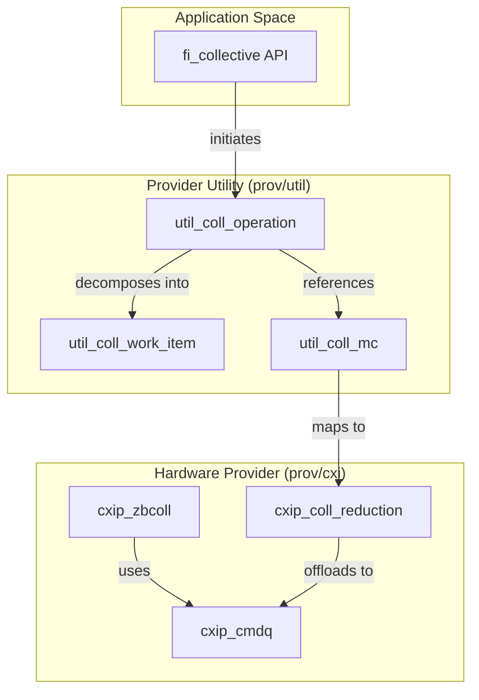
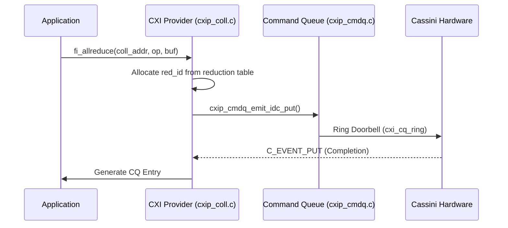

<!-- source: DeepWiki mcp.deepwiki.com · repo ofiwg/libfabric · page 2.5 Collective Operations · fetched 2026-11-11 -->

# Collective Operations

Relevant source files

The following files were used as context for generating this wiki page:

- [fabtests/functional/rdm_multi_client.c](fabtests/functional/rdm_multi_client.c)
- [fabtests/multinode/src/core_coll.c](fabtests/multinode/src/core_coll.c)
- [fabtests/prov/efa/src/efa_implicit_av_test.c](fabtests/prov/efa/src/efa_implicit_av_test.c)
- [include/ofi_bitmask.h](include/ofi_bitmask.h)
- [include/ofi_coll.h](include/ofi_coll.h)
- [include/ofi_enosys.h](include/ofi_enosys.h)
- [include/rdma/fi_collective.h](include/rdma/fi_collective.h)
- [man/fi_av_set.3.md](man/fi_av_set.3.md)
- [man/fi_collective.3.md](man/fi_collective.3.md)
- [man/man3/fi_allgather.3](man/man3/fi_allgather.3)
- [prov/cxi/configure.m4](prov/cxi/configure.m4)
- [prov/cxi/include/fi_cxi_ext.h](prov/cxi/include/fi_cxi_ext.h)
- [prov/cxi/src/cxip_cmdq.c](prov/cxi/src/cxip_cmdq.c)
- [prov/cxi/src/cxip_coll.c](prov/cxi/src/cxip_coll.c)
- [prov/cxi/src/cxip_coll_trace.c](prov/cxi/src/cxip_coll_trace.c)
- [prov/cxi/src/cxip_ctrl.c](prov/cxi/src/cxip_ctrl.c)
- [prov/cxi/src/cxip_curl.c](prov/cxi/src/cxip_curl.c)
- [prov/cxi/src/cxip_dom.c](prov/cxi/src/cxip_dom.c)
- [prov/cxi/src/cxip_evtq.c](prov/cxi/src/cxip_evtq.c)
- [prov/cxi/src/cxip_if.c](prov/cxi/src/cxip_if.c)
- [prov/cxi/src/cxip_nic.c](prov/cxi/src/cxip_nic.c)
- [prov/cxi/src/cxip_portals_table.c](prov/cxi/src/cxip_portals_table.c)
- [prov/cxi/src/cxip_req_buf.c](prov/cxi/src/cxip_req_buf.c)
- [prov/cxi/src/cxip_telemetry.c](prov/cxi/src/cxip_telemetry.c)
- [prov/cxi/src/cxip_zbcoll.c](prov/cxi/src/cxip_zbcoll.c)
- [prov/cxi/test/auth_key.c](prov/cxi/test/auth_key.c)
- [prov/cxi/test/coll.c](prov/cxi/test/coll.c)
- [prov/cxi/test/curl.c](prov/cxi/test/curl.c)
- [prov/cxi/test/domain.c](prov/cxi/test/domain.c)
- [prov/cxi/test/fabric.c](prov/cxi/test/fabric.c)
- [prov/cxi/test/multinode/test_coll.c](prov/cxi/test/multinode/test_coll.c)
- [src/enosys.c](src/enosys.c)

Collective operations provide a framework for group communication exchanges where multiple peer endpoints coordinate to exchange or reduce data. This framework supports both application-managed membership and provider-managed membership, targeting hardware offload capabilities for operations like reductions and barriers.

## Overview of the Collective API

The `fi_collective` API defines operations that are coordinated across a set of peer endpoints. Key operations include:

*   **`fi_join_collective`**: Associates an endpoint with a collective group defined by an AV set [man/fi_collective.3.md:55-57]().
*   **`fi_barrier`**: Synchronizes all peers in the collective group [man/fi_collective.3.md:59-60]().
*   **`fi_allreduce`**: Performs a reduction operation (e.g., SUM, MIN, MAX) and distributes the result to all peers [man/fi_collective.3.md:74-78]().
*   **`fi_broadcast`**: Transmits data from one root peer to all others [man/fi_collective.3.md:65-67]().
*   **`fi_query_collective`**: Allows applications to query provider support for specific collective operations, datatypes, and reduction operators [man/fi_collective.3.md:104-106]().

### Collective Data Flow and API Mapping

The following diagram illustrates the relationship between the high-level API calls and the underlying code structures used to manage collective state.

**Collective API to Code Entity Mapping**

Sources: [include/ofi_coll.h:146-163](), [prov/cxi/src/cxip_coll.c:109-131](), [include/ofi_coll.h:86-93]()

## Collective Membership and AV Sets

Collective membership is established via **Address Vector Sets (AV Sets)**. An AV set represents an ordered subset of addresses within an Address Vector [man/fi_collective.3.md:190-194]().

1.  **Creation**: The application creates an AV set using `fi_av_set` [fabtests/multinode/src/core_coll.c:151-153]().
2.  **Joining**: Peers call `fi_join_collective` to associate their endpoint (`fid_ep`) with the AV set [fabtests/multinode/src/core_coll.c:161-165]().
3.  **Multicast Group**: Successful joining results in a multicast group handle (`fid_mc`), which provides the collective address (`fi_addr_t`) used in subsequent collective calls [fabtests/multinode/src/core_coll.c:220-221]().

Sources: [man/fi_collective.3.md:182-194](), [fabtests/multinode/src/core_coll.c:138-168]()

## Utility Provider Framework (`prov/util/`)

The utility framework provides a software-based implementation of collectives for providers that do not have native hardware support. It uses a state-machine approach to decompose collective operations into point-to-point messages.

### Key Structures
*   **`util_coll_operation`**: Encapsulates the state of a single collective call (e.g., barrier, allreduce) [include/ofi_coll.h:146-163]().
*   **`util_coll_work_item`**: Represents an individual task within a collective, such as a send, receive, or local reduction [include/ofi_coll.h:86-93]().
*   **`util_coll_op_type`**: Enumerates supported utility collectives: `UTIL_COLL_JOIN_OP`, `UTIL_COLL_BARRIER_OP`, `UTIL_COLL_ALLREDUCE_OP`, etc. [include/ofi_coll.h:46-53]().

### Work Item Types
Collectives are broken down into specific work types:
*   `UTIL_COLL_SEND` / `UTIL_COLL_RECV`: Point-to-point data movement [include/ofi_coll.h:65-66]().
*   `UTIL_COLL_REDUCE`: Local compute for reduction operations [include/ofi_coll.h:67]().
*   `UTIL_COLL_COPY`: Memory copies for buffering [include/ofi_coll.h:68]().

Sources: [include/ofi_coll.h:46-120]()

## Hardware-Accelerated Collectives (CXI Provider)

The CXI provider (`prov/cxi/`) implements hardware-accelerated collectives by offloading reductions and barriers to the fabric.

### Hardware Reduction Implementation
CXI uses specialized reduction packets and hardware-managed multicast trees.
*   **Packet Format**: Reduction packets contain a 12-byte header including sequence numbers (`rt_seqno`), operation codes (`rt_op`), and contribution counts (`rt_count`) [prov/cxi/src/cxip_coll.c:134-158]().
*   **Concurrency**: The provider manages concurrent reductions using a reduction table indexed by `red_id` [prov/cxi/src/cxip_coll.c:118-128]().
*   **Sequence Numbers**: 10-bit sequence numbers ensure ordered processing of collective packets in the fabric [prov/cxi/src/cxip_coll.c:190-193]().

### Zero-Byte Collectives (ZBCOLL)
For synchronization operations like barriers, CXI utilizes "Zero-Byte Collectives". These involve:
*   **Control Messages**: Coordinating state across nodes using IDC (Immediate Data Command) messages [prov/cxi/src/cxip_ctrl.c:114-124]().
*   **Multicast IDs**: Disambiguating multiple multicast trees via a 13-bit ID [prov/cxi/src/cxip_coll.c:167-169]().

**CXI Collective Command Flow**

Sources: [prov/cxi/src/cxip_coll.c:109-131](), [prov/cxi/src/cxip_dom.c:146-173](), [prov/cxi/src/cxip_ctrl.c:58-63]()

## External Dependencies and Initialization

Some collective implementations, particularly for fabric management or topology discovery, may rely on external libraries like `libcurl` or `libjson-c`.

*   **Dynamic Loading**: The CXI provider can `dlopen` these libraries at runtime to avoid hard dependencies [prov/cxi/src/cxip_curl.c:186-212]().
*   **Configuration**: Build-time options `--enable-cxi-curl-dlopen` and `--enable-cxi-json-dlopen` control this behavior [prov/cxi/configure.m4:55-73]().
*   **Metrics**: Providers track collective performance and health, such as bad reduction counts or partial completion stats [prov/cxi/src/cxip_coll.c:62-92]().

Sources: [prov/cxi/src/cxip_curl.c:186-212](), [prov/cxi/configure.m4:55-73](), [prov/cxi/src/cxip_coll.c:62-92]()

---

