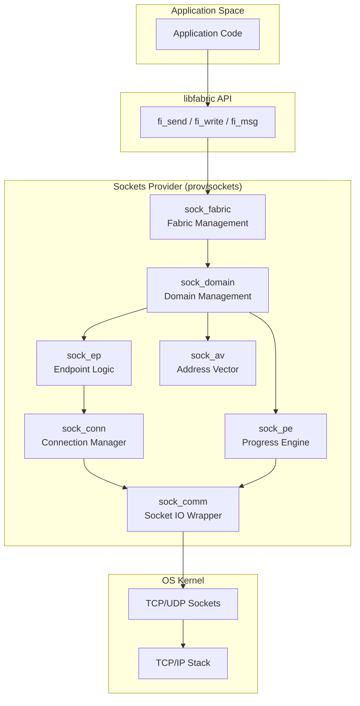
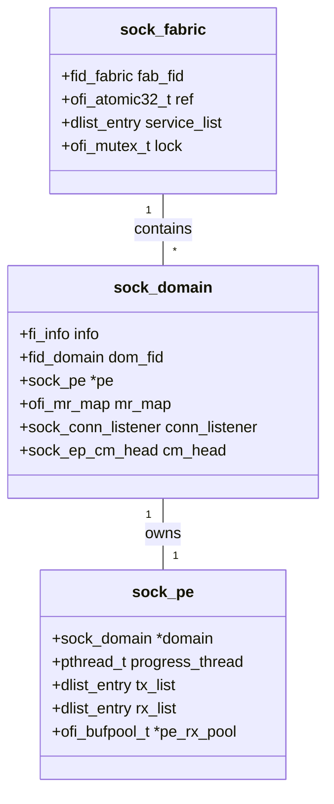
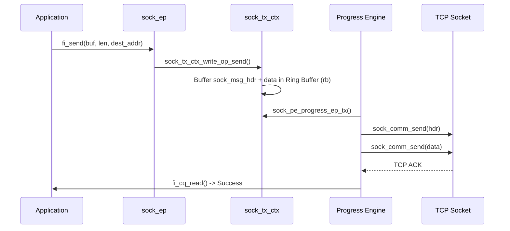

<!-- source: DeepWiki mcp.deepwiki.com · repo ofiwg/libfabric · page 4.3 Sockets Provider · fetched 2026-11-11 -->

# Sockets Provider

Relevant source files

The following files were used as context for generating this wiki page:

- [prov/sockets/include/sock.h](prov/sockets/include/sock.h)
- [prov/sockets/src/sock_atomic.c](prov/sockets/src/sock_atomic.c)
- [prov/sockets/src/sock_av.c](prov/sockets/src/sock_av.c)
- [prov/sockets/src/sock_cntr.c](prov/sockets/src/sock_cntr.c)
- [prov/sockets/src/sock_comm.c](prov/sockets/src/sock_comm.c)
- [prov/sockets/src/sock_conn.c](prov/sockets/src/sock_conn.c)
- [prov/sockets/src/sock_cq.c](prov/sockets/src/sock_cq.c)
- [prov/sockets/src/sock_ctx.c](prov/sockets/src/sock_ctx.c)
- [prov/sockets/src/sock_dom.c](prov/sockets/src/sock_dom.c)
- [prov/sockets/src/sock_ep.c](prov/sockets/src/sock_ep.c)
- [prov/sockets/src/sock_ep_dgram.c](prov/sockets/src/sock_ep_dgram.c)
- [prov/sockets/src/sock_ep_msg.c](prov/sockets/src/sock_ep_msg.c)
- [prov/sockets/src/sock_ep_rdm.c](prov/sockets/src/sock_ep_rdm.c)
- [prov/sockets/src/sock_eq.c](prov/sockets/src/sock_eq.c)
- [prov/sockets/src/sock_fabric.c](prov/sockets/src/sock_fabric.c)
- [prov/sockets/src/sock_msg.c](prov/sockets/src/sock_msg.c)
- [prov/sockets/src/sock_poll.c](prov/sockets/src/sock_poll.c)
- [prov/sockets/src/sock_progress.c](prov/sockets/src/sock_progress.c)
- [prov/sockets/src/sock_rma.c](prov/sockets/src/sock_rma.c)
- [prov/sockets/src/sock_rx_entry.c](prov/sockets/src/sock_rx_entry.c)
- [prov/sockets/src/sock_trigger.c](prov/sockets/src/sock_trigger.c)
- [prov/sockets/src/sock_wait.c](prov/sockets/src/sock_wait.c)

The Sockets Provider is a core implementation of the libfabric API that leverages standard TCP and UDP sockets for network communication. It serves as a highly portable reference implementation, enabling libfabric applications to run on any system with a standard BSD sockets interface. This provider is essential for development, testing, and environments lacking specialized high-performance fabric hardware.

While it prioritizes portability over the extreme low-latency found in hardware-offloaded providers (like Verbs or EFA), it implements a full suite of libfabric features including Tagged Messaging, RMA, and Atomics.

## Architecture Overview

The Sockets Provider follows a structured layered approach, translating high-level Fabric API calls into low-level socket operations managed by a robust progress engine.

Sources:
- [prov/sockets/include/sock.h:172-240]()
- [prov/sockets/src/sock_fabric.c:52-194]()
- [prov/sockets/src/sock_dom.c:149-215]()
- [prov/sockets/src/sock_ep.c:57-110]()

## Core Components

### Fabric and Domain Management
The `sock_fabric` and `sock_domain` structures act as the primary resource containers. The domain is responsible for initializing the Progress Engine (`sock_pe`) and managing the memory registration map (`ofi_mr_map`).

Sources:
- [prov/sockets/include/sock.h:172-181]()
- [prov/sockets/include/sock.h:224-245]()
- [prov/sockets/src/sock_dom.c:159-185]()
- [prov/sockets/src/sock_fabric.c:211-222]()

### Connection Management
Connection management handles the lifecycle of underlying TCP streams. It uses a `sock_conn_map` to track active `sock_conn` structures, which wrap the raw `sock_fd`.

*   **Listener**: The `sock_conn_listener` runs a background thread to `accept()` incoming connections for `FI_EP_MSG` endpoints.
*   **CM Thread**: The `sock_ep_cm_head` manages connection requests and events via an `epoll` set.

Sources:
- [prov/sockets/include/sock.h:183-212]()
- [prov/sockets/src/sock_conn.c:96-128]()
- [prov/sockets/src/sock_conn.c:187-222]()
- [prov/sockets/src/sock_ep_msg.c:98-143]()

### Progress Engine (PE)
The Progress Engine is the heartbeat of the provider. It processes asynchronous transmit (TX) and receive (RX) operations stored in `sock_pe_entry` objects.

| Feature | Implementation |
| :--- | :--- |
| **Entry Management** | Uses `sock_pe_acquire_entry` and `sock_pe_release_entry` with a free list/pool system. |
| **Data Movement** | `sock_pe_send_field` and `sock_pe_recv_field` handle partial socket writes/reads. |
| **Completion** | `sock_pe_report_send_cq_completion` and `sock_pe_report_recv_cq_completion` push events to CQs. |
| **Buffered RX** | `sock_pe_progress_buffered_rx` manages data that arrived before a matching `fi_recv` was posted. |

Sources:
- [prov/sockets/src/sock_progress.c:73-150]()
- [prov/sockets/src/sock_progress.c:152-232]()
- [prov/sockets/src/sock_progress.c:234-273]()

## Data Flow and Wire Protocol

### Transmission and Reception
The provider translates libfabric ops into internal `sock_op` structures. These are serialized over the wire along with a `sock_msg_hdr`.

Sources:
- [prov/sockets/src/sock_msg.c:178-252]()
- [prov/sockets/src/sock_comm.c:47-97]()
- [prov/sockets/src/sock_progress.c:90-109]()

### RMA and Atomics
Remote Memory Access (RMA) and Atomics are implemented by sending specialized `sock_op` types (`SOCK_OP_READ`, `SOCK_OP_WRITE`, `SOCK_OP_ATOMIC`). 
*   **Atomics**: The provider supports comparison and fetch operations. The receiver-side PE performs the operation locally using `ofi_atomic` utilities before sending a response.

Sources:
- [prov/sockets/src/sock_rma.c:62-150]()
- [prov/sockets/src/sock_atomic.c:61-167]()
- [prov/sockets/src/sock_progress.c:76-88]()

## Address Vector (AV)
The `sock_av` maps `fi_addr_t` handles to `sock_av_addr` (IP/Port pairs). It supports shared AVs using memory mapping (`sock_mremap`) and uses a table-based lookup for performance.

Sources:
- [prov/sockets/src/sock_av.c:66-86]()
- [prov/sockets/src/sock_av.c:159-186]()
- [prov/sockets/src/sock_av.c:245-290]()

## Configuration and Tuning

The provider behavior is tunable via environment variables (prefixed with `FI_SOCKETS_`).

| Variable | Description | Default |
| :--- | :--- | :--- |
| `PE_WAITTIME` | Progress engine sleep interval in ms. | 10 |
| `CONN_TIMEOUT` | TCP connection timeout in ms. | 15000 |
| `KEEPALIVE_ENABLE` | Enables TCP_KEEPALIVE on sockets. | 0 |
| `DEF_CONN_MAP_SZ` | Initial size of the connection map. | 1024 |

Sources:
- [prov/sockets/src/sock_fabric.c:51-68]()
- [prov/sockets/src/sock_fabric.c:232-252]()
- [prov/sockets/src/sock_conn.c:237-268]()

## Endpoint Types
The provider supports three primary endpoint types, each mapped to different underlying behaviors:
1.  **FI_EP_MSG**: Reliable, connection-oriented (TCP).
2.  **FI_EP_RDM**: Reliable datagrams (UDP-like API over TCP).
3.  **FI_EP_DGRAM**: Unreliable datagrams (UDP).

Sources:
- [prov/sockets/src/sock_dom.c:97-110]()
- [prov/sockets/src/sock_ep_rdm.c:60-87]()
- [prov/sockets/src/sock_ep_dgram.c:60-86]()

---

