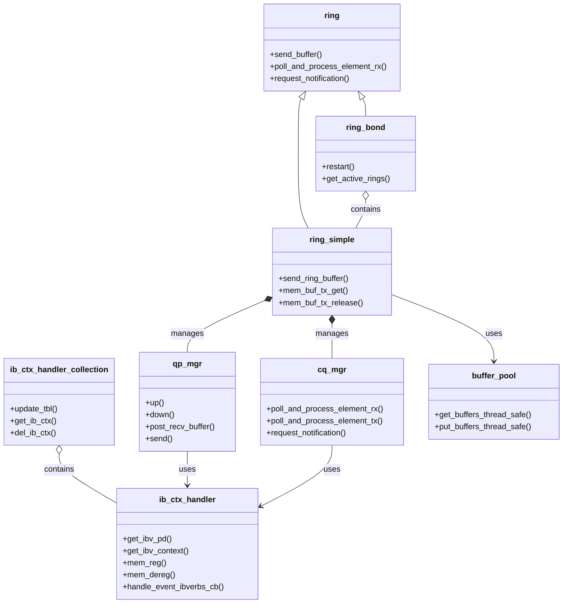
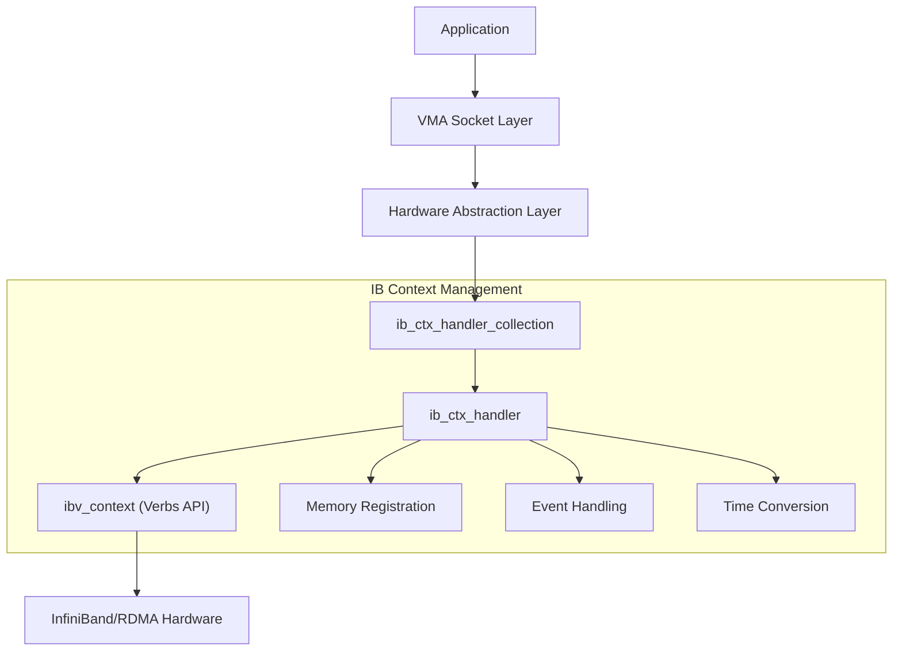
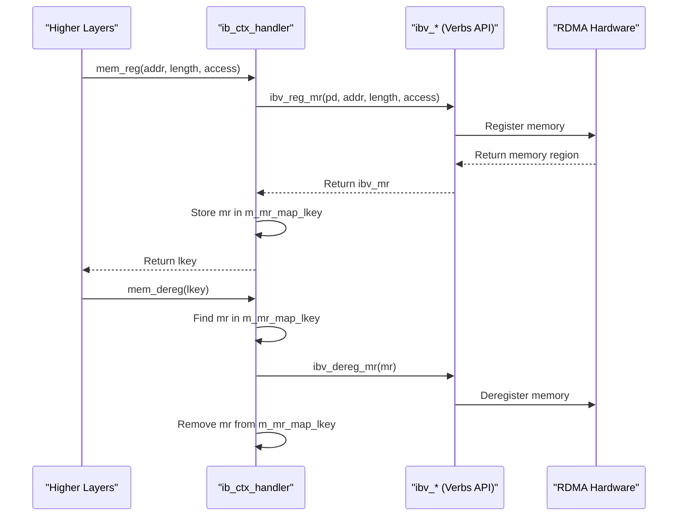
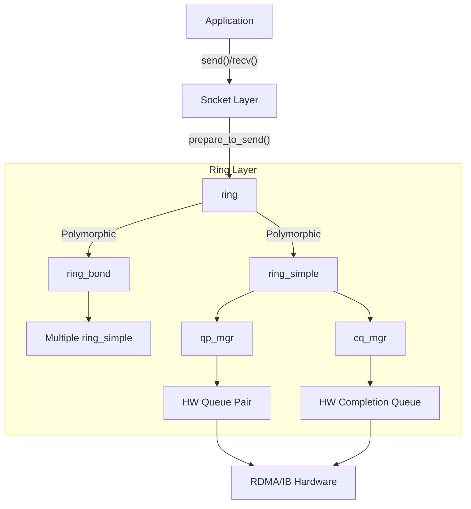
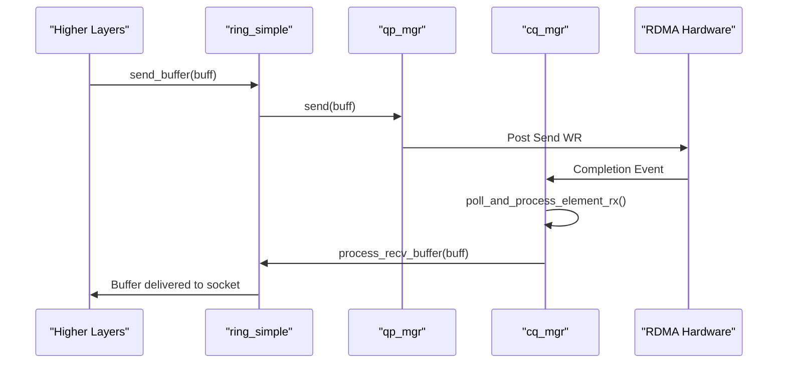
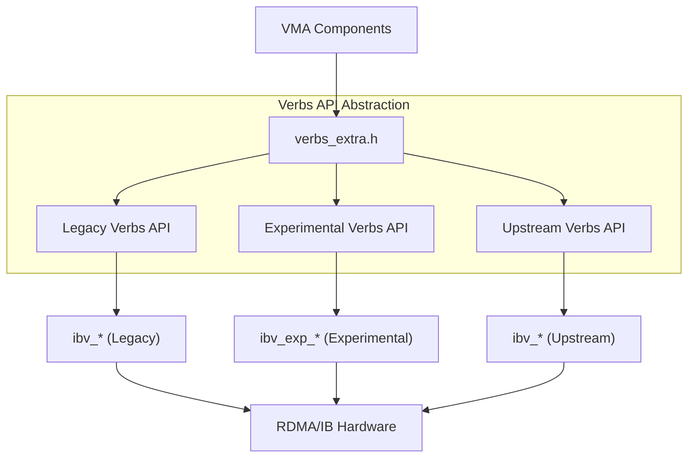

<!-- source: DeepWiki mcp.deepwiki.com · repo Mellanox/libvma · page 4 Hardware Abstraction Layer · fetched 2026-11-11 -->

# Hardware Abstraction Layer

<details>
<summary>Relevant source files</summary>

The following files were used as context for generating this wiki page:

- [config/m4/verbs.m4](config/m4/verbs.m4)
- [src/vma/Makefile.am](src/vma/Makefile.am)
- [src/vma/dev/cq_mgr.inl](src/vma/dev/cq_mgr.inl)
- [src/vma/dev/ib_ctx_handler.cpp](src/vma/dev/ib_ctx_handler.cpp)
- [src/vma/dev/ib_ctx_handler.h](src/vma/dev/ib_ctx_handler.h)
- [src/vma/dev/ib_ctx_handler_collection.cpp](src/vma/dev/ib_ctx_handler_collection.cpp)
- [src/vma/dev/ib_ctx_handler_collection.h](src/vma/dev/ib_ctx_handler_collection.h)
- [src/vma/ib/base/verbs_extra.cpp](src/vma/ib/base/verbs_extra.cpp)
- [src/vma/ib/base/verbs_extra.h](src/vma/ib/base/verbs_extra.h)

</details>


The Hardware Abstraction Layer (HAL) in VMA is responsible for interfacing between the higher-level VMA components and the underlying network hardware, particularly RDMA/InfiniBand devices. This layer abstracts the complexities of direct hardware access, providing a consistent API that shields the rest of the VMA system from hardware-specific details while enabling high-performance network operations.

## Key Components

The Hardware Abstraction Layer consists of several core components that work together to provide efficient access to network hardware:



Sources:
- [src/vma/dev/ib_ctx_handler.h]()
- [src/vma/dev/ib_ctx_handler_collection.h]()
- [src/vma/Makefile.am:68-93]()

### Component Relationships

The Hardware Abstraction Layer contains these primary components:

1. **IB Context Handler**: Manages InfiniBand contexts and provides interfaces for memory registration and hardware capabilities.

2. **Queue Pair Manager**: Handles the creation and management of InfiniBand Queue Pairs for data transmission.

3. **Completion Queue Manager**: Processes completion events from network hardware for both send and receive operations.

4. **Ring Layer**: Provides an abstraction over the hardware queues, coordinating send and receive operations.

5. **Buffer Pool**: Manages memory buffers for network operations.

Sources:
- [src/vma/dev/ib_ctx_handler.h:32-93]()
- [src/vma/dev/ib_ctx_handler_collection.h:18-35]()
- [src/vma/Makefile.am:163-193]()

## InfiniBand Context Management

The InfiniBand Context Management subsystem is responsible for discovering, initializing, and managing InfiniBand devices available in the system.

### IB Context Handler

The `ib_ctx_handler` class represents a single InfiniBand device and provides the following functionality:

- Opening and initializing the InfiniBand device
- Memory registration and deregistration with the device
- Handling of asynchronous events from the device
- Querying and tracking device capabilities
- Timestamping and timestamp conversion



Sources:
- [src/vma/dev/ib_ctx_handler.h:32-93]()
- [src/vma/dev/ib_ctx_handler.cpp:31-375]()

### IB Context Handler Collection

The `ib_ctx_handler_collection` class manages multiple IB Context Handlers. It discovers all available InfiniBand devices in the system and creates an `ib_ctx_handler` for each device. The collection provides:

- A way to get the IB Context Handler associated with a specific network interface
- Updates to the table of available InfiniBand devices
- Deletion of IB Context Handlers when devices are removed

Key Methods:
- `update_tbl()`: Discovers and updates InfiniBand devices
- `get_ib_ctx()`: Gets the IB Context Handler for a given network interface
- `del_ib_ctx()`: Removes an IB Context Handler from the collection

Sources:
- [src/vma/dev/ib_ctx_handler_collection.h:18-35]()
- [src/vma/dev/ib_ctx_handler_collection.cpp:66-212]()

## Memory Registration and Management

Memory used for RDMA operations must be registered with the InfiniBand device. The Hardware Abstraction Layer provides facilities for memory registration and management.

### Memory Registration

The `ib_ctx_handler` class provides methods for registering and deregistering memory:

- `mem_reg()`: Registers memory with the InfiniBand device
- `mem_dereg()`: Deregisters memory with the InfiniBand device
- `get_mem_reg()`: Retrieves a memory region by its local key



Sources:
- [src/vma/dev/ib_ctx_handler.cpp:254-309]()
- [src/vma/dev/ib_ctx_handler.h:54-56]()

### Buffer Pool

The `buffer_pool` class manages memory buffers used for network operations. It provides a thread-safe interface for getting and returning buffers, helping to reduce memory allocation overhead.

Sources:
- [src/vma/Makefile.am:66]()

## Ring Layer

The Ring Layer provides an abstraction over the hardware queues and is responsible for coordinating send and receive operations.

### Ring Classes

The Ring Layer consists of several classes:

- `ring`: Abstract base class that defines the interface for ring implementations
- `ring_simple`: Concrete implementation for a single hardware queue
- `ring_bond`: Implementation that manages multiple hardware queues (for bonded interfaces)
- `ring_tap`: Implementation for TAP interfaces
- `ring_eth_direct`: Implementation for direct Ethernet operations



Sources:
- [src/vma/Makefile.am:87-93]()

### Queue Pair Manager

The `qp_mgr` class manages InfiniBand Queue Pairs, which are used for sending and receiving data. It provides:

- Creation and configuration of Queue Pairs
- Posting send and receive requests
- Modifying Queue Pair state
- Handling of send operations

Sources:
- [src/vma/Makefile.am:69-71]()

### Completion Queue Manager

The `cq_mgr` class handles the polling and processing of completion events from the InfiniBand hardware. It provides:

- Polling for completion events
- Processing received packets
- Requesting notifications for completion events
- Handling of receive operations



Sources:
- [src/vma/Makefile.am:67-68]()
- [src/vma/dev/cq_mgr.inl:18-63]()

## Hardware Capabilities Detection

The Hardware Abstraction Layer includes mechanisms for detecting and utilizing hardware capabilities.

### Flow Tag Support

The layer checks for support of hardware flow tags, which can be used to efficiently route packets to the correct destination.

```cpp
void ib_ctx_handler::set_flow_tag_capability(bool flow_tag_capability)
{
    m_flow_tag_enabled = flow_tag_capability;
}

bool ib_ctx_handler::get_flow_tag_capability() 
{ 
    return m_flow_tag_enabled; 
}
```

Sources:
- [src/vma/dev/ib_ctx_handler.h:60-61]()
- [src/vma/dev/ib_ctx_handler.cpp:311-314]()

### Packet Pacing Support

The layer checks for support of hardware packet pacing, which can be used to control the rate at which packets are sent.

```cpp
bool ib_ctx_handler::is_packet_pacing_supported(uint32_t rate /* =1 *)
{
    if (rate) {
        return m_pacing_caps.rate_limit_min <= rate && rate <= m_pacing_caps.rate_limit_max;
    } else {
        return true;
    }
}
```

Sources:
- [src/vma/dev/ib_ctx_handler.h:63-64]()
- [src/vma/dev/ib_ctx_handler.cpp:321-328]()

### On-Device Memory

The layer checks for the availability of on-device memory, which can be used for faster operations.

```cpp
// update device memory capabilities
m_on_device_memory = vma_ibv_dm_size(m_p_ibv_device_attr);
```

Sources:
- [src/vma/dev/ib_ctx_handler.cpp:85]()
- [src/vma/dev/ib_ctx_handler.h:65]()

## Verbs API Abstraction

The Hardware Abstraction Layer includes an abstraction over the InfiniBand Verbs API, which normalizes the differences between different versions of the Verbs library.

### Verbs Extra

The `verbs_extra.h` file provides a wrapper layer around the native InfiniBand Verbs API. This abstraction handles:

- Different versions of the Verbs API (Legacy, Experimental, Upstream)
- Differences in function names and parameters
- Conditional compilation based on available features



Sources:
- [src/vma/ib/base/verbs_extra.h:8-592]()
- [src/vma/ib/base/verbs_extra.cpp:8-401]()
- [config/m4/verbs.m4:8-194]()

## Event Handling

The Hardware Abstraction Layer includes mechanisms for handling asynchronous events from the InfiniBand hardware.

### Event Registration

The `ib_ctx_handler` class registers with the Event Handler Manager to receive notifications of asynchronous events:

```cpp
g_p_event_handler_manager->register_ibverbs_event(m_p_ibv_context->async_fd,
                    this, m_p_ibv_context, 0);
```

Sources:
- [src/vma/dev/ib_ctx_handler.cpp:94-95]()

### Event Callback

The `ib_ctx_handler` class implements the `handle_event_ibverbs_cb` method to handle asynchronous events:

```cpp
void ib_ctx_handler::handle_event_ibverbs_cb(void *ev_data, void *ctx)
{
    // Handle the event
    struct ibv_async_event *ibv_event = (struct ibv_async_event*)ev_data;
    
    if (ibv_event->event_type == IBV_EVENT_DEVICE_FATAL) {
        handle_event_device_fatal();
    }
}
```

Sources:
- [src/vma/dev/ib_ctx_handler.cpp:343-354]()

## System Integration

The Hardware Abstraction Layer integrates with the rest of the VMA system, providing an interface for higher-level components to access the network hardware.

### Integration with Socket Layer

The Socket Layer uses the Ring Layer to send and receive data, which in turn uses the Queue Pair Manager and Completion Queue Manager to interact with the hardware.

### Integration with Flow and Route Management

The Flow and Route Management components use the Hardware Abstraction Layer to set up flow steering rules and manage routing tables.

## Configuration and Initialization

The Hardware Abstraction Layer is configured and initialized during the startup of the VMA library.

### Initialization Sequence

1. The VMA library is loaded
2. The `ib_ctx_handler_collection` is created
3. Available InfiniBand devices are discovered
4. An `ib_ctx_handler` is created for each device
5. Device capabilities are queried and stored
6. Event handlers are registered

## Summary

The Hardware Abstraction Layer in VMA provides a set of components that abstract the complexities of direct hardware access. These components work together to provide an efficient interface for higher-level VMA components to access the network hardware, enabling high-performance network operations while shielding the rest of the system from hardware-specific details.

Sources:
- [src/vma/dev/ib_ctx_handler.h:32-93]()
- [src/vma/dev/ib_ctx_handler_collection.h:18-35]()
- [src/vma/Makefile.am:64-94]()

---

