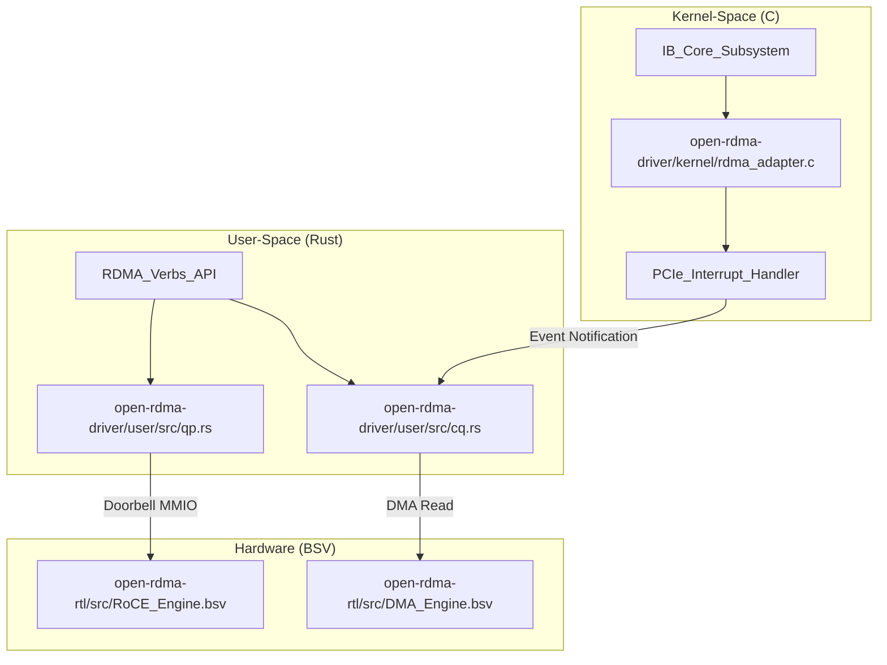
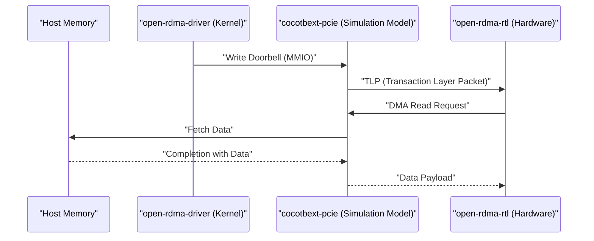

<!-- source: DeepWiki mcp.deepwiki.com · repo open-rdma/open-rdma · page 6.1 Learning Resources by Domain · fetched 2026-11-11 -->

# Learning Resources by Domain

Relevant source files

The following files were used as context for generating this wiki page:

- [README.md](README.md)
- [README_CN.md](README_CN.md)

The Open-RDMA project is a multi-disciplinary endeavor spanning hardware design, kernel-space systems programming, and high-performance user-space networking. This page provides a curated list of learning resources to help contributors master the technology domains required to develop and maintain the `open-rdma` ecosystem.

## 1. Bluespec SystemVerilog (BSV)

The hardware RTL layer of Open-RDMA is implemented in Bluespec SystemVerilog (BSV) [README.md:124-124](). BSV uses a high-level Guarded Atomic Action (Rule-based) semantics which differs significantly from traditional Verilog/SystemVerilog.

### Core Courses
*   **MIT 6.004 (Computation Structures):** Provides the foundational knowledge of computer architecture and digital logic design.
    *   [MIT 6.004 Course Site](https://www.youtube.com/watch?v=n-YWa8hTdH8) [README_CN.md:199-199]()
*   **MIT 6.175 (Constructive Computer Architecture):** The definitive course for learning BSV. It covers pipelining, caches, and complex processors using BSV.
    *   [MIT 6.175 Course Materials](https://csg.csail.mit.edu/6.175) [README_CN.md:200-200]()
*   **MIT Open Course Study Guide (Chinese):** A guided approach to the MIT curriculum.
    *   [Bilibili Study Guide](https://www.bilibili.com/video/BV1u8411i7Qw) [README_CN.md:198-198]()

### Tooling for BSV
To support development, the project provides and utilizes specialized tooling:
*   **`bluespec-lsp`**: A Language Server Protocol implementation for BSV to provide IDE-like features (syntax highlighting, jump-to-definition) [README.md:168-172]().
*   **`open-rdma-dev-env`**: A Docker-based environment containing the `bsc` compiler and necessary libraries [README.md:157-161]().

**Sources:** [README.md:124-124](), [README.md:168-172](), [README_CN.md:198-200]()

---

## 2. RDMA Fundamentals

RDMA (Remote Direct Memory Access) is the core protocol of this project, specifically focusing on RoCE v2 (RDMA over Converged Ethernet) [README.md:82-83]().

### Resources
*   **RDMA Miscellaneous Talk (RDMA 杂谈):** A comprehensive Chinese column covering RDMA basics, verbs, and protocol details.
    *   [Zhihu Column](https://zhuanlan.zhihu.com/p/164908617) [README_CN.md:202-202]()
*   **RoCE v2 Protocol:** Understanding the encapsulation of InfiniBand transport over UDP/IP. The hardware implementation in `open-rdma-rtl` is inspired by this protocol [README.md:83-83]().

### Code Mapping: RDMA Verbs to Implementation
The following diagram illustrates how high-level RDMA concepts translate to entities in the `open-rdma-driver` repository.

**RDMA Software-Hardware Entity Mapping**

**Sources:** [README.md:82-83](), [README.md:152-152](), [README_CN.md:202-202]()

---

## 3. PCIe Architecture

Since the RDMA NIC is a PCIe device, understanding the PCIe protocol is critical for both driver development and RTL design, particularly for the Altera R-Tile/T-Tile interfaces.

### Resources
*   **Practical PCIe Tutorial:** A beginner-friendly guide to PCIe internals.
    *   [PCIe for Total Beginners](https://ctf.re/windows/kernel/pcie/tutorial/2023/02/14/pcie-part-1) [README_CN.md:204-205]()
*   **10,000 Hours of PCIe (Chinese):** A deep-dive resource for mastering the PCIe stack.
    *   [Zhihu: Learning PCIe](https://www.zhihu.com/tardis/zm/art/447134701) [README_CN.md:206-206]()

### PCIe Simulation in Open-RDMA
The project uses a fork of `cocotbext-pcie` to simulate the PCIe interface.
*   **`cocotbext-pcie (Fork)`**: Provides behavioral models for PCIe, with added support for Altera R-Tile, used in RTL verification [README.md:185-189]().

**PCIe Data Flow and Code Entities**

**Sources:** [README.md:185-189](), [README_CN.md:204-206]()

---

## 4. AI-First Development & Verification

Open-RDMA integrates AI technologies not just as a workload, but as part of the development and verification process.

### AI Verification Resources
*   **UCAgent (Fork):** An AI Agent-driven RTL verification framework. It automates test bench generation and integrates with the Cocotb environment used in Open-RDMA [README.md:177-181]().
*   **Cocotb:** The Python-based verification framework used for hardware testing [README.md:128-128]().

### Tech Stack Summary
| Domain | Language/Tool | Role in Open-RDMA |
| :--- | :--- | :--- |
| **Hardware** | Bluespec SystemVerilog [README.md:124]() | RoCE v2 Protocol Engine & DMA |
| **Kernel Driver** | C [README.md:125]() | PCIe lifecycle & IB subsystem integration |
| **User Driver** | Rust [README.md:126]() | Memory-safe QP/CQ management |
| **AI Operators** | CUDA [README.md:127]() | Communication-computation fusion |
| **Verification** | Python/Cocotb [README.md:128]() | RTL simulation & AI Agent testing |

**Sources:** [README.md:124-128](), [README.md:177-181]()

---

