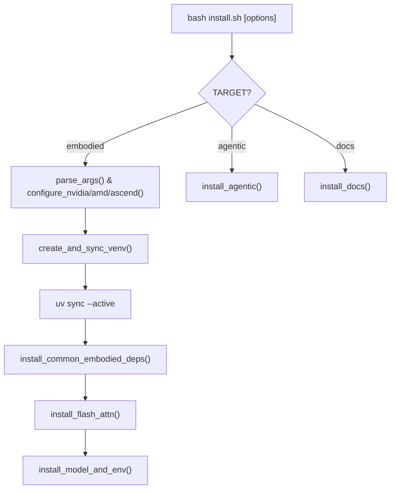
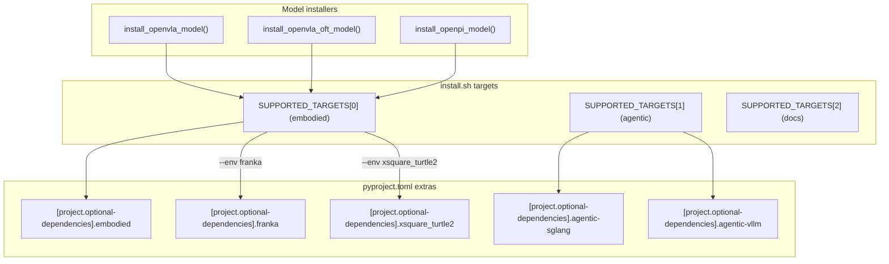
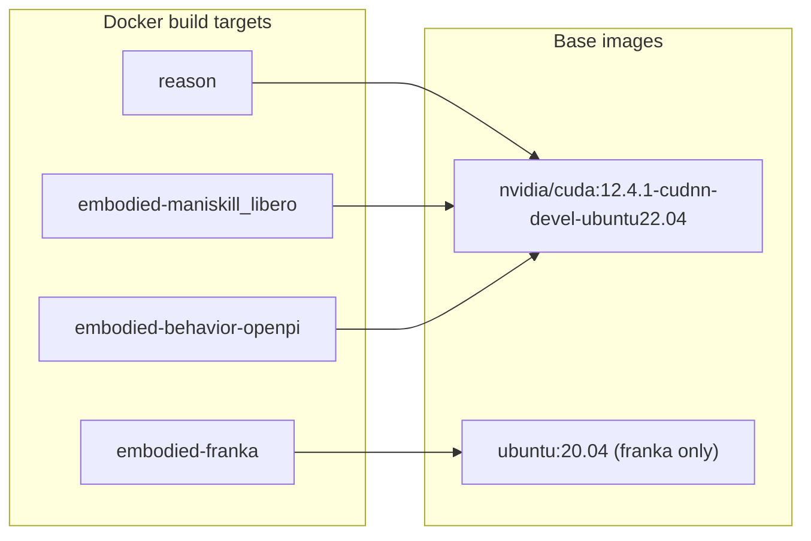

<!-- source: DeepWiki mcp.deepwiki.com · repo RLinf/RLinf · page 1.1 Installation and Setup · fetched 2026-10-21 -->

# Installation and Setup

<details>
<summary>Relevant source files</summary>

The following files were used as context for generating this wiki page:

- [.github/workflows/docker-build.yml](.github/workflows/docker-build.yml)
- [.github/workflows/embodied-e2e-tests.yml](.github/workflows/embodied-e2e-tests.yml)
- [docker/Dockerfile](docker/Dockerfile)
- [docker/README.md](docker/README.md)
- [docs/source-en/rst_source/guides/ascend_cann.rst](docs/source-en/rst_source/guides/ascend_cann.rst)
- [docs/source-en/rst_source/start/index.rst](docs/source-en/rst_source/start/index.rst)
- [docs/source-en/rst_source/start/installation.rst](docs/source-en/rst_source/start/installation.rst)
- [docs/source-en/rst_source/start/vla.rst](docs/source-en/rst_source/start/vla.rst)
- [docs/source-zh/rst_source/guides/ascend_cann.rst](docs/source-zh/rst_source/guides/ascend_cann.rst)
- [docs/source-zh/rst_source/start/index.rst](docs/source-zh/rst_source/start/index.rst)
- [docs/source-zh/rst_source/start/installation.rst](docs/source-zh/rst_source/start/installation.rst)
- [docs/source-zh/rst_source/start/vla.rst](docs/source-zh/rst_source/start/vla.rst)
- [requirements/embodied/download_assets.sh](requirements/embodied/download_assets.sh)
- [requirements/embodied/models/ascend/gr00t.txt](requirements/embodied/models/ascend/gr00t.txt)
- [requirements/embodied/ros_install.sh](requirements/embodied/ros_install.sh)
- [requirements/install.sh](requirements/install.sh)
- [requirements/sys_deps.sh](requirements/sys_deps.sh)
- [rlinf/data/io_struct.py](rlinf/data/io_struct.py)
- [rlinf/envs/__init__.py](rlinf/envs/__init__.py)
- [rlinf/envs/action_utils.py](rlinf/envs/action_utils.py)
- [rlinf/models/embodiment/gr00t/gr00t_n1d5/__init__.py](rlinf/models/embodiment/gr00t/gr00t_n1d5/__init__.py)
- [rlinf/models/embodiment/gr00t/gr00t_n1d5/gr00t_action_model.py](rlinf/models/embodiment/gr00t/gr00t_n1d5/gr00t_action_model.py)
- [rlinf/models/embodiment/gr00t/gr00t_n1d5/npu_patches.py](rlinf/models/embodiment/gr00t/gr00t_n1d5/npu_patches.py)
- [rlinf/utils/patcher.py](rlinf/utils/patcher.py)
- [rlinf/workers/actor/fsdp_actor_worker_pipeline.py](rlinf/workers/actor/fsdp_actor_worker_pipeline.py)
- [tests/e2e_tests/embodied/maniskill_ppo_openpi05_pipeline.yaml](tests/e2e_tests/embodied/maniskill_ppo_openpi05_pipeline.yaml)

</details>


This page covers all methods for installing and configuring RLinf: Docker images, the `install.sh` script, and PyPI. It documents which model and environment combinations are supported for each install target and explains the underlying dependency architecture across different hardware platforms (NVIDIA, AMD ROCm, Ascend CANN).

---

## Hardware and Software Requirements

The following configurations are the tested baseline. RLinf provides experimental support for AMD and Ascend hardware, but H100/A100 clusters remain the primary development target.

### Hardware

| Component | Tested Configuration |
|-----------|---------------------|
| GPU | 8× H100 per node |
| CPU | 192 cores per node |
| Memory | 1.8 TB per node |
| Network | NVLink + RoCE / IB at 3.2 Tbps |
| Storage | 1 TB local (single-node); 10 TB NAS (multi-node) |

Sources: [docs/source-en/rst_source/start/installation.rst:25-47]()

### Software

| Component | Version |
|-----------|---------|
| OS | Ubuntu 22.04 |
| NVIDIA Driver | 535.183.06 |
| CUDA | 12.4 |
| Docker | 26.0.0 |
| NVIDIA Container Toolkit | 1.17.8 |
| Python | 3.11.14 (managed by `uv`) |

The Franka real-world environment is an exception: it requires Ubuntu 20.04 and ROS Noetic to handle specific driver requirements [docker/Dockerfile:57-57]().

Sources: [docs/source-en/rst_source/start/installation.rst:49-67](), [docker/Dockerfile:57-57](), [requirements/install.sh:9-10]()

---

## Installation Targets Overview

RLinf's dependency graph splits into independent install targets. They cannot share a single virtual environment because several packages conflict (e.g., specific versions of `Megatron` vs `Huggingface` transformers).

**Install targets as defined in `install.sh`:**

```bash
SUPPORTED_TARGETS=("embodied" "agentic" "docs")
SUPPORTED_MODELS=("openvla" "openvla-oft" "openpi" "gr00t" "gr00t_n1d6" "gr00t_n1d7" "dexbotic" "starvla" "lingbotvla" "dreamzero" "qwen3_vl" "abot_m0")
SUPPORTED_ENVS=("behavior" "maniskill_libero" "libero" "metaworld" "calvin" "isaaclab" 
                "robocasa" "franka" "franka-dexhand" "frankasim" "robotwin" "habitat" 
                "opensora" "wan" "genesis" "xsquare_turtle2" "liberopro" "liberoplus"
                "roboverse" "embodichain" "d4rl" "dosw1" "gim_arm" "dummy" "polaris")
```

Sources: [requirements/install.sh:82-84]()

**Target–model–environment compatibility matrix:**

| Target | `--model` | Valid `--env` values |
|--------|-----------|----------------------|
| `embodied` | `openvla` | `maniskill_libero`, `frankasim`, `behavior`, `polaris` |
| `embodied` | `openvla-oft` | `behavior`, `maniskill_libero`, `robotwin`, `opensora`, `wan`, `liberopro`, `liberoplus`, `polaris` |
| `embodied` | `openpi` | `behavior`, `maniskill_libero`, `metaworld`, `calvin`, `robocasa`, `robotwin`, `roboverse`, `polaris` |
| `embodied` | `gr00t` | `maniskill_libero`, `isaaclab` |
| `embodied` | `dexbotic` | `maniskill_libero` |
| `agentic` | — | MATH reasoning, SearchR1 |

Sources: [requirements/install.sh:82-84](), [docs/source-en/rst_source/start/installation.rst:21-31](), [rlinf/envs/action_utils.py:104-129]()

---

## Method 1: Docker Images (Recommended)

Docker images are the fastest path to a reproducible environment. All model and environment dependencies are pre-installed.

### Available Images

| Use Case | Image Tag |
|----------|-----------|
| Embodied (Libero / ManiSkill) | `rlinf/rlinf:agentic-rlinf0.3-maniskill_libero` |
| Franka Control | `rlinf/rlinf:agentic-rlinf0.3-franka` |

Sources: [docs/source-en/rst_source/start/installation.rst:45-57]()

### Starting the Container

```bash
docker pull rlinf/rlinf:CHOSEN_IMAGE

docker run -it --gpus all \
  --shm-size 100g \
  --net=host \
  --name rlinf \
  -e NVIDIA_DRIVER_CAPABILITIES=all \
  rlinf/rlinf:CHOSEN_IMAGE /bin/bash
```

> **Note on `NVIDIA_DRIVER_CAPABILITIES=all`**: This is required for GPU rendering in embodied experiments (enables the `graphics` capability) [docs/source-en/rst_source/start/installation.rst:63-63]().

Sources: [docs/source-en/rst_source/start/installation.rst:52-57](), [docker/Dockerfile:63-65]()

### Switching Virtual Environments

The Docker image stores multiple virtual environments under `/opt/venv/` [docker/Dockerfile:117-117](). Use the built-in `switch_env` script to toggle between them.

```bash
source switch_env openvla
source switch_env openvla-oft
source switch_env openpi
```

Sources: [docker/Dockerfile:136-148](), [docs/source-en/rst_source/start/installation.rst:61-69]()

---

## Method 2: Manual Installation with `install.sh`

`requirements/install.sh` automates dependency installation using [`uv`](https://docs.astral.sh/uv).

### Script Behavior Overview

The installer detects the hardware platform and configures `UV_TORCH_BACKEND` and `PLATFORM_TORCH_INDEX` accordingly to ensure the correct hardware-specific PyTorch wheels are fetched [requirements/install.sh:24-28]().

**Natural Language to Code Entity Space: Installation Flow**



Sources: [requirements/install.sh:1-125](), [requirements/install.sh:82-84]()

### Key Script Functions

| Function | Purpose |
|----------|---------|
| `configure_nvidia` | Sets `UV_TORCH_BACKEND=auto` for CUDA support [requirements/install.sh:65-65](). |
| `configure_amd` | Detects ROCm version and sets `UV_TORCH_BACKEND=rocm<ver>` [requirements/install.sh:66-69](). |
| `configure_ascend` | Sets `UV_TORCH_BACKEND=cpu` and prepares `torch-npu` installation [requirements/install.sh:117-118](). |
| `create_and_sync_venv` | Creates venv at `VENV_DIR` with Python 3.11.14; runs `uv sync`. |
| `install_flash_attn` | Installs Flash Attention via prebuilt wheels or source build [requirements/install.sh:37-45](). |

Sources: [requirements/install.sh:65-65](), [requirements/install.sh:66-69](), [requirements/install.sh:37-45]()

### Common Commands

**Embodied (OpenVLA + ManiSkill):**
```bash
bash requirements/install.sh embodied --model openvla --env maniskill_libero
source .venv/bin/activate
```

**Agentic (Megatron + SGLang/vLLM):**
```bash
bash requirements/install.sh agentic
source .venv/bin/activate
```

Sources: [docs/source-en/rst_source/start/installation.rst:14-29]()

---

## Method 3: PyPI Library Installation

RLinf can be installed as a library using optional dependency groups defined in `pyproject.toml`. This installs core scheduler components but requires manual installation of model/environment dependencies.

```bash
pip install rlinf[embodied]        # Embodied RL core extras
pip install rlinf[agentic-sglang]  # Agentic RL with SGLang
pip install rlinf[agentic-vllm]    # Agentic RL with vLLM
```

Sources: [pyproject.toml:75-114]()

---

## Dependency Architecture

The following diagram maps install targets to the concrete packages and functions in `install.sh` and `pyproject.toml`:

**Natural Language to Code Entity Space: Dependency Mapping**



Sources: [requirements/install.sh:82-84](), [pyproject.toml:75-150]()

---

## System Dependencies and Real-World Setup

### Graphics and Rendering
When running the `embodied` target, the installer handles graphics and rendering libraries across different Linux distributions. Key system packages include:
- **OpenGL/Mesa**: `libgl1-mesa-glx`, `libosmesa6-dev`
- **Vulkan**: `libvulkan1`
- **Display**: `libxrandr-dev`

Sources: [docker/Dockerfile:92-95]()

### Franka Real-World Setup
Real-world Franka training requires specific hardware coordination:
1. **Robot Controller Node**: Ubuntu 20.04 with ROS Noetic and real-time kernel.
2. **Training Node**: GPU-enabled machine running RLinf.
3. **Firmware**: Franka firmware version `< 5.9.0` (Recommended `5.7.2`).

Teleoperation wrappers such as `SpacemouseIntervention`, `GelloIntervention`, and `PicoIntervention` are applied to real-world environments to facilitate data collection and human intervention.

Sources: [docs/source-en/rst_source/start/installation.rst:49-67]()

---

## Dockerfile Build Targets

The `docker/Dockerfile` is parameterized by a `BUILD_TARGET` argument and selects the appropriate base image [docker/Dockerfile:1-14]().

**Dockerfile target → image mapping**



Sources: [docker/Dockerfile:1-14](), [docker/Dockerfile:34-57]()

---

## Python Version and Package Manager

The installer pins Python to **3.11.14** [requirements/install.sh:10-10]() and uses `uv` as the package manager.

```bash
uv venv "$VENV_DIR" --python 3.11.14
uv sync --active
```

Sources: [requirements/install.sh:9-10](), [pyproject.toml:11-11]()

---

## Environment Configuration

RLinf uses environment variables to configure hardware platforms and directory paths, especially within Docker.

| Variable | Purpose |
|----------|---------|
| `RLINF_PLATFORM` | Set in Docker images to indicate `nvidia`, `amd`, or `ascend` [docker/Dockerfile:65-65](). |
| `HF_HOME` | Cache directory for HuggingFace models, set to `/opt/.cache/huggingface` in Docker [docker/Dockerfile:114-114](). |
| `UV_PATH` | Base path for virtual environments in Docker (`/opt/venv`) [docker/Dockerfile:117-117](). |
| `LIBERO_PATH` | Path for LIBERO environment assets [.github/workflows/embodied-e2e-tests.yml:20-20](). |

Sources: [docker/Dockerfile:65-65](), [docker/Dockerfile:114-114](), [docker/Dockerfile:117-117](), [.github/workflows/embodied-e2e-tests.yml:20-20]()

---

