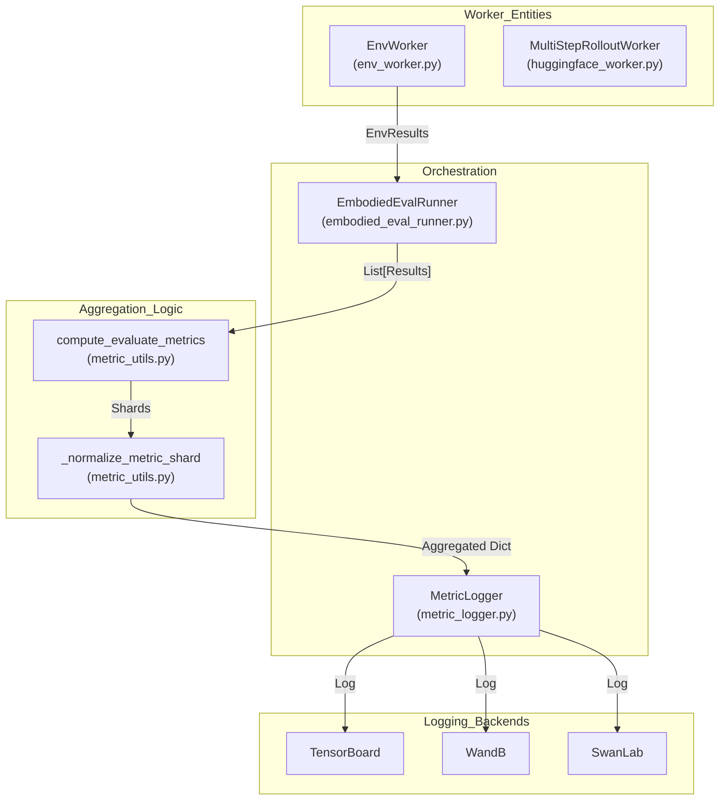
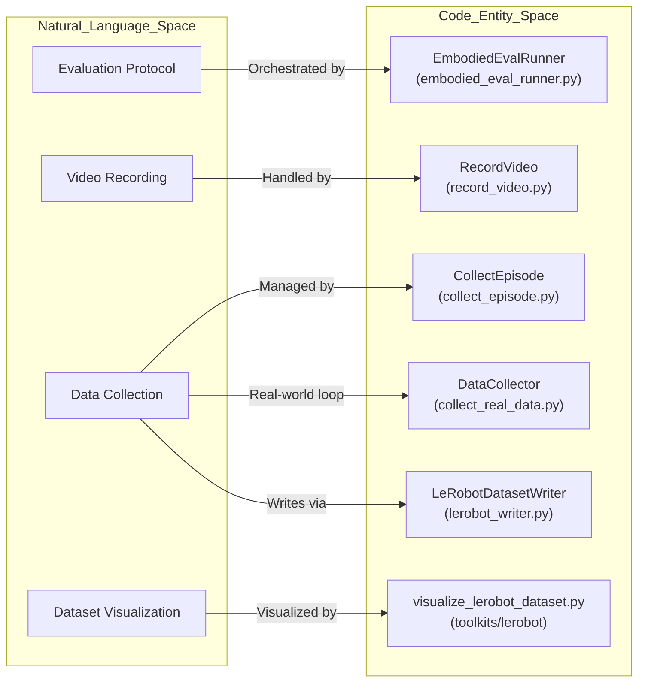

<!-- source: DeepWiki mcp.deepwiki.com · repo RLinf/RLinf · page 10.3 Evaluation and Metrics · fetched 2026-10-21 -->

# Evaluation and Metrics

Relevant source files

The following files were used as context for generating this wiki page:

- [docs/source-en/rst_source/evaluations/index.rst](docs/source-en/rst_source/evaluations/index.rst)
- [docs/source-en/rst_source/examples/embodied/robocasa365.rst](docs/source-en/rst_source/examples/embodied/robocasa365.rst)
- [docs/source-en/rst_source/examples/simulators_index.rst](docs/source-en/rst_source/examples/simulators_index.rst)
- [docs/source-en/rst_source/guides/data_collection.rst](docs/source-en/rst_source/guides/data_collection.rst)
- [docs/source-zh/rst_source/evaluations/index.rst](docs/source-zh/rst_source/evaluations/index.rst)
- [docs/source-zh/rst_source/examples/embodied/robocasa365.rst](docs/source-zh/rst_source/examples/embodied/robocasa365.rst)
- [docs/source-zh/rst_source/examples/simulators_index.rst](docs/source-zh/rst_source/examples/simulators_index.rst)
- [docs/source-zh/rst_source/guides/data_collection.rst](docs/source-zh/rst_source/guides/data_collection.rst)
- [evaluations/robocasa365/robocasa365_eval_openpi.yaml](evaluations/robocasa365/robocasa365_eval_openpi.yaml)
- [evaluations/run_eval.sh](evaluations/run_eval.sh)
- [examples/embodiment/collect_real_data.py](examples/embodiment/collect_real_data.py)
- [examples/embodiment/config/env/robocasa365.yaml](examples/embodiment/config/env/robocasa365.yaml)
- [examples/embodiment/config/realworld_collect_data.yaml](examples/embodiment/config/realworld_collect_data.yaml)
- [examples/embodiment/config/robocasa365_opendrawer_ppo_openpi.yaml](examples/embodiment/config/robocasa365_opendrawer_ppo_openpi.yaml)
- [rlinf/data/lerobot_writer.py](rlinf/data/lerobot_writer.py)
- [rlinf/envs/wrappers/collect_episode.py](rlinf/envs/wrappers/collect_episode.py)
- [rlinf/envs/wrappers/record_video.py](rlinf/envs/wrappers/record_video.py)
- [rlinf/runners/embodied_eval_runner.py](rlinf/runners/embodied_eval_runner.py)
- [toolkits/lerobot/visualize_lerobot_dataset.py](toolkits/lerobot/visualize_lerobot_dataset.py)

This page documents RLinf's evaluation protocols, metric collection architecture, and logging infrastructure. It covers how metrics are collected from distributed worker groups, aggregated across ranks, logged to backends (TensorBoard, WandB), and how evaluation, video recording, and data collection are orchestrated.

RLinf provides out-of-the-box evaluation scripts for both Embodied VLA and Agentic Reasoning models, supporting in-distribution and out-of-distribution (OOD) benchmarks.

---

## Metric Collection Architecture

RLinf collects metrics from multiple distributed worker groups (environment, rollout, actor, critic) and aggregates them into a unified view. The system relies on a modular architecture where specialized workers push results through communication channels.

### Data Flow and Aggregation

In embodied tasks, the simulated environment generates episode-level data. The `EmbodiedEvalRunner` coordinates the interaction between `EnvWorker` and `MultiStepRolloutWorker` via `Channel` objects [rlinf/runners/embodied_eval_runner.py:44-46](), aggregating metrics using `compute_evaluate_metrics` [rlinf/runners/embodied_eval_runner.py:76-78]().

The `compute_evaluate_metrics` utility normalizes metric shards from different processes into 1D float tensors on the CPU. It also calculates the total number of trajectories processed across all environment workers.

#### Metric Data Flow Diagram

**Sources:** [rlinf/runners/embodied_eval_runner.py:15-95](), [rlinf/runners/embodied_eval_runner.py:44-46](), [rlinf/runners/embodied_eval_runner.py:76-78]()

### Metric Categories

RLinf organizes metrics into namespaced categories for clear visualization:

| Category | Prefix | Description | Example Metrics |
|----------|--------|-------------|-----------------|
| **Environment** | `eval/` | Episode-level statistics | `success_once`, `return`, `episode_len`, `reward` [rlinf/runners/embodied_eval_runner.py:82-83]() |
| **Training** | `train/` | Algorithm-specific metrics | `loss`, `learning_rate`, `kl_divergence` |

**Sources:** [rlinf/runners/embodied_eval_runner.py:82-83]()

---

## Metric Logging Infrastructure

The `MetricLogger` class serves as the central interface for dispatching metrics to various backends [rlinf/runners/embodied_eval_runner.py:52]().

* **Supported Backends**: RLinf supports `tensorboard`, `wandb`, and `swanlab` [examples/embodiment/config/realworld_collect_data.yaml:33]().
* **Experiment Management**: Configured via Hydra, logging includes `project_name`, `experiment_name`, and `log_path` [examples/embodiment/config/realworld_collect_data.yaml:29-32]().

**Sources:** [rlinf/runners/embodied_eval_runner.py:52](), [examples/embodiment/config/realworld_collect_data.yaml:29-33]()

---

## Evaluation and Data Collection Protocols

### Video Recording
The `RecordVideo` wrapper centralizes frame collection and MP4 writing for environment interactions [rlinf/envs/wrappers/record_video.py:33-40]().

* **Asynchronous Flushing**: Frames are buffered in memory and flushed using a `ThreadPoolExecutor` to avoid blocking environment stepping [rlinf/envs/wrappers/record_video.py:79-80]().
* **Information Overlay**: When `info_on_video` is enabled, metadata such as rewards, terminations, and extra environment `info` keys (e.g., `episode.success_once`) are rendered onto the frames [rlinf/envs/wrappers/record_video.py:46-51]().
* **FPS Resolution**: FPS is resolved from `video_cfg`, environment metadata (e.g., `render_fps`), or falls back to 30 [rlinf/envs/wrappers/record_video.py:95-106]().

### Episode Collection and Export
The `CollectEpisode` wrapper records rollout data and saves completed episodes to disk asynchronously [rlinf/envs/wrappers/collect_episode.py:74-79]().

* **Export Formats**: Supports `pickle` (raw buffer) and `lerobot` (Parquet + JSON metadata) formats [rlinf/envs/wrappers/collect_episode.py:93-94](), [rlinf/envs/wrappers/collect_episode.py:33-33]().
* **Resume Capability**: In `lerobot` mode, it can scan existing shards via `_scan_existing_lerobot_shards` [rlinf/envs/wrappers/collect_episode.py:39-71]() and resume writing to a fresh shard ID to prevent overwriting previous data [rlinf/envs/wrappers/collect_episode.py:101-105]().
* **Filtering**: Can be configured to save only successful episodes via `only_success=True` [rlinf/envs/wrappers/collect_episode.py:97]().

### Real-World Data Collection
The `DataCollector` worker manages the data collection loop on physical hardware (e.g., Franka robots) [examples/embodiment/collect_real_data.py:32-49]().

* **Replay Buffer**: Uses `TrajectoryReplayBuffer` to store collected transitions as PyTorch tensors with auto-save functionality [examples/embodiment/collect_real_data.py:82-88]().
* **Teleoperation Integration**: Handles intervention actions from teleoperation devices like SpaceMouse via environment info dicts [examples/embodiment/collect_real_data.py:132-143]().
* **Keyboard Control**: Supports keyboard-based recording control, allowing operators to `start`, `abort`, or `restart` episodes [examples/embodiment/collect_real_data.py:165-170]().

**Sources:** [rlinf/envs/wrappers/record_video.py:33-106](), [rlinf/envs/wrappers/collect_episode.py:39-105](), [examples/embodiment/collect_real_data.py:32-170]()

---

## Dataset Utilities and LeRobot Integration

RLinf provides specialized toolkits for dataset preparation and visualization, particularly for LeRobot-compatible datasets.

### Dataset Visualization
The `visualize_lerobot_dataset.py` toolkit allows headless visualization of Parquet-based datasets [toolkits/lerobot/visualize_lerobot_dataset.py:16-25]().

* **Per-Step Export**: Expands datasets into per-step `.jpg` and `.txt` files [toolkits/lerobot/visualize_lerobot_dataset.py:19-21]().
* **Video Generation**: Optionally exports `.mp4` videos per image field and merged multi-view videos [toolkits/lerobot/visualize_lerobot_dataset.py:23-24]().
* **Multi-view Layouts**: Supports horizontal strips and grid layouts based on the number of image fields [toolkits/lerobot/visualize_lerobot_dataset.py:37-41]().

### Normalization and Metadata
When training VLA models, normalization statistics for `state` and `actions` are required.

* **Writer Implementation**: `LeRobotDatasetWriter` provides a simplified interface for creating datasets and adding episodes with automatic feature schema inference [rlinf/data/lerobot_writer.py:34-102]().
* **Feature Schema**: Auto-generates schemas for `state`, `actions`, `done`, and `is_success`, with optional support for `intervene_flag` and `segment_id` [rlinf/data/lerobot_writer.py:108-156]().

#### Evaluation and Dataset Entity Map

**Sources:** [toolkits/lerobot/visualize_lerobot_dataset.py:16-42](), [rlinf/runners/embodied_eval_runner.py:32-54](), [rlinf/data/lerobot_writer.py:34-156](), [examples/embodiment/collect_real_data.py:32-88]()

---

