# Page: Overview

# Overview

<details>
<summary>Relevant source files</summary>

The following files were used as context for generating this wiki page:

- [.github/workflows/ci-tests.yml](.github/workflows/ci-tests.yml)
- [README.md](README.md)
- [README.zh-CN.md](README.zh-CN.md)
- [docs/source-en/_static/css/custom.css](docs/source-en/_static/css/custom.css)
- [docs/source-en/_static/js/ai-chat-service.js](docs/source-en/_static/js/ai-chat-service.js)
- [docs/source-en/_static/js/lang-switcher.js](docs/source-en/_static/js/lang-switcher.js)
- [docs/source-en/_static/js/theme-toggle.js](docs/source-en/_static/js/theme-toggle.js)
- [docs/source-en/_static/svg/overview.svg](docs/source-en/_static/svg/overview.svg)
- [docs/source-en/_templates/language-switcher.html](docs/source-en/_templates/language-switcher.html)
- [docs/source-en/_templates/sidebar-tools.html](docs/source-en/_templates/sidebar-tools.html)
- [docs/source-en/conf.py](docs/source-en/conf.py)
- [docs/source-en/index.rst](docs/source-en/index.rst)
- [docs/source-en/rst_source/examples/index.rst](docs/source-en/rst_source/examples/index.rst)
- [docs/source-zh/_static/css/custom.css](docs/source-zh/_static/css/custom.css)
- [docs/source-zh/_static/js/ai-chat-service.js](docs/source-zh/_static/js/ai-chat-service.js)
- [docs/source-zh/_static/svg/overview.svg](docs/source-zh/_static/svg/overview.svg)
- [docs/source-zh/conf.py](docs/source-zh/conf.py)
- [docs/source-zh/index.rst](docs/source-zh/index.rst)
- [docs/source-zh/rst_source/examples/index.rst](docs/source-zh/rst_source/examples/index.rst)

</details>


RLinf is a flexible and scalable open-source reinforcement learning infrastructure designed for **Embodied AI** and **Agentic AI**. The 'inf' in RLinf represents both `Infrastructure` (robust backbone for next-generation training) and `Infinite` (support for open-ended learning and continuous generalization) [README.md:21-25](). RLinf abstracts the complexity of distributed programming while providing high flexibility to scale RL training across GPU nodes without code modifications.

A core innovation of RLinf is the **Macro-to-Micro Flow (M2Flow)** paradigm, which executes macro-level logical flows through micro-level execution flows, decoupling logical workflow construction from physical communication and scheduling [README.md:27-28]().

This page provides a high-level overview of RLinf's architecture, key features, and system organization.

- For installation instructions, see [Installation and Setup](#1.1).
- For hands-on tutorials, see [Quick Start Guide](#1.2).
- For CI/CD details, see [CI/CD and Testing](#1.3).

**Sources:** [README.md:21-28](), [README.zh-CN.md:21-25]()

---

## Dual-Domain Architecture

RLinf is architected to serve two distinct but unified application domains through shared infrastructure.

### Architecture Mapping: Code Entities to System Domains

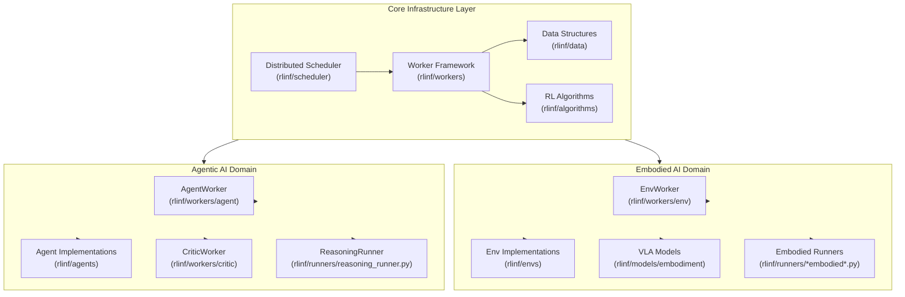
**Sources:** [.github/workflows/ci-tests.yml:65-156](), [docs/source-en/rst_source/examples/index.rst:9-54]()

### Embodied AI Domain
The Embodied AI domain focuses on vision-language-action (VLA) models for robotic control. It supports various simulation environments (e.g., `ManiSkill`, `LIBERO`, `IsaacLab`, `Genesis`, `Polaris`), real-world robots, and world models [README.md:33-42](), [docs/source-en/rst_source/examples/index.rst:15-20]().

| Component | Code Entity / Feature | Description |
|-----------|----------------------|-------------|
| Benchmarks | `LIBERO`, `ManiSkill`, `RoboTwin`, `Genesis`, `Polaris` | Integrated benchmarks for robotic manipulation [README.md:35-37](), [README.md:51-57]() |
| Models | `π₀`, `π₀.₅`, `OpenVLA`, `GR00T-N1.7`, `LingBot-VLA`, `StarVLA` | Support for SOTA VLA architectures including PyTorch re-implementations of π₀ [README.md:33-36](), [README.md:51-57]() |
| Algorithms | `PPO`, `GRPO`, `SAC`, `IQL`, `DAgger`, `RECAP`, `STEAM`, `OPD`, `RLT` | Diverse algorithms for on-policy, off-policy, offline learning, and online distillation [README.md:33-37](), [README.md:46-48](), [README.md:56-56]() |
| Real-World | `Franka`, `GimArm`, `Turtle2`, `DOS-W1` | Direct support for physical robot hardware with dexterous hands and ZED cameras [README.md:43-50](), [README.md:57-57](), [README.zh-CN.md:64-64]() |

**Sources:** [README.md:33-57](), [docs/source-en/rst_source/examples/index.rst:15-43](), [README.zh-CN.md:64-64]()

### Agentic AI Domain
The Agentic AI domain emphasizes large language model training for reasoning tasks, including math reasoning, code generation, and multi-agent collaboration [README.md:57-59]().

| Component | Code Entity / Feature | Description |
|-----------|----------------------|-------------|
| Reasoning | `rStar2`, `AgentLightning`, `SearchR1`, `Calc-X` | Advanced reasoning and search-based RL workflows [README.md:43-45](), [README.md:68-68]() |
| Multi-Agent | `WideSeek-R1` | Multi-agent RL for broad information seeking with width scaling [README.md:63-65]() |
| Training | `Megatron-Bridge` | Backend for RL training and SFT with Megatron integration [README.md:42-44]() |

**Sources:** [README.md:39-68](), [docs/source-en/rst_source/examples/index.rst:50-54]()

---

## Key Features

### Backend Agnosticism
RLinf provides training backends that share algorithmic logic but differ in performance characteristics.

- **FSDP Backend**: Ideal for rapid prototyping and HuggingFace model integration [README.md:73-74](), [docs/source-en/index.rst:82-83]().
- **Megatron Backend**: Optimized for large-scale training with model parallelism (TP/PP/EP/CP/DP) and `Megatron-Bridge` support [README.md:42-44](), [README.md:63-65]().

### Hybrid Execution and System Optimization
RLinf includes system-level optimizations to maximize throughput and resource utilization.

- **FUSCO**: Accelerates MoE All-to-All communication via transformation-communication fusion [README.md:62-64]().
- **Hybrid Pipeline Parallelism**: Achieves significant speedups (e.g., 25× for BEHAVIOR simulator) through system-level slimming and on-demand observation [README.md:40-42]().
- **Dynamic Scheduling**: Flexibly allocates compute resources between environment simulation and model training [docs/source-en/rst_source/examples/index.rst:56-60]().

**Sources:** [README.md:38-65](), [docs/source-en/rst_source/examples/index.rst:56-60]()

---

## High-Level System Organization

RLinf follows a modular organization from application to hardware abstraction.

### System Layer Organization

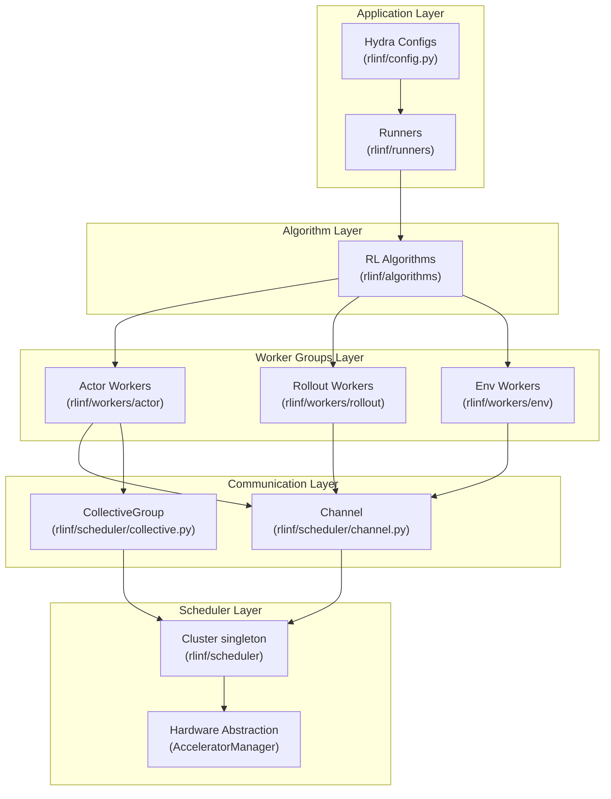

1.  **Application Layer**: `Runners` (e.g., `EmbodiedRunner`, `ReasoningRunner`, `AgentLightningRunner`) coordinate the high-level training loop [.github/workflows/ci-tests.yml:126-128]().
2.  **Algorithm Layer**: Implements core RL logic like `PPO`, `SAC`, and `GAE` [.github/workflows/ci-tests.yml:69-69]().
3.  **Worker Groups Layer**: Distributed actors managing training (`fsdp_actor_worker.py`), inference (`rollout/`), and simulation (`env/`) [.github/workflows/ci-tests.yml:72-75]().
4.  **Communication Layer**: Provides `Channel` for FIFO data transfer and `CollectiveGroup` for distributed tensor operations [.github/workflows/ci-tests.yml:69-70]().
5.  **Scheduler Layer**: Manages `Ray` actors, resource placement, and hardware-specific abstractions [.github/workflows/ci-tests.yml:70-70]().

**Sources:** [.github/workflows/ci-tests.yml:65-156]()

---

## Installation and Setup

RLinf supports multiple installation methods tailored to specific machine setups:

-   **Custom Setup**: Uses `requirements/` scripts to build an environment matched to the machine, supporting targets like `embodied` or `agentic` [.github/workflows/ci-tests.yml:57-60]().
-   **Docker**: Provides reproducible environments with pre-bundled stacks for different workloads [.github/workflows/ci-tests.yml:62-65]().
-   **Platform Support**: Support for high-performance distributed computing on GPU clusters [.github/workflows/ci-tests.yml:70-71]().

For details, see [Installation and Setup](#1.1).

**Sources:** [.github/workflows/ci-tests.yml:57-71]()

---

## CI/CD and Testing

RLinf maintains high code quality through an automated CI pipeline.

-   **Test Suites**: Includes `unit_tests`, `e2e_tests` (embodied/agent/reasoning/sft), and `scheduler_tests` [.github/workflows/ci-tests.yml:103-166]().
-   **Workflow**: Triggered on pull requests to `main` and release branches, requiring the `run-ci` label [.github/workflows/ci-tests.yml:3-43]().
-   **Change Detection**: Uses filters to run only relevant tests based on modified files (e.g., `embodied_filter`, `agent_reason_filter`) [.github/workflows/ci-tests.yml:81-166]().

For details, see [CI/CD and Testing](#1.3).

**Sources:** [.github/workflows/ci-tests.yml:3-166]()

---

# Page: Installation and Setup

# Installation and Setup

<details>
<summary>Relevant source files</summary>

The following files were used as context for generating this wiki page:

- [.github/workflows/docker-build.yml](.github/workflows/docker-build.yml)
- [.github/workflows/embodied-e2e-tests.yml](.github/workflows/embodied-e2e-tests.yml)
- [docker/Dockerfile](docker/Dockerfile)
- [docker/README.md](docker/README.md)
- [docs/source-en/rst_source/guides/ascend_cann.rst](docs/source-en/rst_source/guides/ascend_cann.rst)
- [docs/source-en/rst_source/start/index.rst](docs/source-en/rst_source/start/index.rst)
- [docs/source-en/rst_source/start/installation.rst](docs/source-en/rst_source/start/installation.rst)
- [docs/source-en/rst_source/start/vla.rst](docs/source-en/rst_source/start/vla.rst)
- [docs/source-zh/rst_source/guides/ascend_cann.rst](docs/source-zh/rst_source/guides/ascend_cann.rst)
- [docs/source-zh/rst_source/start/index.rst](docs/source-zh/rst_source/start/index.rst)
- [docs/source-zh/rst_source/start/installation.rst](docs/source-zh/rst_source/start/installation.rst)
- [docs/source-zh/rst_source/start/vla.rst](docs/source-zh/rst_source/start/vla.rst)
- [requirements/embodied/download_assets.sh](requirements/embodied/download_assets.sh)
- [requirements/embodied/models/ascend/gr00t.txt](requirements/embodied/models/ascend/gr00t.txt)
- [requirements/embodied/ros_install.sh](requirements/embodied/ros_install.sh)
- [requirements/install.sh](requirements/install.sh)
- [requirements/sys_deps.sh](requirements/sys_deps.sh)
- [rlinf/data/io_struct.py](rlinf/data/io_struct.py)
- [rlinf/envs/__init__.py](rlinf/envs/__init__.py)
- [rlinf/envs/action_utils.py](rlinf/envs/action_utils.py)
- [rlinf/models/embodiment/gr00t/gr00t_n1d5/__init__.py](rlinf/models/embodiment/gr00t/gr00t_n1d5/__init__.py)
- [rlinf/models/embodiment/gr00t/gr00t_n1d5/gr00t_action_model.py](rlinf/models/embodiment/gr00t/gr00t_n1d5/gr00t_action_model.py)
- [rlinf/models/embodiment/gr00t/gr00t_n1d5/npu_patches.py](rlinf/models/embodiment/gr00t/gr00t_n1d5/npu_patches.py)
- [rlinf/utils/patcher.py](rlinf/utils/patcher.py)
- [rlinf/workers/actor/fsdp_actor_worker_pipeline.py](rlinf/workers/actor/fsdp_actor_worker_pipeline.py)
- [tests/e2e_tests/embodied/maniskill_ppo_openpi05_pipeline.yaml](tests/e2e_tests/embodied/maniskill_ppo_openpi05_pipeline.yaml)

</details>


This page covers all methods for installing and configuring RLinf: Docker images, the `install.sh` script, and PyPI. It documents which model and environment combinations are supported for each install target and explains the underlying dependency architecture across different hardware platforms (NVIDIA, AMD ROCm, Ascend CANN).

---

## Hardware and Software Requirements

The following configurations are the tested baseline. RLinf provides experimental support for AMD and Ascend hardware, but H100/A100 clusters remain the primary development target.

### Hardware

| Component | Tested Configuration |
|-----------|---------------------|
| GPU | 8× H100 per node |
| CPU | 192 cores per node |
| Memory | 1.8 TB per node |
| Network | NVLink + RoCE / IB at 3.2 Tbps |
| Storage | 1 TB local (single-node); 10 TB NAS (multi-node) |

Sources: [docs/source-en/rst_source/start/installation.rst:25-47]()

### Software

| Component | Version |
|-----------|---------|
| OS | Ubuntu 22.04 |
| NVIDIA Driver | 535.183.06 |
| CUDA | 12.4 |
| Docker | 26.0.0 |
| NVIDIA Container Toolkit | 1.17.8 |
| Python | 3.11.14 (managed by `uv`) |

The Franka real-world environment is an exception: it requires Ubuntu 20.04 and ROS Noetic to handle specific driver requirements [docker/Dockerfile:57-57]().

Sources: [docs/source-en/rst_source/start/installation.rst:49-67](), [docker/Dockerfile:57-57](), [requirements/install.sh:9-10]()

---

## Installation Targets Overview

RLinf's dependency graph splits into independent install targets. They cannot share a single virtual environment because several packages conflict (e.g., specific versions of `Megatron` vs `Huggingface` transformers).

**Install targets as defined in `install.sh`:**

```bash
SUPPORTED_TARGETS=("embodied" "agentic" "docs")
SUPPORTED_MODELS=("openvla" "openvla-oft" "openpi" "gr00t" "gr00t_n1d6" "gr00t_n1d7" "dexbotic" "starvla" "lingbotvla" "dreamzero" "qwen3_vl" "abot_m0")
SUPPORTED_ENVS=("behavior" "maniskill_libero" "libero" "metaworld" "calvin" "isaaclab" 
                "robocasa" "franka" "franka-dexhand" "frankasim" "robotwin" "habitat" 
                "opensora" "wan" "genesis" "xsquare_turtle2" "liberopro" "liberoplus"
                "roboverse" "embodichain" "d4rl" "dosw1" "gim_arm" "dummy" "polaris")
```

Sources: [requirements/install.sh:82-84]()

**Target–model–environment compatibility matrix:**

| Target | `--model` | Valid `--env` values |
|--------|-----------|----------------------|
| `embodied` | `openvla` | `maniskill_libero`, `frankasim`, `behavior`, `polaris` |
| `embodied` | `openvla-oft` | `behavior`, `maniskill_libero`, `robotwin`, `opensora`, `wan`, `liberopro`, `liberoplus`, `polaris` |
| `embodied` | `openpi` | `behavior`, `maniskill_libero`, `metaworld`, `calvin`, `robocasa`, `robotwin`, `roboverse`, `polaris` |
| `embodied` | `gr00t` | `maniskill_libero`, `isaaclab` |
| `embodied` | `dexbotic` | `maniskill_libero` |
| `agentic` | — | MATH reasoning, SearchR1 |

Sources: [requirements/install.sh:82-84](), [docs/source-en/rst_source/start/installation.rst:21-31](), [rlinf/envs/action_utils.py:104-129]()

---

## Method 1: Docker Images (Recommended)

Docker images are the fastest path to a reproducible environment. All model and environment dependencies are pre-installed.

### Available Images

| Use Case | Image Tag |
|----------|-----------|
| Embodied (Libero / ManiSkill) | `rlinf/rlinf:agentic-rlinf0.3-maniskill_libero` |
| Franka Control | `rlinf/rlinf:agentic-rlinf0.3-franka` |

Sources: [docs/source-en/rst_source/start/installation.rst:45-57]()

### Starting the Container

```bash
docker pull rlinf/rlinf:CHOSEN_IMAGE

docker run -it --gpus all \
  --shm-size 100g \
  --net=host \
  --name rlinf \
  -e NVIDIA_DRIVER_CAPABILITIES=all \
  rlinf/rlinf:CHOSEN_IMAGE /bin/bash
```

> **Note on `NVIDIA_DRIVER_CAPABILITIES=all`**: This is required for GPU rendering in embodied experiments (enables the `graphics` capability) [docs/source-en/rst_source/start/installation.rst:63-63]().

Sources: [docs/source-en/rst_source/start/installation.rst:52-57](), [docker/Dockerfile:63-65]()

### Switching Virtual Environments

The Docker image stores multiple virtual environments under `/opt/venv/` [docker/Dockerfile:117-117](). Use the built-in `switch_env` script to toggle between them.

```bash
source switch_env openvla
source switch_env openvla-oft
source switch_env openpi
```

Sources: [docker/Dockerfile:136-148](), [docs/source-en/rst_source/start/installation.rst:61-69]()

---

## Method 2: Manual Installation with `install.sh`

`requirements/install.sh` automates dependency installation using [`uv`](https://docs.astral.sh/uv).

### Script Behavior Overview

The installer detects the hardware platform and configures `UV_TORCH_BACKEND` and `PLATFORM_TORCH_INDEX` accordingly to ensure the correct hardware-specific PyTorch wheels are fetched [requirements/install.sh:24-28]().

**Natural Language to Code Entity Space: Installation Flow**

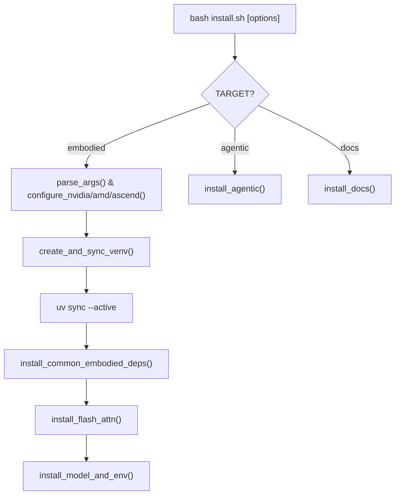

Sources: [requirements/install.sh:1-125](), [requirements/install.sh:82-84]()

### Key Script Functions

| Function | Purpose |
|----------|---------|
| `configure_nvidia` | Sets `UV_TORCH_BACKEND=auto` for CUDA support [requirements/install.sh:65-65](). |
| `configure_amd` | Detects ROCm version and sets `UV_TORCH_BACKEND=rocm<ver>` [requirements/install.sh:66-69](). |
| `configure_ascend` | Sets `UV_TORCH_BACKEND=cpu` and prepares `torch-npu` installation [requirements/install.sh:117-118](). |
| `create_and_sync_venv` | Creates venv at `VENV_DIR` with Python 3.11.14; runs `uv sync`. |
| `install_flash_attn` | Installs Flash Attention via prebuilt wheels or source build [requirements/install.sh:37-45](). |

Sources: [requirements/install.sh:65-65](), [requirements/install.sh:66-69](), [requirements/install.sh:37-45]()

### Common Commands

**Embodied (OpenVLA + ManiSkill):**
```bash
bash requirements/install.sh embodied --model openvla --env maniskill_libero
source .venv/bin/activate
```

**Agentic (Megatron + SGLang/vLLM):**
```bash
bash requirements/install.sh agentic
source .venv/bin/activate
```

Sources: [docs/source-en/rst_source/start/installation.rst:14-29]()

---

## Method 3: PyPI Library Installation

RLinf can be installed as a library using optional dependency groups defined in `pyproject.toml`. This installs core scheduler components but requires manual installation of model/environment dependencies.

```bash
pip install rlinf[embodied]        # Embodied RL core extras
pip install rlinf[agentic-sglang]  # Agentic RL with SGLang
pip install rlinf[agentic-vllm]    # Agentic RL with vLLM
```

Sources: [pyproject.toml:75-114]()

---

## Dependency Architecture

The following diagram maps install targets to the concrete packages and functions in `install.sh` and `pyproject.toml`:

**Natural Language to Code Entity Space: Dependency Mapping**

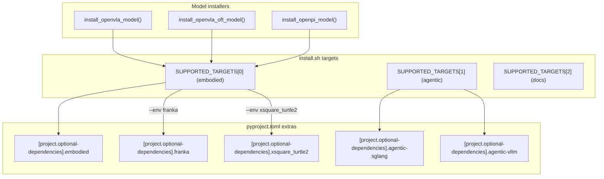

Sources: [requirements/install.sh:82-84](), [pyproject.toml:75-150]()

---

## System Dependencies and Real-World Setup

### Graphics and Rendering
When running the `embodied` target, the installer handles graphics and rendering libraries across different Linux distributions. Key system packages include:
- **OpenGL/Mesa**: `libgl1-mesa-glx`, `libosmesa6-dev`
- **Vulkan**: `libvulkan1`
- **Display**: `libxrandr-dev`

Sources: [docker/Dockerfile:92-95]()

### Franka Real-World Setup
Real-world Franka training requires specific hardware coordination:
1. **Robot Controller Node**: Ubuntu 20.04 with ROS Noetic and real-time kernel.
2. **Training Node**: GPU-enabled machine running RLinf.
3. **Firmware**: Franka firmware version `< 5.9.0` (Recommended `5.7.2`).

Teleoperation wrappers such as `SpacemouseIntervention`, `GelloIntervention`, and `PicoIntervention` are applied to real-world environments to facilitate data collection and human intervention.

Sources: [docs/source-en/rst_source/start/installation.rst:49-67]()

---

## Dockerfile Build Targets

The `docker/Dockerfile` is parameterized by a `BUILD_TARGET` argument and selects the appropriate base image [docker/Dockerfile:1-14]().

**Dockerfile target → image mapping**

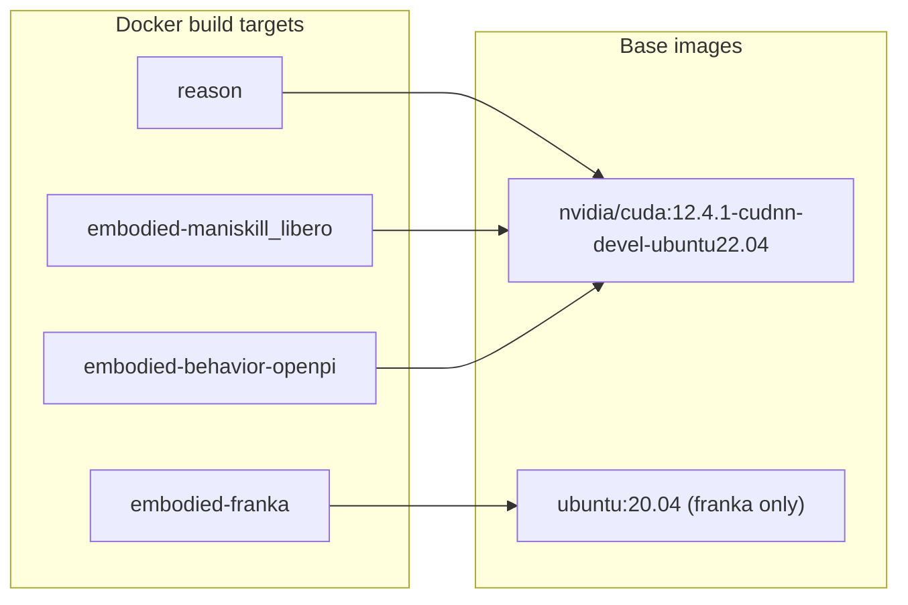

Sources: [docker/Dockerfile:1-14](), [docker/Dockerfile:34-57]()

---

## Python Version and Package Manager

The installer pins Python to **3.11.14** [requirements/install.sh:10-10]() and uses `uv` as the package manager.

```bash
uv venv "$VENV_DIR" --python 3.11.14
uv sync --active
```

Sources: [requirements/install.sh:9-10](), [pyproject.toml:11-11]()

---

## Environment Configuration

RLinf uses environment variables to configure hardware platforms and directory paths, especially within Docker.

| Variable | Purpose |
|----------|---------|
| `RLINF_PLATFORM` | Set in Docker images to indicate `nvidia`, `amd`, or `ascend` [docker/Dockerfile:65-65](). |
| `HF_HOME` | Cache directory for HuggingFace models, set to `/opt/.cache/huggingface` in Docker [docker/Dockerfile:114-114](). |
| `UV_PATH` | Base path for virtual environments in Docker (`/opt/venv`) [docker/Dockerfile:117-117](). |
| `LIBERO_PATH` | Path for LIBERO environment assets [.github/workflows/embodied-e2e-tests.yml:20-20](). |

Sources: [docker/Dockerfile:65-65](), [docker/Dockerfile:114-114](), [docker/Dockerfile:117-117](), [.github/workflows/embodied-e2e-tests.yml:20-20]()

---

# Page: Quick Start Guide

# Quick Start Guide

<details>
<summary>Relevant source files</summary>

The following files were used as context for generating this wiki page:

- [.gitignore](.gitignore)
- [examples/embodiment/config/libero_10_grpo_openvlaoft.yaml](examples/embodiment/config/libero_10_grpo_openvlaoft.yaml)
- [examples/embodiment/config/libero_130_grpo_openvlaoft.yaml](examples/embodiment/config/libero_130_grpo_openvlaoft.yaml)
- [examples/embodiment/config/libero_90_grpo_openvlaoft.yaml](examples/embodiment/config/libero_90_grpo_openvlaoft.yaml)
- [examples/embodiment/config/libero_goal_grpo_openvlaoft.yaml](examples/embodiment/config/libero_goal_grpo_openvlaoft.yaml)
- [examples/embodiment/config/libero_object_grpo_openvlaoft.yaml](examples/embodiment/config/libero_object_grpo_openvlaoft.yaml)
- [examples/embodiment/config/libero_spatial_grpo_openvlaoft.yaml](examples/embodiment/config/libero_spatial_grpo_openvlaoft.yaml)
- [examples/embodiment/config/maniskill_grpo_openvla.yaml](examples/embodiment/config/maniskill_grpo_openvla.yaml)
- [examples/embodiment/config/maniskill_grpo_openvlaoft.yaml](examples/embodiment/config/maniskill_grpo_openvlaoft.yaml)
- [examples/embodiment/config/maniskill_ppo_openvla.yaml](examples/embodiment/config/maniskill_ppo_openvla.yaml)
- [examples/embodiment/config/maniskill_ppo_openvla_quickstart.yaml](examples/embodiment/config/maniskill_ppo_openvla_quickstart.yaml)
- [examples/embodiment/config/maniskill_ppo_openvlaoft.yaml](examples/embodiment/config/maniskill_ppo_openvlaoft.yaml)
- [examples/embodiment/config/maniskill_ppo_openvlaoft_quickstart.yaml](examples/embodiment/config/maniskill_ppo_openvlaoft_quickstart.yaml)
- [examples/embodiment/run_embodiment.sh](examples/embodiment/run_embodiment.sh)
- [examples/embodiment/train_async.py](examples/embodiment/train_async.py)
- [examples/embodiment/train_embodied_agent.py](examples/embodiment/train_embodied_agent.py)
- [rlinf/config.py](rlinf/config.py)
- [rlinf/runners/embodied_runner.py](rlinf/runners/embodied_runner.py)
- [rlinf/workers/actor/fsdp_actor_worker.py](rlinf/workers/actor/fsdp_actor_worker.py)
- [rlinf/workers/env/env_worker.py](rlinf/workers/env/env_worker.py)
- [rlinf/workers/rollout/hf/huggingface_worker.py](rlinf/workers/rollout/hf/huggingface_worker.py)
- [tests/parity_tests/README.md](tests/parity_tests/README.md)
- [tests/parity_tests/analyze_logs.py](tests/parity_tests/analyze_logs.py)
- [tests/parity_tests/check.py](tests/parity_tests/check.py)
- [tests/parity_tests/compare_baseline.py](tests/parity_tests/compare_baseline.py)
- [tests/parity_tests/parse_success_once.py](tests/parity_tests/parse_success_once.py)
- [tests/parity_tests/plot_success_once.py](tests/parity_tests/plot_success_once.py)
- [tests/parity_tests/run_all.sh](tests/parity_tests/run_all.sh)
- [tests/unit_tests/test_overlap_env_bootstrap.py](tests/unit_tests/test_overlap_env_bootstrap.py)

</details>


This document provides hands-on tutorials for running your first experiments with RLinf. It demonstrates basic usage patterns through two practical examples: an embodied RL experiment using ManiSkill3 and an agentic reasoning task using GRPO.

## Prerequisites

Before starting, ensure you have:

1. Completed installation via one of the methods in [1.1 Installation and Setup]().
2. Downloaded the required pre-trained models (e.g., OpenVLA or OpenVLA-OFT) [rlinf/config.py:86-87]().
3. Downloaded simulation assets, such as the ManiSkill3 dataset [examples/embodiment/config/maniskill_ppo_openvlaoft.yaml:2-2]().
4. Set the `PYTHONPATH` to include the RLinf repository root [examples/embodiment/run_embodiment.sh:10-10]().
5. Configured appropriate GPU resources. Quickstart configs typically target 4-8 GPUs [examples/embodiment/config/maniskill_ppo_openvlaoft.yaml:19-21]().

---

## Quickstart 1: Embodied RL with ManiSkill3 and OpenVLA

This example demonstrates training a Vision-Language-Action (VLA) model on robotic manipulation tasks using the PPO algorithm. RLinf supports a wide range of environments including ManiSkill, LIBERO, and IsaacLab [rlinf/workers/env/env_worker.py:35-38]().

### System Overview

The diagram below illustrates the relationship between high-level training concepts and the specific code entities responsible for them.

**Embodied RL Data Flow and Code Entities**
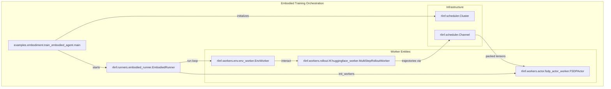
**Sources:** [examples/embodiment/train_embodied_agent.py:38-164](), [rlinf/runners/embodied_runner.py:52-173](), [rlinf/workers/actor/fsdp_actor_worker.py:190-200]()

### Launching the Experiment

**Step 1: Modify Configuration**
Update your `.yaml` config (e.g., `maniskill_ppo_openvlaoft.yaml`) to point to your local model paths for `rollout.model.model_path` and `actor.model.model_path` [examples/embodiment/config/maniskill_ppo_openvlaoft.yaml:104-117]().

**Step 2: Start Training**
Launch using the embodiment runner script. This script handles environment setup and Hydra configuration loading [examples/embodiment/run_embodiment.sh:62-64]().

```bash
# Launch training with the quickstart config
bash examples/embodiment/run_embodiment.sh maniskill_ppo_openvlaoft
```

**Step 3: Training Pipeline Mode (Optional)**
For higher throughput, enable `runner.use_training_pipeline: True`. This allows `PipelineEmbodiedFSDPActor` to train on micro-batches while rollouts are still being generated [examples/embodiment/train_embodied_agent.py:87-91]().

---

## Quickstart 2: Agentic RL with GRPO

RLinf supports Group Relative Policy Optimization (GRPO) for both agentic reasoning and embodied VLA fine-tuning [examples/embodiment/config/libero_10_grpo_openvlaoft.yaml:49-50]().

### Agentic Data Flow

The following diagram bridges the "Natural Language Space" (prompts, reasoning) to the "Code Entity Space" (workers, algorithms).

**Reasoning RL Architecture (GRPO)**
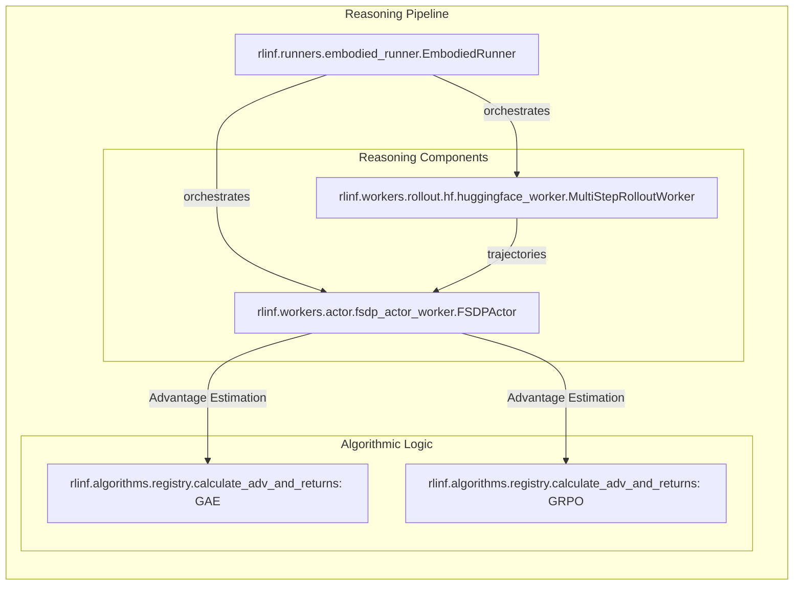
**Sources:** [rlinf/workers/actor/fsdp_actor_worker.py:28-28](), [examples/embodiment/config/libero_10_grpo_openvlaoft.yaml:39-60]()

### Key Implementation Details
* **Algorithm Configuration**: Advantages are calculated via `calculate_adv_and_returns` based on the `adv_type` config (e.g., `gae` or `grpo`) [rlinf/workers/actor/fsdp_actor_worker.py:28-28](), [examples/embodiment/config/libero_10_grpo_openvlaoft.yaml:49-49]().
* **Advantage Normalization**: For GRPO, advantage normalization is typically enabled to compare relative performance within the group [examples/embodiment/config/libero_10_grpo_openvlaoft.yaml:40-40]().
* **Data Transport**: Trajectories are converted to batches and processed for advantage computation using specialized nested dictionary utilities [rlinf/workers/actor/fsdp_actor_worker.py:33-33](), [rlinf/workers/actor/fsdp_actor_worker.py:92-110]().

---

## Resource Allocation and Scaling

RLinf uses a distributed scheduler to manage component placement via the `Cluster` configuration [rlinf/scheduler/cluster.py:28-28]().

### Placement Strategies
You can specify GPU usage by modifying `cluster.component_placement` in your YAML config. This supports specifying ranges of GPUs for different worker types [examples/embodiment/config/maniskill_ppo_openvlaoft.yaml:18-21]().

| Strategy | Description | Config Example |
| :--- | :--- | :--- |
| **Collocated** | Components share the same GPU set | `actor,env,rollout: all` [examples/embodiment/config/libero_10_grpo_openvlaoft.yaml:19-19]() |
| **Disaggregated** | Separate GPUs for training and sampling | `actor: 0-7`, `env: 0-3`, `rollout: 4-7` [examples/embodiment/config/maniskill_ppo_openvlaoft.yaml:19-21]() |

**Sources:** [examples/embodiment/config/maniskill_ppo_openvlaoft.yaml:16-21](), [examples/embodiment/config/libero_10_grpo_openvlaoft.yaml:16-19]()

---

## Viewing Results

Training metrics and models are saved to the directory specified in the config, typically controlled by the `runner.logger.log_path` [examples/embodiment/config/maniskill_ppo_openvlaoft.yaml:26-26]().

1. **Metrics**: Use TensorBoard or WandB to monitor environment returns and success rates [examples/embodiment/config/maniskill_ppo_openvlaoft.yaml:27-29]().
2. **Logs**: Detailed execution logs are stored in the log directory generated by the run script [examples/embodiment/run_embodiment.sh:51-53]().

```bash
# Example command to view metrics
tensorboard --host 0.0.0.0 --logdir ./logs
```

**Sources:** [examples/embodiment/run_embodiment.sh:51-53](), [rlinf/runners/embodied_runner.py:115-118]()

---

# Page: CI/CD and Testing

# CI/CD and Testing

<details>
<summary>Relevant source files</summary>

The following files were used as context for generating this wiki page:

- [.github/workflows/ci-tests.yml](.github/workflows/ci-tests.yml)
- [.github/workflows/commit_check.yml](.github/workflows/commit_check.yml)
- [.github/workflows/lint.yml](.github/workflows/lint.yml)
- [.github/workflows/scheduler-tests.yml](.github/workflows/scheduler-tests.yml)
- [.github/workflows/unit-tests.yml](.github/workflows/unit-tests.yml)
- [.gitignore](.gitignore)
- [README.md](README.md)
- [README.zh-CN.md](README.zh-CN.md)
- [docs/source-en/rst_source/examples/embodied/lingbotvla.rst](docs/source-en/rst_source/examples/embodied/lingbotvla.rst)
- [docs/source-en/rst_source/examples/index.rst](docs/source-en/rst_source/examples/index.rst)
- [docs/source-zh/rst_source/examples/embodied/lingbotvla.rst](docs/source-zh/rst_source/examples/embodied/lingbotvla.rst)
- [docs/source-zh/rst_source/examples/index.rst](docs/source-zh/rst_source/examples/index.rst)
- [examples/embodiment/config/model/lingbotvla.yaml](examples/embodiment/config/model/lingbotvla.yaml)
- [examples/embodiment/run_embodiment.sh](examples/embodiment/run_embodiment.sh)
- [rlinf/envs/realworld/franka/franka_controller.py](rlinf/envs/realworld/franka/franka_controller.py)
- [rlinf/models/embodiment/lingbotvla/lingbotvla_action_model.py](rlinf/models/embodiment/lingbotvla/lingbotvla_action_model.py)
- [rlinf/models/embodiment/openpi_cfg/openpi_cfg_action_model.py](rlinf/models/embodiment/openpi_cfg/openpi_cfg_action_model.py)
- [rlinf/runners/sft_runner.py](rlinf/runners/sft_runner.py)
- [rlinf/scheduler/dynamic_scheduler/scheduler_worker.py](rlinf/scheduler/dynamic_scheduler/scheduler_worker.py)
- [rlinf/scheduler/hardware/__init__.py](rlinf/scheduler/hardware/__init__.py)
- [rlinf/scheduler/hardware/robots/__init__.py](rlinf/scheduler/hardware/robots/__init__.py)
- [rlinf/scheduler/hardware/robots/auto_config.py](rlinf/scheduler/hardware/robots/auto_config.py)
- [rlinf/scheduler/hardware/robots/dosw1.py](rlinf/scheduler/hardware/robots/dosw1.py)
- [rlinf/scheduler/hardware/robots/dual_franka.py](rlinf/scheduler/hardware/robots/dual_franka.py)
- [rlinf/scheduler/hardware/robots/gim_arm.py](rlinf/scheduler/hardware/robots/gim_arm.py)
- [rlinf/scheduler/hardware/robots/xsquare.py](rlinf/scheduler/hardware/robots/xsquare.py)
- [rlinf/utils/data_process.py](rlinf/utils/data_process.py)
- [tests/e2e_tests/dynamic_scheduler/qwen2.5-1.5b-grpo-dynamic-mg-vllm.yaml](tests/e2e_tests/dynamic_scheduler/qwen2.5-1.5b-grpo-dynamic-mg-vllm.yaml)
- [tests/e2e_tests/embodied/robotwin_grpo_lingbotvla.yaml](tests/e2e_tests/embodied/robotwin_grpo_lingbotvla.yaml)
- [tests/parity_tests/README.md](tests/parity_tests/README.md)
- [tests/parity_tests/analyze_logs.py](tests/parity_tests/analyze_logs.py)
- [tests/parity_tests/check.py](tests/parity_tests/check.py)
- [tests/parity_tests/compare_baseline.py](tests/parity_tests/compare_baseline.py)
- [tests/parity_tests/parse_success_once.py](tests/parity_tests/parse_success_once.py)
- [tests/parity_tests/plot_success_once.py](tests/parity_tests/plot_success_once.py)
- [tests/parity_tests/run_all.sh](tests/parity_tests/run_all.sh)
- [tests/unit_tests/test_broadcast_sync.py](tests/unit_tests/test_broadcast_sync.py)
- [tests/unit_tests/test_cluster_config.py](tests/unit_tests/test_cluster_config.py)
- [tests/unit_tests/test_math_dataset_multithread.py](tests/unit_tests/test_math_dataset_multithread.py)

</details>


## Purpose and Scope

This document describes RLinf's continuous integration and testing infrastructure, including GitHub Actions workflows, test suite organization, change detection mechanisms, and quality checks. It details how the system validates core components like the distributed scheduler, worker lifecycle, and environment integrations across diverse hardware (NVIDIA, AMD ROCm, Ascend CANN) and software configurations. The testing framework ensures reliability for both Embodied AI (e.g., ManiSkill, LIBERO, RoboTwin) and Agentic AI (e.g., Reasoning with Megatron-LM or SGLang) pipelines.

## CI/CD Architecture Overview

RLinf implements a comprehensive CI/CD pipeline that validates code quality, installation procedures, and end-to-end training workflows. The system uses intelligent change detection to run only relevant test suites, optimizing execution time while maintaining thorough coverage.

### Workflow Structure

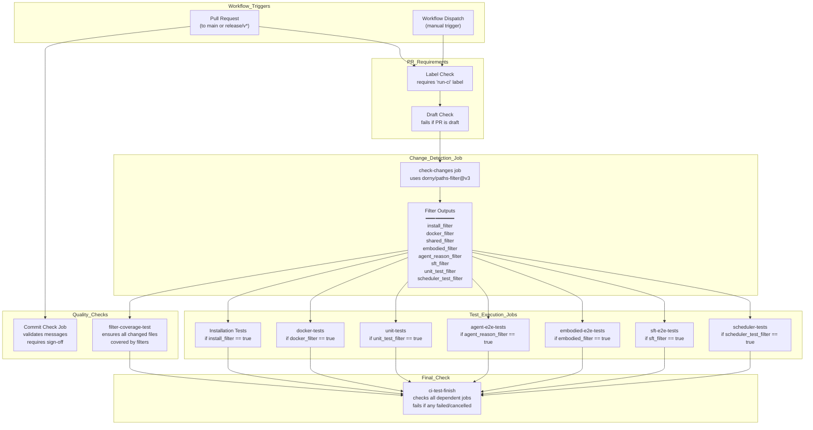

**Diagram: CI/CD Workflow Execution Flow**

Sources: [.github/workflows/ci-tests.yml:1-180](), [.github/workflows/unit-tests.yml:1-175]()

### Concurrency Control

The CI system implements concurrency control to prevent redundant test executions and optimize resource usage. When new commits are pushed to a PR, previous CI runs for that PR are automatically cancelled [[.github/workflows/ci-tests.yml:11-13]]().

## Change Detection and Smart Test Execution

RLinf uses path-based filtering via `dorny/paths-filter@v3` to detect which files have changed and execute only relevant test suites [[.github/workflows/ci-tests.yml:51-53]]().

### Filter Categories and File Mappings

| Filter Name | Core Paths Monitored | Impacted Test Suites |
| :--- | :--- | :--- |
| `install_filter` | `pyproject.toml`, `requirements/*.sh`, `requirements/*.txt` | Environment Setup |
| `shared_filter` | `rlinf/scheduler/`, `rlinf/algorithms/`, `rlinf/config.py` | Core Unit & E2E Tests |
| `embodied_filter` | `rlinf/envs/`, `rlinf/workers/env/`, `rlinf/models/embodiment/` | Embodied E2E Tests |
| `agent_reason_filter`| `rlinf/agents/`, `rlinf/workers/rollout/vllm/`, `rlinf/runners/reasoning_runner.py` | Agentic E2E Tests |
| `sft_filter` | `rlinf/workers/sft/`, `rlinf/runners/sft_runner.py`, `examples/sft/` | SFT E2E Tests |
| `scheduler_test_filter`| `tests/e2e_tests/auto_placement/`, `tests/e2e_tests/dynamic_scheduler/` | Scheduler E2E Tests |

Sources: [.github/workflows/ci-tests.yml:56-156]()

## Test Suites and Implementation

RLinf organizes tests into suites targeting specific infrastructure components and training pipelines.

### Unit Tests: Core Infrastructure

Unit tests validate foundational distributed computing primitives and data processing logic across different hardware backends.

*   **Multi-Hardware Support**: Unit tests are executed on `unit-tests-cuda`, `unit-tests-cpu`, `scheduler-unit-tests-rocm` (AMD), and `scheduler-unit-tests-ascend` (NPU) environments [[.github/workflows/unit-tests.yml:7-121]]().
*   **Package Structure**: Automated checks ensure that every subpackage within `rlinf/` contains a required `__init__.py` file, validated in the `package-structure-check` job [[.github/workflows/unit-tests.yml:167-175]]().
*   **Doctests**: The scheduler component is additionally validated via Python doctests using `pytest --doctest-modules rlinf/scheduler` [[.github/workflows/unit-tests.yml:30-34]]().

### Installation and System Validation

Testing the environment setup is critical due to the complex dependencies of RL environments:
1.  **Unified Installer**: The `requirements/install.sh` script handles multi-platform configuration for NVIDIA, AMD, and Ascend [[.github/workflows/unit-tests.yml:77]](), [[.github/workflows/unit-tests.yml:108]]().
2.  **Package Integrity**: Validates the build and import of the wheel file for both `embodied` and `agentic` variants [[.github/workflows/unit-tests.yml:127-160]]().

### Robot Hardware Abstraction Mapping

The following diagram bridges the natural language robot hardware concepts to the specific code entities in the scheduler's hardware layer.

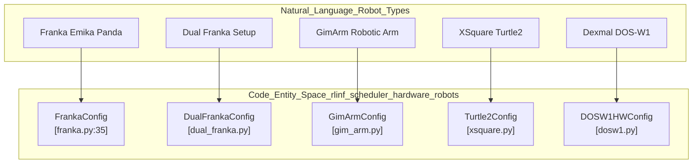

**Diagram: Robot Hardware Abstraction Mapping**

Sources: [rlinf/scheduler/hardware/robots/franka.py:35-37](), [rlinf/scheduler/hardware/robots/gim_arm.py](), [rlinf/scheduler/hardware/robots/dual_franka.py](), [rlinf/scheduler/hardware/robots/dosw1.py](), [rlinf/scheduler/hardware/robots/xsquare.py]()

### SFT and Training Pipeline Mapping

The SFT (Supervised Fine-Tuning) infrastructure supports multiple model types including VLA (Vision-Language-Action) and VLM (Vision-Language Models). The pipeline is orchestrated by the `SFTRunner` and verified through specific end-to-end tests.

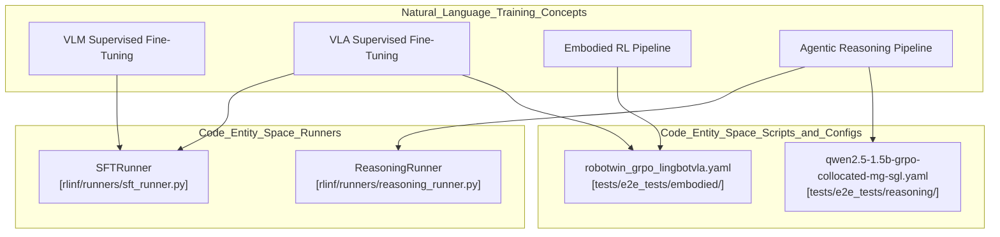

**Diagram: Training Pipeline to Code Entity Mapping**

Sources: [rlinf/runners/sft_runner.py](), [rlinf/runners/reasoning_runner.py](), [.github/workflows/sft-e2e-tests.yml](), [tests/e2e_tests/embodied/robotwin_grpo_lingbotvla.yaml](), [tests/e2e_tests/reasoning/qwen2.5-1.5b-ppo-collocated-mg-sgl.yaml:206]()

## End-to-End (E2E) Test Categories

RLinf maintains a rigorous E2E testing suite that covers diverse training scenarios from behavioral cloning to complex reasoning tasks.

| Test Category | Primary Components Validated | Source Workflow |
| :--- | :--- | :--- |
| **Embodied E2E** | SAC (Sync/Async), Offline IQL, DAgger, Robotwin GRPO | [.github/workflows/embodied-e2e-tests.yml:7-220]() |
| **Agentic E2E** | GRPO, AgentLightning, Megatron-LM Reasoning | [.github/workflows/agent-e2e-tests.yml:7-213]() |
| **SFT E2E** | VLM SFT (Qwen-VL), VLA SFT (DreamZero, OpenPI, LingbotVLA) | [.github/workflows/sft-e2e-tests.yml]() |
| **Scheduler E2E** | Auto-Placement, Dynamic Scheduler, Hybrid Execution | [.github/workflows/scheduler-tests.yml]() |

### Specific E2E Validations
*   **Embodied MLP/SAC**: Tested using `maniskill_sac_mlp` and `maniskill_sac_mlp_async` [[.github/workflows/embodied-e2e-tests.yml:23-37]]().
*   **Offline RL**: Validated using D4RL MuJoCo datasets with IQL, testing both standard and FSDP-wrapped configurations [[.github/workflows/embodied-e2e-tests.yml:83-97]]().
*   **Reasoning**: Extensive testing of GRPO on Qwen models using both SGLang and vLLM backends in collocated and pipeline modes [[.github/workflows/agent-e2e-tests.yml:23-77]]().
*   **Agentic Frameworks**: Verification of `AgentLightning` integration for multiturn tasks like `calc_x` [[.github/workflows/agent-e2e-tests.yml:109-114]]().
*   **LingbotVLA GRPO**: Validated on RoboTwin tasks such as `Click Bell` and `Place Shoe` [[docs/source-en/rst_source/examples/embodied/lingbotvla.rst:65-72]]().

## Quality Assurance Workflow

### Required PR State
To optimize resource usage, the CI workflow checks for:
*   **Label Requirements**: Pull requests must have the `run-ci` label to trigger execution [[.github/workflows/ci-tests.yml:38-43]]().
*   **Draft Status**: Draft PRs are automatically failed to prevent wasting CI resources on incomplete work [[.github/workflows/ci-tests.yml:44-49]]().
*   **Commit Quality**: Validates commit messages and requires sign-off [[.github/workflows/commit_check.yml:1-30]]().

### Package Integrity
The CI includes a `package-build-test` job [[.github/workflows/unit-tests.yml:127-166]] that:
1.  Builds the wheel using `uv build` [[.github/workflows/unit-tests.yml:138]]().
2.  Installs the wheel with various extras (e.g., `[embodied]`, `[agentic-sglang]`) [[.github/workflows/unit-tests.yml:146-148]]().
3.  Verifies the package structure and imports [[.github/workflows/unit-tests.yml:151-160]]().

## Local Development and Testing

Developers are encouraged to run tests locally using the `uv` environment manager to ensure changes meet baseline requirements before pushing to GitHub.

### Local Execution Commands

```bash
# Setup environment for embodied testing (NVIDIA default)
bash requirements/install.sh embodied --env dummy --venv .venv

# Run unit tests
source .venv/bin/activate
export PYTHONPATH=$(pwd):$(pwd)/tests/unit_tests
pytest tests/unit_tests

# Run a specific reasoning test locally
source .venv/bin/activate
bash tests/e2e_tests/reasoning/run.sh qwen2.5-1.5b-grpo-collocated-mg-sgl
```

Sources: [.github/workflows/unit-tests.yml:23-26](), [.github/workflows/agent-e2e-tests.yml:23-29](), [requirements/install.sh:88-125]()

---

# Page: Configuration System

# Configuration System

<details>
<summary>Relevant source files</summary>

The following files were used as context for generating this wiki page:

- [docs/source-en/rst_source/guides/agentic_config.rst](docs/source-en/rst_source/guides/agentic_config.rst)
- [docs/source-en/rst_source/guides/basic_config.rst](docs/source-en/rst_source/guides/basic_config.rst)
- [docs/source-en/rst_source/guides/embodiment_config.rst](docs/source-en/rst_source/guides/embodiment_config.rst)
- [docs/source-en/rst_source/guides/env_decoupled_mode.rst](docs/source-en/rst_source/guides/env_decoupled_mode.rst)
- [docs/source-en/rst_source/guides/performance/index.rst](docs/source-en/rst_source/guides/performance/index.rst)
- [docs/source-zh/rst_source/guides/agentic_config.rst](docs/source-zh/rst_source/guides/agentic_config.rst)
- [docs/source-zh/rst_source/guides/basic_config.rst](docs/source-zh/rst_source/guides/basic_config.rst)
- [docs/source-zh/rst_source/guides/embodiment_config.rst](docs/source-zh/rst_source/guides/embodiment_config.rst)
- [docs/source-zh/rst_source/guides/env_decoupled_mode.rst](docs/source-zh/rst_source/guides/env_decoupled_mode.rst)
- [docs/source-zh/rst_source/guides/performance/index.rst](docs/source-zh/rst_source/guides/performance/index.rst)
- [rlinf/utils/omega_resolver.py](rlinf/utils/omega_resolver.py)

</details>


RLinf uses [Hydra](https://hydra.cc) for compositional configuration management, enabling modular experiment design through YAML-based configuration files. This system allows users to define complex distributed training setups by composing reusable configuration components and overriding specific parameters without modifying code. [docs/source-en/rst_source/guides/basic_config.rst:11-20]()

For information about how configurations are used to instantiate workers and manage distributed execution, see [Distributed Scheduler](#3.1). For details on configuring specific RL algorithms and models, see [Algorithm and Model Configuration](#2.3).

## Configuration Composition

Hydra enables **hierarchical composition** where base configuration files are inherited and selectively overridden. Configuration files are organized by component type and can be composed using the `defaults` directive. [docs/source-en/rst_source/guides/embodiment_config.rst:8-23]()

### Defaults Directive

The `defaults` section at the top of a configuration file specifies which base configurations to compose. RLinf splits configurations into specific groups such as `env`, `model`, and `training_backend` to cater to different research needs. The `<group>@<target>` syntax is used to mount presets onto specific config nodes (e.g., `model/openvla_oft@actor.model` fills the `actor.model` configuration). [docs/source-en/rst_source/guides/embodiment_config.rst:20-23]()

**Title: Configuration Composition Flow**
```mermaid
graph TB
    ["Main Config YAML<br/>(e.g., maniskill_ppo_openvlaoft.yaml)"] -- "defaults: composition" --> Defaults
    
    subgraph Defaults["Composition Keys"]
        ["env/maniskill@env.train"]
        ["model/openvla_oft@actor.model"]
        ["weight_syncer/patch_syncer@weight_syncer"]
    end
    
    subgraph BaseConfigs["Base Configuration Files"]
        ["config/env/maniskill_*.yaml"]
        ["config/model/openvla_oft.yaml"]
        ["config/weight_syncer/patch_syncer.yaml"]
    end
    
    subgraph FinalConfig["Merged OmegaConf Object"]
        ["env: train: {...}"]
        ["actor: model: {...}"]
        ["runner: {...}"]
    end
    
    Defaults -.-> BaseConfigs
    BaseConfigs --> FinalConfig
```

**Sources**: [docs/source-en/rst_source/guides/embodiment_config.rst:8-32](), [docs/source-zh/rst_source/guides/embodiment_config.rst:7-32]()

## Configuration File Structure

All RLinf experiments follow a standard configuration structure defined via `omegaconf.DictConfig`. The system supports multiple task types (e.g., `embodied`, `math`) and training backends like `megatron` and `fsdp`. [docs/source-en/rst_source/guides/basic_config.rst:1-9](), [docs/source-en/rst_source/guides/agentic_config.rst:80-90]()

| Section | Purpose | Reference |
|---------|---------|-----------|
| `cluster` | Distributed execution topology, node counts, and component placement | [docs/source-en/rst_source/guides/basic_config.rst:32-55]() |
| `runner` | Training loop orchestration, task types, logging, and checkpointing | [docs/source-en/rst_source/guides/basic_config.rst:78-130]() |
| `algorithm` | RL hyperparameters (PPO, GRPO, SAC), loss settings, and sampling | [docs/source-en/rst_source/guides/basic_config.rst:132-210]() |
| `actor` | Training worker logic, precision, and backend-specific settings | [docs/source-en/rst_source/guides/basic_config.rst:241-265]() |
| `rollout` | Inference engine settings (SGLang/vLLM), TP/PP degrees, and memory | [docs/source-en/rst_source/guides/agentic_config.rst:80-157]() |
| `env` | Environment simulation settings, parallel env counts, and auto-reset | [docs/source-en/rst_source/guides/embodiment_config.rst:149-204]() |
| `data` | Dataset paths, batch sizes, and prompt/answer key mappings | [docs/source-en/rst_source/guides/agentic_config.rst:190-248]() |

### Cluster and Placement Configuration

The `cluster` section defines the distributed execution topology. The `component_placement` mapping assigns components to hardware ranks (e.g., GPU IDs). [docs/source-en/rst_source/guides/basic_config.rst:32-55]()

**Placement Logic**:
- **COLLOCATED / PACKED**: Workers are placed in a close-packed manner, optionally sharing accelerators.
- **DISAGGREGATED / FLEXIBLE**: Allows specifying exact global hardware ranks for each process. [docs/source-en/rst_source/guides/basic_config.rst:50-54]()
- **Rank Syntax**: Supports `all`, single integers (`3`), lists (`0,2,3`), or ranges (`0-3`). [docs/source-en/rst_source/guides/basic_config.rst:56-75]()

**Title: Config Entity to Implementation Mapping**
```mermaid
graph LR
    subgraph Config["YAML Config Entities"]
        ["cluster.component_placement"]
        ["cluster.num_nodes"]
        ["rollout.rollout_backend"]
    end
    
    subgraph CodeClasses["Code Implementation Space"]
        CC_CPS["PlacementStrategy (rlinf/scheduler/placement/placement.py)"]
        CC_PPS["PackedPlacementStrategy (rlinf/scheduler/placement/packed.py)"]
        CC_FPS["FlexiblePlacementStrategy (rlinf/scheduler/placement/flexible.py)"]
        CC_CC["ClusterConfig (rlinf/scheduler/cluster/config.py)"]
    end
    
    subgraph ClusterSubsystem["Cluster Subsystem"]
        ["Cluster (rlinf/scheduler/cluster/cluster.py)"]
        ["NodeGroupConfig (rlinf/scheduler/cluster/config.py)"]
    end
    
    ["cluster.component_placement"] --> CC_PPS
    ["cluster.component_placement"] --> CC_FPS
    ["cluster.num_nodes"] --> CC_CC
    CC_PPS -- "inherits" --> CC_CPS
    CC_FPS -- "inherits" --> CC_CPS
    CC_CC --> ClusterSubsystem
```

**Sources**: [docs/source-en/rst_source/guides/basic_config.rst:32-75](), [rlinf/utils/omega_resolver.py:23-42]()

## Advanced Configuration Features

### OmegaConf Resolvers
RLinf registers custom OmegaConf resolvers to handle arithmetic and torch-specific types directly within YAML files. This includes `multiply`, `int_div`, `subtract`, `not`, and `torch.dtype`. [rlinf/utils/omega_resolver.py:32-42]()

### Decoupled Mode
For embodied AI, `runner.enable_decoupled_mode` allows `EnvWorker` instances to be independent of `RolloutWorker` instances. Observations are pushed to a shared `Channel`, and idle `RolloutWorker` ranks fetch batches dynamically. [docs/source-en/rst_source/guides/embodiment_config.rst:60-67](), [docs/source-en/rst_source/guides/env_decoupled_mode.rst:4-12]()

### Inference Engine Integration
RLinf supports multiple inference backends for rollout generation, specifically `sglang` and `vllm`. Each backend has a dedicated configuration block to tune performance (e.g., `enable_chunked_prefill`, `attention_backend`). [docs/source-en/rst_source/guides/agentic_config.rst:80-118]()

## Configuration Details

For more specific details on the sub-components of the configuration system, refer to the following child pages:

- **[Hydra Composition and Defaults](#2.1)**: Detail how Hydra defaults work, configuration inheritance, and searchpath resolution for modular experiment design. [docs/source-en/rst_source/guides/embodiment_config.rst:8-32]()
- **[Component Placement Strategies](#2.2)**: Explain `COLLOCATED`, `DISAGGREGATED`, and `AUTO` placement modes, and how GPU allocation syntax works across multi-node clusters. [docs/source-en/rst_source/guides/basic_config.rst:32-75](), [docs/source-en/rst_source/guides/performance/index.rst:13-14]()
- **[Algorithm and Model Configuration](#2.3)**: Document how to configure RL algorithms (PPO, SAC, GRPO), model architectures, training hyperparameters, and sampling parameters for both embodied and agentic tasks. [docs/source-en/rst_source/guides/basic_config.rst:132-210](), [docs/source-en/rst_source/guides/agentic_config.rst:29-78]()

**Sources**: [docs/source-en/rst_source/guides/basic_config.rst:1-240](), [docs/source-en/rst_source/guides/embodiment_config.rst:1-215](), [docs/source-en/rst_source/guides/agentic_config.rst:1-255](), [rlinf/utils/omega_resolver.py:1-46](), [docs/source-en/rst_source/guides/env_decoupled_mode.rst:1-135]()

---

# Page: Hydra Composition and Defaults

# Hydra Composition and Defaults

<details>
<summary>Relevant source files</summary>

The following files were used as context for generating this wiki page:

- [docs/source-en/rst_source/guides/agentic_config.rst](docs/source-en/rst_source/guides/agentic_config.rst)
- [docs/source-en/rst_source/guides/basic_config.rst](docs/source-en/rst_source/guides/basic_config.rst)
- [docs/source-en/rst_source/guides/embodiment_config.rst](docs/source-en/rst_source/guides/embodiment_config.rst)
- [docs/source-en/rst_source/guides/env_decoupled_mode.rst](docs/source-en/rst_source/guides/env_decoupled_mode.rst)
- [docs/source-en/rst_source/guides/performance/index.rst](docs/source-en/rst_source/guides/performance/index.rst)
- [docs/source-zh/rst_source/guides/agentic_config.rst](docs/source-zh/rst_source/guides/agentic_config.rst)
- [docs/source-zh/rst_source/guides/basic_config.rst](docs/source-zh/rst_source/guides/basic_config.rst)
- [docs/source-zh/rst_source/guides/embodiment_config.rst](docs/source-zh/rst_source/guides/embodiment_config.rst)
- [docs/source-zh/rst_source/guides/env_decoupled_mode.rst](docs/source-zh/rst_source/guides/env_decoupled_mode.rst)
- [docs/source-zh/rst_source/guides/performance/index.rst](docs/source-zh/rst_source/guides/performance/index.rst)
- [examples/embodiment/train_async.py](examples/embodiment/train_async.py)
- [examples/embodiment/train_embodied_agent.py](examples/embodiment/train_embodied_agent.py)
- [rlinf/config.py](rlinf/config.py)
- [rlinf/runners/embodied_runner.py](rlinf/runners/embodied_runner.py)
- [rlinf/utils/omega_resolver.py](rlinf/utils/omega_resolver.py)
- [rlinf/workers/actor/fsdp_actor_worker.py](rlinf/workers/actor/fsdp_actor_worker.py)
- [rlinf/workers/env/env_worker.py](rlinf/workers/env/env_worker.py)
- [rlinf/workers/rollout/hf/huggingface_worker.py](rlinf/workers/rollout/hf/huggingface_worker.py)
- [tests/unit_tests/test_overlap_env_bootstrap.py](tests/unit_tests/test_overlap_env_bootstrap.py)

</details>


This document explains how RLinf uses Hydra's compositional configuration system to enable modular experiment design. It covers the `defaults` list mechanism, package directive syntax, searchpath resolution, variable interpolation, and override priorities.

For information about configuring component placement and cluster setup, see **2.2 Component Placement Strategies**. For algorithm and model-specific configuration parameters, see **2.3 Algorithm and Model Configuration**.

---

## Overview of Hydra Composition

RLinf configurations use Hydra's defaults list to compose multiple YAML files into a single unified configuration. This allows experiments to inherit base configurations and override only the parameters that differ between tasks. Each configuration file starts with a `defaults` section that specifies which other configs to merge.

**Key Concepts:**
- **Defaults List**: Ordered list of configs to compose, processed top-to-bottom.
- **Package Directive (`@`)**: Controls where in the config tree a default is merged. Used to mount configs onto specific nodes like `actor.model` [docs/source-en/rst_source/guides/embodiment_config.rst:20-23]().
- **Searchpath**: Directories where Hydra searches for config files, often utilizing environment variables like `EMBODIED_PATH` [docs/source-en/rst_source/guides/embodiment_config.rst:28-35]().
- **Variable Interpolation**: References to other config values using `${path.to.value}` [rlinf/utils/omega_resolver.py:18]().
- **Override Priority**: Top-level keys in the main file override defaults; later entries in the defaults list override earlier ones.

Sources: [docs/source-en/rst_source/guides/embodiment_config.rst:8-35](), [rlinf/utils/omega_resolver.py:1-46]()

---

## Defaults List Structure

The `defaults` list at the top of each config file specifies which configs to compose. Each entry can be a simple string or use the package directive to control placement. RLinf frequently uses this to compose complex distributed training setups, such as adding profiling or weight synchronization strategies.

### Configuration Composition Flow

Title: Configuration Composition Flow
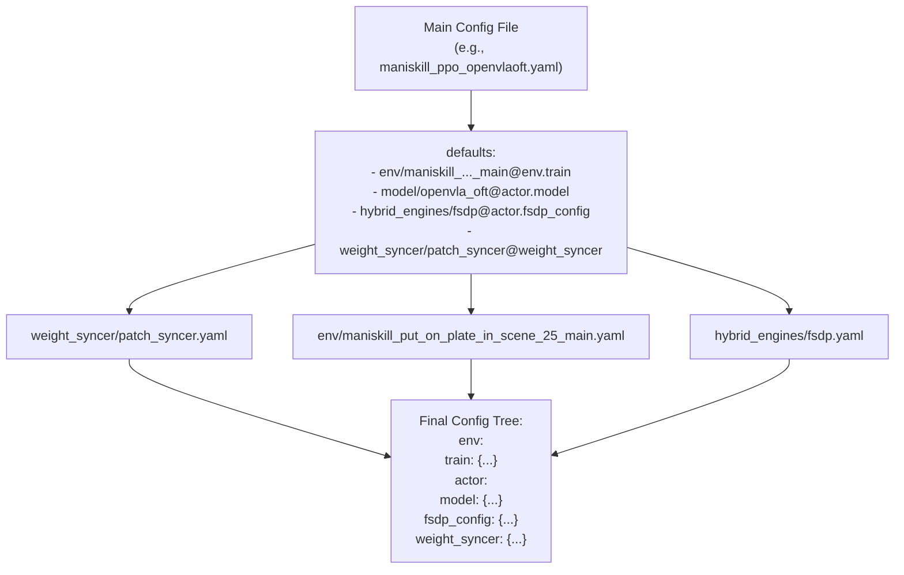

**Defaults List Processing Example:**

| Order | Entry | Source File | Merged At |
|-------|-------|-------------|-----------|
| 1 | `env/maniskill_..._main@env.train` | `env/maniskill_..._main.yaml` | `env.train` |
| 2 | `env/maniskill_ood_template@env.eval` | `env/maniskill_ood_template.yaml` | `env.eval` |
| 3 | `model/openvla_oft@actor.model` | `model/openvla_oft.yaml` | `actor.model` |
| 4 | `hybrid_engines/fsdp@actor.fsdp_config` | `hybrid_engines/fsdp.yaml` | `actor.fsdp_config` |
| 5 | `weight_syncer/patch_syncer@weight_syncer`| `weight_syncer/patch_syncer.yaml` | `weight_syncer` |

Sources: [docs/source-en/rst_source/guides/embodiment_config.rst:12-18](), [examples/embodiment/train_embodied_agent.py:35-37]()

---

## Package Directive (`@`) Syntax

The package directive (`@`) controls where in the configuration tree a default config is placed. Without `@`, configs are merged at the root level. With `@`, you can place the same config file at different locations (e.g., separate settings for `env.train` and `env.eval`).

### Package Directive Components

Title: Package Directive Components
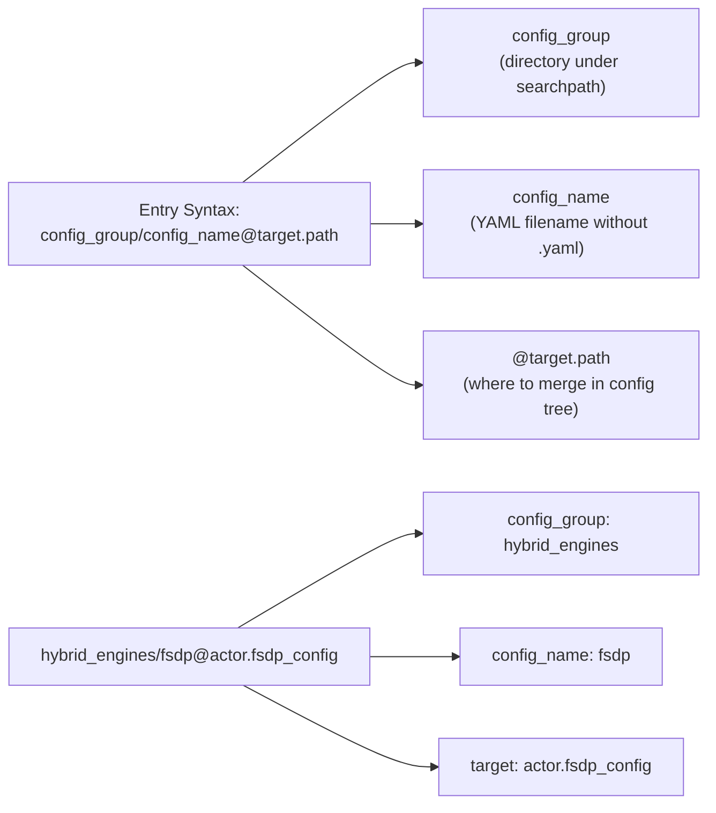

**Common Patterns in RLinf:**

| Pattern | Purpose | Example |
|---------|---------|---------|
| `env/task@env.train` | Load environment config for training | `env/maniskill_..._main@env.train` [docs/source-en/rst_source/guides/embodiment_config.rst:13]() |
| `model/name@actor.model` | Load model architecture for the actor | `model/openvla_oft@actor.model` [docs/source-en/rst_source/guides/embodiment_config.rst:16]() |
| `weight_syncer/type@weight_syncer` | Load weight synchronization strategy | `weight_syncer/patch_syncer@weight_syncer` [docs/source-en/rst_source/guides/embodiment_config.rst:17]() |

Sources: [docs/source-en/rst_source/guides/embodiment_config.rst:12-18](), [docs/source-zh/rst_source/guides/embodiment_config.rst:12-17]()

---

## Searchpath Resolution

Hydra searches for config files in directories specified in `hydra.searchpath`. RLinf uses environment variables and relative paths to locate domain-specific config directories, ensuring portability across different environments.

### Searchpath Resolution Mechanism

Title: Searchpath Resolution Mechanism
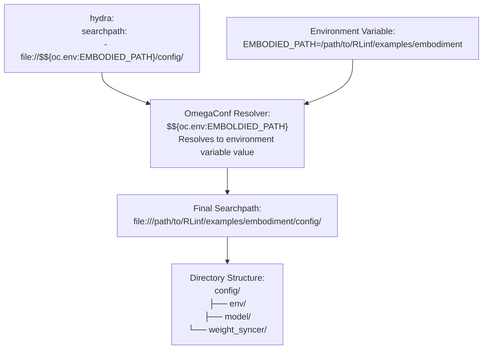

**Searchpath Entries:**

```yaml
hydra:
  searchpath:
    - file://${oc.env:EMBODIED_PATH}/config/
```

When Hydra encounters `model/openvla_oft@actor.model`, it looks for `openvla_oft.yaml` in the `${searchpath}/model/` directory [docs/source-en/rst_source/guides/embodiment_config.rst:30-35]().

Sources: [docs/source-en/rst_source/guides/embodiment_config.rst:28-35]()

---

## Variable Interpolation and Custom Resolvers

RLinf configs extensively use variable interpolation to reference other config values, enabling DRY (Don't Repeat Yourself) configuration. Additionally, RLinf registers custom OmegaConf resolvers in `rlinf/utils/omega_resolver.py` to perform arithmetic and type conversions directly within YAML files [rlinf/utils/omega_resolver.py:32-42]().

### Interpolation and Resolvers

Title: Variable Interpolation and Resolvers
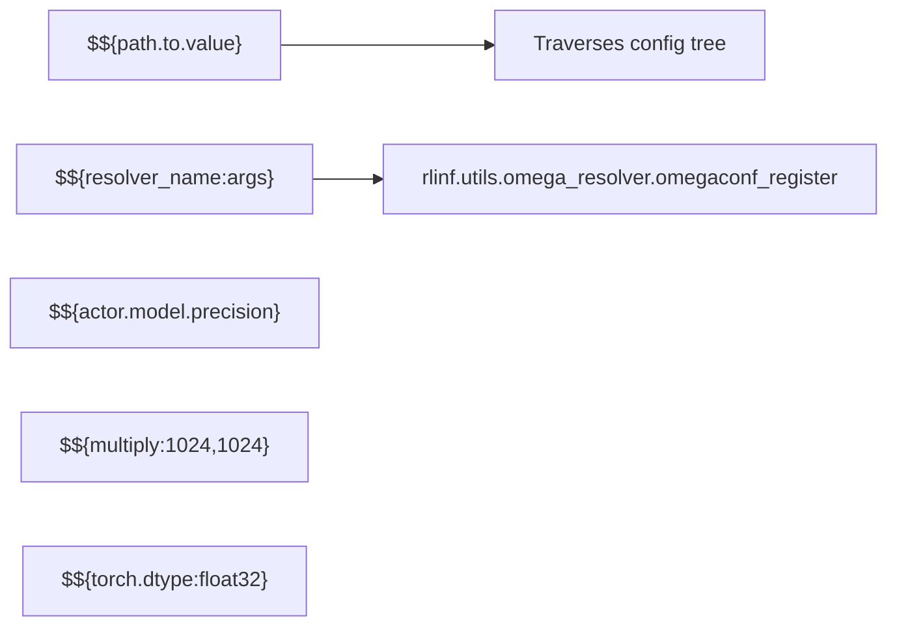

**Custom Resolvers Registered in `rlinf/utils/omega_resolver.py`:**

| Resolver | Functionality | Example Usage |
|----------|---------------|---------------|
| `multiply` | Multiplies two numbers | `${multiply: 128, 1024}` [rlinf/utils/omega_resolver.py:37]() |
| `int_div` | Integer division | `${int_div: 1024, 8}` [rlinf/utils/omega_resolver.py:38]() |
| `subtract` | Subtracts two numbers | `${subtract: ${runner.seq_length}, ${data.max_prompt_length}}` [docs/source-zh/rst_source/guides/agentic_config.rst:44]() |
| `not` | Boolean negation | `${not: ${algorithm.recompute_logprobs}}` [docs/source-zh/rst_source/guides/agentic_config.rst:92]() |
| `torch.dtype`| Converts string to `torch.dtype` | `${torch.dtype: bfloat16}` [rlinf/utils/omega_resolver.py:41]() |

Sources: [rlinf/utils/omega_resolver.py:32-42](), [docs/source-zh/rst_source/guides/agentic_config.rst:43-46]()

---

## Override Priorities and Merging

RLinf configs follow Hydra's override priority rules. Merging is recursive: only leaf values are overridden, while parent dictionaries are merged. This allows users to define a base model configuration and override specific fields like `model_path` in the main experiment file.

### Configuration Override Association

Title: Config Value Association
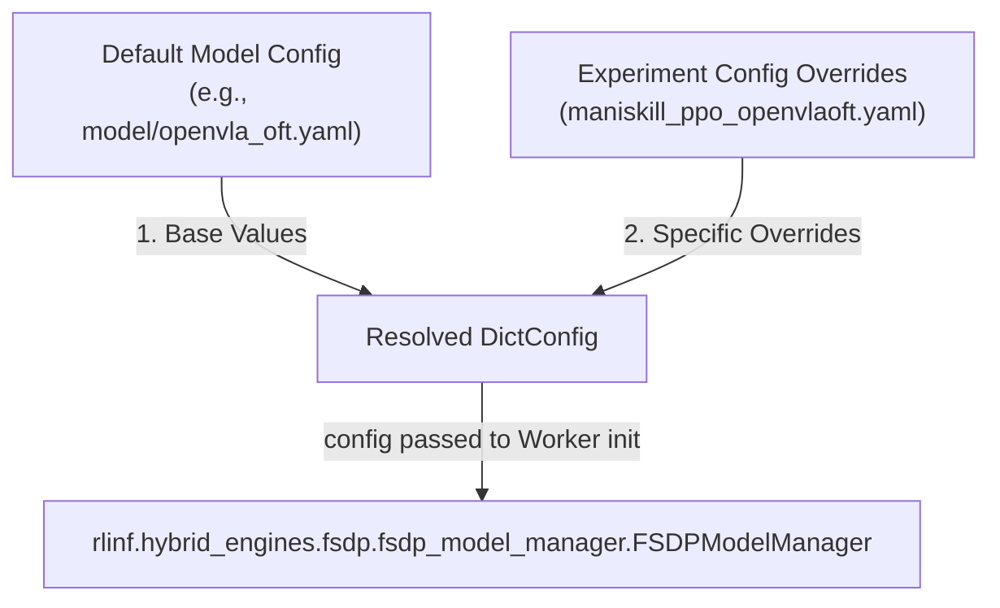

**Override Priority Order:**

1.  **Command-line arguments**: `python train.py runner.only_eval=True` (Highest)
2.  **Top-level keys in main config**: Overrides defaults provided in the `defaults` list.
3.  **Later entries in defaults list**: Configs merged at the same path later override earlier ones.
4.  **Earlier entries in defaults list**: (Lowest)

Sources: [rlinf/workers/actor/fsdp_actor_worker.py:190-205](), [examples/embodiment/train_embodied_agent.py:35-40]()

---

## Standard Config Structure in RLinf

RLinf uses several standard composition patterns across experiments, typically organizing the config into `cluster`, `runner`, `algorithm`, `env`, `rollout`, `actor`, and `reward` sections.

### Standard Config Sections

Title: High-Level Configuration Sections
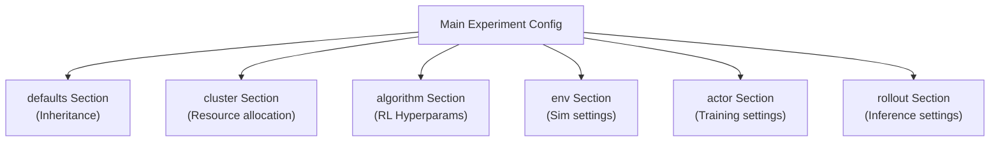

**Config Categories:**

| Section | Purpose | Key Parameters |
|---------|---------|----------------|
| `cluster` | Hardware resources | `cluster_cfg`, `profiling` [rlinf/runners/embodied_runner.py:79-91]() |
| `algorithm` | RL Logic | `loss_type`, `adv_type`, `gamma` [docs/source-en/rst_source/guides/embodiment_config.rst:78-100]() |
| `actor` | Training Worker | `training_backend`, `model`, `fsdp_config` [docs/source-zh/rst_source/guides/agentic_config.rst:250-259]() |
| `env` | Simulation | `total_num_envs`, `max_steps_per_rollout_epoch` [rlinf/workers/env/env_worker.py:135-157]() |
| `rollout` | Inference Worker | `backend`, `pipeline_stage_num`, `sampling_params` [rlinf/workers/rollout/hf/huggingface_worker.py:50-60]() |
| `runner` | Orchestration | `only_eval`, `val_check_interval`, `weight_sync_interval` [rlinf/runners/embodied_runner.py:67-73]() |

Sources: [rlinf/runners/embodied_runner.py:52-120](), [rlinf/workers/env/env_worker.py:58-130](), [docs/source-en/rst_source/guides/embodiment_config.rst:148-214]()

---

# Page: Component Placement Strategies

# Component Placement Strategies

<details>
<summary>Relevant source files</summary>

The following files were used as context for generating this wiki page:

- [examples/embodiment/run_placement_autotune.sh](examples/embodiment/run_placement_autotune.sh)
- [examples/reasoning/run_placement_autotune.sh](examples/reasoning/run_placement_autotune.sh)
- [rlinf/scheduler/cluster/cluster.py](rlinf/scheduler/cluster/cluster.py)
- [rlinf/scheduler/cluster/config.py](rlinf/scheduler/cluster/config.py)
- [rlinf/scheduler/cluster/node.py](rlinf/scheduler/cluster/node.py)
- [rlinf/scheduler/manager/__init__.py](rlinf/scheduler/manager/__init__.py)
- [rlinf/scheduler/manager/lock_manager.py](rlinf/scheduler/manager/lock_manager.py)
- [rlinf/scheduler/manager/manager.py](rlinf/scheduler/manager/manager.py)
- [rlinf/scheduler/placement/flexible.py](rlinf/scheduler/placement/flexible.py)
- [rlinf/scheduler/placement/packed.py](rlinf/scheduler/placement/packed.py)
- [rlinf/scheduler/worker/lock.py](rlinf/scheduler/worker/lock.py)
- [rlinf/workers/rollout/sglang/sglang_worker.py](rlinf/workers/rollout/sglang/sglang_worker.py)
- [tests/e2e_tests/auto_placement/qwen2.5-1.5b-grpo.yaml](tests/e2e_tests/auto_placement/qwen2.5-1.5b-grpo.yaml)
- [tests/e2e_tests/auto_placement/run.sh](tests/e2e_tests/auto_placement/run.sh)
- [tests/e2e_tests/reasoning/qwen2.5-1.5b-grpo-collocated-mg-sgl-rollout-logprobs.yaml](tests/e2e_tests/reasoning/qwen2.5-1.5b-grpo-collocated-mg-sgl-rollout-logprobs.yaml)
- [tests/e2e_tests/reasoning/qwen2.5-1.5b-grpo-collocated-mg-vllm.yaml](tests/e2e_tests/reasoning/qwen2.5-1.5b-grpo-collocated-mg-vllm.yaml)
- [tests/e2e_tests/reasoning/qwen2.5-1.5b-grpo-pipeline-mg-sgl-rollout-logprobs.yaml](tests/e2e_tests/reasoning/qwen2.5-1.5b-grpo-pipeline-mg-sgl-rollout-logprobs.yaml)
- [tests/e2e_tests/reasoning/qwen2.5-1.5b-grpo-pipeline-mg-sgl.yaml](tests/e2e_tests/reasoning/qwen2.5-1.5b-grpo-pipeline-mg-sgl.yaml)
- [tests/e2e_tests/reasoning/qwen2.5-1.5b-grpo-pipeline-mg-vllm-rollout-logprobs.yaml](tests/e2e_tests/reasoning/qwen2.5-1.5b-grpo-pipeline-mg-vllm-rollout-logprobs.yaml)
- [tests/e2e_tests/reasoning/qwen2.5-1.5b-grpo-pipeline-mg-vllm.yaml](tests/e2e_tests/reasoning/qwen2.5-1.5b-grpo-pipeline-mg-vllm.yaml)
- [tests/unit_tests/test_auto_placement.py](tests/unit_tests/test_auto_placement.py)
- [tests/unit_tests/test_placement.py](tests/unit_tests/test_placement.py)
- [tests/unit_tests/test_worker.py](tests/unit_tests/test_worker.py)
- [toolkits/auto_placement/__init__.py](toolkits/auto_placement/__init__.py)
- [toolkits/auto_placement/auto_placement_worker.py](toolkits/auto_placement/auto_placement_worker.py)
- [toolkits/auto_placement/fitter.py](toolkits/auto_placement/fitter.py)
- [toolkits/auto_placement/node.py](toolkits/auto_placement/node.py)
- [toolkits/auto_placement/placement.py](toolkits/auto_placement/placement.py)
- [toolkits/auto_placement/util.py](toolkits/auto_placement/util.py)
- [toolkits/auto_placement/workflow.py](toolkits/auto_placement/workflow.py)

</details>


This page documents how RLinf assigns GPUs and accelerators to different worker components (actor, rollout, inference, env, etc.) in distributed RL training. It explains the placement modes—**COLLOCATED**, **DISAGGREGATED**, and **AUTO**—their GPU allocation syntax, and how the underlying scheduler manages these resources across single and multi-node clusters.

Component placement determines which GPUs each worker type runs on and whether components share or partition GPU resources. This affects performance, memory usage, and weight synchronization overhead.

---

## Core Components and Placement Configuration

RLinf training pipelines involve multiple worker components:
- **Actor workers**: Train the policy model (backward pass, gradient updates). Represented by classes like `EmbodiedFSDPActor` or `MegatronActor`.
- **Rollout workers**: Generate trajectories via policy inference. These coordinate with actors and may use specialized backends like `vllm` or `sglang` [rlinf/workers/rollout/sglang/sglang_worker.py:49-50]().
- **Inference workers**: Perform standalone inference or recompute logprobs in reasoning tasks.
- **Env workers**: Interact with simulators (e.g., ManiSkill, LIBERO) in embodied AI.
- **Reward workers**: Compute reward signals, often placed on dedicated or shared GPUs [tests/e2e_tests/auto_placement/qwen2.5-1.5b-grpo.yaml:12]().

Component placement is configured via the `cluster.component_placement` block in Hydra YAML files [tests/e2e_tests/auto_placement/qwen2.5-1.5b-grpo.yaml:11-12]().

**Sources:** [rlinf/workers/rollout/sglang/sglang_worker.py:49-50](), [tests/e2e_tests/auto_placement/qwen2.5-1.5b-grpo.yaml:11-12]()

---

## GPU Allocation Syntax

The `component_placement` configuration uses a range-based syntax to map components to specific GPU indices.

### GPU Allocation Formats

| Format | Example | Meaning |
|--------|---------|---------|
| Single GPU | `actor: 0` | Actor uses GPU 0 |
| Range | `actor,env,rollout: 0-3` | All three components share GPUs 0 through 3 |
| Keyword | `actor,rollout,reward: all` | Components share all available GPUs on the node [tests/e2e_tests/auto_placement/qwen2.5-1.5b-grpo.yaml:12]() |

The `PackedPlacementStrategy` and `FlexiblePlacementStrategy` classes implement the underlying logic for mapping these user-defined ranges to hardware resources [rlinf/scheduler/placement/packed.py:22-23](), [rlinf/scheduler/placement/flexible.py:23-24]().

**Sources:** [tests/e2e_tests/auto_placement/qwen2.5-1.5b-grpo.yaml:11-12](), [rlinf/scheduler/placement/packed.py:22-23](), [rlinf/scheduler/placement/flexible.py:23-24]()

---

## Placement Modes

RLinf supports several primary placement modes, which can be manually specified or automatically determined.

### COLLOCATED Mode
Components share the same set of GPUs. This is common when the actor and rollout model fit within the same memory or when weights are shared via pointers.
- **Implementation**: Managed by `CollocatedScheduleResult` which aggregates placements from multiple nodes.

### DISAGGREGATED Mode
Each component has its own dedicated, non-overlapping set of GPUs. This is preferred for large models where training and inference cannot fit on the same device.
- **Implementation**: Managed by `DisaggregatedScheduleResult`, which calculates the cost of separate execution and communication.

### AUTO Mode
Automatically selects the placement mode based on a cost model and task type.
- **Workflow Analysis**: The `AutoPlacementWorker` analyzes the workflow graph (e.g., `rollout -> inference -> actor`) [tests/unit_tests/test_auto_placement.py:172-182]().
- **Profile-Driven Tuning**: It uses profiling data like `actor_cost`, `rollout_cost`, and `inference_cost` to calculate the optimal split [tests/unit_tests/test_auto_placement.py:49-53]().
- **Validation**: `_validate_gpu_num` ensures that the allocated GPU count is compatible with the model's parallelization requirements (e.g., TP/PP sizes) [tests/unit_tests/test_auto_placement.py:151-157]().

### Natural Language Space to Placement Logic Mapping
Title: "Configuration to Code Placement Mapping"
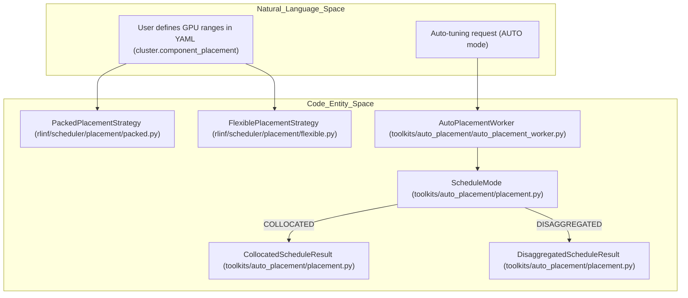

**Sources:** [tests/unit_tests/test_auto_placement.py:172-182](), [tests/unit_tests/test_auto_placement.py:49-53](), [tests/unit_tests/test_auto_placement.py:151-157]()

---

## Resource Management and Node Discovery

The `Cluster` singleton manages the physical resources of the cluster [rlinf/scheduler/cluster/cluster.py:110-111]().

### Node and Group Info
- **NodeInfo**: Tracks individual node properties like `node_ip`, `num_cpus`, and `hardware_resources` [rlinf/scheduler/cluster/node.py:37-64]().
- **NodeGroupInfo**: Aggregates nodes with the same label (e.g., "cluster" or "node") and provides global hardware rank mapping [rlinf/scheduler/cluster/node.py:111-133]().

### Device Locking
To prevent resource contention, the `DeviceLockManager` maintains an `asyncio.Lock` for every accelerator in the cluster [rlinf/scheduler/manager/lock_manager.py:88-101]().
- **Acquisition**: Workers call `acquire_devices` before starting execution on specific GPUs [rlinf/scheduler/manager/lock_manager.py:103-104]().
- **Release**: Locks are released via `release_devices` [rlinf/scheduler/manager/lock_manager.py:119-120]().

### Resource Discovery Flow
Title: "Cluster Resource Discovery and Locking"
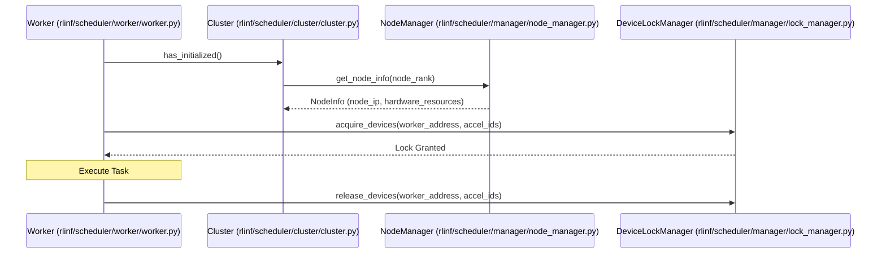

**Sources:** [rlinf/scheduler/cluster/cluster.py:110-111](), [rlinf/scheduler/cluster/node.py:37-133](), [rlinf/scheduler/manager/lock_manager.py:88-120]()

---

## Multi-Node and Distributed Configuration

RLinf manages multi-node resource allocation through specialized placement strategies.

### Node Placement Strategies
- **PackedPlacementStrategy**: Fills up nodes with workers before moving to the next node [rlinf/scheduler/placement/packed.py:53-54]().
    - `num_hardware_per_process`: Allows a single process to hold multiple GPUs (e.g., for Tensor Parallelism) [rlinf/scheduler/placement/packed.py:62-65]().
    - `stride`: Allows strided placement (e.g., GPU 0, 2, 4 with stride 2) [rlinf/scheduler/placement/packed.py:76-79]().
- **FlexiblePlacementStrategy**: Explicitly maps global hardware ranks to processes [rlinf/scheduler/placement/flexible.py:23-28](). It ensures that all hardware ranks for a single process reside on the same node [rlinf/scheduler/placement/flexible.py:150-157]().

### Configuration Reference
| Parameter | Type | Description |
|-----------|------|-------------|
| `cluster.num_nodes` | int | Total number of nodes to use [tests/e2e_tests/auto_placement/qwen2.5-1.5b-grpo.yaml:10](). |
| `cluster.component_placement` | dict | Mapping of component groups to GPU ranges [tests/e2e_tests/auto_placement/qwen2.5-1.5b-grpo.yaml:11-12](). |
| `RLINF_NODE_RANK` | env | Environment variable identifying the rank of the current node [rlinf/scheduler/cluster/cluster.py:62-63](). |

**Sources:** [rlinf/scheduler/placement/packed.py:53-79](), [rlinf/scheduler/placement/flexible.py:23-157](), [rlinf/scheduler/cluster/cluster.py:62-63](), [tests/e2e_tests/auto_placement/qwen2.5-1.5b-grpo.yaml:10-12]()

---

# Page: Algorithm and Model Configuration

# Algorithm and Model Configuration

<details>
<summary>Relevant source files</summary>

The following files were used as context for generating this wiki page:

- [examples/embodiment/config/frankasim_sac_cnn_async.yaml](examples/embodiment/config/frankasim_sac_cnn_async.yaml)
- [examples/embodiment/config/libero_10_grpo_openvlaoft.yaml](examples/embodiment/config/libero_10_grpo_openvlaoft.yaml)
- [examples/embodiment/config/libero_130_grpo_openvlaoft.yaml](examples/embodiment/config/libero_130_grpo_openvlaoft.yaml)
- [examples/embodiment/config/libero_90_grpo_openvlaoft.yaml](examples/embodiment/config/libero_90_grpo_openvlaoft.yaml)
- [examples/embodiment/config/libero_goal_grpo_openvlaoft.yaml](examples/embodiment/config/libero_goal_grpo_openvlaoft.yaml)
- [examples/embodiment/config/libero_object_grpo_openvlaoft.yaml](examples/embodiment/config/libero_object_grpo_openvlaoft.yaml)
- [examples/embodiment/config/libero_spatial_grpo_openvlaoft.yaml](examples/embodiment/config/libero_spatial_grpo_openvlaoft.yaml)
- [examples/embodiment/config/maniskill_crossq_mlp.yaml](examples/embodiment/config/maniskill_crossq_mlp.yaml)
- [examples/embodiment/config/maniskill_grpo_openvla.yaml](examples/embodiment/config/maniskill_grpo_openvla.yaml)
- [examples/embodiment/config/maniskill_grpo_openvlaoft.yaml](examples/embodiment/config/maniskill_grpo_openvlaoft.yaml)
- [examples/embodiment/config/maniskill_ppo_mlp.yaml](examples/embodiment/config/maniskill_ppo_mlp.yaml)
- [examples/embodiment/config/maniskill_ppo_openvla.yaml](examples/embodiment/config/maniskill_ppo_openvla.yaml)
- [examples/embodiment/config/maniskill_ppo_openvla_quickstart.yaml](examples/embodiment/config/maniskill_ppo_openvla_quickstart.yaml)
- [examples/embodiment/config/maniskill_ppo_openvlaoft.yaml](examples/embodiment/config/maniskill_ppo_openvlaoft.yaml)
- [examples/embodiment/config/maniskill_ppo_openvlaoft_quickstart.yaml](examples/embodiment/config/maniskill_ppo_openvlaoft_quickstart.yaml)
- [examples/embodiment/config/maniskill_sac_flow_state.yaml](examples/embodiment/config/maniskill_sac_flow_state.yaml)
- [examples/embodiment/config/maniskill_sac_mlp.yaml](examples/embodiment/config/maniskill_sac_mlp.yaml)
- [examples/embodiment/config/maniskill_sac_mlp_async.yaml](examples/embodiment/config/maniskill_sac_mlp_async.yaml)
- [examples/embodiment/config/realworld_charger_sac_cnn_async.yaml](examples/embodiment/config/realworld_charger_sac_cnn_async.yaml)
- [examples/embodiment/config/realworld_peginsertion_rlpd_cnn_async.yaml](examples/embodiment/config/realworld_peginsertion_rlpd_cnn_async.yaml)
- [examples/embodiment/config/realworld_peginsertion_rlpd_cnn_async_2arms.yaml](examples/embodiment/config/realworld_peginsertion_rlpd_cnn_async_2arms.yaml)
- [examples/embodiment/config/realworld_sac_flow_image.yaml](examples/embodiment/config/realworld_sac_flow_image.yaml)
- [examples/reasoning/config/math/qwen2.5-1.5b-grpo-fsdp.yaml](examples/reasoning/config/math/qwen2.5-1.5b-grpo-fsdp.yaml)
- [examples/reasoning/config/vqa/qwen2.5-vl-3b-grpo-fsdp.yaml](examples/reasoning/config/vqa/qwen2.5-vl-3b-grpo-fsdp.yaml)
- [tests/e2e_tests/embodied/frankasim_sac_cnn_async.yaml](tests/e2e_tests/embodied/frankasim_sac_cnn_async.yaml)
- [tests/e2e_tests/embodied/maniskill_sac_flow_state.yaml](tests/e2e_tests/embodied/maniskill_sac_flow_state.yaml)
- [tests/e2e_tests/reasoning/qwen2.5-1.5b-grpo-collocated-fsdp-sgl-rollout-logprobs.yaml](tests/e2e_tests/reasoning/qwen2.5-1.5b-grpo-collocated-fsdp-sgl-rollout-logprobs.yaml)
- [tests/e2e_tests/reasoning/qwen2.5-1.5b-grpo-collocated-fsdp-sgl.yaml](tests/e2e_tests/reasoning/qwen2.5-1.5b-grpo-collocated-fsdp-sgl.yaml)
- [tests/e2e_tests/reasoning/qwen2.5-1.5b-grpo-collocated-fsdp-vllm-rollout-logprobs.yaml](tests/e2e_tests/reasoning/qwen2.5-1.5b-grpo-collocated-fsdp-vllm-rollout-logprobs.yaml)
- [tests/e2e_tests/reasoning/qwen2.5-1.5b-grpo-collocated-fsdp-vllm.yaml](tests/e2e_tests/reasoning/qwen2.5-1.5b-grpo-collocated-fsdp-vllm.yaml)
- [tests/e2e_tests/reasoning/qwen2.5-vl-3b-grpo-collocated-fsdp-sgl.yaml](tests/e2e_tests/reasoning/qwen2.5-vl-3b-grpo-collocated-fsdp-sgl.yaml)
- [tests/e2e_tests/reasoning/qwen2.5-vl-3b-grpo-collocated-fsdp-vllm.yaml](tests/e2e_tests/reasoning/qwen2.5-vl-3b-grpo-collocated-fsdp-vllm.yaml)

</details>


This page documents how to configure RL algorithms, model architectures, training hyperparameters, and sampling parameters through Hydra YAML files. This covers the `algorithm`, `actor.model`, and `rollout.model` configuration sections.

For information about Hydra composition patterns and defaults inheritance, see [Hydra Composition and Defaults](). For training backend-specific configuration (FSDP/Megatron), see [Training Backends]().

---

## Configuration Architecture Overview

RLinf uses a hierarchical configuration structure where algorithm parameters, model specifications, and training settings are organized into distinct sections that compose through Hydra defaults. The system supports two primary domains: **Embodied AI** (robotics) and **Agentic Reasoning** (LLM-based math/coding).

### Configuration Flow Diagram
Title: RLinf Configuration Composition Flow
```mermaid
graph TB
    ["Experiment Config YAML<br/>(e.g., maniskill_ppo_openvla.yaml)"] -- "Hydra Defaults" --> ["env/maniskill_pick_cube@env.train<br/>env/maniskill_pick_cube@env.eval"]
    ["Experiment Config YAML<br/>(e.g., maniskill_ppo_openvla.yaml)"] -- "Hydra Defaults" --> ["model/openvla@actor.model"]
    ["Experiment Config YAML<br/>(e.g., maniskill_ppo_openvla.yaml)"] -- "Hydra Defaults" --> ["hybrid_engines/fsdp@actor.fsdp_config"]
    
    subgraph "Top-Level Sections"
        [Cluster] -- "Fields" --> ["num_nodes<br/>component_placement"]
        [Runner] -- "Fields" --> ["task_type (embodied/reasoning)<br/>max_epochs<br/>logger config"]
        [Algorithm] -- "Fields" --> ["adv_type (gae/grpo/embodied_sac)<br/>Hyperparameters<br/>replay_buffer"]
        [Actor] -- "Fields" --> ["training_backend (fsdp/megatron)<br/>batch sizes<br/>model (override)<br/>optim"]
        [Rollout] -- "Fields" --> ["backend (huggingface/sglang/vllm)<br/>model (override)<br/>sampling_params"]
        [Env] -- "Fields" --> ["train/eval splits<br/>total_num_envs"]
    end
    
    ["Experiment Config YAML<br/>(e.g., maniskill_ppo_openvla.yaml)"] --> [Cluster]
    ["Experiment Config YAML<br/>(e.g., maniskill_ppo_openvla.yaml)"] --> [Runner]
    ["Experiment Config YAML<br/>(e.g., maniskill_ppo_openvla.yaml)"] --> [Algorithm]
    ["Experiment Config YAML<br/>(e.g., maniskill_ppo_openvla.yaml)"] --> [Actor]
    ["Experiment Config YAML<br/>(e.g., maniskill_ppo_openvla.yaml)"] --> [Rollout]
    ["Experiment Config YAML<br/>(e.g., maniskill_ppo_openvla.yaml)"] --> [Env]
```

**Sources:** [examples/embodiment/config/maniskill_ppo_openvla.yaml:1-6](), [examples/embodiment/config/realworld_peginsertion_rlpd_cnn_async.yaml:1-6](), [examples/embodiment/config/maniskill_grpo_openvlaoft.yaml:1-6]()

---

## Algorithm Configuration Section

The `algorithm` section defines RL algorithm type, advantage estimation, loss functions, and core hyperparameters. Different algorithm types require different parameter subsets based on whether they are on-policy (PPO/GRPO) or off-policy (SAC/RLPD).

### Algorithm Configuration Structure
Title: Algorithm Hyperparameter Organization
```mermaid
graph LR
    subgraph "algorithm Section"
        [AlgTypeSelection] -- "Configures" --> [Adv_Loss_Logic]
        [Adv_Loss_Logic] -- "Includes" --> ["adv_type<br/>loss_type<br/>loss_agg_func"]
        
        [Hyperparams] -- "Includes" --> ["gamma (discount)<br/>gae_lambda<br/>clip_ratio_*<br/>value_clip<br/>entropy_bonus"]
        
        [AdvLogic] -- "Includes" --> ["normalize_advantages<br/>kl_penalty (kl/kl_penalty)<br/>kl_beta"]
        
        [SACParams] -- "Includes" --> ["tau (soft update)<br/>entropy_tuning<br/>agg_q (min/mean)<br/>replay_buffer<br/>target_update_freq"]
        
        [AlgTypeSelection] --> [Hyperparams]
        [AlgTypeSelection] --> [AdvLogic]
        [AlgTypeSelection] -.->|if embodied_sac| [SACParams]
    end
```

**Sources:** [examples/embodiment/config/maniskill_ppo_openvla.yaml:41-65](), [examples/embodiment/config/maniskill_grpo_openvlaoft.yaml:41-63](), [examples/embodiment/config/realworld_peginsertion_rlpd_cnn_async.yaml:60-103]()

---

## RL Algorithm Types

### PPO and GRPO Configuration

PPO (Proximal Policy Optimization) and GRPO (Group Relative Policy Optimization) share similar configurations with different advantage estimation methods. GRPO is specifically optimized for group-relative advantage computation, typically used in reasoning tasks or large-scale robotics with multiple samples per prompt.

**Key Parameters:**

| Parameter | Type | Description | Typical Values |
|-----------|------|-------------|----------------|
| `adv_type` | string | Advantage estimation method | `gae` (PPO), `grpo` (GRPO) |
| `loss_type` | string | Loss computation type | `actor_critic` (PPO), `actor` (GRPO) |
| `loss_agg_func` | string | Loss aggregation across tokens | `token-mean` |
| `normalize_advantages` | bool | Normalize advantages to mean=0, std=1 | `True` |
| `gamma` | float | Discount factor | `0.99` |
| `gae_lambda` | float | GAE lambda for advantage estimation | `0.95` |
| `clip_ratio_high` | float | Upper clipping bound for policy ratio | `0.2` - `0.28` |
| `clip_ratio_low` | float | Lower clipping bound for policy ratio | `0.2` |
| `clip_ratio_c` | float | Dual-clip coefficient | `3.0` |
| `value_clip` | float | Value function clipping parameter | `0.2` - `1.0` |
| `group_size` | int | Number of rollouts per group (GRPO) | `8` |
| `kl_beta` | float | KL penalty coefficient | `0.0` |
| `kl_penalty` | string | KL divergence estimation method | `kl`, `kl_penalty` |

**Sources:** [examples/embodiment/config/maniskill_ppo_openvla.yaml:41-67](), [examples/embodiment/config/maniskill_grpo_openvlaoft.yaml:41-63](), [examples/embodiment/config/libero_10_grpo_openvlaoft.yaml:39-61]()

---

### SAC and RLPD Configuration

SAC (Soft Actor-Critic) and RLPD (Reinforcement Learning with Prior Data) are off-policy algorithms using replay buffers and Q-function critics. These are primarily configured for embodied tasks involving continuous control.

**Entropy Tuning:**
Automatic entropy tuning is configured via the `entropy_tuning` section.
- `alpha_type`: Choose from `softplus`, `exp`, or `fixed_alpha` to enable automatic temperature tuning [examples/embodiment/config/realworld_peginsertion_rlpd_cnn_async.yaml:78]().
- `target_entropy`: Target entropy, usually set to `-action_dim` [examples/embodiment/config/realworld_peginsertion_rlpd_cnn_async.yaml:80]().
- `initial_alpha`: Initial temperature value (e.g., `0.01`) [examples/embodiment/config/realworld_peginsertion_rlpd_cnn_async.yaml:79]().

**Replay Buffers:**
Managed through the `replay_buffer` and `demo_buffer` blocks.
- `replay_buffer`: Stores online interaction data [examples/embodiment/config/realworld_peginsertion_rlpd_cnn_async.yaml:88-94]().
- `demo_buffer`: Stores offline demonstration data (essential for RLPD) [examples/embodiment/config/realworld_peginsertion_rlpd_cnn_async.yaml:95-101]().
- `min_buffer_size`: Minimum number of trajectories required before training starts [examples/embodiment/config/realworld_peginsertion_rlpd_cnn_async.yaml:91]().
- `sample_window_size`: Size of the sliding window for sampling from the buffer [examples/embodiment/config/realworld_peginsertion_rlpd_cnn_async.yaml:92]().

**Sources:** [examples/embodiment/config/realworld_peginsertion_rlpd_cnn_async.yaml:77-101](), [examples/embodiment/config/realworld_charger_sac_cnn_async.yaml:78-95](), [examples/embodiment/config/realworld_sac_flow_image.yaml:93-107]()

---

## Sampling and Generation Parameters

Sampling parameters control how actions or tokens are generated during rollout. These are typically located in the `rollout` section and differentiate between training and evaluation.

### Sampling Logic Diagram
Title: Rollout Sampling Parameters
```mermaid
graph TB
    subgraph "Sampling Configuration"
        [sampling_params] -- "Control generation behavior" --> [FieldGroup]
        [rollout_model] -- "Control architecture & path" --> [ModelPath]
    end
    
    subgraph "sampling_params Fields"
        [do_sample] -- "Boolean" --> ["Enable stochastic sampling"]
        [temperature_train] -- "Float" --> ["Training temperature"]
        [temperature_eval] -- "Float" --> ["Evaluation temperature"]
        [top_k] -- "Int" --> ["Top-K sampling"]
        [top_p] -- "Float" --> ["Nucleus sampling"]
        [max_new_tokens] -- "Int" --> ["Max tokens to generate"]
    end
```

**Sources:** [examples/embodiment/config/maniskill_ppo_openvla.yaml:94-102](), [examples/embodiment/config/maniskill_grpo_openvlaoft.yaml:88-94](), [examples/embodiment/config/libero_10_grpo_openvlaoft.yaml:98-104]()

---

## Model Configuration

Model configuration is handled by the Hydra defaults system and overrides within the `actor` and `rollout` blocks.

### Model Setup Diagram
Title: Model Config Inheritance and Application
```mermaid
graph TB
    subgraph "Model Configuration Flow"
        [ModelDefault] -- "Inherited by" --> [ActorOverride]
        [ModelDefault] -- "Inherited by" --> [RolloutOverride]
        
        [ActorOverride] -- "Configures" --> [ActorModelManager]
        [RolloutOverride] -- "Configures" --> [MultiStepRolloutWorker]
    end
    
    [ModelDefault] -- "Path" --> ["model/openvla_oft@actor.model"]
    [ActorOverride] -- "Fields" --> ["model_path<br/>add_value_head<br/>is_lora<br/>lora_path"]
    [RolloutOverride] -- "Fields" --> ["model_path<br/>precision<br/>num_q_heads"]
```

### Supported Model Architectures

RLinf supports diverse architectures, including Vision-Language-Action (VLA) models and traditional CNN/MLP policies.

| Model Type Key | Description | Config Reference |
|------------|-------------|--------------|
| `openvla` | OpenVLA base model | [examples/embodiment/config/maniskill_ppo_openvla.yaml:124]() |
| `openvla_oft` | Optimized Fine-Tuning VLA | [examples/embodiment/config/maniskill_grpo_openvlaoft.yaml:116]() |
| `cnn_policy` | CNN-based policy for embodied tasks | [examples/embodiment/config/realworld_peginsertion_rlpd_cnn_async.yaml:4]() |
| `flow_policy` | Flow-matching based policy | [examples/embodiment/config/realworld_sac_flow_image.yaml:152]() |
| `mlp_policy` | Multi-Layer Perceptron policy | [examples/embodiment/config/maniskill_ppo_mlp.yaml:113]() |

Models are configured with specific parameters such as `state_dim`, `action_dim`, and `num_q_heads` for critic heads [examples/embodiment/config/realworld_peginsertion_rlpd_cnn_async.yaml:149-151](). For VLA models, `max_prompt_length` and `lora_rank` are critical [examples/embodiment/config/maniskill_grpo_openvlaoft.yaml:119-122](). Flow-matching policies include specific parameters like `denoising_steps` and `noise_std_train` [examples/embodiment/config/realworld_sac_flow_image.yaml:173-185](). 

**Sources:** [examples/embodiment/config/maniskill_ppo_openvla.yaml:122-129](), [examples/embodiment/config/maniskill_grpo_openvlaoft.yaml:114-123](), [examples/embodiment/config/realworld_sac_flow_image.yaml:152-198](), [examples/embodiment/config/realworld_peginsertion_rlpd_cnn_async.yaml:147-152]()

---

## Training Hyperparameters

### Batch Size and Optimizer

Training settings are defined in the `actor` section. RLinf supports gradient accumulation through the relationship between micro and global batch sizes.

```yaml
actor:
  micro_batch_size: 40  # Per-GPU batch size
  global_batch_size: 640  # Total batch size across all ranks
  seed: 1234
  
  optim:
    lr: 1.0e-4
    value_lr: 3.0e-3  # Separate LR for value head (critic)
    clip_grad: 10.0
    weight_decay: 0.01
```

Optimizer parameters like `adam_beta1`, `adam_beta2`, and `adam_eps` are also configurable [examples/embodiment/config/maniskill_grpo_openvlaoft.yaml:127-129](). For off-policy algorithms, a separate `critic_optim` block can be defined [examples/embodiment/config/realworld_peginsertion_rlpd_cnn_async.yaml:158-161](). LR schedulers are typically set to `torch_constant` [examples/embodiment/config/realworld_peginsertion_rlpd_cnn_async.yaml:156]().

**Sources:** [examples/embodiment/config/maniskill_grpo_openvlaoft.yaml:106-132](), [examples/embodiment/config/maniskill_ppo_openvla.yaml:114-138](), [examples/embodiment/config/realworld_peginsertion_rlpd_cnn_async.yaml:138-162]()

---

## Reward and Critic Configuration

The `reward` and `critic` sections define how environment and learned rewards/values are processed.

| Parameter | Description | Typical Values |
|-----------|-------------|----------------|
| `use_reward_model` | Enable learned reward computation | `False` / `True` [examples/embodiment/config/realworld_peginsertion_rlpd_cnn_async.yaml:173]() |
| `reward_mode` | Reward computation timing | `per_step`, `terminal` [examples/embodiment/config/realworld_peginsertion_rlpd_cnn_async.yaml:180]() |
| `reward_threshold` | Threshold for success classification | `0.8` [examples/embodiment/config/realworld_peginsertion_rlpd_cnn_async.yaml:182]() |
| `reward_weight` | Scaling for learned rewards | `1.0` [examples/embodiment/config/realworld_peginsertion_rlpd_cnn_async.yaml:186]() |
| `env_reward_weight` | Scaling for environment rewards | `0.0` [examples/embodiment/config/realworld_peginsertion_rlpd_cnn_async.yaml:187]() |
| `bootstrap_type` | When to bootstrap Q-values | `standard`, `always` [examples/embodiment/config/maniskill_ppo_openvla.yaml:55]() |

The `bootstrap_type` determines whether to bootstrap on terminations or truncations. `standard` only bootstraps on truncations, while `always` bootstraps on both [examples/embodiment/config/maniskill_ppo_openvla.yaml:52-55](). For real-world training, `reward_mode: "per_step"` is often used for continuous feedback, while `terminal` prevents reward hacking by only calculating reward at the end of an episode [examples/embodiment/config/realworld_peginsertion_rlpd_cnn_async.yaml:178-180]().

**Sources:** [examples/embodiment/config/maniskill_ppo_openvla.yaml:52-55](), [examples/embodiment/config/realworld_peginsertion_rlpd_cnn_async.yaml:172-188](), [examples/embodiment/config/libero_10_grpo_openvlaoft.yaml:60-67]()

---

# Page: Core Infrastructure

# Core Infrastructure

<details>
<summary>Relevant source files</summary>

The following files were used as context for generating this wiki page:

- [rlinf/scheduler/channel/channel.py](rlinf/scheduler/channel/channel.py)
- [rlinf/scheduler/channel/channel_worker.py](rlinf/scheduler/channel/channel_worker.py)
- [rlinf/scheduler/cluster/__init__.py](rlinf/scheduler/cluster/__init__.py)
- [rlinf/scheduler/cluster/cluster.py](rlinf/scheduler/cluster/cluster.py)
- [rlinf/scheduler/cluster/node.py](rlinf/scheduler/cluster/node.py)
- [rlinf/scheduler/cluster/utils.py](rlinf/scheduler/cluster/utils.py)
- [rlinf/scheduler/collective/async_work.py](rlinf/scheduler/collective/async_work.py)
- [rlinf/scheduler/collective/collective_group.py](rlinf/scheduler/collective/collective_group.py)
- [rlinf/scheduler/collective/multi_channel_pg.py](rlinf/scheduler/collective/multi_channel_pg.py)
- [rlinf/scheduler/manager/__init__.py](rlinf/scheduler/manager/__init__.py)
- [rlinf/scheduler/manager/lock_manager.py](rlinf/scheduler/manager/lock_manager.py)
- [rlinf/scheduler/manager/manager.py](rlinf/scheduler/manager/manager.py)
- [rlinf/scheduler/manager/worker_manager.py](rlinf/scheduler/manager/worker_manager.py)
- [rlinf/scheduler/worker/lock.py](rlinf/scheduler/worker/lock.py)
- [rlinf/scheduler/worker/worker.py](rlinf/scheduler/worker/worker.py)
- [rlinf/scheduler/worker/worker_group.py](rlinf/scheduler/worker/worker_group.py)
- [rlinf/utils/ckpt_convertor/fsdp_convertor/convert_pt_to_hf.py](rlinf/utils/ckpt_convertor/fsdp_convertor/convert_pt_to_hf.py)
- [rlinf/workers/rollout/sglang/sglang_worker.py](rlinf/workers/rollout/sglang/sglang_worker.py)
- [tests/unit_tests/bench_channel.py](tests/unit_tests/bench_channel.py)
- [tests/unit_tests/test_channel.py](tests/unit_tests/test_channel.py)
- [tests/unit_tests/test_comm.py](tests/unit_tests/test_comm.py)
- [tests/unit_tests/test_worker.py](tests/unit_tests/test_worker.py)

</details>


This page documents the distributed infrastructure layer (`rlinf/scheduler/`) that underlies all training and execution in RLinf. The infrastructure provides the foundational primitives for cluster management, remote process orchestration, and high-performance communication.

Both embodied RL workflows (see [Embodied RL](#6)) and agentic/reasoning workflows (see [Agentic and Reasoning RL](#7)) utilize these primitives to achieve backend-agnostic distributed execution.

---

## Overview

RLinf's core infrastructure enables distributed execution across heterogeneous hardware (GPU clusters, simulators, real robots) via a layered architecture:

| Layer | Responsibility | Key Classes/Files |
|---|---|---|
| **Cluster Discovery** | Ray initialization, node enumeration, hardware detection | `Cluster`, `ClusterEnvVar`, `NodeInfo` |
| **Worker Abstraction** | Remote process lifecycle, RANK/WORLD_SIZE setup, failure handling | `Worker`, `WorkerGroup`, `WorkerMeta` |
| **Communication** | Async queues (Channel), P2P tensors (CollectiveGroup), NCCL backends | `Channel`, `ChannelWorker`, `CollectiveGroup`, `AsyncWork` |
| **Hardware Abstraction** | Accelerator detection, environment variable management | `AcceleratorUtil`, `AcceleratorType`, `HardwareInfo` |

All public infrastructure APIs are exposed through `rlinf.scheduler` [rlinf/scheduler/__init__.py:1-62]().

Sources: [rlinf/scheduler/cluster/cluster.py:110-128](), [rlinf/scheduler/worker/worker.py:103-138](), [rlinf/scheduler/channel/channel.py:38-137](), [rlinf/scheduler/collective/collective_group.py:112-136](), [rlinf/scheduler/worker/worker_group.py:40-64]()

### Code Organization Map

The following diagram maps conceptual subsystems to their implementation files and primary classes.

**Diagram: rlinf/scheduler Package Structure and Key Classes**

```mermaid
graph TB
    subgraph "rlinf/scheduler/ (Package Root)"
        INIT["__init__.py<br/>────────────<br/>Public API exports:<br/>Cluster, Worker, WorkerGroup<br/>Channel, CollectiveGroup"]
    end

    subgraph "cluster/ (Node Discovery)"
        ClusterPy["cluster.py<br/>────────────<br/>Cluster (singleton)<br/>ClusterEnvVar (enum)"]
        NodePy["node.py<br/>────────────<br/>NodeInfo (dataclass)<br/>NodeProbe"]
    end

    subgraph "worker/ (Process Abstraction)"
        WorkerPy["worker.py<br/>────────────<br/>Worker (metaclass=WorkerMeta)<br/>WorkerMeta (failure capture)"]
        WGP["worker_group.py<br/>────────────<br/>WorkerGroup (Generic)"]
    end

    subgraph "channel/ (FIFO Queues)"
        ChannelPy["channel.py<br/>────────────<br/>Channel<br/>DEFAULT_KEY"]
        ChannelWorkerPy["channel_worker.py<br/>────────────<br/>ChannelWorker (Worker subclass)<br/>LocalChannel<br/>PeekQueue"]
    end

    subgraph "collective/ (Tensor P2P)"
        CollGroupPy["collective_group.py<br/>────────────<br/>CollectiveGroup<br/>CollectiveGroupOptions<br/>CollectiveWorkQueue"]
        AsyncWorkPy["async_work.py<br/>────────────<br/>AsyncWork (base)<br/>AsyncFuncWork<br/>AsyncCollWork"]
    end

    INIT --> ClusterPy
    INIT --> WorkerPy
    INIT --> ChannelPy
    INIT --> CollGroupPy
    
    ClusterPy --> NodePy
    WorkerPy --> WGP
    CollGroupPy --> AsyncWorkPy
    ChannelPy --> ChannelWorkerPy
```

Sources: [rlinf/scheduler/cluster/cluster.py:110-128](), [rlinf/scheduler/worker/worker.py:51-138](), [rlinf/scheduler/worker/worker_group.py:40-64](), [rlinf/scheduler/channel/channel.py:38-137](), [rlinf/scheduler/channel/channel_worker.py:32-73](), [rlinf/scheduler/collective/collective_group.py:76-136](), [rlinf/scheduler/collective/async_work.py:28-198]()

---

## Distributed Scheduler

The `Cluster` class ([rlinf/scheduler/cluster/cluster.py:110-128]()) manages Ray initialization and node discovery. It serves as the singleton entry point for resource allocation and worker deployment.

- **Node Discovery**: The scheduler utilizes classes like `NodeInfo` and `NodeProbe` ([rlinf/scheduler/cluster/node.py:37-109]()) to detect available accelerators and CPUs across the cluster.
- **Environment Management**: Automatically configures critical variables like `MASTER_ADDR`, `MASTER_PORT`, `RANK`, and `LOCAL_RANK` for distributed PyTorch initialization ([rlinf/scheduler/worker/worker.py:103-108]()).
- **Global Management**: Uses `Manager` and `ManagerProxy` to provide a singleton proxy per worker process to access global cluster state [rlinf/scheduler/cluster/cluster.py:45-46]().
- **Log Collection**: Includes `DistributedRayLogCollector` to split and tail Ray worker logs into per-worker files [rlinf/scheduler/cluster/utils.py:113-132]().
- **Hybrid Execution**: Supports dynamic resource allocation between environment and training tasks to optimize throughput via components like `RolloutScalingScheduler` [rlinf/workers/rollout/sglang/sglang_worker.py:103-111]().

For details, see [Distributed Scheduler](#3.1).

Sources: [rlinf/scheduler/cluster/cluster.py:110-128](), [rlinf/scheduler/worker/worker.py:103-111](), [rlinf/scheduler/cluster/node.py:37-109](), [rlinf/scheduler/cluster/utils.py:113-132](), [rlinf/workers/rollout/sglang/sglang_worker.py:103-111]()

---

## Worker Groups and Lifecycle

The `Worker` class ([rlinf/scheduler/worker/worker.py:103-138]()) is the base abstraction for any remote process. Workers are typically managed in a `WorkerGroup` ([rlinf/scheduler/worker/worker_group.py:40-41]()) to provide a unified interface for collective execution.

- **Metaclass Orchestration**: `WorkerMeta` ([rlinf/scheduler/worker/worker.py:51-61]()) wraps class functions to catch `SystemExit` and exceptions in remote workers, ensuring that failures are logged with full tracebacks ([rlinf/scheduler/worker/worker.py:72-89]()).
- **Group Management**: `WorkerGroup` allows launching a set of workers across the cluster using specific `PlacementStrategy` ([rlinf/scheduler/worker/worker_group.py:144-168]()) and retrieving existing groups by name via `from_group_name` ([rlinf/scheduler/worker/worker_group.py:92-142]()).
- **Method Proxying**: Method calls on a `WorkerGroup` are automatically proxied to the underlying Ray actors, supporting execution on specific ranks ([rlinf/scheduler/worker/worker_group.py:183]()).

For details, see [Worker Groups and Lifecycle](#3.2).

Sources: [rlinf/scheduler/worker/worker.py:51-138](), [rlinf/scheduler/worker/worker_group.py:40-168]()

---

## Communication Primitives

RLinf provides two high-level communication abstractions designed for different data transfer patterns:

- **Channel**: A FIFO queue-like abstraction ([rlinf/scheduler/channel/channel.py:38-58]()) for asynchronous data exchange. It supports key-based routing, weight-based batching ([rlinf/scheduler/channel/channel.py:49-55]()), and distributed routing via `ChannelWorker` actors ([rlinf/scheduler/channel/channel.py:156-160]()).
- **CollectiveGroup**: A low-latency primitive for tensor communication. It uses `CollectiveWorkQueue` ([rlinf/scheduler/collective/collective_group.py:112-136]()) to manage dedicated accelerator streams and `AsyncWork` wrappers ([rlinf/scheduler/collective/async_work.py:28-59]()) to unify `torch.distributed` and Ray futures.
- **Multi-Channel Communication**: `MultiChannelProcessGroup` wraps multiple `dist.ProcessGroup` instances to support concurrent communication channels for tensors [rlinf/scheduler/collective/multi_channel_pg.py:31-48]().

For details, see [Communication Primitives](#3.3).

Sources: [rlinf/scheduler/channel/channel.py:38-58](), [rlinf/scheduler/collective/collective_group.py:112-136](), [rlinf/scheduler/collective/async_work.py:28-150](), [rlinf/scheduler/collective/multi_channel_pg.py:31-48]()

---

## Hardware Abstraction Layer (HAL)

The infrastructure abstracts hardware details to support diverse compute environments, including NVIDIA and AMD GPUs.

- **Accelerator Management**: `AcceleratorUtil` and `AcceleratorType` ([rlinf/scheduler/worker/worker.py:40]()) provide a unified interface for detecting and managing different GPU types.
- **Hardware Info**: `NodeInfo` ([rlinf/scheduler/cluster/node.py:37-109]()) encapsulates node-level resource counts and device identifiers via `HardwareResource` [rlinf/scheduler/cluster/node.py:64]().
- **Collective Tuning**: `CollectiveGroupOptions` ([rlinf/scheduler/collective/collective_group.py:76-96]()) allows tuning accelerator CCL parameters such as `accel_max_ctas` and `accel_min_ctas` to optimize communication efficiency based on hardware capabilities.

For details, see [Hardware Abstraction Layer](#3.4).

Sources: [rlinf/scheduler/cluster/node.py:26-34](), [rlinf/scheduler/collective/collective_group.py:76-96](), [rlinf/scheduler/worker/worker.py:40]()

---

## Data Structures and I/O

Core data structures are optimized for efficient distributed exchange through specialized metadata handling.

- **Optimized Tensor Transfer**: `TensorData` ([rlinf/scheduler/collective/collective_group.py:45-74]()) pre-partitions tensors into CPU and Accelerator lists to avoid repeated extraction during communication.
- **Asynchronous Flow**: The `AsyncWork` hierarchy ([rlinf/scheduler/collective/async_work.py:28-59]()) allows for chaining operations and provides a unified `.wait()` interface for both sync and async Python contexts ([rlinf/scheduler/collective/async_work.py:152-186]()).
- **Dataclass Serialization**: Infrastructure includes utilities like `DataclassTensorFieldsMetadata` to handle complex Python dataclasses for optimized network transmission [rlinf/scheduler/cluster/utils.py:31-40]().

For details, see [Data Structures and I/O](#3.5).

Sources: [rlinf/scheduler/collective/collective_group.py:45-74](), [rlinf/scheduler/collective/async_work.py:28-198](), [rlinf/scheduler/cluster/utils.py:31-40]()

---

# Page: Distributed Scheduler

# Distributed Scheduler

<details>
<summary>Relevant source files</summary>

The following files were used as context for generating this wiki page:

- [docs/source-en/rst_source/examples/embodied/gim_arm.rst](docs/source-en/rst_source/examples/embodied/gim_arm.rst)
- [docs/source-zh/rst_source/examples/embodied/gim_arm.rst](docs/source-zh/rst_source/examples/embodied/gim_arm.rst)
- [rlinf/envs/realworld/__init__.py](rlinf/envs/realworld/__init__.py)
- [rlinf/envs/realworld/gim_arm/__init__.py](rlinf/envs/realworld/gim_arm/__init__.py)
- [rlinf/envs/realworld/gim_arm/gim_arm_controller.py](rlinf/envs/realworld/gim_arm/gim_arm_controller.py)
- [rlinf/envs/realworld/gim_arm/gim_arm_env.py](rlinf/envs/realworld/gim_arm/gim_arm_env.py)
- [rlinf/envs/realworld/gim_arm/gim_arm_robot_state.py](rlinf/envs/realworld/gim_arm/gim_arm_robot_state.py)
- [rlinf/scheduler/__init__.py](rlinf/scheduler/__init__.py)
- [rlinf/scheduler/cluster/cluster.py](rlinf/scheduler/cluster/cluster.py)
- [rlinf/scheduler/cluster/config.py](rlinf/scheduler/cluster/config.py)
- [rlinf/scheduler/cluster/node.py](rlinf/scheduler/cluster/node.py)
- [rlinf/scheduler/collective/__init__.py](rlinf/scheduler/collective/__init__.py)
- [rlinf/scheduler/manager/__init__.py](rlinf/scheduler/manager/__init__.py)
- [rlinf/scheduler/manager/lock_manager.py](rlinf/scheduler/manager/lock_manager.py)
- [rlinf/scheduler/manager/manager.py](rlinf/scheduler/manager/manager.py)
- [rlinf/scheduler/placement/flexible.py](rlinf/scheduler/placement/flexible.py)
- [rlinf/scheduler/placement/packed.py](rlinf/scheduler/placement/packed.py)
- [rlinf/scheduler/worker/lock.py](rlinf/scheduler/worker/lock.py)
- [rlinf/workers/rollout/sglang/sglang_worker.py](rlinf/workers/rollout/sglang/sglang_worker.py)
- [tests/e2e_tests/reasoning/qwen2.5-1.5b-grpo-collocated-mg-sgl-rollout-logprobs.yaml](tests/e2e_tests/reasoning/qwen2.5-1.5b-grpo-collocated-mg-sgl-rollout-logprobs.yaml)
- [tests/e2e_tests/reasoning/qwen2.5-1.5b-grpo-collocated-mg-vllm.yaml](tests/e2e_tests/reasoning/qwen2.5-1.5b-grpo-collocated-mg-vllm.yaml)
- [tests/e2e_tests/reasoning/qwen2.5-1.5b-grpo-pipeline-mg-sgl-rollout-logprobs.yaml](tests/e2e_tests/reasoning/qwen2.5-1.5b-grpo-pipeline-mg-sgl-rollout-logprobs.yaml)
- [tests/e2e_tests/reasoning/qwen2.5-1.5b-grpo-pipeline-mg-sgl.yaml](tests/e2e_tests/reasoning/qwen2.5-1.5b-grpo-pipeline-mg-sgl.yaml)
- [tests/e2e_tests/reasoning/qwen2.5-1.5b-grpo-pipeline-mg-vllm-rollout-logprobs.yaml](tests/e2e_tests/reasoning/qwen2.5-1.5b-grpo-pipeline-mg-vllm-rollout-logprobs.yaml)
- [tests/e2e_tests/reasoning/qwen2.5-1.5b-grpo-pipeline-mg-vllm.yaml](tests/e2e_tests/reasoning/qwen2.5-1.5b-grpo-pipeline-mg-vllm.yaml)
- [tests/unit_tests/test_placement.py](tests/unit_tests/test_placement.py)
- [tests/unit_tests/test_worker.py](tests/unit_tests/test_worker.py)

</details>


This page covers the core distributed infrastructure of RLinf: the `Cluster` singleton, `NodeInfo`/`NodeGroupInfo` node discovery, and the management of distributed resources through singleton managers. Together these components abstract over Ray to provide a consistent model for launching, addressing, and communicating between remote processes across one or many machines.

Communication primitives (`Channel`, `CollectiveGroup`, `AsyncWork`) are described in [3.3 Communication Primitives](). GPU/node placement modes (`COLLOCATED`, `DISAGGREGATED`, etc.) are described in [2.2 Component Placement Strategies]().

---

## Architecture Overview

**Figure 1: Scheduler layer class relationships (code-level)**

```mermaid
graph TD
    subgraph "rlinf/scheduler/cluster/cluster.py"
        Cluster["Cluster (singleton)"]
    end

    subgraph "rlinf/scheduler/cluster/node.py"
        NodeInfo["NodeInfo"]
        NodeGroupInfo["NodeGroupInfo"]
    end

    subgraph "rlinf/scheduler/worker/worker.py"
        Worker["Worker"]
    end

    subgraph "rlinf/scheduler/manager/manager.py"
        Manager["Manager (Base Class)"]
        ManagerProxy["ManagerProxy"]
        Manager --> ProxyMethod["ProxyMethod"]
    end

    subgraph "rlinf/scheduler/manager/worker_manager.py"
        WorkerManager["WorkerManager"]
    end

    Cluster --> Manager
    Cluster --> NodeGroupInfo
    NodeGroupInfo --> NodeInfo
    Worker --> Cluster
    ManagerProxy --> Manager
    WorkerManager --|> Manager
```

Sources: [rlinf/scheduler/cluster/cluster.py:110-161](), [rlinf/scheduler/cluster/node.py:37-130](), [rlinf/scheduler/manager/manager.py:30-45](), [rlinf/scheduler/manager/manager.py:94-110]()

---

## Cluster

`Cluster` [rlinf/scheduler/cluster/cluster.py:110-111]() is a **singleton**. Only one instance exists per Python process. It is the entry point for all distributed setup and resource management.

### Initialization

```python
cluster = Cluster(num_nodes=2)          # driver process: full init
cluster = Cluster()                     # worker process: connect to existing
cluster = Cluster(cluster_cfg=cfg)      # from Hydra DictConfig
```

Calling `Cluster(num_nodes=N)` (or with `cluster_cfg`) triggers initialization logic [rlinf/scheduler/cluster/cluster.py:182-192](), which:

1. Starts or connects to a Ray cluster using `ray.init` with the defined `Cluster.NAMESPACE` [rlinf/scheduler/cluster/cluster.py:114]().
2. Handles Ray namespace conflicts by retrying with a new namespace if `NamespaceConflictError` occurs [rlinf/scheduler/cluster/cluster.py:139-141]().
3. Discovers hardware (GPUs, NPUs) on every node [rlinf/scheduler/cluster/node.py:15-32]().
4. Starts singleton Ray actors (managers) such as `WorkerManager`, `CollectiveManager`, and `LockManager`.

### Manager Services

Managers are implemented as Ray actors that offer a `ManagerProxy` [rlinf/scheduler/manager/manager.py:27-28]() for workers to access global state. The proxy handles remote calls by wrapping class methods into `ProxyMethod` calls that invoke `ray.get` on remote actor handles [rlinf/scheduler/manager/manager.py:57-67]().

| Manager | Purpose | File |
|---|---|---|
| `WorkerManager` | Tracks all worker metadata and addressing across the cluster. | [rlinf/scheduler/manager/worker_manager.py:19-20]() |
| `CollectiveManager` | Tracks NCCL/Gloo process group initialization state. | [rlinf/scheduler/manager/coll_manager.py:15-16]() |
| `DeviceLockManager` | Distributed mutex for GPU device IDs across the cluster. | [rlinf/scheduler/manager/lock_manager.py:88-94]() |
| `PortLockManager` | Distributed mutex for TCP ports to prevent conflicts. | [rlinf/scheduler/manager/lock_manager.py:136-143]() |

Sources: [rlinf/scheduler/cluster/cluster.py:110-161](), [rlinf/scheduler/cluster/node.py:37-130](), [rlinf/scheduler/manager/manager.py:27-67]()

### Cluster Environment Variables

`ClusterEnvVar` [rlinf/scheduler/cluster/cluster.py:50-51]() defines the system-level environment variables, all prefixed `{Cluster.SYS_NAME}_` (typically `RLINF_`):

| Env Var | Default | Description |
|---|---|---|
| `RLINF_CATCH_FAILURE` | `"0"` | Catch failures in workers to avoid exiting main process [rlinf/scheduler/cluster/cluster.py:53-54]() |
| `RLINF_LOG_LEVEL` | `"INFO"` | Logging level for cluster and workers [rlinf/scheduler/cluster/cluster.py:56-57]() |
| `RLINF_TIMEOUT` | `"180"` | Timeout for all inter-worker communications [rlinf/scheduler/cluster/cluster.py:59-60]() |
| `RLINF_NODE_RANK` | `None` | Rank of each node in the cluster [rlinf/scheduler/cluster/cluster.py:62-63]() |
| `RLINF_COMM_NET_DEVICES` | `None` | Network devices for inter-node communication [rlinf/scheduler/cluster/cluster.py:65-66]() |
| `RLINF_EXT_MODULE` | `None` | Load extension modules for custom envs/models [rlinf/scheduler/cluster/cluster.py:68-79]() |
| `RLINF_PATH_ENV_MERGE_MODE`| `"append"` | Merge strategy for path-like env vars (append/override) [rlinf/scheduler/cluster/cluster.py:81-88]() |
| `RLINF_CODE_WORKING_DIR` | `"0"` | Ship `rlinf` package to workers via Ray `runtime_env` [rlinf/scheduler/cluster/cluster.py:89-100]() |

Sources: [rlinf/scheduler/cluster/cluster.py:50-100]()

---

## Node Discovery and Hardware Abstraction

**Figure 2: Node discovery data model**

```mermaid
graph TD
    NodeProbe["NodeProbe"]

    subgraph "Per physical node"
        NodeInfo["NodeInfo"]
        NodeRank["NodeInfo.node_rank"]
        RayID["NodeInfo.ray_id"]
        HardwareResource["HardwareResource"]
        NodeInfo --> HardwareResource
    end

    subgraph "Hardware Types"
        Accelerator["Accelerator (GPU/NPU)"]
        HardwareInfo["HardwareInfo (Model/Memory)"]
    end

    HardwareResource --> Accelerator
    HardwareResource --> HardwareInfo
    NodeProbe --> NodeInfo
```

`NodeProbe` launches Ray actors per node to inspect resources. Each probe returns a `NodeInfo` dataclass [rlinf/scheduler/cluster/node.py:37-38](). RLinf supports heterogeneous hardware:
* **Accelerators**: Standard GPUs (NVIDIA/AMD) and NPUs. The `Accelerator` class abstracts these into a unified interface [rlinf/scheduler/cluster/node.py:70-84]().
* **Profiling Backends**: Discovers if tools like `nsight` are available [rlinf/scheduler/cluster/node.py:67-68]().

### Node Groups

`NodeGroupInfo` [rlinf/scheduler/cluster/node.py:111-112]() organizes nodes into logical sets:
* `"cluster"`: The default group containing all nodes [rlinf/scheduler/cluster/node.py:129]().
* `"node"`: Reserved for node-level placement [rlinf/scheduler/cluster/node.py:131]().

Sources: [rlinf/scheduler/cluster/node.py:37-134]()

---

## Resource Management and Locking

To prevent resource contention (e.g., multiple workers trying to use the same GPU or network port), RLinf provides distributed locking mechanisms managed by `DeviceLockManager` and `PortLockManager`.

### Device and Port Locks
* **`DeviceLock`**: A handle that ensures only one worker accesses an accelerator's memory or computation at a time. It interacts with the `DeviceLockManager` [rlinf/scheduler/manager/lock_manager.py:88-94]().
* **`PortLock`**: Manages network port resources to prevent conflicts when multiple workers reside on the same node. The `PortLockManager` [rlinf/scheduler/manager/lock_manager.py:136-143]() includes a `_release_daemon` [rlinf/scheduler/manager/lock_manager.py:172-187]() to clean up locks if a worker process dies, checking worker liveness via `Worker.check_worker_alive` [rlinf/scheduler/manager/lock_manager.py:181-182]().

### Node Configuration and Validation
The `ClusterConfig` [rlinf/scheduler/cluster/config.py:164-165]() (referenced in `node.py`) validates node group assignments to ensure no overlapping node ranks and that hardware types are consistent within a group. `NodeGroupInfo` provides utilities to map between global hardware ranks and local hardware ranks within a node [rlinf/scheduler/cluster/node.py:195-201]().

Sources: [rlinf/scheduler/manager/lock_manager.py:88-188](), [rlinf/scheduler/cluster/node.py:173-201](), [rlinf/scheduler/cluster/config.py:136-162]()

---

## Worker and WorkerGroup Management

The system manages distributed execution through `Worker` actors and `WorkerGroup` abstractions.

### Worker Lifecycle
The `Worker` base class [rlinf/scheduler/worker/rollout/sglang/sglang_worker.py:49]() handles the heavy lifting of distributed setup. Each worker is assigned a `WorkerAddress` [rlinf/scheduler/__init__.py:36]() containing its group name and rank. 

### Addressing and Routing
Workers are addressed using `WorkerAddress` [rlinf/scheduler/__init__.py:36](). The `CommMapper` [rlinf/scheduler/__init__.py:38]() and routing utilities handle message splitting and plan building for inter-worker communication:
* `build_send_plan` and `build_recv_plan` [rlinf/scheduler/__init__.py:39-43]() facilitate complex data routing.
* `split_channel_message` [rlinf/scheduler/__init__.py:49]() allows distributing large payloads across multiple channels.

### Dynamic Scheduling
For workloads like LLM inference, workers can integrate with a `RolloutScalingScheduler` [rlinf/workers/rollout/sglang/sglang_worker.py:108-110]() to dynamically manage memory occupation and scaling via requests like `ReleaseMemoryOccupationReqInput` [rlinf/workers/rollout/sglang/sglang_worker.py:21-24]().

Sources: [rlinf/scheduler/__init__.py:36-50](), [rlinf/workers/rollout/sglang/sglang_worker.py:21-110]()

---

## Placement Strategies

RLinf implements several placement strategies to map processes to hardware resources:

| Strategy | Description | Entity |
|---|---|---|
| **Packed** | Fills nodes with workers sequentially, allowing processes to hold multiple accelerators. | `PackedPlacementStrategy` [rlinf/scheduler/placement/packed.py:22-24]() |
| **Flexible** | Allows manual specification of global hardware ranks for each process. | `FlexiblePlacementStrategy` [rlinf/scheduler/placement/flexible.py:23-25]() |
| **Node** | Places workers based on specific node rank lists. | `NodePlacementStrategy` [rlinf/scheduler/__init__.py:32]() |

Sources: [rlinf/scheduler/placement/packed.py:22-90](), [rlinf/scheduler/placement/flexible.py:23-85]()

---

## Extension Modules and Dynamic Registration

RLinf supports loading user-defined extensions (custom models, environments, or configurations) without modifying the core codebase via the `RLINF_EXT_MODULE` environment variable [rlinf/scheduler/cluster/cluster.py:68-79]().

### Mechanism
When `RLINF_EXT_MODULE` is set, the system identifies the module and ensures it is available to all workers. The `Cluster` singleton manages this via environment variable propagation and module registration logic.

### Path Merging
When launching workers with custom environments, RLinf manages path-like environment variables (like `PYTHONPATH` or `LD_LIBRARY_PATH`) using the `PathEnvMergeMode` [rlinf/scheduler/cluster/cluster.py:103-107](). This ensures that extension code is correctly discovered by the worker processes.

Sources: [rlinf/scheduler/cluster/cluster.py:68-88](), [rlinf/scheduler/cluster/cluster.py:103-107]()

---

# Page: Worker Groups and Lifecycle

# Worker Groups and Lifecycle

<details>
<summary>Relevant source files</summary>

The following files were used as context for generating this wiki page:

- [rlinf/scheduler/channel/channel.py](rlinf/scheduler/channel/channel.py)
- [rlinf/scheduler/channel/channel_worker.py](rlinf/scheduler/channel/channel_worker.py)
- [rlinf/scheduler/cluster/__init__.py](rlinf/scheduler/cluster/__init__.py)
- [rlinf/scheduler/cluster/cluster.py](rlinf/scheduler/cluster/cluster.py)
- [rlinf/scheduler/cluster/node.py](rlinf/scheduler/cluster/node.py)
- [rlinf/scheduler/cluster/utils.py](rlinf/scheduler/cluster/utils.py)
- [rlinf/scheduler/collective/async_work.py](rlinf/scheduler/collective/async_work.py)
- [rlinf/scheduler/collective/collective_group.py](rlinf/scheduler/collective/collective_group.py)
- [rlinf/scheduler/collective/multi_channel_pg.py](rlinf/scheduler/collective/multi_channel_pg.py)
- [rlinf/scheduler/manager/__init__.py](rlinf/scheduler/manager/__init__.py)
- [rlinf/scheduler/manager/lock_manager.py](rlinf/scheduler/manager/lock_manager.py)
- [rlinf/scheduler/manager/manager.py](rlinf/scheduler/manager/manager.py)
- [rlinf/scheduler/manager/worker_manager.py](rlinf/scheduler/manager/worker_manager.py)
- [rlinf/scheduler/worker/lock.py](rlinf/scheduler/worker/lock.py)
- [rlinf/scheduler/worker/worker.py](rlinf/scheduler/worker/worker.py)
- [rlinf/scheduler/worker/worker_group.py](rlinf/scheduler/worker/worker_group.py)
- [rlinf/utils/ckpt_convertor/fsdp_convertor/convert_pt_to_hf.py](rlinf/utils/ckpt_convertor/fsdp_convertor/convert_pt_to_hf.py)
- [rlinf/workers/rollout/sglang/sglang_worker.py](rlinf/workers/rollout/sglang/sglang_worker.py)
- [tests/unit_tests/bench_channel.py](tests/unit_tests/bench_channel.py)
- [tests/unit_tests/test_channel.py](tests/unit_tests/test_channel.py)
- [tests/unit_tests/test_comm.py](tests/unit_tests/test_comm.py)
- [tests/unit_tests/test_worker.py](tests/unit_tests/test_worker.py)

</details>


This page documents the `Worker` and `WorkerGroup` abstractions that enable distributed computation in RLinf, including worker creation, initialization, addressing, method execution, and failure handling. These abstractions form the foundation for all distributed training and inference operations in the system.

For cluster-level resource management and node allocation, see [3.1 Distributed Scheduler](). For communication primitives between workers, see [3.3 Communication Primitives]().

---

## Worker and WorkerGroup Overview

RLinf provides two core abstractions for distributed execution:

- **`Worker`** [rlinf/scheduler/worker/worker.py:103-108](): A base class representing a single remote process (Ray actor) that can execute methods and communicate with other workers. Inheriting from this class grants a process the ability to run remotely and automatically sets distributed environment variables like `RANK`, `LOCAL_RANK`, and `WORLD_SIZE` [rlinf/scheduler/worker/worker.py:106-108]().
- **`WorkerGroup`** [rlinf/scheduler/worker/worker_group.py:40-41](): A generic container managing multiple `Worker` instances that can execute methods collectively across all workers.

### Key Characteristics

| Aspect | Worker | WorkerGroup |
|--------|--------|-------------|
| **Execution Context** | Single Ray actor process [rlinf/scheduler/worker/worker.py:104-105]() | Multiple distributed workers [rlinf/scheduler/worker/worker_group.py:40-41]() |
| **Instantiation** | Via `Worker.create_group().launch()` [rlinf/scheduler/worker/worker.py:136-137]() | Created by `Worker.create_group()` [rlinf/scheduler/worker/worker.py:558-570]() |
| **Method Calls** | Direct (within worker) | Collective across all ranks [rlinf/scheduler/worker/worker_group.py:41]() |
| **Communication** | `send()`, `recv()`, `broadcast()` [rlinf/scheduler/worker/worker.py:153-163]() | Method proxying to all workers [rlinf/scheduler/worker/worker_group.py:299-352]() |
| **Environment Variables** | Auto-configured (RANK, WORLD_SIZE, etc.) [rlinf/scheduler/worker/worker.py:107-108]() | Manages per-worker env vars [rlinf/scheduler/worker/worker_group.py:244-273]() |

**Sources:** [rlinf/scheduler/worker/worker.py:103-163, 558-570](), [rlinf/scheduler/worker/worker_group.py:40-63, 244-273, 299-352]()

---

## Architecture: Worker Groups to Ray Actors

The following diagram shows how user-defined `Worker` subclasses are transformed into distributed Ray actors through the `WorkerGroup` abstraction.

**Worker Group to Code Entity Mapping**
```mermaid
graph TB
    subgraph "User_Code_Space"
        UserWorker["MyWorker(Worker)<br/>rlinf/scheduler/worker/worker.py"]
    end
    
    subgraph "WorkerGroup_Management"
        WG["WorkerGroup[WorkerClsType]<br/>rlinf/scheduler/worker/worker_group.py"]
        Launch["launch()<br/>Line 144"]
        Proxy["_attach_cls_func()<br/>Line 299"]
    end
    
    subgraph "Scheduler_&_Cluster_Space"
        Cluster["Cluster (Singleton)<br/>rlinf/scheduler/cluster/cluster.py"]
        Allocate["allocate()<br/>rlinf/scheduler/cluster/cluster.py"]
    end
    
    subgraph "Ray_Execution_Space"
        Actor0["Ray Actor (Rank 0)<br/>Worker.__init__ Line 408"]
        Actor1["Ray Actor (Rank 1)<br/>Worker.__init__ Line 408"]
        ActorN["Ray Actor (Rank N-1)<br/>Worker.__init__ Line 408"]
    end
    
    UserWorker -->|"1. create_group()"| WG
    WG -->|"2. launch()"| Launch
    Launch -->|"3. Request Resources"| Cluster
    
    Cluster -->|"4. ray.remote().options()"| Actor0
    Cluster -->|"4. ray.remote().options()"| Actor1
    Cluster -->|"4. ray.remote().options()"| ActorN
    
    WG -.->|"5. Method Proxying"| Proxy
    Proxy -->|"6. remote_call"| Actor0
    Proxy -->|"6. remote_call"| Actor1
    Proxy -->|"6. remote_call"| ActorN
```

**Sources:** [rlinf/scheduler/worker/worker.py:103-138, 408-410](), [rlinf/scheduler/worker/worker_group.py:144-197, 299-352](), [rlinf/scheduler/cluster/cluster.py:447-525]()

---

## Worker Creation and Initialization Lifecycle

The worker lifecycle consists of distinct phases from creation to readiness.

### Lifecycle Sequence

```mermaid
sequenceDiagram
    participant User
    participant WG as WorkerGroup
    participant CL as Cluster
    participant RA as Ray Actor Process
    participant W as Worker Instance
    
    User->>WG: create_group(*args, **kwargs)
    Note over WG: Stores worker_cls, args, kwargs
    
    User->>WG: launch(cluster, placement_strategy)
    WG->>CL: get_placement(placement_strategy)
    CL-->>WG: List[WorkerPlacement]
    
    loop For each rank in group
        WG->>CL: allocate(cls, name, node_rank, env_vars)
        CL->>RA: ray.remote(Worker).options(...).remote()
        Note over RA: __new__() called
        RA->>W: _env_setup_before_init()
        Note over W: Reads RANK, WORLD_SIZE
        
        RA->>W: __init__(parent_address, world_size, rank)
        W->>W: _setup_local_rank_world_size()
        W->>W: _setup_accelerator_info()
        W->>W: _setup_logging()
        W->>W: _setup_hardware()
        W->>W: _setup_managers()
        W->>W: _setup_master_address_and_port()
        
        W-->>WG: ActorHandle (WorkerRank)
    end
    
    WG->>WG: _attach_cls_func()
    Note over WG: Wraps methods as WorkerGroupFunc
    
    WG-->>User: WorkerGroup instance
```

**Sources:** [rlinf/scheduler/worker/worker_group.py:144-197, 223-297, 299-352](), [rlinf/scheduler/worker/worker.py:319-336, 408-500]()

### Initialization Phases

#### Phase 1: WorkerGroup Creation
`Worker.create_group(*args, **kwargs)` [rlinf/scheduler/worker/worker.py:558-570]() returns a `WorkerGroup` instance without starting any remote processes. It stores the class and arguments for later instantiation [rlinf/scheduler/worker/worker_group.py:50-61]().

#### Phase 2: Placement and Allocation
`WorkerGroup.launch()` [rlinf/scheduler/worker/worker_group.py:144-197]() determines worker placement using a `PlacementStrategy`. For each rank, `Cluster.allocate()` [rlinf/scheduler/cluster/cluster.py:447-525]() creates a Ray actor with:
- **Node Affinity**: Assigned to specific physical nodes based on `NodePlacementStrategy` [rlinf/scheduler/placement/placement.py:32-33]().
- **Environment Variables**: Sets `RANK`, `WORLD_SIZE`, `MASTER_ADDR`, etc. [rlinf/scheduler/worker/worker_group.py:244-273]().
- **Hardware Isolation**: Controls `CUDA_VISIBLE_DEVICES` if `isolate_gpu=True` [rlinf/scheduler/worker/worker_group.py:150, 172]().

#### Phase 3: Worker Initialization
When Ray creates each actor, the `Worker` class executes:
1. **`__new__` phase** [rlinf/scheduler/worker/worker.py:319-336](): Calls `_env_setup_before_init()` to read system-critical environment variables before the Python class is fully initialized.
2. **`__init__` phase** [rlinf/scheduler/worker/worker.py:408-500](): 
   - Configures `WorkerAddress` [rlinf/scheduler/worker/worker.py:459-464]().
   - Sets up `AcceleratorManager` and hardware info [rlinf/scheduler/worker/worker.py:476-485]().
   - Configures `MASTER_ADDR` and `MASTER_PORT` for distributed groups [rlinf/scheduler/worker/worker.py:493]().

#### Phase 4: Method Attachment
`_attach_cls_func()` [rlinf/scheduler/worker/worker_group.py:299-352]() inspects the worker class and wraps all public methods as `WorkerGroupFunc` objects. This allows the `WorkerGroup` to intercept calls and proxy them to all underlying Ray actors [rlinf/scheduler/worker/worker_group.py:382-449]().

**Sources:** [rlinf/scheduler/worker/worker.py:319-500](), [rlinf/scheduler/worker/worker_group.py:144-352]()

---

## Worker Addressing System

Workers are identified using a hierarchical `WorkerAddress` system, managed by the `WorkerManager` [rlinf/scheduler/manager/worker_manager.py:22-138]().

### Address Components

| Component | Code Entity | Description |
|-----------|-------------|-------------|
| **Root Group** | `root_group_name` | The unique name of the top-level worker group [rlinf/scheduler/manager/worker_manager.py:38](). |
| **Rank Path** | `rank_path` | A list of integers representing the path in nested groups [rlinf/scheduler/manager/worker_manager.py:39](). |
| **Global Name** | `get_name()` | Colon-separated string format, e.g., `my_group:0:1` [rlinf/scheduler/manager/worker_manager.py:42-49](). |

**Key Methods:**
- `get_child_address(rank)` [rlinf/scheduler/manager/worker_manager.py:72-82](): Generates an address for a sub-worker.
- `get_parent_address()` [rlinf/scheduler/manager/worker_manager.py:60-70](): Navigates up the hierarchy.
- `WorkerAddress.from_name(name)` [rlinf/scheduler/manager/worker_manager.py:109-122](): Deserializes a string address.

**Sources:** [rlinf/scheduler/manager/worker_manager.py:22-138](), [rlinf/scheduler/worker/worker.py:341-346]()

---

## Method Execution and Proxying

`WorkerGroup` enables calling user-defined methods collectively through automatic proxying.

### Method Execution Logic
1. **Call Interception**: When `worker_group.my_method()` is called, it triggers `WorkerGroupFunc.__call__` [rlinf/scheduler/worker/worker_group.py:399]().
2. **Rank Selection**: By default, the method executes on all ranks. `execute_on(*ranks)` [rlinf/scheduler/worker/worker_group.py:199-209]() can be used to target specific workers.
3. **Asynchronous Dispatch**: Methods are dispatched as Ray remote calls (`actor.method.remote()`) [rlinf/scheduler/worker/worker_group.py:425]().
4. **Result Collection**: Returns a `WorkerGroupFuncResult` [rlinf/scheduler/worker/worker_group.py:452-556](), which manages a background thread to wait for all Ray `ObjectRefs` [rlinf/scheduler/worker/worker_group.py:482-498]().

### WorkerGroupFuncResult Handle
- `wait()` [rlinf/scheduler/worker/worker_group.py:542-546](): Blocks until all workers return results.
- `async_wait()` [rlinf/scheduler/worker/worker_group.py:548-552](): Non-blocking awaitable for `asyncio` contexts.

**Sources:** [rlinf/scheduler/worker/worker_group.py:199-209, 382-556]()

---

## Failure Handling Mechanisms

RLinf implements robust failure detection to prevent distributed jobs from hanging.

### WorkerMeta Metaclass
The `WorkerMeta` metaclass [rlinf/scheduler/worker/worker.py:51-61]() wraps all worker methods in a try-except block [rlinf/scheduler/worker/worker.py:55-61](). It specifically catches `SystemExit` and converts them into `RuntimeError` with a full traceback to ensure Ray captures the failure [rlinf/scheduler/worker/worker.py:75-89]().

### Signal Management
- **SIGUSR1**: Workers and results handles send `SIGUSR1` to the main process upon critical failure [rlinf/scheduler/worker/worker_group.py:494](). The `Cluster` singleton catches this signal and shuts down all actors in the namespace [rlinf/scheduler/cluster/cluster.py:313-338]().
- **SIGUSR2**: Triggers a diagnostic stack trace print on the worker for debugging [rlinf/scheduler/worker/worker.py:879-926]().

### Failure Catching Diagram
```mermaid
graph TD
    subgraph "Worker_Process"
        Method["Worker.method()"]
        Meta["WorkerMeta Wrapper<br/>rlinf/scheduler/worker/worker.py"]
        SysExit["SystemExit / Error"]
    end
    
    subgraph "Main_Process_(Driver)"
        Result["WorkerGroupFuncResult<br/>_wait_thread (Line 482)"]
        SigHandler["Cluster SIGUSR1 Handler<br/>rlinf/scheduler/cluster/cluster.py"]
        Shutdown["ray.shutdown()<br/>exit(-1)"]
    end
    
    Method --> Meta
    Meta -->|"Catch Failure"| SysExit
    SysExit -->|"Notify Result Handle"| Result
    Result -->|"os.kill(main_pid, SIGUSR1)"| SigHandler
    SigHandler --> Shutdown
```

**Sources:** [rlinf/scheduler/worker/worker.py:51-101, 862-926](), [rlinf/scheduler/worker/worker_group.py:489-497](), [rlinf/scheduler/cluster/cluster.py:313-338]()

---

## Worker Environment Variables

The system automatically populates critical environment variables to support distributed backends like PyTorch `dist`.

| Variable | Source | Purpose |
|----------|--------|---------|
| `RANK` | `WorkerGroup` | Global index in the group [rlinf/scheduler/worker/worker_group.py:246](). |
| `WORLD_SIZE` | `WorkerGroup` | Total workers in the group [rlinf/scheduler/worker/worker_group.py:247](). |
| `LOCAL_RANK` | `Worker` | Index on the local physical node [rlinf/scheduler/worker/worker.py:473](). |
| `MASTER_ADDR` | `WorkerGroup` | IP of Rank 0 worker [rlinf/scheduler/worker/worker_group.py:248](). |
| `MASTER_PORT` | `Worker` | Free port allocated on Rank 0 node [rlinf/scheduler/worker/worker.py:493](). |

**Sources:** [rlinf/scheduler/worker/worker_group.py:244-273](), [rlinf/scheduler/worker/worker.py:473-496](), [rlinf/scheduler/cluster/cluster.py:50-63]()

---

## Worker Cleanup and Termination

Workers can be explicitly closed via `WorkerGroup._close()` [rlinf/scheduler/worker/worker_group.py:211-221](). This method:
1. Iterates through all `WorkerRank` objects [rlinf/scheduler/worker/worker_group.py:213]().
2. Triggers an internal `_close()` call on the Ray actor if it exists [rlinf/scheduler/worker/worker_group.py:216]().
3. Forcefully terminates the actor using `ray.kill()` [rlinf/scheduler/worker/worker_group.py:217]().
4. Clears the worker list and internal cluster references [rlinf/scheduler/worker/worker_group.py:218-221]().

**Sources:** [rlinf/scheduler/worker/worker_group.py:211-221]()

---

# Page: Communication Primitives

# Communication Primitives

<details>
<summary>Relevant source files</summary>

The following files were used as context for generating this wiki page:

- [examples/reasoning/main_grpo.py](examples/reasoning/main_grpo.py)
- [rlinf/runners/agent_eval_runner.py](rlinf/runners/agent_eval_runner.py)
- [rlinf/runners/agent_runner.py](rlinf/runners/agent_runner.py)
- [rlinf/runners/coding_online_rl_runner.py](rlinf/runners/coding_online_rl_runner.py)
- [rlinf/runners/reasoning_eval_runner.py](rlinf/runners/reasoning_eval_runner.py)
- [rlinf/runners/reasoning_runner.py](rlinf/runners/reasoning_runner.py)
- [rlinf/scheduler/channel/channel.py](rlinf/scheduler/channel/channel.py)
- [rlinf/scheduler/channel/channel_worker.py](rlinf/scheduler/channel/channel_worker.py)
- [rlinf/scheduler/cluster/__init__.py](rlinf/scheduler/cluster/__init__.py)
- [rlinf/scheduler/cluster/utils.py](rlinf/scheduler/cluster/utils.py)
- [rlinf/scheduler/collective/async_work.py](rlinf/scheduler/collective/async_work.py)
- [rlinf/scheduler/collective/collective_group.py](rlinf/scheduler/collective/collective_group.py)
- [rlinf/scheduler/collective/multi_channel_pg.py](rlinf/scheduler/collective/multi_channel_pg.py)
- [rlinf/scheduler/manager/worker_manager.py](rlinf/scheduler/manager/worker_manager.py)
- [rlinf/scheduler/worker/worker.py](rlinf/scheduler/worker/worker.py)
- [rlinf/scheduler/worker/worker_group.py](rlinf/scheduler/worker/worker_group.py)
- [rlinf/utils/ckpt_convertor/fsdp_convertor/convert_pt_to_hf.py](rlinf/utils/ckpt_convertor/fsdp_convertor/convert_pt_to_hf.py)
- [rlinf/utils/data_iter_utils.py](rlinf/utils/data_iter_utils.py)
- [rlinf/utils/distributed.py](rlinf/utils/distributed.py)
- [rlinf/workers/agent/agent_loop.py](rlinf/workers/agent/agent_loop.py)
- [rlinf/workers/inference/fsdp_inference_worker.py](rlinf/workers/inference/fsdp_inference_worker.py)
- [tests/unit_tests/bench_channel.py](tests/unit_tests/bench_channel.py)
- [tests/unit_tests/test_channel.py](tests/unit_tests/test_channel.py)
- [tests/unit_tests/test_comm.py](tests/unit_tests/test_comm.py)

</details>


This page documents the two distinct communication systems available to `Worker` instances in RLinf: the **Channel** system (asynchronous FIFO queues backed by Ray actors) and the **CollectiveGroup** system (synchronous or asynchronous point-to-point and collective operations using NCCL and Gloo). It also documents the `AsyncWork` class hierarchy used for non-blocking operations.

For the overall distributed scheduler architecture (how workers are created, how groups are launched, and what RANK/WORLD_SIZE mean), see [Distributed Scheduler](3.1).

---

## Architectural Overview

Two independent communication primitives exist side by side to handle different data exchange patterns.

**Channel** — A named, FIFO queue abstraction backed by long-lived Ray actor(s) (`ChannelWorker`). It supports arbitrary Python objects, tensors, and dataclasses. Suitable for producer/consumer workflows where data flows one way and timing is decoupled [rlinf/scheduler/channel/channel.py:39-58]().

**CollectiveGroup** — A peer-to-point or multi-party communication group using `torch.distributed` process groups (NCCL for GPU tensors, Gloo for CPU tensors or non-GPU objects). Suitable for time-coupled send/recv pairs and model weight broadcasts [rlinf/scheduler/collective/collective_group.py:187-191]().

Both systems are exposed on the `Worker` base class so that any user-defined worker class has access to them without extra setup [rlinf/scheduler/worker/worker.py:103-111]().

**Communication System Component Map:**

```mermaid
graph TD
  subgraph "Channel_System_[rlinf/scheduler/channel/]"
    CH["Channel\n(channel.py)"]
    CW["ChannelWorker\n(channel_worker.py)"]
    LC["LocalChannel\n(channel_worker.py)"]
    PQ["PeekQueue\n(channel_worker.py)"]
    ACW["AsyncChannelWork\n(rlinf/scheduler/collective/async_work.py)"]
    CH --> CW
    CH --> LC
    CW --> LC
    LC --> PQ
    CH --> ACW
  end

  subgraph "Collective_System_[rlinf/scheduler/collective/]"
    CG["CollectiveGroup\n(collective_group.py)"]
    MCPG["MultiChannelProcessGroup\n(multi_channel_pg.py)"]
    AFW["AsyncFuncWork\n(async_work.py)"]
    ACOL["AsyncCollWork\n(async_work.py)"]
    CWQ["CollectiveWorkQueue\n(collective_group.py)"]
    CG --> CWQ
    CG --> MCPG
    CG --> AFW
    MCPG --> ACOL
  end

  subgraph "Worker_API_[rlinf/scheduler/worker/]"
    W["Worker\n(worker.py)"]
    W --> CH
    W --> CG
  end

  subgraph "Ray_Layer"
    ARW["AsyncRayWork\n(rlinf/scheduler/collective/async_work.py)"]
  end
```
Sources: [rlinf/scheduler/channel/channel.py:39-58](), [rlinf/scheduler/collective/collective_group.py:112-136](), [rlinf/scheduler/worker/worker.py:103-111](), [rlinf/scheduler/collective/async_work.py:28-61](), [rlinf/scheduler/collective/multi_channel_pg.py:31-41]()

---

## The Channel Abstraction

`Channel` is defined in [rlinf/scheduler/channel/channel.py]() and is the primary mechanism for passing data between worker groups in an asynchronous, decoupled fashion. Its interface mirrors `asyncio.Queue`.

### Creation and Connection

| Method | Description |
|---|---|
| `Channel.create()` | Creates a new channel and its backing `ChannelWorker` actor(s) [rlinf/scheduler/channel/channel.py:142-150](). |
| `Channel.connect()` | Connects to an existing named channel [rlinf/scheduler/channel/channel.py:213-220](). |
| `Worker.create_channel()` | Convenience wrapper callable from inside a worker [rlinf/scheduler/worker/worker.py:534-544](). |

The `distributed` flag controls topology [rlinf/scheduler/channel/channel.py:156-157]():
- **`distributed=False`** (default): A single `ChannelWorker` is placed on `node_rank`. All workers communicate through it.
- **`distributed=True`**: One `ChannelWorker` is placed on each node of the cluster. Puts and gets are routed by `key` to the actor co-located with the requester.
- **`local=True`**: A `LocalChannel` is created in-process. No Ray actor is involved [rlinf/scheduler/channel/channel.py:148-148]().

**Channel Creation and Routing Topology:**

```mermaid
graph LR
  subgraph "Driver_/_Runner"
    create["Channel.create()"]
  end

  subgraph "Non-distributed_(single_node_rank)"
    CW0["ChannelWorker rank=0\n(node 0)"]
    create --> CW0
  end

  subgraph "Distributed_(one_per_node)"
    DCW0["ChannelWorker rank=0\n(node 0)"]
    DCW1["ChannelWorker rank=1\n(node 1)"]
    create --> DCW0
    create --> DCW1
  end

  subgraph "Local_(in-process)"
    LCH["LocalChannel\n(no Ray actor)"]
    create --> LCH
  end

  W1["Worker on node 0"] -- "put/get via key routing" --> DCW0
  W2["Worker on node 1"] -- "put/get via key routing" --> DCW1
```
Sources: [rlinf/scheduler/channel/channel.py:141-160](), [rlinf/scheduler/channel/channel_worker.py:73-86]()

### Core Operations

| Method | Signature | Notes |
|---|---|---|
| `put` | `put(item, weight, key, async_op)` | Returns `AsyncChannelWork` when `async_op=True` [rlinf/scheduler/channel/channel.py:280-305](). |
| `get` | `get(key, async_op)` | Blocks until an item is available (sync) or returns a handle (async) [rlinf/scheduler/channel/channel.py:348-375](). |
| `get_batch` | `get_batch(target_weight, key, async_op)` | Accumulates items until their total weight meets or exceeds `target_weight` [rlinf/scheduler/channel/channel.py:397-422](). |
| `put_nowait` | `put_nowait(item, key)` | Non-blocking put [rlinf/scheduler/channel/channel.py:326-335](). |
| `get_nowait` | `get_nowait(key)` | Non-blocking get [rlinf/scheduler/channel/channel.py:440-450](). |

**Key-based routing** allows multiple independent logical queues within one named channel [rlinf/scheduler/channel/channel.py:53-54](). This is particularly useful in multi-turn agent and embodied RL scenarios where data must be processed by specific workers.

**Weight-based batching** in `get_batch` is used to retrieve a batch of messages which respects the assigned weights [rlinf/scheduler/channel/channel.py:55-56](). The internal `WeightedItem` class handles priority/weight sorting within the `PeekQueue` [rlinf/scheduler/channel/channel_worker.py:24-30]().

Sources: [rlinf/scheduler/channel/channel.py:53-56](), [rlinf/scheduler/channel/channel.py:280-450](), [rlinf/scheduler/channel/channel_worker.py:24-30]()

---

## The AsyncWork Hierarchy

Every asynchronous operation in both the Channel and CollectiveGroup systems returns an `AsyncWork` object. The hierarchy is defined in [rlinf/scheduler/collective/async_work.py]().

**AsyncWork Class Hierarchy:**

```mermaid
classDiagram
  class AsyncWork {
    +wait() Any
    +async_wait() Any
    +then(func, args) AsyncFuncWork
    +done() bool
    +get_next_work() AsyncWork
    +get_last_work() AsyncWork
  }

  class AsyncFuncWork {
    -_func Callable
    -_args tuple
    -_kwargs dict
    -_done Future
    -_next_work AsyncWork
    -_cuda_event torch.Event
    +__call__(future)
    +wait() Any
    +async_wait() Any
    +then(func) AsyncFuncWork
  }

  class AsyncCollWork {
    -_works list_dist_Work
    -_futures list_Future
    +wait()
    +async_wait()
    +then(func) AsyncFuncWork
  }

  class AsyncChannelWork {
    -_channel_key str
    -_channel_actor ActorHandle
    -_method str
    -_future Future
    +wait() Any
    +async_wait() Any
  }

  class AsyncRayWork {
    -_ray_object ObjectRef
    +wait() Any
    +async_wait() Any
  }

  AsyncWork <|-- AsyncFuncWork
  AsyncWork <|-- AsyncCollWork
  AsyncWork <|-- AsyncChannelWork
  AsyncWork <|-- AsyncRayWork
```
Sources: [rlinf/scheduler/collective/async_work.py:28-197](), [rlinf/scheduler/collective/async_work.py:222-245]()

### AsyncFuncWork
Wraps any callable with its arguments [rlinf/scheduler/collective/async_work.py:61-90](). Supports chaining via `then()`, which creates a linked list of `AsyncFuncWork` nodes [rlinf/scheduler/collective/async_work.py:136-150](). It also supports accelerator events for synchronization [rlinf/scheduler/collective/async_work.py:126-127]().

### AsyncCollWork
Wraps one or more `torch.distributed.Work` objects returned by `dist.send(async_op=True)` etc [rlinf/scheduler/collective/async_work.py:197-210](). It allows asyncio-like awaitables for standard PyTorch distributed operations.

### AsyncChannelWork
Used for `Channel.put()` and `Channel.get()` when `async_op=True` [rlinf/scheduler/collective/async_work.py:222-245](). It ensures that operations on the same key pair execute in submission order.

---

## CollectiveGroup: Point-to-Point and Broadcast

The `CollectiveGroup` class in [rlinf/scheduler/collective/collective_group.py]() implements typed send/recv/broadcast using `torch.distributed`.

### Transport Selection

Each `CollectiveGroup` utilizes a `MultiChannelProcessGroup` [rlinf/scheduler/collective/multi_channel_pg.py:31-41]() which manages multiple `dist.ProcessGroup` instances:
- **NCCL** (or equivalent accelerator CCL) for GPU tensors when workers have matching accelerator types and models [rlinf/scheduler/collective/multi_channel_pg.py:69-81]().
- **Gloo** for CPU tensors, Python objects, and heterogeneous hardware scenarios (e.g., mixed GPU models) [rlinf/scheduler/collective/multi_channel_pg.py:71-81]().

```mermaid
flowchart TD
  send_call["CollectiveGroup.send(object)"]
  detect["_get_object_info()\nDetermine object type"]
  
  detect -- "TENSOR / TENSOR_LIST\n/ TENSOR_DICT\n/ DATACLASS_WITH_TENSORS" --> split
  detect -- "OBJECT\n(arbitrary Python)" --> gloo_only

  split["Split cpu_tensors / accel_tensors"]
  split -- "accel tensors present\n+ compatible CCL" --> nccl["Send via NCCL\nprocess group"]
  split -- "cpu tensors\nor mixed models" --> gloo["Send via Gloo\nprocess group"]
  gloo_only["Pickle to bytes\nSend via Gloo"]

  send_call --> detect
```
Sources: [rlinf/scheduler/collective/collective_group.py:297-354](), [rlinf/scheduler/collective/multi_channel_pg.py:68-88]()

### Object Types and Metadata

RLinf defines specific object types for optimized communication:
- `TENSOR`: A single `torch.Tensor`.
- `TENSOR_LIST`: `list[torch.Tensor]`.
- `TENSOR_DICT`: `dict[str, torch.Tensor]`.
- `OBJECT`: Any Python object (serialized via pickle).
- `DATACLASS_WITH_TENSORS`: A dataclass containing tensor fields [rlinf/scheduler/collective/collective_group.py:192-196]().

The `TensorData` dataclass is used to pass precomputed device info and partitioned tensor lists to avoid repeated extraction [rlinf/scheduler/collective/collective_group.py:45-63]().

### Ordering and Async Execution

Both `send()` and `recv()` wrap work in `AsyncFuncWork` and submit it to a `CollectiveWorkQueue` [rlinf/scheduler/collective/collective_group.py:112-136](). This queue runs in a background thread and processes one operation at a time, guaranteeing FIFO ordering [rlinf/scheduler/collective/collective_group.py:154-185](). It manages its own accelerator stream for non-blocking execution [rlinf/scheduler/collective/collective_group.py:174-180]().

### Multi-Channel Support

The `MultiChannelProcessGroup` supports multiple communication channels to avoid head-of-line blocking between different types of traffic [rlinf/scheduler/collective/multi_channel_pg.py:31-41](). It manages lists of both accelerator (NCCL) and CPU (Gloo) process groups for each channel [rlinf/scheduler/collective/multi_channel_pg.py:89-106]().

### Worker-Level API Summary

Methods on `Worker` ([rlinf/scheduler/worker/worker.py:570-812]()) proxy to the `CollectiveGroup`:

| Method | Description | Pairs With |
|---|---|---|
| `send()` | Out-of-place send of any supported type [rlinf/scheduler/worker/worker.py:570-610](). | `recv` |
| `recv()` | Out-of-place receive [rlinf/scheduler/worker/worker.py:612-646](). | `send` |
| `send_tensor()` | In-place send of a single contiguous tensor [rlinf/scheduler/worker/worker.py:648-682](). | `recv_tensor` |
| `recv_tensor()` | In-place receive into a preallocated tensor [rlinf/scheduler/worker/worker.py:684-716](). | `send_tensor` |
| `broadcast()` | One-to-many broadcast across `WorkerGroup`s [rlinf/scheduler/worker/worker.py:718-812](). | `broadcast` |

Sources: [rlinf/scheduler/worker/worker.py:570-812](), [rlinf/scheduler/collective/collective_group.py:112-136](), [rlinf/scheduler/collective/multi_channel_pg.py:31-106]()

---

## Communication Flow Summary

**Channel Put/Get Flow (Async):**

```mermaid
sequenceDiagram
  participant PW as "ProducerWorker"
  participant CH as "Channel"
  participant CW as "ChannelWorker (Ray actor)"
  participant ACW as "AsyncChannelWork"
  participant CW2 as "ConsumerWorker"

  PW->>CH: "put(item, key='k1', async_op=True)"
  CH->>ACW: "create AsyncChannelWork"
  ACW->>CW: "CW.put.remote(item, weight, key='k1')"
  Note over ACW: "Enqueued for key 'k1'"
  PW->>ACW: "work.wait()"

  CW2->>CH: "get(key='k1', async_op=True)"
  CH->>ACW: "create AsyncChannelWork"
  ACW->>CW: "CW.get.remote(key='k1')"
  CW2->>ACW: "work.wait() -> returns item"
```
Sources: [rlinf/scheduler/channel/channel.py:280-450](), [rlinf/scheduler/collective/async_work.py:222-245]()

**CollectiveGroup Send/Recv Flow:**

```mermaid
sequenceDiagram
  participant SW as "SenderWorker"
  participant CWQ as "CollectiveWorkQueue (thread)"
  participant PG as "MultiChannelProcessGroup"
  participant RW as "ReceiverWorker"

  SW->>SW: "send(tensor, dst_group, dst_rank)"
  SW->>CWQ: "enqueue AsyncFuncWork(_atomic_send)"
  CWQ->>PG: "send(object_type, Gloo)"
  CWQ->>PG: "send(tensor data, NCCL)"

  RW->>RW: "recv(src_group, src_rank)"
  RW->>PG: "recv(object_type, Gloo)"
  RW->>PG: "recv(tensor data, NCCL)"
  RW-->>RW: "returns tensor"
```
Sources: [rlinf/scheduler/collective/collective_group.py:154-185](), [rlinf/scheduler/collective/multi_channel_pg.py:113-165]()

---

# Page: Hardware Abstraction Layer

# Hardware Abstraction Layer

<details>
<summary>Relevant source files</summary>

The following files were used as context for generating this wiki page:

- [.github/workflows/unit-tests.yml](.github/workflows/unit-tests.yml)
- [docs/source-en/rst_source/guides/ascend_cann.rst](docs/source-en/rst_source/guides/ascend_cann.rst)
- [docs/source-zh/rst_source/guides/ascend_cann.rst](docs/source-zh/rst_source/guides/ascend_cann.rst)
- [requirements/embodied/models/ascend/gr00t.txt](requirements/embodied/models/ascend/gr00t.txt)
- [requirements/sys_deps.sh](requirements/sys_deps.sh)
- [rlinf/envs/realworld/franka/franka_controller.py](rlinf/envs/realworld/franka/franka_controller.py)
- [rlinf/models/embodiment/gr00t/gr00t_n1d5/__init__.py](rlinf/models/embodiment/gr00t/gr00t_n1d5/__init__.py)
- [rlinf/models/embodiment/gr00t/gr00t_n1d5/gr00t_action_model.py](rlinf/models/embodiment/gr00t/gr00t_n1d5/gr00t_action_model.py)
- [rlinf/models/embodiment/gr00t/gr00t_n1d5/npu_patches.py](rlinf/models/embodiment/gr00t/gr00t_n1d5/npu_patches.py)
- [rlinf/scheduler/hardware/__init__.py](rlinf/scheduler/hardware/__init__.py)
- [rlinf/scheduler/hardware/accelerators/__init__.py](rlinf/scheduler/hardware/accelerators/__init__.py)
- [rlinf/scheduler/hardware/accelerators/accelerator.py](rlinf/scheduler/hardware/accelerators/accelerator.py)
- [rlinf/scheduler/hardware/accelerators/amd_gpu.py](rlinf/scheduler/hardware/accelerators/amd_gpu.py)
- [rlinf/scheduler/hardware/accelerators/ascend_npu.py](rlinf/scheduler/hardware/accelerators/ascend_npu.py)
- [rlinf/scheduler/hardware/accelerators/intel_gpu.py](rlinf/scheduler/hardware/accelerators/intel_gpu.py)
- [rlinf/scheduler/hardware/accelerators/kunlun_xpu.py](rlinf/scheduler/hardware/accelerators/kunlun_xpu.py)
- [rlinf/scheduler/hardware/accelerators/musa_gpu.py](rlinf/scheduler/hardware/accelerators/musa_gpu.py)
- [rlinf/scheduler/hardware/accelerators/nvidia_gpu.py](rlinf/scheduler/hardware/accelerators/nvidia_gpu.py)
- [rlinf/scheduler/hardware/robots/__init__.py](rlinf/scheduler/hardware/robots/__init__.py)
- [rlinf/scheduler/hardware/robots/auto_config.py](rlinf/scheduler/hardware/robots/auto_config.py)
- [rlinf/scheduler/hardware/robots/dosw1.py](rlinf/scheduler/hardware/robots/dosw1.py)
- [rlinf/scheduler/hardware/robots/dual_franka.py](rlinf/scheduler/hardware/robots/dual_franka.py)
- [rlinf/scheduler/hardware/robots/gim_arm.py](rlinf/scheduler/hardware/robots/gim_arm.py)
- [rlinf/scheduler/hardware/robots/xsquare.py](rlinf/scheduler/hardware/robots/xsquare.py)
- [rlinf/utils/patcher.py](rlinf/utils/patcher.py)
- [tests/unit_tests/test_broadcast_sync.py](tests/unit_tests/test_broadcast_sync.py)
- [tests/unit_tests/test_cluster_config.py](tests/unit_tests/test_cluster_config.py)
- [tests/unit_tests/test_intel_gpu_platform.py](tests/unit_tests/test_intel_gpu_platform.py)
- [tests/unit_tests/test_math_dataset_multithread.py](tests/unit_tests/test_math_dataset_multithread.py)

</details>


## Purpose and Scope

The Hardware Abstraction Layer (HAL) provides a unified interface for managing different accelerator types (NVIDIA CUDA, AMD ROCm, Moore Threads MUSA, Intel GPU, Kunlun XPU, and Huawei Ascend NPU) in RLinf's distributed training infrastructure. This abstraction enables the scheduler to allocate and configure hardware resources without coupling to vendor-specific APIs. The HAL manages device visibility, environment variables, collective communication backends, and PyTorch platform integration.

For cluster-level resource allocation and node placement, see [Distributed Scheduler](3.1). For NCCL/MCCL/HCCL-based tensor communication primitives built on top of the HAL, see [Communication Primitives](3.3).

---

## AcceleratorManager Interface

RLinf abstracts hardware accelerators through the `AcceleratorManager` base class [rlinf/scheduler/hardware/accelerators/accelerator.py:127-214](), which defines a common API for device enumeration, environment configuration, and collective communication setup. Concrete implementations register themselves for specific accelerator types using a class decorator pattern [rlinf/scheduler/hardware/accelerators/accelerator.py:134-142]().

### Core Manager Architecture

The following diagram illustrates the relationship between the base `AcceleratorManager` and its hardware-specific implementations.

**Accelerator Class Hierarchy**
```mermaid
classDiagram
    class AcceleratorManager {
        <<abstract>>
        +get_num_devices()* int
        +get_accelerator_type()* AcceleratorType
        +get_accelerator_model()* str
        +get_accelerator_env_var(visible_accelerators)* dict
        +get_visible_devices()* list
        +get_ccl_backend()* str
        +get_ccl_socket_ifname_env_var()* str
        +get_torch_platform()* module
        +get_device_type()* str
        +get_accel_pg_options(options)* ProcessGroupOptions
        +register_manager(accel_type)$ decorator
    }
    
    class AMDGPUManager {
        +get_num_devices() int
        +get_accelerator_type() AcceleratorType.AMD_GPU
        +get_accelerator_env_var(visible_accelerators) dict
        +get_ccl_backend() "nccl"
        +get_torch_platform() torch.cuda
    }
    
    class NvidiaGPUManager {
        +get_num_devices() int
        +get_accelerator_type() AcceleratorType.NV_GPU
        +get_accelerator_env_var(visible_accelerators) dict
        +get_ccl_backend() "nccl"
        +get_torch_platform() torch.cuda
    }

    class AscendNPUManager {
        +get_num_devices() int
        +get_accelerator_type() AcceleratorType.NPU
        +get_ccl_backend() "hccl"
        +get_torch_platform() torch_npu
    }

    class IntelGPUManager {
        +get_num_devices() int
        +get_accelerator_type() AcceleratorType.INTEL_GPU
        +get_ccl_backend() "ccl"
        +get_torch_platform() torch.xpu
    }
    
    class AcceleratorType {
        <<enumeration>>
        NV_GPU
        AMD_GPU
        INTEL_GPU
        NPU
        NO_ACCEL
        MUSA_GPU
        KUNLUN_XPU
    }
    
    AcceleratorManager <|-- AMDGPUManager : implements
    AcceleratorManager <|-- NvidiaGPUManager : implements
    AcceleratorManager <|-- AscendNPUManager : implements
    AcceleratorManager <|-- IntelGPUManager : implements
    AcceleratorManager --> AcceleratorType : uses
```
**Sources:** [rlinf/scheduler/hardware/accelerators/accelerator.py:115-158](), [rlinf/scheduler/hardware/accelerators/amd_gpu.py:128-129](), [rlinf/scheduler/hardware/accelerators/ascend_npu.py:31-32](), [rlinf/scheduler/hardware/accelerators/intel_gpu.py:36-37]()

The `AcceleratorManager` class defines methods that concrete implementations must provide:

| Method | Return Type | Purpose |
|--------|-------------|---------|
| `get_num_devices()` | `int` | Number of accelerators on current node |
| `get_accelerator_type()` | `AcceleratorType` | Enum identifying the hardware type |
| `get_accelerator_model()` | `str` | Human-readable model name (e.g., "H100", "910B") |
| `get_accelerator_env_var(visible_accelerators)` | `dict[str, str]` | Environment variables for device visibility |
| `get_visible_devices()` | `list[int]` | Parse current visible device IDs |
| `get_ccl_backend()` | `str` | Collective communication backend (nccl, mccl, hccl, ccl, etc.) |
| `get_ccl_socket_ifname_env_var()` | `str` | Network interface environment variable name |
| `get_torch_platform()` | `module` | PyTorch platform module (e.g., `torch.cuda`, `torch_npu`, or `torch.xpu`) |
| `get_device_type()` | `str` | PyTorch device string (e.g., `"cuda"`, `"npu"`, or `"xpu"`) |

**Sources:** [rlinf/scheduler/hardware/accelerators/accelerator.py:161-214]()

---

## Accelerator Type Registration

Managers register via the `@AcceleratorManager.register_manager(AcceleratorType)` decorator [rlinf/scheduler/hardware/accelerators/accelerator.py:134-142](). The infrastructure uses these registrations to enumerate node resources during cluster discovery.

**Hardware Discovery Flow**
```mermaid
graph TB
    Decorator["@AcceleratorManager.register_manager(AcceleratorType.AMD_GPU)"]
    AMDClass["class AMDGPUManager(AcceleratorManager)"]
    Registry["AcceleratorManager.manager_register<br/>{AcceleratorType.AMD_GPU: AMDGPUManager}"]
    
    Decorator -->|"registers"| AMDClass
    AMDClass -->|"stored in"| Registry
```
**Sources:** [rlinf/scheduler/hardware/accelerators/accelerator.py:130-142](), [rlinf/scheduler/hardware/accelerators/amd_gpu.py:128-129]()

---

## Environment Variable Management

The HAL manages vendor-specific environment variables to control device visibility and prevent Ray from overriding user configurations.

### AMD GPU Environment
`AMDGPUManager` configures `HIP_VISIBLE_DEVICES` [rlinf/scheduler/hardware/accelerators/amd_gpu.py:160]() and sets `RAY_EXPERIMENTAL_NOSET_ROCR_VISIBLE_DEVICES` and `RAY_EXPERIMENTAL_NOSET_HIP_VISIBLE_DEVICES` to "1" [rlinf/scheduler/hardware/accelerators/amd_gpu.py:161-164]() to maintain control over the ROCR and HIP runtimes.

### Ascend NPU Environment
For Huawei Ascend hardware, RLinf requires mounting host drivers such as `/usr/local/Ascend/driver` and specific devices like `/dev/davinci_manager` and `/dev/davinci0` into the container [docs/source-en/rst_source/guides/ascend_cann.rst:43-51](). The `install.sh` script facilitates the installation of the matching `torch-npu` package for the platform [docs/source-en/rst_source/guides/ascend_cann.rst:13-15]().

### Intel GPU Environment
`IntelGPUManager` configures `ONEAPI_DEVICE_SELECTOR` [rlinf/scheduler/hardware/accelerators/intel_gpu.py:68]() and sets `RAY_EXPERIMENTAL_NOSET_ONEAPI_DEVICE_SELECTOR` to "1" [rlinf/scheduler/hardware/accelerators/intel_gpu.py:69]().

### MUSA GPU Environment
`MUSAGPUManager` (Moore Threads) configures `MUSA_VISIBLE_DEVICES` [rlinf/scheduler/hardware/accelerators/musa_gpu.py:102]() and sets `RAY_EXPERIMENTAL_NOSET_MUSA_VISIBLE_DEVICES` [rlinf/scheduler/hardware/accelerators/musa_gpu.py:105]().

**Sources:** [rlinf/scheduler/hardware/accelerators/amd_gpu.py:148-166](), [rlinf/scheduler/hardware/accelerators/intel_gpu.py:56-72](), [rlinf/scheduler/hardware/accelerators/musa_gpu.py:89-106](), [docs/source-en/rst_source/guides/ascend_cann.rst:43-51]()

---

## Collective Communication Configuration

The HAL configures backends for distributed training.

### Backend Mapping
- **AMD**: Uses the `"nccl"` backend [rlinf/scheduler/hardware/accelerators/amd_gpu.py:197]().
- **Intel**: Uses the `"ccl"` backend [rlinf/scheduler/hardware/accelerators/intel_gpu.py:94]().
- **MUSA**: Uses `"mccl"` [rlinf/scheduler/hardware/accelerators/musa_gpu.py:128]().
- **Ascend**: Uses `"hccl"` [rlinf/scheduler/hardware/accelerators/ascend_npu.py:128]().

### Socket Interface Variables
Different hardware uses different environment variables to specify the network interface for collective communication:
- **Intel**: `CCL_MNIC_NAME` [rlinf/scheduler/hardware/accelerators/intel_gpu.py:103]().
- **MUSA**: `MCCL_SOCKET_IFNAME` [rlinf/scheduler/hardware/accelerators/musa_gpu.py:137]().
- **Ascend**: `HCCL_IF_IP` [rlinf/scheduler/hardware/accelerators/ascend_npu.py:137]().

**Sources:** [rlinf/scheduler/hardware/accelerators/intel_gpu.py:92-103](), [rlinf/scheduler/hardware/accelerators/musa_gpu.py:126-137](), [rlinf/scheduler/hardware/accelerators/ascend_npu.py:126-137]()

---

## PyTorch Platform Integration

HAL bridges hardware to PyTorch modules. Despite AMD using ROCm, it maps to `torch.cuda` for API compatibility [rlinf/scheduler/hardware/accelerators/amd_gpu.py:203](). MUSA maps to `torch.musa` [rlinf/scheduler/hardware/accelerators/musa_gpu.py:144](). Ascend NPU maps to `torch_npu` [rlinf/scheduler/hardware/accelerators/ascend_npu.py:144](). Intel GPU maps to `torch.xpu` [rlinf/scheduler/hardware/accelerators/intel_gpu.py:110]().

**Hardware to PyTorch Mapping**
```mermaid
graph LR
    subgraph "Hardware Layer"
        AMD["AMD GPU"]
        MUSA["MUSA GPU"]
        NPU["Ascend NPU"]
        INTEL["Intel GPU"]
    end
    
    subgraph "AcceleratorManager"
        AMDMgr["AMDGPUManager"]
        MUSAMgr["MUSAGPUManager"]
        NPUMgr["AscendNPUManager"]
        IntelMgr["IntelGPUManager"]
    end
    
    subgraph "PyTorch Interface"
        TCUDA["torch.cuda"]
        TMUSA["torch.musa"]
        TNPU["torch_npu"]
        TXPU["torch.xpu"]
    end
    
    AMD --> AMDMgr -->|"get_torch_platform"| TCUDA
    MUSA --> MUSAMgr -->|"get_torch_platform"| TMUSA
    NPU --> NPUMgr -->|"get_torch_platform"| TNPU
    INTEL --> IntelMgr -->|"get_torch_platform"| TXPU
```
**Sources:** [rlinf/scheduler/hardware/accelerators/amd_gpu.py:203](), [rlinf/scheduler/hardware/accelerators/musa_gpu.py:144](), [rlinf/scheduler/hardware/accelerators/ascend_npu.py:144](), [rlinf/scheduler/hardware/accelerators/intel_gpu.py:106-121]()

---

## Profiling and Debugging

The HAL includes a registration system for profiling tools via `ProfileConfig` [rlinf/scheduler/hardware/accelerators/accelerator.py:35-112]().

- **AMD**: Supports `RocprofSysConfig` for ROCm Systems Profiler [rlinf/scheduler/hardware/accelerators/amd_gpu.py:56-125](). It wraps the Python interpreter with `rocprof-sys-python` [rlinf/scheduler/hardware/accelerators/amd_gpu.py:118]().
- **NVIDIA**: Supports `NsightConfig` [rlinf/scheduler/hardware/accelerators/nvidia_gpu.py:34]().
- **Generic**: The `ProfileConfig` class provides logic for gating profiling by worker group name [rlinf/scheduler/hardware/accelerators/accelerator.py:92-97]() and step indices [rlinf/scheduler/hardware/accelerators/accelerator.py:99-105]().

### Ascend NPU Specifics
For Ascend hardware, specific patches are applied to support models like GR00T. The `npu_patches.py` handles NPU-specific optimizations and kernel overrides [rlinf/models/embodiment/gr00t/gr00t_n1d5/npu_patches.py:1-100](). The `get_model` function for GR00T N1.5 explicitly applies these patches before model construction and restores them afterward [rlinf/models/embodiment/gr00t/gr00t_n1d5/__init__.py:38-84]().

**Sources:** [rlinf/scheduler/hardware/accelerators/accelerator.py:35-112](), [rlinf/scheduler/hardware/accelerators/amd_gpu.py:56-125](), [rlinf/models/embodiment/gr00t/gr00t_n1d5/__init__.py:18-94](), [docs/source-en/rst_source/guides/ascend_cann.rst:133-146]()

---

# Page: Data Structures and I/O

# Data Structures and I/O

<details>
<summary>Relevant source files</summary>

The following files were used as context for generating this wiki page:

- [.github/workflows/docker-build.yml](.github/workflows/docker-build.yml)
- [.github/workflows/embodied-e2e-tests.yml](.github/workflows/embodied-e2e-tests.yml)
- [docker/Dockerfile](docker/Dockerfile)
- [docker/README.md](docker/README.md)
- [examples/embodiment/config/maniskill_ppo_mlp_collect.yaml](examples/embodiment/config/maniskill_ppo_mlp_collect.yaml)
- [examples/sft/run_vlm_sft.sh](examples/sft/run_vlm_sft.sh)
- [requirements/embodied/download_assets.sh](requirements/embodied/download_assets.sh)
- [requirements/embodied/ros_install.sh](requirements/embodied/ros_install.sh)
- [requirements/install.sh](requirements/install.sh)
- [rlinf/algorithms/rewards/math/__init__.py](rlinf/algorithms/rewards/math/__init__.py)
- [rlinf/data/__init__.py](rlinf/data/__init__.py)
- [rlinf/data/datasets/__init__.py](rlinf/data/datasets/__init__.py)
- [rlinf/data/datasets/item.py](rlinf/data/datasets/item.py)
- [rlinf/data/datasets/vlm.py](rlinf/data/datasets/vlm.py)
- [rlinf/data/embodied_buffer_dataset.py](rlinf/data/embodied_buffer_dataset.py)
- [rlinf/data/embodied_io_struct.py](rlinf/data/embodied_io_struct.py)
- [rlinf/data/io_struct.py](rlinf/data/io_struct.py)
- [rlinf/envs/__init__.py](rlinf/envs/__init__.py)
- [rlinf/envs/action_utils.py](rlinf/envs/action_utils.py)
- [rlinf/scheduler/worker/routing.py](rlinf/scheduler/worker/routing.py)
- [rlinf/utils/nested_dict_process.py](rlinf/utils/nested_dict_process.py)
- [rlinf/workers/actor/async_fsdp_dagger_policy_worker.py](rlinf/workers/actor/async_fsdp_dagger_policy_worker.py)
- [rlinf/workers/actor/async_fsdp_sac_policy_worker.py](rlinf/workers/actor/async_fsdp_sac_policy_worker.py)
- [rlinf/workers/actor/fsdp_dagger_policy_worker.py](rlinf/workers/actor/fsdp_dagger_policy_worker.py)
- [rlinf/workers/actor/fsdp_sac_policy_worker.py](rlinf/workers/actor/fsdp_sac_policy_worker.py)
- [rlinf/workers/sft/fsdp_vlm_sft_worker.py](rlinf/workers/sft/fsdp_vlm_sft_worker.py)
- [tests/unit_tests/test_comm_mapper.py](tests/unit_tests/test_comm_mapper.py)

</details>


This page documents the core data structures and I/O systems that enable data flow across RLinf's distributed training pipeline. These structures serve as the interface between workers (actor, rollout, environment, inference) and handle serialization, transformation, and communication of training data.

---

## Overview

RLinf defines two parallel data structure hierarchies to support different task types:

1.  **Agentic/Reasoning RL**: Token-based structures for LLM reasoning and multi-turn agent tasks (`RolloutResult`, `SeqGroupInfo`, `RolloutRequest`) [rlinf/data/io_struct.py:52-449]().
2.  **Embodied RL**: Trajectory-based structures for robotics tasks (`Trajectory`, `EnvOutput`, `EmbodiedRolloutResult`) [rlinf/data/embodied_io_struct.py:48-742]().

Both hierarchies support common operations: merging batches across workers, splitting for distributed processing, serialization for channel communication, and transformation between worker-specific formats.

**Sources:** [rlinf/data/io_struct.py:1-449](), [rlinf/data/embodied_io_struct.py:1-742]()

---

## Data Structure Hierarchy

### Pipeline Transformation Flow
The following diagram maps high-level concepts to the specific code entities used in the RLinf pipelines.

```mermaid
graph TB
    subgraph "Agentic/Math RL Pipeline (Natural Language Space)"
        RolloutRequest["RolloutRequest [io_struct.py]"]
        SeqGroupInfo["SeqGroupInfo [io_struct.py]"]
        RolloutResult["RolloutResult [io_struct.py]"]
    end
    
    subgraph "Embodied RL Pipeline (Physical/Sensor Space)"
        EnvOutput["EnvOutput [embodied_io_struct.py]"]
        EmbodiedRolloutResult["EmbodiedRolloutResult [embodied_io_struct.py]"]
        Trajectory["Trajectory [embodied_io_struct.py]"]
    end
    
    subgraph "Training Preparation (Code Entity Space)"
        ActorBatch["Actor Training Batch"]
        PipelineActor["PipelineEmbodiedFSDPActor [fsdp_actor_worker_pipeline.py]"]
        AgentLoop["AgentLoopWorker [agent_loop.py]"]
        SACWorker["EmbodiedSACFSDPPolicy [fsdp_sac_policy_worker.py]"]
    end
    
    RolloutRequest -->|"to_seq_group_infos()"| SeqGroupInfo
    SeqGroupInfo -->|"record_vllm_result()"| SeqGroupInfo
    SeqGroupInfo -->|"record_sglang_result()"| SeqGroupInfo
    SeqGroupInfo --> RolloutResult
    RolloutResult -->|"to_actor_batch()"| ActorBatch
    
    EnvOutput -->|"merge_env_outputs()"| EnvOutput
    EnvOutput --> EmbodiedRolloutResult
    EmbodiedRolloutResult -->|"to_splited_trajectories()"| Trajectory
    Trajectory -->|"convert_trajectories_to_batch()"| ActorBatch
    ActorBatch -->|"try_recv_micro_batch()"| PipelineActor
    
    Trajectory -->|"add_trajectories()"| SACWorker
    
    RolloutResult -->|"processed by"| AgentLoop
```
**Data Structure Hierarchy and Transformations**

**Sources:** [rlinf/data/io_struct.py:52-181](), [rlinf/data/embodied_io_struct.py:48-742](), [rlinf/workers/actor/fsdp_sac_policy_worker.py:171-180]()

---

## Agentic/Reasoning RL Data Structures

### RolloutRequest and SeqGroupInfo

The `RolloutRequest` represents a batch of prompts to be rolled out, supporting multi-modal inputs and group sampling (generating `n` completions per prompt) [rlinf/data/io_struct.py:52-90]().

`SeqGroupInfo` tracks rollout progress for group sampling, handling both completed sequences and aborted sequences (requiring re-rollout due to engine-level interruptions) [rlinf/data/io_struct.py:100-132]().

**Key Methods:**
*   `to_seq_group_infos()`: [rlinf/data/io_struct.py:68-90]() - Converts request to tracking objects.
*   `record_vllm_result()`: [rlinf/data/io_struct.py:134-145]() - Records vLLM completion and updates completion status.
*   `record_sglang_result()`: [rlinf/data/io_struct.py:146-181]() - Records SGLang completion with re-rollout merging.

**Sources:** [rlinf/data/io_struct.py:52-181]()

---

## Embodied RL Data Structures

### EnvOutput and Trajectory

In embodied tasks, data is organized into trajectories consisting of observation-action-reward sequences.

*   **EnvOutput**: Captures a single step from the environment, including observations, rewards, and termination flags [rlinf/data/embodied_io_struct.py:51-60](). It automatically handles device placement, moving tensors to CPU for efficient storage/exchange [rlinf/data/embodied_io_struct.py:66-106]().
*   **Trajectory**: Represents a complete episode or segment, containing stacked tensors for observations and actions [rlinf/data/embodied_io_struct.py:614-635](). It is the primary unit of data for actor training in embodied PPO and SAC.

### Environment Batch Merging
When environments are distributed across multiple workers, `EnvOutput.merge_env_outputs()` is used to concatenate tensor fields (like `dones`, `rewards`) on the batch dimension and flatten list fields [rlinf/data/embodied_io_struct.py:130-180](). This ensures batch alignment even when some shards return partial data (e.g., `final_obs`) [rlinf/data/embodied_io_struct.py:138-141]().

### Action Preparation
Before being sent to the environment, raw model outputs are transformed via environment-specific utilities in `rlinf/envs/action_utils.py`. These handle scaling, rotation delta conversion, and gripper binarization for different platforms:
*   `prepare_actions_for_maniskill`: [rlinf/envs/action_utils.py:22-63]()
*   `prepare_actions_for_libero`: [rlinf/envs/action_utils.py:66-79]()
*   `prepare_actions_for_robocasa`: [rlinf/envs/action_utils.py:162-200]()

**Sources:** [rlinf/data/embodied_io_struct.py:48-635](), [rlinf/envs/action_utils.py:22-200]()

---

## Data Transformation and I/O Utilities

### Nested Dictionary Processing
Embodied data often involves nested dictionaries (e.g., multiple camera views). RLinf provides specialized processing functions in `rlinf.utils.nested_dict_process`:
*   **Device Placement**: `put_tensor_device` recursively moves all tensors in a nested structure to a target device [rlinf/utils/nested_dict_process.py:70-81]().
*   **Chunking**: `split_dict_to_chunk` splits batches along the batch dimension for distributed ranks [rlinf/utils/nested_dict_process.py:96-118]().
*   **Aggregation**: `cat_list_of_dict_tensor` and `stack_list_of_dict_tensor` merge lists of dictionaries into single batch-aligned dictionaries [rlinf/utils/nested_dict_process.py:172-197](), [rlinf/utils/nested_dict_process.py:151-169]().

### Replay Buffers and Dataset Integration
For off-policy algorithms like SAC, trajectories are stored in a `TrajectoryReplayBuffer` [rlinf/workers/actor/fsdp_sac_policy_worker.py:173-178](). The `AsyncEmbodiedSACFSDPPolicy` uses a background thread to receive trajectories from rollout workers and populate the buffer [rlinf/workers/actor/async_fsdp_sac_policy_worker.py:32-53]().

**Sources:** [rlinf/utils/nested_dict_process.py:70-203](), [rlinf/workers/actor/fsdp_sac_policy_worker.py:55-60](), [rlinf/workers/actor/async_fsdp_sac_policy_worker.py:32-90]()

---

## Distributed Communication and Weight Synchronization

Efficient I/O across model-parallel boundaries (e.g., Actor to Inference) requires specialized weight synchronization and resharding.

```mermaid
graph TD
    subgraph "Distributed Weight Exchange (Code Entity Space)"
        SACActor["EmbodiedSACFSDPPolicy [fsdp_sac_policy_worker.py]"]
        AsyncSAC["AsyncEmbodiedSACFSDPPolicy [async_fsdp_sac_policy_worker.py]"]
        Channel["Channel [scheduler/comm.py]"]
        ReplayBuffer["TrajectoryReplayBuffer [replay_buffer.py]"]
    end

    AsyncSAC -->|"recv_rollout_trajectories()"| Channel
    Channel -->|"get()"| AsyncSAC
    AsyncSAC -->|"add_trajectories()"| ReplayBuffer
    SACActor -->|"setup_sac_components()"| ReplayBuffer
```
**SAC Distributed Data Flow**

### Asynchronous Rollout Reception
In asynchronous training modes, the actor worker maintains a `_recv_queue` and a dedicated `_recv_rollout_thread` to prevent blocking the training loop while waiting for environment data [rlinf/workers/actor/async_fsdp_sac_policy_worker.py:32-53](). This is critical for high-throughput embodied RL where environment steps are costly.

**Sources:** [rlinf/workers/actor/async_fsdp_sac_policy_worker.py:29-53](), [rlinf/workers/actor/fsdp_sac_policy_worker.py:171-180]()

---

# Page: Training Orchestration

# Training Orchestration

<details>
<summary>Relevant source files</summary>

The following files were used as context for generating this wiki page:

- [docs/source-en/rst_source/extending/weight_syncer.rst](docs/source-en/rst_source/extending/weight_syncer.rst)
- [docs/source-zh/rst_source/extending/weight_syncer.rst](docs/source-zh/rst_source/extending/weight_syncer.rst)
- [examples/embodiment/config/maniskill_async_ppo_openvlaoft.yaml](examples/embodiment/config/maniskill_async_ppo_openvlaoft.yaml)
- [examples/embodiment/train_async.py](examples/embodiment/train_async.py)
- [examples/embodiment/train_embodied_agent.py](examples/embodiment/train_embodied_agent.py)
- [rlinf/config.py](rlinf/config.py)
- [rlinf/hybrid_engines/weight_syncer/base.py](rlinf/hybrid_engines/weight_syncer/base.py)
- [rlinf/hybrid_engines/weight_syncer/bucket_syncer.py](rlinf/hybrid_engines/weight_syncer/bucket_syncer.py)
- [rlinf/hybrid_engines/weight_syncer/patch_syncer.py](rlinf/hybrid_engines/weight_syncer/patch_syncer.py)
- [rlinf/runners/embodied_runner.py](rlinf/runners/embodied_runner.py)
- [rlinf/utils/utils.py](rlinf/utils/utils.py)
- [rlinf/workers/actor/fsdp_actor_worker.py](rlinf/workers/actor/fsdp_actor_worker.py)
- [rlinf/workers/actor/fsdp_iql_policy_worker.py](rlinf/workers/actor/fsdp_iql_policy_worker.py)
- [rlinf/workers/env/env_worker.py](rlinf/workers/env/env_worker.py)
- [rlinf/workers/rollout/hf/huggingface_worker.py](rlinf/workers/rollout/hf/huggingface_worker.py)
- [tests/unit_tests/test_overlap_env_bootstrap.py](tests/unit_tests/test_overlap_env_bootstrap.py)
- [tests/unit_tests/test_weight_syncer.py](tests/unit_tests/test_weight_syncer.py)

</details>


Training orchestration in RLinf refers to the coordination of distributed worker groups, execution of training loops, management of data channels, and collection of metrics. Runners are the top-level components that orchestrate the interaction between actor workers (policy training), rollout workers (inference), environment workers (simulation/real-world interaction), and optional critic/reward workers. This page covers the runner architecture, training loop execution patterns, and communication primitives.

For details on specific worker implementations, see [Worker Groups and Lifecycle](#3.2). For algorithm-specific training logic, see [RL Algorithms Reference](#8). For runner-specific implementations, see [Runner Architecture](#4.1).

---

## Core Runner Responsibilities

Runners are responsible for:

1.  **Worker Lifecycle Management**: Initializing worker groups, loading checkpoints, and coordinating shutdown [rlinf/runners/embodied_runner.py:163-185]().
2.  **Training Loop Execution**: Orchestrating the sequence of operations (weight sync, rollout generation, advantage computation, policy updates) [rlinf/runners/embodied_runner.py:251-412]().
3.  **Channel-based Communication**: Creating and managing channels for data exchange between worker groups [rlinf/runners/embodied_runner.py:94-100]().
4.  **Metric Collection**: Aggregating metrics from distributed workers and logging to TensorBoard/WandB via `MetricLogger` [rlinf/runners/embodied_runner.py:115-125]().
5.  **Checkpointing**: Saving and resuming training state at configurable intervals [rlinf/runners/embodied_runner.py:419-428]().
6.  **Progress Tracking**: Monitoring training progress via `check_progress` [rlinf/utils/runner_utils.py:31]().

The primary runner implementations are:
*   **`EmbodiedRunner`**: Synchronous and pipeline execution for embodied RL (PPO/GRPO/SAC/NFT) [rlinf/runners/embodied_runner.py:52]().
*   **`ReasoningRunner`**: Orchestration for agentic/reasoning tasks using backends like SGLang or vLLM [rlinf/runners/reasoning_runner.py:22]().
*   **`AsyncEmbodiedRunner`**: High-throughput asynchronous orchestration.
*   **`AsyncPPOEmbodiedRunner`**: Specialized asynchronous runner for PPO-based embodied tasks.

**Sources**: [rlinf/runners/embodied_runner.py:52-125](), [rlinf/runners/embodied_runner.py:163-185](), [rlinf/runners/embodied_runner.py:251-412](), [rlinf/utils/runner_utils.py:31]()

---

## Runner Class Hierarchy

This diagram maps the natural language orchestration roles to the specific code entities used in the system.

| Role | Code Entity |
| :--- | :--- |
| **Embodied Orchestrator** | `EmbodiedRunner` [rlinf/runners/embodied_runner.py:52]() |
| **Reasoning Orchestrator** | `ReasoningRunner` [rlinf/runners/reasoning_runner.py:22]() |
| **Actor Worker** | `FSDPActor` [rlinf/workers/actor/fsdp_actor_worker.py:190]() |
| **Rollout Worker** | `MultiStepRolloutWorker` [rlinf/workers/rollout/hf/huggingface_worker.py:42]() |
| **Env Worker** | `EnvWorker` [rlinf/workers/env/env_worker.py:58]() |
| **Data Pipe** | `Channel` [rlinf/scheduler/channel.py:25]() |

Training Loop Orchestration Diagram:
```mermaid
graph TB
    subgraph "Runner_Classes"
        ER["EmbodiedRunner<br/>embodied_runner.py"]
        RR["ReasoningRunner<br/>reasoning_runner.py"]
    end
    
    subgraph "Worker_Group_Entities"
        Actor["actor: FSDPActor / MegatronActor"]
        Rollout["rollout: MultiStepRolloutWorker"]
        Env["env: EnvWorker"]
        Reward["reward: EmbodiedRewardWorker"]
    end
    
    subgraph "Core_Components"
        Channels["Channels<br/>• env_channel: Channel<br/>• rollout_channel: Channel<br/>• actor_channel: Channel"]
        Timer["ScopedTimer<br/>• Track execution times"]
        Logger["MetricLogger<br/>• TensorBoard/WandB"]
    end
    
    ER --> Actor
    ER --> Rollout
    ER --> Env
    ER --> Reward
    
    RR --> Actor
    RR --> Rollout
    
    ER --> Channels
    ER --> Timer
    ER --> Logger
```

**Sources**: [rlinf/runners/embodied_runner.py:52-125](), [rlinf/workers/actor/fsdp_actor_worker.py:190](), [rlinf/workers/rollout/hf/huggingface_worker.py:42](), [rlinf/workers/env/env_worker.py:58]()

---

## Training Loop Structure

### Synchronous Execution Pattern (EmbodiedRunner)

The synchronous training loop follows a strict sequential pattern. The key method `EmbodiedRunner.run()` orchestrates this flow:

| Phase | Method Call | Purpose |
|-------|------------|---------|
| **Weight Sync** | `update_rollout_weights()` | Copy actor weights to rollout workers [rlinf/runners/embodied_runner.py:187-192]() |
| **Rollout Generation** | `env.interact()`, `rollout.generate()` | Generate trajectories in parallel [rlinf/runners/embodied_runner.py:264-276]() |
| **Trajectory Collection** | `actor.recv_rollout_trajectories()` | Transfer data to actor workers [rlinf/runners/embodied_runner.py:277-279]() |
| **Policy Training** | `actor.run_training()` | Gradient descent on policy/value losses [rlinf/runners/embodied_runner.py:286-288]() |
| **Evaluation** | `evaluate()` | Run evaluation rollouts (periodic) [rlinf/runners/embodied_runner.py:193-249]() |

**Sources**: [rlinf/runners/embodied_runner.py:251-412](), [rlinf/runners/embodied_runner.py:187-192](), [rlinf/runners/embodied_runner.py:193-249]()

---

### Asynchronous Execution and Pipelining

RLinf supports advanced pipelining to overlap computation and communication, significantly increasing throughput.

```mermaid
sequenceDiagram
    participant Runner as "EmbodiedRunner"
    participant Env as "EnvWorker"
    participant Actor as "FSDPActor"
    
    Note over Env,Actor: runner.use_training_pipeline=True
    Env->>Env: Interact with Simulation
    Env->>Env: Pack Trajectories into Micro-batches
    Env->>Actor: Stream Packed Tensors (Channel)
    Note right of Actor: Train on Micro-batch 1
    Env->>Actor: Stream Packed Tensors (Channel)
    Note right of Actor: Train on Micro-batch 2
```

Key features of asynchronous orchestration:
- **Overlapped Bootstrap**: The runner can prefetch environment bootstrap observations while training [rlinf/runners/embodied_runner.py:74-76](). `EnvWorker` supports prefetching via `_prefetched_train_bootstrap` [rlinf/workers/env/env_worker.py:72]().
- **Training Pipeline Mode**: Enabled via `runner.use_training_pipeline=True`, this mode allows `EnvWorker` to convert trajectories into packed actor micro-batches and stream them to the `Actor` through a channel [rlinf/workers/env/env_worker.py:101-162]().
- **Decoupled Execution**: In `enable_decoupled_mode`, environment workers and rollout workers can operate at different speeds, managed by `batch_router` and `rollout_queue_size` [rlinf/workers/env/env_worker.py:174-183](), [rlinf/workers/rollout/hf/huggingface_worker.py:131-139]().

For details, see [Synchronous vs Asynchronous Execution](#4.2).

**Sources**: [rlinf/runners/embodied_runner.py:74-76](), [rlinf/workers/env/env_worker.py:72-162](), [rlinf/workers/env/env_worker.py:174-183](), [rlinf/workers/rollout/hf/huggingface_worker.py:131-139]()

---

## Channel-based Communication

Runners use `Channel` objects to coordinate data flow between worker groups.

| Channel | Producer | Consumer | Purpose |
|---------|----------|----------|---------|
| `env_channel` | `EnvWorker` | `MultiStepRolloutWorker` | Send observations for action generation [rlinf/runners/embodied_runner.py:94]() |
| `rollout_channel` | `MultiStepRolloutWorker` | `EnvWorker` | Send generated actions [rlinf/runners/embodied_runner.py:95]() |
| `actor_channel` | `EnvWorker` | `FSDPActor` | Send completed trajectories for training [rlinf/runners/embodied_runner.py:96]() |
| `reward_channel` | `EnvWorker` | `EmbodiedRewardWorker` | Send data for reward computation [rlinf/runners/embodied_runner.py:98]() |

**Sources**: [rlinf/runners/embodied_runner.py:94-100]()

---

## Weight Synchronization Strategies

Weight synchronization transfers trained policy parameters from actor workers to rollout workers.

- **Blocking Sync**: In `EmbodiedRunner`, the loop waits for both `rollout.sync_model_from_actor()` and `actor.sync_model_to_rollout()` handles [rlinf/runners/embodied_runner.py:187-192]().
- **WeightSyncer**: A specialized utility `WeightSyncer` manages the actual tensor transfer, supporting different backends (e.g., `BucketWeightSyncer`, `PatchWeightSyncer`) and communication options [rlinf/workers/rollout/hf/huggingface_worker.py:121-129]().
- **Sparse Patching**: `PatchWeightSyncer` allows for sparse weight updates by identifying changed values and transporting them in COO-like form [rlinf/hybrid_engines/weight_syncer/patch_syncer.py:138-164]().
- **Bucketization**: `BucketWeightSyncer` groups state dict tensors into buckets of a target size (e.g., `bucket_size`) for efficient transport [rlinf/hybrid_engines/weight_syncer/bucket_syncer.py:113-149]().
- **Staleness Control**: Synchronization frequency is controlled by `runner.weight_sync_interval` [rlinf/runners/embodied_runner.py:73]().

For detailed strategies, see [Weight Synchronization Strategies](#4.3).

**Sources**: [rlinf/runners/embodied_runner.py:73](), [rlinf/runners/embodied_runner.py:187-192](), [rlinf/workers/rollout/hf/huggingface_worker.py:121-129](), [rlinf/hybrid_engines/weight_syncer/patch_syncer.py:138-164](), [rlinf/hybrid_engines/weight_syncer/bucket_syncer.py:113-149]()

---

# Page: Runner Architecture

# Runner Architecture

<details>
<summary>Relevant source files</summary>

The following files were used as context for generating this wiki page:

- [examples/embodiment/train_async.py](examples/embodiment/train_async.py)
- [examples/embodiment/train_embodied_agent.py](examples/embodiment/train_embodied_agent.py)
- [examples/reasoning/main_grpo.py](examples/reasoning/main_grpo.py)
- [rlinf/config.py](rlinf/config.py)
- [rlinf/runners/agent_eval_runner.py](rlinf/runners/agent_eval_runner.py)
- [rlinf/runners/agent_runner.py](rlinf/runners/agent_runner.py)
- [rlinf/runners/coding_online_rl_runner.py](rlinf/runners/coding_online_rl_runner.py)
- [rlinf/runners/embodied_eval_runner.py](rlinf/runners/embodied_eval_runner.py)
- [rlinf/runners/embodied_runner.py](rlinf/runners/embodied_runner.py)
- [rlinf/runners/reasoning_eval_runner.py](rlinf/runners/reasoning_eval_runner.py)
- [rlinf/runners/reasoning_runner.py](rlinf/runners/reasoning_runner.py)
- [rlinf/utils/data_iter_utils.py](rlinf/utils/data_iter_utils.py)
- [rlinf/utils/distributed.py](rlinf/utils/distributed.py)
- [rlinf/workers/actor/fsdp_actor_worker.py](rlinf/workers/actor/fsdp_actor_worker.py)
- [rlinf/workers/agent/agent_loop.py](rlinf/workers/agent/agent_loop.py)
- [rlinf/workers/env/env_worker.py](rlinf/workers/env/env_worker.py)
- [rlinf/workers/inference/fsdp_inference_worker.py](rlinf/workers/inference/fsdp_inference_worker.py)
- [rlinf/workers/rollout/hf/huggingface_worker.py](rlinf/workers/rollout/hf/huggingface_worker.py)
- [tests/unit_tests/test_overlap_env_bootstrap.py](tests/unit_tests/test_overlap_env_bootstrap.py)

</details>


Runners are the top-level orchestration layer in RLinf that coordinate the entire RL training workflow. A Runner initializes worker groups, manages inter-worker communication through channels, executes the training loop, and handles checkpointing and metrics logging. RLinf provides specialized runners for both Embodied AI (robotics/control) and Agentic AI (reasoning/LLM agents).

**Sources:** [rlinf/runners/embodied_runner.py:52-66](), [rlinf/runners/reasoning_runner.py:54-73]()

## Runner Responsibilities

Runners serve as the control plane for RL training with the following responsibilities:

| Responsibility | Description |
|---------------|-------------|
| **Worker Group Orchestration** | Create and initialize worker groups (actor, rollout, env, critic, reward) with appropriate placement strategies. |
| **Channel Management** | Establish communication channels (`Channel.create`) between workers for data exchange [rlinf/runners/embodied_runner.py:94-98](). |
| **Weight Synchronization** | Coordinate periodic weight updates from actor to rollout/inference workers [rlinf/runners/embodied_runner.py:187-192](). |
| **Training Loop Execution** | Orchestrate the main training loop including rollout generation, advantage computation, and policy updates [rlinf/runners/embodied_runner.py:207-250](). |
| **Checkpointing** | Save and resume training state (`load_checkpoint`, `save_checkpoint`) at configured intervals [rlinf/runners/embodied_runner.py:175-186](). |
| **Metrics Collection** | Aggregate and log metrics from all worker groups using `MetricLogger` [rlinf/runners/embodied_runner.py:115](). |
| **Evaluation** | Coordinate evaluation runs by triggering `evaluate` on environment and rollout workers [rlinf/runners/embodied_runner.py:193-206](). |

**Sources:** [rlinf/runners/embodied_runner.py:73-118](), [rlinf/runners/embodied_runner.py:163-206]()

## Runner Types

RLinf provides specialized runners for different training paradigms:

### Runner Class Hierarchy and Component Association

The following diagram bridges the high-level Runner concepts to their specific implementation classes and the worker entities they manage.

```mermaid
graph TB
    subgraph "Embodied_AI_Runners"
        EmbodiedRunner["EmbodiedRunner<br/>(rlinf/runners/embodied_runner.py)"]
        EmbodiedEvalRunner["EmbodiedEvalRunner<br/>(rlinf/runners/embodied_eval_runner.py)"]
        AsyncEmbodiedRunner["AsyncEmbodiedRunner<br/>(rlinf/runners/async_embodied_runner.py)"]
    end
    
    subgraph "Agentic_Reasoning_Runners"
        ReasoningRunner["ReasoningRunner<br/>(rlinf/runners/reasoning_runner.py)"]
        AgentRunner["AgentRunner<br/>(rlinf/runners/agent_runner.py)"]
        CodingOnlineRLRunner["CodingOnlineRLRunner<br/>(rlinf/runners/coding_online_rl_runner.py)"]
    end
    
    EmbodiedRunner -->|"manages"| MultiStepRolloutWorker["MultiStepRolloutWorker<br/>(rlinf/workers/rollout/hf/huggingface_worker.py)"]
    EmbodiedRunner -->|"manages"| EnvWorker["EnvWorker<br/>(rlinf/workers/env/env_worker.py)"]
    EmbodiedRunner -->|"manages"| FSDPActor["FSDPActor<br/>(rlinf/workers/actor/fsdp_actor_worker.py)"]
    EmbodiedRunner -->|"manages"| EmbodiedRewardWorker["EmbodiedRewardWorker<br/>(rlinf/workers/reward/reward_worker.py)"]
    
    ReasoningRunner -->|"manages"| MegatronActor["MegatronActor<br/>(rlinf/workers/actor/megatron_actor_worker.py)"]
    ReasoningRunner -->|"manages"| RewardWorker["RewardWorker<br/>(rlinf/workers/reward/reward_worker.py)"]
    
    AgentRunner -->|"manages"| AgentLoopWorker["AgentLoopWorker<br/>(rlinf/workers/agent/agent_loop.py)"]
    AgentRunner -->|"manages"| ToolWorker["ToolWorker<br/>(rlinf/workers/agent/tool_worker.py)"]
```
**Sources:** [rlinf/runners/embodied_runner.py:52-66](), [rlinf/runners/reasoning_runner.py:54-73](), [rlinf/runners/agent_runner.py:42-58](), [rlinf/workers/actor/fsdp_actor_worker.py:190-205](), [rlinf/workers/rollout/hf/huggingface_worker.py:42-52](), [rlinf/workers/env/env_worker.py:58-65]()

### Embodied AI Runners
- **`EmbodiedRunner`**: Synchronous runner for embodied AI training. It handles environment interaction, rollout generation, and actor training in sequential steps [rlinf/runners/embodied_runner.py:52-66]().
- **`EmbodiedEvalRunner`**: Dedicated runner for evaluation tasks, coordinating `MultiStepRolloutWorker` and `EnvWorker` without training logic [rlinf/runners/embodied_eval_runner.py:32-43]().
- **`AsyncEmbodiedRunner`**: Asynchronous runner allowing environment interaction and training to overlap for high throughput [examples/embodiment/train_async.py:49-55]().

### Agentic and Reasoning AI Runners
- **`ReasoningRunner`**: Base runner for training reasoning models (e.g., via GRPO) using dataset-based prompts [rlinf/runners/reasoning_runner.py:54-73]().
- **`AgentRunner`**: Specialized runner for agentic tasks involving multi-turn loops and tool calls. It manages an `AgentLoopWorker` and multiple `ToolWorker` instances to coordinate complex interaction trajectories [rlinf/runners/agent_runner.py:42-58]().
- **`CodingOnlineRLRunner`**: Orchestrates online reinforcement learning specifically for coding tasks.

## Core Runner Architecture

### Component Initialization

Runners initialize worker groups in a specific order to manage peak memory usage and handle dependencies. For embodied tasks, rollout and environment workers are initialized before the actor to ensure the simulation and inference environments are ready.

```mermaid
graph TD
    subgraph "Initialization_Sequence_EmbodiedRunner"
        Start["init_workers()"] --> RolloutInit["rollout.init_worker()"]
        RolloutInit --> EnvInit["env.init_worker()"]
        EnvInit --> RewardInit["reward.init_worker() (if exists)"]
        RewardInit --> ActorInit["actor.init_worker()"]
        ActorInit --> Wait["Wait for all handles"]
        Wait --> Resume["Load Checkpoint (if resume_dir set)"]
    end
```

**Sources:** [rlinf/runners/embodied_runner.py:163-186](), [examples/embodiment/train_embodied_agent.py:163-164]()

### Channel-Based Communication

Runners create `Channel` objects to coordinate data flow between worker groups. This abstraction allows runners to pass data handles without moving heavy tensors through the runner process.

| Channel Name | Runner Type | Purpose |
|--------------|-------------|---------|
| `env_channel` | Embodied | Passes observations from environment to rollout [rlinf/runners/embodied_runner.py:94]() |
| `rollout_channel` | Embodied | Passes actions from rollout to environment [rlinf/runners/embodied_runner.py:95]() |
| `actor_channel` | Embodied | Passes trajectories from environment to actor [rlinf/runners/embodied_runner.py:96]() |
| `reward_channel` | Embodied | Coordinates reward computation between env and reward workers [rlinf/runners/embodied_runner.py:98]() |
| `dataloader_channel` | Reasoning | Distributes requests from the dataset [rlinf/runners/reasoning_runner.py:105]() |
| `generate_input_channel` | Agentic | Sends task prompts to the agent loop [rlinf/runners/agent_runner.py:89]() |
| `tool_output_channel` | Agentic | Receives tool execution results back to the loop [rlinf/runners/agent_runner.py:109]() |

**Sources:** [rlinf/runners/embodied_runner.py:93-101](), [rlinf/runners/reasoning_runner.py:105-132](), [rlinf/runners/agent_runner.py:89-112]()

## Training Loop Lifecycle

### Agentic AI Data Flow (AgentRunner)

The `AgentRunner` orchestrates interactions between the LLM and the `AgentLoopWorker` which manages multi-turn logic and tool calls.

```mermaid
graph TB
    subgraph "Agent_Training_Loop_Entities"
        Runner["AgentRunner<br/>(rlinf/runners/agent_runner.py)"]
        Loop["AgentLoopWorker<br/>(rlinf/workers/agent/agent_loop.py)"]
        Rollout["SGLangWorker / VLLMWorker"]
        Tool["ToolWorker<br/>(rlinf/workers/agent/tool_worker.py)"]
    end

    Runner -- "generate_input_channel" --> Loop
    Loop -- "Inference Requests" --> Rollout
    Rollout -- "Logprobs/Tokens" --> Loop
    Loop -- "Tool Requests" --> Tool
    Tool -- "tool_output_channel" --> Loop
    Loop -- "generate_output_channel" --> Runner
```

**Sources:** [rlinf/runners/agent_runner.py:85-112](), [rlinf/runners/agent_runner.py:113-155]()

### Weight Synchronization Strategies

RLinf implements strategies to keep rollout workers updated with the latest policy weights from the actor.

#### Synchronous Weight Sync
In `EmbodiedRunner`, the runner calls `sync_model_from_actor` on the rollout group and `sync_model_to_rollout` on the actor group, waiting for both to finish to ensure consistency before the next rollout [rlinf/runners/embodied_runner.py:187-192]().

#### Asynchronous and Pipeline Modes
When `runner.use_training_pipeline` is enabled, the system overlaps environment interaction with training. `EnvWorker` and `MultiStepRolloutWorker` coordinate to stream data to the actor, allowing the training of early micro-batches while later steps of the rollout are still being collected [rlinf/workers/env/env_worker.py:101-105](), [rlinf/workers/rollout/hf/huggingface_worker.py:59-60]().

#### Decoupled Mode
In decoupled mode, `EnvWorker` uses a `batch_router` to map tags to batch indices, allowing for more flexible distribution of environment steps across distributed workers [rlinf/workers/env/env_worker.py:174-182]().

**Sources:** [rlinf/runners/embodied_runner.py:187-192](), [rlinf/workers/env/env_worker.py:101-162](), [rlinf/workers/env/env_worker.py:174-182]()

## Checkpointing and Metrics

### Checkpoint Resumption
Runners support resuming from a specific directory. The `init_workers` method detects the `resume_dir` configuration, triggers `actor.load_checkpoint()`, and restores the `global_step` from the directory name [rlinf/runners/embodied_runner.py:175-186]().

### Asynchronous Logging
To prevent logging I/O from blocking the training loop, `EmbodiedRunner` uses a dedicated `_log_thread` and a `log_queue` to process log messages and print metrics tables asynchronously [rlinf/runners/embodied_runner.py:121-152]().

**Sources:** [rlinf/runners/embodied_runner.py:121-152](), [rlinf/runners/embodied_runner.py:175-186]()

---

# Page: Synchronous vs Asynchronous Execution

# Synchronous vs Asynchronous Execution

<details>
<summary>Relevant source files</summary>

The following files were used as context for generating this wiki page:

- [examples/embodiment/config/libero_goal_async_ppo_gr00t.yaml](examples/embodiment/config/libero_goal_async_ppo_gr00t.yaml)
- [examples/embodiment/config/libero_object_async_ppo_openpi_pi05.yaml](examples/embodiment/config/libero_object_async_ppo_openpi_pi05.yaml)
- [examples/embodiment/config/libero_spatial_async_ppo_openpi.yaml](examples/embodiment/config/libero_spatial_async_ppo_openpi.yaml)
- [examples/embodiment/config/libero_spatial_async_ppo_openpi_pi05.yaml](examples/embodiment/config/libero_spatial_async_ppo_openpi_pi05.yaml)
- [examples/embodiment/config/maniskill_async_ppo_openpi.yaml](examples/embodiment/config/maniskill_async_ppo_openpi.yaml)
- [examples/embodiment/config/maniskill_async_ppo_openpi_pi05.yaml](examples/embodiment/config/maniskill_async_ppo_openpi_pi05.yaml)
- [examples/embodiment/config/maniskill_async_ppo_openvla.yaml](examples/embodiment/config/maniskill_async_ppo_openvla.yaml)
- [examples/embodiment/train_async.py](examples/embodiment/train_async.py)
- [examples/embodiment/train_embodied_agent.py](examples/embodiment/train_embodied_agent.py)
- [rlinf/config.py](rlinf/config.py)
- [rlinf/envs/maniskill/maniskill_offload_env.py](rlinf/envs/maniskill/maniskill_offload_env.py)
- [rlinf/envs/robocasa/venv.py](rlinf/envs/robocasa/venv.py)
- [rlinf/envs/utils.py](rlinf/envs/utils.py)
- [rlinf/models/embodiment/openpi/policies/robocasa_policy.py](rlinf/models/embodiment/openpi/policies/robocasa_policy.py)
- [rlinf/runners/async_embodied_runner.py](rlinf/runners/async_embodied_runner.py)
- [rlinf/runners/async_ppo_embodied_runner.py](rlinf/runners/async_ppo_embodied_runner.py)
- [rlinf/runners/embodied_runner.py](rlinf/runners/embodied_runner.py)
- [rlinf/workers/actor/fsdp_actor_worker.py](rlinf/workers/actor/fsdp_actor_worker.py)
- [rlinf/workers/env/async_env_worker.py](rlinf/workers/env/async_env_worker.py)
- [rlinf/workers/env/env_worker.py](rlinf/workers/env/env_worker.py)
- [rlinf/workers/rollout/hf/async_huggingface_worker.py](rlinf/workers/rollout/hf/async_huggingface_worker.py)
- [rlinf/workers/rollout/hf/huggingface_worker.py](rlinf/workers/rollout/hf/huggingface_worker.py)
- [tests/unit_tests/test_maniskill_offload_env.py](tests/unit_tests/test_maniskill_offload_env.py)
- [tests/unit_tests/test_overlap_env_bootstrap.py](tests/unit_tests/test_overlap_env_bootstrap.py)

</details>


## Purpose and Scope

This document explains the execution modes available in RLinf for training embodied RL agents: **synchronous** and **asynchronous**. Synchronous execution uses strict step-by-step coordination between environment interaction, rollout generation, and policy training. Asynchronous execution decouples these components into continuously running workers that communicate through `Channel` primitives [rlinf/scheduler/channel.py:1](), enabling higher throughput at the cost of potential sample staleness.

In RLinf, synchronous execution is the standard for basic algorithms, while asynchronous execution (Async PPO/SAC/DAGGER) is specifically optimized for cases where environment stepping or model inference creates significant system bottlenecks, often seen in high-resolution vision-language-action (VLA) tasks.

---

## Synchronous Execution Model

### Core Architecture

Synchronous execution is typically implemented in `EmbodiedRunner` [rlinf/runners/embodied_runner.py:52]() and follows a sequential training loop where each step waits for the previous step to complete. The runner coordinates three main worker groups: **actor**, **rollout**, and **env**.

**Data Flow Diagram (Synchronous):**

```mermaid
graph TB
    Runner["EmbodiedRunner<br/>rlinf/runners/embodied_runner.py"]
    
    subgraph "Training Step (Blocking)"
        SyncWeights["sync_weights<br/>update_rollout_weights()"]
        GenRollouts["generate_rollouts<br/>env.interact() + rollout.generate()"]
        CalcAdv["cal_adv_and_returns<br/>actor.compute_advantages_and_returns()"]
        TrainActor["actor_training<br/>actor.run_training()"]
    end
    
    Actor["Actor Workers<br/>FSDPActor"]
    Rollout["Rollout Workers<br/>MultiStepRolloutWorker"]
    Env["Env Workers<br/>EnvWorker"]
    
    Runner --> SyncWeights
    SyncWeights --> GenRollouts
    GenRollouts --> CalcAdv
    CalcAdv --> TrainActor
    TrainActor --> SyncWeights
    
    SyncWeights -.->|"Blocking Sync"| Actor
    SyncWeights -.->|"Blocking Sync"| Rollout
    GenRollouts -.->|"Channel"| Env
    GenRollouts -.->|"Channel"| Rollout
    CalcAdv -.->|"wait()"| Actor
    TrainActor -.->|"wait()"| Actor
```

**Sources:** [rlinf/runners/embodied_runner.py:52](), [rlinf/runners/embodied_runner.py:187-192](), [rlinf/workers/actor/fsdp_actor_worker.py:190](), [rlinf/workers/env/env_worker.py:58](), [rlinf/workers/rollout/hf/huggingface_worker.py:42]()

---

## Asynchronous Execution Model

### Core Architecture

Asynchronous execution is implemented in `AsyncEmbodiedRunner` [rlinf/runners/async_embodied_runner.py:41]() and `AsyncPPOEmbodiedRunner` [rlinf/runners/async_ppo_embodied_runner.py:36](). Instead of sequential blocking steps, environment and rollout workers run in continuous `asyncio.Task` loops [rlinf/workers/rollout/hf/async_huggingface_worker.py:56-62]().

**Data Flow Diagram (Asynchronous):**

```mermaid
graph TB
    subgraph "Async Runner"
        Runner["AsyncEmbodiedRunner<br/>rlinf/runners/async_embodied_runner.py"]
        ActorLoop["Actor Training Loop<br/>run()"]
    end
    
    subgraph "Long-Running Tasks"
        EnvTask["AsyncEnvWorker.interact<br/>asyncio.Task"]
        RolloutTask["AsyncMultiStepRolloutWorker.generate<br/>asyncio.Task"]
    end
    
    subgraph "Communication Channels"
        EnvChan["env_channel<br/>rlinf/scheduler/channel.py"]
        RolloutChan["rollout_channel"]
        ActorChan["actor_channel"]
        MetricChan["env_metric_channel<br/>rollout_metric_channel"]
    end
    
    Runner -->|"start"| EnvTask
    Runner -->|"start"| RolloutTask
    Runner -->|"loop"| ActorLoop
    
    EnvTask -->|"put"| EnvChan
    RolloutTask -->|"get"| EnvChan
    RolloutTask -->|"put"| RolloutChan
    EnvTask -->|"get"| RolloutChan
    RolloutTask -->|"put"| ActorChan
    ActorLoop -->|"get"| ActorChan
```

**Sources:** [rlinf/runners/async_embodied_runner.py:162-181](), [rlinf/workers/rollout/hf/async_huggingface_worker.py:47-58](), [rlinf/runners/async_embodied_runner.py:54-55]()

### Trajectory Storage and Staleness

Staleness is controlled by the `staleness_threshold` config [rlinf/workers/rollout/hf/async_huggingface_worker.py:27](). In `AsyncMultiStepRolloutWorker`, the worker can wait if it is too far ahead of the actor using `wait_if_stale()` [rlinf/workers/rollout/hf/async_huggingface_worker.py:92-110](). This ensures that the rollout generation does not exceed the training progress by more than the specified threshold, maintaining sample relevance.

**Sources:** [rlinf/workers/rollout/hf/async_huggingface_worker.py:27](), [rlinf/workers/rollout/hf/async_huggingface_worker.py:92-110]()

---

## Training Pipeline Mode

RLinf introduces a specialized `use_training_pipeline` mode to overlap environment interaction and actor training. When enabled, the environment worker initializes specific pipeline parameters to stream data efficiently [rlinf/workers/env/env_worker.py:161-162]().

### Micro-batch Streaming
The environment worker processes trajectories and streams them to the actor. This mode is enabled via `runner.use_training_pipeline: True` in the configuration [rlinf/workers/env/env_worker.py:101](). It is specifically designed to reduce idle time in large-scale distributed training by starting the training process as soon as initial micro-batches are available.

**Sources:** [rlinf/workers/env/env_worker.py:101](), [rlinf/workers/env/env_worker.py:161-162](), [examples/embodiment/train_embodied_agent.py:49-55]()

---

## Weight Synchronization Strategies

### Blocking vs Non-Blocking Sync

1.  **Blocking Sync:** The runner calls `update_rollout_weights()` and waits for both actor and rollout to finish the transfer [rlinf/runners/embodied_runner.py:187-192]().
2.  **Non-Blocking Background Sync:** Enabled by `sync_weight_no_wait: True` [rlinf/runners/async_embodied_runner.py:60](). The runner initiates the transfer but does not block the main loop, allowing training and rollout to continue while weights are transferred in the background [rlinf/runners/async_embodied_runner.py:122-138]().

In `AsyncMultiStepRolloutWorker`, background weight sync is managed via `_poll_background_weight_sync()` [rlinf/workers/rollout/hf/async_huggingface_worker.py:131-144]().

**Non-Blocking Workflow:**

```mermaid
sequenceDiagram
    participant Runner as "AsyncEmbodiedRunner"
    participant Actor as "AsyncActorWorker"
    participant Rollout as "AsyncMultiStepRolloutWorker"
    
    Runner->>Rollout: "request_actor_sync_model()"
    Runner->>Actor: "sync_model_to_rollout()"
    Note right of Runner: Returns immediately (no wait)
    
    loop "Background Sync"
        Note over Actor,Rollout: "Weight Transfer (NCCL/P2P)"
        Rollout->>Rollout: "_poll_background_weight_sync()"
    end
```

**Sources:** [rlinf/runners/async_embodied_runner.py:60](), [rlinf/runners/async_embodied_runner.py:122-138](), [rlinf/workers/rollout/hf/async_huggingface_worker.py:131-144](), [rlinf/runners/embodied_runner.py:187-192]()

---

## Performance and Throughput Trade-offs

| Feature | Synchronous | Asynchronous | Pipeline Mode |
| :--- | :--- | :--- | :--- |
| **Execution** | Sequential (A -> B -> C) | Overlapped (A, B, C concurrent) | Streaming Micro-batches |
| **Staleness** | Zero | Configurable via `staleness_threshold` | Zero (On-policy) |
| **Resource Use** | Periodic idle time | Maximized GPU/CPU utilization | Reduced reconstruction overhead |
| **Best Use Case** | Small models, simple envs | Large VLA models (OpenVLA, Pi) | Multi-node distributed training |

**Sources:** [rlinf/runners/embodied_runner.py:52](), [rlinf/runners/async_embodied_runner.py:41](), [rlinf/workers/env/env_worker.py:101](), [rlinf/workers/rollout/hf/async_huggingface_worker.py:27]()

---

## Configuration Reference

Execution modes are selected via the `runner` and `algorithm` sections of the Hydra configuration.

**Example Config (Async SAC):**
```yaml
# examples/embodiment/config/maniskill_sac_mlp_async.yaml
algorithm:
  loss_type: embodied_sac
  staleness_threshold: 10

runner:
  use_training_pipeline: False
  sync_weight_no_wait: True
```

**Example Config (Pipeline Mode):**
```yaml
# config/maniskill_ppo_openvlaoft.yaml
runner:
  task_type: embodied
  use_training_pipeline: True
```

**Sources:** [examples/embodiment/train_async.py:34-79](), [examples/embodiment/train_embodied_agent.py:36-96](), [rlinf/workers/rollout/hf/async_huggingface_worker.py:37-39]()

---

# Page: Weight Synchronization Strategies

# Weight Synchronization Strategies

<details>
<summary>Relevant source files</summary>

The following files were used as context for generating this wiki page:

- [docs/source-en/rst_source/extending/weight_syncer.rst](docs/source-en/rst_source/extending/weight_syncer.rst)
- [docs/source-zh/rst_source/extending/weight_syncer.rst](docs/source-zh/rst_source/extending/weight_syncer.rst)
- [examples/embodiment/config/maniskill_async_ppo_openvlaoft.yaml](examples/embodiment/config/maniskill_async_ppo_openvlaoft.yaml)
- [examples/embodiment/train_async.py](examples/embodiment/train_async.py)
- [examples/embodiment/train_embodied_agent.py](examples/embodiment/train_embodied_agent.py)
- [examples/reasoning/config/math/qwen3-30b-grpo-megatron.yaml](examples/reasoning/config/math/qwen3-30b-grpo-megatron.yaml)
- [rlinf/config.py](rlinf/config.py)
- [rlinf/hybrid_engines/megatron/megatron_model_manager.py](rlinf/hybrid_engines/megatron/megatron_model_manager.py)
- [rlinf/hybrid_engines/weight_syncer/base.py](rlinf/hybrid_engines/weight_syncer/base.py)
- [rlinf/hybrid_engines/weight_syncer/bucket_syncer.py](rlinf/hybrid_engines/weight_syncer/bucket_syncer.py)
- [rlinf/hybrid_engines/weight_syncer/patch_syncer.py](rlinf/hybrid_engines/weight_syncer/patch_syncer.py)
- [rlinf/runners/embodied_runner.py](rlinf/runners/embodied_runner.py)
- [rlinf/utils/convertor/utils.py](rlinf/utils/convertor/utils.py)
- [rlinf/utils/resharding/mcore_weight_reshard.py](rlinf/utils/resharding/mcore_weight_reshard.py)
- [rlinf/utils/resharding/reshard_config.py](rlinf/utils/resharding/reshard_config.py)
- [rlinf/utils/resharding/utils.py](rlinf/utils/resharding/utils.py)
- [rlinf/utils/utils.py](rlinf/utils/utils.py)
- [rlinf/workers/actor/fsdp_actor_worker.py](rlinf/workers/actor/fsdp_actor_worker.py)
- [rlinf/workers/actor/fsdp_iql_policy_worker.py](rlinf/workers/actor/fsdp_iql_policy_worker.py)
- [rlinf/workers/env/env_worker.py](rlinf/workers/env/env_worker.py)
- [rlinf/workers/rollout/hf/huggingface_worker.py](rlinf/workers/rollout/hf/huggingface_worker.py)
- [tests/unit_tests/test_overlap_env_bootstrap.py](tests/unit_tests/test_overlap_env_bootstrap.py)
- [tests/unit_tests/test_weight_syncer.py](tests/unit_tests/test_weight_syncer.py)

</details>


## Purpose and Scope

This page documents the mechanisms and strategies for synchronizing model weights between actor workers (training) and rollout/inference workers (policy execution) in RLinf. Weight synchronization is a critical component of distributed RL training that ensures rollout workers use sufficiently up-to-date policy parameters while minimizing communication and loading overhead.

RLinf provides a unified `WeightSyncer` abstraction to handle synchronization across different backends (FSDP, Megatron) and execution modes (Synchronous, Asynchronous). It specifically optimizes the path from **FSDP actors** to **HuggingFace-based rollout workers** used in embodied AI training, and from **Megatron actors** to rollout workers in reasoning tasks.

**Sources:** [rlinf/hybrid_engines/weight_syncer/base.py:30-54](), [rlinf/hybrid_engines/weight_syncer/patch_syncer.py:30-33](), [rlinf/workers/rollout/hf/huggingface_worker.py:112-121]()

---

## Weight Syncer Architecture

The synchronization logic is abstracted to handle various transfer strategies (e.g., incremental patches vs. full buckets), allowing the rollout worker to remain agnostic of the underlying transport.

*   **Initialization**: The `WeightSyncer` is created via `WeightSyncer.create(config)` [rlinf/hybrid_engines/weight_syncer/base.py:77-142](). It identifies parameters requiring synchronization using `collect_param_names_need_sync`, which filters parameters based on `requires_grad` and persistent buffers [rlinf/utils/utils.py:119-142]().
*   **Sender Logic**: Orchestrated by the Actor (e.g., `EmbodiedFSDPActor`), which prepares the weights. The `sync` method takes a `state_dict`, a `version`, and a `SendFn` to transmit data [rlinf/hybrid_engines/weight_syncer/base.py:46-51]().
*   **Receiver Logic**: Rollout workers (e.g., `MultiStepRolloutWorker`) call `apply`, which takes a `RecvFn` to receive and load weights into the local model [rlinf/hybrid_engines/weight_syncer/base.py:53-54]().

Title: Weight Synchronization Code Entities and Flow
```mermaid
graph LR
    subgraph "Actor Worker (Sender)"
        EFA["EmbodiedFSDPActor [rlinf/workers/actor/fsdp_actor_worker.py]"]
        WS_S["WeightSyncer.sync() [rlinf/hybrid_engines/weight_syncer/base.py]"]
    end

    subgraph "Transport"
        SF["SendFn [rlinf/hybrid_engines/weight_syncer/base.py]"]
        RF["RecvFn [rlinf/hybrid_engines/weight_syncer/base.py]"]
    end

    subgraph "Rollout Worker (Receiver)"
        MSRW["MultiStepRolloutWorker [rlinf/workers/rollout/hf/huggingface_worker.py]"]
        WS_R["WeightSyncer.apply() [rlinf/hybrid_engines/weight_syncer/base.py]"]
    end

    EFA -- "sync_model_to_rollout" --> WS_S
    WS_S -- "serialized payload" --> SF
    SF --> RF
    RF --> WS_R
    WS_R -- "sync_model_from_actor" --> MSRW
```

**Sources:** [rlinf/hybrid_engines/weight_syncer/base.py:26-54](), [rlinf/workers/actor/fsdp_actor_worker.py:190-210](), [rlinf/workers/rollout/hf/huggingface_worker.py:42-62](), [rlinf/utils/utils.py:119-142]()

---

## Synchronization Strategies

### 1. Patch Mode (Incremental)
The `PatchWeightSyncer` maintains a snapshot of weights and only transmits the sparse differences (patches). This is highly efficient for large models where only a fraction of weights change per step.

*   **Sparse Encoding**: Changed values are organized in a COO-like format (`WeightPatch`) containing `ordinals`, `nnz_per_tensor`, `rows`, `cols`, and `values` [rlinf/hybrid_engines/weight_syncer/patch_syncer.py:138-163]().
*   **Snapshot Management**: The syncer uses a `SnapshotPatchBuilder` (either `CPUSnapshotPatchBuilder` or `GPUSnapshotPatchBuilder`) to track the previous state [rlinf/hybrid_engines/weight_syncer/patch_syncer.py:32-34](). Comparison and `nonzero` index gathering are performed to identify updates [rlinf/hybrid_engines/weight_syncer/patch_syncer.py:59-94]().
*   **Empty Patches**: If no weights have changed, an `EmptyWeightPatch` is sent containing only the new version number [rlinf/hybrid_engines/weight_syncer/patch_syncer.py:98-106]().
*   **Index Downscaling**: To reduce metadata overhead, indices are cast to the smallest possible integer dtype (e.g., `uint8`, `int32`, or `int64`) via `downscale_nonnegative_indices` [rlinf/hybrid_engines/weight_syncer/patch_syncer.py:35-56]().

### 2. Bucket Mode (Full Tensors)
The `BucketWeightSyncer` sends full tensors grouped into buckets to optimize network utilization.

*   **Bucketization**: Tensors are packed into buckets using `iter_named_tensor_buckets` until a `bucket_size` threshold is reached [rlinf/hybrid_engines/weight_syncer/bucket_syncer.py:34-111]().
*   **Dtype Conversion**: Floating-point tensors can be cast to a specific `bucket_dtype` (e.g., `bf16`) for transport to reduce bandwidth [rlinf/hybrid_engines/weight_syncer/bucket_syncer.py:178-195]().
*   **Instant Loading**: The receiver can apply buckets immediately as they arrive (`load_instant=True`) or stage them all on CPU first [rlinf/hybrid_engines/weight_syncer/bucket_syncer.py:148-155]().

**Sources:** [rlinf/hybrid_engines/weight_syncer/patch_syncer.py:138-163](), [rlinf/hybrid_engines/weight_syncer/bucket_syncer.py:34-111](), [rlinf/hybrid_engines/weight_syncer/patch_syncer.py:35-56](), [rlinf/hybrid_engines/weight_syncer/base.py:80-97]()

---

## Implementation Details

### Blocking vs. Non-Blocking Weight Sync
In standard execution, weight synchronization is managed by the `EmbodiedRunner`.

*   **Synchronous Execution**: The runner calls `sync_model_to_rollout` on the actor and `sync_model_from_actor` on the rollout worker, waiting for both handles to complete [rlinf/runners/embodied_runner.py:187-191]().
*   **Background Threads**: In some advanced configurations (e.g., `AsyncMultiStepRolloutWorker`), weight synchronization can be offloaded to background tasks to prevent stalling generation loops.

### Collective Communication Options
Strategies utilize NCCL-based transfers. The `WeightSyncer` configures `CollectiveGroupOptions` to tune the underlying communication:
*   **`use_ring_sync`**: Forces the broadcast to use a ring algorithm by setting `CollectiveGroupOptions.use_ring_broadcast` [rlinf/hybrid_engines/weight_syncer/base.py:160]().
*   **`nccl_max_ctas` / `nccl_min_ctas`**: Caps the GPU SM resources consumed by NCCL via `accel_max_ctas` and `accel_min_ctas` [rlinf/hybrid_engines/weight_syncer/base.py:161-168]().

### CPU Weight Swapping and Memory
For memory-constrained scenarios, RLinf provides utilities to move weights and manage memory:
*   **`retrieve_model_state_dict_in_cpu`**: Efficiently copies model states to CPU, utilizing `non_blocking` copies where possible [rlinf/utils/utils.py:199-210]().
*   **`clear_memory`**: Synchronizes the platform via `Worker.torch_platform.synchronize()` and clears caches [rlinf/utils/utils.py:35-41]().
*   **`tensors_record_stream`**: Ensures tensors used in async communication are not freed prematurely by recording the current stream for each tensor [rlinf/utils/utils.py:145-180]().

Title: Patch Synchronization Data Flow
```mermaid
graph TD
    subgraph "Sender (Actor Rank)"
        SD["Current state_dict [rlinf/hybrid_engines/weight_syncer/base.py]"]
        SN["SnapshotBuilder [rlinf/hybrid_engines/weight_syncer/patch_syncer.py]"]
        DIFF["as_coo_2d_view [rlinf/hybrid_engines/weight_syncer/patch_syncer.py]"]
        PB["WeightPatch [rlinf/hybrid_engines/weight_syncer/patch_syncer.py]"]
    end
    
    subgraph "Network"
        NC["CollectiveGroup NCCL [rlinf/scheduler/collective/multi_channel_pg.py]"]
    end
    
    subgraph "Receiver (Rollout Rank)"
        WP["WeightPatch [rlinf/hybrid_engines/weight_syncer/patch_syncer.py]"]
        MOD["BasePolicy [rlinf/models/embodiment/base_policy.py]"]
    end
    
    SD & SN --> DIFF
    DIFF --> PB
    PB -- "SendFn" --> NC
    NC -- "RecvFn" --> WP
    WP --> MOD
```

**Sources:** [rlinf/hybrid_engines/weight_syncer/patch_syncer.py:59-94](), [rlinf/utils/utils.py:199-210](), [rlinf/utils/utils.py:145-180](), [rlinf/hybrid_engines/weight_syncer/base.py:144-169]()

---

## Staleness and Versioning

In decoupled RL, the rollout worker tracks the model version used to generate trajectories.

*   **Version Counters**: The `WeightSyncer` passes a `version` (typically a `torch.Tensor` or `int`) during `sync` [rlinf/hybrid_engines/weight_syncer/base.py:50]().
*   **Metadata**: Both `WeightPatch` and `EmptyWeightPatch` structures explicitly include a `version` tensor field [rlinf/hybrid_engines/weight_syncer/patch_syncer.py:106, 158]().
*   **Sync Intervals**: The `EmbodiedRunner` controls how often weights are pushed to rollout workers via `self.weight_sync_interval` [rlinf/runners/embodied_runner.py:73]().

**Sources:** [rlinf/hybrid_engines/weight_syncer/base.py:46-54](), [rlinf/hybrid_engines/weight_syncer/patch_syncer.py:98-107](), [rlinf/hybrid_engines/weight_syncer/patch_syncer.py:138-163](), [rlinf/runners/embodied_runner.py:73]()

---

# Page: Training Backends

# Training Backends

<details>
<summary>Relevant source files</summary>

The following files were used as context for generating this wiki page:

- [.github/workflows/agent-e2e-tests.yml](.github/workflows/agent-e2e-tests.yml)
- [rlinf/algorithms/losses.py](rlinf/algorithms/losses.py)
- [rlinf/hybrid_engines/fsdp/fsdp_model_manager.py](rlinf/hybrid_engines/fsdp/fsdp_model_manager.py)
- [rlinf/hybrid_engines/fsdp/strategy/base.py](rlinf/hybrid_engines/fsdp/strategy/base.py)
- [rlinf/hybrid_engines/fsdp/strategy/fsdp.py](rlinf/hybrid_engines/fsdp/strategy/fsdp.py)
- [rlinf/hybrid_engines/fsdp/utils.py](rlinf/hybrid_engines/fsdp/utils.py)
- [rlinf/hybrid_engines/megatron/token_dispatcher.py](rlinf/hybrid_engines/megatron/token_dispatcher.py)
- [rlinf/hybrid_engines/megatron/utils.py](rlinf/hybrid_engines/megatron/utils.py)
- [rlinf/models/__init__.py](rlinf/models/__init__.py)
- [rlinf/runners/agentlightning_runner.py](rlinf/runners/agentlightning_runner.py)
- [rlinf/utils/metric_utils.py](rlinf/utils/metric_utils.py)
- [rlinf/workers/actor/async_ppo_fsdp_worker.py](rlinf/workers/actor/async_ppo_fsdp_worker.py)
- [rlinf/workers/actor/ma_megatron_actor_worker.py](rlinf/workers/actor/ma_megatron_actor_worker.py)
- [rlinf/workers/actor/megatron_actor_worker.py](rlinf/workers/actor/megatron_actor_worker.py)
- [rlinf/workers/agent/agentlightning_rollout_worker.py](rlinf/workers/agent/agentlightning_rollout_worker.py)
- [rlinf/workers/critic/megatron_critic_worker.py](rlinf/workers/critic/megatron_critic_worker.py)
- [rlinf/workers/megatron_worker.py](rlinf/workers/megatron_worker.py)
- [tests/e2e_tests/reasoning/qwen3-moe-2.5b-collocated-mg-sgl-ep-fusco-test.yaml](tests/e2e_tests/reasoning/qwen3-moe-2.5b-collocated-mg-sgl-ep-fusco-test.yaml)

</details>


RLinf provides two complementary training backends—**FSDP** and **Megatron**—each optimized for different scales and use cases. This page describes the architectural differences, selection criteria, and integration points between these backends and the rest of the RLinf system.

---

## Backend Architecture Overview

RLinf's training backends are implemented as model managers that wrap PyTorch models with distributed training capabilities. Both backends expose a common interface through actor workers but employ fundamentally different parallelism strategies and optimization techniques.

**Backend Comparison**

```mermaid
graph TB
    subgraph "FSDP_Backend"
        FSDP_Manager["FSDPModelManager<br/>[rlinf/hybrid_engines/fsdp/fsdp_model_manager.py:53]"]
        FSDP_Strategy["FSDPStrategyBase<br/>[rlinf/hybrid_engines/fsdp/strategy/base.py:47]"]
        
        FSDP_Manager --> FSDP_Strategy
    end
    
    subgraph "Megatron_Backend"
        Meg_Manager["MegatronModelManager<br/>[rlinf/hybrid_engines/megatron/megatron_model_manager.py:178]"]
        Meg_Parallel["Parallelism Dimensions<br/>• TP: Tensor Parallel<br/>• PP: Pipeline Parallel<br/>• EP: Expert Parallel<br/>• CP: Context Parallel<br/>• DP: Data Parallel"]
        
        Meg_Manager --> Meg_Parallel
    end
    
    subgraph "Model_Interfaces"
        HF_MODEL["HuggingFace Models<br/>(AutoModelForCausalLM)<br/>[rlinf/hybrid_engines/fsdp/fsdp_model_manager.py:26]"]
        MCore_GPT["MCoreGPTModel<br/>[rlinf/hybrid_engines/megatron/megatron_model_manager.py:47]"]
    end
    
    FSDP_Manager --> HF_MODEL
    Meg_Manager --> MCore_GPT
```

**Sources:** [rlinf/hybrid_engines/fsdp/fsdp_model_manager.py:53-90](), [rlinf/hybrid_engines/megatron/megatron_model_manager.py:178-208](), [rlinf/hybrid_engines/fsdp/strategy/base.py:47-60]()

---

## Backend Selection and Configuration

The training backend is selected via configuration. The system validates backend compatibility with model types and task types during configuration.

**Backend-Task Affinity**

| Task Type | Backend Affinity | Reason |
| :--- | :--- | :--- |
| **Embodied AI** (`embodied`) | **FSDP** | Rapid prototyping with HuggingFace VLA models like OpenVLA [rlinf/hybrid_engines/fsdp/utils.py:187-209](). |
| **Agentic Reasoning** (`reasoning`) | **Megatron** | Large-scale MoE models requiring TP/EP parallelism and FUSCO optimizations [rlinf/hybrid_engines/megatron/megatron_model_manager.py:95-109](). |

**Supported Model Categories**

RLinf maintains a model registry that associates model types with specific builders. For instance, `OPENVLA` and `OPENPI` are registered for embodied tasks and typically use FSDP [rlinf/models/__init__.py:149-172]().

| Model Type | Category | FSDP Support | Megatron Support | Reference |
|------------|----------|--------------|------------------|-----------|
| `CNN_POLICY` | embodied | ✓ | — | [rlinf/models/__init__.py:203-208]() |
| `QWEN2_5` | reasoning | ✓ | ✓ | [.github/workflows/agent-e2e-tests.yml:28-77]() |
| `OPENVLA` | embodied | ✓ | — | [rlinf/models/__init__.py:149-154]() |

**Sources:** [rlinf/hybrid_engines/fsdp/utils.py:187-209](), [rlinf/hybrid_engines/megatron/megatron_model_manager.py:95-109](), [rlinf/models/__init__.py:149-208](), [.github/workflows/agent-e2e-tests.yml:28-77]()

---

## Actor Worker Implementations

Actor workers provide the training loop interface. Backends implement specific logic for gradient clipping, model wrapping, and loss computation.

**Key Method Signatures and Behaviors**

| Method | Backend Source | Purpose |
|--------|----------------|---------|
| `model_provider_func()` | `FSDPModelManager` | Load and optimize HF models for FSDP [rlinf/hybrid_engines/fsdp/fsdp_model_manager.py:135-194]() |
| `wrap_model()` | `FSDPStrategy` | Wrap model with FSDP, applying mixed precision and sharding [rlinf/hybrid_engines/fsdp/strategy/fsdp.py:134-188]() |
| `clip_grad_norm_()` | `FSDPStrategyBase` | Abstract method for gradient clipping across FSDP versions [rlinf/hybrid_engines/fsdp/strategy/base.py:112-130]() |
| `get_forward_step_func()` | `MegatronActor` | Acquires the forward step function for Megatron training [rlinf/workers/actor/megatron_actor_worker.py:115-172]() |

**Sources:** [rlinf/hybrid_engines/fsdp/fsdp_model_manager.py:135-194](), [rlinf/hybrid_engines/fsdp/strategy/fsdp.py:134-188](), [rlinf/hybrid_engines/fsdp/strategy/base.py:112-130](), [rlinf/workers/actor/megatron_actor_worker.py:115-172]()

---

## Model Manager Initialization Patterns

The model managers handle model construction, wrapping with distributed training frameworks, and device mesh setup.

**FSDP Initialization Flow**

```mermaid
graph TD
    FSDP_Init["FSDPModelManager.__init__()<br/>[rlinf/hybrid_engines/fsdp/fsdp_model_manager.py:58]"]
    Create_Mesh["create_device_mesh()<br/>[rlinf/hybrid_engines/fsdp/utils.py:64]"]
    Strategy_Create["FSDPStrategyBase.create()<br/>[rlinf/hybrid_engines/fsdp/strategy/base.py:61]"]
    
    FSDP_Init --> Create_Mesh
    FSDP_Init --> Strategy_Create
    
    Strategy_Create --> FSDP_v1["FSDPStrategy<br/>(classic FSDP) [rlinf/hybrid_engines/fsdp/strategy/fsdp.py:43]"]
    Strategy_Create --> FSDP_v2["FSDP2Strategy<br/>(fully_shard API) [rlinf/hybrid_engines/fsdp/strategy/base.py:99]"]
```

**Sources:** [rlinf/hybrid_engines/fsdp/fsdp_model_manager.py:58-112](), [rlinf/hybrid_engines/fsdp/utils.py:64-67](), [rlinf/hybrid_engines/fsdp/strategy/base.py:61-110](), [rlinf/hybrid_engines/fsdp/strategy/fsdp.py:43-70]()

---

## Weight Synchronization and Resharding

RLinf supports efficient weight synchronization between training actors and rollout workers, even when they use different parallelism configurations.

- **FSDP Backend**: Manages bucket capacity for weight sync, default 128MB [rlinf/hybrid_engines/fsdp/fsdp_model_manager.py:109]().
- **Megatron Backend**: Employs resharding logic for TP/PP/EP transitions. It uses `MegatronCoreWeightReshard` to manage communication subgroups and bucketized transfers [rlinf/workers/actor/megatron_actor_worker.py:100-111]().
- **Multi-Agent Support**: `MAMegatronActor` extends standard Megatron actors to handle dynamic rollout batches and data broadcasting across model/context parallel groups [rlinf/workers/actor/ma_megatron_actor_worker.py:67-118]().

**Sources:** [rlinf/hybrid_engines/fsdp/fsdp_model_manager.py:109](), [rlinf/workers/actor/megatron_actor_worker.py:100-111](), [rlinf/workers/actor/ma_megatron_actor_worker.py:67-118]()

---

## Backend-Specific Optimizations

### FSDP Optimizations
- **Liger Kernel**: Replaces standard modules with optimized kernels for improved memory efficiency [rlinf/hybrid_engines/fsdp/fsdp_model_manager.py:191-194]().
- **Mixed Precision**: Supports `MixedPrecision` policies with configurable `param_dtype`, `reduce_dtype`, and `buffer_dtype` [rlinf/hybrid_engines/fsdp/strategy/fsdp.py:146-154]().
- **Async Execution**: `AsyncPPOEmbodiedFSDPActor` implements decoupled actor-critic training with a `PriorityStore` to handle stale trajectories [rlinf/workers/actor/async_ppo_fsdp_worker.py:72-82]().
- **VLA Wrapping**: Specialized FSDP wrap policies handle `language_model` and `visual` submodules for Vision-Language-Action models [rlinf/hybrid_engines/fsdp/utils.py:187-195]().

### Megatron Optimizations
- **FUSCO MoE**: Integration for optimized Mixture-of-Experts communication using the `fusco` library for all-to-all dispatch [rlinf/hybrid_engines/megatron/megatron_model_manager.py:95-109]().
- **Transformer Engine**: Support for NVIDIA Transformer Engine (`te_gpt` specs) to leverage FP8 and optimized kernels [rlinf/hybrid_engines/megatron/megatron_model_manager.py:112-130]().
- **DP Load Balance**: Supports load balancing for data parallelism, particularly important for dynamic rollout batches in reasoning tasks [rlinf/workers/megatron_worker.py:157-160]().

**Sources:** [rlinf/hybrid_engines/fsdp/fsdp_model_manager.py:191-194](), [rlinf/hybrid_engines/fsdp/strategy/fsdp.py:146-154](), [rlinf/workers/actor/async_ppo_fsdp_worker.py:72-82](), [rlinf/hybrid_engines/fsdp/utils.py:187-195](), [rlinf/hybrid_engines/megatron/megatron_model_manager.py:95-130](), [rlinf/workers/megatron_worker.py:157-160]()

---

## Inference Engine Integration

Training backends coordinate with inference engines for rollout generation. RLinf supports multiple rollout backends including `sglang` and `vllm`.

- **Engine Coordination**: Training backends like `MegatronActor` and `FSDPActor` can be collocated or pipelined with inference engines like SGLang and vLLM [.github/workflows/agent-e2e-tests.yml:23-77]().
- **Resharding Configuration**: `ReshardConfig` defines the mapping from training parallelism dimensions (TP/PP/EP) to the target rollout configuration [rlinf/workers/actor/megatron_actor_worker.py:100-109]().

For more details, see:
- [FSDP Backend](#5.1) — Document FSDPModelManager, sharding strategies, mixed precision, and rapid prototyping.
- [Megatron Backend](#5.2) — Explain MegatronModelManager, model parallelism dimensions (TP/PP/EP/CP/DP), and FUSCO MoE.
- [Inference Engine Integration](#5.3) — Document integration with SGLang, vLLM, and HuggingFace for rollout generation.

**Sources:** [.github/workflows/agent-e2e-tests.yml:23-77](), [rlinf/workers/actor/megatron_actor_worker.py:100-109]()

---

# Page: FSDP Backend

# FSDP Backend

<details>
<summary>Relevant source files</summary>

The following files were used as context for generating this wiki page:

- [docs/source-en/rst_source/start/installation.rst](docs/source-en/rst_source/start/installation.rst)
- [docs/source-en/rst_source/start/vla.rst](docs/source-en/rst_source/start/vla.rst)
- [docs/source-zh/rst_source/start/installation.rst](docs/source-zh/rst_source/start/installation.rst)
- [docs/source-zh/rst_source/start/vla.rst](docs/source-zh/rst_source/start/vla.rst)
- [examples/embodiment/train_async.py](examples/embodiment/train_async.py)
- [examples/embodiment/train_embodied_agent.py](examples/embodiment/train_embodied_agent.py)
- [rlinf/config.py](rlinf/config.py)
- [rlinf/hybrid_engines/fsdp/fsdp_model_manager.py](rlinf/hybrid_engines/fsdp/fsdp_model_manager.py)
- [rlinf/hybrid_engines/fsdp/strategy/base.py](rlinf/hybrid_engines/fsdp/strategy/base.py)
- [rlinf/hybrid_engines/fsdp/strategy/fsdp.py](rlinf/hybrid_engines/fsdp/strategy/fsdp.py)
- [rlinf/hybrid_engines/fsdp/utils.py](rlinf/hybrid_engines/fsdp/utils.py)
- [rlinf/models/__init__.py](rlinf/models/__init__.py)
- [rlinf/runners/embodied_runner.py](rlinf/runners/embodied_runner.py)
- [rlinf/workers/actor/fsdp_actor_worker.py](rlinf/workers/actor/fsdp_actor_worker.py)
- [rlinf/workers/actor/fsdp_actor_worker_pipeline.py](rlinf/workers/actor/fsdp_actor_worker_pipeline.py)
- [rlinf/workers/env/env_worker.py](rlinf/workers/env/env_worker.py)
- [rlinf/workers/rollout/hf/huggingface_worker.py](rlinf/workers/rollout/hf/huggingface_worker.py)
- [tests/e2e_tests/embodied/maniskill_ppo_openpi05_pipeline.yaml](tests/e2e_tests/embodied/maniskill_ppo_openpi05_pipeline.yaml)
- [tests/unit_tests/test_overlap_env_bootstrap.py](tests/unit_tests/test_overlap_env_bootstrap.py)

</details>


The FSDP Backend provides a fast-prototyping training infrastructure for embodied AI, vision-language-action (VLA) models, and agentic reasoning tasks, built on PyTorch's Fully Sharded Data Parallel (FSDP) framework. It prioritizes rapid iteration, flexible model architecture exploration, and seamless HuggingFace integration.

**Scope**: This page covers the `FSDPModelManager` architecture, strategy pattern, model management, weight synchronization, and offloading mechanisms. For production-scale training with advanced parallelism (TP/PP/EP), see **Megatron Backend**.

---

## Architecture Overview

The FSDP backend follows a layered architecture where `FSDPModelManager` serves as the primary interface for workers to interact with distributed model states.

### FSDP Backend System Mapping
Title: "FSDP Backend Architecture Mapping"
```mermaid
graph TB
    subgraph "Application_Layer"
        FSDPActorWorker["FSDPActor<br/>fsdp_actor_worker.py"]
    end
    
    subgraph "Model_Management_Layer"
        FSDPModelManager["FSDPModelManager<br/>fsdp_model_manager.py"]
        StrategyBase["FSDPStrategyBase<br/>strategy/base.py"]
    end
    
    subgraph "Strategy_Implementations"
        FSDPv1["FSDPStrategy<br/>strategy/fsdp.py<br/>torch.distributed.fsdp.FSDP"]
        FSDPv2["FSDP2Strategy<br/>strategy/fsdp2.py<br/>fully_shard API"]
    end
    
    subgraph "Core_Utilities"
        WrapPolicy["get_fsdp_wrap_policy<br/>utils.py"]
        MixedPrecision["MixedPrecisionPolicy<br/>amp_context"]
        Offload["CPUOffload<br/>cpu_offload"]
        DeviceMesh["create_device_mesh<br/>utils.py"]
    end
    
    FSDPActorWorker --> FSDPModelManager
    FSDPModelManager --> StrategyBase
    StrategyBase --> FSDPv1
    StrategyBase --> FSDPv2
    
    FSDPv1 --> WrapPolicy
    FSDPv1 --> MixedPrecision
    FSDPv1 --> DeviceMesh
    FSDPv2 --> WrapPolicy
    FSDPv2 --> MixedPrecision
    FSDPv2 --> DeviceMesh
```
Sources: `[rlinf/hybrid_engines/fsdp/fsdp_model_manager.py:53-99]()`, `[rlinf/hybrid_engines/fsdp/strategy/base.py:47-110]()`, `[rlinf/hybrid_engines/fsdp/utils.py:65-68]()`, `[rlinf/workers/actor/fsdp_actor_worker.py:190-196]()`

---

## Key Components and Code Entities

### FSDPModelManager

The `FSDPModelManager` class orchestrates model initialization, optimizer setup, and device configuration. It initializes a `DeviceMesh` specifically for the FSDP group.

| Component | Method | Purpose |
|-----------|--------|---------|
| **Model Provider** | `model_provider_func()` | Load HuggingFace models with optional GPTQ/8-bit quantization `[rlinf/hybrid_engines/fsdp/fsdp_model_manager.py:135-186]()` |
| **AMP Context** | `_create_amp_context()` | Create autocast context manager for mixed precision `[rlinf/hybrid_engines/fsdp/fsdp_model_manager.py:113-133]()` |
| **Device Mesh** | `create_device_mesh()` | Initialize N-dimensional device mesh for sharding `[rlinf/hybrid_engines/fsdp/utils.py:65-68]()` |
| **Liger Optimization** | `_optimize_with_liger_kernel()` | Replace modules with optimized Liger kernels `[rlinf/hybrid_engines/fsdp/fsdp_model_manager.py:196-203]()` |

Sources: `[rlinf/hybrid_engines/fsdp/fsdp_model_manager.py:53-203]()`, `[rlinf/hybrid_engines/fsdp/utils.py:65-68]()`

---

## Strategy Pattern: FSDP v1 vs FSDP v2

The backend uses a strategy pattern to support both FSDP v1 (classic `torch.distributed.fsdp.FSDP`) and FSDP v2 (`fully_shard` API). Strategy selection is determined by `fsdp_config.strategy` in the Hydra configuration.

### Selection Logic
The `FSDPStrategyBase.create` factory method resolves the implementation:
```python
strategy = str(cfg.fsdp_config.get("strategy", "fsdp2")).lower()
match strategy:
    case FSDPVersion.FSDP:   # Returns FSDPStrategy (v1)
    case FSDPVersion.FSDP2:  # Returns FSDP2Strategy (v2)
```
Sources: `[rlinf/hybrid_engines/fsdp/strategy/base.py:84-110]()`, `[rlinf/hybrid_engines/fsdp/utils.py:60-63]()`

### Model Wrapping and Sharding

The `get_fsdp_wrap_policy()` function handles both standard transformer models and VLA models by inspecting `_no_split_modules`.

**Auto-Wrap Logic**:
1. **VLA Models**: If the module has a `language_model` attribute, it extracts transformer classes from that submodule and optionally the `visual` submodule `[rlinf/hybrid_engines/fsdp/utils.py:188-196]()`.
2. **Standard Models**: Extracts classes directly from the module's `_no_split_modules` attribute `[rlinf/hybrid_engines/fsdp/utils.py:199-202]()`.
3. **Custom Config**: Allows explicit override via `transformer_layer_cls_to_wrap` or `module_classes_to_wrap` in YAML `[rlinf/hybrid_engines/fsdp/utils.py:168-185]()`.

Sources: `[rlinf/hybrid_engines/fsdp/utils.py:151-210]()`

---

## Weight Synchronization and Model Management

Distributed training requires efficient weight transfer between Training Actors (FSDP) and Rollout Workers (Inference).

### Synchronization Orchestration
In `EmbodiedRunner`, weight updates are coordinated between the actor and rollout groups.
- `update_rollout_weights()`: Triggers a bidirectional sync where the rollout worker pulls weights and the actor pushes them `[rlinf/runners/embodied_runner.py:187-192]()`.
- `sync_model_from_actor()`: Rollout worker side implementation using `WeightSyncer` `[rlinf/workers/rollout/hf/huggingface_worker.py:121-129]()`.

### Implementation Details
- **Selective Sync**: `collect_param_names_need_sync` identifies trainable parameters and persistent buffers, filtering out non-essential states `[rlinf/hybrid_engines/fsdp/fsdp_model_manager.py:111]()`.
- **HuggingFace Models**: `MultiStepRolloutWorker` initializes models using `get_model` and can load specific checkpoints `[rlinf/workers/rollout/hf/huggingface_worker.py:141-152]()`.
- **Bucket Capacity**: Controlled via `sync_bucket_capacity` (default 128MB) to manage communication throughput `[rlinf/hybrid_engines/fsdp/fsdp_model_manager.py:109]()`.

Sources: `[rlinf/runners/embodied_runner.py:187-192]()`, `[rlinf/workers/rollout/hf/huggingface_worker.py:121-152]()`, `[rlinf/hybrid_engines/fsdp/fsdp_model_manager.py:108-111]()`

---

## Memory Management and Offloading

### CPU Offloading
The FSDP backend supports offloading to handle models that exceed aggregate GPU memory.
- **FSDP Native Offload**: Controlled via `fsdp_config.cpu_offload`, setting the `CPUOffload` policy in the FSDP constructor `[rlinf/hybrid_engines/fsdp/strategy/fsdp.py:171-187]()`.
- **Worker-level Offload**: `EnvWorker` and `MultiStepRolloutWorker` can enable offloading for specific stages of the pipeline `[rlinf/workers/env/env_worker.py:117-126]()`, `[rlinf/workers/rollout/hf/huggingface_worker.py:60]()`.

### Mixed Precision
Precision is managed through `MixedPrecision` policies and `amp_context`.
- `torch_dtype_from_precision`: Converts config strings (e.g., "bf16", "fp16") to `torch.dtype` `[rlinf/config.py:159-173]()`.
- **AMP Context**: `FSDPModelManager` provides an `amp_context` using `torch.amp.autocast` for operator execution `[rlinf/hybrid_engines/fsdp/fsdp_model_manager.py:113-133]()`.

Sources: `[rlinf/hybrid_engines/fsdp/strategy/fsdp.py:146-187]()`, `[rlinf/hybrid_engines/fsdp/fsdp_model_manager.py:113-133]()`, `[rlinf/config.py:159-173]()`

---

## Model Lifecycle and Integration

### Lifecycle Diagram
Title: "FSDP Model Manager Lifecycle"
```mermaid
sequenceDiagram
    participant Manager as FSDPModelManager
    participant Strategy as FSDPStrategyBase
    participant Model as torch.nn.Module
    
    Manager->>Manager: init(cfg, world_size)
    Manager->>Manager: create_device_mesh()
    Manager->>Strategy: create(cfg, world_size, dp_group)
    Manager->>Manager: model_provider_func()
    Note right of Manager: Loads HF Model (AutoModel)
    Model-->>Manager: Model Instance
    Manager->>Strategy: wrap_model(Model, device_mesh)
    Note over Strategy: Apply Sharding & MixedPrecision
    Strategy-->>Manager: FSDP Wrapped Model
```
Sources: `[rlinf/hybrid_engines/fsdp/fsdp_model_manager.py:58-99]()`, `[rlinf/hybrid_engines/fsdp/strategy/fsdp.py:134-188]()`

### HuggingFace Integration
- **Auto Classes**: Dynamically selects between `AutoModelForCausalLM` and `AutoModelForVision2Seq` `[rlinf/hybrid_engines/fsdp/fsdp_model_manager.py:176-186]()`.
- **Quantization**: Supports `gptq_model` and `load_in_8bit` flags to reduce initial memory footprint before FSDP sharding `[rlinf/hybrid_engines/fsdp/fsdp_model_manager.py:143-174]()`.
- **Liger Kernels**: Optional module replacement with Liger-kernel optimized versions for throughput `[rlinf/hybrid_engines/fsdp/fsdp_model_manager.py:191-194]()`.

Sources: `[rlinf/hybrid_engines/fsdp/fsdp_model_manager.py:143-194]()`

---

# Page: Megatron Backend

# Megatron Backend

<details>
<summary>Relevant source files</summary>

The following files were used as context for generating this wiki page:

- [.github/workflows/agent-e2e-tests.yml](.github/workflows/agent-e2e-tests.yml)
- [docs/source-en/rst_source/extending/mbridge.rst](docs/source-en/rst_source/extending/mbridge.rst)
- [docs/source-zh/rst_source/extending/mbridge.rst](docs/source-zh/rst_source/extending/mbridge.rst)
- [examples/embodiment/config/behavior_ppo_openvlaoft.yaml](examples/embodiment/config/behavior_ppo_openvlaoft.yaml)
- [examples/reasoning/config/math/qwen3-30b-grpo-megatron.yaml](examples/reasoning/config/math/qwen3-30b-grpo-megatron.yaml)
- [examples/sft/config/qwen2_5_vl_megatron_sft_vlm.yaml](examples/sft/config/qwen2_5_vl_megatron_sft_vlm.yaml)
- [examples/sft/config/qwen2_5_vl_sft_vlm.yaml](examples/sft/config/qwen2_5_vl_sft_vlm.yaml)
- [examples/sft/config/qwen3_vl_moe_megatron_sft_vlm.yaml](examples/sft/config/qwen3_vl_moe_megatron_sft_vlm.yaml)
- [examples/sft/config/qwen3_vl_sft_vlm.yaml](examples/sft/config/qwen3_vl_sft_vlm.yaml)
- [rlinf/algorithms/losses.py](rlinf/algorithms/losses.py)
- [rlinf/hybrid_engines/megatron/megatron_model_manager.py](rlinf/hybrid_engines/megatron/megatron_model_manager.py)
- [rlinf/hybrid_engines/megatron/token_dispatcher.py](rlinf/hybrid_engines/megatron/token_dispatcher.py)
- [rlinf/hybrid_engines/megatron/utils.py](rlinf/hybrid_engines/megatron/utils.py)
- [rlinf/runners/agentlightning_runner.py](rlinf/runners/agentlightning_runner.py)
- [rlinf/utils/convertor/utils.py](rlinf/utils/convertor/utils.py)
- [rlinf/utils/metric_utils.py](rlinf/utils/metric_utils.py)
- [rlinf/utils/resharding/mcore_weight_reshard.py](rlinf/utils/resharding/mcore_weight_reshard.py)
- [rlinf/utils/resharding/reshard_config.py](rlinf/utils/resharding/reshard_config.py)
- [rlinf/utils/resharding/utils.py](rlinf/utils/resharding/utils.py)
- [rlinf/workers/actor/async_ppo_fsdp_worker.py](rlinf/workers/actor/async_ppo_fsdp_worker.py)
- [rlinf/workers/actor/ma_megatron_actor_worker.py](rlinf/workers/actor/ma_megatron_actor_worker.py)
- [rlinf/workers/actor/megatron_actor_worker.py](rlinf/workers/actor/megatron_actor_worker.py)
- [rlinf/workers/agent/agentlightning_rollout_worker.py](rlinf/workers/agent/agentlightning_rollout_worker.py)
- [rlinf/workers/critic/megatron_critic_worker.py](rlinf/workers/critic/megatron_critic_worker.py)
- [rlinf/workers/megatron_worker.py](rlinf/workers/megatron_worker.py)
- [tests/e2e_tests/reasoning/qwen3-moe-2.5b-collocated-mg-sgl-ep-fusco-test.yaml](tests/e2e_tests/reasoning/qwen3-moe-2.5b-collocated-mg-sgl-ep-fusco-test.yaml)

</details>


The Megatron training backend is a core component of the RLinf infrastructure, specifically designed for large-scale Agentic and Reasoning RL tasks. It leverages Megatron-Core to manage model and optimizer lifecycles across multiple dimensions of parallelism (TP, PP, EP, CP, DP). This backend coordinates the conversion of sharded Megatron weights into HuggingFace-compatible formats for rollout engines like vLLM and SGLang.

---

## Overview

The Megatron backend enables training of state-of-the-art LLMs (e.g., Qwen2.5, Qwen3-MoE) by providing high-performance distributed primitives. After training updates, weights are resharded and synchronized with inference workers to maintain the RL loop.

**Key components and their roles:**

| Component | File | Role |
|---|---|---|
| `MegatronModelManager` | [rlinf/hybrid_engines/megatron/megatron_model_manager.py:178-183]() | Manages Megatron-Core initialization, model/optimizer setup, and memory offloading. |
| `MegatronActor` | [rlinf/workers/actor/megatron_actor_worker.py:51-51]() | Implementation of the actor worker using Megatron-Core, handling PPO/GRPO policy losses. |
| `MAMegatronActor` | [rlinf/workers/actor/ma_megatron_actor_worker.py:67-67]() | Specialized actor for multi-agent reasoning tasks with dynamic rollout batch support. |
| `MegatronCoreWeightReshard` | [rlinf/utils/resharding/mcore_weight_reshard.py:23-24]() | Handles the logic of gathering and re-sharding TP/PP/EP weights for rollout. |
| `ReshardConfig` | [rlinf/utils/resharding/reshard_config.py:26-27]() | Data class holding target resharding dimensions and transformer configurations. |
| `MoEAlltoAllTokenDispatcher` | [rlinf/hybrid_engines/megatron/token_dispatcher.py:226-227]() | Specialized dispatcher for MoE models, supporting FUSCO-based optimizations. |
| `LinearForLastLayer` | [rlinf/hybrid_engines/megatron/megatron_model_manager.py:134-135]() | Custom linear layer for sequence parallel output gathering. |

Sources: [rlinf/hybrid_engines/megatron/megatron_model_manager.py:178-183](), [rlinf/workers/actor/megatron_actor_worker.py:51-51](), [rlinf/workers/actor/ma_megatron_actor_worker.py:67-67](), [rlinf/hybrid_engines/megatron/token_dispatcher.py:226-227]()

---

## MegatronModelManager

`MegatronModelManager` acts as the bridge between RLinf's worker abstractions and the Megatron-Core library.

### Model and Optimizer Lifecycle
The manager initializes the Megatron environment using `initialize_megatron(cfg)` [rlinf/hybrid_engines/megatron/megatron_model_manager.py:189]() and builds the transformer configuration via `build_transformer_config(cfg.model)` [rlinf/hybrid_engines/megatron/megatron_model_manager.py:191](). It supports modern layer specifications through `MCoreGPTModel` [rlinf/hybrid_engines/megatron/megatron_model_manager.py:47]().

Key initialization steps include:
- Setting Megatron arguments via `set_megatron_args` [rlinf/hybrid_engines/megatron/megatron_model_manager.py:29]().
- Configuring layer specifications (e.g., `te_gpt`, `local_gpt`, `decoder_gpt`) based on the `spec_name` parameter [rlinf/hybrid_engines/megatron/megatron_model_manager.py:112-130]().
- Providing a non-strict checkpoint loading context via `patch_load_checkpoint_to_be_non_strict` [rlinf/hybrid_engines/megatron/megatron_model_manager.py:163-176]().

### Sequence Packing and Context Parallelism
To optimize throughput, the manager supports sequence packing.
- **Pre-processing**: Padding is removed using `preprocess_packed_seqs`, which accounts for Context Parallelism (CP) chunking to maintain load balancing with causal masking [rlinf/hybrid_engines/megatron/utils.py:27-102]().
- **Post-processing**: After the forward pass, sequences are restored to their padded form using `postprocess_packed_seqs` [rlinf/hybrid_engines/megatron/utils.py:105-171]().

### Memory Management (Offloading)
In scenarios where training and rollout share GPUs, the manager implements weight and optimizer offloading to CPU pinned memory to maximize available VRAM for inference. This is controlled via the `distributed_adam_offload_manager` [rlinf/hybrid_engines/megatron/megatron_model_manager.py:201]().

**Diagram: Megatron System Architecture and Entity Mapping**

```mermaid
graph TD
    subgraph "Natural Language Space"
        A["Model Manager"]
        B["Parallelism Config"]
        C["Offloading Logic"]
    end

    subgraph "Code Entity Space"
        A --- MMM["MegatronModelManager"]
        B --- MPC["ModelParallelConfig"]
        C --- DAM["distributed_adam_offload_manager"]
        
        MMM -- "uses" --> MPC
        MMM -- "manages" --> DAM
        MMM -- "calls" --> IM["initialize_megatron"]
    end
```
Sources: [rlinf/hybrid_engines/megatron/megatron_model_manager.py:178-201](), [rlinf/utils/initialize.py:29]()

---

## Weight Resharding and Synchronization

The Megatron backend must synchronize weights with rollout workers (vLLM/SGLang). This involves resharding weights from the training parallelism (e.g., TP=4, PP=2) to the rollout parallelism (e.g., TP=1).

### MegatronCoreWeightReshard
The `MegatronCoreWeightReshard` class manages this transformation. It uses `divide_model_to_bucket` to split the model into manageable chunks for transmission based on `bucket_capacity` (default 128MB) [rlinf/utils/resharding/mcore_weight_reshard.py:72-111]().

**Resharding Logic:**
1. **Pipeline Parallelism (PP)**: Weights are gathered across the pipeline group if the training PP size is greater than the rollout PP size [rlinf/utils/resharding/mcore_weight_reshard.py:177-178](). `get_pp_reshard_fn` provides model-specific logic for architectures like Qwen2.5 or Qwen3 [rlinf/utils/resharding/utils.py:46-58]().
2. **Tensor Parallelism (TP)**: Column and Row parallel weights are gathered and re-split according to the `reshard_tp_size` [rlinf/utils/resharding/mcore_weight_reshard.py:174-175](). Functions like `tp_reshard_fn_qwen2_5` [rlinf/utils/resharding/utils.py:75-114]() and `tp_reshard_fn_qwen3_moe` [rlinf/utils/resharding/utils.py:162-211]() handle specific layer transformations.
3. **Expert Parallelism (EP)**: For MoE models, expert weights are gathered across the expert parallel group using `tpe_reshard_fn` [rlinf/utils/resharding/mcore_weight_reshard.py:181-184]().

### Conversion to HuggingFace Format
The `ReshardConfig` facilitates weight format conversion [rlinf/utils/resharding/reshard_config.py:26-27](). This uses rules defined in `ConvertorRule` to map Megatron layer names to HuggingFace names (e.g., splitting fused QKV tensors via `_split_gqa_tensor`) [rlinf/utils/convertor/utils.py:34-95]().

**Diagram: Weight Flow from Actor to Rollout**

```mermaid
sequenceDiagram
    participant A as "MegatronActor"
    participant R as "MegatronCoreWeightReshard"
    participant U as "rlinf/utils/resharding/utils.py"
    participant C as "BaseConvertor"

    A->>R: "divide_model_to_bucket(model)"
    loop For each Bucket
        R->>U: "get_tp_reshard_fn(model_type)"
        U-->>R: "tp_reshard_fn_qwen3_moe()"
        R->>C: "convert(state_dict)"
        C-->>A: "HuggingFace-formatted weights"
    end
```
Sources: [rlinf/utils/resharding/mcore_weight_reshard.py:72-184](), [rlinf/utils/resharding/utils.py:22-114](), [rlinf/utils/convertor/utils.py:34-188](), [rlinf/workers/actor/megatron_actor_worker.py:108-109]()

---

## FUSCO MoE Optimization

For Mixture-of-Experts (MoE) models, RLinf integrates **FUSCO** (Fast Unified Sparse Communication) to optimize the all-to-all communication bottleneck [rlinf/hybrid_engines/megatron/megatron_model_manager.py:94-109]().

### 2D Dispatch and Implementation
FUSCO implements a multi-stage communication strategy for MoE tokens:
- **Intra-node vs Cross-node**: It distinguishes between local and global token movements using `intra_fusco` and `global_fusco` [rlinf/hybrid_engines/megatron/token_dispatcher.py:45-55]().
- **Raw Dispatch**: The `dispatch_raw` function handles the 2D mode where tokens are first moved across nodes and then within nodes to reach their target experts [rlinf/hybrid_engines/megatron/token_dispatcher.py:67-123]().
- **Token Combining**: `combine_raw` reverses the process, using `torch.segment_reduce` to aggregate expert outputs before returning them to the original sequence order [rlinf/hybrid_engines/megatron/token_dispatcher.py:126-193]().

The backend dynamically loads `libfusco.so` and utilizes `FUSCOLibrary` for high-performance tensor shuffling [rlinf/hybrid_engines/megatron/megatron_model_manager.py:99-105]().

Sources: [rlinf/hybrid_engines/megatron/megatron_model_manager.py:94-109](), [rlinf/hybrid_engines/megatron/token_dispatcher.py:43-193]()

---

## Configuration

Megatron backend settings are configured via YAML files under `actor` and `model` keys.

- **Parallelism Dimensions**: Users define `tensor_model_parallel_size`, `pipeline_model_parallel_size`, `expert_model_parallel_size`, and `expert_tensor_parallel_size` [tests/e2e_tests/reasoning/qwen3-moe-2.5b-collocated-mg-sgl-ep-fusco-test.yaml:166-169]().
- **MoE Settings**: Supports `moe_grouped_gemm` (e.g., `te`) [tests/e2e_tests/reasoning/qwen3-moe-2.5b-collocated-mg-sgl-ep-fusco-test.yaml:170]() and `moe_router_topk` [tests/e2e_tests/reasoning/qwen3-moe-2.5b-collocated-mg-sgl-ep-fusco-test.yaml:202]().
- **Memory Optimization**: `recompute_method` (e.g., `uniform`, `block`) and `recompute_granularity` (e.g., `full`, `selective`) control gradient checkpointing [tests/e2e_tests/reasoning/qwen3-moe-2.5b-collocated-mg-sgl-ep-fusco-test.yaml:177-178]().
- **FUSCO Activation**: Enabled by setting `moe_token_dispatcher_type: alltoall` and ensuring the `FUSCO_SO_PATH` environment variable is set [tests/e2e_tests/reasoning/qwen3-moe-2.5b-collocated-mg-sgl-ep-fusco-test.yaml:196]().

Sources: [tests/e2e_tests/reasoning/qwen3-moe-2.5b-collocated-mg-sgl-ep-fusco-test.yaml:164-205](), [rlinf/hybrid_engines/megatron/megatron_model_manager.py:104-105]()

---

# Page: Inference Engine Integration

# Inference Engine Integration

<details>
<summary>Relevant source files</summary>

The following files were used as context for generating this wiki page:

- [docs/source-en/rst_source/guides/hardware/index.rst](docs/source-en/rst_source/guides/hardware/index.rst)
- [docs/source-en/rst_source/guides/index.rst](docs/source-en/rst_source/guides/index.rst)
- [docs/source-en/rst_source/guides/inference_http_client.rst](docs/source-en/rst_source/guides/inference_http_client.rst)
- [docs/source-en/rst_source/guides/rollout-engines/index.rst](docs/source-en/rst_source/guides/rollout-engines/index.rst)
- [docs/source-en/rst_source/guides/sglang_server.rst](docs/source-en/rst_source/guides/sglang_server.rst)
- [docs/source-zh/rst_source/guides/hardware/index.rst](docs/source-zh/rst_source/guides/hardware/index.rst)
- [docs/source-zh/rst_source/guides/index.rst](docs/source-zh/rst_source/guides/index.rst)
- [docs/source-zh/rst_source/guides/inference_http_client.rst](docs/source-zh/rst_source/guides/inference_http_client.rst)
- [docs/source-zh/rst_source/guides/rollout-engines/index.rst](docs/source-zh/rst_source/guides/rollout-engines/index.rst)
- [docs/source-zh/rst_source/guides/sglang_server.rst](docs/source-zh/rst_source/guides/sglang_server.rst)
- [rlinf/algorithms/rewards/vqa/__init__.py](rlinf/algorithms/rewards/vqa/__init__.py)
- [rlinf/algorithms/rewards/vqa/format_rewards.py](rlinf/algorithms/rewards/vqa/format_rewards.py)
- [rlinf/algorithms/rewards/vqa/qa_rewards.py](rlinf/algorithms/rewards/vqa/qa_rewards.py)
- [rlinf/hybrid_engines/sglang/common/detokenizer_manager.py](rlinf/hybrid_engines/sglang/common/detokenizer_manager.py)
- [rlinf/hybrid_engines/sglang/common/sgl_engine.py](rlinf/hybrid_engines/sglang/common/sgl_engine.py)
- [rlinf/hybrid_engines/sglang/common/sgl_scheduler.py](rlinf/hybrid_engines/sglang/common/sgl_scheduler.py)
- [rlinf/hybrid_engines/sglang/common/tokenizer_manager.py](rlinf/hybrid_engines/sglang/common/tokenizer_manager.py)
- [rlinf/hybrid_engines/vllm/vllm_0_8_5/worker.py](rlinf/hybrid_engines/vllm/vllm_0_8_5/worker.py)
- [rlinf/utils/placement.py](rlinf/utils/placement.py)
- [rlinf/workers/rollout/sglang/__init__.py](rlinf/workers/rollout/sglang/__init__.py)
- [rlinf/workers/rollout/sglang_server/__init__.py](rlinf/workers/rollout/sglang_server/__init__.py)
- [rlinf/workers/rollout/sglang_server/launcher.py](rlinf/workers/rollout/sglang_server/launcher.py)
- [rlinf/workers/rollout/sglang_server/server_worker.py](rlinf/workers/rollout/sglang_server/server_worker.py)
- [rlinf/workers/rollout/utils.py](rlinf/workers/rollout/utils.py)
- [rlinf/workers/rollout/vllm/vllm_worker.py](rlinf/workers/rollout/vllm/vllm_worker.py)

</details>


This page documents how RLinf integrates with high-performance inference engines (SGLang, vLLM, and HuggingFace) for efficient rollout generation during RL training. This integration supports both collocated and disaggregated deployment modes, enabling seamless weight synchronization between training and inference components.

## Purpose and Scope

During reinforcement learning training, the policy must generate rollout trajectories by sampling actions or generating text responses. RLinf abstracts these engines into specialized `Worker` classes that handle initialization, weight loading, and generation requests.

- **SGLang**: Optimized for low-latency and complex sampling. RLinf supports SGLang via the `SGLangWorker` [rlinf/workers/rollout/sglang/sglang_worker.py:49-50]() and a customized `Scheduler` [rlinf/hybrid_engines/sglang/common/sgl_scheduler.py:53-54]().
- **vLLM**: High-throughput engine with PagedAttention. RLinf supports vLLM integration for reasoning and agentic tasks via `VLLMWorker` [rlinf/workers/rollout/vllm/vllm_worker.py:43-44]().
- **HuggingFace**: Standard implementation used primarily in embodied AI for multi-step rollout workers, supporting models like OpenVLA.

## Integration Architecture

The integration relies on a mapping between the training ranks (Actor) and inference ranks (Rollout). This is managed by the `RankMapper` [rlinf/workers/rollout/utils.py:91-92]() and specialized `Worker` implementations for each engine.

### Engine Component Mapping

The following diagram bridges the configuration space to the internal code entities used to manage inference.

### Rollout Engine Entity Relationship
```mermaid
graph TB
    subgraph "Natural Language Space"
    CfgBackend["rollout_backend config"]
    SyncMode["RolloutSyncMode"]
    TaskType["Runner Task Type"]
    end

    subgraph "Code Entity Space"
    CfgBackend -- "sglang" --> SGLWorker["rlinf.workers.rollout.sglang.sglang_worker.SGLangWorker"]
    CfgBackend -- "vllm" --> VLLMWorker["rlinf.workers.rollout.vllm.vllm_worker.VLLMWorker"]
    
    SGLWorker --> SGLEngine["rlinf.workers.rollout.sglang.Engine"]
    SGLWorker --> SGLSch["rlinf.hybrid_engines.sglang.common.sgl_scheduler.Scheduler"]
    
    SyncMode -- "COLLOCATED" --> ColMapper["rlinf.workers.rollout.utils.CollocateRankMapper"]
    SyncMode -- "DISAGGREGATED" --> DisMapper["rlinf.workers.rollout.utils.DisaggRankMapper"]
    
    ColMapper --> RankMap["rlinf.workers.rollout.utils.RankMapper"]
    DisMapper --> RankMap
    end
```
Sources: [rlinf/workers/rollout/sglang/sglang_worker.py:49-55](), [rlinf/hybrid_engines/sglang/common/sgl_scheduler.py:53-54](), [rlinf/workers/rollout/utils.py:91-133]()

### Weight Synchronization Flow

A critical feature of RLinf is the ability to synchronize weights from the Actor (training) to the Inference Engine (rollout) with minimal overhead. This process handles resharding if the Tensor Parallel (TP) sizes differ between training and inference.

### Actor-to-Rollout Weight Sync Sequence
```mermaid
sequenceDiagram
    participant Actor as "rlinf.workers.actor.megatron_actor_worker.MegatronActor"
    participant Resharder as "rlinf.utils.resharding.mcore_weight_reshard.MegatronCoreWeightReshard"
    participant SGLSch as "rlinf.hybrid_engines.sglang.common.sgl_scheduler.Scheduler"

    Actor->>Resharder: reshard_weights()
    Note over Actor, Resharder: Transform Actor TP/PP to Rollout TP/PP
    
    Actor->>SGLSch: sync_hf_weight(SyncHFWeightInput)
    
    alt Sync Mode
        SGLSch->>SGLSch: batch_load_hf_weight()
    else CPU Mode
        SGLSch->>SGLSch: resume_memory_occupation()
    end
    
    SGLSch->>SGLSch: tp_worker.worker.model_runner.model.load_weights()
```
Sources: [rlinf/hybrid_engines/sglang/common/sgl_scheduler.py:112-141](), [rlinf/hybrid_engines/sglang/common/sgl_scheduler.py:167-185](), [rlinf/hybrid_engines/vllm/vllm_0_8_5/worker.py:106-153]()

## Inference Engine Configuration

### SGLang Specifics
RLinf extends SGLang's internal management to support weight reloading and memory management. The `SGLangWorker` manages the lifecycle of the SGLang Engine [rlinf/workers/rollout/sglang/sglang_worker.py:49](). 

For high-level server management, RLinf provides the `SGLangServerWorker` [rlinf/workers/rollout/sglang_server/server_worker.py:87](), which spawns an HTTP server in a separate process using `mp.get_context("spawn")` [rlinf/workers/rollout/sglang_server/server_worker.py:179]().

| Feature | Implementation |
| :--- | :--- |
| **Worker Wrapper** | `rlinf.workers.rollout.sglang.sglang_worker.SGLangWorker` [rlinf/workers/rollout/sglang/sglang_worker.py:49]() |
| **Custom Scheduler** | `rlinf.hybrid_engines.sglang.common.sgl_scheduler.Scheduler` overrides SGLang's `_Scheduler` [rlinf/hybrid_engines/sglang/common/sgl_scheduler.py:53]() |
| **Weight Loading** | `weight_reload` supports `sync` and `cpu` modes [rlinf/workers/rollout/sglang/sglang_worker.py:151-163]() |
| **HTTP Router** | `SGLangRouterWorker` manages traffic across multiple backend servers [rlinf/workers/rollout/sglang_server/router_worker.py:34]() |

Sources: [rlinf/workers/rollout/sglang/sglang_worker.py:49-185](), [rlinf/hybrid_engines/sglang/common/sgl_scheduler.py:53-110](), [rlinf/workers/rollout/sglang_server/server_worker.py:87-180]()

### vLLM Specifics
The `VLLMWorker` integrates the vLLM engine into the RLinf distributed framework, specifically using the V1 engine architecture [rlinf/workers/rollout/vllm/vllm_worker.py:92]().

- **Environment Setup**: Configures `VLLM_USE_V1`, attention backends, and multi-processing methods (spawn) [rlinf/workers/rollout/vllm/vllm_worker.py:87-100]().
- **Async Execution**: Tracks running generate tasks in an asyncio level to handle abortions correctly [rlinf/workers/rollout/vllm/vllm_worker.py:71-72]().
- **Engine Offloading**: Supports offloading model weights and KV cache via `offload_engine` [rlinf/workers/rollout/vllm/vllm_worker.py:169-174]().
- **Weight Synchronization**: The `VLLMWorker` implementation in `vllm_0_8_5` uses `batch_load_hf_weight` to load tensors received from the actor [rlinf/hybrid_engines/vllm/vllm_0_8_5/worker.py:84-105]().

Sources: [rlinf/workers/rollout/vllm/vllm_worker.py:43-174](), [rlinf/hybrid_engines/vllm/vllm_0_8_5/worker.py:34-162]()

## Performance and Resource Management

### Dynamic Scheduling and Auto-Scaling
When using `PlacementMode.AUTO` [rlinf/utils/placement.py:41](), RLinf can dynamically allocate resources. The `SGLangWorker` and `VLLMWorker` initialize a `RolloutScalingScheduler` to communicate with the cluster manager [rlinf/workers/rollout/sglang/sglang_worker.py:103-110](), [rlinf/workers/rollout/vllm/vllm_worker.py:78-85]().

- **Scheduler Connection**: Connects to a dedicated `schedule_channel` for rollout scaling via `get_scheduler_channel` [rlinf/workers/rollout/sglang/sglang_worker.py:104-106]().
- **Status Monitoring**: Uses `RunningStatusManager` to track engine health and throughput [rlinf/workers/rollout/sglang/sglang_worker.py:90]().

### Memory Optimization Techniques
RLinf provides several mechanisms to optimize VRAM usage during rollout:

1.  **Memory Offloading**: `Scheduler` can release and resume memory occupation using `ReleaseMemoryOccupationReqInput` and `ResumeMemoryOccupationReqInput` [rlinf/hybrid_engines/sglang/common/sgl_scheduler.py:97-105]().
2.  **Static Memory Allocation**: SGLang engines use `gpu_memory_utilization` (via `mem_fraction_static`) to pre-allocate KV caches [rlinf/workers/rollout/sglang/sglang_worker.py:172]().
3.  **CUDA Graph and Torch Compile**: SGLang integration supports `enable_torch_compile` and CUDA graph capture to reduce launch overhead [rlinf/workers/rollout/sglang/sglang_worker.py:174-178]().

### Rank Mapping and Communication
The `RankMapper` determines how training ranks correspond to inference ranks, supporting both `COLLOCATED` and `DISAGGREGATED` modes [rlinf/workers/rollout/utils.py:91-133]().

- **CollocateRankMapper**: Maps actor ranks to rollout ranks when they share GPUs [rlinf/workers/rollout/utils.py:136-183]().
- **DisaggRankMapper**: Maps ranks when training and inference are on separate resources [rlinf/workers/rollout/utils.py:215-220]().
- **Weight Transfer**: In `COLLOCATED` mode, weights can be shared via handle passing to avoid copies, while `DISAGGREGATED` mode uses direct tensor transfer [rlinf/hybrid_engines/sglang/common/sgl_scheduler.py:117-133]().

### HTTP Server and Router Integration
For high-availability reasoning tasks, RLinf provides a launcher for SGLang Router and Server groups. The `launch_sglang_router_and_server` helper wires placement to the server and router groups [rlinf/workers/rollout/sglang_server/launcher.py:55]().

- **Unified Endpoint**: The launcher starts multiple backend engines and a single router, providing an OpenAI-compatible interface [rlinf/workers/rollout/sglang_server/launcher.py:153-164]().
- **Inference Client**: The `InferenceHTTPClient` [docs/source-zh/rst_source/guides/inference_http_client.rst:4-7]() encapsulates `requests` and `aiohttp` to interact with these endpoints via native `/generate` or `/v1/chat/completions`.

Sources: [rlinf/workers/rollout/sglang/sglang_worker.py:90-110](), [rlinf/hybrid_engines/sglang/common/sgl_scheduler.py:97-141](), [rlinf/workers/rollout/vllm/vllm_worker.py:71-85](), [rlinf/workers/rollout/utils.py:91-220](), [rlinf/utils/placement.py:28-41](), [rlinf/workers/rollout/sglang_server/launcher.py:55-164]()

---

# Page: Embodied RL

# Embodied RL

<details>
<summary>Relevant source files</summary>

The following files were used as context for generating this wiki page:

- [.github/workflows/docker-build.yml](.github/workflows/docker-build.yml)
- [.github/workflows/embodied-e2e-tests.yml](.github/workflows/embodied-e2e-tests.yml)
- [docker/Dockerfile](docker/Dockerfile)
- [docker/README.md](docker/README.md)
- [examples/embodiment/train_async.py](examples/embodiment/train_async.py)
- [examples/embodiment/train_embodied_agent.py](examples/embodiment/train_embodied_agent.py)
- [requirements/embodied/download_assets.sh](requirements/embodied/download_assets.sh)
- [requirements/embodied/ros_install.sh](requirements/embodied/ros_install.sh)
- [requirements/install.sh](requirements/install.sh)
- [rlinf/config.py](rlinf/config.py)
- [rlinf/data/io_struct.py](rlinf/data/io_struct.py)
- [rlinf/envs/__init__.py](rlinf/envs/__init__.py)
- [rlinf/envs/action_utils.py](rlinf/envs/action_utils.py)
- [rlinf/runners/embodied_runner.py](rlinf/runners/embodied_runner.py)
- [rlinf/workers/actor/fsdp_actor_worker.py](rlinf/workers/actor/fsdp_actor_worker.py)
- [rlinf/workers/env/env_worker.py](rlinf/workers/env/env_worker.py)
- [rlinf/workers/rollout/hf/huggingface_worker.py](rlinf/workers/rollout/hf/huggingface_worker.py)
- [tests/unit_tests/test_overlap_env_bootstrap.py](tests/unit_tests/test_overlap_env_bootstrap.py)

</details>


This page provides a high-level overview of the Embodied RL infrastructure within RLinf. It describes the primary components, their coordination, and the supported models and environments. Detailed technical specifications for each subsystem are available in the linked child pages:

- **Full training loop and worker coordination**: see [Embodied Training Pipeline](#6.1)
- **Environment abstraction and observation processing**: see [Environment Workers](#6.2)
- **Simulator and benchmark support (ManiSkill, LIBERO, etc.)**: see [Environment Integrations](#6.3)
- **High-throughput action generation**: see [Rollout Workers](#6.4)
- **VLA model architectures (OpenVLA, Pi0, GR00T)**: see [VLA Models and Architectures](#6.5)
- **On-policy algorithms for control**: see [PPO and GRPO for Embodied AI](#6.6)
- **Off-policy and sample-efficient learning**: see [SAC and RLPD for Embodied AI](#6.7)
- **Experience replay and demo management**: see [Replay Buffers and Data Collection](#6.8)
- **Physical robot integration (Franka, Turtle2)**: see [Real-World Robot Training](#6.9)
- **Training in learned dynamics models**: see [World Model Training](#6.10)

---

## Domain Summary

The Embodied RL domain handles reinforcement learning for robotic control, scaling from simulated tabletop manipulation to real-world mobile base navigation. Key features include:

*   **On-Policy & Off-Policy Support**: Implementation of PPO, GRPO, SAC, and RLPD tailored for continuous action spaces and high-dimensional observations [rlinf/runners/embodied_runner.py:52-66]().
*   **VLA Fine-Tuning**: Native support for Vision-Language-Action models like `OPENVLA`, `OPENPI`, `STARVLA`, `GR00T`, `DEXBOTIC`, and `LingBotVLA` [rlinf/config.py:81-109]().
*   **Action Chunking**: Support for multi-step action prediction to improve temporal consistency, managed via environment-specific preparation utilities [rlinf/envs/action_utils.py:22-63]().
*   **Real-World Integration**: Specialized support for Franka robots, XSquare Turtle2, GimArm, and DOS-W1 hardware [requirements/install.sh:83-84]().
*   **World Model Training**: Capabilities to train policies within learned simulators such as `OpenSora` and `Wan` [requirements/install.sh:83-84]().
*   **Asynchronous Orchestration**: Support for overlapping environment interaction with training to maximize throughput via `AsyncEmbodiedRunner` variants [rlinf/runners/embodied_runner.py:74-76]().

Sources: [rlinf/runners/embodied_runner.py:52-76](), [rlinf/envs/action_utils.py:22-63](), [rlinf/config.py:81-109](), [requirements/install.sh:83-84]()

---

## High-Level Component Map

The following diagram illustrates the relationship between the orchestration runners, distributed workers, and underlying code entities.

**Diagram: Embodied RL System Architecture**

```mermaid
graph TD
    subgraph "Orchestration"
        ER["EmbodiedRunner\nrlinf/runners/embodied_runner.py"]
    end

    subgraph "Actor Workers (Training)"
        FA["FSDPActor\nrlinf/workers/actor/fsdp_actor_worker.py"]
        SAC_A["EmbodiedSACFSDPPolicy\nrlinf/workers/actor/fsdp_sac_policy_worker.py"]
        RLT_A["RLTACFSDPPolicy\nrlinf/workers/actor/fsdp_rlt_ac_policy_worker.py"]
    end

    subgraph "Rollout Workers (Inference)"
        RW["MultiStepRolloutWorker\nrlinf/workers/rollout/hf/huggingface_worker.py"]
        ARW["AsyncMultiStepRolloutWorker\nrlinf/workers/rollout/hf/async_huggingface_worker.py"]
    end

    subgraph "Environment Workers"
        EW["EnvWorker\nrlinf/workers/env/env_worker.py"]
    end

    subgraph "Physical & Simulated Envs"
        MS["ManiSkill"]
        LB["LIBERO"]
        GS["Genesis"]
        RW_ENV["RealWorld\nFranka/Turtle2/DOSW1"]
        WM["WorldModels\nOpenSora/Wan"]
    end

    ER --> FA
    ER --> SAC_A
    ER --> RLT_A
    ER --> RW
    ER --> ARW
    ER --> EW
    EW --> MS
    EW --> LB
    EW --> GS
    EW --> RW_ENV
    EW --> WM
```
Sources: [rlinf/runners/embodied_runner.py:52-72](), [rlinf/workers/actor/fsdp_actor_worker.py:190-201](), [rlinf/workers/rollout/hf/huggingface_worker.py:42-62](), [rlinf/workers/env/env_worker.py:58-75](), [examples/embodiment/train_embodied_agent.py:51-95]()

---

## Worker Roles and Communication

RLinf decouples simulation, inference, and training into specialized worker groups to maximize throughput.

| Worker Class | Code Entity | Primary Responsibility |
|---|---|---|
| **EnvWorker** | `EnvWorker` | Manages environment lifecycle, observation processing, and auto-reset behavior [rlinf/workers/env/env_worker.py:58-140](). |
| **RolloutWorker** | `MultiStepRolloutWorker` | Performs model inference to generate action chunks using HuggingFace backends [rlinf/workers/rollout/hf/huggingface_worker.py:42-139](). |
| **FSDPActor** | `FSDPActor` | Orchestrates distributed training using FSDP, handles policy updates and advantage computation [rlinf/workers/actor/fsdp_actor_worker.py:190-210](). |

### Communication Channels
Workers communicate using asynchronous `Channel` primitives to ensure non-blocking execution [rlinf/runners/embodied_runner.py:94-100]():
*   **Env Channel**: Transfers environment observations to rollout workers [rlinf/runners/embodied_runner.py:94]().
*   **Rollout Channel**: Transfers generated actions back to environment workers [rlinf/runners/embodied_runner.py:95]().
*   **Actor Channel**: Transfers collected experience (trajectories) to training actors [rlinf/runners/embodied_runner.py:96]().
*   **Reward Channel**: Optional channel for standalone reward model computation [rlinf/runners/embodied_runner.py:98]().

Sources: [rlinf/runners/embodied_runner.py:94-100](), [rlinf/workers/env/env_worker.py:176-180](), [rlinf/workers/rollout/hf/huggingface_worker.py:131-136]()

---

## Supported Models and Environments

### VLA Models
RLinf supports a wide array of Vision-Language-Action architectures via the `SupportedModel` registry [rlinf/config.py:81-115]():
*   **OpenVLA / OpenVLA-OFT**: SOTA vision-language-action models with optimized fine-tuning [rlinf/config.py:86-87]().
*   **OpenPI / StarVLA**: High-performance embodied foundation models [rlinf/config.py:88-90]().
*   **GR00T / GR00T_N1D6 / GR00T_N1D7**: Specialized models for humanoid and general simulation [rlinf/config.py:93, 114-115]().
*   **LingBotVLA / DexBotic**: Advanced models for dexterous manipulation [rlinf/config.py:94-95, 100]().
*   **DreamZero / ABot-M0**: New additions for SFT and RL fine-tuning [rlinf/config.py:96, 101]().

### Environments and Action Preparation
Different environments require specific action transformations (e.g., gripper normalization, dimension extraction). These are centralized in `action_utils.py`.

**Diagram: Action Preparation Flow**

```mermaid
graph LR
    subgraph "Model Inference Output"
        RAW["raw_chunk_actions\n(Tensor/NDArray)"]
    end

    subgraph "Action Utilities\nrlinf/envs/action_utils.py"
        MS_P["prepare_actions_for_maniskill"]
        LB_P["prepare_actions_for_libero"]
        IL_P["prepare_actions_for_isaaclab"]
        RC_P["prepare_actions_for_robocasa"]
        GS_P["prepare_actions_for_genesis"]
        PL_P["prepare_actions_for_polaris"]
        CA_P["prepare_actions_for_calvin"]
        MW_P["prepare_actions_for_metaworld"]
    end

    RAW --> MS_P
    RAW --> LB_P
    RAW --> IL_P
    RAW --> RC_P
    RAW --> GS_P
    RAW --> PL_P
    RAW --> CA_P
    RAW --> MW_P
    MS_P --> MS_ENV["ManiSkill"]
    LB_P --> LB_ENV["LIBERO"]
    IL_P --> IL_ENV["IsaacLab"]
    RC_P --> RC_ENV["RoboCasa"]
    GS_P --> GS_ENV["Genesis"]
    PL_P --> PL_ENV["Polaris"]
    CA_P --> CA_ENV["CALVIN"]
    MW_P --> MW_ENV["MetaWorld"]
```
Sources: [rlinf/envs/action_utils.py:22-200](), [rlinf/config.py:117-142](), [requirements/install.sh:84]()

---

## Training Algorithms

*   **On-Policy (PPO/GRPO)**: Standard for fine-tuning VLAs. Supported via `EmbodiedRunner` and `FSDPActor` [rlinf/runners/embodied_runner.py:52-66]().
*   **Off-Policy (SAC/RLPD/IQL)**: Preferred for sample efficiency and offline learning. Implementation handles continuous control and entropy tuning [rlinf/runners/embodied_runner.py:56-60]().
*   **RLT (RL with Transitions)**: Support for online RL fine-tuning of VLA policies via `RLTACFSDPPolicy` [examples/embodiment/train_embodied_agent.py:64-66]().
*   **DAgger / Online LeRobot**: Support for dataset aggregation and online imitation learning updates [rlinf/workers/env/env_worker.py:128-134]().
*   **STEAM / RECAP**: Offline advantage-based policy optimization methods supported via specialized value models [rlinf/config.py:104-109]().

For implementation details, see [PPO and GRPO for Embodied AI](#6.6) and [SAC and RLPD for Embodied AI](#6.7).

---

## Sub-Page Index

| Page | Coverage |
|---|---|
| [Embodied Training Pipeline](#6.1) | Full training loop, weight synchronization, and worker interaction [rlinf/runners/embodied_runner.py](). |
| [Environment Workers](#6.2) | `EnvWorker` logic, observation processing, and reset behavior [rlinf/workers/env/env_worker.py](). |
| [Environment Integrations](#6.3) | Setup for ManiSkill, LIBERO, Genesis, and real-world hardware [rlinf/envs/action_utils.py](). |
| [Rollout Workers](#6.4) | Inference optimization, action generation, and multi-step rollout [rlinf/workers/rollout/hf/huggingface_worker.py](). |
| [VLA Models and Architectures](#6.5) | Deep-dive into supported model architectures like `OPENVLA` and `GR00T` [rlinf/config.py](). |
| [PPO and GRPO for Embodied AI](#6.6) | Advantage estimation and policy loss computation for on-policy VLA tuning [rlinf/workers/actor/fsdp_actor_worker.py](). |
| [SAC and RLPD for Embodied AI](#6.7) | Off-policy Q-learning and entropy temperature tuning for robotic control [rlinf/workers/actor/fsdp_sac_policy_worker.py](). |
| [Replay Buffers and Data Collection](#6.8) | Trajectory storage, demonstration preloading, and async data sampling. |
| [Real-World Robot Training](#6.9) | Physical robot integration (Franka, Turtle2, DOSW1) and hardware verification [requirements/install.sh](). |
| [World Model Training](#6.10) | Training policies within learned dynamics models like `OpenSora` and `Wan`. |

Sources: [rlinf/runners/embodied_runner.py:52-115](), [rlinf/workers/env/env_worker.py:58-140](), [rlinf/config.py:81-142](), [requirements/install.sh:83-84]()

---

# Page: Embodied Training Pipeline

# Embodied Training Pipeline

<details>
<summary>Relevant source files</summary>

The following files were used as context for generating this wiki page:

- [docs/source-en/rst_source/start/installation.rst](docs/source-en/rst_source/start/installation.rst)
- [docs/source-en/rst_source/start/vla.rst](docs/source-en/rst_source/start/vla.rst)
- [docs/source-zh/rst_source/start/installation.rst](docs/source-zh/rst_source/start/installation.rst)
- [docs/source-zh/rst_source/start/vla.rst](docs/source-zh/rst_source/start/vla.rst)
- [examples/embodiment/train_async.py](examples/embodiment/train_async.py)
- [examples/embodiment/train_embodied_agent.py](examples/embodiment/train_embodied_agent.py)
- [rlinf/algorithms/advantages.py](rlinf/algorithms/advantages.py)
- [rlinf/algorithms/registry.py](rlinf/algorithms/registry.py)
- [rlinf/algorithms/utils.py](rlinf/algorithms/utils.py)
- [rlinf/config.py](rlinf/config.py)
- [rlinf/runners/embodied_runner.py](rlinf/runners/embodied_runner.py)
- [rlinf/workers/actor/fsdp_actor_worker.py](rlinf/workers/actor/fsdp_actor_worker.py)
- [rlinf/workers/actor/fsdp_actor_worker_pipeline.py](rlinf/workers/actor/fsdp_actor_worker_pipeline.py)
- [rlinf/workers/env/env_worker.py](rlinf/workers/env/env_worker.py)
- [rlinf/workers/rollout/hf/huggingface_worker.py](rlinf/workers/rollout/hf/huggingface_worker.py)
- [tests/e2e_tests/embodied/maniskill_ppo_openpi05_pipeline.yaml](tests/e2e_tests/embodied/maniskill_ppo_openpi05_pipeline.yaml)
- [tests/unit_tests/test_overlap_env_bootstrap.py](tests/unit_tests/test_overlap_env_bootstrap.py)

</details>


This page documents the orchestration layer and actor-side training mechanics for the Embodied RL domain: the `EmbodiedRunner`, `FSDPActor`, and the interaction between worker groups. It explains how the training loop coordinates environment interaction, rollout generation, and model updates.

For documentation of the rollout-side workers that feed data into this pipeline, see [6.2 Environment Workers](). For the VLA models that `FSDPActor` wraps, see [6.5 VLA Models and Architectures](). For the RL algorithms whose losses are applied during training, see [8. RL Algorithms Reference]().

---

## Overview

The embodied training pipeline consists of four co-operating worker groups coordinated by a central runner.

| Group | Primary Class | Role |
|---|---|---|
| **Actor** | `FSDPActor` / `MegatronActor` | Model training, gradient updates, and weight management. [rlinf/workers/actor/fsdp_actor_worker.py:190-201](), [rlinf/workers/actor/megatron_actor_worker.py:50-59]() |
| **Rollout** | `MultiStepRolloutWorker` | Inference for action generation using VLA models (e.g., OpenVLA, OpenPI). [rlinf/workers/rollout/hf/huggingface_worker.py:42-51]() |
| **Environment** | `EnvWorker` | Simulation execution (ManiSkill, LIBERO, etc.) and observation collection. [rlinf/workers/env/env_worker.py:58-60]() |
| **Reward** | `EmbodiedRewardWorker` | (Optional) Standalone reward computation for real-world or complex reward models. [rlinf/runners/embodied_runner.py:64-64]() |

These groups are created and connected by `EmbodiedRunner`, which manages the `Channel` objects for passing weights and trajectory data. [rlinf/runners/embodied_runner.py:94-100]()

**Pipeline diagram — class names and their source files:**

```mermaid
graph TD
    subgraph ["rlinf/runners/embodied_runner.py"]
        ER["EmbodiedRunner"]
    end

    subgraph ["rlinf/workers/actor/fsdp_actor_worker.py"]
        FA["FSDPActor"]
    end

    subgraph ["rlinf/workers/rollout/hf/huggingface_worker.py"]
        RW["MultiStepRolloutWorker"]
    end

    subgraph ["rlinf/workers/env/env_worker.py"]
        EW["EnvWorker"]
    end
    
    subgraph ["rlinf/workers/reward/reward_worker.py"]
        RE["EmbodiedRewardWorker"]
    end

    ER -- "init_workers()" --> FA
    ER -- "init_workers()" --> RW
    ER -- "init_workers()" --> EW
    ER -- "init_workers()" --> RE
    FA -- "inherits" --> FM["FSDPModelManager"]
    FM -- "uses" --> GM["get_model()"]
```

Sources: [rlinf/runners/embodied_runner.py:52-66](), [rlinf/workers/actor/fsdp_actor_worker.py:190-201](), [rlinf/workers/rollout/hf/huggingface_worker.py:42-51](), [rlinf/workers/env/env_worker.py:58-60](), [rlinf/workers/actor/fsdp_actor_worker.py:36-36](), [rlinf/workers/actor/fsdp_actor_worker.py:44-44]()

---

## Runner Orchestration

The runner acts as the conductor for the distributed RL loop. It supports both synchronous execution (`EmbodiedRunner`) and specialized variants for high-throughput training such as `AsyncEmbodiedRunner` or `AsyncPPOEmbodiedRunner`. [examples/embodiment/train_async.py:49-75]()

### EmbodiedRunner (Synchronous)

`EmbodiedRunner` [rlinf/runners/embodied_runner.py:52-72]() drives a sequential loop where rollout generation and training are synchronized.

Four primary `Channel` objects are used for data flow:
- `env_channel`: Carries actions from Rollout to Env and observations back. [rlinf/runners/embodied_runner.py:94-94]()
- `rollout_channel`: Carries rollout requests and results. [rlinf/runners/embodied_runner.py:95-95]()
- `actor_channel`: Carries collected trajectories to the Actor for training. [rlinf/runners/embodied_runner.py:96-96]()
- `reward_channel`: (Optional) Carries data to the reward worker. [rlinf/runners/embodied_runner.py:98-98]()

### Training Loop Lifecycle

The training loop is orchestrated through the following sequence:
1. **Worker Initialization:** `init_workers()` triggers `init_worker()` on all groups and handles checkpoint resumption. [rlinf/runners/embodied_runner.py:163-185]()
2. **Weight Sync:** `update_rollout_weights()` pushes actor parameters to rollout workers via `sync_model_from_actor` and `sync_model_to_rollout`. [rlinf/runners/embodied_runner.py:187-191]()
3. **Interaction & Rollout:** The environment interaction generates trajectories. In pipeline mode (`runner.use_training_pipeline: True`), trajectories are processed on the environment worker and streamed to the actor as micro-batches. [rlinf/workers/env/env_worker.py:101-101](), [rlinf/workers/env/env_worker.py:161-162]()
4. **Training:** Trajectories are passed to the `Actor` via the `actor_channel` for gradient updates.
5. **Evaluation:** Periodically executes `evaluate()` to track performance on validation environments. [rlinf/runners/embodied_runner.py:193-198]()

**Synchronous Execution Sequence:**

```mermaid
sequenceDiagram
    participant ER as "EmbodiedRunner"
    participant FA as "FSDPActor"
    participant RW as "MultiStepRolloutWorker"
    participant EW as "EnvWorker"

    Note over ER, EW: Synchronous Loop
    ER->>FA: "sync_model_to_rollout()"
    ER->>RW: "sync_model_from_actor()"
    ER->>EW: "interact()"
    EW->>RW: "generate(obs)"
    RW->>EW: "actions"
    Note right of EW: Trajectory Collection
    EW-->>ER: "rollout data"
    ER->>FA: "run_training(trajectories)"
```

Sources: [rlinf/runners/embodied_runner.py:163-203](), [rlinf/workers/env/env_worker.py:161-162](), [examples/embodiment/train_embodied_agent.py:46-46]()

---

## Actor Mechanics and Training Loop

The `FSDPActor` [rlinf/workers/actor/fsdp_actor_worker.py:190-201]() and `MegatronActor` [rlinf/workers/actor/megatron_actor_worker.py:50-59]() are responsible for gradient updates.

### Training Step Mechanics

The training process executes the core RL update:
1. **Data Preparation:** Collected trajectories are converted into a batch using `convert_trajectories_to_batch`. [rlinf/workers/actor/fsdp_actor_worker.py:33-33]()
2. **Advantage Estimation:** Computes advantages (e.g., GAE) utilizing `process_nested_dict_for_adv` to reshape tensors from `[rollout_epoch x n_chunk_steps, bsz, ...]` to training-ready shapes. [rlinf/workers/actor/fsdp_actor_worker.py:92-110]()
3. **Loss Computation:** Computes policy loss, entropy bonuses, and KL penalties using `policy_loss` and `kl_penalty`. [rlinf/workers/actor/fsdp_actor_worker.py:28-31]()
4. **Metrics:** Calculates rollout metrics such as rewards, advantages, and returns for logging. [rlinf/utils/metric_utils.py:67-67]()

### FSDP vs Megatron Backends
- **FSDPActor:** Inherits from `FSDPModelManager` [rlinf/workers/actor/fsdp_actor_worker.py:190-190](), managing distributed model sharding and mixed precision for HuggingFace-compatible models.
- **MegatronActor:** Inherits from `MegatronWorker` [rlinf/workers/actor/megatron_actor_worker.py:50-50](), supporting advanced model parallelism (TP/PP/EP) and weight resharding. [rlinf/workers/actor/megatron_actor_worker.py:108-108]()

Sources: [rlinf/workers/actor/fsdp_actor_worker.py:190-201](), [rlinf/workers/actor/megatron_actor_worker.py:50-59](), [rlinf/workers/actor/fsdp_actor_worker.py:92-110](), [rlinf/utils/metric_utils.py:62-70]()

---

## Rollout Generation and Weight Sync

The `MultiStepRolloutWorker` [rlinf/workers/rollout/hf/huggingface_worker.py:42-51]() manages inference for the policy.

### Weight Synchronization

Because rollout workers are often distributed on different nodes/GPUs than the actor, weights must be synchronized periodically.
- **WeightSyncer:** Managed via `self.weight_syncer` [rlinf/workers/rollout/hf/huggingface_worker.py:128-128]().
- **Communication Options:** Uses `_sync_weight_comm_options` to configure NCCL or other backend transfers. [rlinf/workers/rollout/hf/huggingface_worker.py:129-129]()
- **Async Synchronization:** `AsyncMultiStepRolloutWorker` supports background weight syncing via `_poll_background_weight_sync` to avoid blocking inference. [rlinf/workers/rollout/hf/async_huggingface_worker.py:131-142]()

### Rollout Optimization
- **CUDA Graphs:** Can capture CUDA graphs to speed up inference if `enable_cuda_graph` is set. [rlinf/workers/rollout/hf/huggingface_worker.py:103-103]()
- **Torch Compile:** Supports `torch.compile` for model acceleration. [rlinf/workers/rollout/hf/huggingface_worker.py:178-179]()
- **Offloading:** Supports `enable_offload` to move models to CPU when not in use. [rlinf/workers/rollout/hf/huggingface_worker.py:60-60]()

Sources: [rlinf/workers/rollout/hf/huggingface_worker.py:128-129](), [rlinf/workers/rollout/hf/huggingface_worker.py:178-179](), [rlinf/workers/rollout/hf/huggingface_worker.py:60-60](), [rlinf/workers/rollout/hf/async_huggingface_worker.py:131-142]()

---

## RL Token (RLT) Pipeline

The pipeline supports **RL Token (RLT)** training, which bootstraps online RL with VLA models.

1. **Stage 1 (Representation):** Jointly train VLA SFT and an RLT token transformer on demonstration data.
2. **Stage 2 (RL Control):** Freeze the Stage 1 feature model and train a compact off-policy actor-critic on the extracted `z_rl` state.

In rollout, the `rlt_feature_model` converts raw observations into a compact RLT representation, proprioception, and a VLA reference chunk. [rlinf/workers/rollout/hf/huggingface_worker.py:153-160]()

Sources: [rlinf/workers/rollout/hf/huggingface_worker.py:153-160](), [rlinf/workers/rollout/hf/huggingface_worker.py:27-30]()

---

## Data Structures and Flow

Data exchange between workers is standardized via dataclasses in `rlinf.data.embodied_io_struct`.

| Class | Description | Source |
|---|---|---|
| `Trajectory` | Contains observations, actions, rewards, and logprobs for a full episode. | [rlinf/data/embodied_io_struct.py:32-32]() |
| `EnvOutput` | Output from environment workers containing step results (obs, rewards, dones). | [rlinf/data/embodied_io_struct.py:30-30]() |
| `RolloutResult` | Combined output of rollout and environment interaction for the runner. | [rlinf/data/embodied_io_struct.py:31-31]() |
| `ChunkStepResult` | Results for a specific chunk of steps (e.g., action chunking). | [rlinf/data/embodied_io_struct.py:27-27]() |

**Embodied Data Flow Diagram:**

```mermaid
graph LR
    subgraph ["rlinf/workers/env/env_worker.py"]
        ENV["EnvWorker"]
    end

    subgraph ["rlinf/workers/rollout/hf/huggingface_worker.py"]
        ROLL["MultiStepRolloutWorker"]
    end

    subgraph ["rlinf/workers/actor/fsdp_actor_worker.py"]
        ACT["FSDPActor"]
    end

    ENV -- "EnvOutput (obs)" --> ROLL
    ROLL -- "actions" --> ENV
    ENV -- "Trajectory / RolloutResult" --> ACT
    ACT -- "Weight Sync" --> ROLL
```

Sources: [rlinf/workers/env/env_worker.py:26-34](), [rlinf/workers/actor/fsdp_actor_worker.py:33-34](), [rlinf/data/embodied_io_struct.py:26-33]()

---

# Page: Environment Workers

# Environment Workers

<details>
<summary>Relevant source files</summary>

The following files were used as context for generating this wiki page:

- [.github/workflows/docker-build.yml](.github/workflows/docker-build.yml)
- [.github/workflows/embodied-e2e-tests.yml](.github/workflows/embodied-e2e-tests.yml)
- [docker/Dockerfile](docker/Dockerfile)
- [docker/README.md](docker/README.md)
- [examples/embodiment/train_async.py](examples/embodiment/train_async.py)
- [examples/embodiment/train_embodied_agent.py](examples/embodiment/train_embodied_agent.py)
- [requirements/embodied/download_assets.sh](requirements/embodied/download_assets.sh)
- [requirements/embodied/ros_install.sh](requirements/embodied/ros_install.sh)
- [requirements/install.sh](requirements/install.sh)
- [rlinf/config.py](rlinf/config.py)
- [rlinf/data/io_struct.py](rlinf/data/io_struct.py)
- [rlinf/envs/__init__.py](rlinf/envs/__init__.py)
- [rlinf/envs/action_utils.py](rlinf/envs/action_utils.py)
- [rlinf/envs/maniskill/maniskill_offload_env.py](rlinf/envs/maniskill/maniskill_offload_env.py)
- [rlinf/envs/robocasa/venv.py](rlinf/envs/robocasa/venv.py)
- [rlinf/envs/utils.py](rlinf/envs/utils.py)
- [rlinf/models/embodiment/openpi/policies/robocasa_policy.py](rlinf/models/embodiment/openpi/policies/robocasa_policy.py)
- [rlinf/runners/async_embodied_runner.py](rlinf/runners/async_embodied_runner.py)
- [rlinf/runners/async_ppo_embodied_runner.py](rlinf/runners/async_ppo_embodied_runner.py)
- [rlinf/runners/embodied_runner.py](rlinf/runners/embodied_runner.py)
- [rlinf/workers/actor/fsdp_actor_worker.py](rlinf/workers/actor/fsdp_actor_worker.py)
- [rlinf/workers/env/async_env_worker.py](rlinf/workers/env/async_env_worker.py)
- [rlinf/workers/env/env_worker.py](rlinf/workers/env/env_worker.py)
- [rlinf/workers/rollout/hf/async_huggingface_worker.py](rlinf/workers/rollout/hf/async_huggingface_worker.py)
- [rlinf/workers/rollout/hf/huggingface_worker.py](rlinf/workers/rollout/hf/huggingface_worker.py)
- [tests/unit_tests/test_maniskill_offload_env.py](tests/unit_tests/test_maniskill_offload_env.py)
- [tests/unit_tests/test_overlap_env_bootstrap.py](tests/unit_tests/test_overlap_env_bootstrap.py)

</details>


This page documents the two worker types that drive data collection in the Embodied RL pipeline: `MultiStepRolloutWorker` (model inference) and `EnvWorker` (environment simulation). It also covers the data structures that flow between them, observation processing, and auto-reset behavior.

For the actor-side training logic that consumes the data these workers produce, see [Embodied Training Pipeline](./6.1). For the environment integrations themselves (LiberoEnv, ManiskillEnv, etc.), see [Environment Integrations](./6.3).

---

## Component Overview

The interaction between workers is managed through `Channel` primitives, enabling distributed execution across the cluster.

**Diagram: Worker roles and channel connections**

```mermaid
graph TD
    subgraph ActorGroup["ActorGroup (FSDPActor)"]
        A["FSDPActor\n(rlinf/workers/actor/fsdp_actor_worker.py)\ntraining + weight source"]
    end

    subgraph RolloutGroup["RolloutGroup"]
        R["MultiStepRolloutWorker\n(rlinf/workers/rollout/hf/huggingface_worker.py)\nHF model inference"]
    end

    subgraph EnvGroup["EnvGroup"]
        E["EnvWorker\n(rlinf/workers/env/env_worker.py)\nSimulation + data collection"]
    end

    A -- "sync_model_to_rollout\n(NCCL broadcast)" --> R
    R -- "send_chunk_actions\n(Channel: rollout->env)" --> E
    E -- "send_env_batch\n(Channel: env->rollout)" --> R
    R -- "send_rollout_trajectories\n(Channel: rollout->actor)" --> A
```

Sources: [rlinf/workers/rollout/hf/huggingface_worker.py:42-138](), [rlinf/workers/env/env_worker.py:58-185](), [rlinf/workers/actor/fsdp_actor_worker.py:190-200](), [rlinf/runners/embodied_runner.py:93-100](), [rlinf/runners/embodied_runner.py:187-192]()

---

## MultiStepRolloutWorker

`MultiStepRolloutWorker` extends the base `Worker` class and manages a HuggingFace-compatible model in inference mode. It is responsible for receiving observations from `EnvWorker`, performing forward passes to predict actions, and aggregating results into `Trajectory` objects for the actor.

### Initialization and Model Loading
The worker initializes its model during the `init_worker` call [rlinf/workers/rollout/hf/huggingface_worker.py:141-180](). It supports optional features like `torch.compile` and CUDA graph capture to optimize inference throughput.

- **Model Setup**: Loads a `BasePolicy` using `get_model` based on the `rollout.model` configuration [rlinf/workers/rollout/hf/huggingface_worker.py:142-147]().
- **Batch Sizing**: Computes `per_node_train_batch_size` and `per_node_eval_batch_size` by dividing total environments by world size and pipeline stages [rlinf/workers/rollout/hf/huggingface_worker.py:96-101]().
- **Optimization**: If `enable_cuda_graph` is set, it captures CUDA graphs for the computed batch sizes to reduce CPU overhead during rollout [rlinf/workers/rollout/hf/huggingface_worker.py:103-103]().
- **Expert Models**: Supports loading an auxiliary `expert_model` for RLT (Reinforcement Learning from Transitions) or DAGGER-style data collection [rlinf/workers/rollout/hf/huggingface_worker.py:162-172]().
- **Weight Synchronization**: Utilizes a `WeightSyncer` to receive updated model weights from training actors [rlinf/workers/rollout/hf/huggingface_worker.py:121-129]().

### Action Preparation
Before actions are sent to the `EnvWorker`, they often require environment-specific processing (e.g., gripper normalization or coordinate transformations).
- **`prepare_actions`**: A utility function in `rlinf/envs/action_utils.py` that routes raw model outputs to specific handlers based on environment types [rlinf/envs/action_utils.py:22-200]().
- **Normalization**: For example, in LIBERO, gripper actions are transformed from `[0, 1]` to `[-1, 1]` and signs are flipped to match simulation conventions [rlinf/envs/action_utils.py:66-79]().
- **Robocasa Preparation**: Specifically handles model outputs by extracting valid dimensions and padding to the format required by the environment [rlinf/envs/action_utils.py:162-200]().

### Async and Decoupled Rollout
The `AsyncMultiStepRolloutWorker` (documented via references in [rlinf/runners/embodied_runner.py:46-49]()) provides a non-blocking execution mode.
- **Staleness Control**: Uses a `staleness_threshold` to pause generation if rollout versions get too far ahead of the trainer.
- **Background Weight Sync**: Polling and applying new weights in the background while generation tasks are active.
- **Decoupled Mode**: Enabled via `runner.enable_decoupled_mode=True` [rlinf/workers/rollout/hf/huggingface_worker.py:131-138](). It uses a `batch_router` to handle irregular environment throughput where `EnvWorker` ranks and `RolloutWorker` ranks may not be 1:1.

Sources: [rlinf/workers/rollout/hf/huggingface_worker.py:42-180](), [rlinf/envs/action_utils.py:22-200](), [rlinf/runners/embodied_runner.py:131-138]()

---

## EnvWorker

`EnvWorker` manages the physical or simulated environment instances. It handles the low-level details of stepping the environment and processing observations.

### Environment Management and Wrappers
- **Vectorization**: Creates multiple environment instances based on `pipeline_stage_num` and `train_num_envs_per_stage` [rlinf/workers/env/env_worker.py:135-138]().
- **Auto-Reset**: Environments are typically initialized with wrappers that handle automatic resets upon termination, ensuring continuous data collection [rlinf/workers/env/env_worker.py:165-173]().
- **Video Recording**: Uses `RecordVideo` wrapper to buffer frames in memory and flush them to disk during training or evaluation [rlinf/workers/env/env_worker.py:38]().

### Interaction Cycle
The `EnvWorker` operates through several key stages:
1. **Bootstrap**: Produces initial observations via `_init_env` or prefetched bootstrap buffers [rlinf/workers/env/env_worker.py:71-72]().
2. **Action Reception**: Establishes communication maps via `CommMapper` to route data between environment and rollout workers [rlinf/workers/env/env_worker.py:39]().
3. **Step**: Executes the actions in the environment. The `EnvWorker` supports `chunk_step` behavior where a sequence of actions (predicted by VLA models) is executed sequentially [rlinf/workers/env/env_worker.py:146-157]().
4. **Observation Dispatch**: Collects environment outputs (`EnvOutput`) and sends them to rollout workers using `Channel`.

### Reward Modeling and History
`EnvWorker` can integrate learned reward models or history-based reward assignment [rlinf/workers/env/env_worker.py:82-98]().
- **External Reward Models**: When `use_reward_model` is enabled, the worker can use external models to compute rewards from observations [rlinf/workers/env/env_worker.py:92-94]().
- **History Management**: Supports `HistoryManager` for reward assignment across a buffer of previous states [rlinf/workers/env/env_worker.py:55]().

Sources: [rlinf/workers/env/env_worker.py:58-185](), [rlinf/data/embodied_io_struct.py:26-33](), [rlinf/envs/utils.py:36-58]()

---

## Data Structures and Flow

**Diagram: Natural Language Space to Code Entity Space (Data Flow)**

```mermaid
graph LR
    subgraph EnvWorkerSpace["EnvWorker (env_worker.py)"]
        StepResult["EnvOutput (embodied_io_struct.py)"]
    end

    subgraph RolloutWorkerSpace["RolloutWorker (huggingface_worker.py)"]
        ModelInference["hf_model.forward() -> RolloutResult"]
    end

    subgraph ActorWorkerSpace["ActorWorker (fsdp_actor_worker.py)"]
        TrainBatch["Trajectory (embodied_io_struct.py)"]
    end

    StepResult -- "Channel: env->rollout" --> ModelInference
    ModelInference -- "Channel: rollout->actor" --> TrainBatch
```

### Key Data Classes
- **`EnvOutput`**: Encapsulates observations, rewards, and terminal flags produced by the environment [rlinf/data/embodied_io_struct.py:30]().
- **`ChunkStepResult`**: Stores the results of executing a chunk of actions, including observations and metadata [rlinf/data/embodied_io_struct.py:27]().
- **`Trajectory`**: The final data structure sent to the actor, containing stacked tensors of observations and actions [rlinf/data/embodied_io_struct.py:32]().
- **`RolloutResult`**: A generic container for rollout outputs used across different task types [rlinf/data/embodied_io_struct.py:31]().

Sources: [rlinf/data/embodied_io_struct.py:26-33](), [rlinf/workers/env/env_worker.py:26-34]()

---

## Observation Processing and Sharding

The `CommMapper` and rank mapping logic are critical for routing data between workers when the world sizes of the `EnvGroup` and `RolloutGroup` do not match.

### Distributed Batch Sharding
- **Rank Mapping**: `EnvWorker` uses `CommMapper` to establish the communication topology between environment ranks and rollout ranks [rlinf/workers/env/env_worker.py:39]().
- **Data Splitting**: `split_dict_to_chunk` is used to divide batch dictionaries into sub-batches for different destination ranks or pipeline stages [rlinf/workers/env/env_worker.py:46]().
- **Decoupled Mode**: Supports `enable_decoupled_mode` where environment execution is decoupled from rollout inference via a `batch_router` [rlinf/workers/env/env_worker.py:174-182]().

### Training Pipeline Mode
For high-throughput training, `runner.use_training_pipeline` enables a mode where `EnvWorker` converts rollout trajectories into packed actor micro-batches and streams them directly [rlinf/workers/env/env_worker.py:101-101]().
- **Advantage Computation**: In this mode, advantages can be computed using `calculate_adv_and_returns` on the `EnvWorker` side to reduce actor load [rlinf/workers/env/env_worker.py:24]().
- **Packed Payloads**: Reduces reconstruction overhead on the `ActorWorker` using utilities like `pack_batch` [rlinf/workers/env/env_worker.py:52]().

Sources: [rlinf/workers/env/env_worker.py:101-182](), [rlinf/runners/embodied_runner.py:74-76](), [rlinf/workers/actor/fsdp_actor_worker.py:28-33]()

---

# Page: Environment Integrations

# Environment Integrations

<details>
<summary>Relevant source files</summary>

The following files were used as context for generating this wiki page:

- [docs/source-en/rst_source/evaluations/index.rst](docs/source-en/rst_source/evaluations/index.rst)
- [docs/source-en/rst_source/examples/embodied/behavior.rst](docs/source-en/rst_source/examples/embodied/behavior.rst)
- [docs/source-en/rst_source/examples/embodied/calvin.rst](docs/source-en/rst_source/examples/embodied/calvin.rst)
- [docs/source-en/rst_source/examples/embodied/embodichain.rst](docs/source-en/rst_source/examples/embodied/embodichain.rst)
- [docs/source-en/rst_source/examples/embodied/frankasim.rst](docs/source-en/rst_source/examples/embodied/frankasim.rst)
- [docs/source-en/rst_source/examples/embodied/genesis.rst](docs/source-en/rst_source/examples/embodied/genesis.rst)
- [docs/source-en/rst_source/examples/embodied/gsenv.rst](docs/source-en/rst_source/examples/embodied/gsenv.rst)
- [docs/source-en/rst_source/examples/embodied/isaaclab.rst](docs/source-en/rst_source/examples/embodied/isaaclab.rst)
- [docs/source-en/rst_source/examples/embodied/maniskill.rst](docs/source-en/rst_source/examples/embodied/maniskill.rst)
- [docs/source-en/rst_source/examples/embodied/metaworld.rst](docs/source-en/rst_source/examples/embodied/metaworld.rst)
- [docs/source-en/rst_source/examples/embodied/robocasa365.rst](docs/source-en/rst_source/examples/embodied/robocasa365.rst)
- [docs/source-en/rst_source/examples/simulators_index.rst](docs/source-en/rst_source/examples/simulators_index.rst)
- [docs/source-zh/rst_source/evaluations/index.rst](docs/source-zh/rst_source/evaluations/index.rst)
- [docs/source-zh/rst_source/examples/embodied/behavior.rst](docs/source-zh/rst_source/examples/embodied/behavior.rst)
- [docs/source-zh/rst_source/examples/embodied/calvin.rst](docs/source-zh/rst_source/examples/embodied/calvin.rst)
- [docs/source-zh/rst_source/examples/embodied/embodichain.rst](docs/source-zh/rst_source/examples/embodied/embodichain.rst)
- [docs/source-zh/rst_source/examples/embodied/genesis.rst](docs/source-zh/rst_source/examples/embodied/genesis.rst)
- [docs/source-zh/rst_source/examples/embodied/isaaclab.rst](docs/source-zh/rst_source/examples/embodied/isaaclab.rst)
- [docs/source-zh/rst_source/examples/embodied/maniskill.rst](docs/source-zh/rst_source/examples/embodied/maniskill.rst)
- [docs/source-zh/rst_source/examples/embodied/metaworld.rst](docs/source-zh/rst_source/examples/embodied/metaworld.rst)
- [docs/source-zh/rst_source/examples/embodied/robocasa365.rst](docs/source-zh/rst_source/examples/embodied/robocasa365.rst)
- [docs/source-zh/rst_source/examples/simulators_index.rst](docs/source-zh/rst_source/examples/simulators_index.rst)
- [evaluations/robocasa365/robocasa365_eval_openpi.yaml](evaluations/robocasa365/robocasa365_eval_openpi.yaml)
- [evaluations/run_eval.sh](evaluations/run_eval.sh)
- [examples/embodiment/config/behavior_ppo_openpi.yaml](examples/embodiment/config/behavior_ppo_openpi.yaml)
- [examples/embodiment/config/behavior_ppo_openpi_pi05.yaml](examples/embodiment/config/behavior_ppo_openpi_pi05.yaml)
- [examples/embodiment/config/env/behavior_r1pro.yaml](examples/embodiment/config/env/behavior_r1pro.yaml)
- [examples/embodiment/config/env/embodichain_cart_pole.yaml](examples/embodiment/config/env/embodichain_cart_pole.yaml)
- [examples/embodiment/config/env/genesis_cubepick.yaml](examples/embodiment/config/env/genesis_cubepick.yaml)
- [examples/embodiment/config/env/isaaclab_stack_cube.yaml](examples/embodiment/config/env/isaaclab_stack_cube.yaml)
- [examples/embodiment/config/env/metaworld_45_ood.yaml](examples/embodiment/config/env/metaworld_45_ood.yaml)
- [examples/embodiment/config/env/robocasa365.yaml](examples/embodiment/config/env/robocasa365.yaml)
- [examples/embodiment/config/env/robotwin_beat_block_hammer.yaml](examples/embodiment/config/env/robotwin_beat_block_hammer.yaml)
- [examples/embodiment/config/env/robotwin_handover_block.yaml](examples/embodiment/config/env/robotwin_handover_block.yaml)
- [examples/embodiment/config/env/robotwin_lift_pot.yaml](examples/embodiment/config/env/robotwin_lift_pot.yaml)
- [examples/embodiment/config/env/robotwin_move_can_pot.yaml](examples/embodiment/config/env/robotwin_move_can_pot.yaml)
- [examples/embodiment/config/env/robotwin_pick_dual_bottles.yaml](examples/embodiment/config/env/robotwin_pick_dual_bottles.yaml)
- [examples/embodiment/config/env/robotwin_place_empty_cup.yaml](examples/embodiment/config/env/robotwin_place_empty_cup.yaml)
- [examples/embodiment/config/genesis_cubepick_ppo_cnn.yaml](examples/embodiment/config/genesis_cubepick_ppo_cnn.yaml)
- [examples/embodiment/config/genesis_cubepick_ppo_mlp.yaml](examples/embodiment/config/genesis_cubepick_ppo_mlp.yaml)
- [examples/embodiment/config/isaaclab_franka_stack_cube_ppo_gr00t.yaml](examples/embodiment/config/isaaclab_franka_stack_cube_ppo_gr00t.yaml)
- [examples/embodiment/config/isaaclab_franka_stack_cube_ppo_openpi_pi05.yaml](examples/embodiment/config/isaaclab_franka_stack_cube_ppo_openpi_pi05.yaml)
- [examples/embodiment/config/metaworld_50_grpo_openvlaoft.yaml](examples/embodiment/config/metaworld_50_grpo_openvlaoft.yaml)
- [examples/embodiment/config/robocasa365_opendrawer_ppo_openpi.yaml](examples/embodiment/config/robocasa365_opendrawer_ppo_openpi.yaml)
- [examples/embodiment/config/robotwin_beat_block_hammer_grpo_openvlaoft.yaml](examples/embodiment/config/robotwin_beat_block_hammer_grpo_openvlaoft.yaml)
- [examples/embodiment/config/robotwin_handover_block_grpo_openvlaoft.yaml](examples/embodiment/config/robotwin_handover_block_grpo_openvlaoft.yaml)
- [examples/embodiment/config/robotwin_lift_pot_grpo_openvlaoft.yaml](examples/embodiment/config/robotwin_lift_pot_grpo_openvlaoft.yaml)
- [examples/embodiment/config/robotwin_move_can_pot_grpo_openvlaoft.yaml](examples/embodiment/config/robotwin_move_can_pot_grpo_openvlaoft.yaml)
- [examples/embodiment/config/robotwin_pick_dual_bottles_grpo_openvlaoft.yaml](examples/embodiment/config/robotwin_pick_dual_bottles_grpo_openvlaoft.yaml)
- [examples/embodiment/config/robotwin_place_empty_cup_grpo_openvlaoft.yaml](examples/embodiment/config/robotwin_place_empty_cup_grpo_openvlaoft.yaml)
- [rlinf/envs/behavior/behavior_env.py](rlinf/envs/behavior/behavior_env.py)
- [rlinf/envs/behavior/instance_generator.py](rlinf/envs/behavior/instance_generator.py)
- [rlinf/envs/behavior/instance_loader.py](rlinf/envs/behavior/instance_loader.py)
- [rlinf/envs/behavior/utils.py](rlinf/envs/behavior/utils.py)
- [rlinf/envs/calvin/calvin_cfg/.hydra/calvin_scene_A.yaml](rlinf/envs/calvin/calvin_cfg/.hydra/calvin_scene_A.yaml)
- [rlinf/envs/calvin/calvin_cfg/.hydra/calvin_scene_B.yaml](rlinf/envs/calvin/calvin_cfg/.hydra/calvin_scene_B.yaml)
- [rlinf/envs/calvin/calvin_gym_env.py](rlinf/envs/calvin/calvin_gym_env.py)
- [rlinf/envs/calvin/venv.py](rlinf/envs/calvin/venv.py)
- [rlinf/envs/embodichain/embodichain_env.py](rlinf/envs/embodichain/embodichain_env.py)
- [rlinf/envs/isaaclab/__init__.py](rlinf/envs/isaaclab/__init__.py)
- [rlinf/envs/isaaclab/isaaclab_env.py](rlinf/envs/isaaclab/isaaclab_env.py)
- [rlinf/envs/isaaclab/tasks/stack_cube.py](rlinf/envs/isaaclab/tasks/stack_cube.py)
- [rlinf/envs/isaaclab/venv.py](rlinf/envs/isaaclab/venv.py)
- [rlinf/envs/libero/libero_env.py](rlinf/envs/libero/libero_env.py)
- [rlinf/envs/maniskill/maniskill_env.py](rlinf/envs/maniskill/maniskill_env.py)
- [rlinf/envs/maniskill/tasks/put_on_in_scene_multi.py](rlinf/envs/maniskill/tasks/put_on_in_scene_multi.py)
- [rlinf/envs/metaworld/metaworld_env.py](rlinf/envs/metaworld/metaworld_env.py)
- [rlinf/envs/metaworld/venv.py](rlinf/envs/metaworld/venv.py)
- [rlinf/envs/robotwin/robotwin_env.py](rlinf/envs/robotwin/robotwin_env.py)
- [rlinf/envs/robotwin/seed_utils.py](rlinf/envs/robotwin/seed_utils.py)
- [rlinf/models/embodiment/gr00t/__init__.py](rlinf/models/embodiment/gr00t/__init__.py)
- [rlinf/models/embodiment/gr00t/embodiment_tags.py](rlinf/models/embodiment/gr00t/embodiment_tags.py)
- [rlinf/models/embodiment/gr00t/simulation_io.py](rlinf/models/embodiment/gr00t/simulation_io.py)
- [rlinf/models/embodiment/gr00t/utils.py](rlinf/models/embodiment/gr00t/utils.py)
- [rlinf/models/embodiment/openpi/dataconfig/isaaclab_dataconfig.py](rlinf/models/embodiment/openpi/dataconfig/isaaclab_dataconfig.py)
- [rlinf/models/embodiment/openpi/policies/isaaclab_policy.py](rlinf/models/embodiment/openpi/policies/isaaclab_policy.py)
- [tests/e2e_tests/embodied/isaaclab_ppo_gr00t.yaml](tests/e2e_tests/embodied/isaaclab_ppo_gr00t.yaml)
- [tests/e2e_tests/embodied/libero_spatial_ppo_gr00t.yaml](tests/e2e_tests/embodied/libero_spatial_ppo_gr00t.yaml)
- [tests/unit_tests/test_robotwin_seed_partition.py](tests/unit_tests/test_robotwin_seed_partition.py)

</details>


## Purpose and Scope

This document describes RLinf's support for **13+ distinct environment types** in the embodied AI domain, covering simulation environments, real-world robotic platforms, and learned world models. It details the environment abstraction layer, installation procedures, action preparation utilities, and integration specifics for each supported environment, including ManiSkill, LIBERO, MetaWorld, BEHAVIOR, IsaacLab, and RoboTwin.

**Related Pages:**
- For overall embodied RL training pipeline, see [Embodied Training Pipeline](6.1)
- For environment worker implementation, see [Environment Workers](6.2)
- For VLA model architectures, see [VLA Models and Architectures](6.5)

---

## Supported Environments Overview

RLinf integrates diverse environments through a unified abstraction layer, enabling consistent policy training across simulation, real-world, and world model environments. Supported environments are managed via a centralized installation script.

| Category | Environment | Description | Action Space |
|----------|-------------|-------------|--------------|
| **Simulation** | ManiSkill | GPU-accelerated manipulation with 100+ tasks [rlinf/envs/maniskill/maniskill_env.py:45-46]() | 7-DOF continuous |
| | LIBERO | Language-conditioned manipulation benchmarks [rlinf/envs/libero/libero_env.py:80-81]() | 7-DOF continuous |
| | MetaWorld | 50 meta-learning manipulation tasks [rlinf/envs/metaworld/metaworld_env.py:40-41]() | 4-DOF continuous |
| | BEHAVIOR-1K | Household tasks with 1000+ activities [rlinf/envs/behavior/behavior_env.py:130-131]() | 23-DOF continuous [docs/source-en/rst_source/examples/embodied/behavior.rst:71-72]() |
| | CALVIN | Long-horizon language-conditioned tasks [rlinf/envs/calvin/calvin_gym_env.py:25-26]() | 7-DOF continuous |
| | IsaacLab | Physics simulation with massive parallelism [rlinf/envs/isaaclab/isaaclab_env.py:25-29]() | 7-DOF continuous [docs/source-en/rst_source/examples/embodied/isaaclab.rst:73-74]() |
| | RoboTwin | Multi-task robot manipulation platform [rlinf/envs/robotwin/robotwin_env.py:25-26]() | 14-DOF continuous |
| | Genesis | Physics engine for robotics and tactile sensing [rlinf/envs/__init__.py:112-115]() | Task-dependent |
| | RoboCasa | Large-scale simulation for kitchen tasks [rlinf/envs/__init__.py:96-99]() | Task-dependent |
| **World Model** | OpenSora | Learned dynamics via OpenSora [rlinf/envs/__init__.py:116-119]() | Latent space |
| | Wan | Learned dynamics via Wan [rlinf/envs/__init__.py:120-123]() | Latent space |

---

## Environment Abstraction Layer

RLinf abstracts all environment types through a **factory pattern** and specialized wrappers that handle observation normalization and action execution.

### Environment Process and Class Mapping

Title: "Environment Process and Class Mapping"
```mermaid
graph TB
    subgraph "RLinf_Environment_Interface"
        Base["gym.Env"]
        Libero["LiberoEnv"]
        Mani["ManiskillEnv"]
        Behav["BehaviorEnv"]
        Isaac["IsaaclabBaseEnv"]
        Robo["RoboTwinEnv"]
        Gen["GenesisEnv"]
    end
    
    subgraph "Process_Management"
        Subproc["ReconfigureSubprocEnv"]
        VecEnv["VectorEnvironment"]
        AppL["AppLauncher"]
        Spawn["multiprocessing.get_context('spawn')"]
        Proxy["BehaviorProcess"]
    end

    Libero -- "uses" --> Subproc
    Behav -- "spawns_via" --> Proxy
    Proxy -- "uses" --> Spawn
    Behav -- "wraps" --> VecEnv
    Isaac -- "launches" --> AppL
    
    Libero -.-> LiberoFile["rlinf/envs/libero/libero_env.py"]
    Mani -.-> ManiFile["rlinf/envs/maniskill/maniskill_env.py"]
    Behav -.-> BehavFile["rlinf/envs/behavior/behavior_env.py"]
    Isaac -.-> IsaacFile["rlinf/envs/isaaclab/isaaclab_env.py"]
    GetEnv["get_env_cls"] -- "Factory" --> Libero
```

**Key Implementation Classes:**
- `LiberoEnv`: Wraps LIBERO benchmarks using `ReconfigureSubprocEnv` [rlinf/envs/libero/libero_env.py:151]() to handle task switching. It supports variant routing (standard, pro, plus) via `get_libero_type` [rlinf/envs/libero/libero_env.py:43-78]().
- `ManiskillEnv`: Integrates ManiSkill 3.0 `BaseEnv`. It manages GPU-resident tensors and handles "success/fail" info extraction for reward computation [rlinf/envs/maniskill/maniskill_env.py:31-42]().
- `BehaviorEnv`: Interfaces with OmniGibson/IsaacSim. It uses a `ray.remote` process `BehaviorProcess` [rlinf/envs/behavior/behavior_env.py:61]() to manage the environment.
- `IsaaclabBaseEnv`: Base class for IsaacLab integration. Unlike other environments, IsaacLab outputs are tensors residing directly on CUDA [rlinf/envs/isaaclab/isaaclab_env.py:25-29]().
- `RoboTwinEnv`: Integrates the RoboTwin platform, supporting multi-camera observations and proprioception [rlinf/envs/robotwin/robotwin_env.py:31-205]().
- `get_env_cls`: A centralized factory function that returns the appropriate environment class based on the `SupportedEnvType` enum [rlinf/envs/__init__.py:38-137]().

Sources: [rlinf/envs/libero/libero_env.py:43-151](), [rlinf/envs/maniskill/maniskill_env.py:31-45](), [rlinf/envs/behavior/behavior_env.py:61-128](), [rlinf/envs/isaaclab/isaaclab_env.py:25-29](), [rlinf/envs/robotwin/robotwin_env.py:31-205](), [rlinf/envs/__init__.py:18-137]()

---

## Installation and Environment-Specific Setup

RLinf supports modular installation. Configuration variables must be set correctly for complex simulators like IsaacSim.

### Setup Requirements

| Environment | Primary Dependencies | Key Configuration |
|-------------|----------------------|-------------------|
| **BEHAVIOR** | Isaac Sim 4.5, OmniGibson | `OMNIGIBSON_DATA_PATH`, `ISAAC_PATH` [docs/source-en/rst_source/examples/embodied/behavior.rst:132-151]() |
| **IsaacLab** | Isaac Sim 5.1.0, `isaaclab` | `AppLauncher(headless=True)`, `ISAAC_PATH` [docs/source-en/rst_source/examples/embodied/isaaclab.rst:125-136]() |
| **LIBERO** | `libero`, `robosuite` | `LIBERO_TYPE` (pro/plus/standard) [rlinf/envs/libero/libero_env.py:43-45]() |
| **ManiSkill** | `mani_skill`, `sapien` | `obs_mode="rgb"` or `"state"` [rlinf/envs/maniskill/maniskill_env.py:153-155]() |
| **MetaWorld** | `metaworld`, `mujoco` | `MUJOCO_GL="egl"` [examples/embodiment/run_embodiment.sh:7]() |
| **RoboTwin** | `robotwin` | `ASSETS_PATH`, `ROBOTWIN_PATH` [rlinf/envs/robotwin/robotwin_env.py:82](), [examples/embodiment/run_embodiment.sh:9]() |

**BEHAVIOR Integration Details:**
- **Instance Loading**: Uses `ActivityInstanceLoader` to manage cached task instances, supporting `tro_state` and `template` formats [rlinf/envs/behavior/behavior_env.py:27](), [rlinf/envs/behavior/behavior_env.py:74]().
- **Configuration**: The `setup_omni_cfg` function merges RLinf's Hydra config with OmniGibson's base YAML, overriding `env`, `render`, `camera`, `macro`, `task`, `scene`, and `robots` [rlinf/envs/behavior/utils.py:201-224]().
- **Runtime Optimization**: Disables texture streaming memory budget via `apply_runtime_renderer_settings` to ensure consistent rendering [rlinf/envs/behavior/utils.py:104-116]().
- **Cyclic GC**: Explicitly enables cyclic GC (`gc.enable()`) because Isaac Sim's startup disables it, which can lead to memory leaks in self-referential OmniGibson objects [rlinf/envs/behavior/behavior_env.py:94-98]().
- **Renderer Patching**: `patch_omnigibson_wrapper_reset_signature` ensures the `EnvironmentWrapper` can handle modern `reset` keyword arguments [rlinf/envs/behavior/utils.py:157-177]().

**IsaacLab Integration Details:**
- **Headless Execution**: Forces headless mode by removing the `DISPLAY` environment variable to avoid GLX errors in cluster environments [rlinf/envs/isaaclab/tasks/stack_cube.py:49]().
- **Parallelism**: Configures the simulator's internal environment count via `isaac_env_cfg.scene.num_envs` [rlinf/envs/isaaclab/tasks/stack_cube.py:62]().
- **Setup Script**: Requires running `source ./setup_conda_env.sh` from the Isaac Sim directory before launching [docs/source-en/rst_source/examples/embodied/isaaclab.rst:137-142]().

Sources: [docs/source-en/rst_source/examples/embodied/behavior.rst:132-151](), [docs/source-en/rst_source/examples/embodied/isaaclab.rst:125-142](), [rlinf/envs/isaaclab/tasks/stack_cube.py:45-62](), [rlinf/envs/behavior/behavior_env.py:27-98](), [rlinf/envs/behavior/utils.py:104-224](), [examples/embodiment/run_embodiment.sh:7-19](), [rlinf/envs/libero/libero_env.py:43-45](), [rlinf/envs/robotwin/robotwin_env.py:82]()

---

## Action Preparation and Data Flow

RLinf maps VLA model outputs (action chunks) to the specific requirements of each simulator.

### Natural Language to Code Entity Space Association

Title: "Natural Language to Code Entity Space Association"
```mermaid
graph LR
    subgraph "Natural_Language_Space"
        Instr["task_descriptions<br/>(List[str])"]
    end

    subgraph "Code_Entity_Space"
        Obs["_wrap_obs()"]
        Step["step()"]
        Chunk["chunk_step()"]
        Conv["convert_uint8_rgb()"]
    end

    Instr -- "Input_to" --> Obs
    Obs -- "Preprocesses_via" --> Conv
    Obs -- "Produces" --> EnvOut["EnvOutput"]
    EnvOut -- "Single_Action" --> Step
    EnvOut -- "Action_Chunk" --> Chunk

    LiberoWrap["LiberoEnv._wrap_obs"] -.-> Obs
    BehavStep["BehaviorEnv.step"] -.-> Step
    BehavChunk["BehaviorEnv.chunk_step"] -.-> Chunk
    BehavConv["rlinf/envs/behavior/utils.py:convert_uint8_rgb"] -.-> Conv
    IsaacWrap["IsaaclabStackCubeEnv._wrap_obs"] -.-> Obs
    RoboTwinExt["RoboTwinEnv._extract_obs_image"] -.-> Obs
```

| Environment | Observation Structure | Action Handling |
|-------------|-----------------------|-----------------|
| **ManiSkill** | `main_images`, `extra_view_images`, `states` [rlinf/envs/maniskill/maniskill_env.py:173-177]() | Standard `gym.step` |
| **BEHAVIOR** | `head_images`, `wrist_images`, `task_descriptions` [docs/source-en/rst_source/examples/embodied/behavior.rst:70-72]() | Supports `chunk_step` for multi-action execution [rlinf/envs/behavior/behavior_env.py:228-245]() |
| **IsaacLab** | `main_images`, `wrist_images`, `states` [rlinf/envs/isaaclab/tasks/stack_cube.py:94-100]() | 7-dim continuous actions (pos + axis-angle + gripper) [rlinf/envs/isaaclab/tasks/stack_cube.py:85-92]() |
| **RoboTwin** | `main_images`, `wrist_images`, `states` [rlinf/envs/robotwin/robotwin_env.py:197-202]() | 14-dim continuous actions |
| **LIBERO** | `main_images`, `wrist_images`, `states` [rlinf/envs/libero/libero_env.py:355-359]() | 7-dim continuous actions (EEF control) |

**Observation Processing Details:**
- **ManiSkill**: Uses `_show_goal_site_visual` to keep goal sites visible for reward models [rlinf/envs/maniskill/maniskill_env.py:134-145]().
- **BEHAVIOR**: Images are converted to `uint8` and stripped of alpha channels via `convert_uint8_rgb` [rlinf/envs/behavior/utils.py:139-154](). The robot state includes a comprehensive list of proprioceptive keys defined in `R1PRO_PROPRIO_KEYS` [rlinf/envs/behavior/utils.py:26-62]().
- **IsaacLab**: Converts quaternions from `wxyz` (IsaacLab default) to axis-angle representation for the policy [rlinf/envs/isaaclab/tasks/stack_cube.py:82-92]().
- **RoboTwin**: Supports optional `center_crop` for images before passing them to the model [rlinf/envs/robotwin/robotwin_env.py:155-161]().

Sources: [rlinf/envs/maniskill/maniskill_env.py:134-177](), [rlinf/envs/behavior/behavior_env.py:228-245](), [rlinf/envs/isaaclab/tasks/stack_cube.py:82-100](), [rlinf/envs/behavior/utils.py:26-154](), [rlinf/envs/robotwin/robotwin_env.py:155-202](), [rlinf/envs/libero/libero_env.py:355-359]()

---

## Configuration and Launching

Environments are configured using Hydra YAML files, allowing for deep customization of simulator internals.

### Key Configuration Parameters (`behavior_r1pro.yaml`)
- `base_config_name`: References the underlying OmniGibson YAML `r1pro_behavior` [examples/embodiment/config/env/behavior_r1pro.yaml:21]().
- `omni_config.env.env_wrapper`: Specifies the observation wrapper (e.g., `rgb`) [examples/embodiment/config/env/behavior_r1pro.yaml:29]().
- `omni_config.camera`: Defines `head_resolution` ([720, 720]) and `wrist_resolution` ([480, 480]) [examples/embodiment/config/env/behavior_r1pro.yaml:45-46]().
- `omni_config.robots`: Configures `R1Pro` with specific `controller_config` for base, trunk, arms, and grippers [examples/embodiment/config/env/behavior_r1pro.yaml:57-110]().
- `skip_intermediate_obs_in_chunk`: Optimization to skip rendering for intermediate steps in an action chunk to improve throughput [examples/embodiment/config/env/behavior_r1pro.yaml:12]().

### Instance Generation (BEHAVIOR)
RLinf provides `rlinf/envs/behavior/instance_generator.py` to generate compatible cached activity instances. It supports:
- **Output Formats**: `template` (full scene reload) or `tro_state` (task-relevant object states only) [rlinf/envs/behavior/instance_generator.py:32]().
- **Sampling Macros**: Adjusts particle system densities and sampling attempts to ensure high-quality instance generation [rlinf/envs/behavior/instance_generator.py:197-205]().

### Seed Partitioning (RoboTwin)
For multi-node training in RoboTwin, RLinf provides utilities to partition "success seeds" (seeds known to be solvable) across different workers to ensure diverse and productive data collection.
- `partition_success_seeds`: Splits a list of success seeds among processes [rlinf/envs/robotwin/seed_utils.py:26]().
- `distribute_seeds_round_robin`: Ensures even distribution of task seeds across worker ranks [rlinf/envs/robotwin/seed_utils.py:17]().

### Simulator Offloading (ManiSkill)
For memory-efficient large-scale training, ManiSkill supports state offloading. The `_ManiskillEnvCore` implements the `EnvOffloadMixin` to serialize the entire simulator state (including PhysX articulation data and RNG states) into a bytes buffer [rlinf/envs/maniskill/maniskill_offload_env.py:41-98]().
- `get_state()`: Captures PhysX articulation data (qpos, qvel, target_qpos) and simulator metadata [rlinf/envs/maniskill/maniskill_offload_env.py:61-70]().
- `load_state()`: Restores the environment to a previously saved checkpoint by reloading simulator state and articulation kinematics [rlinf/envs/maniskill/maniskill_offload_env.py:118-160]().

Sources: [examples/embodiment/config/env/behavior_r1pro.yaml:12-110](), [rlinf/envs/behavior/instance_generator.py:32-205](), [rlinf/envs/behavior/utils.py:201-224](), [rlinf/envs/robotwin/seed_utils.py:17-45](), [rlinf/envs/maniskill/maniskill_offload_env.py:41-160]()

---

# Page: Rollout Workers

# Rollout Workers

<details>
<summary>Relevant source files</summary>

The following files were used as context for generating this wiki page:

- [docs/source-en/rst_source/start/installation.rst](docs/source-en/rst_source/start/installation.rst)
- [docs/source-en/rst_source/start/vla.rst](docs/source-en/rst_source/start/vla.rst)
- [docs/source-zh/rst_source/start/installation.rst](docs/source-zh/rst_source/start/installation.rst)
- [docs/source-zh/rst_source/start/vla.rst](docs/source-zh/rst_source/start/vla.rst)
- [examples/embodiment/train_async.py](examples/embodiment/train_async.py)
- [examples/embodiment/train_embodied_agent.py](examples/embodiment/train_embodied_agent.py)
- [rlinf/algorithms/rewards/vqa/__init__.py](rlinf/algorithms/rewards/vqa/__init__.py)
- [rlinf/algorithms/rewards/vqa/format_rewards.py](rlinf/algorithms/rewards/vqa/format_rewards.py)
- [rlinf/algorithms/rewards/vqa/qa_rewards.py](rlinf/algorithms/rewards/vqa/qa_rewards.py)
- [rlinf/config.py](rlinf/config.py)
- [rlinf/hybrid_engines/sglang/common/detokenizer_manager.py](rlinf/hybrid_engines/sglang/common/detokenizer_manager.py)
- [rlinf/hybrid_engines/sglang/common/sgl_engine.py](rlinf/hybrid_engines/sglang/common/sgl_engine.py)
- [rlinf/hybrid_engines/sglang/common/sgl_scheduler.py](rlinf/hybrid_engines/sglang/common/sgl_scheduler.py)
- [rlinf/hybrid_engines/sglang/common/tokenizer_manager.py](rlinf/hybrid_engines/sglang/common/tokenizer_manager.py)
- [rlinf/hybrid_engines/vllm/vllm_0_8_5/worker.py](rlinf/hybrid_engines/vllm/vllm_0_8_5/worker.py)
- [rlinf/runners/embodied_runner.py](rlinf/runners/embodied_runner.py)
- [rlinf/utils/placement.py](rlinf/utils/placement.py)
- [rlinf/workers/actor/fsdp_actor_worker.py](rlinf/workers/actor/fsdp_actor_worker.py)
- [rlinf/workers/actor/fsdp_actor_worker_pipeline.py](rlinf/workers/actor/fsdp_actor_worker_pipeline.py)
- [rlinf/workers/env/env_worker.py](rlinf/workers/env/env_worker.py)
- [rlinf/workers/rollout/hf/huggingface_worker.py](rlinf/workers/rollout/hf/huggingface_worker.py)
- [rlinf/workers/rollout/sglang/__init__.py](rlinf/workers/rollout/sglang/__init__.py)
- [rlinf/workers/rollout/utils.py](rlinf/workers/rollout/utils.py)
- [rlinf/workers/rollout/vllm/vllm_worker.py](rlinf/workers/rollout/vllm/vllm_worker.py)
- [tests/e2e_tests/embodied/maniskill_ppo_openpi05_pipeline.yaml](tests/e2e_tests/embodied/maniskill_ppo_openpi05_pipeline.yaml)
- [tests/unit_tests/test_overlap_env_bootstrap.py](tests/unit_tests/test_overlap_env_bootstrap.py)

</details>


Rollout Workers are responsible for policy inference during embodied RL training. They receive observations from environment workers, use the policy model to predict actions, and return both actions and auxiliary information (logprobs, values) needed for training. Rollout workers act as the bridge between environment interaction and policy optimization, enabling efficient separation of inference and training compute.

**Scope**: This page covers rollout workers specifically for embodied AI tasks (VLA models, robotic control). For agentic AI rollout generation using inference engines like vLLM and SGLang, see [Inference Engine Integration](). For the environment workers that provide observations, see [Environment Workers](). For actor workers that consume rollout data for training, see the FSDP and Megatron actor implementations in [FSDP Backend]() and [Megatron Backend]().

---

## System Position

Rollout workers sit in the policy inference loop of the embodied RL training pipeline. The following diagram shows their position in the overall data flow:

### Rollout Data Flow
```mermaid
graph LR
    ENV["EnvWorker<br/>(rlinf/workers/env/env_worker.py)"]
    ROLL["MultiStepRolloutWorker<br/>(rlinf/workers/rollout/hf/huggingface_worker.py)"]
    ACTOR["FSDPActor<br/>(rlinf/workers/actor/fsdp_actor_worker.py)"]
    
    ENV -->|"EnvOutput<br/>(obs, rewards, dones)"| ROLL
    ROLL -->|"Actions<br/>(chunk_actions)"| ENV
    ROLL -->|"RolloutResult<br/>(trajectories + logprobs)"| ACTOR
    ACTOR -->|"Model Weights<br/>(state_dict)"| ROLL
```

**Sources**: [rlinf/workers/rollout/hf/huggingface_worker.py:42-137](), [rlinf/workers/actor/fsdp_actor_worker.py:146-186](), [rlinf/workers/env/env_worker.py:58-158]()

---

## Core Implementation: MultiStepRolloutWorker

The primary rollout worker implementation for embodied tasks is `MultiStepRolloutWorker`, which uses HuggingFace-compatible VLA models for action prediction.

### Class Structure

```mermaid
classDiagram
    class Worker {
        <<abstract>>
        +_rank: int
        +_world_size: int
        +init_worker()
    }
    
    class MultiStepRolloutWorker {
        +cfg: DictConfig
        +hf_model: BasePolicy
        +placement: HybridComponentPlacement
        +enable_cuda_graph: bool
        +enable_offload: bool
        +version: int
        
        +init_worker()
        +predict(env_obs, mode) Tuple
        +sync_model_from_actor()
        +generate_one_epoch(input_channel, output_channel)
        +generate(input_channel, output_channel)
        +evaluate(input_channel, output_channel)
        +send_chunk_actions(output_channel, actions, mode)
        +recv_env_output(input_channel, mode) Dict
    }
    
    class BasePolicy {
        <<interface>>
        +predict_action_batch(env_obs, **kwargs)
        +enable_torch_compile(mode)
        +capture_cuda_graph(train_batch_size, eval_batch_size)
    }
    
    Worker <|-- MultiStepRolloutWorker
    MultiStepRolloutWorker --> BasePolicy
```

**Sources**: [rlinf/workers/rollout/hf/huggingface_worker.py:42-137](), [rlinf/models/embodiment/base_policy.py:29-33]()

### Key Attributes

| Attribute | Type | Purpose |
|-----------|------|---------|
| `hf_model` | `BasePolicy` | VLA model instance for action prediction [rlinf/workers/rollout/hf/huggingface_worker.py:145]() |
| `placement` | `HybridComponentPlacement` | Worker placement strategy (collocated/disaggregated) [rlinf/workers/rollout/hf/huggingface_worker.py:62]() |
| `train_batch_size` | `int` | Number of environments per pipeline stage for training [rlinf/workers/rollout/hf/huggingface_worker.py:91]() |
| `eval_batch_size` | `int` | Number of environments per pipeline stage for evaluation [rlinf/workers/rollout/hf/huggingface_worker.py:92]() |
| `num_pipeline_stages` | `int` | Number of pipeline stages for parallelization [rlinf/workers/rollout/hf/huggingface_worker.py:89]() |
| `enable_cuda_graph` | `bool` | Whether to use CUDA graphs for inference optimization [rlinf/workers/rollout/hf/huggingface_worker.py:101]() |
| `enable_offload` | `bool` | Whether to offload model to CPU when not in use [rlinf/workers/rollout/hf/huggingface_worker.py:60]() |
| `version` | `int` | Current model version (increments with training steps) [rlinf/workers/rollout/hf/huggingface_worker.py:116]() |

---

## Initialization and Model Setup

The `init_worker` method sets up the rollout worker's model and optimization features:

### Model Initialization Workflow
```mermaid
graph TD
    A["init_worker()"] --> B["Load model config<br/>(rollout_model_config)"]
    B --> C["Initialize BasePolicy model<br/>(get_model)"]
    C --> D{"Load checkpoint?"}
    D -->|Yes| E["Load state_dict from ckpt_path"]
    D -->|No| F{"Enable torch compile?"}
    E --> F
    F -->|Yes| G["Compile model<br/>(enable_torch_compile)"]
    F -->|No| H{"Enable CUDA graph?"}
    G --> H
    H -->|Yes| I["Capture CUDA graphs<br/>(capture_cuda_graph)"]
    H -->|No| J["Setup sampling params<br/>(setup_sample_params)"]
    I --> J
    J --> K{"Enable offload?"}
    K -->|Yes| L["Offload model to CPU"]
    K -->|No| M["End"]
    L --> M
```

**Sources**: [rlinf/workers/rollout/hf/huggingface_worker.py:139-182]()

### Model Precision and Path

The rollout worker uses a potentially different precision and checkpoint path than the actor worker to optimize for inference:

- **Precision**: Configured via `cfg.rollout.model.precision` [rlinf/workers/rollout/hf/huggingface_worker.py:142]().
- **Model Path**: Configured via `cfg.rollout.model.model_path` [rlinf/workers/rollout/hf/huggingface_worker.py:143]().
- **Base Model**: Uses the architecture specified in `cfg.actor.model` but with rollout-specific settings [rlinf/workers/rollout/hf/huggingface_worker.py:140-141]().

---

## Action Prediction

The `predict` method generates actions and auxiliary training data (logprobs, values) from environment observations. It handles standard inference and can also integrate RLT (Route Layer Training) features for hybrid action selection [rlinf/workers/rollout/hf/huggingface_worker.py:151-158]().

### Prediction Sequence
```mermaid
sequenceDiagram
    participant Caller
    participant MultiStepRolloutWorker
    participant BasePolicy
    
    Caller->>MultiStepRolloutWorker: predict(env_obs, mode)
    MultiStepRolloutWorker->>MultiStepRolloutWorker: Select sampling params<br/>(train vs eval)
    MultiStepRolloutWorker->>BasePolicy: predict_action_batch(env_obs, **kwargs)
    Note over BasePolicy: Forward pass through VLA model<br/>(vision encoder + policy head)
    BasePolicy-->>MultiStepRolloutWorker: (actions, result)
    Note over MultiStepRolloutWorker: result contains:<br/>- logprobs<br/>- values<br/>- attention_masks
    MultiStepRolloutWorker-->>Caller: (actions, result)
```

**Sources**: [rlinf/workers/rollout/hf/huggingface_worker.py:240-274]()

---

## Asynchronous Execution and Decoupled Mode

The `AsyncMultiStepRolloutWorker` extends the base worker to support non-blocking execution and staleness control.

### Staleness Management
In asynchronous mode, the worker tracks `finished_episodes` and compares it against a `staleness_threshold` [rlinf/workers/rollout/hf/async_huggingface_worker.py:27-31](). The `wait_if_stale` function blocks rollout generation if the rollout version is too far ahead of the training progress [rlinf/workers/rollout/hf/async_huggingface_worker.py:92-110]().

### Decoupled Generation
When `env_decoupled_mode` is enabled, the worker uses a specialized generation loop `decoupled_generate_one_epoch` [rlinf/workers/rollout/hf/async_huggingface_worker.py:153-189](). It polls the `input_channel` for `EnvOutput` batches using `recv_from_and_record_batch_routes_with_timeout`, performs inference, and routes `RolloutResult` back through the `output_channel` [rlinf/workers/rollout/hf/async_huggingface_worker.py:168-188]().

**Sources**: [rlinf/workers/rollout/hf/async_huggingface_worker.py:23-189]()

---

## Pipeline Parallelism for Rollout

RLinf utilizes pipeline parallelism to overlap model inference with environment execution. This is controlled by `pipeline_stage_num` [rlinf/workers/rollout/hf/huggingface_worker.py:59]().

### Pipeline Execution Flow
```mermaid
graph TD
    subgraph "Stage 0"
        R0["Recv Obs (Stage 0)"] --> P0["Model Predict (Stage 0)"]
        P0 --> S0["Send Actions (Stage 0)"]
    end
    subgraph "Stage 1"
        R1["Recv Obs (Stage 1)"] --> P1["Model Predict (Stage 1)"]
        P1 --> S1["Send Actions (Stage 1)"]
    end
    
    R0 -.-> R1
    P0 -.-> P1
    S0 -.-> S1
    
    style Stage 0 stroke-dasharray: 5 5
    style Stage 1 stroke-dasharray: 5 5
```

**Sources**: [rlinf/workers/rollout/hf/huggingface_worker.py:307-345](), [rlinf/workers/env/env_worker.py:77-78]()

---

## Data Structures

### EnvOutput and RolloutResult

Rollout workers exchange structured data defined in `rlinf/data/embodied_io_struct.py` and `rlinf/data/io_struct.py`.

| Class | Purpose | Key Fields |
|-------|---------|------------|
| `EnvOutput` | Data from environment step | `obs`, `rewards`, `dones`, `env_infos` [rlinf/data/embodied_io_struct.py:30]() |
| `RolloutResult` | Data from policy inference | `actions`, `logprobs`, `values`, `version` [rlinf/data/io_struct.py:33]() |
| `Trajectory` | Complete episode segment | `env_outputs`, `rollout_results` [rlinf/data/embodied_io_struct.py:32]() |

**Sources**: [rlinf/data/embodied_io_struct.py:30-33](), [rlinf/data/io_struct.py:33]()

---

## Weight Synchronization

Rollout workers periodically receive updated model weights from actor workers. This is managed by the `WeightSyncer` [rlinf/workers/rollout/hf/huggingface_worker.py:126](). In asynchronous mode, workers can perform background weight synchronization via `_poll_background_weight_sync` to avoid blocking the rollout loop [rlinf/workers/rollout/hf/async_huggingface_worker.py:131-144]().

### Weight Sync Workflow
```mermaid
sequenceDiagram
    participant Actor as FSDPActor
    participant Rollout as MultiStepRolloutWorker
    
    Note over Actor: Update Step Complete
    Actor->>Rollout: sync_model_to_rollout()
    Rollout->>Rollout: sync_model_from_actor()
    Note over Rollout: weight_syncer.sync()
    Rollout->>Rollout: Increment version
```

**Sources**: [rlinf/workers/rollout/hf/huggingface_worker.py:121-128](), [rlinf/runners/embodied_runner.py:187-192](), [rlinf/workers/rollout/hf/async_huggingface_worker.py:115-151]()

---

## Inference Optimizations

### CUDA Graphs
When `enable_cuda_graph=True`, the worker captures the model's execution graph during `init_worker` for both training and evaluation batch sizes [rlinf/workers/rollout/hf/huggingface_worker.py:101](). This significantly reduces CPU overhead for small batch sizes typical in robotic rollouts.

### Model Offloading
If `enable_offload=True`, the model is moved to CPU RAM during idle periods (e.g., when only environment stepping is occurring) and reloaded to GPU only when `generate()` or `evaluate()` is called [rlinf/workers/rollout/hf/huggingface_worker.py:60]().

### Torch Compile
The worker supports `torch.compile` via `enable_torch_compile=True`, allowing for kernel fusion and graph optimizations tailored to the specific hardware [rlinf/workers/rollout/hf/huggingface_worker.py:178-182]().

**Sources**: [rlinf/workers/rollout/hf/huggingface_worker.py:60-182]()

---

# Page: VLA Models and Architectures

# VLA Models and Architectures

<details>
<summary>Relevant source files</summary>

The following files were used as context for generating this wiki page:

- [.github/workflows/commit_check.yml](.github/workflows/commit_check.yml)
- [.github/workflows/lint.yml](.github/workflows/lint.yml)
- [.github/workflows/sft-e2e-tests.yml](.github/workflows/sft-e2e-tests.yml)
- [docs/source-en/rst_source/evaluations/guides/behavior.rst](docs/source-en/rst_source/evaluations/guides/behavior.rst)
- [docs/source-en/rst_source/evaluations/guides/robotwin.rst](docs/source-en/rst_source/evaluations/guides/robotwin.rst)
- [docs/source-en/rst_source/examples/embodied/dexbotic.rst](docs/source-en/rst_source/examples/embodied/dexbotic.rst)
- [docs/source-en/rst_source/examples/embodied/gr00t.rst](docs/source-en/rst_source/examples/embodied/gr00t.rst)
- [docs/source-en/rst_source/examples/embodied/lingbotvla.rst](docs/source-en/rst_source/examples/embodied/lingbotvla.rst)
- [docs/source-en/rst_source/examples/embodied/opensora.rst](docs/source-en/rst_source/examples/embodied/opensora.rst)
- [docs/source-en/rst_source/examples/embodied/pi0.rst](docs/source-en/rst_source/examples/embodied/pi0.rst)
- [docs/source-en/rst_source/examples/embodied/robotwin.rst](docs/source-en/rst_source/examples/embodied/robotwin.rst)
- [docs/source-en/rst_source/examples/embodied/starvla.rst](docs/source-en/rst_source/examples/embodied/starvla.rst)
- [docs/source-zh/rst_source/evaluations/guides/robotwin.rst](docs/source-zh/rst_source/evaluations/guides/robotwin.rst)
- [docs/source-zh/rst_source/examples/embodied/dexbotic.rst](docs/source-zh/rst_source/examples/embodied/dexbotic.rst)
- [docs/source-zh/rst_source/examples/embodied/gr00t.rst](docs/source-zh/rst_source/examples/embodied/gr00t.rst)
- [docs/source-zh/rst_source/examples/embodied/lingbotvla.rst](docs/source-zh/rst_source/examples/embodied/lingbotvla.rst)
- [docs/source-zh/rst_source/examples/embodied/opensora.rst](docs/source-zh/rst_source/examples/embodied/opensora.rst)
- [docs/source-zh/rst_source/examples/embodied/pi0.rst](docs/source-zh/rst_source/examples/embodied/pi0.rst)
- [docs/source-zh/rst_source/examples/embodied/robotwin.rst](docs/source-zh/rst_source/examples/embodied/robotwin.rst)
- [docs/source-zh/rst_source/examples/embodied/starvla.rst](docs/source-zh/rst_source/examples/embodied/starvla.rst)
- [examples/embodiment/config/env/manikill_put_carrot_on_plate_in_scene.yaml](examples/embodiment/config/env/manikill_put_carrot_on_plate_in_scene.yaml)
- [examples/embodiment/config/env/maniskill_ood_template.yaml](examples/embodiment/config/env/maniskill_ood_template.yaml)
- [examples/embodiment/config/env/maniskill_pick_cube.yaml](examples/embodiment/config/env/maniskill_pick_cube.yaml)
- [examples/embodiment/config/env/maniskill_put_on_plate_in_scene_25_main.yaml](examples/embodiment/config/env/maniskill_put_on_plate_in_scene_25_main.yaml)
- [examples/embodiment/config/env/robotwin_place_shoe.yaml](examples/embodiment/config/env/robotwin_place_shoe.yaml)
- [examples/embodiment/config/libero_spatial_grpo_starvla.yaml](examples/embodiment/config/libero_spatial_grpo_starvla.yaml)
- [examples/embodiment/config/libero_spatial_ppo_dexbotic_dm0.yaml](examples/embodiment/config/libero_spatial_ppo_dexbotic_dm0.yaml)
- [examples/embodiment/config/libero_spatial_ppo_dexbotic_pi0.yaml](examples/embodiment/config/libero_spatial_ppo_dexbotic_pi0.yaml)
- [examples/embodiment/config/maniskill_ppo_openpi.yaml](examples/embodiment/config/maniskill_ppo_openpi.yaml)
- [examples/embodiment/config/maniskill_ppo_openpi_pi05.yaml](examples/embodiment/config/maniskill_ppo_openpi_pi05.yaml)
- [examples/embodiment/config/model/dexbotic_dm0.yaml](examples/embodiment/config/model/dexbotic_dm0.yaml)
- [examples/embodiment/config/model/dexbotic_pi.yaml](examples/embodiment/config/model/dexbotic_pi.yaml)
- [examples/embodiment/config/model/lingbotvla.yaml](examples/embodiment/config/model/lingbotvla.yaml)
- [examples/sft/run_vla_sft.sh](examples/sft/run_vla_sft.sh)
- [requirements/embodied/models/dreamzero.txt](requirements/embodied/models/dreamzero.txt)
- [rlinf/data/datasets/dreamzero/data_transforms/__init__.py](rlinf/data/datasets/dreamzero/data_transforms/__init__.py)
- [rlinf/data/datasets/dreamzero/data_transforms/base.py](rlinf/data/datasets/dreamzero/data_transforms/base.py)
- [rlinf/data/datasets/dreamzero/data_transforms/oxe_droid.py](rlinf/data/datasets/dreamzero/data_transforms/oxe_droid.py)
- [rlinf/data/datasets/dreamzero/dataloader.py](rlinf/data/datasets/dreamzero/dataloader.py)
- [rlinf/data/datasets/dreamzero/lerobot_dataset.py](rlinf/data/datasets/dreamzero/lerobot_dataset.py)
- [rlinf/data/datasets/dreamzero/sampling_strategy.py](rlinf/data/datasets/dreamzero/sampling_strategy.py)
- [rlinf/models/embodiment/dexbotic_dm0/__init__.py](rlinf/models/embodiment/dexbotic_dm0/__init__.py)
- [rlinf/models/embodiment/dexbotic_dm0/dm0_policy.py](rlinf/models/embodiment/dexbotic_dm0/dm0_policy.py)
- [rlinf/models/embodiment/dexbotic_pi/dexbotic_pi_policy.py](rlinf/models/embodiment/dexbotic_pi/dexbotic_pi_policy.py)
- [rlinf/models/embodiment/dreamzero/__init__.py](rlinf/models/embodiment/dreamzero/__init__.py)
- [rlinf/models/embodiment/dreamzero/dreamzero_policy.py](rlinf/models/embodiment/dreamzero/dreamzero_policy.py)
- [rlinf/models/embodiment/lingbotvla/lingbotvla_action_model.py](rlinf/models/embodiment/lingbotvla/lingbotvla_action_model.py)
- [rlinf/models/embodiment/modules/mlp.py](rlinf/models/embodiment/modules/mlp.py)
- [rlinf/models/embodiment/openpi/__init__.py](rlinf/models/embodiment/openpi/__init__.py)
- [rlinf/models/embodiment/openpi/dataconfig/__init__.py](rlinf/models/embodiment/openpi/dataconfig/__init__.py)
- [rlinf/models/embodiment/openpi/dataconfig/maniskill_dataconfig.py](rlinf/models/embodiment/openpi/dataconfig/maniskill_dataconfig.py)
- [rlinf/models/embodiment/openpi/openpi_action_model.py](rlinf/models/embodiment/openpi/openpi_action_model.py)
- [rlinf/models/embodiment/openpi/policies/maniskill_policy.py](rlinf/models/embodiment/openpi/policies/maniskill_policy.py)
- [rlinf/models/embodiment/openpi_cfg/openpi_cfg_action_model.py](rlinf/models/embodiment/openpi_cfg/openpi_cfg_action_model.py)
- [rlinf/models/embodiment/starvla/action_heads/oft.py](rlinf/models/embodiment/starvla/action_heads/oft.py)
- [rlinf/models/embodiment/starvla/starvla_action_model.py](rlinf/models/embodiment/starvla/starvla_action_model.py)
- [rlinf/runners/sft_runner.py](rlinf/runners/sft_runner.py)
- [rlinf/workers/sft/fsdp_vla_sft_worker.py](rlinf/workers/sft/fsdp_vla_sft_worker.py)
- [tests/e2e_tests/embodied/robotwin_grpo_lingbotvla.yaml](tests/e2e_tests/embodied/robotwin_grpo_lingbotvla.yaml)

</details>


This page documents the Vision-Language-Action (VLA) model layer of the Embodied RL domain. It covers the `BasePolicy` interface, model registration, and supported model classes including **OpenVLA**, **OpenVLA-OFT**, **Pi0/Pi0.5** (OpenPi), **GR00T**, **StarVLA**, **DexBotic**, **DreamZero**, **LingBotVLA**, and **CNN-based** policies. It also details the **DSRL** (Diffusion-guided Soft RL) architecture and the data configuration pipeline for various environments.

---

## Overview

All VLA models in the RLinf embodied pipeline implement the `BasePolicy` abstract base class [rlinf/models/embodiment/base_policy.py:31](). Models are instantiated by factory functions that dispatch based on the `model_type` specified in the Hydra configuration.

During rollout, the `MultiStepRolloutWorker` holds a `BasePolicy` instance and calls `predict_action_batch` to generate action chunks. During training, the `FSDPModelManager` (or `MegatronModelManager`) wraps the model for gradient updates and calls `model.forward` to recompute log-probabilities or values [rlinf/models/embodiment/openpi/openpi_action_model.py:324-371]().

---

## Model Registry and Interface

The `model_type` string in the configuration selects the implementation class. Supported models are listed in the installation utility and registry.

| `model_type` | Implementation Class | Primary File |
| :--- | :--- | :--- |
| `openpi` | `OpenPi0ForRLActionPrediction` | [rlinf/models/embodiment/openpi/openpi_action_model.py:106]() |
| `gr00t` | `FlowMatchingActionHeadForRLActionPrediction` | [rlinf/models/embodiment/gr00t/gr00t_n1d5/gr00t_action_model.py:47]() |
| `dexbotic` | `DexBoticPiPolicy` | [rlinf/models/embodiment/dexbotic_pi/dexbotic_pi_policy.py:35]() |
| `dreamzero` | `DreamZeroPolicy` | [rlinf/models/embodiment/dreamzero/dreamzero_policy.py:32]() |
| `starvla` | `StarVLAForRLActionPrediction` | [rlinf/models/embodiment/starvla/starvla_action_model.py:43]() |
| `lingbotvla` | `LingbotvlaActionModel` | [rlinf/models/embodiment/lingbotvla/lingbotvla_action_model.py:77]() |

### BasePolicy Class Diagram

**Title: BasePolicy Interface and VLA Implementation Hierarchy**

```mermaid
classDiagram
    class BasePolicy {
        <<abstract>>
        +predict_action_batch(env_obs, **kwargs)*
        +forward(forward_type, **kwargs)*
    }

    class OpenPi0ForRLActionPrediction {
        +OpenPi0Config config
        +ValueHead value_head
        +ExploreNoiseNet noise_head
        +sample_actions()
        +sac_forward()
        +sac_q_forward()
    }

    class DreamZeroPolicy {
        +DreamZeroConfig config
        +apply(batch)
        +unapply(batch)
        +gradient_checkpointing_enable()
    }

    class LingbotvlaActionModel {
        +LingbotVlaPolicy model
        +ValueHead value_head
        +ExploreNoiseNet noise_head
        +forward()
    }

    BasePolicy <|-- OpenPi0ForRLActionPrediction
    BasePolicy <|-- DreamZeroPolicy
    BasePolicy <|-- LingbotvlaActionModel
    
    OpenPi0ForRLActionPrediction o-- ValueHead
    LingbotvlaActionModel o-- ValueHead
```

Sources: [rlinf/models/embodiment/base_policy.py:31](), [rlinf/models/embodiment/openpi/openpi_action_model.py:106-187](), [rlinf/models/embodiment/lingbotvla/lingbotvla_action_model.py:77-121](), [rlinf/models/embodiment/dreamzero/dreamzero_policy.py:32-48]()

---

## OpenPi (Pi0 & Pi0.5) Architecture

The Pi0 model (OpenPi) is a flow-matching diffusion policy based on the PaliGemma/Gemma backbone. RLinf extends this with RL-specific heads for value estimation and noise exploration. **Pi0.5** introduces architectural variations such as `value_after_vlm` [rlinf/models/embodiment/openpi/openpi_action_model.py:73]() and different projection widths (2048 for Pi0.5 vs 1024 for Pi0) [rlinf/models/embodiment/openpi/openpi_action_model.py:166-169]().

### Configuration and Initialization
The `OpenPi0Config` class defines parameters for RL training, including `noise_method` (flow_ode, flow_sde, flow_noise, flow_cps), `action_chunk` size, and critic detachment strategies [rlinf/models/embodiment/openpi/openpi_action_model.py:44-75](). The model is instantiated via `get_model` which handles weight loading from FSDP checkpoints or original safetensors [rlinf/models/embodiment/openpi/__init__.py:23-88]().

### DSRL (Diffusion-guided Soft RL)
DSRL integrates SAC-style critics with the diffusion backbone. When `use_dsrl` is enabled [rlinf/models/embodiment/openpi/openpi_action_model.py:77](), RLinf initializes specialized components:
* `CompactStateEncoder` and `LightweightImageEncoder64` for latent extraction [rlinf/models/embodiment/openpi/openpi_action_model.py:183-186]().
* `CompactMultiQHead` for multi-critic estimation [rlinf/models/embodiment/openpi/openpi_action_model.py:184]().

**Title: DSRL Component Data Flow**

```mermaid
graph TD
    subgraph "Natural_Language_and_Observation_Space"
        IMG["env_obs['main_images']"]
        STATE["env_obs['states']"]
        PROMPT["env_obs['prompt']"]
    end

    subgraph "Code_Entity_Space_Encoders"
        IE["LightweightImageEncoder64"]
        SE["CompactStateEncoder"]
    end

    subgraph "Code_Entity_Space_Heads"
        GP["GaussianPolicy"]
        MQH["CompactMultiQHead"]
    end

    IMG --> IE
    STATE --> SE
    IE --> GP
    SE --> GP
    IE --> MQH
    SE --> MQH
    GP -->|"noise_actions"| MQH
    GP -->|"noise_actions"| DIFF["OpenPi0ForRLActionPrediction"]
    DIFF -->|"real_actions"| ENV["Environment"]
```

Sources: [rlinf/models/embodiment/openpi/openpi_action_model.py:181-233](), [rlinf/models/embodiment/openpi/openpi_action_model.py:76-86](), [rlinf/models/embodiment/openpi/__init__.py:23-136]()

---

## DreamZero Architecture

`DreamZeroPolicy` implements a lightweight action model composed of an `IdentityBackbone` and a `WANPolicyHead` [rlinf/models/embodiment/dreamzero/dreamzero_policy.py:33](). It is designed for efficient rollout and training with `torch.compile` optimizations.

### Core Components
* **Backbone and Action Head**: Inherits from `VLA` and manages the `action_head` which typically uses a diffusion-based `CausalWanModel` [rlinf/models/embodiment/dreamzero/dreamzero_policy.py:32-42]().
* **Data Transformation Pipeline**: Uses `ComposedModalityTransform` to handle video, state, and action preprocessing, including normalization via quantile stats from `metadata.json` [rlinf/models/embodiment/dreamzero/dreamzero_policy.py:100-113]().
* **Memory Optimization**: Explicitly enables gradient checkpointing for the diffusion model and configures `torch._dynamo` cache limits to prevent recompile overhead during rollout [rlinf/models/embodiment/dreamzero/dreamzero_policy.py:62-88](), [rlinf/models/embodiment/dreamzero/__init__.py:33-55]().

### Transformation Logic
The `apply` method prepares environment observations for the model [rlinf/models/embodiment/dreamzero/dreamzero_policy.py:90-118](), while `unapply` reverses model predictions (e.g., width 32 padded actions) back to environment-scale tensors (e.g., 7-DOF for Libero) [rlinf/models/embodiment/dreamzero/dreamzero_policy.py:120-148]().

Sources: [rlinf/models/embodiment/dreamzero/dreamzero_policy.py:32-173](), [rlinf/models/embodiment/dreamzero/__init__.py:15-174]()

---

## StarVLA and QwenOFT Architecture

StarVLA is a modular toolkit composing a VLM backbone (e.g., Qwen2.5-VL) with specialized action heads. RLinf supports **QwenOFT**, where the VLM provides multimodal hidden states and an MLP head regresses continuous action chunks.

### StarVLA Components
* **StarVLAForRLActionPrediction**: An adapter class that bridges StarVLA checkpoints to the RLinf `BasePolicy` interface [rlinf/models/embodiment/starvla/starvla_action_model.py:43-54]().
* **Action Unnormalization**: Uses `resolve_action_norm_stats` to map predicted actions from model space back to environment space using `minmax` or dataset stats [rlinf/models/embodiment/starvla/starvla_action_model.py:84-89]().

Sources: [rlinf/models/embodiment/starvla/starvla_action_model.py:43-113]()

---

## LingBotVLA and RoboTwin Integration

LingBotVLA is adapted for reinforcement learning (GRPO/PPO) and SFT, with specific support for the **RoboTwin** environment [rlinf/models/embodiment/lingbotvla/lingbotvla_action_model.py:79-81]().

### Architectural Features
* **Backbone**: Uses `LingbotVlaPolicy` based on Qwen2/Qwen2.5-VL [rlinf/models/embodiment/lingbotvla/lingbotvla_action_model.py:84-89]().
* **RL Components**: Integrates `ValueHead` for advantage estimation and `ExploreNoiseNet` for flow-noise exploration methods [rlinf/models/embodiment/lingbotvla/lingbotvla_action_model.py:214-230]().
* **Training**: Supports GRPO and full-parameter SFT using the FSDP training backend [docs/source-en/rst_source/examples/embodied/lingbotvla.rst:182-210]().

Sources: [rlinf/models/embodiment/lingbotvla/lingbotvla_action_model.py:77-230](), [docs/source-en/rst_source/examples/embodied/lingbotvla.rst:15-191]()

---

## GR00T Models (N1.5, N1.6, N1.7)

RLinf supports multiple versions of the NVIDIA GR00T foundation model.

### Version Differences
* **N1.5**: Utilizes a `modality.json` for unified dataset interfaces and specific `DataConfig` classes [docs/source-zh/rst_source/examples/embodied/gr00t.rst:254-264]().
* **N1.6**: Introduces flow-matching action heads, FSDP training support, and expanded cross-embodiment capabilities [docs/source-zh/rst_source/examples/embodied/gr00t.rst:19]().
* **N1.7**: Upgrades the backbone to `Cosmos-Reason2-2B` or `Qwen3-VL`. It adopts a Relative End-Effector (EEF) action space [docs/source-zh/rst_source/examples/embodied/gr00t.rst:215-219]().

Sources: [docs/source-zh/rst_source/examples/embodied/gr00t.rst:17-270]()

---

## OpenPi Data Configuration

OpenPi utilizes a specialized `DataConfig` and `TrainConfig` system to manage normalization statistics and dataset-specific transforms across multiple environments [rlinf/models/embodiment/openpi/dataconfig/__init__.py:25-29]().

### Environment Specific Configs
RLinf provides predefined `TrainConfig` objects for major benchmarks:
* **LIBERO**: `pi0_libero` uses `LeRobotLiberoDataConfig` with `extra_delta_transform` enabled [rlinf/models/embodiment/openpi/dataconfig/__init__.py:78-86]().
* **ManiSkill**: `pi0_maniskill` uses `LeRobotManiSkillDataConfig` with a default prompt from task descriptions [rlinf/models/embodiment/openpi/dataconfig/__init__.py:132-139]().
* **RoboTwin**: Supports `LeRobotAlohaDataConfig` for dual-arm ALOHA-style control [rlinf/models/embodiment/openpi/dataconfig/__init__.py:73-75]().

### Data Transformation Pipeline
The `get_model` function in the OpenPi module sets up a transformation stack using `openpi.transforms`. This includes `Normalize` and `Unnormalize` layers that consume `norm_stats` loaded from checkpoint directories [rlinf/models/embodiment/openpi/__init__.py:112-134]().

**Title: OpenPi Data Configuration and Normalization Flow**

```mermaid
graph TD
    subgraph "Natural_Language_and_Observation_Space"
        RAW_OBS["EnvOutput.obs"]
        RAW_TASK["EnvOutput.obs['task_descriptions']"]
    end

    subgraph "Code_Entity_Space_DataConfig"
        LDC["LeRobotLiberoDataConfig"]
        MDC["LeRobotManiSkillDataConfig"]
        TC["TrainConfig"]
    end

    subgraph "Code_Entity_Space_Transforms"
        INJ["InjectDefaultPrompt"]
        NORM["Normalize (norm_stats)"]
        UNNORM["Unnormalize (norm_stats)"]
    end

    RAW_OBS --> LDC
    RAW_TASK --> INJ
    LDC --> TC
    TC -->|"norm_stats"| NORM
    TC -->|"norm_stats"| UNNORM
    NORM -->|"normalized_input"| MODEL["OpenPi0ForRLActionPrediction"]
    MODEL -->|"raw_action"| UNNORM
```

Sources: [rlinf/models/embodiment/openpi/dataconfig/__init__.py:77-240](), [rlinf/models/embodiment/openpi/__init__.py:94-134]()

---

## SFT and Training Workers

Training is orchestrated by specialized workers that handle data loading and gradient updates.

* **FSDPVlaSftWorker**: Extends the base FSDP worker to support VLA-specific data loaders for OpenPI, LingBotVLA, and DreamZero [rlinf/workers/sft/fsdp_vla_sft_worker.py:28-79]().
* **OpenPI DataLoader**: Uses `openpi.training.data_loader` to create PyTorch-compatible loaders from `TrainConfig` definitions [rlinf/workers/sft/fsdp_vla_sft_worker.py:41-55]().
* **Loss Computation**: The `get_train_model_output` method calls the model's forward pass with `ForwardType.SFT` and extracts the loss for optimization [rlinf/workers/sft/fsdp_vla_sft_worker.py:85-104]().

Sources: [rlinf/workers/sft/fsdp_vla_sft_worker.py:1-171]()

---

# Page: PPO and GRPO for Embodied AI

# PPO and GRPO for Embodied AI

<details>
<summary>Relevant source files</summary>

The following files were used as context for generating this wiki page:

- [examples/embodiment/config/libero_10_grpo_openpi.yaml](examples/embodiment/config/libero_10_grpo_openpi.yaml)
- [examples/embodiment/config/libero_10_grpo_openpi_pi05.yaml](examples/embodiment/config/libero_10_grpo_openpi_pi05.yaml)
- [examples/embodiment/config/libero_10_grpo_openvlaoft.yaml](examples/embodiment/config/libero_10_grpo_openvlaoft.yaml)
- [examples/embodiment/config/libero_10_ppo_openpi.yaml](examples/embodiment/config/libero_10_ppo_openpi.yaml)
- [examples/embodiment/config/libero_10_ppo_openpi_pi05.yaml](examples/embodiment/config/libero_10_ppo_openpi_pi05.yaml)
- [examples/embodiment/config/libero_130_grpo_openvlaoft.yaml](examples/embodiment/config/libero_130_grpo_openvlaoft.yaml)
- [examples/embodiment/config/libero_90_grpo_openvlaoft.yaml](examples/embodiment/config/libero_90_grpo_openvlaoft.yaml)
- [examples/embodiment/config/libero_goal_grpo_openpi.yaml](examples/embodiment/config/libero_goal_grpo_openpi.yaml)
- [examples/embodiment/config/libero_goal_grpo_openpi_pi05.yaml](examples/embodiment/config/libero_goal_grpo_openpi_pi05.yaml)
- [examples/embodiment/config/libero_goal_grpo_openvlaoft.yaml](examples/embodiment/config/libero_goal_grpo_openvlaoft.yaml)
- [examples/embodiment/config/libero_goal_ppo_openpi.yaml](examples/embodiment/config/libero_goal_ppo_openpi.yaml)
- [examples/embodiment/config/libero_goal_ppo_openpi_pi05.yaml](examples/embodiment/config/libero_goal_ppo_openpi_pi05.yaml)
- [examples/embodiment/config/libero_object_grpo_openpi.yaml](examples/embodiment/config/libero_object_grpo_openpi.yaml)
- [examples/embodiment/config/libero_object_grpo_openpi_pi05.yaml](examples/embodiment/config/libero_object_grpo_openpi_pi05.yaml)
- [examples/embodiment/config/libero_object_grpo_openvlaoft.yaml](examples/embodiment/config/libero_object_grpo_openvlaoft.yaml)
- [examples/embodiment/config/libero_object_ppo_openpi.yaml](examples/embodiment/config/libero_object_ppo_openpi.yaml)
- [examples/embodiment/config/libero_object_ppo_openpi_pi05.yaml](examples/embodiment/config/libero_object_ppo_openpi_pi05.yaml)
- [examples/embodiment/config/libero_spatial_grpo_openpi.yaml](examples/embodiment/config/libero_spatial_grpo_openpi.yaml)
- [examples/embodiment/config/libero_spatial_grpo_openpi_pi05.yaml](examples/embodiment/config/libero_spatial_grpo_openpi_pi05.yaml)
- [examples/embodiment/config/libero_spatial_grpo_openvlaoft.yaml](examples/embodiment/config/libero_spatial_grpo_openvlaoft.yaml)
- [examples/embodiment/config/libero_spatial_ppo_openpi.yaml](examples/embodiment/config/libero_spatial_ppo_openpi.yaml)
- [examples/embodiment/config/libero_spatial_ppo_openpi_pi05.yaml](examples/embodiment/config/libero_spatial_ppo_openpi_pi05.yaml)
- [examples/embodiment/config/maniskill_grpo_openvla.yaml](examples/embodiment/config/maniskill_grpo_openvla.yaml)
- [examples/embodiment/config/maniskill_grpo_openvlaoft.yaml](examples/embodiment/config/maniskill_grpo_openvlaoft.yaml)
- [examples/embodiment/config/maniskill_ppo_openvla.yaml](examples/embodiment/config/maniskill_ppo_openvla.yaml)
- [examples/embodiment/config/maniskill_ppo_openvla_quickstart.yaml](examples/embodiment/config/maniskill_ppo_openvla_quickstart.yaml)
- [examples/embodiment/config/maniskill_ppo_openvlaoft.yaml](examples/embodiment/config/maniskill_ppo_openvlaoft.yaml)
- [examples/embodiment/config/maniskill_ppo_openvlaoft_quickstart.yaml](examples/embodiment/config/maniskill_ppo_openvlaoft_quickstart.yaml)
- [examples/embodiment/config/metaworld_50_ppo_openpi_pi05.yaml](examples/embodiment/config/metaworld_50_ppo_openpi_pi05.yaml)
- [rlinf/algorithms/advantages.py](rlinf/algorithms/advantages.py)
- [rlinf/algorithms/registry.py](rlinf/algorithms/registry.py)
- [rlinf/algorithms/utils.py](rlinf/algorithms/utils.py)

</details>


This page documents the implementation of **Proximal Policy Optimization (PPO)** and **Group Relative Policy Optimization (GRPO)** algorithms for embodied AI tasks in RLinf. These algorithms train vision-language-action (VLA) models to perform robotic manipulation tasks through reinforcement learning.

## Algorithm Overview

PPO and GRPO represent two distinct approaches to policy gradient optimization for embodied tasks, differing primarily in their advantage computation and value function usage. RLinf provides a unified interface for both via the `embodied` task type.

### Logic Flow and Code Entities

The following diagram maps the conceptual RL steps to the specific classes and methods in the codebase.

**RL Execution Flow to Code Mapping**
```mermaid
graph TB
    subgraph "Data Flow & Orchestration"
        Runner["EmbodiedRunner<br/>(rlinf/runners/embodied_runner.py)"]
        Actor["FSDPActor<br/>(rlinf/workers/actor/fsdp_actor_worker.py)"]
        Rollout["MultiStepRolloutWorker<br/>(rlinf/workers/rollout/hf/huggingface_worker.py)"]
        Env["EnvWorker<br/>(rlinf/workers/env/env_worker.py)"]
    end

    subgraph "Algorithm Logic (rlinf/algorithms)"
        GAE["compute_gae_advantages_and_returns<br/>(rlinf/algorithms/advantages.py)"]
        GRPO["compute_grpo_advantages<br/>(rlinf/algorithms/advantages.py)"]
        PreProc["preprocess_embodied_advantages_inputs<br/>(rlinf/algorithms/utils.py)"]
        KL["kl_penalty<br/>(rlinf/algorithms/utils.py)"]
    end

    Runner -->|1. Request Rollout| Rollout
    Rollout -->|2. Trajectories| Actor
    Actor -->|3. Preprocess| PreProc
    Actor -->|4. Advantage Estimation| GAE
    Actor -->|4. Advantage Estimation| GRPO
    Actor -->|5. KL Calculation| KL
    Actor -->|6. Weight Update| Actor
    Actor -.->|7. Sync Weights| Rollout

    style GAE fill:none
    style GRPO fill:none
    style KL fill:none
    style PreProc fill:none
```
**Sources:** `[rlinf/algorithms/advantages.py:25-121]()`, `[rlinf/algorithms/utils.py:67-131]()`, `[rlinf/algorithms/utils.py:26-64]()`

### Key Differences in Implementation

| Aspect | PPO Implementation | GRPO Implementation |
|--------|-----|------|
| **Advantage Type** | `adv_type: gae` [examples/embodiment/config/maniskill_ppo_openvlaoft.yaml:49]() | `adv_type: grpo` [examples/embodiment/config/libero_10_grpo_openvlaoft.yaml:49]() |
| **Loss Type** | `actor_critic` [examples/embodiment/config/maniskill_ppo_openvlaoft.yaml:50]() | `actor` [examples/embodiment/config/libero_10_grpo_openvlaoft.yaml:50]() |
| **Value Head** | Required (`add_value_head: True`) [examples/embodiment/config/maniskill_ppo_openvlaoft.yaml:122]() | Not used [examples/embodiment/config/libero_10_grpo_openvlaoft.yaml:151]() |
| **Group Size** | `group_size: 1` [examples/embodiment/config/maniskill_ppo_openvlaoft.yaml:44]() | `group_size: 8` [examples/embodiment/config/libero_10_grpo_openvlaoft.yaml:43]() |
| **Rollout Epochs** | Typically 1 [examples/embodiment/config/maniskill_ppo_openvlaoft.yaml:70]() | Can be higher (e.g., 16) [examples/embodiment/config/libero_10_grpo_openvlaoft.yaml:74]() |
| **Granularity** | Often `action_level` [examples/embodiment/config/maniskill_ppo_openvlaoft.yaml:45-47]() | Often `token_level` [examples/embodiment/config/libero_10_grpo_openvlaoft.yaml:46-47]() |

## Advantage Computation

Before computation, the system calls `preprocess_embodied_advantages_inputs` to unify names and formats, transposing and reshaping rewards and dones to align with mathematical interfaces [rlinf/algorithms/utils.py:67-131]().

### PPO: GAE-Based Advantages
PPO utilizes Generalized Advantage Estimation (GAE) to balance bias and variance.
- **Implementation**: Handled by `compute_gae_advantages_and_returns` [rlinf/algorithms/advantages.py:25-86]().
- **Bootstrap Handling**: Supports `bootstrap_type: always` which bootstraps on both terminations and truncations [examples/embodiment/config/maniskill_ppo_openvlaoft.yaml:53-53]().
- **Normalization**: Advantages are normalized using `safe_normalize` to stabilize training [rlinf/algorithms/advantages.py:81-82]().
- **Hyperparameters**: Controlled by `gamma` (discount factor) and `gae_lambda` [rlinf/algorithms/advantages.py:27-28]().

### GRPO: Group-Based Advantages
GRPO calculates relative advantages within a group of trajectories generated from the same initial state, eliminating the need for a critic model.
- **Implementation**: Handled by `compute_grpo_advantages` [rlinf/algorithms/advantages.py:89-121](). It computes mean and standard deviation over `group_size` rewards [rlinf/algorithms/advantages.py:107-117]().
- **Reward Filtering**: GRPO configurations often include `filter_rewards: True` with bounds (e.g., `[0.5, 4.5]`) to stabilize estimation [examples/embodiment/config/libero_10_grpo_openvlaoft.yaml:65-67]().
- **Reward Scaling**: Controlled via `reward_coef` to scale the reward signal [examples/embodiment/config/libero_10_grpo_openvlaoft.yaml:63]().

**Sources:** `[rlinf/algorithms/advantages.py:25-121]()`, `[rlinf/algorithms/utils.py:67-131]()`, `[examples/embodiment/config/maniskill_ppo_openvlaoft.yaml:41-65]()`, `[examples/embodiment/config/libero_10_grpo_openvlaoft.yaml:41-67]()`

## Policy Loss and Objectives

The implementation provides clipped objectives and optional dual-clipping for training stability.

### Clipped Objective and Dual Clipping
- **Clipped Ratio**: The probability ratio is clipped between `clip_ratio_low` and `clip_ratio_high` [examples/embodiment/config/maniskill_ppo_openvlaoft.yaml:56-57]().
- **Dual Clipping**: Controlled by `clip_ratio_c` to prevent excessively large policy updates [examples/embodiment/config/maniskill_ppo_openvlaoft.yaml:58]().
- **Huber Loss**: Value function updates (in PPO) use `huber_loss` controlled by `huber_delta` to handle outliers [rlinf/algorithms/utils.py:20-23]().

### Entropy and KL Tuning
- **Entropy Bonus**: Configured via `entropy_bonus` to encourage exploration [examples/embodiment/config/maniskill_ppo_openvlaoft.yaml:55]().
- **KL Penalty**: Divergence is computed using the `kl_penalty` utility, supporting various modes like `kl`, `mse`, and `low_var_kl` [rlinf/algorithms/utils.py:26-64]().
- **KL Beta**: A coefficient `kl_beta` scales the KL term [examples/embodiment/config/libero_10_grpo_openvlaoft.yaml:52]().

**Sources:** `[rlinf/algorithms/utils.py:20-23]()`, `[rlinf/algorithms/utils.py:26-64]()`, `[examples/embodiment/config/maniskill_ppo_openvlaoft.yaml:50-61]()`, `[examples/embodiment/config/libero_10_grpo_openvlaoft.yaml:41-52]()`

## Training Configuration and Backends

The system uses Hydra for flexible configuration of backends (FSDP) and model architectures.

### Model-Algorithm Compatibility
**Configuration to Code Mapping**
```mermaid
graph LR
    Config["YAML Config<br/>(examples/embodiment/config/...)"]
    Registry["register_advantage<br/>(rlinf/algorithms/registry.py)"]
    AdvFunc["compute_..._advantages<br/>(rlinf/algorithms/advantages.py)"]
    
    Config -->|adv_type: 'gae'| Registry
    Config -->|adv_type: 'grpo'| Registry
    Registry -->|Invokes| AdvFunc
```
**Sources:** `[rlinf/algorithms/registry.py:19-19]()`, `[rlinf/algorithms/advantages.py:24-24]()`, `[rlinf/algorithms/advantages.py:89-89]()`

### Configuration Examples

#### LIBERO-10 GRPO (OpenVLA-OFT)
- **Task**: 10 manipulation tasks in LIBERO.
- **Key Params**: `adv_type: grpo`, `group_size: 8`, `rollout_epoch: 16` [examples/embodiment/config/libero_10_grpo_openvlaoft.yaml:43-74]().
- **Precision**: Uses mixed precision (e.g., `bf16`) via `fsdp_config` [examples/embodiment/config/libero_10_grpo_openvlaoft.yaml:142-146]().

#### ManiSkill PPO (OpenVLA-OFT)
- **Task**: ManiSkill robotic tasks.
- **Key Params**: `adv_type: gae`, `loss_type: actor_critic`, `add_value_head: True` [examples/embodiment/config/maniskill_ppo_openvlaoft.yaml:49-122]().
- **Granularity**: `reward_type`, `logprob_type`, and `entropy_type` are often set to `action_level` or `token_level` [examples/embodiment/config/maniskill_ppo_openvlaoft.yaml:45-47]().

#### OpenPI Implementation
OpenPI models (e.g., Pi0.5) support PPO with specific configurations like `value_after_vlm: True` and `chunk_level` logprobs [examples/embodiment/config/libero_10_ppo_openpi_pi05.yaml:46-121]().

**Sources:** `[examples/embodiment/config/libero_10_grpo_openvlaoft.yaml:1-151]()`, `[examples/embodiment/config/maniskill_ppo_openvlaoft.yaml:1-152]()`, `[examples/embodiment/config/libero_10_ppo_openpi_pi05.yaml:46-121]()`

---

# Page: SAC and RLPD for Embodied AI

# SAC and RLPD for Embodied AI

<details>
<summary>Relevant source files</summary>

The following files were used as context for generating this wiki page:

- [examples/embodiment/config/dosw1_pick_sac_flow.yaml](examples/embodiment/config/dosw1_pick_sac_flow.yaml)
- [examples/embodiment/config/dosw1_pick_sac_flow_async.yaml](examples/embodiment/config/dosw1_pick_sac_flow_async.yaml)
- [examples/embodiment/config/env/realworld_bin_relocation.yaml](examples/embodiment/config/env/realworld_bin_relocation.yaml)
- [examples/embodiment/config/env/realworld_cap_tightening.yaml](examples/embodiment/config/env/realworld_cap_tightening.yaml)
- [examples/embodiment/config/frankasim_sac_cnn_async.yaml](examples/embodiment/config/frankasim_sac_cnn_async.yaml)
- [examples/embodiment/config/maniskill_crossq_mlp.yaml](examples/embodiment/config/maniskill_crossq_mlp.yaml)
- [examples/embodiment/config/maniskill_ppo_mlp.yaml](examples/embodiment/config/maniskill_ppo_mlp.yaml)
- [examples/embodiment/config/maniskill_ppo_mlp_collect.yaml](examples/embodiment/config/maniskill_ppo_mlp_collect.yaml)
- [examples/embodiment/config/maniskill_sac_flow_state.yaml](examples/embodiment/config/maniskill_sac_flow_state.yaml)
- [examples/embodiment/config/maniskill_sac_mlp.yaml](examples/embodiment/config/maniskill_sac_mlp.yaml)
- [examples/embodiment/config/maniskill_sac_mlp_async.yaml](examples/embodiment/config/maniskill_sac_mlp_async.yaml)
- [examples/embodiment/config/realworld_cap_tighten_rlpd_cnn_async.yaml](examples/embodiment/config/realworld_cap_tighten_rlpd_cnn_async.yaml)
- [examples/embodiment/config/realworld_charger_sac_cnn_async.yaml](examples/embodiment/config/realworld_charger_sac_cnn_async.yaml)
- [examples/embodiment/config/realworld_peginsertion_rlpd_cnn_async.yaml](examples/embodiment/config/realworld_peginsertion_rlpd_cnn_async.yaml)
- [examples/embodiment/config/realworld_peginsertion_rlpd_cnn_async_2arms.yaml](examples/embodiment/config/realworld_peginsertion_rlpd_cnn_async_2arms.yaml)
- [examples/embodiment/config/realworld_pnp_rlpd_cnn_async.yaml](examples/embodiment/config/realworld_pnp_rlpd_cnn_async.yaml)
- [examples/embodiment/config/realworld_sac_flow_image.yaml](examples/embodiment/config/realworld_sac_flow_image.yaml)
- [examples/sft/run_vlm_sft.sh](examples/sft/run_vlm_sft.sh)
- [rlinf/data/embodied_buffer_dataset.py](rlinf/data/embodied_buffer_dataset.py)
- [rlinf/data/embodied_io_struct.py](rlinf/data/embodied_io_struct.py)
- [rlinf/scheduler/worker/routing.py](rlinf/scheduler/worker/routing.py)
- [rlinf/utils/nested_dict_process.py](rlinf/utils/nested_dict_process.py)
- [rlinf/workers/actor/async_fsdp_dagger_policy_worker.py](rlinf/workers/actor/async_fsdp_dagger_policy_worker.py)
- [rlinf/workers/actor/async_fsdp_sac_policy_worker.py](rlinf/workers/actor/async_fsdp_sac_policy_worker.py)
- [rlinf/workers/actor/fsdp_dagger_policy_worker.py](rlinf/workers/actor/fsdp_dagger_policy_worker.py)
- [rlinf/workers/actor/fsdp_sac_policy_worker.py](rlinf/workers/actor/fsdp_sac_policy_worker.py)
- [rlinf/workers/sft/fsdp_vlm_sft_worker.py](rlinf/workers/sft/fsdp_vlm_sft_worker.py)
- [tests/e2e_tests/embodied/frankasim_sac_cnn_async.yaml](tests/e2e_tests/embodied/frankasim_sac_cnn_async.yaml)
- [tests/e2e_tests/embodied/maniskill_sac_flow_state.yaml](tests/e2e_tests/embodied/maniskill_sac_flow_state.yaml)
- [tests/unit_tests/test_comm_mapper.py](tests/unit_tests/test_comm_mapper.py)

</details>


This page documents the Soft Actor-Critic (SAC) and Reinforcement Learning with Prior Data (RLPD) implementations for embodied AI training in RLinf. SAC is an off-policy algorithm that uses replay buffers and target networks, making it suitable for real-world robotic tasks where sample efficiency is critical. RLPD extends SAC by incorporating offline demonstration data alongside online rollouts. This page covers the `EmbodiedSACFSDPPolicy` worker, replay buffer integration, asynchronous training modes for real-world deployment, and configurations for both simulation and physical robots.

---

## Algorithm Overview

SAC is an off-policy maximum entropy reinforcement learning algorithm that maintains:
- **Actor network**: Stochastic policy that samples actions.
- **Critic networks**: Multiple Q-functions (typically 2-10) for value estimation.
- **Target networks**: Slowly updated copies of critic networks for stable bootstrapping.
- **Entropy temperature**: Learnable parameter $\alpha$ that balances exploration vs. exploitation.

RLPD extends SAC by incorporating offline demonstration data alongside online rollout data, using a separate demonstration buffer that is sampled from during training.

Sources: [rlinf/workers/actor/fsdp_sac_policy_worker.py:49-61](), [examples/embodiment/config/realworld_peginsertion_rlpd_cnn_async.yaml:60-87]()

---

## SAC Actor Worker Architecture

The following diagram maps the logical components of the SAC implementation to the specific classes and methods in the codebase.

**SAC System to Code Entity Mapping**

```mermaid
graph TB
    subgraph "Worker Initialization"
        Init["EmbodiedSACFSDPPolicy.init_worker()"]
        ModelSetup["setup_model_and_optimizer()"]
        SACSetup["setup_sac_components()"]
    end

    subgraph "Model Components"
        Policy["self.model (CNNPolicy/FlowPolicy)"]
        Target["self.target_model"]
        Temp["self.entropy_temp (EntropyTemperature)"]
    end

    subgraph "Data Management"
        RB["self.replay_buffer (TrajectoryReplayBuffer)"]
        DB["self.demo_buffer (TrajectoryReplayBuffer)"]
        DS["ReplayBufferDataset"]
    end

    subgraph "Optimization"
        ActOpt["self.optimizer"]
        CritOpt["self.qf_optimizer"]
        AlphaOpt["self.alpha_optimizer"]
    end

    Init --> ModelSetup
    Init --> SACSetup
    ModelSetup --> Policy
    ModelSetup --> Target
    ModelSetup --> Temp
    ModelSetup --> ActOpt
    ModelSetup --> CritOpt
    ModelSetup --> AlphaOpt
    SACSetup --> RB
    SACSetup --> DB
    SACSetup --> DS
```

**EmbodiedSACFSDPPolicy Class Structure**

The `EmbodiedSACFSDPPolicy` class extends `EmbodiedFSDPActor` to implement SAC-specific training logic.

| Method | Purpose | Line Reference |
|--------|---------|----------------|
| `setup_model_and_optimizer()` | Initialize online/target models, separate actor/critic optimizers, and `EntropyTemperature`. | [rlinf/workers/actor/fsdp_sac_policy_worker.py:78-157]() |
| `setup_sac_components()` | Initialize replay/demo buffers, `ReplayBufferDataset`, and `DataLoader`. | [rlinf/workers/actor/fsdp_sac_policy_worker.py:171-251]() |
| `soft_update_target_model()` | EMA update: target $\leftarrow (1-\tau)target + \tau \cdot online$. | [rlinf/workers/actor/fsdp_sac_policy_worker.py:265-311]() |
| `forward_critic()` | Compute critic loss using TD target with multiple Q-heads. | [rlinf/workers/actor/fsdp_sac_policy_worker.py:343-470]() |
| `forward_actor()` | Compute actor loss using Q-values and entropy regularization. | [rlinf/workers/actor/fsdp_sac_policy_worker.py:472-524]() |
| `forward_alpha()` | Compute entropy temperature loss based on `target_entropy`. | [rlinf/workers/actor/fsdp_sac_policy_worker.py:526-546]() |
| `update_one_epoch()` | Execute one training epoch with gradient accumulation across micro-batches. | [rlinf/workers/actor/fsdp_sac_policy_worker.py:548-660]() |

Sources: [rlinf/workers/actor/fsdp_sac_policy_worker.py:50-660]()

---

## Model and Optimizer Setup

**Dual Model Architecture**

SAC maintains both online and target networks. The `setup_model_and_optimizer` function handles the FSDP wrapping for both:

1.  **Online Model**: Wrapped via `_strategy.wrap_model` for distributed training [rlinf/workers/actor/fsdp_sac_policy_worker.py:99-101]().
2.  **Target Model**: A second instance of the module, also FSDP-wrapped but with `requires_grad_(False)` [rlinf/workers/actor/fsdp_sac_policy_worker.py:106-110]().
3.  **Entropy Tuning**: The `EntropyTemperature` module is initialized with a configurable `alpha_type` (e.g., `softplus`, `exp`, or `fixed_alpha`) [rlinf/workers/actor/fsdp_sac_policy_worker.py:133-141]().

**Parameter Grouping**

SAC uses separate optimizers for actor and critic parameters to allow for different learning rates and update frequencies. This is achieved using `param_filters` in `build_optimizers` [rlinf/workers/actor/fsdp_sac_policy_worker.py:116-127](). For models supporting DSRL (Domain-Specific Reinforcement Learning), it supports separate encoders for actor and critic [rlinf/workers/actor/fsdp_sac_policy_worker.py:112-114]().

Sources: [rlinf/workers/actor/fsdp_sac_policy_worker.py:78-157]()

---

## Replay Buffer System

**Trajectory Flow and RLPD Sampling**

The system manages online interaction data and offline demonstrations through a unified dataset interface.

```mermaid
graph LR
    subgraph "Data Sources"
        Rollout["Rollout Worker"]
        Demos["Offline Demo Files"]
    end

    subgraph "Storage"
        RB["TrajectoryReplayBuffer (Online)"]
        DB["TrajectoryReplayBuffer (Demo)"]
    end

    subgraph "Batch Construction"
        DS["ReplayBufferDataset"]
        Collate["replay_buffer_collate_fn"]
    end

    Rollout --> RB
    Demos --> DB
    RB --> DS
    DB --> DS
    DS --> Collate
    Collate -->|"Training Batch"| Update["update_one_epoch()"]
```

**Replay Buffer Configuration**

| Parameter | Purpose | Typical Value |
|-----------|---------|---------------|
| `enable_cache` | Keep recent trajectories in memory for fast sampling. | `True` [examples/embodiment/config/realworld_peginsertion_rlpd_cnn_async.yaml:89]() |
| `cache_size` | Number of trajectories cached in memory. | 200 (real-world), 20000 (sim) [examples/embodiment/config/realworld_peginsertion_rlpd_cnn_async.yaml:90]() |
| `min_buffer_size` | Minimum trajectories required before training starts. | 2 (real-world), 5 (sim) [examples/embodiment/config/realworld_peginsertion_rlpd_cnn_async.yaml:91]() |
| `sample_window_size` | Size of the sliding window for sampling latest data. | 200-20000 [examples/embodiment/config/realworld_peginsertion_rlpd_cnn_async.yaml:92]() |

Sources: [rlinf/workers/actor/fsdp_sac_policy_worker.py:171-251](), [rlinf/data/embodied_buffer_dataset.py:26-30](), [rlinf/data/replay_buffer.py:23-23]()

---

## Training Loop: Critic, Actor, Alpha Updates

**Critic Update (TD Learning)**

The critic update computes the temporal difference target using the target network. In RLPD, the Q-values are typically aggregated from multiple Q-heads using `min` or `mean` as defined by `cfg.algorithm.agg_q` [rlinf/workers/actor/fsdp_sac_policy_worker.py:390-403](). The `forward_critic` method handles TD error calculation with support for `CrossQ` architectures [rlinf/workers/actor/fsdp_sac_policy_worker.py:343-470]() and specific support for the `q_head_type: "crossq"` configuration [examples/embodiment/config/maniskill_crossq_mlp.yaml:64]().

**Actor Update (Policy Gradient)**

The actor maximizes the expected Q-value while maintaining entropy. A `critic_actor_ratio` is used to update the actor less frequently than the critic (e.g., once every 4 critic updates in real-world settings) [examples/embodiment/config/realworld_peginsertion_rlpd_cnn_async.yaml:86](). For flow-based policies, the actor loss is computed using Gumbel-Softmax or pathwise gradients [rlinf/workers/actor/fsdp_sac_policy_worker.py:472-524]().

**Alpha Update (Automatic Entropy Tuning)**

The `alpha_optimizer` tunes the temperature parameter $\alpha$ to match the `target_entropy`, which is often set to `-action_dim` [rlinf/workers/actor/fsdp_sac_policy_worker.py:143-146]().

Sources: [rlinf/workers/actor/fsdp_sac_policy_worker.py:343-660](), [examples/embodiment/config/realworld_peginsertion_rlpd_cnn_async.yaml:77-104](), [examples/embodiment/config/maniskill_crossq_mlp.yaml:64-65]()

---

## Asynchronous Training Mode

For real-world deployment, `AsyncEmbodiedSACFSDPPolicy` decouples data collection from training using a background thread and a trajectory queue.

**Async Data Flow**

```mermaid
graph TB
    subgraph "Background Thread"
        Recv["_recv_rollout_thread_main()"]
        Queue["_recv_queue (queue.Queue)"]
    end

    subgraph "Main Training Loop"
        Wait["_wait_for_replay_buffer_ready()"]
        Drain["_drain_received_trajectories()"]
        Train["run_training()"]
    end

    Input["input_channel"] --> Recv
    Recv --> Queue
    Queue --> Drain
    Drain --> Train
    Wait --> Train
```

**Implementation Details**

- **Non-blocking Reception**: The background thread continuously polls the `input_channel` and pushes to a local queue [rlinf/workers/actor/async_fsdp_sac_policy_worker.py:46-53]().
- **Buffer Pre-warming**: `_wait_for_replay_buffer_ready` ensures training only begins once `min_buffer_size` is met [rlinf/workers/actor/async_fsdp_sac_policy_worker.py:83-90]().
- **Intervention Extraction**: Intervened trajectories (human corrections) are automatically extracted from the stream using `extract_intervene_traj()` and added to the `demo_buffer` [rlinf/workers/actor/async_fsdp_sac_policy_worker.py:73-81]().

Sources: [rlinf/workers/actor/async_fsdp_sac_policy_worker.py:15-131]()

---

## DAgger for Embodied Policies

Dataset Aggregation (DAgger) is implemented via `EmbodiedDAGGERFSDPPolicy`. It bridges imitation learning and online interaction by using an expert to relabel states visited by the student.

**DAgger Data Handling**
- **Classic Replay Buffer**: Stores expert-labeled trajectories in memory using `TrajectoryReplayBuffer` [rlinf/workers/actor/fsdp_dagger_policy_worker.py:44]().
- **Online LeRobot**: Streams episodes directly to the actor during training using `RollingLeRobotDataset` [rlinf/workers/actor/fsdp_dagger_policy_worker.py:79-94](). This mode supports frame-level rolling windows and success-only filtering [rlinf/workers/actor/fsdp_dagger_policy_worker.py:84-87]().

**Async DAgger Implementation**
`AsyncEmbodiedDAGGERFSDPPolicy` uses specialized threads for receiving rollout data:
- `_recv_lerobot_thread_main`: Specifically for LeRobot-formatted episode batches [rlinf/workers/actor/async_fsdp_dagger_policy_worker.py:57-71]().
- `_recv_rollout_thread_main`: For standard trajectory reception [rlinf/workers/actor/async_fsdp_dagger_policy_worker.py:72-80]().

Sources: [rlinf/workers/actor/fsdp_dagger_policy_worker.py:41-94](), [rlinf/workers/actor/async_fsdp_dagger_policy_worker.py:27-153]()

---

## Weight Synchronization for Off-Policy Learning

Efficient weight synchronization is critical for off-policy algorithms where the rollout worker must use the latest policy for data collection. RLinf provides specialized weight syncers for this purpose.

**Weight Sync Architecture**

```mermaid
graph LR
    subgraph "Actor (Sender)"
        State["Actor.model.state_dict()"]
        Sync["WeightSyncer.sync()"]
    end

    subgraph "Rollout (Receiver)"
        Recv["WeightSyncer.apply()"]
        Target["Rollout.model"]
    end

    State --> Sync
    Sync -->|"CollectiveGroup"| Recv
    Recv --> Target
```

**Sync Implementation Details**
- **PatchWeightSyncer**: Computes deltas between the current model state and a previous snapshot, transferring only modified weights to reduce bandwidth [examples/embodiment/config/realworld_peginsertion_rlpd_cnn_async.yaml:6]().
- **Collective Communication**: Uses `CollectiveGroup` for high-performance tensor communication, with configurable NCCL resource limits via `nccl_max_ctas` [examples/embodiment/config/realworld_peginsertion_rlpd_cnn_async.yaml:204-205]().
- **Blocking/Non-blocking Sync**: Configuration allows for various synchronization frequencies and behaviors to balance throughput and policy freshness [examples/embodiment/config/realworld_peginsertion_rlpd_cnn_async.yaml:103]().

Sources: [examples/embodiment/config/realworld_peginsertion_rlpd_cnn_async.yaml:6-205]()

---

## Hyperparameter Configurations

### SAC and RLPD Settings

| Category | Parameter | Description | Typical Value |
|-----------|-----------|-------------|---------------|
| **Algorithm** | `adv_type` | Returns computation type. | `embodied_sac` [examples/embodiment/config/realworld_peginsertion_rlpd_cnn_async.yaml:70]() |
| | `tau` | Soft update coefficient. | 0.005 [examples/embodiment/config/realworld_peginsertion_rlpd_cnn_async.yaml:76]() |
| | `gamma` | Discount factor. | 0.96 [examples/embodiment/config/realworld_peginsertion_rlpd_cnn_async.yaml:75]() |
| **Entropy** | `alpha_type` | Temperature tuning mode. | `softplus` [examples/embodiment/config/realworld_peginsertion_rlpd_cnn_async.yaml:78]() |
| | `target_entropy`| Desired entropy level. | -3 (real-world), -4 (sim) [examples/embodiment/config/realworld_sac_flow_image.yaml:86]() |
| **RLPD** | `critic_actor_ratio`| Critic updates per actor update. | 4 [examples/embodiment/config/realworld_peginsertion_rlpd_cnn_async.yaml:86]() |
| | `critic_subsample_size`| Q-heads used for target. | 2 [examples/embodiment/config/realworld_peginsertion_rlpd_cnn_async.yaml:68]() |

Sources: [examples/embodiment/config/realworld_peginsertion_rlpd_cnn_async.yaml:60-105](), [examples/embodiment/config/realworld_sac_flow_image.yaml:54-113]()

---

# Page: Replay Buffers and Data Collection

# Replay Buffers and Data Collection

<details>
<summary>Relevant source files</summary>

The following files were used as context for generating this wiki page:

- [docs/source-en/rst_source/guides/data_collection.rst](docs/source-en/rst_source/guides/data_collection.rst)
- [docs/source-zh/rst_source/guides/data_collection.rst](docs/source-zh/rst_source/guides/data_collection.rst)
- [examples/embodiment/collect_real_data.py](examples/embodiment/collect_real_data.py)
- [examples/embodiment/config/maniskill_ppo_mlp_collect.yaml](examples/embodiment/config/maniskill_ppo_mlp_collect.yaml)
- [examples/embodiment/config/realworld_collect_data.yaml](examples/embodiment/config/realworld_collect_data.yaml)
- [examples/sft/run_vlm_sft.sh](examples/sft/run_vlm_sft.sh)
- [rlinf/data/embodied_buffer_dataset.py](rlinf/data/embodied_buffer_dataset.py)
- [rlinf/data/embodied_io_struct.py](rlinf/data/embodied_io_struct.py)
- [rlinf/data/lerobot_writer.py](rlinf/data/lerobot_writer.py)
- [rlinf/envs/wrappers/collect_episode.py](rlinf/envs/wrappers/collect_episode.py)
- [rlinf/envs/wrappers/record_video.py](rlinf/envs/wrappers/record_video.py)
- [rlinf/scheduler/worker/routing.py](rlinf/scheduler/worker/routing.py)
- [rlinf/utils/nested_dict_process.py](rlinf/utils/nested_dict_process.py)
- [rlinf/workers/actor/async_fsdp_dagger_policy_worker.py](rlinf/workers/actor/async_fsdp_dagger_policy_worker.py)
- [rlinf/workers/actor/async_fsdp_sac_policy_worker.py](rlinf/workers/actor/async_fsdp_sac_policy_worker.py)
- [rlinf/workers/actor/fsdp_dagger_policy_worker.py](rlinf/workers/actor/fsdp_dagger_policy_worker.py)
- [rlinf/workers/actor/fsdp_sac_policy_worker.py](rlinf/workers/actor/fsdp_sac_policy_worker.py)
- [rlinf/workers/sft/fsdp_vlm_sft_worker.py](rlinf/workers/sft/fsdp_vlm_sft_worker.py)
- [tests/unit_tests/test_comm_mapper.py](tests/unit_tests/test_comm_mapper.py)
- [toolkits/lerobot/visualize_lerobot_dataset.py](toolkits/lerobot/visualize_lerobot_dataset.py)

</details>


This page documents RLinf's data collection mechanisms and replay buffer systems for embodied RL. Data collection supports two primary workflows: **episode-based collection** during training/evaluation for offline analysis and reward model training, and **trajectory replay buffers** for off-policy algorithms like SAC, RLPD, and DAgger.

---

## Data Collection Architecture

RLinf provides two complementary data collection systems targeting different use cases:

| System | Entry Point | Data Format | Primary Use Case |
|--------|------------|-------------|------------------|
| **Episode Collection** | `CollectEpisode` wrapper | Pickle / LeRobot Parquet | Offline RL datasets, reward model training, behavior analysis |
| **Trajectory Replay Buffer** | `TrajectoryReplayBuffer` | PyTorch `.pt` files | SAC/RLPD/DAgger online training, demo data integration |
| **Online DAgger Store** | `RollingLeRobotDataset` | In-memory Arrow | High-throughput online DAgger training with `InMemoryArrowStore` |

### Data Flow from Environment to Storage

The following diagram illustrates the path from environment interaction to data persistence and consumption, mapping high-level concepts to code entities.

Title: Data Flow from Environment to Storage
```mermaid
graph TB
    subgraph "Environment_Layer"
        BaseEnv["Base Environment<br/>(ManiSkill/RealWorld)"]
        CollectWrap["CollectEpisode Wrapper<br/>rlinf.envs.wrappers.collect_episode.CollectEpisode"]
    end
    
    subgraph "Episode_Collection_Path"
        EpisodeBuf["Episode Buffer<br/>_buffers: list[dict]"]
        PickleWriter["Pickle Writer<br/>.pkl files"]
        LeRobotWriter["LeRobotDatasetWriter<br/>rlinf.data.lerobot_writer.LeRobotDatasetWriter"]
    end
    
    subgraph "Trajectory_Collection_Path"
        RolloutResult["EmbodiedRolloutResult<br/>rlinf.data.embodied_io_struct.EmbodiedRolloutResult"]
        TrajConvert["to_trajectory()<br/>stack tensors"]
        ReplayBuffer["TrajectoryReplayBuffer<br/>rlinf.data.replay_buffer.TrajectoryReplayBuffer"]
    end
    
    subgraph "Consumption"
        OfflineRL["Offline RL Training"]
        RewardModel["Reward Model Training"]
        SACTraining["SAC/RLPD Training<br/>rlinf.data.embodied_buffer_dataset.ReplayBufferDataset"]
        DAggerTraining["DAgger Training<br/>rlinf.data.datasets.dagger.RollingLeRobotDataset"]
    end
    
    BaseEnv -->|step| CollectWrap
    CollectWrap -->|auto-collect| EpisodeBuf
    CollectWrap -->|step| RolloutResult
    
    EpisodeBuf -->|on_episode_done| PickleWriter
    EpisodeBuf -->|on_episode_done| LeRobotWriter
    
    RolloutResult -->|after_rollout| TrajConvert
    TrajConvert --> ReplayBuffer
    
    PickleWriter --> OfflineRL
    LeRobotWriter --> RewardModel
    ReplayBuffer --> SACTraining
    LeRobotWriter -->|disk_to_memory| DAggerTraining
```
**Sources:** [rlinf/envs/wrappers/collect_episode.py:74-126](), [rlinf/data/embodied_io_struct.py:130-180](), [examples/embodiment/collect_real_data.py:124-186]()

---

## CollectEpisode Wrapper

The `CollectEpisode` wrapper transparently wraps any `gymnasium.Env` to record episode data. It buffers step-level data and writes completed episodes asynchronously.

### Key Features
- **Transparent integration**: Drop-in replacement for gymnasium environments [rlinf/envs/wrappers/collect_episode.py:74-89]().
- **Vectorized support**: Handles `num_envs > 1` with per-environment tracking in `_buffers` [rlinf/envs/wrappers/collect_episode.py:165-174]().
- **Asynchronous writes**: Background `ThreadPoolExecutor` for I/O operations to prevent blocking the RL loop [rlinf/envs/wrappers/collect_episode.py:158-163]().
- **Dual format export**: Supports `pickle` (raw buffer) or `lerobot` (structured Parquet) [rlinf/envs/wrappers/collect_episode.py:33-33]().
- **Resume Support**: Can scan existing `id_{N}` shards to resume collection without overwriting previously finalized data [rlinf/envs/wrappers/collect_episode.py:39-71]().

The wrapper is typically used in data collection scripts or training pipelines when `data_collection.enabled=True` is detected in the configuration [examples/embodiment/collect_real_data.py:51-64](), [examples/embodiment/config/realworld_collect_data.yaml:54-57]().

**Sources:** [rlinf/envs/wrappers/collect_episode.py:74-126](), [examples/embodiment/collect_real_data.py:51-64](), [examples/embodiment/config/realworld_collect_data.yaml:54-57]()

---

## Trajectory Replay Buffer

`TrajectoryReplayBuffer` implements a persistent trajectory storage system. It stores batched trajectories directly, rather than individual transitions, allowing for sequence-based sampling in VLA models [rlinf/data/replay_buffer.py:27-27]().

### Buffer Architecture

Title: Trajectory Replay Buffer System Components
```mermaid
graph TB
    subgraph "TrajectoryReplayBuffer_Entity"
        TrajFiles["Trajectory Files<br/>traj_{idx}.pt<br/>rlinf.data.replay_buffer.TrajectoryReplayBuffer"]
        Cache["FIFO Cache<br/>rlinf.data.replay_buffer.TrajectoryCache"]
    end
    
    subgraph "Data_Flow_Write_Path"
        DataCollector["DataCollector.run()<br/>examples.embodiment.collect_real_data.DataCollector"]
        BufferAdd["buffer.add_trajectories()<br/>rlinf.data.replay_buffer.TrajectoryReplayBuffer.add_trajectories"]
    end
    
    subgraph "Data_Flow_Read_Path"
        Sampler["sample(num_chunks)<br/>rlinf.data.replay_buffer.TrajectoryReplayBuffer.sample"]
    end
    
    DataCollector -->|trajectory| BufferAdd
    BufferAdd --> TrajFiles
    TrajFiles --> Cache
    
    Sampler -->|load_from_disk| Cache
```
**Sources:** [rlinf/data/replay_buffer.py:27-27](), [examples/embodiment/collect_real_data.py:82-88](), [examples/embodiment/collect_real_data.py:110-186]()

### Off-Policy Sampling Strategies
In algorithms like SAC and RLPD, the `TrajectoryReplayBuffer` is integrated into the training loop via `ReplayBufferDataset` [rlinf/workers/actor/fsdp_sac_policy_worker.py:26-32]().
- **Async Preloading**: `PreloadReplayBufferDataset` uses background threads to sample and move data to GPU, minimizing the bottleneck between environment steps and gradient updates [rlinf/workers/actor/fsdp_sac_policy_worker.py:26-30]().
- **Hybrid Sampling**: RLPD often samples a mixture of online rollout data and offline demonstrations. This is handled by maintaining a `demo_buffer` alongside the standard `replay_buffer` [rlinf/workers/actor/fsdp_sac_policy_worker.py:55-58]().

---

## Online DAgger and LeRobot Integration

For DAgger training (e.g., OpenPI), RLinf uses a rolling dataset to manage fresh expert interventions.

### RollingLeRobotDataset
The `RollingLeRobotDataset` manages a collection of LeRobot shards written incrementally during training [rlinf/workers/actor/fsdp_dagger_policy_worker.py:79-94]().
- **In-Memory Store**: Supports high-speed sampling by keeping frames in memory [rlinf/workers/actor/fsdp_dagger_policy_worker.py:88-88]().
- **Background Resuming**: Can asynchronously load existing LeRobot shards from disk on startup to populate the training buffer [rlinf/workers/actor/fsdp_dagger_policy_worker.py:141-163]().
- **Intervention Filtering**: If `only_save_expert` is enabled, the dataset only exposes samples where the human expert intervened [rlinf/workers/actor/fsdp_dagger_policy_worker.py:84-86]().

### Online Data Flow in DAgger
Title: DAgger Online Data Flow
```mermaid
graph LR
    Env["EnvWorker"] -- "Episode Batches" --> Actor["AsyncEmbodiedDAGGERFSDPPolicy"]
    Actor -- "add_episode" --> Dataset["RollingLeRobotDataset"]
    Dataset -- "DataLoader" --> Train["update_one_epoch()"]
    Dataset -- "Async Archive" --> Disk["LeRobot Shards (id_N)"]
```
**Sources:** [rlinf/workers/actor/async_fsdp_dagger_policy_worker.py:57-71](), [rlinf/workers/actor/fsdp_dagger_policy_worker.py:111-139]()

---

## Real-World Data Collection

For real-world robot experiments, RLinf provides specialized utilities to collect data via teleoperation.

### DataCollector Worker
The `DataCollector` class in `examples/embodiment/collect_real_data.py` serves as a standalone worker for high-fidelity data gathering [examples/embodiment/collect_real_data.py:32-49]().
- **SpaceMouse/Teleop**: Integrates with `RealWorldEnv` and teleoperation wrappers [examples/embodiment/collect_real_data.py:43-49]().
- **Intervention Tracking**: Monitors `info["intervene_action"]` to record expert corrections [examples/embodiment/collect_real_data.py:142-143]().
- **Lifecycle Control**: Uses keyboard events (`start`, `abort`, `rec`) to trigger data persistence [examples/embodiment/collect_real_data.py:137-140]().

**Sources:** [examples/embodiment/collect_real_data.py:32-186](), [examples/embodiment/config/realworld_collect_data.yaml:27-61]()

---

## Visualization and Tools

### Video Recording
The `RecordVideo` wrapper centralizes frame collection and MP4 writing [rlinf/envs/wrappers/record_video.py:33-63]().
- **Asynchronous Flushing**: Frames are buffered and flushed to disk via a `ThreadPoolExecutor` [rlinf/envs/wrappers/record_video.py:79-80]().
- **Metadata Overlay**: Can draw reward and custom environment `info` keys directly onto the video frames using `put_info_on_image` [rlinf/envs/wrappers/record_video.py:46-51]().

### LeRobot Visualization
The `visualize_lerobot_dataset.py` toolkit allows for headless inspection of collected Parquet datasets [toolkits/lerobot/visualize_lerobot_dataset.py:16-42]().
- **Multi-View Merge**: Automatically merges multiple camera views (e.g., wrist and global) into a single grid video [toolkits/lerobot/visualize_lerobot_dataset.py:37-41]().
- **Metadata Export**: Dumps episode-level and step-level non-image fields to text files for debugging [toolkits/lerobot/visualize_lerobot_dataset.py:18-22]().

**Sources:** [rlinf/envs/wrappers/record_video.py:33-107](), [toolkits/lerobot/visualize_lerobot_dataset.py:16-93]()

---

# Page: Real-World Robot Training

# Real-World Robot Training

<details>
<summary>Relevant source files</summary>

The following files were used as context for generating this wiki page:

- [docs/source-en/rst_source/examples/embodied/dual_franka_pico_dagger.rst](docs/source-en/rst_source/examples/embodied/dual_franka_pico_dagger.rst)
- [docs/source-en/rst_source/examples/embodied/franka.rst](docs/source-en/rst_source/examples/embodied/franka.rst)
- [docs/source-en/rst_source/examples/embodied/franka_gello.rst](docs/source-en/rst_source/examples/embodied/franka_gello.rst)
- [docs/source-en/rst_source/examples/embodied/franka_vr.rst](docs/source-en/rst_source/examples/embodied/franka_vr.rst)
- [docs/source-en/rst_source/examples/embodied/gim_arm.rst](docs/source-en/rst_source/examples/embodied/gim_arm.rst)
- [docs/source-en/rst_source/examples/embodied/xsquare_turtle2.rst](docs/source-en/rst_source/examples/embodied/xsquare_turtle2.rst)
- [docs/source-en/rst_source/examples/real_world_index.rst](docs/source-en/rst_source/examples/real_world_index.rst)
- [docs/source-zh/rst_source/examples/embodied/dual_franka_pico_dagger.rst](docs/source-zh/rst_source/examples/embodied/dual_franka_pico_dagger.rst)
- [docs/source-zh/rst_source/examples/embodied/franka.rst](docs/source-zh/rst_source/examples/embodied/franka.rst)
- [docs/source-zh/rst_source/examples/embodied/franka_gello.rst](docs/source-zh/rst_source/examples/embodied/franka_gello.rst)
- [docs/source-zh/rst_source/examples/embodied/franka_vr.rst](docs/source-zh/rst_source/examples/embodied/franka_vr.rst)
- [docs/source-zh/rst_source/examples/embodied/gim_arm.rst](docs/source-zh/rst_source/examples/embodied/gim_arm.rst)
- [docs/source-zh/rst_source/examples/embodied/xsquare_turtle2.rst](docs/source-zh/rst_source/examples/embodied/xsquare_turtle2.rst)
- [docs/source-zh/rst_source/examples/real_world_index.rst](docs/source-zh/rst_source/examples/real_world_index.rst)
- [examples/embodiment/config/env/realworld_peg_insertion.yaml](examples/embodiment/config/env/realworld_peg_insertion.yaml)
- [examples/embodiment/config/realworld_collect_data_gello.yaml](examples/embodiment/config/realworld_collect_data_gello.yaml)
- [examples/embodiment/config/realworld_collect_data_pico.yaml](examples/embodiment/config/realworld_collect_data_pico.yaml)
- [examples/embodiment/config/realworld_dual_franka_collect_data_pico.yaml](examples/embodiment/config/realworld_dual_franka_collect_data_pico.yaml)
- [examples/embodiment/config/realworld_dual_franka_dagger_openpi.yaml](examples/embodiment/config/realworld_dual_franka_dagger_openpi.yaml)
- [pyproject.toml](pyproject.toml)
- [rlinf/envs/realworld/__init__.py](rlinf/envs/realworld/__init__.py)
- [rlinf/envs/realworld/common/camera/__init__.py](rlinf/envs/realworld/common/camera/__init__.py)
- [rlinf/envs/realworld/common/camera/lumos_camera.py](rlinf/envs/realworld/common/camera/lumos_camera.py)
- [rlinf/envs/realworld/common/gello/__init__.py](rlinf/envs/realworld/common/gello/__init__.py)
- [rlinf/envs/realworld/common/gello/gello_expert.py](rlinf/envs/realworld/common/gello/gello_expert.py)
- [rlinf/envs/realworld/common/keyboard/keyboard_listener.py](rlinf/envs/realworld/common/keyboard/keyboard_listener.py)
- [rlinf/envs/realworld/common/pico/__init__.py](rlinf/envs/realworld/common/pico/__init__.py)
- [rlinf/envs/realworld/common/pico/pico_expert.py](rlinf/envs/realworld/common/pico/pico_expert.py)
- [rlinf/envs/realworld/common/wrappers/__init__.py](rlinf/envs/realworld/common/wrappers/__init__.py)
- [rlinf/envs/realworld/common/wrappers/apply.py](rlinf/envs/realworld/common/wrappers/apply.py)
- [rlinf/envs/realworld/common/wrappers/dual_euler_obs.py](rlinf/envs/realworld/common/wrappers/dual_euler_obs.py)
- [rlinf/envs/realworld/common/wrappers/dual_relative_frame.py](rlinf/envs/realworld/common/wrappers/dual_relative_frame.py)
- [rlinf/envs/realworld/common/wrappers/euler_obs.py](rlinf/envs/realworld/common/wrappers/euler_obs.py)
- [rlinf/envs/realworld/common/wrappers/pico_intervention.py](rlinf/envs/realworld/common/wrappers/pico_intervention.py)
- [rlinf/envs/realworld/common/wrappers/relative_frame.py](rlinf/envs/realworld/common/wrappers/relative_frame.py)
- [rlinf/envs/realworld/common/wrappers/spacemouse_intervention.py](rlinf/envs/realworld/common/wrappers/spacemouse_intervention.py)
- [rlinf/envs/realworld/franka/franka_env.py](rlinf/envs/realworld/franka/franka_env.py)
- [rlinf/envs/realworld/franka/tasks/__init__.py](rlinf/envs/realworld/franka/tasks/__init__.py)
- [rlinf/envs/realworld/franka/tasks/bottle.py](rlinf/envs/realworld/franka/tasks/bottle.py)
- [rlinf/envs/realworld/franka/tasks/franka_bin_relocation.py](rlinf/envs/realworld/franka/tasks/franka_bin_relocation.py)
- [rlinf/envs/realworld/franka/tasks/peg_insertion_env.py](rlinf/envs/realworld/franka/tasks/peg_insertion_env.py)
- [rlinf/envs/realworld/gim_arm/__init__.py](rlinf/envs/realworld/gim_arm/__init__.py)
- [rlinf/envs/realworld/gim_arm/gim_arm_controller.py](rlinf/envs/realworld/gim_arm/gim_arm_controller.py)
- [rlinf/envs/realworld/gim_arm/gim_arm_env.py](rlinf/envs/realworld/gim_arm/gim_arm_env.py)
- [rlinf/envs/realworld/gim_arm/gim_arm_robot_state.py](rlinf/envs/realworld/gim_arm/gim_arm_robot_state.py)
- [rlinf/envs/realworld/realworld_env.py](rlinf/envs/realworld/realworld_env.py)
- [rlinf/envs/realworld/xsquare/tasks/__init__.py](rlinf/envs/realworld/xsquare/tasks/__init__.py)
- [rlinf/envs/realworld/xsquare/turtle2_env.py](rlinf/envs/realworld/xsquare/turtle2_env.py)
- [rlinf/envs/realworld/xsquare/turtle2_smooth_controller.py](rlinf/envs/realworld/xsquare/turtle2_smooth_controller.py)
- [rlinf/scheduler/__init__.py](rlinf/scheduler/__init__.py)
- [rlinf/scheduler/collective/__init__.py](rlinf/scheduler/collective/__init__.py)
- [rlinf/scheduler/hardware/robots/franka.py](rlinf/scheduler/hardware/robots/franka.py)
- [toolkits/realworld_check/test_lumos_camera.py](toolkits/realworld_check/test_lumos_camera.py)

</details>


This document describes the infrastructure and procedures for training reinforcement learning policies on physical robots using RLinf. It covers hardware setup, multi-node distributed training, safety mechanisms, and configuration for real-world deployment on Franka Panda, GimArm, and XSquare Turtle2 platforms.

For simulation-based training, see [6.3. Environment Integrations](). For the overall embodied RL pipeline, see [6.1. Embodied Training Pipeline]().

---

## Overview

Real-world robot training in RLinf enables direct policy learning on physical hardware through a distributed architecture that separates compute-intensive training (on GPU nodes) from environment interaction (on robot control nodes). The system supports:

- **Franka Panda arms**: 7-DOF manipulation with ROS integration and custom controllers [rlinf/envs/realworld/franka/franka_env.py:142-171]().
- **XSquare Turtle2**: Dual-arm mobile robot platform with integrated smooth controllers [rlinf/envs/realworld/xsquare/turtle2_env.py:1-20]().
- **GimArm 6-DOF**: Robotic arms using Damiao servo motors and Linux SocketCAN interface [docs/source-en/rst_source/examples/embodied/gim_arm.rst:151-172]().
- **HG-DAgger**: Human-Gated DAgger for interactive imitation learning where human operators intervene via teleoperation [docs/source-en/rst_source/examples/embodied/franka.rst:61-66]().
- **Teleoperation interfaces**: Human demonstrations via SpaceMouse, GELLO, PICO (VR), or DexHand gloves [rlinf/envs/realworld/common/wrappers/apply.py:108-149]().
- **Relative Frame Transformations**: Wrappers to transform observations and actions into the end-effector frame [rlinf/envs/realworld/common/wrappers/apply.py:152-153]().

Sources: [rlinf/envs/realworld/franka/franka_env.py:142-171](), [rlinf/envs/realworld/common/wrappers/apply.py:97-156](), [docs/source-en/rst_source/examples/embodied/franka.rst:15-78]()

---

## Supported Hardware

### Franka Panda Robot
The Franka integration uses custom controllers for real-time impedance control and wraps the robot interface as a `gym.Env` [rlinf/envs/realworld/franka/franka_env.py:142-145]().

| Component | Specification |
|-----------|--------------|
| **DOF** | 7 (6 position/rotation + 1 gripper) [rlinf/envs/realworld/franka/franka_env.py:73-75]() |
| **Control Interface** | `FrankaController` via ROS [rlinf/envs/realworld/realworld_env.py:85-107]() |
| **End-Effectors** | Franka Gripper, Robotiq, or Ruiyan Hand [rlinf/envs/realworld/franka/franka_env.py:107-108]() |

### XSquare Turtle2
A dual-arm platform designed for mobile manipulation tasks. It utilizes `Turtle2Config` for hardware mapping and supports smooth trajectory control [rlinf/envs/realworld/xsquare/turtle2_env.py:1-20]().

### GimArm (6-DOF)
GimArm uses low-level communication via the Linux SocketCAN interface [docs/source-en/rst_source/examples/embodied/gim_arm.rst:151-172](). It requires specific CAN interface configuration (1 Mbps bitrate, 5 Mbps FD) and supports variants like `gim_arm_xl` [docs/source-en/rst_source/examples/embodied/gim_arm.rst:256-257]().

Sources: [rlinf/envs/realworld/franka/franka_env.py:45-108](), [rlinf/envs/realworld/realworld_env.py:85-107](), [docs/source-en/rst_source/examples/embodied/gim_arm.rst:151-172]()

---

## System Architecture

```mermaid
graph TB
    subgraph "GPU_Training_Node"
        Runner["EmbodiedRunner"]
        Rollout["MultiStepRolloutWorker"]
    end
    
    subgraph "Robot_Control_Node"
        EnvWorker["EnvWorker"]
        
        subgraph "Environment_Stack"
            RWEnv["RealWorldEnv<br/>rlinf/envs/realworld/realworld_env.py"]
            FEnv["FrankaEnv<br/>rlinf/envs/realworld/franka/franka_env.py"]
            Wrappers["Wrapper Stack<br/>rlinf/envs/realworld/common/wrappers/apply.py"]
        end
        
        subgraph "Hardware_Abstractions"
            HWInfo["FrankaHWInfo<br/>rlinf/scheduler/hardware/robots/franka.py"]
            WInfo["WorkerInfo<br/>rlinf/scheduler/manager.py"]
        end
    end
    
    EnvWorker -->|"Observations"| Rollout
    Rollout -->|"Actions"| EnvWorker
    EnvWorker --> Wrappers
    Wrappers --> RWEnv
    RWEnv --> FEnv
    FEnv -->|"ROS/CAN"| Robot["Physical Robot"]
    HWInfo -.-> EnvWorker
    WInfo -.-> EnvWorker
```

**Diagram: Real-World Robot Training Architecture**

The architecture leverages `Worker` abstractions to launch controllers on specific nodes. `RealWorldEnv` acts as a unified entry point, handling node-level concurrency and hardware-specific initialization [rlinf/envs/realworld/realworld_env.py:34-117](). It ensures that any existing ROS processes (`roscore`, `rosmaster`, `rosout`) are terminated before starting a new environment instance on the node to prevent conflicts [rlinf/envs/realworld/realworld_env.py:85-107]().

Sources: [rlinf/envs/realworld/realworld_env.py:34-117](), [rlinf/scheduler/hardware/robots/franka.py:32-42](), [rlinf/envs/realworld/common/wrappers/apply.py:97-156](), [rlinf/scheduler/manager.py:28-28]()

---

## Observation and Action Wrappers

RLinf provides a modular wrapper stack, primarily managed via `apply_single_arm_wrappers` and `apply_dual_franka_joint_wrappers`, to standardize real-world observations and actions [rlinf/envs/realworld/common/wrappers/apply.py:97-184]().

### Coordinate Frame Transformations
To improve learning efficiency, policies often operate in relative frames:
- **`RelativeFrame`**: Transforms observations and actions into the end-effector frame [rlinf/envs/realworld/common/wrappers/apply.py:152-153]().
- **`Quat2EulerWrapper`**: Converts orientation observations from quaternions to Euler angles [rlinf/envs/realworld/common/wrappers/apply.py:154-154]().

### Teleoperation and Intervention
Wrappers allow seamless switching between policy control and human teleoperation:
- **`SpacemouseIntervention`**: Overrides policy actions when SpaceMouse movement is detected [rlinf/envs/realworld/common/wrappers/spacemouse_intervention.py:29-78]().
- **`GelloIntervention`**: Supports GELLO-based teleoperation for single-arm setups [rlinf/envs/realworld/common/wrappers/apply.py:133-142]().
- **`PicoIntervention`**: Supports VR-based teleoperation using PICO headsets, allowing 6D end-effector control [rlinf/envs/realworld/common/wrappers/pico_intervention.py:109-200]().
- **`DualGelloJointIntervention`**: Specialized for dual-arm joint-space teleoperation [rlinf/envs/realworld/common/wrappers/apply.py:176-184]().

Sources: [rlinf/envs/realworld/common/wrappers/apply.py:97-184](), [rlinf/envs/realworld/common/pico/pico_expert.py:90-194](), [rlinf/envs/realworld/common/wrappers/spacemouse_intervention.py:29-78]()

---

## Data Collection and Metrics

RLinf tracks specific metrics for real-world reliability and safety [rlinf/envs/realworld/realworld_env.py:171-196]().

```mermaid
graph LR
    subgraph "Data_Collection_Logic"
        Step["RealWorldEnv.step()"]
        Rec["_record_metrics()"]
    end

    subgraph "Metrics_Tracked"
        Success["success_once"]
        Intervene["intervened_once"]
        Steps["intervened_steps"]
        Clean["success_no_intervened"]
    end

    Step --> Rec
    Rec --> Success
    Rec --> Intervene
    Rec --> Steps
    Intervene & Success --> Clean
```

**Diagram: Real-World Metrics Tracking Logic**

1. **Intervention Tracking**: The system monitors `intervened_once` and `intervened_steps` to quantify human assistance [rlinf/envs/realworld/realworld_env.py:182-183]().
2. **Clean Success**: The metric `success_no_intervened` identifies episodes where the policy succeeded without human takeover [rlinf/envs/realworld/realworld_env.py:191-193]().
3. **Reset Management**: Real-world environments support `use_fixed_reset_state_ids` for reproducible evaluation [rlinf/envs/realworld/realworld_env.py:51-51]().

Sources: [rlinf/envs/realworld/realworld_env.py:142-196]()

---

## Configuration and Cluster Setup

Real-world experiments require mapping environment workers to robot-connected nodes.

### Hardware Enumeration
The `FrankaRobot` hardware class performs automated connectivity checks during cluster initialization, including ICMP pings and camera SDK validation [rlinf/scheduler/hardware/robots/franka.py:47-146](). `RobotAutoConfig.resolve` is used to fill unset fields from environment variables like `ROBOT_IP` [rlinf/scheduler/hardware/robots/franka.py:72-77]().

### Camera Verification
The `enumerate_cameras` method supports RealSense, ZED, and Lumos backends to ensure all sensors are detected [rlinf/scheduler/hardware/robots/franka.py:150-176]().

```python
# Hardware enumeration logic in FrankaRobot
robot_configs = RobotAutoConfig.resolve(
    robot_configs,
    config_cls=FrankaConfig,
    node_rank=node_rank,
    count_fields=("robot_ip",),
)
```

Sources: [rlinf/scheduler/hardware/robots/franka.py:47-176](), [rlinf/scheduler/hardware/robots/auto_config.py:28-28]()

---

## Hardware Verification Toolkits

RLinf provides utilities to verify hardware connectivity and safety:

- **Lumos Testing**: Dedicated toolkit scripts like `toolkits/realworld_check/test_lumos_camera.py` allow standalone testing of specific camera hardware.
- **GimArm Verification**: `toolkits/realworld_check/test_gim_arm_env.py` (referenced in documentation) verifies controller startup, state reading, and motion commands [docs/source-en/rst_source/examples/embodied/gim_arm.rst:250-261]().
- **Safety Limits**: `FrankaRobotConfig` enforces `ee_pose_limit_min` and `ee_pose_limit_max` workspace boundaries [rlinf/envs/realworld/franka/franka_env.py:92-93]().

Sources: [rlinf/envs/realworld/franka/franka_env.py:46-105](), [docs/source-en/rst_source/examples/embodied/gim_arm.rst:250-261](), [toolkits/realworld_check/test_lumos_camera.py:1-20]()

---

# Page: World Model Training

# World Model Training

<details>
<summary>Relevant source files</summary>

The following files were used as context for generating this wiki page:

- [docs/source-en/rst_source/examples/embodied/sft_dreamzero.rst](docs/source-en/rst_source/examples/embodied/sft_dreamzero.rst)
- [docs/source-en/rst_source/examples/embodied/wan.rst](docs/source-en/rst_source/examples/embodied/wan.rst)
- [docs/source-zh/rst_source/examples/embodied/sft_dreamzero.rst](docs/source-zh/rst_source/examples/embodied/sft_dreamzero.rst)
- [docs/source-zh/rst_source/examples/embodied/wan.rst](docs/source-zh/rst_source/examples/embodied/wan.rst)
- [examples/embodiment/config/env/wan_libero_spatial.yaml](examples/embodiment/config/env/wan_libero_spatial.yaml)
- [examples/embodiment/config/wan_libero_goal_grpo_openvlaoft.yaml](examples/embodiment/config/wan_libero_goal_grpo_openvlaoft.yaml)
- [examples/embodiment/config/wan_libero_object_grpo_openvlaoft.yaml](examples/embodiment/config/wan_libero_object_grpo_openvlaoft.yaml)
- [examples/embodiment/config/wan_libero_spatial_grpo_openvlaoft.yaml](examples/embodiment/config/wan_libero_spatial_grpo_openvlaoft.yaml)
- [requirements/embodied/models/openpi.txt](requirements/embodied/models/openpi.txt)
- [rlinf/data/datasets/dreamzero/data_transforms/franka_pnp.py](rlinf/data/datasets/dreamzero/data_transforms/franka_pnp.py)
- [rlinf/data/datasets/dreamzero/data_transforms/libero_sim.py](rlinf/data/datasets/dreamzero/data_transforms/libero_sim.py)
- [rlinf/data/datasets/world_model.py](rlinf/data/datasets/world_model.py)
- [rlinf/envs/libero/utils.py](rlinf/envs/libero/utils.py)
- [rlinf/envs/libero/venv.py](rlinf/envs/libero/venv.py)
- [rlinf/envs/world_model/base_world_env.py](rlinf/envs/world_model/base_world_env.py)
- [rlinf/envs/world_model/world_model_wan_env.py](rlinf/envs/world_model/world_model_wan_env.py)
- [toolkits/lerobot/generate_dreamzero_metadata.py](toolkits/lerobot/generate_dreamzero_metadata.py)

</details>


## Purpose and Scope

This document describes world model training in RLinf—a framework for training Vision-Language-Action (VLA) policies using learned world models as simulators instead of traditional physics engines or real robots [docs/source-en/rst_source/examples/embodied/wan.rst:15-18](). World models generate video frames conditioned on actions, enabling closed-loop policy optimization through "imagined" rollouts using reinforcement learning algorithms like GRPO or PPO [docs/source-en/rst_source/examples/embodied/wan.rst:15-18]().

RLinf supports world model backends such as **Wan**, an action-conditioned video generation model [docs/source-en/rst_source/examples/embodied/wan.rst:13-17](), and **DreamZero**, which provides a unified dataset and transformation pipeline for SFT (Supervised Fine-Tuning) and deployment of VLA models [docs/source-en/rst_source/examples/embodied/sft_dreamzero.rst:8-12](). This page covers the architecture, environment integration, and training orchestration for these learned dynamics models.

---

## World Model Architecture Overview

World models in RLinf function as environment simulators, exposing a Gym-like interface while internally using video generation to predict future observations.

### System Components to Code Entity Mapping

The following diagram bridges conceptual world model components to their specific implementations in the codebase.

**World Model System Mapping**
```mermaid
graph TB
    subgraph "Natural Language Space"
        ConceptEnv["World Model Environment"]
        ConceptInit["Initialization Data"]
        ConceptDynamics["Dynamics Pipeline"]
        ConceptSFT["Supervised Fine-Tuning"]
    end

    subgraph "Code Entity Space"
        BaseWorldEnv["BaseWorldEnv ABC<br/>(base_world_env.py)"]
        WanEnv["WanEnv<br/>(world_model_wan_env.py)"]
        NpyDataset["NpyTrajectoryDatasetWrapper<br/>(world_model.py)"]
        DreamTransform["DreamTransform<br/>(dream_transform.py)"]
        LiberoSimTransform["LiberoSimDataTransform<br/>(libero_sim.py)"]
        FrankaPnpTransform["FrankaPnpDataTransform<br/>(franka_pnp.py)"]
        
        subgraph "Model Components"
            WanVideoPipeline["WanVideoPipeline<br/>(diffsynth.pipelines.wan_video_new)"]
            WanVideoVAE["WanVideoVAE"]
            RewardModel["ResnetRewModel / TaskEmbedResnetRewModel"]
        end
    end

    ConceptEnv --> WanEnv
    ConceptEnv --> BaseWorldEnv
    ConceptInit --> NpyDataset
    ConceptDynamics --> DreamTransform
    ConceptSFT --> LiberoSimTransform
    ConceptSFT --> FrankaPnpTransform
    
    WanEnv -- "uses" --> WanVideoPipeline
    WanEnv -- "inherits" --> BaseWorldEnv
    WanEnv -- "calculates rewards via" --> RewardModel
    WanVideoPipeline -- "contains" --> WanVideoVAE
```
**Sources:** [rlinf/envs/world_model/base_world_env.py:27-32](), [rlinf/envs/world_model/world_model_wan_env.py:36-48](), [rlinf/data/datasets/world_model.py:92-109](), [rlinf/envs/world_model/world_model_wan_env.py:125-137](), [rlinf/data/datasets/dreamzero/data_transforms/libero_sim.py:52-53](), [rlinf/data/datasets/dreamzero/data_transforms/franka_pnp.py:48-49]()

---

## Environment and Data Implementation

The `BaseWorldEnv` abstract base class provides shared utilities for world model environments, including seed management, dataset creation, and metric recording [rlinf/envs/world_model/base_world_env.py:27-55]().

### World Model Environment Logic
- **Action Conditioned Rollout**: The `WanEnv` uses a `WanVideoPipeline` to generate future frames based on a `condition_frame_length` (history) and a `chunk` of actions [rlinf/envs/world_model/world_model_wan_env.py:62-68](), [rlinf/envs/world_model/world_model_wan_env.py:125-137]().
- **KIR Trick**: Supports "KeyFrame-Init Rollout" (KIR) to diversify starting states during simulation by seeding from specific keyframes in the `NpyTrajectoryDatasetWrapper` [rlinf/envs/world_model/base_world_env.py:66-68](), [rlinf/data/datasets/world_model.py:124-125](), [rlinf/envs/world_model/world_model_wan_env.py:120-123]().
- **State Management**: The environment maintains an `image_queue` to track the history required for temporal consistency in video generation [rlinf/envs/world_model/world_model_wan_env.py:90-92]().
- **Reward Modeling**: `WanEnv` integrates `ResnetRewModel` or `TaskEmbedResnetRewModel` to provide rewards from the generated video frames [rlinf/envs/world_model/world_model_wan_env.py:139-149]().

### Dataset and Transformation Logic
Training and evaluation rely on the LeRobot v2/v3 layout [docs/source-en/rst_source/examples/embodied/sft_dreamzero.rst:157-158]().
- **NpyTrajectoryDatasetWrapper**: Wraps `.npy` files to provide custom frame selection policies like `first_frame`, `last_n_frames`, or `closest_timestamp` [rlinf/data/datasets/world_model.py:92-116]().
- **LiberoSimDataTransform**: Defines the modality configuration (video, state, action, language) and build chain for LIBERO simulation data [rlinf/data/datasets/dreamzero/data_transforms/libero_sim.py:86-119]().
- **FrankaPnpDataTransform**: Extends LIBERO logic for dual-view real-world Franka data, including `VideoColorJitter` and `VideoResize` to 256x256 [rlinf/data/datasets/dreamzero/data_transforms/franka_pnp.py:48-53](), [rlinf/data/datasets/dreamzero/data_transforms/franka_pnp.py:142-161]().

**Sources:** [rlinf/envs/world_model/base_world_env.py:27-68](), [rlinf/envs/world_model/world_model_wan_env.py:62-149](), [rlinf/data/datasets/world_model.py:92-125](), [rlinf/data/datasets/dreamzero/data_transforms/libero_sim.py:52-110](), [rlinf/data/datasets/dreamzero/data_transforms/franka_pnp.py:142-191]()

---

## Training Orchestration

World model training (specifically SFT for DreamZero) involves preparing model checkpoints and metadata before launching distributed training.

### Model Preparation
- **Cold Start**: Models can be initialized from raw components (DiT, T5, VAE, CLIP) by setting `model_path: null` and providing specific pretrained paths [docs/source-en/rst_source/examples/embodied/sft_dreamzero.rst:117-124]().
- **Checkpoint Resuming**: Architecture and weights can load directly from a directory like `DreamZero-DROID` [docs/source-en/rst_source/examples/embodied/sft_dreamzero.rst:86-93]().
- **Metadata Generation**: A `metadata.json` containing normalization statistics (e.g., `q99` for states/actions) must be generated for new datasets [docs/source-en/rst_source/examples/embodied/sft_dreamzero.rst:181-189](), [rlinf/data/datasets/dreamzero/data_transforms/franka_pnp.py:166-172]().

### Execution Flow
The training is typically launched via `run_vla_sft.sh` which executes `train_vla_sft.py` [docs/source-en/rst_source/examples/embodied/sft_dreamzero.rst:210-210]().

**World Model Training Data Flow**
```mermaid
sequenceDiagram
    participant D as LeRobotDataset
    participant T as FrankaPnp/Libero Transform
    participant DT as DreamTransform
    participant M as WAN/DreamZero Model

    D->>T: Load Raw Modalities (video, state, action)
    T->>T: VideoResize & ColorJitter
    T->>T: StateActionTransform (q99 Normalization)
    T->>DT: Build DreamZero Sample
    DT->>M: Forward Pass (SFT Loss)
    Note over M: Action Prediction & Video Latent Matching
```
**Sources:** [docs/source-en/rst_source/examples/embodied/sft_dreamzero.rst:86-152](), [rlinf/data/datasets/dreamzero/data_transforms/franka_pnp.py:142-191](), [rlinf/data/datasets/dreamzero/data_transforms/libero_sim.py:120-139]()

---

## Optimization and Hardware Integration

### Precision and Memory
- **Mixed Precision**: World model pipelines and reward models utilize `torch.bfloat16` for DiT and VAE operations [rlinf/envs/world_model/world_model_wan_env.py:126-126]().
- **VRAM Management**: The `WanVideoPipeline` supports offloading model components to CPU via `offload_device="cpu"` in `ModelConfig` [rlinf/envs/world_model/world_model_wan_env.py:125-133]().
- **Cache Clearing**: `BaseWorldEnv` provides `_clear_accelerator_cache()` to invoke `torch.cuda.empty_cache()` (or equivalent) through the `AcceleratorManager` [rlinf/envs/world_model/base_world_env.py:117-119]().

### Inference Optimization
- **Denoising Steps**: The number of diffusion inference steps is configurable (e.g., `num_inference_steps: 5`) to balance simulation fidelity and throughput [docs/source-en/rst_source/examples/embodied/wan.rst:238-239]().
- **Action Chunking**: Policies generate fixed action chunks (e.g., `num_action_chunks: 8`) which the world model consumes as conditions for the next video segment [docs/source-en/rst_source/examples/embodied/wan.rst:218-222]().

**Sources:** [rlinf/envs/world_model/world_model_wan_env.py:125-137](), [rlinf/envs/world_model/base_world_env.py:111-119](), [docs/source-en/rst_source/examples/embodied/wan.rst:218-239]()

---

# Page: Agentic and Reasoning RL

# Agentic and Reasoning RL

<details>
<summary>Relevant source files</summary>

The following files were used as context for generating this wiki page:

- [.github/workflows/agent-e2e-tests.yml](.github/workflows/agent-e2e-tests.yml)
- [examples/reasoning/main_grpo.py](examples/reasoning/main_grpo.py)
- [rlinf/algorithms/losses.py](rlinf/algorithms/losses.py)
- [rlinf/hybrid_engines/megatron/token_dispatcher.py](rlinf/hybrid_engines/megatron/token_dispatcher.py)
- [rlinf/hybrid_engines/megatron/utils.py](rlinf/hybrid_engines/megatron/utils.py)
- [rlinf/runners/agent_eval_runner.py](rlinf/runners/agent_eval_runner.py)
- [rlinf/runners/agent_runner.py](rlinf/runners/agent_runner.py)
- [rlinf/runners/agentlightning_runner.py](rlinf/runners/agentlightning_runner.py)
- [rlinf/runners/coding_online_rl_runner.py](rlinf/runners/coding_online_rl_runner.py)
- [rlinf/runners/reasoning_eval_runner.py](rlinf/runners/reasoning_eval_runner.py)
- [rlinf/runners/reasoning_runner.py](rlinf/runners/reasoning_runner.py)
- [rlinf/utils/data_iter_utils.py](rlinf/utils/data_iter_utils.py)
- [rlinf/utils/distributed.py](rlinf/utils/distributed.py)
- [rlinf/utils/metric_utils.py](rlinf/utils/metric_utils.py)
- [rlinf/workers/actor/async_ppo_fsdp_worker.py](rlinf/workers/actor/async_ppo_fsdp_worker.py)
- [rlinf/workers/actor/ma_megatron_actor_worker.py](rlinf/workers/actor/ma_megatron_actor_worker.py)
- [rlinf/workers/actor/megatron_actor_worker.py](rlinf/workers/actor/megatron_actor_worker.py)
- [rlinf/workers/agent/agent_loop.py](rlinf/workers/agent/agent_loop.py)
- [rlinf/workers/agent/agentlightning_rollout_worker.py](rlinf/workers/agent/agentlightning_rollout_worker.py)
- [rlinf/workers/critic/megatron_critic_worker.py](rlinf/workers/critic/megatron_critic_worker.py)
- [rlinf/workers/inference/fsdp_inference_worker.py](rlinf/workers/inference/fsdp_inference_worker.py)
- [rlinf/workers/megatron_worker.py](rlinf/workers/megatron_worker.py)
- [tests/e2e_tests/reasoning/qwen3-moe-2.5b-collocated-mg-sgl-ep-fusco-test.yaml](tests/e2e_tests/reasoning/qwen3-moe-2.5b-collocated-mg-sgl-ep-fusco-test.yaml)

</details>


This page provides a high-level overview of the Agentic and Reasoning RL infrastructure in RLinf. It covers the pipeline architecture, the primary worker types, data flow, and how multi-turn agent interactions and tool-use are integrated into Reinforcement Learning training for Large Language Models (LLMs).

For detailed documentation of each sub-topic, see the child pages:
- [Agentic Training Pipeline](#7.1) — Detailed documentation of `ReasoningRunner`, `AgentRunner`, critic-actor coordination, and the training loop for LLM-based agents [rlinf/runners/reasoning_runner.py:54-73](), [rlinf/runners/agent_runner.py:42-58]().
- [Reasoning Tasks and Workflows](#7.2) — Document supported reasoning tasks (SearchR1, rStar2, Math Reasoning, AgentLightning), dataset integration, and evaluation protocols.
- [Multi-Agent Systems](#7.3) — Explain multi-agent training (WideSeek-R1), agent communication, coordination mechanisms, and AgentLightning framework integration [rlinf/workers/actor/ma_megatron_actor_worker.py:67-84]().

---

## Domain Overview

The Agentic and Reasoning RL domain focuses on training LLMs to perform complex multi-step tasks, such as mathematical derivation, code generation, and tool use. Unlike the Embodied RL domain, this domain primarily utilizes:

*   **Megatron-LM Backend**: For high-performance actor training with Tensor, Pipeline, and Expert parallelism [rlinf/runners/reasoning_runner.py:40-41](), [rlinf/workers/actor/megatron_actor_worker.py:50-59]().
*   **FSDP Backend**: Supported for rapid prototyping and smaller model scales using `FSDPActor` and `FSDPInference` [rlinf/runners/reasoning_runner.py:39-42](), [rlinf/workers/inference/fsdp_inference_worker.py:33-46]().
*   **Inference Engines**: Integration with `SGLangWorker` or `VLLMWorker` for optimized rollout generation, supporting both collocated and disaggregated placements [rlinf/runners/reasoning_runner.py:48-49](), [examples/reasoning/main_grpo.py:49-55]().
*   **Agent Orchestration**: Specialized runners like `AgentRunner` manage multi-turn loops and tool interactions [rlinf/runners/agent_runner.py:42-58]().
*   **AgentLightning Integration**: Support for training agents built with the AgentLightning framework, including support for multi-turn calculator tasks [tests/e2e_tests/agent-e2e-tests.yml:85-114]().

### Supported Tasks and Algorithms
| Task Category | Primary Algorithm | Key Workers / Components |
| :--- | :--- | :--- |
| **Math Reasoning** | GRPO / PPO | `ReasoningRunner`, `RewardWorker`, `MegatronActor` |
| **Search/Tool Agents** | Search-R1 / rStar2 | `AgentRunner`, `ToolWorker`, `AgentLoopWorker` |
| **Multi-Agent RL** | WideSeek-R1 | `MAMegatronActor`, `AgentLoopWorker` |
| **Agentic AI** | AgentLightning | `AgentLightningRolloutWorker`, `AgentLightningRunner` |
| **MoE Reasoning** | GRPO | `MoEAlltoAllTokenDispatcher`, `FUSCO` Optimization |

Sources: [rlinf/runners/reasoning_runner.py:54-73](), [rlinf/runners/agent_runner.py:42-58](), [rlinf/workers/actor/ma_megatron_actor_worker.py:67-88](), [rlinf/hybrid_engines/megatron/token_dispatcher.py:226-230](), [tests/e2e_tests/agent-e2e-tests.yml:109-114]()

---

## System Architecture

The architecture bridges the "Natural Language Space" (prompts, reasoning traces) with the "Code Entity Space" (distributed tensors, Megatron parallelism) through a distributed worker-channel system. For agentic tasks, this includes a dedicated loop for tool calls and multi-turn responses.

**Diagram: Agentic RL Data Flow and Entity Mapping**

```mermaid
graph TD
    subgraph "NaturalLanguageSpace"
        AR["AgentRunner"]
        SR["RolloutRequest / SeqGroupInfo"]
    end

    subgraph "AgentExecutionLoop"
        AL["AgentLoopWorker"]
        TW["ToolWorker"]
        RW["SGLangWorker / VLLMWorker"]
    end

    subgraph "CodeEntitySpace"
        MA["MegatronActor"]
        GIC["Channel.create('GenerateInput')"]
        GOC["Channel.create('GenerateOutput')"]
        TOC["Channel.create('ToolOutput')"]
        RWR["MegatronCoreWeightReshard"]
        FUS["FUSCO.all_to_all"]
    end

    AR --> GIC
    SR -- "input_ids" --> GIC
    GIC --> AL
    AL --> RW
    RW -- "VllmRequestOutput" --> GOC
    GOC --> AL
    AL -- "ToolRequest" --> TW
    TW -- "ToolResponse" --> TOC
    TOC --> AL
    AL -- "AgentLoopOutput" --> AR
    AR -- "Update" --> MA
    MA -- "reshard_weights" --> RWR
    RWR -- "sync" --> RW
    MA -- "MoE Dispatch" --> FUS
```
Sources: [rlinf/runners/agent_runner.py:89-112](), [rlinf/workers/actor/megatron_actor_worker.py:99-108](), [rlinf/hybrid_engines/megatron/token_dispatcher.py:85-94](), [rlinf/runners/agent_runner.py:120-125]()

---

## Core Components

### 1. Runners (Orchestrators)
*   **`ReasoningRunner`**: The central orchestrator for reasoning tasks. It coordinates the `actor`, `rollout`, and optional `reward`/`critic` workers. It manages data flow through `dataloader_channel`, `rollout_channel`, and `reward_channel` [rlinf/runners/reasoning_runner.py:54-132]().
*   **`AgentRunner`**: Extends `ReasoningRunner` to support tool workers and the `AgentLoopWorker`. It manages complex channel mappings for multi-turn interactions including `GenerateInput`, `GenerateOutput`, and `ToolOutput` channels [rlinf/runners/agent_runner.py:42-112]().
*   **`AsyncPPOEmbodiedFSDPActor`**: Supports asynchronous PPO/decoupled actor-critic training using a `PriorityStore` to manage rollout trajectories and mitigate staleness [rlinf/workers/actor/async_ppo_fsdp_worker.py:72-82]().

### 2. Specialized Workers
*   **`MegatronActor`**: Implements policy gradient training with support for initial KL penalty and reference model offloading via `retrieve_model_state_dict_in_cpu`. It uses `MegatronCoreWeightReshard` to prepare weights for inference workers [rlinf/workers/actor/megatron_actor_worker.py:90-108]().
*   **`MAMegatronActor`**: Specialized for Multi-Agent scenarios, requiring `PlacementMode.COLLOCATED` and supporting dynamic rollout batches with DP load balancing [rlinf/workers/actor/ma_megatron_actor_worker.py:67-84]().
*   **`RewardWorker`**: Computes rewards for reasoning/agentic rollout batches. It can utilize rule-based rewards or external reward models [rlinf/workers/reward/reward_worker.py:46-76]().
*   **`ToolWorker`**: Executes external functions (e.g., Python interpreter, Search) and returns results via `ToolOutputChannel` [rlinf/runners/agent_runner.py:120-125]().

### 3. Optimization Primitives
*   **`MoEAlltoAllTokenDispatcher`**: Integrates with `FUSCO` to optimize MoE communication during training, supporting 2D dispatch modes (intra-node and cross-node) [rlinf/hybrid_engines/megatron/token_dispatcher.py:77-123]().
*   **`MegatronCoreWeightReshard`**: Handles the transformation of weights between different Tensor Parallel (TP) and Pipeline Parallel (PP) configurations between actor and rollout workers [rlinf/workers/actor/megatron_actor_worker.py:99-108]().

---

## Training and Optimization

### Metrics and Evaluation
The system computes specialized metrics for multi-turn and agentic scenarios:
*   **`compute_rollout_metrics_dynamic`**: Aggregates rewards at the trajectory level (rather than turn level) using `idx_to_traj` mapping. It calculates `reward_scores_traj` by averaging turn rewards within a trajectory [rlinf/utils/distributed.py:34-95]().
*   **`compute_decoupled_ppo_actor_loss`**: Computes actor loss for decoupled PPO with optional proximal policy anchor and behavioral weight thresholds [rlinf/algorithms/losses.py:24-164]().
*   **`compute_critic_explained_variance_stats`**: Provides sufficient statistics to track critic performance during PPO training [rlinf/utils/metric_utils.py:173-199]().

**Diagram: Multi-Turn Reward Aggregation**

```mermaid
graph TD
    subgraph "TurnExecution"
        T1["RolloutResult (Turn 1)"] --> R1["RewardWorker.compute_rewards"]
        T2["RolloutResult (Turn 2)"] --> R2["RewardWorker.compute_rewards"]
    end

    subgraph "MetricAggregation"
        R1 & R2 --> IT["idx_to_traj mapping"]
        IT --> TR["trajectory_rewards (Mean)"]
        TR --> CRM["compute_rollout_metrics_dynamic"]
        CRM --> LM["MetricLogger"]
    end
```
Sources: [rlinf/utils/distributed.py:87-102](), [rlinf/runners/reasoning_runner.py:155-156](), [rlinf/workers/reward/reward_worker.py:81-105](), [rlinf/algorithms/losses.py:141-152]()

For details on implementing specific reasoning workflows, see [Reasoning Tasks and Workflows](#7.2).

Sources: [rlinf/runners/agent_runner.py:42-112](), [rlinf/workers/actor/megatron_actor_worker.py:50-108](), [rlinf/workers/actor/ma_megatron_actor_worker.py:67-84](), [rlinf/utils/distributed.py:34-183](), [rlinf/algorithms/losses.py:24-183](), [rlinf/hybrid_engines/megatron/token_dispatcher.py:226-230]()

---

# Page: Agentic Training Pipeline

# Agentic Training Pipeline

<details>
<summary>Relevant source files</summary>

The following files were used as context for generating this wiki page:

- [.github/workflows/agent-e2e-tests.yml](.github/workflows/agent-e2e-tests.yml)
- [examples/reasoning/config/math/qwen2.5-1.5b-grpo-fsdp.yaml](examples/reasoning/config/math/qwen2.5-1.5b-grpo-fsdp.yaml)
- [examples/reasoning/config/vqa/qwen2.5-vl-3b-grpo-fsdp.yaml](examples/reasoning/config/vqa/qwen2.5-vl-3b-grpo-fsdp.yaml)
- [examples/reasoning/main_grpo.py](examples/reasoning/main_grpo.py)
- [rlinf/algorithms/losses.py](rlinf/algorithms/losses.py)
- [rlinf/hybrid_engines/megatron/token_dispatcher.py](rlinf/hybrid_engines/megatron/token_dispatcher.py)
- [rlinf/hybrid_engines/megatron/utils.py](rlinf/hybrid_engines/megatron/utils.py)
- [rlinf/runners/agent_eval_runner.py](rlinf/runners/agent_eval_runner.py)
- [rlinf/runners/agent_runner.py](rlinf/runners/agent_runner.py)
- [rlinf/runners/agentlightning_runner.py](rlinf/runners/agentlightning_runner.py)
- [rlinf/runners/coding_online_rl_runner.py](rlinf/runners/coding_online_rl_runner.py)
- [rlinf/runners/reasoning_eval_runner.py](rlinf/runners/reasoning_eval_runner.py)
- [rlinf/runners/reasoning_runner.py](rlinf/runners/reasoning_runner.py)
- [rlinf/utils/data_iter_utils.py](rlinf/utils/data_iter_utils.py)
- [rlinf/utils/distributed.py](rlinf/utils/distributed.py)
- [rlinf/utils/metric_utils.py](rlinf/utils/metric_utils.py)
- [rlinf/workers/actor/async_ppo_fsdp_worker.py](rlinf/workers/actor/async_ppo_fsdp_worker.py)
- [rlinf/workers/actor/ma_megatron_actor_worker.py](rlinf/workers/actor/ma_megatron_actor_worker.py)
- [rlinf/workers/actor/megatron_actor_worker.py](rlinf/workers/actor/megatron_actor_worker.py)
- [rlinf/workers/agent/agent_loop.py](rlinf/workers/agent/agent_loop.py)
- [rlinf/workers/agent/agentlightning_rollout_worker.py](rlinf/workers/agent/agentlightning_rollout_worker.py)
- [rlinf/workers/critic/megatron_critic_worker.py](rlinf/workers/critic/megatron_critic_worker.py)
- [rlinf/workers/inference/fsdp_inference_worker.py](rlinf/workers/inference/fsdp_inference_worker.py)
- [rlinf/workers/megatron_worker.py](rlinf/workers/megatron_worker.py)
- [tests/e2e_tests/reasoning/qwen2.5-1.5b-grpo-collocated-fsdp-sgl-rollout-logprobs.yaml](tests/e2e_tests/reasoning/qwen2.5-1.5b-grpo-collocated-fsdp-sgl-rollout-logprobs.yaml)
- [tests/e2e_tests/reasoning/qwen2.5-1.5b-grpo-collocated-fsdp-sgl.yaml](tests/e2e_tests/reasoning/qwen2.5-1.5b-grpo-collocated-fsdp-sgl.yaml)
- [tests/e2e_tests/reasoning/qwen2.5-1.5b-grpo-collocated-fsdp-vllm-rollout-logprobs.yaml](tests/e2e_tests/reasoning/qwen2.5-1.5b-grpo-collocated-fsdp-vllm-rollout-logprobs.yaml)
- [tests/e2e_tests/reasoning/qwen2.5-1.5b-grpo-collocated-fsdp-vllm.yaml](tests/e2e_tests/reasoning/qwen2.5-1.5b-grpo-collocated-fsdp-vllm.yaml)
- [tests/e2e_tests/reasoning/qwen2.5-vl-3b-grpo-collocated-fsdp-sgl.yaml](tests/e2e_tests/reasoning/qwen2.5-vl-3b-grpo-collocated-fsdp-sgl.yaml)
- [tests/e2e_tests/reasoning/qwen2.5-vl-3b-grpo-collocated-fsdp-vllm.yaml](tests/e2e_tests/reasoning/qwen2.5-vl-3b-grpo-collocated-fsdp-vllm.yaml)
- [tests/e2e_tests/reasoning/qwen3-moe-2.5b-collocated-mg-sgl-ep-fusco-test.yaml](tests/e2e_tests/reasoning/qwen3-moe-2.5b-collocated-mg-sgl-ep-fusco-test.yaml)

</details>


This page documents the end-to-end RL training pipelines for agentic and reasoning tasks. RLinf supports multiple runner architectures optimized for different agentic scenarios, ranging from single-turn mathematical reasoning to multi-turn tool-use workflows.

*   **`ReasoningRunner`**: Single-turn reasoning tasks (e.g., math problem solving) using algorithms like GRPO or PPO [rlinf/runners/reasoning_runner.py:54-55]().
*   **`AgentRunner`**: Multi-turn agent workflows with tool integration (e.g., SearchR1, multi-agent systems) [rlinf/runners/agent_runner.py:42-43]().
*   **`ReasoningEvalRunner`**: Evaluation-specific pipeline for measuring reasoning performance without training updates [rlinf/runners/reasoning_eval_runner.py:41-43]().

---

## Runner Architecture Comparison

**Agentic Runner Architectures**

```mermaid
flowchart TB
    subgraph "ReasoningRunner_Loop"
        direction TB
        RR["ReasoningRunner (reasoning_runner.py)"]
        RD["DataLoader (reasoning_runner.py)"]
        RWG["RolloutWorkerGroup (vLLM/SGLang)"]
        REW["RewardWorker (reward_worker.py)"]
        RIW["InferenceWorker (logprobs recompute)"]
        RAW["ActorWorker (training)"]
        
        RR --> RD
        RD -->|"Prompts"| RWG
        RWG -->|"RolloutResult (io_struct.py)"| REW
        REW -->|"Rewards"| RIW
        RIW -->|"Logprobs/Values"| RAW
        RAW -->|"Sync Weights"| RWG
    end
    
    subgraph "AgentRunner_Architecture"
        direction TB
        AR["AgentRunner (agent_runner.py)"]
        ARAL["AgentLoopWorker (agent_loop.py)"]
        ARTW["ToolWorker (tool_worker.py)"]
        ARSG["Rollout Engine (vLLM/SGLang)"]
        
        AR --> ARAL
        ARAL <---|"generate()"| ARSG
        ARAL <---|"tool_call()"| ARTW
        ARAL -->|"Trajectories"| AR
    end
```

Sources: [rlinf/runners/reasoning_runner.py:54-132](), [rlinf/runners/agent_runner.py:42-109](), [rlinf/workers/agent/agent_loop.py:1-180]()

**Key Components**

| Component | Code Symbol | Role |
|---|---|---|
| **Base Runner** | `ReasoningRunner` | Manages dataloading, weight sync, and the high-level step loop [rlinf/runners/reasoning_runner.py:54](). |
| **Agent Hub** | `AgentLoopWorker` | Orchestrates multi-turn interaction between LLM and tools [rlinf/runners/agent_runner.py:85](). |
| **Tool Execution** | `ToolWorker` | Executes external functions (search, calculator, code interpreter) [rlinf/runners/agent_runner.py:31](). |
| **Data Flow** | `Channel` | Asynchronous queues for distributed communication between worker groups [rlinf/scheduler/channel.py:1-50]() (referenced via [rlinf/runners/reasoning_runner.py:105]()). |

---

## ReasoningRunner (Base Pipeline)

`ReasoningRunner` orchestrates the standard RL loop: Rollout → Reward → Inference → Actor Training [rlinf/runners/reasoning_runner.py:54-156](). It is commonly used for GRPO (Group Relative Policy Optimization) training where multiple responses are generated for a single prompt to estimate relative advantages [rlinf/runners/reasoning_runner.py:135-139]().

### Coordination and Channels
The runner creates specialized `Channel` objects to facilitate data flow between distributed worker groups [rlinf/runners/reasoning_runner.py:105-132]():

| Channel | Code Symbol | Purpose |
|---|---|---|
| **DataLoader** | `self.dataloader_channel` | Distributes prompts from the dataset to rollout workers [rlinf/runners/reasoning_runner.py:105](). |
| **Rollout** | `self.rollout_channel` | Carries generated trajectories (`RolloutResult`) [rlinf/runners/reasoning_runner.py:106](). |
| **Reward** | `self.reward_channel` | Carries trajectories with attached scalar rewards [rlinf/runners/reasoning_runner.py:110-113](). |
| **Actor Inference** | `self.actor_inference_channel` | Used for logprob recomputation if `recompute_logprobs` is enabled [rlinf/runners/reasoning_runner.py:109](). |
| **Value** | `self.value_channel` | Used in PPO for value estimation (critic feedback) [rlinf/runners/reasoning_runner.py:123-131](). |

Sources: [rlinf/runners/reasoning_runner.py:105-132](), [rlinf/data/io_struct.py:1-50]()

---

## AgentRunner and Multi-Turn Workflows

`AgentRunner` extends the reasoning pipeline by introducing the `AgentLoopWorker` and `ToolWorker` ecosystem to handle multi-step trajectories [rlinf/runners/agent_runner.py:42-111]().

### AgentLoopWorker Coordination
The `AgentLoopWorker` acts as a central hub for multi-turn interactions. It coordinates between the LLM generation engine (SGLang/vLLM) and various tools [rlinf/runners/agent_runner.py:85-109]().

- **Generation Routing**: Routes generation calls to either the primary trainable LLM or frozen `solid_rollouts` via `generate_input_channel` [rlinf/runners/agent_runner.py:89-95]().
- **Tool Execution**: Connects to `ToolWorker` instances via `ToolChannelInfo` to invoke external tools [rlinf/runners/agent_runner.py:100-108]().
- **Output Channel**: Collects tool results via `self.tool_output_channel` [rlinf/runners/agent_runner.py:109]().

**Agentic Data Space Mapping**

```mermaid
graph LR
    subgraph "Natural Language Space"
        P["Prompt: 'Solve 2+2'"]
        T["Tool: 'Calculator'"]
        R["Result: '4'"]
    end

    subgraph "Code Entity Space"
        RRQ["RolloutRequest (io_struct.py)"]
        ALW["AgentLoopWorker (agent_loop.py)"]
        TC["ToolChannelInfo (tool_worker.py)"]
        TR["ToolWorker (tool_worker.py)"]
        
        P --> RRQ
        RRQ --> ALW
        ALW -->|"Channel.put"| TC
        TC --> TR
        TR --> R
    end
```

Sources: [rlinf/data/io_struct.py:27-50](), [rlinf/runners/agent_runner.py:85-109](), [rlinf/workers/agent/agent_loop.py:30](), [rlinf/workers/agent/tool_worker.py:31]()

---

## Reward Computation and Metrics

### Reward Worker
The `RewardWorker` processes trajectories to assign scalar scores. It handles the interface between the training loop and specific reward models or rule-based verifiers [rlinf/workers/reward/reward_worker.py:46-47]().

- **Rule-Based Rewards**: Supports deterministic verifiers for tasks like coding, math, or VQA via `_compute_rule_based_rewards` [rlinf/workers/reward/reward_worker.py:134-158]().
- **Trajectory Aggregation**: In multi-turn scenarios, rewards are often computed at the trajectory level. `compute_rollout_metrics_dynamic` maps turn-level data back to trajectories using `idx_to_traj` [rlinf/utils/distributed.py:34-95]().
- **Tokenizer Integration**: Decodes `response_ids` to text for reward evaluation using `hf_tokenizer` [rlinf/workers/reward/reward_worker.py:77-80]().

### Loss Functions and Advantages
The pipeline supports various policy loss functions optimized for distributed LLM training:
- **PPO Actor Loss**: Computes the clipped policy gradient loss using `compute_ppo_actor_loss` [rlinf/algorithms/losses.py:167-183]().
- **Decoupled PPO**: Supports proximal policy anchors for improved stability in large-scale training by calculating `proximal_logprobs` [rlinf/algorithms/losses.py:24-164]().
- **GRPO**: Estimates advantages across a group of samples for the same prompt, implemented by comparing rewards within a group [rlinf/runners/reasoning_runner.py:135-139]().

Sources: [rlinf/workers/reward/reward_worker.py:46-158](), [rlinf/algorithms/losses.py:24-183](), [rlinf/utils/distributed.py:34-183]()

---

## Weight Synchronization and Resharding

To ensure rollout workers use the latest policy, the pipeline implements weight synchronization strategies across distributed nodes.

- **Megatron Actor Coordination**: `MegatronActor` handles policy loss computation and manages weight resharding using `MegatronCoreWeightReshard` to bridge the gap between training and rollout parallelism [rlinf/workers/actor/megatron_actor_worker.py:108-110]().
- **FSDP Inference Sync**: `FSDPInference` implements handshake protocols to synchronize model shards between training and inference ranks via `sync_model_from_actor` [rlinf/workers/inference/fsdp_inference_worker.py:134-147]().
- **Weight Reloading**: `SGLangWorker` (and vLLM counterparts) manages the weight update process, receiving tensors from the actor group and loading them into the model runner [rlinf/workers/rollout/sglang/sglang_worker.py:1-200]() (referenced via [rlinf/runners/agent_runner.py:158]()).
- **Onload/Offload**: `AgentRunner` manages the `onload_engine` calls for `solid_rollouts` (frozen models) during weight synchronization cycles to ensure memory efficiency [rlinf/runners/agent_runner.py:160-165]().

**Model Resharding Mapping**

```mermaid
graph TD
    subgraph "Training State (Megatron/FSDP)"
        MA["MegatronActor (megatron_actor_worker.py)"]
        FI["FSDPInference (fsdp_inference_worker.py)"]
    end

    subgraph "Sync Logic"
        SW["_sync_weights (agent_runner.py)"]
        MCWR["MegatronCoreWeightReshard (mcore_weight_reshard.py)"]
        SHS["onload_engine (sglang_worker.py)"]
    end

    subgraph "Inference State (vLLM/SGLang)"
        RW["Rollout Weights"]
    end

    MA --> SW
    SW --> MCWR
    MCWR --> RW
    FI --> RW
    MA --> SHS
    SHS --> RW
```

Sources: [rlinf/runners/agent_runner.py:157-165](), [rlinf/workers/actor/megatron_actor_worker.py:108-110](), [rlinf/workers/inference/fsdp_inference_worker.py:134-147](), [rlinf/workers/actor/megatron_actor_worker.py:100-112]()

---

# Page: Reasoning Tasks and Workflows

# Reasoning Tasks and Workflows

<details>
<summary>Relevant source files</summary>

The following files were used as context for generating this wiki page:

- [docs/source-en/rst_source/examples/agentic/index.rst](docs/source-en/rst_source/examples/agentic/index.rst)
- [docs/source-en/rst_source/examples/agentic/reasoning.rst](docs/source-en/rst_source/examples/agentic/reasoning.rst)
- [docs/source-en/rst_source/examples/agentic/reasoning_ppo.rst](docs/source-en/rst_source/examples/agentic/reasoning_ppo.rst)
- [docs/source-zh/rst_source/examples/agentic/index.rst](docs/source-zh/rst_source/examples/agentic/index.rst)
- [docs/source-zh/rst_source/examples/agentic/reasoning.rst](docs/source-zh/rst_source/examples/agentic/reasoning.rst)
- [docs/source-zh/rst_source/examples/agentic/reasoning_ppo.rst](docs/source-zh/rst_source/examples/agentic/reasoning_ppo.rst)
- [examples/reasoning/config/math/qwen2.5-1.5b-is-megatron.yaml](examples/reasoning/config/math/qwen2.5-1.5b-is-megatron.yaml)
- [examples/reasoning/config/math/qwen2.5-1.5b-reinpp-megatron.yaml](examples/reasoning/config/math/qwen2.5-1.5b-reinpp-megatron.yaml)
- [rlinf/algorithms/rewards/math/__init__.py](rlinf/algorithms/rewards/math/__init__.py)
- [rlinf/data/__init__.py](rlinf/data/__init__.py)
- [rlinf/data/datasets/__init__.py](rlinf/data/datasets/__init__.py)
- [rlinf/data/datasets/item.py](rlinf/data/datasets/item.py)
- [rlinf/data/datasets/vlm.py](rlinf/data/datasets/vlm.py)
- [tests/e2e_tests/reasoning/qwen2.5-1.5b-is-collocated-mg-sgl.yaml](tests/e2e_tests/reasoning/qwen2.5-1.5b-is-collocated-mg-sgl.yaml)
- [tests/e2e_tests/reasoning/qwen2.5-1.5b-reinpp-collocated-mg-sgl.yaml](tests/e2e_tests/reasoning/qwen2.5-1.5b-reinpp-collocated-mg-sgl.yaml)

</details>


This page documents the reasoning tasks and workflows supported by RLinf for agentic AI training. It covers the architecture, data flow, and task-specific implementations for training large language models on reasoning, search-augmented, and multimodal tasks using reinforcement learning.

For information about the general training orchestration framework, see [4. Training Orchestration](). For details on the agentic training pipeline and runner architecture, see [7.1. Agentic Training Pipeline](). For multi-agent coordination, see [7.3. Multi-Agent Systems]().

## Overview

RLinf supports multiple reasoning task types for training language models with reinforcement learning and supervised fine-tuning. The system is designed to handle long-context reasoning, tool-use trajectories, and multimodal inputs.

| Task Type | Description | Primary Use Case |
|-----------|-------------|------------------|
| **Math Reasoning** | Standard mathematical problem solving | Training on datasets like AIME24, GSM8K, MATH using GRPO or PPO [docs/source-en/rst_source/examples/agentic/index.rst:78-82]() |
| **SearchR1** | Search-based reasoning with external knowledge | Web search-augmented reasoning tasks via tool-calling LLMs [docs/source-en/rst_source/examples/agentic/index.rst:43-51]() |
| **rStar2** | Code reasoning with tool-use and reflection | Programming problems with Python tool verification [docs/source-en/rst_source/examples/agentic/index.rst:54-62]() |
| **WideSeek-R1** | Multi-agent collaborative reasoning | Broad information seeking via width scaling and MARL [docs/source-en/rst_source/examples/agentic/index.rst:10-19]() |
| **AgentLightning** | Orchestrated agent workflows | Calc-X and multi-turn trajectory training using RLinf as a distributed backend [docs/source-en/rst_source/examples/agentic/index.rst:21-29]() |
| **VQA Reasoning** | Visual Question Answering | Multimodal reasoning tasks using models like Qwen3-VL [docs/source-en/rst_source/examples/agentic/index.rst:95-103]() |

Sources: [docs/source-en/rst_source/examples/agentic/index.rst:10-103]()

## Reasoning Task Architecture

The reasoning workflow is orchestrated by runners that coordinate specialized worker groups for rollout, tool execution, reward computation, and policy updates.

### Reasoning System Component Mapping
```mermaid
graph TB
    subgraph "Entry Points"
        MathGRPO["run_main_grpo_math.sh<br/>Example Entry Point"]
        VQAGRPO["qwen3_vl_geo3k.html<br/>Multimodal Entry Point"]
        AgentLightning["run_calc_x.sh<br/>Agentic Workflow Entry"]
    end
    
    subgraph "Runner Layer"
        ReasoningRunner["ReasoningRunner<br/>rlinf/runners/reasoning_runner.py"]
        AgentLightningRunner["AgentLightningEvalRunner<br/>eval: true mode"]
    end
    
    subgraph "Worker Groups"
        RolloutGroup["RolloutGroup<br/>rlinf/workers/rollout"]
        ActorGroup["ActorGroup<br/>rlinf/workers/actor"]
        RewardGroup["RewardGroup<br/>rlinf/workers/reward"]
    end
    
    subgraph "Inference Engines"
        VllmEngine["vLLM Backend<br/>rollout_backend: vllm"]
        SGLangEngine["SGLang Backend<br/>rollout_backend: sglang"]
    end
    
    MathGRPO --> ReasoningRunner
    VQAGRPO --> ReasoningRunner
    AgentLightning --> ReasoningRunner
    
    ReasoningRunner --> RolloutGroup
    ReasoningRunner --> ActorGroup
    ReasoningRunner --> RewardGroup
    
    RolloutGroup -- "uses" --> VllmEngine
    RolloutGroup -- "uses" --> SGLangEngine
```

Sources: [examples/reasoning/config/math/qwen2.5-1.5b-is-megatron.yaml:14-100](), [docs/source-en/rst_source/examples/agentic/reasoning.rst:116-151]()

## Dataset Integration

Reasoning tasks utilize specialized data structures to track multi-completion groups and complex agentic trajectories. The `create_rl_dataset` factory manages dataset instantiation based on the configuration.

| Config `data.type` | Dataset Class | Description |
|-------------------|---------------|-------------|
| `math` / `reasoning` | `ReasoningDataset` | Standard text-based reasoning [rlinf/data/datasets/__init__.py:46-47]() |
| `vision_language` | `VLMBaseDataset` | Multimodal inputs with image support [rlinf/data/datasets/__init__.py:71-80]() |
| `wideseek_r1` | `WideSeekR1Dataset` | Multi-agent retrieval context [rlinf/data/datasets/__init__.py:48]() |
| `rstar2` | `Rstar2Dataset` | Code reflection and Python tool-use [rlinf/data/datasets/__init__.py:49]() |

### Data Loading Flow
```mermaid
graph LR
    subgraph "Dataset Factory"
        Factory["create_rl_dataset<br/>rlinf/data/datasets/__init__.py"]
    end

    subgraph "Specialized Datasets"
        ReasoningDS["ReasoningDataset<br/>rlinf/data/datasets/reasoning.py"]
        VLMDS["VLMBaseDataset<br/>rlinf/data/datasets/vlm.py"]
    end

    subgraph "Collation"
        Collate["collate_fn<br/>rlinf/data/datasets/__init__.py"]
    end

    subgraph "Output"
        DatasetItem["DatasetItem<br/>rlinf/data/datasets/item.py"]
    end

    Factory -- "config.data.type" --> ReasoningDS
    Factory -- "vision_language" --> VLMDS
    ReasoningDS --> Collate
    VLMDS --> Collate
    Collate --> DatasetItem
```

Sources: [rlinf/data/datasets/__init__.py:30-96](), [rlinf/data/datasets/item.py:21-46](), [rlinf/data/datasets/vlm.py:67-116]()

## Task-Specific Workflows

### Math Reasoning & GRPO
Math reasoning relies on Group Relative Policy Optimization (GRPO) to stabilize training without a separate value function.
- **Group Sampling**: Uses a `group_size` (e.g., 16) to generate multiple completions per prompt for relative advantage calculation [examples/reasoning/config/math/qwen2.5-1.5b-is-megatron.yaml:38]().
- **Reward Function**: Employs `MathReward` which uses `math_verify_call` to check final boxed answers. It returns a scaled score (e.g., +5 for correct, -5 for incorrect) [rlinf/algorithms/rewards/math/__init__.py:20-44](), [docs/source-en/rst_source/examples/agentic/reasoning.rst:111-114]().
- **Token-Level Loss**: Computes the average loss over tokens rather than the entire sequence to prevent long responses from dominating the gradient [docs/source-en/rst_source/examples/agentic/reasoning.rst:106-107]().

### Agentic RL (AgentLightning & rStar2)
- **Agentic Workflows**: RLinf serves as the distributed training backend for Agent Lightning, which orchestrates agentic RL tasks like Calc-X [docs/source-en/rst_source/examples/agentic/index.rst:21-29]().
- **Tool Use**: `rStar2` enables models to autonomously reason and reflect using Python tools, achieving high performance at low computational cost [docs/source-en/rst_source/examples/agentic/index.rst:54-62]().

### Search-Augmented Reasoning (Search-R1)
Search-R1 trains models to answer questions by invoking external search tools.
- **Performance**: RLinf infrastructure accelerates the search-augmented training process by 55% [docs/source-en/rst_source/examples/agentic/index.rst:43-51]().

### Vision-Language Reasoning (Qwen3-VL)
Multimodal reasoning tasks extend the GRPO workflow to include visual tokens.
- **VLM Support**: Uses the `VLMBaseDataset` which handles image loading (bytes, PIL, or paths) and chat template application [rlinf/data/datasets/vlm.py:134-151](), [rlinf/data/datasets/vlm.py:163-200]().
- **Prompt Construction**: Supports interleaved text and image placeholders (e.g., `<image>`) for complex geometric problem solving [rlinf/data/datasets/vlm.py:189-200]().

Sources: [rlinf/algorithms/rewards/math/__init__.py:20-44](), [docs/source-en/rst_source/examples/agentic/reasoning.rst:101-114](), [rlinf/data/datasets/vlm.py:67-116](), [examples/reasoning/config/math/qwen2.5-1.5b-is-megatron.yaml:38-71]()

## Evaluation Protocols

RLinf includes comprehensive metric tracking and validation utilities:
- **Validation Intervals**: Configured via `runner.val_check_interval` to perform periodic evaluation during training [examples/reasoning/config/math/qwen2.5-1.5b-is-megatron.yaml:25]().
- **Weight Validation**: Supports `validate_weight` in the rollout configuration to compare actor and rollout weights at the start of training [examples/reasoning/config/math/qwen2.5-1.5b-is-megatron.yaml:118]().
- **Metrics Logging**: Supports multiple backends including TensorBoard, WandB, and SwanLab [examples/reasoning/config/math/qwen2.5-1.5b-is-megatron.yaml:20]().
- **External Toolkits**: Performance is typically measured on benchmarks like AIME24, AIME25, and GPQA-diamond using the `LLMEvalKit` [docs/source-en/rst_source/examples/agentic/reasoning.rst:183-186]().

Sources: [examples/reasoning/config/math/qwen2.5-1.5b-is-megatron.yaml:14-124](), [docs/source-en/rst_source/examples/agentic/reasoning.rst:153-186]()

---

# Page: Multi-Agent Systems

# Multi-Agent Systems

<details>
<summary>Relevant source files</summary>

The following files were used as context for generating this wiki page:

- [.github/workflows/agent-e2e-tests.yml](.github/workflows/agent-e2e-tests.yml)
- [docs/source-en/rst_source/examples/agentic/agentlightning_calc_x.rst](docs/source-en/rst_source/examples/agentic/agentlightning_calc_x.rst)
- [docs/source-en/rst_source/examples/agentic/wideseek_r1/eval.rst](docs/source-en/rst_source/examples/agentic/wideseek_r1/eval.rst)
- [docs/source-en/rst_source/examples/agentic/wideseek_r1/index.rst](docs/source-en/rst_source/examples/agentic/wideseek_r1/index.rst)
- [docs/source-en/rst_source/examples/agentic/wideseek_r1/tools.rst](docs/source-en/rst_source/examples/agentic/wideseek_r1/tools.rst)
- [docs/source-zh/rst_source/examples/agentic/agentlightning_calc_x.rst](docs/source-zh/rst_source/examples/agentic/agentlightning_calc_x.rst)
- [docs/source-zh/rst_source/examples/agentic/wideseek_r1/eval.rst](docs/source-zh/rst_source/examples/agentic/wideseek_r1/eval.rst)
- [docs/source-zh/rst_source/examples/agentic/wideseek_r1/index.rst](docs/source-zh/rst_source/examples/agentic/wideseek_r1/index.rst)
- [docs/source-zh/rst_source/examples/agentic/wideseek_r1/tools.rst](docs/source-zh/rst_source/examples/agentic/wideseek_r1/tools.rst)
- [examples/agent/agentlightning/calc_x/calc_agent.py](examples/agent/agentlightning/calc_x/calc_agent.py)
- [examples/agent/agentlightning/calc_x/config/base_calc_x.yaml](examples/agent/agentlightning/calc_x/config/base_calc_x.yaml)
- [examples/agent/agentlightning/calc_x/config/qwen2.5-1.5b-enginehttp-multiturn.yaml](examples/agent/agentlightning/calc_x/config/qwen2.5-1.5b-enginehttp-multiturn.yaml)
- [examples/agent/agentlightning/calc_x/config/qwen2.5-1.5b-enginehttp-multiturn_eval.yaml](examples/agent/agentlightning/calc_x/config/qwen2.5-1.5b-enginehttp-multiturn_eval.yaml)
- [examples/agent/agentlightning/calc_x/config/qwen2.5-1.5b-enginehttp-trajectory.yaml](examples/agent/agentlightning/calc_x/config/qwen2.5-1.5b-enginehttp-trajectory.yaml)
- [examples/agent/wideseek_r1/config/base_eval.yaml](examples/agent/wideseek_r1/config/base_eval.yaml)
- [examples/agent/wideseek_r1/config/base_train.yaml](examples/agent/wideseek_r1/config/base_train.yaml)
- [examples/agent/wideseek_r1/config/eval_qwen3_widesearch.yaml](examples/agent/wideseek_r1/config/eval_qwen3_widesearch.yaml)
- [examples/agent/wideseek_r1/config/eval_qwen3_widesearch_local_judge.yaml](examples/agent/wideseek_r1/config/eval_qwen3_widesearch_local_judge.yaml)
- [examples/agent/wideseek_r1/config/train_qwen3_hybrid.yaml](examples/agent/wideseek_r1/config/train_qwen3_hybrid.yaml)
- [examples/agent/wideseek_r1/config/train_qwen3_hybrid_local_judge.yaml](examples/agent/wideseek_r1/config/train_qwen3_hybrid_local_judge.yaml)
- [examples/agent/wideseek_r1/eval.py](examples/agent/wideseek_r1/eval.py)
- [examples/agent/wideseek_r1/train.py](examples/agent/wideseek_r1/train.py)
- [rlinf/agents/wideseek_r1/tools.py](rlinf/agents/wideseek_r1/tools.py)
- [rlinf/agents/wideseek_r1/utils/reward.py](rlinf/agents/wideseek_r1/utils/reward.py)
- [rlinf/agents/wideseek_r1/wideseek_r1.py](rlinf/agents/wideseek_r1/wideseek_r1.py)
- [rlinf/algorithms/losses.py](rlinf/algorithms/losses.py)
- [rlinf/hybrid_engines/megatron/token_dispatcher.py](rlinf/hybrid_engines/megatron/token_dispatcher.py)
- [rlinf/hybrid_engines/megatron/utils.py](rlinf/hybrid_engines/megatron/utils.py)
- [rlinf/runners/agentlightning_runner.py](rlinf/runners/agentlightning_runner.py)
- [rlinf/utils/metric_utils.py](rlinf/utils/metric_utils.py)
- [rlinf/workers/actor/async_ppo_fsdp_worker.py](rlinf/workers/actor/async_ppo_fsdp_worker.py)
- [rlinf/workers/actor/ma_megatron_actor_worker.py](rlinf/workers/actor/ma_megatron_actor_worker.py)
- [rlinf/workers/actor/megatron_actor_worker.py](rlinf/workers/actor/megatron_actor_worker.py)
- [rlinf/workers/agent/agentlightning_rollout_worker.py](rlinf/workers/agent/agentlightning_rollout_worker.py)
- [rlinf/workers/critic/megatron_critic_worker.py](rlinf/workers/critic/megatron_critic_worker.py)
- [rlinf/workers/megatron_worker.py](rlinf/workers/megatron_worker.py)
- [tests/e2e_tests/reasoning/qwen3-moe-2.5b-collocated-mg-sgl-ep-fusco-test.yaml](tests/e2e_tests/reasoning/qwen3-moe-2.5b-collocated-mg-sgl-ep-fusco-test.yaml)

</details>


## Purpose and Scope

This page documents the multi-agent training infrastructure in RLinf, specifically focusing on the **WideSeek-R1** framework and **AgentLightning** integration. WideSeek-R1 is a hierarchical lead-agent and subagent framework trained with Multi-Agent Reinforcement Learning (MARL) for broad information-seeking tasks [docs/source-en/rst_source/examples/agentic/wideseek_r1/index.rst:6-9](). Unlike single-agent systems that suffer from context pollution and sequential execution bottlenecks, WideSeek-R1 utilizes a "width scaling" approach to synergize task decomposition (lead agent) with parallel execution (subagents) through isolated contexts and specialized tools [docs/source-en/rst_source/examples/agentic/wideseek_r1/index.rst:6-9]().

Key features include:
- **Hierarchical MARL**: Joint optimization of lead and subagents using a shared LLM with isolated contexts [docs/source-en/rst_source/examples/agentic/wideseek_r1/index.rst:6-9]().
- **Parallel Execution**: Subagents execute assigned subtasks in parallel using external tools (search and access) to gather information [docs/source-en/rst_source/examples/agentic/wideseek_r1/index.rst:39-43]().
- **Outcome-Based Rewards**: Integration of LLM-based judges (e.g., Qwen3-30B) to provide reliable feedback for complex reasoning and search tasks [rlinf/agents/wideseek_r1/utils/reward.py:183-200]().
- **Multi-Agent Advantage Assignment**: Extending GRPO to multi-agent systems with agent-level and token-level reweighting, supporting both trajectory-level and turn-level advantage modes [rlinf/agents/wideseek_r1/utils/reward.py:122-126](), [examples/agent/wideseek_r1/config/base_train.yaml:72-73]().
- **AgentLightning Integration**: Support for high-level agentic workflows using frameworks like AutoGen, integrated into RLinf for scalable RL training [rlinf/workers/agent/agentlightning_rollout_worker.py:43-50]().

Sources: [docs/source-en/rst_source/examples/agentic/wideseek_r1/index.rst:6-43](), [rlinf/agents/wideseek_r1/utils/reward.py:183-200](), [examples/agent/wideseek_r1/config/base_train.yaml:72-73](), [rlinf/workers/agent/agentlightning_rollout_worker.py:43-50]()

---

## Architecture and Components

The system architecture bridges high-level agent logic with distributed worker infrastructure. The `WideSeekR1AgentLoopWorker` manages the lifecycle of a trajectory, switching between roles (`planner`, `worker`, or `single`) based on the configured `workflow` [rlinf/agents/wideseek_r1/wideseek_r1.py:58-99]().

**Diagram: WideSeek-R1 Logic to Code Mapping**

```mermaid
graph TD
    subgraph "NaturalLanguageSpace"
        ["LeadAgent_Planner"]
        ["Subagent_Worker"]
        ["LLM_Judge"]
    end

    subgraph "CodeEntitySpace_rlinf_agents_wideseek_r1"
        ALW["WideSeekR1AgentLoopWorker"]
        TP["toolcall_parser"]
        RC["credit_assignment"]
        SGL["SGLangClient"]
        LJG["local_judge_llm_generator"]
    end

    ["LeadAgent_Planner"] -- "manages" --> ALW
    ["Subagent_Worker"] -- "manages" --> ALW
    ALW -- "parses_actions" --> TP
    ALW -- "calculates_rewards" --> RC
    ["LLM_Judge"] -- "external_service" --> SGL
    ["LLM_Judge"] -- "internal_engine" --> LJG
    ALW -- "requests_scoring" --> SGL
    ALW -- "requests_scoring" --> LJG
```

Sources: [rlinf/agents/wideseek_r1/wideseek_r1.py:58-115](), [rlinf/agents/wideseek_r1/utils/reward.py:28-46](), [rlinf/agents/wideseek_r1/wideseek_r1.py:147-160]()

### Key Classes
- `WideSeekR1AgentLoopWorker`: Inherits from `MultiAgentLoopWorker`. It handles multi-turn interactions, tool call extraction via `extract_tool_calls`, and context management for different agent roles [rlinf/agents/wideseek_r1/wideseek_r1.py:58-66](), [rlinf/agents/wideseek_r1/wideseek_r1.py:162-187]().
- `MultiAgentLoopWorker`: Base class for workers managing agentic loops with multiple roles or turns [rlinf/agents/wideseek_r1/wideseek_r1.py:51-55]().
- `SGLangClient`: Provides the interface for communicating with an external LLM judge server to compute reasoning rewards [rlinf/agents/wideseek_r1/wideseek_r1.py:102-111]().
- `MAMegatronActor`: The multi-agent actor training class that extends `MegatronActor` to support dynamic rollout batches and load balancing [rlinf/workers/actor/ma_megatron_actor_worker.py:66-87]().
- `AgentLightningRolloutWorker`: Specialized worker for handling agentic tasks through the AgentLightning store and proxy system [rlinf/workers/agent/agentlightning_rollout_worker.py:43-66]().

---

## Multi-Agent Reinforcement Learning (MARL)

WideSeek-R1 utilizes an extension of Group Relative Policy Optimization (GRPO) for multi-agent settings, defined as `grpo_dynamic` in the configuration [examples/agent/wideseek_r1/config/base_train.yaml:72]().

### Reward Shaping and Credit Assignment
The `credit_assignment` function determines which turns in a multi-agent trajectory are trainable and calculates the final reward score by combining:
- **LLM Reward**: Outcome-based score from the judge [rlinf/agents/wideseek_r1/utils/reward.py:99-100]().
- **Format Reward**: Bonus for following specific output structures (default 0.1) [rlinf/agents/wideseek_r1/utils/reward.py:51](), [examples/agent/wideseek_r1/config/base_train.yaml:120]().
- **Search Credit**: Encouragement for using information-gathering tools, specifically when `access` calls exist in the trajectory [rlinf/agents/wideseek_r1/utils/reward.py:62-64](), [examples/agent/wideseek_r1/config/base_train.yaml:121]().
- **Length Penalty**: Penalty applied if responses exceed `length_limit` (default 3000 tokens) to prevent verbosity [rlinf/agents/wideseek_r1/utils/reward.py:66-73](), [examples/agent/wideseek_r1/config/base_train.yaml:122-124]().

### Training Optimizations
The actor backend `MAMegatronActor` handles dynamic multi-agent trajectories with several optimizations:
- **Trajectory Packing**: The `pack_traj` option packs multiple turns into a single training sequence if the previous context is contained within the current turn [rlinf/workers/actor/ma_megatron_actor_worker.py:86-87](), [examples/agent/wideseek_r1/config/base_train.yaml:198-199]().
- **Dynamic Load Balancing**: Multi-agent training must set `enable_dp_load_balance: True` to handle the variance in trajectory lengths between different agent roles [rlinf/workers/actor/ma_megatron_actor_worker.py:76-78](), [examples/agent/wideseek_r1/config/base_train.yaml:194-195]().
- **Collocated Placement**: Multi-agent actors currently require `PlacementMode.COLLOCATED` to ensure efficient data exchange during dynamic rollout processing [rlinf/workers/actor/ma_megatron_actor_worker.py:81-83]().

Sources: [rlinf/agents/wideseek_r1/utils/reward.py:28-131](), [examples/agent/wideseek_r1/config/base_train.yaml:72-124](), [rlinf/workers/actor/ma_megatron_actor_worker.py:66-87]()

---

## Tool Integration and Backends

Agents interact with tools via a worker architecture that manages requests over a `Channel`. WideSeek-R1 supports both online and offline backends.

| Backend | Implementation | Key Features |
|---|---|---|
| **Online** | `AsyncOnlineSearchClient` | Live web search via `Serper` and webpage access via `Jina AI` [rlinf/agents/wideseek_r1/tools.py:35-111](). |
| **Offline** | `Qdrant` + `E5 Retriever` | Local vector search against Wiki-2018 corpus via `POST /retrieve` and `POST /access` [docs/source-en/rst_source/examples/agentic/wideseek_r1/tools.rst:82-153](). |

**Diagram: Tool Execution Flow**

```mermaid
graph LR
    subgraph "AgentProcess"
        ALW["WideSeekR1AgentLoopWorker"]
        TR["ToolChannelRequest"]
    end

    subgraph "WorkerInfrastructure"
        TW["ToolWorker"]
        CH["Channel"]
    end

    subgraph "ExternalTools"
        SERP["AsyncOnlineSearchClient"]
        JINA["JinaAI"]
        QDR["QdrantServer"]
    end

    ALW -- "yields" --> TR
    TR -- "sent_via" --> CH
    CH -- "received_by" --> TW
    TW -- "calls" --> SERP
    SERP -- "uses" --> JINA
    TW -- "calls" --> QDR
```

Sources: [docs/source-en/rst_source/examples/agentic/wideseek_r1/tools.rst:1-153](), [rlinf/agents/wideseek_r1/wideseek_r1.py:162-187](), [rlinf/agents/wideseek_r1/tools.py:35-77](), [rlinf/agents/wideseek_r1/tools.py:126-160]()

---

## AgentLightning Framework Integration

RLinf integrates with the **AgentLightning** framework to serve as a distributed training backend for high-level agent workflows.

### Rollout Orchestration
The `AgentLightningRolloutWorker` manages the communication between RLinf and the AgentLightning store. It uses a `LightningStoreClient` to enqueue rollout requests and retrieve completed results [rlinf/workers/agent/agentlightning_rollout_worker.py:78-86]().

**Diagram: AgentLightning Data Flow**

```mermaid
graph TD
    subgraph "RLinf_Space"
        ARW["AgentLightningRolloutWorker"]
        RR["ReasoningRunner"]
    end

    subgraph "AgentLightning_Space"
        LS["LightningStore"]
        LP["LLMProxy"]
        AD["TraceToTripletAdapter"]
    end

    RR -- "triggers" --> ARW
    ARW -- "enqueue_many_rollouts" --> LS
    LS -- "uses_resource" --> LP
    LP -- "v1_chat_completions" --> RR
    LS -- "returns_rollout" --> ARW
    ARW -- "convert_to_triplets" --> AD
```

### Key Integration Functions
- `init_worker`: Initializes the `LightningStoreClient` and sets up the adapter for converting agent traces into training triplets [rlinf/workers/agent/agentlightning_rollout_worker.py:68-86]().
- `_async_setup_data`: Handles the creation of `EnqueueRolloutRequest` objects, assigning unique `data_id`s and managing resource IDs for the LLM proxy [rlinf/workers/agent/agentlightning_rollout_worker.py:88-154]().
- `_update_proxy_server`: Starts an `LLMProxy` on a free port, allowing AgentLightning agents to call back into RLinf's inference engines using standard OpenAI-compatible APIs [rlinf/workers/agent/agentlightning_rollout_worker.py:156-188]().

Sources: [rlinf/workers/agent/agentlightning_rollout_worker.py:43-192](), [rlinf/runners/agentlightning_runner.py:1-50]()

---

## Configuration and Deployment

### Multi-Node Training
WideSeek-R1 supports multi-node execution to mitigate the overhead of multi-agent generation [docs/source-en/rst_source/examples/agentic/wideseek_r1/index.rst:196-198](). Component placement is managed via the `cluster` configuration, typically collocated for actors and rewards [examples/agent/wideseek_r1/config/base_train.yaml:11-16]().

### LLM Judge Integration
The framework supports two judge deployment modes:
1. **External Server**: Connecting to an SGLang server via `llm_ip` and `llm_port` [examples/agent/wideseek_r1/config/base_train.yaml:128-131]().
2. **Local Judge**: Running the judge LLM within the RLinf rollout engine by setting `use_local_judge: true` [examples/agent/wideseek_r1/config/base_train.yaml:133](). This uses a separate `RolloutJudgeGroup` for resource isolation [docs/source-en/rst_source/examples/agentic/wideseek_r1/index.rst:167-168](). The implementation uses `local_judge_llm_generator` to invoke the internal `generate` method [rlinf/agents/wideseek_r1/wideseek_r1.py:147-160]().

### Evaluation Settings
Evaluation supports two primary benchmarks:
- **WideSearch**: Focuses on broad information retrieval, requiring `is_markdown: True` for table-based answers [rlinf/agents/wideseek_r1/utils/reward.py:159-163]().
- **Standard QA**: Used for standard depth-based reasoning tasks [docs/source-en/rst_source/examples/agentic/wideseek_r1/index.rst:96-98]().

Sources: [examples/agent/wideseek_r1/config/base_train.yaml:11-135](), [docs/source-en/rst_source/examples/agentic/wideseek_r1/index.rst:153-198](), [rlinf/agents/wideseek_r1/wideseek_r1.py:147-160](), [rlinf/agents/wideseek_r1/utils/reward.py:159-163]()

---

# Page: RL Algorithms Reference

# RL Algorithms Reference

<details>
<summary>Relevant source files</summary>

The following files were used as context for generating this wiki page:

- [.github/workflows/agent-e2e-tests.yml](.github/workflows/agent-e2e-tests.yml)
- [rlinf/algorithms/advantages.py](rlinf/algorithms/advantages.py)
- [rlinf/algorithms/losses.py](rlinf/algorithms/losses.py)
- [rlinf/algorithms/registry.py](rlinf/algorithms/registry.py)
- [rlinf/algorithms/utils.py](rlinf/algorithms/utils.py)
- [rlinf/hybrid_engines/megatron/token_dispatcher.py](rlinf/hybrid_engines/megatron/token_dispatcher.py)
- [rlinf/hybrid_engines/megatron/utils.py](rlinf/hybrid_engines/megatron/utils.py)
- [rlinf/runners/agentlightning_runner.py](rlinf/runners/agentlightning_runner.py)
- [rlinf/utils/metric_utils.py](rlinf/utils/metric_utils.py)
- [rlinf/workers/actor/async_ppo_fsdp_worker.py](rlinf/workers/actor/async_ppo_fsdp_worker.py)
- [rlinf/workers/actor/ma_megatron_actor_worker.py](rlinf/workers/actor/ma_megatron_actor_worker.py)
- [rlinf/workers/actor/megatron_actor_worker.py](rlinf/workers/actor/megatron_actor_worker.py)
- [rlinf/workers/agent/agentlightning_rollout_worker.py](rlinf/workers/agent/agentlightning_rollout_worker.py)
- [rlinf/workers/critic/megatron_critic_worker.py](rlinf/workers/critic/megatron_critic_worker.py)
- [rlinf/workers/megatron_worker.py](rlinf/workers/megatron_worker.py)
- [tests/e2e_tests/reasoning/qwen3-moe-2.5b-collocated-mg-sgl-ep-fusco-test.yaml](tests/e2e_tests/reasoning/qwen3-moe-2.5b-collocated-mg-sgl-ep-fusco-test.yaml)

</details>


This page provides a technical reference for the Reinforcement Learning (RL) algorithms implemented in RLinf. It details the mathematical formulations, implementation details for advantage estimation, and policy loss functions.

RLinf separates algorithm logic into two orthogonal axes:
- **`adv_type`**: Controls how advantages (and optionally returns) are computed from rollout rewards.
- **`loss_type`**: Controls the policy gradient objective used in the actor's training step.

## Overview

Algorithm selection is wired through a registry pattern in `rlinf/algorithms/registry.py`. The system dispatches to specific implementations based on the `cfg.algorithm` configuration [rlinf/algorithms/registry.py:19-25](). RLinf supports a wide range of models for both reasoning and embodiment.

| Algorithm | `adv_type` | `loss_type` | Implementation Context |
|:---|:---|:---|:---|
| **PPO** | `gae` | `actor_critic` | Standard actor-critic with GAE [rlinf/algorithms/advantages.py:24-86]() |
| **GRPO** | `grpo` | `actor` | Group-relative reasoning [rlinf/algorithms/advantages.py:89-121]() |
| **REINFORCE++** | `reinpp` | `reinforce` | Single-response PG with KL [rlinf/algorithms/utils.py:217-219]() |
| **SAC / RLPD** | `embodied_sac` | `embodied_sac` | Off-policy ensemble Q-learning [rlinf/algorithms/utils.py:67-131]() |
| **DAPO** | `grpo`/`gae` | `decoupled_actor_critic` | Domain-Adaptive with dual clipping [rlinf/algorithms/losses.py:24-164]() |

### Algorithm Dispatch Architecture

The following diagram illustrates how the `MegatronActor` or `FSDPActor` interacts with the algorithm registry to compute updates.

**Diagram: Registry Dispatch and Data Flow**
```mermaid
graph TD
    subgraph "Registry_Space"
        [rlinf/algorithms/registry.py] --> REG["registry.py"]
        REG --> ADV_REG["register_advantage"]
        REG --> LOSS_REG["register_policy_loss"]
    end

    subgraph "Implementation_Space"
        [rlinf/algorithms/advantages.py] --> ADV["advantages.py"]
        [rlinf/algorithms/utils.py] --> UTILS["utils.py"]
        ADV --> GAE["compute_gae_advantages_and_returns"]
        ADV --> GRPO_ADV["compute_grpo_advantages"]
        UTILS --> REIN_PP["preprocess_reasoning_advantages_inputs"]
        [rlinf/algorithms/losses.py] --> PPO_LOSS["compute_ppo_actor_loss"]
    end

    MA["MegatronActor"] -- "policy_loss()" --> REG
    FA["FSDPActor"] -- "policy_loss()" --> REG
    
    ADV_REG --> GAE
    ADV_REG --> GRPO_ADV
    
    LOSS_REG --> PPO_LOSS

    GAE -.-> ADV
    GRPO_ADV -.-> ADV
    REIN_PP -.-> UTILS
```
Sources: [rlinf/algorithms/registry.py:19-25](), [rlinf/algorithms/advantages.py:24-121](), [rlinf/algorithms/utils.py:177-224](), [rlinf/workers/actor/megatron_actor_worker.py:25-26]()

---

## Advantage Estimation Methods (#8.1)

Advantage estimation converts raw rewards into a signal for policy improvement. RLinf supports several methods tailored for both embodied (step-wise) and reasoning (outcome-based) tasks.

### GAE (Generalized Advantage Estimation)
Used primarily for PPO. It implements the standard GAE recursion to balance bias and variance. If values are `None` (critic-free), it defaults to Monte Carlo returns by setting `gae_lambda=1` and `gamma=1` [rlinf/algorithms/advantages.py:61-64]().

### GRPO (Group Relative Policy Optimization)
Commonly used in reasoning tasks. It computes advantages by normalizing rewards within a group (size defined by `group_size`) generated from the same prompt [rlinf/algorithms/advantages.py:89-121](). 
*   **Dynamic GRPO**: Supports multi-turn scenarios via `grpo_dynamic`, allowing advantage computation per question across multiple trajectories by mapping turn indices to global trajectory indices using `idx_to_traj` [rlinf/algorithms/advantages.py:124-163](). It supports both "trajectory" and "turn" level advantage modes [rlinf/algorithms/advantages.py:130-131]().

### REINFORCE++
A method that uses per-token KL penalties and global advantage normalization. It processes inputs via `preprocess_reasoning_advantages_inputs` where `adv_type` is set to `reinpp` [rlinf/algorithms/utils.py:217-219]().

For implementation details and hyperparameter guidance, see [Advantage Estimation Methods](#8.1).

---

## Policy Loss Functions (#8.2)

Loss functions define the objective for updating the policy network weights. RLinf implements clipped surrogate objectives and KL penalties to ensure stable training.

### KL Penalties
To prevent policy collapse, RLinf supports multiple KL penalty types used across different algorithms [rlinf/algorithms/utils.py:26-64]():
*   **`kl` / `k1`**: Unbiased linear difference of logprobs [rlinf/algorithms/utils.py:41-42]().
*   **`abs`**: Absolute difference of logprobs [rlinf/algorithms/utils.py:44-45]().
*   **`mse` / `k2`**: Quadratic penalty [rlinf/algorithms/utils.py:47-48]().
*   **`low_var_kl` / `k3`**: Schulman's estimator, often used for numerical stability in reasoning tasks [rlinf/algorithms/utils.py:52-58]().

### PPO/GRPO Clipped Loss
Standard clipped surrogate objective implemented in `compute_ppo_actor_loss` [rlinf/algorithms/losses.py:167-183](). It uses `clip_ratio_low` and `clip_ratio_high` to bound the policy update [rlinf/algorithms/losses.py:170-171](). RLinf also supports **Decoupled PPO** (`compute_decoupled_ppo_actor_loss`) which can use a proximal policy anchor for more stable updates in distributed settings [rlinf/algorithms/losses.py:24-42]().

For detailed formulations and entropy bonus configurations, see [Policy Loss Functions](#8.2).

---

## Value and Q-Function Training (#8.3)

Critic training is essential for actor-critic methods and off-policy algorithms.

### Value Estimation
For on-policy methods like PPO, the value function is trained to minimize the MSE between predicted values and GAE returns [rlinf/algorithms/advantages.py:77-79](). Explained variance is tracked as a key diagnostic metric [rlinf/utils/metric_utils.py:173-199]().

### SAC and RLPD
Embodied tasks often use off-policy methods. RLinf supports SAC-style Q-function training.
*   **Huber Loss**: Used for robust error calculation to mitigate the impact of outliers [rlinf/algorithms/utils.py:20-23]().
*   **Advantage Preprocessing**: The `preprocess_embodied_advantages_inputs` function handles the transformation of chunk-level rewards and dones for advantage computation in robotic control [rlinf/algorithms/utils.py:67-131]().

### Reward Functions for Reasoning
RLinf provides specialized reward functions for reasoning tasks. Rollout metrics for dynamic multi-turn scenarios (e.g. Agentic RL) are aggregated at the trajectory level in `compute_rollout_metrics_dynamic` [rlinf/workers/actor/ma_megatron_actor_worker.py:44-50](). This includes turn rewards, trajectory rewards, and advantage statistics.

**Diagram: Algorithm Logic and Code Entity Mapping**
```mermaid
graph LR
    subgraph "Config_Logic"
        [rlinf/workers/actor/megatron_actor_worker.py] --> MA_CODE["MegatronActor"]
        MA_CODE -- "reads" --> ALG["cfg.algorithm"]
        ALG --> ADV_T["adv_type: grpo_dynamic"]
        ALG --> LOSS_T["loss_type: actor"]
    end

    subgraph "Code_Entity_Space"
        [rlinf/algorithms/utils.py] --> UTIL["utils.py"]
        UTIL --> KL_FUNC["kl_penalty"]
        UTIL --> PRE_REASON["preprocess_reasoning_advantages_inputs"]
        UTIL --> SCORE_CALC["calculate_scores"]
        [rlinf/algorithms/advantages.py] --> ADV_CODE["advantages.py"]
        ADV_CODE --> GRPO_DYN["compute_grpo_dynamic_advantages"]
    end

    ALG --> ADV_T
    ADV_T -- "dispatches" --> PRE_REASON
    PRE_REASON -- "calls" --> GRPO_DYN
    GRPO_DYN -- "calls" --> SCORE_CALC
    ALG -- "kl_penalty_type" --> KL_FUNC
    KL_FUNC -.-> UTIL
```
Sources: [rlinf/algorithms/utils.py:26-30](), [rlinf/algorithms/utils.py:134-152](), [rlinf/algorithms/utils.py:177-224](), [rlinf/workers/actor/megatron_actor_worker.py:66-83](), [rlinf/algorithms/advantages.py:124-163]()

For details on critic loss computation, target updates, and Q-head aggregation strategies, see [Value and Q-Function Training](#8.3).

---

# Page: Advantage Estimation Methods

# Advantage Estimation Methods

<details>
<summary>Relevant source files</summary>

The following files were used as context for generating this wiki page:

- [examples/embodiment/train_async.py](examples/embodiment/train_async.py)
- [examples/embodiment/train_embodied_agent.py](examples/embodiment/train_embodied_agent.py)
- [rlinf/algorithms/advantages.py](rlinf/algorithms/advantages.py)
- [rlinf/algorithms/registry.py](rlinf/algorithms/registry.py)
- [rlinf/algorithms/utils.py](rlinf/algorithms/utils.py)
- [rlinf/config.py](rlinf/config.py)
- [rlinf/runners/embodied_runner.py](rlinf/runners/embodied_runner.py)
- [rlinf/workers/actor/fsdp_actor_worker.py](rlinf/workers/actor/fsdp_actor_worker.py)
- [rlinf/workers/env/env_worker.py](rlinf/workers/env/env_worker.py)
- [rlinf/workers/rollout/hf/huggingface_worker.py](rlinf/workers/rollout/hf/huggingface_worker.py)
- [tests/unit_tests/test_overlap_env_bootstrap.py](tests/unit_tests/test_overlap_env_bootstrap.py)

</details>


## Purpose and Scope

This document describes the advantage estimation system in RLinf, which computes advantage values used to guide policy gradient updates in reinforcement learning algorithms. Advantages estimate how much better or worse an action is compared to the expected value, providing a variance-reduced signal for policy optimization.

This page covers:
- The advantage registry system that allows pluggable advantage calculation methods.
- Supported advantage algorithms: GAE, GRPO, and OPD.
- Task-specific orchestration for Embodied and Agentic/Reasoning domains.
- Implementation details and hyperparameter guidance for distributed training.

---

## Advantage Registry System

RLinf implements a registry-based system for advantage calculation, enabling modular support for different algorithms. The registry pattern allows new advantage methods to be added without modifying core training logic.

### Core Registry Components

The registry system follows a three-stage pipeline:

| Stage | Function | Purpose |
|-------|----------|---------|
| **Registration** | `register_advantage(name)` | Decorates advantage functions to add them to the internal registry [rlinf/algorithms/registry.py:33-44](). |
| **Retrieval** | `get_adv_and_returns(name)` | Looks up the registered function by string name (e.g., "gae", "grpo") [rlinf/algorithms/registry.py:47-53](). |
| **Dispatch** | `calculate_adv_and_returns(**kwargs)` | Unified entry point that handles preprocessing, function execution, and postprocessing [rlinf/algorithms/registry.py:95-124](). |

### Registry Data Flow

The following diagram bridges the high-level advantage selection logic to the specific code entities in the registry.

**Title: Advantage Registry and Dispatch Logic**
```mermaid
graph TB
    subgraph "Registry_Module_[rlinf/algorithms/registry.py]"
        [ADV_REGISTRY_NODE] ["ADV_REGISTRY<br/>Dict[str, Callable]"]
        
        [register_advantage] -->|"Populates"| [ADV_REGISTRY_NODE]
        
        [get_adv_and_returns] -->|"Lookup function"| [ADV_REGISTRY_NODE]
        
        [calculate_adv_and_returns] -->|"Unified Entry Point"| [get_adv_and_returns]
    end
    
    subgraph "Implementations_[rlinf/algorithms/advantages.py]"
        [compute_gae_advantages_and_returns] -->|"@register_advantage('gae')"| [register_advantage]
        
        [compute_grpo_advantages] -->|"@register_advantage('grpo')"| [register_advantage]

        [compute_grpo_dynamic_advantages] -->|"@register_advantage('grpo_dynamic')"| [register_advantage]
    end
    
    [calculate_adv_and_returns] -->|"1. Resolve"| [get_adv_and_returns]
    [get_adv_and_returns] -->|"2. Query"| [ADV_REGISTRY_NODE]
    [calculate_adv_and_returns] -->|"3. Execute"| [compute_gae_advantages_and_returns]
    [calculate_adv_and_returns] -->|"3. Execute"| [compute_grpo_advantages]
    [calculate_adv_and_returns] -->|"3. Execute"| [compute_grpo_dynamic_advantages]
```
**Sources:** [rlinf/algorithms/registry.py:30-124](), [rlinf/algorithms/advantages.py:24-125]()

---

## Supported Advantage Algorithms

### Generalized Advantage Estimation (GAE)

GAE is used with PPO-style algorithms and computes advantages using temporal difference (TD) errors with exponential weighting. It is registered as `"gae"` [rlinf/algorithms/advantages.py:24]().

**Implementation Logic:**
1. **TD Error Calculation**: Computes `delta = rewards[step] + gamma * values[step + 1] * (~dones[step + 1]) - values[step]` [rlinf/algorithms/advantages.py:70-74]().
2. **Recursive Accumulation**: `gae = delta + gamma * gae_lambda * (~dones[step + 1]) * gae` [rlinf/algorithms/advantages.py:76]().
3. **Return Derivation**: `returns[step] = gae + values[step]` [rlinf/algorithms/advantages.py:77]().
4. **Critic-Free Support**: If values are `None`, it defaults to Monte Carlo returns with `gamma=1` and `gae_lambda=1` [rlinf/algorithms/advantages.py:62-64]().

**Sources:** [rlinf/algorithms/advantages.py:24-86]()

### Group Relative Policy Optimization (GRPO)

GRPO computes advantages by normalizing rewards within a group of trajectories sampled from the same prompt, removing the need for a separate value network (critic). It is registered as `"grpo"` [rlinf/algorithms/advantages.py:89]().

**Implementation Logic:**
1. **Reshaping**: Rewards are viewed as `[num_groups, group_size]` [rlinf/algorithms/advantages.py:107]().
2. **Group Statistics**: Calculates mean and standard deviation across the group dimension [rlinf/algorithms/advantages.py:109-114]().
3. **Normalization**: `advantages = (grouped_rewards - grouped_reward_mean) / (grouped_reward_std + 1e-6)` [rlinf/algorithms/advantages.py:116-117]().

**Sources:** [rlinf/algorithms/advantages.py:89-121]()

### Dynamic GRPO (Multi-Turn/Multi-Agent)

Designed for reasoning tasks where trajectories have variable lengths or multiple turns. Registered as `"grpo_dynamic"` [rlinf/algorithms/advantages.py:124]().

**Modes:**
- **"trajectory"**: Aggregates turn rewards into a single trajectory reward using `idx_to_traj`, computes GRPO, and broadcasts the result to all turns in that trajectory [rlinf/algorithms/advantages.py:182-193]().
- **"turn"**: Computes mean/std over all turns within a question group directly [rlinf/algorithms/advantages.py:148-153]().

**Sources:** [rlinf/algorithms/advantages.py:124-200]()

### Offline Policy Distillation (OPD) Advantage

OPD is used in embodied tasks to calculate advantages against an expert or previous model version.

**Workflow Stages:**
1. **Compute Returns**: Calculates discounted returns via `calculate_scores` which iterates backwards through steps [rlinf/algorithms/utils.py:134-152]().
2. **Advantage Calculation**: Dispatched via `calculate_adv_and_returns` when `adv_type` is set to `"opd"` [rlinf/algorithms/registry.py:106-110]().
3. **Data Trimming**: The `FSDPActor` utilizes `trim_nested_tensor_time_dim` to align rollout steps with training requirements for OPD [rlinf/workers/actor/fsdp_actor_worker.py:129-147]().

**Sources:** [rlinf/algorithms/utils.py:134-152](), [rlinf/algorithms/registry.py:101-110](), [rlinf/workers/actor/fsdp_actor_worker.py:129-147]()

---

## Task-Specific Orchestration

Advantage estimation is orchestrated through preprocessing and postprocessing utilities that align raw worker data with mathematical implementation interfaces.

### Task Data Alignment

The system provides specific utility functions to handle the differences between continuous-time embodied tasks and discrete-token reasoning tasks.

| Utility Function | Domain | Responsibility |
|------------------|--------|----------------|
| `preprocess_embodied_advantages_inputs` | Embodied | Unifies names, handles chunk-level rewards, and reshapes tensors to `[n_steps, bsz]` [rlinf/algorithms/utils.py:67-131](). |
| `preprocess_reasoning_advantages_inputs` | Reasoning | Transposes masks and reshapes rewards based on `adv_type` (e.g., expanding rewards to last token for GAE) [rlinf/algorithms/utils.py:177-225](). |
| `postprocess_embodied_advantages_outputs` | Embodied | Unflattens tensors back to original chunk/step dimensions [rlinf/algorithms/utils.py:155-174](). |

### Data Flow Mapping

The `FSDPActor` [rlinf/workers/actor/fsdp_actor_worker.py:190]() typically calls the calculation dispatch during the training loop via `calculate_adv_and_returns` [rlinf/workers/actor/fsdp_actor_worker.py:28]().

**Title: Task-Specific Advantage Preprocessing and Implementation**
```mermaid
graph TD
    subgraph "Preprocessing_[rlinf/algorithms/utils.py]"
        [preprocess_embodied_advantages_inputs]
        [preprocess_reasoning_advantages_inputs]
    end

    subgraph "Dispatch_[rlinf/algorithms/registry.py]"
        [calculate_adv_and_returns]
    end

    subgraph "Implementations_[rlinf/algorithms/advantages.py]"
        [compute_gae_advantages_and_returns]
        [compute_grpo_advantages]
        [compute_grpo_dynamic_advantages]
    end

    [preprocess_embodied_advantages_inputs] --> [calculate_adv_and_returns]
    [preprocess_reasoning_advantages_inputs] --> [calculate_adv_and_returns]
    [calculate_adv_and_returns] --> [compute_gae_advantages_and_returns]
    [calculate_adv_and_returns] --> [compute_grpo_advantages]
    [calculate_adv_and_returns] --> [compute_grpo_dynamic_advantages]
```
**Sources:** [rlinf/algorithms/utils.py:67-225](), [rlinf/algorithms/registry.py:95-124]()

---

## Hyperparameter Guidance

| Parameter | Recommended (GAE) | Recommended (GRPO) | Description |
|-----------|-------------------|-------------------|-------------|
| `gamma` | 0.99 | N/A | Discount factor for future rewards [rlinf/algorithms/advantages.py:48](). |
| `gae_lambda` | 0.95 | N/A | Smoothing factor for bias-variance tradeoff [rlinf/algorithms/advantages.py:49](). |
| `group_size` | N/A | 16 | Number of samples per prompt for relative comparison [rlinf/algorithms/advantages.py:102](). |
| `normalize_advantages` | `True` | `True` | Centers and scales advantages for stable gradients [rlinf/algorithms/advantages.py:50](). |
| `kl_penalty` type | `kl` | `low_var_kl` | Formula for calculating the divergence penalty [rlinf/algorithms/utils.py:41-58](). |

**Sources:** [rlinf/algorithms/advantages.py:25-52](), [rlinf/algorithms/utils.py:41-58]()

---

# Page: Policy Loss Functions

# Policy Loss Functions

<details>
<summary>Relevant source files</summary>

The following files were used as context for generating this wiki page:

- [.github/workflows/agent-e2e-tests.yml](.github/workflows/agent-e2e-tests.yml)
- [docs/source-en/rst_source/examples/embodied/opd.rst](docs/source-en/rst_source/examples/embodied/opd.rst)
- [docs/source-en/rst_source/examples/methods_index.rst](docs/source-en/rst_source/examples/methods_index.rst)
- [docs/source-zh/rst_source/examples/embodied/opd.rst](docs/source-zh/rst_source/examples/embodied/opd.rst)
- [docs/source-zh/rst_source/examples/methods_index.rst](docs/source-zh/rst_source/examples/methods_index.rst)
- [examples/embodiment/config/libero_10_opd_openvlaoft.yaml](examples/embodiment/config/libero_10_opd_openvlaoft.yaml)
- [examples/embodiment/config/libero_spatial_opd_openvlaoft.yaml](examples/embodiment/config/libero_spatial_opd_openvlaoft.yaml)
- [rlinf/algorithms/advantages.py](rlinf/algorithms/advantages.py)
- [rlinf/algorithms/expert.py](rlinf/algorithms/expert.py)
- [rlinf/algorithms/losses.py](rlinf/algorithms/losses.py)
- [rlinf/algorithms/registry.py](rlinf/algorithms/registry.py)
- [rlinf/algorithms/rlt/__init__.py](rlinf/algorithms/rlt/__init__.py)
- [rlinf/algorithms/rlt/expert.py](rlinf/algorithms/rlt/expert.py)
- [rlinf/algorithms/utils.py](rlinf/algorithms/utils.py)
- [rlinf/hybrid_engines/megatron/token_dispatcher.py](rlinf/hybrid_engines/megatron/token_dispatcher.py)
- [rlinf/hybrid_engines/megatron/utils.py](rlinf/hybrid_engines/megatron/utils.py)
- [rlinf/runners/agentlightning_runner.py](rlinf/runners/agentlightning_runner.py)
- [rlinf/utils/metric_utils.py](rlinf/utils/metric_utils.py)
- [rlinf/workers/actor/async_ppo_fsdp_worker.py](rlinf/workers/actor/async_ppo_fsdp_worker.py)
- [rlinf/workers/actor/ma_megatron_actor_worker.py](rlinf/workers/actor/ma_megatron_actor_worker.py)
- [rlinf/workers/actor/megatron_actor_worker.py](rlinf/workers/actor/megatron_actor_worker.py)
- [rlinf/workers/agent/agentlightning_rollout_worker.py](rlinf/workers/agent/agentlightning_rollout_worker.py)
- [rlinf/workers/critic/megatron_critic_worker.py](rlinf/workers/critic/megatron_critic_worker.py)
- [rlinf/workers/megatron_worker.py](rlinf/workers/megatron_worker.py)
- [tests/e2e_tests/reasoning/qwen3-moe-2.5b-collocated-mg-sgl-ep-fusco-test.yaml](tests/e2e_tests/reasoning/qwen3-moe-2.5b-collocated-mg-sgl-ep-fusco-test.yaml)

</details>


This page documents the loss functions, utility helpers, and the policy loss registry used during RL training in RLinf. It covers implementation details for PPO, GRPO, and SAC actor losses, as well as entropy bonuses, KL penalties, and specialized supervision for embodied and reasoning tasks.

## Policy Loss Registry

All policy losses are registered using the `@register_policy_loss` decorator in `rlinf/algorithms/registry.py` [rlinf/algorithms/registry.py:19-25](). At training time, actor workers dispatch to the correct implementation via the `policy_loss()` function based on the `algorithm.loss_type` configuration [rlinf/algorithms/registry.py:27-27]().

**Policy Loss Dispatch Diagram**

```mermaid
graph TD
    ["algorithm.loss_type (YAML config)"] --> registry["policy_loss() in rlinf/algorithms/registry.py"]

    registry --> ac["'actor_critic' -> compute_ppo_actor_critic_loss"]
    registry --> dac["'decoupled_actor_critic' -> compute_decoupled_ppo_actor_critic_loss"]
    registry --> a["'actor' -> compute_grpo_actor_loss_fn"]
    registry --> sac["'embodied_sac' -> SAC losses"]
    registry --> dagger["'embodied_dagger' -> DAgger loss"]
    registry --> nft["'embodied_nft' -> compute_nft_loss"]

    ac --> ppo_actor["compute_ppo_actor_loss"]
    ac --> ppo_critic["compute_ppo_critic_loss"]
    dac --> dppo_actor["compute_decoupled_ppo_actor_loss"]
    dac --> ppo_critic
    a --> ppo_actor
```

Sources: [rlinf/algorithms/registry.py:19-32](), [rlinf/workers/actor/megatron_actor_worker.py:25-26](), [rlinf/workers/actor/ma_megatron_actor_worker.py:28-32]()

---

## PPO Actor Loss

**Function:** `compute_ppo_actor_loss` in [rlinf/algorithms/losses.py:170-294]()

Implements the standard Proximal Policy Optimization clipped objective. It calculates the ratio between current and old action probabilities and clips it to prevent excessively large updates. The implementation enforces `float32` for logprobs, old_logprobs, and advantages to maintain numerical stability [rlinf/algorithms/losses.py:188-195]().

**Algorithm Logic:**
1. Calculate `ratio = exp(logprobs - old_logprobs)`.
2. Compute two surrogate objectives:
   - `obj1 = ratio * advantages`
   - `obj2 = clamp(ratio, 1 - clip_low, 1 + clip_high) * advantages`
3. The loss is the negative mean of `min(obj1, obj2)`.
4. **Dual Clipping:** If `clip_ratio_c` is set (typically 3.0), it applies an additional lower bound to the loss when advantages are negative to prevent the policy from moving too far from the old policy even if it results in a better objective [rlinf/algorithms/losses.py:228-232]().

**Key Parameters:**
| Parameter | Config Source | Description |
|---|---|---|
| `clip_ratio_low` | `algorithm.ratio_clip_eps` | Lower bound for clipping [rlinf/workers/actor/megatron_actor_worker.py:72-77]() |
| `clip_ratio_high` | `algorithm.ratio_clip_eps` | Upper bound for clipping [rlinf/workers/actor/megatron_actor_worker.py:78-82]() |
| `clip_ratio_c` | `algorithm.clip_ratio_c` | Threshold for dual-clipping [rlinf/workers/actor/megatron_actor_worker.py:84-84]() |

Sources: [rlinf/algorithms/losses.py:170-294](), [rlinf/workers/actor/megatron_actor_worker.py:67-84]()

---

## GRPO Actor Loss

**Function:** `compute_grpo_actor_loss_fn` in [rlinf/algorithms/losses.py:419-446]()

Group Relative Policy Optimization (GRPO) is designed for reasoning tasks where multiple trajectories are generated for a single prompt. In RLinf, GRPO is registered under the `"actor"` loss type. The loss computation itself reuses `compute_ppo_actor_loss` [rlinf/algorithms/losses.py:419-425](), but the advantages are calculated by comparing a group of outputs [rlinf/algorithms/advantages.py:89-121]().

**Dynamic GRPO for Multi-Turn:**
For multi-turn multi-agent scenarios, `compute_grpo_dynamic_advantages` supports two modes [rlinf/algorithms/advantages.py:124-163]():
- **Trajectory Mode:** Computes mean/std over group_size trajectory rewards per question and broadcasts to all turns [rlinf/algorithms/advantages.py:182-193]().
- **Turn Mode:** Computes mean/std over all turns within each question [rlinf/algorithms/advantages.py:148-152]().

**Data Flow for Reasoning (GRPO/PPO)**

```mermaid
graph LR
    subgraph "MAMegatronActor [ma_megatron_actor_worker.py]"
        Forward["get_forward_step_func()"]
        LogitsProc["logits_processor()"]
        LossDispatch["policy_loss() in rlinf/algorithms/registry.py"]
    end

    subgraph "Loss Logic [losses.py]"
        PPO_Loss["compute_ppo_actor_loss()"]
    end

    Forward --> LogitsProc
    LogitsProc -->|"log_probs"| LossDispatch
    LossDispatch --> PPO_Loss
```

Sources: [rlinf/algorithms/losses.py:419-446](), [rlinf/algorithms/advantages.py:124-163](), [rlinf/workers/actor/ma_megatron_actor_worker.py:120-177]()

---

## Decoupled PPO Actor Loss

**Function:** `compute_decoupled_ppo_actor_loss` in [rlinf/algorithms/losses.py:27-167]()

Used for off-policy updates (e.g., in `AsyncPPOEmbodiedFSDPActor`) where the policy is updated multiple times per rollout. It clips against a "proximal" policy to maintain stability.

**Key Features:**
- **Version Tracking:** Interpolates `proximal_logprobs` based on token age using `versions` and `current_version` to handle staleness in asynchronous training [rlinf/algorithms/losses.py:69-89]().
- **Behavior Weighting:** Applies importance sampling weights `exp(proximal_logprobs - old_logprobs)` to adjust for the difference between the behavior policy and the current proximal anchor [rlinf/algorithms/losses.py:115-123]().

Sources: [rlinf/algorithms/losses.py:27-167](), [rlinf/workers/actor/async_ppo_fsdp_worker.py:72-132]()

---

## Entropy and KL Penalties

### Entropy Bonus
Used to encourage exploration by penalizing deterministic policies.
- **Megatron Implementation:** Entropy is calculated from logits via `vocab_parallel_entropy_and_log_probs` [rlinf/workers/actor/megatron_actor_worker.py:146-150]().
- **Configuration:** Enabled if `algorithm.entropy_bonus > 0` and `calculate_entropy` is true [rlinf/workers/actor/megatron_actor_worker.py:68-71](). In multi-agent scenarios, entropy is similarly processed in the `logits_processor` [rlinf/workers/actor/ma_megatron_actor_worker.py:151-158]().

### KL Penalty
Prevents the model from drifting too far from a reference model (e.g., the original SFT model).
- **Function:** `kl_penalty` in `rlinf/algorithms/utils.py` [rlinf/algorithms/utils.py:26-64](). Supports multiple modes: `kl`, `abs`, `mse`, and `low_var_kl` (Schulman, 2020) [rlinf/algorithms/utils.py:41-58]().
- **Reference Model:** For full-parameter tuning, the reference policy state dict is retrieved into CPU memory during initialization via `retrieve_model_state_dict_in_cpu` to save GPU memory [rlinf/workers/actor/megatron_actor_worker.py:93-97]().

Sources: [rlinf/workers/actor/megatron_actor_worker.py:68-71](), [rlinf/workers/actor/megatron_actor_worker.py:93-97](), [rlinf/algorithms/utils.py:26-64](), [rlinf/workers/actor/ma_megatron_actor_worker.py:151-158]()

---

## Loss Aggregation and Masking

The system supports various aggregation methods to handle sequences of varying lengths and token importance.

| Aggregation Method | Description |
|---|---|
| `masked_mean` | Simple mean over all unmasked tokens/steps [rlinf/algorithms/losses.py:24](). |
| `masked_mean_ratio` | Normalizes losses by a ratio (e.g., `loss_mask_sum / max_episode_steps`) to handle variable episode lengths [rlinf/algorithms/losses.py:66](). |
| `seq-mean-token-sum` | Computes mean over sequences of the sum of token losses [rlinf/workers/megatron_worker.py:137-138](). |

**Loss Masking Logic:**
For LLM reasoning tasks, masks are typically constructed to only calculate loss on the "response" tokens. In `MAMegatronActor`, labels are shifted left to align with model outputs, and the `label_mask` is similarly shifted to ensure loss is computed on the correct prediction targets [rlinf/workers/actor/ma_megatron_actor_worker.py:137-146]().

Sources: [rlinf/algorithms/losses.py:24](), [rlinf/algorithms/losses.py:59-66](), [rlinf/workers/megatron_worker.py:135-144](), [rlinf/workers/actor/ma_megatron_actor_worker.py:137-146]()

---

## Configuration Summary

| YAML Key | Description |
|---|---|
| `algorithm.loss_type` | Dispatch key for the registry (`actor`, `actor_critic`, `decoupled_actor_critic`) [rlinf/algorithms/registry.py:19-25]() |
| `algorithm.kl_beta` | Weight for standard KL penalty [rlinf/workers/actor/megatron_actor_worker.py:94-95]() |
| `algorithm.entropy_bonus` | Weight for entropy exploration bonus [rlinf/workers/actor/megatron_actor_worker.py:70]() |
| `algorithm.ratio_clip_eps` | Default clipping epsilon for PPO [rlinf/workers/actor/megatron_actor_worker.py:72]() |
| `algorithm.loss_agg_func` | Selection for loss reduction (`token-mean`, `seq-mean-token-sum`, etc.) [rlinf/workers/megatron_worker.py:135-141]() |

Sources: [rlinf/workers/actor/megatron_actor_worker.py:67-84](), [rlinf/algorithms/registry.py:19-25](), [rlinf/workers/megatron_worker.py:133-144](), [tests/e2e_tests/reasoning/qwen3-moe-2.5b-collocated-mg-sgl-ep-fusco-test.yaml:58-63]()

---

# Page: Value and Q-Function Training

# Value and Q-Function Training

<details>
<summary>Relevant source files</summary>

The following files were used as context for generating this wiki page:

- [.github/workflows/agent-e2e-tests.yml](.github/workflows/agent-e2e-tests.yml)
- [docs/source-en/rst_source/extending/weight_syncer.rst](docs/source-en/rst_source/extending/weight_syncer.rst)
- [docs/source-zh/rst_source/extending/weight_syncer.rst](docs/source-zh/rst_source/extending/weight_syncer.rst)
- [examples/embodiment/config/maniskill_async_ppo_openvlaoft.yaml](examples/embodiment/config/maniskill_async_ppo_openvlaoft.yaml)
- [examples/embodiment/config/maniskill_ppo_mlp_collect.yaml](examples/embodiment/config/maniskill_ppo_mlp_collect.yaml)
- [examples/sft/run_vlm_sft.sh](examples/sft/run_vlm_sft.sh)
- [rlinf/algorithms/losses.py](rlinf/algorithms/losses.py)
- [rlinf/data/embodied_buffer_dataset.py](rlinf/data/embodied_buffer_dataset.py)
- [rlinf/data/embodied_io_struct.py](rlinf/data/embodied_io_struct.py)
- [rlinf/hybrid_engines/megatron/token_dispatcher.py](rlinf/hybrid_engines/megatron/token_dispatcher.py)
- [rlinf/hybrid_engines/megatron/utils.py](rlinf/hybrid_engines/megatron/utils.py)
- [rlinf/hybrid_engines/weight_syncer/base.py](rlinf/hybrid_engines/weight_syncer/base.py)
- [rlinf/hybrid_engines/weight_syncer/bucket_syncer.py](rlinf/hybrid_engines/weight_syncer/bucket_syncer.py)
- [rlinf/hybrid_engines/weight_syncer/patch_syncer.py](rlinf/hybrid_engines/weight_syncer/patch_syncer.py)
- [rlinf/runners/agentlightning_runner.py](rlinf/runners/agentlightning_runner.py)
- [rlinf/scheduler/worker/routing.py](rlinf/scheduler/worker/routing.py)
- [rlinf/utils/metric_utils.py](rlinf/utils/metric_utils.py)
- [rlinf/utils/nested_dict_process.py](rlinf/utils/nested_dict_process.py)
- [rlinf/utils/utils.py](rlinf/utils/utils.py)
- [rlinf/workers/actor/async_fsdp_dagger_policy_worker.py](rlinf/workers/actor/async_fsdp_dagger_policy_worker.py)
- [rlinf/workers/actor/async_fsdp_sac_policy_worker.py](rlinf/workers/actor/async_fsdp_sac_policy_worker.py)
- [rlinf/workers/actor/async_ppo_fsdp_worker.py](rlinf/workers/actor/async_ppo_fsdp_worker.py)
- [rlinf/workers/actor/fsdp_dagger_policy_worker.py](rlinf/workers/actor/fsdp_dagger_policy_worker.py)
- [rlinf/workers/actor/fsdp_iql_policy_worker.py](rlinf/workers/actor/fsdp_iql_policy_worker.py)
- [rlinf/workers/actor/fsdp_sac_policy_worker.py](rlinf/workers/actor/fsdp_sac_policy_worker.py)
- [rlinf/workers/actor/ma_megatron_actor_worker.py](rlinf/workers/actor/ma_megatron_actor_worker.py)
- [rlinf/workers/actor/megatron_actor_worker.py](rlinf/workers/actor/megatron_actor_worker.py)
- [rlinf/workers/agent/agentlightning_rollout_worker.py](rlinf/workers/agent/agentlightning_rollout_worker.py)
- [rlinf/workers/critic/megatron_critic_worker.py](rlinf/workers/critic/megatron_critic_worker.py)
- [rlinf/workers/megatron_worker.py](rlinf/workers/megatron_worker.py)
- [rlinf/workers/sft/fsdp_vlm_sft_worker.py](rlinf/workers/sft/fsdp_vlm_sft_worker.py)
- [tests/e2e_tests/reasoning/qwen3-moe-2.5b-collocated-mg-sgl-ep-fusco-test.yaml](tests/e2e_tests/reasoning/qwen3-moe-2.5b-collocated-mg-sgl-ep-fusco-test.yaml)
- [tests/unit_tests/test_comm_mapper.py](tests/unit_tests/test_comm_mapper.py)
- [tests/unit_tests/test_weight_syncer.py](tests/unit_tests/test_weight_syncer.py)

</details>


This page documents the implementation of critic (value/Q-function) training in RLinf's algorithms, covering both off-policy methods (SAC, RLPD, IQL) and on-policy methods (PPO). It details critic loss computation, target network management, soft updates, and specific architectural extensions like DSRL and weight synchronization.

---

## Q-Function Loss Computation

RLinf implements soft actor-critic Q-learning with configurable bootstrapping and entropy backup strategies. The critic learns to estimate action-value functions $Q(s, a)$ by minimizing the temporal difference (TD) error against target Q-values.

### Core Computation Flow

The following diagram bridges the high-level RL logic with the specific implementation in `EmbodiedSACFSDPPolicy`.

**Diagram: Q-Function Loss Computation Pipeline**

```mermaid
graph TB
    subgraph "Input Batch (Trajectory/ReplayBuffer)"
        batch_curr_obs["batch['curr_obs']<br/>(current state)"]
        batch_next_obs["batch['next_obs']<br/>(next state)"]
        batch_actions["batch['actions']<br/>(taken actions)"]
        batch_rewards["batch['rewards']"]
        batch_terms["batch['terminations']"]
    end
    
    subgraph "Target Q-Value Computation (EmbodiedSACFSDPPolicy)"
        SampleNext["Sample next actions<br/>model.forward(ForwardType.SAC)"]
        TargetQ["Compute target Q-values<br/>target_model.forward(ForwardType.SAC_Q)"]
        MinQ["Aggregate Q-heads<br/>(min or mean)"]
        EntropyBackup["Subtract entropy term<br/>Q - alpha * log_pi"]
        Bootstrap["Apply bootstrap<br/>r + gamma * Q_target"]
    end
    
    subgraph "Online Q-Value Computation"
        OnlineQ["Compute online Q-values<br/>model.forward(ForwardType.SAC_Q)"]
    end
    
    subgraph "Loss Computation"
        MSE["MSE Loss<br/>torch.nn.functional.mse_loss"]
    end
    
    batch_next_obs --> SampleNext
    SampleNext --> TargetQ
    batch_next_obs --> TargetQ
    TargetQ --> MinQ
    SampleNext --> EntropyBackup
    MinQ --> EntropyBackup
    EntropyBackup --> Bootstrap
    batch_rewards --> Bootstrap
    batch_terms --> Bootstrap
    
    batch_curr_obs --> OnlineQ
    batch_actions --> OnlineQ
    
    OnlineQ --> MSE
    Bootstrap --> MSE
```

The forward pass for critic training is implemented in `EmbodiedSACFSDPPolicy.forward_critic` within `rlinf/workers/actor/fsdp_sac_policy_worker.py`.

**Sources:** `[rlinf/workers/actor/fsdp_sac_policy_worker.py:339-466]()`, `[rlinf/models/embodiment/base_policy.py:33-33]()`, `[rlinf/workers/actor/fsdp_sac_policy_worker.py:553-580]()`

### Target Q-Value Calculation

Target Q-values are computed using the target network to provide stable regression targets. The computation follows the soft Bellman equation:

$$Q_{target}(s, a) = r + \gamma \cdot (\min_i Q_{target, i}(s', a') - \alpha \cdot \log \pi(a'|s'))$$

Where:
- `r` is the immediate reward.
- `γ` is the discount factor (`algorithm.gamma`).
- $Q_{target, i}$ are the target Q-heads.
- `a'` is sampled from the current policy $\pi(\cdot|s')$.
- `α` is the entropy temperature.

**Key Implementation Details:**
- **Next action sampling:** Performed via `model.forward(forward_type=ForwardType.SAC, ...)` `[rlinf/workers/actor/fsdp_sac_policy_worker.py:360-376]()`.
- **Target Q-evaluation:** Computed via `target_model.forward(forward_type=ForwardType.SAC_Q, ...)` `[rlinf/workers/actor/fsdp_sac_policy_worker.py:379-409]()`.
- **Entropy Backup:** Controlled by `algorithm.backup_entropy` (default: `True`). If enabled, the entropy term is subtracted from the target Q-value `[rlinf/workers/actor/fsdp_sac_policy_worker.py:405-409]()`.

**Sources:** `[rlinf/workers/actor/fsdp_sac_policy_worker.py:339-466]()`, `[rlinf/workers/actor/fsdp_sac_policy_worker.py:379-409]()`

---

## Target Networks and Soft Updates

Target networks provide stable regression targets by using a slowly-updated copy of the Q-function parameters.

### Initialization and FSDP Wrapping

Target networks are initialized as exact copies of the online model. In `EmbodiedSACFSDPPolicy.setup_model_and_optimizer`, two instances of the module are created and wrapped with FSDP.

```mermaid
graph LR
    subgraph "Worker Init (EmbodiedSACFSDPPolicy)"
        Provider["self.model_provider_func()"]
        OnlineModule["Online Module"]
        TargetModule["Target Module"]
        
        Provider --> OnlineModule
        Provider --> TargetModule
    end
    
    subgraph "FSDP Wrapping"
        OnlineWrapped["self.model (FSDP)"]
        TargetWrapped["self.target_model (FSDP)"]
        
        OnlineModule --> OnlineWrapped
        TargetModule --> TargetWrapped
    end
    
    subgraph "Initial Sync"
        InitSync["soft_update_target_model(tau=1.0)"]
        OnlineWrapped --> InitSync
        TargetWrapped --> InitSync
    end
```

**Sources:** `[rlinf/workers/actor/fsdp_sac_policy_worker.py:79-110]()`, `[rlinf/workers/actor/fsdp_sac_policy_worker.py:63-68]()`

### Soft Update Mechanism

Target networks are updated using exponential moving average (EMA) with coefficient `tau` (`algorithm.tau`):

$$\theta_{target} \leftarrow (1 - \tau) \theta_{target} + \tau \theta_{online}$$

RLinf implements a specific **DSRL** (Decoupled State-Representation Learning) soft update. If `use_dsrl` is enabled, the system initializes a `_target_shadow_f32` buffer to maintain high-precision weights during the EMA process, preventing precision loss when the main model uses `bf16`.

**Sources:** `[rlinf/workers/actor/fsdp_sac_policy_worker.py:248-307]()`, `[rlinf/workers/actor/fsdp_sac_policy_worker.py:274-290]()`

---

## Q-Head Aggregation and Value Prediction

### Q-Head Aggregation Strategies
For off-policy algorithms like SAC or RLPD, RLinf supports multiple Q-heads to mitigate overestimation bias. Strategies are controlled via `algorithm.agg_q`:

| Strategy | Implementation | Purpose |
|----------|----------------|---------|
| `min` | `torch.min(all_qf_next_target, dim=1)` | Pessimistic estimation (Standard SAC/REDQ) |
| `mean` | `torch.mean(all_qf_next_target, dim=1)` | Average estimation (Standard RLPD) |

**Sources:** `[rlinf/workers/actor/fsdp_sac_policy_worker.py:398-403]()`

### Expectile Loss (IQL)
For offline learning, RLinf provides `EmbodiedIQLFSDPPolicy` which utilizes an expectile loss for value function training:
`iql_expectile_loss(diff, expectile) = |expectile - 1(diff < 0)| * diff^2`

**Sources:** `[rlinf/workers/actor/fsdp_iql_policy_worker.py:32-35]()`

### Explained Variance
Critic performance is monitored using Explained Variance, which measures how well the value function predicts the returns. RLinf computes sufficient statistics (`count`, `returns_sum`, `returns_sq_sum`, `errors_sum`, `errors_sq_sum`) to aggregate this metric across distributed ranks.

**Sources:** `[rlinf/utils/metric_utils.py:143-166]()`, `[rlinf/utils/metric_utils.py:173-199]()`

---

## Weight Synchronization Strategies

RLinf provides advanced weight synchronization mechanisms to keep actor and rollout workers in sync.

### Bucket and Patch Syncer
- **BucketWeightSyncer:** Synchronizes model weights by sending state dict tensors in buckets. It materializes tensors via `materialize_tensor`, optionally casts them to a specific `bucket_dtype`, and moves them to a `bucket_device`.
- **PatchWeightSyncer:** A sparse patch payload for changed state dict entries. It stores changed tensors in a COO-like form (`rows`, `cols`, `values`) to minimize communication overhead.

**Sources:** `[rlinf/hybrid_engines/weight_syncer/bucket_syncer.py:113-149]()`, `[rlinf/hybrid_engines/weight_syncer/patch_syncer.py:138-163]()`, `[rlinf/utils/utils.py:58-63]()`

---

## Distributed Orchestration

Value and Q-function training is integrated into the distributed actor workers, supporting both synchronous and asynchronous execution.

### Training Loop (Async SAC)
In `AsyncEmbodiedSACFSDPPolicy`, trajectories are received from rollout workers via a background thread and added to a `TrajectoryReplayBuffer`.

**Diagram: Async Training Data Flow**

```mermaid
graph LR
    subgraph "Rollout Workers"
        Traj["Trajectory"]
    end
    
    subgraph "AsyncActor (AsyncEmbodiedSACFSDPPolicy)"
        RecvThread["_recv_rollout_thread_main"]
        RecvQueue["_recv_queue"]
        ReplayBuffer["TrajectoryReplayBuffer"]
        
        RecvThread --> RecvQueue
        RecvQueue --> ReplayBuffer
    end
    
    subgraph "Training Loop"
        Update["update_one_epoch"]
        ReplayBuffer --> Update
    end
    
    Traj --> RecvThread
```

**Sources:** `[rlinf/workers/actor/async_fsdp_sac_policy_worker.py:32-54]()`, `[rlinf/workers/actor/async_fsdp_sac_policy_worker.py:71-82]()`, `[rlinf/workers/actor/async_fsdp_sac_policy_worker.py:93-131]()`

### Distributed Optimization
- **Separate Optimizers:** The actor and critic (Q-function) use separate optimizers (`optimizer` and `qf_optimizer`) and schedulers (`lr_scheduler` and `qf_lr_scheduler`).
- **Entropy Tuning:** An `alpha_optimizer` manages the `EntropyTemperature` parameter for automatic entropy tuning in SAC.
- **Gradient Accumulation:** Managed via `self.gradient_accumulation` to support large global batch sizes across multiple GPUs.

**Sources:** `[rlinf/workers/actor/fsdp_sac_policy_worker.py:122-130]()`, `[rlinf/workers/actor/fsdp_sac_policy_worker.py:136-141]()`, `[rlinf/workers/actor/async_fsdp_sac_policy_worker.py:110-114]()`

---

# Page: Advanced Topics

# Advanced Topics

<details>
<summary>Relevant source files</summary>

The following files were used as context for generating this wiki page:

- [.github/workflows/agent-e2e-tests.yml](.github/workflows/agent-e2e-tests.yml)
- [rlinf/algorithms/losses.py](rlinf/algorithms/losses.py)
- [rlinf/hybrid_engines/fsdp/fsdp_model_manager.py](rlinf/hybrid_engines/fsdp/fsdp_model_manager.py)
- [rlinf/hybrid_engines/fsdp/strategy/base.py](rlinf/hybrid_engines/fsdp/strategy/base.py)
- [rlinf/hybrid_engines/fsdp/strategy/fsdp.py](rlinf/hybrid_engines/fsdp/strategy/fsdp.py)
- [rlinf/hybrid_engines/fsdp/utils.py](rlinf/hybrid_engines/fsdp/utils.py)
- [rlinf/hybrid_engines/megatron/token_dispatcher.py](rlinf/hybrid_engines/megatron/token_dispatcher.py)
- [rlinf/hybrid_engines/megatron/utils.py](rlinf/hybrid_engines/megatron/utils.py)
- [rlinf/models/__init__.py](rlinf/models/__init__.py)
- [rlinf/runners/agentlightning_runner.py](rlinf/runners/agentlightning_runner.py)
- [rlinf/utils/metric_utils.py](rlinf/utils/metric_utils.py)
- [rlinf/workers/actor/async_ppo_fsdp_worker.py](rlinf/workers/actor/async_ppo_fsdp_worker.py)
- [rlinf/workers/actor/ma_megatron_actor_worker.py](rlinf/workers/actor/ma_megatron_actor_worker.py)
- [rlinf/workers/actor/megatron_actor_worker.py](rlinf/workers/actor/megatron_actor_worker.py)
- [rlinf/workers/agent/agentlightning_rollout_worker.py](rlinf/workers/agent/agentlightning_rollout_worker.py)
- [rlinf/workers/critic/megatron_critic_worker.py](rlinf/workers/critic/megatron_critic_worker.py)
- [rlinf/workers/megatron_worker.py](rlinf/workers/megatron_worker.py)
- [tests/e2e_tests/reasoning/qwen3-moe-2.5b-collocated-mg-sgl-ep-fusco-test.yaml](tests/e2e_tests/reasoning/qwen3-moe-2.5b-collocated-mg-sgl-ep-fusco-test.yaml)

</details>


This page covers advanced features and optimizations in RLinf designed for expert users who need fine-grained control over distributed training, memory management, and performance tuning. These techniques enable scaling to production workloads and achieving maximum hardware utilization.

## Model Parallelism Strategies

RLinf supports multiple dimensions of model parallelism that can be combined to train models at arbitrary scales. These strategies are primarily managed through the Megatron and FSDP backends.

### Parallelism Dimensions

| Dimension | Config Key | Purpose | Backend |
|-----------|-----------|---------|---------|
| Tensor Parallel (TP) | `tensor_model_parallel_size` | Splits weight matrices across GPUs | Megatron |
| Pipeline Parallel (PP) | `pipeline_model_parallel_size` | Splits model layers into stages | Megatron |
| Expert Parallel (EP) | `expert_model_parallel_size` | Distributes MoE experts across GPUs | Megatron |
| Expert Tensor Parallel (TPE) | `expert_tensor_parallel_size` | TP within each expert | Megatron |
| Context Parallel (CP) | `context_parallel_size` | Splits sequence dimension | Megatron |
| Fully Sharded Data Parallel (FSDP) | `fsdp_config.sharding_strategy` | Shards parameters, grads, and optimizer states | FSDP |

### Backend Specifics

**Megatron Backend:**
The `MegatronWorker` and `MegatronActor` initialize distributed groups using Megatron Core's `parallel_state` [rlinf/workers/actor/megatron_actor_worker.py:19-21](). It handles complex 3D parallelism and specialized MoE configurations like `mg_ep_size` and `moe_grouped_gemm` [rlinf/workers/actor/megatron_actor_worker.py:105-107](). The system handles weight resharding between different TP/PP/EP configurations using `MegatronCoreWeightReshard` [rlinf/workers/actor/megatron_actor_worker.py:109-109]().

**FSDP Backend:**
The `FSDPModelManager` supports precision-aware `torch_dtype` selection for mixed precision [rlinf/hybrid_engines/fsdp/fsdp_model_manager.py:68-77](). It provides two strategy implementations via `FSDPStrategyBase`: `FSDPStrategy` (classic `torch.distributed.fsdp`) and `FSDP2Strategy` (`fully_shard` API) [rlinf/hybrid_engines/fsdp/strategy/base.py:88-106](). It also supports `CPUOffload` for memory-constrained scenarios [rlinf/hybrid_engines/fsdp/strategy/fsdp.py:171-187](). The system uses `get_fsdp_wrap_policy` to handle both standard transformer models and VLA models [rlinf/hybrid_engines/fsdp/utils.py:151-209]().

### Context Parallelism (CP) and Sequence Packing
For reasoning tasks with long sequences, RLinf utilizes Context Parallelism. The `MAMegatronActor` supports multi-agent actor training with context parallel groups [rlinf/workers/actor/ma_megatron_actor_worker.py:107-112]().

For details, see [Model Parallelism Strategies](#9.1).

**Sources:** [rlinf/workers/actor/megatron_actor_worker.py:19-109](), [rlinf/hybrid_engines/fsdp/fsdp_model_manager.py:68-106](), [rlinf/hybrid_engines/fsdp/strategy/base.py:88-106](), [rlinf/hybrid_engines/fsdp/strategy/fsdp.py:171-187](), [rlinf/hybrid_engines/fsdp/utils.py:151-209](), [rlinf/workers/actor/ma_megatron_actor_worker.py:107-112]()

---

## FUSCO MoE Optimization

FUSCO (FUSed Communication and COmputation) is a high-performance library that optimizes Mixture-of-Experts (MoE) all-to-all communication. RLinf integrates FUSCO to minimize the communication overhead of token dispatching.

### FUSCO Integration Logic
The system integrates FUSCO for optimized MoE all-to-all communication, which is particularly critical for models like Qwen3-MoE [tests/e2e_tests/reasoning/qwen3-moe-2.5b-collocated-mg-sgl-ep-fusco-test.yaml:1-1](). The `MegatronActor` configures MoE parameters such as `expert_model_parallel_size` and `expert_tensor_parallel_size` during worker initialization [rlinf/workers/actor/megatron_actor_worker.py:105-106]().

### 2D Dispatch and Token Routing
FUSCO optimizes token routing by using a 2D dispatch strategy. The `token_dispatcher.py` handles the underlying logic for routing tokens to appropriate experts across the distributed fabric [rlinf/hybrid_engines/megatron/token_dispatcher.py:1-1]().

For details, see [FUSCO MoE Optimization](#9.2).

**Sources:** [rlinf/workers/actor/megatron_actor_worker.py:105-106](), [rlinf/hybrid_engines/megatron/token_dispatcher.py:1-1](), [tests/e2e_tests/reasoning/qwen3-moe-2.5b-collocated-mg-sgl-ep-fusco-test.yaml:1-1]()

---

## Hybrid Execution and Dynamic Scheduling

RLinf features a hybrid execution engine that dynamically allocates GPU resources between environment interaction and model training.

### Resource Allocation Flow
The system supports complex placement modes for distributed components. This allows actors and rollouts to share or split nodes based on resource availability. The `PlacementMode` (e.g., `COLLOCATED`, `DISAGGREGATED`) determines how workers are mapped to hardware [rlinf/workers/actor/megatron_actor_worker.py:32-36]().

### System-to-Code Mapping: Hybrid Execution
The following diagram maps high-level hybrid execution concepts to specific code entities within the `rlinf` codebase.

| Diagram: Hybrid Execution Mapping |
| :--- |
| ```mermaid
graph TD
    subgraph "HybridExecutionEngine"
        SCHED["DynamicScheduler"]
        MODEL_MGR["ModelManager"]
        RUNNER["HybridRunner"]
    end

    subgraph "CodeEntities"
        DYN_SCHED["rlinf.scheduler.dynamic_scheduler.utils.get_scheduler_channel"]
        FSDP_MGR["rlinf.hybrid_engines.fsdp.fsdp_model_manager.FSDPModelManager"]
        AGENT_RUNNER["rlinf.runners.agentlightning_runner.AgentLightningRunner"]
    end

    SCHED --- DYN_SCHED
    MODEL_MGR --- FSDP_MGR
    RUNNER --- AGENT_RUNNER

    AGENT_RUNNER -- "RequestsResources" --> DYN_SCHED
    FSDP_MGR -- "ManagedBy" --> AGENT_RUNNER
``` |

For details, see [Hybrid Execution and Dynamic Scheduling](#9.3).

**Sources:** [rlinf/scheduler/dynamic_scheduler/utils.py:43-48](), [rlinf/hybrid_engines/fsdp/fsdp_model_manager.py:53-106](), [rlinf/runners/agentlightning_runner.py:1-1]()

---

## Memory Optimization Techniques

Expert users can leverage several techniques to train large models on memory-constrained hardware.

### Gradient Checkpointing and CPU Offloading
RLinf supports gradient checkpointing and CPU offloading for weights and optimizer states.

*   **Weight Resharding:** `MegatronCoreWeightReshard` manages weight transformations between different parallelism configurations to optimize memory usage during initialization [rlinf/workers/actor/megatron_actor_worker.py:109-109]().
*   **Offloading in Backends:** `MegatronWorker` tracks offloading status for weights, gradients, and optimizer states [rlinf/workers/megatron_worker.py:149-151](). `FSDPModelManager` similarly manages `is_weight_offloaded` and `is_optimizer_offloaded` [rlinf/hybrid_engines/fsdp/fsdp_model_manager.py:105-106]().
*   **Dynamic Batching:** The system uses `split_dynamic_batch_size` and `BatchResizingIterator` to handle variable sequence lengths and prevent OOM [rlinf/workers/megatron_worker.py:34-55]().

### DP Load Balancing
For reasoning tasks with highly variable response lengths, `MAMegatronActor` utilizes `enable_dp_load_balance` to ensure data parallel ranks receive a balanced amount of computation [rlinf/workers/actor/ma_megatron_actor_worker.py:77-79]().

### System-to-Code Mapping: Memory Optimization
This diagram bridges memory optimization strategies to the underlying implementation classes.

| Diagram: Memory Optimization Architecture |
| :--- |
| ```mermaid
graph LR
    subgraph "OptimizationStrategies"
        RESHARD["WeightResharding"]
        OFFLOAD["CPUOffloading"]
        LOAD_BAL["DPLoadBalancing"]
    end

    subgraph "ImplementationEntities"
        RESHARD_UTIL["rlinf.utils.resharding.mcore_weight_reshard.MegatronCoreWeightReshard"]
        FSDP_MGR["rlinf.hybrid_engines.fsdp.fsdp_model_manager.FSDPModelManager"]
        MA_ACTOR["rlinf.workers.actor.ma_megatron_actor_worker.MAMegatronActor"]
    end

    RESHARD --- RESHARD_UTIL
    OFFLOAD --- FSDP_MGR
    LOAD_BAL --- MA_ACTOR

    MA_ACTOR -- "Uses" --> RESHARD_UTIL
    FSDP_MGR -- "Implements" --> OFFLOAD
``` |

For details, see [Memory Optimization Techniques](#9.4).

**Sources:** [rlinf/workers/actor/megatron_actor_worker.py:109-109](), [rlinf/workers/megatron_worker.py:34-151](), [rlinf/hybrid_engines/fsdp/fsdp_model_manager.py:105-106](), [rlinf/workers/actor/ma_megatron_actor_worker.py:77-79]()

---

# Page: Model Parallelism Strategies

# Model Parallelism Strategies

<details>
<summary>Relevant source files</summary>

The following files were used as context for generating this wiki page:

- [.github/workflows/agent-e2e-tests.yml](.github/workflows/agent-e2e-tests.yml)
- [examples/reasoning/config/math/qwen3-30b-grpo-megatron.yaml](examples/reasoning/config/math/qwen3-30b-grpo-megatron.yaml)
- [rlinf/algorithms/losses.py](rlinf/algorithms/losses.py)
- [rlinf/hybrid_engines/megatron/megatron_model_manager.py](rlinf/hybrid_engines/megatron/megatron_model_manager.py)
- [rlinf/hybrid_engines/megatron/token_dispatcher.py](rlinf/hybrid_engines/megatron/token_dispatcher.py)
- [rlinf/hybrid_engines/megatron/utils.py](rlinf/hybrid_engines/megatron/utils.py)
- [rlinf/runners/agentlightning_runner.py](rlinf/runners/agentlightning_runner.py)
- [rlinf/utils/convertor/utils.py](rlinf/utils/convertor/utils.py)
- [rlinf/utils/metric_utils.py](rlinf/utils/metric_utils.py)
- [rlinf/utils/resharding/mcore_weight_reshard.py](rlinf/utils/resharding/mcore_weight_reshard.py)
- [rlinf/utils/resharding/reshard_config.py](rlinf/utils/resharding/reshard_config.py)
- [rlinf/utils/resharding/utils.py](rlinf/utils/resharding/utils.py)
- [rlinf/workers/actor/async_ppo_fsdp_worker.py](rlinf/workers/actor/async_ppo_fsdp_worker.py)
- [rlinf/workers/actor/ma_megatron_actor_worker.py](rlinf/workers/actor/ma_megatron_actor_worker.py)
- [rlinf/workers/actor/megatron_actor_worker.py](rlinf/workers/actor/megatron_actor_worker.py)
- [rlinf/workers/agent/agentlightning_rollout_worker.py](rlinf/workers/agent/agentlightning_rollout_worker.py)
- [rlinf/workers/critic/megatron_critic_worker.py](rlinf/workers/critic/megatron_critic_worker.py)
- [rlinf/workers/megatron_worker.py](rlinf/workers/megatron_worker.py)
- [tests/e2e_tests/reasoning/qwen3-4b-collocated-mg-sgl-test.yaml](tests/e2e_tests/reasoning/qwen3-4b-collocated-mg-sgl-test.yaml)
- [tests/e2e_tests/reasoning/qwen3-moe-2.5b-collocated-mg-sgl-ep-fusco-test.yaml](tests/e2e_tests/reasoning/qwen3-moe-2.5b-collocated-mg-sgl-ep-fusco-test.yaml)
- [tests/e2e_tests/reasoning/qwen3-moe-2.5b-collocated-mg-sgl-ep-test.yaml](tests/e2e_tests/reasoning/qwen3-moe-2.5b-collocated-mg-sgl-ep-test.yaml)
- [tests/e2e_tests/reasoning/qwen3-moe-2.5b-collocated-mg-sgl-sequentialmlp.yaml](tests/e2e_tests/reasoning/qwen3-moe-2.5b-collocated-mg-sgl-sequentialmlp.yaml)
- [tests/e2e_tests/reasoning/qwen3-moe-2.5b-collocated-mg-sgl-tegroupgemm.yaml](tests/e2e_tests/reasoning/qwen3-moe-2.5b-collocated-mg-sgl-tegroupgemm.yaml)
- [tests/e2e_tests/reasoning/qwen3-moe-2.5b-collocated-mg-sgl-tp-test.yaml](tests/e2e_tests/reasoning/qwen3-moe-2.5b-collocated-mg-sgl-tp-test.yaml)
- [tests/e2e_tests/reasoning/qwen3-moe-2.5b-collocated-mg-sgl-tpe-test.yaml](tests/e2e_tests/reasoning/qwen3-moe-2.5b-collocated-mg-sgl-tpe-test.yaml)

</details>


This page provides a comprehensive technical reference for model parallelism strategies in RLinf. It covers the primary parallelism dimensions (Tensor, Pipeline, Expert, Context, Data), their implementation in the Megatron backend, weight resharding for heterogeneous parallelism configurations, and FUSCO-optimized MoE communication.

For distributed infrastructure and worker group management, see [Core Infrastructure](3). For FSDP-specific sharding strategies, see [FSDP Backend](5.1). For hybrid execution and dynamic GPU allocation, see [Hybrid Execution and Dynamic Scheduling](9.3).

---

## Parallelism Dimensions Overview

RLinf's Megatron backend supports five orthogonal parallelism dimensions that can be combined to scale training. Each dimension partitions the model or data differently to optimize memory usage, communication overhead, and computational efficiency.

**Parallelism Dimension Composition**

```mermaid
graph TB
    Model["Model (N params, S seq_len, E experts)"]
    
    TP["Tensor Parallelism (TP)<br/>Split weights across TP GPUs"]
    PP["Pipeline Parallelism (PP)<br/>Split layers vertically"]
    EP["Expert Parallelism (EP)<br/>Split MoE experts"]
    CP["Context Parallelism (CP)<br/>Split sequence dimension"]
    DP["Data Parallelism (DP)<br/>Split batch across DP GPUs"]
    
    TPE["Expert Tensor Parallelism (TPE)<br/>Split expert weights within EP"]
    
    Model --> TP
    Model --> PP
    Model --> EP
    Model --> CP
    Model --> DP
    
    EP --> TPE
    
    TotalGPUs["Total GPUs = TP × PP × EP × CP × DP"]
    
    TP --> TotalGPUs
    PP --> TotalGPUs
    EP --> TotalGPUs
    CP --> TotalGPUs
    DP --> TotalGPUs
```

**Sources:** [rlinf/hybrid_engines/megatron/megatron_model_manager.py:178-232](), [examples/reasoning/config/math/qwen3-30b-grpo-megatron.yaml:164-167]()

---

## Tensor Parallelism (TP)

Tensor Parallelism partitions weight matrices within each transformer layer across multiple GPUs. In self-attention, query/key/value projection matrices and output projections are split. This enables training models whose single-layer weights exceed single GPU memory.

**Configuration:**
- Set via `actor.model.tensor_model_parallel_size` [examples/reasoning/config/math/qwen3-30b-grpo-megatron.yaml:164]().
- Configured in Hydra YAML files for specific model types (e.g., `qwen2.5`) [rlinf/utils/resharding/utils.py:22-33]().

**Implementation Details:**
The system uses specialized resharding functions to handle the logic of gathering and concatenating tensors across TP groups. The utility `_gather_tp_group_tensor_and_reshard` uses `torch.distributed.all_gather` to reconstruct the full tensor before re-splitting for the target TP size [rlinf/utils/resharding/utils.py:65-72](). 

Specific resharding functions are registered for different models:
- `tp_reshard_fn_qwen2_5`: Defines ColumnParallel parameters (split on `dim=0`) like `self_attention.linear_qkv.weight` and RowParallel parameters (split on `dim=1`) like `self_attention.linear_proj.weight` [rlinf/utils/resharding/utils.py:75-114]().
- `tp_reshard_fn_qwen3_dense`: Handles Qwen3 dense specific layers such as `q_layernorm.weight` [rlinf/utils/resharding/utils.py:117-159]().
- `tp_reshard_fn_qwen3_moe`: Skips MLP weights during standard TP resharding as they are handled by TPE resharding [rlinf/utils/resharding/utils.py:162-211]().

**Sources:** [rlinf/utils/resharding/utils.py:65-211](), [examples/reasoning/config/math/qwen3-30b-grpo-megatron.yaml:164]()

---

## Pipeline Parallelism (PP)

Pipeline Parallelism splits transformer layers vertically into stages. RLinf supports both standard PP and virtual pipeline parallelism (interleaved schedules) to reduce pipeline bubbles.

**Configuration:**
- Set via `actor.model.pipeline_model_parallel_size` [examples/reasoning/config/math/qwen3-30b-grpo-megatron.yaml:165]().
- `MegatronCoreWeightReshard` detects virtual pipeline (VP) size via `parallel_state.get_virtual_pipeline_model_parallel_world_size()` to correctly bucketize model chunks [rlinf/utils/resharding/mcore_weight_reshard.py:79-107]().

**Data Flow in Pipeline Mode:**
In pipeline mode, specific data channels are created to route values and outputs between stages. For example, `ReasoningRunner` creates `critic_inference_channel_to_actor_train` and `critic_inference_channel_to_critic_train` when `is_pipeline` is true [rlinf/runners/reasoning_runner.py:116-126]().

**Sources:** [rlinf/utils/resharding/mcore_weight_reshard.py:79-107](), [rlinf/runners/reasoning_runner.py:116-126](), [examples/reasoning/config/math/qwen3-30b-grpo-megatron.yaml:165]()

---

## Expert Parallelism (EP) and Expert Tensor Parallelism (TPE)

Expert Parallelism distributes Mixture-of-Experts (MoE) experts across GPUs. Expert Tensor Parallelism (TPE) further partitions expert weights within an EP group.

**Configuration:**
- EP size: `actor.model.expert_model_parallel_size` [examples/reasoning/config/math/qwen3-30b-grpo-megatron.yaml:166]().
- TPE size: `actor.model.expert_tensor_parallel_size` [examples/reasoning/config/math/qwen3-30b-grpo-megatron.yaml:167]().

**Expert Resharding:**
The `MegatronCoreWeightReshard` class manages the complexity of gathering weights across `ep_group` and `tpe_group`. It creates communication subgroups for TP during initialization to facilitate the merge [rlinf/utils/resharding/mcore_weight_reshard.py:45-59](). Specialized functions like `tpe_reshard_fn_qwen3_moe` handle the specific layout of MoE weights, specifically splitting or merging `linear_fc1` and `linear_fc2` across expert and tensor dimensions [rlinf/utils/resharding/utils.py:219-250]().

**Sources:** [rlinf/utils/resharding/mcore_weight_reshard.py:45-59](), [rlinf/utils/resharding/utils.py:219-250](), [examples/reasoning/config/math/qwen3-30b-grpo-megatron.yaml:166-167]()

---

## Context Parallelism (CP)

Context Parallelism splits the sequence dimension across GPUs, enabling training on extremely long sequences.

**Sequence Packing Implementation:**
When sequences are packed, RLinf uses `preprocess_packed_seqs` to calculate the necessary padding and split points for CP [rlinf/hybrid_engines/megatron/megatron_model_manager.py:36](). After processing, `postprocess_packed_seqs` reconstructs the full sequence output [rlinf/hybrid_engines/megatron/megatron_model_manager.py:35]().

**Sources:** [rlinf/hybrid_engines/megatron/megatron_model_manager.py:34-40]()

---

## Weight Resharding for Heterogeneous Parallelism

RLinf allows training (Actor) and inference (Rollout) to use different parallelism configurations. The `MegatronCoreWeightReshard` class facilitates this by bucketizing and re-partitioning weights.

**Resharding Flow and Code Entities**

```mermaid
graph TB
    subgraph "Actor Training"
        MManager["MegatronModelManager<br/>(megatron_model_manager.py)"]
        MActor["MegatronActor<br/>(megatron_actor_worker.py)"]
    end
    
    subgraph "Weight Transformation Logic"
        MCReshard["MegatronCoreWeightReshard<br/>(mcore_weight_reshard.py)"]
        RConfig["ReshardConfig<br/>(reshard_config.py)"]
        UReshard["get_tp_reshard_fn<br/>(utils.py)"]
        BConvert["BaseConvertor<br/>(convertor/utils.py)"]
    end
    
    subgraph "Rollout Configuration"
        RConfigYAML["rollout.tensor_parallel_size<br/>(YAML Config)"]
    end

    MActor --> MCReshard
    MManager --> MCReshard
    MCReshard --> RConfig
    MCReshard --> UReshard
    MCReshard --> BConvert
    MCReshard -- "Resharded State Dict" --> RConfigYAML
```

**Key Implementation Components:**
- **Bucketization:** `divide_model_to_bucket` splits the model into memory-limited chunks based on `bucket_capacity` to prevent OOM during resharding [rlinf/utils/resharding/mcore_weight_reshard.py:72-111]().
- **Transformation Rules:** `BaseConvertor` uses `ConvertorRule` to map names and apply transforms like `split_qkv` or `split_fc1` [rlinf/utils/convertor/utils.py:150-184](). 
- **GQA Handling:** `TransformFunc._split_gqa_tensor` specifically handles Grouped-Query Attention resharding, ensuring query groups are divisible by the target TP size [rlinf/utils/convertor/utils.py:34-95]().
- **Actor Integration:** `MegatronActor` initializes `rollout_weights_reshard` using a `ReshardConfig` derived from both actor and rollout configurations [rlinf/workers/actor/megatron_actor_worker.py:99-108]().

**Sources:** [rlinf/utils/resharding/mcore_weight_reshard.py:72-111](), [rlinf/utils/convertor/utils.py:34-184](), [rlinf/workers/actor/megatron_actor_worker.py:99-108]()

---

## FUSCO MoE Optimization

FUSCO (Fast Unified Sparse COmmunication) provides optimized All-to-All kernels for MoE routing.

**Implementation Details:**
- **Initialization:** `MegatronModelManager` detects the `FUSCOLibrary` and checks for the required `idxtools` [rlinf/hybrid_engines/megatron/megatron_model_manager.py:94-109]().
- **Dispatcher Integration:** `MoEAlltoAllTokenDispatcher` is extended to use FUSCO when available. The `FuscoDispatch` and `FuscoCombine` autograd functions wrap the raw All-to-All calls [rlinf/hybrid_engines/megatron/token_dispatcher.py:196-225]().
- **2D Mode:** FUSCO supports a "2D mode" that optimizes communication by performing separate intra-node and cross-node All-to-All steps [rlinf/hybrid_engines/megatron/token_dispatcher.py:77-123]().

**FUSCO Communication Logic**

```mermaid
graph TD
    subgraph "FuscoDispatch (token_dispatcher.py)"
        Fwd["forward()"]
        DRaw["dispatch_raw()"]
        GlobalA2A["global_fusco.all_to_all()"]
        IntraA2A["intra_fusco.all_to_all()"]
    end

    subgraph "FuscoCombine (token_dispatcher.py)"
        Bwd["backward()"]
        CRaw["combine_raw()"]
    end

    Fwd --> DRaw
    DRaw --> GlobalA2A
    DRaw --> IntraA2A
    Bwd --> CRaw
    CRaw --> GlobalA2A
    CRaw --> IntraA2A
```

**Sources:** [rlinf/hybrid_engines/megatron/megatron_model_manager.py:94-130](), [rlinf/hybrid_engines/megatron/token_dispatcher.py:77-225]()

---

# Page: FUSCO MoE Optimization

# FUSCO MoE Optimization

<details>
<summary>Relevant source files</summary>

The following files were used as context for generating this wiki page:

- [.github/workflows/agent-e2e-tests.yml](.github/workflows/agent-e2e-tests.yml)
- [examples/reasoning/config/math/qwen3-30b-grpo-megatron.yaml](examples/reasoning/config/math/qwen3-30b-grpo-megatron.yaml)
- [rlinf/algorithms/losses.py](rlinf/algorithms/losses.py)
- [rlinf/hybrid_engines/megatron/megatron_model_manager.py](rlinf/hybrid_engines/megatron/megatron_model_manager.py)
- [rlinf/hybrid_engines/megatron/token_dispatcher.py](rlinf/hybrid_engines/megatron/token_dispatcher.py)
- [rlinf/hybrid_engines/megatron/utils.py](rlinf/hybrid_engines/megatron/utils.py)
- [rlinf/runners/agentlightning_runner.py](rlinf/runners/agentlightning_runner.py)
- [rlinf/utils/convertor/utils.py](rlinf/utils/convertor/utils.py)
- [rlinf/utils/metric_utils.py](rlinf/utils/metric_utils.py)
- [rlinf/utils/resharding/mcore_weight_reshard.py](rlinf/utils/resharding/mcore_weight_reshard.py)
- [rlinf/utils/resharding/reshard_config.py](rlinf/utils/resharding/reshard_config.py)
- [rlinf/utils/resharding/utils.py](rlinf/utils/resharding/utils.py)
- [rlinf/workers/actor/async_ppo_fsdp_worker.py](rlinf/workers/actor/async_ppo_fsdp_worker.py)
- [rlinf/workers/actor/ma_megatron_actor_worker.py](rlinf/workers/actor/ma_megatron_actor_worker.py)
- [rlinf/workers/actor/megatron_actor_worker.py](rlinf/workers/actor/megatron_actor_worker.py)
- [rlinf/workers/agent/agentlightning_rollout_worker.py](rlinf/workers/agent/agentlightning_rollout_worker.py)
- [rlinf/workers/critic/megatron_critic_worker.py](rlinf/workers/critic/megatron_critic_worker.py)
- [rlinf/workers/megatron_worker.py](rlinf/workers/megatron_worker.py)
- [tests/e2e_tests/reasoning/qwen3-moe-2.5b-collocated-mg-sgl-ep-fusco-test.yaml](tests/e2e_tests/reasoning/qwen3-moe-2.5b-collocated-mg-sgl-ep-fusco-test.yaml)

</details>


This document describes the FUSCO (Fast Unified System for Communication Optimization) integration in RLinf for optimizing Mixture-of-Experts (MoE) model training. FUSCO provides optimized all-to-all communication primitives that significantly accelerate token dispatching in MoE layers when using Expert Parallelism (EP).

## Overview

FUSCO is a high-performance distributed All-to-All communication library designed specifically for MoE training and inference scenarios. By fusing data transformation and communication, FUSCO significantly improves communication efficiency for large-scale MoE models.

**Key Features:**
- Supports 1D dispatch mode for single-node or scenarios where tokens are routed to single experts [rlinf/hybrid_engines/megatron/token_dispatcher.py:85-95]().
- Supports 2D dispatch mode (inter-node + intra-node) for multi-node deployments [rlinf/hybrid_engines/megatron/token_dispatcher.py:96-123]().
- Automatic fallback to standard Megatron dispatcher when FUSCO is not available [rlinf/hybrid_engines/megatron/megatron_model_manager.py:107-109]().
- Seamless integration via specialized `MoEAlltoAllTokenDispatcher` [rlinf/hybrid_engines/megatron/token_dispatcher.py:226-230]().

**Constraints:**
- Requires `expert_model_parallel_size > 1` for distributed expert execution.
- Integration is managed within the `MegatronModelManager` which handles the dynamic loading of the FUSCO library [rlinf/hybrid_engines/megatron/megatron_model_manager.py:95-110]().
- Supported in configurations like `qwen3_moe` which utilizes `moe_token_dispatcher_type: alltoall` [tests/e2e_tests/reasoning/qwen3-moe-2.5b-collocated-mg-sgl-ep-fusco-test.yaml:91,196]().
- **Shape Constraint**: FUSCO's EP all-gathers require every rank to enter with the same shape, meaning dynamic batching producing unequal microbatches across EP ranks is incompatible [tests/e2e_tests/reasoning/qwen3-moe-2.5b-collocated-mg-sgl-ep-fusco-test.yaml:30-32]().

Sources: [rlinf/hybrid_engines/megatron/megatron_model_manager.py:95-110](), [rlinf/hybrid_engines/megatron/token_dispatcher.py:85-123](), [tests/e2e_tests/reasoning/qwen3-moe-2.5b-collocated-mg-sgl-ep-fusco-test.yaml:30-196]()

## System Integration

The integration follows a multi-phase approach within the `MegatronModelManager` and specialized token dispatchers.

Title: FUSCO Integration Architecture
```mermaid
graph TB
    subgraph "RLinf_Initialization"
        Config["rlinf.config.build_config"]
        Manager["MegatronModelManager.__init__"]
    end
    
    subgraph "FUSCO_Detection"
        EnvVar["FUSCO_SO_PATH_env_var"]
        LibLoad["FUSCOLibrary(libfusco.so)"]
        HaveFusco["HAVE_FUSCO_flag"]
    end
    
    subgraph "MoE_Execution_Context"
        MoELayer["MoEAlltoAllTokenDispatcher"]
        FuscoInfo["FuscoInfo_Struct"]
        FuscoOps["FUSCO_all_to_all_Kernels"]
    end
    
    Config -->|"initializes"| Manager
    Manager -->|"loads library"| EnvVar [rlinf/hybrid_engines/megatron/megatron_model_manager.py:104]
    EnvVar --> LibLoad [rlinf/hybrid_engines/megatron/megatron_model_manager.py:105]
    LibLoad --> HaveFusco [rlinf/hybrid_engines/megatron/megatron_model_manager.py:106]
    
    MoELayer -->|"uses"| FuscoInfo [rlinf/hybrid_engines/megatron/token_dispatcher.py:43]
    MoELayer -->|"executes"| FuscoOps [rlinf/hybrid_engines/megatron/token_dispatcher.py:86]
```

1.  **Detection Phase**: During `MegatronModelManager` initialization, RLinf attempts to load the FUSCO shared library from the `FUSCO_SO_PATH` environment variable [rlinf/hybrid_engines/megatron/megatron_model_manager.py:99-106](). It also checks for the `idxtools` dependency [rlinf/hybrid_engines/megatron/megatron_model_manager.py:101-102]().
2.  **Data Structuring**: The system uses a `FuscoInfo` named tuple to store indices and split metadata for both intra-node and inter-node communication [rlinf/hybrid_engines/megatron/token_dispatcher.py:43-65]().
3.  **Dispatch Logic**: The `dispatch_raw` and `combine_raw` functions implement the optimized communication paths. In 2D mode, it performs a global all-to-all followed by an intra-node all-to-all [rlinf/hybrid_engines/megatron/token_dispatcher.py:77-123]().

Sources: [rlinf/hybrid_engines/megatron/megatron_model_manager.py:95-130](), [rlinf/hybrid_engines/megatron/token_dispatcher.py:43-123]()

## 2D Dispatch Mechanism

FUSCO in RLinf supports a hierarchical 2D dispatch mechanism to handle large clusters where experts are distributed across nodes.

| Stage | Function | Description |
| :--- | :--- | :--- |
| **Global Dispatch** | `global_fusco.all_to_all` | Routes tokens across nodes to the correct machine [rlinf/hybrid_engines/megatron/token_dispatcher.py:103-111]() |
| **Intra-node Dispatch** | `intra_fusco.all_to_all` | Routes tokens within the node to the specific GPU hosting the expert [rlinf/hybrid_engines/megatron/token_dispatcher.py:113-121]() |
| **Combine Stage** | `combine_raw` | Reverses the process, performing `segment_reduce` to aggregate results [rlinf/hybrid_engines/megatron/token_dispatcher.py:157-193]() |

The `FuscoDispatch` and `FuscoCombine` classes wrap these operations in `torch.autograd.Function` to ensure correct gradient propagation during the backward pass [rlinf/hybrid_engines/megatron/token_dispatcher.py:196-224]().

Sources: [rlinf/hybrid_engines/megatron/token_dispatcher.py:67-224]()

## Weight Resharding for MoE

RLinf manages the transition between training (Megatron) and rollout (SGLang/vLLM) through `MegatronCoreWeightReshard`. This utility is specialized for MoE models, particularly for Qwen3-MoE architectures.

### MoE Resharding Logic
The `MegatronCoreWeightReshard` class handles the complex mapping of expert weights when moving from a high-parallelism training setup to a potentially lower-parallelism inference setup:
- **Expert Identification**: It identifies `local_experts` to manage per-expert parameter sharding [rlinf/workers/actor/megatron_actor_worker.py:105-106]().
- **TPE/EP Resharding**: It determines if resharding is needed based on `expert_model_parallel_size` and `expert_tensor_parallel_size` [rlinf/workers/actor/megatron_actor_worker.py:105-106]().
- **Qwen3-MoE Specifics**: The `tpe_reshard_fn_qwen3_moe` handles the specific gathering of `linear_fc1` and `linear_fc2` weights across expert tensor parallel groups while skipping them in standard TP resharding [rlinf/utils/resharding/utils.py:162-211, 219-230]().

Title: MoE Weight Resharding Flow
```mermaid
graph LR
    subgraph "Actor_Context"
        ActorWeights["Actor_Weights<br/>(MegatronCore)"]
        Resharder["MegatronCoreWeightReshard"]
    end
    
    subgraph "Rollout_Context"
        RolloutWeights["Rollout_Weights<br/>(SGLang/vLLM)"]
    end
    
    ActorWeights -->|"rollout_weights_reshard"| Resharder [rlinf/workers/actor/megatron_actor_worker.py:109]
    Resharder -->|"tpe_reshard_fn_qwen3_moe"| RolloutWeights [rlinf/utils/resharding/utils.py:219]
    Resharder -->|"tp_reshard_fn_qwen3_moe"| RolloutWeights [rlinf/utils/resharding/utils.py:162]
```

Sources: [rlinf/workers/actor/megatron_actor_worker.py:100-112](), [rlinf/utils/resharding/utils.py:162-230]()

## Implementation Details

### Transform Rules
During weight conversion (e.g., Megatron to HuggingFace format for inference), MoE-specific transformations are applied:
- `SPLIT_EXPERT_FC1`: Used to split combined expert gate and up projections [rlinf/utils/convertor/utils.py:28, 125-137]().
- `TransformFunc.split_expert_fc1`: Implements the actual tensor chunking for expert layers [rlinf/utils/convertor/utils.py:125-137]().

### Configuration Requirements
For MoE models like Qwen3-2.5B, the configuration must specify expert parallelism dimensions in the `actor` config:
- `expert_model_parallel_size`: Number of expert shards across GPUs [tests/e2e_tests/reasoning/qwen3-moe-2.5b-collocated-mg-sgl-ep-fusco-test.yaml:168]().
- `expert_tensor_parallel_size`: Tensor parallelism within each expert [tests/e2e_tests/reasoning/qwen3-moe-2.5b-collocated-mg-sgl-ep-fusco-test.yaml:169]().
- `moe_token_dispatcher_type`: Must be set to `alltoall` [tests/e2e_tests/reasoning/qwen3-moe-2.5b-collocated-mg-sgl-ep-fusco-test.yaml:196]().

Sources: [rlinf/utils/convertor/utils.py:24-137](), [tests/e2e_tests/reasoning/qwen3-moe-2.5b-collocated-mg-sgl-ep-fusco-test.yaml:168-196]()

## Performance Optimization

### Grouped GEMM Support
FUSCO works in tandem with Grouped GEMM to improve throughput. RLinf supports `moe_grouped_gemm: te` (TransformerEngine) which allows multiple experts on a single GPU to be processed in a single kernel call after the FUSCO dispatch phase [rlinf/hybrid_engines/megatron/megatron_model_manager.py:117-127]().

### Memory Management
Large MoE models require aggressive memory optimization:
- **Offloading**: The system supports offloading weights, gradients, and optimizers to CPU, critical when training large MoE models with high expert counts [tests/e2e_tests/reasoning/qwen3-moe-2.5b-collocated-mg-sgl-ep-fusco-test.yaml:151-153]().
- **Dynamic Batching Conflict**: As noted in CI configurations, `enable_dynamic_batch_size` is disabled when using FUSCO to ensure rank shape consistency during All-Gather operations [tests/e2e_tests/reasoning/qwen3-moe-2.5b-collocated-mg-sgl-ep-fusco-test.yaml:32]().

Sources: [rlinf/hybrid_engines/megatron/megatron_model_manager.py:112-130](), [tests/e2e_tests/reasoning/qwen3-moe-2.5b-collocated-mg-sgl-ep-fusco-test.yaml:30-153]()

---

# Page: Hybrid Execution and Dynamic Scheduling

# Hybrid Execution and Dynamic Scheduling

<details>
<summary>Relevant source files</summary>

The following files were used as context for generating this wiki page:

- [.github/workflows/scheduler-tests.yml](.github/workflows/scheduler-tests.yml)
- [examples/embodiment/run_placement_autotune.sh](examples/embodiment/run_placement_autotune.sh)
- [examples/reasoning/run_placement_autotune.sh](examples/reasoning/run_placement_autotune.sh)
- [rlinf/scheduler/cluster/config.py](rlinf/scheduler/cluster/config.py)
- [rlinf/scheduler/dynamic_scheduler/scheduler_worker.py](rlinf/scheduler/dynamic_scheduler/scheduler_worker.py)
- [rlinf/scheduler/placement/flexible.py](rlinf/scheduler/placement/flexible.py)
- [rlinf/scheduler/placement/packed.py](rlinf/scheduler/placement/packed.py)
- [rlinf/utils/data_process.py](rlinf/utils/data_process.py)
- [tests/e2e_tests/auto_placement/qwen2.5-1.5b-grpo.yaml](tests/e2e_tests/auto_placement/qwen2.5-1.5b-grpo.yaml)
- [tests/e2e_tests/auto_placement/run.sh](tests/e2e_tests/auto_placement/run.sh)
- [tests/e2e_tests/dynamic_scheduler/qwen2.5-1.5b-grpo-dynamic-mg-vllm.yaml](tests/e2e_tests/dynamic_scheduler/qwen2.5-1.5b-grpo-dynamic-mg-vllm.yaml)
- [tests/e2e_tests/reasoning/qwen2.5-1.5b-grpo-collocated-mg-sgl-rollout-logprobs.yaml](tests/e2e_tests/reasoning/qwen2.5-1.5b-grpo-collocated-mg-sgl-rollout-logprobs.yaml)
- [tests/e2e_tests/reasoning/qwen2.5-1.5b-grpo-collocated-mg-vllm.yaml](tests/e2e_tests/reasoning/qwen2.5-1.5b-grpo-collocated-mg-vllm.yaml)
- [tests/e2e_tests/reasoning/qwen2.5-1.5b-grpo-pipeline-mg-sgl-rollout-logprobs.yaml](tests/e2e_tests/reasoning/qwen2.5-1.5b-grpo-pipeline-mg-sgl-rollout-logprobs.yaml)
- [tests/e2e_tests/reasoning/qwen2.5-1.5b-grpo-pipeline-mg-sgl.yaml](tests/e2e_tests/reasoning/qwen2.5-1.5b-grpo-pipeline-mg-sgl.yaml)
- [tests/e2e_tests/reasoning/qwen2.5-1.5b-grpo-pipeline-mg-vllm-rollout-logprobs.yaml](tests/e2e_tests/reasoning/qwen2.5-1.5b-grpo-pipeline-mg-vllm-rollout-logprobs.yaml)
- [tests/e2e_tests/reasoning/qwen2.5-1.5b-grpo-pipeline-mg-vllm.yaml](tests/e2e_tests/reasoning/qwen2.5-1.5b-grpo-pipeline-mg-vllm.yaml)
- [tests/unit_tests/test_auto_placement.py](tests/unit_tests/test_auto_placement.py)
- [tests/unit_tests/test_placement.py](tests/unit_tests/test_placement.py)
- [toolkits/auto_placement/__init__.py](toolkits/auto_placement/__init__.py)
- [toolkits/auto_placement/auto_placement_worker.py](toolkits/auto_placement/auto_placement_worker.py)
- [toolkits/auto_placement/fitter.py](toolkits/auto_placement/fitter.py)
- [toolkits/auto_placement/node.py](toolkits/auto_placement/node.py)
- [toolkits/auto_placement/placement.py](toolkits/auto_placement/placement.py)
- [toolkits/auto_placement/util.py](toolkits/auto_placement/util.py)
- [toolkits/auto_placement/workflow.py](toolkits/auto_placement/workflow.py)

</details>


This document documents the hybrid execution and dynamic scheduling system in RLinf. This system achieves a **2.434× throughput** improvement compared to traditional RL frameworks by dynamically and intelligently allocating GPU resources between environment interaction (rollout/inference) and policy training (actor). It leverages Megatron-LM's online scaling and SGLang/vLLM's request migration to reallocate resources without interrupting the training process.

Sources: [rlinf/scheduler/dynamic_scheduler/scheduler_worker.py:30-85](), [toolkits/auto_placement/placement.py:173-193]()

---

## Overview and Motivation

In standard RL training, resources are often partitioned statically. This leads to inefficiencies where GPUs assigned to Rollout workers sit idle during Actor training, or vice versa. RLinf's dynamic scheduling addresses this by:

1.  **Scaling Up**: Temporarily adding GPUs to a component when it becomes a bottleneck.
2.  **Scaling Down**: Reclaiming GPUs from idle or ahead-of-schedule components.
3.  **Hybrid Execution**: Allowing tasks to share the same set of GPUs or use separate GPUs based on demand.
4.  **Pipelining**: Using fine-grained pipelining and data queues to decouple producer and consumer rates, virtually eliminating performance bottlenecks.

**Performance Impact**:
*   **Higher Throughput**: Accelerates bottleneck components in real-time.
*   **Better Utilization**: Reassigns idle resources to effective computation.
*   **Memory Efficiency**: Uses weight offloading to CPU memory for inactive components to avoid OOM errors.

Sources: [toolkits/auto_placement/placement.py:23-29](), [rlinf/scheduler/dynamic_scheduler/scheduler_worker.py:55-61](), [tests/e2e_tests/auto_placement/qwen2.5-1.5b-grpo.yaml:145-147]()

---

## System Architecture and Components

The dynamic scheduling and placement logic is primarily implemented within the `HybridComponentPlacement` system, the `SchedulerWorker`, and the `AutoPlacementWorker` toolkit.

### Key Code Entities

*   **`SchedulerWorker`**: The core dynamic scheduler that manages the main loop of resource reallocation across the workflow components. [rlinf/scheduler/dynamic_scheduler/scheduler_worker.py:30-44]()
*   **`ComponentManager`**: Created via `create_component_manager`, it handles component-specific logic for releasing or allocating resources (e.g., triggering Megatron-LM resharding or SGLang migration). [rlinf/scheduler/dynamic_scheduler/scheduler_worker.py:72-78]()
*   **`AutoPlacementWorker`**: A toolkit utility that uses performance models to find the optimal static or dynamic placement strategy based on profiling data. [toolkits/auto_placement/auto_placement_worker.py:42-53]()
*   **`HybridComponentPlacement`**: The placement strategy used in hybrid mode that allows overlapping resource assignments for different components. [rlinf/utils/placement.py:86-97]()
*   **`Workflow`**: Represents the directed acyclic graph (DAG) of the RL process (e.g., env -> rollout -> actor), used to calculate critical paths and scheduling cuts. [toolkits/auto_placement/workflow.py:22-35]()

### Natural Language to Code Entity Mapping

The following diagram bridges the conceptual scheduling flow to the specific classes and files in the codebase.

Title: "Hybrid Scheduling System Mapping"
```mermaid
graph TD
    subgraph "Placement_Optimization"
        APW["AutoPlacementWorker<br/>(toolkits/auto_placement/auto_placement_worker.py)"]
        WF["Workflow<br/>(toolkits/auto_placement/workflow.py)"]
        SR["ScheduleResult<br/>(toolkits/auto_placement/placement.py)"]
    end

    subgraph "Runtime_Scheduler"
        SW["SchedulerWorker<br/>(rlinf/scheduler/dynamic_scheduler/scheduler_worker.py)"]
        CM["ComponentManager<br/>(rlinf/scheduler/dynamic_scheduler/manager.py)"]
        HCP["HybridComponentPlacement<br/>(rlinf/utils/placement.py)"]
    end

    subgraph "Compute_Nodes"
        MN["MegatronNode<br/>(toolkits/auto_placement/node.py)"]
        RN["RolloutNode<br/>(toolkits/auto_placement/node.py)"]
        EN["EnvNode<br/>(toolkits/auto_placement/node.py)"]
    end

    APW -->|"traverses"| WF
    APW -->|"generates"| SR
    SW -->|"uses"| CM
    CM -->|"manages"| MN
    CM -->|"manages"| RN
    HCP -->|"configures"| SW
```

Sources: [toolkits/auto_placement/auto_placement_worker.py:90-100](), [toolkits/auto_placement/placement.py:31-50](), [rlinf/scheduler/dynamic_scheduler/scheduler_worker.py:64-79]()

---

## Scheduling Logic and Workflow

The dynamic scheduler operates by monitoring component progress and reallocating resources at specific synchronization points, typically after actor updates.

### Runtime Scheduling Loop

The `SchedulerWorker` executes a main loop that iterates through the training workflow, checking for opportunities to release or allocate GPUs.

Title: "Dynamic Scheduling Loop Implementation"
```mermaid
graph TD
    Start["schedule()"] --> Pre["pre_process()"]
    Pre --> Loop["main_loop()"]
    Loop --> Wait["wait_for_actor_update()"]
    Wait --> IterWorkflow["Iterate_Workflow_Components"]
    IterWorkflow --> ROA["release_or_allocate()"]
    ROA --> UpdateState["update_scheduler_state()"]
    UpdateState --> Loop
```

Sources: [rlinf/scheduler/dynamic_scheduler/scheduler_worker.py:87-130]()

### Resource Reallocation Policies

1.  **`use_pre_process_policy`**: In the early phase of each iteration, actor resources are temporarily transferred to rollout to maximize pipeline efficiency. [rlinf/scheduler/dynamic_scheduler/scheduler_worker.py:56-58]()
2.  **`use_wait_before_last_iter_policy`**: Before the final actor iteration, the system waits for rollout/inference to finish, then gives the actor all resources for an expanded final training step. [rlinf/scheduler/dynamic_scheduler/scheduler_worker.py:59-61]()
3.  **Cost Estimation**: The `MegatronNode` and `RolloutNode` use performance models to estimate execution time based on GPU count. For example, `MegatronNode` uses a non-linear scaling ratio to account for communication overhead. [toolkits/auto_placement/node.py:85-98]()
4.  **Automatic Tuning**: The `AutoPlacementWorker` can be run independently to find the best configuration for a given model and hardware setup by simulating different `DisaggregatedScheduleResult` and `CollocatedScheduleResult` combinations. [toolkits/auto_placement/auto_placement_worker.py:132-161]()

Sources: [rlinf/scheduler/dynamic_scheduler/scheduler_worker.py:55-61](), [toolkits/auto_placement/node.py:67-98](), [toolkits/auto_placement/placement.py:173-193]()

---

## Auto-Placement Optimization

The system uses a recursive algorithm to find the optimal GPU allocation by traversing "s-t cuts" in the workflow graph. The `AutoPlacementWorker` determines whether a `COLLOCATED` or `DISAGGREGATED` strategy is more efficient based on profiled costs.

Title: "Auto-Placement Decision Flow"
```mermaid
graph TD
    Init["_find_schedule(workflow, total_gpus)"]
    IsNode{"is_node?"}
    Profile["profile(gpu_num)"]
    Cuts["traverse_st_cuts(workflow)"]
    Best["find_best_schedule()"]

    Init --> IsNode
    IsNode -- Yes --> Profile
    IsNode -- No --> Cuts
    Cuts --> Coll["Collocated_Schedule"]
    Cuts --> Dis["Disaggregated_Schedule<br/>(Pipeline)"]
    Coll --> Best
    Dis --> Best
    Best --> Return["ScheduleResult"]
```

Sources: [toolkits/auto_placement/auto_placement_worker.py:101-161](), [toolkits/auto_placement/placement.py:68-73](), [toolkits/auto_placement/workflow.py:132-137]()

---

## Configuration and Deployment

Hybrid and dynamic scheduling are configured through the `cluster` and `runner` sections in Hydra YAML files.

### YAML Configuration Example (Dynamic GRPO)

To enable dynamic execution, backends like `sglang` or `vllm` must be used for rollout, and `megatron` for the actor.

```yaml
cluster:
  num_nodes: 1
  component_placement:
    actor,rollout,reward: all

rollout:
  rollout_backend: sglang     # [sglang, vllm]
  gpu_memory_utilization: 0.55
  max_running_requests: 64

actor:
  training_backend: megatron
  offload_optimizer: True
  offload_weight: True
  model:
    tensor_model_parallel_size: 2
```

Sources: [tests/e2e_tests/auto_placement/qwen2.5-1.5b-grpo.yaml:11-12](), [tests/e2e_tests/auto_placement/qwen2.5-1.5b-grpo.yaml:96-119](), [rlinf/scheduler/dynamic_scheduler/scheduler_worker.py:46-51]()

### Deployment and Testing
Dynamic scheduling features are validated through specialized test suites and autotune scripts. The `AutoPlacementWorker` can be invoked directly to output the optimized placement string.

```bash
# Run the auto-placement tuner for reasoning tasks
bash examples/reasoning/run_placement_autotune.sh qwen2.5-1.5b-grpo-megatron

# Run the auto-placement tuner for embodiment tasks
bash examples/embodiment/run_placement_autotune.sh maniskill_ppo_openvla_quickstart

# Run the dynamic scheduler E2E test
bash tests/e2e_tests/dynamic_scheduler/run.sh qwen2.5-1.5b-grpo-dynamic-mg-vllm
```

Sources: [examples/reasoning/run_placement_autotune.sh:17-21](), [examples/embodiment/run_placement_autotune.sh:21-23](), [.github/workflows/scheduler-tests.yml:75-76](), [tests/e2e_tests/auto_placement/run.sh:7-13]()

---

# Page: Memory Optimization Techniques

# Memory Optimization Techniques

<details>
<summary>Relevant source files</summary>

The following files were used as context for generating this wiki page:

- [docs/source-en/rst_source/extending/weight_syncer.rst](docs/source-en/rst_source/extending/weight_syncer.rst)
- [docs/source-zh/rst_source/extending/weight_syncer.rst](docs/source-zh/rst_source/extending/weight_syncer.rst)
- [examples/embodiment/config/maniskill_async_ppo_openvlaoft.yaml](examples/embodiment/config/maniskill_async_ppo_openvlaoft.yaml)
- [examples/embodiment/train_async.py](examples/embodiment/train_async.py)
- [examples/embodiment/train_embodied_agent.py](examples/embodiment/train_embodied_agent.py)
- [rlinf/config.py](rlinf/config.py)
- [rlinf/hybrid_engines/fsdp/fsdp_model_manager.py](rlinf/hybrid_engines/fsdp/fsdp_model_manager.py)
- [rlinf/hybrid_engines/fsdp/strategy/base.py](rlinf/hybrid_engines/fsdp/strategy/base.py)
- [rlinf/hybrid_engines/fsdp/strategy/fsdp.py](rlinf/hybrid_engines/fsdp/strategy/fsdp.py)
- [rlinf/hybrid_engines/fsdp/utils.py](rlinf/hybrid_engines/fsdp/utils.py)
- [rlinf/hybrid_engines/weight_syncer/base.py](rlinf/hybrid_engines/weight_syncer/base.py)
- [rlinf/hybrid_engines/weight_syncer/bucket_syncer.py](rlinf/hybrid_engines/weight_syncer/bucket_syncer.py)
- [rlinf/hybrid_engines/weight_syncer/patch_syncer.py](rlinf/hybrid_engines/weight_syncer/patch_syncer.py)
- [rlinf/models/__init__.py](rlinf/models/__init__.py)
- [rlinf/runners/embodied_runner.py](rlinf/runners/embodied_runner.py)
- [rlinf/utils/utils.py](rlinf/utils/utils.py)
- [rlinf/workers/actor/fsdp_actor_worker.py](rlinf/workers/actor/fsdp_actor_worker.py)
- [rlinf/workers/actor/fsdp_iql_policy_worker.py](rlinf/workers/actor/fsdp_iql_policy_worker.py)
- [rlinf/workers/env/env_worker.py](rlinf/workers/env/env_worker.py)
- [rlinf/workers/rollout/hf/huggingface_worker.py](rlinf/workers/rollout/hf/huggingface_worker.py)
- [tests/unit_tests/test_overlap_env_bootstrap.py](tests/unit_tests/test_overlap_env_bootstrap.py)
- [tests/unit_tests/test_weight_syncer.py](tests/unit_tests/test_weight_syncer.py)

</details>


This page documents memory optimization strategies used in RLinf to train large models efficiently on GPU-constrained hardware. These techniques enable training models that would otherwise exceed available GPU memory by strategically offloading data to CPU, reducing activation memory through gradient checkpointing and kernel optimizations, and balancing memory loads across distributed processes.

For parallel training strategies that complement these optimizations, see **9.1 Model Parallelism Strategies**. For FSDP-specific configuration, see **5.1 FSDP Backend**.

---

## Overview

Memory optimization in RLinf addresses three primary bottlenecks:

1.  **Model parameters and optimizer states** - Reduced via CPU offloading and FSDP sharding.
2.  **Activations and Intermediate States** - Reduced via gradient checkpointing and kernel optimizations (Liger).
3.  **Data transfer overhead** - Reduced via bucket-based synchronization and sparse patching.

These techniques are primarily orchestrated by the `FSDPModelManager` [rlinf/hybrid_engines/fsdp/fsdp_model_manager.py:53-58]() and configured through `cfg.fsdp_config`.

### Memory Pressure and Mitigation Mapping

Title: "Memory Pressure Sources and RLinf Optimization Entities"
```mermaid
graph TB
    subgraph "Memory_Pressure_Sources"
        Params["Model Parameters<br/>(Billions of params)"]
        Optim["Optimizer States<br/>(Adam states)"]
        Acts["Activations<br/>(Batch × Seq × Hidden)"]
        Grads["Gradients<br/>(Parameter size)"]
    end
    
    subgraph "Code_Implementation_Space"
        CPUOff["FSDPModelManager.is_optimizer_offloaded"]
        LigerOpt["_optimize_with_liger_kernel"]
        GradCkpt["FSDPStrategy.wrap_model (backward_prefetch)"]
        FSDPShard["get_sharding_strategy"]
        MixedPrec["MixedPrecisionPolicy"]
        WrapPol["get_fsdp_wrap_policy"]
    end
    
    Params --> CPUOff
    Optim --> CPUOff
    Params --> FSDPShard
    Grads --> FSDPShard
    Acts --> LigerOpt
    Acts --> GradCkpt
    Acts --> MixedPrec
    
    CPUOff --> GPU["Reduced GPU Memory"]
    LigerOpt --> GPU
    GradCkpt --> GPU
    FSDPShard --> GPU
    MixedPrec --> GPU
    WrapPol --> GPU
```

**Sources:** [rlinf/hybrid_engines/fsdp/fsdp_model_manager.py:53-124](), [rlinf/hybrid_engines/fsdp/utils.py:150-166]()

---

## CPU Offloading

CPU offloading moves model parameters, gradients, and optimizer states to CPU memory when not actively needed for computation.

### Offloading Configuration

In the FSDP backend, offloading is managed by strategy implementations and the `FSDPModelManager`.

*   **Implementation**: Parameters and gradients are moved to CPU using the `CPUOffloadPolicy` configuration [rlinf/hybrid_engines/fsdp/utils.py:49-55]().
*   **State Tracking**: `FSDPModelManager` tracks offloading status via `is_weight_offloaded` and `is_optimizer_offloaded` flags [rlinf/hybrid_engines/fsdp/fsdp_model_manager.py:105-106]().
*   **Initialization**: During setup, `FSDPModelManager` initializes the platform and sets the local rank to manage device-specific memory allocation [rlinf/hybrid_engines/fsdp/fsdp_model_manager.py:102-103]().

### Weight Swapping and State Retrieval
RLinf provides mechanisms to swap weights into GPU for computation and return them to CPU afterward. 

*   **Bucket Capacity**: The `FSDPModelManager` allows configuring `bucket_capacity` (default 128MB) for weight synchronization to control the memory footprint of communication buffers [rlinf/hybrid_engines/fsdp/fsdp_model_manager.py:109-110]().
*   **CPU State Retrieval**: The `retrieve_model_state_dict_in_cpu` utility provides a way to get a copy of model states on CPU, optionally using an existing offloaded buffer to avoid re-allocation [rlinf/utils/utils.py:199-208]().
*   **Selective Sync**: Trainable parameters and persistent buffers are selectively collected for synchronization using `collect_param_names_need_sync` [rlinf/utils/utils.py:119-142]().

**Sources:** [rlinf/hybrid_engines/fsdp/fsdp_model_manager.py:102-110](), [rlinf/utils/utils.py:119-142](), [rlinf/utils/utils.py:199-208]()

---

## Sparse Weight Synchronization

To optimize memory and bandwidth during distributed weight updates, RLinf implements specialized weight syncers that avoid full state-dict transfers.

### Patch Weight Syncer
The `PatchWeightSyncer` [rlinf/hybrid_engines/weight_syncer/patch_syncer.py:25]() calculates sparse deltas (patches) between the current model and a cached snapshot.

*   **Sparse Encoding**: Changed values are stored in a COO-like format using `WeightPatch` [rlinf/hybrid_engines/weight_syncer/patch_syncer.py:35]().
*   **Memory Efficiency**: Index tensors are downscaled to the smallest possible integer type using `downscale_nonnegative_indices` to minimize transport size [rlinf/hybrid_engines/weight_syncer/patch_syncer.py:37-38]().

### Bucket Weight Syncer
The `BucketWeightSyncer` [rlinf/hybrid_engines/weight_syncer/bucket_syncer.py:113]() groups model tensors into fixed-size buckets for staged transmission.

*   **Memory Capping**: The `bucket_size` parameter [rlinf/hybrid_engines/weight_syncer/bucket_syncer.py:151]() ensures that no single transfer exceeds a specified memory limit.
*   **Staged Loading**: The `load_instant` flag [rlinf/hybrid_engines/weight_syncer/bucket_syncer.py:148]() controls whether buckets are loaded into the target model immediately upon receipt or staged on CPU.

**Sources:** [rlinf/hybrid_engines/weight_syncer/patch_syncer.py:25-38](), [rlinf/hybrid_engines/weight_syncer/bucket_syncer.py:113-156]()

---

## Kernel Optimization and Gradient Checkpointing

Kernel optimization and prefetching strategies reduce the memory footprint of activations and intermediate computations.

### Liger Kernel Integration

The `FSDPModelManager` integrates `liger-kernel` to replace standard transformer modules with memory-efficient versions [rlinf/hybrid_engines/fsdp/fsdp_model_manager.py:191-194]().

*   **Optimized Architectures**: The system applies Liger kernels to supported architectures during the `model_provider_func` execution [rlinf/hybrid_engines/fsdp/fsdp_model_manager.py:142-194]().
*   **Quantization Compatibility**: Optimization checks against quantization flags like `use_gptq` and `load_in_8bit` [rlinf/hybrid_engines/fsdp/fsdp_model_manager.py:143-174]().

### Gradient Checkpointing and Prefetching
Memory is saved by recomputing activations during the backward pass instead of storing them.
*   **Configuration**: Enabled via `fsdp_config.gradient_checkpointing: True` in experiment YAMLs [examples/embodiment/config/maniskill_async_ppo_openvlaoft.yaml:143]().
*   **Backward Prefetch**: Controlled via `BackwardPrefetch` settings to manage when sharded parameters are all-gathered during the backward pass [rlinf/hybrid_engines/fsdp/utils.py:48]().

**Sources:** [rlinf/hybrid_engines/fsdp/fsdp_model_manager.py:142-194](), [examples/embodiment/config/maniskill_async_ppo_openvlaoft.yaml:143](), [rlinf/hybrid_engines/fsdp/utils.py:48-55]()

---

## FSDP Sharding and Wrapping Policies

Effective memory management in FSDP requires correct module wrapping to allow for granular sharding of parameters across the device mesh.

### Wrapping Policies

The `get_fsdp_wrap_policy` [rlinf/hybrid_engines/fsdp/utils.py:151]() function handles complex models including:
*   **VLA Models**: It automatically detects `language_model` and `visual` submodules to apply `_no_split_modules` policies [rlinf/hybrid_engines/fsdp/utils.py:188-196]().
*   **Custom Policies**: Users can define specific `transformer_layer_cls_to_wrap` or `module_classes_to_wrap` in the configuration [rlinf/hybrid_engines/fsdp/utils.py:168-185]().
*   **FSDP2 Support**: Supports `_collect_ignored_params_for_fsdp2` for parameters that should stay unsharded/replicated, such as small frozen towers [rlinf/hybrid_engines/fsdp/utils.py:128-148]().

### Sharding Strategies

RLinf supports various FSDP sharding strategies (e.g., `SHARD_GRAD_OP`, `FULL_SHARD`) via `ShardingStrategy` [rlinf/hybrid_engines/fsdp/utils.py:54]().

Title: "FSDP Model Wrapping and Sharding Flow"
```mermaid
graph TD
    subgraph "Model_Initialization"
        MPF["FSDPModelManager.model_provider_func"]
        Liger["_optimize_with_liger_kernel"]
    end

    subgraph "Wrapping_Logic"
        GWP["get_fsdp_wrap_policy"]
        NSM["_no_split_modules"]
        IGN["_collect_ignored_params_for_fsdp2"]
    end

    subgraph "FSDP_Instantiation"
        STRAT["FSDPStrategyBase.create"]
        FSDP_OBJ["FSDPModule"]
    end

    MPF --> Liger
    Liger --> GWP
    GWP --> NSM
    GWP --> IGN
    NSM --> STRAT
    IGN --> STRAT
    STRAT --> FSDP_OBJ
```

**Sources:** [rlinf/hybrid_engines/fsdp/fsdp_model_manager.py:135-194](), [rlinf/hybrid_engines/fsdp/utils.py:128-210](), [rlinf/hybrid_engines/fsdp/strategy/base.py:97-99]()

---

## Memory Management Utilities

RLinf provides primitives to ensure stable long-running training sessions.

### Precision and Mixed Precision

Precision directly impacts memory footprint. RLinf supports multiple precision modes:
*   **AMP Autocast**: `FSDPModelManager` creates an AMP context based on `fsdp_config.amp_autocast` [rlinf/hybrid_engines/fsdp/fsdp_model_manager.py:113-133]().
*   **Mixed Precision Policy**: FSDP utilizes `MixedPrecisionPolicy` to configure `param_dtype`, `reduce_dtype`, and `buffer_dtype` [rlinf/hybrid_engines/fsdp/utils.py:53]().

### Memory Cleanup
The `clear_memory` utility provides a standard way to release unused memory. It triggers `gc.collect()`, synchronizes the platform via `Worker.torch_platform.synchronize()`, and calls `empty_cache()` [rlinf/utils/utils.py:35-40]().

### Stream Recording
To prevent the caching allocator from reusing memory while asynchronous kernels (like NCCL transfers) are still running, RLinf uses `tensors_record_stream` [rlinf/utils/utils.py:145-180](). This keeps tensor storage alive until the specified stream has completed its work.

**Sources:** [rlinf/hybrid_engines/fsdp/fsdp_model_manager.py:113-133](), [rlinf/utils/utils.py:35-40](), [rlinf/utils/utils.py:145-180]()

---

# Page: Examples and Evaluation

# Examples and Evaluation

<details>
<summary>Relevant source files</summary>

The following files were used as context for generating this wiki page:

- [.github/workflows/ci-tests.yml](.github/workflows/ci-tests.yml)
- [README.md](README.md)
- [README.zh-CN.md](README.zh-CN.md)
- [docs/source-en/rst_source/examples/index.rst](docs/source-en/rst_source/examples/index.rst)
- [docs/source-en/rst_source/resources/index.rst](docs/source-en/rst_source/resources/index.rst)
- [docs/source-en/rst_source/resources/release_v0.1_v0.2.rst](docs/source-en/rst_source/resources/release_v0.1_v0.2.rst)
- [docs/source-en/rst_source/resources/release_v0.3.rst](docs/source-en/rst_source/resources/release_v0.3.rst)
- [docs/source-zh/rst_source/examples/index.rst](docs/source-zh/rst_source/examples/index.rst)
- [docs/source-zh/rst_source/resources/index.rst](docs/source-zh/rst_source/resources/index.rst)
- [docs/source-zh/rst_source/resources/release_v0.1_v0.2.rst](docs/source-zh/rst_source/resources/release_v0.1_v0.2.rst)
- [docs/source-zh/rst_source/resources/release_v0.3.rst](docs/source-zh/rst_source/resources/release_v0.3.rst)

</details>


This page provides a high-level overview of the concrete experiments, benchmarks, and evaluation protocols supported by RLinf. As a unified infrastructure for both Embodied and Agentic AI, RLinf provides standardized workflows for training Large Vision-Language-Action (VLA) models, reasoning agents, and real-world robotic controllers.

## Experiment Categories

RLinf organizes its examples into three primary domains: Embodied AI, Agentic AI, and System Performance. These examples demonstrate the framework's ability to scale from single-node simulation to multi-node distributed training across heterogeneous hardware.

### High-Level Workflow Overview

The following diagram illustrates how the system transitions from high-level natural language tasks to concrete code entities during experiment execution.

**From Task to Execution Entities**
```mermaid
graph TD
    subgraph "NaturalLanguageSpace" ["Natural Language Space"]
        Task["'Train OpenVLA on LIBERO'"]
        Config["YAML Configuration (Hydra)"]
    end

    subgraph "CodeEntitySpace" ["Code Entity Space"]
        Runner["EmbodiedRunner / ReasoningRunner / AgentLightningRunner / SftRunner"]
        WorkerGroup["WorkerGroup (Ray Actors)"]
        Env["EnvWorker (ManiSkillEnv / LiberoEnv / RoboTwinEnv / GenesisEnv)"]
        Model["FSDPModelManager / MegatronModelManager / MBridge (Megatron-Bridge)"]
    end

    Task --> Config
    Config --> Runner
    Runner --> WorkerGroup
    WorkerGroup --> Env
    WorkerGroup --> Model
```
Sources: [README.md:44-44](), [docs/source-en/rst_source/examples/index.rst:15-61](), [.github/workflows/ci-tests.yml:81-160]()

---

## Embodied AI Examples

Embodied AI experiments in RLinf focus on fine-tuning VLA models (such as $\pi_0$, $\pi_{0.5}$, GR00T, and OpenVLA) for robotic manipulation. These examples cover a range of complexities, from simulated benchmarks to real-world deployment on physical hardware.

*   **Simulation Benchmarks:** Support for `LIBERO` (including Pro/Plus), `ManiSkill`, `RoboTwin`, `IsaacLab`, `Genesis`, `Polaris`, `RoboVerse`, `RoboCasa`, and `CALVIN`. [README.md:38-55]()
*   **VLA Models:** RL fine-tuning for `GR00T-N1.6/N1.7`, `OpenPI` (PyTorch implementation), `Dexbotic DM0`, `StarVLA`, `LingBot-VLA`, and `OpenVLA-OFT`. [README.md:33-55]()
*   **Specialized Algorithms:** Implementation of `PPO`, `GRPO`, `SAC-Flow`, `DSRL` (Diffusion Steering), `DAgger`, `HG-DAgger`, `RECAP`, `STEAM`, and `IQL` (Offline RL). [README.md:34-56]()
*   **World Models:** Training and evaluation within Action-conditioned `OpenSora`, `Wan`, and `DreamZero` (VLA policy from world model). [README.md:46-46](), [docs/source-en/rst_source/resources/release_v0.3.rst:18-22]()
*   **Real-World Robotics:** Full pipeline (Collection → SFT → RL → Deploy) for `Franka`, `Dual-arm Franka`, `GimArm`, `XSquare Turtle2`, and `DOS-W1` with `DexHand` or `Robotiq` grippers. [README.md:47-57]()

For detailed walkthroughs and configuration guides, see **[Embodied AI Examples](#10.1)**.

Sources: [README.md:32-65](), [docs/source-en/rst_source/resources/release_v0.3.rst:11-115]()

---

## Agentic AI Examples

Agentic AI examples showcase RLinf's capabilities in building agent workflows and training agents for complex reasoning and multi-agent collaboration.

*   **Reasoning Tasks:** Math reasoning with `GRPO` and `PPO`, `rStar2` for autonomous reflection, and `SearchR1` for information seeking. [docs/source-en/rst_source/resources/release_v0.1_v0.2.rst:65-69]()
*   **WideSeek-R1:** A multi-agent RL solution exploring width scaling for broad information seeking, featuring native multi-agent training support and unified data interfaces. [README.md:65-65](), [docs/source-en/rst_source/resources/release_v0.1_v0.2.rst:63-63]()
*   **AgentLightning Integration:** Support for single-agent RL training (e.g., `Calc-X`) via the `AgentLightning` framework. [README.md:45-45]()
*   **System Optimizations:** Integration of `FUSCO` for high-performance All-to-All communication in MoE models. [README.md:64-64]()

For details on dataset integration and reasoning workflows, see **[Agentic AI Examples](#10.2)**.

Sources: [README.md:63-65](), [docs/source-en/rst_source/resources/release_v0.1_v0.2.rst:58-70]()

---

## Evaluation and Metrics

Evaluation in RLinf is standardized through metric logging, automated parity testing, and specialized visualization toolkits. The system provides dedicated entry points for assessing policy performance outside of the training loop via `EmbodiedEvalRunner` and `ReasoningEvalRunner`.

### Metric Tracking and Visualization
RLinf logs metrics across multiple dimensions to monitor training stability and performance:
*   **Training Metrics:** Monitoring loss values, gradient norms, and throughput (e.g., 25x speedup for `BEHAVIOR`) via `Runner` orchestrators. [README.md:42-42]()
*   **Evaluation Metrics:** Success rates (e.g., `success_once`) and rewards computed by `compute_evaluate_metrics`.
*   **Visualization:** Native support for logging data to `MetricLogger` which interfaces with `TensorBoard` and `WandB` backends.

**System-to-Code Mapping for Evaluation**
```mermaid
graph LR
    subgraph "MetricCollection" ["Metric Collection"]
        Env["EnvWorker / GenesisEnv"] -- "success_once" --> Runner["EmbodiedEvalRunner / ReasoningEvalRunner"]
        Rollout["MultiStepRolloutWorker / vLLMWorker"] -- "RolloutResult" --> Runner
        Runner -- "Stats" --> MLogger["MetricLogger"]
    end

    subgraph "LoggingEntities" ["Logging Entities"]
        MLogger -- "log" --> TB["TensorBoard / WandB"]
    end

    subgraph "EvaluationToolkits" ["Evaluation Toolkits"]
        Runner -- "Data" --> LeRobot["toolkits/lerobot (Dataset Utilities)"]
        Runner -- "Scripts" --> Standalone["toolkits/standalone_eval_scripts"]
    end
```
Sources: [.github/workflows/ci-tests.yml:105-111](), [docs/source-en/rst_source/resources/release_v0.3.rst:139-140]()

### Parity Testing and Baseline Comparison
RLinf includes an automated testing toolkit for batch-running experiments and comparing them against established baselines:
*   **Automated Workflow:** CI workflows (e.g., `embodied-e2e-tests.yml`) execute tasks and detect regressions. [.github/workflows/ci-tests.yml:106-106]()
*   **Metric Logging:** New support for unified accelerator profiling and metrics logging files. [docs/source-en/rst_source/resources/release_v0.3.rst:139-139]()
*   **VLA Evaluation:** Specialized scripts for `OpenPI` and `Dexbotic` model evaluation in `toolkits/eval_scripts_openpi/` and `toolkits/eval_scripts_dexbotic/`. [docs/source-en/rst_source/resources/release_v0.3.rst:19-29]()

For details on evaluation protocols and logging configuration, see **[Evaluation and Metrics](#10.3)**.

Sources: [docs/source-en/rst_source/resources/release_v0.1_v0.2.rst:112-167](), [docs/source-en/rst_source/resources/release_v0.3.rst:139-140](), [.github/workflows/ci-tests.yml:103-160]()

---

# Page: Embodied AI Examples

# Embodied AI Examples

<details>
<summary>Relevant source files</summary>

The following files were used as context for generating this wiki page:

- [docs/source-en/rst_source/evaluations/guides/behavior.rst](docs/source-en/rst_source/evaluations/guides/behavior.rst)
- [docs/source-en/rst_source/evaluations/guides/robotwin.rst](docs/source-en/rst_source/evaluations/guides/robotwin.rst)
- [docs/source-en/rst_source/examples/embodied/abot_m0.rst](docs/source-en/rst_source/examples/embodied/abot_m0.rst)
- [docs/source-en/rst_source/examples/embodied/co_training.rst](docs/source-en/rst_source/examples/embodied/co_training.rst)
- [docs/source-en/rst_source/examples/embodied/franka_pi0_sft_deploy.rst](docs/source-en/rst_source/examples/embodied/franka_pi0_sft_deploy.rst)
- [docs/source-en/rst_source/examples/embodied/frankasim.rst](docs/source-en/rst_source/examples/embodied/frankasim.rst)
- [docs/source-en/rst_source/examples/embodied/gr00t.rst](docs/source-en/rst_source/examples/embodied/gr00t.rst)
- [docs/source-en/rst_source/examples/embodied/gsenv.rst](docs/source-en/rst_source/examples/embodied/gsenv.rst)
- [docs/source-en/rst_source/examples/embodied/hg-dagger.rst](docs/source-en/rst_source/examples/embodied/hg-dagger.rst)
- [docs/source-en/rst_source/examples/embodied/libero.rst](docs/source-en/rst_source/examples/embodied/libero.rst)
- [docs/source-en/rst_source/examples/embodied/maniskill.rst](docs/source-en/rst_source/examples/embodied/maniskill.rst)
- [docs/source-en/rst_source/examples/embodied/opensora.rst](docs/source-en/rst_source/examples/embodied/opensora.rst)
- [docs/source-en/rst_source/examples/embodied/pi0.rst](docs/source-en/rst_source/examples/embodied/pi0.rst)
- [docs/source-en/rst_source/examples/embodied/robotwin.rst](docs/source-en/rst_source/examples/embodied/robotwin.rst)
- [docs/source-en/rst_source/examples/embodied/sft_dreamzero.rst](docs/source-en/rst_source/examples/embodied/sft_dreamzero.rst)
- [docs/source-en/rst_source/examples/embodied/sft_openpi.rst](docs/source-en/rst_source/examples/embodied/sft_openpi.rst)
- [docs/source-en/rst_source/examples/embodied/sft_vlm.rst](docs/source-en/rst_source/examples/embodied/sft_vlm.rst)
- [docs/source-en/rst_source/examples/vla_wam_index.rst](docs/source-en/rst_source/examples/vla_wam_index.rst)
- [docs/source-zh/rst_source/evaluations/guides/robotwin.rst](docs/source-zh/rst_source/evaluations/guides/robotwin.rst)
- [docs/source-zh/rst_source/examples/embodied/abot_m0.rst](docs/source-zh/rst_source/examples/embodied/abot_m0.rst)
- [docs/source-zh/rst_source/examples/embodied/co_training.rst](docs/source-zh/rst_source/examples/embodied/co_training.rst)
- [docs/source-zh/rst_source/examples/embodied/franka_pi0_sft_deploy.rst](docs/source-zh/rst_source/examples/embodied/franka_pi0_sft_deploy.rst)
- [docs/source-zh/rst_source/examples/embodied/gr00t.rst](docs/source-zh/rst_source/examples/embodied/gr00t.rst)
- [docs/source-zh/rst_source/examples/embodied/hg-dagger.rst](docs/source-zh/rst_source/examples/embodied/hg-dagger.rst)
- [docs/source-zh/rst_source/examples/embodied/libero.rst](docs/source-zh/rst_source/examples/embodied/libero.rst)
- [docs/source-zh/rst_source/examples/embodied/maniskill.rst](docs/source-zh/rst_source/examples/embodied/maniskill.rst)
- [docs/source-zh/rst_source/examples/embodied/opensora.rst](docs/source-zh/rst_source/examples/embodied/opensora.rst)
- [docs/source-zh/rst_source/examples/embodied/pi0.rst](docs/source-zh/rst_source/examples/embodied/pi0.rst)
- [docs/source-zh/rst_source/examples/embodied/robotwin.rst](docs/source-zh/rst_source/examples/embodied/robotwin.rst)
- [docs/source-zh/rst_source/examples/embodied/sft_dreamzero.rst](docs/source-zh/rst_source/examples/embodied/sft_dreamzero.rst)
- [docs/source-zh/rst_source/examples/embodied/sft_openpi.rst](docs/source-zh/rst_source/examples/embodied/sft_openpi.rst)
- [docs/source-zh/rst_source/examples/embodied/sft_vlm.rst](docs/source-zh/rst_source/examples/embodied/sft_vlm.rst)
- [examples/embodiment/config/realworld_pnp_dagger_openpi.yaml](examples/embodiment/config/realworld_pnp_dagger_openpi.yaml)
- [examples/sft/config/custom_sft_openpi.yaml](examples/sft/config/custom_sft_openpi.yaml)
- [examples/sft/config/libero_sft_dreamzero_5b.yaml](examples/sft/config/libero_sft_dreamzero_5b.yaml)
- [examples/sft/config/libero_sft_openpi.yaml](examples/sft/config/libero_sft_openpi.yaml)
- [examples/sft/config/realworld_sft_openpi.yaml](examples/sft/config/realworld_sft_openpi.yaml)
- [examples/sft/config/robotwin_sft_lingbotvla.yaml](examples/sft/config/robotwin_sft_lingbotvla.yaml)
- [examples/sft/config/robotwin_sft_openpi.yaml](examples/sft/config/robotwin_sft_openpi.yaml)
- [examples/sft/config/robotwin_sft_openpi_pi05.yaml](examples/sft/config/robotwin_sft_openpi_pi05.yaml)
- [examples/sft/train_vla_sft.py](examples/sft/train_vla_sft.py)
- [requirements/embodied/models/openpi.txt](requirements/embodied/models/openpi.txt)
- [rlinf/data/datasets/dreamzero/data_transforms/franka_pnp.py](rlinf/data/datasets/dreamzero/data_transforms/franka_pnp.py)
- [rlinf/data/datasets/dreamzero/data_transforms/libero_sim.py](rlinf/data/datasets/dreamzero/data_transforms/libero_sim.py)
- [rlinf/data/lerobot_paths.py](rlinf/data/lerobot_paths.py)
- [rlinf/envs/libero/libero_env.py](rlinf/envs/libero/libero_env.py)
- [rlinf/envs/libero/utils.py](rlinf/envs/libero/utils.py)
- [rlinf/envs/libero/venv.py](rlinf/envs/libero/venv.py)
- [rlinf/workers/sft/fsdp_cfg_worker.py](rlinf/workers/sft/fsdp_cfg_worker.py)
- [rlinf/workers/sft/fsdp_sft_worker.py](rlinf/workers/sft/fsdp_sft_worker.py)
- [tests/e2e_tests/embodied/maniskill_ppo_co_training_openpi_pi05.yaml](tests/e2e_tests/embodied/maniskill_ppo_co_training_openpi_pi05.yaml)
- [tests/e2e_tests/sft/droid_sft_wan22.yaml](tests/e2e_tests/sft/droid_sft_wan22.yaml)
- [tests/e2e_tests/sft/maniskill_sft_openpi.yaml](tests/e2e_tests/sft/maniskill_sft_openpi.yaml)
- [tests/e2e_tests/sft/robo2vlm_sft_eval.yaml](tests/e2e_tests/sft/robo2vlm_sft_eval.yaml)
- [tests/e2e_tests/sft/robo2vlm_sft_train.yaml](tests/e2e_tests/sft/robo2vlm_sft_train.yaml)
- [toolkits/lerobot/calculate_norm_stats.py](toolkits/lerobot/calculate_norm_stats.py)
- [toolkits/lerobot/generate_dreamzero_metadata.py](toolkits/lerobot/generate_dreamzero_metadata.py)

</details>


This page provides concrete, runnable examples for training and evaluating Vision-Language-Action (VLA) models on embodied AI tasks. Examples cover simulation environments (LIBERO, MetaWorld, RoboTwin, IsaacLab), real-world robot control (Franka), and world model fine-tuning (DreamZero).

For conceptual understanding of the distributed pipeline, see **Embodied RL (Section 6)**. For hardware verification, see **Real-World Robot Training (Section 6.9)**.

## LIBERO Manipulation Examples

LIBERO is a benchmark for lifelong learning in robotic manipulation. RLinf provides extensive support for LIBERO tasks using various VLA architectures and algorithms like PPO and GRPO.

### LIBERO Environment Integration
The `LiberoEnv` class handles the integration with the simulation, supporting standard, Pro, and Plus variants [rlinf/envs/libero/libero_env.py:78-86](). It uses `ReconfigureSubprocEnv` to manage sub-processes for rendering [rlinf/envs/libero/libero_env.py:149-151]().

**Key Functions**:
- `get_benchmark_overridden`: Dynamically aggregates task suites, including custom suites like "libero_130" [rlinf/envs/libero/libero_env.py:114]().
- `get_libero_image`: Extracts and rotates agentview images 180 degrees to match training preprocessing [rlinf/envs/libero/utils.py:79-91]().
- `distribute_reset_state_ids_round_robin`: Ensures even parallel coverage by assigning reset states across ranks [rlinf/envs/libero/utils.py:200-204]().

### LIBERO-10 with Pi0.5 (OpenPI)
This example demonstrates training an OpenPI (Pi0.5) model on the LIBERO-10 task suite using PPO.

**Key Configuration Details**:
- **Algorithm Type**: `actor_critic` loss with `gae` advantage estimation [examples/embodiment/config/libero_10_ppo_openpi_pi05.yaml:50-51]().
- **Reward Type**: `chunk_level` [examples/embodiment/config/libero_10_ppo_openpi_pi05.yaml:46]().
- **Model Integration**: Uses the `openpi` model type with a `value_after_vlm` head [examples/embodiment/config/libero_10_ppo_openpi_pi05.yaml:117-121]().
- **Execution**: The `run_embodiment.sh` script sets the `ROBOT_PLATFORM` to `LIBERO` and handles the `LIBERO_TYPE` (standard, pro, or plus) environment variables [examples/embodiment/run_embodiment.sh:35-46]().

**Sources**: [rlinf/envs/libero/libero_env.py:86-151](), [rlinf/envs/libero/utils.py:79-204](), [examples/embodiment/config/libero_10_ppo_openpi_pi05.yaml:1-150](), [examples/embodiment/run_embodiment.sh:1-57]()

## MetaWorld Generalization
RLinf supports MetaWorld for testing multi-task generalization. The MetaWorld configuration for Pi0.5 uses a `chunk_level` reward and logprob type [examples/embodiment/config/metaworld_50_ppo_openpi_pi05.yaml:45-46]().

**Key Details**:
- **Environment Suite**: `metaworld_50` is typically used for broad generalization testing [examples/embodiment/config/metaworld_50_ppo_openpi_pi05.yaml:2]().
- **Normalization**: The `unnorm_key` must match the dataset used for SFT (e.g., `metaworld_50`) [examples/embodiment/config/metaworld_50_ppo_openpi_pi05.yaml:94]().

**Sources**: [examples/embodiment/config/metaworld_50_ppo_openpi_pi05.yaml:1-150]()

## RoboTwin Dual-Arm Manipulation
RoboTwin 2.0 is a dual-arm manipulation benchmark supported by RLinf [docs/source-en/rst_source/examples/embodied/robotwin.rst:15-17]().

**Training Recipes**:
- **OpenVLA-OFT + GRPO**: High-performance recipe for tasks like `place_empty_cup`. Average task success is lifted by +57% using this combination [docs/source-en/rst_source/examples/embodied/robotwin.rst:22-23]().
- **Pi0/Pi0.5 + PPO**: Standard VLA fine-tuning for tasks like `adjust_bottle` [docs/source-en/rst_source/examples/embodied/robotwin.rst:238-242]().
- **Lingbot-VLA + GRPO**: Recipe for tasks like `click_bell` [docs/source-en/rst_source/examples/embodied/robotwin.rst:243-245]().

**Action and Observation**:
- **Observations**: Head-camera RGB (224x224) and optional wrist-camera RGB [docs/source-en/rst_source/examples/embodied/robotwin.rst:97-100]().
- **Actions**: ALOHA-style dual-arm control (14 dimensions for proprioception) [docs/source-en/rst_source/examples/embodied/robotwin.rst:102-106]().

**Sources**: [docs/source-en/rst_source/examples/embodied/robotwin.rst:1-258](), [docs/source-zh/rst_source/examples/embodied/robotwin.rst:1-268](), [examples/sft/config/robotwin_sft_openpi.yaml:42-53]()

## IsaacLab GPU-Accelerated Training
RLinf supports PPO fine-tuning for **GR00T N1.5** and **OpenPI π₀.₅** on custom IsaacLab tasks, such as Franka cube-stacking [docs/source-en/rst_source/examples/embodied/isaaclab.rst:15-17]().

**Key Details**:
- **Observations**: Third-person and wrist camera RGB (256x256) plus proprioception [docs/source-en/rst_source/examples/embodied/isaaclab.rst:71-72]().
- **Actions**: 7-dim continuous control (3D pos + 3D rot + gripper) [docs/source-en/rst_source/examples/embodied/isaaclab.rst:73-74]().
- **Setup**: Requires Isaac Sim 5.1.0 and initialization via `setup_conda_env.sh` [docs/source-en/rst_source/examples/embodied/isaaclab.rst:128-137]().

**Sources**: [docs/source-en/rst_source/examples/embodied/isaaclab.rst:1-284](), [docs/source-zh/rst_source/examples/embodied/isaaclab.rst:1-284]()

## GR00T Cross-Embodiment RL
RLinf supports **GR00T-N1.5, N1.6, and N1.7** models on LIBERO and IsaacLab [docs/source-en/rst_source/examples/embodied/gr00t.rst:18-20]().

**Version Highlights**:
- **N1.6**: Introduces Flow-Matching Action Head and FSDP training [docs/source-en/rst_source/examples/embodied/gr00t.rst:18-20]().
- **N1.7**: Upgrades backbone to `Cosmos-Reason2-2B` and adopts a **Relative EEF Action Space** for cross-embodiment generalization [docs/source-en/rst_source/examples/embodied/gr00t.rst:218-220]().

**Sources**: [docs/source-en/rst_source/examples/embodied/gr00t.rst:1-260](), [docs/source-zh/rst_source/examples/embodied/gr00t.rst:1-270]()

## RL Token (RLT) Online Bootstrapping
RLT bootstraps online RL by training a compact policy on top of frozen VLA features [docs/source-en/rst_source/examples/embodied/rlt.rst:4-7]().

**Pipeline Stages**:
1. **Stage 1**: Jointly train VLA prefix hidden states and an RLT token transformer to produce compact `z_rl` vectors [docs/source-en/rst_source/examples/embodied/rlt.rst:140-143]().
2. **Stage 2**: Freeze Stage 1 and train a lightweight MLP actor-critic using `z_rl`, proprioception, and a VLA reference chunk [docs/source-en/rst_source/examples/embodied/rlt.rst:184-186]().

**Sources**: [docs/source-en/rst_source/examples/embodied/rlt.rst:1-250](), [docs/source-zh/rst_source/examples/embodied/rlt.rst:1-250]()

## Real-World Robot Control: Franka Emika Panda
RLinf supports real-world RL workflows on the Franka Emika Panda arm, including Peg Insertion and Charger Alignment [docs/source-en/rst_source/examples/embodied/franka.rst:1-15]().

### Hardware and Software Setup
- **Controller Node**: Requires a real-time kernel and specific `libfranka` versions compatible with firmware < 5.9.0 [docs/source-en/rst_source/examples/embodied/franka.rst:168-190]().
- **Training Node**: A GPU-enabled machine running the RLinf stack to train CNN or OpenPI policies [docs/source-en/rst_source/examples/embodied/franka.rst:144-145]().

**Sources**: [docs/source-en/rst_source/examples/embodied/franka.rst:1-190]()

## DreamZero: World Model SFT
**DreamZero** involves fine-tuning a WAN-based video generation world model into a VLA manipulation policy using LeRobot-formatted datasets [docs/source-en/rst_source/examples/embodied/sft_dreamzero.rst:1-17]().

### SFT Workflow
The training is orchestrated by `FSDPSftWorker`, which handles the FSDP model lifecycle, data loading from LeRobot paths, and gradient accumulation [rlinf/workers/sft/fsdp_sft_worker.py:35-56]().

**Key SFT Operations**:
- **Dataloader Build**: `build_dataloader` is used to load training and validation sets from paths defined in the config [rlinf/workers/sft/fsdp_sft_worker.py:67-73]().
- **Training Loop**: `run_training` iterates through micro-batches, performs backward passes with FSDP contexts, and executes optimizer steps [rlinf/workers/sft/fsdp_sft_worker.py:136-172]().

### Data Transforms and Multi-View Layout
DreamZero uses specific data transforms to handle multi-view inputs.
- `LiberoSimDataTransform`: Concatenates images horizontally (exterior left, wrist right) and formats training prompts [rlinf/data/datasets/dreamzero/data_transforms/libero_sim.py:52-83]().
- `FrankaPnpDataTransform`: Extends the layout for real-world Franka data, using an action horizon of 24 [rlinf/data/datasets/dreamzero/data_transforms/franka_pnp.py:48-63]().

**Sources**: [rlinf/workers/sft/fsdp_sft_worker.py:1-190](), [rlinf/data/datasets/dreamzero/data_transforms/libero_sim.py:1-110](), [rlinf/data/datasets/dreamzero/data_transforms/franka_pnp.py:1-91](), [docs/source-en/rst_source/examples/embodied/sft_dreamzero.rst:1-204]()

## VLM Supervised Fine-Tuning
RLinf supports full-parameter SFT for Vision-Language Models like Qwen2.5-VL and Qwen3-VL on visual-QA datasets such as Robo2VLM [docs/source-en/rst_source/examples/embodied/sft_vlm.rst:10-17]().

**Configuration**:
- **Dataset**: `robo2vlmsft` type with mappings for prompt, choice, answer, and image keys [docs/source-en/rst_source/examples/embodied/sft_vlm.rst:113-126]().
- **Backend**: FSDP with `no_shard` or `full_shard` strategies [docs/source-en/rst_source/examples/embodied/sft_vlm.rst:163-165]().

**Sources**: [docs/source-en/rst_source/examples/embodied/sft_vlm.rst:1-250](), [docs/source-zh/rst_source/examples/embodied/sft_vlm.rst:1-270]()

## Evaluation Toolkits

RLinf includes specialized toolkits for evaluating VLA models in both in-distribution and out-of-distribution (OOD) tasks.

### OpenPI Evaluation (`toolkits/eval_scripts_openpi/`)
This toolkit provides utilities to load trained PyTorch checkpoints and create executable policies.

**Key Functions**:
- `load_pytorch`: Loads Pi0 model weights from `model.safetensors` using `safetensors.torch.load_model` [toolkits/eval_scripts_openpi/__init__.py:44-47]().
- `create_trained_policy`: Wraps the model with input/output transforms, including `InjectDefaultPrompt`, `Normalize`, and `Unnormalize` [toolkits/eval_scripts_openpi/__init__.py:111-134]().

### Evaluation System Mapping
The following diagram bridges the evaluation requirements to the code entities.

| System Component | Code Entity | Role |
| :--- | :--- | :--- |
| Evaluation Launch Script | `examples/embodiment/eval_embodied_agent.py` | Entry point for standalone eval |
| VLA Policy Loading | `toolkits/eval_scripts_openpi/__init__.py:create_trained_policy` | Wraps raw weights into a policy |
| Environment Metric Recording | `rlinf/runners/embodied_eval_runner.py` | Orchestrates the eval loop and logging |

**Evaluation Entity Association**
```mermaid
graph LR
    subgraph "Natural_Language_Space"
        ["Evaluation_Launch_Script"]
        ["VLA_Policy_Loading"]
        ["Environment_Metric_Recording"]
    end

    subgraph "Code_Entity_Space"
        ["examples/embodiment/eval_embodied_agent.py"] --- ["Evaluation_Launch_Script"]
        ["toolkits/eval_scripts_openpi/__init__.py:create_trained_policy"] --- ["VLA_Policy_Loading"]
        ["rlinf/runners/embodied_eval_runner.py"] --- ["Environment_Metric_Recording"]
        
        ["eval_embodied_agent.py"] -->|"initializes"| ["Cluster"]
        ["eval_embodied_agent.py"] -->|"launches"| ["MultiStepRolloutWorker"]
        ["eval_embodied_agent.py"] -->|"launches"| ["EnvWorker"]
        ["eval_embodied_agent.py"] -->|"runs"| ["EmbodiedEvalRunner"]
    end
```

### Training and Evaluation Flow

Training and evaluation are orchestrated through the `EmbodiedEvalRunner` which coordinates rollout and environment workers using `Channel` primitives [rlinf/runners/embodied_eval_runner.py:44-45]().

**Execution Flow and Metric Tracking**
```mermaid
graph TD
    subgraph "Natural_Language_Space"
        ["Task_Success_Rate"]
        ["Reward_Computation"]
        ["Model_Checkpoint"]
    end

    subgraph "Code_Entity_Space"
        ["eval/success_once"] --- ["Task_Success_Rate"]
        ["LiberoEnv.prev_step_reward"] --- ["Reward_Computation"]
        ["runner.ckpt_path"] --- ["Model_Checkpoint"]
        
        ["EmbodiedEvalRunner.run"] --> ["EmbodiedEvalRunner.evaluate"]
        ["EmbodiedEvalRunner.evaluate"] --> ["Channel.create:Env"]
        ["EmbodiedEvalRunner.evaluate"] --> ["Channel.create:Rollout"]
        ["EmbodiedEvalRunner.evaluate"] --> ["MultiStepRolloutWorker.evaluate"]
        ["EmbodiedEvalRunner.evaluate"] --> ["EnvWorker.evaluate"]
    end
```

**Sources**: [toolkits/eval_scripts_openpi/__init__.py:1-146](), [rlinf/runners/embodied_eval_runner.py:1-84](), [examples/embodiment/run_embodiment.sh:1-57](), [rlinf/envs/libero/libero_env.py:127-135]()

---

# Page: Agentic AI Examples

# Agentic AI Examples

<details>
<summary>Relevant source files</summary>

The following files were used as context for generating this wiki page:

- [docs/source-en/rst_source/examples/agentic/agentlightning_calc_x.rst](docs/source-en/rst_source/examples/agentic/agentlightning_calc_x.rst)
- [docs/source-en/rst_source/examples/agentic/index.rst](docs/source-en/rst_source/examples/agentic/index.rst)
- [docs/source-en/rst_source/examples/agentic/reasoning.rst](docs/source-en/rst_source/examples/agentic/reasoning.rst)
- [docs/source-en/rst_source/examples/agentic/reasoning_ppo.rst](docs/source-en/rst_source/examples/agentic/reasoning_ppo.rst)
- [docs/source-en/rst_source/examples/agentic/wideseek_r1/eval.rst](docs/source-en/rst_source/examples/agentic/wideseek_r1/eval.rst)
- [docs/source-en/rst_source/examples/agentic/wideseek_r1/index.rst](docs/source-en/rst_source/examples/agentic/wideseek_r1/index.rst)
- [docs/source-en/rst_source/examples/agentic/wideseek_r1/tools.rst](docs/source-en/rst_source/examples/agentic/wideseek_r1/tools.rst)
- [docs/source-zh/rst_source/examples/agentic/agentlightning_calc_x.rst](docs/source-zh/rst_source/examples/agentic/agentlightning_calc_x.rst)
- [docs/source-zh/rst_source/examples/agentic/index.rst](docs/source-zh/rst_source/examples/agentic/index.rst)
- [docs/source-zh/rst_source/examples/agentic/reasoning.rst](docs/source-zh/rst_source/examples/agentic/reasoning.rst)
- [docs/source-zh/rst_source/examples/agentic/reasoning_ppo.rst](docs/source-zh/rst_source/examples/agentic/reasoning_ppo.rst)
- [docs/source-zh/rst_source/examples/agentic/wideseek_r1/eval.rst](docs/source-zh/rst_source/examples/agentic/wideseek_r1/eval.rst)
- [docs/source-zh/rst_source/examples/agentic/wideseek_r1/index.rst](docs/source-zh/rst_source/examples/agentic/wideseek_r1/index.rst)
- [docs/source-zh/rst_source/examples/agentic/wideseek_r1/tools.rst](docs/source-zh/rst_source/examples/agentic/wideseek_r1/tools.rst)
- [examples/agent/agentlightning/calc_x/calc_agent.py](examples/agent/agentlightning/calc_x/calc_agent.py)
- [examples/agent/agentlightning/calc_x/config/base_calc_x.yaml](examples/agent/agentlightning/calc_x/config/base_calc_x.yaml)
- [examples/agent/agentlightning/calc_x/config/qwen2.5-1.5b-enginehttp-multiturn.yaml](examples/agent/agentlightning/calc_x/config/qwen2.5-1.5b-enginehttp-multiturn.yaml)
- [examples/agent/agentlightning/calc_x/config/qwen2.5-1.5b-enginehttp-multiturn_eval.yaml](examples/agent/agentlightning/calc_x/config/qwen2.5-1.5b-enginehttp-multiturn_eval.yaml)
- [examples/agent/agentlightning/calc_x/config/qwen2.5-1.5b-enginehttp-trajectory.yaml](examples/agent/agentlightning/calc_x/config/qwen2.5-1.5b-enginehttp-trajectory.yaml)
- [examples/reasoning/config/math/qwen2.5-1.5b-grpo-fsdp.yaml](examples/reasoning/config/math/qwen2.5-1.5b-grpo-fsdp.yaml)
- [examples/reasoning/config/vqa/qwen2.5-vl-3b-grpo-fsdp.yaml](examples/reasoning/config/vqa/qwen2.5-vl-3b-grpo-fsdp.yaml)
- [rlinf/agents/wideseek_r1/tools.py](rlinf/agents/wideseek_r1/tools.py)
- [rlinf/agents/wideseek_r1/utils/reward.py](rlinf/agents/wideseek_r1/utils/reward.py)
- [rlinf/agents/wideseek_r1/wideseek_r1.py](rlinf/agents/wideseek_r1/wideseek_r1.py)
- [tests/e2e_tests/reasoning/qwen2.5-1.5b-grpo-collocated-fsdp-sgl-rollout-logprobs.yaml](tests/e2e_tests/reasoning/qwen2.5-1.5b-grpo-collocated-fsdp-sgl-rollout-logprobs.yaml)
- [tests/e2e_tests/reasoning/qwen2.5-1.5b-grpo-collocated-fsdp-sgl.yaml](tests/e2e_tests/reasoning/qwen2.5-1.5b-grpo-collocated-fsdp-sgl.yaml)
- [tests/e2e_tests/reasoning/qwen2.5-1.5b-grpo-collocated-fsdp-vllm-rollout-logprobs.yaml](tests/e2e_tests/reasoning/qwen2.5-1.5b-grpo-collocated-fsdp-vllm-rollout-logprobs.yaml)
- [tests/e2e_tests/reasoning/qwen2.5-1.5b-grpo-collocated-fsdp-vllm.yaml](tests/e2e_tests/reasoning/qwen2.5-1.5b-grpo-collocated-fsdp-vllm.yaml)
- [tests/e2e_tests/reasoning/qwen2.5-vl-3b-grpo-collocated-fsdp-sgl.yaml](tests/e2e_tests/reasoning/qwen2.5-vl-3b-grpo-collocated-fsdp-sgl.yaml)
- [tests/e2e_tests/reasoning/qwen2.5-vl-3b-grpo-collocated-fsdp-vllm.yaml](tests/e2e_tests/reasoning/qwen2.5-vl-3b-grpo-collocated-fsdp-vllm.yaml)

</details>


This page provides step-by-step tutorials for training agentic AI models using RLinf, demonstrating reinforcement learning for reasoning tasks such as mathematical problem-solving, online code generation, and multi-agent collaboration. These examples showcase the `ReasoningRunner`, specialized agent loops, and integration with frameworks like AgentLightning.

---

## Overview of Agentic Training Pipeline

Agentic AI training in RLinf follows a unified pattern across all reasoning tasks, leveraging worker abstractions and flexible communication modules to support reasoning-centric agent training [docs/source-en/rst_source/examples/agentic/index.rst:4-6]().

**Training Data Flow Diagram**
```mermaid
graph TB
    Dataset["Dataset<br/>(math, vision_language, etc.)"]
    Prompt["Prompt Sampling"]
    Rollout["Rollout Worker<br/>(SGLang/vLLM)"]
    Reward["Reward Worker<br/>(Judge/Verifier)"]
    Inference["Actor Inference<br/>(Logprob Recompute)"]
    Actor["Actor Training<br/>(MAMegatronActor/FSDP)"]
    
    Dataset --> Prompt
    Prompt --> Rollout
    Rollout --> Reward
    Reward --> Inference
    Inference --> Actor
    Actor -.sync weights.-> Rollout
```

**Key Components:**
- **Dataset**: Task-specific prompts handled by reasoning dataset configurations. Examples include the `math` dataset type [examples/agent/agentlightning/calc_x/config/base_calc_x.yaml:140-141]() and `vision_language` for VQA tasks [examples/reasoning/config/vqa/qwen2.5-vl-3b-grpo-fsdp.yaml:127]().
- **Rollout Worker**: Generates responses using engines like `sglang` or `vllm`. Configurations allow toggling between backends [examples/agent/agentlightning/calc_x/config/base_calc_x.yaml:104-117]().
- **Reward Worker**: Computes rewards based on LLM judges or rule-based verifiers. In Agentic scenarios, this often involves code execution or calculator tool feedback [docs/source-en/rst_source/examples/agentic/agentlightning_calc_x.rst:4-5]().
- **Actor Training**: Updates policy using algorithms like GRPO or PPO. Multi-agent scenarios use `MAMegatronActor` for distributed training [rlinf/workers/actor/ma_megatron_actor_worker.py:66-70]().

**Sources:** [docs/source-en/rst_source/examples/agentic/index.rst:1-94](), [examples/agent/agentlightning/calc_x/config/base_calc_x.yaml:1-140](), [examples/reasoning/config/vqa/qwen2.5-vl-3b-grpo-fsdp.yaml:126-146]()

---

## WideSeek-R1: Multi-Agent RL

WideSeek-R1 is a framework for broad information retrieval using multi-agent reinforcement learning (MARL). It utilizes a lead-agent and subagent architecture to scale information seeking through parallel execution [docs/source-en/rst_source/examples/agentic/wideseek_r1/index.rst:6-9]().

### Tool Backends
WideSeek-R1 supports both online and offline retrieval [docs/source-en/rst_source/examples/agentic/wideseek_r1/tools.rst:6-9]():
- **Online Mode**: Uses `Serper` for web search and `Jina AI` for webpage content access [docs/source-en/rst_source/examples/agentic/wideseek_r1/tools.rst:50-53]().
- **Offline Mode**: Leverages a local `Qdrant` vector database and the `Wiki-2018-Corpus` for low-latency retrieval during training [docs/source-en/rst_source/examples/agentic/wideseek_r1/tools.rst:79-83]().

### LLM Judge Integration
To provide reliable feedback, WideSeek-R1 uses an LLM-based judge, often implemented via `verify_answer_with_llm_judge` [rlinf/agents/wideseek_r1/utils/reward.py:183-188](). This can be implemented in two ways:
1. **External Server**: Running `SGLang` on a separate node (e.g., Qwen3-30B) [docs/source-en/rst_source/examples/agentic/wideseek_r1/index.rst:101-112]().
2. **Local Judge**: Using RLinf's built-in `rollout_judge` engine, which manages the judge model within the training framework [docs/source-en/rst_source/examples/agentic/wideseek_r1/index.rst:154-162]().

**Sources:** [docs/source-en/rst_source/examples/agentic/wideseek_r1/index.rst:1-192](), [docs/source-en/rst_source/examples/agentic/wideseek_r1/tools.rst:1-186](), [rlinf/agents/wideseek_r1/utils/reward.py:134-200]()

---

## Math Reasoning with GRPO

### Basic Setup
Mathematical reasoning using Group Relative Policy Optimization (GRPO) is a primary use case. This method encourages models to explore diverse reasoning paths while prioritizing correct final answers. RLinf achieves SOTA performance on benchmarks like AIME24/25 and GPQA-diamond using this pipeline [docs/source-en/rst_source/examples/agentic/index.rst:78-81]().

### GRPO Algorithm Parameters
The GRPO implementation utilizes group-based advantage estimation to normalize rewards within a set of generated responses [examples/agent/agentlightning/calc_x/config/base_calc_x.yaml:40-68]().

- **Group Size**: Typically set to 4 or 8, meaning multiple responses are generated per prompt to compute relative advantages [examples/agent/agentlightning/calc_x/config/base_calc_x.yaml:41](), [examples/reasoning/config/math/qwen2.5-1.5b-grpo-fsdp.yaml:39]().
- **Advantage Type**: Set to `grpo` or `grpo_dynamic` for dynamic group relative advantage estimation in agentic loops [examples/reasoning/config/math/qwen2.5-1.5b-grpo-fsdp.yaml:68](), [examples/agent/agentlightning/calc_x/config/base_calc_x.yaml:64]().
- **KL Penalty**: Uses `low_var_kl` to maintain stability against the reference model [examples/agent/agentlightning/calc_x/config/base_calc_x.yaml:56]().
- **Logprob Recomputation**: Can be toggled via `recompute_logprobs`. If `False`, the rollout engine must return logprobs [examples/agent/agentlightning/calc_x/config/base_calc_x.yaml:50, 125]().

**Sources:** [examples/agent/agentlightning/calc_x/config/base_calc_x.yaml:40-125](), [docs/source-en/rst_source/examples/agentic/index.rst:74-82](), [examples/reasoning/config/math/qwen2.5-1.5b-grpo-fsdp.yaml:39-68]()

---

## AgentLightning and Calc-X Integration

RLinf integrates with `AgentLightning` to train agents that utilize tools, such as calculators, to solve multi-step mathematical problems [docs/source-en/rst_source/examples/agentic/agentlightning_calc_x.rst:1-5]().

### Workflow Components
- **Orchestration**: AgentLightning manages the high-level agent loop and tool calls [docs/source-en/rst_source/examples/agentic/agentlightning_calc_x.rst:10-11]().
- **Backend**: RLinf serves as the distributed training backend for updating the underlying LLM [docs/source-en/rst_source/examples/agentic/agentlightning_calc_x.rst:28]().
- **Tools**: Integration with MCP (Model Context Protocol) calculators and AutoGen agent chat [docs/source-en/rst_source/examples/agentic/agentlightning_calc_x.rst:29]().

### Configuration Details
The `calc_x` example uses a specific configuration to enable multi-turn agent RL [examples/agent/agentlightning/calc_x/config/base_calc_x.yaml:23-24]().
- **Dynamic Rollout**: `is_dynamic_rollout_batch: True` is required to handle varying interaction lengths [examples/agent/agentlightning/calc_x/config/base_calc_x.yaml:88]().
- **Advantage Mode**: Set to `turn` to compute advantages at each interaction turn [examples/agent/agentlightning/calc_x/config/base_calc_x.yaml:65]().

**Sources:** [docs/source-en/rst_source/examples/agentic/agentlightning_calc_x.rst:1-35](), [examples/agent/agentlightning/calc_x/config/base_calc_x.yaml:1-100]()

---

## Vision-Language Reasoning (VQA)

RLinf extends agentic training to vision-language models (VLM), such as Qwen2.5-VL, using GRPO for geometric problem solving (Geo3K) [docs/source-en/rst_source/examples/agentic/index.rst:99-102]().

### VQA Configuration
The vision-language pipeline requires specific dataset and model handling [examples/reasoning/config/vqa/qwen2.5-vl-3b-grpo-fsdp.yaml:127-139]():
- **Dataset Type**: `vision_language` with support for multiple image keys [examples/reasoning/config/vqa/qwen2.5-vl-3b-grpo-fsdp.yaml:127, 135]().
- **Precision**: Typically uses `bf16` or `fp16` for both rollout and actor models [examples/reasoning/config/vqa/qwen2.5-vl-3b-grpo-fsdp.yaml:92, 167]().
- **Sharding**: Uses FSDP `full_shard` strategy to manage memory on visual reasoning tasks [examples/reasoning/config/vqa/qwen2.5-vl-3b-grpo-fsdp.yaml:215]().

**Sources:** [examples/reasoning/config/vqa/qwen2.5-vl-3b-grpo-fsdp.yaml:1-220](), [docs/source-en/rst_source/examples/agentic/index.rst:95-104]()

---

## Component Placement and Code Mapping

The association between system configuration and code entities is defined through the Hydra configuration and worker abstractions.

**Configuration to Code Mapping**
```mermaid
graph TD
    subgraph "Natural Language Space (YAML)"
        AgentConfig["agentloop: is_dynamic_rollout_batch: true"]
        AlgoConfig["algorithm: adv_type: grpo_dynamic"]
        PlaceConfig["cluster: component_placement"]
        JudgeConfig["rollout_judge: use_local_judge: true"]
    end

    subgraph "Code Entity Space"
        ActorWrk["MAMegatronActor<br/>(rlinf/workers/actor/ma_megatron_actor_worker.py)"]
        MegatronWrk["MegatronActor<br/>(rlinf/workers/actor/megatron_actor_worker.py)"]
        RewardLogic["credit_assignment<br/>(rlinf/agents/wideseek_r1/utils/reward.py)"]
        JudgeEngine["RolloutJudgeGroup<br/>(rollout_judge.group_name)"]
    end

    AgentConfig -- "triggers logic in" --> ActorWrk
    AlgoConfig -- "defines advantage in" --> ActorWrk
    PlaceConfig -- "maps to" --> MegatronWrk
    JudgeConfig -- "instantiates" --> JudgeEngine
    ActorWrk -- "inherits from" --> MegatronWrk
    RewardLogic -- "processes turns for" --> ActorWrk
```

- **Dynamic Load Balancing**: In multi-agent or tool-use training, `enable_dp_load_balance` must be `True` when `is_dynamic_rollout_batch` is active to handle varying rollout lengths across the cluster [rlinf/workers/actor/ma_megatron_actor_worker.py:76-78]().
- **Judge Orchestration**: When `use_local_judge` is enabled, the framework manages a dedicated `RolloutJudgeGroup` for reward computation, avoiding external API dependencies [docs/source-en/rst_source/examples/agentic/wideseek_r1/index.rst:154-162]().
- **Credit Assignment**: The `credit_assignment` function handles reward shaping and selects trainable turns from multi-turn trajectories for policy updates [rlinf/agents/wideseek_r1/utils/reward.py:28-34]().

**Sources:** [examples/agent/agentlightning/calc_x/config/base_calc_x.yaml:12-290](), [rlinf/workers/actor/ma_megatron_actor_worker.py:66-86](), [rlinf/agents/wideseek_r1/utils/reward.py:28-131](), [docs/source-en/rst_source/examples/agentic/wideseek_r1/index.rst:151-176]()

---

# Page: Evaluation and Metrics

# Evaluation and Metrics

<details>
<summary>Relevant source files</summary>

The following files were used as context for generating this wiki page:

- [docs/source-en/rst_source/evaluations/index.rst](docs/source-en/rst_source/evaluations/index.rst)
- [docs/source-en/rst_source/examples/embodied/robocasa365.rst](docs/source-en/rst_source/examples/embodied/robocasa365.rst)
- [docs/source-en/rst_source/examples/simulators_index.rst](docs/source-en/rst_source/examples/simulators_index.rst)
- [docs/source-en/rst_source/guides/data_collection.rst](docs/source-en/rst_source/guides/data_collection.rst)
- [docs/source-zh/rst_source/evaluations/index.rst](docs/source-zh/rst_source/evaluations/index.rst)
- [docs/source-zh/rst_source/examples/embodied/robocasa365.rst](docs/source-zh/rst_source/examples/embodied/robocasa365.rst)
- [docs/source-zh/rst_source/examples/simulators_index.rst](docs/source-zh/rst_source/examples/simulators_index.rst)
- [docs/source-zh/rst_source/guides/data_collection.rst](docs/source-zh/rst_source/guides/data_collection.rst)
- [evaluations/robocasa365/robocasa365_eval_openpi.yaml](evaluations/robocasa365/robocasa365_eval_openpi.yaml)
- [evaluations/run_eval.sh](evaluations/run_eval.sh)
- [examples/embodiment/collect_real_data.py](examples/embodiment/collect_real_data.py)
- [examples/embodiment/config/env/robocasa365.yaml](examples/embodiment/config/env/robocasa365.yaml)
- [examples/embodiment/config/realworld_collect_data.yaml](examples/embodiment/config/realworld_collect_data.yaml)
- [examples/embodiment/config/robocasa365_opendrawer_ppo_openpi.yaml](examples/embodiment/config/robocasa365_opendrawer_ppo_openpi.yaml)
- [rlinf/data/lerobot_writer.py](rlinf/data/lerobot_writer.py)
- [rlinf/envs/wrappers/collect_episode.py](rlinf/envs/wrappers/collect_episode.py)
- [rlinf/envs/wrappers/record_video.py](rlinf/envs/wrappers/record_video.py)
- [rlinf/runners/embodied_eval_runner.py](rlinf/runners/embodied_eval_runner.py)
- [toolkits/lerobot/visualize_lerobot_dataset.py](toolkits/lerobot/visualize_lerobot_dataset.py)

</details>


This page documents RLinf's evaluation protocols, metric collection architecture, and logging infrastructure. It covers how metrics are collected from distributed worker groups, aggregated across ranks, logged to backends (TensorBoard, WandB), and how evaluation, video recording, and data collection are orchestrated.

RLinf provides out-of-the-box evaluation scripts for both Embodied VLA and Agentic Reasoning models, supporting in-distribution and out-of-distribution (OOD) benchmarks.

---

## Metric Collection Architecture

RLinf collects metrics from multiple distributed worker groups (environment, rollout, actor, critic) and aggregates them into a unified view. The system relies on a modular architecture where specialized workers push results through communication channels.

### Data Flow and Aggregation

In embodied tasks, the simulated environment generates episode-level data. The `EmbodiedEvalRunner` coordinates the interaction between `EnvWorker` and `MultiStepRolloutWorker` via `Channel` objects [rlinf/runners/embodied_eval_runner.py:44-46](), aggregating metrics using `compute_evaluate_metrics` [rlinf/runners/embodied_eval_runner.py:76-78]().

The `compute_evaluate_metrics` utility normalizes metric shards from different processes into 1D float tensors on the CPU. It also calculates the total number of trajectories processed across all environment workers.

#### Metric Data Flow Diagram
```mermaid
graph TB
    subgraph "Worker_Entities"
        EnvWorker["EnvWorker<br/>(env_worker.py)"]
        RolloutWorker["MultiStepRolloutWorker<br/>(huggingface_worker.py)"]
    end
    
    subgraph "Orchestration"
        EvalRunner["EmbodiedEvalRunner<br/>(embodied_eval_runner.py)"]
        MetricLogger["MetricLogger<br/>(metric_logger.py)"]
    end
    
    subgraph "Aggregation_Logic"
        ComputeEval["compute_evaluate_metrics<br/>(metric_utils.py)"]
        NormalizeShard["_normalize_metric_shard<br/>(metric_utils.py)"]
    end
    
    subgraph "Logging_Backends"
        TensorBoard["TensorBoard"]
        WandB["WandB"]
        SwanLab["SwanLab"]
    end
    
    EnvWorker -- "EnvResults" --> EvalRunner
    EvalRunner -- "List[Results]" --> ComputeEval
    ComputeEval -- "Shards" --> NormalizeShard
    NormalizeShard -- "Aggregated Dict" --> MetricLogger
    MetricLogger -- "Log" --> TensorBoard
    MetricLogger -- "Log" --> WandB
    MetricLogger -- "Log" --> SwanLab
```

**Sources:** [rlinf/runners/embodied_eval_runner.py:15-95](), [rlinf/runners/embodied_eval_runner.py:44-46](), [rlinf/runners/embodied_eval_runner.py:76-78]()

### Metric Categories

RLinf organizes metrics into namespaced categories for clear visualization:

| Category | Prefix | Description | Example Metrics |
|----------|--------|-------------|-----------------|
| **Environment** | `eval/` | Episode-level statistics | `success_once`, `return`, `episode_len`, `reward` [rlinf/runners/embodied_eval_runner.py:82-83]() |
| **Training** | `train/` | Algorithm-specific metrics | `loss`, `learning_rate`, `kl_divergence` |

**Sources:** [rlinf/runners/embodied_eval_runner.py:82-83]()

---

## Metric Logging Infrastructure

The `MetricLogger` class serves as the central interface for dispatching metrics to various backends [rlinf/runners/embodied_eval_runner.py:52]().

* **Supported Backends**: RLinf supports `tensorboard`, `wandb`, and `swanlab` [examples/embodiment/config/realworld_collect_data.yaml:33]().
* **Experiment Management**: Configured via Hydra, logging includes `project_name`, `experiment_name`, and `log_path` [examples/embodiment/config/realworld_collect_data.yaml:29-32]().

**Sources:** [rlinf/runners/embodied_eval_runner.py:52](), [examples/embodiment/config/realworld_collect_data.yaml:29-33]()

---

## Evaluation and Data Collection Protocols

### Video Recording
The `RecordVideo` wrapper centralizes frame collection and MP4 writing for environment interactions [rlinf/envs/wrappers/record_video.py:33-40]().

* **Asynchronous Flushing**: Frames are buffered in memory and flushed using a `ThreadPoolExecutor` to avoid blocking environment stepping [rlinf/envs/wrappers/record_video.py:79-80]().
* **Information Overlay**: When `info_on_video` is enabled, metadata such as rewards, terminations, and extra environment `info` keys (e.g., `episode.success_once`) are rendered onto the frames [rlinf/envs/wrappers/record_video.py:46-51]().
* **FPS Resolution**: FPS is resolved from `video_cfg`, environment metadata (e.g., `render_fps`), or falls back to 30 [rlinf/envs/wrappers/record_video.py:95-106]().

### Episode Collection and Export
The `CollectEpisode` wrapper records rollout data and saves completed episodes to disk asynchronously [rlinf/envs/wrappers/collect_episode.py:74-79]().

* **Export Formats**: Supports `pickle` (raw buffer) and `lerobot` (Parquet + JSON metadata) formats [rlinf/envs/wrappers/collect_episode.py:93-94](), [rlinf/envs/wrappers/collect_episode.py:33-33]().
* **Resume Capability**: In `lerobot` mode, it can scan existing shards via `_scan_existing_lerobot_shards` [rlinf/envs/wrappers/collect_episode.py:39-71]() and resume writing to a fresh shard ID to prevent overwriting previous data [rlinf/envs/wrappers/collect_episode.py:101-105]().
* **Filtering**: Can be configured to save only successful episodes via `only_success=True` [rlinf/envs/wrappers/collect_episode.py:97]().

### Real-World Data Collection
The `DataCollector` worker manages the data collection loop on physical hardware (e.g., Franka robots) [examples/embodiment/collect_real_data.py:32-49]().

* **Replay Buffer**: Uses `TrajectoryReplayBuffer` to store collected transitions as PyTorch tensors with auto-save functionality [examples/embodiment/collect_real_data.py:82-88]().
* **Teleoperation Integration**: Handles intervention actions from teleoperation devices like SpaceMouse via environment info dicts [examples/embodiment/collect_real_data.py:132-143]().
* **Keyboard Control**: Supports keyboard-based recording control, allowing operators to `start`, `abort`, or `restart` episodes [examples/embodiment/collect_real_data.py:165-170]().

**Sources:** [rlinf/envs/wrappers/record_video.py:33-106](), [rlinf/envs/wrappers/collect_episode.py:39-105](), [examples/embodiment/collect_real_data.py:32-170]()

---

## Dataset Utilities and LeRobot Integration

RLinf provides specialized toolkits for dataset preparation and visualization, particularly for LeRobot-compatible datasets.

### Dataset Visualization
The `visualize_lerobot_dataset.py` toolkit allows headless visualization of Parquet-based datasets [toolkits/lerobot/visualize_lerobot_dataset.py:16-25]().

* **Per-Step Export**: Expands datasets into per-step `.jpg` and `.txt` files [toolkits/lerobot/visualize_lerobot_dataset.py:19-21]().
* **Video Generation**: Optionally exports `.mp4` videos per image field and merged multi-view videos [toolkits/lerobot/visualize_lerobot_dataset.py:23-24]().
* **Multi-view Layouts**: Supports horizontal strips and grid layouts based on the number of image fields [toolkits/lerobot/visualize_lerobot_dataset.py:37-41]().

### Normalization and Metadata
When training VLA models, normalization statistics for `state` and `actions` are required.

* **Writer Implementation**: `LeRobotDatasetWriter` provides a simplified interface for creating datasets and adding episodes with automatic feature schema inference [rlinf/data/lerobot_writer.py:34-102]().
* **Feature Schema**: Auto-generates schemas for `state`, `actions`, `done`, and `is_success`, with optional support for `intervene_flag` and `segment_id` [rlinf/data/lerobot_writer.py:108-156]().

#### Evaluation and Dataset Entity Map
```mermaid
graph LR
    subgraph "Natural_Language_Space"
        EvalProtocol["Evaluation Protocol"]
        VideoRecording["Video Recording"]
        DataCollection["Data Collection"]
        DatasetViz["Dataset Visualization"]
    end

    subgraph "Code_Entity_Space"
        EvalRunner["EmbodiedEvalRunner<br/>(embodied_eval_runner.py)"]
        VideoWrapper["RecordVideo<br/>(record_video.py)"]
        CollectWrapper["CollectEpisode<br/>(collect_episode.py)"]
        VizTool["visualize_lerobot_dataset.py<br/>(toolkits/lerobot)"]
        LeRobotWriter["LeRobotDatasetWriter<br/>(lerobot_writer.py)"]
        RealDataCollector["DataCollector<br/>(collect_real_data.py)"]
    end

    EvalProtocol -- "Orchestrated by" --> EvalRunner
    VideoRecording -- "Handled by" --> VideoWrapper
    DataCollection -- "Managed by" --> CollectWrapper
    DataCollection -- "Real-world loop" --> RealDataCollector
    DataCollection -- "Writes via" --> LeRobotWriter
    DatasetViz -- "Visualized by" --> VizTool
```

**Sources:** [toolkits/lerobot/visualize_lerobot_dataset.py:16-42](), [rlinf/runners/embodied_eval_runner.py:32-54](), [rlinf/data/lerobot_writer.py:34-156](), [examples/embodiment/collect_real_data.py:32-88]()

---

# Page: Troubleshooting and FAQ

# Troubleshooting and FAQ

<details>
<summary>Relevant source files</summary>

The following files were used as context for generating this wiki page:

- [.github/ISSUE_TEMPLATE/bug-report.yml](.github/ISSUE_TEMPLATE/bug-report.yml)
- [.github/ISSUE_TEMPLATE/config.yml](.github/ISSUE_TEMPLATE/config.yml)
- [.github/ISSUE_TEMPLATE/troubleshooting.yml](.github/ISSUE_TEMPLATE/troubleshooting.yml)
- [.github/workflows/ci-tests.yml](.github/workflows/ci-tests.yml)
- [AGENTS.md](AGENTS.md)
- [README.md](README.md)
- [README.zh-CN.md](README.zh-CN.md)
- [docs/README.md](docs/README.md)
- [docs/autobuild.sh](docs/autobuild.sh)
- [docs/source-en/rst_source/examples/index.rst](docs/source-en/rst_source/examples/index.rst)
- [docs/source-zh/rst_source/examples/index.rst](docs/source-zh/rst_source/examples/index.rst)
- [examples/agent/tools/search_local_server_faiss/local_retrieval_server.py](examples/agent/tools/search_local_server_faiss/local_retrieval_server.py)
- [examples/agent/tools/search_local_server_qdrant/local_retrieval_server.py](examples/agent/tools/search_local_server_qdrant/local_retrieval_server.py)
- [rlinf/algorithms/rewards/math/math_verifier/parser.py](rlinf/algorithms/rewards/math/math_verifier/parser.py)
- [rlinf/data/datasets/reasoning.py](rlinf/data/datasets/reasoning.py)
- [rlinf/hybrid_engines/fsdp/__init__.py](rlinf/hybrid_engines/fsdp/__init__.py)

</details>


This page provides systematic guidance for resolving common issues encountered when installing, configuring, and running RLinf. It covers installation problems, runtime errors, configuration issues, environment-specific failures, and performance optimization strategies using built-in profiling and debugging tools.

## Overview: Common Failure Points

The following diagram maps the typical failure points in RLinf's execution pipeline and where to look for solutions:

### RLinf Execution Pipeline and Failure Nodes
```mermaid
graph TB
    [Start] --> [Install]
    [Install] --> [InstallFail]
    [Install] --> [Config]
    [Config] --> [ConfigFail]
    [Config] --> [Init]
    [Init] --> [InitFail]
    [Init] --> [Training]
    [Training] --> [TrainFail]
    [Training] --> [Eval]
    [Eval] --> [EvalFail]

    [InstallFail] ["Installation Failures<br/>━━━━━━━━━━━<br/>• Missing system deps<br/>• UV/pip errors<br/>• Flash-attn build<br/>• Apex compilation<br/>• Environment clone"]
    
    [ConfigFail] ["Configuration Failures<br/>━━━━━━━━━━━<br/>• Invalid YAML<br/>• Hydra resolution errors<br/>• Missing model paths<br/>• Placement conflicts"]
    
    [InitFail] ["Initialization Failures<br/>━━━━━━━━━━━<br/>• GPU detection<br/>• Ray cluster connection<br/>• Model loading<br/>• Environment setup<br/>• Worker launch"]
    
    [TrainFail] ["Training Failures<br/>━━━━━━━━━━━<br/>• OOM errors<br/>• Communication timeout<br/>• Gradient NaN<br/>• Channel deadlock<br/>• Worker crash"]
    
    [EvalFail] ["Evaluation Failures<br/>━━━━━━━━━━━<br/>• Video recording<br/>• Metric collection<br/>• Environment reset<br/>• Action dim mismatch"]
```

**Sources**: [.github/ISSUE_TEMPLATE/troubleshooting.yml:1-80](), [.github/ISSUE_TEMPLATE/bug-report.yml:1-87]()

---

## 1. Installation Troubleshooting

RLinf uses `uv` and a custom `install.sh` script to manage complex dependencies across different hardware platforms (NVIDIA, AMD, Ascend) [README.md:141-143]().

### 1.1 UV and Python Environment Errors
**Symptom**: `uv sync` or `install.sh` fails with dependency resolution errors or missing Python versions.

**Common Fixes**:
*   **Python Version**: RLinf generally targets Python 3.10+ [README.md:16-17]().
*   **Dependency Management**: RLinf utilizes `uv` for fast, reproducible installs [.github/ISSUE_TEMPLATE/troubleshooting.yml:51-51](). If resolution fails, ensure your `uv` version is up-to-date.
*   **Flash-Attn Build**: Building `flash-attn` from source can fail if CUDA toolkits are mismatched. Ensure `nvidia-smi` shows compatible driver and toolkit versions [.github/ISSUE_TEMPLATE/troubleshooting.yml:52-52]().

### 1.2 Multi-Hardware Support
**Symptom**: Failures when running on non-NVIDIA hardware.

**Fix**: RLinf v0.3 introduced support for **Ascend (CANN)**, **AMD (ROCm)**, and **Musa** [README.md:141-143](). Ensure the correct backend-specific environment variables and drivers are installed for your specific `AcceleratorManager` target.

**Sources**: [README.md:141-143](), [.github/ISSUE_TEMPLATE/troubleshooting.yml:46-62]()

---

## 2. Breakpoint Debugging

RLinf supports methods for debugging distributed Ray tasks, enabling inspection of `Worker` state and `Trajectory` data flow.

### 2.1 Ray Distributed Debugger (Recommended)
This method allows interactive debugging within VSCode or Cursor using the `debugpy` library.

1.  **Environment Setup**: Ensure `debugpy` is available in your environment.
2.  **VSCode Configuration**: Install the "Ray Distributed Debugger" extension and register the cluster endpoint (default `127.0.0.1:8265` or your `ray start --head` address).
3.  **Set Breakpoint**: Insert `breakpoint()` in your code, for example, before `input_transform` in a worker class.
4.  **Execution**: Run your script using the provided example runners or CI scripts.
5.  **Attach**: When execution pauses, the task appears in the Ray extension "Paused Tasks" list. Click the play/attach icon to start an interactive session.

**Sources**: [AGENTS.md:5-5](), [.github/workflows/ci-tests.yml:57-165]()

---

## 3. Simulator and Model Specific Issues

### 3.1 Environment and Action Space
**Symptom**: Action mismatches or simulator crashes.

**Fixes**:
*   **BEHAVIOR**: RLinf v0.3 supports v3.7.1 / v3.7.2 with specific patches and object randomization [README.md:42-42]().
*   **ManiSkill**: Verified with `ManiSkill-GS` for Real2Sim2Real training [README.md:22-22]().
*   **IsaacLab**: Specifically optimized for `gr00t+isaaclab` workflows [README.md:30-30]().

### 3.2 VLA and Model Training
**Symptom**: Model weights not syncing or gradients not updating.

**Fixes**:
*   **OpenPI**: Ensure gradient checkpointing is handled correctly; v0.2 fixed a bug where it had to be disabled manually [README.md:88-88]().
*   **Weight Sync**: RLinf v0.3 upgraded the `Weight Syncer` to support broadcast-based sync, incremental patches, and bucketed synchronization to reduce communication overhead [README.md:134-135]().

**Sources**: [README.md:22-42](), [README.md:88-135]()

---

## 4. Performance Optimization

RLinf provides system-level optimizations for high-throughput training.

### 4.1 System-Level Optimizations
For environments like **BEHAVIOR**, RLinf implements several strategies to reduce end-to-end latency [README.md:39-40]():

*   **Feature Slimming**: Removing unnecessary multi-modal observations.
*   **On-Demand Observation**: Only generating observations when required by the action chunk.
*   **Hybrid Pipeline Parallelism**: Overlapping model inference with environment stepping.

### 4.2 Throughput Comparison
| Strategy | Implementation | Benefit |
| :--- | :--- | :--- |
| **Async PPO** | `AsyncEmbodiedRunner` | Overlaps training with rollout generation [README.md:101-103](). |
| **Decoupled Env** | `Decoupled env mode` | Unbinds Env Workers from Rollout Workers to maximize GPU utilization [README.md:127-127](). |
| **FUSCO** | `FUSCO` communication library | Optimizes All-to-All communication for MoE models in Megatron [README.md:67-67](). |
| **DreamZero SFT** | WAN-based VLA | 4x throughput improvement via FSDP2/CUDA Graph [README.md:21-21](). |

**Sources**: [README.md:21-127](), [AGENTS.md:34-38]()

---

## 5. Submitting a Support Request

When reporting issues via the [Troubleshoot Issue Template](.github/ISSUE_TEMPLATE/troubleshooting.yml), please provide the following technical details.

### Natural Language to Code Mapping for Reports
```mermaid
graph LR
    [UserReport] ["User Issue Report"]
    
    subgraph "Code_Entity_Space"
        [ConfigYAML] ["Hydra Configuration<br/>(examples/*/config)"]
        [LogFile] ["Log File<br/>(outputs/ or logs)"]
        [EnvInfo] ["Environment Info<br/>(uv pip list)"]
        [IssueTemplate] ["Troubleshooting Template<br/>(.github/ISSUE_TEMPLATE/troubleshooting.yml)"]
    end
    
    [UserReport] --> [ConfigYAML]
    [UserReport] --> [LogFile]
    [UserReport] --> [EnvInfo]
    [UserReport] --> [IssueTemplate]
```

**Required Information Checklist**:
1.  **Configuration**: Full YAML content or the `python` command with overrides [.github/ISSUE_TEMPLATE/troubleshooting.yml:16-25]().
2.  **Logs**: Provide the full stack trace from the `logs/` folder [.github/ISSUE_TEMPLATE/troubleshooting.yml:30-41]().
3.  **Environment**: Output of `uv pip list` and `nvidia-smi` [.github/ISSUE_TEMPLATE/troubleshooting.yml:46-58]().
4.  **Versions**: RLinf version and Docker image tag if applicable [.github/ISSUE_TEMPLATE/troubleshooting.yml:59-60]().

**Sources**: [.github/ISSUE_TEMPLATE/troubleshooting.yml:1-80](), [README.md:1-143]()

---

# Page: Glossary

# Glossary

<details>
<summary>Relevant source files</summary>

The following files were used as context for generating this wiki page:

- [.github/workflows/agent-e2e-tests.yml](.github/workflows/agent-e2e-tests.yml)
- [.github/workflows/ci-tests.yml](.github/workflows/ci-tests.yml)
- [.github/workflows/sft-e2e-tests.yml](.github/workflows/sft-e2e-tests.yml)
- [README.md](README.md)
- [README.zh-CN.md](README.zh-CN.md)
- [docs/source-en/rst_source/examples/index.rst](docs/source-en/rst_source/examples/index.rst)
- [docs/source-en/rst_source/extending/weight_syncer.rst](docs/source-en/rst_source/extending/weight_syncer.rst)
- [docs/source-zh/rst_source/examples/index.rst](docs/source-zh/rst_source/examples/index.rst)
- [docs/source-zh/rst_source/extending/weight_syncer.rst](docs/source-zh/rst_source/extending/weight_syncer.rst)
- [examples/embodiment/config/maniskill_async_ppo_openvlaoft.yaml](examples/embodiment/config/maniskill_async_ppo_openvlaoft.yaml)
- [rlinf/algorithms/losses.py](rlinf/algorithms/losses.py)
- [rlinf/hybrid_engines/fsdp/fsdp_model_manager.py](rlinf/hybrid_engines/fsdp/fsdp_model_manager.py)
- [rlinf/hybrid_engines/fsdp/strategy/base.py](rlinf/hybrid_engines/fsdp/strategy/base.py)
- [rlinf/hybrid_engines/fsdp/strategy/fsdp.py](rlinf/hybrid_engines/fsdp/strategy/fsdp.py)
- [rlinf/hybrid_engines/fsdp/utils.py](rlinf/hybrid_engines/fsdp/utils.py)
- [rlinf/hybrid_engines/megatron/token_dispatcher.py](rlinf/hybrid_engines/megatron/token_dispatcher.py)
- [rlinf/hybrid_engines/megatron/utils.py](rlinf/hybrid_engines/megatron/utils.py)
- [rlinf/hybrid_engines/weight_syncer/base.py](rlinf/hybrid_engines/weight_syncer/base.py)
- [rlinf/hybrid_engines/weight_syncer/bucket_syncer.py](rlinf/hybrid_engines/weight_syncer/bucket_syncer.py)
- [rlinf/hybrid_engines/weight_syncer/patch_syncer.py](rlinf/hybrid_engines/weight_syncer/patch_syncer.py)
- [rlinf/models/__init__.py](rlinf/models/__init__.py)
- [rlinf/models/embodiment/openpi/dataconfig/__init__.py](rlinf/models/embodiment/openpi/dataconfig/__init__.py)
- [rlinf/models/embodiment/openpi/openpi_action_model.py](rlinf/models/embodiment/openpi/openpi_action_model.py)
- [rlinf/runners/agentlightning_runner.py](rlinf/runners/agentlightning_runner.py)
- [rlinf/scheduler/channel/channel.py](rlinf/scheduler/channel/channel.py)
- [rlinf/scheduler/channel/channel_worker.py](rlinf/scheduler/channel/channel_worker.py)
- [rlinf/scheduler/cluster/__init__.py](rlinf/scheduler/cluster/__init__.py)
- [rlinf/scheduler/cluster/utils.py](rlinf/scheduler/cluster/utils.py)
- [rlinf/scheduler/collective/async_work.py](rlinf/scheduler/collective/async_work.py)
- [rlinf/scheduler/collective/collective_group.py](rlinf/scheduler/collective/collective_group.py)
- [rlinf/scheduler/collective/multi_channel_pg.py](rlinf/scheduler/collective/multi_channel_pg.py)
- [rlinf/scheduler/manager/worker_manager.py](rlinf/scheduler/manager/worker_manager.py)
- [rlinf/scheduler/worker/worker.py](rlinf/scheduler/worker/worker.py)
- [rlinf/scheduler/worker/worker_group.py](rlinf/scheduler/worker/worker_group.py)
- [rlinf/utils/ckpt_convertor/fsdp_convertor/convert_pt_to_hf.py](rlinf/utils/ckpt_convertor/fsdp_convertor/convert_pt_to_hf.py)
- [rlinf/utils/metric_utils.py](rlinf/utils/metric_utils.py)
- [rlinf/utils/utils.py](rlinf/utils/utils.py)
- [rlinf/workers/actor/async_ppo_fsdp_worker.py](rlinf/workers/actor/async_ppo_fsdp_worker.py)
- [rlinf/workers/actor/fsdp_iql_policy_worker.py](rlinf/workers/actor/fsdp_iql_policy_worker.py)
- [rlinf/workers/actor/ma_megatron_actor_worker.py](rlinf/workers/actor/ma_megatron_actor_worker.py)
- [rlinf/workers/actor/megatron_actor_worker.py](rlinf/workers/actor/megatron_actor_worker.py)
- [rlinf/workers/agent/agentlightning_rollout_worker.py](rlinf/workers/agent/agentlightning_rollout_worker.py)
- [rlinf/workers/critic/megatron_critic_worker.py](rlinf/workers/critic/megatron_critic_worker.py)
- [rlinf/workers/megatron_worker.py](rlinf/workers/megatron_worker.py)
- [rlinf/workers/sft/fsdp_vla_sft_worker.py](rlinf/workers/sft/fsdp_vla_sft_worker.py)
- [tests/e2e_tests/reasoning/qwen3-moe-2.5b-collocated-mg-sgl-ep-fusco-test.yaml](tests/e2e_tests/reasoning/qwen3-moe-2.5b-collocated-mg-sgl-ep-fusco-test.yaml)
- [tests/unit_tests/bench_channel.py](tests/unit_tests/bench_channel.py)
- [tests/unit_tests/test_channel.py](tests/unit_tests/test_channel.py)
- [tests/unit_tests/test_comm.py](tests/unit_tests/test_comm.py)
- [tests/unit_tests/test_weight_syncer.py](tests/unit_tests/test_weight_syncer.py)

</details>


This page defines codebase-specific terms, abbreviations, and domain concepts used within RLinf. RLinf is a unified Reinforcement Learning infrastructure designed for both **Embodied AI** (robotics, control) and **Agentic AI** (reasoning, LLMs) [[README.md:21-25]]().

## RL Algorithms

*   **PPO (Proximal Policy Optimization)**: An on-policy RL algorithm that uses a clipped surrogate objective to prevent large policy updates. In RLinf, it is implemented for both LLM reasoning and VLA models [[rlinf/workers/actor/megatron_actor_worker.py:71-81]]().
*   **GRPO (Group Relative Policy Optimization)**: An RL algorithm that computes advantages relative to a group of sampled responses instead of using a separate critic/value function. Widely used in reasoning tasks like math and coding [[README.md:65]]().
*   **SAC (Soft Actor-Critic)**: An off-policy actor-critic algorithm that maximizes both reward and policy entropy. Implementation in `FSDPSACActor` supports automatic entropy tuning and Q-function updates [[rlinf/workers/actor/fsdp_actor_worker.py:146]]().
*   **RLPD (Reinforcement Learning from Prior Data)**: An extension of SAC that incorporates offline demonstrations into the replay buffer to accelerate online learning.
*   **GAE (Generalized Advantage Estimation)**: A method for computing advantage targets that balances bias and variance via a $\lambda$ parameter. Advantage computation is registered in `calculate_adv_and_returns` [[rlinf/workers/actor/fsdp_actor_worker.py:27]]().
*   **DAgger (Dataset Aggregation)**: An imitation learning algorithm where the agent's policy is trained to mimic an expert on states visited by the agent itself [[README.md:62]]().
*   **HG-DAgger (Human-Gated DAgger)**: A variant of DAgger used for real-world online training where a human operator intervenes to provide expert corrections [[README.md:56]]().
*   **NFT (Neural Flow Transformation)**: A technique used in flow-based policies for embodied AI, specifically supported in OpenPI configurations [[rlinf/models/embodiment/openpi/openpi_action_model.py:89-90]]().
*   **CrossQ / DrQ**: Advanced off-policy algorithms for image-based RL. RLinf implements utilities for data augmentation in off-policy pipelines.
*   **RECAP**: RL with Experience and Corrections via Advantage-conditioned Policies, used for offline advantage-based policy optimization [[README.md:51]]().
*   **IQL (Implicit Q-Learning)**: An offline RL algorithm that avoids querying out-of-distribution actions by treating the state-value function as an expectile [[README.md:52]]().
*   **STEAM**: Offline advantage estimation and policy optimization method supported for embodied tasks [[README.md:37]]().
*   **RLT (Reinforcement Learning with Token-level guidance)**: Supports online RL fine-tuning of VLA policies using token-level rewards or expert guidance [[README.md:36]]().

**Sources:** [[README.md:32-75]](), [[rlinf/workers/actor/megatron_actor_worker.py:71-81]](), [[rlinf/models/embodiment/openpi/openpi_action_model.py:89-90]](), [[rlinf/workers/actor/fsdp_actor_worker.py:27-146]]().

## Distributed Training Concepts

*   **FSDP (Fully Sharded Data Parallel)**: A PyTorch-based backend that shards model parameters, gradients, and optimizer states across data-parallel ranks. Managed by `FSDPModelManager` [[rlinf/hybrid_engines/fsdp/fsdp_model_manager.py:53-58]]().
*   **Megatron**: A backend for large-scale model parallelism, supporting 3D parallelism (TP, PP, DP). Managed by `MegatronWorker` and `MegatronActor` [[rlinf/workers/actor/megatron_actor_worker.py:51-60]]().
*   **TP (Tensor Parallelism)**: Splitting individual layers across multiple GPUs. Configured via `tensor_parallel_size` [[rlinf/workers/actor/megatron_actor_worker.py:63-64]]().
*   **PP (Pipeline Parallelism)**: Splitting model layers across different GPUs in a sequence (stages). Managed via `pipeline_parallel_size` in rollout and training workers [[rlinf/workers/actor/megatron_actor_worker.py:104]]().
*   **EP (Expert Parallelism)**: Sharding MoE (Mixture of Experts) experts across ranks [[rlinf/workers/actor/megatron_actor_worker.py:105]]().
*   **CP (Context Parallelism)**: Splitting the sequence dimension across GPUs for long-context processing.
*   **DP (Data Parallelism)**: Replicating the model (or shards) and processing different data batches per rank [[rlinf/workers/actor/megatron_actor_worker.py:21-22]]().

**Sources:** [[rlinf/workers/actor/megatron_actor_worker.py:51-105]](), [[rlinf/hybrid_engines/fsdp/fsdp_model_manager.py:53-58]](), [[rlinf/hybrid_engines/fsdp/utils.py:65-68]]().

## Embodied AI Terminology

*   **VLA (Vision-Language-Action)**: Models that take vision and language inputs to output robotic actions (e.g., OpenVLA, OpenPI, GR00T, StarVLA, LingBot-VLA) [[README.md:33-55]]().
*   **Action Chunking**: Predicting a sequence of future actions (a "chunk") at once to handle temporal dependencies and high-frequency control. Configured via `action_chunk` in models like Pi0 [[rlinf/models/embodiment/openpi/openpi_action_model.py:60]]().
*   **Sim-Real Co-Training**: Training a policy simultaneously on simulation data and real-world robot data to improve generalization [[README.zh-CN.md:40]]().
*   **World Model**: A learned simulator (e.g., OpenSora, Wan, WoVR) used to generate synthetic rollouts for RL training [[README.md:72-73]]().
*   **LeRobot Format**: A standardized data format for robotic datasets supported by RLinf for dataset conversion and storage [[README.md:35]]().
*   **Welford's Algorithm**: Used for online computation of running mean and variance for observation normalization.
*   **WoVR**: World Models as Reliable Simulators for Post-Training VLA Policies with RL, a publication supported by the framework [[README.md:72]]().

**Sources:** [[README.md:33-73]](), [[rlinf/models/embodiment/openpi/openpi_action_model.py:60]](), [[README.zh-CN.md:40-41]]().

## Infrastructure Concepts

*   **Channel**: A high-performance FIFO queue abstraction used for asynchronous data exchange between workers [[rlinf/scheduler/channel/channel.py:1]]().
*   **CollectiveGroup**: An abstraction for tensor-based communication (NCCL/Gloo), supporting operations like `broadcast` and `all_reduce` [[rlinf/scheduler/collective/collective_group.py:187-197]]().
*   **WorkerGroup**: A logical collection of `Worker` instances (e.g., ActorGroup, RolloutGroup) managed as a unit [[rlinf/scheduler/worker/worker_group.py:1]]().
*   **CommMapper**: A utility to map ranks and manage communication routes between different worker groups [[rlinf/workers/actor/megatron_actor_worker.py:41]]().
*   **AcceleratorManager**: Interface for managing hardware-specific details like AMD GPU support and NCCL configuration.

**Sources:** [[rlinf/scheduler/collective/collective_group.py:187-197]](), [[rlinf/scheduler/worker/worker_group.py:1]](), [[rlinf/scheduler/channel/channel.py:1]](), [[rlinf/scheduler/worker/worker.py:39]]().

## System-Specific Terms

*   **FUSCO**: A high-performance system for MoE All-to-All communication optimization via transformation-communication fusion [[README.md:64]]().
*   **DSRL (Diffusion Steering via RL)**: A method to steer pre-trained diffusion policies by training a lightweight SAC agent in the latent noise space [[README.zh-CN.md:69]](), implemented via components like `ExploreNoiseNet` [[rlinf/models/embodiment/openpi/openpi_action_model.py:32]]().
*   **RLinf-USER**: A unified system for real-world online policy learning in Embodied AI [[README.md:76]]().
*   **Macro-to-Micro Flow Transformation**: The underlying principle of FUSCO for high-performance distributed data shuffling.
*   **BFD Partitioning**: Best-Fit Decreasing partitioning used for sequence-length balanced data distribution across workers.
*   **AgentLightning**: A framework integration for single-agent RL training supported by RLinf [[README.md:45]]().

**Sources:** [[README.md:45-76]](), [[rlinf/models/embodiment/openpi/openpi_action_model.py:32]](), [[README.zh-CN.md:64-69]]().

## Code-to-System Mapping

### 1. Worker Hierarchy and Communication
This diagram maps the logical worker roles to their implementation classes and communication primitives.

Title: Worker and Communication Mapping
```mermaid
graph TD
    subgraph "Worker_Entities"
        C["Cluster"] -- "manages" --> WG["WorkerGroup"]
        WG -- "contains" --> W["Worker"]
        W -- "subclasses" --> MA["MegatronActor"]
        W -- "subclasses" --> MW["MegatronWorker"]
        W -- "subclasses" --> ALRW["AgentLightningRolloutWorker"]
    end

    subgraph "Communication_Space"
        CH["Channel"]
        CG["CollectiveGroup"]
        RM["RankMapper"]
    end

    MA -- "inherits" --> MW
    MW -- "comm_via" --> CG
    WG -- "uses" --> CH
    MA -- "uses" --> RM
```
**Sources:** [[rlinf/workers/actor/megatron_actor_worker.py:51-60]](), [[rlinf/scheduler/worker/worker.py:103]](), [[rlinf/scheduler/worker/worker_group.py:1]](), [[rlinf/workers/agent/agentlightning_rollout_worker.py:1]]().

### 2. Data and Model Flow
This diagram associates model management concepts with specific backend structures in the code.

Title: Data Structures and Model Flow
```mermaid
graph LR
    subgraph "Backend_Logic"
        MCWR["MegatronCoreWeightReshard"]
        RC["ReshardConfig"]
        FMM["FSDPModelManager"]
        FS["FSDPStrategyBase"]
    end

    subgraph "Model_Space"
        PI0["PI0Pytorch"]
        VH["ValueHead"]
        ENN["ExploreNoiseNet"]
    end

    subgraph "Algorithm_Space"
        PL["policy_loss"]
        KP["kl_penalty"]
    end

    FMM -- "uses" --> FS
    MCWR -- "configured_by" --> RC
    PI0 -- "contains" --> VH
    PI0 -- "contains" --> ENN
    MA["MegatronActor"] -- "uses" --> MCWR
    MA -- "computes" --> PL
    MA -- "computes" --> KP
```
**Sources:** [[rlinf/workers/actor/megatron_actor_worker.py:108-109]](), [[rlinf/hybrid_engines/fsdp/fsdp_model_manager.py:53]](), [[rlinf/models/embodiment/openpi/openpi_action_model.py:106-192]](), [[rlinf/workers/actor/megatron_actor_worker.py:25-26]]().

## Terminology Table

| Term | Definition | Code Pointer |
| :--- | :--- | :--- |
| **SupportedModel** | Enum of all validated architectures (Qwen, OpenVLA, OpenPI, etc.) | [[rlinf/config.py:28]]() |
| **Worker** | Base class for remote processes in the cluster | [[rlinf/scheduler/worker/worker.py:103]]() |
| **Weight Resharding** | Converting weights between different TP/PP degrees | [[rlinf/workers/actor/megatron_actor_worker.py:109]]() |
| **AsyncWork** | Future-like object for tracking asynchronous collective operations | [[rlinf/scheduler/collective/async_work.py:1]]() |
| **FSDPModelManager** | Handles sharding and initialization of models using FSDP | [[rlinf/hybrid_engines/fsdp/fsdp_model_manager.py:53]]() |
| **ForwardType** | Enum defining different forward pass modes (SFT, RL, INFERENCE) | [[rlinf/models/embodiment/base_policy.py:31]]() |
| **ValueHead** | MLP head attached to VLM for value estimation | [[rlinf/models/embodiment/modules/value_head.py:1]]() |
| **ExploreNoiseNet** | Network used to generate noise for flow-based exploration | [[rlinf/models/embodiment/modules/explore_noise_net.py:1]]() |
| **DeviceMesh** | PyTorch structure for defining process grids in FSDP | [[rlinf/hybrid_engines/fsdp/utils.py:65]]() |

**Sources:** [[rlinf/config.py:28]](), [[rlinf/scheduler/worker/worker.py:103]](), [[rlinf/workers/actor/megatron_actor_worker.py:109]](), [[rlinf/hybrid_engines/fsdp/fsdp_model_manager.py:53]](), [[rlinf/models/embodiment/openpi/openpi_action_model.py:165-192]]().