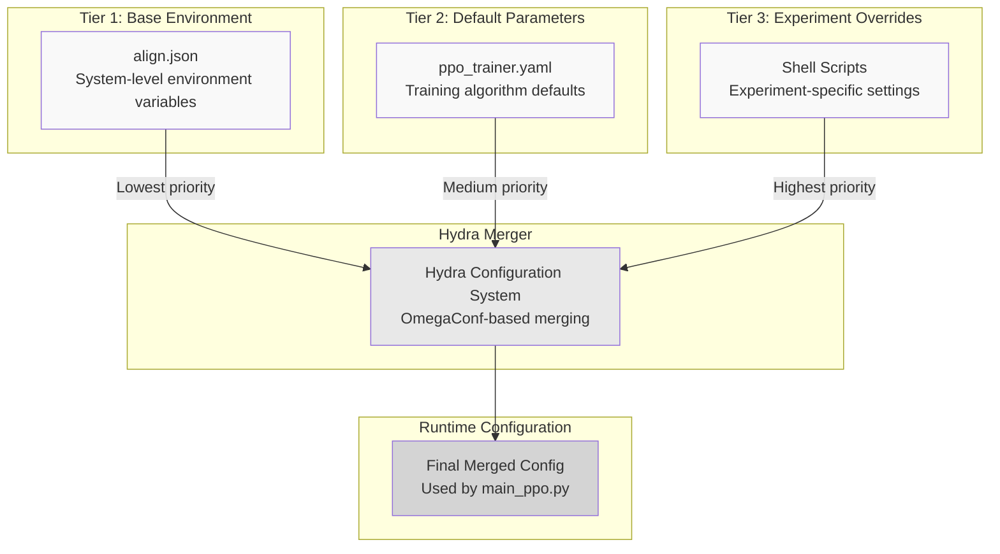
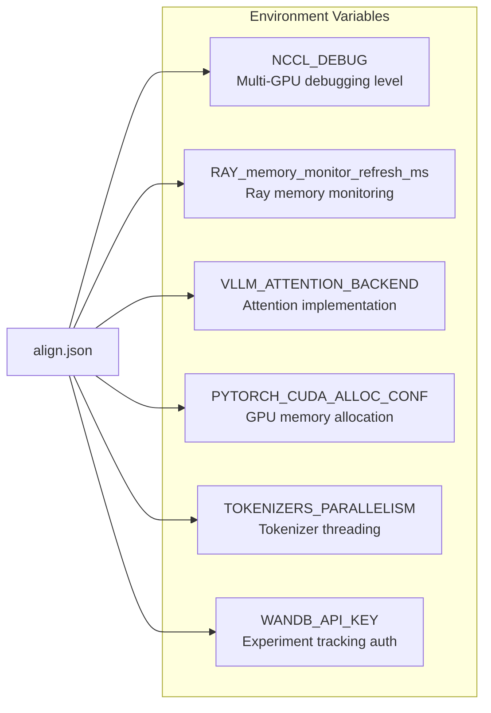
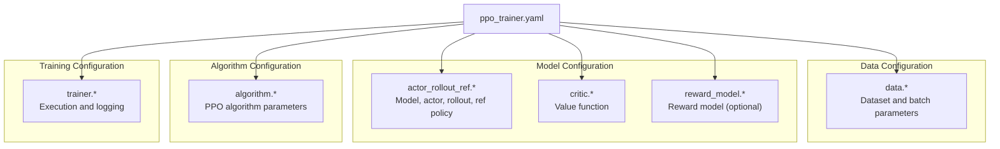
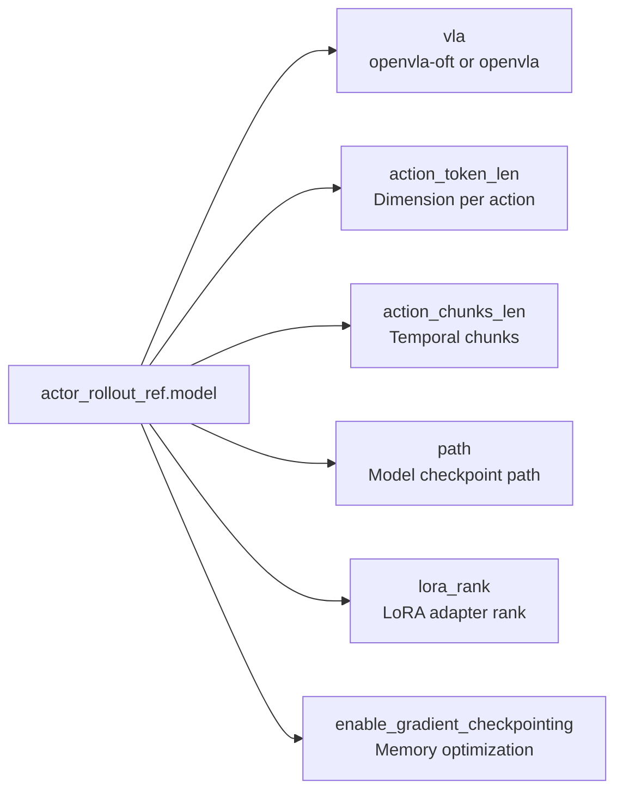
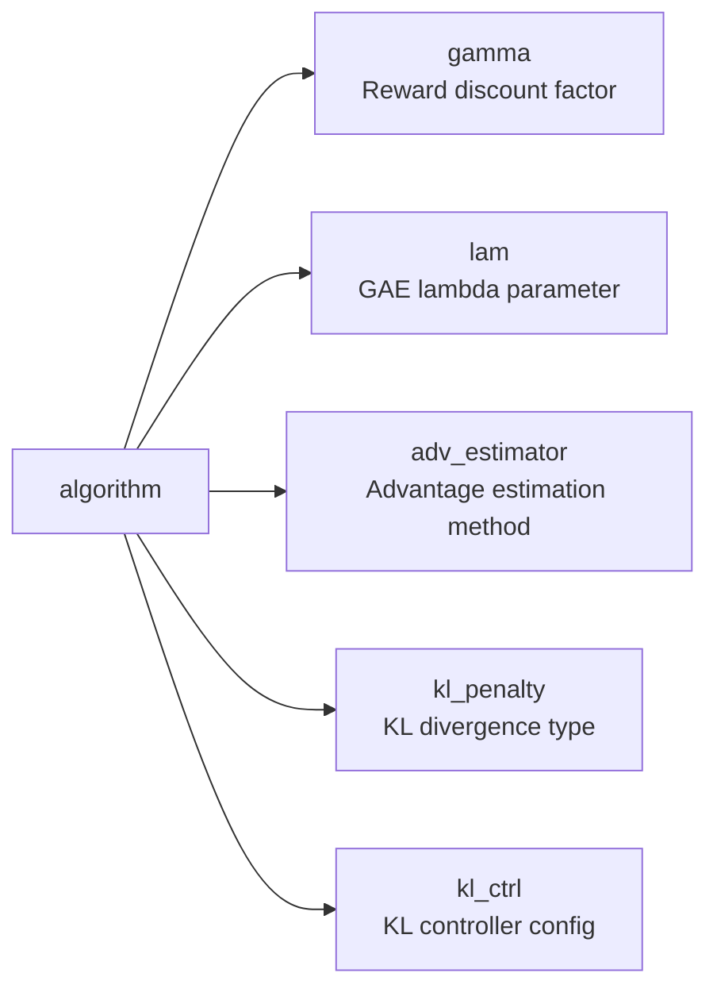
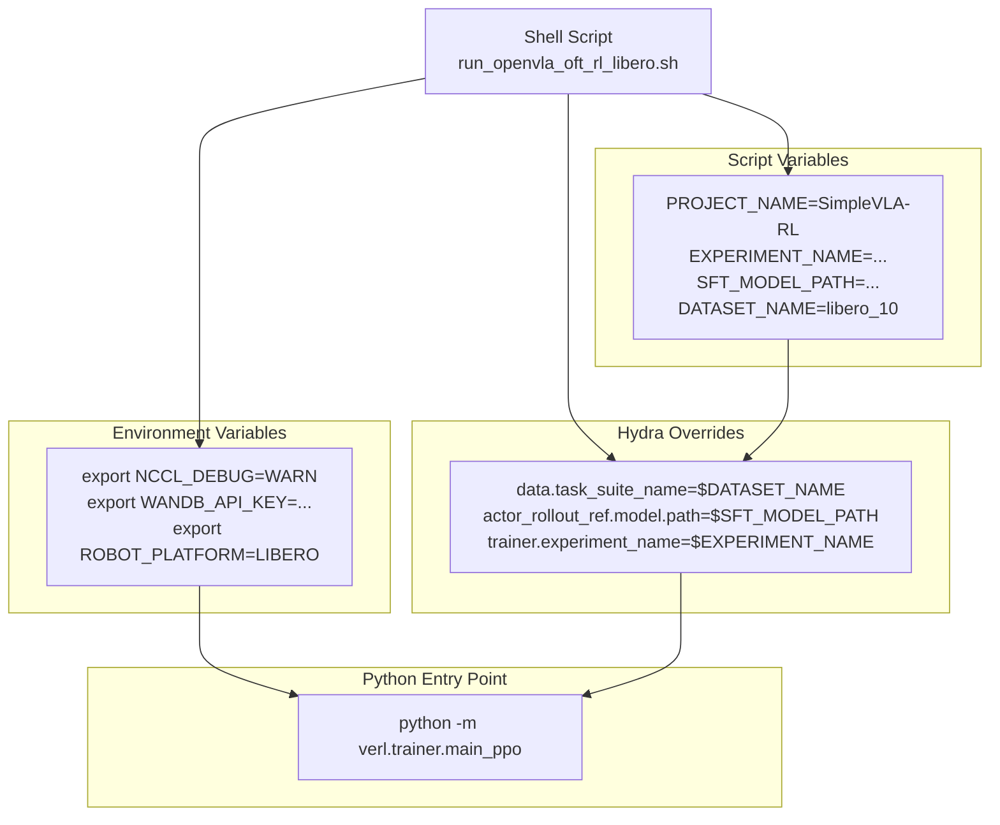
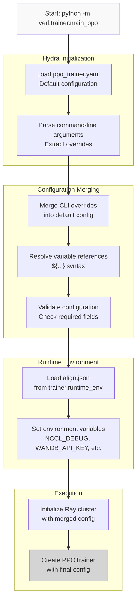

<!-- source: DeepWiki mcp.deepwiki.com · repo PRIME-RL/SimpleVLA-RL · page 7.2 Configuration Files · fetched 2026-10-30 -->

# Configuration Files

<details>
<summary>Relevant source files</summary>

The following files were used as context for generating this wiki page:

- [.gitignore](.gitignore)
- [align.json](align.json)
- [examples/run_openvla_oft_rl_libero.sh](examples/run_openvla_oft_rl_libero.sh)
- [verl/trainer/config/ppo_trainer.yaml](verl/trainer/config/ppo_trainer.yaml)

</details>


This document explains the three-tier configuration system used in SimpleVLA-RL. The framework uses a hierarchy of configuration files that are merged together to define training experiments: base environment settings in `align.json`, default training parameters in `ppo_trainer.yaml`, and experiment-specific overrides in shell scripts. For guidance on using these configurations in practice, see [Example Training Scripts](#7.1). For checkpoint and evaluation configuration, see [Checkpointing and Evaluation](#7.3).

---

## Configuration Hierarchy

SimpleVLA-RL uses a three-tier configuration system where each tier serves a distinct purpose and can override values from lower tiers:



**Sources:** [align.json:1-14](), [verl/trainer/config/ppo_trainer.yaml:1-258](), [examples/run_openvla_oft_rl_libero.sh:1-94]()

---

## Base Environment Configuration (align.json)

The `align.json` file configures system-level environment variables that are applied before any Python code executes. This file is referenced via the `trainer.runtime_env` parameter.

### File Structure



**Sources:** [align.json:1-14]()

### Environment Variable Reference

| Variable | Purpose | Default Value | Notes |
|----------|---------|---------------|-------|
| `NCCL_DEBUG` | Controls NCCL logging verbosity for multi-GPU communication | `WARN` | Set to `INFO` for debugging distributed training issues |
| `RAY_memory_monitor_refresh_ms` | Ray memory monitor refresh interval | `0` | Disables periodic memory monitoring |
| `VLLM_ATTENTION_BACKEND` | Selects attention kernel implementation | `XFORMERS` | Uses memory-efficient xFormers attention |
| `PYTORCH_CUDA_ALLOC_CONF` | PyTorch CUDA memory allocator configuration | `expandable_segments:True` | Enables dynamic memory expansion to reduce fragmentation |
| `TOKENIZERS_PARALLELISM` | Enables parallel tokenization | `true` | Improves tokenization throughput |
| `WANDB_API_KEY` | Authentication key for Weights & Biases | User-provided | Must be replaced with actual API key |

The `excludes` field in [align.json:10-12]() prevents accidental sync of all files when using distributed file systems.

**Sources:** [align.json:2-9]()

---

## Training Parameter Defaults (ppo_trainer.yaml)

The `ppo_trainer.yaml` file in [verl/trainer/config/ppo_trainer.yaml]() provides comprehensive default values for all training parameters. This file is structured into major configuration sections:



**Sources:** [verl/trainer/config/ppo_trainer.yaml:1-258]()

### Data Configuration Section

The `data` section controls dataset loading, batching, and sample filtering:

| Parameter | Purpose | Default | Notes |
|-----------|---------|---------|-------|
| `task_suite_name` | LIBERO or RoboTwin task suite | `libero_10` | See [Dataset Classes](#5.1) |
| `num_trials_per_task` | Number of trials generated per task | `50` | Affects dataset size |
| `n_samples` | Rollouts per prompt (oversampling) | `1` | Higher values enable filtering |
| `filter_accuracy` | Enable success-rate filtering | `False` | Removes trajectories outside bounds |
| `accuracy_lower_bound` | Min success rate for filtering | `0.0` | Used with `filter_accuracy=True` |
| `accuracy_upper_bound` | Max success rate for filtering | `1.0` | Used with `filter_accuracy=True` |
| `oversample_factor` | Additional oversampling multiplier | `1.0` | Multiplies `n_samples` |
| `train_batch_size` | Training batch size | `1024` | Total samples per update |
| `val_batch_size` | Validation batch size | `1312` | Samples for validation |
| `max_prompt_length` | Maximum prompt tokens | `512` | Vision tokens + text |
| `max_response_length` | Maximum action sequence tokens | `512` | Action chunks × action dimensions |

**Sources:** [verl/trainer/config/ppo_trainer.yaml:1-22]()

### Actor-Rollout-Reference Configuration Section

The `actor_rollout_ref` section contains nested configurations for the model, actor, rollout worker, and reference policy:

#### Model Configuration (`actor_rollout_ref.model`)



| Parameter | Purpose | Default | Notes |
|-----------|---------|---------|-------|
| `vla` | VLA model type | `openvla-oft` | `openvla` or `openvla-oft` |
| `action_token_len` | Action dimension per timestep | `7` | xyz (3) + quat (4) + gripper (implicit) |
| `action_chunks_len` | Temporal action chunks | `8` | LIBERO: 8, RoboTwin: 5, see [Platform Configuration](#2.2) |
| `path` | Model checkpoint path | `~/models/deepseek-llm-7b-chat` | Overridden by shell scripts |
| `lora_rank` | LoRA adapter rank | `0` | Set >0 to enable LoRA (e.g., 32) |
| `lora_alpha` | LoRA scaling factor | `32` | Only used when `lora_rank > 0` |
| `target_modules` | Modules to apply LoRA | `all-linear` | All linear layers |
| `enable_gradient_checkpointing` | Trade compute for memory | `False` | Reduces memory at cost of speed |

**Sources:** [verl/trainer/config/ppo_trainer.yaml:24-38]()

#### Actor Configuration (`actor_rollout_ref.actor`)

Controls policy updates and optimization:

| Parameter | Purpose | Default | Notes |
|-----------|---------|---------|-------|
| `traj_mini_batch_size` | Trajectories per mini-batch | `16` | Number of complete trajectories |
| `ppo_mini_batch_size` | PPO mini-batch size | `256` | Samples per PPO update step |
| `ppo_micro_batch_size` | Micro-batch for gradient accumulation | `64` | Per-GPU batch size |
| `ppo_epochs` | PPO epochs per training iteration | `1` | Times to iterate over batch |
| `clip_ratio_high` | PPO advantage clipping upper bound | `0.28` | Upper clip threshold |
| `clip_ratio_low` | PPO advantage clipping lower bound | `0.2` | Lower clip threshold |
| `entropy_coeff` | Entropy regularization coefficient | `0.001` | Encourages exploration |
| `grad_clip` | Gradient clipping threshold | `1.0` | Prevents gradient explosion |
| `optim.lr` | Learning rate | `1e-6` | Actor learning rate |
| `optim.warmup_style` | Learning rate warmup | `constant` | `constant` or `cosine` |
| `fsdp_config.param_offload` | Offload parameters to CPU | `False` | Reduces GPU memory |
| `fsdp_config.grad_offload` | Offload gradients to CPU | `False` | Reduces GPU memory |
| `fsdp_config.optimizer_offload` | Offload optimizer states to CPU | `False` | Reduces GPU memory |

**Sources:** [verl/trainer/config/ppo_trainer.yaml:39-72]()

#### Rollout Configuration (`actor_rollout_ref.rollout`)

Controls environment interaction and trajectory generation:

| Parameter | Purpose | Default | Notes |
|-----------|---------|---------|-------|
| `model_family` | VLA architecture family | `openvla` | Determines preprocessing |
| `task_suite_name` | Environment task suite | `libero_10` | LIBERO or RoboTwin suite |
| `unnorm_key` | Action unnormalization key | `libero_10` | Platform-specific, see [constants.py]() |
| `use_proprio` | Include proprioception in input | `False` | Robot joint state |
| `num_steps_wait` | Initial steps before action | `10` | Warmup steps |
| `center_crop` | Crop image center | `True` | Image preprocessing |
| `temperature` | Sampling temperature | `1.0` | Action distribution entropy |
| `micro_batch_size` | Rollout micro-batch size | `1` | Environments per batch |
| `val_micro_batch_size` | Validation micro-batch size | `8` | Validation environments |
| `pretrained_checkpoint` | Pretrained model path | `None` | Base checkpoint |
| `gpu_memory_utilization` | VLLM GPU memory fraction | `0.5` | For VLLM rollout engine |
| `tensor_model_parallel_size` | Tensor parallelism size | `2` | For VLLM rollout engine |

**Sources:** [verl/trainer/config/ppo_trainer.yaml:84-124]()

#### Reference Policy Configuration (`actor_rollout_ref.ref`)

The reference policy is used for KL divergence computation:

| Parameter | Purpose | Default | Notes |
|-----------|---------|---------|-------|
| `fsdp_config.param_offload` | Offload ref policy parameters | `False` | Usually offloaded to save memory |
| `log_prob_micro_batch_size` | Micro-batch for log prob computation | `128` | Batch size for computing reference log probs |

**Sources:** [verl/trainer/config/ppo_trainer.yaml:73-83]()

### Critic Configuration Section

The `critic` section configures the value function (only needed for GAE advantage estimation):

| Parameter | Purpose | Default | Notes |
|-----------|---------|---------|-------|
| `strategy` | Training strategy | `fsdp` | FSDP distribution |
| `model.path` | Critic model checkpoint | `~/models/deepseek-llm-7b-chat` | Often same as actor |
| `optim.lr` | Critic learning rate | `1e-5` | Typically higher than actor |
| `ppo_mini_batch_size` | Mini-batch size | Inherits from actor | Should match actor |
| `ppo_micro_batch_size` | Micro-batch size | `64` | Per-GPU batch |
| `grad_clip` | Gradient clipping | `1.0` | Prevents instability |
| `cliprange_value` | Value function clipping range | `0.5` | Value clip threshold |

**Sources:** [verl/trainer/config/ppo_trainer.yaml:126-165]()

### Algorithm Configuration Section

The `algorithm` section defines PPO algorithm hyperparameters:



| Parameter | Purpose | Default | Notes |
|-----------|---------|---------|-------|
| `gamma` | Discount factor | `1.0` | Episodic tasks use 1.0 |
| `lam` | GAE lambda | `1.0` | Only used with `adv_estimator=gae` |
| `adv_estimator` | Advantage estimation method | `gae` | `gae`, `rloo`, `grpo`, `reinforce_pp`, `remax` |
| `adv_params.verifier_gamma` | Verifier reward discount | Inherits `gamma` | For environment rewards |
| `adv_params.reward_model_gamma` | Reward model discount | Inherits `gamma` | For learned reward model |
| `kl_penalty` | KL divergence computation | `kl` | How to compute KL |
| `kl_ctrl.type` | KL controller type | `fixed` | `fixed` or `adaptive` |
| `kl_ctrl.kl_coef` | KL penalty coefficient | `0.001` | Weight for KL term |

For details on advantage estimators, see [Advantage Estimation](#3.3). For KL control, see [KL Divergence Control](#3.4).

**Sources:** [verl/trainer/config/ppo_trainer.yaml:227-239]()

### Trainer Configuration Section

The `trainer` section controls training execution and logging:

| Parameter | Purpose | Default | Notes |
|-----------|---------|---------|-------|
| `total_epochs` | Total training epochs | `30` | Training iterations |
| `project_name` | WandB project name | `verl_examples` | Experiment grouping |
| `experiment_name` | Specific experiment name | `gsm8k` | Experiment identifier |
| `logger` | Logging backends | `['console', 'wandb']` | Console and/or WandB |
| `wandb_mode` | WandB mode | `online` | `online`, `offline`, or `disabled` |
| `nnodes` | Number of nodes | `1` | Distributed training nodes |
| `n_gpus_per_node` | GPUs per node | `8` | GPU resources |
| `save_freq` | Checkpoint save frequency (epochs) | `-1` | `-1` disables periodic saves |
| `test_freq` | Validation frequency (epochs) | `-1` | `-1` disables periodic validation |
| `default_local_dir` | Local checkpoint directory | `checkpoints/${project_name}/${experiment_name}` | Checkpoint storage |
| `runtime_env` | Path to `align.json` | `none` | Environment config file |
| `val_before_train` | Validate before training | `False` | Initial validation |
| `val_only` | Only run validation | `True` | Skip training |

**Sources:** [verl/trainer/config/ppo_trainer.yaml:241-258]()

---

## Experiment-Specific Overrides

Shell scripts in the `examples/` directory provide experiment-specific configuration overrides. These scripts set environment variables and use Hydra's command-line override syntax to customize training runs.

### Override Mechanism



**Sources:** [examples/run_openvla_oft_rl_libero.sh:1-94]()

### Common Override Patterns

The example scripts demonstrate key override patterns:

**1. Environment-Specific Variables** [examples/run_openvla_oft_rl_libero.sh:3-9]()
```bash
export NCCL_DEBUG=WARN
export WANDB_API_KEY='YOUR WANDB KEY'
export PYTORCH_CUDA_ALLOC_CONF=expandable_segments:True
export ROBOT_PLATFORM=LIBERO  # LIBERO or ALOHA for RoboTwin
```

**2. Experiment Identification** [examples/run_openvla_oft_rl_libero.sh:10-14]()
```bash
PROJECT_NAME='SimpleVLA-RL'
EXPERIMENT_NAME='vla-lib10_model10j_lr10_tmp16_nsample8_clip08-128_batch64_ppominibs128_node2'
SFT_MODEL_PATH="YOUR SFT_MODEL_PATH"
CKPT_PATH="THE PATH YOU WANT TO SAVE YOUR CKPT"
```

**3. Dataset and Model Selection** [examples/run_openvla_oft_rl_libero.sh:15-17]()
```bash
DATASET_NAME="libero_10"  # libero_10, libero_90, libero_spatial, etc.
VLA_NAME="openvla-oft"
```

**4. Compute Resources** [examples/run_openvla_oft_rl_libero.sh:18-21]()
```bash
NUM_GPUS=8
NUM_NODES=1  # Multi-node training if > 1
ALIGN_PATH="YOUR PATH TO SimpleVLA-RL/align.json"
```

**5. Hydra Parameter Overrides** [examples/run_openvla_oft_rl_libero.sh:24-91]()

The script uses Hydra's dotted notation to override nested configuration parameters:

| Override Category | Example Parameters | Line Reference |
|-------------------|-------------------|----------------|
| Data Configuration | `data.task_suite_name=$DATASET_NAME`<br/>`data.num_trials_per_task=50`<br/>`data.n_samples=8`<br/>`data.train_batch_size=64` | [25-32]() |
| Model Paths | `actor_rollout_ref.model.path=$SFT_MODEL_PATH`<br/>`actor_rollout_ref.model.vla=$VLA_NAME` | [36-37]() |
| Actor Configuration | `actor_rollout_ref.actor.optim.lr=5e-6`<br/>`actor_rollout_ref.actor.ppo_mini_batch_size=128`<br/>`actor_rollout_ref.actor.clip_ratio_high=0.28` | [40-49]() |
| FSDP Memory Optimization | `actor_rollout_ref.actor.fsdp_config.param_offload=False`<br/>`actor_rollout_ref.actor.fsdp_config.grad_offload=True` | [45-47]() |
| Rollout Configuration | `actor_rollout_ref.rollout.temperature=1.6`<br/>`actor_rollout_ref.rollout.experiment_name=$EXPERIMENT_NAME` | [59-60]() |
| Algorithm Parameters | `algorithm.kl_ctrl.kl_coef=0.00`<br/>`algorithm.adv_estimator=grpo` | [75, 86]() |
| Trainer Settings | `trainer.n_gpus_per_node=$NUM_GPUS`<br/>`trainer.nnodes=$NUM_NODES`<br/>`trainer.total_epochs=100` | [80-84]() |

**Sources:** [examples/run_openvla_oft_rl_libero.sh:24-92]()

---

## Hydra Configuration System

SimpleVLA-RL uses [Hydra](https://hydra.cc) for configuration management. Hydra provides structured configuration merging, command-line overrides, and hierarchical composition.

### Configuration Merging Process



**Sources:** [examples/run_openvla_oft_rl_libero.sh:24](), [verl/trainer/config/ppo_trainer.yaml:1]()

### Variable Reference Resolution

Hydra's OmegaConf supports variable interpolation using `${path.to.variable}` syntax. This allows configuration values to reference other values:

**Example Variable References in ppo_trainer.yaml:**

| Parameter | References | Purpose |
|-----------|-----------|---------|
| `actor_rollout_ref.actor.vla` | `${actor_rollout_ref.model.vla}` | Inherit VLA type from model config |
| `actor_rollout_ref.rollout.vla` | `${actor_rollout_ref.model.vla}` | Rollout uses same VLA type |
| `critic.model.tokenizer_path` | `${actor_rollout_ref.model.path}` | Critic uses actor's tokenizer |
| `algorithm.adv_params.verifier_gamma` | `${algorithm.gamma}` | Verifier inherits base discount factor |

This ensures consistency across related configuration parameters without duplication.

**Sources:** [verl/trainer/config/ppo_trainer.yaml:40, 85, 138, 234]()

### Configuration Validation

Hydra validates the merged configuration before execution. Common validation errors:

| Error Type | Cause | Solution |
|------------|-------|----------|
| `MissingMandatoryValue` | Required parameter not set | Provide value via override or default |
| `InterpolationKeyError` | Referenced variable doesn't exist | Check variable path spelling |
| `ValidationError` | Type mismatch | Ensure override matches expected type |
| `ConfigAttributeError` | Invalid configuration path | Verify parameter path exists in schema |

Enable full error traces with `HYDRA_FULL_ERROR=1` as shown in [examples/run_openvla_oft_rl_libero.sh:24]().

**Sources:** [examples/run_openvla_oft_rl_libero.sh:24]()

---

## Configuration Best Practices

### Organizing Experiments

**1. Use Descriptive Experiment Names**

Include key hyperparameters in the experiment name for easy identification:
```bash
EXPERIMENT_NAME='vla-lib10_model10j_lr10_tmp16_nsample8_clip08-128_batch64_ppominibs128_node2'
# Parsing: lib10 (LIBERO-10), model10j (model variant), lr10 (1e-5), tmp16 (temp=1.6), etc.
```

**2. Override Only Necessary Parameters**

Don't override parameters that match defaults. This keeps scripts concise and makes actual changes visible.

**3. Group Related Overrides**

Organize Hydra overrides by logical sections (data, model, actor, trainer) as shown in the example scripts.

**Sources:** [examples/run_openvla_oft_rl_libero.sh:11]()

### Common Configuration Recipes

**Recipe 1: High-Memory GPUs (A100 80GB)**
```bash
# Reduce offloading, increase batch sizes
actor_rollout_ref.actor.fsdp_config.param_offload=False \
actor_rollout_ref.actor.fsdp_config.grad_offload=False \
actor_rollout_ref.actor.fsdp_config.optimizer_offload=False \
actor_rollout_ref.actor.ppo_mini_batch_size=256 \
actor_rollout_ref.rollout.gpu_memory_utilization=0.9
```

**Recipe 2: Low-Memory GPUs (RTX 3090 24GB)**
```bash
# Enable full offloading, reduce batch sizes
actor_rollout_ref.actor.fsdp_config.param_offload=True \
actor_rollout_ref.actor.fsdp_config.grad_offload=True \
actor_rollout_ref.actor.fsdp_config.optimizer_offload=True \
actor_rollout_ref.actor.ppo_mini_batch_size=64 \
actor_rollout_ref.model.enable_gradient_checkpointing=True
```

**Recipe 3: Multi-Node Training**
```bash
# 2 nodes × 8 GPUs = 16 GPUs total
NUM_NODES=2 \
trainer.nnodes=2 \
trainer.n_gpus_per_node=8 \
actor_rollout_ref.actor.ppo_micro_batch_size=16  # Scale micro-batch with GPU count
```

**Recipe 4: Validation-Only Mode**
```bash
# Evaluate existing checkpoint without training
trainer.val_only=True \
trainer.test_freq=1 \
actor_rollout_ref.model.path=/path/to/checkpoint
```

**Sources:** [examples/run_openvla_oft_rl_libero.sh:45-47, 80-81](), [verl/trainer/config/ppo_trainer.yaml:257]()

---

## Configuration File Reference

### Quick Reference: Key Configuration Paths

| Configuration Aspect | Hydra Path | Default File | Override Location |
|---------------------|-----------|--------------|-------------------|
| Task selection | `data.task_suite_name` | ppo_trainer.yaml | Shell script |
| VLA model type | `actor_rollout_ref.model.vla` | ppo_trainer.yaml | Shell script |
| Model checkpoint | `actor_rollout_ref.model.path` | ppo_trainer.yaml | Shell script |
| Learning rate | `actor_rollout_ref.actor.optim.lr` | ppo_trainer.yaml | Shell script |
| Batch size | `data.train_batch_size` | ppo_trainer.yaml | Shell script |
| Number of GPUs | `trainer.n_gpus_per_node` | ppo_trainer.yaml | Shell script |
| Advantage estimator | `algorithm.adv_estimator` | ppo_trainer.yaml | Shell script |
| WandB API key | N/A (env var) | align.json | Shell script |
| Checkpoint directory | `trainer.default_local_dir` | ppo_trainer.yaml | Shell script |

**Sources:** [verl/trainer/config/ppo_trainer.yaml:1-258](), [examples/run_openvla_oft_rl_libero.sh:1-94](), [align.json:1-14]()

---

