# Page: Overview

# Overview

<details>
<summary>Relevant source files</summary>

The following files were used as context for generating this wiki page:

- [README.md](README.md)
- [figs/logo.png](figs/logo.png)
- [figs/main.png](figs/main.png)
- [figs/simplevla-rl.png](figs/simplevla-rl.png)

</details>


## Purpose and Scope

This document provides an introduction to **SimpleVLA-RL**, an open-source reinforcement learning framework designed for training Vision-Language-Action (VLA) models on robotic manipulation tasks with minimal reward engineering. The framework uses binary (0/1) outcome rewards from simulation environments and leverages distributed training infrastructure to achieve efficient policy optimization.

For detailed information about specific subsystems:
- To understand the training algorithm and PPO implementation, see [Training with PPO](#3)
- For environment and benchmark integration details, see [Benchmarks and Environments](#4)
- For practical usage and configuration, see [Running Experiments](#7)

## What is SimpleVLA-RL

SimpleVLA-RL is a reinforcement learning framework that extends [veRL](https://github.com/volcengine/verl) (Volcengine Reinforcement Learning) with VLA-specific components for robotic manipulation. The framework addresses the challenge of training large vision-language-action models to perform long-horizon manipulation tasks through policy optimization rather than supervised fine-tuning alone.

**Key Characteristics:**

| Aspect | Description |
|--------|-------------|
| **Base Framework** | Built on veRL for distributed RL infrastructure |
| **Algorithm** | Proximal Policy Optimization (PPO) with multiple advantage estimators |
| **Models Supported** | OpenVLA, OpenVLA-OFT |
| **Environments** | LIBERO benchmark (libero-10, libero-90, spatial/object/goal tasks), RoboTwin 1.0/2.0 |
| **Reward Signal** | Binary (0/1) task success indicators |
| **Parallelization** | Ray-based distributed execution with FSDP model sharding |
| **Training Efficiency** | Multi-environment parallel rendering, oversampling with filtering |

Sources: [README.md:1-89](), [verl/trainer/main_ppo.py:1-50]()

## Core Components

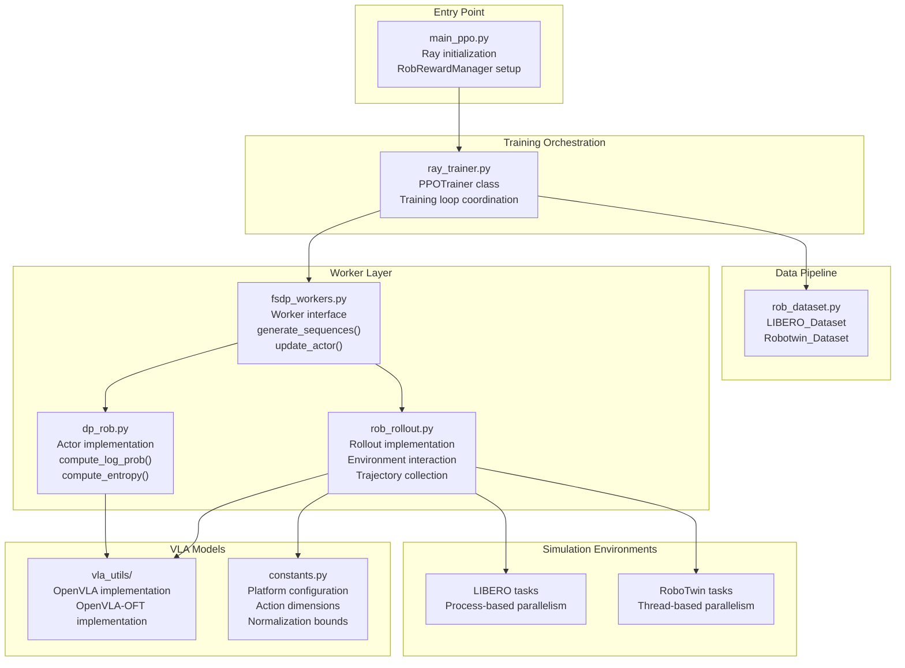

**Diagram: Core Component Architecture**

This diagram maps the natural language concept of "training system" to the actual Python modules that implement it. Each box represents a file or directory in the codebase with its key classes and functions.

Sources: [verl/trainer/main_ppo.py](), [verl/trainer/ppo/ray_trainer.py](), [verl/workers/fsdp_workers.py](), [verl/workers/actor/dp_rob.py](), [verl/workers/rollout/rob_rollout.py](), [verl/utils/dataset/rob_dataset.py](), [verl/utils/vla_utils/]()

## Training Workflow

```mermaid
sequenceDiagram
    participant User
    participant Script["run_openvla_oft_rl_*.sh"]
    participant Main["main_ppo.py"]
    participant Trainer["PPOTrainer<br/>(ray_trainer.py)"]
    participant Dataset["LIBERO_Dataset or<br/>Robotwin_Dataset"]
    participant Rollout["RobRolloutWorkerGroup"]
    participant Actor["ActorRolloutWorkerGroup<br/>(dp_rob.py)"]
    
    User->>Script: Execute training script
    Script->>Main: Launch with Hydra config
    Main->>Main: ray.init()
    Main->>Main: RobRewardManager.remote()
    Main->>Trainer: Initialize PPOTrainer
    
    Trainer->>Dataset: Create train/val dataloaders
    
    loop Training Epochs
        Trainer->>Dataset: Sample batch (task_id, trial_id, seed)
        Dataset-->>Trainer: Return prompts
        
        loop Rollout Collection (n_samples per prompt)
            Trainer->>Rollout: generate_sequences(prompts)
            Rollout->>Rollout: Initialize parallel environments
            
            loop Episode Steps
                Rollout->>Rollout: Process observations (images, proprioception)
                Rollout->>Rollout: VLA.generate_action()
                Rollout->>Rollout: env.step(actions)
            end
            
            Rollout-->>Trainer: Trajectories + binary rewards
        end
        
        Trainer->>Trainer: Filter samples (success rate, truncation)
        Trainer->>Trainer: Compute advantages (GAE/RLOO/GRPO)
        Trainer->>Actor: update_actor(batch)
        Actor->>Actor: Compute PPO loss + entropy
        Actor-->>Trainer: Return metrics
        
        Trainer->>Trainer: Log to WandB
        Trainer->>Trainer: Save checkpoint
    end
```

**Diagram: Training Loop Execution Flow**

This sequence diagram shows the actual execution flow through the codebase. Key classes include `PPOTrainer` in [ray_trainer.py](), `LIBERO_Dataset` and `Robotwin_Dataset` in [rob_dataset.py](), rollout workers in [rob_rollout.py](), and actor workers in [dp_rob.py]().

Sources: [verl/trainer/main_ppo.py:1-200](), [verl/trainer/ppo/ray_trainer.py:1-500](), [verl/workers/rollout/rob_rollout.py:1-800](), [verl/workers/actor/dp_rob.py:1-300]()

## Key Design Principles

### 1. Minimal Reward Engineering

SimpleVLA-RL uses **binary success indicators** (0 or 1) from simulation environments rather than shaped rewards. The environments return a single scalar indicating task success:

- `reward = 1` if task completed successfully
- `reward = 0` otherwise

This simplifies environment design and focuses the learning signal on task completion.

Sources: [README.md:55-58](), [verl/workers/rollout/rob_rollout.py:450-550]()

### 2. Oversampling with Filtering

The framework employs an **oversampling strategy** where multiple rollout trajectories are collected per training prompt, then filtered based on:

- **Accuracy filtering**: Retains trajectories with higher success rates
- **Truncation filtering**: Removes trajectories that hit max episode length without success

Excess filtered samples are buffered and reused in subsequent iterations via the `BufferedDataLoader`.

Sources: [verl/trainer/ppo/ray_trainer.py:350-450](), [verl/utils/dataset/rob_dataset.py:200-250]()

### 3. Platform-Agnostic VLA Integration

The system adapts to different robot platforms through dynamic configuration in [constants.py]():

```python
# Platform detection and configuration
LIBERO: 8 action chunks, 7D actions (xyz + quaternion + gripper)
RoboTwin: 5 action chunks, 7D actions
ALOHA: 6-25 action chunks, 14D actions (bimanual)
```

Each platform has specific normalization bounds (`BOUNDS`, `BOUNDS_Q99`) for proprioception and action spaces.

Sources: [verl/utils/vla_utils/constants.py](), [verl/workers/rollout/rob_rollout.py:100-200]()

### 4. Distributed Execution with Ray

Training leverages **Ray** for distributed execution across multiple GPUs and nodes. Worker groups are organized by role:

| Worker Role | Responsibility | File Location |
|------------|----------------|---------------|
| `ActorRollout` | Policy generation + environment interaction | [fsdp_workers.py](), [rob_rollout.py]() |
| `Critic` | Value function estimation (for GAE) | [fsdp_workers.py]() |
| `RefPolicy` | Reference policy for KL divergence | [fsdp_workers.py]() |
| `RewardModel` | Optional reward scoring | [fsdp_workers.py]() |

The `ResourcePoolManager` allocates GPU resources to each role via named resource pools.

Sources: [verl/trainer/main_ppo.py:50-150](), [verl/workers/fsdp_workers.py:1-100]()

### 5. FSDP Model Sharding

Large VLA models are sharded using PyTorch's **Fully Sharded Data Parallel** (FSDP) to fit in GPU memory. The framework supports:

- Parameter sharding across devices
- Gradient sharding
- Optimizer state sharding
- CPU offloading for memory-constrained scenarios

Sources: [verl/workers/fsdp_workers.py:200-400]()

## System Entry Points

The main entry points for interacting with SimpleVLA-RL are:

### Training Entry Point

**File**: [verl/trainer/main_ppo.py]()

```python
# Key responsibilities:
# 1. Initialize Ray cluster
# 2. Setup RobRewardManager for reward distribution
# 3. Create PPOTrainer instance
# 4. Launch training loop
```

Invoked via shell scripts in `examples/run_openvla_oft_rl_*.sh` with Hydra configuration overrides.

### Configuration Files

| File | Purpose |
|------|---------|
| [align.json]() | Environment variables (NCCL, CUDA, WandB) |
| [ppo_trainer.yaml]() | Default training hyperparameters |
| [examples/*.sh]() | Experiment-specific overrides |

Sources: [verl/trainer/main_ppo.py:1-50](), [align.json](), [examples/]()

## Supported Models and Environments

### VLA Models

**OpenVLA**: Transformer-based VLA model that generates action tokens, post-processed to extract continuous actions.

**OpenVLA-OFT**: Orthogonal Fine-Tuning variant with direct action prediction via `generate_action_verl()` method.

Implementation location: [verl/utils/vla_utils/]()

### Simulation Benchmarks

**LIBERO**: 
- Task suites: libero-10 (10 tasks), libero-90 (90 tasks), libero-spatial, libero-object, libero-goal
- Parallelism: Process-based with multiprocessing
- Seed management: Fixed trial seeds (-1)

**RoboTwin**:
- Versions: RoboTwin 1.0, RoboTwin 2.0
- Parallelism: Thread-based with ThreadPoolExecutor
- Seed management: Pre-collected feasible seeds (v2.0) or offset-based generation (v1.0)

Sources: [verl/utils/dataset/rob_dataset.py:1-500](), [verl/workers/rollout/rob_rollout.py:500-800]()

## Performance Features

1. **Multi-environment parallel rendering**: Spawns multiple environment instances per rollout worker to accelerate trajectory collection
2. **Hybrid engine mode**: Combines actor (policy) and rollout (environment) workers in the same group for efficiency
3. **Buffered data loading**: Reuses excess filtered samples to maximize data efficiency
4. **Gradient accumulation**: Supports large effective batch sizes across limited GPU memory

Sources: [README.md:45-49](), [verl/trainer/ppo/ray_trainer.py:100-200]()

## Next Steps

- For installation and setup instructions, see [Getting Started](#1.1)
- For detailed architecture explanation, see [System Architecture](#1.2)
- For VLA model integration details, see [VLA Models](#2)
- For PPO training mechanics, see [Training with PPO](#3)

---

# Page: Getting Started

# Getting Started

<details>
<summary>Relevant source files</summary>

The following files were used as context for generating this wiki page:

- [README.md](README.md)
- [SETUP.md](SETUP.md)
- [examples/run_openvla_oft_rl_libero.sh](examples/run_openvla_oft_rl_libero.sh)

</details>


This page provides a comprehensive guide for setting up and running your first SimpleVLA-RL training session. It covers environment setup, configuration, and the basic training workflow for online reinforcement learning with Vision-Language-Action models.

For detailed information about the training pipeline internals, see [Training Pipeline](#1.2). For model architecture details, see [Model Architecture](#2).

## Prerequisites

SimpleVLA-RL requires several key components to function properly:

- **veRL Framework**: The distributed RL training engine (v0.2 or v0.3 recommended)
- **OpenVLA-OFT**: The Vision-Language-Action model implementation 
- **Simulation Benchmark**: Either LIBERO or RoboTwin 2.0 robotic simulation environment
- **Pre-trained SFT Model**: A supervised fine-tuned model as the starting point
- **Multi-GPU Hardware**: Recommended 8+ GPUs with 80GB memory each

The system has been tested on configurations with 1-2 nodes, each containing 8 NVIDIA A800 GPUs with CUDA 12.4 and driver version 470.161.03.

Sources: [README.md:131-134](), [SETUP.md:6-8](), [SETUP.md:58]()

## Environment Setup

### Installation Overview

SimpleVLA-RL requires installing three main components: veRL, a simulation benchmark (LIBERO or RoboTwin 2.0), and OpenVLA-OFT. Detailed step-by-step instructions are provided in [SETUP.md]().

#### Option 1: Running RL on LIBERO Benchmark

1. Install veRL (v0.2 or v0.3 recommended)
2. Install LIBERO and OpenVLA-OFT
3. Install Flash Attention 2 for training

#### Option 2: Running RL on RoboTwin 2.0 Benchmark

1. Install veRL (v0.2 or v0.3 recommended)
2. Install RoboTwin 2.0 and its system dependencies (libvulkan1, mesa-vulkan-drivers)
3. Download RoboTwin assets
4. Install OpenVLA-OFT
5. Apply RoboTwin modifications using `copy_overwrite_robotwin2.sh`

**Important**: All repositories (veRL, OpenVLA-OFT, LIBERO/RoboTwin) should be cloned at the same directory level as SimpleVLA-RL, not inside the SimpleVLA-RL folder.

Sources: [SETUP.md:1-131](), [README.md:94]()

### Obtain SFT Models

You need a supervised fine-tuned model as the starting point for RL training. Available options include:

| Model Type | Source | Description |
|------------|--------|-------------|
| OpenVLA-OFT SFT | [SimpleVLA-RL Collection](https://huggingface.co/collections/Haozhan72/simplevla-rl-6833311430cd9df52aeb1f86) | LIBERO: `libero-10 traj1/trajall SFT`, `libero-goal/object/spatial traj1 SFT`<br/>RoboTwin: `Robotwin2.0 tasks traj1000 SFT` |
| OpenVLA SFT | [OpenVLA Hub](https://huggingface.co/openvla) | Original OpenVLA models |
| Custom Models | Self-trained | Fine-tune your own models |

Sources: [README.md:98-109]()

## Configuration Overview

SimpleVLA-RL uses a three-tier configuration system: environment variables in `align.json`, default training parameters in `ppo_trainer.yaml`, and experiment-specific overrides in shell scripts.

### Environment Configuration

The `align.json` file centralizes environment-specific settings for GPU memory management, multi-GPU communication, and experiment tracking:

**Critical Configuration**: Set your Weights & Biases API key in `align.json` before running any experiments.

```bash
# In align.json, set:
"WANDB_API_KEY": "your_wandb_key_here"
```

Additional environment variables configured in shell scripts include:
- `NCCL_DEBUG`: Controls NCCL logging verbosity
- `PYTORCH_CUDA_ALLOC_CONF`: Enables expandable memory segments
- `TOKENIZERS_PARALLELISM`: Enables parallel tokenization
- `ROBOT_PLATFORM`: Sets platform detection (LIBERO or ALOHA for RoboTwin)

Sources: [README.md:116](), [examples/run_openvla_oft_rl_libero.sh:3-9]()

### Configuration Flow Diagram

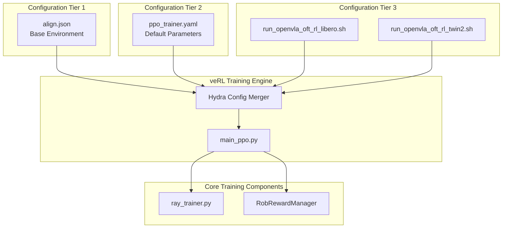

Sources: [README.md:64-66](), [README.md:68-70](), [examples/run_openvla_oft_rl_libero.sh:24-89]()

## Training Process

The training process follows a structured workflow orchestrated by shell scripts that invoke `main_ppo.py` with Hydra configuration parameters.

### Key Training Parameters

| Parameter Category | Key Settings | Purpose |
|-------------------|--------------|---------|
| **Model Configuration** | `SFT_MODEL_PATH`, `VLA_NAME` | Define base model and architecture |
| **Data Configuration** | `DATASET_NAME`, `n_samples`, `train_batch_size` | Control training data and batching |
| **PPO Configuration** | `ppo_mini_batch_size`, `clip_ratio_high/low` | PPO algorithm parameters |
| **Hardware Configuration** | `NUM_GPUS`, `NUM_NODES` | Distributed training setup |
| **Experiment Tracking** | `EXPERIMENT_NAME`, `PROJECT_NAME` | WandB logging and checkpointing |

Sources: [examples/run_openvla_oft_rl_libero.sh:10-21](), [examples/run_openvla_oft_rl_libero.sh:32-52]()

### Training Execution Flow

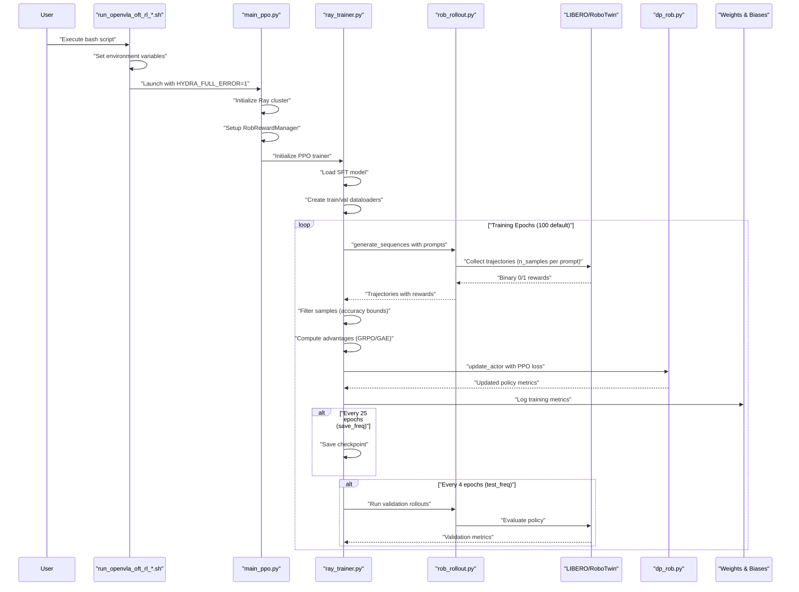

Sources: [README.md:64-87](), [examples/run_openvla_oft_rl_libero.sh:24](), [examples/run_openvla_oft_rl_libero.sh:82-84]()

## Running Your First Training

### Step 1: Configure Key Variables

Choose the appropriate script for your benchmark:
- **LIBERO**: `examples/run_openvla_oft_rl_libero.sh`
- **RoboTwin 2.0**: `examples/run_openvla_oft_rl_twin2.sh`

Edit the following variables in your chosen script:

```bash
# Required modifications (example from run_openvla_oft_rl_libero.sh)
export WANDB_API_KEY='YOUR_WANDB_KEY'            # Line 4
export ROBOT_PLATFORM=LIBERO                     # Line 9 (or ALOHA for RoboTwin)
PROJECT_NAME='SimpleVLA-RL'                      # Line 10
EXPERIMENT_NAME='your_experiment_name'           # Line 11  
SFT_MODEL_PATH="path/to/your/sft/model"         # Line 13
CKPT_PATH="path/to/save/checkpoints"            # Line 14
DATASET_NAME="libero_10"                        # Line 16
VLA_NAME="openvla-oft"                          # Line 17
NUM_GPUS=8                                      # Line 18
NUM_NODES=1                                     # Line 20
ALIGN_PATH="path/to/SimpleVLA-RL/align.json"   # Line 21
```

**LIBERO Dataset Options**: `libero_10`, `libero_90`, `libero_spatial`, `libero_object`, `libero_goal`

**RoboTwin 2.0 Dataset Options**: Refer to `examples/run_openvla_oft_rl_twin2.sh` for available tasks

Sources: [examples/run_openvla_oft_rl_libero.sh:4-21](), [README.md:119-127]()

### Step 2: Launch Training

Execute the appropriate training script:

```bash
# For LIBERO
bash examples/run_openvla_oft_rl_libero.sh

# For RoboTwin 2.0
bash examples/run_openvla_oft_rl_twin2.sh
```

The script will invoke `python -u -m verl.trainer.main_ppo` with all configured parameters via the Hydra configuration system.

Sources: [examples/run_openvla_oft_rl_libero.sh:24](), [README.md:137-143]()

### Step 3: Monitor Training

Training progress is automatically logged to Weights & Biases with the following key metrics:

- **Episode Rewards**: Binary 0/1 outcome-based rewards from environment tasks
- **Policy Updates**: PPO loss, gradient norms, and entropy information  
- **Evaluation Performance**: Validation success rates on held-out tasks or seeds
- **System Metrics**: GPU utilization and memory usage
- **Rollout Videos**: Success and failure cases saved during validation

The training runs for 100 epochs by default with checkpoints saved every 25 epochs and evaluation every 4 epochs. These frequencies are configurable via `trainer.save_freq` and `trainer.test_freq` parameters.

Sources: [examples/run_openvla_oft_rl_libero.sh:82-84](), [examples/run_openvla_oft_rl_libero.sh:76-78](), [README.md:81]()

## Evaluation Mode

To evaluate a trained model without further training, modify the training script to enable evaluation-only mode:

```bash
# In run_openvla_oft_rl_libero.sh or run_openvla_oft_rl_twin2.sh, change:
trainer.val_only=False    # to
trainer.val_only=True
```

Then execute the same script. The system will load the specified model checkpoint and run evaluation on the configured dataset without performing any policy updates.

Sources: [examples/run_openvla_oft_rl_libero.sh:85](), [README.md:146-154]()

## Hardware Requirements

The system supports flexible hardware configurations:

| Configuration | Nodes | GPUs per Node | Total GPUs | Memory per GPU |
|---------------|-------|---------------|------------|----------------|
| **Single Node** | 1 | 8 | 8 | 80GB (A800) |
| **Multi Node** | 2 | 8 | 16 | 80GB (A800) |

Memory optimization features like parameter offloading and gradient offloading are enabled by default to maximize hardware utilization.

Sources: [examples/run_openvla_oft_rl.sh:44-46](), [README.md:103-106]()

---

# Page: System Architecture

# System Architecture

<details>
<summary>Relevant source files</summary>

The following files were used as context for generating this wiki page:

- [README.md](README.md)
- [figs/logo.png](figs/logo.png)
- [figs/main.png](figs/main.png)
- [verl/trainer/ppo/ray_trainer.py](verl/trainer/ppo/ray_trainer.py)

</details>


This page explains the high-level architecture of SimpleVLA-RL, showing how it extends the veRL framework with Vision-Language-Action (VLA) model-specific components and how major subsystems interact during training.

## Architecture Overview

SimpleVLA-RL is built on top of veRL (Volcano Engine Reinforcement Learning), extending it with components specifically designed for training VLA models on robotic manipulation tasks. The system follows a distributed architecture using Ray for resource management and parallel execution.

### Overall System Structure

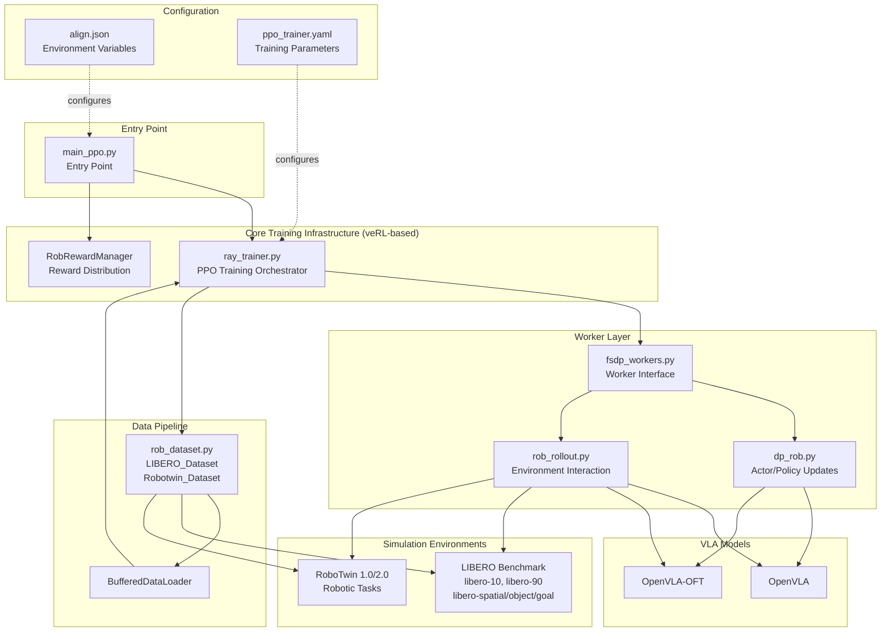

The architecture consists of several key layers:

1. **Entry Point Layer**: `main_ppo.py` initializes Ray cluster and `RobRewardManager`
2. **Training Infrastructure Layer**: `ray_trainer.py` orchestrates PPO training, built on veRL
3. **Worker Layer**: FSDP workers provide interfaces for policy updates (`dp_rob.py`) and environment interactions (`rob_rollout.py`)
4. **Model Layer**: Supports OpenVLA and OpenVLA-OFT architectures
5. **Environment Layer**: Integrates LIBERO and RoboTwin benchmarks
6. **Data Layer**: Manages datasets with buffered loading and excess sample management

Sources: [README.md:62-88](), [verl/trainer/main_ppo.py:64-66]()

## Extending veRL

SimpleVLA-RL extends veRL by adding VLA-specific modules while leveraging veRL's core infrastructure for distributed training, FSDP support, and PPO implementation.

### VLA-Specific Extensions

| Module | Purpose | Key Files |
|--------|---------|-----------|
| VLA Rollout | Environment interaction with VLA models | `verl/workers/rollout/rob_rollout.py` |
| VLA Actor | Policy updates for VLA architectures | `verl/workers/actor/dp_rob.py` |
| Robot Datasets | LIBERO/RoboTwin data loading | `verl/utils/dataset/rob_dataset.py` |
| VLA Models | OpenVLA/OpenVLA-OFT implementations | `verl/utils/vla_utils/` |
| Reward Manager | Robotic task reward distribution | `verl/trainer/main_ppo.py` (RobRewardManager) |

### veRL Core Components (Inherited)

SimpleVLA-RL leverages the following core veRL infrastructure:

- **FSDP Workers**: Fully Sharded Data Parallel implementation in `fsdp_workers.py`
- **Ray Infrastructure**: Distributed execution framework with resource pooling
- **PPO Algorithm**: Core RL algorithm implementation in `core_algos`
- **Resource Pools**: GPU allocation and management through `RayResourcePool`

Sources: [README.md:62-88](), [verl/trainer/main_ppo.py:64-66]()

## Distributed Training Architecture

The system uses Ray to distribute work across multiple GPUs and nodes, with different worker groups handling specific roles in the training pipeline.

### Ray-Based Distribution

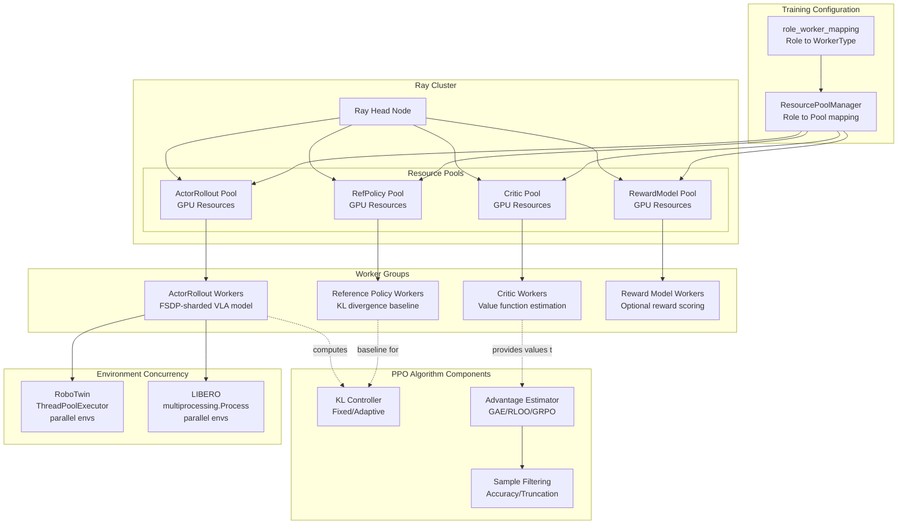

### Resource Pool Management

The distributed architecture consists of:

**Resource Pools**: Ray manages GPU resources through configurable pools defined in `ResourcePoolManager`:
- `ActorRollout Pool`: Handles both policy generation and environment interaction
- `Critic Pool`: Manages value function estimation (when using GAE)
- `RefPolicy Pool`: Provides reference policy for KL divergence computation
- `RewardModel Pool`: Optional reward model workers

**Worker Groups**: Each pool contains one or more worker groups:
- Workers are FSDP-sharded for memory efficiency
- Supports both single-node and multi-node setups
- Configurable through `process_on_nodes` parameter

**Hybrid Engine Mode**: `ActorRollout` workers combine policy generation and trajectory collection in a single group for efficiency. This is the default and recommended mode.

Sources: [verl/trainer/ppo/ray_trainer.py:42-53](), [verl/trainer/ppo/ray_trainer.py:55-79]()

### Worker Role Definitions

The system uses a role-based architecture where different components are mapped to specific worker types:

```python
class Role(Enum):
    Actor = 0
    Rollout = 1
    ActorRollout = 2  # Hybrid mode
    Critic = 3
    RefPolicy = 4
    RewardModel = 5
    ActorRolloutRef = 6
```

**Role Responsibilities**:

| Role | Purpose | When Used |
|------|---------|-----------|
| `ActorRollout` | Combined policy + environment interaction | Hybrid engine mode (default) |
| `Actor` | Policy network updates only | Separate actor/rollout mode |
| `Rollout` | Environment interaction only | Separate actor/rollout mode |
| `Critic` | Value function estimation | When using GAE advantage estimator |
| `RefPolicy` | KL divergence baseline | When KL penalty coefficient > 0 |
| `RewardModel` | Reward scoring (optional) | Advanced reward modeling |

The `ResourcePoolManager` maps roles to resource pools and manages worker group instantiation.

Sources: [verl/trainer/ppo/ray_trainer.py:42-53](), [verl/trainer/ppo/ray_trainer.py:55-79]()

### FSDP and Memory Optimization

SimpleVLA-RL uses PyTorch's Fully Sharded Data Parallel (FSDP) with configurable offloading:

- **Parameter Offloading**: Typically disabled for speed
- **Gradient Offloading**: Enabled to save GPU memory during backward pass
- **Optimizer Offloading**: Enabled to save GPU memory during optimization
- **Sharding Strategy**: Full model sharding across all available GPUs

Environment-specific parallelism strategies:
- **RoboTwin**: Uses `ThreadPoolExecutor` for lightweight concurrency
- **LIBERO**: Uses `multiprocessing.Process` for better isolation with Queue-based IPC

Sources: [README.md:48](), [verl/trainer/ppo/ray_trainer.py:264-275]()

## Main Training Flow

The training process follows a structured flow from initialization through iterative policy updates.

### Training Sequence

```mermaid
sequenceDiagram
    participant User
    participant Scripts as "Run Scripts<br/>(examples/*.sh)"
    participant Main as "main_ppo.py"
    participant Trainer as "ray_trainer.py"
    participant Dataset as "rob_dataset.py"
    participant Rollout as "rob_rollout.py"
    participant Env as "LIBERO/RoboTwin"
    participant Actor as "dp_rob.py"
    participant VLA as "VLA Model"
    
    User->>Scripts: "Execute training script"
    Scripts->>Main: "Launch with Hydra config"
    Main->>Main: "Initialize Ray cluster"
    Main->>Main: "Setup RobRewardManager"
    Main->>Trainer: "Initialize trainer"
    
    Trainer->>Dataset: "Create train/val dataloaders"
    Dataset->>Dataset: "Load LIBERO/Robotwin tasks"
    
    loop "Training Epochs"
        Trainer->>Dataset: "Get batch (task_id, trial_id, seed)"
        Dataset-->>Trainer: "Return prompts"
        
        loop "Collect rollouts (n_samples per prompt)"
            Trainer->>Rollout: "generate_sequences(prompts)"
            Rollout->>Env: "Initialize environments (parallel)"
            Env-->>Rollout: "Initial observations"
            
            loop "Episode Steps (until max_steps or done)"
                Rollout->>Rollout: "process_input(observations)"
                Rollout->>VLA: "Generate actions"
                VLA-->>Rollout: "Actions (proprioception + gripper)"
                Rollout->>Env: "Execute actions"
                Env-->>Rollout: "New observations + binary rewards"
            end
            
            Rollout-->>Trainer: "Trajectories + rewards"
        end
        
        Trainer->>Trainer: "Filter samples (accuracy/truncation)"
        Trainer->>Trainer: "Compute advantages (GRPO/GAE)"
        
        Trainer->>Actor: "update_actor(batch)"
        Actor->>VLA: "Compute policy loss + entropy"
        VLA-->>Actor: "Gradients"
        Actor->>Actor: "Optimizer step"
        Actor-->>Trainer: "Metrics"
        
        Trainer->>Trainer: "Log to WandB"
        Trainer->>Trainer: "Save checkpoints"
    end
```

### Training Loop Steps

Key steps in each training iteration:

1. **Initialization**:
   - User launches training via shell script with Hydra overrides
   - `main_ppo.py` initializes Ray cluster and `RobRewardManager`
   - `ray_trainer.py` loads datasets and creates buffered dataloaders

2. **Data Collection**:
   - Trainer samples batch from dataset (task_id, trial_id, seed)
   - Dataset returns language instruction prompts for robotic tasks
   - Multiple rollouts collected per prompt (`n_samples` parameter)

3. **Rollout Generation**:
   - Rollout worker initializes parallel environments (threading or multiprocessing)
   - VLA model generates actions for each observation step
   - Environments execute actions and return binary (0/1) rewards
   - Process repeats until episode completion (max_steps or task success)

4. **Sample Filtering and Advantage Computation**:
   - Samples filtered based on success rates and truncation criteria
   - Advantages computed using selected estimator (GRPO, GAE, RLOO, etc.)
   - KL penalty applied if reference policy is enabled

5. **Policy Update**:
   - Actor worker computes PPO loss with clipping and entropy bonus
   - Gradient descent step with gradient clipping
   - FSDP-based optimizer updates policy parameters

6. **Logging and Checkpointing**:
   - Metrics logged to console and WandB
   - Periodic checkpoint saving based on `save_freq`
   - Validation runs at intervals defined by `test_freq`

Sources: [verl/trainer/ppo/ray_trainer.py:247-335](), [verl/trainer/main_ppo.py:1-14]()

### Oversampling and Buffering Strategy

SimpleVLA-RL uses an oversampling strategy to maximize data efficiency:

- **Oversampling**: Generate `oversample_factor * train_batch_size` rollouts
- **Filtering**: Keep only samples meeting accuracy thresholds (0.1 < accuracy < 0.9)
- **Buffering**: `BufferedDataLoader` stores excess filtered samples
- **Reuse**: Excess samples added back to queue for future training iterations

This approach ensures the training always has high-quality samples while avoiding repeated rollouts for difficult tasks.

Sources: [verl/trainer/ppo/ray_trainer.py:312-321](), [verl/utils/dataset/rob_dataset.py:1-50]()

## Experiment Tracking and Logging

The training pipeline includes comprehensive experiment tracking through Weights & Biases and console logging.

### Logging Configuration

```mermaid
graph TB
    subgraph "Logging Setup"
        LoggerTypes["trainer.logger=['console','wandb']"]
        ProjectName["trainer.project_name=SimpleVLA-RL"]
        ExperimentName["trainer.experiment_name"]
        WandBMode["trainer.wandb_mode=online"]
    end
    
    subgraph "Environment Variables"
        WandBKey["WANDB_API_KEY"]
        AlignPath["trainer.runtime_env=align.json"]
        EnvVars["NCCL_DEBUG, PYTORCH_CUDA_ALLOC_CONF<br/>TOKENIZERS_PARALLELISM"]
    end
    
    subgraph "Checkpoint Management"
        SaveFreq["trainer.save_freq=25"]
        TestFreq["trainer.test_freq=4"]
        TotalEpochs["trainer.total_epochs=100"]
        LocalDir["trainer.default_local_dir"]
    end
    
    LoggerTypes --> ProjectName
    ProjectName --> ExperimentName
    WandBKey --> AlignPath
    AlignPath --> EnvVars
    SaveFreq --> TestFreq
    TestFreq --> TotalEpochs
```

**Sources:** [examples/run_openvla_oft_rl.sh:74-89](), [align.json:1-13]()

### Hardware Configuration

The training script supports both single-node and multi-node distributed training:

- **GPU Configuration**: `trainer.n_gpus_per_node` and `trainer.nnodes`
- **Tested Configurations**: 
  - Single-node: 1 node × 8 NVIDIA A800 GPUs (80GB each)
  - Multi-node: 2 nodes × 8 NVIDIA A800 GPUs (80GB each)
- **CUDA Settings**: Driver 470.161.03, CUDA 12.4

**Sources:** [examples/run_openvla_oft_rl.sh:78-79](), [README.md:103-106]()

## Training Execution Flow

The complete training execution follows a structured flow from script launch to completion.

### Execution Pipeline

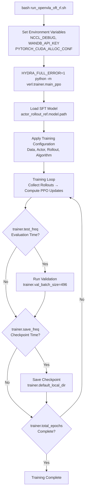

**Sources:** [examples/run_openvla_oft_rl.sh:1-92](), [examples/run_openvla_oft_rl.sh:80-83]()

### Evaluation Mode

The training script supports evaluation-only mode by setting `trainer.val_only=True`. In this mode:

- No training updates are performed
- The model is evaluated on the validation set
- Useful for testing trained checkpoints

**Sources:** [examples/run_openvla_oft_rl.sh:83](), [README.md:117-121]()

---

# Page: VLA Models

# VLA Models

<details>
<summary>Relevant source files</summary>

The following files were used as context for generating this wiki page:

- [README.md](README.md)
- [verl/utils/vla_utils/openvla_oft/constants.py](verl/utils/vla_utils/openvla_oft/constants.py)
- [verl/workers/rollout/rob_rollout.py](verl/workers/rollout/rob_rollout.py)

</details>


This document describes the Vision-Language-Action (VLA) models supported by SimpleVLA-RL, their architectures, and how they process multi-modal inputs to generate robot actions. VLA models are the core policy networks that map observations (images, proprioception, language) to robot actions.

For information about how VLA models are integrated into the PPO training loop, see [Training with PPO](#3). For details on specific platform benchmarks, see [Benchmarks and Environments](#4).

## Overview

SimpleVLA-RL supports two VLA model variants that generate robot actions from multi-modal inputs:

| Model | Description | Action Generation Method |
|-------|-------------|-------------------------|
| **OpenVLA** | Base model that generates discrete action tokens | Generates tokens → bins → unnormalizes to continuous actions |
| **OpenVLA-OFT** | Optimized variant with direct action prediction | Directly predicts continuous actions via `generate_action_verl()` |

Both models share the same input processing pipeline but differ in their action generation mechanisms. The framework automatically adapts to different robot platforms (LIBERO, RoboTwin, ALOHA) through platform-specific configuration.

**Sources:** [README.md:50-51](), [verl/workers/rollout/rob_rollout.py:918-923]()

## VLA Model Architecture

The following diagram shows how VLA models fit into the rollout process:

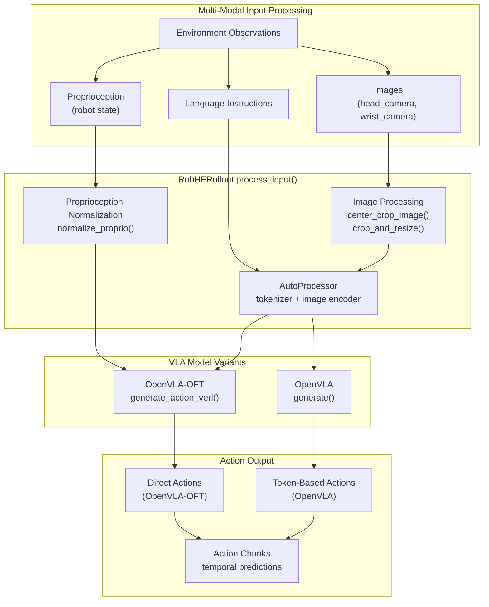

**Sources:** [verl/workers/rollout/rob_rollout.py:504-595](), [verl/workers/rollout/rob_rollout.py:915-1083]()

## Platform Detection and Configuration

The system uses `constants.py` to automatically detect the robot platform and configure appropriate action dimensions and normalization schemes:

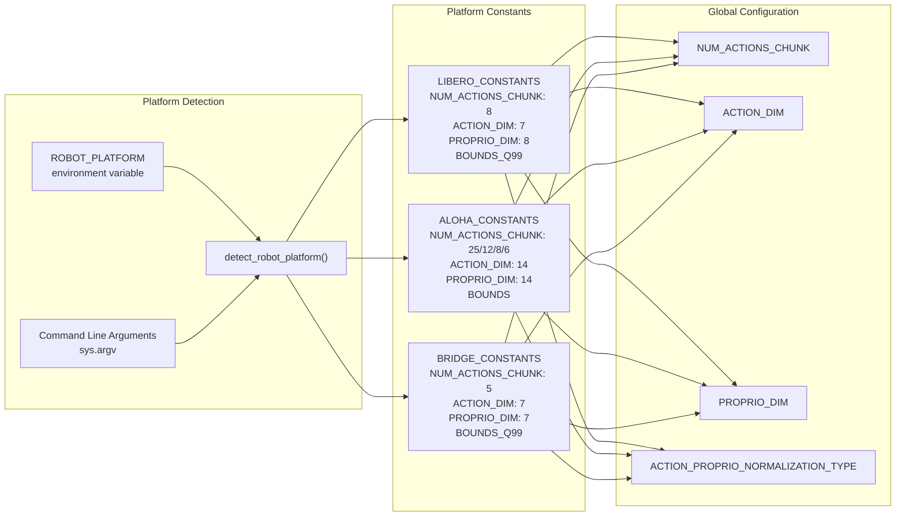

### Platform-Specific Constants

The framework defines constants for each supported platform:

| Platform | Action Chunks | Action Dim | Proprio Dim | Normalization Type |
|----------|--------------|------------|-------------|-------------------|
| **LIBERO** | 8 | 7 | 8 | BOUNDS_Q99 |
| **ALOHA** | 25 (default) | 14 | 14 | BOUNDS |
| **ALOHA_12** | 12 | 14 | 14 | BOUNDS |
| **ALOHA_8** | 8 | 14 | 14 | BOUNDS |
| **ALOHA_6** | 6 | 14 | 14 | BOUNDS |
| **BRIDGE** | 5 | 7 | 7 | BOUNDS_Q99 |

The `detect_robot_platform()` function [verl/utils/vla_utils/openvla_oft/constants.py:71-105]() checks:
1. `ROBOT_PLATFORM` environment variable first
2. Command line arguments (e.g., "libero", "aloha_12chunk")
3. Defaults to ALOHA if unclear

**Sources:** [verl/utils/vla_utils/openvla_oft/constants.py:27-67](), [verl/utils/vla_utils/openvla_oft/constants.py:71-138]()

## Input Processing Pipeline

### Multi-Modal Input Assembly

The `process_input()` method [verl/workers/rollout/rob_rollout.py:504-595]() processes observations into model-ready inputs:

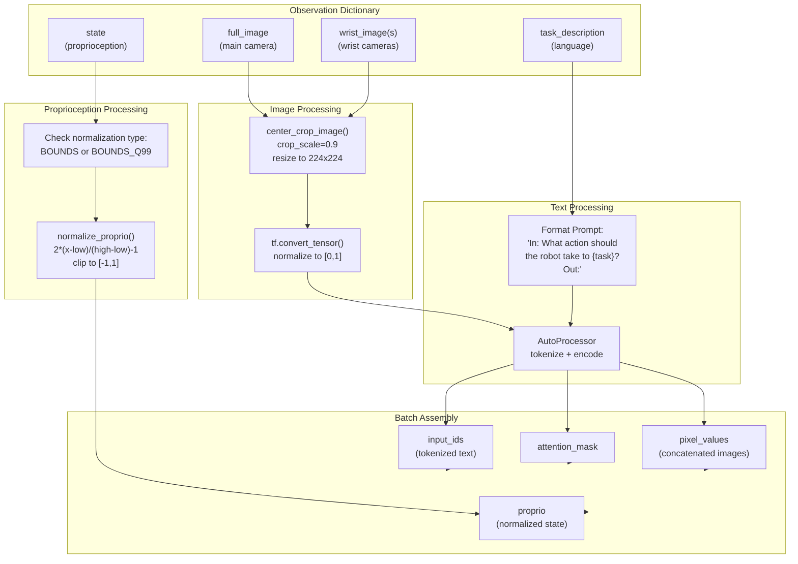

### Image Processing Details

Images are center-cropped and resized using the `crop_and_resize()` function [verl/workers/rollout/rob_rollout.py:77-109]():

1. **Center Crop**: Crops to 90% of original area (`crop_scale=0.9`)
2. **Resize**: Resizes to 224×224 pixels
3. **Normalization**: Converts to float32 and clips to [0, 1]
4. **Multiple Views**: Concatenates head camera and wrist camera(s) along channel dimension

### Proprioception Normalization

The `normalize_proprio()` function [verl/workers/rollout/rob_rollout.py:129-149]() normalizes robot state:

**For BOUNDS_Q99 (LIBERO, BRIDGE):**
```
normalized = 2 * (proprio - q01) / (q99 - q01) - 1
clipped to [-1, 1]
```

**For BOUNDS (ALOHA):**
```
normalized = 2 * (proprio - min) / (max - min) - 1
clipped to [-1, 1]
```

**Sources:** [verl/workers/rollout/rob_rollout.py:504-595](), [verl/workers/rollout/rob_rollout.py:77-149]()

## Action Generation Methods

### OpenVLA-OFT: Direct Action Prediction

The `_generate_one_step_oft()` method [verl/workers/rollout/rob_rollout.py:925-978]() generates actions directly:

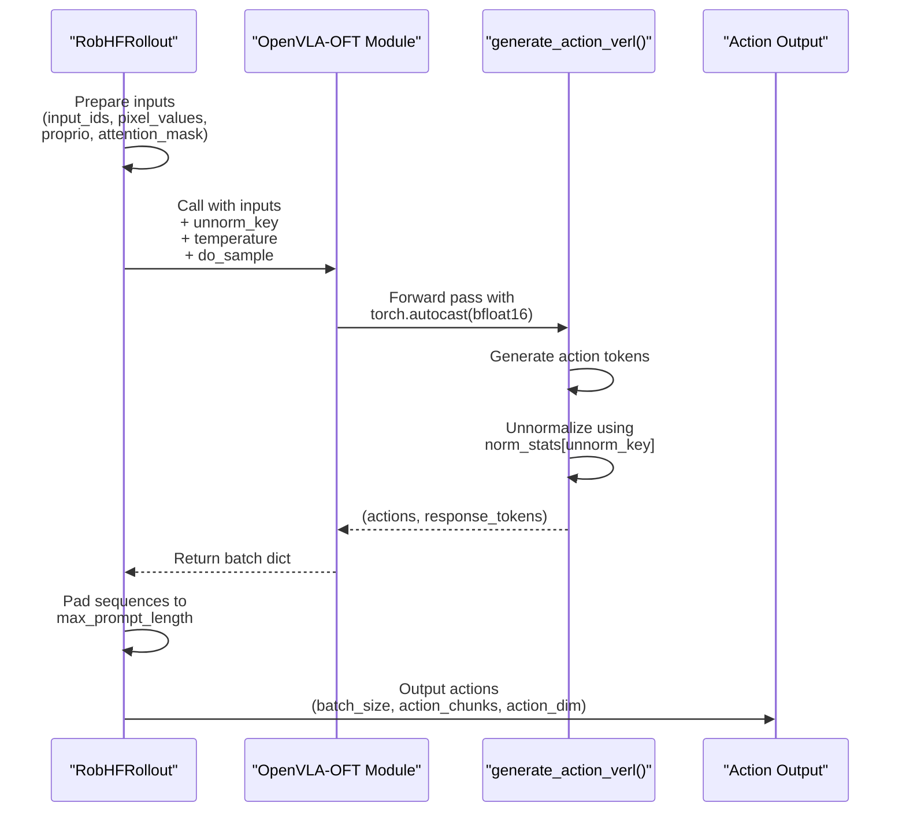

**Key Parameters:**
- `unnorm_key`: Dataset-specific normalization statistics key
- `do_sample`: Whether to sample or use greedy decoding
- `temperature`: Sampling temperature (default from config)
- `padding_idx`: Tokenizer's pad token ID

**Sources:** [verl/workers/rollout/rob_rollout.py:925-978]()

### OpenVLA: Token-Based Action Generation

The `_generate_one_step_openvla()` method [verl/workers/rollout/rob_rollout.py:980-1083]() generates actions through token discretization:

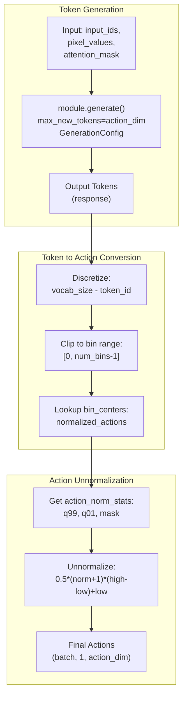

**Processing Steps:**

1. **Generate Tokens**: Uses `module.generate()` with generation config [verl/workers/rollout/rob_rollout.py:1009-1021]()
2. **Discretize**: `discretized_actions = vocab_size - token_ids` [verl/workers/rollout/rob_rollout.py:1036-1041]()
3. **Map to Bins**: `normalized_actions = bin_centers[discretized_actions]` [verl/workers/rollout/rob_rollout.py:1042]()
4. **Unnormalize**: Apply inverse normalization using dataset statistics [verl/workers/rollout/rob_rollout.py:1044-1051]()

**Sources:** [verl/workers/rollout/rob_rollout.py:980-1083]()

## Action Chunking

Both model variants output temporal action sequences (chunks) for smooth robot control:

| Platform | Action Chunks | Action Dimension | Total Output Shape |
|----------|--------------|------------------|-------------------|
| **LIBERO** | 8 | 7 (xyz + quat + gripper) | (batch, 8, 7) |
| **ALOHA** | 25 | 14 (dual arm) | (batch, 25, 14) |
| **RoboTwin** | 5 | 7 (xyz + quat + gripper) | (batch, 5, 7) |

The rollout loop executes actions chunk-by-chunk, with each chunk representing a temporal sequence of robot commands. The `action_chunks_len` configuration parameter determines how many actions from each chunk are executed before requesting new predictions [verl/workers/rollout/rob_rollout.py:738]().

**Sources:** [verl/workers/rollout/rob_rollout.py:429-456](), [verl/utils/vla_utils/openvla_oft/constants.py:27-67]()

## Observation to Input Conversion

The `_obs_to_input()` method [verl/workers/rollout/rob_rollout.py:1085-1126]() converts platform-specific observations to a unified format:

### LIBERO Format

```python
{
    "full_image": get_libero_image(obs, 224),      # agentview
    "wrist_image": get_libero_wrist_image(obs, 224),  # if multi-view
    "state": np.concatenate([
        obs["robot0_eef_pos"],              # xyz position
        quat2axisangle(obs["robot0_eef_quat"]),  # rotation
        obs["robot0_gripper_qpos"]          # gripper state
    ])
}
```

### RoboTwin Format

```python
{
    "full_image": obs['observation']['head_camera']['rgb'],
    "left_wrist": obs['observation']['left_camera']['rgb'],   # if multi-view
    "right_wrist": obs['observation']['right_camera']['rgb'],  # if multi-view
    "state": obs['joint_action']['vector']  # 2.0 format
}
```

**Sources:** [verl/workers/rollout/rob_rollout.py:1085-1126]()

## VLA Preprocessing Configuration

The `vla_preprocess()` method [verl/workers/rollout/rob_rollout.py:475-488]() configures VLA-specific settings:

1. **TensorFlow GPU Memory**: Sets memory growth for TensorFlow operations [verl/workers/rollout/rob_rollout.py:477-480]()
2. **Unnormalization Key Validation**: 
   - For LIBERO: Checks for `_no_noops` suffix variants [verl/workers/rollout/rob_rollout.py:484-485]()
   - For RoboTwin: Strips `robotwin_` / `robotwin2_` prefix [verl/workers/rollout/rob_rollout.py:487]()
3. **Statistics Lookup**: Verifies unnorm_key exists in `module.norm_stats` [verl/workers/rollout/rob_rollout.py:488]()

**Sources:** [verl/workers/rollout/rob_rollout.py:475-488]()

## Model Integration Points

Key integration points between VLA models and the RL framework:

| Component | Location | Purpose |
|-----------|----------|---------|
| **RobHFRollout** | [verl/workers/rollout/rob_rollout.py:424]() | Main rollout class managing VLA execution |
| **process_input()** | [verl/workers/rollout/rob_rollout.py:504]() | Multi-modal input processing |
| **_generate_one_step()** | [verl/workers/rollout/rob_rollout.py:916]() | Single-step action generation dispatcher |
| **_generate_one_step_oft()** | [verl/workers/rollout/rob_rollout.py:925]() | OpenVLA-OFT action generation |
| **_generate_one_step_openvla()** | [verl/workers/rollout/rob_rollout.py:980]() | OpenVLA action generation |
| **AutoProcessor** | [verl/workers/rollout/rob_rollout.py:457]() | Tokenizer and image encoder |
| **module.norm_stats** | [verl/workers/rollout/rob_rollout.py:484]() | Normalization statistics per dataset |

**Sources:** [verl/workers/rollout/rob_rollout.py:424-1131]()

---

# Page: OpenVLA and OpenVLA-OFT

# Parallel Llama Models

<details>
<summary>Relevant source files</summary>

The following files were used as context for generating this wiki page:

- [README.md](README.md)
- [examples/overwrite_vla_ckpt_utils.sh](examples/overwrite_vla_ckpt_utils.sh)
- [verl/workers/rollout/rob_rollout.py](verl/workers/rollout/rob_rollout.py)

</details>


This document covers the parallel Llama model implementations that form the core of SimpleVLA-RL's distributed training system. These models integrate with Megatron-LM to provide tensor, pipeline, and data parallelism for efficient large-scale training. For information about the layer components that compose these models, see [Layer Components](#2.2). For details on Megatron integration patterns, see [Megatron Integration](#2.3).

## Model Architecture Overview

The parallel Llama implementation provides several specialized variants optimized for different training scenarios and memory constraints.

### Model Hierarchy

```mermaid
graph TB
    subgraph "Base Models"
        ParallelLlamaModel["ParallelLlamaModel<br/>Base transformer decoder"]
        ParallelLlamaForCausalLM["ParallelLlamaForCausalLM<br/>Language modeling head"]
    end
    
    subgraph "RmPad Optimized Models"
        ParallelLlamaModelRmPad["ParallelLlamaModelRmPad<br/>Memory optimized decoder"]
        ParallelLlamaForCausalLMRmPad["ParallelLlamaForCausalLMRmPad<br/>RmPad + LM head"]
        ParallelLlamaForValueRmPad["ParallelLlamaForValueRmPad<br/>Value function estimation"]
    end
    
    subgraph "Pipeline Parallel Models"
        ParallelLlamaModelRmPadPP["ParallelLlamaModelRmPadPP<br/>PP + RmPad decoder"]
        ParallelLlamaForCausalLMRmPadPP["ParallelLlamaForCausalLMRmPadPP<br/>PP + RmPad + LM head"]
        ParallelLlamaForValueRmPadPP["ParallelLlamaForValueRmPadPP<br/>PP + RmPad + Value head"]
    end
    
    ParallelLlamaModel --> ParallelLlamaForCausalLM
    ParallelLlamaModelRmPad --> ParallelLlamaForCausalLMRmPad
    ParallelLlamaForCausalLMRmPad --> ParallelLlamaForValueRmPad
    ParallelLlamaModelRmPadPP --> ParallelLlamaForCausalLMRmPadPP
    ParallelLlamaForCausalLMRmPadPP --> ParallelLlamaForValueRmPadPP
```

**Sources:** [verl/models/llama/megatron/__init__.py:15-24](), [verl/models/llama/megatron/modeling_llama_megatron.py:73-664]()

## Base Parallel Implementation

The foundational models provide standard Llama architecture with Megatron tensor parallelism integration.

### ParallelLlamaModel

The `ParallelLlamaModel` class implements the core transformer decoder with distributed embedding and normalization layers.

| Component | Implementation | Parallelism |
|-----------|---------------|-------------|
| Embedding | `tensor_parallel.VocabParallelEmbedding` | Vocab parallel across tensor parallel ranks |
| Decoder Layers | `ParallelLlamaDecoderLayer` | Tensor parallel attention and MLP |
| Output Norm | `ParallelLlamaRMSNorm` | Sequence parallel compatible |

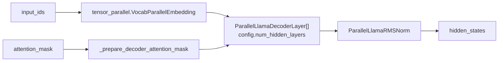

**Sources:** [verl/models/llama/megatron/modeling_llama_megatron.py:73-153]()

### ParallelLlamaForCausalLM

Extends the base model with a language modeling head using `tensor_parallel.ColumnParallelLinear` for distributed vocabulary prediction.

Key implementation details:
- Uses `gather_output=False` to avoid communication until necessary
- Performs final gather with `tensor_parallel.gather_from_tensor_model_parallel_region`
- Converts to float32 for numerical stability

**Sources:** [verl/models/llama/megatron/modeling_llama_megatron.py:156-211]()

## RmPad Memory Optimization

The RmPad variants implement padding removal optimization using FlashAttention's padding utilities to improve memory efficiency and training speed.

### Memory Optimization Strategy

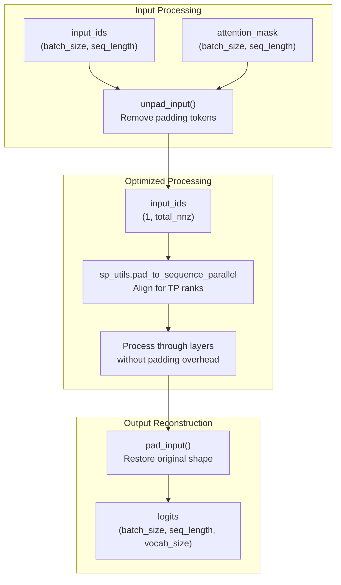

**Sources:** [verl/models/llama/megatron/modeling_llama_megatron.py:213-364]()

### ParallelLlamaForValueRmPad

Specialized for value function estimation in RL training, replacing the vocabulary head with a single-output value head.

Key differences from causal LM:
- Linear layer outputs single value per token: `nn.Linear(hidden_size, 1)`
- Uses sequence parallel marking: `sp_utils.mark_parameter_as_sequence_parallel`
- Squeezes final dimension for scalar values

**Sources:** [verl/models/llama/megatron/modeling_llama_megatron.py:367-394]()

## Pipeline Parallelism Support

The PP variants enable training across multiple pipeline stages by distributing layers across different devices.

### Pipeline Stage Management

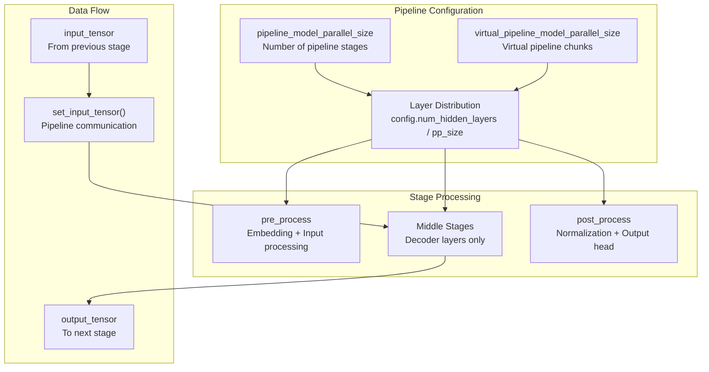

**Sources:** [verl/models/llama/megatron/modeling_llama_megatron.py:401-517]()

### Virtual Pipeline Parallelism

When `virtual_pipeline_model_parallel_size` is configured, models support interleaved pipeline scheduling:

- `num_layer_per_pp = config.num_hidden_layers // pp_size`
- `num_layer_vpp_chunk = num_layer_per_pp // vpp_size`
- Each model instance contains only `num_layer_vpp_chunk` layers

This enables better pipeline bubble reduction through interleaved execution.

**Sources:** [verl/models/llama/megatron/modeling_llama_megatron.py:430-443]()

## Model Registration and Usage

All model variants are exported through the module's `__init__.py` for dynamic loading by the model registry system.

### Available Model Classes

| Model Class | Use Case | Optimization Features |
|-------------|----------|----------------------|
| `ParallelLlamaModel` | Base transformer | Tensor parallelism |
| `ParallelLlamaForCausalLM` | Language modeling | Tensor parallelism |
| `ParallelLlamaForCausalLMRmPad` | Memory-efficient LM | RmPad + Tensor parallelism |
| `ParallelLlamaForValueRmPad` | RL value estimation | RmPad + Value head |
| `ParallelLlamaForCausalLMRmPadPP` | Large-scale LM | RmPad + Pipeline + Tensor parallelism |
| `ParallelLlamaForValueRmPadPP` | Large-scale RL | RmPad + Pipeline + Value head |

These models integrate with the broader SimpleVLA-RL training pipeline through the model registry system, enabling dynamic selection based on training configuration and hardware constraints.

**Sources:** [verl/models/llama/megatron/__init__.py:15-24]()

---

# Page: Platform Configuration

# Layer Components

<details>
<summary>Relevant source files</summary>

The following files were used as context for generating this wiki page:

- [verl/utils/vla_utils/openvla_oft/constants.py](verl/utils/vla_utils/openvla_oft/constants.py)
- [verl/workers/rollout/rob_rollout.py](verl/workers/rollout/rob_rollout.py)

</details>


This document covers the individual parallel layer implementations that compose the Llama models in SimpleVLA-RL. These components implement the core building blocks of the transformer architecture with tensor parallelism support through Megatron-LM integration.

For information about how these layers are assembled into complete models, see [Parallel Llama Models](#2.1). For details on the underlying Megatron-LM parallelization strategies, see [Megatron Integration](#2.3).

## Layer Architecture Overview

The layer components follow a hierarchical structure where decoder layers compose attention, MLP, and normalization sublayers. All components are designed for tensor parallelism and include specialized variants for memory optimization.

### Layer Component Hierarchy

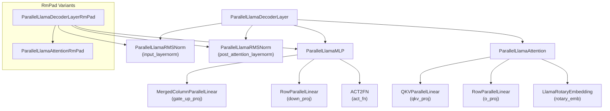

**Sources:** [verl/models/llama/megatron/layers/__init__.py:15-18](), [verl/models/llama/megatron/layers/parallel_decoder.py:33-43](), [verl/models/llama/megatron/layers/parallel_attention.py:143-202]()

## Attention Layer Implementation

The `ParallelLlamaAttention` class implements multi-head attention with tensor parallelism support and rotary position embeddings (RoPE).

### Attention Component Structure

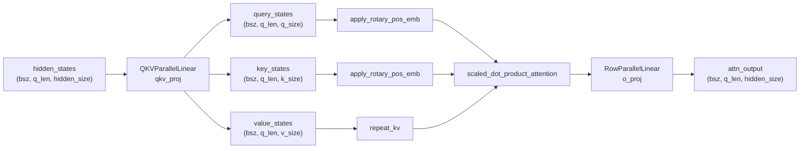

The attention layer handles tensor parallelism by:
- Splitting attention heads across tensor parallel ranks
- Using `QKVParallelLinear` for efficient QKV projection parallelization
- Applying `RowParallelLinear` for output projection with reduce-scatter

**Sources:** [verl/models/llama/megatron/layers/parallel_attention.py:143-280](), [verl/models/llama/megatron/layers/parallel_linear.py:21-50]()

### Rotary Position Embeddings

The implementation includes multiple RoPE variants:

| Class | Purpose | Key Features |
|-------|---------|--------------|
| `LlamaRotaryEmbedding` | Standard RoPE | Base implementation with cached cos/sin |
| `LlamaLinearScalingRotaryEmbedding` | Linear scaling | Extends context length with scaling factor |
| `LlamaDynamicNTKScalingRotaryEmbedding` | Dynamic NTK scaling | Adaptive base frequency for longer sequences |

**Sources:** [verl/models/llama/megatron/layers/parallel_attention.py:35-114](), [verl/models/llama/megatron/layers/parallel_attention.py:204-230]()

## MLP Layer Implementation

The `ParallelLlamaMLP` class implements the SwiGLU feed-forward network with gate and up projections merged for efficiency.

### MLP Component Flow

```mermaid
graph LR
    Input["`x
    (batch, seq, hidden_size)`"] --> GateUpProj["MergedColumnParallelLinear<br/>gate_up_proj"]
    
    GateUpProj --> Split["split(gate_size, dim=-1)"]
    Split --> Gate["`gate
    (batch, seq, intermediate_size//tp)`"]
    Split --> Up["`up  
    (batch, seq, intermediate_size//tp)`"]
    
    Gate --> ActFn["ACT2FN[config.hidden_act]<br/>(SiLU activation)"]
    ActFn --> Multiply["gate * up"]
    
    Up --> Multiply
    Multiply --> DownProj["RowParallelLinear<br/>down_proj"] --> Output["`output
    (batch, seq, hidden_size)`"]
```

The MLP uses `MergedColumnParallelLinear` to combine gate and up projections into a single matrix multiplication, reducing memory bandwidth requirements.

**Sources:** [verl/models/llama/megatron/layers/parallel_mlp.py:31-74](), [verl/models/llama/megatron/layers/parallel_linear.py:52-75]()

## RMSNorm Layer Implementation

The `ParallelLlamaRMSNorm` class provides root mean square layer normalization with sequence parallelism support.

### RMSNorm Configuration

```mermaid
graph TB
    Config["LlamaConfig<br/>hidden_size<br/>rms_norm_eps"] --> RMSNorm["ParallelLlamaRMSNorm"]
    MegConfig["ModelParallelConfig<br/>sequence_parallel"] --> RMSNorm
    
    RMSNorm --> Weight["nn.Parameter<br/>(weight)"]
    RMSNorm --> FusedRMS["fused_rms_norm_affine<br/>(Apex implementation)"]
    
    Weight --> SPMark["mark_parameter_as_sequence_parallel<br/>(if sequence_parallel=True)"]
```

The implementation leverages Apex's fused RMSNorm for performance and includes sequence parallelism parameter marking when enabled.

**Sources:** [verl/models/llama/megatron/layers/parallel_rmsnorm.py:25-46]()

## Decoder Layer Implementation

The `ParallelLlamaDecoderLayer` orchestrates the attention, MLP, and normalization components with residual connections.

### Decoder Layer Forward Pass

```mermaid
graph TB
    Input["hidden_states"] --> Residual1["residual = hidden_states"]
    Input --> InputNorm["input_layernorm"]
    
    InputNorm --> SelfAttn["self_attn<br/>(ParallelLlamaAttention)"]
    SelfAttn --> Add1["residual + hidden_states"]
    Residual1 --> Add1
    
    Add1 --> Residual2["residual = hidden_states"]
    Add1 --> PostNorm["post_attention_layernorm"]
    
    PostNorm --> MLP["mlp<br/>(ParallelLlamaMLP)"]
    MLP --> Add2["residual + hidden_states"]
    Residual2 --> Add2
    
    Add2 --> Output["outputs"]
```

**Sources:** [verl/models/llama/megatron/layers/parallel_decoder.py:33-96]()

## RmPad Variants for Memory Optimization

The RmPad (Remove Padding) variants optimize memory usage by removing padding tokens from packed sequences, particularly beneficial for variable-length inputs.

### RmPad Attention Differences

| Feature | Standard Attention | RmPad Attention |
|---------|-------------------|-----------------|
| Input Format | `(batch, seq_len, hidden)` | `(total_nnz, 1, hidden)` |
| Attention Function | Standard scaled dot-product | Flash Attention 2 with varlen |
| Position Encoding | Standard RoPE application | Flash-attn compatible RoPE |
| Sequence Parallel | Standard tensor operations | Padding-aware operations |

The `ParallelLlamaAttentionRmPad` class uses different forward pass parameters:

```python
def forward(self,
            hidden_states: torch.Tensor,
            position_ids: Optional[torch.LongTensor] = None,
            sequence_length: int = None,
            indices: torch.Tensor = None,
            cu_seqlens: torch.Tensor = None,
            max_seqlen_in_batch: int = None)
```

**Sources:** [verl/models/llama/megatron/layers/parallel_attention.py:338-418](), [verl/models/llama/megatron/layers/parallel_decoder.py:99-146]()

## Tensor Parallelism Integration

All layer components integrate with Megatron-LM's tensor parallelism through:

### Parallelism Configuration Flow

```mermaid
graph TB
    Config["LlamaConfig +<br/>ModelParallelConfig"] --> TPUtils["tp_utils.get_default_kwargs_*"]
    
    TPUtils --> ColumnKwargs["column_kwargs<br/>(ColumnParallelLinear)"]
    TPUtils --> RowKwargs["row_kwargs<br/>(RowParallelLinear)"]
    
    ColumnKwargs --> QKVProj["QKVParallelLinear"]
    ColumnKwargs --> GateUpProj["MergedColumnParallelLinear"]
    
    RowKwargs --> OProj["RowParallelLinear<br/>(attention output)"]
    RowKwargs --> DownProj["RowParallelLinear<br/>(MLP down)"]
    
    Config --> SPCheck["sequence_parallel check"]
    SPCheck --> ParamMark["mark_parameter_as_sequence_parallel<br/>(RMSNorm weights)"]
```

The tensor parallelism configuration ensures proper parameter sharding and communication patterns across all layer components.

**Sources:** [verl/models/llama/megatron/layers/parallel_attention.py:172-180](), [verl/models/llama/megatron/layers/parallel_mlp.py:40-47](), [verl/utils/megatron/tensor_parallel.py]()

---

# Page: Input Processing and Action Generation

# Megatron Integration

<details>
<summary>Relevant source files</summary>

The following files were used as context for generating this wiki page:

- [verl/utils/libero_utils.py](verl/utils/libero_utils.py)
- [verl/workers/rollout/rob_rollout.py](verl/workers/rollout/rob_rollout.py)

</details>


This document explains how SimpleVLA-RL integrates with Megatron-LM to enable efficient distributed training of Vision-Language-Action models. The integration provides tensor parallelism, pipeline parallelism, and data parallelism capabilities for scaling training across multiple GPUs and nodes.

For information about the specific parallel layer implementations, see [Layer Components](#2.2). For details about the different model architectures, see [Parallel Llama Models](#2.1).

## Purpose and Scope

The Megatron integration enables SimpleVLA-RL to train large VLA models efficiently by distributing computation and memory across multiple devices. The system implements three key parallelization strategies:

- **Tensor Parallelism**: Splits individual layers across multiple GPUs
- **Pipeline Parallelism**: Distributes different layers across different GPUs  
- **Data Parallelism**: Replicates the model across multiple GPU groups using FSDP2

The integration maintains compatibility with packed input sequences and flash attention for optimal memory usage and training speed.

## Parallelism Strategies

### Tensor Parallelism Implementation

**Tensor Parallelism Strategy Mapping**
```mermaid
graph TB
    subgraph "Attention Layer Parallelism"
        QKVLinear["QKVParallelLinear<br/>verl.models.llama.megatron.layers.parallel_linear"]
        RowLinear["tensor_parallel.RowParallelLinear<br/>megatron.core.tensor_parallel"]
        AttentionHeads["Attention Heads<br/>Split across TP ranks"]
    end
    
    subgraph "MLP Layer Parallelism" 
        GateProj["gate_proj<br/>ColumnParallelLinear"]
        UpProj["up_proj<br/>ColumnParallelLinear"]
        DownProj["down_proj<br/>RowParallelLinear"]
    end
    
    subgraph "Parallel State Management"
        MPU["parallel_state as mpu<br/>megatron.core.parallel_state"]
        TPSize["get_tensor_model_parallel_world_size()"]
        TPRank["get_tensor_model_parallel_rank()"]
    end
    
    QKVLinear --> AttentionHeads
    AttentionHeads --> RowLinear
    
    GateProj --> DownProj
    UpProj --> DownProj
    
    MPU --> TPSize
    MPU --> TPRank
    TPSize --> QKVLinear
    TPSize --> GateProj
```

The tensor parallelism implementation splits computation within individual layers. The `ParallelLlamaAttention` class demonstrates this pattern:

- Query, Key, Value projections are split using `QKVParallelLinear` [verl/models/llama/megatron/layers/parallel_attention.py:182-189]()
- Attention heads are distributed across tensor parallel ranks [verl/models/llama/megatron/layers/parallel_attention.py:159-166]()
- Output projection uses `RowParallelLinear` to gather results [verl/models/llama/megatron/layers/parallel_attention.py:195-200]()

**Sources:** `verl/models/llama/megatron/layers/parallel_attention.py`, `verl/models/README.md`

### Pipeline Parallelism Support

**Pipeline Parallel Variants**
```mermaid
graph LR
    subgraph "Base Models"
        BaseCausalLM["ParallelLlamaForCausalLM"]
        BaseValue["ParallelLlamaForValueRmPad"]
    end
    
    subgraph "Pipeline Parallel Variants"  
        PPCausalLM["ParallelLlamaForCausalLMRmPadPP"]
        PPValue["ParallelLlamaForValueRmPadPP"]
    end
    
    subgraph "Pipeline Configuration"
        PPConfig["Pipeline Parallel Config<br/>Layer distribution across ranks"]
        PPSchedule["Pipeline Schedule<br/>Forward/Backward coordination"]
    end
    
    BaseCausalLM --> PPCausalLM
    BaseValue --> PPValue
    
    PPCausalLM --> PPConfig
    PPValue --> PPConfig
    PPConfig --> PPSchedule
```

Pipeline parallelism distributes different transformer layers across different GPU ranks. The system provides specialized variants:

- `ParallelLlamaForCausalLMRmPadPP`: Pipeline parallel version for causal language modeling [verl/models/llama/megatron/__init__.py:23]()
- `ParallelLlamaForValueRmPadPP`: Pipeline parallel version for value function estimation [verl/models/llama/megatron/__init__.py:24]()

**Sources:** `verl/models/llama/megatron/__init__.py`, `verl/models/README.md`

### Data Parallelism with FSDP2

The system uses PyTorch's FSDP2 (Fully Sharded Data Parallel version 2) for data parallelism. This approach:

- Shards model parameters across data parallel ranks
- Reduces memory usage by avoiding parameter duplication
- Maintains gradient synchronization across replicas
- Integrates with tensor and pipeline parallelism

The README specifies using FSDP2 APIs following the torchtitan implementation pattern [verl/models/README.md:28-29]().

**Sources:** `verl/models/README.md`

## Model Variants and Memory Optimizations

### RmPad (Remove Padding) Variants

**RmPad Architecture Flow**
```mermaid
sequenceDiagram
    participant Input as "Packed Input<br/>(total_nnz, hidden_size)"
    participant QKV as "QKVParallelLinear"
    participant RoPE as "Rotary Position Embedding"
    participant FlashAttn as "flash_attn_varlen_func"
    participant Output as "RowParallelLinear"
    
    Input->>QKV: "Split QKV projections"
    QKV->>RoPE: "Apply rotary embeddings<br/>cu_seqlens, max_seqlen"
    RoPE->>FlashAttn: "Variable length attention<br/>No padding tokens"
    FlashAttn->>Output: "Attention output<br/>(total_nnz, hidden_size_per_tp)"
    Output->>Input: "Gathered output"
    
    Note over Input,Output: Sequence Parallel Support<br/>Automatic padding handling
```

The RmPad variants optimize memory usage by removing padding tokens from input sequences:

- `ParallelLlamaAttentionRmPad`: Uses flash attention with variable length sequences [verl/models/llama/megatron/layers/parallel_attention.py:338]()
- Handles `cu_seqlens` (cumulative sequence lengths) and `max_seqlen_in_batch` parameters [verl/models/llama/megatron/layers/parallel_attention.py:345-346]()
- Supports sequence parallelism with automatic padding management [verl/models/llama/megatron/layers/parallel_attention.py:349-361]()

**Sources:** `verl/models/llama/megatron/layers/parallel_attention.py`

### Model Variant Hierarchy

**Model Class Relationships**
```mermaid
graph TB
    subgraph "Base Parallel Models"
        ParallelLlamaModel["ParallelLlamaModel<br/>Core model implementation"]
        ParallelCausalLM["ParallelLlamaForCausalLM<br/>Standard causal LM head"]
    end
    
    subgraph "Memory Optimized Variants"
        CausalLMRmPad["ParallelLlamaForCausalLMRmPad<br/>Remove padding optimization"]
        ValueRmPad["ParallelLlamaForValueRmPad<br/>Value function with RmPad"]
    end
    
    subgraph "Pipeline Parallel Variants"
        CausalLMPP["ParallelLlamaForCausalLMRmPadPP<br/>RmPad + Pipeline Parallel"]
        ValuePP["ParallelLlamaForValueRmPadPP<br/>Value + RmPad + Pipeline Parallel"]
    end
    
    ParallelLlamaModel --> ParallelCausalLM
    ParallelCausalLM --> CausalLMRmPad
    CausalLMRmPad --> CausalLMPP
    
    ParallelLlamaModel --> ValueRmPad
    ValueRmPad --> ValuePP
```

The model hierarchy provides increasingly specialized variants:

1. **Base Models**: Standard parallel implementations with tensor parallelism
2. **RmPad Variants**: Add memory optimization by removing padding tokens  
3. **Pipeline Parallel Variants**: Combine RmPad optimization with pipeline parallelism

**Sources:** `verl/models/llama/megatron/__init__.py`

## Implementation Details

### Configuration Management

The Megatron integration uses `ModelParallelConfig` to manage parallel training settings:

```python
# Configuration propagation pattern
column_kwargs = tp_utils.get_default_kwargs_for_column_parallel_linear()
row_kwargs = tp_utils.get_default_kwargs_for_row_parallel_linear()

if megatron_config is not None:
    tp_utils.update_kwargs_with_config(column_kwargs, megatron_config)
    tp_utils.update_kwargs_with_config(row_kwargs, megatron_config)
```

This pattern ensures consistent configuration across all parallel layers [verl/models/llama/megatron/layers/parallel_attention.py:172-179]().

### Tensor Parallel Dimension Calculations

The system automatically calculates per-rank dimensions based on tensor parallel world size:

- `num_heads_per_tp = num_heads // tp_size` [verl/models/llama/megatron/layers/parallel_attention.py:164]()
- `num_key_value_heads_per_tp = num_key_value_heads // tp_size` [verl/models/llama/megatron/layers/parallel_attention.py:165]()
- `hidden_size_per_tp = hidden_size // tp_size` [verl/models/llama/megatron/layers/parallel_attention.py:166]()

These calculations ensure even distribution of computation across tensor parallel ranks.

**Sources:** `verl/models/llama/megatron/layers/parallel_attention.py`, `verl/utils/megatron`

---

# Page: Training with PPO

# veRL Framework

<details>
<summary>Relevant source files</summary>

The following files were used as context for generating this wiki page:

- [.gitignore](.gitignore)
- [README.md](README.md)
- [verl/trainer/config/ppo_trainer.yaml](verl/trainer/config/ppo_trainer.yaml)
- [verl/trainer/ppo/ray_trainer.py](verl/trainer/ppo/ray_trainer.py)

</details>


The veRL framework provides the core infrastructure for distributed reinforcement learning training in SimpleVLA-RL. It handles data serialization, distributed function execution, and worker coordination across multi-GPU and multi-node environments. The framework abstracts the complexity of distributed computing while maintaining high performance for large-scale VLA model training.

For information about the specific model architectures being trained, see [Model Architecture](#2). For details about training orchestration and the PPO implementation, see [Training Pipeline](#1.2).

## Architecture Overview

The veRL framework consists of three main subsystems that work together to enable distributed RL training:

### Core Framework Components

```mermaid
graph TB
    subgraph "veRL Framework Core"
        DataProto["DataProto<br/>TensorDict + Metadata"]
        DataProtoFuture["DataProtoFuture<br/>Async Data Handling"]
        RegisterDecorator["@register Decorator<br/>Distributed Function Dispatch"]
    end
    
    subgraph "Dispatch Modes"
        OneToAll["ONE_TO_ALL<br/>Broadcast Pattern"]
        AllToAll["ALL_TO_ALL<br/>Direct Mapping"]
        MegatronCompute["MEGATRON_COMPUTE<br/>DP-Aware Distribution"]
        DPCompute["DP_COMPUTE<br/>Data Parallel Split"]
    end
    
    subgraph "Execution Patterns"
        ExecuteAll["Execute.ALL<br/>All Workers"]
        ExecuteRankZero["Execute.RANK_ZERO<br/>Single Worker"]
    end
    
    subgraph "Data Flow"
        Dispatch["dispatch_fn()<br/>Split Input Data"]
        Collect["collect_fn()<br/>Gather Output Data"]
        MaterializeFutures["_materialize_futures()<br/>Resolve Async Data"]
    end
    
    RegisterDecorator --> OneToAll
    RegisterDecorator --> AllToAll
    RegisterDecorator --> MegatronCompute
    RegisterDecorator --> DPCompute
    
    RegisterDecorator --> ExecuteAll
    RegisterDecorator --> ExecuteRankZero
    
    DataProto --> Dispatch
    DataProtoFuture --> MaterializeFutures
    MaterializeFutures --> DataProto
    Dispatch --> Collect
    Collect --> DataProto
```

Sources: [verl/__init__.py:22-27](), [verl/protocol.py:98-109](), [verl/single_controller/base/decorator.py:25-38](), [verl/single_controller/base/decorator.py:394-410]()

## Data Protocol System

The `DataProto` class serves as the standardized data container for all distributed operations. It combines PyTorch tensors in a `TensorDict` with non-tensor metadata, enabling efficient serialization and transfer between workers.

### DataProto Class Hierarchy

```mermaid
graph TB
    subgraph "Data Protocol Classes"
        DataProto["DataProto<br/>batch: TensorDict<br/>non_tensor_batch: Dict<br/>meta_info: Dict"]
        DataProtoItem["DataProtoItem<br/>Single Batch Item"]
        DataProtoFuture["DataProtoFuture<br/>collect_fn: Callable<br/>futures: List[ObjectRef]<br/>dispatch_fn: Callable"]
    end
    
    subgraph "Core Operations"
        FromDict["from_dict()<br/>Create from tensors"]
        FromSingleDict["from_single_dict()<br/>Mixed tensor/numpy"]
        ToDevice["to(device)<br/>Move tensors"]
        Chunk["chunk(chunks)<br/>Split along dim=0"]
        Concat["concat(data_list)<br/>Merge DataProtos"]
    end
    
    subgraph "TensorDict Integration"
        TensorDict["TensorDict<br/>PyTorch TensorDict"]
        BatchOps["Batch Operations<br/>slice(), select(), union()"]
        Iteration["make_iterator()<br/>DataLoader Integration"]
    end
    
    DataProto --> DataProtoItem
    DataProto --> FromDict
    DataProto --> FromSingleDict
    DataProto --> ToDevice
    DataProto --> Chunk
    DataProto --> Concat
    
    DataProto --> TensorDict
    TensorDict --> BatchOps
    DataProto --> Iteration
    
    DataProtoFuture --> DataProto
```

Sources: [verl/protocol.py:90-109](), [verl/protocol.py:173-222](), [verl/protocol.py:458-503]()

The `DataProtoFuture` enables asynchronous data operations by containing Ray object references (`ray.ObjectRef`) instead of actual data, allowing for non-blocking distributed execution patterns.

For detailed information about the data protocol implementation, see [Data Protocol](#3.1).

## Distributed Execution System

The `@register` decorator provides a unified interface for distributed function execution. Functions decorated with `@register` are automatically dispatched across workers according to specified patterns.

### Register Decorator Dispatch Patterns

```mermaid
graph LR
    subgraph "Function Decoration"
        UserFunction["user_function()"]
        RegisterDecorator["@register(<br/>dispatch_mode,<br/>execute_mode,<br/>blocking<br/>)"]
        DecoratedFunction["Distributed Function"]
    end
    
    subgraph "Dispatch Functions"
        DispatchOneToAll["dispatch_one_to_all()<br/>Broadcast to all workers"]
        DispatchMegatronCompute["dispatch_megatron_compute()<br/>DP-aware distribution"]
        DispatchDPCompute["dispatch_dp_compute_data_proto()<br/>Split DataProto by world_size"]
    end
    
    subgraph "Collect Functions"
        CollectAllToAll["collect_all_to_all()<br/>Return as-is"]
        CollectMegatronCompute["collect_megatron_compute()<br/>TP=0, PP=last only"]
        CollectDPCompute["collect_dp_compute_data_proto()<br/>Concat DataProtos"]
    end
    
    UserFunction --> RegisterDecorator
    RegisterDecorator --> DecoratedFunction
    
    DecoratedFunction --> DispatchOneToAll
    DecoratedFunction --> DispatchMegatronCompute
    DecoratedFunction --> DispatchDPCompute
    
    DispatchOneToAll --> CollectAllToAll
    DispatchMegatronCompute --> CollectMegatronCompute
    DispatchDPCompute --> CollectDPCompute
```

Sources: [verl/single_controller/base/decorator.py:60-67](), [verl/single_controller/base/decorator.py:118-126](), [verl/single_controller/base/decorator.py:272-276](), [verl/single_controller/base/decorator.py:300-347]()

The framework provides predefined dispatch modes optimized for different parallelization strategies:

| Dispatch Mode | Purpose | Data Distribution | Collection Pattern |
|---------------|---------|-------------------|-------------------|
| `ONE_TO_ALL` | Broadcast | Same data to all workers | Return all outputs |
| `MEGATRON_COMPUTE` | Megatron integration | DP-aware, same data per DP rank | Only TP=0, PP=last |
| `DP_COMPUTE_PROTO` | Data parallel | Split `DataProto` by world size | Concatenate results |
| `MEGATRON_PP_AS_DP` | Pipeline as data parallel | PP ranks treated as DP | PP=0 only |

For complete details about the distributed execution mechanisms, see [Distributed Execution](#3.2).

## Integration with Training Pipeline

The veRL framework integrates seamlessly with the overall training system through standardized interfaces:

### Training Integration Points

```mermaid
graph TB
    subgraph "Training Components"
        PPOTrainer["PPO Trainer<br/>verl.trainer.main_ppo"]
        ModelWorkers["Model Workers<br/>Parallel Llama Models"]
        Environment["Environment<br/>LIBERO Tasks"]
    end
    
    subgraph "veRL Framework"
        DataProtoFlow["DataProto Flow<br/>Rollout Data"]
        RegisteredFunctions["@register Functions<br/>Model Inference<br/>Environment Steps"]
        WorkerCoordination["Worker Coordination<br/>Resource Management"]
    end
    
    subgraph "Data Flow Patterns"
        RolloutCollection["Rollout Collection<br/>Environment → DataProto"]
        ModelInference["Model Inference<br/>DataProto → Predictions"]
        PolicyUpdate["Policy Update<br/>Gradients → Model"]
    end
    
    PPOTrainer --> DataProtoFlow
    PPOTrainer --> RegisteredFunctions
    
    DataProtoFlow --> RolloutCollection
    DataProtoFlow --> ModelInference
    DataProtoFlow --> PolicyUpdate
    
    RegisteredFunctions --> ModelWorkers
    RegisteredFunctions --> Environment
    
    WorkerCoordination --> ModelWorkers
```

Sources: [verl/__init__.py:22](), [verl/protocol.py:98-109](), [verl/single_controller/base/decorator.py:394-410]()

The framework's `DataProto` protocol ensures consistent data handling across all training components, while the `@register` decorator enables transparent distribution of compute-intensive operations like model inference and environment simulation.

For information about worker management and resource allocation, see [Worker Management](#3.3). For details about how these components integrate with the model architecture, see [Megatron Integration](#2.3).

---

# Page: PPO Training Loop

# PPO Training Loop

<details>
<summary>Relevant source files</summary>

The following files were used as context for generating this wiki page:

- [README.md](README.md)
- [verl/trainer/ppo/ray_trainer.py](verl/trainer/ppo/ray_trainer.py)

</details>


The PPO training loop is implemented in the `RayTrainer` class in [verl/trainer/ppo/ray_trainer.py]() and serves as the central orchestrator for Vision-Language-Action model training. The loop coordinates data collection, trajectory filtering, advantage computation, and policy updates across distributed workers.

The training loop implements an oversampling strategy where multiple rollouts are generated per prompt, then filtered based on success rate and trajectory quality before policy updates. This approach improves sample efficiency by focusing gradient updates on successful demonstrations.

Related pages: [Policy Updates and Actor](#3.2) for actor update details, [Advantage Estimation](#3.3) for advantage computation algorithms, [Rollout Workers](#4.3) for trajectory collection.

## RayTrainer Class Structure

The `RayTrainer` class manages the entire training lifecycle:

**Main Training Loop Components**

```mermaid
graph TB
    RayTrainer["RayTrainer<br/>(ray_trainer.py:247)"]
    
    RayTrainer --> Init["__init__()<br/>Initialize workers, KL controller, dataloaders"]
    RayTrainer --> Fit["fit()<br/>Main training loop"]
    RayTrainer --> Validate["_validate()<br/>Validation execution"]
    RayTrainer --> CreateDataloader["_create_dataloader()<br/>Dataset setup"]
    RayTrainer --> Filter["filter()<br/>Accuracy & truncation filtering"]
    RayTrainer --> AddToBuffer["add_to_buffer()<br/>Buffer management"]
    
    Init --> Workers["Worker Groups:<br/>actor_rollout_wg, critic_wg,<br/>ref_policy_wg, rm_wg"]
    Init --> KLCtrl["KL Controller:<br/>FixedKLController or<br/>AdaptiveKLController"]
    CreateDataloader --> Datasets["LIBERO_Dataset or<br/>Robotwin_Dataset"]
    CreateDataloader --> BufferedDataLoader["BufferedDataLoader"]
```

**Sources:** [verl/trainer/ppo/ray_trainer.py:247-335]()

### Key Attributes

| Attribute | Type | Purpose |
|-----------|------|---------|
| `config` | OmegaConf | Training configuration including hyperparameters |
| `tokenizer` | Tokenizer | For text processing (EOS/PAD tokens) |
| `actor_rollout_wg` | RayWorkerGroup | Generates trajectories and updates policy |
| `critic_wg` | RayWorkerGroup | Computes value estimates (if using GAE) |
| `ref_policy_wg` | RayWorkerGroup | Reference policy for KL divergence |
| `kl_ctrl` | KLController | Manages KL penalty coefficient |
| `train_dataloader` | BufferedDataLoader | Training data with buffering |
| `val_dataloader` | DataLoader | Validation data |
| `reward_fn` | Callable | Reward function wrapper |
| `val_reward_fn` | Callable | Validation reward function |

**Sources:** [verl/trainer/ppo/ray_trainer.py:249-290]()

## Main Training Loop (fit method)

The `fit()` method implements the complete training loop with epoch iteration, data collection, filtering, and updates:

**Training Loop Flow**

```mermaid
sequenceDiagram
    participant fit as "fit()<br/>(ray_trainer.py:469)"
    participant Dataloader as "train_dataloader"
    participant Rollout as "actor_rollout_wg.generate_sequences()"
    participant Reward as "reward_fn.verify()"
    participant Filter as "filter()"
    participant Adv as "compute_advantage()"
    participant Update as "actor_rollout_wg.update_actor()"
    participant Val as "_validate()"
    
    loop "For each epoch"
        Dataloader->>fit: "get_next_batch()"
        Note over fit: "task_id, trial_id, seed"
        
        loop "Until batch_size * n_samples collected"
            fit->>Rollout: "Generate n_samples per prompt"
            Rollout-->>fit: "responses, actions, finish_step"
            
            fit->>Reward: "verify(roll_batch)"
            Reward-->>fit: "acc, scores, metrics"
            
            fit->>Filter: "filter(roll_batch, n_samples)"
            Note over Filter: "Accuracy & truncation filtering"
            Filter-->>fit: "filtered_batch"
        end
        
        Note over fit: "If reference policy enabled"
        fit->>fit: "ref_policy_wg.compute_ref_log_prob()"
        
        fit->>fit: "apply_kl_penalty(batch, kl_ctrl)"
        fit->>Adv: "compute_advantage(batch, gamma, lam)"
        Adv-->>fit: "batch with advantages & returns"
        
        fit->>Update: "update_actor(batch)"
        Update-->>fit: "actor_output_metrics"
        
        opt "Every test_freq steps"
            fit->>Val: "_validate()"
            Val-->>fit: "val_metrics"
        end
        
        opt "Every save_freq steps"
            fit->>fit: "save_checkpoint()"
        end
    end
```

**Sources:** [verl/trainer/ppo/ray_trainer.py:469-717]()

### Loop Stages

| Stage | Lines | Description |
|-------|-------|-------------|
| Epoch Initialization | 498-499 | Start new epoch and reset buffer |
| Data Collection | 500-598 | Generate rollouts with oversampling |
| Reference Policy | 611-616 | Compute reference log probs for KL penalty |
| Reward Processing | 618-647 | Apply KL penalty and compute advantages |
| Policy Update | 660-671 | Update actor and compute entropy |
| Validation | 673-679 | Periodic validation runs |
| Checkpointing | 690-708 | Save model checkpoints |

**Sources:** [verl/trainer/ppo/ray_trainer.py:498-710]()

## Oversampling Strategy

The training loop implements an oversampling strategy to improve sample efficiency:

**Oversampling Flow**

```mermaid
flowchart TD
    Prompt["Single Prompt<br/>(task_id, trial_id, seed)"] --> Oversample["Generate n_samples rollouts<br/>(config.data.n_samples)"]
    
    Oversample --> Rollout1["Rollout 1"]
    Oversample --> Rollout2["Rollout 2"]
    Oversample --> RolloutN["Rollout n_samples"]
    
    Rollout1 --> Verify["reward_fn.verify()<br/>(ray_trainer.py:560)"]
    Rollout2 --> Verify
    RolloutN --> Verify
    
    Verify --> AccCheck{"Accuracy Filtering<br/>(filter_accuracy=True)"}
    AccCheck -->|"Pass: acc in [lower, upper]"| TruncCheck{"Truncation Filtering<br/>(filter_truncated=True)"}
    AccCheck -->|"Fail"| Discard["Discard entire group"]
    
    TruncCheck -->|"Pass: no truncation"| Keep["Keep all n_samples<br/>for this prompt"]
    TruncCheck -->|"Fail: has truncation"| Discard
    
    Keep --> Buffer{"Excess samples?"}
    Buffer -->|"Yes"| AddBuffer["add_to_buffer()<br/>(ray_trainer.py:818)"]
    Buffer -->|"No"| Update["Policy Update"]
    AddBuffer --> Update
```

**Sources:** [verl/trainer/ppo/ray_trainer.py:513-598](), [verl/trainer/ppo/ray_trainer.py:755-816]()

### Oversampling Configuration

| Parameter | Config Path | Description |
|-----------|-------------|-------------|
| `n_samples` | `config.data.n_samples` | Number of rollouts per prompt |
| `oversample_factor` | `config.data.oversample_factor` | Batch size multiplier for oversampling |
| `train_batch_size` | `config.data.train_batch_size` | Target batch size after filtering |
| `filter_accuracy` | `config.data.filter_accuracy` | Enable accuracy-based filtering |
| `accuracy_lower_bound` | `config.data.accuracy_lower_bound` | Minimum average accuracy |
| `accuracy_upper_bound` | `config.data.accuracy_upper_bound` | Maximum average accuracy |
| `filter_truncated` | `config.data.filter_truncated` | Enable truncation filtering |

**Sources:** [verl/trainer/ppo/ray_trainer.py:312-316]()

The oversampling factor determines the initial batch size: `initial_batch_size = train_batch_size * oversample_factor`. This ensures sufficient samples remain after filtering.

**Sources:** [verl/trainer/ppo/ray_trainer.py:513-598]()

## Filtering Strategy

The `filter()` method implements two-stage filtering to remove low-quality trajectories:

**Filter Implementation**

```mermaid
flowchart TD
    Input["Input: roll_batch<br/>(batch_size * n_samples)"] --> AccFilter{"Accuracy Filtering<br/>filter_accuracy=True?"}
    
    AccFilter -->|"Yes"| CalcAcc["Calculate per-prompt accuracy<br/>reward_matrix.mean(dim=-1)"]
    AccFilter -->|"No"| SkipAcc["acc_mask = all True"]
    
    CalcAcc --> CheckBounds{"acc >= lower_bound<br/>AND<br/>acc <= upper_bound?"}
    CheckBounds -->|"Yes"| PassAcc["acc_mask[i] = True"]
    CheckBounds -->|"No"| FailAcc["acc_mask[i] = False"]
    SkipAcc --> TruncFilter
    PassAcc --> TruncFilter
    FailAcc --> TruncFilter
    
    TruncFilter{"Truncation Filtering<br/>filter_truncated=True?"} -->|"Yes"| CalcLen["Calculate response lengths<br/>response_mask.sum(-1)"]
    TruncFilter -->|"No"| SkipTrunc["trunc_mask = all True"]
    
    CalcLen --> CheckMaxLen{"Any response<br/>length >= max_len?"}
    CheckMaxLen -->|"Yes (truncated)"| FailTrunc["trunc_mask[i] = False"]
    CheckMaxLen -->|"No"| PassTrunc["trunc_mask[i] = True"]
    
    SkipTrunc --> Combine["combined_mask = acc_mask & trunc_mask"]
    PassTrunc --> Combine
    FailTrunc --> Combine
    
    Combine --> Expand["Expand mask to cover all n_samples<br/>final_mask = combined_mask.repeat_interleave(n_samples)"]
    Expand --> Slice["batch.slice(final_mask)"]
    Slice --> Output["Filtered batch"]
```

**Sources:** [verl/trainer/ppo/ray_trainer.py:755-816]()

### Filter Logic Details

**Accuracy Filtering** ([ray_trainer.py:768-776]()):
```python
# Reshape rewards: (batch_size * n_samples, 1) -> (batch_size, n_samples)
reward_matrix = reward_tensor.sum(-1).reshape(-1, n_samples)
# Calculate mean accuracy per prompt
acc_tensor = torch.mean(reward_matrix, dim=-1)  # (batch_size,)
# Keep prompts within accuracy bounds
acc_mask = (acc_tensor >= lower_bound) & (acc_tensor <= upper_bound)
```

**Truncation Filtering** ([ray_trainer.py:780-801]()):
```python
# Calculate response lengths
response_lengths = response_mask.sum(-1).reshape(-1, n_samples)
# Check if any response hit max length (indicating truncation)
has_truncated = (response_lengths >= max_len).any(dim=-1)
# Keep only non-truncated groups
trunc_mask = ~has_truncated
```

**Mask Application** ([ray_trainer.py:807-813]()):
- Combine masks: `combined_mask = acc_mask & trunc_mask`
- Expand to cover all samples: `final_mask = combined_mask.repeat_interleave(n_samples)`
- Apply to batch: `filtered_batch = batch.slice(final_mask)`

**Sources:** [verl/trainer/ppo/ray_trainer.py:755-816]()

### Group-Level Filtering

The filtering operates at the **prompt group level**: if any sample in a group fails criteria, the entire group (all `n_samples` rollouts) is discarded. This ensures consistent sample distribution per prompt for advantage estimation algorithms like RLOO and GRPO.

**Sources:** [verl/trainer/ppo/ray_trainer.py:769-816]()

## Advantage Computation

After filtering, the training loop computes advantages using the `compute_advantage()` function:

**Advantage Computation Flow**

```mermaid
flowchart TD
    Batch["Filtered Batch"] --> ApplyKL["apply_kl_penalty()<br/>(ray_trainer.py:642-647)"]
    
    ApplyKL --> HasRef{"Reference policy<br/>enabled?"}
    HasRef -->|"Yes"| ComputeKL["Compute KL divergence<br/>kld = kl_penalty(old_log_probs, ref_log_prob)"]
    HasRef -->|"No"| SkipKL["beta = 0<br/>kld = 0"]
    
    ComputeKL --> TokenRewards["token_level_rewards = scores - beta * kld"]
    SkipKL --> TokenRewards
    
    TokenRewards --> UpdateKL["kl_ctrl.update(current_kl, n_steps)"]
    UpdateKL --> SelectAdv{"Advantage Estimator<br/>(config.algorithm.adv_estimator)"}
    
    SelectAdv -->|"rloo"| RLOO["compute_rloo_returns()<br/>Uses n_samples for baseline"]
    SelectAdv -->|"gae"| GAE["compute_gae_advantage_return()<br/>Requires value function"]
    SelectAdv -->|"grpo"| GRPO["compute_grpo_outcome_advantage()<br/>Group-based normalization"]
    SelectAdv -->|"reinforce_plus_plus"| RF["compute_reinforce_plus_plus_outcome_advantage()"]
    SelectAdv -->|"remax"| REMAX["compute_remax_outcome_advantage()"]
    
    RLOO --> Output["batch['advantages']<br/>batch['returns']"]
    GAE --> Output
    GRPO --> Output
    RF --> Output
    REMAX --> Output
```

**Sources:** [verl/trainer/ppo/ray_trainer.py:642-655](), [verl/trainer/ppo/ray_trainer.py:123-204]()

### KL Penalty Application

The `apply_kl_penalty()` function ([ray_trainer.py:85-121]()):

| Step | Code | Purpose |
|------|------|---------|
| 1. Compute KL | `kld = kl_penalty(old_log_probs, ref_log_prob)` | Measure policy divergence |
| 2. Get coefficient | `beta = kl_ctrl.value` | Current KL penalty weight |
| 3. Adjust rewards | `token_level_rewards = scores - beta * kld` | Penalize divergence |
| 4. Update controller | `kl_ctrl.update(current_kl, n_steps)` | Adapt beta (if adaptive) |

**Sources:** [verl/trainer/ppo/ray_trainer.py:85-121]()

### Supported Advantage Estimators

The `compute_advantage()` function ([ray_trainer.py:123-204]()) supports:

| Estimator | Config Value | Requires Critic | Use Case |
|-----------|--------------|-----------------|----------|
| RLOO | `'rloo'` | No | Leave-one-out baseline with oversampling |
| GAE | `'gae'` | Yes | Generalized Advantage Estimation |
| GRPO | `'grpo'` | No | Group-relative policy optimization |
| REINFORCE++ | `'reinforce_plus_plus'` | No | Enhanced REINFORCE with baseline |
| REMAX | `'remax'` | No | Reward maximization with baselines |

**Sources:** [verl/trainer/ppo/ray_trainer.py:136-201]()

## Buffer Management

The `BufferedDataLoader` maintains excess filtered samples for reuse:

**Buffer Management Flow**

```mermaid
flowchart TD
    Filter["filter() returns<br/>filtered_batch"] --> CheckSize{"len(valid_batch)<br/>vs target size"}
    
    CheckSize -->|"Exact match"| ProceedUpdate["Proceed to policy update"]
    CheckSize -->|"Too few"| GetMore["Continue collecting more rollouts"]
    CheckSize -->|"Too many"| AddBuffer["add_to_buffer()<br/>(ray_trainer.py:818)"]
    
    AddBuffer --> CalcExcess["buffer_length = len(batch) // n_samples - batch_size"]
    CalcExcess --> CreateMask["Create buffer_mask:<br/>Keep first batch_size groups<br/>Mark rest for buffer"]
    CreateMask --> Slice["batch = batch.slice(buffer_mask)"]
    Slice --> ProceedUpdate
    
    GetMore --> NextEpoch{"Buffer has samples?"}
    NextEpoch -->|"Yes"| UseBuffer["buffer_batch = get_from_buffer()"]
    NextEpoch -->|"No"| GetNext["Get next batch from dataloader"]
    UseBuffer --> Concat["Concat buffer_batch with newbatch"]
    GetNext --> ProceedUpdate
    Concat --> ProceedUpdate
```

**Sources:** [verl/trainer/ppo/ray_trainer.py:504-527](), [verl/trainer/ppo/ray_trainer.py:818-829]()

### Buffer Operations

**Adding to Buffer** ([ray_trainer.py:818-829]()):
1. Calculate excess: `buffer_length = len(batch) // n_samples - batch_size`
2. Create boolean mask keeping first `batch_size` groups
3. Slice batch to remove excess: `batch = batch.slice(buffer_mask)`
4. (Note: Current implementation doesn't persist buffer across iterations)

**Using Buffer** ([ray_trainer.py:504-506]()):
```python
if self.train_dataloader.buffer_size() > 0:
    buffer_batch = self.train_dataloader.get_from_buffer(batch_size, world_size)
```

**Sources:** [verl/trainer/ppo/ray_trainer.py:504-527](), [verl/trainer/ppo/ray_trainer.py:818-829]()

## Integration with Distributed Systems

The Data Protocol serves as the foundation for distributed communication in the veRL framework:

```mermaid
graph TB
    subgraph "veRL Framework Integration"
        DistributedFn["Distributed Functions"] --> DataProto
        DataProto --> Serialization["Network Serialization"]
        Serialization --> Workers["Remote Workers"]
        Workers --> DataProtoFuture["Async Results"]
        DataProtoFuture --> Collection["Result Collection"]
    end
    
    subgraph "External Integration"
        TensorDict["PyTorch TensorDict"] --> DataProto
        DataProto --> DataLoader["PyTorch DataLoader"]
        Ray["Ray ObjectRef"] --> DataProtoFuture
    end
```

**Sources:** [verl/__init__.py:22](), [verl/protocol.py:349-388](), [verl/protocol.py:455-503]()

The protocol's design enables seamless integration with both PyTorch's data handling mechanisms and Ray's distributed computing primitives, forming the communication backbone for the distributed training system.

---

# Page: Policy Updates and Actor

# Distributed Execution

<details>
<summary>Relevant source files</summary>

The following files were used as context for generating this wiki page:

- [verl/trainer/ppo/ray_trainer.py](verl/trainer/ppo/ray_trainer.py)
- [verl/workers/actor/dp_rob.py](verl/workers/actor/dp_rob.py)

</details>


This document covers the distributed execution system in SimpleVLA-RL, which enables functions to be executed across multiple workers in a distributed training environment. The system provides a decorator-based interface for dispatching function calls, managing data distribution patterns, and collecting results from distributed workers.

For information about the underlying worker management and resource allocation, see [Worker Management](#3.3). For details about data serialization and transfer protocols used in distributed execution, see [Data Protocol](#3.1).

## Purpose and Architecture

The distributed execution system enables seamless execution of functions across multiple workers by providing:

- **Dispatch Patterns**: Multiple strategies for distributing input data to workers
- **Collection Strategies**: Various methods for aggregating results from distributed workers  
- **Parallelization Integration**: Support for Megatron-LM's tensor, pipeline, and data parallelism
- **Protocol Integration**: Integration with DataProto for efficient data transfer

## Register Decorator System

The core interface is the `register` decorator in [verl/single_controller/base/decorator.py:394-410](), which wraps functions for distributed execution:

```python
@register(dispatch_mode=Dispatch.MEGATRON_COMPUTE, execute_mode=Execute.ALL)
def my_distributed_function(data):
    # Function executed on all workers
    return process_data(data)
```

### Decorator Parameters

| Parameter | Type | Description |
|-----------|------|-------------|
| `dispatch_mode` | `Dispatch` enum or dict | How to distribute input data to workers |
| `execute_mode` | `Execute` enum | Which workers should execute the function |
| `blocking` | bool | Whether to wait for completion |
| `materialize_futures` | bool | Whether to resolve DataProtoFuture objects |

**Title**: Register Decorator Flow
```mermaid
flowchart TD
    UserFunc["User Function"] --> Register["@register decorator"]
    Register --> Wrapper["Wrapped Function"]
    
    Wrapper --> MaterializeFutures["Materialize DataProtoFutures"]
    MaterializeFutures --> DispatchData["Dispatch Data to Workers"]
    DispatchData --> ExecuteWorkers["Execute on Workers"]
    ExecuteWorkers --> CollectResults["Collect Results"]
    CollectResults --> Return["Return Aggregated Results"]
    
    Register --> SetAttrs["Set Function Attributes:<br/>dispatch_mode, execute_mode, blocking"]
```

Sources: [verl/single_controller/base/decorator.py:394-410]()

## Dispatch Modes

The system supports multiple dispatch patterns defined in the `Dispatch` enum [verl/single_controller/base/decorator.py:25-37]():

### Basic Dispatch Modes

**Title**: Basic Dispatch Patterns
```mermaid
graph TB
    subgraph "ONE_TO_ALL"
        Input1["Single Input"] --> Copy1["Copy to All Workers"]
        Copy1 --> Worker1A["Worker 0"]
        Copy1 --> Worker1B["Worker 1"] 
        Copy1 --> Worker1C["Worker N"]
    end
    
    subgraph "ALL_TO_ALL"
        Input2["Direct Args"] --> Worker2A["Worker 0"]
        Input2 --> Worker2B["Worker 1"]
        Input2 --> Worker2C["Worker N"]
    end
    
    subgraph "DP_COMPUTE"
        Input3["List/Tuple Per Worker"] --> Worker3A["Worker 0: data[0]"]
        Input3 --> Worker3B["Worker 1: data[1]"]
        Input3 --> Worker3C["Worker N: data[N]"]
    end
```

Sources: [verl/single_controller/base/decorator.py:60-63](), [verl/single_controller/base/decorator.py:66-67](), [verl/single_controller/base/decorator.py:255-262]()

### Megatron Dispatch Modes

For integration with Megatron-LM parallelization strategies:

**Title**: Megatron Dispatch Architecture
```mermaid
graph TB
    subgraph "MEGATRON_COMPUTE"
        DataByDP["Data by DP Rank"] --> DispatchToTPPP["Dispatch to TP/PP Groups"]
        DispatchToTPPP --> TPGroup1["TP/PP Group 0"]
        DispatchToTPPP --> TPGroup2["TP/PP Group 1"]
        TPGroup1 --> CollectFromLast["Collect from TP=0, PP=last"]
        TPGroup2 --> CollectFromLast
    end
    
    subgraph "MEGATRON_PP_AS_DP"
        DataByPPDP["Data by PP*DP Size"] --> DispatchToPP["Treat PP as DP"]
        DispatchToPP --> PPRank0["PP Rank 0"]
        DispatchToPP --> PPRank1["PP Rank 1"]
        PPRank0 --> CollectFromTP0["Collect from TP=0"]
        PPRank1 --> CollectFromTP0
    end
```

Sources: [verl/single_controller/base/decorator.py:74-100](), [verl/single_controller/base/decorator.py:161-206]()

## DataProto Integration

Several dispatch modes work specifically with DataProto objects, automatically chunking data for distribution:

### DataProto Dispatch Functions

| Mode | Function | Purpose |
|------|----------|---------|
| `MEGATRON_COMPUTE_PROTO` | `dispatch_megatron_compute_data_proto` | Chunk DataProto by DP size for Megatron |
| `MEGATRON_PP_AS_DP_PROTO` | `dispatch_megatron_pp_as_dp_data_proto` | Chunk by PP*DP size |
| `DP_COMPUTE_PROTO` | `dispatch_dp_compute_data_proto` | Chunk by world size |
| `DP_COMPUTE_PROTO_WITH_FUNC` | `dispatch_dp_compute_data_proto_with_func` | Include function as first argument |

The `_split_args_kwargs_data_proto` function [verl/single_controller/base/decorator.py:45-57]() handles automatic chunking:

```python
def _split_args_kwargs_data_proto(chunks, *args, **kwargs):
    # Splits DataProto/DataProtoFuture objects into chunks
    # Returns lists suitable for distributed execution
```

**Title**: DataProto Chunking Flow
```mermaid
sequenceDiagram
    participant User
    participant Dispatcher as "Dispatch Function"
    participant Splitter as "_split_args_kwargs_data_proto"
    participant Workers as "Worker Group"
    
    User->>Dispatcher: DataProto input
    Dispatcher->>Splitter: chunk(chunks=worker_count)
    Splitter->>Splitter: Split each DataProto arg
    Splitter-->>Dispatcher: List of chunks per worker
    Dispatcher->>Workers: Distribute chunks to workers
    Workers-->>Dispatcher: Results from each worker
    Dispatcher-->>User: Concatenated DataProto result
```

Sources: [verl/single_controller/base/decorator.py:118-126](), [verl/single_controller/base/decorator.py:272-276]()

## Collection Strategies

After distributed execution, results are collected using corresponding collect functions:

### Collection Function Mapping

The `get_predefined_dispatch_fn` function [verl/single_controller/base/decorator.py:300-347]() maps dispatch modes to collection strategies:

**Title**: Dispatch-Collect Function Mapping
```mermaid
graph LR
    subgraph "Dispatch Modes"
        ONE_TO_ALL_D["ONE_TO_ALL"]
        MEGATRON_COMPUTE_D["MEGATRON_COMPUTE"]  
        DP_COMPUTE_PROTO_D["DP_COMPUTE_PROTO"]
    end
    
    subgraph "Collect Functions"
        collect_all_to_all["collect_all_to_all<br/>(pass-through)"]
        collect_megatron_compute["collect_megatron_compute<br/>(from TP=0, PP=last)"]
        collect_dp_compute_data_proto["collect_dp_compute_data_proto<br/>(concat DataProto)"]
    end
    
    ONE_TO_ALL_D --> collect_all_to_all
    MEGATRON_COMPUTE_D --> collect_megatron_compute  
    DP_COMPUTE_PROTO_D --> collect_dp_compute_data_proto
```

Sources: [verl/single_controller/base/decorator.py:300-347]()

### Specialized Collection Logic

For Megatron integration, collection functions implement rank-specific logic:

- **`collect_megatron_compute`** [verl/single_controller/base/decorator.py:103-115](): Collects only from tensor parallel rank 0 and the last pipeline parallel rank
- **`collect_megatron_pp_as_dp`** [verl/single_controller/base/decorator.py:209-220](): Collects only from tensor parallel rank 0 and pipeline parallel rank 0
- **`collect_megatron_pp_only`** [verl/single_controller/base/decorator.py:223-234](): Collects from one representative per pipeline parallel group

## Execute Modes

The `Execute` enum [verl/single_controller/base/decorator.py:40-42]() determines which workers run the function:

| Mode | Description | Use Case |
|------|-------------|----------|
| `Execute.ALL` | Execute on all workers | Distributed computation |
| `Execute.RANK_ZERO` | Execute only on rank 0 | Coordinator tasks |

The `get_predefined_execute_fn` function [verl/single_controller/base/decorator.py:350-363]() maps these to worker group execution methods:

- `Execute.ALL` → `execute_all` method
- `Execute.RANK_ZERO` → `execute_rank_zero` method

## Function Registration Process

**Title**: Complete Registration and Execution Flow
```mermaid
sequenceDiagram
    participant Dev as "Developer"
    participant Decorator as "@register"
    participant WorkerGroup as "WorkerGroup"
    participant Workers as "Workers"
    participant Collector as "Collect Function"
    
    Dev->>Decorator: Apply @register to function
    Decorator->>Decorator: Set function attributes
    
    Note over Dev,Collector: Function Execution
    Dev->>Decorator: Call registered function
    Decorator->>Decorator: Materialize futures if needed
    Decorator->>Decorator: Get dispatch/collect functions
    Decorator->>Decorator: Dispatch arguments
    Decorator->>WorkerGroup: Execute on workers
    WorkerGroup->>Workers: Distribute function calls
    Workers-->>WorkerGroup: Return results
    WorkerGroup-->>Collector: Raw worker outputs
    Collector->>Collector: Aggregate/filter results
    Collector-->>Dev: Final result
```

Sources: [verl/single_controller/base/decorator.py:394-410](), [verl/single_controller/base/decorator.py:379-391]()

## Custom Dispatch Modes

Besides predefined dispatch modes, users can provide custom dispatch/collect functions via dictionary:

```python
custom_dispatch = {
    'dispatch_fn': my_custom_dispatch,
    'collect_fn': my_custom_collect
}

@register(dispatch_mode=custom_dispatch)
def my_function(data):
    return process(data)
```

The validation logic in [verl/single_controller/base/decorator.py:366-373]() ensures custom dispatch modes contain required keys: `dispatch_fn` and `collect_fn`.

Sources: [verl/single_controller/base/decorator.py:366-373](), [verl/single_controller/base/decorator.py:394-410]()

---

# Page: Advantage Estimation

# Advantage Estimation

<details>
<summary>Relevant source files</summary>

The following files were used as context for generating this wiki page:

- [.gitignore](.gitignore)
- [verl/trainer/config/ppo_trainer.yaml](verl/trainer/config/ppo_trainer.yaml)
- [verl/trainer/ppo/ray_trainer.py](verl/trainer/ppo/ray_trainer.py)

</details>


## Purpose and Scope

This page documents the advantage estimation mechanisms in SimpleVLA-RL. Advantage estimation is a critical component of the PPO algorithm that quantifies how much better an action is compared to the average action at a given state. The system supports multiple advantage estimators to accommodate different training scenarios and computational constraints.

For information about the overall PPO training loop, see [PPO Training Loop](#3.1). For details on policy updates using computed advantages, see [Policy Updates and Actor](#3.2).

## Overview

Advantage estimation transforms raw rewards into signals that guide policy optimization. The advantage function A(s,a) represents the relative value of taking action a in state s compared to the expected value. Different estimators make different tradeoffs between bias and variance in this estimation.

```mermaid
graph TB
    subgraph "Input Data"
        Rewards["token_level_rewards<br/>(batch_size, seq_len)"]
        Mask["response_mask<br/>Valid timesteps"]
        Values["values (optional)<br/>Critic predictions"]
        FinishStep["finish_step<br/>Episode termination"]
    end
    
    subgraph "Advantage Computation"
        ComputeAdv["compute_advantage()<br/>ray_trainer.py:123-204"]
        
        subgraph "Estimator Selection"
            GAE["GAE<br/>Requires critic"]
            RLOO["RLOO<br/>Critic-free"]
            GRPO["GRPO<br/>Critic-free"]
            ReinPlus["REINFORCE++<br/>Critic-free"]
            REMAX["REMAX<br/>Uses baselines"]
        end
    end
    
    subgraph "Output"
        Advantages["advantages<br/>(batch_size, seq_len)"]
        Returns["returns<br/>(batch_size, seq_len)"]
    end
    
    Rewards --> ComputeAdv
    Mask --> ComputeAdv
    Values --> GAE
    FinishStep --> ComputeAdv
    
    ComputeAdv --> GAE
    ComputeAdv --> RLOO
    ComputeAdv --> GRPO
    ComputeAdv --> ReinPlus
    ComputeAdv --> REMAX
    
    GAE --> Advantages
    RLOO --> Advantages
    GRPO --> Advantages
    ReinPlus --> Advantages
    REMAX --> Advantages
    
    GAE --> Returns
    RLOO --> Returns
    GRPO --> Returns
    ReinPlus --> Returns
    REMAX --> Returns
```

**Sources:** [verl/trainer/ppo/ray_trainer.py:123-204]()

## Supported Advantage Estimators

The framework supports five advantage estimators, each with different characteristics:

| Estimator | Requires Critic | Sample Efficiency | Variance | Use Case |
|-----------|----------------|-------------------|----------|----------|
| **GAE** | Yes | High | Low | General purpose, when critic available |
| **RLOO** | No | Medium | Medium | Multi-sample rollouts, critic-free |
| **GRPO** | No | Medium | Medium | Group-based rewards, simplest |
| **REINFORCE++** | No | Low | High | Simple baseline, outcome-based |
| **REMAX** | No (uses baselines) | Medium | Medium | With pre-computed baselines |

### Configuration Selection

The advantage estimator is configured in `ppo_trainer.yaml`:

```yaml
algorithm:
  gamma: 1.0              # Discount factor
  lam: 1.0                # GAE lambda parameter
  adv_estimator: gae      # Options: gae, rloo, grpo, reinforce_plus_plus, remax
```

**Sources:** [verl/trainer/config/ppo_trainer.yaml:227-230]()

## Implementation Details

### Main Function: `compute_advantage`

The `compute_advantage` function serves as the central dispatcher for all advantage estimators. It handles response masking and delegates to the appropriate estimator based on configuration.

```mermaid
graph LR
    Input["compute_advantage()<br/>Entry Point"]
    
    subgraph "Preprocessing"
        RespLen["Calculate response_length<br/>from responses tensor"]
        FinishCalc["Compute finish_step<br/>with action_token_len"]
        MaskGen["Generate response_mask<br/>for valid timesteps"]
    end
    
    subgraph "Estimator Dispatch"
        CheckEst["Check adv_estimator<br/>config value"]
        CallGAE["Call compute_gae_advantage_return()"]
        CallRLOO["Call compute_rloo_returns()"]
        CallGRPO["Call compute_grpo_outcome_advantage()"]
        CallReinPlus["Call compute_reinforce_plus_plus_outcome_advantage()"]
        CallREMAX["Call compute_remax_outcome_advantage()"]
    end
    
    Output["Return DataProto<br/>with advantages and returns"]
    
    Input --> RespLen
    RespLen --> FinishCalc
    FinishCalc --> MaskGen
    MaskGen --> CheckEst
    
    CheckEst -->|"adv_estimator == 'gae'"| CallGAE
    CheckEst -->|"adv_estimator == 'rloo'"| CallRLOO
    CheckEst -->|"adv_estimator == 'grpo'"| CallGRPO
    CheckEst -->|"adv_estimator == 'reinforce_plus_plus'"| CallReinPlus
    CheckEst -->|"adv_estimator == 'remax'"| CallREMAX
    
    CallGAE --> Output
    CallRLOO --> Output
    CallGRPO --> Output
    CallReinPlus --> Output
    CallREMAX --> Output
```

**Sources:** [verl/trainer/ppo/ray_trainer.py:123-204]()

### Response Masking

All estimators use a response mask to identify valid timesteps in the trajectory. This is crucial for handling variable-length episodes:

```python
# From ray_trainer.py:126-131
response_length = responses.size(1) * responses.size(2)
finish_step = data.batch['finish_step'] * config.actor_rollout_ref.model.action_token_len 
steps = torch.arange(response_length, device=data.batch['responses'].device)
steps_expanded = steps.unsqueeze(0).expand(data.batch['responses'].size(0), -1)
response_mask = steps_expanded < finish_step.unsqueeze(1)
```

The mask ensures that advantages are only computed for valid timesteps before episode termination.

**Sources:** [verl/trainer/ppo/ray_trainer.py:126-131]()

## Estimator-Specific Details

### Generalized Advantage Estimation (GAE)

GAE provides a bias-variance tradeoff through the λ parameter. It requires a trained critic to provide value estimates.

**When to use:** Default choice when critic is available. Provides stable, low-variance advantage estimates.

**Implementation:**
```python
# From ray_trainer.py:145-158
elif adv_estimator == 'gae':
    values = data.batch['values']
    responses = data.batch['responses']
    response_length = responses.size(-1)
    attention_mask = data.batch['attention_mask']
    response_mask = attention_mask[:, -response_length:]
    token_level_rewards = data.batch['token_level_rewards']
    advantages, returns = core_algos.compute_gae_advantage_return(
        token_level_rewards=token_level_rewards,
        values=values,
        eos_mask=response_mask,
        gamma=gamma,
        lam=lam
    )
```

**Configuration Requirements:**
- `algorithm.adv_estimator: gae`
- `algorithm.gamma`: Discount factor (typically 1.0 for robotics)
- `algorithm.lam`: GAE lambda parameter (typically 1.0)
- Critic worker group must be initialized

**Sources:** [verl/trainer/ppo/ray_trainer.py:145-158](), [verl/trainer/ppo/ray_trainer.py:410-414]()

### RLOO (Reinforce Leave-One-Out)

RLOO uses multiple samples per prompt to estimate advantages without a critic. It computes baselines by averaging rewards across samples while leaving out the current sample.

**When to use:** When you want critic-free training with multiple rollouts per prompt (`n_samples > 1`).

**Implementation:**
```python
# From ray_trainer.py:136-143
if adv_estimator == 'rloo':
    advantages, returns = core_algos.compute_rloo_returns(
        data=data,
        eos_mask=response_mask,
        n_samples=config.data.n_samples,
        config=config
    )
```

**Configuration Requirements:**
- `algorithm.adv_estimator: rloo`
- `data.n_samples`: Number of rollouts per prompt (typically > 1)
- No critic required

**Sources:** [verl/trainer/ppo/ray_trainer.py:136-143](), [verl/trainer/ppo/ray_trainer.py:415-416]()

### GRPO (Group Relative Policy Optimization)

GRPO computes advantages based on group-level outcome comparisons. It uses unique identifiers (UIDs) to group samples and compute relative advantages within each group.

**When to use:** Simplest critic-free approach, suitable for sparse reward tasks with clear success/failure outcomes.

**Implementation:**
```python
# From ray_trainer.py:160-173
elif adv_estimator == 'grpo':
    token_level_rewards = data.batch['token_level_rewards']
    index = data.non_tensor_batch['uid']
    responses = data.batch['responses']
    response_length = responses.size(1) * responses.size(2)
    finish_step = data.batch['finish_step'] * config.actor_rollout_ref.model.action_token_len 
    steps = torch.arange(response_length, device=data.batch['responses'].device)
    steps_expanded = steps.unsqueeze(0).expand(data.batch['responses'].size(0), -1)
    response_mask = steps_expanded < finish_step.unsqueeze(1)
    advantages, returns = core_algos.compute_grpo_outcome_advantage(
        token_level_rewards=token_level_rewards,
        eos_mask=response_mask,
        index=index
    )
```

**Key Feature:** Uses UID-based grouping. UIDs are generated per prompt:
```python
# From ray_trainer.py:537-538
newbatch.non_tensor_batch['uid'] = np.array([str(uuid.uuid4()) for _ in range(len(newbatch))],
                                     dtype=object)
```

**Sources:** [verl/trainer/ppo/ray_trainer.py:160-173](), [verl/trainer/ppo/ray_trainer.py:537-538](), [verl/trainer/ppo/ray_trainer.py:417-418]()

### REINFORCE++

REINFORCE++ is an outcome-based estimator with gamma-based return computation. It provides a simple baseline without requiring a critic.

**When to use:** When you need a simple baseline approach with outcome-based rewards.

**Implementation:**
```python
# From ray_trainer.py:175-184
elif adv_estimator == 'reinforce_plus_plus':
    token_level_rewards = data.batch['token_level_rewards']
    responses = data.batch['responses']
    response_length = responses.size(-1)
    attention_mask = data.batch['attention_mask']
    response_mask = attention_mask[:, -response_length:]
    advantages, returns = core_algos.compute_reinforce_plus_plus_outcome_advantage(
        token_level_rewards=token_level_rewards,
        eos_mask=response_mask,
        gamma=gamma
    )
```

**Sources:** [verl/trainer/ppo/ray_trainer.py:175-184](), [verl/trainer/ppo/ray_trainer.py:419-420]()

### REMAX

REMAX uses pre-computed reward baselines to estimate advantages. This is useful when you have external baseline estimates.

**When to use:** When you have pre-computed or external baseline rewards to compare against.

**Implementation:**
```python
# From ray_trainer.py:186-201
elif adv_estimator == 'remax':
    token_level_rewards = data.batch['token_level_rewards']
    index = data.non_tensor_batch['uid']
    responses = data.batch['responses']
    response_length = responses.size(-1)
    attention_mask = data.batch['attention_mask']
    response_mask = attention_mask[:, -response_length:]
    
    reward_baselines = data.batch['reward_baselines']
    
    advantages, returns = core_algos.compute_remax_outcome_advantage(
        token_level_rewards=token_level_rewards,
        reward_baselines=reward_baselines,
        eos_mask=response_mask
    )
```

**Sources:** [verl/trainer/ppo/ray_trainer.py:186-201]()

## Integration with Training Loop

Advantage estimation occurs after reward computation and KL penalty application in the training loop:

```mermaid
sequenceDiagram
    participant Loop as Training Loop
    participant Reward as reward_fn
    participant KL as apply_kl_penalty
    participant Adv as compute_advantage
    participant Actor as Actor Update
    
    Loop->>Reward: Compute raw rewards
    Reward-->>Loop: token_level_scores
    
    Loop->>KL: Apply KL penalty (if ref policy exists)
    KL-->>Loop: token_level_rewards (adjusted)
    
    Loop->>Adv: compute_advantage(batch, gamma, lam, estimator)
    
    alt GAE Estimator
        Adv->>Adv: Fetch values from critic
        Adv->>Adv: compute_gae_advantage_return()
    else RLOO/GRPO/REINFORCE++/REMAX
        Adv->>Adv: Critic-free computation
    end
    
    Adv-->>Loop: advantages & returns in batch
    
    Loop->>Actor: update_actor(batch with advantages)
    Actor-->>Loop: Policy updated
```

The sequence in code:

1. **Reward Computation** [verl/trainer/ppo/ray_trainer.py:631-639](): Raw rewards from `reward_fn`
2. **KL Penalty** [verl/trainer/ppo/ray_trainer.py:642-647](): Apply KL divergence penalty via `apply_kl_penalty`
3. **Advantage Estimation** [verl/trainer/ppo/ray_trainer.py:650-654](): Call `compute_advantage`
4. **Actor Update** [verl/trainer/ppo/ray_trainer.py:662-666](): Use advantages for policy gradient

**Sources:** [verl/trainer/ppo/ray_trainer.py:631-655](), [verl/trainer/ppo/ray_trainer.py:662-671]()

## Worker Initialization and Critic Requirement

The system conditionally initializes a critic based on the advantage estimator:

```python
# From ray_trainer.py:410-422
if self.config.algorithm.adv_estimator == 'gae':
    resource_pool = self.resource_pool_manager.get_resource_pool(Role.Critic)
    critic_cls = RayClassWithInitArgs(cls=self.role_worker_mapping[Role.Critic], 
                                     config=self.config.critic)
    self.resource_pool_to_cls[resource_pool]['critic'] = critic_cls
    self.use_critic = True
elif self.config.algorithm.adv_estimator in ['rloo']:
    self.use_critic = False
elif self.config.algorithm.adv_estimator in ['grpo']:
    self.use_critic = False
elif self.config.algorithm.adv_estimator in ['reinforce_plus_plus']:
    self.use_critic = False
else:
    raise NotImplementedError
```

This initialization logic ensures that computational resources are only allocated for a critic when needed.

**Sources:** [verl/trainer/ppo/ray_trainer.py:410-422]()

## Metrics and Logging

After advantage computation, the system logs comprehensive metrics:

```python
# From ray_trainer.py:213-245
def compute_data_metrics(batch, config):
    sequence_score = batch.batch['token_level_scores'].sum(-1)
    sequence_reward = batch.batch['token_level_rewards'].sum(-1)
    advantages = batch.batch['advantages']
    returns = batch.batch['returns']
    
    metrics = {
        # Score metrics
        'critic/score/mean': torch.mean(sequence_score).detach().item(),
        'critic/score/max': torch.max(sequence_score).detach().item(),
        'critic/score/min': torch.min(sequence_score).detach().item(),
        # Reward metrics
        'critic/rewards/mean': torch.mean(sequence_reward).detach().item(),
        'critic/rewards/max': torch.max(sequence_reward).detach().item(),
        'critic/rewards/min': torch.min(sequence_reward).detach().item(),
        # Advantage metrics
        'critic/advantages/mean': masked_mean(advantages, response_mask).detach().item(),
        'critic/advantages/max': torch.max(advantages[response_mask.bool()]).detach().item(),
        'critic/advantages/min': torch.min(advantages[response_mask.bool()]).detach().item(),
        # Return metrics
        'critic/returns/mean': masked_mean(returns, response_mask).detach().item(),
        'critic/returns/max': torch.max(returns[response_mask.bool()]).detach().item(),
        'critic/returns/min': torch.min(returns[response_mask.bool()]).detach().item(),
    }
    return metrics
```

These metrics are logged to WandB at line 688: `logger.log(data=metrics, step=global_steps)`.

**Sources:** [verl/trainer/ppo/ray_trainer.py:213-245](), [verl/trainer/ppo/ray_trainer.py:682-688]()

## Best Practices and Recommendations

### Choosing an Estimator

```mermaid
graph TB
    Start["Select Advantage Estimator"]
    
    HasCritic{"Critic available?"}
    MultiSample{"Multiple samples<br/>per prompt?"}
    HasBaselines{"External baselines<br/>available?"}
    
    UseGAE["Use GAE<br/>Best overall performance"]
    UseRLOO["Use RLOO<br/>Multi-sample efficiency"]
    UseGRPO["Use GRPO<br/>Simplest critic-free"]
    UseREMAX["Use REMAX<br/>Leverage baselines"]
    UseReinPlus["Use REINFORCE++<br/>Basic baseline"]
    
    Start --> HasCritic
    HasCritic -->|Yes| UseGAE
    HasCritic -->|No| MultiSample
    
    MultiSample -->|Yes, n_samples > 1| UseRLOO
    MultiSample -->|No| HasBaselines
    
    HasBaselines -->|Yes| UseREMAX
    HasBaselines -->|No| UseGRPO
```

### Configuration Examples

**For stable training with critic:**
```yaml
algorithm:
  gamma: 1.0
  lam: 1.0
  adv_estimator: gae
```

**For critic-free with oversampling:**
```yaml
algorithm:
  gamma: 1.0
  lam: 1.0
  adv_estimator: rloo

data:
  n_samples: 4  # Multiple rollouts per prompt
  oversample_factor: 1.5
```

**For simple group-based training:**
```yaml
algorithm:
  gamma: 1.0
  lam: 1.0
  adv_estimator: grpo

data:
  n_samples: 2
```

**Sources:** [verl/trainer/config/ppo_trainer.yaml:227-240]()

### Common Issues

1. **Missing Values**: Ensure critic is initialized when using GAE
2. **UID Consistency**: GRPO and REMAX require proper UID assignment per prompt
3. **Response Masking**: All estimators depend on correct `finish_step` values from environment
4. **Sample Count**: RLOO requires `n_samples > 1` for proper baseline computation

## Related Core Algorithms

The actual advantage computation algorithms are implemented in `verl.trainer.ppo.core_algos` module. This module contains:

- `compute_gae_advantage_return()`: GAE implementation
- `compute_rloo_returns()`: RLOO implementation  
- `compute_grpo_outcome_advantage()`: GRPO implementation
- `compute_reinforce_plus_plus_outcome_advantage()`: REINFORCE++ implementation
- `compute_remax_outcome_advantage()`: REMAX implementation

These functions are imported and called by the dispatcher in `compute_advantage()`.

**Sources:** [verl/trainer/ppo/ray_trainer.py:36]()

---

# Page: KL Divergence Control

# KL Divergence Control

<details>
<summary>Relevant source files</summary>

The following files were used as context for generating this wiki page:

- [.gitignore](.gitignore)
- [verl/trainer/config/ppo_trainer.yaml](verl/trainer/config/ppo_trainer.yaml)
- [verl/trainer/ppo/ray_trainer.py](verl/trainer/ppo/ray_trainer.py)

</details>


**Purpose**: This page documents the KL divergence penalty mechanism used in SimpleVLA-RL to constrain policy updates during PPO training. KL divergence control prevents the trained policy from deviating too far from a reference policy, improving training stability and preventing catastrophic forgetting of pre-trained capabilities.

**Scope**: This page covers the KL penalty computation, controller types (fixed vs adaptive), and how the penalty is integrated into the reward signal. For information about how rewards are shaped before KL penalty application, see [Advantage Estimation](#3.3). For the overall PPO training loop, see [PPO Training Loop](#3.1).

---

## Overview

KL divergence control adds a penalty term to the reward signal based on the Kullback-Leibler (KL) divergence between the current policy and a reference policy. This regularization technique is critical for preventing the policy from making overly aggressive updates that could degrade performance or lose important pre-trained behaviors.

The KL penalty is applied per-token during trajectory rollouts, then incorporated into advantage estimation:

```
token_level_reward = task_reward - β * KL(π_current || π_ref)
```

where `β` is the KL coefficient controlled by either a fixed or adaptive controller.

**Sources**: [verl/trainer/ppo/ray_trainer.py:85-120]()

---

## KL Controller Types

### Fixed KL Controller

The `FixedKLController` maintains a constant KL coefficient throughout training. This is the simplest approach and is suitable when you have a good estimate of the appropriate penalty strength.

```mermaid
graph LR
    subgraph "FixedKLController"
        InitCoef["init_kl_coef<br/>(constant)"]
        GetValue["value property<br/>returns kl_coef"]
        Update["update()<br/>(no-op)"]
    end
    
    InitCoef --> GetValue
    Update -.no effect.-> GetValue
```

**Configuration** (from `ppo_trainer.yaml`):
```yaml
algorithm:
  kl_ctrl:
    type: fixed
    kl_coef: 0.001
```

### Adaptive KL Controller

The `AdaptiveKLController` dynamically adjusts the KL coefficient based on observed KL divergence during training. It increases the coefficient when KL divergence is too high and decreases it when KL is too low, aiming to maintain a target KL divergence.

```mermaid
graph TB
    subgraph "AdaptiveKLController"
        Init["Initial State<br/>kl_coef=init_kl_coef<br/>target_kl=target<br/>horizon=H"]
        Measure["Measure current_kl<br/>from trajectory batch"]
        Compare["Compare current_kl<br/>vs target_kl"]
        
        TooHigh["current_kl > 2*target_kl"]
        TooLow["current_kl < target_kl/2"]
        InRange["target_kl/2 ≤ current_kl ≤ 2*target_kl"]
        
        Increase["kl_coef *= 1.5"]
        Decrease["kl_coef /= 1.5"]
        NoChange["kl_coef unchanged"]
        
        Update["Return updated kl_coef"]
    end
    
    Init --> Measure
    Measure --> Compare
    Compare --> TooHigh
    Compare --> TooLow
    Compare --> InRange
    
    TooHigh --> Increase
    TooLow --> Decrease
    InRange --> NoChange
    
    Increase --> Update
    Decrease --> Update
    NoChange --> Update
```

**Configuration** (from `ppo_trainer.yaml`):
```yaml
algorithm:
  kl_ctrl:
    type: adaptive
    kl_coef: 0.001      # Initial coefficient
    target_kl: 0.01     # Target KL divergence
    horizon: 10000      # Adjustment horizon
```

**Sources**: [verl/trainer/ppo/ray_trainer.py:276-288](), [verl/trainer/config/ppo_trainer.yaml:236-239]()

---

## KL Penalty Computation

### Computing KL Divergence

The `apply_kl_penalty` function computes KL divergence between the current policy's log probabilities and the reference policy's log probabilities. The computation is masked to only consider valid tokens (before episode termination).

```mermaid
sequenceDiagram
    participant Batch as DataProto Batch
    participant ApplyKL as apply_kl_penalty()
    participant KLCtrl as KL Controller
    participant CoreAlgo as core_algos.kl_penalty()
    
    Batch->>ApplyKL: responses, finish_step,<br/>old_log_probs, ref_log_prob
    
    ApplyKL->>ApplyKL: Create response_mask<br/>based on finish_step
    
    alt ref_log_prob exists
        ApplyKL->>CoreAlgo: kl_penalty(old_log_probs,<br/>ref_log_prob, kl_penalty='kl')
        CoreAlgo-->>ApplyKL: kld (per-token)
        ApplyKL->>ApplyKL: kld = kld * response_mask
        ApplyKL->>KLCtrl: Get current β (kl_coef)
        KLCtrl-->>ApplyKL: β value
    else No reference policy
        ApplyKL->>ApplyKL: β = 0, kld = zeros
    end
    
    ApplyKL->>ApplyKL: token_level_rewards =<br/>token_level_scores - β * kld
    
    ApplyKL->>ApplyKL: current_kl = mean(kld)
    ApplyKL->>KLCtrl: update(current_kl, n_steps)
    
    ApplyKL->>Batch: Add token_level_rewards
    ApplyKL-->>ApplyKL: Return metrics
```

The key steps:

1. **Response Masking**: Create a mask based on `finish_step` to identify valid tokens in each trajectory
2. **KL Computation**: Calculate per-token KL divergence using `core_algos.kl_penalty`
3. **Masking**: Apply the response mask to exclude padding and post-termination tokens
4. **Penalty Application**: Subtract `β * kld` from task rewards
5. **Controller Update**: Update the KL controller with the batch's average KL divergence

**Sources**: [verl/trainer/ppo/ray_trainer.py:85-120]()

---

## Response Masking

Response masking is critical for accurate KL computation in robotics tasks where trajectories have variable lengths. The mask ensures KL penalties are only computed for actual robot actions, not padding tokens.

```mermaid
graph TB
    subgraph "Mask Creation"
        Response["responses<br/>(batch_size, n_chunks)"]
        FinishStep["finish_step<br/>(batch_size,)"]
        ActionLen["action_token_len<br/>(7 tokens per action)"]
        ChunkLen["action_chunks_len<br/>(8 chunks)"]
        
        TrajLen["traj_length = n_chunks * chunk_len"]
        ActualLen["actual_length = finish_step * action_token_len"]
        
        Steps["steps = arange(traj_length * action_token_len)"]
        Expand["steps_expanded = steps.unsqueeze(0).expand(batch_size, -1)"]
        Mask["response_mask = steps_expanded < actual_length"]
    end
    
    Response --> TrajLen
    ChunkLen --> TrajLen
    FinishStep --> ActualLen
    ActionLen --> ActualLen
    
    TrajLen --> Steps
    ActionLen --> Steps
    Steps --> Expand
    Expand --> Mask
    ActualLen --> Mask
```

**Example**:
- Trajectory has 8 action chunks
- Each chunk has 7 tokens
- Robot terminates at chunk 5
- `finish_step = 5`
- `actual_length = 5 * 7 = 35 tokens`
- Mask: `[1,1,1,...1 (35 times), 0,0,0,... (21 times)]`

**Sources**: [verl/trainer/ppo/ray_trainer.py:88-97]()

---

## Integration with Training Loop

The KL penalty is applied during the advantage computation phase of the PPO training loop, after rollout generation but before policy updates.

```mermaid
graph TB
    subgraph "Training Loop Integration"
        Rollout["Generate Rollouts<br/>actor_rollout_wg.generate_sequences()"]
        RefPolicy["Compute Reference Log Probs<br/>ref_policy_wg.compute_ref_log_prob()"]
        Verify["Compute Task Rewards<br/>reward_fn.verify()"]
        
        ApplyKL["Apply KL Penalty<br/>apply_kl_penalty()"]
        ComputeAdv["Compute Advantages<br/>compute_advantage()"]
        UpdateActor["Update Actor<br/>actor_rollout_wg.update_actor()"]
    end
    
    Rollout --> RefPolicy
    Rollout --> Verify
    
    RefPolicy --> ApplyKL
    Verify --> ApplyKL
    
    ApplyKL --> ComputeAdv
    ComputeAdv --> UpdateActor
    
    style ApplyKL fill:#f9f9f9,stroke:#333,stroke-width:2px
```

### Code Flow

| Step | Location | Purpose |
|------|----------|---------|
| 1. Reference Policy Check | [ray_trainer.py:611-616]() | Check if reference policy is enabled |
| 2. Compute Reference Log Probs | [ray_trainer.py:614]() | Get `ref_log_prob` from reference policy |
| 3. Apply KL Penalty | [ray_trainer.py:642-647]() | Compute KL and apply penalty to rewards |
| 4. Compute Advantages | [ray_trainer.py:649-654]() | Use penalized rewards for advantage estimation |

**Sources**: [verl/trainer/ppo/ray_trainer.py:611-655]()

---

## Reference Policy

The reference policy is a frozen copy of the initial pre-trained VLA model. It provides the baseline log probabilities for KL divergence computation.

### Reference Policy Initialization

```mermaid
graph LR
    subgraph "Reference Policy Setup"
        Config["Config Check<br/>use_reference_policy"]
        RoleCheck["Role.RefPolicy in<br/>role_worker_mapping"]
        CoefCheck["kl_coef > 0"]
        
        CreatePool["Get Resource Pool<br/>Role.RefPolicy"]
        CreateCls["RayClassWithInitArgs<br/>RefPolicy Worker"]
        InitWG["Initialize Worker Group<br/>ref_policy_wg"]
        InitModel["init_model()<br/>Load frozen weights"]
    end
    
    Config --> RoleCheck
    RoleCheck --> CoefCheck
    CoefCheck -- all true --> CreatePool
    CreatePool --> CreateCls
    CreateCls --> InitWG
    InitWG --> InitModel
```

### Configuration Options

| Parameter | Location | Description |
|-----------|----------|-------------|
| `use_reference_policy` | [ray_trainer.py:272]() | Boolean flag to enable reference policy |
| `Role.RefPolicy` | [ray_trainer.py:425-430]() | Worker role for reference policy |
| `kl_coef` | [ppo_trainer.yaml:239]() | Must be > 0 to enable KL control |

**When Reference Policy is Disabled**:
- `β = 0` (no KL penalty)
- `kld = zeros_like(response_mask)`
- Training proceeds without regularization

**Sources**: [verl/trainer/ppo/ray_trainer.py:272-288](), [verl/trainer/ppo/ray_trainer.py:425-430]()

---

## Metrics and Logging

The `apply_kl_penalty` function returns two key metrics that are logged to WandB:

| Metric | Key | Description |
|--------|-----|-------------|
| Current KL | `critic/kl` | Average KL divergence across the batch |
| KL Coefficient | `critic/kl_coeff` | Current β value (adaptive or fixed) |

```mermaid
graph LR
    subgraph "Metrics Flow"
        ComputeKL["Compute current_kl<br/>masked_mean(kld, response_mask)"]
        GetBeta["Get β from controller<br/>kl_ctrl.value"]
        
        CreateMetrics["metrics = {<br/>'critic/kl': current_kl,<br/>'critic/kl_coeff': beta<br/>}"]
        
        UpdateCtrl["kl_ctrl.update(current_kl, n_steps)"]
        ReturnMetrics["Return batch + metrics"]
        
        Logger["WandB Logger<br/>logger.log(metrics, step)"]
    end
    
    ComputeKL --> CreateMetrics
    GetBeta --> CreateMetrics
    ComputeKL --> UpdateCtrl
    CreateMetrics --> ReturnMetrics
    ReturnMetrics --> Logger
```

**Sources**: [verl/trainer/ppo/ray_trainer.py:111-119]()

---

## Configuration Examples

### Minimal Configuration (No KL Control)

```yaml
algorithm:
  kl_ctrl:
    type: fixed
    kl_coef: 0.0  # Disables KL penalty
```

No reference policy will be created, and training proceeds without regularization.

### Fixed KL Penalty

```yaml
algorithm:
  kl_ctrl:
    type: fixed
    kl_coef: 0.001  # Constant penalty
```

Suitable for fine-tuning where you know the appropriate penalty strength.

### Adaptive KL Penalty

```yaml
algorithm:
  kl_ctrl:
    type: adaptive
    kl_coef: 0.001      # Starting coefficient
    target_kl: 0.01     # Target divergence
    horizon: 10000      # Adjustment window
```

Recommended for longer training runs where the appropriate penalty strength may change over time.

**Sources**: [verl/trainer/config/ppo_trainer.yaml:236-239]()

---

## Implementation Details

### Key Functions and Classes

| Entity | Location | Purpose |
|--------|----------|---------|
| `apply_kl_penalty` | [ray_trainer.py:85-120]() | Main function for computing and applying KL penalty |
| `FixedKLController` | `core_algos` module | Fixed coefficient controller |
| `AdaptiveKLController` | `core_algos` module | Adaptive coefficient controller |
| `core_algos.kl_penalty` | `core_algos` module | Core KL divergence computation |
| `masked_mean` | `verl.utils.torch_functional` | Masked averaging utility |

### Token-Level vs Sequence-Level KL

The KL divergence is computed at the **token level** (per action token), not at the sequence level. This provides finer-grained control over policy deviation and is more appropriate for long robotic trajectories.

```
Per-token KL: KL(π_θ(a_t|s_t) || π_ref(a_t|s_t))
Total penalty: sum_t β * KL_t (for valid tokens only)
```

**Sources**: [verl/trainer/ppo/ray_trainer.py:85-120]()

---

## Best Practices

### Choosing KL Coefficient

| Scenario | Recommended `kl_coef` | Controller Type |
|----------|----------------------|-----------------|
| Fine-tuning pre-trained model | 0.001 - 0.01 | Fixed or Adaptive |
| Training from scratch | 0.0 (disabled) | N/A |
| Strong regularization needed | 0.01 - 0.1 | Adaptive |
| Minimal constraint | 0.0001 - 0.001 | Fixed |

### Monitoring KL Divergence

Watch the `critic/kl` metric during training:
- **Too low** (< 0.001): Policy barely deviating; increase `kl_coef` or lower `target_kl`
- **Too high** (> 0.1): Excessive regularization; decrease `kl_coef` or increase `target_kl`
- **Optimal range**: 0.01 - 0.05 for most VLA fine-tuning tasks

### Adaptive vs Fixed

- **Use Adaptive**: When training for many epochs (>10) or uncertain about penalty strength
- **Use Fixed**: When you have established hyperparameters from prior experiments

**Sources**: [verl/trainer/ppo/ray_trainer.py:276-288](), [verl/trainer/config/ppo_trainer.yaml:236-239]()

---

# Page: Benchmarks and Environments

# Benchmarks and Environments

<details>
<summary>Relevant source files</summary>

The following files were used as context for generating this wiki page:

- [README.md](README.md)
- [verl/utils/dataset/rob_dataset.py](verl/utils/dataset/rob_dataset.py)
- [verl/workers/rollout/rob_rollout.py](verl/workers/rollout/rob_rollout.py)

</details>


This page documents the simulation benchmarks supported by SimpleVLA-RL and how they integrate with the training pipeline. SimpleVLA-RL currently supports two major robotic manipulation benchmarks: **LIBERO** and **RoboTwin** (versions 1.0 and 2.0). These benchmarks provide diverse task suites for training and evaluating Vision-Language-Action models using binary (0/1) outcome rewards.

For detailed information about specific benchmarks, see [LIBERO Benchmark](#4.1) and [RoboTwin Benchmark](#4.2). For information about how rollout workers interact with these environments, see [Rollout Workers](#4.3). For dataset construction and data loading, see [Dataset Classes](#5.1).

## Supported Benchmarks Overview

SimpleVLA-RL supports two primary benchmark families, each with distinct characteristics for robotic manipulation tasks:

### Benchmark Comparison

| Feature | LIBERO | RoboTwin 1.0 | RoboTwin 2.0 |
|---------|--------|--------------|--------------|
| **Task Suites** | libero-10, libero-90, libero-spatial, libero-object, libero-goal | 17 predefined tasks | 21 predefined tasks |
| **Seed Management** | Fixed seed (-1) per trial | Offset-based generation | Pre-collected feasible seeds |
| **Camera Views** | 2 (head, wrist) | 3 (head, left wrist, right wrist) | 3 (head, left wrist, right wrist) |
| **Action Dimensions** | 7D (xyz + quat + gripper) | 14D (dual-arm) | 7D per arm (dual-arm) |
| **Action Chunks** | 8 | Not specified | 5 |
| **Parallel Execution** | multiprocessing (Process-based) | Threading (ThreadPoolExecutor) | Threading (ThreadPoolExecutor) |
| **Max Episode Steps** | 512 | Task-dependent | 75-800 (task-dependent) |
| **Normalization Type** | bounds/bounds_q99 | bounds/bounds_q99 | bounds/bounds_q99 |

**Sources:** [verl/workers/rollout/rob_rollout.py:429-456](), [verl/utils/dataset/rob_dataset.py:65-219]()

## System Architecture

The benchmark environments integrate with the training system through a multi-layer architecture that separates data generation, environment management, and action execution:

```mermaid
graph TB
    subgraph "Dataset Layer"
        LiberoDS["LIBERO_Dataset<br/>(rob_dataset.py)"]
        TwinDS["Robotwin_Dataset<br/>(rob_dataset.py)"]
    end
    
    subgraph "Rollout Worker"
        RobRollout["RobHFRollout<br/>(rob_rollout.py)"]
        ProcessInput["process_input()<br/>Image/proprio preprocessing"]
        GenMinibatch["_generate_minibatch()<br/>Routes to env-specific impl"]
    end
    
    subgraph "Environment Management"
        LiberoProc["env_worker()<br/>Process-based<br/>multiprocessing.Process"]
        TwinWrapper["RobotwinEnvWrapper<br/>Thread-safe wrapper<br/>threading.Lock"]
    end
    
    subgraph "Simulation Environments"
        LiberoEnv["LIBERO Environments<br/>get_libero_env()"]
        Twin1Env["RoboTwin 1.0 Tasks"]
        Twin2Env["RoboTwin 2.0 Tasks<br/>get_robotwin2_task()"]
    end
    
    subgraph "Parallel Execution"
        MPQueue["Queue<br/>IPC for LIBERO"]
        ThreadPool["ThreadPoolExecutor<br/>max_workers=16"]
    end
    
    LiberoDS --> RobRollout
    TwinDS --> RobRollout
    
    RobRollout --> ProcessInput
    ProcessInput --> GenMinibatch
    
    GenMinibatch -->|"LIBERO"| LiberoProc
    GenMinibatch -->|"RoboTwin"| TwinWrapper
    
    LiberoProc --> MPQueue
    MPQueue --> LiberoEnv
    
    TwinWrapper --> ThreadPool
    ThreadPool --> Twin1Env
    ThreadPool --> Twin2Env
    
    LiberoEnv -->|"obs + reward"| LiberoProc
    Twin1Env -->|"obs + reward"| TwinWrapper
    Twin2Env -->|"obs + reward"| TwinWrapper
    
    LiberoProc -->|"trajectory data"| RobRollout
    TwinWrapper -->|"trajectory data"| RobRollout
```

**Sources:** [verl/workers/rollout/rob_rollout.py:424-502](), [verl/utils/dataset/rob_dataset.py:38-256]()

## Environment Lifecycle

Environments in SimpleVLA-RL follow different lifecycle patterns depending on the benchmark:

### LIBERO Environment Lifecycle

```mermaid
sequenceDiagram
    participant Rollout as RobHFRollout
    participant Worker as env_worker<br/>(Process)
    participant Env as LIBERO Environment
    participant Queue as input_queue/output_queue
    
    Rollout->>Worker: Start Process with task/trial params
    Worker->>Env: get_libero_env(task, config)
    Env-->>Worker: env instance + task_description
    Worker->>Env: reset() + set_init_state(initial_state)
    Env-->>Worker: initial observation
    Worker->>Queue: Put init data {obs, task_description}
    Queue-->>Rollout: Receive init data
    
    loop Until max_steps or done
        Rollout->>Rollout: process_input(obs) → batch
        Rollout->>Rollout: VLA forward pass → actions
        Rollout->>Queue: Put actions to input_queue
        Worker->>Queue: Get actions from input_queue
        
        loop For each action chunk
            Worker->>Env: step(action)
            Env-->>Worker: obs, reward, done
        end
        
        Worker->>Queue: Put step data {obs, active, complete}
        Queue-->>Rollout: Receive step data
    end
    
    Rollout->>Queue: Put None (terminate signal)
    Worker->>Env: close()
    Worker->>Queue: Put terminate confirmation
```

**Sources:** [verl/workers/rollout/rob_rollout.py:772-886](), [verl/workers/rollout/rob_rollout.py:334-420]()

### RoboTwin Environment Lifecycle

```mermaid
sequenceDiagram
    participant Rollout as RobHFRollout
    participant Wrapper as RobotwinEnvWrapper
    participant ThreadPool as ThreadPoolExecutor
    participant Env as RoboTwin Environment
    
    Rollout->>Wrapper: Create wrapper instance
    Rollout->>ThreadPool: Submit wrapper.initialize()
    ThreadPool->>Wrapper: Execute initialize()
    Wrapper->>Wrapper: Acquire _ENV_INIT_LOCK
    Wrapper->>Env: get_robotwin2_task(task_name)
    Env-->>Wrapper: env instance + args
    Wrapper->>Env: setup_demo(trial_id, seed)
    Env-->>Wrapper: episode initialized
    Wrapper->>Env: get_instruction()
    Env-->>Wrapper: instruction text
    Wrapper->>Wrapper: Release lock
    ThreadPool-->>Rollout: Initialization complete
    
    Rollout->>Wrapper: get_obs()
    Wrapper-->>Rollout: initial observation
    
    loop Until max_steps or done
        Rollout->>Rollout: process_input(obs) → batch
        Rollout->>Rollout: VLA forward pass → actions
        Rollout->>ThreadPool: Submit wrapper.step(actions)
        ThreadPool->>Wrapper: Execute step()
        Wrapper->>Wrapper: Acquire lock
        
        loop For each action chunk
            Wrapper->>Env: take_action(action)
            Env-->>Wrapper: Updates eval_success
        end
        
        Wrapper->>Env: get_obs()
        Env-->>Wrapper: new observation
        Wrapper->>Wrapper: Update active/complete status
        Wrapper->>Wrapper: Release lock
        ThreadPool-->>Rollout: Return obs, done
    end
    
    Rollout->>ThreadPool: Submit wrapper.close()
    ThreadPool->>Wrapper: Execute close()
    Wrapper->>Env: close_env(clear_cache=True)
```

**Sources:** [verl/workers/rollout/rob_rollout.py:604-770](), [verl/workers/rollout/rob_rollout.py:233-331]()

## Task Selection and Configuration

Benchmark tasks are selected and configured through the dataset classes, which generate training and validation samples:

### Task Suite Names

**LIBERO Suites:**
- `libero_10`: 10 diverse manipulation tasks
- `libero_90`: 90 tasks for comprehensive evaluation
- `libero_spatial`: Spatial reasoning tasks
- `libero_object`: Object manipulation tasks
- `libero_goal`: Goal-based tasks

**RoboTwin Tasks:**
RoboTwin 1.0 includes 17 tasks (e.g., `robotwin_block_hammer_beat`, `robotwin_dual_bottles_pick_easy`), while RoboTwin 2.0 includes 21 tasks (e.g., `robotwin2_click_bell`, `robotwin2_handover_mic`, `robotwin2_stack_blocks_two`).

**Sources:** [verl/utils/dataset/rob_dataset.py:83-133](), [README.md:52]()

### Dataset Construction Flow

```mermaid
graph LR
    subgraph "Configuration"
        TaskName["task_suite_name<br/>or task_name"]
        NumTrials["num_trials_per_task"]
        TrainVal["train_val<br/>('train' or 'valid')"]
    end
    
    subgraph "LIBERO Path"
        LiberoInit["LIBERO_Dataset.__init__()"]
        BenchmarkDict["benchmark.get_benchmark_dict()"]
        TaskSuite["task_suite.get_task()"]
        TrialLoop["Loop: task_id × trial_id"]
        LiberoData["Data: task_suite_name,<br/>task_id, trial_id,<br/>trial_seed=-1"]
    end
    
    subgraph "RoboTwin Path"
        TwinInit["Robotwin_Dataset.__init__()"]
        VersionDetect["Detect version<br/>1.0 or 2.0"]
        SeedManage["Seed Management<br/>IID vs OOD"]
        TwinData["Data: task_suite_name,<br/>trial_id, trial_seed,<br/>data_source"]
    end
    
    subgraph "Output"
        Dataloader["DataLoader +<br/>BufferedDataLoader"]
        Collate["collate_fn()<br/>Tensor stacking"]
    end
    
    TaskName --> LiberoInit
    TaskName --> TwinInit
    NumTrials --> LiberoInit
    NumTrials --> TwinInit
    TrainVal --> LiberoInit
    TrainVal --> TwinInit
    
    LiberoInit --> BenchmarkDict
    BenchmarkDict --> TaskSuite
    TaskSuite --> TrialLoop
    TrialLoop --> LiberoData
    
    TwinInit --> VersionDetect
    VersionDetect --> SeedManage
    SeedManage --> TwinData
    
    LiberoData --> Collate
    TwinData --> Collate
    Collate --> Dataloader
```

**Sources:** [verl/utils/dataset/rob_dataset.py:65-219]()

## Key Differences in Environment Interaction

### Parallel Execution Strategies

The choice of parallelization strategy reflects the characteristics of each benchmark:

**LIBERO (Process-based):**
- Uses `multiprocessing.Process` with `Queue` for inter-process communication
- Strong isolation between environment instances
- Suitable for environments that may have global state or C++ bindings
- Each worker process runs `env_worker()` function independently
- Communication via `input_queue` (for actions) and `output_queue` (for observations)

**RoboTwin (Thread-based):**
- Uses `ThreadPoolExecutor` with `threading.Lock` for synchronization
- Lightweight concurrency with shared memory
- `RobotwinEnvWrapper` ensures thread-safety with per-instance locks
- Global `_ENV_INIT_LOCK` prevents race conditions during initialization
- More efficient for environments with frequent small communications

**Sources:** [verl/workers/rollout/rob_rollout.py:64-70](), [verl/workers/rollout/rob_rollout.py:334-420](), [verl/workers/rollout/rob_rollout.py:233-331]()

### Observation Processing

Observations from both benchmarks are converted to a unified format by `_obs_to_input()`:

```mermaid
graph TB
    subgraph "LIBERO Observation"
        LibObs["env.step() returns obs dict"]
        LibState["State: eef_pos + quat→axisangle + gripper_qpos"]
        LibImg["Images: agentview_image, wrist_image"]
        LibConv["Convert to:<br/>{full_image, wrist_image, state}"]
    end
    
    subgraph "RoboTwin 1.0 Observation"
        Twin1Obs["env.get_obs() returns obs dict"]
        Twin1State["State: joint_action<br/>(scale gripper by 0.045)"]
        Twin1Img["Images: head_camera, left/right wrist"]
        Twin1Conv["Convert to:<br/>{full_image, left_wrist,<br/>right_wrist, state}"]
    end
    
    subgraph "RoboTwin 2.0 Observation"
        Twin2Obs["env.get_obs() returns obs dict"]
        Twin2State["State: joint_action.vector"]
        Twin2Img["Images: head_camera.rgb, left/right camera.rgb"]
        Twin2Conv["Convert to:<br/>{full_image, left_wrist,<br/>right_wrist, state}"]
    end
    
    subgraph "Unified Format"
        UnifiedDict["{full_image, state,<br/>optional wrist images}"]
        ProcessInput["process_input()<br/>Image crop/resize,<br/>Proprio normalization,<br/>Text tokenization"]
        BatchData["Batched tensors:<br/>input_ids, attention_mask,<br/>pixel_values, proprio"]
    end
    
    LibObs --> LibState
    LibObs --> LibImg
    LibState --> LibConv
    LibImg --> LibConv
    
    Twin1Obs --> Twin1State
    Twin1Obs --> Twin1Img
    Twin1State --> Twin1Conv
    Twin1Img --> Twin1Conv
    
    Twin2Obs --> Twin2State
    Twin2Obs --> Twin2Img
    Twin2State --> Twin2Conv
    Twin2Img --> Twin2Conv
    
    LibConv --> UnifiedDict
    Twin1Conv --> UnifiedDict
    Twin2Conv --> UnifiedDict
    
    UnifiedDict --> ProcessInput
    ProcessInput --> BatchData
```

**Sources:** [verl/workers/rollout/rob_rollout.py:1085-1126](), [verl/workers/rollout/rob_rollout.py:504-595]()

## Environment-Specific Utilities

### LIBERO Utilities

LIBERO-specific helper functions are located in `verl/utils/libero_utils.py` and include:
- `get_libero_env()`: Creates LIBERO environment instances with appropriate configuration
- `get_libero_image()`: Extracts and processes head camera images
- `get_libero_wrist_image()`: Extracts wrist camera images
- `get_libero_dummy_action()`: Generates no-op actions for environment warm-up
- `normalize_gripper_action()`: Normalizes gripper commands
- `invert_gripper_action()`: Inverts gripper action convention
- `quat2axisangle()`: Converts quaternion to axis-angle representation
- `save_rollout_video()`: Saves validation videos

**Sources:** [verl/workers/rollout/rob_rollout.py:32-41]()

### RoboTwin Utilities

RoboTwin-specific functionality includes:
- `get_robotwin2_task()`: Loads and configures RoboTwin 2.0 tasks with embodiment settings
- `normalize_proprio()`: Normalizes proprioception data using task-specific statistics
- `encode_obs()`: Post-processes observations (currently a pass-through)
- `RobotwinEnvWrapper`: Thread-safe wrapper providing `initialize()`, `get_obs()`, `get_instruction()`, `step()`, and `close()` methods

**Sources:** [verl/workers/rollout/rob_rollout.py:153-331]()

## Maximum Episode Steps Configuration

Each task has a predefined maximum number of steps, configured in `RobHFRollout.__init__()`:

```python
self.max_steps = {
    "libero_spatial": 512,
    "libero_object": 512,
    "libero_goal": 512,
    "libero_10": 512,
    "libero_90": 512,
    "robotwin2_click_bell": 200,
    "robotwin2_handover_mic": 200,
    "robotwin2_shake_bottle": 75,
    "robotwin2_put_bottles_dustbin": 800,
    # ... (21 RoboTwin 2.0 tasks total)
}
```

These limits prevent infinite loops and ensure consistent episode lengths across training runs. The actual episode may terminate earlier if the task is completed (`done=True`) or fails.

**Sources:** [verl/workers/rollout/rob_rollout.py:429-456]()

## Integration with Training Pipeline

The benchmark environments integrate into the PPO training loop through the following flow:

1. **Dataset Generation**: `LIBERO_Dataset` or `Robotwin_Dataset` creates training samples with task/trial metadata
2. **Batch Loading**: `BufferedDataLoader` fetches batches and manages excess samples from filtering
3. **Rollout Generation**: `RobHFRollout.generate_sequences()` creates environment instances, runs VLA inference, collects trajectories
4. **Reward Collection**: Binary rewards (0/1) are extracted from environment completion status
5. **Trajectory Return**: Complete episodes with observations, actions, and rewards are returned to the trainer

For details on the training loop, see [PPO Training Loop](#3.1). For data pipeline details, see [Data Pipeline](#5).

**Sources:** [verl/trainer/ppo/ray_trainer.py:68-82](), [verl/workers/rollout/rob_rollout.py:490-502]()

---

# Page: LIBERO Benchmark

# LIBERO Benchmark

<details>
<summary>Relevant source files</summary>

The following files were used as context for generating this wiki page:

- [examples/run_openvla_oft_rl_libero.sh](examples/run_openvla_oft_rl_libero.sh)
- [verl/utils/dataset/rob_dataset.py](verl/utils/dataset/rob_dataset.py)
- [verl/utils/libero_utils.py](verl/utils/libero_utils.py)

</details>


## Purpose and Scope

This page documents the **LIBERO benchmark** integration in SimpleVLA-RL, including task suite structures, dataset management, environment utilities, and LIBERO-specific configurations. LIBERO (Language-grounded Benchmarks for Robot learning) provides manipulation tasks with natural language instructions across multiple difficulty levels and task categories.

For information about the RoboTwin benchmark, see [RoboTwin Benchmark](#4.2). For details on how rollout workers interact with environments during training, see [Rollout Workers](#4.3). For dataset loading mechanics shared across benchmarks, see [Dataset Classes](#5.1).

---

## LIBERO Task Suites

LIBERO organizes tasks into five distinct suites, each designed to evaluate different aspects of robot manipulation capabilities:

| Suite Name | Number of Tasks | Description | Key in Config |
|------------|----------------|-------------|---------------|
| **LIBERO-10** (LIBERO-Long) | 10 | Long-horizon manipulation tasks requiring multiple steps | `libero_10` |
| **LIBERO-90** | 90 | Large-scale diverse manipulation tasks | `libero_90` |
| **LIBERO-Spatial** | 10 | Tasks focusing on spatial reasoning | `libero_spatial` |
| **LIBERO-Object** | 10 | Tasks emphasizing object manipulation | `libero_object` |
| **LIBERO-Goal** | 10 | Tasks with varied goal specifications | `libero_goal` |

The task suite is selected via the `data.task_suite_name` configuration parameter and determines which benchmark tasks will be used during training and evaluation.

**Sources:** [verl/utils/dataset/rob_dataset.py:83-102](), [examples/run_openvla_oft_rl_libero.sh:15-16]()

---

## Dataset Architecture

### LIBERO_Dataset Class

The `LIBERO_Dataset` class manages LIBERO task data for training and validation. It generates a structured dataset of task trials without loading actual trajectory data, as trajectories are collected online during RL training.

```mermaid
graph TB
    subgraph "LIBERO_Dataset Initialization"
        Init["LIBERO_Dataset.__init__()"]
        Params["Parameters:<br/>task_suite_name<br/>num_trials_per_task<br/>train_val"]
        Init --> Params
        Params --> ReadFiles["_read_files_and_tokenize()"]
    end
    
    subgraph "Data Generation"
        ReadFiles --> GetBenchmark["benchmark.get_benchmark_dict()"]
        GetBenchmark --> TaskSuite["task_suite.n_tasks"]
        TaskSuite --> LoopTasks["Loop over task_id<br/>(0 to n_tasks-1)"]
        LoopTasks --> LoopTrials["Loop over trial_id<br/>(0 to num_trials_per_task-1)"]
        LoopTrials --> CreateEntry["Create dict entry:<br/>task_suite_name<br/>task_id (tensor)<br/>trial_id (tensor)<br/>trial_seed=-1 (tensor)"]
        CreateEntry --> AppendDF["Append to dataframes"]
    end
    
    subgraph "Dataset Output"
        AppendDF --> Dataframe["self.dataframe<br/>(list of dicts)"]
        Dataframe --> GetItem["__getitem__(item)<br/>returns dict"]
        Dataframe --> Len["__len__()<br/>returns len(dataframe)"]
    end
    
    style Init fill:#f9f9f9
    style CreateEntry fill:#f9f9f9
    style Dataframe fill:#f9f9f9
```

**Dataset Entry Structure**

Each dataset entry is a dictionary containing:
- `task_suite_name`: String identifying the LIBERO suite (e.g., `"libero_10"`)
- `task_id`: `torch.int64` tensor with shape `[1]`, value in range `[0, n_tasks-1]`
- `trial_id`: `torch.int64` tensor with shape `[1]`, value in range `[0, num_trials_per_task-1]`
- `trial_seed`: `torch.int64` tensor with shape `[1]`, fixed value `-1` (indicates deterministic environment initialization)

**Sources:** [verl/utils/dataset/rob_dataset.py:65-109]()

---

## Deterministic Seed Management

Unlike RoboTwin, LIBERO uses **deterministic environment initialization** with a fixed seed value of `-1`. This means:

1. All LIBERO environments are initialized with the same seed configuration
2. Object positions and scene layouts are deterministic for a given task
3. The environment behavior depends only on the `task_id`, not on variable seeds
4. Both training and validation use the same seed strategy

This deterministic approach simplifies LIBERO data generation but provides less scene variation compared to RoboTwin's seed-based randomization.

```mermaid
graph LR
    subgraph "LIBERO Seed Strategy"
        TaskID["task_id"]
        TrialID["trial_id"]
        FixedSeed["trial_seed = -1<br/>(deterministic)"]
        
        TaskID --> EnvInit["Environment Initialization"]
        TrialID --> EnvInit
        FixedSeed --> EnvInit
        
        EnvInit --> DeterministicScene["Deterministic Scene<br/>Same object positions<br/>for given task"]
    end
    
    subgraph "Comparison with RoboTwin"
        RobotwinSeed["RoboTwin:<br/>trial_seed = variable<br/>(from seed pool)"]
        RobotwinScene["Randomized Scene<br/>Different object configs"]
        RobotwinSeed --> RobotwinScene
    end
    
    style FixedSeed fill:#f9f9f9
    style DeterministicScene fill:#f9f9f9
```

**Sources:** [verl/utils/dataset/rob_dataset.py:96]()

---

## Environment Utilities

The `verl/utils/libero_utils.py` module provides LIBERO-specific utilities for environment initialization, image processing, and action handling.

### Environment Initialization

The `get_libero_env()` function initializes a LIBERO simulation environment:

```python
def get_libero_env(task, model_family, resolution=256)
```

**Parameters:**
- `task`: LIBERO task object containing language description and BDDL file path
- `model_family`: Model identifier (e.g., `"openvla"`)
- `resolution`: Camera resolution (default: 256x256 pixels)

**Returns:**
- `env`: `OffScreenRenderEnv` instance for off-screen rendering
- `task_description`: Natural language instruction string

**Key Implementation Details:**
- Retrieves BDDL (Behavior Domain Definition Language) file path from task configuration
- Initializes environment with specified camera resolution
- Sets deterministic seed (`env.seed(0)`) for reproducible object positions

**Sources:** [verl/utils/libero_utils.py:22-31]()

---

## Image Processing Pipeline

LIBERO environments provide multiple camera views that must be preprocessed before being fed to VLA models.

### Camera Views and Extraction

```mermaid
graph TB
    subgraph "LIBERO Observation"
        Obs["obs dict"]
        AgentView["obs['agentview_image']<br/>Third-person view"]
        WristView["obs['robot0_eye_in_hand_image']<br/>Wrist-mounted camera"]
        
        Obs --> AgentView
        Obs --> WristView
    end
    
    subgraph "Image Processing"
        AgentView --> Rotate1["Rotate 180°<br/>(img[::-1, ::-1])"]
        WristView --> Rotate2["Rotate 180°<br/>(img[::-1, ::-1])"]
        
        Rotate1 --> Resize1["resize_image()<br/>TensorFlow pipeline"]
        Rotate2 --> Resize2["resize_image()<br/>TensorFlow pipeline"]
    end
    
    subgraph "Resize Pipeline"
        Resize1 --> Encode["tf.image.encode_jpeg()"]
        Encode --> Decode["tf.io.decode_image()"]
        Decode --> ResizeOp["tf.image.resize()<br/>method='lanczos3'"]
        ResizeOp --> Clip["tf.clip_by_value()<br/>Round to [0, 255]"]
        Clip --> ToNumpy["Convert to numpy"]
    end
    
    style Rotate1 fill:#f9f9f9
    style ResizeOp fill:#f9f9f9
```

**Image Rotation**: LIBERO images must be rotated 180 degrees (`img[::-1, ::-1]`) to match the preprocessing applied during VLA model training. This ensures consistency between training and deployment.

**Resize Method**: The system uses TensorFlow's Lanczos3 interpolation (`method="lanczos3"`) to maintain visual quality during resizing. The image is first JPEG-encoded and decoded to match the RLDS dataset builder format used during training.

**Sources:** [verl/utils/libero_utils.py:39-76]()

---

## Action Space and Processing

### Action Space Structure

LIBERO uses a **7-dimensional action space**:

| Dimension | Description | Range |
|-----------|-------------|-------|
| 0-2 | End-effector position (x, y, z) | Continuous |
| 3-6 | End-effector orientation (quaternion) | Continuous |
| 6 | Gripper state | Binary: -1 (open) / +1 (close) |

The platform is configured via `ROBOT_PLATFORM=LIBERO` environment variable, which sets action dimension to 7 and chunk length to 8 via the `constants.py` module.

**Sources:** [examples/run_openvla_oft_rl_libero.sh:9](), [examples/run_openvla_oft_rl_libero.sh:38-39]()

### Gripper Action Processing

LIBERO requires specific gripper action transformations:

```mermaid
graph LR
    subgraph "VLA Output"
        ModelOut["VLA Model Output<br/>Gripper in [0, 1]<br/>0=close, 1=open"]
    end
    
    subgraph "normalize_gripper_action()"
        Normalize["Scale to [-1, +1]<br/>y = 2*(x-0)/(1-0)-1"]
        Binarize["Binarize<br/>np.sign()"]
        ModelOut --> Normalize
        Normalize --> Binarize
    end
    
    subgraph "invert_gripper_action()"
        Invert["Multiply by -1<br/>action[..., -1] *= -1"]
        Binarize --> Invert
    end
    
    subgraph "LIBERO Environment"
        LiberoAction["LIBERO Action<br/>-1=open, +1=close"]
        Invert --> LiberoAction
    end
    
    style Normalize fill:#f9f9f9
    style LiberoAction fill:#f9f9f9
```

**`normalize_gripper_action()`**: Converts gripper action from `[0, 1]` range (dataset convention) to `[-1, +1]` range. With `binarize=True`, applies sign function to produce binary values.

**`invert_gripper_action()`**: Flips gripper action sign because LIBERO uses opposite convention (`-1`=open, `+1`=close) compared to RLDS dataloader (`0`=close, `1`=open).

**Sources:** [verl/utils/libero_utils.py:156-215]()

### Quaternion Utilities

The `quat2axisangle()` function converts quaternion orientation to axis-angle representation:

- **Input**: `(x, y, z, w)` quaternion (4D)
- **Output**: `(ax, ay, az)` axis-angle exponential coordinates (3D)
- **Implementation**: Copied from robosuite for compatibility

This utility is used when converting between different rotation representations in the action space.

**Sources:** [verl/utils/libero_utils.py:94-118]()

---

## Configuration and Execution

### Training Script Configuration

The example training script `examples/run_openvla_oft_rl_libero.sh` demonstrates LIBERO-specific configuration:

**Key Parameters:**

| Parameter | Value | Purpose |
|-----------|-------|---------|
| `ROBOT_PLATFORM` | `LIBERO` | Sets platform-specific constants |
| `DATASET_NAME` | `libero_10`, `libero_90`, etc. | Selects task suite |
| `data.num_trials_per_task` | `50` | Number of trials per task in dataset |
| `actor_rollout_ref.model.action_chunks_len` | `8` | Temporal action sequence length for LIBERO |
| `actor_rollout_ref.rollout.unnorm_key` | `$DATASET_NAME` | Specifies unnormalization scheme |

**Environment Variable:**
```bash
export ROBOT_PLATFORM=LIBERO
```

This environment variable must be set before training to ensure the `constants.py` module configures LIBERO-specific parameters (action dimensions, chunk length, normalization bounds).

**Sources:** [examples/run_openvla_oft_rl_libero.sh:9](), [examples/run_openvla_oft_rl_libero.sh:15-16](), [examples/run_openvla_oft_rl_libero.sh:26](), [examples/run_openvla_oft_rl_libero.sh:38-39](), [examples/run_openvla_oft_rl_libero.sh:62-64]()

---

## Data Collation

The `collate_fn()` function combines dataset entries into batches:

**Functionality:**
1. Separates dictionary entries into tensors and non-tensors
2. Stacks tensors along batch dimension using `torch.stack()`
3. Converts non-tensor lists to `numpy.array` with `dtype=object`
4. Returns combined dictionary with both tensor and array types

This collation strategy allows batching of mixed data types, including task metadata (tensors) and variable-length information (object arrays).

**Sources:** [verl/utils/dataset/rob_dataset.py:38-62]()

---

## Validation and Video Logging

The `save_rollout_video()` function creates MP4 videos of task rollouts for visualization and debugging:

**Function Signature:**
```python
def save_rollout_video(rollout_images, exp_name, task_name, step_idx, success)
```

**Parameters:**
- `rollout_images`: List of image frames from episode
- `exp_name`: Experiment name for organizing videos
- `task_name`: Task identifier
- `step_idx`: Training step number
- `success`: Boolean indicating task completion

**Output Location:**
```
./rollouts/{exp_name}/step={step_idx}--task={task_name}--success={success}--ran={random_id}.mp4
```

Videos are saved at 30 FPS and provide visual verification of policy behavior during validation phases.

**Sources:** [verl/utils/libero_utils.py:217-229]()

---

## Integration with Training Pipeline

### Dataset to Rollout Flow

```mermaid
graph TB
    subgraph "Dataset Layer"
        DatasetInit["LIBERO_Dataset<br/>task_suite_name='libero_10'<br/>num_trials_per_task=50"]
        DataLoader["DataLoader with<br/>collate_fn"]
        DatasetInit --> DataLoader
    end
    
    subgraph "Batch Generation"
        DataLoader --> Batch["Batch:<br/>task_id: [B]<br/>trial_id: [B]<br/>trial_seed: [B, all -1]"]
    end
    
    subgraph "Rollout Worker"
        Batch --> RolloutWorker["rob_rollout.py<br/>generate_sequences()"]
        RolloutWorker --> EnvInit["Initialize environments<br/>per (task_id, seed)"]
        EnvInit --> LiberoEnv["OffScreenRenderEnv<br/>from libero_utils"]
    end
    
    subgraph "Environment Interaction"
        LiberoEnv --> GetObs["Get observations<br/>agentview_image<br/>robot0_eye_in_hand_image"]
        GetObs --> ProcessImg["Process images<br/>rotate 180°<br/>resize to 224x224"]
        ProcessImg --> VLAModel["VLA Model<br/>generate actions"]
        VLAModel --> ProcessAct["Process actions<br/>normalize_gripper_action()<br/>invert_gripper_action()"]
        ProcessAct --> Execute["env.step(action)"]
        Execute --> GetObs
    end
    
    style DatasetInit fill:#f9f9f9
    style LiberoEnv fill:#f9f9f9
    style VLAModel fill:#f9f9f9
```

**Key Integration Points:**

1. **Dataset Generation**: `LIBERO_Dataset` creates metadata entries without loading trajectories
2. **Batch Collation**: `collate_fn()` combines entries into batched tensors
3. **Environment Creation**: Rollout worker uses `get_libero_env()` to initialize environments
4. **Image Processing**: Uses `get_libero_image()` and `resize_image()` for preprocessing
5. **Action Processing**: Applies `normalize_gripper_action()` and `invert_gripper_action()` to model outputs
6. **Execution**: Sends processed actions to LIBERO environment via `env.step()`

**Sources:** [verl/utils/dataset/rob_dataset.py:65-109](), [verl/utils/libero_utils.py:22-76](), [verl/utils/libero_utils.py:156-215]()

---

## Summary

The LIBERO benchmark integration in SimpleVLA-RL provides:

- **Five task suites** (`libero_10`, `libero_90`, `libero_spatial`, `libero_object`, `libero_goal`) covering diverse manipulation scenarios
- **Deterministic seed management** with fixed `trial_seed=-1` for reproducible environments
- **Comprehensive image processing** with 180° rotation and TensorFlow-based resizing
- **7D action space** with position, quaternion orientation, and binary gripper
- **Gripper action transformations** to handle convention differences between VLA models and LIBERO environments
- **Video logging utilities** for visualizing and debugging policy rollouts
- **Seamless integration** with the PPO training pipeline through standardized dataset and rollout interfaces

---

# Page: RoboTwin Benchmark

# RoboTwin Benchmark

<details>
<summary>Relevant source files</summary>

The following files were used as context for generating this wiki page:

- [SETUP.md](SETUP.md)
- [examples/run_openvla_oft_rl_twin2.sh](examples/run_openvla_oft_rl_twin2.sh)
- [verl/utils/dataset/rob_dataset.py](verl/utils/dataset/rob_dataset.py)

</details>


This document covers the RoboTwin benchmark integration in SimpleVLA-RL, including both RoboTwin 1.0 and 2.0 versions. It explains task structure, seed management strategies, dataset implementation, and the process for extending the benchmark with new tasks. For information about the LIBERO benchmark, see [LIBERO Benchmark](#4.1). For details on how rollout workers interact with these environments, see [Rollout Workers](#4.3).

## Overview

RoboTwin is a bimanual robot manipulation benchmark that provides diverse long-horizon tasks for training and evaluating vision-language-action models. SimpleVLA-RL supports both RoboTwin 1.0 (17 tasks) and RoboTwin 2.0 (21 tasks). Unlike LIBERO, RoboTwin requires sophisticated seed management because environment initializations can produce infeasible object configurations (e.g., objects placed beyond the robot's reach).

### Supported Versions and Tasks

```mermaid
graph TB
    RoboTwin["RoboTwin Benchmark"]
    
    subgraph Version1["RoboTwin 1.0"]
        V1Tasks["17 Tasks"]
        V1T1["block_hammer_beat"]
        V1T2["block_handover"]
        V1T3["blocks_stack_easy/hard"]
        V1T4["bottle_adjust"]
        V1T5["container_place"]
        V1Tn["... 12 more tasks"]
    end
    
    subgraph Version2["RoboTwin 2.0"]
        V2Tasks["21 Tasks"]
        V2T1["handover_mic"]
        V2T2["move_can_pot"]
        V2T3["pick_dual_bottles"]
        V2T4["click_bell"]
        V2T5["stack_blocks_two"]
        V2Tn["... 16 more tasks"]
    end
    
    RoboTwin --> Version1
    RoboTwin --> Version2
    
    V1Tasks --> V1T1
    V1Tasks --> V1T2
    V1Tasks --> V1T3
    V1Tasks --> V1T4
    V1Tasks --> V1T5
    V1Tasks --> V1Tn
    
    V2Tasks --> V2T1
    V2Tasks --> V2T2
    V2Tasks --> V2T3
    V2Tasks --> V2T4
    V2Tasks --> V2T5
    V2Tasks --> V2Tn
```

**Sources:** [verl/utils/dataset/rob_dataset.py:119-133]()

The complete task lists are defined in the `Robotwin_Dataset` class:

| Version | Task Count | Task Name Prefix | Example Tasks |
|---------|------------|------------------|---------------|
| 1.0 | 17 | `robotwin_` | `robotwin_block_hammer_beat`, `robotwin_dual_bottles_pick_easy` |
| 2.0 | 21 | `robotwin2_` | `robotwin2_handover_mic`, `robotwin2_stack_blocks_two` |

## Seed Management Strategy

RoboTwin's seed management is critical for training efficiency. Each environment initialization uses a seed to randomize object placements, but not all seeds produce feasible configurations.

### RoboTwin 1.0: Offset-Based Seeds

```mermaid
graph LR
    TrainOffset["train_start_seed_id<br/>100000"]
    EvalOffset["eval_start_seed_id<br/>100000000"]
    
    subgraph Training["Training Seeds"]
        TrainGen["range(0, num_trials)<br/>+ 100000"]
        TrainSeeds["100000, 100001, ...<br/>Repeated 5x"]
    end
    
    subgraph Evaluation["Evaluation Seeds"]
        EvalGen["range(0, num_trials)<br/>+ 100000000"]
        EvalSeeds["100000000, 100000001, ..."]
    end
    
    TrainOffset --> TrainGen
    TrainGen --> TrainSeeds
    
    EvalOffset --> EvalGen
    EvalGen --> EvalSeeds
```

**Sources:** [verl/utils/dataset/rob_dataset.py:142-143](), [verl/utils/dataset/rob_dataset.py:175-187]()

RoboTwin 1.0 uses a simple offset-based approach:
- **Training seeds**: Start at 100,000 and increment by trial index
- **Evaluation seeds**: Start at 100,000,000 to ensure non-overlapping configurations
- Training dataset repeats seeds 5× to ensure sufficient batches

This approach does not filter infeasible seeds, which can lead to wasted rollouts on unsolvable scenarios.

### RoboTwin 2.0: Feasible Seed Pre-Collection

```mermaid
graph TB
    PreCollection["Feasible Seed<br/>Pre-Collection Process"]
    
    TrainJSON["robotwin2_train_seeds.json"]
    EvalJSON["robotwin2_eval_seeds.json"]
    
    subgraph JSONStructure["JSON Structure"]
        TaskName["task_name (without prefix)"]
        SuccessSeeds["success_seeds: [s1, s2, ...]"]
    end
    
    subgraph Loading["Seed Loading in Robotwin_Dataset"]
        LoadFunc["load_twin2_success_seed()"]
        TrainDict["twin2_success_seeds"]
        EvalDict["twin2_success_seeds_eval"]
    end
    
    subgraph Selection["Seed Selection"]
        IID["IID (train): Use training seeds"]
        OOD["OOD (eval): Use eval seeds"]
    end
    
    PreCollection --> TrainJSON
    PreCollection --> EvalJSON
    
    TrainJSON --> TaskName
    EvalJSON --> TaskName
    TaskName --> SuccessSeeds
    
    TrainJSON --> LoadFunc
    EvalJSON --> LoadFunc
    LoadFunc --> TrainDict
    LoadFunc --> EvalDict
    
    TrainDict --> IID
    EvalDict --> OOD
```

**Sources:** [verl/utils/dataset/rob_dataset.py:146-164](), [SETUP.md:133-150]()

RoboTwin 2.0 employs a sophisticated seed management system:

1. **Pre-Collection Phase**: Before training, feasible seeds are collected by running multiple environment initializations and recording which seeds produce solvable configurations.

2. **Storage**: Seeds are stored in JSON files at `verl/utils/envs/robotwin2/seeds/`:
   - `robotwin2_train_seeds.json`: Seeds for IID training
   - `robotwin2_eval_seeds.json`: Seeds for OOD evaluation

3. **JSON Format**:
```json
{
  "task_name": {
    "success_seeds": [seed1, seed2, seed3, ...]
  }
}
```

4. **Loading**: The `load_twin2_success_seed()` method reads these files and populates dictionaries keyed by `robotwin2_` prefixed task names.

5. **Selection**: During dataset construction, seeds are selected from the appropriate list based on split (training vs validation) and evaluation mode (IID vs OOD).

## Dataset Implementation

The `Robotwin_Dataset` class manages task data generation for both RoboTwin versions.

```mermaid
graph TB
    RobotwinDataset["Robotwin_Dataset"]
    
    subgraph Initialization["__init__(task_name, num_trials_per_task, train_val)"]
        VersionDetect["Version Detection:<br/>robotwin2 in name → 2.0<br/>else → 1.0"]
        LoadSeeds["Load Seeds:<br/>v2.0: load_twin2_success_seed()<br/>v1.0: Set offsets"]
        ReadFiles["_read_files_and_tokenize()"]
    end
    
    subgraph DataGeneration["Data Generation"]
        CheckTask["Verify task in all_task_names"]
        TrainSplit["train_val == 'train'"]
        ValidSplit["train_val == 'valid'"]
        
        GenTrainV1["v1.0: range(num_trials) + offset<br/>Repeat 5x"]
        GenTrainV2["v2.0: twin2_success_seeds[task][0:num_trials]"]
        
        GenValidV1["v1.0: IID seeds + OOD seeds"]
        GenValidV2["v2.0: train_seeds + eval_seeds"]
    end
    
    subgraph DataItem["Data Item Structure"]
        TaskSuite["task_suite_name: str"]
        TaskID["task_id: Tensor(-1)"]
        TrialID["trial_id: Tensor(seed)"]
        TrialSeed["trial_seed: Tensor(seed)"]
        DataSource["data_source: str<br/>(train_iid or eval_ood)"]
    end
    
    RobotwinDataset --> Initialization
    Initialization --> VersionDetect
    VersionDetect --> LoadSeeds
    LoadSeeds --> ReadFiles
    
    ReadFiles --> DataGeneration
    DataGeneration --> CheckTask
    CheckTask --> TrainSplit
    CheckTask --> ValidSplit
    
    TrainSplit --> GenTrainV1
    TrainSplit --> GenTrainV2
    ValidSplit --> GenValidV1
    ValidSplit --> GenValidV2
    
    GenTrainV1 --> DataItem
    GenTrainV2 --> DataItem
    GenValidV1 --> DataItem
    GenValidV2 --> DataItem
```

**Sources:** [verl/utils/dataset/rob_dataset.py:111-219]()

### Key Implementation Details

**Version Detection** ([verl/utils/dataset/rob_dataset.py:113-116]()):
```python
if "robotwin2" in task_name:
    self.version = "2.0"
else:
    self.version = "1.0"
```

**Task Lists** ([verl/utils/dataset/rob_dataset.py:118-133]()):
- Version 1.0: 17 tasks stored in `self.all_task_names` with `robotwin_` prefix
- Version 2.0: 21 tasks stored in `self.all_task_names` with `robotwin2_` prefix

**Data Item Structure** ([verl/utils/dataset/rob_dataset.py:190-197]()):
Each item in the dataset contains:
- `task_suite_name`: Full task name (e.g., `robotwin2_handover_mic`)
- `task_id`: Always `-1` for RoboTwin (unlike LIBERO which uses task indices)
- `trial_id`: The seed value
- `trial_seed`: Duplicate of trial_id for compatibility
- `data_source`: Indicates split type (`{task_name}_train_iid` or `{task_name}_eval_ood`)

## Training and Evaluation Splits

RoboTwin 2.0 distinguishes between in-distribution (IID) and out-of-distribution (OOD) evaluation:

```mermaid
graph TB
    subgraph TrainingPhase["Training Phase"]
        TrainBatch["Training Batches"]
        TrainSeeds["IID Seeds<br/>from train_seeds.json"]
        TrainBatch --> TrainSeeds
    end
    
    subgraph ValidationPhase["Validation Phase"]
        ValConfig["val_batch_size=256"]
        
        IIDSamples["IID Samples<br/>Same seeds as training"]
        OODSamples["OOD Samples<br/>Different seeds from eval_seeds.json"]
        
        ValConfig --> IIDSamples
        ValConfig --> OODSamples
    end
    
    subgraph Metrics["Evaluation Metrics"]
        IIDSuccess["IID Success Rate<br/>Generalization within training distribution"]
        OODSuccess["OOD Success Rate<br/>Generalization to novel configurations"]
    end
    
    TrainSeeds -.informs.-> IIDSamples
    
    IIDSamples --> IIDSuccess
    OODSamples --> OODSuccess
```

**Sources:** [verl/utils/dataset/rob_dataset.py:199-208](), [examples/run_openvla_oft_rl_twin2.sh:34]()

### Validation Dataset Construction

For RoboTwin 2.0 validation ([verl/utils/dataset/rob_dataset.py:170-208]()):
1. **IID Split**: Uses `num_trials_per_task` seeds from `twin2_success_seeds` (training seeds)
2. **OOD Split**: Uses `num_trials_per_task` seeds from `twin2_success_seeds_eval` (evaluation seeds)
3. Both splits are concatenated into a single validation dataset
4. The `data_source` field distinguishes between `train_iid` and `eval_ood` samples

This dual-split approach enables measuring both:
- **Overfitting**: Low IID success suggests insufficient training
- **Generalization**: Gap between IID and OOD success indicates generalization capability

## Configuration Parameters

RoboTwin-specific configuration parameters in training scripts:

| Parameter | Purpose | Example Value | Location |
|-----------|---------|---------------|----------|
| `data.task_suite_name` | Task selection | `robotwin2_handover_mic` | [examples/run_openvla_oft_rl_twin2.sh:26]() |
| `actor_rollout_ref.rollout.twin2_task_config` | Task difficulty | `demo_randomized` | [examples/run_openvla_oft_rl_twin2.sh:58]() |
| `actor_rollout_ref.rollout.twin2_instruction_type` | Instruction set | `seen` | [examples/run_openvla_oft_rl_twin2.sh:59]() |
| `actor_rollout_ref.rollout.unnorm_key` | Normalization statistics | `robotwin2_{task}_1k` | [examples/run_openvla_oft_rl_twin2.sh:66]() |
| `data.num_trials_per_task` | Seeds per task | 1000 (training), 128 (validation) | [examples/run_openvla_oft_rl_twin2.sh:27](), [verl/utils/dataset/rob_dataset.py:137]() |

**Sources:** [examples/run_openvla_oft_rl_twin2.sh:26-72]()

## Adding New Tasks

The process for extending RoboTwin 2.0 with additional tasks involves three steps:

```mermaid
graph TB
    Step1["Step 1: Collect Feasible Seeds"]
    Step2["Step 2: Register Task"]
    Step3["Step 3: Implement Task Logic"]
    
    subgraph Collection["Feasible Seed Collection"]
        Script["pre_collect_robotwin2_seed.sh"]
        UpdateScript["Update DATASET_NAME"]
        Run["Run collection script"]
        Generate["Generates robotwin2_train_seeds.json"]
        AddJSON["Add to verl/utils/envs/robotwin2/seeds/<br/>robotwin2_train_seeds.json"]
    end
    
    subgraph Registration["Task Registration"]
        AddDataset["Add task name to rob_dataset.py<br/>all_task_names list"]
        AddRollout["Add task name and max_steps<br/>to rob_rollout.py"]
    end
    
    subgraph Implementation["Task-Specific Logic"]
        TaskFile["Create/modify task file:<br/>verl/utils/envs/robotwin2/envs/task_name.py"]
        GetInfo["Implement get_info() function"]
        Reference["Reference: modified_codes/robotwin2/envs/<br/>handover_block.py"]
    end
    
    Step1 --> Collection
    UpdateScript --> Run
    Run --> Generate
    Generate --> AddJSON
    
    Step2 --> Registration
    AddDataset --> AddRollout
    
    Step3 --> Implementation
    TaskFile --> GetInfo
    GetInfo --> Reference
    
    Collection --> Registration
    Registration --> Implementation
```

**Sources:** [SETUP.md:133-165]()

### Step 1: Collect Feasible Seeds

Pre-collection ensures training only uses reachable object configurations:

1. Update `DATASET_NAME` in `pre_collect_robotwin2_seed.sh` to your target task
2. Execute the script: `sh pre_collect_robotwin2_seed.sh`
3. The script generates `robotwin2_train_seeds.json` in the project root
4. Merge the generated content into `verl/utils/envs/robotwin2/seeds/robotwin2_train_seeds.json`

This process typically requires running multiple environment initializations to identify which seeds produce solvable scenarios.

### Step 2: Register Task

Update two files to register the new task:

**rob_dataset.py** ([verl/utils/dataset/rob_dataset.py:122-133]()):
Add the task name (without `robotwin2_` prefix) to the `all_task_names` list in the version 2.0 section.

**rob_rollout.py** (referenced in [SETUP.md:155]()):
Add the task name and corresponding maximum episode steps mapping for environment configuration.

### Step 3: Implement Task-Specific Functions

Add a `get_info()` function in the task's environment file at `verl/utils/envs/robotwin2/envs/task_name.py`. This function provides task-specific metadata for rollout workers.

For implementation reference, see the example provided in `modified_codes/robotwin2/envs/handover_block.py` (mentioned in [SETUP.md:162-164]()).

## Differences from LIBERO

Key distinctions between RoboTwin and LIBERO integration:

| Aspect | LIBERO | RoboTwin |
|--------|--------|----------|
| **Task ID** | Sequential indices (0 to N-1) | Fixed at -1 |
| **Seed Management** | Fixed seed (-1), deterministic | Version-dependent (offsets or pre-collected) |
| **Feasibility** | All seeds assumed feasible | Requires seed pre-collection (v2.0) |
| **Parallelism** | Process-based (`multiprocessing.Process`) | Thread-based (`ThreadPoolExecutor`) |
| **Evaluation Splits** | Single validation set | IID and OOD splits |
| **Task Count** | 10/90/suite-specific | 17 (v1.0) or 21 (v2.0) |

**Sources:** [verl/utils/dataset/rob_dataset.py:65-110](), [verl/utils/dataset/rob_dataset.py:111-219]()

## Platform Configuration

RoboTwin requires setting the `ROBOT_PLATFORM` environment variable to `ALOHA`:

```bash
export ROBOT_PLATFORM=ALOHA
```

This configures platform-specific parameters like action dimensions (14D for bimanual), normalization bounds, and action chunk lengths (6-25 chunks). For details on platform configuration, see [Platform Configuration](#2.2).

**Sources:** [examples/run_openvla_oft_rl_twin2.sh:9]()

---

# Page: Rollout Workers

# Rollout Workers

<details>
<summary>Relevant source files</summary>

The following files were used as context for generating this wiki page:

- [README.md](README.md)
- [verl/workers/rollout/rob_rollout.py](verl/workers/rollout/rob_rollout.py)

</details>


## Purpose and Scope

This page documents the rollout worker system implemented in `rob_rollout.py`, which manages environment interactions, action generation, and trajectory collection during both training and evaluation. The rollout workers serve as the bridge between the VLA models and simulation environments, handling parallel execution, multi-modal input processing, and reward collection.

For information about the specific environments and task definitions, see [LIBERO Benchmark](#4.1) and [RoboTwin Benchmark](#4.2). For details on how rollouts are used in the training loop, see [PPO Training Loop](#3.1).

**Sources:** [verl/workers/rollout/rob_rollout.py:1-67]()

---

## Architecture Overview

The rollout system is centered on the `RobHFRollout` class, which implements the `BaseRollout` interface. The system uses benchmark-specific execution strategies and environment wrappers to handle the unique requirements of LIBERO and RoboTwin.

```mermaid
graph TB
    subgraph "Rollout System"
        RobHFRollout["RobHFRollout<br/>(Main Rollout Class)"]
        BaseRollout["BaseRollout<br/>(Base Interface)"]
        
        RobHFRollout -->|"inherits"| BaseRollout
    end
    
    subgraph "VLA Integration"
        Module["nn.Module<br/>(VLA Model)"]
        Processor["AutoProcessor<br/>(Text/Image Tokenization)"]
        
        RobHFRollout -->|"uses"| Module
        RobHFRollout -->|"uses"| Processor
    end
    
    subgraph "Environment Wrappers"
        RobotwinWrapper["RobotwinEnvWrapper<br/>(Thread-safe wrapper)"]
        LiberoWorker["env_worker<br/>(Process-based worker)"]
        
        RobHFRollout -->|"creates for RoboTwin"| RobotwinWrapper
        RobHFRollout -->|"spawns for LIBERO"| LiberoWorker
    end
    
    subgraph "Execution Pools"
        ThreadPool["ThreadPoolExecutor<br/>(max_workers=16)"]
        ProcessPool["multiprocessing.Process<br/>(one per environment)"]
        
        RobHFRollout -->|"manages"| ThreadPool
        RobHFRollout -->|"manages"| ProcessPool
    end
    
    subgraph "Helper Functions"
        ProcessInput["process_input()<br/>(Multi-modal preprocessing)"]
        GenerateOneStep["_generate_one_step()<br/>(VLA action generation)"]
        ObsToInput["_obs_to_input()<br/>(Observation conversion)"]
        
        RobHFRollout -->|"calls"| ProcessInput
        RobHFRollout -->|"calls"| GenerateOneStep
        RobHFRollout -->|"calls"| ObsToInput
    end
```

**Key Components:**

| Component | Type | Purpose |
|-----------|------|---------|
| `RobHFRollout` | Class | Main rollout orchestrator implementing `BaseRollout` |
| `RobotwinEnvWrapper` | Class | Thread-safe wrapper for RoboTwin environments |
| `env_worker` | Function | Process-based worker for LIBERO environments |
| `ThreadPoolExecutor` | Pool | Manages concurrent RoboTwin environments |
| `multiprocessing.Process` | Pool | Manages isolated LIBERO environments |

**Sources:** [verl/workers/rollout/rob_rollout.py:424-458](), [verl/workers/rollout/rob_rollout.py:233-331](), [verl/workers/rollout/rob_rollout.py:334-420]()

---

## Initialization and Configuration

The `RobHFRollout` class is initialized with a VLA model and configuration that specifies benchmark-specific parameters.

### Configuration Parameters

```mermaid
graph LR
    subgraph "RobHFRollout.__init__"
        Config["config"]
        Module["module<br/>(VLA Model)"]
        
        Config -->|"configures"| MaxSteps["max_steps<br/>(dict per task)"]
        Config -->|"configures"| Processor["AutoProcessor"]
        Config -->|"determines"| ExecStrategy["Execution Strategy"]
        
        ExecStrategy -->|"if robotwin"| ThreadPool["ThreadPoolExecutor<br/>(max_workers=16)"]
        ExecStrategy -->|"if libero"| Multiproc["multiprocessing"]
    end
```

**Max Steps by Task:** The system defines maximum episode lengths for each task suite:

| Task Suite | Max Steps | Notes |
|------------|-----------|-------|
| `libero_*` | 512 | All LIBERO tasks |
| `robotwin2_click_bell` | 200 | Example RoboTwin task |
| `robotwin2_shake_bottle` | 75 | Shortest RoboTwin task |
| `robotwin2_put_bottles_dustbin` | 800 | Longest RoboTwin task |

**Sources:** [verl/workers/rollout/rob_rollout.py:424-473]()

---

## Execution Strategy: LIBERO vs RoboTwin

The rollout system uses fundamentally different execution strategies for LIBERO and RoboTwin based on their threading requirements and isolation needs.

```mermaid
graph TB
    subgraph "generate_sequences"
        Entry["generate_sequences(prompts)"]
        
        Entry -->|"chunks batch"| Chunks["batch_prompts"]
        Chunks -->|"for each chunk"| GenMinibatch["_generate_minibatch(p)"]
    end
    
    subgraph "Routing Logic"
        GenMinibatch -->|"check task_suite_name"| Router{"'robotwin' in<br/>task_suite_name?"}
        
        Router -->|"Yes"| RobotwinPath["_generate_minibatch_robotwin()"]
        Router -->|"No"| LiberoPath["_generate_minibatch_libero()"]
    end
    
    subgraph "RoboTwin Strategy (Threading)"
        RobotwinPath --> CreateWrappers["Create RobotwinEnvWrapper<br/>for each environment"]
        CreateWrappers --> ParallelInit["ThreadPoolExecutor.submit<br/>wrapper.initialize()"]
        ParallelInit --> CollectObs["Collect observations"]
        CollectObs --> RolloutLoop["Main rollout loop<br/>(actions in parallel)"]
        RolloutLoop --> CleanupThreads["Parallel cleanup<br/>wrapper.close()"]
    end
    
    subgraph "LIBERO Strategy (Multiprocessing)"
        LiberoPath --> SpawnProc["Spawn Process for each env<br/>env_worker()"]
        SpawnProc --> QueueComm["Queue-based communication<br/>(input_queue, output_queue)"]
        QueueComm --> LiberoLoop["Main rollout loop<br/>(queue.put/get)"]
        LiberoLoop --> TermProc["Terminate processes<br/>queue.put(None)"]
    end
```

### Why Different Strategies?

| Aspect | LIBERO (Multiprocessing) | RoboTwin (Threading) |
|--------|--------------------------|----------------------|
| **Isolation** | Strong process isolation prevents MuJoCo conflicts | Thread-safe design allows shared memory |
| **Overhead** | Higher memory overhead per environment | Lower memory footprint |
| **Communication** | Queue-based IPC | Direct function calls with locks |
| **Lock Strategy** | N/A (separate processes) | `_ENV_INIT_LOCK` for initialization, per-wrapper locks |
| **Failure Handling** | Process crashes are isolated | Thread failures require careful exception handling |

**Sources:** [verl/workers/rollout/rob_rollout.py:490-502](), [verl/workers/rollout/rob_rollout.py:597-602](), [verl/workers/rollout/rob_rollout.py:604-770](), [verl/workers/rollout/rob_rollout.py:772-886]()

---

## Environment Wrappers

### RobotwinEnvWrapper (Thread-Safe)

The `RobotwinEnvWrapper` provides thread-safe access to RoboTwin environments, supporting both version 1.0 and 2.0.

```mermaid
graph TB
    subgraph "RobotwinEnvWrapper"
        Init["__init__(task_name, trial_id,<br/>trial_seed, config, version)"]
        
        Init --> State["State<br/>• env<br/>• args<br/>• active<br/>• complete<br/>• finish_step<br/>• lock (threading.Lock)"]
    end
    
    subgraph "Thread-Safe Methods"
        Initialize["initialize()<br/>with _ENV_INIT_LOCK<br/>with self.lock"]
        GetObs["get_obs()<br/>with self.lock"]
        GetInstr["get_instruction()<br/>with self.lock"]
        Step["step(action)<br/>with self.lock"]
        Close["close()<br/>with self.lock"]
        
        State -->|"protected by"| Initialize
        State -->|"protected by"| GetObs
        State -->|"protected by"| GetInstr
        State -->|"protected by"| Step
        State -->|"protected by"| Close
    end
    
    subgraph "Initialization Logic"
        Initialize --> GetTask["get_robotwin2_task()<br/>(imports, configs, args)"]
        GetTask --> SetupDemo["env.setup_demo(now_ep_num,<br/>seed, is_test=True)"]
        SetupDemo --> GenInstr["generate_episode_descriptions()<br/>(task-specific instructions)"]
        GenInstr --> SetInstr["env.set_instruction()"]
    end
```

**Key Features:**
- **Global initialization lock (`_ENV_INIT_LOCK`)**: Prevents race conditions during environment creation
- **Per-instance lock (`self.lock`)**: Protects state updates and method calls
- **Error recovery**: Catches exceptions, clears CUDA cache, and retries operations
- **Version support**: Handles both RoboTwin 1.0 and 2.0 with different observation formats

**Sources:** [verl/workers/rollout/rob_rollout.py:69-70](), [verl/workers/rollout/rob_rollout.py:233-331]()

### env_worker (Process-Based for LIBERO)

The `env_worker` function runs in a separate process for each LIBERO environment, communicating via queues.

```mermaid
graph TB
    subgraph "env_worker Process"
        Start["Start Process<br/>env_worker(task_name, task_id,<br/>trial_id, config, input_queue,<br/>output_queue, ...)"]
        
        Start --> InitEnv["Initialize LIBERO environment<br/>get_libero_env()"]
        InitEnv --> Reset["env.reset()<br/>env.set_init_state(initial_state)"]
        Reset --> Wait["Wait num_steps_wait<br/>(dummy actions)"]
        Wait --> SendInit["output_queue.put({'type': 'init',<br/>'obs': obs, ...})"]
    end
    
    subgraph "Action Loop"
        SendInit --> WaitAction["action = input_queue.get()"]
        WaitAction --> CheckTerm{"action is None?"}
        
        CheckTerm -->|"Yes"| Terminate["env.close()<br/>output_queue.put({'type': 'terminate'})"]
        CheckTerm -->|"No"| ExecAction["For each action in chunk:<br/>• normalize_gripper_action()<br/>• invert_gripper_action()<br/>• env.step()"]
        
        ExecAction --> SendResult["output_queue.put({'type': 'step',<br/>'obs': obs, 'active': active, ...})"]
        SendResult --> WaitAction
    end
```

**Communication Protocol:**

| Direction | Message Type | Content |
|-----------|--------------|---------|
| Worker → Main | `'init'` | Initial observation, task description, metadata |
| Worker → Main | `'step'` | Step result, observation, completion status |
| Worker → Main | `'terminate'` | Confirmation of shutdown |
| Main → Worker | `action` | Action chunk to execute |
| Main → Worker | `None` | Shutdown signal |

**Sources:** [verl/workers/rollout/rob_rollout.py:334-420]()

---

## Multi-Modal Input Processing

The `process_input` method converts environment observations into the format required by VLA models, handling images, proprioception, and language prompts.

```mermaid
graph TB
    subgraph "process_input(inputs, task_descriptions)"
        Start["For each environment i"]
        
        Start --> GetData["input_data = inputs[i]<br/>task_description = task_descriptions[i]"]
        GetData --> ProcessMain["Process main image<br/>(head_camera/agentview)"]
        
        ProcessMain --> CreatePrompt["prompt = 'In: What action should<br/>the robot take to {task}?\\nOut:'"]
        CreatePrompt --> FirstProc["processor(prompt, image)"]
        FirstProc --> PixelList["pixel_values_list = [batch_feature['pixel_values']]"]
    end
    
    subgraph "Additional Cameras"
        PixelList --> CheckBenchmark{"Benchmark?"}
        
        CheckBenchmark -->|"RoboTwin"| MultiWrist["For each 'wrist*' key:<br/>• center_crop_image()<br/>• processor(prompt, wrist_image)<br/>• append to pixel_values_list"]
        CheckBenchmark -->|"LIBERO"| SingleWrist["If 'wrist_image' exists:<br/>• center_crop_image()<br/>• processor(prompt, wrist_image)<br/>• append to pixel_values_list"]
        
        MultiWrist --> ConcatPixels["torch.cat(pixel_values_list, dim=1)"]
        SingleWrist --> ConcatPixels
    end
    
    subgraph "Proprioception (RoboTwin only)"
        ConcatPixels --> CheckProprio{"use_proprio AND<br/>robotwin?"}
        
        CheckProprio -->|"Yes"| NormProprio["proprio = input_data['state']<br/>normalize_proprio(proprio, norm_stats)"]
        CheckProprio -->|"No"| SkipProprio["Skip proprioception"]
        
        NormProprio --> AddProprio["batchdata['proprio'].append(proprio)"]
    end
    
    subgraph "Batching (OpenVLA-OFT)"
        AddProprio --> Padding["Pad sequences<br/>• input_ids<br/>• attention_mask"]
        SkipProprio --> Padding
        
        Padding --> Sorting["Sort by padding mask<br/>(pad tokens to end)"]
        Sorting --> ToDevice["Move to CUDA device"]
    end
```

**Image Processing Steps:**

1. **Main camera**: Convert to PIL Image, optionally apply `center_crop_image` (crop scale 0.9)
2. **Wrist cameras**: Process additional camera views (1 for LIBERO, multiple for RoboTwin)
3. **Tokenization**: Use `AutoProcessor` to tokenize prompt and encode images
4. **Concatenation**: Concatenate pixel values from all camera views along dim=1

**Proprioception Normalization (RoboTwin):**

The system uses platform-specific normalization statistics from `norm_stats[unnorm_key]["proprio"]`:

```
normalized = 2 * (proprio - low) / (high - low) - 1
clipped to [-1.0, 1.0]
```

Normalization type is controlled by `ACTION_PROPRIO_NORMALIZATION_TYPE`:
- `"bounds"`: Use `min`/`max` statistics
- `"bounds_q99"`: Use `q01`/`q99` quantiles (more robust to outliers)

**Sources:** [verl/workers/rollout/rob_rollout.py:504-595](), [verl/workers/rollout/rob_rollout.py:129-149](), [verl/workers/rollout/rob_rollout.py:77-125]()

---

## Action Generation

The rollout worker delegates action generation to the VLA model through `_generate_one_step`, which routes to the appropriate implementation based on VLA type.

```mermaid
graph TB
    subgraph "_generate_one_step(prompts)"
        Entry["_generate_one_step(prompts)"]
        
        Entry --> Router{"config.vla?"}
        
        Router -->|"'openvla-oft'"| OFTPath["_generate_one_step_oft()"]
        Router -->|"'openvla'"| OpenVLAPath["_generate_one_step_openvla()"]
        Router -->|"other"| Error["ValueError"]
    end
    
    subgraph "OpenVLA-OFT Path"
        OFTPath --> OFTExtract["Extract:<br/>• input_ids<br/>• attention_mask<br/>• pixel_values<br/>• proprio (if available)"]
        OFTExtract --> OFTGenerate["module.generate_action_verl(<br/>input_ids, pixel_values,<br/>proprio, attention_mask,<br/>do_sample, temperature,<br/>unnorm_key)"]
        OFTGenerate --> OFTReturn["Returns:<br/>• actions (unnormalized)<br/>• response (token IDs)"]
    end
    
    subgraph "OpenVLA Path"
        OpenVLAPath --> VanillaExtract["Extract inputs"]
        VanillaExtract --> VanillaGenerate["module.generate(<br/>input_ids, pixel_values,<br/>attention_mask,<br/>generation_config)"]
        VanillaGenerate --> ExtractTokens["output.sequences"]
        ExtractTokens --> Discretize["discretized_actions =<br/>vocab_size - token_ids"]
        Discretize --> Binning["normalized_actions =<br/>bin_centers[discretized_actions]"]
        Binning --> Unnorm["Unnormalize using<br/>action_norm_stats[unnorm_key]"]
        Unnorm --> VanillaReturn["Returns:<br/>• actions (unnormalized)<br/>• response"]
    end
    
    subgraph "Padding"
        OFTReturn --> PadPrompt["pad_sequence_to_length<br/>(max_prompt_length, left_pad=True)"]
        VanillaReturn --> PadPrompt
        
        PadPrompt --> FinalBatch["Return batch:<br/>• responses<br/>• input_ids<br/>• attention_mask<br/>• pixel_values<br/>• action"]
    end
```

**Key Differences:**

| Aspect | OpenVLA-OFT | OpenVLA (Vanilla) |
|--------|-------------|-------------------|
| **Generation Method** | `generate_action_verl()` | `generate()` |
| **Action Format** | Direct action prediction | Token IDs → discretized → unnormalized |
| **Proprioception** | Supported as input | Not used |
| **Sampling** | Controlled by `do_sample`, `temperature` | Controlled by `GenerationConfig` (top_p, top_k, temperature) |
| **Output** | Unnormalized actions directly | Requires post-processing (discretization, binning, unnormalization) |

**Sources:** [verl/workers/rollout/rob_rollout.py:915-923](), [verl/workers/rollout/rob_rollout.py:925-978](), [verl/workers/rollout/rob_rollout.py:980-1083]()

---

## Rollout Execution Flow

### RoboTwin Rollout Flow

```mermaid
sequenceDiagram
    participant Trainer as ray_trainer
    participant Rollout as RobHFRollout
    participant Pool as ThreadPoolExecutor
    participant Wrappers as RobotwinEnvWrapper[]
    participant Envs as RoboTwin Environments
    
    Trainer->>Rollout: generate_sequences(prompts)
    Rollout->>Rollout: _generate_minibatch_robotwin()
    
    rect rgb(240, 240, 240)
        Note over Rollout,Wrappers: Parallel Initialization
        Rollout->>Wrappers: Create RobotwinEnvWrapper for each
        loop For each wrapper
            Rollout->>Pool: submit(wrapper.initialize)
        end
        Pool->>Wrappers: wrapper.initialize() (parallel)
        Wrappers->>Envs: setup_demo(), get_obs()
        Envs-->>Wrappers: initial observations
        Wrappers-->>Pool: initialization complete
        Pool-->>Rollout: all futures completed
    end
    
    rect rgb(245, 245, 245)
        Note over Rollout,Envs: Main Rollout Loop
        loop Until max_steps or all done
            Rollout->>Rollout: process_input(inputs, task_descriptions)
            Rollout->>Rollout: _generate_one_step(vla_input)
            Note over Rollout: VLA generates actions
            
            loop For each active environment
                Rollout->>Pool: submit(wrapper.step, action)
            end
            
            Pool->>Wrappers: wrapper.step(action) (parallel)
            Wrappers->>Envs: take_action(action)
            Envs-->>Wrappers: obs, done
            Wrappers-->>Pool: obs, done
            Pool-->>Rollout: all step futures complete
            
            Rollout->>Rollout: Update inputs, task_records
            Rollout->>Rollout: Collect video frames (if validation)
        end
    end
    
    rect rgb(240, 240, 240)
        Note over Rollout,Envs: Cleanup
        loop For each wrapper
            Rollout->>Pool: submit(wrapper.close)
        end
        Pool->>Wrappers: wrapper.close() (parallel)
        Wrappers->>Envs: close_env(clear_cache=True)
    end
    
    Rollout->>Rollout: _prepare_output_batch()
    Rollout-->>Trainer: DataProto(trajectories, rewards)
```

**Sources:** [verl/workers/rollout/rob_rollout.py:604-770]()

### LIBERO Rollout Flow

```mermaid
sequenceDiagram
    participant Trainer as ray_trainer
    participant Rollout as RobHFRollout
    participant Main as Main Process
    participant Workers as env_worker Processes
    participant Envs as LIBERO Environments
    
    Trainer->>Rollout: generate_sequences(prompts)
    Rollout->>Rollout: _generate_minibatch_libero()
    
    rect rgb(240, 240, 240)
        Note over Rollout,Workers: Process Spawning
        loop For each environment
            Rollout->>Main: Create input_queue, output_queue
            Main->>Workers: Process.start(env_worker, args)
        end
        Workers->>Envs: Initialize LIBERO env
        Envs->>Workers: env.reset(), set_init_state()
        Workers->>Workers: Wait num_steps_wait (dummy actions)
        Workers->>Main: output_queue.put({'type': 'init', 'obs': ...})
        Main->>Rollout: Collect all init messages
    end
    
    rect rgb(245, 245, 245)
        Note over Rollout,Envs: Main Rollout Loop
        loop Until max_steps or all done
            Rollout->>Rollout: process_input(inputs, task_descriptions)
            Rollout->>Rollout: _generate_one_step(vla_input)
            Note over Rollout: VLA generates actions
            
            loop For each active environment
                Main->>Workers: input_queue.put(action)
            end
            
            Workers->>Workers: For each action in chunk
            loop Action chunk
                Workers->>Workers: normalize_gripper_action()
                Workers->>Workers: invert_gripper_action()
                Workers->>Envs: env.step(action)
                Envs-->>Workers: obs, reward, done, info
            end
            
            Workers->>Main: output_queue.put({'type': 'step', ...})
            Main->>Rollout: Collect all step messages
            
            Rollout->>Rollout: Update inputs, task_records
            Rollout->>Rollout: Collect video frames (if validation)
        end
    end
    
    rect rgb(240, 240, 240)
        Note over Rollout,Workers: Cleanup
        loop For each worker
            Main->>Workers: input_queue.put(None)
        end
        Workers->>Envs: env.close()
        Workers->>Main: output_queue.put({'type': 'terminate'})
        Main->>Workers: process.join(timeout=20)
        Main->>Workers: process.terminate() (if still alive)
    end
    
    Rollout->>Rollout: _prepare_output_batch()
    Rollout-->>Trainer: DataProto(trajectories, rewards)
```

**Sources:** [verl/workers/rollout/rob_rollout.py:772-886]()

---

## Observation Conversion

The `_obs_to_input` method converts platform-specific observations into a unified format for VLA input processing.

```mermaid
graph TB
    subgraph "_obs_to_input(obs, is_robotwin, robotwin_version)"
        Entry["_obs_to_input()"]
        
        Entry --> CheckBench{"is_robotwin?"}
    end
    
    subgraph "LIBERO Path"
        CheckBench -->|"No"| LiberoState["Construct state:<br/>• robot0_eef_pos<br/>• quat2axisangle(robot0_eef_quat)<br/>• robot0_gripper_qpos"]
        
        LiberoState --> LiberoImgCheck{"num_images_in_input > 1?"}
        
        LiberoImgCheck -->|"Yes"| LiberoMulti["Return:<br/>• full_image: get_libero_image()<br/>• wrist_image: get_libero_wrist_image()<br/>• state"]
        LiberoImgCheck -->|"No"| LiberoSingle["Return:<br/>• full_image: get_libero_image()<br/>• state"]
    end
    
    subgraph "RoboTwin Path"
        CheckBench -->|"Yes"| TwinVersion{"robotwin_version?"}
        
        TwinVersion -->|"'1.0'"| Twin1State["state = obs['joint_action']<br/>state[6] /= 0.045<br/>state[13] /= 0.045"]
        TwinVersion -->|"'2.0'"| Twin2State["state = obs['joint_action']['vector']"]
        
        Twin1State --> TwinImgCheck{"num_images_in_input?"}
        Twin2State --> TwinImgCheck
        
        TwinImgCheck -->|"3"| TwinMulti["Return:<br/>• full_image: head_camera rgb<br/>• left_wrist: left_camera rgb<br/>• right_wrist: right_camera rgb<br/>• state"]
        TwinImgCheck -->|"other"| TwinSingle["Return:<br/>• full_image: head_camera rgb<br/>• state"]
    end
```

**State Representation:**

| Platform | State Components | Dimensions |
|----------|------------------|------------|
| LIBERO | End-effector position (3) + axis-angle orientation (3) + gripper state (2) | 8D |
| RoboTwin 1.0 | Joint actions with normalized gripper (indices 6, 13) | 14D |
| RoboTwin 2.0 | Joint action vector | Variable (task-dependent) |

**Image Sources:**

| Platform | Main Camera | Wrist Camera(s) |
|----------|-------------|-----------------|
| LIBERO | `agentview_image` (224x224) | `robot0_eye_in_hand_image` (224x224) |
| RoboTwin | `head_camera/rgb` | `left_camera/rgb`, `right_camera/rgb` |

**Sources:** [verl/workers/rollout/rob_rollout.py:1085-1126]()

---

## Output Batch Construction

After collecting the full trajectory, `_prepare_output_batch` structures the data into a format expected by the training loop.

```mermaid
graph TB
    subgraph "_prepare_output_batch(vla_history, task_records, batch_size)"
        Start["Initialize batch dict:<br/>• responses<br/>• input_ids<br/>• attention_mask<br/>• pixel_values<br/>• proprio (if robotwin + use_proprio)"]
        
        Start --> Collect["For each key in key_names:<br/>For each step in vla_history:<br/>batch[key].append(step[key])"]
        
        Collect --> Stack["For each key:<br/>batch[key] = torch.stack(v, dim=1)"]
        
        Stack --> AddMeta["Add metadata:<br/>• complete: bool from task_records<br/>• finish_step: int from task_records"]
        
        AddMeta --> TensorDict["Create TensorDict(batch, batch_size)"]
        
        TensorDict --> Return["Return DataProto(batch=output_batch)"]
    end
```

**Output Structure:**

The returned `DataProto` contains:

| Field | Shape | Description |
|-------|-------|-------------|
| `responses` | `[batch_size, num_steps, response_len]` | Generated token sequences |
| `input_ids` | `[batch_size, num_steps, max_prompt_length]` | Padded prompt tokens |
| `attention_mask` | `[batch_size, num_steps, max_prompt_length]` | Attention masks |
| `pixel_values` | `[batch_size, num_steps, num_cameras * 3, 224, 224]` | Encoded images |
| `proprio` | `[batch_size, num_steps, proprio_dim]` | Proprioception (RoboTwin only) |
| `action` | `[batch_size, num_steps, action_chunks_len, action_dim]` | Generated actions |
| `complete` | `[batch_size]` | Boolean success flags |
| `finish_step` | `[batch_size]` | Steps until completion/termination |

**Note on Stacking:** The `torch.stack(v, dim=1)` operation creates a time dimension (dim=1) where each step's data is stacked sequentially. This allows the training loop to compute advantages and losses across the full trajectory.

**Sources:** [verl/workers/rollout/rob_rollout.py:888-913]()

---

## Validation Video Recording

During validation rollouts (when `n_samples` is not specified in `meta_info`), the system records video frames and saves them for debugging and visualization.

```mermaid
graph TB
    subgraph "Video Recording Logic"
        CheckValid{"is_valid?<br/>(n_samples is None)"}
        
        CheckValid -->|"Yes"| InitVideo["Initialize valid_video dict<br/>(defaultdict(list))"]
        CheckValid -->|"No"| SkipVideo["Skip video recording"]
        
        InitVideo --> CollectInit["At initialization:<br/>Collect initial observation frame"]
        CollectInit --> CollectSteps["At each step:<br/>Append current frame to<br/>valid_video[task_file_name]"]
        
        CollectSteps --> AfterRollout["After rollout complete"]
        AfterRollout --> SaveVideos["For each task_file, images:<br/>save_rollout_video(images,<br/>experiment_name, task_file,<br/>global_steps, complete)"]
    end
    
    subgraph "save_rollout_video"
        SaveFunc["save_rollout_video(images,<br/>exp_name, task_file,<br/>global_steps, complete)"]
        
        SaveFunc --> CreatePath["Create video path:<br/>{exp_name}/videos/{'success' if complete else 'fail'}/<br/>{task_file}_{global_steps}.mp4"]
        CreatePath --> WriteFrames["Write frames to video file<br/>(imageio or similar)"]
    end
```

**Video Organization:**

Videos are saved in a directory structure that separates successful and failed rollouts:

```
{experiment_name}/
  videos/
    success/
      libero_10_task_0_trial_5_12000.mp4
      robotwin2_click_bell_trial_3_seed_42_12000.mp4
    fail/
      libero_10_task_2_trial_1_12000.mp4
      robotwin2_move_can_pot_trial_8_seed_99_12000.mp4
```

**Video Frame Sources:**

| Platform | Frame Source |
|----------|--------------|
| LIBERO | `obs["agentview_image"][::-1, ::-1]` (reversed for display) |
| RoboTwin | `obs['observation']['head_camera']['rgb']` |

**Sources:** [verl/workers/rollout/rob_rollout.py:615-617](), [verl/workers/rollout/rob_rollout.py:666-668](), [verl/workers/rollout/rob_rollout.py:726-729](), [verl/workers/rollout/rob_rollout.py:756-765](), [verl/workers/rollout/rob_rollout.py:873-882]()

---

## Memory Management and Cleanup

The rollout system implements careful memory management to prevent GPU memory leaks and handle environment cleanup.

### Cleanup Operations

```mermaid
graph TB
    subgraph "After Each Rollout"
        AfterRollout["Rollout complete"]
        
        AfterRollout --> CloseEnvs["Close all environments<br/>(parallel for RoboTwin,<br/>sequential for LIBERO)"]
        CloseEnvs --> CacheClear["torch.cuda.empty_cache()"]
        CacheClear --> GC["gc.collect()"]
        GC --> SwitchMode["module.train()<br/>(restore training mode)"]
    end
    
    subgraph "Error Recovery (RoboTwin)"
        Error["Exception during<br/>setup_demo or get_obs"]
        
        Error --> PrintError["Print error message"]
        PrintError --> EmptyCache["torch.cuda.empty_cache()"]
        EmptyCache --> Collect["gc.collect()"]
        Collect --> Retry["Retry operation"]
    end
    
    subgraph "Destructor"
        Del["__del__()"]
        
        Del --> CheckPool{"hasattr(self, 'env_thread_pool')?"}
        CheckPool -->|"Yes"| Shutdown["env_thread_pool.shutdown(wait=False)"]
    end
```

**Key Cleanup Points:**

1. **After environment initialization errors**: Clear CUDA cache, run garbage collection, retry
2. **After each rollout completion**: Close all environments, clear CUDA cache, run GC
3. **On RobHFRollout destruction**: Shutdown thread pool without waiting

**Environment-Specific Cleanup:**

| Platform | Cleanup Method | Notes |
|----------|----------------|-------|
| LIBERO | `env.close()` in worker process | May timeout (20s) and terminate forcefully |
| RoboTwin | `env.close_env(clear_cache=True)` | Clears internal caches, wrapped in exception handler |

**Sources:** [verl/workers/rollout/rob_rollout.py:261-267](), [verl/workers/rollout/rob_rollout.py:282-286](), [verl/workers/rollout/rob_rollout.py:741-753](), [verl/workers/rollout/rob_rollout.py:864-871](), [verl/workers/rollout/rob_rollout.py:1128-1131]()

---

## Configuration Summary

The rollout system is highly configurable through the `config` object. Key configuration parameters:

| Parameter | Type | Description |
|-----------|------|-------------|
| `task_suite_name` | str | Determines benchmark ("libero_*" or "robotwin*") |
| `vla` | str | VLA type ("openvla-oft" or "openvla") |
| `pretrained_checkpoint` | str | Path to VLA model checkpoint |
| `unnorm_key` | str | Key for action/proprio normalization statistics |
| `model_family` | str | LIBERO robot type (e.g., "panda") |
| `center_crop` | bool | Whether to apply center crop to images |
| `use_proprio` | bool | Whether to use proprioception (RoboTwin only) |
| `num_images_in_input` | int | Number of camera views (1-3) |
| `action_chunks_len` | int | Number of actions in temporal chunk |
| `num_steps_wait` | int | Wait steps before LIBERO rollout |
| `do_sample` | bool | Whether to sample actions (vs. greedy) |
| `temperature` | float | Sampling temperature |
| `max_prompt_length` | int | Maximum prompt length for padding |
| `experiment_name` | str | Name for organizing output videos |
| `val_micro_batch_size` | int | Batch size for validation rollouts |

**Sources:** [verl/workers/rollout/rob_rollout.py:424-458](), [README.md:112-127]()

---

# Page: Data Pipeline

# Data Pipeline

<details>
<summary>Relevant source files</summary>

The following files were used as context for generating this wiki page:

- [verl/trainer/ppo/ray_trainer.py](verl/trainer/ppo/ray_trainer.py)
- [verl/utils/dataset/rob_dataset.py](verl/utils/dataset/rob_dataset.py)

</details>


The data pipeline manages the creation, loading, and buffering of training samples throughout the PPO training process. It handles benchmark-specific dataset construction (LIBERO and RoboTwin), implements efficient sample buffering to reuse excess filtered samples, and manages environment seeds for reproducible initialization. The pipeline ensures a continuous flow of training data from task definitions to rollout collection while maintaining data efficiency through intelligent buffering.

For information about how rollout workers interact with environments, see [Rollout Workers](#4.3). For details on the training loop that consumes this pipeline, see [PPO Training Loop](#3.1).

## System Overview

The data pipeline consists of three main layers that work together to provide training samples:

```mermaid
graph TB
    subgraph "Dataset Layer"
        LIBERO["LIBERO_Dataset"]
        Robotwin["Robotwin_Dataset"]
    end
    
    subgraph "Loading Layer"
        Collate["collate_fn"]
        DL["torch.utils.data.DataLoader"]
        BufferedDL["BufferedDataLoader"]
    end
    
    subgraph "Training Loop"
        Trainer["RayTrainer.fit()"]
        Filter["RayTrainer.filter()"]
        AddBuffer["RayTrainer.add_to_buffer()"]
    end
    
    subgraph "Data Storage"
        Buffer["Internal Buffer<br/>excess samples"]
        BatchQueue["Batch Queue<br/>ready samples"]
    end
    
    LIBERO --> DL
    Robotwin --> DL
    DL --> Collate
    Collate --> BufferedDL
    
    BufferedDL --> Trainer
    Trainer --> Filter
    Filter --> AddBuffer
    AddBuffer --> Buffer
    Buffer --> BufferedDL
    
    BufferedDL --> BatchQueue
    BatchQueue --> Trainer
    
    style LIBERO fill:#f9f9f9
    style Robotwin fill:#f9f9f9
    style BufferedDL fill:#e8e8e8
    style Buffer fill:#e8e8e8
```

**Data Pipeline Architecture**

The pipeline flows from dataset classes through loading/collation to the buffered dataloader, which interfaces with the training loop. Excess samples from filtering are recycled back into the buffer for future batches.

**Sources:** [verl/utils/dataset/rob_dataset.py:1-256](), [verl/trainer/ppo/ray_trainer.py:292-327](), [verl/trainer/ppo/ray_trainer.py:499-597]()

## Dataset Classes

Two dataset classes provide benchmark-specific data generation:

| Dataset Class | Purpose | Task Types | Seed Strategy |
|--------------|---------|-----------|---------------|
| `LIBERO_Dataset` | LIBERO benchmark tasks | libero-10, libero-90, libero-spatial, libero-object, libero-goal | Fixed seed (-1) |
| `Robotwin_Dataset` | RoboTwin benchmark tasks | RoboTwin 1.0 (17 tasks), RoboTwin 2.0 (21 tasks) | Version-specific: v1.0 uses offset-based, v2.0 uses pre-collected feasible seeds |

### LIBERO_Dataset

```mermaid
graph LR
    subgraph "LIBERO_Dataset Initialization"
        Init["__init__<br/>task_suite_name<br/>num_trials_per_task<br/>train_val"]
        ReadFiles["_read_files_and_tokenize()"]
        BenchmarkLib["libero.benchmark"]
    end
    
    subgraph "Data Generation"
        TaskLoop["for task_id in range(n_tasks)"]
        TrialLoop["for trial_id in range(num_trials)"]
        DataDict["task_suite_name<br/>task_id: Tensor<br/>trial_id: Tensor<br/>trial_seed: -1"]
    end
    
    subgraph "Output"
        Dataframe["self.dataframe: list[dict]"]
        GetItem["__getitem__(item)"]
    end
    
    Init --> ReadFiles
    ReadFiles --> BenchmarkLib
    BenchmarkLib --> TaskLoop
    TaskLoop --> TrialLoop
    TrialLoop --> DataDict
    DataDict --> Dataframe
    Dataframe --> GetItem
```

**LIBERO_Dataset Construction Flow**

The `LIBERO_Dataset` class initializes by loading the task suite from libero's benchmark module, then generates trial entries for each task. Each entry contains tensors for `task_id` and `trial_id`, with a fixed `trial_seed` of -1.

The class supports five task suites: `libero_10`, `libero_90`, `libero_spatial`, `libero_object`, and `libero_goal`. For each task in the suite, it creates `num_trials_per_task` entries. Both training and validation datasets use the same trial range (0 to `num_trials_per_task`), as LIBERO uses deterministic initialization with fixed seeds.

**Key Implementation Details:**
- Task suite selection: [verl/utils/dataset/rob_dataset.py:78-79]()
- Trial generation: [verl/utils/dataset/rob_dataset.py:84-98]()
- Data structure: Each item contains `task_suite_name` (string), `task_id` (tensor), `trial_id` (tensor), `trial_seed` (tensor with value -1)

**Sources:** [verl/utils/dataset/rob_dataset.py:65-109]()

### Robotwin_Dataset

```mermaid
graph TB
    subgraph "Version Detection"
        Init["__init__<br/>task_name<br/>num_trials_per_task<br/>train_val"]
        VersionCheck{"'robotwin2' in task_name?"}
        V1["self.version = '1.0'"]
        V2["self.version = '2.0'"]
    end
    
    subgraph "Seed Loading (v2.0 only)"
        LoadSeeds["load_twin2_success_seed()"]
        TrainJSON["robotwin2_train_seeds.json"]
        EvalJSON["robotwin2_eval_seeds.json"]
        TrainDict["self.twin2_success_seeds"]
        EvalDict["self.twin2_success_seeds_eval"]
    end
    
    subgraph "Seed Generation (v1.0)"
        TrainOffset["train: seed = id + 100000"]
        EvalOffset["eval: seed = id + 100000000"]
    end
    
    subgraph "Data Construction"
        ReadFiles["_read_files_and_tokenize()"]
        TrainLoop["Generate train samples<br/>with IID seeds"]
        EvalLoop["Generate eval samples<br/>with OOD seeds (v2.0)"]
        DataFrames["self.dataframe: list[dict]"]
    end
    
    Init --> VersionCheck
    VersionCheck -->|Yes| V2
    VersionCheck -->|No| V1
    
    V2 --> LoadSeeds
    LoadSeeds --> TrainJSON
    LoadSeeds --> EvalJSON
    TrainJSON --> TrainDict
    EvalJSON --> EvalDict
    
    V1 --> TrainOffset
    V1 --> EvalOffset
    
    TrainDict --> ReadFiles
    EvalDict --> ReadFiles
    TrainOffset --> ReadFiles
    EvalOffset --> ReadFiles
    
    ReadFiles --> TrainLoop
    ReadFiles --> EvalLoop
    TrainLoop --> DataFrames
    EvalLoop --> DataFrames
```

**Robotwin_Dataset Construction Flow**

The `Robotwin_Dataset` class handles two versions with different seed management strategies. Version detection is based on the presence of "robotwin2" in the task name.

**Version 1.0 Seed Strategy:**
- Training seeds: Offset by 100,000 (e.g., trial 0 uses seed 100,000)
- Evaluation seeds: Offset by 100,000,000 for OOD testing
- Training dataset is repeated 5× to ensure sufficient batches
- Implementation: [verl/utils/dataset/rob_dataset.py:174-186]()

**Version 2.0 Seed Strategy:**
- Uses pre-collected "feasible seeds" loaded from JSON files
- Training: `robotwin2_train_seeds.json` contains IID seeds
- Evaluation: `robotwin2_eval_seeds.json` contains OOD seeds
- Seed loading: [verl/utils/dataset/rob_dataset.py:146-164]()
- Each task has a curated list of seeds known to produce solvable initial states

**Data Structure:**
Each entry contains:
- `task_suite_name`: Full task name (e.g., "robotwin2_handover_mic")
- `task_id`: Tensor with value -1 (not used for RoboTwin)
- `trial_id`: Tensor with seed value
- `trial_seed`: Tensor with seed value
- `data_source`: String identifying train_iid or eval_ood

**Sources:** [verl/utils/dataset/rob_dataset.py:111-219]()

## Data Loading and Collation

### collate_fn

The `collate_fn` separates tensors from non-tensors and batches them appropriately:

```mermaid
graph LR
    subgraph "Input"
        DataList["data_list: list[dict]"]
    end
    
    subgraph "Separation"
        TensorDict["tensors: dict"]
        NonTensorDict["non_tensors: dict"]
    end
    
    subgraph "Batching"
        Stack["torch.stack(tensors)"]
        NumpyArray["np.array(non_tensors, dtype=object)"]
    end
    
    subgraph "Output"
        Combined["output: dict<br/>merged tensors + non_tensors"]
    end
    
    DataList --> TensorDict
    DataList --> NonTensorDict
    TensorDict --> Stack
    NonTensorDict --> NumpyArray
    Stack --> Combined
    NumpyArray --> Combined
```

**collate_fn Processing Flow**

The function iterates through the data list and separates items by type:
- **Tensors** (torch.Tensor): Stacked along dimension 0 using `torch.stack`
- **Non-tensors** (strings, numbers, objects): Converted to numpy arrays with `dtype=object`

This allows the batch to contain both numeric tensors for model input and metadata like task names and data sources.

**Implementation:** [verl/utils/dataset/rob_dataset.py:38-62]()

**Sources:** [verl/utils/dataset/rob_dataset.py:38-62]()

### Dataloader Creation

The `RayTrainer._create_dataloader` method instantiates dataloaders based on the task suite:

```python
# Pseudo-code representation
if "libero" in task_suite_name:
    train_dataset = LIBERO_Dataset(task_suite_name, num_trials_per_task, "train")
    val_dataset = LIBERO_Dataset(task_suite_name, num_trials_per_task, "valid")
elif "robotwin" in task_suite_name:
    train_dataset = Robotwin_Dataset(task_suite_name, num_trials_per_task, "train")
    val_dataset = Robotwin_Dataset(task_suite_name, num_trials_per_task, "valid")
    
train_dataloader = BufferedDataLoader(DataLoader(
    dataset=train_dataset,
    batch_size=train_batch_size * oversample_factor,
    shuffle=True,
    drop_last=True,
    collate_fn=collate_fn
))
```

**Key Configuration:**
- Training batch size is multiplied by `oversample_factor` to enable filtering
- Shuffle is enabled for training, disabled or controlled for validation
- `drop_last=True` ensures consistent batch sizes
- Custom `collate_fn` handles mixed tensor/non-tensor data

**Sources:** [verl/trainer/ppo/ray_trainer.py:292-327]()

## BufferedDataLoader

The `BufferedDataLoader` wraps a standard PyTorch DataLoader and adds buffering capabilities to reuse excess samples from filtering:

```mermaid
graph TB
    subgraph "BufferedDataLoader State"
        DL["self.dataloader<br/>torch.utils.data.DataLoader"]
        Buffer["self.buffer<br/>DataProto or []"]
        Iter["self.dataloader_iter<br/>iterator or None"]
    end
    
    subgraph "Core Methods"
        StartEpoch["start_new_epoch()<br/>Reset iterator"]
        GetNext["get_next_batch()<br/>Fetch from dataloader"]
        AddBuffer["add_to_buffer(samples)<br/>Store excess samples"]
        GetFromBuffer["get_from_buffer(count, dp_size)<br/>Retrieve buffered samples"]
        BufferSize["buffer_size()<br/>Return current size"]
    end
    
    subgraph "Data Flow"
        Fresh["Fresh batches<br/>from dataloader"]
        Recycled["Recycled samples<br/>from buffer"]
        Combined["Combined<br/>batch"]
    end
    
    DL --> StartEpoch
    StartEpoch --> Iter
    Iter --> GetNext
    GetNext --> Fresh
    
    Buffer --> GetFromBuffer
    GetFromBuffer --> Recycled
    
    AddBuffer --> Buffer
    
    Fresh --> Combined
    Recycled --> Combined
```

**BufferedDataLoader Architecture**

### Key Operations

| Method | Purpose | Implementation |
|--------|---------|----------------|
| `start_new_epoch()` | Initialize iterator for new epoch | Creates `iter(self.dataloader)` |
| `get_next_batch()` | Fetch next batch from dataloader | Calls `next()` on iterator, raises StopIteration at end |
| `add_to_buffer(samples)` | Add excess samples to buffer | Concatenates with existing buffer using `DataProto.concat` |
| `get_from_buffer(count, dp_size)` | Retrieve samples from buffer | Slices requested count (aligned to dp_size), updates buffer |
| `buffer_size()` | Query current buffer size | Returns `len(self.buffer)` |

### Buffer Management Logic

The buffer stores `DataProto` objects that contain excess samples from filtering. When retrieving from the buffer:
1. Aligns count to `dp_size` (data parallel size) for distributed training
2. Slices the requested samples from the front of the buffer
3. Updates the buffer to contain only remaining samples

**Example Flow:**
```
Iteration 1: Oversample 128 prompts × 4 responses = 512 samples
             Filter to 100 samples (target: 64 × 4 = 256)
             Use 256 samples, buffer 100 - 64 = 36 samples
             
Iteration 2: Request batch, first retrieve 36 from buffer
             Need 64 prompts, already have 9, fetch 55 more
             Oversample 55 × 4 = 220 new samples
             ...
```

**Sources:** [verl/utils/dataset/rob_dataset.py:222-256]()

## Seed Management

Seed management differs significantly between LIBERO and RoboTwin due to their different environment characteristics:

### LIBERO Seed Strategy

```mermaid
graph LR
    subgraph "LIBERO Seeds"
        FixedSeed["trial_seed = -1<br/>(Fixed Value)"]
        TaskID["task_id<br/>(0 to n_tasks-1)"]
        TrialID["trial_id<br/>(0 to num_trials-1)"]
    end
    
    subgraph "Environment Init"
        EnvWrapper["LIBERO Environment"]
        Deterministic["Deterministic Init<br/>Same task_id + trial_id<br/>→ Same initial state"]
    end
    
    FixedSeed --> EnvWrapper
    TaskID --> EnvWrapper
    TrialID --> EnvWrapper
    EnvWrapper --> Deterministic
```

**LIBERO Seed Management**

LIBERO uses a fixed seed of -1 for all trials. Environment initialization is deterministic based on `task_id` and `trial_id`. This means the same `(task_id, trial_id)` pair always produces the same initial state, ensuring reproducibility without explicit seed variation.

**Sources:** [verl/utils/dataset/rob_dataset.py:96]()

### RoboTwin Seed Strategy

```mermaid
graph TB
    subgraph "RoboTwin v1.0"
        V1Train["Train Seeds<br/>id + 100000"]
        V1Eval["Eval Seeds<br/>id + 100000000"]
        V1Range["Range: 0 to num_trials"]
    end
    
    subgraph "RoboTwin v2.0"
        LoadJSON["Load JSON Seed Files"]
        TrainSeeds["robotwin2_train_seeds.json<br/>Feasible seeds per task"]
        EvalSeeds["robotwin2_eval_seeds.json<br/>OOD seeds per task"]
    end
    
    subgraph "Data Sample"
        SeedDict["trial_seed: Tensor<br/>trial_id: Tensor<br/>(same value)"]
        DataSource["data_source:<br/>task_name + '_train_iid'<br/>or task_name + '_eval_ood'"]
    end
    
    V1Train --> SeedDict
    V1Eval --> SeedDict
    
    LoadJSON --> TrainSeeds
    LoadJSON --> EvalSeeds
    TrainSeeds --> SeedDict
    EvalSeeds --> SeedDict
    
    SeedDict --> DataSource
```

**RoboTwin Seed Management**

**Version 1.0:**
- Training: Seeds offset by 100,000 to ensure uniqueness
- Evaluation: Seeds offset by 100,000,000 for OOD scenarios
- Simple arithmetic generation, no pre-validation

**Version 2.0:**
- Pre-collected feasible seeds stored in JSON files
- Training uses IID seeds from `robotwin2_train_seeds.json`
- Evaluation uses OOD seeds from `robotwin2_eval_seeds.json`
- Each seed is validated to produce a solvable initial state
- Prevents wasted rollouts on infeasible configurations

**Seed File Structure:**
```json
{
  "task_name": {
    "success_seeds": [seed1, seed2, seed3, ...]
  }
}
```

The JSON files are located at:
- Training: `verl/utils/envs/robotwin2/seeds/robotwin2_train_seeds.json`
- Evaluation: `verl/utils/envs/robotwin2/seeds/robotwin2_eval_seeds.json`

**Sources:** [verl/utils/dataset/rob_dataset.py:142-164](), [verl/utils/dataset/rob_dataset.py:169-188]()

## Data Flow in Training

The complete data flow from dataset to model update involves multiple stages:

```mermaid
sequenceDiagram
    participant BDL as BufferedDataLoader
    participant Trainer as RayTrainer.fit()
    participant Rollout as ActorRollout Workers
    participant Filter as filter()
    participant Buffer as add_to_buffer()
    
    Note over BDL,Buffer: Start of Training Iteration
    
    BDL->>Trainer: get_next_batch()
    Note over Trainer: batch_dict with task_id, trial_id, seed
    
    Trainer->>Trainer: Check buffer_size()
    
    alt Buffer has samples
        BDL->>Trainer: get_from_buffer(batch_size, dp_size)
        Trainer->>Trainer: Concat buffer batch + new batch
    end
    
    Trainer->>Trainer: Create gen_batch (prompts)
    Trainer->>Trainer: Oversample: repeat each prompt n_samples times
    
    Trainer->>Rollout: generate_sequences(gen_batch)
    Rollout-->>Trainer: roll_batch (responses + rewards)
    
    Trainer->>Trainer: reward_fn.verify(roll_batch)
    Note over Trainer: Get accuracy scores
    
    Trainer->>Filter: filter(reward_tensor, roll_batch, n_samples)
    Note over Filter: Apply accuracy filtering<br/>Apply truncation filtering
    Filter-->>Trainer: filtered_batch
    
    alt len(filtered_batch) > batch_size * n_samples
        Trainer->>Buffer: add_to_buffer(excess_samples)
        Buffer->>BDL: add_to_buffer()
    end
    
    Note over Trainer: Continue with PPO update...
```

**Training Loop Data Flow**

### Detailed Flow Stages

**1. Batch Retrieval** [verl/trainer/ppo/ray_trainer.py:504-526]()
   - Check if buffer has samples: `buffer_size() > 0`
   - If yes, retrieve with `get_from_buffer(batch_size, dp_size)`
   - Fetch next batch from dataloader with `get_next_batch()`
   - Concatenate buffer samples with new batch if applicable

**2. Oversampling** [verl/trainer/ppo/ray_trainer.py:537-541]()
   - Each prompt is repeated `n_samples` times
   - Creates list: `[[prompt_i] * n_samples for i in range(batch_size)]`
   - Enables filtering while maintaining target batch size

**3. Generation** [verl/trainer/ppo/ray_trainer.py:543-553]()
   - Pass batch to `actor_rollout_wg.generate_sequences()`
   - Workers perform environment rollouts
   - Returns responses with trajectory data and rewards

**4. Verification** [verl/trainer/ppo/ray_trainer.py:559-570]()
   - `reward_fn.verify(roll_batch)` computes accuracy scores
   - Returns tensor with shape `(batch_size * n_samples,)`
   - Logs metrics: accuracy distribution, format errors

**5. Filtering** [verl/trainer/ppo/ray_trainer.py:573-578]()
   - Filter by accuracy: keep prompts with mean accuracy in `[lower_bound, upper_bound]`
   - Filter by truncation: remove prompts where any response hit max length
   - Accuracy filtering: [verl/trainer/ppo/ray_trainer.py:768-778]()
   - Truncation filtering: [verl/trainer/ppo/ray_trainer.py:780-804]()

**6. Buffer Management** [verl/trainer/ppo/ray_trainer.py:594-597]()
   - If filtered batch exceeds target size, add excess to buffer
   - `add_to_buffer()` masks out excess prompts: [verl/trainer/ppo/ray_trainer.py:818-829]()
   - Buffer stores complete prompts (not individual samples)

### Filtering Algorithm Details

```python
# Pseudo-code for filtering logic
def filter(reward_tensor, batch, n_samples):
    # Reshape rewards: (batch_size * n_samples,) -> (num_prompts, n_samples)
    reward_matrix = reward_tensor.reshape(-1, n_samples)
    
    # Compute mean accuracy per prompt
    acc_tensor = reward_matrix.mean(dim=-1)  # (num_prompts,)
    
    # Accuracy mask
    acc_mask = (acc_tensor >= lower_bound) & (acc_tensor <= upper_bound)
    
    # Truncation mask
    response_lengths = response_mask.sum(-1).reshape(-1, n_samples)
    has_truncated = (response_lengths >= max_len).any(dim=-1)
    trunc_mask = ~has_truncated
    
    # Combined mask
    combined_mask = acc_mask & trunc_mask
    
    # Expand to all samples
    final_mask = combined_mask.repeat_interleave(n_samples)
    
    return batch.slice(final_mask)
```

**Why Filtering?**
- **Accuracy filtering**: Focus training on prompts with intermediate difficulty
- **Truncation filtering**: Exclude incomplete rollouts that may have poor quality
- **Efficiency**: Reuse successfully filtered samples via buffering

**Sources:** [verl/trainer/ppo/ray_trainer.py:499-597](), [verl/trainer/ppo/ray_trainer.py:755-829]()

## Configuration Parameters

Key data pipeline parameters from `ppo_trainer.yaml`:

| Parameter | Location | Purpose | Typical Value |
|-----------|----------|---------|---------------|
| `task_suite_name` | `data.task_suite_name` | Select benchmark/task | "libero_10", "robotwin2_handover_mic" |
| `num_trials_per_task` | `data.num_trials_per_task` | Trials per task in dataset | 50 for training |
| `train_batch_size` | `data.train_batch_size` | Target batch size after filtering | 64 |
| `val_batch_size` | `data.val_batch_size` | Validation batch size | 128 |
| `n_samples` | `data.n_samples` | Responses per prompt | 4 |
| `oversample_factor` | `data.oversample_factor` | Multiplier for initial batch size | 2.0 |
| `filter_accuracy` | `data.filter_accuracy` | Enable accuracy filtering | true/false |
| `accuracy_lower_bound` | `data.accuracy_lower_bound` | Min mean accuracy to keep | 0.0 |
| `accuracy_upper_bound` | `data.accuracy_upper_bound` | Max mean accuracy to keep | 1.0 |
| `filter_truncated` | `data.filter_truncated` | Enable truncation filtering | true/false |
| `max_response_length` | `data.max_response_length` | Max trajectory length | Task-dependent |

**Oversampling Calculation:**
```
initial_batch_size = train_batch_size * oversample_factor
samples_generated = initial_batch_size * n_samples
samples_needed = train_batch_size * n_samples

If filtering removes samples:
    excess = filtered_samples - samples_needed
    add excess to buffer for next iteration
```

**Sources:** [verl/trainer/ppo/ray_trainer.py:312-313]()

---

# Page: Dataset Classes

# Dataset Classes

<details>
<summary>Relevant source files</summary>

The following files were used as context for generating this wiki page:

- [README.md](README.md)
- [verl/utils/dataset/rob_dataset.py](verl/utils/dataset/rob_dataset.py)

</details>


This page documents the dataset classes in SimpleVLA-RL that generate training and validation samples for reinforcement learning. These classes bridge the gap between benchmark task definitions and the training pipeline by providing structured data about task identifiers, trial IDs, and environment seeds.

For information about buffered data loading and sample management during training, see [Data Loading and Buffering](#5.2). For details on how seeds are managed and generated for each benchmark, see [Seed Management](#5.3).

## Overview

The dataset system provides two main classes:
- **`LIBERO_Dataset`**: Generates samples for LIBERO benchmark tasks
- **`Robotwin_Dataset`**: Generates samples for RoboTwin 1.0 and 2.0 tasks

Both classes implement the PyTorch `Dataset` interface and generate metadata that the rollout workers use to initialize environments. They do not load trajectory data or images; instead, they provide task identifiers and seeds that tell the rollout workers which environments to create and execute.

**Sources:** [verl/utils/dataset/rob_dataset.py:1-256]()

## Dataset Architecture

The following diagram shows the relationship between dataset classes, their role in the training pipeline, and the key functions they use:

```mermaid
graph TB
    subgraph "Dataset Layer"
        LIBERO[LIBERO_Dataset]
        Robotwin[Robotwin_Dataset]
        Base[torch.utils.data.Dataset]
    end
    
    subgraph "Initialization Components"
        LibBench["libero.benchmark.get_benchmark_dict()"]
        TwinSeeds["twin2_success_seeds JSON files"]
    end
    
    subgraph "Sample Structure"
        Sample["Sample Dict"]
        TaskSuite["task_suite_name: str"]
        TaskID["task_id: torch.Tensor"]
        TrialID["trial_id: torch.Tensor"]
        TrialSeed["trial_seed: torch.Tensor"]
        DataSource["data_source: str (Robotwin only)"]
    end
    
    subgraph "Data Loading"
        Collate["collate_fn()"]
        DataLoader["torch.utils.data.DataLoader"]
        Buffered["BufferedDataLoader"]
    end
    
    subgraph "Training Pipeline"
        Trainer["ray_trainer.py"]
        Rollout["rob_rollout.py"]
    end
    
    Base -.implements.-> LIBERO
    Base -.implements.-> Robotwin
    
    LibBench --> LIBERO
    TwinSeeds --> Robotwin
    
    LIBERO --> Sample
    Robotwin --> Sample
    
    Sample --> TaskSuite
    Sample --> TaskID
    Sample --> TrialID
    Sample --> TrialSeed
    Sample --> DataSource
    
    Sample --> Collate
    Collate --> DataLoader
    DataLoader --> Buffered
    Buffered --> Trainer
    Trainer --> Rollout
```

**Sources:** [verl/utils/dataset/rob_dataset.py:65-256](), [verl/trainer/ppo/ray_trainer.py](), [verl/workers/rollout/rob_rollout.py]()

## LIBERO_Dataset

The `LIBERO_Dataset` class generates training samples for the LIBERO benchmark, which includes multiple task suites with varying numbers of manipulation tasks.

### Initialization

```python
LIBERO_Dataset(
    task_suite_name: str,
    num_trials_per_task: int = 50,
    train_val: str = "train"
)
```

**Parameters:**

| Parameter | Type | Description |
|-----------|------|-------------|
| `task_suite_name` | `str` | Name of LIBERO suite: `"libero_10"`, `"libero_90"`, `"libero_goal"`, `"libero_object"`, or `"libero_spatial"` |
| `num_trials_per_task` | `int` | Number of trials to generate per task (default: 50) |
| `train_val` | `str` | Dataset split: `"train"` or `"valid"` |

**Sources:** [verl/utils/dataset/rob_dataset.py:66-75]()

### Sample Generation Process

The dataset initialization follows this workflow:

```mermaid
sequenceDiagram
    participant Init as "__init__()"
    participant Read as "_read_files_and_tokenize()"
    participant Bench as "libero.benchmark"
    participant Data as "dataframe list"
    
    Init->>Read: Call
    Read->>Bench: get_benchmark_dict()
    Bench-->>Read: benchmark_dict
    Read->>Bench: task_suite = benchmark_dict[task_suite_name]()
    Bench-->>Read: task_suite object
    Read->>Read: Get n_tasks from task_suite
    
    loop For each task_id in n_tasks
        loop For each trial in num_trials_per_task
            Read->>Data: Append sample dict
        end
    end
    
    Read-->>Init: self.dataframe populated
```

**Sources:** [verl/utils/dataset/rob_dataset.py:77-102]()

### Data Structure

Each sample returned by `__getitem__()` contains:

| Field | Type | Value | Description |
|-------|------|-------|-------------|
| `task_suite_name` | `str` | e.g., `"libero_10"` | Identifier for the LIBERO suite |
| `task_id` | `torch.Tensor` | `[0, n_tasks)` | Integer task index within the suite |
| `trial_id` | `torch.Tensor` | `[0, num_trials_per_task)` | Trial number for this task |
| `trial_seed` | `torch.Tensor` | `-1` | Fixed seed value for LIBERO (deterministic initialization) |

**Key Characteristics:**
- **Deterministic seeds**: LIBERO uses `trial_seed = -1` for all samples, relying on task and trial IDs for environment initialization
- **Cross-product generation**: Creates `n_tasks × num_trials_per_task` samples
- **Same structure for train/valid**: Both splits use the same trial ranges

**Sources:** [verl/utils/dataset/rob_dataset.py:83-99]()

### Example

For `libero_10` with `num_trials_per_task=50`:
- Total samples: 10 tasks × 50 trials = 500 samples
- Sample structure:
  ```python
  {
      "task_suite_name": "libero_10",
      "task_id": torch.tensor([3]),      # Task 3 of 10
      "trial_id": torch.tensor([17]),    # Trial 17 of 50
      "trial_seed": torch.tensor([-1])   # Fixed seed
  }
  ```

**Sources:** [verl/utils/dataset/rob_dataset.py:83-99]()

## Robotwin_Dataset

The `Robotwin_Dataset` class handles both RoboTwin 1.0 and 2.0 tasks, with significantly different seed management strategies between versions.

### Initialization

```python
Robotwin_Dataset(
    task_name: str,
    num_trials_per_task: int = 50,
    train_val: str = "train"
)
```

**Parameters:**

| Parameter | Type | Description |
|-----------|------|-------------|
| `task_name` | `str` | Task name with version prefix: `"robotwin_*"` or `"robotwin2_*"` |
| `num_trials_per_task` | `int` | Number of trials per task (default: 50, overridden to 128 for validation) |
| `train_val` | `str` | Dataset split: `"train"` or `"valid"` |

**Sources:** [verl/utils/dataset/rob_dataset.py:112-144]()

### Version Detection and Task Names

The constructor automatically detects the RoboTwin version from the task name prefix:

```mermaid
graph LR
    Input["task_name parameter"]
    Check{"Contains 'robotwin2'?"}
    V1["version = '1.0'"]
    V2["version = '2.0'"]
    Tasks1["17 RoboTwin 1.0 tasks"]
    Tasks2["21 RoboTwin 2.0 tasks"]
    
    Input --> Check
    Check -->|No| V1
    Check -->|Yes| V2
    V1 --> Tasks1
    V2 --> Tasks2
```

**RoboTwin 1.0 Tasks** (17 tasks):
- `robotwin_block_hammer_beat`, `robotwin_block_handover`, `robotwin_blocks_stack_easy`, etc.

**RoboTwin 2.0 Tasks** (21 tasks):
- `robotwin2_handover_mic`, `robotwin2_move_can_pot`, `robotwin2_pick_dual_bottles`, etc.

**Sources:** [verl/utils/dataset/rob_dataset.py:113-133]()

### Seed Management by Version

The seed management strategy differs substantially between versions:

```mermaid
graph TB
    subgraph "RoboTwin 1.0"
        V1Train["Training Seeds"]
        V1Eval["Evaluation Seeds"]
        V1Train --> V1TrainOffset["Offset: 100000 + trial_id"]
        V1Eval --> V1EvalOffset["Offset: 100000000 + trial_id"]
    end
    
    subgraph "RoboTwin 2.0"
        V2Load["Load JSON seed files"]
        V2TrainFile["robotwin2_train_seeds.json"]
        V2EvalFile["robotwin2_eval_seeds.json"]
        V2Train["Training Seeds"]
        V2Eval["Evaluation Seeds"]
        V2Load --> V2TrainFile
        V2Load --> V2EvalFile
        V2TrainFile --> V2Train
        V2EvalFile --> V2Eval
        V2Train --> V2TrainSeeds["Pre-collected feasible seeds"]
        V2Eval --> V2EvalSeeds["Pre-collected feasible seeds"]
    end
    
    V1TrainOffset -.simple offset.-> V1Seeds["Sequential seeds"]
    V1EvalOffset -.simple offset.-> V1Seeds
    V2TrainSeeds -.curated list.-> V2Seeds["Verified feasible seeds"]
    V2EvalSeeds -.curated list.-> V2Seeds
```

**Version 1.0:**
- **Training seeds**: `100000 + trial_id` (offset-based generation)
- **Evaluation seeds**: `100000000 + trial_id` (different offset for OOD evaluation)
- **No pre-validation**: Seeds are generated programmatically

**Version 2.0:**
- **Pre-collected seeds**: Loads from `robotwin2_train_seeds.json` and `robotwin2_eval_seeds.json`
- **Feasibility guarantee**: Only includes seeds where task completion is possible
- **IID vs OOD**: Training seeds are IID (in-distribution), evaluation seeds are OOD (out-of-distribution)

**Sources:** [verl/utils/dataset/rob_dataset.py:139-164]()

### Sample Generation

The `_read_files_and_tokenize()` method generates samples differently based on version and split:

```mermaid
graph TB
    Start["_read_files_and_tokenize()"]
    CheckVersion{"Version?"}
    CheckSplit{"train_val?"}
    
    Start --> CheckVersion
    
    CheckVersion -->|1.0| V1Seeds["Generate offset seeds"]
    CheckVersion -->|2.0| V2Seeds["Load success_seeds from JSON"]
    
    V1Seeds --> CheckSplit
    V2Seeds --> CheckSplit
    
    CheckSplit -->|train| TrainLoop["Create train samples only"]
    CheckSplit -->|valid| ValidLoop["Create train + eval samples"]
    
    TrainLoop --> BuildTrain["Build samples with train seeds"]
    ValidLoop --> BuildBoth["Build samples with train + eval seeds"]
    
    BuildTrain --> Append["Append to dataframe"]
    BuildBoth --> Append
    
    Append --> Output["self.dataframe populated"]
```

**Sources:** [verl/utils/dataset/rob_dataset.py:166-213]()

### Data Structure

Each sample contains:

| Field | Type | Value | Description |
|-------|------|-------|-------------|
| `task_suite_name` | `str` | e.g., `"robotwin2_handover_mic"` | Full task name with version prefix |
| `task_id` | `torch.Tensor` | `-1` | Not used for RoboTwin (task identified by name) |
| `trial_id` | `torch.Tensor` | Seed value | The actual environment seed |
| `trial_seed` | `torch.Tensor` | Seed value | Duplicate of trial_id for consistency |
| `data_source` | `str` | `"{task}_train_iid"` or `"{task}_eval_ood"` | Distinguishes IID training from OOD evaluation |

**Key Differences from LIBERO:**
- `task_id` is always `-1` (task identified by name)
- `trial_id` and `trial_seed` contain the actual environment seed (not indices)
- `data_source` field distinguishes training IID from evaluation OOD samples

**Sources:** [verl/utils/dataset/rob_dataset.py:189-208]()

### Example

For `robotwin2_handover_mic` with `num_trials_per_task=50` in validation mode:

```python
# Training IID sample
{
    "task_suite_name": "robotwin2_handover_mic",
    "task_id": torch.tensor([-1]),
    "trial_id": torch.tensor([12345]),  # From train_seeds.json
    "trial_seed": torch.tensor([12345]),
    "data_source": "robotwin2_handover_mic_train_iid"
}

# Evaluation OOD sample  
{
    "task_suite_name": "robotwin2_handover_mic",
    "task_id": torch.tensor([-1]),
    "trial_id": torch.tensor([67890]),  # From eval_seeds.json
    "trial_seed": torch.tensor([67890]),
    "data_source": "robotwin2_handover_mic_eval_ood"
}
```

**Sources:** [verl/utils/dataset/rob_dataset.py:189-208]()

## Collate Function

The `collate_fn` utility combines multiple samples into a batch for dataloader consumption. It separates tensor and non-tensor data:

```mermaid
graph LR
    Input["List of sample dicts"]
    Separate["Separate by type"]
    Tensors["Tensor fields"]
    NonTensors["Non-tensor fields"]
    Stack["torch.stack()"]
    NpArray["np.array(dtype=object)"]
    Output["Batched dict"]
    
    Input --> Separate
    Separate --> Tensors
    Separate --> NonTensors
    Tensors --> Stack
    NonTensors --> NpArray
    Stack --> Output
    NpArray --> Output
```

**Behavior:**
- **Tensor fields** (e.g., `task_id`, `trial_id`, `trial_seed`): Stacked along dimension 0 using `torch.stack()`
- **Non-tensor fields** (e.g., `task_suite_name`, `data_source`): Converted to NumPy object arrays

**Example:**

```python
# Input: 2 samples
samples = [
    {"task_id": torch.tensor([0]), "task_suite_name": "libero_10"},
    {"task_id": torch.tensor([1]), "task_suite_name": "libero_10"}
]

# Output: batched
batch = {
    "task_id": torch.tensor([[0], [1]]),  # Stacked tensors
    "task_suite_name": np.array(["libero_10", "libero_10"], dtype=object)  # Object array
}
```

**Sources:** [verl/utils/dataset/rob_dataset.py:38-62]()

## Comparison Summary

The following table summarizes the key differences between the dataset classes:

| Feature | LIBERO_Dataset | Robotwin_Dataset (1.0) | Robotwin_Dataset (2.0) |
|---------|----------------|------------------------|------------------------|
| **Task Identification** | `task_suite_name` + `task_id` | `task_suite_name` only | `task_suite_name` only |
| **Seed Strategy** | Fixed `-1` | Offset-based generation | Pre-collected feasible seeds |
| **Training Seeds** | N/A (uses `-1`) | `100000 + trial_id` | From `robotwin2_train_seeds.json` |
| **Evaluation Seeds** | N/A (uses `-1`) | `100000000 + trial_id` | From `robotwin2_eval_seeds.json` |
| **IID/OOD Distinction** | No | No (same offset scheme) | Yes (`data_source` field) |
| **Validation Batch Size** | `num_trials_per_task` | `num_trials_per_task` | 128 (hardcoded override) |
| **Number of Tasks** | Varies by suite (10, 90, etc.) | 17 | 21 |
| **Sample Duplication** | None | 5× repeat for training | None |
| **External Dependencies** | `libero.benchmark` | None | JSON seed files |

**Sources:** [verl/utils/dataset/rob_dataset.py:65-219]()

## Usage in Training Pipeline

Both dataset classes are instantiated by the training pipeline and wrapped in PyTorch DataLoaders:

```mermaid
sequenceDiagram
    participant Config as "Hydra Config"
    participant Trainer as "ray_trainer.py"
    participant Factory as "Dataset Factory"
    participant LiberoDS as "LIBERO_Dataset"
    participant TwinDS as "Robotwin_Dataset"
    participant Loader as "torch.utils.data.DataLoader"
    participant Buffered as "BufferedDataLoader"
    
    Config->>Trainer: data.train_files config
    Trainer->>Factory: Create dataset based on task name
    
    alt LIBERO task
        Factory->>LiberoDS: Initialize with task_suite_name
        LiberoDS-->>Factory: Dataset instance
    else RoboTwin task
        Factory->>TwinDS: Initialize with task_name
        TwinDS-->>Factory: Dataset instance
    end
    
    Factory-->>Trainer: Dataset instance
    Trainer->>Loader: DataLoader(dataset, collate_fn=collate_fn)
    Loader-->>Trainer: DataLoader instance
    Trainer->>Buffered: BufferedDataLoader(dataloader)
    Buffered-->>Trainer: Buffered loader ready
```

The datasets provide metadata that rollout workers use to:
1. Initialize the correct environment (via `task_suite_name` or `task_id`)
2. Set the random seed (via `trial_seed`)
3. Track evaluation distribution (via `data_source`)

**Sources:** [verl/utils/dataset/rob_dataset.py:1-256](), [verl/trainer/ppo/ray_trainer.py]()

---

# Page: Data Loading and Buffering

# Data Loading and Buffering

<details>
<summary>Relevant source files</summary>

The following files were used as context for generating this wiki page:

- [verl/trainer/ppo/ray_trainer.py](verl/trainer/ppo/ray_trainer.py)
- [verl/utils/dataset/rob_dataset.py](verl/utils/dataset/rob_dataset.py)

</details>


## Purpose and Scope

This page documents the data loading and buffering infrastructure that manages training batches throughout the PPO training loop. It covers the `BufferedDataLoader` class, the `collate_fn` batch assembly function, and how excess samples from filtering are recycled for efficient data utilization.

For information about the dataset classes that generate training samples, see [Dataset Classes](#5.1). For details on seed management strategies, see [Seed Management](#5.3).

---

## Overview

The SimpleVLA-RL data pipeline implements a sophisticated buffering mechanism to handle the **oversampling and filtering** strategy used in PPO training. The system generates more rollouts than needed (`batch_size × n_samples × oversample_factor`), filters them based on accuracy and truncation criteria, and stores excess valid samples in a buffer for reuse in subsequent iterations. This approach maximizes data efficiency when working with expensive environment rollouts.

**Key Design Principles:**
- **Oversampling:** Generate more samples than required to ensure sufficient high-quality data after filtering
- **Buffer recycling:** Excess filtered samples are saved rather than discarded
- **Tensor/non-tensor separation:** Different handling for PyTorch tensors vs. metadata objects
- **Batch alignment:** All operations maintain alignment with distributed training parallelism (`dp_size`)

---

## Core Components

### collate_fn: Batch Assembly

The `collate_fn` function separates batch data into tensor and non-tensor dictionaries, applying appropriate aggregation for each type.

**Implementation:** [verl/utils/dataset/rob_dataset.py:38-62]()

```mermaid
graph TB
    subgraph "collate_fn Workflow"
        Input["data_list<br/>(list of dicts)"]
        Separate["Separate by type"]
        Tensors["Tensor dict"]
        NonTensors["Non-tensor dict"]
        Stack["torch.stack(dim=0)"]
        Array["np.array(dtype=object)"]
        Output["Combined output dict"]
    end
    
    Input --> Separate
    Separate --> Tensors
    Separate --> NonTensors
    Tensors --> Stack
    NonTensors --> Array
    Stack --> Output
    Array --> Output
```

**Separation Logic:**

| Data Type | Storage Container | Aggregation Method | Example Keys |
|-----------|-------------------|-------------------|--------------|
| `torch.Tensor` | `tensors` dict | `torch.stack(val, dim=0)` | `task_id`, `trial_id`, `trial_seed` |
| Other types | `non_tensors` dict | `np.array(val, dtype=object)` | `task_suite_name`, `data_source` |

**Key Behavior:**
- All tensor values are stacked along dimension 0 to create batch tensors
- Non-tensor values (strings, etc.) are stored as NumPy object arrays
- Both dictionaries are merged into a single output dict

**Sources:** [verl/utils/dataset/rob_dataset.py:38-62]()

---

### BufferedDataLoader: Efficient Sample Management

The `BufferedDataLoader` class wraps a standard PyTorch `DataLoader` and adds buffering functionality to store and retrieve excess samples.

**Class Definition:** [verl/utils/dataset/rob_dataset.py:222-256]()

```mermaid
classDiagram
    class BufferedDataLoader {
        +DataLoader dataloader
        +int batch_size
        +list buffer
        +Iterator dataloader_iter
        
        +start_new_epoch() void
        +get_next_batch() dict
        +add_to_buffer(samples) void
        +get_from_buffer(count, dp_size) DataProto
        +buffer_size() int
    }
    
    class DataProto {
        +concat(list) DataProto
        +slice(range) DataProto
    }
    
    BufferedDataLoader --> DataProto : uses for buffer operations
```

**Method Details:**

| Method | Purpose | Return Type | Key Logic |
|--------|---------|-------------|-----------|
| `start_new_epoch()` | Initialize iterator for new epoch | `void` | Creates new iterator from `self.dataloader` |
| `get_next_batch()` | Fetch next batch from dataloader | `dict` | Raises `StopIteration` when exhausted |
| `add_to_buffer(samples)` | Store excess samples | `void` | Uses `DataProto.concat()` to merge with existing buffer |
| `get_from_buffer(count, dp_size)` | Retrieve samples from buffer | `DataProto` | Aligns count to `dp_size` for distributed training |
| `buffer_size()` | Query buffer length | `int` | Returns `len(self.buffer)` |

**Buffer Alignment Logic:**

The `get_from_buffer()` method ensures retrieved samples align with data parallelism requirements:

```python
# From verl/utils/dataset/rob_dataset.py:247-252
if count > self.buffer_size():
    count = (self.buffer_size() // dp_size) * dp_size
samples = self.buffer.slice(range(0, count))
self.buffer = self.buffer.slice(range(count, self.buffer_size()))
```

This prevents uneven batch distribution across workers in distributed training.

**Sources:** [verl/utils/dataset/rob_dataset.py:222-256]()

---

## Integration with Training Loop

### Dataloader Creation

The trainer creates both training and validation dataloaders with different configurations:

**Location:** [verl/trainer/ppo/ray_trainer.py:292-327]()

```mermaid
graph LR
    subgraph "Dataloader Initialization"
        Config["config.data"]
        TrainDS["LIBERO_Dataset or<br/>Robotwin_Dataset<br/>(train_val='train')"]
        ValDS["Dataset<br/>(train_val='valid')"]
        
        TrainDL["BufferedDataLoader<br/>(batch_size × oversample_factor)"]
        ValDL["Standard DataLoader<br/>(batch_size)"]
    end
    
    Config --> TrainDS
    Config --> ValDS
    TrainDS --> TrainDL
    ValDS --> ValDL
```

**Training Dataloader Configuration:**
- **Batch size:** `train_batch_size × oversample_factor` (typically 1.5-2.0×)
- **Shuffle:** `True` for randomization
- **Drop last:** `True` to ensure consistent batch sizes
- **Wrapper:** `BufferedDataLoader` for recycling

**Validation Dataloader Configuration:**
- **Batch size:** `val_batch_size` (no oversampling)
- **Wrapper:** Standard PyTorch `DataLoader` (no buffering needed)

**Sources:** [verl/trainer/ppo/ray_trainer.py:292-327]()

---

### Buffer Usage in Training Loop

The training loop coordinates buffer usage with batch generation and filtering:

```mermaid
sequenceDiagram
    participant Loop as Training Loop
    participant Buffer as BufferedDataLoader
    participant Gen as Rollout Generation
    participant Filter as Filtering
    
    Loop->>Buffer: start_new_epoch()
    
    loop Until batch_size × n_samples collected
        alt Buffer has samples
            Buffer->>Loop: get_from_buffer(batch_size, dp_size)
        end
        
        Buffer->>Loop: get_next_batch()
        Loop->>Gen: generate_sequences(prompts)
        Gen-->>Loop: rollout batch
        Loop->>Filter: filter(batch, n_samples)
        Filter-->>Loop: filtered_batch
        
        alt Collected > target
            Loop->>Buffer: add_to_buffer(excess_samples)
        end
    end
```

**Buffer Priority Logic:** [verl/trainer/ppo/ray_trainer.py:504-526]()

The loop checks the buffer **before** requesting new batches:

```python
# Line 504-505
if self.train_dataloader.buffer_size() > 0:
    buffer_batch = self.train_dataloader.get_from_buffer(batch_size, self.actor_rollout_wg.world_size)
```

If buffer samples exist, they are prepended to the newly generated batch:

```python
# Line 524-526
if len(buffer_batch) > 0:
    newbatch = DataProto.concat([buffer_batch, newbatch])
    buffer_batch = []
```

**Sources:** [verl/trainer/ppo/ray_trainer.py:499-597]()

---

## Batch Processing Workflow

### End-to-End Data Flow

```mermaid
graph TB
    subgraph "Epoch Start"
        StartEpoch["start_new_epoch()"]
        BufferCheck{"buffer_size() > 0?"}
    end
    
    subgraph "Batch Collection"
        GetBuffer["get_from_buffer()"]
        GetNew["get_next_batch()"]
        Concat["DataProto.concat()"]
        Generate["Generate n_samples<br/>per prompt"]
    end
    
    subgraph "Filtering"
        Verify["reward_fn.verify()<br/>(accuracy scoring)"]
        FilterAcc["Filter by accuracy<br/>(accuracy_lower_bound<br/>to upper_bound)"]
        FilterTrunc["Filter by truncation<br/>(max_response_length)"]
    end
    
    subgraph "Buffer Management"
        SizeCheck{"len > batch_size<br/>× n_samples?"}
        AddBuffer["add_to_buffer()<br/>(excess samples)"]
        Continue["Continue to<br/>next iteration"]
    end
    
    StartEpoch --> BufferCheck
    BufferCheck -->|Yes| GetBuffer
    BufferCheck -->|No| GetNew
    GetBuffer --> Concat
    GetNew --> Concat
    Concat --> Generate
    
    Generate --> Verify
    Verify --> FilterAcc
    FilterAcc --> FilterTrunc
    
    FilterTrunc --> SizeCheck
    SizeCheck -->|Yes| AddBuffer
    SizeCheck -->|No| Continue
    AddBuffer --> Continue
```

**Sources:** [verl/trainer/ppo/ray_trainer.py:499-597](), [verl/trainer/ppo/ray_trainer.py:755-829]()

---

### Filtering Mechanism

The `filter()` method removes low-quality samples before they enter the training batch:

**Implementation:** [verl/trainer/ppo/ray_trainer.py:755-816]()

**Filtering Criteria:**

| Filter Type | Condition | Configuration |
|-------------|-----------|---------------|
| **Accuracy** | `accuracy_lower_bound ≤ mean_accuracy ≤ accuracy_upper_bound` | `config.data.filter_accuracy` |
| **Truncation** | `max(response_lengths) < max_response_length` | `config.data.filter_truncated` |

**Accuracy Filtering Logic:**

```python
# Reshape to (num_prompts, n_samples) and compute mean per prompt
reward_matrix = reward_tensor.sum(-1).reshape(-1, n_samples)
acc_tensor = torch.mean(reward_matrix, dim=-1)

# Apply bounds
acc_mask = (acc_tensor >= self.config.data.accuracy_lower_bound) & \
           (acc_tensor <= self.config.data.accuracy_upper_bound)
```

**Truncation Filtering Logic:**

```python
# Calculate response lengths per sample
response_lengths = response_mask.sum(-1).reshape(-1, n_samples)

# Check if ANY response in the group hit max length
has_truncated = (response_lengths >= max_len).any(dim=-1)

# Keep only prompts where NO response was truncated
trunc_mask = ~has_truncated
```

**Mask Combination and Application:**

```python
# Combine both masks at prompt level
combined_mask = acc_mask & trunc_mask

# Expand to sample level (each prompt has n_samples responses)
final_mask = combined_mask.repeat_interleave(n_samples)

# Apply mask to batch
filtered_batch = batch.slice(final_mask)
```

**Sources:** [verl/trainer/ppo/ray_trainer.py:755-816]()

---

### Excess Sample Recycling

When filtering produces more samples than needed, excess samples are added to the buffer for reuse:

**Implementation:** [verl/trainer/ppo/ray_trainer.py:818-829]()

```mermaid
graph LR
    subgraph "Buffer Addition Logic"
        ValidBatch["valid_batch<br/>(filtered samples)"]
        Check{"len(valid_batch) ><br/>batch_size × n_samples?"}
        Keep["Keep first<br/>batch_size × n_samples"]
        Discard["Discard excess<br/>(previous behavior)"]
        Buffer["Store in buffer<br/>for next iteration"]
    end
    
    ValidBatch --> Check
    Check -->|Equal| Keep
    Check -->|Less| Discard
    Check -->|Greater| Keep
    Keep --> Buffer
```

**Calculation:**

```python
# Line 819: Compute number of excess prompts
buffer_length = len(batch) // n_samples - batch_size

# Line 824-826: Create mask to keep only batch_size prompts
buffer_mask = torch.ones(buffer_length + batch_size, dtype=torch.bool)
buffer_mask[batch_size:] = False  # Mark excess as False
buffer_mask = buffer_mask.repeat_interleave(n_samples)  # Expand to sample level

# Slice to keep only needed samples, discarding excess
batch = batch.slice(buffer_mask)
```

**Note:** The current implementation **discards** excess samples rather than buffering them. The commented-out code (lines 820-823) suggests the original design intended to extract and buffer excess prompts, but the actual implementation just truncates the batch.

**Sources:** [verl/trainer/ppo/ray_trainer.py:594-597](), [verl/trainer/ppo/ray_trainer.py:818-829]()

---

## Tensor vs Non-Tensor Handling

The data pipeline maintains separation between tensor and non-tensor data throughout processing:

```mermaid
graph TB
    subgraph "Data Types"
        Source["Dataset.__getitem__()"]
        Tensor["Tensor Data<br/>task_id, trial_id, trial_seed<br/>(torch.Tensor)"]
        NonTensor["Non-Tensor Data<br/>task_suite_name, data_source<br/>(str, object)"]
    end
    
    subgraph "Collation"
        TensorStack["torch.stack(dim=0)<br/>→ (batch_size, ...)"]
        NonTensorArray["np.array(dtype=object)<br/>→ shape=(batch_size,)"]
    end
    
    subgraph "DataProto Storage"
        BatchDict["batch: dict[str, Tensor]"]
        NonTensorDict["non_tensor_batch:<br/>dict[str, np.ndarray]"]
    end
    
    Source --> Tensor
    Source --> NonTensor
    
    Tensor --> TensorStack
    NonTensor --> NonTensorArray
    
    TensorStack --> BatchDict
    NonTensorArray --> NonTensorDict
```

**Storage Locations:**

| Data Category | Storage Field | Data Type | Example Keys |
|---------------|---------------|-----------|--------------|
| Tensor data | `DataProto.batch` | `dict[str, torch.Tensor]` | `task_id`, `trial_id`, `responses`, `attention_mask` |
| Non-tensor data | `DataProto.non_tensor_batch` | `dict[str, np.ndarray]` | `task_suite_name`, `data_source`, `uid` |
| Metadata | `DataProto.meta_info` | `dict` | `eos_token_id`, `n_samples`, `validate` |

**Why Separate Storage?**

1. **GPU operations:** Tensor data can be moved to GPU and used in model computations
2. **Serialization:** Object arrays require different serialization for Ray distributed execution
3. **Type safety:** Prevents accidental tensor operations on non-numeric metadata
4. **Efficiency:** Avoids unnecessary tensor conversions for string identifiers

**Sources:** [verl/utils/dataset/rob_dataset.py:38-62]()

---

## Configuration Parameters

The buffering behavior is controlled by several configuration parameters in `ppo_trainer.yaml`:

| Parameter | Location | Purpose | Typical Value |
|-----------|----------|---------|---------------|
| `train_batch_size` | `config.data.train_batch_size` | Base batch size for training | 8-32 |
| `val_batch_size` | `config.data.val_batch_size` | Batch size for validation | 32-128 |
| `oversample_factor` | `config.data.oversample_factor` | Multiplier for oversampling | 1.5-2.0 |
| `n_samples` | `config.data.n_samples` | Responses per prompt | 4-16 |
| `filter_accuracy` | `config.data.filter_accuracy` | Enable accuracy filtering | `true`/`false` |
| `accuracy_lower_bound` | `config.data.accuracy_lower_bound` | Minimum avg accuracy | 0.0-0.5 |
| `accuracy_upper_bound` | `config.data.accuracy_upper_bound` | Maximum avg accuracy | 0.5-1.0 |
| `filter_truncated` | `config.data.filter_truncated` | Enable truncation filtering | `true`/`false` |
| `max_response_length` | `config.data.max_response_length` | Max response tokens | 512-2048 |

**Example Calculation:**

For `train_batch_size=16`, `n_samples=8`, `oversample_factor=1.5`:
- **Initial generation:** 16 × 1.5 = 24 prompts
- **Total rollouts:** 24 × 8 = 192 sequences
- **After filtering:** Variable (depends on filter criteria)
- **Target size:** 16 × 8 = 128 sequences
- **Excess:** Filtered count - 128 → added to buffer

**Sources:** [verl/trainer/ppo/ray_trainer.py:292-334](), [verl/trainer/ppo/ray_trainer.py:312-316]()

---

# Page: Seed Management

# Seed Management

<details>
<summary>Relevant source files</summary>

The following files were used as context for generating this wiki page:

- [SETUP.md](SETUP.md)
- [verl/utils/dataset/rob_dataset.py](verl/utils/dataset/rob_dataset.py)

</details>


## Purpose and Scope

This document explains how trial seeds are managed in SimpleVLA-RL to initialize environment states during training and evaluation. Seed management strategies differ significantly between LIBERO and RoboTwin benchmarks, with RoboTwin 2.0 requiring sophisticated pre-collection of feasible seeds to ensure training efficiency. 

For information about how datasets use these seeds to generate training samples, see [Dataset Classes](#5.1). For details on how rollout workers execute episodes with these seeds, see [Rollout Workers](#4.3).

---

## Seed Management Overview

Seeds control the random initialization of simulation environments, affecting object placements, starting configurations, and task variations. Proper seed management ensures:

1. **Reproducibility**: Identical seeds produce identical environment initializations
2. **Data Efficiency**: Pre-validated seeds avoid wasted rollouts on infeasible configurations
3. **Distribution Control**: Separate seed pools enable IID vs OOD evaluation

The framework implements three distinct seed management strategies based on benchmark requirements:

| Benchmark | Seed Strategy | Configuration | Purpose |
|-----------|---------------|---------------|---------|
| **LIBERO** | Fixed deterministic | `trial_seed = -1` | Simple, reproducible trials |
| **RoboTwin 1.0** | Offset-based generation | Train: 100000+, Eval: 100000000+ | Separate train/eval distributions |
| **RoboTwin 2.0** | Pre-collected feasible seeds | JSON seed files | Avoid infeasible object placements |

Sources: [verl/utils/dataset/rob_dataset.py:65-219]()

---

## Seed Generation Workflow

```mermaid
graph TB
    subgraph "LIBERO Seed Management"
        LiberoDS["LIBERO_Dataset.__init__()"]
        LiberoRead["_read_files_and_tokenize()"]
        LiberoSeed["trial_seed = -1<br/>(fixed)"]
        LiberoData["dataframe entries<br/>task_id, trial_id, trial_seed"]
    end
    
    subgraph "RoboTwin 1.0 Seed Management"
        Twin1DS["Robotwin_Dataset.__init__()<br/>version=1.0"]
        Twin1Offset["train_start_seed_id = 100000<br/>eval_start_seed_id = 100000000"]
        Twin1Gen["seeds = range(0, num_trials) + offset"]
        Twin1Data["dataframe entries<br/>trial_seed = computed seed"]
    end
    
    subgraph "RoboTwin 2.0 Seed Management"
        Twin2DS["Robotwin_Dataset.__init__()<br/>version=2.0"]
        Twin2Load["load_twin2_success_seed()"]
        Twin2JSON["robotwin2_train_seeds.json<br/>robotwin2_eval_seeds.json"]
        Twin2Seeds["twin2_success_seeds[task_name]"]
        Twin2Data["dataframe entries<br/>trial_seed = pre-collected seed"]
    end
    
    LiberoDS --> LiberoRead
    LiberoRead --> LiberoSeed
    LiberoSeed --> LiberoData
    
    Twin1DS --> Twin1Offset
    Twin1Offset --> Twin1Gen
    Twin1Gen --> Twin1Data
    
    Twin2DS --> Twin2Load
    Twin2Load --> Twin2JSON
    Twin2JSON --> Twin2Seeds
    Twin2Seeds --> Twin2Data
    
    style LiberoSeed fill:#f9f9f9
    style Twin2JSON fill:#f9f9f9
    style Twin1Offset fill:#f9f9f9
```

**Seed Generation Workflow by Benchmark Type**

This diagram shows how each benchmark generates trial seeds during dataset initialization. LIBERO uses a constant fixed seed, RoboTwin 1.0 computes seeds by adding offsets to sequential ranges, and RoboTwin 2.0 loads pre-validated seeds from JSON configuration files.

Sources: [verl/utils/dataset/rob_dataset.py:77-103](), [verl/utils/dataset/rob_dataset.py:141-144](), [verl/utils/dataset/rob_dataset.py:146-164]()

---

## LIBERO Seed Strategy

LIBERO uses a **fixed deterministic seed** approach for maximum simplicity and reproducibility. All trials use `trial_seed = -1`, which instructs the LIBERO benchmark to initialize environments deterministically based solely on the task and trial IDs.

### Implementation

The `LIBERO_Dataset` class creates dataset entries with fixed seeds:

```python
# From rob_dataset.py:92-98
data = {
    "task_suite_name": self.task_suite_name,
    "task_id": torch.tensor(task_id, dtype=torch.int64).unsqueeze(0),
    "trial_id": torch.tensor(i, dtype=torch.int64).unsqueeze(0),
    "trial_seed": torch.tensor(-1, dtype=torch.int64).unsqueeze(0)
}
```

### Characteristics

- **No seed variation**: All episodes for a given task/trial combination are identical
- **Deterministic evaluation**: Results are perfectly reproducible across runs
- **Simple implementation**: No seed management infrastructure required
- **Task-level variation**: Different tasks provide environmental diversity

This approach works well for LIBERO because the benchmark's tasks are carefully designed with appropriate difficulty levels and the framework relies on task diversity rather than seed randomization for training robustness.

Sources: [verl/utils/dataset/rob_dataset.py:92-98]()

---

## RoboTwin 1.0 Offset-Based Seeds

RoboTwin 1.0 implements an **offset-based seed generation** strategy that creates separate seed distributions for training and evaluation through large numerical offsets.

### Offset Configuration

```mermaid
graph LR
    subgraph "Training Seeds"
        TrainBase["Base: 0 to num_trials_per_task"]
        TrainOffset["train_start_seed_id = 100000"]
        TrainResult["Final: 100000 to 100000+N"]
    end
    
    subgraph "Evaluation Seeds"
        EvalBase["Base: 0 to num_trials_per_task"]
        EvalOffset["eval_start_seed_id = 100000000"]
        EvalResult["Final: 100000000 to 100000000+N"]
    end
    
    TrainBase --> TrainOffset
    TrainOffset --> TrainResult
    
    EvalBase --> EvalOffset
    EvalOffset --> EvalResult
    
    TrainResult -.large numerical gap.-> EvalResult
```

**Offset-Based Seed Separation for RoboTwin 1.0**

Sources: [verl/utils/dataset/rob_dataset.py:142-143]()

### Implementation Details

The `Robotwin_Dataset` class for version 1.0 generates seeds with offsets:

```python
# Training seeds (lines 175-176)
seeds = list(range(0, int(self.num_trials_per_task))) * 5
seeds = [s + self.train_start_seed_id for s in seeds]

# Evaluation seeds (lines 184-187)
seeds = list(range(0, int(self.num_trials_per_task)))
seeds = [s + self.train_start_seed_id for s in seeds]
seeds_eval = list(range(0, int(self.num_trials_per_task)))
seeds_eval = [s + self.eval_start_seed_id for s in seeds_eval]
```

### Key Features

| Aspect | Training | Evaluation |
|--------|----------|------------|
| **Seed Range** | 100,000 - 100,000+N | 100,000 - 100,000+N (IID)<br/>100,000,000 - 100,000,000+N (OOD) |
| **Repetition** | 5x repetition for dataset size | No repetition |
| **Distribution** | In-distribution (IID) | Both IID and OOD available |

The large offset (100,000,000) between IID and OOD seeds ensures no overlap between training and out-of-distribution evaluation environments.

Sources: [verl/utils/dataset/rob_dataset.py:142-143](), [verl/utils/dataset/rob_dataset.py:174-187]()

---

## RoboTwin 2.0 Feasible Seed Management

RoboTwin 2.0 introduces **pre-collected feasible seeds** to address a critical challenge: many randomly generated seeds produce infeasible object configurations (e.g., objects placed beyond robot arm reach, unstable positions, or physically impossible arrangements).

### The Feasibility Problem

Without pre-validation, the training process would:
1. Sample a random seed
2. Initialize the environment
3. Discover the task is impossible
4. Waste computational resources on a zero-reward trajectory

For RL training efficiency, RoboTwin 2.0 pre-collects seeds that produce solvable task configurations.

### Feasible Seed Architecture

```mermaid
graph TB
    subgraph "Seed Collection Phase (Offline)"
        Collect["pre_collect_robotwin2_seed.sh"]
        Validate["Test seeds with random policy"]
        Filter["Filter seeds with success > 0"]
        StoreJSON["Store in JSON files"]
    end
    
    subgraph "Training Phase (Online)"
        LoadJSON["load_twin2_success_seed()"]
        TrainFile["robotwin2_train_seeds.json"]
        EvalFile["robotwin2_eval_seeds.json"]
        TrainDict["twin2_success_seeds[task_name]"]
        EvalDict["twin2_success_seeds_eval[task_name]"]
    end
    
    subgraph "Dataset Generation"
        SelectTrain["Select N seeds for training"]
        SelectEval["Select M seeds for evaluation"]
        CreateIID["Create IID dataframe entries"]
        CreateOOD["Create OOD dataframe entries"]
    end
    
    Collect --> Validate
    Validate --> Filter
    Filter --> StoreJSON
    
    StoreJSON --> TrainFile
    StoreJSON --> EvalFile
    
    TrainFile --> LoadJSON
    EvalFile --> LoadJSON
    
    LoadJSON --> TrainDict
    LoadJSON --> EvalDict
    
    TrainDict --> SelectTrain
    TrainDict --> SelectEval
    EvalDict --> SelectEval
    
    SelectTrain --> CreateIID
    SelectEval --> CreateIID
    SelectEval --> CreateOOD
```

**Feasible Seed Collection and Usage Pipeline for RoboTwin 2.0**

Sources: [verl/utils/dataset/rob_dataset.py:146-164](), [SETUP.md:133-165]()

### JSON Seed Files

Feasible seeds are stored in JSON format with task-specific entries:

**File Structure:**
- `verl/utils/envs/robotwin2/seeds/robotwin2_train_seeds.json`: Training seeds (IID)
- `verl/utils/envs/robotwin2/seeds/robotwin2_eval_seeds.json`: Evaluation seeds (OOD)

**Format:**
```json
{
  "task_name": {
    "success_seeds": [seed1, seed2, seed3, ...]
  }
}
```

### Loading Process

The `load_twin2_success_seed()` method loads and validates these seeds:

```python
# From rob_dataset.py:146-164
def load_twin2_success_seed(self):
    self.twin2_success_seeds = {}
    self.twin2_success_seeds_eval = {}
    
    # Load evaluation seeds
    eval_seeds_path = os.path.join(base_dir, 
        "envs/robotwin2/seeds/robotwin2_eval_seeds.json")
    with open(eval_seeds_path, 'r', encoding='utf-8') as f:
        data = json.load(f)
        for task_name, task_data in data.items():
            self.twin2_success_seeds_eval["robotwin2_" + task_name] = 
                task_data['success_seeds']
    
    # Load training seeds
    train_seeds_path = os.path.join(base_dir,
        "envs/robotwin2/seeds/robotwin2_train_seeds.json")
    # Similar loading logic...
```

Sources: [verl/utils/dataset/rob_dataset.py:146-164]()

### Seed Selection During Dataset Generation

When creating dataset entries, RoboTwin 2.0 selects from pre-validated seeds:

```python
# Training: use first N training seeds (lines 172-173)
suc_seeds = self.twin2_success_seeds[self.task_name]
seeds = [suc_seeds[k] for k in range(int(self.num_trials_per_task))]

# Evaluation IID: same seeds as training (lines 179-180)
suc_seeds = self.twin2_success_seeds[self.task_name]
seeds = [suc_seeds[k] for k in range(int(self.num_trials_per_task))]

# Evaluation OOD: different seed pool (lines 181-182)
suc_seeds_eval = self.twin2_success_seeds_eval[self.task_name]
seeds_eval = [suc_seeds_eval[k] for k in range(int(self.num_trials_per_task))]
```

Sources: [verl/utils/dataset/rob_dataset.py:171-182]()

---

## Seed Collection Process for New Tasks

To add support for new RoboTwin 2.0 tasks, you must collect feasible seeds following this workflow:

### Step-by-Step Collection

```mermaid
sequenceDiagram
    participant User
    participant Script as pre_collect_robotwin2_seed.sh
    participant Dataset as Robotwin_Dataset
    participant Env as RoboTwin Environment
    participant JSON as robotwin2_train_seeds.json
    
    User->>Script: Update DATASET_NAME
    User->>Script: Execute collection script
    Script->>Dataset: Initialize with task_name
    
    loop For each candidate seed
        Script->>Env: Initialize with seed
        Env-->>Script: Environment state
        
        loop Multiple random rollouts
            Script->>Env: Execute random actions
            Env-->>Script: Success/failure
        end
        
        Script->>Script: Check if any rollout succeeded
        alt Seed produced success
            Script->>JSON: Add to success_seeds list
        end
    end
    
    Script-->>User: Generated JSON content
    User->>JSON: Manually add to seed files
```

**Feasible Seed Collection Workflow**

### Collection Configuration

1. **Update the collection script** [`pre_collect_robotwin2_seed.sh`]():
   ```bash
   # Set target task name
   DATASET_NAME="robotwin2_your_task_name"
   ```

2. **Run the collection process**:
   ```bash
   sh pre_collect_robotwin2_seed.sh
   ```

3. **Move generated seeds**: The script outputs `robotwin2_train_seeds.json` in the SimpleVLA-RL directory. Add the JSON content to:
   ```
   SimpleVLA-RL/verl/utils/envs/robotwin2/seeds/robotwin2_train_seeds.json
   ```

Sources: [SETUP.md:136-150]()

### Task Registration Requirements

After collecting seeds, register the task in two locations:

1. **Dataset registration** in [`verl/utils/dataset/rob_dataset.py:122-133`]():
   - Add task name to `self.all_task_names` list with `"robotwin2_"` prefix

2. **Rollout configuration** in [`verl/workers/rollout/rob_rollout.py`]():
   - Add task name with corresponding `max_steps` parameter

3. **Task-specific implementation** in [`verl/utils/envs/robotwin2/envs/task_name.py`]():
   - Implement `get_info()` function for reward computation
   - See reference: [`modified_codes/robotwin2/envs/handover_block.py`]()

Sources: [SETUP.md:153-164]()

---

## IID vs OOD Data Source Labeling

The dataset tracks whether each sample comes from in-distribution (IID) or out-of-distribution (OOD) seed pools through the `data_source` field.

### Data Source Assignment

```mermaid
graph LR
    subgraph "Training Mode"
        TrainSeeds["Training seed pool"]
        IIDLabel["data_source: task_name + '_train_iid'"]
    end
    
    subgraph "Validation Mode"
        ValIID["Training seed pool (same)"]
        ValOOD["Evaluation seed pool (different)"]
        IIDLabel2["data_source: task_name + '_train_iid'"]
        OODLabel["data_source: task_name + '_eval_ood'"]
    end
    
    TrainSeeds --> IIDLabel
    ValIID --> IIDLabel2
    ValOOD --> OODLabel
```

**Data Source Labeling Strategy**

### Implementation

When creating dataframe entries, the dataset assigns labels:

```python
# IID samples (training seeds) - line 189-196
data = {
    "task_suite_name": self.task_name,
    "task_id": torch.tensor(-1, dtype=torch.int64).unsqueeze(0),
    "trial_id": torch.tensor(i, dtype=torch.int64).unsqueeze(0),
    "trial_seed": torch.tensor(i, dtype=torch.int64).unsqueeze(0),
    "data_source": self.task_name + "_train_iid"
}

# OOD samples (evaluation seeds) - line 200-207
data = {
    "task_suite_name": self.task_name,
    "task_id": torch.tensor(-1, dtype=torch.int64).unsqueeze(0),
    "trial_id": torch.tensor(i, dtype=torch.int64).unsqueeze(0),
    "trial_seed": torch.tensor(i, dtype=torch.int64).unsqueeze(0),
    "data_source": self.task_name + "_eval_ood"
}
```

This labeling enables:
- **Training monitoring**: Track performance on familiar seed distributions
- **Generalization testing**: Measure how well policies transfer to unseen configurations
- **Experiment logging**: Separate IID vs OOD metrics in WandB logs

Sources: [verl/utils/dataset/rob_dataset.py:189-208]()

---

## Seed Management Summary Table

| Feature | LIBERO | RoboTwin 1.0 | RoboTwin 2.0 |
|---------|--------|--------------|--------------|
| **Seed Strategy** | Fixed constant | Offset-based | Pre-collected feasible |
| **Seed Value** | Always -1 | 100000+ (train)<br/>100000000+ (eval) | Task-specific lists from JSON |
| **Determinism** | Fully deterministic | Pseudo-random via offsets | Curated deterministic set |
| **IID/OOD Split** | Not applicable | Large offset separation | Separate JSON files |
| **Setup Effort** | None | None | Requires seed collection |
| **Training Efficiency** | High (simple) | High (valid seeds assumed) | Highest (no infeasible trials) |
| **Code Location** | [rob_dataset.py:92-98]() | [rob_dataset.py:142-187]() | [rob_dataset.py:139-182]() |

Sources: [verl/utils/dataset/rob_dataset.py:65-219]()

---

# Page: Distributed Training

# Distributed Training

<details>
<summary>Relevant source files</summary>

The following files were used as context for generating this wiki page:

- [README.md](README.md)
- [align.json](align.json)
- [verl/trainer/ppo/ray_trainer.py](verl/trainer/ppo/ray_trainer.py)

</details>


## Purpose and Scope

This page documents the distributed training infrastructure in SimpleVLA-RL, which leverages Ray for orchestrating multi-GPU and multi-node training. The system uses Ray's resource pooling to manage different worker types (ActorRollout, Critic, RefPolicy, RewardModel) and employs PyTorch's Fully Sharded Data Parallel (FSDP) to enable training of large Vision-Language-Action models that exceed single-GPU memory capacity.

For information about the overall training loop orchestration, see [PPO Training Loop](#3.1). For details on the actual policy update mechanics, see [Policy Updates and Actor](#3.2). For environment interaction specifics, see [Rollout Workers](#4.3).

---

## Ray Cluster Architecture

SimpleVLA-RL builds on veRL's Ray-based distributed infrastructure to coordinate training across multiple GPUs and nodes. The system organizes computational resources into pools that are dynamically allocated to different worker roles based on the training configuration.

```mermaid
graph TB
    subgraph RayCluster["Ray Cluster"]
        Head["Ray Head Node<br/>(main_ppo.py)"]
        
        subgraph ResourcePools["Resource Pools"]
            ARPool["ActorRollout Pool<br/>RayResourcePool"]
            CPool["Critic Pool<br/>RayResourcePool"]
            RefPool["RefPolicy Pool<br/>RayResourcePool"]
            RMPool["RewardModel Pool<br/>RayResourcePool"]
        end
    end
    
    subgraph WorkerGroups["Ray Worker Groups"]
        ARWG["actor_rollout_wg<br/>RayWorkerGroup"]
        CWG["critic_wg<br/>RayWorkerGroup"]
        RefWG["ref_policy_wg<br/>RayWorkerGroup"]
        RMWG["rm_wg<br/>RayWorkerGroup"]
    end
    
    subgraph Management["Management Layer"]
        RPM["ResourcePoolManager<br/>resource_pool_spec<br/>mapping<br/>resource_pool_dict"]
        RoleMap["Role Enum<br/>Actor, Rollout, ActorRollout<br/>Critic, RefPolicy, RewardModel"]
    end
    
    Head --> RPM
    RPM --> ARPool
    RPM --> CPool
    RPM --> RefPool
    RPM --> RMPool
    
    ARPool --> ARWG
    CPool --> CWG
    RefPool --> RefWG
    RMPool --> RMWG
    
    RoleMap -.defines roles for.-> RPM
```

**Sources:** [verl/trainer/ppo/ray_trainer.py:42-53](), [verl/trainer/ppo/ray_trainer.py:55-79](), [README.md:46-48]()

The Ray cluster is initialized in `main_ppo.py`, which serves as the entry point for distributed training. The `RayTrainer` class in [verl/trainer/ppo/ray_trainer.py:247-830]() manages the lifecycle of all worker groups and coordinates their interactions during training.

---

## Resource Pool Management

The `ResourcePoolManager` dataclass [verl/trainer/ppo/ray_trainer.py:55-79]() is responsible for creating and mapping Ray resource pools to worker roles. Each resource pool represents a collection of GPU resources that can be allocated to worker groups.

### ResourcePoolManager Structure

| Field | Type | Purpose |
|-------|------|---------|
| `resource_pool_spec` | `dict[str, list[int]]` | Specification of which processes run on which nodes |
| `mapping` | `dict[Role, str]` | Maps worker roles to resource pool names |
| `resource_pool_dict` | `dict[str, RayResourcePool]` | Instantiated resource pools |

### Resource Pool Creation

The `create_resource_pool()` method [verl/trainer/ppo/ray_trainer.py:65-74]() instantiates `RayResourcePool` objects based on the specification:

```python
resource_pool = RayResourcePool(
    process_on_nodes=process_on_nodes,
    use_gpu=True,
    max_colocate_count=1,  # Recommended for FSDP backend
    name_prefix=resource_pool_name
)
```

The `max_colocate_count=1` setting merges all worker groups into a single process per resource pool, which is the recommended configuration for FSDP to maximize memory efficiency and minimize communication overhead.

### Role-to-Pool Mapping

The `get_resource_pool()` method [verl/trainer/ppo/ray_trainer.py:76-78]() retrieves the appropriate resource pool for a given role, enabling flexible resource allocation strategies where different roles can share or have dedicated GPU resources.

**Sources:** [verl/trainer/ppo/ray_trainer.py:55-79](), [verl/trainer/ppo/ray_trainer.py:393-467]()

---

## Worker Roles and Responsibilities

The system defines worker roles through the `Role` enum [verl/trainer/ppo/ray_trainer.py:42-53](), which determines the computational responsibilities of each worker group.

```mermaid
graph LR
    subgraph Roles["Role Enum"]
        Actor["Actor<br/>Role.Actor"]
        Rollout["Rollout<br/>Role.Rollout"]
        ActorRollout["ActorRollout<br/>Role.ActorRollout"]
        Critic["Critic<br/>Role.Critic"]
        RefPolicy["RefPolicy<br/>Role.RefPolicy"]
        RewardModel["RewardModel<br/>Role.RewardModel"]
    end
    
    subgraph Responsibilities["Worker Responsibilities"]
        ARResp["ActorRollout Worker<br/>- VLA model inference<br/>- Environment interaction<br/>- Policy gradient updates<br/>- Trajectory collection"]
        CResp["Critic Worker<br/>- Value function estimation<br/>- GAE computation"]
        RefResp["RefPolicy Worker<br/>- Reference log_prob computation<br/>- KL divergence baseline"]
        RMResp["RewardModel Worker<br/>- Reward scoring<br/>(optional)"]
    end
    
    subgraph WorkerImplementations["Worker Implementations"]
        ARImpl["dp_rob.py<br/>rob_rollout.py"]
        CImpl["critic worker<br/>(veRL)"]
        RefImpl["reference policy<br/>(veRL)"]
        RMImpl["reward model<br/>(veRL)"]
    end
    
    ActorRollout --> ARResp
    Critic --> CResp
    RefPolicy --> RefResp
    RewardModel --> RMResp
    
    ARResp --> ARImpl
    CResp --> CImpl
    RefResp --> RefImpl
    RMResp --> RMImpl
```

**Sources:** [verl/trainer/ppo/ray_trainer.py:42-53](), [verl/trainer/ppo/ray_trainer.py:264-274]()

### Hybrid Engine Mode

SimpleVLA-RL operates in "hybrid engine" mode [verl/trainer/ppo/ray_trainer.py:264-269](), which combines the Actor and Rollout roles into a single `ActorRollout` worker group. This design decision reduces communication overhead and memory transfer between policy updates and trajectory collection.

The hybrid engine assertion [verl/trainer/ppo/ray_trainer.py:265]() ensures that `Role.ActorRollout` is present in the worker mapping, as this is currently the only supported configuration.

### Conditional Worker Creation

Not all worker roles are required for every training configuration:

- **Critic Worker**: Only created when using GAE advantage estimation [verl/trainer/ppo/ray_trainer.py:410-422]()
- **Reference Policy Worker**: Only created when KL divergence control is enabled [verl/trainer/ppo/ray_trainer.py:425-430]()
- **Reward Model Worker**: Optional, for learned reward functions [verl/trainer/ppo/ray_trainer.py:433-437]()

**Sources:** [verl/trainer/ppo/ray_trainer.py:264-274](), [verl/trainer/ppo/ray_trainer.py:410-437]()

---

## Worker Group Instantiation

The `init_workers()` method [verl/trainer/ppo/ray_trainer.py:393-467]() orchestrates the creation and initialization of all worker groups required for training.

```mermaid
sequenceDiagram
    participant Trainer as RayTrainer
    participant RPM as ResourcePoolManager
    participant Pool as RayResourcePool
    participant WG as RayWorkerGroup
    participant Worker as Actual Workers
    
    Trainer->>RPM: create_resource_pool()
    RPM->>Pool: Initialize RayResourcePool(s)
    
    Trainer->>Trainer: Build resource_pool_to_cls mapping
    Note over Trainer: Map roles to worker classes<br/>with init args
    
    loop For each resource pool
        Trainer->>Trainer: create_colocated_worker_cls(class_dict)
        Trainer->>WG: Initialize RayWorkerGroup
        WG->>WG: spawn(prefix_set)
        WG-->>Trainer: Return spawned worker groups
    end
    
    alt Use Critic
        Trainer->>WG: critic_wg.init_model()
    end
    
    alt Use Reference Policy
        Trainer->>WG: ref_policy_wg.init_model()
    end
    
    alt Use Reward Model
        Trainer->>WG: rm_wg.init_model()
    end
    
    Trainer->>WG: actor_rollout_wg.init_model()
    Note over Trainer: Actor/Rollout initialized last<br/>for better vLLM memory estimation
```

**Sources:** [verl/trainer/ppo/ray_trainer.py:393-467]()

### Worker Class Specification

Workers are instantiated using `RayClassWithInitArgs` [verl/trainer/ppo/ray_trainer.py:402-405](), which wraps the worker class with its configuration:

```python
actor_rollout_cls = RayClassWithInitArgs(
    cls=self.role_worker_mapping[Role.ActorRollout],
    config=self.config.actor_rollout_ref,
    role='actor_rollout'
)
```

The `role_worker_mapping` dictionary maps each `Role` to its corresponding worker implementation class (e.g., `FSDPWorker` from `verl/workers/fsdp_workers.py`).

### Colocated Worker Pattern

The `create_colocated_worker_cls()` function [verl/trainer/ppo/ray_trainer.py:446]() enables multiple worker types to share the same Ray actors, reducing memory overhead and inter-process communication. All workers in the same resource pool are colocated, with `max_colocate_count=1` ensuring they run in the same process space.

### Worker Initialization Order

The actor/rollout worker is initialized last [verl/trainer/ppo/ray_trainer.py:466-467]() to allow vLLM (if used) to make a more accurate estimate of available KV cache memory after other models have been loaded.

**Sources:** [verl/trainer/ppo/ray_trainer.py:393-467](), [verl/trainer/ppo/ray_trainer.py:440-451]()

---

## FSDP Integration and Memory Optimization

SimpleVLA-RL uses PyTorch's Fully Sharded Data Parallel (FSDP) to enable training of large VLA models by sharding model parameters, gradients, and optimizer states across multiple GPUs.

### FSDP Worker Architecture

```mermaid
graph TB
    subgraph FSDPWorkerGroup["FSDP Worker Group"]
        direction TB
        WG["RayWorkerGroup<br/>world_size = N GPUs"]
        
        subgraph Workers["Individual Workers"]
            W1["Worker 0<br/>GPU 0<br/>Model shard 0"]
            W2["Worker 1<br/>GPU 1<br/>Model shard 1"]
            W3["Worker ...<br/>GPU ...<br/>Model shard ..."]
            WN["Worker N-1<br/>GPU N-1<br/>Model shard N-1"]
        end
        
        WG --> W1
        WG --> W2
        WG --> W3
        WG --> WN
    end
    
    subgraph ModelOperations["FSDP Operations"]
        Forward["Forward Pass<br/>- All-gather parameters<br/>- Compute activations<br/>- Discard parameters"]
        Backward["Backward Pass<br/>- All-gather parameters<br/>- Compute gradients<br/>- Reduce-scatter gradients"]
        Update["Optimizer Update<br/>- Update local shard<br/>- Discard full gradients"]
    end
    
    subgraph MemoryStrategy["Memory Optimization"]
        Offload["CPU Offloading<br/>- Parameters<br/>- Gradients<br/>- Optimizer states"]
        Mixed["Mixed Precision<br/>- bf16 computation<br/>- fp32 optimizer states"]
    end
    
    Workers --> Forward
    Forward --> Backward
    Backward --> Update
    
    Offload -.reduces GPU memory.-> Workers
    Mixed -.reduces memory + speeds up.-> Workers
```

**Sources:** [README.md:48](), [verl/workers/fsdp_workers.py]()

### Data Parallelism with FSDP

The `actor_rollout_wg.world_size` [verl/trainer/ppo/ray_trainer.py:484]() represents the total number of GPUs participating in training. For tensor model parallelism (if enabled), the data parallel size is calculated as:

```python
dp_size = self.actor_rollout_wg.world_size // self.config.actor_rollout_ref.rollout.tensor_model_parallel_size
```

This allows the system to support both data parallelism (multiple replicas processing different data) and tensor parallelism (single model split across GPUs).

### Sharding Strategy

FSDP supports multiple sharding strategies:

| Strategy | Parameters | Gradients | Optimizer States | Memory Efficiency |
|----------|-----------|-----------|------------------|-------------------|
| `FULL_SHARD` | Sharded | Sharded | Sharded | Highest |
| `SHARD_GRAD_OP` | Replicated | Sharded | Sharded | Medium |
| `NO_SHARD` | Replicated | Replicated | Replicated | Lowest (DDP) |

SimpleVLA-RL uses `FULL_SHARD` by default to maximize memory efficiency for large VLA models.

### CPU Offloading

To further reduce GPU memory usage, FSDP can offload components to CPU:

- **Parameter Offloading**: Parameters are stored on CPU and moved to GPU only during forward/backward passes
- **Gradient Offloading**: Gradients are immediately moved to CPU after computation
- **Optimizer State Offloading**: Optimizer momentum and variance buffers reside on CPU

The offloading configuration is specified in the model configuration under `actor_rollout_ref.model.fsdp_config`.

**Sources:** [README.md:48](), [verl/trainer/ppo/ray_trainer.py:484](), [verl/workers/fsdp_workers.py]()

---

## Environment Variables for Distributed Training

The `align.json` configuration file [align.json:1-14]() sets critical environment variables for distributed training:

| Variable | Value | Purpose |
|----------|-------|---------|
| `NCCL_DEBUG` | `WARN` | Controls NCCL (NVIDIA Collective Communications Library) logging verbosity for multi-GPU communication |
| `RAY_memory_monitor_refresh_ms` | `0` | Disables Ray's memory monitoring refresh to reduce overhead |
| `VLLM_ATTENTION_BACKEND` | `XFORMERS` | Selects XFormers as the attention implementation for vLLM (if used) |
| `PYTORCH_CUDA_ALLOC_CONF` | `expandable_segments:True` | Enables PyTorch's expandable CUDA memory segments to reduce fragmentation |
| `TOKENIZERS_PARALLELISM` | `true` | Enables parallel tokenization |
| `WANDB_API_KEY` | User-provided | Authentication for Weights & Biases experiment tracking |

These environment variables are loaded by `main_ppo.py` before initializing the Ray cluster.

**Sources:** [align.json:1-14](), [README.md:116]()

---

## Configuration Example

Here is a typical configuration for distributed training on 2 nodes with 8 GPUs each:

```yaml
# Resource allocation
actor_rollout_ref:
  rollout:
    tensor_model_parallel_size: 1  # No tensor parallelism
    name: fsdp
  
  model:
    fsdp_config:
      sharding_strategy: "FULL_SHARD"
      cpu_offload: false  # Keep on GPU for speed
      mixed_precision: true  # Use bf16
  
  actor:
    optim:
      lr: 1e-5
      total_training_steps: 1000  # Computed dynamically

# Training configuration  
trainer:
  total_epochs: 3
  save_freq: 100
  test_freq: 50
  
data:
  train_batch_size: 32
  n_samples: 8  # Responses per prompt
```

The shell script would specify:

```bash
NUM_NODES=2
NUM_GPUS=8
```

This results in 16 total GPUs being utilized, with the model sharded via FSDP across all GPUs in each worker group.

**Sources:** [README.md:119-135](), [verl/trainer/ppo/ray_trainer.py:329-334]()

---

## Worker Communication Patterns

```mermaid
graph TB
    subgraph TrainingIteration["Single Training Iteration"]
        Generate["actor_rollout_wg.generate_sequences()<br/>- Parallel trajectory collection<br/>- Each GPU processes batch/dp_size prompts"]
        
        RefLogProb["ref_policy_wg.compute_ref_log_prob()<br/>- Compute reference policy logits<br/>- Used for KL penalty"]
        
        Advantage["Driver Process<br/>compute_advantage()<br/>- CPU-based advantage computation<br/>- Supports GAE, RLOO, GRPO"]
        
        ActorUpdate["actor_rollout_wg.update_actor()<br/>- FSDP-synchronized gradient computation<br/>- All-reduce across GPUs<br/>- Optimizer step on local shards"]
        
        CriticUpdate["critic_wg.update_critic()<br/>- Value function training<br/>- Only if using GAE"]
    end
    
    Generate --> RefLogProb
    RefLogProb --> Advantage
    Advantage --> ActorUpdate
    Advantage --> CriticUpdate
```

**Sources:** [verl/trainer/ppo/ray_trainer.py:549](), [verl/trainer/ppo/ray_trainer.py:614-616](), [verl/trainer/ppo/ray_trainer.py:649-654](), [verl/trainer/ppo/ray_trainer.py:662-671]()

The training loop follows a gather-compute-update pattern:

1. **Generation Phase** [verl/trainer/ppo/ray_trainer.py:549](): Worker group generates trajectories in parallel, with data automatically distributed across GPUs
2. **Reference Policy Phase** [verl/trainer/ppo/ray_trainer.py:614-616](): If KL control is enabled, compute reference log probabilities
3. **Advantage Computation** [verl/trainer/ppo/ray_trainer.py:649-654](): Centralized computation on the driver process
4. **Policy Update** [verl/trainer/ppo/ray_trainer.py:662-671](): FSDP-synchronized gradient computation and optimizer step

All worker group methods automatically handle data distribution and collection across the distributed workers.

**Sources:** [verl/trainer/ppo/ray_trainer.py:469-716]()

---

# Page: Ray Infrastructure

# Ray Infrastructure

<details>
<summary>Relevant source files</summary>

The following files were used as context for generating this wiki page:

- [README.md](README.md)
- [verl/trainer/ppo/ray_trainer.py](verl/trainer/ppo/ray_trainer.py)

</details>


## Purpose and Scope

This document explains how SimpleVLA-RL uses Ray for distributed training infrastructure. It covers Ray cluster initialization, resource pool architecture, role-based worker organization, and how the training system allocates compute resources across multiple GPUs and nodes. For information about worker group implementations and FSDP memory optimization, see [Worker Groups and Roles](#6.2) and [FSDP and Memory Optimization](#6.3).

**Sources:** [README.md:1-214](), [verl/trainer/ppo/ray_trainer.py:1-830]()

---

## Ray Cluster Overview

SimpleVLA-RL leverages Ray's distributed execution framework to orchestrate training across multiple GPUs and nodes. The system initializes a Ray cluster at startup and organizes compute resources into **resource pools**, each dedicated to specific roles in the training pipeline (actor/rollout, critic, reference policy, reward model).

### System Entry Point

The main entry point `verl/trainer/main_ppo.py` performs two critical initialization steps:

1. **Ray cluster initialization** - Sets up the distributed execution environment
2. **RobRewardManager creation** - Distributes reward computation across workers

After initialization, control flows to `ray_trainer.py`, which manages the resource pool and worker group lifecycle.

**Sources:** [README.md:64-66](), [README.md:129-133]()

---

## Role-Based Architecture

The training system defines multiple **roles** that represent different computational responsibilities. Each role corresponds to a specific type of worker that performs distinct operations during training.

### Role Enumeration

```python
class Role(Enum):
    Actor = 0
    Rollout = 1
    ActorRollout = 2
    Critic = 3
    RefPolicy = 4
    RewardModel = 5
    ActorRolloutRef = 6
```

| Role | Purpose | Required |
|------|---------|----------|
| `ActorRollout` | Combined policy updates and trajectory collection (hybrid engine mode) | Yes |
| `Actor` | Policy gradient computation and model updates (non-hybrid mode) | Conditional |
| `Rollout` | Environment interaction and trajectory generation (non-hybrid mode) | Conditional |
| `Critic` | Value function estimation for GAE advantage computation | Only with `adv_estimator='gae'` |
| `RefPolicy` | Reference policy for KL divergence penalty | Only when `kl_coef > 0` |
| `RewardModel` | Process reward model for dense rewards | Optional |

**Note:** SimpleVLA-RL currently operates exclusively in **hybrid engine mode**, where `ActorRollout` workers handle both policy updates and environment rollouts. This reduces inter-process communication overhead.

**Sources:** [verl/trainer/ppo/ray_trainer.py:42-52](), [verl/trainer/ppo/ray_trainer.py:264-268]()

### Role-to-Worker Mapping

The system maintains a mapping from roles to worker class implementations:

```
role_worker_mapping: dict[Role, WorkerType]
```

This mapping is provided during trainer initialization and defines which worker class handles each role. For example:
- `Role.ActorRollout` → `FSDPWorker` (from `fsdp_workers.py`)
- `Role.Critic` → `CriticWorker`
- `Role.RefPolicy` → `FSDPWorker` (with `role='ref'`)

**Sources:** [verl/trainer/ppo/ray_trainer.py:249-274]()

---

## Resource Pool Architecture

Ray organizes compute resources into **resource pools**, which are collections of GPUs that can be shared by multiple worker groups. The `ResourcePoolManager` class orchestrates this organization.

### ResourcePoolManager Structure

```mermaid
graph TB
    subgraph ResourcePoolManager["ResourcePoolManager"]
        Spec["resource_pool_spec<br/>dict[str, list[int]]<br/>Pool name → GPU counts per node"]
        Mapping["mapping<br/>dict[Role, str]<br/>Role → Pool name"]
        PoolDict["resource_pool_dict<br/>dict[str, RayResourcePool]<br/>Instantiated pools"]
    end
    
    subgraph Creation["Resource Pool Creation"]
        Create["create_resource_pool()"]
        GetPool["get_resource_pool(role)"]
    end
    
    subgraph Ray["Ray Resource Pools"]
        ARPool["ActorRollout Pool<br/>RayResourcePool"]
        CPool["Critic Pool<br/>RayResourcePool"]
        RefPool["RefPolicy Pool<br/>RayResourcePool"]
    end
    
    Spec --> Create
    Create --> ARPool
    Create --> CPool
    Create --> RefPool
    
    ARPool --> PoolDict
    CPool --> PoolDict
    RefPool --> PoolDict
    
    Mapping --> GetPool
    PoolDict --> GetPool
    
    GetPool --> WorkerInit["Worker Initialization"]
```

**Sources:** [verl/trainer/ppo/ray_trainer.py:55-78]()

### Resource Pool Specification

The `resource_pool_spec` dictionary defines how many GPUs are allocated per node for each pool:

```python
resource_pool_spec: dict[str, list[int]]
# Example:
{
    "actor_rollout_pool": [8, 8],  # 8 GPUs on node 0, 8 GPUs on node 1
    "critic_pool": [4],             # 4 GPUs on node 0
}
```

Each `list[int]` specifies the number of GPUs (`process_on_nodes`) available on consecutive nodes in the cluster.

**Sources:** [verl/trainer/ppo/ray_trainer.py:61-74]()

### Role-to-Pool Mapping

The `mapping` dictionary connects roles to their designated resource pools:

```python
mapping: dict[Role, str]
# Example:
{
    Role.ActorRollout: "actor_rollout_pool",
    Role.Critic: "critic_pool",
    Role.RefPolicy: "actor_rollout_pool",  # Can share pools
}
```

Multiple roles can share the same resource pool by mapping to the same pool name.

**Sources:** [verl/trainer/ppo/ray_trainer.py:62-78]()

---

## Resource Pool Creation

The `ResourcePoolManager` creates `RayResourcePool` instances during initialization. This process happens early in the trainer's lifecycle, before any workers are instantiated.

### Creation Process

```mermaid
sequenceDiagram
    participant Trainer as "RayTrainer"
    participant RPM as "ResourcePoolManager"
    participant Ray as "Ray Runtime"
    
    Trainer->>Trainer: __init__()
    Trainer->>RPM: init_workers()
    RPM->>RPM: create_resource_pool()
    
    loop For each pool in resource_pool_spec
        RPM->>Ray: RayResourcePool(process_on_nodes, use_gpu=True)
        Note over RPM,Ray: max_colocate_count=1 for FSDP
        Ray-->>RPM: RayResourcePool instance
        RPM->>RPM: Store in resource_pool_dict
    end
    
    RPM-->>Trainer: Resource pools ready
```

**Sources:** [verl/trainer/ppo/ray_trainer.py:393-395](), [verl/trainer/ppo/ray_trainer.py:65-74]()

### RayResourcePool Parameters

Each `RayResourcePool` is created with the following parameters:

```python
RayResourcePool(
    process_on_nodes=[8, 8],      # GPU allocation per node
    use_gpu=True,                  # Enable GPU resources
    max_colocate_count=1,          # Number of WorkerGroups per pool
    name_prefix="actor_rollout"    # Human-readable identifier
)
```

**Key Parameter: `max_colocate_count`**
- **FSDP backend** (used by SimpleVLA-RL): Set to `1` to merge all workers into a single `WorkerGroup` for efficient tensor sharding
- **Megatron backend**: Can use `>1` to maintain separate `WorkerGroup` instances for different models

**Sources:** [verl/trainer/ppo/ray_trainer.py:66-74]()

---

## Worker Group Instantiation

After resource pools are created, the trainer instantiates worker groups for each role. This process involves creating Ray actor classes and spawning worker instances.

### Initialization Sequence

```mermaid
graph TB
    CreatePools["create_resource_pool()"]
    
    subgraph Worker["Worker Initialization (init_workers)"]
        direction TB
        ClassDict["Build class_dict:<br/>role → RayClassWithInitArgs"]
        Colocate["create_colocated_worker_cls(class_dict)"]
        WGCreate["RayWorkerGroup(resource_pool, cls)"]
        Spawn["wg_dict.spawn(prefix_set)"]
        Init["worker_group.init_model()"]
    end
    
    CreatePools --> ClassDict
    
    subgraph Roles["For Each Required Role"]
        AR["ActorRollout?<br/>Always required"]
        C["Critic?<br/>Only if adv_estimator='gae'"]
        Ref["RefPolicy?<br/>Only if kl_coef > 0"]
        RM["RewardModel?<br/>Optional"]
    end
    
    AR --> ClassDict
    C --> ClassDict
    Ref --> ClassDict
    RM --> ClassDict
    
    ClassDict --> Colocate
    Colocate --> WGCreate
    WGCreate --> Spawn
    Spawn --> Init
    
    Init --> ActorRollout["self.actor_rollout_wg"]
    Init --> Critic["self.critic_wg"]
    Init --> RefPol["self.ref_policy_wg"]
```

**Sources:** [verl/trainer/ppo/ray_trainer.py:393-467]()

### Class Dictionary Construction

For each role, the system creates a `RayClassWithInitArgs` wrapper that packages the worker class with its configuration:

```python
# Example for ActorRollout role
actor_rollout_cls = RayClassWithInitArgs(
    cls=self.role_worker_mapping[Role.ActorRollout],  # Worker class
    config=self.config.actor_rollout_ref,              # Configuration
    role='actor_rollout'                               # Role identifier
)
```

Multiple roles sharing a resource pool are grouped into a `class_dict`:

```python
resource_pool_to_cls = {
    resource_pool_1: {
        'actor_rollout': actor_rollout_cls,
        'ref': ref_policy_cls,  # Shares same pool
    },
    resource_pool_2: {
        'critic': critic_cls,
    }
}
```

**Sources:** [verl/trainer/ppo/ray_trainer.py:397-437](), [verl/trainer/ppo/ray_trainer.py:444-451]()

### Colocated Worker Classes

When multiple roles share a resource pool, `create_colocated_worker_cls()` merges them into a single Ray actor class. This allows the roles to share GPU memory efficiently:

```python
worker_dict_cls = create_colocated_worker_cls(class_dict={
    'actor_rollout': actor_rollout_cls,
    'ref': ref_policy_cls,
})
```

The resulting `worker_dict_cls` is a Ray actor that contains both the actor/rollout worker and reference policy worker as attributes.

**Sources:** [verl/trainer/ppo/ray_trainer.py:446]()

### Worker Group Spawning

The `RayWorkerGroup` is instantiated with the resource pool and colocated worker class, then spawned:

```python
wg_dict = RayWorkerGroup(
    resource_pool=resource_pool,
    ray_cls_with_init=worker_dict_cls
)

# Spawn individual worker groups with name prefixes
spawn_wg = wg_dict.spawn(prefix_set={'actor_rollout', 'ref'})
# Returns: {
#   'actor_rollout': WorkerGroup instance,
#   'ref': WorkerGroup instance,
# }
```

**Sources:** [verl/trainer/ppo/ray_trainer.py:447-449]()

### Model Initialization Order

Workers must initialize their models in a specific order to enable VLLM's accurate KV cache memory estimation:

```python
# 1. Initialize critic first (if used)
if self.use_critic:
    self.critic_wg.init_model()

# 2. Initialize reference policy (if used)
if self.use_reference_policy:
    self.ref_policy_wg.init_model()

# 3. Initialize reward model (if used)
if self.use_rm:
    self.rm_wg.init_model()

# 4. Initialize actor/rollout LAST
# This allows VLLM to accurately estimate remaining memory for KV cache
self.actor_rollout_wg.init_model()
```

**Sources:** [verl/trainer/ppo/ray_trainer.py:453-467]()

---

## Configuration Examples

### Single-Node Configuration

For a single node with 8 GPUs:

```yaml
# Resource pool specification
resource_pool_spec:
  actor_rollout_pool: [8]  # All 8 GPUs for actor/rollout

# Role mapping
mapping:
  ActorRollout: "actor_rollout_pool"
  RefPolicy: "actor_rollout_pool"  # Share the same pool
```

**Environment variables:**
- `NUM_NODES=1`
- `NUM_GPUS=8`

**Sources:** [README.md:132-133]()

### Multi-Node Configuration

For 2 nodes with 8 GPUs each:

```yaml
# Resource pool specification
resource_pool_spec:
  actor_rollout_pool: [8, 8]  # 8 GPUs per node across 2 nodes

# Role mapping
mapping:
  ActorRollout: "actor_rollout_pool"
```

**Environment variables:**
- `NUM_NODES=2`
- `NUM_GPUS=8`

**Sources:** [README.md:133]()

---

## Role Instantiation Logic

The trainer conditionally instantiates roles based on algorithm configuration:

### ActorRollout (Always Required)

```python
if self.hybrid_engine:
    resource_pool = self.resource_pool_manager.get_resource_pool(Role.ActorRollout)
    actor_rollout_cls = RayClassWithInitArgs(
        cls=self.role_worker_mapping[Role.ActorRollout],
        config=self.config.actor_rollout_ref,
        role='actor_rollout'
    )
    self.resource_pool_to_cls[resource_pool]['actor_rollout'] = actor_rollout_cls
```

**Sources:** [verl/trainer/ppo/ray_trainer.py:400-407]()

### Critic (Conditional)

```python
if self.config.algorithm.adv_estimator == 'gae':
    resource_pool = self.resource_pool_manager.get_resource_pool(Role.Critic)
    critic_cls = RayClassWithInitArgs(
        cls=self.role_worker_mapping[Role.Critic],
        config=self.config.critic
    )
    self.resource_pool_to_cls[resource_pool]['critic'] = critic_cls
    self.use_critic = True
elif self.config.algorithm.adv_estimator in ['rloo', 'grpo', 'reinforce_plus_plus']:
    self.use_critic = False
```

The critic is only instantiated when using Generalized Advantage Estimation (GAE), which requires value function estimates. Other advantage estimators (RLOO, GRPO) compute advantages without a critic.

**Sources:** [verl/trainer/ppo/ray_trainer.py:410-422]()

### Reference Policy (Conditional)

```python
if self.use_reference_policy:
    resource_pool = self.resource_pool_manager.get_resource_pool(Role.RefPolicy)
    ref_policy_cls = RayClassWithInitArgs(
        self.role_worker_mapping[Role.RefPolicy],
        config=self.config.actor_rollout_ref,
        role='ref'
    )
    self.resource_pool_to_cls[resource_pool]['ref'] = ref_policy_cls
```

Where:
```python
self.use_reference_policy = (
    Role.RefPolicy in role_worker_mapping and 
    config.algorithm.kl_ctrl.kl_coef > 0
)
```

The reference policy is only instantiated when KL divergence penalty is enabled (`kl_coef > 0`).

**Sources:** [verl/trainer/ppo/ray_trainer.py:272](), [verl/trainer/ppo/ray_trainer.py:425-430]()

### Reward Model (Optional)

```python
if self.use_rm:
    resource_pool = self.resource_pool_manager.get_resource_pool(Role.RewardModel)
    rm_cls = RayClassWithInitArgs(
        self.role_worker_mapping[Role.RewardModel],
        config=self.config.reward_model
    )
    self.resource_pool_to_cls[resource_pool]['rm'] = rm_cls
```

The reward model role is optional and rarely used in SimpleVLA-RL, as the system primarily relies on environment-provided binary rewards processed by `RobRewardManager`.

**Sources:** [verl/trainer/ppo/ray_trainer.py:273](), [verl/trainer/ppo/ray_trainer.py:433-437]()

---

## System Architecture Diagram

The following diagram shows the complete Ray infrastructure architecture, mapping roles to resource pools and worker groups:

```mermaid
graph TB
    subgraph Ray["Ray Cluster"]
        Head["Ray Head Node"]
    end
    
    subgraph RPM["ResourcePoolManager"]
        Spec["resource_pool_spec<br/>{pool_name: [GPUs per node]}"]
        Mapping["mapping<br/>{Role: pool_name}"]
    end
    
    subgraph Pools["Resource Pools"]
        AR_Pool["RayResourcePool<br/>actor_rollout_pool"]
        C_Pool["RayResourcePool<br/>critic_pool"]
    end
    
    subgraph Workers["Worker Groups"]
        AR_WG["self.actor_rollout_wg<br/>RayWorkerGroup<br/>FSDP-sharded VLA model"]
        C_WG["self.critic_wg<br/>RayWorkerGroup<br/>Value function network"]
        Ref_WG["self.ref_policy_wg<br/>RayWorkerGroup<br/>Frozen reference policy"]
    end
    
    subgraph Roles["Role Definitions"]
        Role_AR["Role.ActorRollout"]
        Role_C["Role.Critic"]
        Role_Ref["Role.RefPolicy"]
    end
    
    Head --> RPM
    
    Spec --> AR_Pool
    Spec --> C_Pool
    
    Mapping --> Role_AR
    Mapping --> Role_C
    Mapping --> Role_Ref
    
    Role_AR -.maps to.-> AR_Pool
    Role_C -.maps to.-> C_Pool
    Role_Ref -.maps to.-> AR_Pool
    
    AR_Pool --> AR_WG
    C_Pool --> C_WG
    AR_Pool --> Ref_WG
    
    AR_WG -.generates.-> Trajectories["Trajectories"]
    AR_WG -.updates.-> Policy["Policy θ"]
    C_WG -.estimates.-> Values["Values V(s)"]
    Ref_WG -.computes.-> KL["KL(π||π_ref)"]
```

**Sources:** [verl/trainer/ppo/ray_trainer.py:55-78](), [verl/trainer/ppo/ray_trainer.py:393-467]()

---

## Worker Group References

After initialization, the trainer maintains references to worker groups as instance attributes:

| Attribute | Type | Condition | Purpose |
|-----------|------|-----------|---------|
| `self.actor_rollout_wg` | `RayWorkerGroup` | Always | Policy updates and trajectory collection |
| `self.critic_wg` | `RayWorkerGroup` | `adv_estimator='gae'` | Value function estimation |
| `self.ref_policy_wg` | `RayWorkerGroup` | `kl_coef > 0` | Reference log probabilities for KL penalty |
| `self.rm_wg` | `RayWorkerGroup` | Optional | Process reward model scoring |

These worker groups are used throughout the training loop (see [PPO Training Loop](#3.1)) to:
- Generate environment rollouts: `self.actor_rollout_wg.generate_sequences()`
- Update policy parameters: `self.actor_rollout_wg.update_actor()`
- Compute value estimates: `self.critic_wg.compute_values()`
- Calculate reference probabilities: `self.ref_policy_wg.compute_ref_log_prob()`

**Sources:** [verl/trainer/ppo/ray_trainer.py:453-467]()

---

## Summary

The Ray infrastructure in SimpleVLA-RL provides a flexible, scalable foundation for distributed VLA training:

1. **Entry Point**: `main_ppo.py` initializes the Ray cluster and reward manager
2. **Resource Organization**: `ResourcePoolManager` allocates GPUs into named pools
3. **Role-Based Design**: Different computational responsibilities (actor, critic, reference) are separated into roles
4. **Worker Instantiation**: `RayWorkerGroup` instances are created per role, sharing resource pools when appropriate
5. **Hybrid Engine**: The `ActorRollout` role combines policy updates and rollouts for efficiency
6. **Conditional Instantiation**: Critic, reference policy, and reward model workers are only created when required by the algorithm configuration

This architecture enables SimpleVLA-RL to efficiently scale across multiple GPUs and nodes while maintaining clear separation of concerns between different training components.

**Sources:** [README.md:46-48](), [verl/trainer/ppo/ray_trainer.py:1-830]()

---

# Page: Worker Groups and Roles

# Worker Groups and Roles

<details>
<summary>Relevant source files</summary>

The following files were used as context for generating this wiki page:

- [.gitignore](.gitignore)
- [verl/trainer/config/ppo_trainer.yaml](verl/trainer/config/ppo_trainer.yaml)
- [verl/trainer/ppo/ray_trainer.py](verl/trainer/ppo/ray_trainer.py)

</details>


This page documents the role-based worker architecture in SimpleVLA-RL's distributed training system. It explains how different worker roles (ActorRollout, Critic, RefPolicy, RewardModel) are defined, instantiated, and managed through Ray's resource pooling mechanism. For information about Ray cluster setup and resource allocation, see [Ray Infrastructure](#6.1). For details on FSDP sharding within workers, see [FSDP and Memory Optimization](#6.3).

## Role-Based Worker Architecture

SimpleVLA-RL organizes distributed computation into distinct roles, each responsible for a specific aspect of the PPO training pipeline. This design allows flexible resource allocation and enables different components to scale independently.

### Role Enumeration

The system defines seven worker roles through the `Role` enum:

```python
class Role(Enum):
    Actor = 0           # Policy network for training updates
    Rollout = 1         # Environment interaction for trajectory collection
    ActorRollout = 2    # Combined actor and rollout (hybrid engine mode)
    Critic = 3          # Value function estimation
    RefPolicy = 4       # Reference policy for KL divergence
    RewardModel = 5     # Optional learned reward model
    ActorRolloutRef = 6 # Combined actor, rollout, and reference
```

**Sources:** [verl/trainer/ppo/ray_trainer.py:42-53]()

### Role Purpose and Responsibilities

| Role | Primary Function | Required | Memory Profile |
|------|-----------------|----------|----------------|
| `ActorRollout` | Policy inference + gradient updates + trajectory collection | Always (in hybrid mode) | High GPU (model weights + activations) |
| `Critic` | Value function estimation for GAE | Only if `adv_estimator='gae'` | High GPU (separate model) |
| `RefPolicy` | Compute reference log probabilities for KL penalty | Only if `kl_coef > 0` | High GPU (frozen model) |
| `RewardModel` | Learned reward scoring | Only if explicitly enabled | High GPU (separate model) |

**Sources:** [verl/trainer/ppo/ray_trainer.py:42-53](), [verl/trainer/config/ppo_trainer.yaml:1-258]()

## Resource Pool Mapping

The `ResourcePoolManager` class manages the mapping between worker roles and Ray resource pools, enabling flexible GPU allocation across different components.

```mermaid
graph TB
    subgraph "ResourcePoolManager"
        RPM["ResourcePoolManager"]
        Spec["resource_pool_spec<br/>dict[str, list[int]]"]
        Mapping["mapping<br/>dict[Role, str]"]
        Pools["resource_pool_dict<br/>dict[str, RayResourcePool]"]
    end
    
    subgraph "Resource Pools"
        ARPool["ActorRollout Pool"]
        CPool["Critic Pool"]
        RefPool["RefPolicy Pool"]
        RMPool["RewardModel Pool"]
    end
    
    subgraph "Roles"
        AR["Role.ActorRollout"]
        C["Role.Critic"]
        Ref["Role.RefPolicy"]
        RM["Role.RewardModel"]
    end
    
    RPM --> Spec
    RPM --> Mapping
    RPM --> Pools
    
    Spec --> ARPool
    Spec --> CPool
    Spec --> RefPool
    Spec --> RMPool
    
    Pools --> ARPool
    Pools --> CPool
    Pools --> RefPool
    Pools --> RMPool
    
    Mapping --> AR
    Mapping --> C
    Mapping --> Ref
    Mapping --> RM
    
    AR -.maps to.-> ARPool
    C -.maps to.-> CPool
    Ref -.maps to.-> RefPool
    RM -.maps to.-> RMPool
```

### ResourcePoolManager Implementation

The `ResourcePoolManager` dataclass encapsulates the resource allocation strategy:

```python
@dataclass
class ResourcePoolManager:
    resource_pool_spec: dict[str, list[int]]      # Pool name → GPU node assignments
    mapping: dict[Role, str]                       # Role → Pool name
    resource_pool_dict: dict[str, RayResourcePool] # Instantiated pools
```

The `create_resource_pool` method instantiates Ray resource pools based on the specification:

- `process_on_nodes`: List of node IDs where workers should be placed
- `use_gpu`: Always `True` for VLA training
- `max_colocate_count`: Set to `1` for FSDP (all workers in same process), `>1` for Megatron

**Sources:** [verl/trainer/ppo/ray_trainer.py:56-79]()

## Worker Group Instantiation

Worker groups are instantiated through a multi-step process that maps roles to worker classes, creates colocated worker dictionaries, and spawns Ray actors.

```mermaid
sequenceDiagram
    participant T as RayTrainer
    participant RPM as ResourcePoolManager
    participant CC as create_colocated_worker_cls
    participant WG as RayWorkerGroup
    participant Ray as Ray Cluster
    
    T->>RPM: create_resource_pool()
    RPM->>Ray: Initialize RayResourcePools
    
    T->>T: Build resource_pool_to_cls mapping
    Note over T: Map roles to RayClassWithInitArgs
    
    loop For each resource pool
        T->>T: Determine which roles use this pool
        T->>CC: create_colocated_worker_cls(class_dict)
        CC-->>T: Colocated worker class
        
        T->>WG: RayWorkerGroup(resource_pool, worker_cls)
        WG->>Ray: Deploy Ray actors on pool nodes
        
        T->>WG: spawn(prefix_set=role_names)
        WG-->>T: Dictionary of worker group handles
    end
    
    T->>T: Initialize models in worker groups
```

### Worker Instantiation Code Flow

The `init_workers` method orchestrates worker group creation:

**1. Create Resource Pools**
```python
self.resource_pool_manager.create_resource_pool()
self.resource_pool_to_cls = {pool: {} for pool in ...}
```

**2. Map Roles to Worker Classes**

For hybrid engine mode (the standard configuration), ActorRollout is created:

```python
if self.hybrid_engine:
    resource_pool = self.resource_pool_manager.get_resource_pool(Role.ActorRollout)
    actor_rollout_cls = RayClassWithInitArgs(
        cls=self.role_worker_mapping[Role.ActorRollout],
        config=self.config.actor_rollout_ref,
        role='actor_rollout'
    )
    self.resource_pool_to_cls[resource_pool]['actor_rollout'] = actor_rollout_cls
```

**3. Create Colocated Workers and Spawn**

Workers that share a resource pool are colocated in the same Ray actor process:

```python
for resource_pool, class_dict in self.resource_pool_to_cls.items():
    worker_dict_cls = create_colocated_worker_cls(class_dict=class_dict)
    wg_dict = self.ray_worker_group_cls(
        resource_pool=resource_pool,
        ray_cls_with_init=worker_dict_cls
    )
    spawn_wg = wg_dict.spawn(prefix_set=class_dict.keys())
    all_wg.update(spawn_wg)
    self.wg_dicts.append(wg_dict)
```

**4. Initialize Models**

Workers are initialized in a specific order to optimize VLLM cache allocation:

```python
if self.use_critic:
    self.critic_wg = all_wg['critic']
    self.critic_wg.init_model()

if self.use_reference_policy:
    self.ref_policy_wg = all_wg['ref']
    self.ref_policy_wg.init_model()

# Actor/rollout initialized last for better KV cache estimation
self.actor_rollout_wg = all_wg['actor_rollout']
self.actor_rollout_wg.init_model()
```

**Sources:** [verl/trainer/ppo/ray_trainer.py:393-468]()

## Conditional Worker Creation

Different training configurations require different worker roles. The system conditionally instantiates workers based on algorithm settings and training objectives.

### Hybrid Engine Mode

SimpleVLA-RL uses **hybrid engine mode** by default, where actor (policy training) and rollout (trajectory collection) are combined in a single worker group:

```python
self.hybrid_engine = config.actor_rollout_ref.hybrid_engine
assert self.hybrid_engine, 'Currently, only support hybrid engine'

if self.hybrid_engine:
    assert Role.ActorRollout in role_worker_mapping
```

This mode is more efficient than separate actor and rollout workers because:
- Reduces inter-process communication overhead
- Shares model weights between generation and training
- Simplifies memory management with FSDP

**Sources:** [verl/trainer/ppo/ray_trainer.py:264-269]()

### Advantage Estimator Dependencies

The choice of advantage estimator determines whether a critic network is needed:

```mermaid
graph LR
    subgraph "Advantage Estimators"
        GAE["GAE<br/>Generalized Advantage Estimation"]
        RLOO["RLOO<br/>Reward Leave-One-Out"]
        GRPO["GRPO<br/>Group Relative Policy Optimization"]
        RP["REINFORCE++"]
    end
    
    subgraph "Critic Requirement"
        NeedCritic["Critic Worker Created"]
        NoCritic["No Critic Worker"]
    end
    
    GAE --> NeedCritic
    RLOO --> NoCritic
    GRPO --> NoCritic
    RP --> NoCritic
```

The instantiation logic:

```python
if self.config.algorithm.adv_estimator == 'gae':
    resource_pool = self.resource_pool_manager.get_resource_pool(Role.Critic)
    critic_cls = RayClassWithInitArgs(
        cls=self.role_worker_mapping[Role.Critic],
        config=self.config.critic
    )
    self.resource_pool_to_cls[resource_pool]['critic'] = critic_cls
    self.use_critic = True
elif self.config.algorithm.adv_estimator in ['rloo', 'grpo', 'reinforce_plus_plus']:
    self.use_critic = False
```

**Advantage Estimator Characteristics:**

| Estimator | Requires Critic | Requires Multiple Samples | Variance | Bias |
|-----------|----------------|---------------------------|----------|------|
| GAE | Yes | No | Low | Medium |
| RLOO | No | Yes | Medium | Low |
| GRPO | No | Yes | Medium | Low |
| REINFORCE++ | No | No | High | Low |

**Sources:** [verl/trainer/ppo/ray_trainer.py:410-422](), [verl/trainer/config/ppo_trainer.yaml:227-236]()

### KL Divergence Control

Reference policy workers are created when KL divergence regularization is enabled:

```python
self.use_reference_policy = (
    Role.RefPolicy in role_worker_mapping and 
    config.algorithm.kl_ctrl.kl_coef > 0
)

if self.use_reference_policy:
    resource_pool = self.resource_pool_manager.get_resource_pool(Role.RefPolicy)
    ref_policy_cls = RayClassWithInitArgs(
        self.role_worker_mapping[Role.RefPolicy],
        config=self.config.actor_rollout_ref,
        role='ref'
    )
    self.resource_pool_to_cls[resource_pool]['ref'] = ref_policy_cls
```

The reference policy serves as a frozen baseline to prevent the policy from diverging too far from its initial behavior. It computes log probabilities that are used in the KL penalty term:

```python
if self.use_reference_policy:
    ref_log_prob = self.ref_policy_wg.compute_ref_log_prob(batch)
    batch = batch.union(ref_log_prob)
```

**KL Controller Types:**

| Type | Behavior | Configuration |
|------|----------|---------------|
| `fixed` | Constant KL coefficient | `kl_coef` value |
| `adaptive` | Adjusts coefficient based on observed KL | `init_kl_coef`, `target_kl`, `horizon` |

**Sources:** [verl/trainer/ppo/ray_trainer.py:272-288](), [verl/trainer/ppo/ray_trainer.py:425-430](), [verl/trainer/ppo/ray_trainer.py:611-616]()

### Reward Model Workers

Reward model workers provide learned reward scores as an alternative or supplement to rule-based rewards:

```python
self.use_rm = Role.RewardModel in role_worker_mapping

if self.use_rm:
    resource_pool = self.resource_pool_manager.get_resource_pool(Role.RewardModel)
    rm_cls = RayClassWithInitArgs(
        self.role_worker_mapping[Role.RewardModel],
        config=self.config.reward_model
    )
    self.resource_pool_to_cls[resource_pool]['rm'] = rm_cls
```

The reward model is optional and typically used when:
- Training on tasks with sparse or ambiguous success criteria
- Learning from human preferences
- Combining multiple reward sources

**Sources:** [verl/trainer/ppo/ray_trainer.py:273](), [verl/trainer/ppo/ray_trainer.py:433-437]()

## Worker Interaction During Training

During the training loop, different worker groups are invoked at specific stages to perform their designated functions.

```mermaid
sequenceDiagram
    participant D as Driver/Trainer
    participant AR as ActorRollout Workers
    participant R as RefPolicy Workers
    participant RM as RewardModel Workers
    participant C as Critic Workers
    
    Note over D: Load batch from dataloader
    
    D->>AR: generate_sequences(prompts)
    AR-->>D: Trajectories with responses
    
    Note over D: Compute environment rewards
    
    opt If use_reference_policy
        D->>R: compute_ref_log_prob(batch)
        R-->>D: Reference log probabilities
        Note over D: Apply KL penalty
    end
    
    opt If use_rm
        D->>RM: compute_rm_score(batch)
        RM-->>D: Learned reward scores
    end
    
    opt If use_critic (GAE)
        D->>C: Compute values during training
        Note over D: Used in advantage computation
    end
    
    Note over D: Compute advantages on driver
    
    D->>AR: update_actor(batch)
    AR-->>D: Policy gradients and metrics
    
    D->>AR: compute_entropy(batch)
    AR-->>D: Entropy metrics
    
    opt If use_critic
        D->>C: update_critic(batch)
        C-->>D: Value loss and metrics
    end
```

### Training Loop Worker Calls

**Generation Phase:**
```python
gen_batch_output = self.actor_rollout_wg.generate_sequences(prompts=gen_batch)
```

**Reference Policy (if enabled):**
```python
if self.use_reference_policy:
    ref_log_prob = self.ref_policy_wg.compute_ref_log_prob(batch)
    batch = batch.union(ref_log_prob)
```

**Reward Model (if enabled):**
```python
if self.use_rm:
    reward_model_tensor = self.rm_wg.compute_rm_score(batch)
    batch = batch.union(reward_model_tensor)
```

**Actor Update:**
```python
if self.config.trainer.critic_warmup <= global_steps:
    actor_output = self.actor_rollout_wg.update_actor(batch)
    entropy_output = self.actor_rollout_wg.compute_entropy(data=batch)
```

**Sources:** [verl/trainer/ppo/ray_trainer.py:549](), [verl/trainer/ppo/ray_trainer.py:611-616](), [verl/trainer/ppo/ray_trainer.py:618-627](), [verl/trainer/ppo/ray_trainer.py:662-671]()

## Worker Group Configuration Summary

The following table summarizes how worker groups are configured through `ppo_trainer.yaml`:

| Worker Type | Config Section | Key Parameters |
|-------------|---------------|----------------|
| ActorRollout | `actor_rollout_ref` | `hybrid_engine`, `model.vla`, `actor.fsdp_config`, `rollout.tensor_model_parallel_size` |
| Critic | `critic` | `model.path`, `ppo_mini_batch_size`, `fsdp_config`, `optim.lr` |
| RefPolicy | `actor_rollout_ref.ref` | `fsdp_config`, `log_prob_micro_batch_size` |
| RewardModel | `reward_model` | `model.path`, `mini_batch_size`, `rm_coef`, `prime_*` settings |

**Configuration Hierarchy:**

```mermaid
graph TB
    Base["ppo_trainer.yaml<br/>Base Configuration"]
    
    subgraph "Worker Configs"
        ARR["actor_rollout_ref"]
        A["actor_rollout_ref.actor"]
        Ro["actor_rollout_ref.rollout"]
        Ref["actor_rollout_ref.ref"]
        C["critic"]
        RM["reward_model"]
    end
    
    subgraph "Algorithm Config"
        Alg["algorithm"]
        AdvEst["adv_estimator"]
        KL["kl_ctrl"]
    end
    
    Base --> ARR
    Base --> C
    Base --> RM
    Base --> Alg
    
    ARR --> A
    ARR --> Ro
    ARR --> Ref
    
    Alg --> AdvEst
    Alg --> KL
    
    AdvEst -.determines.-> C
    KL -.determines.-> Ref
```

**Sources:** [verl/trainer/config/ppo_trainer.yaml:24-224]()

## Role-Worker Mapping

The `role_worker_mapping` dictionary passed to `RayTrainer.__init__` specifies which worker class implements each role. This mapping is typically constructed in the main training script:

```python
role_worker_mapping = {
    Role.ActorRollout: fsdp_workers.ActorRolloutWorker,
    Role.Critic: fsdp_workers.CriticWorker,
    Role.RefPolicy: fsdp_workers.ReferenceWorker,
    Role.RewardModel: fsdp_workers.RewardModelWorker,
}
```

Each worker class must implement the `Worker` interface and provide role-specific methods:
- **ActorRollout**: `generate_sequences`, `update_actor`, `compute_entropy`, `init_model`, `save_checkpoint`
- **Critic**: `compute_values`, `update_critic`, `init_model`, `save_checkpoint`
- **RefPolicy**: `compute_ref_log_prob`, `init_model`
- **RewardModel**: `compute_rm_score`, `init_model`, `save_checkpoint`

**Sources:** [verl/trainer/ppo/ray_trainer.py:252]()

---

# Page: FSDP and Memory Optimization

# FSDP and Memory Optimization

<details>
<summary>Relevant source files</summary>

The following files were used as context for generating this wiki page:

- [.gitignore](.gitignore)
- [examples/run_openvla_oft_rl_libero.sh](examples/run_openvla_oft_rl_libero.sh)
- [verl/trainer/config/ppo_trainer.yaml](verl/trainer/config/ppo_trainer.yaml)
- [verl/trainer/ppo/ray_trainer.py](verl/trainer/ppo/ray_trainer.py)

</details>


This page documents the Fully Sharded Data Parallel (FSDP) implementation and memory optimization strategies used in SimpleVLA-RL to enable training of large Vision-Language-Action models across distributed GPU resources. FSDP partitions model parameters, gradients, and optimizer states across multiple GPUs to reduce per-GPU memory requirements while maintaining training efficiency.

For information about the broader distributed training infrastructure, see [Ray Infrastructure](#6.1). For details on worker groups and role-based execution, see [Worker Groups and Roles](#6.2).

---

## FSDP Configuration Architecture

The system uses a hierarchical configuration approach where FSDP settings can be specified globally and overridden per component (actor, reference policy, critic). FSDP is integrated into PyTorch's native distributed training mechanisms and supports selective offloading of parameters, gradients, and optimizer states to CPU memory.

```mermaid
graph TB
    subgraph "Configuration Hierarchy"
        BaseConfig["ppo_trainer.yaml<br/>Base FSDP Config"]
        ScriptOverrides["run_*.sh<br/>Script Overrides"]
        RuntimeConfig["Runtime Configuration"]
    end
    
    subgraph "FSDP Components"
        ActorFSDP["Actor FSDP<br/>actor.fsdp_config"]
        RefFSDP["Reference Policy FSDP<br/>ref.fsdp_config"]
        CriticFSDP["Critic FSDP<br/>critic.model.fsdp_config"]
    end
    
    subgraph "Offloading Strategy"
        ParamOffload["param_offload<br/>Model parameters → CPU"]
        GradOffload["grad_offload<br/>Gradients → CPU"]
        OptimOffload["optimizer_offload<br/>Optimizer states → CPU"]
    end
    
    subgraph "Wrap Policy"
        MinParams["min_num_params<br/>Layer grouping threshold"]
        TransformerLayer["transformer_layer_cls_to_wrap<br/>Specific layer classes"]
    end
    
    BaseConfig --> RuntimeConfig
    ScriptOverrides --> RuntimeConfig
    
    RuntimeConfig --> ActorFSDP
    RuntimeConfig --> RefFSDP
    RuntimeConfig --> CriticFSDP
    
    ActorFSDP --> ParamOffload
    ActorFSDP --> GradOffload
    ActorFSDP --> OptimOffload
    ActorFSDP --> Wrap Policy
    
    RefFSDP --> ParamOffload
    RefFSDP --> Wrap Policy
    
    CriticFSDP --> ParamOffload
    CriticFSDP --> GradOffload
    CriticFSDP --> OptimOffload
    CriticFSDP --> Wrap Policy
```

**Sources:** [verl/trainer/config/ppo_trainer.yaml:65-79](), [examples/run_openvla_oft_rl_libero.sh:45-47]()

---

## FSDP Configuration Parameters

### Actor FSDP Configuration

The actor network uses FSDP to partition the VLA model during policy updates. Configuration is specified under `actor_rollout_ref.actor.fsdp_config`.

| Parameter | Type | Default | Description |
|-----------|------|---------|-------------|
| `param_offload` | bool | `False` | Offload model parameters to CPU when not in use |
| `grad_offload` | bool | `False` | Offload gradients to CPU during backward pass |
| `optimizer_offload` | bool | `False` | Offload optimizer states to CPU |
| `min_num_params` | int | `0` | Minimum parameters per FSDP unit (0 = auto-detect) |
| `fsdp_size` | int | `-1` | FSDP world size (-1 = use all available GPUs) |

**Configuration Example:**
```yaml
# From ppo_trainer.yaml
actor_rollout_ref:
  actor:
    fsdp_config:
      wrap_policy:
        min_num_params: 0
      param_offload: False
      grad_offload: False
      optimizer_offload: False
      fsdp_size: -1
```

**Typical Override for Memory Constrained Training:**
```bash
# From run_openvla_oft_rl_libero.sh
actor_rollout_ref.actor.fsdp_config.param_offload=False \
actor_rollout_ref.actor.fsdp_config.grad_offload=True \
actor_rollout_ref.actor.fsdp_config.optimizer_offload=True
```

This configuration keeps model parameters on GPU for fast forward/backward passes while offloading gradients and optimizer states to CPU, reducing GPU memory usage by approximately 2-3x for large models.

**Sources:** [verl/trainer/config/ppo_trainer.yaml:65-72](), [examples/run_openvla_oft_rl_libero.sh:45-47]()

---

### Reference Policy FSDP Configuration

The reference policy is used for KL divergence computation and typically has more aggressive offloading since it's only used for forward passes (no gradients needed).

| Parameter | Type | Default | Description |
|-----------|------|---------|-------------|
| `param_offload` | bool | `False` | Offload reference model parameters to CPU |
| `min_num_params` | int | `0` | Minimum parameters per FSDP unit |
| `fsdp_size` | int | `-1` | FSDP world size |

**Configuration Example:**
```yaml
# From ppo_trainer.yaml
actor_rollout_ref:
  ref:
    fsdp_config:
      param_offload: False
      wrap_policy:
        min_num_params: 0
      fsdp_size: -1
    log_prob_micro_batch_size: 128
```

**Typical Override for Memory Savings:**
```bash
actor_rollout_ref.ref.fsdp_config.param_offload=True
```

Since the reference policy is frozen and only used for forward passes during log probability computation, parameter offloading has minimal performance impact while significantly reducing memory usage.

**Sources:** [verl/trainer/config/ppo_trainer.yaml:73-79](), [examples/run_openvla_oft_rl_libero.sh:74]()

---

### Critic FSDP Configuration

The critic network (value function) uses FSDP when the `gae` advantage estimator is selected. Configuration mirrors the actor setup but can be independently tuned.

| Parameter | Type | Default | Description |
|-----------|------|---------|-------------|
| `param_offload` | bool | Inherits from actor | Offload critic parameters to CPU |
| `grad_offload` | bool | Inherits from actor | Offload critic gradients to CPU |
| `optimizer_offload` | bool | Inherits from actor | Offload critic optimizer states to CPU |
| `min_num_params` | int | `0` | Minimum parameters per FSDP unit |
| `fsdp_size` | int | `-1` | FSDP world size |

**Configuration Example:**
```yaml
# From ppo_trainer.yaml
critic:
  model:
    fsdp_config:
      param_offload: ${actor_rollout_ref.actor.fsdp_config.param_offload}
      grad_offload: ${actor_rollout_ref.actor.fsdp_config.grad_offload}
      optimizer_offload: ${actor_rollout_ref.actor.fsdp_config.optimizer_offload}
      wrap_policy:
        min_num_params: 0
      fsdp_size: -1
```

The critic configuration defaults to inheriting from the actor configuration using OmegaConf variable interpolation, ensuring consistent memory optimization strategies across components.

**Sources:** [verl/trainer/config/ppo_trainer.yaml:143-150]()

---

## Offloading Strategies

```mermaid
graph LR
    subgraph "GPU Memory"
        ActiveParams["Active Parameters<br/>(current forward/backward)"]
        ActiveGrads["Active Gradients<br/>(current backward)"]
        ActiveOpt["Active Optimizer States<br/>(current update)"]
    end
    
    subgraph "CPU Memory"
        OffloadParams["Offloaded Parameters"]
        OffloadGrads["Offloaded Gradients"]
        OffloadOpt["Offloaded Optimizer States"]
    end
    
    subgraph "Offload Configuration"
        ParamConfig["param_offload=True"]
        GradConfig["grad_offload=True"]
        OptimConfig["optimizer_offload=True"]
    end
    
    ParamConfig -.controls.-> OffloadParams
    GradConfig -.controls.-> OffloadGrads
    OptimConfig -.controls.-> OffloadOpt
    
    ActiveParams <-.transfer.-> OffloadParams
    ActiveGrads <-.transfer.-> OffloadGrads
    ActiveOpt <-.transfer.-> OffloadOpt
```

### Parameter Offloading (`param_offload`)

When enabled, FSDP offloads inactive model parameter shards to CPU memory. During forward/backward passes, only the currently needed parameters are transferred to GPU.

**Memory Impact:**
- Reduces GPU memory by ~1/N for N GPUs (parameter sharding)
- Additional CPU memory required: Full model size per GPU
- Performance cost: PCIe bandwidth for parameter transfers

**Use Case:** Enable for very large models (>7B parameters) where GPU memory is severely constrained and training speed can be sacrificed.

**Sources:** [verl/trainer/config/ppo_trainer.yaml:69](), [examples/run_openvla_oft_rl_libero.sh:45]()

---

### Gradient Offloading (`grad_offload`)

Gradients are offloaded to CPU immediately after computation during the backward pass. Gradient synchronization happens on CPU, then gradients are transferred back for optimizer step.

**Memory Impact:**
- Reduces GPU memory by gradient tensor size (~1x model size)
- Moderate performance cost: gradient transfers occur during backward pass

**Use Case:** Recommended as first optimization when GPU memory is limited. Provides good memory savings with acceptable performance trade-off.

**Sources:** [verl/trainer/config/ppo_trainer.yaml:70](), [examples/run_openvla_oft_rl_libero.sh:46]()

---

### Optimizer State Offloading (`optimizer_offload`)

Optimizer states (e.g., Adam momentum and variance buffers) are stored in CPU memory. During parameter updates, states are transferred to GPU, updated, and transferred back.

**Memory Impact:**
- Reduces GPU memory by ~2x model size for Adam optimizer
- Lower performance cost than parameter offloading (transfers occur less frequently)

**Use Case:** Highly recommended for large models. Optimizer states often consume more memory than parameters themselves.

**Sources:** [verl/trainer/config/ppo_trainer.yaml:71](), [examples/run_openvla_oft_rl_libero.sh:47]()

---

## Component-Specific FSDP Initialization

The worker initialization process in `ray_trainer.py` sets up FSDP-enabled workers for different roles. Each component receives its own FSDP configuration from the merged config.

```mermaid
graph TB
    subgraph "Worker Initialization"
        InitWorkers["init_workers()<br/>ray_trainer.py:393"]
        CreatePools["create_resource_pool()<br/>ResourcePoolManager"]
    end
    
    subgraph "Actor-Rollout Worker"
        ARConfig["RayClassWithInitArgs<br/>config=actor_rollout_ref"]
        ARWorker["ActorRollout Worker<br/>FSDP-enabled VLA model"]
        ARInitModel["init_model()<br/>Apply FSDP wrapping"]
    end
    
    subgraph "Reference Policy Worker"
        RefConfig["RayClassWithInitArgs<br/>config=actor_rollout_ref<br/>role='ref'"]
        RefWorker["RefPolicy Worker<br/>FSDP-enabled frozen model"]
        RefInitModel["init_model()<br/>Apply FSDP wrapping"]
    end
    
    subgraph "Critic Worker"
        CriticConfig["RayClassWithInitArgs<br/>config=critic"]
        CriticWorker["Critic Worker<br/>FSDP-enabled value model"]
        CriticInitModel["init_model()<br/>Apply FSDP wrapping"]
    end
    
    InitWorkers --> CreatePools
    
    CreatePools --> ARConfig
    CreatePools --> RefConfig
    CreatePools --> CriticConfig
    
    ARConfig --> ARWorker
    RefConfig --> RefWorker
    CriticConfig --> CriticWorker
    
    ARWorker --> ARInitModel
    RefWorker --> RefInitModel
    CriticWorker --> CriticInitModel
```

### Worker Initialization Sequence

1. **Resource Pool Creation** ([verl/trainer/ppo/ray_trainer.py:395]()): `ResourcePoolManager.create_resource_pool()` allocates GPU resources based on the resource specification.

2. **Actor-Rollout Worker Setup** ([verl/trainer/ppo/ray_trainer.py:400-405]()):
```python
if self.hybrid_engine:
    resource_pool = self.resource_pool_manager.get_resource_pool(Role.ActorRollout)
    actor_rollout_cls = RayClassWithInitArgs(
        cls=self.role_worker_mapping[Role.ActorRollout],
        config=self.config.actor_rollout_ref,
        role='actor_rollout'
    )
    self.resource_pool_to_cls[resource_pool]['actor_rollout'] = actor_rollout_cls
```

3. **Reference Policy Worker Setup** ([verl/trainer/ppo/ray_trainer.py:425-430]()):
```python
if self.use_reference_policy:
    resource_pool = self.resource_pool_manager.get_resource_pool(Role.RefPolicy)
    ref_policy_cls = RayClassWithInitArgs(
        self.role_worker_mapping[Role.RefPolicy],
        config=self.config.actor_rollout_ref,
        role='ref'
    )
    self.resource_pool_to_cls[resource_pool]['ref'] = ref_policy_cls
```

4. **Critic Worker Setup** ([verl/trainer/ppo/ray_trainer.py:410-413]()):
```python
if self.config.algorithm.adv_estimator == 'gae':
    resource_pool = self.resource_pool_manager.get_resource_pool(Role.Critic)
    critic_cls = RayClassWithInitArgs(
        cls=self.role_worker_mapping[Role.Critic],
        config=self.config.critic
    )
    self.resource_pool_to_cls[resource_pool]['critic'] = critic_cls
    self.use_critic = True
```

5. **Model Initialization** ([verl/trainer/ppo/ray_trainer.py:453-467]()):
```python
if self.use_critic:
    self.critic_wg.init_model()

if self.use_reference_policy:
    self.ref_policy_wg.init_model()

# Initialize actor-rollout last for better VLLM memory estimation
self.actor_rollout_wg.init_model()
```

The actor-rollout worker is initialized last to allow VLLM to accurately estimate KV cache memory requirements after other models are loaded.

**Sources:** [verl/trainer/ppo/ray_trainer.py:393-467]()

---

## Memory Optimization Best Practices

### Configuration Matrix by GPU Memory

The following table provides recommended FSDP configurations based on available GPU memory and model size:

| GPU Memory | Model Size | `param_offload` | `grad_offload` | `optimizer_offload` | Notes |
|------------|------------|-----------------|----------------|---------------------|-------|
| 80GB (A100) | 7B | `False` | `False` | `False` | No offloading needed |
| 80GB (A100) | 13B | `False` | `True` | `True` | Offload grads+optimizer only |
| 40GB (A100) | 7B | `False` | `True` | `True` | Standard configuration |
| 40GB (A100) | 13B | `True` | `True` | `True` | Full offloading |
| 24GB (RTX 3090/4090) | 7B | `False` | `True` | `True` | Minimum viable |
| 24GB (RTX 3090/4090) | 13B | `True` | `True` | `True` | Full offloading + reduce batch size |

### PyTorch CUDA Allocator Settings

The training scripts configure the PyTorch CUDA allocator to use expandable memory segments, reducing memory fragmentation:

```bash
# From run_openvla_oft_rl_libero.sh
export PYTORCH_CUDA_ALLOC_CONF=expandable_segments:True
```

This setting allows PyTorch to more efficiently manage GPU memory by expanding memory segments dynamically rather than allocating fixed-size blocks.

**Sources:** [examples/run_openvla_oft_rl_libero.sh:5]()

---

### Gradient Checkpointing

Gradient checkpointing trades computation for memory by recomputing activations during backward pass instead of storing them. This is controlled by `enable_gradient_checkpointing` in the model configuration:

```yaml
# From ppo_trainer.yaml
actor_rollout_ref:
  model:
    enable_gradient_checkpointing: False
```

**Memory Impact:**
- Reduces activation memory by ~50-70%
- Increases training time by ~20-30%

**Use Case:** Enable when FSDP offloading alone is insufficient. Particularly effective for models with large hidden dimensions.

**Typical Override:**
```bash
actor_rollout_ref.model.enable_gradient_checkpointing=True
```

**Sources:** [verl/trainer/config/ppo_trainer.yaml:34](), [examples/run_openvla_oft_rl_libero.sh:53]()

---

## FSDP and Hybrid Engine Mode

SimpleVLA-RL operates in "hybrid engine" mode where the actor and rollout workers are colocated in the same process:

```python
# From ray_trainer.py:264
self.hybrid_engine = config.actor_rollout_ref.hybrid_engine
assert self.hybrid_engine, 'Currently, only support hybrid engine'
```

This design decision has important implications for FSDP:

1. **Single FSDP Instance:** The VLA model is wrapped with FSDP once and used for both policy updates (actor) and trajectory generation (rollout).

2. **Memory Sharing:** Actor and rollout operations share the same GPU memory pool, reducing total memory requirements.

3. **Configuration Consistency:** FSDP settings under `actor_rollout_ref.actor.fsdp_config` apply to both actor and rollout operations.

```mermaid
graph TB
    subgraph "Hybrid Engine Process"
        FSDPModel["FSDP-Wrapped VLA Model"]
        ActorOp["Actor Operations<br/>Policy updates + gradient computation"]
        RolloutOp["Rollout Operations<br/>Trajectory generation + log prob"]
    end
    
    subgraph "Shared FSDP Config"
        ParamSharding["Parameter Sharding<br/>Across FSDP ranks"]
        GradOffload["Gradient Offloading<br/>To CPU during backward"]
        OptimOffload["Optimizer Offloading<br/>Adam states on CPU"]
    end
    
    FSDPModel --> ActorOp
    FSDPModel --> RolloutOp
    
    ParamSharding --> FSDPModel
    GradOffload --> FSDPModel
    OptimOffload --> FSDPModel
```

**Sources:** [verl/trainer/ppo/ray_trainer.py:264-265](), [verl/trainer/ppo/ray_trainer.py:400-405]()

---

## Interaction with VLLM Memory Management

When using VLLM for rollout generation, GPU memory is shared between FSDP model parameters and VLLM's KV cache. The `gpu_memory_utilization` parameter controls how much GPU memory VLLM reserves:

```yaml
# From ppo_trainer.yaml
actor_rollout_ref:
  rollout:
    gpu_memory_utilization: 0.5  # Reserve 50% for VLLM KV cache
```

**Memory Allocation Strategy:**

1. FSDP allocates memory for model parameters, gradients (if not offloaded), and optimizer states (if not offloaded)
2. VLLM reserves `gpu_memory_utilization * available_memory` for KV cache
3. Remaining memory is used for activation tensors and temporary buffers

**Tuning Guidelines:**

| Offloading Configuration | Recommended `gpu_memory_utilization` |
|-------------------------|-------------------------------------|
| No offloading | 0.3 - 0.5 |
| Gradient + Optimizer offload | 0.5 - 0.7 |
| Full offloading | 0.7 - 0.9 |

**Typical Override:**
```bash
# From run_openvla_oft_rl_libero.sh
actor_rollout_ref.rollout.gpu_memory_utilization=0.9
```

**Sources:** [verl/trainer/config/ppo_trainer.yaml:110](), [examples/run_openvla_oft_rl_libero.sh:72]()

---

## Complete Configuration Example

Here is a complete working configuration for training a 7B VLA model on 8x A100 40GB GPUs with memory optimization:

```bash
# Environment setup
export PYTORCH_CUDA_ALLOC_CONF=expandable_segments:True
export NCCL_DEBUG=WARN

# FSDP configuration
actor_rollout_ref.actor.fsdp_config.param_offload=False \
actor_rollout_ref.actor.fsdp_config.grad_offload=True \
actor_rollout_ref.actor.fsdp_config.optimizer_offload=True \

# Reference policy - aggressive offloading
actor_rollout_ref.ref.fsdp_config.param_offload=True \

# Model configuration
actor_rollout_ref.model.enable_gradient_checkpointing=False \

# VLLM memory management
actor_rollout_ref.rollout.gpu_memory_utilization=0.9 \

# Batch sizes tuned for memory
actor_rollout_ref.actor.ppo_mini_batch_size=128 \
actor_rollout_ref.actor.ppo_micro_batch_size=8 \
data.train_batch_size=64
```

This configuration:
- Keeps model parameters on GPU for fast computation
- Offloads gradients and optimizer states to CPU, saving ~3x memory
- Aggressively offloads reference policy (read-only, minimal perf impact)
- Allocates 90% of free GPU memory to VLLM KV cache
- Uses small micro batch size (8) to fit within remaining GPU memory

**Sources:** [examples/run_openvla_oft_rl_libero.sh:1-91]()

---

# Page: Running Experiments

# Running Experiments

<details>
<summary>Relevant source files</summary>

The following files were used as context for generating this wiki page:

- [README.md](README.md)
- [examples/run_openvla_oft_rl_libero.sh](examples/run_openvla_oft_rl_libero.sh)
- [examples/run_openvla_oft_rl_twin2.sh](examples/run_openvla_oft_rl_twin2.sh)

</details>


This page provides practical guidance on configuring and executing training experiments in SimpleVLA-RL. It covers the complete workflow from preparing prerequisites to launching training and evaluation runs.

For detailed information about specific aspects of experiment execution:
- Example training scripts walkthrough: see [Example Training Scripts](#7.1)
- Configuration file hierarchy and Hydra merging: see [Configuration Files](#7.2)
- Checkpoint management and validation: see [Checkpointing and Evaluation](#7.3)
- WandB integration and metrics: see [Experiment Tracking](#7.4)

For information about the underlying training infrastructure, see [Training with PPO](#3) and [Distributed Training](#6).

## Prerequisites

Before running experiments, ensure the following prerequisites are satisfied:

### 1. Environment Setup

The conda environment must be properly configured with all dependencies. Refer to `SETUP.md` for detailed installation instructions including:
- Python environment and packages
- LIBERO and RoboTwin benchmark installations
- GPU drivers and CUDA configuration

### 2. SFT Model Availability

SimpleVLA-RL requires a **Supervised Fine-Tuned (SFT)** VLA model as the starting point for RL training. Available options:

| Model Type | Source | Available Variants |
|------------|--------|-------------------|
| **OpenVLA-OFT SFT** | [SimpleVLA-RL Collection](https://huggingface.co/collections/Haozhan72/simplevla-rl-6833311430cd9df52aeb1f86) | `libero-10` (traj1/trajall), `libero-goal/object/spatial` (traj1), `Robotwin2.0` tasks (traj1000) |
| **OpenVLA SFT** | [OpenVLA Hub](https://huggingface.co/openvla) | Pre-trained OpenVLA models |
| **Custom Models** | User fine-tuning | Any VLA model compatible with the framework |

The SFT model path will be specified via the `SFT_MODEL_PATH` variable in training scripts.

### 3. WandB Configuration

Weights & Biases (WandB) is used for experiment tracking. Configure your API key in two locations:
1. **System environment**: Export `WANDB_API_KEY` in your shell or set in [align.json]()
2. **Script override**: Verify the `WANDB_API_KEY` variable in training scripts matches your key

Sources: [README.md:92-127](), [examples/run_openvla_oft_rl_libero.sh:1-22](), [examples/run_openvla_oft_rl_twin2.sh:1-23]()

## Experiment Lifecycle Overview

The following diagram illustrates the complete lifecycle of a training experiment, from configuration to outputs:

```mermaid
graph TB
    subgraph "Preparation Phase"
        SFT["SFT Model<br/>(HuggingFace/Local)"]
        AlignJSON["align.json<br/>Environment Variables"]
        WandBKey["WandB API Key"]
    end
    
    subgraph "Configuration Phase"
        ShellScript["Training Shell Script<br/>run_openvla_oft_rl_*.sh"]
        EnvVars["Environment Variables<br/>ROBOT_PLATFORM<br/>WANDB_API_KEY<br/>PYTORCH_CUDA_ALLOC_CONF"]
        ScriptVars["Script Variables<br/>SFT_MODEL_PATH<br/>DATASET_NAME<br/>NUM_GPUS/NUM_NODES<br/>EXPERIMENT_NAME"]
        HydraCmd["Hydra Command<br/>python -m verl.trainer.main_ppo"]
        PPOConfig["ppo_trainer.yaml<br/>Default Parameters"]
    end
    
    subgraph "Execution Phase"
        MainPPO["verl/trainer/main_ppo.py<br/>Ray Initialization<br/>RobRewardManager Setup"]
        RayTrainer["verl/trainer/ppo/ray_trainer.py<br/>Training Loop Orchestration"]
        Workers["Worker Groups<br/>ActorRollout, Critic, RefPolicy"]
    end
    
    subgraph "Output Phase"
        Checkpoints["Model Checkpoints<br/>actor_*.pt<br/>critic_*.pt"]
        WandBLogs["WandB Logs<br/>Metrics, Videos, Artifacts"]
        Videos["Validation Videos<br/>success/failure rollouts"]
    end
    
    SFT --> ScriptVars
    WandBKey --> AlignJSON
    WandBKey --> ScriptVars
    
    AlignJSON --> EnvVars
    ScriptVars --> ShellScript
    EnvVars --> ShellScript
    
    ShellScript --> HydraCmd
    PPOConfig --> HydraCmd
    
    HydraCmd --> MainPPO
    MainPPO --> RayTrainer
    RayTrainer --> Workers
    
    Workers --> Checkpoints
    Workers --> WandBLogs
    Workers --> Videos
    
    style ShellScript fill:#f9f9f9,stroke:#333,stroke-width:2px
    style HydraCmd fill:#f9f9f9,stroke:#333,stroke-width:2px
    style MainPPO fill:#f9f9f9,stroke:#333,stroke-width:2px
```

**Lifecycle Phases:**

1. **Preparation**: Gather SFT model, configure WandB credentials, prepare environment files
2. **Configuration**: Set platform-specific environment variables, define experiment parameters, construct Hydra command
3. **Execution**: Initialize Ray cluster via `main_ppo.py`, orchestrate training through `ray_trainer.py`, distribute work across worker groups
4. **Output**: Generate checkpoints at specified intervals, log metrics and videos to WandB, save validation rollouts

Sources: [README.md:111-155](), [examples/run_openvla_oft_rl_libero.sh](), [examples/run_openvla_oft_rl_twin2.sh]()

## Configuration Architecture

SimpleVLA-RL uses a three-tier configuration system managed by Hydra:

```mermaid
graph LR
    subgraph "Tier 1: Base Environment"
        AlignJSON["align.json"]
        NCCLDebug["NCCL_DEBUG=WARN"]
        VLLMBackend["VLLM_ATTENTION_BACKEND=XFORMERS"]
        CUDAAlloc["PYTORCH_CUDA_ALLOC_CONF"]
        WandBAPI["WANDB_API_KEY"]
    end
    
    subgraph "Tier 2: Default Parameters"
        PPOYaml["config/ppo_trainer.yaml"]
        DataDefaults["data.*<br/>batch_size, n_samples"]
        ModelDefaults["actor_rollout_ref.model.*<br/>vla, action dimensions"]
        AlgoDefaults["algorithm.*<br/>gamma, adv_estimator"]
        TrainerDefaults["trainer.*<br/>epochs, save_freq"]
    end
    
    subgraph "Tier 3: Experiment Overrides"
        ShellScript["run_openvla_oft_rl_*.sh"]
        DatasetOverride["data.task_suite_name"]
        ModelPathOverride["actor_rollout_ref.model.path"]
        ResourceOverride["trainer.n_gpus_per_node<br/>trainer.nnodes"]
        ExperimentOverride["trainer.experiment_name<br/>trainer.project_name"]
    end
    
    subgraph "Hydra Merge"
        FinalConfig["Final Configuration<br/>OmegaConf Object"]
    end
    
    AlignJSON --> NCCLDebug
    AlignJSON --> VLLMBackend
    AlignJSON --> CUDAAlloc
    AlignJSON --> WandBAPI
    
    PPOYaml --> DataDefaults
    PPOYaml --> ModelDefaults
    PPOYaml --> AlgoDefaults
    PPOYaml --> TrainerDefaults
    
    ShellScript --> DatasetOverride
    ShellScript --> ModelPathOverride
    ShellScript --> ResourceOverride
    ShellScript --> ExperimentOverride
    
    NCCLDebug --> FinalConfig
    VLLMBackend --> FinalConfig
    CUDAAlloc --> FinalConfig
    WandBAPI --> FinalConfig
    DataDefaults --> FinalConfig
    ModelDefaults --> FinalConfig
    AlgoDefaults --> FinalConfig
    TrainerDefaults --> FinalConfig
    DatasetOverride --> FinalConfig
    ModelPathOverride --> FinalConfig
    ResourceOverride --> FinalConfig
    ExperimentOverride --> FinalConfig
    
    FinalConfig --> MainPPO["verl.trainer.main_ppo"]
```

**Configuration Precedence**: Tier 3 (script overrides) > Tier 2 (YAML defaults) > Tier 1 (environment variables)

Sources: [examples/run_openvla_oft_rl_libero.sh:1-94](), [examples/run_openvla_oft_rl_twin2.sh:1-98]()

## Launching Training Experiments

### Basic Training Command Structure

Training experiments are launched via shell scripts that invoke the main PPO trainer with Hydra parameter overrides:

```bash
HYDRA_FULL_ERROR=1 python -u -m verl.trainer.main_ppo \
    data.task_suite_name=<DATASET> \
    actor_rollout_ref.model.path=<SFT_MODEL_PATH> \
    trainer.experiment_name=<NAME> \
    trainer.val_only=False \
    [additional overrides...]
```

The `HYDRA_FULL_ERROR=1` environment variable ensures full error stack traces are displayed for debugging.

### Benchmark-Specific Training Examples

#### LIBERO Training

```bash
# Set required environment variables
export ROBOT_PLATFORM=LIBERO
export WANDB_API_KEY='your_wandb_key'

# Configure experiment
EXPERIMENT_NAME='libero10_baseline'
SFT_MODEL_PATH='/path/to/sft_model'
CKPT_PATH='/path/to/checkpoints'
DATASET_NAME='libero_10'  # Options: libero_10, libero_90, libero_spatial, etc.

# Launch training
bash examples/run_openvla_oft_rl_libero.sh
```

Key LIBERO parameters from [examples/run_openvla_oft_rl_libero.sh:25-94]():
- `data.task_suite_name`: Task suite selection (`libero_10`, `libero_90`, `libero_spatial`, `libero_object`, `libero_goal`)
- `data.num_trials_per_task=50`: Number of training trials per task
- `actor_rollout_ref.model.action_chunks_len=8`: LIBERO uses 8 action chunks
- `actor_rollout_ref.rollout.center_crop=True`: Enable center cropping for LIBERO

#### RoboTwin 2.0 Training

```bash
# Set required environment variables
export ROBOT_PLATFORM=ALOHA  # RoboTwin uses ALOHA platform
export WANDB_API_KEY='your_wandb_key'

# Configure experiment
EXPERIMENT_NAME='twin2_lift_pot_rl'
SFT_MODEL_PATH='/path/to/sft_model'
DATASET_NAME='TASK_NAME'  # See examples/robotwin2_tasks_info.txt
TRAJ_MINI_BATCH_SIZE=8    # Task-specific value from robotwin2_tasks_info.txt

# Launch training
bash examples/run_openvla_oft_rl_twin2.sh
```

Key RoboTwin 2.0 parameters from [examples/run_openvla_oft_rl_twin2.sh:25-96]():
- `data.task_suite_name=robotwin2_<TASK>`: Task selection with `robotwin2_` prefix
- `data.num_trials_per_task=1000`: RoboTwin uses more trials (pre-collected feasible seeds)
- `actor_rollout_ref.model.action_chunks_len=25`: RoboTwin uses 25 action chunks
- `actor_rollout_ref.rollout.use_proprio=True`: Enable proprioception for RoboTwin
- `actor_rollout_ref.rollout.twin2_task_config=demo_randomized`: Task configuration mode
- `actor_rollout_ref.rollout.twin2_instruction_type=seen`: Instruction type (seen/unseen)

Sources: [examples/run_openvla_oft_rl_libero.sh](), [examples/run_openvla_oft_rl_twin2.sh]()

### Critical Parameters Quick Reference

The following table summarizes the most critical parameters that typically require modification:

| Parameter | Purpose | LIBERO Example | RoboTwin Example |
|-----------|---------|----------------|------------------|
| `data.task_suite_name` | Dataset/task selection | `libero_10` | `robotwin2_lift_pot` |
| `data.num_trials_per_task` | Training samples per task | `50` | `1000` |
| `data.train_batch_size` | Batch size for training | `64` | `64` |
| `data.n_samples` | Rollouts per prompt | `8` | `8` |
| `actor_rollout_ref.model.path` | SFT checkpoint location | `/path/to/libero_sft` | `/path/to/twin2_sft` |
| `actor_rollout_ref.model.action_chunks_len` | Temporal action sequence length | `8` | `25` |
| `actor_rollout_ref.actor.optim.lr` | Learning rate | `5e-6` | `5e-6` |
| `actor_rollout_ref.rollout.temperature` | Action sampling temperature | `1.6` | `1.6` |
| `trainer.n_gpus_per_node` | GPUs per node | `8` | `8` |
| `trainer.nnodes` | Number of nodes | `1` or `2` | `1` or `2` |
| `trainer.save_freq` | Checkpoint save frequency (epochs) | `25` | `20` |
| `trainer.test_freq` | Validation frequency (epochs) | `4` | `4` |
| `trainer.total_epochs` | Total training epochs | `100` | `100` |

Sources: [examples/run_openvla_oft_rl_libero.sh:24-91](), [examples/run_openvla_oft_rl_twin2.sh:25-95]()

## Launching Evaluation Experiments

To evaluate a trained model, modify the training script to enable validation-only mode:

### Evaluation Configuration

Set the following parameter in your training script:

```bash
trainer.val_only=True
```

This activates evaluation mode, which:
1. Skips policy updates and gradient computation
2. Loads the specified checkpoint for evaluation
3. Runs validation rollouts across the evaluation dataset
4. Records success rates and saves validation videos

### Checkpoint Selection

Specify which checkpoint to evaluate by setting the model path to the checkpoint directory:

```bash
SFT_MODEL_PATH='/path/to/checkpoints/epoch_75/actor'  # Evaluate epoch 75
```

The evaluation will use the actor weights from the specified checkpoint directory.

### Example Evaluation Command

```bash
# LIBERO evaluation
export ROBOT_PLATFORM=LIBERO
EXPERIMENT_NAME='libero10_eval_epoch75'
SFT_MODEL_PATH='/path/to/checkpoints/epoch_75/actor'

# Modify the training script or override directly
bash examples/run_openvla_oft_rl_libero.sh \
    trainer.val_only=True \
    actor_rollout_ref.model.path=$SFT_MODEL_PATH
```

For detailed information on checkpoint management and validation modes, see [Checkpointing and Evaluation](#7.3).

Sources: [README.md:146-155](), [examples/run_openvla_oft_rl_libero.sh:85](), [examples/run_openvla_oft_rl_twin2.sh:89]()

## Multi-Node Training Setup

SimpleVLA-RL supports distributed training across multiple nodes using Ray. The framework has been tested on configurations with 1-2 nodes, each with 8 NVIDIA A800 GPUs (80GB memory).

### Multi-Node Configuration

To scale training across multiple nodes, adjust the following parameters:

```bash
NUM_NODES=2           # Number of compute nodes
NUM_GPUS=8            # GPUs per node (total GPUs = NUM_NODES * NUM_GPUS)

# Pass to Hydra
trainer.nnodes=$NUM_NODES
trainer.n_gpus_per_node=$NUM_GPUS
actor_rollout_ref.actor.ppo_micro_batch_size=$NUM_GPUS  # Often set to NUM_GPUS
```

### Resource Pool Distribution

The Ray cluster distributes worker groups across available GPUs based on the resource pool configuration. Each role (ActorRollout, Critic, RefPolicy, RewardModel) is assigned to specific resource pools.

For distributed training details including FSDP sharding and memory optimization, see [Distributed Training](#6).

Sources: [examples/run_openvla_oft_rl_libero.sh:18-21,80-81](), [examples/run_openvla_oft_rl_twin2.sh:19-22,84-85](), [README.md:129-135]()

## Common Workflow Patterns

### 1. Initial Training from SFT

```bash
# Start from SFT checkpoint
SFT_MODEL_PATH='/path/to/sft_checkpoint'
EXPERIMENT_NAME='initial_rl_run'

# Run with default parameters
bash examples/run_openvla_oft_rl_libero.sh
```

### 2. Resume Training from RL Checkpoint

```bash
# Resume from previous RL checkpoint
SFT_MODEL_PATH='/path/to/rl_checkpoint/epoch_50/actor'
EXPERIMENT_NAME='resumed_rl_run'
actor_rollout_ref.model.resume=True  # Enable resume mode
```

### 3. Hyperparameter Sweep

```bash
# Sweep over learning rates
for LR in 1e-6 5e-6 1e-5; do
    EXPERIMENT_NAME="libero10_lr${LR}"
    bash examples/run_openvla_oft_rl_libero.sh \
        actor_rollout_ref.actor.optim.lr=$LR
done
```

### 4. Validation-Only Evaluation

```bash
# Evaluate specific checkpoint
SFT_MODEL_PATH='/path/to/checkpoint/epoch_75/actor'
EXPERIMENT_NAME='eval_epoch75'

bash examples/run_openvla_oft_rl_libero.sh \
    trainer.val_only=True \
    data.val_batch_size=500  # Larger batch for comprehensive evaluation
```

Sources: [examples/run_openvla_oft_rl_libero.sh](), [examples/run_openvla_oft_rl_twin2.sh]()

## Next Steps

- **Understand example scripts**: See [Example Training Scripts](#7.1) for detailed walkthrough of script parameters
- **Master configuration system**: See [Configuration Files](#7.2) for Hydra configuration hierarchy
- **Manage checkpoints**: See [Checkpointing and Evaluation](#7.3) for checkpoint saving and validation strategies
- **Monitor experiments**: See [Experiment Tracking](#7.4) for WandB integration and metrics visualization

Sources: [README.md:90-155](), [examples/run_openvla_oft_rl_libero.sh](), [examples/run_openvla_oft_rl_twin2.sh]()

---

# Page: Example Training Scripts

# Example Training Scripts

<details>
<summary>Relevant source files</summary>

The following files were used as context for generating this wiki page:

- [examples/run_openvla_oft_rl_libero.sh](examples/run_openvla_oft_rl_libero.sh)
- [examples/run_openvla_oft_rl_twin2.sh](examples/run_openvla_oft_rl_twin2.sh)
- [verl/workers/actor/dp_rob.py](verl/workers/actor/dp_rob.py)

</details>


This page provides a detailed walkthrough of the example training scripts included in SimpleVLA-RL, explaining their structure, key parameters, and how to adapt them for new experiments. These scripts serve as templates for launching PPO-based reinforcement learning experiments on LIBERO and RoboTwin benchmarks.

For information about the underlying configuration system and how parameters are merged, see [Configuration Files](#7.2). For details on checkpoint management and evaluation modes, see [Checkpointing and Evaluation](#7.3).

## Overview

SimpleVLA-RL provides two primary example scripts:

- **[examples/run_openvla_oft_rl_libero.sh]()** - Template for training on LIBERO benchmark tasks
- **[examples/run_openvla_oft_rl_twin2.sh]()** - Template for training on RoboTwin 2.0 benchmark tasks

Both scripts follow a common pattern: setting environment variables, defining experiment-specific parameters, and invoking the Hydra-based training entry point with extensive parameter overrides.

**Sources:** [examples/run_openvla_oft_rl_libero.sh:1-94](), [examples/run_openvla_oft_rl_twin2.sh:1-98]()

## Script Execution Flow

```mermaid
graph TB
    User["User executes<br/>bash run_*.sh"]
    EnvVars["Set Environment Variables<br/>NCCL_DEBUG, CUDA_LAUNCH_BLOCKING<br/>ROBOT_PLATFORM, WANDB_API_KEY"]
    ExpVars["Define Experiment Variables<br/>PROJECT_NAME, EXPERIMENT_NAME<br/>SFT_MODEL_PATH, DATASET_NAME"]
    OverwriteUtil["Run overwrite_vla_ckpt_utils.sh<br/>Prepare checkpoint structure"]
    HydraEntry["Invoke verl.trainer.main_ppo<br/>with Hydra parameter overrides"]
    
    subgraph "Parameter Override Categories"
        DataParams["data.* parameters<br/>batch sizes, filtering, sampling"]
        ModelParams["actor_rollout_ref.model.* parameters<br/>VLA type, action dimensions"]
        ActorParams["actor_rollout_ref.actor.* parameters<br/>learning rate, PPO settings, FSDP"]
        RolloutParams["actor_rollout_ref.rollout.* parameters<br/>temperature, environment config"]
        AlgoParams["algorithm.* parameters<br/>advantage estimator, KL control"]
        TrainerParams["trainer.* parameters<br/>epochs, checkpointing, logging"]
    end
    
    User --> EnvVars
    EnvVars --> ExpVars
    ExpVars --> OverwriteUtil
    OverwriteUtil --> HydraEntry
    HydraEntry --> DataParams
    HydraEntry --> ModelParams
    HydraEntry --> ActorParams
    HydraEntry --> RolloutParams
    HydraEntry --> AlgoParams
    HydraEntry --> TrainerParams
```

**Sources:** [examples/run_openvla_oft_rl_libero.sh:1-94](), [examples/run_openvla_oft_rl_twin2.sh:1-98]()

## LIBERO Training Script

The LIBERO script ([examples/run_openvla_oft_rl_libero.sh]()) is optimized for training on the LIBERO benchmark, which features shorter trajectory lengths and simpler manipulation tasks.

### Environment Configuration

```bash
export NCCL_DEBUG=WARN 
export WANDB_API_KEY='YOUR WANDB KEY'
export PYTORCH_CUDA_ALLOC_CONF=expandable_segments:True
export TOKENIZERS_PARALLELISM=true
export CUDA_LAUNCH_BLOCKING=1
export TORCH_USE_CUDA_DSA=1
export ROBOT_PLATFORM=LIBERO
```

| Variable | Purpose | LIBERO Value |
|----------|---------|--------------|
| `NCCL_DEBUG` | Control NCCL logging verbosity for multi-GPU communication | `WARN` |
| `WANDB_API_KEY` | Authentication for experiment tracking | User-provided |
| `PYTORCH_CUDA_ALLOC_CONF` | Enable expandable CUDA memory segments | `expandable_segments:True` |
| `TOKENIZERS_PARALLELISM` | Enable parallel tokenization | `true` |
| `CUDA_LAUNCH_BLOCKING` | Synchronous CUDA kernel launches for debugging | `1` |
| `TORCH_USE_CUDA_DSA` | Enable CUDA device-side assertions | `1` |
| `ROBOT_PLATFORM` | Platform-specific action normalization and dimensions | `LIBERO` |

**Sources:** [examples/run_openvla_oft_rl_libero.sh:3-9]()

### Experiment Variables

```bash
PROJECT_NAME='SimpleVLA-RL'
EXPERIMENT_NAME='vla-lib10_model10j_lr10_tmp16_nsample8_clip08-128_batch64_ppominibs128_node2'
SFT_MODEL_PATH="YOUR SFT_MODEL_PATH"
CKPT_PATH="THE PATH YOU WANT TO SAVE YOUR CKPT"
DATASET_NAME="libero_10"
VLA_NAME="openvla-oft"
NUM_GPUS=8
NUM_NODES=1
ALIGN_PATH="YOUR PATH TO SimpleVLA-RL/align.json"
```

| Variable | Description | LIBERO Example |
|----------|-------------|----------------|
| `DATASET_NAME` | LIBERO task suite identifier | `libero_10`, `libero_90`, `libero_spatial`, `libero_object`, `libero_goal` |
| `VLA_NAME` | VLA model variant | `openvla-oft` or `openvla` |
| `SFT_MODEL_PATH` | Path to supervised fine-tuned model checkpoint | User-provided HuggingFace path |
| `NUM_GPUS` | GPUs per node for distributed training | `8` |
| `NUM_NODES` | Number of nodes in Ray cluster | `1` or `2` |

**Sources:** [examples/run_openvla_oft_rl_libero.sh:10-21]()

### LIBERO-Specific Parameter Overrides

The script invokes `verl.trainer.main_ppo` with extensive Hydra overrides. Key LIBERO-specific configurations:

#### Data Parameters

```bash
data.task_suite_name=$DATASET_NAME \
data.num_trials_per_task=50 \
data.n_samples=8 \
data.filter_accuracy=True \
data.accuracy_lower_bound=0.1 \
data.accuracy_upper_bound=0.9 \
data.train_batch_size=64 \
data.val_batch_size=496 \
```

- `num_trials_per_task=50`: Generate 50 training episodes per task in the suite
- `n_samples=8`: Oversample each prompt with 8 rollouts, then filter
- `filter_accuracy=True`: Enable accuracy-based filtering
- `accuracy_lower_bound=0.1`, `accuracy_upper_bound=0.9`: Keep samples with success rates between 10-90%

**Sources:** [examples/run_openvla_oft_rl_libero.sh:25-33]()

#### Model Parameters

```bash
actor_rollout_ref.model.path=$SFT_MODEL_PATH \
actor_rollout_ref.model.vla=$VLA_NAME \
actor_rollout_ref.model.action_token_len=7 \
actor_rollout_ref.model.action_chunks_len=8 \
```

- `action_token_len=7`: LIBERO uses 7-dimensional actions (3 xyz + 4 quaternion)
- `action_chunks_len=8`: Predict 8 future action steps per observation

**Sources:** [examples/run_openvla_oft_rl_libero.sh:36-39]()

#### Actor Training Parameters

```bash
actor_rollout_ref.actor.optim.lr=5e-6 \
actor_rollout_ref.actor.ppo_mini_batch_size=128 \
actor_rollout_ref.actor.ppo_micro_batch_size=$NUM_GPUS \
actor_rollout_ref.actor.traj_mini_batch_size=16 \
actor_rollout_ref.actor.clip_ratio_high=0.28 \
actor_rollout_ref.actor.clip_ratio_low=0.2 \
actor_rollout_ref.actor.grad_clip=1 \
```

- `traj_mini_batch_size=16`: Process 16 trajectory steps per gradient update (memory optimization)
- `clip_ratio_high=0.28`, `clip_ratio_low=0.2`: Asymmetric PPO clipping for stability

**Sources:** [examples/run_openvla_oft_rl_libero.sh:40-52]()

#### Rollout Parameters

```bash
actor_rollout_ref.rollout.use_proprio=False \
actor_rollout_ref.rollout.temperature=1.6 \
actor_rollout_ref.rollout.center_crop=True \
actor_rollout_ref.rollout.unnorm_key=$DATASET_NAME \
```

- `use_proprio=False`: LIBERO doesn't use proprioceptive state in observations
- `temperature=1.6`: Higher temperature encourages exploration during rollouts
- `unnorm_key=libero_10`: Use LIBERO-specific action denormalization statistics

**Sources:** [examples/run_openvla_oft_rl_libero.sh:57-67]()

## RoboTwin 2.0 Training Script

The RoboTwin 2.0 script ([examples/run_openvla_oft_rl_twin2.sh]()) handles more complex, longer-horizon manipulation tasks with feasible seed management.

### RoboTwin-Specific Configuration

```bash
export ROBOT_PLATFORM=ALOHA
DATASET_NAME=TASK_NAME_YOU_SELECT
TRAJ_MINI_BATCH_SIZE=8
```

- `ROBOT_PLATFORM=ALOHA`: Use ALOHA normalization bounds (RoboTwin uses ALOHA robot)
- `TRAJ_MINI_BATCH_SIZE`: Task-dependent value from `examples/robotwin2_tasks_info.txt`

**Sources:** [examples/run_openvla_oft_rl_twin2.sh:9-17]()

### RoboTwin-Specific Parameter Overrides

#### Data Parameters

```bash
data.task_suite_name=robotwin2_$DATASET_NAME \
data.num_trials_per_task=1000 \
data.val_batch_size=256 \
```

- `num_trials_per_task=1000`: RoboTwin uses more trials due to feasible seed pre-collection
- Task name is prefixed with `robotwin2_` for dataset class routing

**Sources:** [examples/run_openvla_oft_rl_twin2.sh:26-34]()

#### Model Parameters

```bash
actor_rollout_ref.model.action_token_len=14 \
actor_rollout_ref.model.action_chunks_len=25 \
```

- `action_token_len=14`: RoboTwin uses 14D actions (7D per arm for bimanual robot)
- `action_chunks_len=25`: Longer temporal prediction horizon for complex tasks

**Sources:** [examples/run_openvla_oft_rl_twin2.sh:39-40]()

#### Rollout Parameters

```bash
actor_rollout_ref.rollout.twin2_task_config=demo_randomized \
actor_rollout_ref.rollout.twin2_instruction_type=seen \
actor_rollout_ref.rollout.use_proprio=True \
actor_rollout_ref.rollout.unnorm_key=robotwin2_${DATASET_NAME}_1k \
```

- `twin2_task_config=demo_randomized`: Use randomized object placements
- `twin2_instruction_type=seen`: Use training language instructions (vs. unseen for zero-shot)
- `use_proprio=True`: Include proprioceptive state in observations
- `unnorm_key=robotwin2_${DATASET_NAME}_1k`: Task-specific denormalization statistics

**Sources:** [examples/run_openvla_oft_rl_twin2.sh:58-66]()

## Parameter Categories and Their Effects

```mermaid
graph LR
    subgraph "Data Pipeline"
        DataParams["data.*"]
        DatasetClass["LIBERO_Dataset /<br/>Robotwin_Dataset"]
        BufferLoader["BufferedDataLoader"]
    end
    
    subgraph "Model Architecture"
        ModelParams["actor_rollout_ref.model.*"]
        VLAType["VLA Model Type<br/>openvla / openvla-oft"]
        ActionDims["Action Dimensions<br/>action_token_len<br/>action_chunks_len"]
    end
    
    subgraph "Actor Training"
        ActorParams["actor_rollout_ref.actor.*"]
        Optimizer["Optimizer Config<br/>lr, warmup_style"]
        PPOConfig["PPO Config<br/>mini_batch_size<br/>clip_ratio"]
        FSDPConfig["FSDP Config<br/>offload settings"]
    end
    
    subgraph "Rollout Execution"
        RolloutParams["actor_rollout_ref.rollout.*"]
        EnvConfig["Environment Config<br/>temperature, use_proprio"]
        NormConfig["Normalization<br/>unnorm_key, center_crop"]
    end
    
    subgraph "Algorithm"
        AlgoParams["algorithm.*"]
        AdvEst["Advantage Estimator<br/>grpo, gae, rloo"]
        KLCtrl["KL Control<br/>kl_coef"]
    end
    
    subgraph "Training Loop"
        TrainerParams["trainer.*"]
        Checkpoints["Checkpointing<br/>save_freq, test_freq"]
        Logging["Logging<br/>wandb, console"]
    end
    
    DataParams --> DatasetClass
    DatasetClass --> BufferLoader
    
    ModelParams --> VLAType
    ModelParams --> ActionDims
    
    ActorParams --> Optimizer
    ActorParams --> PPOConfig
    ActorParams --> FSDPConfig
    
    RolloutParams --> EnvConfig
    RolloutParams --> NormConfig
    
    AlgoParams --> AdvEst
    AlgoParams --> KLCtrl
    
    TrainerParams --> Checkpoints
    TrainerParams --> Logging
```

**Sources:** [examples/run_openvla_oft_rl_libero.sh:24-92](), [examples/run_openvla_oft_rl_twin2.sh:25-95]()

### Critical Parameters Reference

| Parameter | LIBERO | RoboTwin 2.0 | Effect on Training |
|-----------|--------|--------------|-------------------|
| `data.num_trials_per_task` | `50` | `1000` | Total training episodes generated |
| `data.n_samples` | `8` | `8` | Oversampling factor per prompt |
| `data.accuracy_lower_bound` | `0.1` | `0.1` | Minimum success rate for filtering |
| `data.accuracy_upper_bound` | `0.9` | `0.9` | Maximum success rate for filtering |
| `actor_rollout_ref.model.action_token_len` | `7` | `14` | Action space dimensionality |
| `actor_rollout_ref.model.action_chunks_len` | `8` | `25` | Temporal action prediction horizon |
| `actor_rollout_ref.actor.traj_mini_batch_size` | `16` | `8` (task-dependent) | Memory/compute tradeoff |
| `actor_rollout_ref.rollout.use_proprio` | `False` | `True` | Include proprioceptive observations |
| `actor_rollout_ref.rollout.temperature` | `1.6` | `1.6` | Exploration vs exploitation |
| `algorithm.adv_estimator` | `grpo` | `grpo` | Advantage estimation method |

**Sources:** [examples/run_openvla_oft_rl_libero.sh:25-91](), [examples/run_openvla_oft_rl_twin2.sh:26-95]()

## Adapting Scripts for New Experiments

### Step 1: Set Platform-Specific Variables

```bash
# For LIBERO tasks
export ROBOT_PLATFORM=LIBERO
DATASET_NAME="libero_90"  # or libero_spatial, libero_object, libero_goal

# For RoboTwin tasks
export ROBOT_PLATFORM=ALOHA
DATASET_NAME="TASK_NAME"  # from examples/robotwin2_tasks_info.txt
TRAJ_MINI_BATCH_SIZE=8    # task-specific value
```

**Sources:** [examples/run_openvla_oft_rl_libero.sh:9-16](), [examples/run_openvla_oft_rl_twin2.sh:9-17]()

### Step 2: Configure Model Paths

```bash
# Point to your supervised fine-tuned model
SFT_MODEL_PATH="path/to/your/sft/checkpoint"

# HuggingFace models available at:
# https://huggingface.co/collections/Haozhan72/simplevla-rl-6833311430cd9df52aeb1f86

# Set checkpoint save location
CKPT_PATH="/path/to/save/checkpoints"
```

**Sources:** [examples/run_openvla_oft_rl_libero.sh:13-14](), [examples/run_openvla_oft_rl_twin2.sh:13-14]()

### Step 3: Adjust Compute Resources

```bash
# Single-node training
NUM_GPUS=8
NUM_NODES=1

# Multi-node training (requires Ray cluster setup)
NUM_GPUS=8
NUM_NODES=2
```

Update micro-batch sizes based on GPU memory:

```bash
actor_rollout_ref.actor.ppo_micro_batch_size=$NUM_GPUS \
actor_rollout_ref.rollout.val_micro_batch_size=8 \
```

**Sources:** [examples/run_openvla_oft_rl_libero.sh:18-20](), [examples/run_openvla_oft_rl_libero.sh:43-58]()

### Step 4: Tune FSDP Offloading

For memory-constrained environments, adjust FSDP offloading:

```bash
# Aggressive memory saving (slower)
actor_rollout_ref.actor.fsdp_config.param_offload=True \
actor_rollout_ref.actor.fsdp_config.grad_offload=True \
actor_rollout_ref.actor.fsdp_config.optimizer_offload=True \

# Performance-optimized (requires more memory)
actor_rollout_ref.actor.fsdp_config.param_offload=False \
actor_rollout_ref.actor.fsdp_config.grad_offload=False \
actor_rollout_ref.actor.fsdp_config.optimizer_offload=False \
```

**Sources:** [examples/run_openvla_oft_rl_libero.sh:45-47]()

### Step 5: Configure Training Schedule

```bash
trainer.total_epochs=100 \        # Total training epochs
trainer.save_freq=25 \            # Checkpoint every N epochs
trainer.test_freq=4 \             # Validation every N epochs
trainer.val_before_train=True \   # Run validation before first training
```

**Sources:** [examples/run_openvla_oft_rl_libero.sh:82-91]()

### Step 6: Adjust Hyperparameters

Common tuning parameters:

```bash
# Learning rate
actor_rollout_ref.actor.optim.lr=5e-6 \

# PPO clipping (asymmetric for stability)
actor_rollout_ref.actor.clip_ratio_high=0.28 \
actor_rollout_ref.actor.clip_ratio_low=0.2 \

# Temperature (higher = more exploration)
actor_rollout_ref.rollout.temperature=1.6 \

# Advantage estimator
algorithm.adv_estimator=grpo \  # or gae, rloo, reinforce_pp, remax
```

**Sources:** [examples/run_openvla_oft_rl_libero.sh:40-86]()

## Parameter-to-Code Mapping

The following diagram shows how script parameters map to code entities in the training pipeline:

```mermaid
graph TB
    subgraph "Script Parameters"
        DataParams["data.task_suite_name<br/>data.num_trials_per_task<br/>data.n_samples"]
        ModelParams["actor_rollout_ref.model.vla<br/>actor_rollout_ref.model.action_token_len"]
        RolloutParams["actor_rollout_ref.rollout.temperature<br/>actor_rollout_ref.rollout.use_proprio"]
        ActorParams["actor_rollout_ref.actor.optim.lr<br/>actor_rollout_ref.actor.clip_ratio_high"]
    end
    
    subgraph "Dataset Construction"
        DatasetInit["LIBERO_Dataset.__init__<br/>Robotwin_Dataset.__init__"]
        TrialGen["generate_trials()<br/>num_trials_per_task"]
        Collate["collate_fn()<br/>n_samples"]
    end
    
    subgraph "Rollout Execution"
        RolloutWorker["RobRolloutWorker"]
        ProcessInput["process_input()<br/>use_proprio, center_crop"]
        GenerateSeq["generate_sequences()<br/>temperature"]
    end
    
    subgraph "Actor Updates"
        ActorClass["RobDataParallelPPOActor"]
        ForwardBatch["_forward_micro_batch_update()"]
        PolicyLoss["compute_policy_loss()<br/>clip_ratio_high, clip_ratio_low"]
        OptimizerStep["_optimizer_step()<br/>lr, grad_clip"]
    end
    
    subgraph "VLA Model"
        VLAModel["OpenVLA / OpenVLA-OFT"]
        ActionGen["generate_action_verl()<br/>action_token_len, action_chunks_len"]
    end
    
    DataParams --> DatasetInit
    DataParams --> TrialGen
    DataParams --> Collate
    
    ModelParams --> VLAModel
    ModelParams --> ActionGen
    
    RolloutParams --> RolloutWorker
    RolloutParams --> ProcessInput
    RolloutParams --> GenerateSeq
    
    ActorParams --> ActorClass
    ActorParams --> PolicyLoss
    ActorParams --> OptimizerStep
    
    DatasetInit --> Collate
    TrialGen --> Collate
    
    ProcessInput --> GenerateSeq
    GenerateSeq --> VLAModel
    VLAModel --> ActionGen
    
    ForwardBatch --> PolicyLoss
    PolicyLoss --> OptimizerStep
```

**Sources:** [examples/run_openvla_oft_rl_libero.sh:24-92](), [verl/workers/actor/dp_rob.py:39-531]()

### Key Code Entity Mappings

| Script Parameter | Code Location | Code Entity |
|------------------|---------------|-------------|
| `data.task_suite_name` | Dataset classes | `LIBERO_Dataset.__init__()`, `Robotwin_Dataset.__init__()` |
| `data.num_trials_per_task` | Dataset generation | Trial generation loops in dataset classes |
| `data.n_samples` | Data loading | `collate_fn()` oversampling logic |
| `actor_rollout_ref.model.vla` | Model instantiation | VLA model class selection |
| `actor_rollout_ref.model.action_token_len` | [verl/workers/actor/dp_rob.py:122]() | `self.config.action_token_len` |
| `actor_rollout_ref.model.action_chunks_len` | [verl/workers/actor/dp_rob.py:165-166]() | Reshaping in `_forward_micro_batch()` |
| `actor_rollout_ref.rollout.temperature` | [verl/workers/actor/dp_rob.py:159-225]() | `logits.div(temperature)` |
| `actor_rollout_ref.rollout.use_proprio` | [verl/workers/actor/dp_rob.py:121-141]() | Conditional `proprio` processing |
| `actor_rollout_ref.actor.clip_ratio_high` | [verl/workers/actor/dp_rob.py:446-503]() | `compute_policy_loss()` arguments |
| `actor_rollout_ref.actor.clip_ratio_low` | [verl/workers/actor/dp_rob.py:446-503]() | `compute_policy_loss()` arguments |
| `actor_rollout_ref.actor.traj_mini_batch_size` | [verl/workers/actor/dp_rob.py:480-495]() | Trajectory splitting loop |
| `algorithm.adv_estimator` | Algorithm configuration | Advantage estimator class selection |

**Sources:** [verl/workers/actor/dp_rob.py:39-531]()

## Common Modifications

### Changing VLA Model Type

To switch from OpenVLA-OFT to vanilla OpenVLA:

```bash
VLA_NAME="openvla"

# Update model-specific parameters
actor_rollout_ref.model.vla=$VLA_NAME \
```

The actor code handles both variants through conditional logic in [verl/workers/actor/dp_rob.py:146-196]().

**Sources:** [examples/run_openvla_oft_rl_libero.sh:17-37](), [verl/workers/actor/dp_rob.py:146-196]()

### Enabling Validation-Only Mode

To run evaluation without training:

```bash
trainer.val_only=True \
trainer.total_epochs=1 \
```

This mode loads a checkpoint and runs only the validation loop.

**Sources:** [examples/run_openvla_oft_rl_libero.sh:85]()

### Adjusting Oversampling Strategy

Modify the oversampling and filtering parameters:

```bash
data.n_samples=16 \               # More rollouts per prompt
data.oversample_factor=2 \        # Additional oversampling multiplier
data.accuracy_lower_bound=0.2 \   # Stricter filtering
data.accuracy_upper_bound=0.8 \
```

**Sources:** [examples/run_openvla_oft_rl_libero.sh:27-31]()

### Disabling Gradient Checkpointing

For faster training with more memory:

```bash
actor_rollout_ref.model.enable_gradient_checkpointing=False \
```

**Sources:** [examples/run_openvla_oft_rl_libero.sh:53]()

## Experiment Naming Best Practices

Use descriptive experiment names that encode key hyperparameters:

```bash
# Template: {dataset}_{model}_{lr}_{temp}_nsample{n}_clip{low}-{high}_batch{size}
EXPERIMENT_NAME='lib10_oft_lr5e6_tmp16_nsample8_clip02-028_batch64_node2'
```

This naming convention makes it easy to identify experiments in WandB and checkpoint directories.

**Sources:** [examples/run_openvla_oft_rl_libero.sh:11](), [examples/run_openvla_oft_rl_twin2.sh:11]()

---

# Page: Configuration Files

# Configuration Files

<details>
<summary>Relevant source files</summary>

The following files were used as context for generating this wiki page:

- [.gitignore](.gitignore)
- [align.json](align.json)
- [examples/run_openvla_oft_rl_libero.sh](examples/run_openvla_oft_rl_libero.sh)
- [verl/trainer/config/ppo_trainer.yaml](verl/trainer/config/ppo_trainer.yaml)

</details>


This document explains the three-tier configuration system used in SimpleVLA-RL. The framework uses a hierarchy of configuration files that are merged together to define training experiments: base environment settings in `align.json`, default training parameters in `ppo_trainer.yaml`, and experiment-specific overrides in shell scripts. For guidance on using these configurations in practice, see [Example Training Scripts](#7.1). For checkpoint and evaluation configuration, see [Checkpointing and Evaluation](#7.3).

---

## Configuration Hierarchy

SimpleVLA-RL uses a three-tier configuration system where each tier serves a distinct purpose and can override values from lower tiers:

```mermaid
graph TB
    subgraph "Tier 1: Base Environment"
        AlignJSON["align.json<br/>System-level environment variables"]
    end
    
    subgraph "Tier 2: Default Parameters"
        PPOConfig["ppo_trainer.yaml<br/>Training algorithm defaults"]
    end
    
    subgraph "Tier 3: Experiment Overrides"
        ShellScript["Shell Scripts<br/>Experiment-specific settings"]
    end
    
    subgraph "Hydra Merger"
        Hydra["Hydra Configuration System<br/>OmegaConf-based merging"]
    end
    
    subgraph "Runtime Configuration"
        Final["Final Merged Config<br/>Used by main_ppo.py"]
    end
    
    AlignJSON -->|"Lowest priority"| Hydra
    PPOConfig -->|"Medium priority"| Hydra
    ShellScript -->|"Highest priority"| Hydra
    Hydra --> Final
    
    style AlignJSON fill:#f9f9f9
    style PPOConfig fill:#f9f9f9
    style ShellScript fill:#f9f9f9
    style Hydra fill:#e8e8e8
    style Final fill:#d4d4d4
```

**Sources:** [align.json:1-14](), [verl/trainer/config/ppo_trainer.yaml:1-258](), [examples/run_openvla_oft_rl_libero.sh:1-94]()

---

## Base Environment Configuration (align.json)

The `align.json` file configures system-level environment variables that are applied before any Python code executes. This file is referenced via the `trainer.runtime_env` parameter.

### File Structure

```mermaid
graph LR
    AlignFile["align.json"]
    
    subgraph "Environment Variables"
        NCCL["NCCL_DEBUG<br/>Multi-GPU debugging level"]
        RAY["RAY_memory_monitor_refresh_ms<br/>Ray memory monitoring"]
        VLLM["VLLM_ATTENTION_BACKEND<br/>Attention implementation"]
        CUDA["PYTORCH_CUDA_ALLOC_CONF<br/>GPU memory allocation"]
        TOKEN["TOKENIZERS_PARALLELISM<br/>Tokenizer threading"]
        WANDB["WANDB_API_KEY<br/>Experiment tracking auth"]
    end
    
    AlignFile --> NCCL
    AlignFile --> RAY
    AlignFile --> VLLM
    AlignFile --> CUDA
    AlignFile --> TOKEN
    AlignFile --> WANDB
```

**Sources:** [align.json:1-14]()

### Environment Variable Reference

| Variable | Purpose | Default Value | Notes |
|----------|---------|---------------|-------|
| `NCCL_DEBUG` | Controls NCCL logging verbosity for multi-GPU communication | `WARN` | Set to `INFO` for debugging distributed training issues |
| `RAY_memory_monitor_refresh_ms` | Ray memory monitor refresh interval | `0` | Disables periodic memory monitoring |
| `VLLM_ATTENTION_BACKEND` | Selects attention kernel implementation | `XFORMERS` | Uses memory-efficient xFormers attention |
| `PYTORCH_CUDA_ALLOC_CONF` | PyTorch CUDA memory allocator configuration | `expandable_segments:True` | Enables dynamic memory expansion to reduce fragmentation |
| `TOKENIZERS_PARALLELISM` | Enables parallel tokenization | `true` | Improves tokenization throughput |
| `WANDB_API_KEY` | Authentication key for Weights & Biases | User-provided | Must be replaced with actual API key |

The `excludes` field in [align.json:10-12]() prevents accidental sync of all files when using distributed file systems.

**Sources:** [align.json:2-9]()

---

## Training Parameter Defaults (ppo_trainer.yaml)

The `ppo_trainer.yaml` file in [verl/trainer/config/ppo_trainer.yaml]() provides comprehensive default values for all training parameters. This file is structured into major configuration sections:

```mermaid
graph TB
    YAMLFile["ppo_trainer.yaml"]
    
    subgraph "Data Configuration"
        DataParams["data.*<br/>Dataset and batch parameters"]
    end
    
    subgraph "Model Configuration"
        ActorRolloutRef["actor_rollout_ref.*<br/>Model, actor, rollout, ref policy"]
        CriticConfig["critic.*<br/>Value function"]
        RewardConfig["reward_model.*<br/>Reward model (optional)"]
    end
    
    subgraph "Algorithm Configuration"
        AlgoParams["algorithm.*<br/>PPO algorithm parameters"]
    end
    
    subgraph "Training Configuration"
        TrainerParams["trainer.*<br/>Execution and logging"]
    end
    
    YAMLFile --> DataParams
    YAMLFile --> ActorRolloutRef
    YAMLFile --> CriticConfig
    YAMLFile --> RewardConfig
    YAMLFile --> AlgoParams
    YAMLFile --> TrainerParams
```

**Sources:** [verl/trainer/config/ppo_trainer.yaml:1-258]()

### Data Configuration Section

The `data` section controls dataset loading, batching, and sample filtering:

| Parameter | Purpose | Default | Notes |
|-----------|---------|---------|-------|
| `task_suite_name` | LIBERO or RoboTwin task suite | `libero_10` | See [Dataset Classes](#5.1) |
| `num_trials_per_task` | Number of trials generated per task | `50` | Affects dataset size |
| `n_samples` | Rollouts per prompt (oversampling) | `1` | Higher values enable filtering |
| `filter_accuracy` | Enable success-rate filtering | `False` | Removes trajectories outside bounds |
| `accuracy_lower_bound` | Min success rate for filtering | `0.0` | Used with `filter_accuracy=True` |
| `accuracy_upper_bound` | Max success rate for filtering | `1.0` | Used with `filter_accuracy=True` |
| `oversample_factor` | Additional oversampling multiplier | `1.0` | Multiplies `n_samples` |
| `train_batch_size` | Training batch size | `1024` | Total samples per update |
| `val_batch_size` | Validation batch size | `1312` | Samples for validation |
| `max_prompt_length` | Maximum prompt tokens | `512` | Vision tokens + text |
| `max_response_length` | Maximum action sequence tokens | `512` | Action chunks × action dimensions |

**Sources:** [verl/trainer/config/ppo_trainer.yaml:1-22]()

### Actor-Rollout-Reference Configuration Section

The `actor_rollout_ref` section contains nested configurations for the model, actor, rollout worker, and reference policy:

#### Model Configuration (`actor_rollout_ref.model`)

```mermaid
graph LR
    ModelConfig["actor_rollout_ref.model"]
    
    VLA["vla<br/>openvla-oft or openvla"]
    ActionTokenLen["action_token_len<br/>Dimension per action"]
    ActionChunksLen["action_chunks_len<br/>Temporal chunks"]
    Path["path<br/>Model checkpoint path"]
    LoRA["lora_rank<br/>LoRA adapter rank"]
    GradCheckpoint["enable_gradient_checkpointing<br/>Memory optimization"]
    
    ModelConfig --> VLA
    ModelConfig --> ActionTokenLen
    ModelConfig --> ActionChunksLen
    ModelConfig --> Path
    ModelConfig --> LoRA
    ModelConfig --> GradCheckpoint
```

| Parameter | Purpose | Default | Notes |
|-----------|---------|---------|-------|
| `vla` | VLA model type | `openvla-oft` | `openvla` or `openvla-oft` |
| `action_token_len` | Action dimension per timestep | `7` | xyz (3) + quat (4) + gripper (implicit) |
| `action_chunks_len` | Temporal action chunks | `8` | LIBERO: 8, RoboTwin: 5, see [Platform Configuration](#2.2) |
| `path` | Model checkpoint path | `~/models/deepseek-llm-7b-chat` | Overridden by shell scripts |
| `lora_rank` | LoRA adapter rank | `0` | Set >0 to enable LoRA (e.g., 32) |
| `lora_alpha` | LoRA scaling factor | `32` | Only used when `lora_rank > 0` |
| `target_modules` | Modules to apply LoRA | `all-linear` | All linear layers |
| `enable_gradient_checkpointing` | Trade compute for memory | `False` | Reduces memory at cost of speed |

**Sources:** [verl/trainer/config/ppo_trainer.yaml:24-38]()

#### Actor Configuration (`actor_rollout_ref.actor`)

Controls policy updates and optimization:

| Parameter | Purpose | Default | Notes |
|-----------|---------|---------|-------|
| `traj_mini_batch_size` | Trajectories per mini-batch | `16` | Number of complete trajectories |
| `ppo_mini_batch_size` | PPO mini-batch size | `256` | Samples per PPO update step |
| `ppo_micro_batch_size` | Micro-batch for gradient accumulation | `64` | Per-GPU batch size |
| `ppo_epochs` | PPO epochs per training iteration | `1` | Times to iterate over batch |
| `clip_ratio_high` | PPO advantage clipping upper bound | `0.28` | Upper clip threshold |
| `clip_ratio_low` | PPO advantage clipping lower bound | `0.2` | Lower clip threshold |
| `entropy_coeff` | Entropy regularization coefficient | `0.001` | Encourages exploration |
| `grad_clip` | Gradient clipping threshold | `1.0` | Prevents gradient explosion |
| `optim.lr` | Learning rate | `1e-6` | Actor learning rate |
| `optim.warmup_style` | Learning rate warmup | `constant` | `constant` or `cosine` |
| `fsdp_config.param_offload` | Offload parameters to CPU | `False` | Reduces GPU memory |
| `fsdp_config.grad_offload` | Offload gradients to CPU | `False` | Reduces GPU memory |
| `fsdp_config.optimizer_offload` | Offload optimizer states to CPU | `False` | Reduces GPU memory |

**Sources:** [verl/trainer/config/ppo_trainer.yaml:39-72]()

#### Rollout Configuration (`actor_rollout_ref.rollout`)

Controls environment interaction and trajectory generation:

| Parameter | Purpose | Default | Notes |
|-----------|---------|---------|-------|
| `model_family` | VLA architecture family | `openvla` | Determines preprocessing |
| `task_suite_name` | Environment task suite | `libero_10` | LIBERO or RoboTwin suite |
| `unnorm_key` | Action unnormalization key | `libero_10` | Platform-specific, see [constants.py]() |
| `use_proprio` | Include proprioception in input | `False` | Robot joint state |
| `num_steps_wait` | Initial steps before action | `10` | Warmup steps |
| `center_crop` | Crop image center | `True` | Image preprocessing |
| `temperature` | Sampling temperature | `1.0` | Action distribution entropy |
| `micro_batch_size` | Rollout micro-batch size | `1` | Environments per batch |
| `val_micro_batch_size` | Validation micro-batch size | `8` | Validation environments |
| `pretrained_checkpoint` | Pretrained model path | `None` | Base checkpoint |
| `gpu_memory_utilization` | VLLM GPU memory fraction | `0.5` | For VLLM rollout engine |
| `tensor_model_parallel_size` | Tensor parallelism size | `2` | For VLLM rollout engine |

**Sources:** [verl/trainer/config/ppo_trainer.yaml:84-124]()

#### Reference Policy Configuration (`actor_rollout_ref.ref`)

The reference policy is used for KL divergence computation:

| Parameter | Purpose | Default | Notes |
|-----------|---------|---------|-------|
| `fsdp_config.param_offload` | Offload ref policy parameters | `False` | Usually offloaded to save memory |
| `log_prob_micro_batch_size` | Micro-batch for log prob computation | `128` | Batch size for computing reference log probs |

**Sources:** [verl/trainer/config/ppo_trainer.yaml:73-83]()

### Critic Configuration Section

The `critic` section configures the value function (only needed for GAE advantage estimation):

| Parameter | Purpose | Default | Notes |
|-----------|---------|---------|-------|
| `strategy` | Training strategy | `fsdp` | FSDP distribution |
| `model.path` | Critic model checkpoint | `~/models/deepseek-llm-7b-chat` | Often same as actor |
| `optim.lr` | Critic learning rate | `1e-5` | Typically higher than actor |
| `ppo_mini_batch_size` | Mini-batch size | Inherits from actor | Should match actor |
| `ppo_micro_batch_size` | Micro-batch size | `64` | Per-GPU batch |
| `grad_clip` | Gradient clipping | `1.0` | Prevents instability |
| `cliprange_value` | Value function clipping range | `0.5` | Value clip threshold |

**Sources:** [verl/trainer/config/ppo_trainer.yaml:126-165]()

### Algorithm Configuration Section

The `algorithm` section defines PPO algorithm hyperparameters:

```mermaid
graph LR
    AlgoConfig["algorithm"]
    
    Gamma["gamma<br/>Reward discount factor"]
    Lambda["lam<br/>GAE lambda parameter"]
    AdvEst["adv_estimator<br/>Advantage estimation method"]
    KLPenalty["kl_penalty<br/>KL divergence type"]
    KLCtrl["kl_ctrl<br/>KL controller config"]
    
    AlgoConfig --> Gamma
    AlgoConfig --> Lambda
    AlgoConfig --> AdvEst
    AlgoConfig --> KLPenalty
    AlgoConfig --> KLCtrl
```

| Parameter | Purpose | Default | Notes |
|-----------|---------|---------|-------|
| `gamma` | Discount factor | `1.0` | Episodic tasks use 1.0 |
| `lam` | GAE lambda | `1.0` | Only used with `adv_estimator=gae` |
| `adv_estimator` | Advantage estimation method | `gae` | `gae`, `rloo`, `grpo`, `reinforce_pp`, `remax` |
| `adv_params.verifier_gamma` | Verifier reward discount | Inherits `gamma` | For environment rewards |
| `adv_params.reward_model_gamma` | Reward model discount | Inherits `gamma` | For learned reward model |
| `kl_penalty` | KL divergence computation | `kl` | How to compute KL |
| `kl_ctrl.type` | KL controller type | `fixed` | `fixed` or `adaptive` |
| `kl_ctrl.kl_coef` | KL penalty coefficient | `0.001` | Weight for KL term |

For details on advantage estimators, see [Advantage Estimation](#3.3). For KL control, see [KL Divergence Control](#3.4).

**Sources:** [verl/trainer/config/ppo_trainer.yaml:227-239]()

### Trainer Configuration Section

The `trainer` section controls training execution and logging:

| Parameter | Purpose | Default | Notes |
|-----------|---------|---------|-------|
| `total_epochs` | Total training epochs | `30` | Training iterations |
| `project_name` | WandB project name | `verl_examples` | Experiment grouping |
| `experiment_name` | Specific experiment name | `gsm8k` | Experiment identifier |
| `logger` | Logging backends | `['console', 'wandb']` | Console and/or WandB |
| `wandb_mode` | WandB mode | `online` | `online`, `offline`, or `disabled` |
| `nnodes` | Number of nodes | `1` | Distributed training nodes |
| `n_gpus_per_node` | GPUs per node | `8` | GPU resources |
| `save_freq` | Checkpoint save frequency (epochs) | `-1` | `-1` disables periodic saves |
| `test_freq` | Validation frequency (epochs) | `-1` | `-1` disables periodic validation |
| `default_local_dir` | Local checkpoint directory | `checkpoints/${project_name}/${experiment_name}` | Checkpoint storage |
| `runtime_env` | Path to `align.json` | `none` | Environment config file |
| `val_before_train` | Validate before training | `False` | Initial validation |
| `val_only` | Only run validation | `True` | Skip training |

**Sources:** [verl/trainer/config/ppo_trainer.yaml:241-258]()

---

## Experiment-Specific Overrides

Shell scripts in the `examples/` directory provide experiment-specific configuration overrides. These scripts set environment variables and use Hydra's command-line override syntax to customize training runs.

### Override Mechanism

```mermaid
graph TB
    ShellScript["Shell Script<br/>run_openvla_oft_rl_libero.sh"]
    
    subgraph "Environment Variables"
        EnvVars["export NCCL_DEBUG=WARN<br/>export WANDB_API_KEY=...<br/>export ROBOT_PLATFORM=LIBERO"]
    end
    
    subgraph "Script Variables"
        ScriptVars["PROJECT_NAME=SimpleVLA-RL<br/>EXPERIMENT_NAME=...<br/>SFT_MODEL_PATH=...<br/>DATASET_NAME=libero_10"]
    end
    
    subgraph "Hydra Overrides"
        HydraArgs["data.task_suite_name=$DATASET_NAME<br/>actor_rollout_ref.model.path=$SFT_MODEL_PATH<br/>trainer.experiment_name=$EXPERIMENT_NAME"]
    end
    
    subgraph "Python Entry Point"
        MainPPO["python -m verl.trainer.main_ppo"]
    end
    
    ShellScript --> EnvVars
    ShellScript --> ScriptVars
    ShellScript --> HydraArgs
    EnvVars --> MainPPO
    ScriptVars --> HydraArgs
    HydraArgs --> MainPPO
```

**Sources:** [examples/run_openvla_oft_rl_libero.sh:1-94]()

### Common Override Patterns

The example scripts demonstrate key override patterns:

**1. Environment-Specific Variables** [examples/run_openvla_oft_rl_libero.sh:3-9]()
```bash
export NCCL_DEBUG=WARN
export WANDB_API_KEY='YOUR WANDB KEY'
export PYTORCH_CUDA_ALLOC_CONF=expandable_segments:True
export ROBOT_PLATFORM=LIBERO  # LIBERO or ALOHA for RoboTwin
```

**2. Experiment Identification** [examples/run_openvla_oft_rl_libero.sh:10-14]()
```bash
PROJECT_NAME='SimpleVLA-RL'
EXPERIMENT_NAME='vla-lib10_model10j_lr10_tmp16_nsample8_clip08-128_batch64_ppominibs128_node2'
SFT_MODEL_PATH="YOUR SFT_MODEL_PATH"
CKPT_PATH="THE PATH YOU WANT TO SAVE YOUR CKPT"
```

**3. Dataset and Model Selection** [examples/run_openvla_oft_rl_libero.sh:15-17]()
```bash
DATASET_NAME="libero_10"  # libero_10, libero_90, libero_spatial, etc.
VLA_NAME="openvla-oft"
```

**4. Compute Resources** [examples/run_openvla_oft_rl_libero.sh:18-21]()
```bash
NUM_GPUS=8
NUM_NODES=1  # Multi-node training if > 1
ALIGN_PATH="YOUR PATH TO SimpleVLA-RL/align.json"
```

**5. Hydra Parameter Overrides** [examples/run_openvla_oft_rl_libero.sh:24-91]()

The script uses Hydra's dotted notation to override nested configuration parameters:

| Override Category | Example Parameters | Line Reference |
|-------------------|-------------------|----------------|
| Data Configuration | `data.task_suite_name=$DATASET_NAME`<br/>`data.num_trials_per_task=50`<br/>`data.n_samples=8`<br/>`data.train_batch_size=64` | [25-32]() |
| Model Paths | `actor_rollout_ref.model.path=$SFT_MODEL_PATH`<br/>`actor_rollout_ref.model.vla=$VLA_NAME` | [36-37]() |
| Actor Configuration | `actor_rollout_ref.actor.optim.lr=5e-6`<br/>`actor_rollout_ref.actor.ppo_mini_batch_size=128`<br/>`actor_rollout_ref.actor.clip_ratio_high=0.28` | [40-49]() |
| FSDP Memory Optimization | `actor_rollout_ref.actor.fsdp_config.param_offload=False`<br/>`actor_rollout_ref.actor.fsdp_config.grad_offload=True` | [45-47]() |
| Rollout Configuration | `actor_rollout_ref.rollout.temperature=1.6`<br/>`actor_rollout_ref.rollout.experiment_name=$EXPERIMENT_NAME` | [59-60]() |
| Algorithm Parameters | `algorithm.kl_ctrl.kl_coef=0.00`<br/>`algorithm.adv_estimator=grpo` | [75, 86]() |
| Trainer Settings | `trainer.n_gpus_per_node=$NUM_GPUS`<br/>`trainer.nnodes=$NUM_NODES`<br/>`trainer.total_epochs=100` | [80-84]() |

**Sources:** [examples/run_openvla_oft_rl_libero.sh:24-92]()

---

## Hydra Configuration System

SimpleVLA-RL uses [Hydra](https://hydra.cc) for configuration management. Hydra provides structured configuration merging, command-line overrides, and hierarchical composition.

### Configuration Merging Process

```mermaid
flowchart TB
    Start["Start: python -m verl.trainer.main_ppo"]
    
    subgraph "Hydra Initialization"
        LoadDefault["Load ppo_trainer.yaml<br/>Default configuration"]
        ParseCLI["Parse command-line arguments<br/>Extract overrides"]
    end
    
    subgraph "Configuration Merging"
        MergeOverrides["Merge CLI overrides<br/>into default config"]
        ResolveRefs["Resolve variable references<br/>${...} syntax"]
        ValidateSchema["Validate configuration<br/>Check required fields"]
    end
    
    subgraph "Runtime Environment"
        LoadAlignJSON["Load align.json<br/>from trainer.runtime_env"]
        SetEnvVars["Set environment variables<br/>NCCL_DEBUG, WANDB_API_KEY, etc."]
    end
    
    subgraph "Execution"
        InitRay["Initialize Ray cluster<br/>with merged config"]
        CreateTrainer["Create PPOTrainer<br/>with final config"]
    end
    
    Start --> LoadDefault
    LoadDefault --> ParseCLI
    ParseCLI --> MergeOverrides
    MergeOverrides --> ResolveRefs
    ResolveRefs --> ValidateSchema
    ValidateSchema --> LoadAlignJSON
    LoadAlignJSON --> SetEnvVars
    SetEnvVars --> InitRay
    InitRay --> CreateTrainer
    
    style Start fill:#f9f9f9
    style CreateTrainer fill:#d4d4d4
```

**Sources:** [examples/run_openvla_oft_rl_libero.sh:24](), [verl/trainer/config/ppo_trainer.yaml:1]()

### Variable Reference Resolution

Hydra's OmegaConf supports variable interpolation using `${path.to.variable}` syntax. This allows configuration values to reference other values:

**Example Variable References in ppo_trainer.yaml:**

| Parameter | References | Purpose |
|-----------|-----------|---------|
| `actor_rollout_ref.actor.vla` | `${actor_rollout_ref.model.vla}` | Inherit VLA type from model config |
| `actor_rollout_ref.rollout.vla` | `${actor_rollout_ref.model.vla}` | Rollout uses same VLA type |
| `critic.model.tokenizer_path` | `${actor_rollout_ref.model.path}` | Critic uses actor's tokenizer |
| `algorithm.adv_params.verifier_gamma` | `${algorithm.gamma}` | Verifier inherits base discount factor |

This ensures consistency across related configuration parameters without duplication.

**Sources:** [verl/trainer/config/ppo_trainer.yaml:40, 85, 138, 234]()

### Configuration Validation

Hydra validates the merged configuration before execution. Common validation errors:

| Error Type | Cause | Solution |
|------------|-------|----------|
| `MissingMandatoryValue` | Required parameter not set | Provide value via override or default |
| `InterpolationKeyError` | Referenced variable doesn't exist | Check variable path spelling |
| `ValidationError` | Type mismatch | Ensure override matches expected type |
| `ConfigAttributeError` | Invalid configuration path | Verify parameter path exists in schema |

Enable full error traces with `HYDRA_FULL_ERROR=1` as shown in [examples/run_openvla_oft_rl_libero.sh:24]().

**Sources:** [examples/run_openvla_oft_rl_libero.sh:24]()

---

## Configuration Best Practices

### Organizing Experiments

**1. Use Descriptive Experiment Names**

Include key hyperparameters in the experiment name for easy identification:
```bash
EXPERIMENT_NAME='vla-lib10_model10j_lr10_tmp16_nsample8_clip08-128_batch64_ppominibs128_node2'
# Parsing: lib10 (LIBERO-10), model10j (model variant), lr10 (1e-5), tmp16 (temp=1.6), etc.
```

**2. Override Only Necessary Parameters**

Don't override parameters that match defaults. This keeps scripts concise and makes actual changes visible.

**3. Group Related Overrides**

Organize Hydra overrides by logical sections (data, model, actor, trainer) as shown in the example scripts.

**Sources:** [examples/run_openvla_oft_rl_libero.sh:11]()

### Common Configuration Recipes

**Recipe 1: High-Memory GPUs (A100 80GB)**
```bash
# Reduce offloading, increase batch sizes
actor_rollout_ref.actor.fsdp_config.param_offload=False \
actor_rollout_ref.actor.fsdp_config.grad_offload=False \
actor_rollout_ref.actor.fsdp_config.optimizer_offload=False \
actor_rollout_ref.actor.ppo_mini_batch_size=256 \
actor_rollout_ref.rollout.gpu_memory_utilization=0.9
```

**Recipe 2: Low-Memory GPUs (RTX 3090 24GB)**
```bash
# Enable full offloading, reduce batch sizes
actor_rollout_ref.actor.fsdp_config.param_offload=True \
actor_rollout_ref.actor.fsdp_config.grad_offload=True \
actor_rollout_ref.actor.fsdp_config.optimizer_offload=True \
actor_rollout_ref.actor.ppo_mini_batch_size=64 \
actor_rollout_ref.model.enable_gradient_checkpointing=True
```

**Recipe 3: Multi-Node Training**
```bash
# 2 nodes × 8 GPUs = 16 GPUs total
NUM_NODES=2 \
trainer.nnodes=2 \
trainer.n_gpus_per_node=8 \
actor_rollout_ref.actor.ppo_micro_batch_size=16  # Scale micro-batch with GPU count
```

**Recipe 4: Validation-Only Mode**
```bash
# Evaluate existing checkpoint without training
trainer.val_only=True \
trainer.test_freq=1 \
actor_rollout_ref.model.path=/path/to/checkpoint
```

**Sources:** [examples/run_openvla_oft_rl_libero.sh:45-47, 80-81](), [verl/trainer/config/ppo_trainer.yaml:257]()

---

## Configuration File Reference

### Quick Reference: Key Configuration Paths

| Configuration Aspect | Hydra Path | Default File | Override Location |
|---------------------|-----------|--------------|-------------------|
| Task selection | `data.task_suite_name` | ppo_trainer.yaml | Shell script |
| VLA model type | `actor_rollout_ref.model.vla` | ppo_trainer.yaml | Shell script |
| Model checkpoint | `actor_rollout_ref.model.path` | ppo_trainer.yaml | Shell script |
| Learning rate | `actor_rollout_ref.actor.optim.lr` | ppo_trainer.yaml | Shell script |
| Batch size | `data.train_batch_size` | ppo_trainer.yaml | Shell script |
| Number of GPUs | `trainer.n_gpus_per_node` | ppo_trainer.yaml | Shell script |
| Advantage estimator | `algorithm.adv_estimator` | ppo_trainer.yaml | Shell script |
| WandB API key | N/A (env var) | align.json | Shell script |
| Checkpoint directory | `trainer.default_local_dir` | ppo_trainer.yaml | Shell script |

**Sources:** [verl/trainer/config/ppo_trainer.yaml:1-258](), [examples/run_openvla_oft_rl_libero.sh:1-94](), [align.json:1-14]()

---

# Page: Checkpointing and Evaluation

# Checkpointing and Evaluation

<details>
<summary>Relevant source files</summary>

The following files were used as context for generating this wiki page:

- [README.md](README.md)
- [examples/overwrite_vla_ckpt_utils.sh](examples/overwrite_vla_ckpt_utils.sh)
- [verl/trainer/ppo/ray_trainer.py](verl/trainer/ppo/ray_trainer.py)

</details>


This document covers checkpoint management and model evaluation in SimpleVLA-RL. The system provides two main capabilities: periodic checkpoint saving during training, and flexible evaluation modes for validating trained VLA models on robotic tasks.

Related documentation: See [Training with PPO](#3) for the main training loop context, and [Experiment Tracking](#7.4) for metrics logging.

## System Overview

The checkpointing and evaluation system operates within the PPO training loop, providing three key functions: (1) periodic saving of actor, critic, and reward model checkpoints during training, (2) in-training validation at specified intervals, and (3) dedicated evaluation mode for testing trained models.

**Checkpoint Saving Flow During Training**

```mermaid
graph TB
    subgraph "Training Loop"
        GlobalStep["global_steps counter"]
        SaveFreq["trainer.save_freq"]
        CheckCondition["(global_steps + 1) % save_freq == 0"]
    end
    
    subgraph "Checkpoint Saving"
        ActorPath["actor_local_path<br/>default_local_dir/actor/global_step_N"]
        CriticPath["critic_local_path<br/>default_local_dir/critic/global_step_N"]
        RMPath["prm_local_path<br/>default_local_dir/prm/global_step_N"]
        
        ActorSave["actor_rollout_wg.save_checkpoint()"]
        CriticSave["critic_wg.save_checkpoint()"]
        RMSave["rm_wg.save_checkpoint()"]
    end
    
    subgraph "Saved Artifacts"
        ActorCkpt["Actor Checkpoint<br/>VLA Policy Weights"]
        CriticCkpt["Critic Checkpoint<br/>Value Function Weights"]
        RMCkpt["Reward Model Checkpoint<br/>Optional"]
    end
    
    GlobalStep --> SaveFreq
    SaveFreq --> CheckCondition
    CheckCondition -->|"True"| ActorPath
    
    ActorPath --> ActorSave
    CriticPath --> CriticSave
    RMPath --> RMSave
    
    ActorSave --> ActorCkpt
    CriticSave --> CriticCkpt
    RMSave --> RMCkpt
```

Sources: [verl/trainer/ppo/ray_trainer.py:690-708]()

## Checkpoint Saving During Training

The `RayTrainer.fit()` method implements checkpoint saving at regular intervals controlled by `trainer.save_freq`. When enabled (`save_freq > 0`), checkpoints are saved whenever `(global_steps + 1) % save_freq == 0`.

**Checkpoint Directory Structure**

```
default_local_dir/
├── actor/
│   ├── global_step_0/
│   ├── global_step_100/
│   └── global_step_200/
├── critic/
│   ├── global_step_0/
│   └── global_step_100/
└── prm/
    ├── global_step_0/
    └── global_step_100/
```

The system saves checkpoints for multiple components based on training configuration:

| Component | Condition | Worker Group | Path Pattern |
|-----------|-----------|--------------|--------------|
| Actor (VLA Policy) | Always | `actor_rollout_wg` | `{default_local_dir}/actor/global_step_{N}` |
| Critic (Value Function) | `use_critic == True` | `critic_wg` | `{default_local_dir}/critic/global_step_{N}` |
| Reward Model | `use_rm == True` | `rm_wg` | `{default_local_dir}/prm/global_step_{N}` |

Sources: [verl/trainer/ppo/ray_trainer.py:690-708]()

## Validation Modes

SimpleVLA-RL supports two validation modes: periodic in-training validation and dedicated evaluation-only mode. Both modes use the validation dataloader and reward function to assess model performance.

**Validation Flow**

```mermaid
sequenceDiagram
    participant Trainer as "RayTrainer.fit()"
    participant ValCheck as "Validation Check"
    participant ValFunc as "_validate()"
    participant ActorRollout as "actor_rollout_wg"
    participant RewardFn as "val_reward_fn"
    participant Logger as "Tracking Logger"
    
    Note over Trainer,Logger: Validation Before Training
    Trainer->>ValCheck: Check val_before_train
    ValCheck-->>Trainer: trainer.val_before_train == True
    Trainer->>ValFunc: _validate(global_steps=0)
    ValFunc->>ActorRollout: generate_sequences(test_batch)
    ActorRollout-->>ValFunc: test_output_gen_batch
    ValFunc->>RewardFn: verify(test_batch)
    RewardFn-->>ValFunc: verifier_score + metrics
    ValFunc-->>Trainer: val_metrics
    Trainer->>Logger: log(val_metrics, step=0)
    
    Note over Trainer,Logger: Check for Val-Only Mode
    Trainer->>ValCheck: Check val_only
    ValCheck-->>Trainer: trainer.val_only == True
    Trainer->>Trainer: return (exit training)
    
    Note over Trainer,Logger: Periodic In-Training Validation
    loop Training Steps
        Trainer->>ValCheck: (global_steps + 1) % test_freq == 0
        ValCheck-->>Trainer: True
        Trainer->>ValFunc: _validate(global_steps)
        ValFunc->>ActorRollout: generate_sequences(test_batch)
        ValFunc->>RewardFn: verify(test_batch)
        ValFunc-->>Trainer: val_metrics
        Trainer->>Logger: log(val_metrics, step)
    end
    
    Note over Trainer,Logger: Final Validation After Training
    Trainer->>ValFunc: _validate(global_steps)
    ValFunc-->>Trainer: val_metrics
    Trainer->>Logger: log(val_metrics, final_step)
```

Sources: [verl/trainer/ppo/ray_trainer.py:336-391](), [verl/trainer/ppo/ray_trainer.py:490-496](), [verl/trainer/ppo/ray_trainer.py:673-679](), [verl/trainer/ppo/ray_trainer.py:712-716]()

### In-Training Validation

During training, validation runs when `(global_steps + 1) % test_freq == 0`. The validation process:

1. Iterates through `val_dataloader` batches
2. Sets `do_sample=False` for deterministic generation
3. Generates rollouts using `actor_rollout_wg.generate_sequences()`
4. Computes rewards using `val_reward_fn.verify()`
5. Logs metrics by data source and overall average

**Validation Batch Configuration**

```python
test_batch.meta_info = {
    'eos_token_id': self.tokenizer.eos_token_id,
    'pad_token_id': self.tokenizer.pad_token_id,
    'recompute_log_prob': False,
    'do_sample': False,          # Deterministic generation
    'validate': True,             # Validation mode flag
    'global_steps': global_steps  # Current training step
}
```

Sources: [verl/trainer/ppo/ray_trainer.py:343-350](), [verl/trainer/ppo/ray_trainer.py:673-679]()

### Evaluation-Only Mode

To run pure evaluation without training, set `trainer.val_only=True` in the configuration. This mode:

1. Runs initial validation before training (`val_before_train=True`)
2. Immediately returns after validation, skipping all training
3. Useful for testing trained checkpoints loaded via `SFT_MODEL_PATH`

**Example: Running Evaluation**

```bash
# In examples/run_openvla_oft_rl_libero.sh
bash examples/run_openvla_oft_rl_libero.sh

# Or override at command line
python -m verl.trainer.main_ppo \
    trainer.val_only=True \
    actor_rollout_ref.model.path=/path/to/checkpoint
```

Sources: [README.md:146-154](), [verl/trainer/ppo/ray_trainer.py:490-496]()

## Validation Metrics

The `_validate()` method computes and logs comprehensive metrics organized by task suite and reward components. All metrics are aggregated across validation batches and logged to WandB.

**Validation Metric Categories**

```mermaid
graph TB
    subgraph "Validation Process"
        TestBatch["test_batch from val_dataloader"]
        GenSeq["actor_rollout_wg.generate_sequences()"]
        Verify["val_reward_fn.verify()"]
    end
    
    subgraph "Reward Metrics"
        VerifierScore["verifier_score tensor"]
        RewardMetrics["reward_metrics dict<br/>test_reward/*"]
        FormatMetrics["format_metrics dict<br/>format_acc/*"]
        RewardFormatMetrics["reward_format_metrics dict<br/>acc_wformat/*"]
    end
    
    subgraph "Data Source Metrics"
        DataSources["data_sources array<br/>from non_tensor_batch"]
        SourceReward["data_source_reward dict"]
        PerSource["test_score/{data_source}"]
        AllAverage["test_score/all"]
    end
    
    TestBatch --> GenSeq
    GenSeq --> Verify
    Verify --> VerifierScore
    Verify --> RewardMetrics
    Verify --> FormatMetrics
    Verify --> RewardFormatMetrics
    
    VerifierScore --> DataSources
    DataSources --> SourceReward
    SourceReward --> PerSource
    SourceReward --> AllAverage
```

**Logged Metrics Structure**

| Metric Key | Description | Source |
|------------|-------------|--------|
| `test_reward/{metric_name}` | Task-specific reward components | `reward_fn.verify()` |
| `format_acc/{metric_name}` | Format/parsing accuracy | `reward_fn.verify()` |
| `acc_wformat/{metric_name}` | Accuracy with format filtering | `reward_fn.verify()` |
| `test_score/{data_source}` | Average reward per data source | Aggregated by `data_source` |
| `test_score/all` | Overall average across all sources | Mean of all validation rewards |

Sources: [verl/trainer/ppo/ray_trainer.py:336-391](), [verl/trainer/ppo/ray_trainer.py:358-390]()

## Checkpoint File Management

SimpleVLA-RL provides utilities for managing VLA checkpoint files, particularly for ensuring compatibility with custom VLA implementations.

### Overwriting VLA Checkpoint Utils

The `overwrite_vla_ckpt_utils.sh` script copies VLA-specific utility files into a checkpoint directory. This is necessary when checkpoints need to be loaded independently of the training codebase.

**VLA Checkpoint Utils Script**

```mermaid
graph TB
    subgraph "Input"
        CkptPath["CKPT_PATH argument<br/>Target checkpoint directory"]
        ScriptDir["Script directory<br/>examples/"]
    end
    
    subgraph "Source Files"
        ConfigPy["configuration_prismatic.py"]
        ConstantsPy["constants.py"]
        ModelingPy["modeling_prismatic.py"]
        ProcessingPy["processing_prismatic.py"]
        TrainUtilsPy["train_utils.py"]
    end
    
    subgraph "Copy Process"
        Validate["Validate CKPT_PATH exists"]
        CopyLoop["for file in FILES"]
        CopyOp["cp -f file CKPT_PATH/"]
    end
    
    subgraph "Output"
        UpdatedCkpt["Updated checkpoint directory<br/>with VLA utilities"]
    end
    
    CkptPath --> Validate
    ScriptDir --> ConfigPy
    ScriptDir --> ConstantsPy
    ScriptDir --> ModelingPy
    ScriptDir --> ProcessingPy
    ScriptDir --> TrainUtilsPy
    
    Validate --> CopyLoop
    ConfigPy --> CopyLoop
    ConstantsPy --> CopyLoop
    ModelingPy --> CopyLoop
    ProcessingPy --> CopyLoop
    TrainUtilsPy --> CopyLoop
    
    CopyLoop --> CopyOp
    CopyOp --> UpdatedCkpt
```

**Files Copied to Checkpoint**

| File | Purpose |
|------|---------|
| `configuration_prismatic.py` | VLA model configuration class |
| `constants.py` | Platform-specific constants (LIBERO, RoboTwin, ALOHA) |
| `modeling_prismatic.py` | VLA model architecture implementation |
| `processing_prismatic.py` | Multi-modal input processor |
| `train_utils.py` | Training utilities and helper functions |

**Usage Example**

```bash
# Overwrite checkpoint utils after saving
bash examples/overwrite_vla_ckpt_utils.sh /path/to/checkpoint/actor/global_step_100

# Output:
# ✓ Successfully overwrite: configuration_prismatic.py
# ✓ Successfully overwrite: constants.py
# ✓ Successfully overwrite: modeling_prismatic.py
# ✓ Successfully overwrite: processing_prismatic.py
# ✓ Successfully overwrite: train_utils.py
# File overwrite completed!
```

Sources: [examples/overwrite_vla_ckpt_utils.sh:1-46]()

## Special Weight Handling

The checkpoint system includes specialized functions for handling complex weight transformations required by the parallel model architecture.

### QKV Projection Handling

The QKV projections require special handling because the unified checkpoint stores separate Q, K, and V weight matrices, but the parallel model uses a combined QKV matrix for efficiency.

```mermaid
graph LR
    subgraph "Unified Checkpoint Format"
        QWeight["q_proj.weight"]
        KWeight["k_proj.weight"] 
        VWeight["v_proj.weight"]
    end
    
    subgraph "Transformation Process"
        TPSharding["TP Sharding Calculation"]
        QKVCombine["Combine Q/K/V"]
        TPChunking["Chunk across TP ranks"]
    end
    
    subgraph "Parallel Model Format"
        QKVWeight["qkv_proj.weight<br/>(combined)"]
    end
    
    QWeight --> TPSharding
    KWeight --> TPSharding
    VWeight --> TPSharding
    TPSharding --> QKVCombine
    QKVCombine --> TPChunking
    TPChunking --> QKVWeight
```

### Gate/Up Projection Handling

The MLP gate and up projections are similarly combined into a single `gate_up_proj` weight matrix in the parallel model.

```mermaid
graph LR
    subgraph "Unified Checkpoint Format"
        GateWeight["gate_proj.weight"]
        UpWeight["up_proj.weight"]
    end
    
    subgraph "Transformation Process"
        InterleaveCombine["Interleave gate/up<br/>per TP rank"]
        TPChunking["Chunk across TP ranks"]
    end
    
    subgraph "Parallel Model Format"
        GateUpWeight["gate_up_proj.weight<br/>(interleaved)"]
    end
    
    GateWeight --> InterleaveCombine
    UpWeight --> InterleaveCombine
    InterleaveCombine --> TPChunking
    TPChunking --> GateUpWeight
```

The interleaving pattern for gate/up projections ensures that each tensor parallel rank gets both gate and up weights for its assigned intermediate dimension slice, maintaining the correct computation flow in the parallel MLP implementation.

Sources: [verl/models/llama/megatron/checkpoint_utils/llama_loader.py:224-276](), [verl/models/llama/megatron/checkpoint_utils/llama_loader.py:278-355](), [verl/models/llama/megatron/checkpoint_utils/llama_saver.py:214-265](), [verl/models/llama/megatron/checkpoint_utils/llama_saver.py:267-340]()

---

# Page: Experiment Tracking

# Experiment Tracking

<details>
<summary>Relevant source files</summary>

The following files were used as context for generating this wiki page:

- [README.md](README.md)
- [align.json](align.json)
- [verl/trainer/ppo/ray_trainer.py](verl/trainer/ppo/ray_trainer.py)

</details>


This page documents the experiment tracking infrastructure in SimpleVLA-RL, including WandB integration, metrics logging, and monitoring capabilities. The tracking system captures comprehensive training metrics, validation results, timing information, and rollout videos to enable detailed analysis of RL training progress.

For information about checkpoint saving and model persistence, see [Checkpointing and Evaluation](#7.3). For details on the overall training configuration system, see [Configuration Files](#7.2).

---

## Overview

SimpleVLA-RL uses [Weights & Biases (WandB)](https://wandb.ai) as its primary experiment tracking backend. The tracking system is initialized at the start of training and logs metrics at regular intervals throughout the PPO training loop. All metrics are organized into logical categories (timing, rewards, critic statistics, actor updates) and can be visualized in real-time through the WandB dashboard.

**Sources:** [README.md:116-116](), [verl/trainer/ppo/ray_trainer.py:473-481]()

---

## Configuration Setup

### Environment Variables

The WandB API key must be configured in `align.json` before running experiments:

```json
{
  "env_vars": {
    "WANDB_API_KEY": "YOUR WANDB_API_KEY"
  }
}
```

This environment variable is loaded when the training script launches and authenticates the WandB client.

**Sources:** [align.json:8-8]()

### Trainer Configuration

Experiment tracking parameters are specified in the trainer configuration (typically `ppo_trainer.yaml` or overridden in run scripts):

| Parameter | Description | Default |
|-----------|-------------|---------|
| `trainer.project_name` | WandB project name for grouping experiments | - |
| `trainer.experiment_name` | Unique name for this specific run | - |
| `trainer.logger` | Backend type (e.g., `"wandb"`) | `"wandb"` |
| `trainer.default_local_dir` | Local directory for logs and checkpoints | - |
| `trainer.wandb_mode` | WandB sync mode (`"online"`, `"offline"`, `"disabled"`) | `"online"` |

Example shell script configuration:

```bash
EXPERIMENT_NAME="libero-10-rl-run1"
PROJECT_NAME="SimpleVLA-RL"
```

**Sources:** [verl/trainer/ppo/ray_trainer.py:476-481](), [README.md:121-121]()

---

## Tracking System Architecture

```mermaid
graph TB
    subgraph "Ray Trainer Initialization"
        Config["OmegaConf Config<br/>trainer.project_name<br/>trainer.experiment_name<br/>trainer.logger"]
        TrackingInit["Tracking(project_name, experiment_name,<br/>default_backend, local_dir,<br/>wandb_mode, config)"]
    end
    
    subgraph "Training Loop (ray_trainer.py:fit)"
        GenSeq["actor_rollout_wg.generate_sequences()"]
        RewardFn["reward_fn.verify()"]
        UpdateActor["actor_rollout_wg.update_actor()"]
        ComputeMetrics["compute_data_metrics()"]
        
        GenSeq --> RewardFn
        RewardFn --> UpdateActor
        UpdateActor --> ComputeMetrics
    end
    
    subgraph "Metrics Collection"
        TimingMetrics["timing/*<br/>gen, verify, ref, adv,<br/>update_actor, testing"]
        RewardMetrics["train_reward/*<br/>train_verify_score/*<br/>format_score/*"]
        CriticMetrics["critic/*<br/>kl, kl_coeff, score,<br/>rewards, advantages, returns"]
        ActorMetrics["actor/*<br/>loss, entropy, grad_norm"]
    end
    
    subgraph "Logging Operations"
        LoggerLog["logger.log(data=metrics, step=global_steps)"]
        WandB["WandB Dashboard<br/>Metrics visualization<br/>Video uploads"]
    end
    
    Config --> TrackingInit
    TrackingInit --> LoggerLog
    
    ComputeMetrics --> TimingMetrics
    ComputeMetrics --> RewardMetrics
    ComputeMetrics --> CriticMetrics
    UpdateActor --> ActorMetrics
    
    TimingMetrics --> LoggerLog
    RewardMetrics --> LoggerLog
    CriticMetrics --> LoggerLog
    ActorMetrics --> LoggerLog
    
    LoggerLog --> WandB
```

**Tracking System Data Flow**

The `Tracking` class from `verl.utils.tracking` is instantiated at the beginning of the `fit()` method and serves as the central logging interface throughout training.

**Sources:** [verl/trainer/ppo/ray_trainer.py:473-481]()

---

## Metrics Categories

### Training Metrics Structure

Metrics are organized into hierarchical namespaces using forward slashes. The main categories are:

#### 1. Timing Metrics (`timing/*`)

These metrics track the duration of major training operations:

| Metric | Description | Source |
|--------|-------------|--------|
| `timing/gen` | Time for trajectory generation (rollout) | [ray_trainer.py:520-555]() |
| `timing/verify` | Time for reward computation | [ray_trainer.py:559-570]() |
| `timing/acc&trunc_filter` | Time for filtering responses | [ray_trainer.py:573-578]() |
| `timing/ref` | Time for reference policy log-prob computation | [ray_trainer.py:613-616]() |
| `timing/reward_model` | Time for reward model scoring (if used) | [ray_trainer.py:618-629]() |
| `timing/adv` | Time for advantage computation | [ray_trainer.py:631-655]() |
| `timing/update_actor` | Time for policy gradient update | [ray_trainer.py:662-667]() |
| `timing/testing` | Time for validation | [ray_trainer.py:674-678]() |

**Sources:** [verl/trainer/ppo/ray_trainer.py:507-512](), [verl/trainer/ppo/ray_trainer.py:555-687]()

#### 2. Reward and Score Metrics

```mermaid
graph LR
    subgraph "Verification Phase"
        RewardFn["reward_fn.verify(roll_batch)"]
        RewardMetrics["reward_metrics<br/>format_metrics<br/>reward_format_metrics"]
        
        RewardFn --> RewardMetrics
    end
    
    subgraph "Training Metrics"
        TrainVerify["train_verify_score/*<br/>Success rates per task"]
        FormatScore["format_score/*<br/>Format compliance rates"]
        FormatAdj["train_verify_score_wo_format/*<br/>Success excluding format errors"]
    end
    
    subgraph "Validation Metrics"
        TestScore["test_score/*<br/>val/test_score/{data_source}<br/>val/test_score/all"]
    end
    
    RewardMetrics --> TrainVerify
    RewardMetrics --> FormatScore
    RewardMetrics --> FormatAdj
    
    RewardMetrics -.validation.-> TestScore
```

**Reward Metrics Collection Flow**

The reward function returns multiple metric dictionaries:
- `reward_metrics`: Task-specific success rates
- `format_metrics`: Action format compliance
- `reward_format_metrics`: Success rates excluding format errors

**Sources:** [verl/trainer/ppo/ray_trainer.py:560-607](), [verl/trainer/ppo/ray_trainer.py:359-391]()

#### 3. Critic Statistics (`critic/*`)

The `compute_data_metrics()` function computes statistics over the batch:

| Metric Category | Metrics | Description |
|-----------------|---------|-------------|
| **KL Divergence** | `critic/kl`<br/>`critic/kl_coeff` | KL divergence from reference policy and penalty coefficient |
| **Scores** | `critic/score/mean`<br/>`critic/score/max`<br/>`critic/score/min` | Raw environment rewards (before KL penalty) |
| **Rewards** | `critic/rewards/mean`<br/>`critic/rewards/max`<br/>`critic/rewards/min` | Shaped rewards (after KL penalty) |
| **Advantages** | `critic/advantages/mean`<br/>`critic/advantages/max`<br/>`critic/advantages/min` | Advantage estimates from GAE/RLOO/GRPO |
| **Returns** | `critic/returns/mean`<br/>`critic/returns/max`<br/>`critic/returns/min` | Computed returns (targets for value function) |

**Sources:** [verl/trainer/ppo/ray_trainer.py:213-245](), [verl/trainer/ppo/ray_trainer.py:683-683]()

#### 4. Actor Update Metrics

The actor worker returns metrics during policy updates:

- `actor/loss`: PPO clipped surrogate loss
- `actor/entropy`: Policy entropy (encourages exploration)
- `actor/grad_norm`: Gradient norm (for monitoring training stability)
- `actor/learning_rate`: Current learning rate
- `actor/approx_kl`: Approximate KL divergence (policy change)

These metrics are computed in `dp_rob.py` during the `update_actor()` call and returned in the output DataProto's `meta_info['metrics']`.

**Sources:** [verl/trainer/ppo/ray_trainer.py:662-671]()

---

## Logging Flow

### Training Loop Logging Sequence

```mermaid
sequenceDiagram
    participant Trainer as "RayTrainer.fit()"
    participant DataLoader as "train_dataloader"
    participant ActorRollout as "actor_rollout_wg"
    participant RewardFn as "reward_fn"
    participant Tracking as "logger (Tracking)"
    participant WandB as "WandB Backend"
    
    Note over Trainer: global_steps = 0
    
    Trainer->>DataLoader: get_next_batch()
    DataLoader-->>Trainer: batch_dict
    
    Trainer->>ActorRollout: generate_sequences(prompts)
    Note over ActorRollout: Collect timing/gen
    ActorRollout-->>Trainer: gen_batch_output
    
    Trainer->>RewardFn: verify(roll_batch)
    Note over RewardFn: Collect timing/verify
    RewardFn-->>Trainer: scores, reward_metrics, format_metrics
    
    Note over Trainer: Filter by accuracy/truncation<br/>Collect timing/acc&trunc_filter
    
    Trainer->>ActorRollout: compute_ref_log_prob() [if enabled]
    Note over ActorRollout: Collect timing/ref
    
    Note over Trainer: apply_kl_penalty()<br/>compute_advantage()<br/>Collect timing/adv
    
    Trainer->>ActorRollout: update_actor(batch)
    Note over ActorRollout: Collect timing/update_actor
    ActorRollout-->>Trainer: actor_metrics (loss, entropy, etc.)
    
    alt Validation Interval
        Trainer->>Trainer: _validate()
        Note over Trainer: Collect timing/testing<br/>val/test_score/* metrics
    end
    
    Note over Trainer: compute_data_metrics(batch)<br/>Aggregate all metrics
    
    Trainer->>Tracking: log(data=metrics, step=global_steps)
    Tracking->>WandB: Upload metrics
    WandB-->>Tracking: Confirmation
    
    Note over Trainer: global_steps += 1
```

**Training Step Logging Sequence**

Metrics are accumulated in a `defaultdict(list)` throughout each training iteration, then aggregated and logged once per training step.

**Sources:** [verl/trainer/ppo/ray_trainer.py:498-710]()

### Validation Logging

Validation occurs at intervals specified by `trainer.test_freq`:

1. **Validation Trigger**: `(global_steps + 1) % config.trainer.test_freq == 0`
2. **Validation Execution**: Call `_validate(global_steps)` method
3. **Metrics Collection**:
   - Per-task success rates: `test_score/{task_suite_name}`
   - Overall success rate: `test_score/all`
   - Format compliance: `format_acc/*`
   - Success excluding format errors: `acc_wformat/*`
4. **Namespace Prefix**: All validation metrics are prefixed with `val/`

Example validation metrics:
```
val/test_score/libero-10: 0.85
val/test_score/all: 0.85
val/format_acc/libero-10: 0.92
val/acc_wformat/libero-10: 0.83
```

**Sources:** [verl/trainer/ppo/ray_trainer.py:336-391](), [verl/trainer/ppo/ray_trainer.py:673-679]()

---

## Metric Aggregation and Filtering

### Accuracy and Truncation Distribution Logging

During the filtering phase, the trainer logs distribution statistics using Python's `Counter`:

```python
# Accuracy distribution
acc_tensor = torch.mean(reward_matrix, dim=-1)
counts = Counter(acc_tensor.tolist())
print("Accuracy distribution:", " ".join(f"{k:.2f}:{v}" for k, v in sorted(counts.items())))

# Truncation distribution  
truncated_counts = Counter(has_truncated.tolist())
print("Truncation distribution:", 
      f"Truncated: {truncated_counts[True] if True in truncated_counts else 0}, "
      f"Non-truncated: {truncated_counts[False] if False in truncated_counts else 0}")
```

These distributions help diagnose sampling quality and guide hyperparameter tuning for filtering thresholds.

**Sources:** [verl/trainer/ppo/ray_trainer.py:769-799]()

### Metrics Reduction

The `reduce_metrics()` function aggregates metrics across multiple batches or workers:

```python
def reduce_metrics(metrics: dict):
    for key, val in metrics.items():
        metrics[key] = np.mean(val)
    return metrics
```

This is applied to:
- Actor output metrics: [ray_trainer.py:668]()
- Entropy output metrics: [ray_trainer.py:669]()

**Sources:** [verl/trainer/ppo/ray_trainer.py:207-210]()

---

## Implementation Details

### Tracking Class Initialization

The `Tracking` class is instantiated in the `fit()` method:

```python
from verl.utils.tracking import Tracking
from omegaconf import OmegaConf

logger = Tracking(
    project_name=self.config.trainer.project_name,
    experiment_name=self.config.trainer.experiment_name,
    default_backend=self.config.trainer.logger,  # e.g., "wandb"
    local_dir=self.config.trainer.default_local_dir,
    wandb_mode=self.config.trainer.wandb_mode,  # "online", "offline", or "disabled"
    config=OmegaConf.to_container(self.config, resolve=True)
)
```

The full Hydra configuration is serialized and uploaded to WandB, enabling full reproducibility.

**Sources:** [verl/trainer/ppo/ray_trainer.py:473-481]()

### Logging API

The `logger.log()` method is called at strategic points:

| Location | Purpose | Step Value |
|----------|---------|------------|
| Before training | Initial validation metrics (if `val_before_train=True`) | `global_steps=0` |
| Each training step | Training metrics and periodic validation | `global_steps` |
| After training | Final validation metrics | Final `global_steps` |

**API signature:**
```python
logger.log(data: dict, step: int)
```

- `data`: Dictionary of metric name → value mappings
- `step`: Global training step (increments once per batch of rollouts)

**Sources:** [verl/trainer/ppo/ray_trainer.py:494](), [verl/trainer/ppo/ray_trainer.py:679](), [verl/trainer/ppo/ray_trainer.py:688](), [verl/trainer/ppo/ray_trainer.py:716]()

### Video Logging

Video recording is handled in the rollout workers (documented in [Rollout Workers](#4.3)). Videos are saved locally and can be uploaded to WandB as artifacts. The validation flag `meta_info['validate']` triggers video saving:

```python
test_batch.meta_info = {
    'validate': True,
    'global_steps': global_steps
}
```

Videos are saved to the experiment directory and can be viewed in the WandB dashboard under the "Media" tab.

**Sources:** [verl/trainer/ppo/ray_trainer.py:343-350]()

---

## Monitoring Training Progress

### Key Metrics to Watch

**During Training:**

1. **`critic/rewards/mean`**: Should generally increase over time
2. **`actor/entropy`**: Should decrease as policy becomes more confident
3. **`critic/kl`**: Should stay below `kl_ctrl.target_kl` (if using adaptive controller)
4. **`train_verify_score/*`**: Task-specific success rates during training
5. **`timing/*`**: Identify bottlenecks (e.g., if `timing/gen` dominates)

**During Validation:**

1. **`val/test_score/all`**: Overall validation success rate
2. **`val/format_acc/*`**: Format compliance (should be close to 1.0)
3. **`val/acc_wformat/*`**: True success rate excluding format errors

### Common Patterns

| Pattern | Interpretation | Action |
|---------|----------------|--------|
| Rewards increase but validation flat | Overfitting to training seeds | Increase seed diversity |
| High entropy throughout training | Insufficient exploration signal | Check reward shaping, increase `n_samples` |
| KL divergence rapidly increases | Policy diverging from reference | Increase `kl_ctrl.kl_coef` |
| Format accuracy drops | Model producing invalid actions | Check action bounds, normalization |

**Sources:** [verl/trainer/ppo/ray_trainer.py:213-245](), [verl/trainer/ppo/ray_trainer.py:336-391]()

---

## Integration with Checkpointing

Checkpoints are saved at intervals specified by `trainer.save_freq`. The checkpoint step aligns with the `global_steps` used in metric logging, making it easy to correlate saved models with performance metrics:

```python
if self.config.trainer.save_freq > 0 and (global_steps + 1) % self.config.trainer.save_freq == 0:
    actor_local_path = os.path.join(self.config.trainer.default_local_dir, 'actor',
                                    f'global_step_{global_steps}')
    self.actor_rollout_wg.save_checkpoint(actor_local_path, actor_remote_path)
```

In WandB, you can navigate to a specific global step in the metrics timeline and identify the corresponding checkpoint directory.

For more details on checkpoint management, see [Checkpointing and Evaluation](#7.3).

**Sources:** [verl/trainer/ppo/ray_trainer.py:690-708]()

---

# Page: Development

# Development

<details>
<summary>Relevant source files</summary>

The following files were used as context for generating this wiki page:

- [README.md](README.md)
- [SETUP.md](SETUP.md)

</details>


This section provides information for developers contributing to the SimpleVLA-RL project, including development environment setup, code organization, and architectural patterns. For detailed information about the project's internal structure and module organization, see [Project Structure](#5.1). For contribution guidelines and licensing information, see [Contributing](#5.2).

## Development Environment Overview

The SimpleVLA-RL codebase is designed for large-scale distributed training of Vision-Language-Action models using reinforcement learning. The development environment must support multi-GPU and multi-node training configurations with various distributed computing frameworks.

### Ignored Development Artifacts

The project excludes several types of development artifacts from version control, indicating the nature of the development workflow:

| Artifact Type | Examples | Purpose |
|---------------|----------|---------|
| Model Files | `**/*.pt`, `**/*.ckpt` | PyTorch model checkpoints |
| Training Outputs | `**/outputs`, `**/rollouts`, `**/wandb` | Training logs and experiment data |
| Build Artifacts | `**/_build/`, `build/`, `dist/` | Compiled packages and documentation |
| Data Files | `**/*.parquet`, `**/*.tar.gz` | Large datasets and compressed archives |
| Local Logs | `logs`, `log`, `outputs` | Development and debugging logs |

Sources: [.gitignore:1-127]()

## Core Development Architecture

The codebase follows a modular architecture with clear separation of concerns between training orchestration, model implementation, and distributed execution systems.

### Primary Development Components

```mermaid
graph TB
    subgraph "Development Entry Points"
        RunScript["run_openvla_oft_rl.sh"]
        AlignConfig["align.json"]
        MainPPO["verl.trainer.main_ppo"]
    end
    
    subgraph "Model Implementation Layer"
        ModelRegistry["verl.models.registry"]
        ParallelLlama["verl.models.llama.parallel_llama"]
        LlamaLoader["verl.models.llama.llama_loader"]
        LlamaSaver["verl.models.llama.llama_saver"]
    end
    
    subgraph "Distributed Execution Framework"
        DataProto["verl.utils.protocol.DataProto"]
        WorkerGroup["verl.worker.WorkerGroup"]
        RegisterDecorator["verl.worker.register"]
        ResourcePool["verl.worker.ResourcePool"]
    end
    
    subgraph "Layer Components"
        Attention["ParallelLlamaAttention"]
        MLP["ParallelLlamaMLP"]
        RMSNorm["ParallelLlamaRMSNorm"]
        DecoderLayer["ParallelLlamaDecoderLayer"]
    end
    
    RunScript --> MainPPO
    RunScript --> AlignConfig
    MainPPO --> ModelRegistry
    ModelRegistry --> ParallelLlama
    ParallelLlama --> LlamaLoader
    ParallelLlama --> LlamaSaver
    
    MainPPO --> DataProto
    DataProto --> WorkerGroup
    WorkerGroup --> RegisterDecorator
    WorkerGroup --> ResourcePool
    
    ParallelLlama --> Attention
    ParallelLlama --> MLP
    ParallelLlama --> RMSNorm
    ParallelLlama --> DecoderLayer
```

Sources: Based on high-level system architecture diagrams and inferred module structure

### Development Data Flow Pattern

```mermaid
sequenceDiagram
    participant Dev as "Developer"
    participant Script as "run_openvla_oft_rl.sh"
    participant Config as "align.json"
    participant Registry as "ModelRegistry.load_model_cls"
    participant Parallel as "ParallelLlamaForCausalLM"
    participant Worker as "WorkerGroup"
    participant Proto as "DataProto"
    
    Dev->>Script: "Execute training script"
    Script->>Config: "Load environment configuration"
    Script->>Registry: "Initialize model registry"
    Registry->>Parallel: "Load parallel model class"
    Parallel->>Worker: "Setup distributed workers"
    Worker->>Proto: "Initialize data protocol"
    Proto-->>Dev: "Training environment ready"
```

Sources: Based on training pipeline flow and system component relationships

## Key Development Patterns

### Model Registration Pattern

The codebase uses a registry pattern for dynamic model loading, allowing developers to add new model architectures without modifying core training logic:

```mermaid
graph LR
    subgraph "Model Registry System"
        RegisterCall["@register_model_cls"]
        LoadModelCls["load_model_cls()"]
        WeightLoader["get_weight_loader()"]
    end
    
    subgraph "Model Implementations"
        LlamaBase["ParallelLlamaModel"]
        LlamaCausal["ParallelLlamaForCausalLM"]
        LlamaRmPad["ParallelLlamaForCausalLMRmPad"]
        LlamaPP["ParallelLlamaForCausalLMPP"]
    end
    
    RegisterCall --> LlamaBase
    RegisterCall --> LlamaCausal
    RegisterCall --> LlamaRmPad
    RegisterCall --> LlamaPP
    
    LoadModelCls --> RegisterCall
    WeightLoader --> LoadModelCls
```

Sources: Based on model registry architecture and parallel model variants

### Distributed Execution Pattern

The veRL framework implements a decorator-based pattern for distributed function execution:

```mermaid
graph TB
    subgraph "Dispatch Decorators"
        RegisterDec["@register()"]
        DispatchMode["dispatch_mode parameter"]
    end
    
    subgraph "Execution Modes"
        OneToAll["ONE_TO_ALL"]
        AllToAll["ALL_TO_ALL"]
        MegatronComp["MEGATRON_COMPUTE"]
        DPComp["DP_COMPUTE"]
    end
    
    subgraph "Worker Management"
        WorkerGroupCls["WorkerGroup"]
        ResourcePoolCls["ResourcePool"]
        WorkerCls["Worker instances"]
    end
    
    RegisterDec --> DispatchMode
    DispatchMode --> OneToAll
    DispatchMode --> AllToAll
    DispatchMode --> MegatronComp
    DispatchMode --> DPComp
    
    OneToAll --> WorkerGroupCls
    AllToAll --> WorkerGroupCls
    MegatronComp --> WorkerGroupCls
    DPComp --> WorkerGroupCls
    
    WorkerGroupCls --> ResourcePoolCls
    WorkerGroupCls --> WorkerCls
```

Sources: Based on distributed execution framework and dispatch mechanism patterns

## Development Environment Requirements

### Framework Dependencies

The project integrates with several major frameworks that developers need to understand:

| Framework | Purpose | Integration Point |
|-----------|---------|-------------------|
| Megatron-LM | Model parallelization | `ParallelLlama*` classes |
| PyTorch | Deep learning backend | All model and training components |
| Hugging Face | Model loading/saving | Weight loader registry |
| veRL | RL training framework | Core training loop |
| LIBERO | Robotics environment | Environment integration |
| Weights & Biases | Experiment tracking | Training metrics logging |

### Development File Structure

The codebase follows a hierarchical module organization:

```mermaid
graph TB
    subgraph "verl Package Structure"
        VerlRoot["verl/"]
        ModelsDir["verl/models/"]
        WorkerDir["verl/worker/"]
        UtilsDir["verl/utils/"]
        TrainerDir["verl/trainer/"]
    end
    
    subgraph "Model Submodules"
        LlamaDir["verl/models/llama/"]
        RegistryFile["verl/models/registry.py"]
        InitFile["verl/models/__init__.py"]
    end
    
    subgraph "Core Implementation Files"
        ParallelLlamaFile["parallel_llama.py"]
        LoaderFile["llama_loader.py"]
        SaverFile["llama_saver.py"]
    end
    
    VerlRoot --> ModelsDir
    VerlRoot --> WorkerDir
    VerlRoot --> UtilsDir
    VerlRoot --> TrainerDir
    
    ModelsDir --> LlamaDir
    ModelsDir --> RegistryFile
    ModelsDir --> InitFile
    
    LlamaDir --> ParallelLlamaFile
    LlamaDir --> LoaderFile
    LlamaDir --> SaverFile
```

Sources: [verl/models/__init__.py:1-14]()

## License and Development Rights

The project is released under the MIT License, providing broad permissions for development and distribution. The license grants developers the right to use, modify, publish, distribute, sublicense, and sell copies of the software without restriction, subject to including the copyright notice and license text in all copies.

The copyright is held by PRIME-RL as of 2025, indicating active development and maintenance of the codebase.

Sources: [LICENSE:1-22]()

---

# Page: Project Structure

# Project Structure

<details>
<summary>Relevant source files</summary>

The following files were used as context for generating this wiki page:

- [README.md](README.md)
- [SETUP.md](SETUP.md)

</details>


This document explains how the SimpleVLA-RL repository is organized, mapping high-level system components to their code locations. The codebase extends the veRL framework with VLA-specific components for robotic manipulation tasks.

## Repository Root Structure

The SimpleVLA-RL repository follows this top-level organization:

```
SimpleVLA-RL/
├── verl/                          # Core framework code
│   ├── trainer/                   # Training orchestration
│   ├── workers/                   # Distributed workers
│   └── utils/                     # Utilities and datasets
├── examples/                      # Example training scripts
│   ├── run_openvla_oft_rl_libero.sh
│   └── run_openvla_oft_rl_twin2.sh
├── config/                        # Hydra configuration files
│   └── ppo_trainer.yaml
├── align.json                     # Environment variables
├── README.md                      # Project documentation
├── SETUP.md                       # Installation guide
└── copy_overwrite_robotwin2.sh   # RoboTwin setup script
```

**Directory Structure**: SimpleVLA-RL extends veRL with robotics-specific components while maintaining separation from external dependencies (veRL, OpenVLA-OFT, LIBERO, RoboTwin are installed as separate packages at the same directory level).

Sources: [README.md:1-214](), [SETUP.md:120-131]()

## Core Package Organization

SimpleVLA-RL's codebase is organized into several key packages that implement different aspects of the VLA RL training system:

### Training Infrastructure (`verl/trainer/`)

**Main Entry Point and Training Loop**

```mermaid
graph TB
    MainPPO["main_ppo.py<br/>Entry point<br/>Ray initialization<br/>RobRewardManager"]
    RayTrainer["ppo/ray_trainer.py<br/>PPOTrainer class<br/>Training loop orchestration"]
    
    MainPPO --> RayTrainer
```

| File | Primary Classes/Functions | Purpose |
|------|---------------------------|---------|
| `main_ppo.py` | `RobRewardManager`, `main()` | Initializes Ray cluster, sets up reward distribution |
| `ppo/ray_trainer.py` | `PPOTrainer` | Data loading, rollout collection, advantage computation, model updates, checkpointing |

Sources: [README.md:64-70]()

### Worker Layer (`verl/workers/`)

**Distributed Worker Implementation**

```mermaid
graph TB
    FSDP["fsdp_workers.py<br/>Worker interface<br/>FSDP coordination"]
    Actor["actor/dp_rob.py<br/>ActorRolloutRefWorker<br/>Policy updates<br/>Loss computation"]
    Rollout["rollout/rob_rollout.py<br/>RobotRolloutManager<br/>Environment interaction<br/>Action generation"]
    
    FSDP --> Actor
    FSDP --> Rollout
```

| Directory/File | Key Components | Purpose |
|----------------|----------------|---------|
| `fsdp_workers.py` | `generate_sequences()`, `compute_entropy()`, `update_actor()` | Core worker functions called by trainer |
| `actor/dp_rob.py` | `ActorRolloutRefWorker`, `compute_log_prob()`, `compute_entropy()` | RL loss computation, policy gradient updates |
| `rollout/rob_rollout.py` | `RobotRolloutManager`, parallel environment execution | VLA rollout, trajectory collection, video saving |

Sources: [README.md:72-82]()

### Utilities and Data (`verl/utils/`)

**Dataset and VLA Model Support**

```mermaid
graph LR
    Dataset["dataset/rob_dataset.py<br/>LIBERO_Dataset<br/>Robotwin_Dataset"]
    VLA["vla_utils/<br/>OpenVLA implementation<br/>OpenVLA-OFT implementation"]
    Envs["envs/<br/>libero/<br/>robotwin2/"]
    Constants["vla_utils/constants.py<br/>Platform detection<br/>Normalization bounds"]
    
    Dataset --> Envs
    VLA --> Constants
```

| Directory/File | Key Components | Purpose |
|----------------|----------------|---------|
| `dataset/rob_dataset.py` | `LIBERO_Dataset`, `Robotwin_Dataset`, `BufferedDataLoader` | Task loading, batch construction, sample buffering |
| `vla_utils/` | OpenVLA, OpenVLA-OFT model classes | VLA model implementations from official codebases |
| `vla_utils/constants.py` | Platform constants (LIBERO, RoboTwin, ALOHA) | Action dimensions, normalization statistics |
| `envs/libero/` | LIBERO environment wrappers | LIBERO-specific utilities |
| `envs/robotwin2/` | RoboTwin 2.0 task implementations, seed management | RoboTwin-specific utilities |

Sources: [README.md:83-88]()

## Configuration and Examples

**Configuration Hierarchy**

```mermaid
graph TB
    AlignJSON["align.json<br/>Environment variables<br/>NCCL, CUDA, WANDB"]
    PPOConfig["config/ppo_trainer.yaml<br/>Training parameters<br/>Model settings<br/>Algorithm config"]
    RunScripts["examples/*.sh<br/>Task selection<br/>Model paths<br/>Resource allocation"]
    
    Hydra["Hydra Configuration<br/>Merging System"]
    
    AlignJSON --> Hydra
    PPOConfig --> Hydra
    RunScripts --> Hydra
```

| File/Directory | Purpose | Key Settings |
|----------------|---------|--------------|
| `align.json` | System-level environment variables | `NCCL_DEBUG`, `VLLM_ATTENTION_BACKEND`, `PYTORCH_CUDA_ALLOC_CONF`, `WANDB_API_KEY` |
| `config/ppo_trainer.yaml` | Default training parameters | Data batch sizes, model configuration, PPO hyperparameters, logging settings |
| `examples/run_openvla_oft_rl_libero.sh` | LIBERO training script | Task suite selection, checkpoint paths, GPU allocation |
| `examples/run_openvla_oft_rl_twin2.sh` | RoboTwin 2.0 training script | Task selection, seed management, resource configuration |

Sources: [README.md:113-127](), [README.md:136-154]()

## Complete File Organization

**Full Code Structure Mapping**

```mermaid
graph TB
    subgraph "Entry and Config"
        Examples["examples/<br/>run_openvla_oft_rl_libero.sh<br/>run_openvla_oft_rl_twin2.sh"]
        AlignJSON["align.json"]
        PPOYaml["config/ppo_trainer.yaml"]
    end
    
    subgraph "verl/trainer/"
        MainPPO["main_ppo.py<br/>RobRewardManager"]
        RayTrainer["ppo/ray_trainer.py<br/>PPOTrainer"]
    end
    
    subgraph "verl/workers/"
        FSDPWorkers["fsdp_workers.py"]
        DPRob["actor/dp_rob.py<br/>ActorRolloutRefWorker"]
        RobRollout["rollout/rob_rollout.py<br/>RobotRolloutManager"]
    end
    
    subgraph "verl/utils/"
        RobDataset["dataset/rob_dataset.py<br/>LIBERO_Dataset<br/>Robotwin_Dataset"]
        VLAUtils["vla_utils/<br/>OpenVLA models<br/>constants.py"]
        EnvsLibero["envs/libero/"]
        EnvsRoboTwin["envs/robotwin2/<br/>seeds/<br/>envs/"]
    end
    
    Examples --> MainPPO
    AlignJSON --> MainPPO
    PPOYaml --> RayTrainer
    
    MainPPO --> RayTrainer
    RayTrainer --> FSDPWorkers
    FSDPWorkers --> DPRob
    FSDPWorkers --> RobRollout
    RayTrainer --> RobDataset
    
    RobRollout --> VLAUtils
    RobRollout --> EnvsLibero
    RobRollout --> EnvsRoboTwin
    RobDataset --> EnvsLibero
    RobDataset --> EnvsRoboTwin
```

Sources: [README.md:64-88]()

## External Dependencies Structure

SimpleVLA-RL integrates with several external repositories that must be installed separately:

**Expected Directory Layout**

```
workspace/
├── SimpleVLA-RL/          # This repository
├── verl/                  # veRL framework (v0.2 or v0.3)
├── openvla-oft/           # OpenVLA-OFT models
├── LIBERO/                # LIBERO benchmark (optional)
└── RoboTwin/              # RoboTwin 2.0 benchmark (optional)
```

| External Dependency | Installation | Integration Point |
|---------------------|-------------|-------------------|
| **veRL** | `pip install -e verl/` | Core distributed training infrastructure, inherited by all `verl/` modules |
| **OpenVLA-OFT** | `pip install -e openvla-oft/` | VLA model implementations in `verl/utils/vla_utils/` |
| **LIBERO** | `pip install -e LIBERO/` | Environment interface in `verl/utils/envs/libero/` |
| **RoboTwin** | `bash script/_install.sh` | Environment interface in `verl/utils/envs/robotwin2/` |
| **Flash Attention** | `pip install flash-attn` | Required for efficient VLA training |
| **Ray** | Installed with veRL | Distributed execution backend |

Sources: [SETUP.md:1-165](), [README.md:46-48]()

## Key File Descriptions

### Training Infrastructure

**`verl/trainer/main_ppo.py`**
- Entry point for RL training
- Initializes Ray cluster for distributed execution
- Creates `RobRewardManager` for reward distribution across workers
- Delegates to `PPOTrainer` for main training loop

**`verl/trainer/ppo/ray_trainer.py`**
- Implements `PPOTrainer` class
- Orchestrates: data loading from datasets → rollout collection → filtering → advantage computation → policy updates → evaluation → checkpointing
- Supports multiple advantage estimators (GAE, GRPO, RLOO, REINFORCE++, REMAX)
- Implements oversampling/filtering strategy for sample efficiency

### Worker Layer

**`verl/workers/fsdp_workers.py`**
- Defines core worker interface functions
- `generate_sequences()`: Collects rollouts from environments
- `compute_entropy()`: Computes policy entropy for exploration
- `update_actor()`: Updates policy network with PPO loss
- Coordinates FSDP model sharding across workers

**`verl/workers/actor/dp_rob.py`**
- `ActorRolloutRefWorker` class: Combines actor and rollout functionality
- Implements PPO loss with clipping: `L = min(ratio * advantage, clip(ratio) * advantage) - entropy_coef * entropy`
- `compute_log_prob()`: Computes log probabilities for actions
- Handles gradient computation and optimizer steps

**`verl/workers/rollout/rob_rollout.py`**
- `RobotRolloutManager` class: Manages environment interactions
- Creates parallel environments (multiprocessing for LIBERO, threading for RoboTwin)
- `process_input()`: Preprocesses observations (images, proprioception, language)
- Generates VLA actions through model inference
- Collects trajectories with binary (0/1) rewards
- Saves rollout videos for validation

### Data and Utilities

**`verl/utils/dataset/rob_dataset.py`**
- `LIBERO_Dataset`: Generates (task_id, trial_id, seed) tuples for LIBERO tasks
- `Robotwin_Dataset`: Manages feasible seed selection for RoboTwin 2.0
- `BufferedDataLoader`: Buffers excess samples from filtering for reuse
- `collate_fn`: Stacks tensors and converts metadata to numpy arrays

**`verl/utils/vla_utils/constants.py`**
- Platform detection: Determines if running LIBERO, RoboTwin, or ALOHA
- Defines action dimensions per platform (7D for LIBERO/RoboTwin, 14D for ALOHA)
- Provides normalization bounds (`BOUNDS`, `BOUNDS_Q99`) for proprioception
- Configures action chunk sizes (8 for LIBERO, 5 for RoboTwin, 6-25 for ALOHA)

**`verl/utils/envs/libero/`**
- LIBERO environment wrappers and utilities
- Task suite definitions (libero-10, libero-90, spatial, object, goal)

**`verl/utils/envs/robotwin2/`**
- RoboTwin 2.0 task implementations
- `seeds/robotwin2_train_seeds.json`: Pre-collected feasible training seeds
- `seeds/robotwin2_eval_seeds.json`: Pre-collected evaluation seeds
- `envs/`: Task-specific environment files with `get_info()` functions

Sources: [README.md:64-88](), [SETUP.md:133-165]()

## Development Structure

For developers working on the codebase, the key extension points are:

- **New Model Architectures**: Add to `verl/models/` with corresponding registry entries
- **Custom RL Algorithms**: Extend `verl/trainer/` components
- **Data Protocol Extensions**: Implement new `DataProto` variants in `verl/protocol/`
- **Distributed Execution Modes**: Add dispatch modes to `verl/single_controller/`
- **Checkpoint Formats**: Implement loaders/savers in model-specific utilities

The modular design allows for independent development of each subsystem while maintaining clear interfaces for integration.

Sources: [verl/__init__.py:1-28](), [verl/models/__init__.py:1-14](), [verl/models/llama/__init__.py:1]()

---

# Page: Adding New Tasks

# Adding New Tasks

<details>
<summary>Relevant source files</summary>

The following files were used as context for generating this wiki page:

- [SETUP.md](SETUP.md)
- [verl/utils/dataset/rob_dataset.py](verl/utils/dataset/rob_dataset.py)

</details>


## Purpose and Scope

This page provides step-by-step instructions for integrating new tasks into SimpleVLA-RL, specifically focusing on RoboTwin 2.0 tasks. The process involves collecting feasible environment seeds, registering tasks in the dataset and rollout systems, and implementing task-specific logic.

For information about the existing LIBERO and RoboTwin benchmark structures, see [Benchmarks and Environments](#4). For details on how datasets load and manage seeds, see [Seed Management](#5.3).

---

## Overview

Adding a new RoboTwin task requires four main steps:

| Step | Component | Purpose |
|------|-----------|---------|
| 1 | **Seed Collection** | Pre-collect feasible environment initialization seeds |
| 2 | **Dataset Registration** | Add task to `Robotwin_Dataset` task list |
| 3 | **Rollout Registration** | Configure task parameters in rollout worker |
| 4 | **Task Implementation** | Implement task-specific logic (e.g., `get_info()`) |

The following sections detail each step with code references and examples.

**Sources:** [SETUP.md:133-165]()

---

## Why Feasible Seeds Matter for RoboTwin 2.0

RoboTwin 2.0 environments use random seeds to initialize object placements and configurations. However, not all seeds produce feasible scenarios—objects may spawn beyond the robot arm's reach or in physically impossible configurations. Training with infeasible seeds wastes computation on rollouts that can never succeed.

To optimize training efficiency, SimpleVLA-RL pre-collects **feasible seeds** during a separate validation phase. These seeds are stored in JSON files and used exclusively during training and evaluation, ensuring all rollouts have a reasonable chance of success.

### Seed Management Architecture

```mermaid
graph TB
    subgraph "Seed Collection Phase"
        Script["pre_collect_robotwin2_seed.sh"]
        Validation["Feasibility Validation<br/>Test if task can be completed"]
        TrainJSON["robotwin2_train_seeds.json"]
        EvalJSON["robotwin2_eval_seeds.json"]
    end
    
    subgraph "Training Phase"
        Dataset["Robotwin_Dataset"]
        LoadSeeds["load_twin2_success_seed()"]
        TrainLoader["DataLoader (train)"]
        EvalLoader["DataLoader (valid)"]
    end
    
    subgraph "Seed Usage"
        TrainSeeds["Training Seeds<br/>IID samples"]
        EvalSeeds["Evaluation Seeds<br/>OOD samples"]
        Rollout["rob_rollout.py<br/>Environment initialization"]
    end
    
    Script --> Validation
    Validation --> TrainJSON
    Validation --> EvalJSON
    
    TrainJSON --> LoadSeeds
    EvalJSON --> LoadSeeds
    Dataset --> LoadSeeds
    
    LoadSeeds --> TrainLoader
    LoadSeeds --> EvalLoader
    
    TrainLoader --> TrainSeeds
    EvalLoader --> EvalSeeds
    
    TrainSeeds --> Rollout
    EvalSeeds --> Rollout
```

**Sources:** [verl/utils/dataset/rob_dataset.py:146-164](), [SETUP.md:136-151]()

---

## Step 1: Collecting Feasible Seeds

### Running the Collection Script

The seed collection script validates environment initialization seeds and stores successful ones for later use.

**Procedure:**

1. Update the `DATASET_NAME` variable in `pre_collect_robotwin2_seed.sh` with your target task name (e.g., `robotwin2_new_task`)

2. Execute the collection script:
   ```bash
   sh pre_collect_robotwin2_seed.sh
   ```

3. The script generates `robotwin2_train_seeds.json` in the SimpleVLA-RL root directory

4. Manually add the generated JSON content to:
   ```
   SimpleVLA-RL/verl/utils/envs/robotwin2/seeds/robotwin2_train_seeds.json
   ```

### Seed File Format

The JSON files follow this structure:

```json
{
  "task_name": {
    "success_seeds": [seed1, seed2, seed3, ...]
  }
}
```

Each task entry contains an array of validated integer seeds that produce feasible initial configurations.

**Sources:** [SETUP.md:136-151]()

---

## Step 2: Registering Tasks in the Dataset

After collecting feasible seeds, register the new task in the `Robotwin_Dataset` class.

### Modifying Task Name Lists

The `Robotwin_Dataset` class maintains lists of all supported task names for RoboTwin 1.0 and 2.0. Add your task to the appropriate list.

**Location:** [verl/utils/dataset/rob_dataset.py:122-133]()

**For RoboTwin 2.0 tasks:**

```python
elif self.version == "2.0":
    self.all_task_names = [ 
        "handover_mic",
        "move_can_pot",
        "pick_dual_bottles",
        # ... existing tasks ...
        "move_pillbottle_pad",
        "your_new_task"  # Add your task here (without robotwin2_ prefix)
    ]
    self.all_task_names = ["robotwin2_" + name for name in self.all_task_names]
```

**Note:** Task names are stored without the `robotwin2_` prefix in the list, which is automatically prepended during initialization.

### Dataset Initialization Flow

```mermaid
graph TB
    Init["Robotwin_Dataset.__init__()"]
    VersionDetect["Detect version from task_name<br/>1.0 or 2.0"]
    LoadSeeds["load_twin2_success_seed()"]
    ReadFiles["_read_files_and_tokenize()"]
    
    subgraph "Seed Loading (v2.0)"
        TrainPath["verl/utils/envs/robotwin2/seeds/<br/>robotwin2_train_seeds.json"]
        EvalPath["verl/utils/envs/robotwin2/seeds/<br/>robotwin2_eval_seeds.json"]
        SeedDict["twin2_success_seeds<br/>twin2_success_seeds_eval"]
    end
    
    subgraph "Dataframe Construction"
        TaskCheck["Verify task in all_task_names"]
        TrainData["Generate train samples<br/>IID seeds"]
        EvalData["Generate eval samples<br/>OOD seeds"]
        Dataframe["self.dataframe<br/>List of dicts"]
    end
    
    Init --> VersionDetect
    VersionDetect -->|"v2.0"| LoadSeeds
    VersionDetect -->|"v1.0"| ReadFiles
    
    LoadSeeds --> TrainPath
    LoadSeeds --> EvalPath
    TrainPath --> SeedDict
    EvalPath --> SeedDict
    
    SeedDict --> ReadFiles
    ReadFiles --> TaskCheck
    TaskCheck --> TrainData
    TaskCheck --> EvalData
    TrainData --> Dataframe
    EvalData --> Dataframe
```

**Sources:** [verl/utils/dataset/rob_dataset.py:111-214]()

### Data Sample Structure

Each entry in the dataset's dataframe contains:

| Field | Type | Description |
|-------|------|-------------|
| `task_suite_name` | str | Full task name (e.g., `robotwin2_new_task`) |
| `task_id` | torch.Tensor | Set to -1 for RoboTwin tasks |
| `trial_id` | torch.Tensor | The seed value |
| `trial_seed` | torch.Tensor | The seed value (duplicate of trial_id) |
| `data_source` | str | Identifier like `robotwin2_new_task_train_iid` or `_eval_ood` |

**Sources:** [verl/utils/dataset/rob_dataset.py:189-208]()

---

## Step 3: Registering Tasks in Rollout Worker

The rollout worker needs to know the maximum episode length for each task to properly manage trajectory collection.

**Location:** `SimpleVLA-RL/verl/workers/rollout/rob_rollout.py` (file not provided in context)

**Required modifications:**

1. Add the task name to the task recognition logic
2. Specify the `max_steps` parameter for the task

**Example pattern (based on SETUP.md reference):**

```python
# In rob_rollout.py
if task_name == "robotwin2_new_task":
    max_steps = 150  # Adjust based on task complexity
```

Different tasks require different episode lengths based on their complexity. Common values:
- Simple manipulation: 100-150 steps
- Multi-step tasks: 200-300 steps
- Complex assembly: 300+ steps

**Sources:** [SETUP.md:155-156]()

---

## Step 4: Implementing Task-Specific Functions

RoboTwin 2.0 tasks require a `get_info()` function to provide task-specific information during environment execution.

### Implementation Location

Add the `get_info()` function in the task file:
```
SimpleVLA-RL/verl/utils/envs/robotwin2/envs/<task_name>.py
```

### Reference Implementation

The `get_info()` function structure can be found in:
```
SimpleVLA-RL/modified_codes/robotwin2/envs/handover_block.py
```

This function typically:
1. Extracts relevant environment state information
2. Computes task-specific metrics or conditions
3. Returns a dictionary of information for logging/debugging

**Sources:** [SETUP.md:158-165]()

---

## Complete Integration Workflow

```mermaid
graph TB
    Start["New Task Required"]
    
    subgraph "Phase 1: Seed Collection"
        ConfigScript["Configure pre_collect_robotwin2_seed.sh<br/>Set DATASET_NAME"]
        RunScript["Execute collection script<br/>sh pre_collect_robotwin2_seed.sh"]
        ValidateSeeds["Script tests random seeds<br/>Records feasible ones"]
        SaveJSON["Generate robotwin2_train_seeds.json"]
        MergeJSON["Merge into verl/utils/envs/robotwin2/seeds/<br/>robotwin2_train_seeds.json"]
    end
    
    subgraph "Phase 2: Code Registration"
        ModDataset["Add task to Robotwin_Dataset<br/>rob_dataset.py:122-133"]
        ModRollout["Add task to rollout worker<br/>rob_rollout.py (max_steps)"]
        ImplGetInfo["Implement get_info() function<br/>verl/utils/envs/robotwin2/envs/<task>.py"]
    end
    
    subgraph "Phase 3: Verification"
        TestLoad["Test dataset loading<br/>Verify seeds load correctly"]
        TestRollout["Test single rollout<br/>Verify environment initializes"]
        TestTraining["Run short training<br/>Verify end-to-end pipeline"]
    end
    
    Complete["Task Ready for Training"]
    
    Start --> ConfigScript
    ConfigScript --> RunScript
    RunScript --> ValidateSeeds
    ValidateSeeds --> SaveJSON
    SaveJSON --> MergeJSON
    
    MergeJSON --> ModDataset
    ModDataset --> ModRollout
    ModRollout --> ImplGetInfo
    
    ImplGetInfo --> TestLoad
    TestLoad --> TestRollout
    TestRollout --> TestTraining
    
    TestTraining --> Complete
```

**Sources:** [SETUP.md:133-165](), [verl/utils/dataset/rob_dataset.py:111-214]()

---

## Code Modification Checklist

Use this checklist to ensure all required modifications are complete:

- [ ] **Seed Collection**
  - [ ] Configure `pre_collect_robotwin2_seed.sh` with new task name
  - [ ] Execute collection script and generate JSON
  - [ ] Merge generated seeds into `robotwin2_train_seeds.json`
  - [ ] (Optional) Collect evaluation seeds for `robotwin2_eval_seeds.json`

- [ ] **Dataset Registration**
  - [ ] Add task name to `self.all_task_names` in `Robotwin_Dataset.__init__()`
  - [ ] Verify task name format (without `robotwin2_` prefix in list)
  - [ ] Test dataset initialization with new task

- [ ] **Rollout Worker Registration**
  - [ ] Add task name to `rob_rollout.py` recognition logic
  - [ ] Set appropriate `max_steps` for task complexity
  - [ ] Verify task-specific constants if needed

- [ ] **Task Implementation**
  - [ ] Create task file in `verl/utils/envs/robotwin2/envs/`
  - [ ] Implement `get_info()` function
  - [ ] Add any task-specific reward computation logic

- [ ] **Testing**
  - [ ] Test dataset loading and seed selection
  - [ ] Test single environment rollout
  - [ ] Verify training pipeline integration
  - [ ] Check WandB logging for new task metrics

**Sources:** [SETUP.md:133-165](), [verl/utils/dataset/rob_dataset.py:111-214]()

---

## Task Name Conventions

Follow these naming conventions for consistency:

| Component | Convention | Example |
|-----------|------------|---------|
| Task file | `<task_name>.py` | `handover_block.py` |
| Task list entry | Snake case, no prefix | `"handover_block"` |
| Full task name | `robotwin2_` prefix | `"robotwin2_handover_block"` |
| Seed JSON key | No prefix | `"handover_block"` |
| Data source | Full name + split + distribution | `"robotwin2_handover_block_train_iid"` |

**Sources:** [verl/utils/dataset/rob_dataset.py:122-133](), [verl/utils/dataset/rob_dataset.py:189-208]()

---

## Troubleshooting Common Issues

### Issue: Task Not Found in Dataset

**Symptom:** `ValueError` raised during dataset initialization

**Solution:** Verify task name is in `self.all_task_names` list at [verl/utils/dataset/rob_dataset.py:122-133]()

### Issue: No Feasible Seeds Available

**Symptom:** Dataset initialization succeeds but training fails to start rollouts

**Solution:** 
1. Check `robotwin2_train_seeds.json` contains entry for your task
2. Verify seed array is not empty
3. Re-run seed collection script with higher seed count

### Issue: Seed Loading Fails

**Symptom:** JSON parsing error or key not found

**Solution:**
1. Verify JSON file format matches expected structure
2. Check task name in JSON matches list entry (without `robotwin2_` prefix)
3. Ensure JSON file is in correct directory: `verl/utils/envs/robotwin2/seeds/`

**Sources:** [verl/utils/dataset/rob_dataset.py:146-164]()

---

# Page: Contributing

# Contributing

<details>
<summary>Relevant source files</summary>

The following files were used as context for generating this wiki page:

- [README.md](README.md)
- [SETUP.md](SETUP.md)

</details>


This page provides practical guidelines for contributing to the SimpleVLA-RL project. Whether you're fixing bugs, adding new features, or extending the framework with new models or environments, this guide will help you understand the contribution process.

For information about the overall project structure, see [Project Structure (8.1)](#8.1). For adding new tasks specifically, see [Adding New Tasks (8.2)](#8.2).

## License

SimpleVLA-RL is released under the MIT License. All contributions must be compatible with this license. By submitting a contribution, you agree to license your work under the same terms.

Sources: [LICENSE:1-22](), [README.md:1-214]()
</thinking>

## Getting Started with Contributing

### Development Environment Setup

Before contributing, ensure you have a working development environment. Follow the installation instructions in the setup guide to configure:

- **veRL framework** (v0.2 or v0.3 recommended)
- **PyTorch** 2.4.0 with CUDA 12.4
- **OpenVLA-OFT** for VLA model implementations
- **LIBERO** and/or **RoboTwin** for environment testing

See [Getting Started (1.1)](#1.1) for detailed installation instructions.

### Directory Structure

Your workspace should follow this structure:

```
your_workspace/
├── SimpleVLA-RL/       # Main repository
├── verl/               # veRL framework
├── openvla-oft/        # OpenVLA-OFT models
├── LIBERO/             # LIBERO benchmark (optional)
└── RoboTwin/           # RoboTwin benchmark (optional)
```

Sources: [SETUP.md:119-131](), [README.md:90-155]()

## Code Organization and Architecture

### Key Components and Their Locations

Understanding where different components live in the codebase is essential for contributing:

| Component | Location | Purpose |
|-----------|----------|---------|
| Training entry point | `verl/trainer/main_ppo.py` | Ray initialization, reward manager setup |
| PPO training loop | `verl/trainer/ppo/ray_trainer.py` | Data loading, rollouts, model updates |
| Worker interface | `verl/workers/fsdp_workers.py` | Core functions for model operations |
| Actor updates | `verl/workers/actor/dp_rob.py` | Policy loss computation, updates |
| Rollout execution | `verl/workers/rollout/rob_rollout.py` | Environment interaction, trajectory collection |
| Dataset handling | `verl/utils/dataset/rob_dataset.py` | LIBERO and RoboTwin dataset construction |
| VLA models | `verl/utils/vla_utils/` | OpenVLA and OpenVLA-OFT implementations |
| Platform constants | `verl/utils/vla_utils/constants.py` | Platform-specific configurations |

Sources: [README.md:60-88]()

### System Layer Architecture

**Diagram: Code Component Organization**

```mermaid
graph TB
    subgraph "Entry Layer"
        main_ppo["main_ppo.py"]
        align_json["align.json"]
    end
    
    subgraph "Training Orchestration"
        ray_trainer["ray_trainer.py<br/>PPO training loop"]
        RobRewardManager["RobRewardManager<br/>reward distribution"]
    end
    
    subgraph "Worker Layer"
        fsdp_workers["fsdp_workers.py<br/>worker interface"]
        dp_rob["dp_rob.py<br/>actor updates"]
        rob_rollout["rob_rollout.py<br/>rollout execution"]
    end
    
    subgraph "Data Layer"
        rob_dataset["rob_dataset.py<br/>LIBERO_Dataset<br/>Robotwin_Dataset"]
        BufferedDataLoader["BufferedDataLoader"]
    end
    
    subgraph "Model Layer"
        vla_utils["vla_utils/<br/>OpenVLA models"]
        constants["constants.py<br/>platform config"]
    end
    
    main_ppo --> ray_trainer
    main_ppo --> RobRewardManager
    align_json --> main_ppo
    
    ray_trainer --> fsdp_workers
    fsdp_workers --> dp_rob
    fsdp_workers --> rob_rollout
    
    ray_trainer --> rob_dataset
    rob_dataset --> BufferedDataLoader
    
    rob_rollout --> vla_utils
    dp_rob --> vla_utils
    vla_utils --> constants
    
    style main_ppo fill:#f9f9f9
    style ray_trainer fill:#f9f9f9
    style fsdp_workers fill:#f9f9f9
```

Sources: [README.md:64-88](), System Architecture Diagram

## Code Style and Standards

### Python Code Style

Follow standard Python coding conventions:

- **PEP 8** style guidelines for Python code
- **Type hints** for function parameters and return values
- **Docstrings** for classes and functions explaining purpose, parameters, and returns
- **Descriptive variable names** that reflect their purpose
- **Comments** for complex logic or non-obvious implementations

### VLA-Specific Patterns

When contributing VLA-related code, follow these established patterns:

#### Action Generation

```mermaid
graph LR
    observations["observations<br/>(images, state)"]
    process_input["process_input()<br/>preprocessing"]
    vla_model["VLA Model<br/>generate_action"]
    actions["actions<br/>(7D or 14D)"]
    
    observations --> process_input
    process_input --> vla_model
    vla_model --> actions
```

**Implementation Pattern:**
- Preprocess observations using `process_input()` in `rob_rollout.py`
- Apply platform-specific normalization from `constants.py`
- Generate actions through VLA model's `generate_action()` or `generate_action_verl()`
- Unnormalize actions using platform-specific statistics

Sources: [verl/workers/rollout/rob_rollout.py](), [verl/utils/vla_utils/constants.py]()

#### Dataset Construction

**Pattern for Adding New Datasets:**

```mermaid
graph TB
    TaskSuite["Task Suite Definition"]
    SeedManagement["Seed Management<br/>(trial_id, seed)"]
    DatasetClass["Dataset Class<br/>(LIBERO_Dataset or<br/>Robotwin_Dataset)"]
    collate_fn["collate_fn<br/>batch construction"]
    DataLoader["BufferedDataLoader"]
    
    TaskSuite --> SeedManagement
    SeedManagement --> DatasetClass
    DatasetClass --> collate_fn
    collate_fn --> DataLoader
```

**Implementation Requirements:**
- Define task suite in `rob_dataset.py` dataset class
- Implement seed management (deterministic for LIBERO, pre-collected for RoboTwin)
- Create `collate_fn` for proper batch construction
- Return task metadata: `task_id`, `trial_id`, `seed`, `prompt`

Sources: [verl/utils/dataset/rob_dataset.py]()

#### Rollout Execution

**Pattern for Environment Interaction:**

| Component | Responsibility | Key Functions |
|-----------|---------------|---------------|
| `rob_rollout.py` | Environment orchestration | `generate_sequences()`, `env_worker()` |
| Environment wrappers | Parallel execution | LIBERO: `multiprocessing.Process`, RoboTwin: `ThreadPoolExecutor` |
| VLA models | Action generation | `generate_action()`, `generate_action_verl()` |

**Implementation Pattern:**
- Initialize parallel environments (process-based or thread-based)
- For each step: process observations → generate actions → execute in environment
- Collect trajectories with rewards
- Return structured data for advantage computation

Sources: [verl/workers/rollout/rob_rollout.py]()

## Extending the Framework

### Adding a New VLA Model

To add support for a new VLA model:

1. **Add model implementation** to `verl/utils/vla_utils/`
2. **Implement required methods**:
   - `generate_action()` or `generate_action_verl()` for action generation
   - Input processing for images, proprioception, and language
3. **Update platform constants** in `constants.py` if needed
4. **Register model** in the model loading pipeline
5. **Test** with both LIBERO and RoboTwin benchmarks

**Diagram: VLA Model Integration Points**

```mermaid
graph TB
    NewModel["New VLA Model"]
    vla_utils["verl/utils/vla_utils/<br/>model implementation"]
    constants["constants.py<br/>platform config"]
    rob_rollout["rob_rollout.py<br/>action generation calls"]
    dp_rob["dp_rob.py<br/>policy updates"]
    
    NewModel --> vla_utils
    vla_utils --> constants
    rob_rollout --> vla_utils
    dp_rob --> vla_utils
    
    style NewModel fill:#f9f9f9
```

Sources: [verl/utils/vla_utils/](), [verl/workers/rollout/rob_rollout.py]()

### Adding a New Environment/Benchmark

To add support for a new simulation environment:

1. **Create dataset class** in `rob_dataset.py`:
   - Inherit from `torch.utils.data.Dataset`
   - Implement `__len__()` and `__getitem__()`
   - Define task suite and seed management

2. **Implement rollout worker**:
   - Add environment initialization in `rob_rollout.py`
   - Choose parallelization strategy (threading vs multiprocessing)
   - Implement observation processing and action execution

3. **Define platform constants**:
   - Add normalization statistics to `constants.py`
   - Specify action dimensions and chunk sizes
   - Configure max episode steps

4. **Update configuration**:
   - Add task names to `ppo_trainer.yaml`
   - Create example run scripts in `examples/`

**Required Implementation Functions:**

| Function | Location | Purpose |
|----------|----------|---------|
| Dataset `__getitem__()` | `rob_dataset.py` | Return task metadata |
| `get_env()` | `rob_rollout.py` | Initialize environment |
| `process_input()` | `rob_rollout.py` | Preprocess observations |
| `detect_robot_platform()` | `constants.py` | Platform detection |

Sources: [verl/utils/dataset/rob_dataset.py](), [verl/workers/rollout/rob_rollout.py](), [verl/utils/vla_utils/constants.py]()

### Adding RoboTwin Tasks

For detailed instructions on adding new RoboTwin 2.0 tasks, see [Adding New Tasks (8.2)](#8.2). The process includes:

1. **Collecting feasible seeds** using `pre_collect_robotwin2_seed.sh`
2. **Registering task names** in `rob_dataset.py` and `rob_rollout.py`
3. **Implementing `get_info()`** function for the task

Sources: [SETUP.md:133-165]()

## Testing and Validation

### Environment Testing

Before submitting contributions, ensure compatibility with:

- Multi-GPU training configurations
- Distributed worker setups
- Checkpoint loading and saving operations
- Integration with external dependencies (LIBERO, Weights & Biases)

### Code Validation

- Verify distributed execution patterns work with `DataProto` serialization
- Test model registry integration for new model implementations
- Validate checkpoint compatibility across different parallelization strategies
- Ensure proper resource cleanup in worker management code

## Documentation Requirements

### Code Documentation

- Document all `@register` decorated functions with clear dispatch mode specifications
- Include type hints for `DataProto` and related protocol classes
- Document model registry integration points and requirements
- Provide examples for new parallel model implementations

### Configuration Documentation

- Document any new configuration parameters in `align.json` format
- Explain environment variable requirements for distributed setups
- Document hardware requirements and scaling considerations

Sources: Based on project structure analysis and system component documentation needs