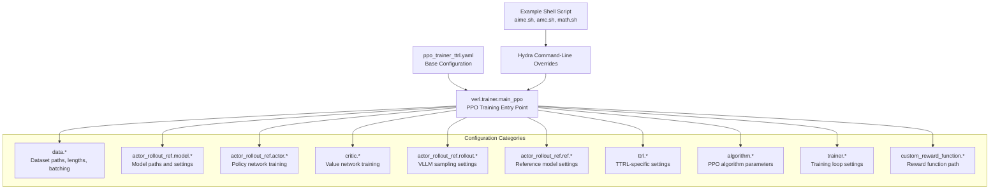
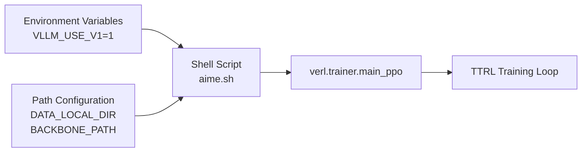
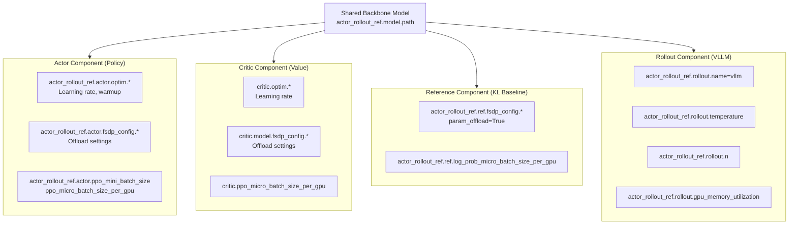

<!-- source: DeepWiki mcp.deepwiki.com · repo PRIME-RL/TTRL · page 3 Configuration Guide · fetched 2026-10-30 -->

# Configuration Guide

<details>
<summary>Relevant source files</summary>

The following files were used as context for generating this wiki page:

- [README.md](README.md)
- [verl/examples/ttrl/Qwen2.5-Math/aime.sh](verl/examples/ttrl/Qwen2.5-Math/aime.sh)
- [verl/examples/ttrl/Qwen2.5/aime.sh](verl/examples/ttrl/Qwen2.5/aime.sh)

</details>


This guide provides comprehensive instructions for configuring and running TTRL training experiments across different models and tasks. TTRL uses a Hydra-based configuration system built on top of the verl framework. For installation instructions, see page 2. For an overview of the TTRL system architecture, see page 1.

## Configuration System Overview

TTRL configurations are managed through shell scripts that override parameters from a base configuration file. The system follows this structure:

**Configuration System Architecture**


Sources: [verl/examples/ttrl/Qwen2.5/aime.sh:42-104](), [verl/examples/ttrl/Qwen2.5-Math/aime.sh:42-105]()

## Core TTRL Configuration Parameters

The following table lists the essential TTRL-specific configuration parameters that must be set to enable TTRL functionality:

| Parameter | Type | Description | Typical Value |
|-----------|------|-------------|---------------|
| `ttrl.enable` | boolean | Enables TTRL training mode | `True` |
| `ttrl.n_votes_per_prompt` | integer | Number of votes used for majority voting | `64` |
| `ttrl.n_samples_per_prompt` | integer | Number of samples generated per prompt during training | `32` |
| `custom_reward_function.path` | string | Path to custom reward function module | `"./verl/utils/reward_score/ttrl_math/__init__.py"` |
| `custom_reward_function.name` | string | Function name within the module | `reward_func` |

Sources: [verl/examples/ttrl/Qwen2.5/aime.sh:88-93](), [verl/examples/ttrl/Qwen2.5-Math/aime.sh:88-93]()

## Quick Start

The simplest way to run TTRL training is through the provided example scripts. Here is a minimal example for training on AIME 2024 with Qwen2.5-7B:

**Step 1: Prepare Environment Variables**
```bash
export VLLM_USE_V1=1
unset VLLM_ATTENTION_BACKEND
```

**Step 2: Set Paths**
```bash
DATA_LOCAL_DIR="path/to/TTRL/verl/data"
BACKBONE_PATH="path/to/Qwen2.5-7B"
```

**Step 3: Run Training**
```bash
bash examples/ttrl/Qwen2.5/aime.sh
```

Before running, you must edit the shell script to set the correct paths for `DATA_LOCAL_DIR` and `BACKBONE_PATH` [verl/examples/ttrl/Qwen2.5/aime.sh:31-32]().

**Configuration Flow for Quick Start**


Sources: [README.md:74-79](), [verl/examples/ttrl/Qwen2.5/aime.sh:1-40]()

## Model Configuration Structure

All model configurations in TTRL share a common structure but differ in specific parameter values. The configuration hierarchy separates concerns into distinct components:

**Model Component Configuration Hierarchy**


Sources: [verl/examples/ttrl/Qwen2.5/aime.sh:51-79](), [verl/examples/ttrl/Qwen2.5-Math/aime.sh:51-79]()

## Data Configuration

Data configuration controls dataset loading, preprocessing, and batching. The key parameters are:

| Parameter | Type | Description | Example Values |
|-----------|------|-------------|----------------|
| `data.train_files` | list[string] | Paths to training data files in Parquet format | `["$DATA_LOCAL_DIR/AIME-TTT/train.parquet"]` |
| `data.val_files` | list[string] | Paths to validation data files | `["$DATA_LOCAL_DIR/AIME-TTT/test.parquet"]` |
| `data.max_prompt_length` | integer | Maximum token length for prompts | `512`, `1024` |
| `data.max_response_length` | integer | Maximum token length for responses | `3072` (for K=3), `8192` (for K=8) |
| `data.train_batch_size` | integer | Number of prompts per training batch | `8` |
| `data.filter_overlong_prompts` | boolean | Filter out prompts exceeding max length | `True` |
| `data.truncation` | string | Truncation strategy | `'error'` |
| `data.suffix_prompt` | string | Additional prompt suffix for instruction | `'"\nPlease reason step by step..."'` |

**Response Length Calculation**: The `max_response_length` is typically calculated as `1024 * K` where `K` is the response length multiplier (commonly 3, 5, or 8) [verl/examples/ttrl/Qwen2.5/aime.sh:15-17]().

**Data Preprocessing**: Raw data must be converted from JSON to Parquet format using [verl/data/preprocess.py]() before training.

Sources: [verl/examples/ttrl/Qwen2.5/aime.sh:44-51](), [verl/examples/ttrl/Qwen2.5-Math/aime.sh:44-50](), [README.md:82]()

## Actor Configuration

The Actor component represents the trainable policy network. Configuration parameters control optimization, memory management, and batch processing:

| Parameter | Type | Description | Typical Value |
|-----------|------|-------------|---------------|
| `actor_rollout_ref.actor.ppo_mini_batch_size` | integer | Mini-batch size for PPO updates | `1` |
| `actor_rollout_ref.actor.ppo_micro_batch_size_per_gpu` | integer | Micro-batch size per GPU | `2` |
| `actor_rollout_ref.actor.use_kl_loss` | boolean | Enable KL divergence loss | `True` |
| `actor_rollout_ref.actor.optim.lr` | float | Learning rate | `5e-7` |
| `actor_rollout_ref.actor.optim.lr_warmup_steps_ratio` | float | Warmup steps as fraction of total | `0.03` (3%) |
| `actor_rollout_ref.actor.optim.warmup_style` | string | Warmup schedule type | `'cosine'` |
| `actor_rollout_ref.actor.fsdp_config.param_offload` | boolean | Offload parameters to CPU | `False` |
| `actor_rollout_ref.actor.fsdp_config.optimizer_offload` | boolean | Offload optimizer states to CPU | `False` |
| `actor_rollout_ref.actor.ppo_max_token_len_per_gpu` | integer | Maximum total tokens per GPU | `MAX_PROMPT_LENGTH + MAX_RESPONSE_LENGTH` |
| `actor_rollout_ref.model.enable_gradient_checkpointing` | boolean | Enable gradient checkpointing | `True` |
| `actor_rollout_ref.model.use_remove_padding` | boolean | Remove padding for efficiency | `True` |

**Key Design Choices**:
- Very conservative learning rate (`5e-7`) for stable policy updates
- No parameter or optimizer offloading for fast gradient computation
- Gradient checkpointing enabled to save memory
- Small micro-batch sizes for memory efficiency

Sources: [verl/examples/ttrl/Qwen2.5/aime.sh:52-63](), [verl/examples/ttrl/Qwen2.5-Math/aime.sh:52-63]()

## Critic Configuration

The Critic component implements the value function for advantage estimation. It uses a significantly higher learning rate than the Actor:

| Parameter | Type | Description | Typical Value |
|-----------|------|-------------|---------------|
| `critic.optim.lr` | float | Learning rate (18x faster than Actor) | `9e-6` |
| `critic.ppo_micro_batch_size_per_gpu` | integer | Micro-batch size per GPU | `2` |
| `critic.model.path` | string | Path to model checkpoint (same as Actor) | `$BACKBONE_PATH` |
| `critic.model.enable_gradient_checkpointing` | boolean | Enable gradient checkpointing | `True` |
| `critic.model.use_remove_padding` | boolean | Remove padding for efficiency | `True` |
| `critic.model.fsdp_config.param_offload` | boolean | Offload parameters to CPU | `False` |
| `critic.model.fsdp_config.optimizer_offload` | boolean | Offload optimizer states to CPU | `False` |

**Learning Rate Ratio**: The Critic learning rate (`9e-6`) is 18 times higher than the Actor learning rate (`5e-7`), allowing the value function to track policy changes more quickly [verl/examples/ttrl/Qwen2.5/aime.sh:80]().

Sources: [verl/examples/ttrl/Qwen2.5/aime.sh:80-86](), [verl/examples/ttrl/Qwen2.5-Math/aime.sh:80-86]()

## Reference Model Configuration

The Reference model remains frozen during training and provides log probabilities for KL divergence computation:

| Parameter | Type | Description | Typical Value |
|-----------|------|-------------|---------------|
| `actor_rollout_ref.ref.log_prob_micro_batch_size_per_gpu` | integer | Micro-batch size for log prob computation | `2` |
| `actor_rollout_ref.ref.fsdp_config.param_offload` | boolean | Offload parameters to CPU (memory optimization) | `True` |

**Memory Optimization**: Unlike the Actor and Critic, the Reference model has `param_offload=True`, enabling CPU offloading to save GPU memory since it only performs forward passes for log probability computation [verl/examples/ttrl/Qwen2.5/aime.sh:64-65]().

Sources: [verl/examples/ttrl/Qwen2.5/aime.sh:64-65](), [verl/examples/ttrl/Qwen2.5-Math/aime.sh:64-65]()

## Rollout Configuration (VLLM)

The Rollout component uses VLLM for efficient high-throughput sampling during training and evaluation:

| Parameter | Type | Description | Typical Value |
|-----------|------|-------------|---------------|
| `actor_rollout_ref.rollout.name` | string | Rollout engine type | `vllm` |
| `actor_rollout_ref.rollout.temperature` | float | Sampling temperature for training | `0.6` - `1.0` |
| `actor_rollout_ref.rollout.n` | integer | Number of samples per prompt | `$N_SAMPLES_PER_PROMPT` (32) |
| `actor_rollout_ref.rollout.enforce_eager` | boolean | Disable CUDA graph optimization | `False` |
| `actor_rollout_ref.rollout.free_cache_engine` | boolean | Free cache after rollout | `False` |
| `actor_rollout_ref.rollout.tensor_model_parallel_size` | integer | Tensor parallelism degree | `1` |
| `actor_rollout_ref.rollout.gpu_memory_utilization` | float | GPU memory utilization target | `0.8` (80%) |
| `actor_rollout_ref.rollout.max_model_len` | integer | Maximum sequence length | `MAX_PROMPT_LENGTH + MAX_RESPONSE_LENGTH` |
| `actor_rollout_ref.rollout.max_num_batched_tokens` | integer | Maximum batched tokens | `MAX_PROMPT_LENGTH + MAX_RESPONSE_LENGTH` |
| `actor_rollout_ref.rollout.log_prob_micro_batch_size_per_gpu` | integer | Micro-batch size for log prob | `2` |

**Validation Sampling Parameters**:
| Parameter | Type | Description | Typical Value |
|-----------|------|-------------|---------------|
| `actor_rollout_ref.rollout.val_kwargs.do_sample` | boolean | Enable sampling during validation | `True` |
| `actor_rollout_ref.rollout.val_kwargs.n` | integer | Number of validation samples | `16` (variable based on K) |
| `actor_rollout_ref.rollout.val_kwargs.top_p` | float | Nucleus sampling parameter | `0.95` |
| `actor_rollout_ref.rollout.val_kwargs.temperature` | float | Validation temperature | `0.6` |

**Temperature Settings**: Training typically uses higher temperature (0.6-1.0) for exploration, while validation uses lower temperature (0.6) for more focused sampling [verl/examples/ttrl/Qwen2.5/aime.sh:67](), [verl/examples/ttrl/Qwen2.5-Math/aime.sh:66]().

**VLLM Version**: TTRL requires VLLM v1, set via `export VLLM_USE_V1=1` [verl/examples/ttrl/Qwen2.5/aime.sh:4]().

Sources: [verl/examples/ttrl/Qwen2.5/aime.sh:66-79](), [verl/examples/ttrl/Qwen2.5-Math/aime.sh:65-79]()

## Algorithm Configuration

Algorithm parameters control the PPO training process and advantage estimation:

| Parameter | Type | Description | Typical Value |
|-----------|------|-------------|---------------|
| `algorithm.kl_ctrl.kl_coef` | float | KL divergence penalty coefficient | `0.00` |
| `algorithm.adv_estimator` | string | Advantage estimation method | `grpo` |

**GRPO Advantage Estimation**: TTRL uses Group Relative Policy Optimization (GRPO) for advantage estimation [verl/examples/ttrl/Qwen2.5/aime.sh:88]().

**KL Coefficient**: Set to `0.00`, indicating minimal KL penalty is applied during training [verl/examples/ttrl/Qwen2.5/aime.sh:87]().

Sources: [verl/examples/ttrl/Qwen2.5/aime.sh:87-88](), [verl/examples/ttrl/Qwen2.5-Math/aime.sh:87-88]()

## Trainer Configuration

Trainer parameters control the overall training loop, logging, and checkpointing:

| Parameter | Type | Description | Typical Value |
|-----------|------|-------------|---------------|
| `trainer.logger` | list[string] | Logging backends | `['console','wandb']` |
| `trainer.project_name` | string | Weights & Biases project name | `TTRL-verl` |
| `trainer.experiment_name` | string | Experiment name for logging | Generated from date and config |
| `trainer.n_gpus_per_node` | integer | Number of GPUs per node | `8` |
| `trainer.nnodes` | integer | Number of nodes | `1` |
| `trainer.save_freq` | integer | Checkpoint save frequency (epochs) | `2000000` (effectively disabled) |
| `trainer.test_freq` | integer | Validation frequency (epochs) | `2` |
| `trainer.max_actor_ckpt_to_keep` | integer | Maximum actor checkpoints to keep | `0` (no checkpoints saved) |
| `trainer.max_critic_ckpt_to_keep` | integer | Maximum critic checkpoints to keep | `0` (no checkpoints saved) |
| `trainer.default_local_dir` | string | Output directory for logs and checkpoints | `$OUTPUT_DIR` |
| `trainer.total_epochs` | integer | Total number of training epochs | `80` |

**Checkpointing Strategy**: By default, checkpointing is effectively disabled (`save_freq=2000000`, `max_*_ckpt_to_keep=0`) to save storage space. Adjust these parameters if you need to save intermediate checkpoints [verl/examples/ttrl/Qwen2.5/aime.sh:98-101]().

Sources: [verl/examples/ttrl/Qwen2.5/aime.sh:94-104](), [verl/examples/ttrl/Qwen2.5-Math/aime.sh:94-105]()

## Configuration Options

The TTRL system provides several configuration options that can be adjusted to optimize performance for specific use cases:

| Parameter | Description | Default Value | Notes |
|-----------|-------------|---------------|-------|
| `num_solutions` | Number of solutions to generate per problem | 16 | Higher values may improve reward accuracy but increase computation |
| `model_name` | Base language model to use | qwen2.5-math-7b | Currently tested with Qwen2.5-Math-7B |
| `learning_rate` | Learning rate for RL training | 5e-7 | May need adjustment based on model size |
| `max_length` | Maximum token length for generated solutions | 2048 | Adjust based on problem complexity |
| `batch_size` | Batch size for training | 4 | Depends on available GPU memory |

Sources: [README.md:62-76]()

## Monitoring and Evaluation

TTRL uses Weights & Biases for tracking experiments and visualizing results. To monitor your training runs:

1. Ensure you have a Weights & Biases account and API key
2. Pass the API key to the training script
3. Access your experiment logs at the [Weights & Biases dashboard](https://wandb.ai)

Example metrics tracked include:
- pass@1 (percentage of problems solved correctly on first attempt)
- Maj@N (majority voting accuracy with N solutions)
- Training loss
- Solution quality metrics

Sources: [README.md:62-64]()

## Experimental Validation

For reproducibility, the TTRL authors conducted multiple independent runs on AIME 2024:
- Two runs achieved pass@1 of 43.3%
- One run reached pass@1 of 46.7%

These results represent significant improvements over the baseline model performance, demonstrating the effectiveness of the TTRL approach.

Sources: [README.md:62-64]()

## Troubleshooting

Common issues and their solutions:

| Issue | Possible Solution |
|-------|-------------------|
| Out of memory errors | Reduce batch size or number of solutions per problem |
| Poor convergence | Adjust learning rate or increase training iterations |
| Installation problems | Ensure compatible versions of PyTorch and CUDA |
| Dataset loading errors | Verify dataset paths and formats |

For further assistance, contact the TTRL team using the information provided in the [Contact](#4) section.

## Next Steps

After successfully implementing TTRL, you may want to:
1. Experiment with different base models
2. Try different mathematical datasets (see [Mathematical Datasets](#3))
3. Customize the reward function for specific domains
4. Contribute improvements back to the TTRL project

For detailed information about the training pipeline, see [Training Pipeline](#2.1). For information about framework integration, see [Framework Integration](#2.2).

Sources: [README.md:1-105]()

---

