# Page: Overview

# Overview

<details>
<summary>Relevant source files</summary>

The following files were used as context for generating this wiki page:

- [.github/scripts/generate-tensorrt-test-matrix.py](.github/scripts/generate-tensorrt-test-matrix.py)
- [.github/scripts/install-torch-tensorrt.sh](.github/scripts/install-torch-tensorrt.sh)
- [.gitignore](.gitignore)
- [MODULE.bazel](MODULE.bazel)
- [README.md](README.md)
- [cpp/include/torch_tensorrt/macros.h](cpp/include/torch_tensorrt/macros.h)
- [dev_dep_versions.yml](dev_dep_versions.yml)
- [docsrc/conf.py](docsrc/conf.py)
- [docsrc/index.rst](docsrc/index.rst)
- [docsrc/requirements.txt](docsrc/requirements.txt)
- [examples/dynamo/README.rst](examples/dynamo/README.rst)
- [examples/dynamo/compile_with_dynamic_inputs.py](examples/dynamo/compile_with_dynamic_inputs.py)
- [examples/dynamo/custom_kernel_plugins.py](examples/dynamo/custom_kernel_plugins.py)
- [examples/dynamo/debugger_example.py](examples/dynamo/debugger_example.py)
- [examples/dynamo/dynamic_memory_allocation.py](examples/dynamo/dynamic_memory_allocation.py)
- [examples/dynamo/low_cpu_memory_compilation.py](examples/dynamo/low_cpu_memory_compilation.py)
- [examples/dynamo/refit_engine_example.py](examples/dynamo/refit_engine_example.py)
- [packaging/pre_build_script.sh](packaging/pre_build_script.sh)
- [packaging/pre_build_script_windows.sh](packaging/pre_build_script_windows.sh)
- [py/requirements.txt](py/requirements.txt)
- [pyproject.toml](pyproject.toml)
- [setup.py](setup.py)
- [tests/py/requirements.txt](tests/py/requirements.txt)
- [toolchains/ci_workspaces/MODULE.bazel.tmpl](toolchains/ci_workspaces/MODULE.bazel.tmpl)
- [tools/perf/Flux/create_env.sh](tools/perf/Flux/create_env.sh)
- [uv.lock](uv.lock)
- [version.txt](version.txt)

</details>


Torch-TensorRT is an inference compiler for PyTorch that optimizes models for execution on NVIDIA GPUs using TensorRT. It integrates directly into the PyTorch ecosystem, allowing users to compile models for accelerated inference while maintaining compatibility with standard PyTorch code and workflows.

**Scope**: This page provides a high-level introduction to Torch-TensorRT's purpose, compilation workflows, and major system components. For installation instructions, see page [1.1](). For a detailed architectural breakdown, see page [1.2]().

## What is Torch-TensorRT?

Torch-TensorRT transforms PyTorch models into optimized TensorRT engines that execute faster on NVIDIA GPUs. It bridges the gap between PyTorch's flexibility for model development and TensorRT's performance optimizations for inference deployment.

The compiler operates in two primary modes:
- **Just-In-Time (JIT)**: Compilation occurs automatically during first execution via `torch.compile(backend='tensorrt')`
- **Ahead-Of-Time (AOT)**: Models are compiled and serialized for later deployment using `torch_tensorrt.compile()`

Sources: [README.md:1-20](), [docsrc/index.rst:1-14]()

## Compilation Workflows

### JIT Compilation Workflow

```python
import torch
import torch_tensorrt

model = MyModel().eval().cuda()
x = torch.randn((1, 3, 224, 224)).cuda()

# Compile on first execution
optimized_model = torch.compile(model, backend="tensorrt")
output = optimized_model(x)  # Compilation happens here
```

The JIT workflow automatically identifies TensorRT-compatible regions and compiles them transparently. This is the simplest integration path and requires minimal code changes.

### AOT Compilation Workflow

```python
import torch
import torch_tensorrt

model = MyModel().eval().cuda()
inputs = [torch.randn((1, 3, 224, 224)).cuda()]

# Compile ahead of time
trt_gm = torch_tensorrt.compile(model, ir="dynamo", inputs=inputs)

# Save for deployment
torch_tensorrt.save(trt_gm, "model.ep", inputs=inputs)  # Python runtime
torch_tensorrt.save(trt_gm, "model.ts", output_format="torchscript", inputs=inputs)  # C++ runtime
```

The AOT workflow produces serialized engines that can be deployed in Python (`.ep` files) or C++ (`.ts` files) environments without requiring recompilation.

Sources: [README.md:37-93](), [docsrc/index.rst:19-21]()

## Dual Frontend Architecture

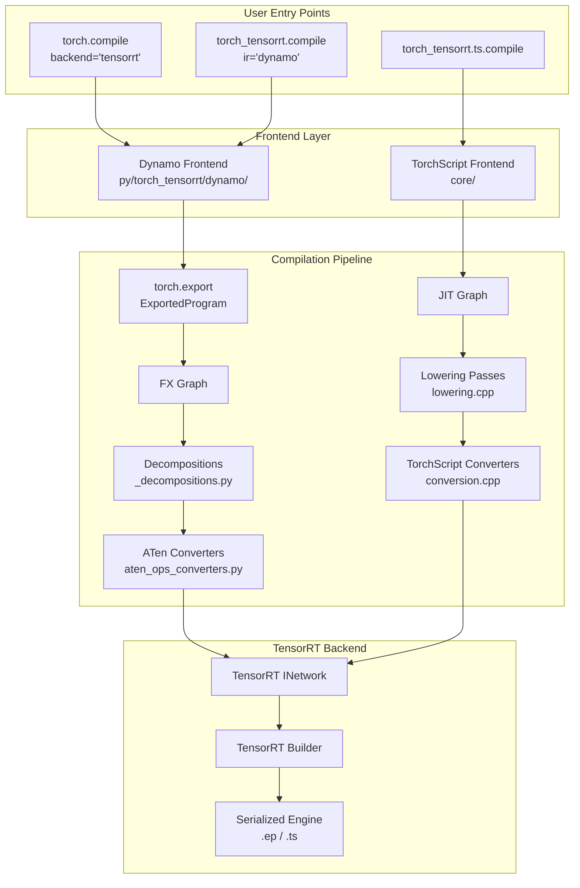

**Dynamo Frontend**: The current primary compilation path for PyTorch 2.x models. Uses FX graphs produced by `torch.export` and ATen-level operator converters. Implemented in Python under [py/torch_tensorrt/dynamo/]().

**TorchScript Frontend**: Legacy compilation path using JIT tracing/scripting. Implemented in C++ under [core/]() with support for hybrid execution — subgraphs not supported by TensorRT fall back automatically to PyTorch.

Sources: [py/torch_tensorrt/dynamo/](), [core/](), [README.md:37-93]()

## System Architecture Overview

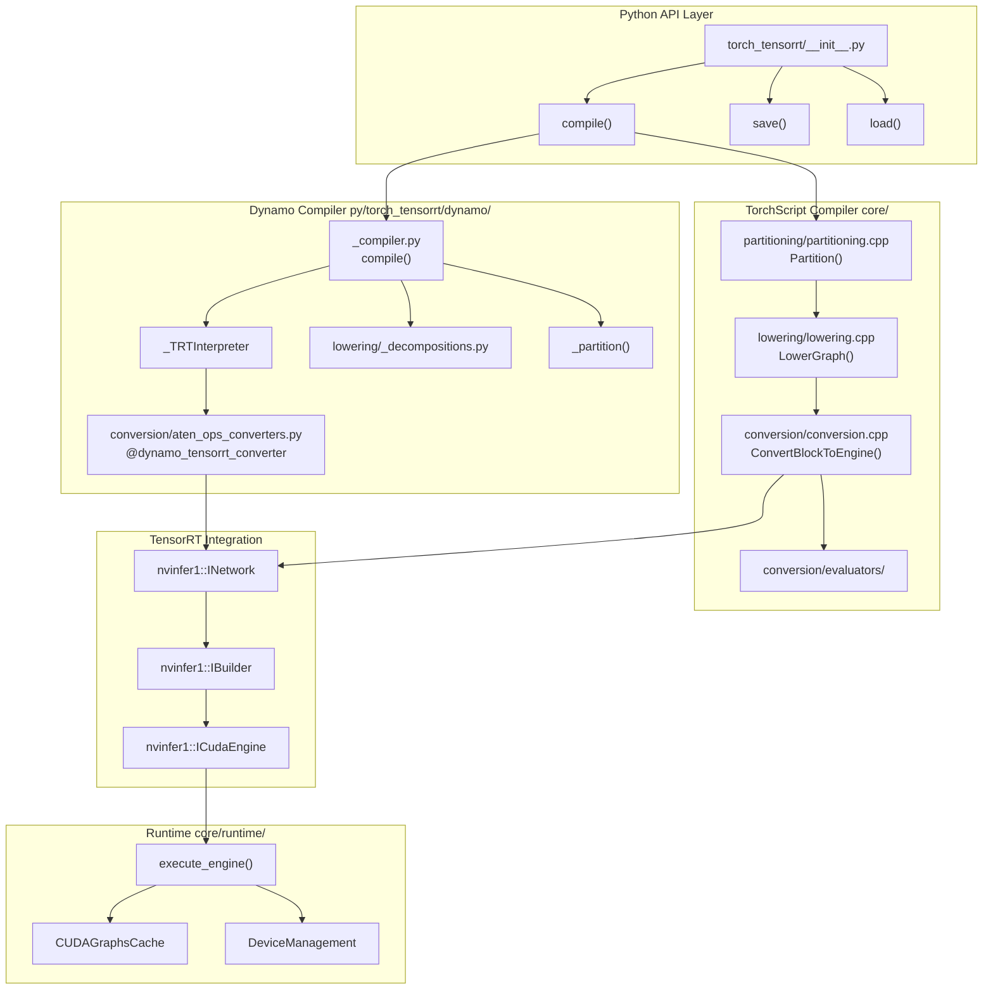

### Core Components

| Component | Location | Purpose |
|-----------|----------|---------|
| **Python API** | [py/torch_tensorrt/__init__.py]() | Primary user-facing compilation and serialization APIs |
| **Dynamo Compiler** | [py/torch_tensorrt/dynamo/_compiler.py]() | Compiles FX graphs from `torch.export` to TensorRT |
| **Dynamo Converters** | [py/torch_tensorrt/dynamo/conversion/]() | Maps ATen operators to TensorRT layers |
| **TorchScript Compiler** | [core/]() | C++ implementation for TorchScript compilation |
| **Partitioner** | [core/partitioning/partitioning.cpp]() | Segments graphs into TensorRT and PyTorch regions |
| **Runtime** | [core/runtime/]() | Executes TensorRT engines with CUDA graphs support |

Sources: [py/torch_tensorrt/__init__.py](), [py/torch_tensorrt/dynamo/_compiler.py](), [core/partitioning/partitioning.cpp](), [core/runtime/]()

## Compilation Pipeline Flow

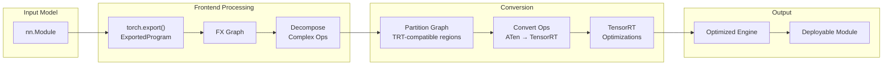

**Stages**:
1. **Export**: Convert PyTorch model to FX graph representation via `torch.export()`
2. **Decomposition**: Break down complex operations into TensorRT-compatible primitives using [py/torch_tensorrt/dynamo/lowering/_decompositions.py]()
3. **Partitioning**: Identify TensorRT-compatible subgraphs (full graph for Dynamo, hybrid for TorchScript)
4. **Conversion**: Map PyTorch operations to TensorRT layers via registered converters
5. **Optimization**: TensorRT applies kernel fusion, precision calibration, and memory optimization
6. **Serialization**: Package engine into deployable module format

Sources: [py/torch_tensorrt/dynamo/_compiler.py](), [py/torch_tensorrt/dynamo/lowering/_decompositions.py](), [core/partitioning/partitioning.cpp]()

## Platform Support

| Platform | Architecture | Status | Notes |
|----------|-------------|--------|-------|
| **Linux x86_64** | x86_64 | Supported | Primary development platform |
| **Linux SBSA** | aarch64 | Supported | ARM server platforms |
| **Windows** | x86_64 | Supported (Dynamo only) | TorchScript frontend not available |
| **Jetson** | aarch64 (Tegra) | Source compilation supported | Requires JetPack 4.4+ |

**Dependencies** (configured in [dev_dep_versions.yml:1-4]()):
- **CUDA**: 13.0 (standard), 12.6 (Jetson)
- **TensorRT**: 10.15.1 (standard), 10.3.0 (Jetson)
- **PyTorch**: 2.12.0.dev+ (nightly)
- **Bazel**: 8.1.1 (via Bazelisk)
</thinking>
</old_str>
<new_str>
**Dependencies** (configured in [dev_dep_versions.yml:1-4]()):
- **CUDA**: 13.0 (standard), 12.6 (Jetson)
- **TensorRT**: 10.15.1 (standard), 10.3.0 (Jetson)
- **PyTorch**: 2.12.0.dev+ (nightly)
- **Bazel**: 8.1.1 (via Bazelisk)

Sources: [README.md:106-127](), [dev_dep_versions.yml:1-4](), [MODULE.bazel:36-55]()

## Key Directories

```
torch-tensorrt/
├── py/torch_tensorrt/          # Python package
│   ├── dynamo/                 # Dynamo frontend implementation
│   │   ├── _compiler.py        # Main compilation logic
│   │   ├── conversion/         # ATen operator converters
│   │   └── lowering/           # Graph decomposition passes
│   ├── ts/                     # TorchScript Python API
│   └── runtime/                # Runtime utilities
├── core/                       # C++ TorchScript frontend
│   ├── partitioning/           # Graph partitioning
│   ├── lowering/               # Graph lowering passes
│   ├── conversion/             # TorchScript converters
│   └── runtime/                # Engine execution
├── tests/                      # Test suites
│   ├── py/dynamo/              # Dynamo tests
│   └── core/                   # TorchScript tests
├── examples/                   # Usage examples
├── docsrc/                     # Documentation source
└── MODULE.bazel                # Bazel build configuration
```

Sources: [py/torch_tensorrt/](), [core/](), [MODULE.bazel:1-10]()

## Build System

Torch-TensorRT uses a hybrid build system:

- **Python Orchestration**: [setup.py:1-623]() manages Python package creation and invokes C++ compilation
- **C++ Compilation**: Bazel builds the C++ core ([MODULE.bazel]()), with platform-specific configurations in [toolchains/]()
- **Platform Detection**: Build system automatically detects architecture (x86_64, aarch64, Jetson, Windows) and applies appropriate configurations

The build process:
1. [setup.py]() invokes Bazel to compile C++ libraries
2. Compiled libraries are packaged into [py/torch_tensorrt/lib/]()
3. Python wheel is created with bundled C++ dependencies

Sources: [setup.py:186-238](), [MODULE.bazel:1-150]()

## Entry Points and APIs

**Primary Python APIs** (defined in [py/torch_tensorrt/__init__.py]()):
- `torch_tensorrt.compile()` - Compile models to TensorRT
- `torch_tensorrt.save()` - Serialize compiled modules
- `torch_tensorrt.load()` - Load serialized modules
- `torch_tensorrt.dynamo.compile()` - Dynamo-specific compilation

**C++ APIs** (defined in [core/torch_tensorrt.h]()):
- `torch_tensorrt::torchscript::compile()` - Compile TorchScript modules
- `torch_tensorrt::torchscript::embed_engine_in_new_module()` - Embed engines in modules

**Torch Integration**:
- `torch.compile(backend='tensorrt')` - Uses Torch-TensorRT as a backend

Sources: [py/torch_tensorrt/__init__.py](), [README.md:39-53]()

---

# Page: Installation and Setup

# Installation and Setup

<details>
<summary>Relevant source files</summary>

The following files were used as context for generating this wiki page:

- [.github/scripts/generate-tensorrt-test-matrix.py](.github/scripts/generate-tensorrt-test-matrix.py)
- [.github/scripts/install-torch-tensorrt.sh](.github/scripts/install-torch-tensorrt.sh)
- [.github/scripts/run_cpp_linter.py](.github/scripts/run_cpp_linter.py)
- [.github/scripts/run_py_linter.py](.github/scripts/run_py_linter.py)
- [.github/workflows/docgen.yml](.github/workflows/docgen.yml)
- [.github/workflows/linter.yml](.github/workflows/linter.yml)
- [.github/workflows/stale.yml](.github/workflows/stale.yml)
- [MODULE.bazel](MODULE.bazel)
- [README.md](README.md)
- [cpp/include/torch_tensorrt/macros.h](cpp/include/torch_tensorrt/macros.h)
- [dev_dep_versions.yml](dev_dep_versions.yml)
- [docker/Dockerfile](docker/Dockerfile)
- [docker/Dockerfile.docs](docker/Dockerfile.docs)
- [docker/README.md](docker/README.md)
- [docker/dist-build.sh](docker/dist-build.sh)
- [docsrc/getting_started/installation.rst](docsrc/getting_started/installation.rst)
- [packaging/pre_build_script.sh](packaging/pre_build_script.sh)
- [packaging/pre_build_script_windows.sh](packaging/pre_build_script_windows.sh)
- [py/requirements.txt](py/requirements.txt)
- [pyproject.toml](pyproject.toml)
- [setup.py](setup.py)
- [tests/py/requirements.txt](tests/py/requirements.txt)
- [toolchains/ci_workspaces/MODULE.bazel.tmpl](toolchains/ci_workspaces/MODULE.bazel.tmpl)
- [tools/perf/Flux/create_env.sh](tools/perf/Flux/create_env.sh)
- [uv.lock](uv.lock)
- [version.txt](version.txt)

</details>


This page covers the installation and setup of Torch-TensorRT on different platforms, including precompiled binary installation via `pip` and building from source. For information about the system architecture and compilation workflows, see [System Architecture](#1.2) and [User Guide](#2).

---

## Prerequisites

Torch-TensorRT requires three primary dependencies installed on your system:

| Dependency | Version Requirements | Notes |
|------------|---------------------|-------|
| **CUDA** | 12.6 (Jetson) or 13.0 (x86_64, SBSA, Windows) | System installation or CUDA driver in container |
| **PyTorch** | ≥2.10.0.dev for x86_64/SBSA/Windows<br>≥2.8.0 for Jetson | Nightly builds recommended for main branch |
| **TensorRT** | 10.3.0 (Jetson)<br>10.14.1 (x86_64, SBSA, Windows) | Python package sufficient for pip installation |

**Sources:** [README.md:119-126](), [pyproject.toml:9-11](), [dev_dep_versions.yml:1-4]()

---

## Platform Support Overview

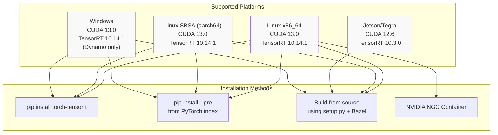

**Platform-Specific Notes:**
- **Windows**: Only Dynamo frontend supported, TorchScript frontend not available
- **Jetson**: Requires source compilation, uses older TensorRT/CUDA versions from JetPack
- **SBSA**: ARM server platforms (e.g., Grace, Thor)

**Sources:** [README.md:108-117](), [setup.py:91-174](), [MODULE.bazel:42-55]()

---

## Installing Precompiled Binaries

### Stable Release (PyPI)

Install the latest stable release from PyPI:

```bash
pip install torch-tensorrt
```

This installs Torch-TensorRT along with compatible PyTorch and TensorRT versions. The package will automatically select the appropriate CUDA version based on your installed PyTorch.

**Sources:** [README.md:22-26]()

### Nightly Builds

Nightly builds track the PyTorch nightly and are distributed via the PyTorch package index:

```bash
pip install --pre torch-tensorrt --index-url https://download.pytorch.org/whl/nightly/cu130
```

This installs:
- PyTorch nightly with CUDA 13.0 support
- Torch-TensorRT nightly
- TensorRT dependencies (automatically resolved)

**Sources:** [README.md:28-31](), [py/requirements.txt:4-5]()

### CUDA-Specific Installations

Torch-TensorRT wheels are built for specific CUDA versions. Specify the CUDA version via PyTorch's package index:

| CUDA Version | Installation Command |
|--------------|---------------------|
| CUDA 13.0 (default) | `pip install --pre torch-tensorrt --index-url https://download.pytorch.org/whl/nightly/cu130` |
| CUDA 12.x | `pip install --pre torch-tensorrt --index-url https://download.pytorch.org/whl/nightly/cu126` |

The package dependencies will automatically install the correct TensorRT variant:

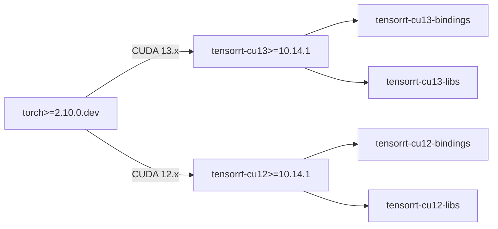

**Sources:** [setup.py:738-772](), [pyproject.toml:9-11]()

### Platform-Specific Dependencies

The `setup.py:get_requirements()` function selects dependencies based on platform detection:

- **Standard (x86_64, Windows)**: Uses CUDA-versioned TensorRT packages
- **SBSA (aarch64 server)**: Uses generic TensorRT tarball
- **Jetson (Tegra)**: Uses PyTorch 2.8.0 and TensorRT 10.3.0 from Jetson AI Lab

**Sources:** [setup.py:738-792]()

---

## NVIDIA NGC Container

Torch-TensorRT is pre-installed in the NVIDIA NGC PyTorch containers with all dependencies properly configured:

```bash
docker pull nvcr.io/nvidia/pytorch:XX.XX-py3
```

The container includes:
- Pre-built Torch-TensorRT library
- Compatible PyTorch version
- TensorRT optimized for the platform
- Example notebooks

**Sources:** [README.md:33](), [docker/README.md:43-45]()

---

## Building from Source

### Dependencies for Source Build

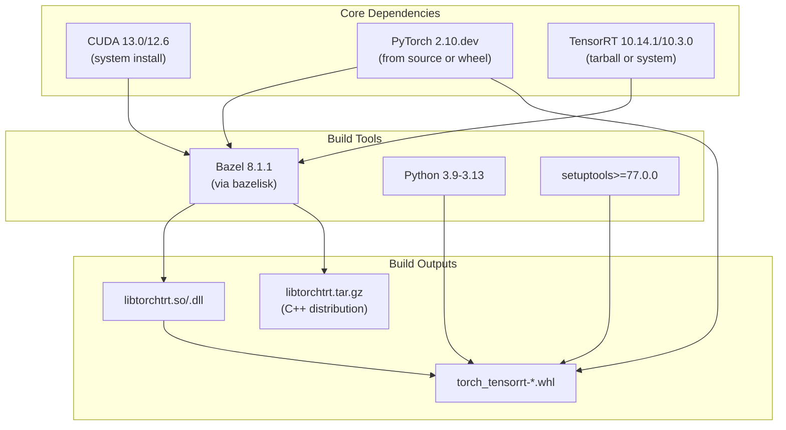

**Installing Bazel:**

The easiest method is to use Bazelisk, which automatically selects the correct Bazel version:

```bash
# Linux
curl -L https://github.com/bazelbuild/bazelisk/releases/download/v1.26.0/bazelisk-linux-amd64 -o /usr/bin/bazel
chmod +x /usr/bin/bazel

# Windows (via Chocolatey)
choco install bazelisk -y
```

**Sources:** [packaging/pre_build_script.sh:39-42](), [docker/Dockerfile:46-48](), [pyproject.toml:2-12]()

### Configuring MODULE.bazel

The build system uses `MODULE.bazel` to specify dependency locations. Key configurations include:

**CUDA path (system installation required):**

```python
# Linux x86_64/SBSA
new_local_repository(
    name = "cuda",
    build_file = "@//third_party/cuda:BUILD",
    path = "/usr/local/cuda-13.0/",
)

# Jetson
new_local_repository(
    name = "cuda_l4t",
    build_file = "@//third_party/cuda:BUILD",
    path = "/usr/local/cuda-12.6",
)

# Windows
new_local_repository(
    name = "cuda_win",
    build_file = "@//third_party/cuda:BUILD",
    path = "C:/Program Files/NVIDIA GPU Computing Toolkit/CUDA/v13.0/",
)
```

**PyTorch/LibTorch (automatically downloaded or local):**

```python
# Download from pytorch.org (default for x86_64)
http_archive(
    name = "libtorch",
    build_file = "@//third_party/libtorch:BUILD",
    strip_prefix = "libtorch",
    urls = ["https://download.pytorch.org/libtorch/nightly/cu130/libtorch-shared-with-deps-latest.zip"],
)

# Or use local installation
new_local_repository(
    name = "libtorch",
    path = "/usr/local/lib/python3.11/dist-packages/torch",
    build_file = "third_party/libtorch/BUILD"
)
```

**TensorRT (downloaded tarball):**

```python
http_archive(
    name = "tensorrt",
    build_file = "@//third_party/tensorrt/archive:BUILD",
    strip_prefix = "TensorRT-10.14.1.48",
    urls = [
        "https://developer.nvidia.com/downloads/compute/machine-learning/tensorrt/10.14.1/tars/TensorRT-10.14.1.48.Linux.x86_64-gnu.cuda-13.0.tar.gz",
    ],
)
```

**Sources:** [MODULE.bazel:34-171](), [toolchains/ci_workspaces/MODULE.bazel.tmpl:36-157]()

---

## Building on Linux (x86_64 and SBSA)

### Standard Build

The simplest build command invokes `setup.py`, which orchestrates Bazel:

```bash
python -m pip install --pre . --extra-index-url https://download.pytorch.org/whl/nightly/cu130
```

This executes:
1. `setup.py:InstallCommand.run()` or `BdistCommand.run()`
2. `build_libtorchtrt_cxx11_abi()` - invokes Bazel to compile C++ library
3. `copy_libtorchtrt()` - extracts tarball into Python package
4. `gen_version_file()` - creates `_version.py` with version info
5. Standard Python packaging

**Sources:** [setup.py:311-329](), [setup.py:186-238](), [setup.py:241-252]()

### Build Flow Diagram

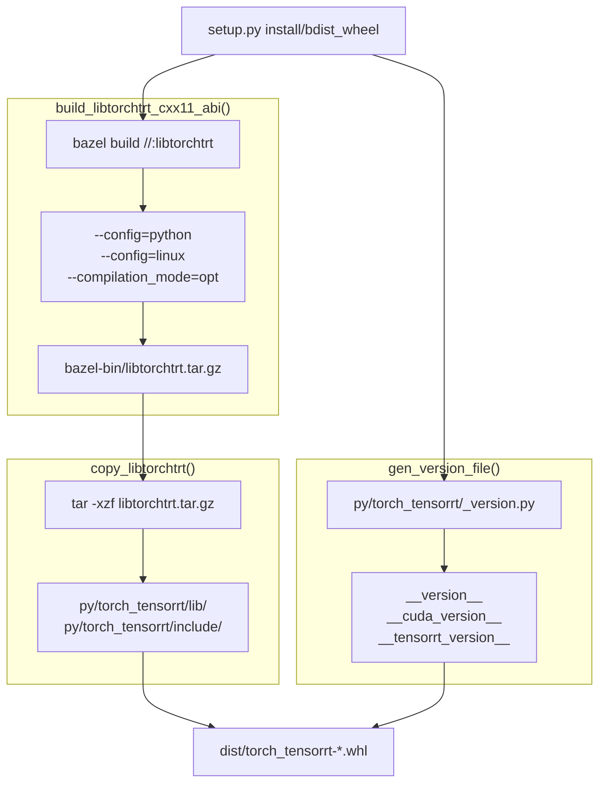

**Sources:** [setup.py:186-238](), [setup.py:254-288](), [setup.py:241-252]()

### Platform-Specific Bazel Flags

The `build_libtorchtrt_cxx11_abi()` function adds platform-specific flags:

| Platform | Bazel Flags | Notes |
|----------|-------------|-------|
| Linux x86_64 | `--config=linux` | Default configuration |
| Linux SBSA | `--config=linux` | ARM server platforms |
| Jetson | `--config=linux --config=jetpack` | Enables Jetson-specific builds |
| Windows | `--config=windows` | MSVC toolchain |

For CI builds, additional platform specifications are added:

```bash
# CI x86_64
bazel build //:libtorchtrt --platforms=//toolchains:ci_rhel_x86_64_linux

# CI aarch64
bazel build //:libtorchtrt --platforms=//toolchains:aarch64_linux
```

**Sources:** [setup.py:211-232](), [packaging/pre_build_script.sh:8-24]()

---

## Building on Jetson (Tegra Platforms)

### Prerequisites

Install PyTorch for Jetson from the NVIDIA forums or Jetson AI Lab:

```bash
pip install torch==2.8.0 --index-url=https://pypi.jetson-ai-lab.io/jp6/cu126/
```

Dependencies specific to Jetson:
- **CUDA**: 12.6 (from JetPack)
- **TensorRT**: 10.3.0 (from JetPack)
- **PyTorch**: 2.8.0 (Jetson-specific build)

**Sources:** [packaging/pre_build_script.sh:46-50](), [pyproject.toml:10]()

### Jetson Build Configuration

The Jetson build is triggered by:

```bash
JETPACK_BUILD=1 python -m pip install --pre .
```

Or during setup, the `--jetpack` flag:

```bash
python setup.py install --jetpack
```

Key environment variables and flags:
- `IS_JETPACK=True` - detected via `platform.machine() == "aarch64"` and `JETPACK_BUILD` env var
- `--config=jetpack` - passed to Bazel

**Module.bazel Configuration for Jetson:**

```python
# Jetson-specific CUDA
new_local_repository(
    name = "cuda_l4t",
    build_file = "@//third_party/cuda:BUILD",
    path = "/usr/local/cuda-12.6",
)

# Jetson-specific TensorRT
http_archive(
    name = "tensorrt_l4t",
    build_file = "@//third_party/tensorrt/archive:BUILD",
    strip_prefix = "TensorRT-10.3.0.26",
    urls = [
        "https://developer.nvidia.com/downloads/compute/machine-learning/tensorrt/10.3.0/tars/TensorRT-10.3.0.26.l4t.aarch64-gnu.cuda-12.6.tar.gz",
    ],
)
```

**Sources:** [setup.py:148-174](), [setup.py:220-222](), [MODULE.bazel:42-48](), [MODULE.bazel:128-135]()

---

## Building on Windows

### Prerequisites

- **Visual Studio 2022**: Build tools (x64 Native Tools Command Prompt)
- **Bazelisk**: Install via Chocolatey or manually
- **CUDA**: 13.0 installed in default location
- **PyTorch**: Nightly build with CUDA 13.0

### Windows Build Steps

1. Open "x64 Native Tools Command Prompt for VS 2022" with Admin privileges

2. Install dependencies:

```bash
pip install ninja wheel setuptools
pip install --pre -r py/requirements.txt
```

3. Set environment variable for MSVC:

```bash
set DISTUTILS_USE_SDK=1
```

4. Build wheel:

```bash
python setup.py bdist_wheel
```

5. Install:

```bash
pip install dist/*.whl
```

**Sources:** [docsrc/getting_started/installation.rst:234-254](), [packaging/pre_build_script_windows.sh:1-60]()

### Windows-Specific Module.bazel Configuration

```python
# Windows CUDA
new_local_repository(
    name = "cuda_win",
    build_file = "@//third_party/cuda:BUILD",
    path = "C:/Program Files/NVIDIA GPU Computing Toolkit/CUDA/v13.0/",
)

# Windows LibTorch
http_archive(
    name = "libtorch_win",
    build_file = "@//third_party/libtorch:BUILD",
    strip_prefix = "libtorch",
    urls = ["https://download.pytorch.org/libtorch/nightly/cu130/libtorch-win-shared-with-deps-latest.zip"],
)

# Windows TensorRT
http_archive(
    name = "tensorrt_win",
    build_file = "@//third_party/tensorrt/archive:BUILD",
    strip_prefix = "TensorRT-10.14.1.48",
    urls = [
        "https://developer.nvidia.com/downloads/compute/machine-learning/tensorrt/10.14.1/zip/TensorRT-10.14.1.48.Windows.win10.cuda-13.0.zip",
    ],
)
```

**Important Notes:**
- Windows builds use `--config=windows` which selects MSVC toolchain
- The C++ extension module is built as `torchtrt.dll` and `torchtrt.lib`
- Only Dynamo frontend is supported on Windows (no TorchScript)

**Sources:** [MODULE.bazel:50-55](), [MODULE.bazel:82-87](), [MODULE.bazel:137-144](), [setup.py:259-267]()

---

## Build Options and Variants

### Python-Only Build (No C++ Runtime)

Excludes C++ components (TorchScript frontend and Torch-TensorRT runtime):

```bash
PYTHON_ONLY=1 python -m pip install --pre .
```

This build:
- Skips Bazel compilation
- Only includes Dynamo frontend (Python-based)
- Uses Python runtime instead of C++ runtime
- Faster build, smaller wheel
- Limited serialization capabilities

**Detection in setup.py:**

```python
PY_ONLY = False
if "--py-only" in sys.argv:
    PY_ONLY = True
    sys.argv.remove("--py-only")

if (py_only_env_var := os.environ.get("PYTHON_ONLY")) is not None:
    if py_only_env_var == "1":
        PY_ONLY = True
```

**Sources:** [setup.py:94-135](), [setup.py:299-308](), [docsrc/getting_started/installation.rst:156-167]()

### No TorchScript Build (Dynamo Only)

Excludes TorchScript frontend but keeps C++ runtime:

```bash
NO_TORCHSCRIPT=1 python -m pip install --pre .
```

This build:
- Compiles C++ runtime only (`//:libtorchtrt_runtime`)
- Excludes TorchScript conversion system
- Dynamo frontend remains fully functional
- Faster build than full build

**Detection in setup.py:**

```python
NO_TS = False
if "--no-ts" in sys.argv:
    NO_TS = True
    sys.argv.remove("--no-ts")

if (no_ts_env_var := os.environ.get("NO_TORCHSCRIPT")) is not None:
    if no_ts_env_var == "1":
        NO_TS = True
```

When `NO_TS=True`, the build target changes:

```python
if rt_only:
    cmd.append("//:libtorchtrt_runtime")
else:
    cmd.append("//:libtorchtrt")
```

**Sources:** [setup.py:113-131](), [setup.py:192-196](), [docsrc/getting_started/installation.rst:170-178]()

### TensorRT-RTX Build

Enables optimizations for RTX GPUs:

```bash
USE_TRT_RTX=1 python -m pip install --pre .
```

This uses TensorRT-RTX libraries instead of standard TensorRT:

```python
if USE_TRT_RTX:
    cmd.append("--config=rtx")
    print("TensorRT RTX build")
```

**Module.bazel configuration:**

```python
http_archive(
    name = "tensorrt_rtx",
    build_file = "@//third_party/tensorrt_rtx/archive:BUILD",
    strip_prefix = "TensorRT-RTX-1.2.0.54",
    urls = [
        "https://developer.nvidia.com/downloads/trt/rtx_sdk/secure/1.2/tensorrt-rtx-1.2.0.54-linux-x86_64-cuda-13.0-release-external.tar.gz",
    ],
)
```

**Sources:** [setup.py:101-139](), [setup.py:216-218](), [MODULE.bazel:110-117]()

---

## Build System Architecture

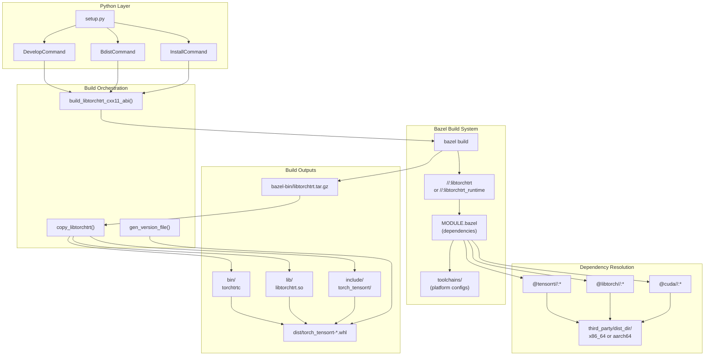

**Key Build Functions:**

- **`build_libtorchtrt_cxx11_abi()`** [setup.py:186-238](): Invokes Bazel with platform-specific flags
- **`copy_libtorchtrt()`** [setup.py:254-288](): Extracts Bazel output tarball into Python package structure
- **`gen_version_file()`** [setup.py:241-252](): Generates `_version.py` with version metadata
- **`get_requirements()`** [setup.py:738-772](): Resolves platform-specific pip dependencies

**Sources:** [setup.py:186-288](), [setup.py:291-371](), [setup.py:738-792]()

---

## Dependency Version Matrix

The following table shows the tested dependency versions across platforms:

| Platform | Python | CUDA | PyTorch | TensorRT | Notes |
|----------|--------|------|---------|----------|-------|
| **Linux x86_64** | 3.9-3.13 | 13.0 | 2.10.0.dev | 10.14.1.48 | Primary development platform |
| **Linux SBSA** | 3.9-3.13 | 13.0 | 2.10.0.dev | 10.14.1.48 | ARM server (Grace, Thor) |
| **Jetson** | 3.10 | 12.6 | 2.8.0 | 10.3.0.26 | JetPack 6.x, older versions |
| **Windows** | 3.9-3.13 | 13.0 | 2.10.0.dev | 10.14.1.48 | Dynamo only |

**Version Files:**

- **dev_dep_versions.yml** [dev_dep_versions.yml:1-4](): Default versions for development
- **py/requirements.txt** [py/requirements.txt:1-9](): Python package dependencies
- **pyproject.toml** [pyproject.toml:9-11](): Build-time Python requirements

**Sources:** [README.md:119-126](), [dev_dep_versions.yml:1-4](), [pyproject.toml:9-11](), [setup.py:738-792]()

---

## Verification

After installation, verify Torch-TensorRT is correctly installed:

```python
import torch
import torch_tensorrt

# Check versions
print(f"Torch-TensorRT version: {torch_tensorrt.__version__}")
print(f"CUDA version: {torch_tensorrt._version.__cuda_version__}")
print(f"TensorRT version: {torch_tensorrt._version.__tensorrt_version__}")

# Test basic compilation
model = torch.nn.Linear(10, 5).eval().cuda()
example_input = torch.randn(1, 10).cuda()

# JIT compilation test
compiled_model = torch.compile(model, backend="tensorrt")
output = compiled_model(example_input)
```

**Version Information Generation:**

The `gen_version_file()` function creates `py/torch_tensorrt/_version.py`:

```python
def gen_version_file():
    with open(dir_path + "/torch_tensorrt/_version.py", "w") as f:
        f.write('__version__ = "' + __version__ + '"\n')
        f.write('__cuda_version__ = "' + __cuda_version__ + '"\n')
        f.write('__tensorrt_version__ = "' + __tensorrt_version__ + '"\n')
        f.write('__tensorrt_rtx_version__ = "' + __tensorrt_rtx_version__ + '"\n')
        f.write('__tensorrt_llm_version__ = "' + __tensorrt_llm_version__ + '"\n')
```

**Sources:** [setup.py:241-252](), [README.md:42-53]()

---

## Docker-Based Build

For reproducible builds, use the provided Dockerfile:

```bash
DOCKER_BUILDKIT=1 docker build \
    --build-arg TENSORRT_VERSION=10.14.1 \
    --build-arg PYTHON_VERSION=3.11 \
    -f docker/Dockerfile \
    -t torch_tensorrt:latest .
```

The multi-stage Dockerfile:
1. **base**: Installs CUDA, Python (via pyenv), and TensorRT
2. **torch-tensorrt-builder**: Runs `docker/dist-build.sh` to build wheel
3. **torch-tensorrt**: Final image with installed package

**Key Build Script:** [docker/dist-build.sh:1-23]()

```bash
BUILD_CMD="python -m pip wheel . --extra-index-url https://download.pytorch.org/whl/nightly/cu130 -w dist"
cd ${TOP_DIR} \
    && python -m pip install "pip<=23.1" wheel \
    && python -m pip install -r py/requirements.txt
MAX_JOBS=4 LANG=en_US.UTF-8 LANGUAGE=en_US:en LC_ALL=en_US.UTF-8 ${BUILD_CMD}
```

**Sources:** [docker/Dockerfile:1-124](), [docker/dist-build.sh:1-23](), [docker/README.md:1-46]()

---

## CI/CD Build Matrix

The CI system tests multiple configurations using a dynamically-generated matrix:

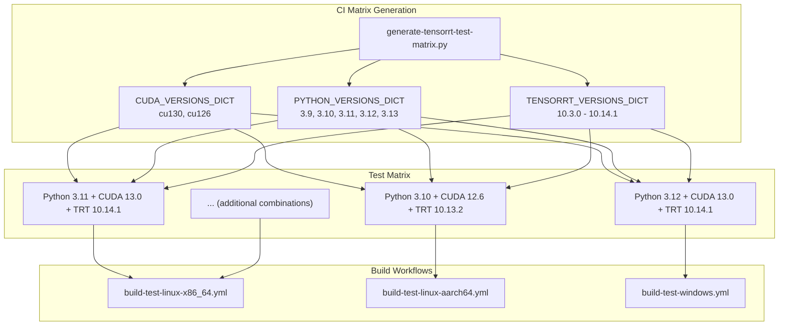

The matrix generation script filters valid combinations based on:
- Channel (nightly, test, release)
- Platform (linux, windows)
- TensorRT availability checks

**Sources:** [.github/scripts/generate-tensorrt-test-matrix.py:1-224](), [README.md:12-14]()

---

## Troubleshooting Common Issues

| Issue | Cause | Solution |
|-------|-------|----------|
| `Could not find bazel in PATH` | Bazel/Bazelisk not installed | Install bazelisk via package manager or manually |
| `CUDA not found` | CUDA not in standard location | Update `MODULE.bazel` with correct CUDA path |
| `TensorRT version mismatch` | Installed TensorRT incompatible | Install correct version: 10.14.1 (x86_64/Windows) or 10.3.0 (Jetson) |
| `torch not found during build` | PyTorch not installed | Install PyTorch before building: `pip install torch` |
| `Windows: fmt/format.h not found` | Missing fmt library in PyTorch include | [packaging/pre_build_script_windows.sh:32-36]() downloads and copies fmt |
| `Jetson: Wrong TensorRT version` | Using x86_64 TensorRT | Use JetPack TensorRT 10.3.0 and CUDA 12.6 |

**Sources:** [setup.py:177-183](), [packaging/pre_build_script_windows.sh:30-36]()

---

This concludes the installation and setup guide. For architecture details, see [System Architecture](#1.2). For usage examples, see [User Guide](#2).

---

# Page: System Architecture

# System Architecture

<details>
<summary>Relevant source files</summary>

The following files were used as context for generating this wiki page:

- [.github/scripts/generate-tensorrt-test-matrix.py](.github/scripts/generate-tensorrt-test-matrix.py)
- [.github/scripts/install-torch-tensorrt.sh](.github/scripts/install-torch-tensorrt.sh)
- [.gitignore](.gitignore)
- [MODULE.bazel](MODULE.bazel)
- [README.md](README.md)
- [core/compiler.cpp](core/compiler.cpp)
- [core/conversion/conversion.cpp](core/conversion/conversion.cpp)
- [core/conversion/conversionctx/ConversionCtx.cpp](core/conversion/conversionctx/ConversionCtx.cpp)
- [core/conversion/conversionctx/ConversionCtx.h](core/conversion/conversionctx/ConversionCtx.h)
- [core/partitioning/BUILD](core/partitioning/BUILD)
- [core/partitioning/partitioning.cpp](core/partitioning/partitioning.cpp)
- [core/partitioning/partitioning.h](core/partitioning/partitioning.h)
- [core/partitioning/partitioningctx/PartitioningCtx.cpp](core/partitioning/partitioningctx/PartitioningCtx.cpp)
- [core/partitioning/partitioningctx/PartitioningCtx.h](core/partitioning/partitioningctx/PartitioningCtx.h)
- [core/partitioning/segmentedblock/SegmentedBlock.cpp](core/partitioning/segmentedblock/SegmentedBlock.cpp)
- [core/partitioning/segmentedblock/SegmentedBlock.h](core/partitioning/segmentedblock/SegmentedBlock.h)
- [core/partitioning/shape_analysis.cpp](core/partitioning/shape_analysis.cpp)
- [core/partitioning/stitching.cpp](core/partitioning/stitching.cpp)
- [cpp/include/torch_tensorrt/macros.h](cpp/include/torch_tensorrt/macros.h)
- [dev_dep_versions.yml](dev_dep_versions.yml)
- [docsrc/conf.py](docsrc/conf.py)
- [docsrc/index.rst](docsrc/index.rst)
- [docsrc/requirements.txt](docsrc/requirements.txt)
- [examples/dynamo/README.rst](examples/dynamo/README.rst)
- [examples/dynamo/compile_with_dynamic_inputs.py](examples/dynamo/compile_with_dynamic_inputs.py)
- [examples/dynamo/custom_kernel_plugins.py](examples/dynamo/custom_kernel_plugins.py)
- [examples/dynamo/debugger_example.py](examples/dynamo/debugger_example.py)
- [examples/dynamo/dynamic_memory_allocation.py](examples/dynamo/dynamic_memory_allocation.py)
- [examples/dynamo/low_cpu_memory_compilation.py](examples/dynamo/low_cpu_memory_compilation.py)
- [examples/dynamo/refit_engine_example.py](examples/dynamo/refit_engine_example.py)
- [packaging/pre_build_script.sh](packaging/pre_build_script.sh)
- [packaging/pre_build_script_windows.sh](packaging/pre_build_script_windows.sh)
- [py/requirements.txt](py/requirements.txt)
- [pyproject.toml](pyproject.toml)
- [setup.py](setup.py)
- [tests/core/partitioning/test_conditionals.cpp](tests/core/partitioning/test_conditionals.cpp)
- [tests/core/partitioning/test_resolve_nontensor_inputs.cpp](tests/core/partitioning/test_resolve_nontensor_inputs.cpp)
- [tests/core/partitioning/test_segmentation.cpp](tests/core/partitioning/test_segmentation.cpp)
- [tests/core/partitioning/test_shape_analysis.cpp](tests/core/partitioning/test_shape_analysis.cpp)
- [tests/cpp/test_dynamic_fallback.cpp](tests/cpp/test_dynamic_fallback.cpp)
- [tests/py/requirements.txt](tests/py/requirements.txt)
- [toolchains/ci_workspaces/MODULE.bazel.tmpl](toolchains/ci_workspaces/MODULE.bazel.tmpl)
- [tools/perf/Flux/create_env.sh](tools/perf/Flux/create_env.sh)
- [uv.lock](uv.lock)
- [version.txt](version.txt)

</details>


## Purpose and Scope

This document describes the high-level architecture of Torch-TensorRT, explaining how the system compiles PyTorch models to optimized TensorRT engines through two distinct frontend paths. It covers the dual-frontend design, compilation pipelines, convergence on TensorRT, and the partitioning system for hybrid execution.

For installation and platform-specific setup instructions, see [Installation and Setup](#1.1). For detailed information about specific compilation workflows, see [User Guide](#2). For in-depth coverage of each frontend, see [Dynamo Frontend Architecture](#3) and [TorchScript Frontend Architecture](#4).

## Architecture Overview

Torch-TensorRT provides a **dual-frontend architecture** to support both modern PyTorch 2.x models and legacy TorchScript models. Both frontends ultimately produce TensorRT engines but differ significantly in their implementation, capabilities, and use cases.

### Entry Points and Frontend Selection

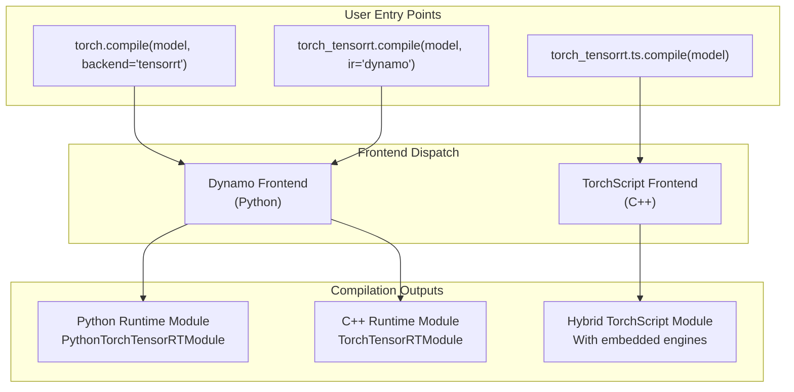

**Sources:** [README.md:37-93](), [py/torch_tensorrt/dynamo/_compiler.py:1-56](), [core/compiler.cpp:1-28]()

The system provides three main entry points:

| Entry Point | Frontend | Use Case | Python Runtime | C++ Runtime |
|------------|----------|----------|----------------|-------------|
| `torch.compile` | Dynamo | JIT compilation during first execution | ✓ | ✓ |
| `torch_tensorrt.compile(ir="dynamo")` | Dynamo | AOT compilation for deployment | ✓ | ✓ |
| `torch_tensorrt.ts.compile` | TorchScript | Legacy models, C++ deployment | ✗ | ✓ |

**Sources:** [README.md:37-93](), [py/torch_tensorrt/dynamo/_compiler.py:394-427]()

## Dynamo Frontend Architecture

The Dynamo frontend is implemented in Python and designed for PyTorch 2.x's `torch.export` API. It uses FX graphs as the intermediate representation and applies decompositions to break complex operations into TensorRT-compatible primitives.

### Dynamo Compilation Pipeline

```mermaid
graph LR
    INPUT["torch.nn.Module"]
    EXPORT["torch.export.export()<br/>ExportedProgram"]
    FXGRAPH["FX Graph<br/>torch.fx.GraphModule"]
    PRELOWER["pre_export_lowering()<br/>py/torch_tensorrt/dynamo/lowering"]
    DECOMP["Decompositions<br/>get_decompositions()<br/>_decompositions.py"]
    POSTLOWER["post_lowering()<br/>constant_folding, pass pipeline"]
    PARTITION["Partitioning<br/>resource_partition() or<br/>make_operator_support()"]
    INTERPRET["TRTInterpreter<br/>_TRTInterpreter.py<br/>Converts FX → TensorRT"]
    ENGINE["TensorRT Engine<br/>Serialized INetwork"]
    RUNTIME["Runtime Module<br/>PythonTorchTensorRTModule or<br/>TorchTensorRTModule"]
    
    INPUT --> EXPORT
    EXPORT --> FXGRAPH
    FXGRAPH --> PRELOWER
    PRELOWER --> DECOMP
    DECOMP --> POSTLOWER
    POSTLOWER --> PARTITION
    PARTITION --> INTERPRET
    INTERPRET --> ENGINE
    ENGINE --> RUNTIME
```

**Sources:** [py/torch_tensorrt/dynamo/_compiler.py:365-393](), [py/torch_tensorrt/dynamo/lowering/__init__.py](), [py/torch_tensorrt/dynamo/conversion/_TRTInterpreter.py:80-159]()

### Key Components in Dynamo Path

#### 1. Graph Export and Lowering

The compilation begins with `torch.export.export()` which produces an `ExportedProgram` containing an FX graph. This graph is then lowered through multiple passes:

- **Pre-export lowering** ([py/torch_tensorrt/dynamo/lowering/__init__.py]()): Prepares the graph before decompositions
- **Decompositions** ([py/torch_tensorrt/dynamo/lowering/_decompositions.py]()): Breaks complex ops into primitives using `get_decompositions()`
- **Post-lowering** ([py/torch_tensorrt/dynamo/lowering/__init__.py:post_lowering]()): Applies optimization passes including constant folding and graph cleanup

**Sources:** [py/torch_tensorrt/dynamo/_compiler.py:365-375](), [py/torch_tensorrt/dynamo/lowering/passes/constant_folding.py:23-29]()

#### 2. Operator Conversion Registry

The Dynamo frontend uses a **decorator-based converter registry** where each supported operation is registered using `@dynamo_tensorrt_converter`:

```python
@dynamo_tensorrt_converter(torch.ops.aten.conv2d.default)
def aten_ops_conv2d(ctx, target, args, kwargs, name):
    # Converter implementation
```

The registry is managed by the `DYNAMO_CONVERTERS` singleton in `_ConverterRegistry.py`.

**Sources:** [py/torch_tensorrt/dynamo/conversion/_ConverterRegistry.py](), [py/torch_tensorrt/dynamo/conversion/aten_ops_converters.py]()

#### 3. TRTInterpreter

The `TRTInterpreter` class ([py/torch_tensorrt/dynamo/conversion/_TRTInterpreter.py:80-219]()) is the core component that:

1. Creates a TensorRT builder and network: `self.builder = trt.Builder(self.logger)` and `self.ctx = ConversionContext(self.builder.create_network(flag), compilation_settings)`
2. Validates operator support via `validate_conversion()`
3. Iterates through FX nodes and invokes registered converters
4. Manages optimization profiles for dynamic shapes
5. Builds and serializes the TensorRT engine

**Sources:** [py/torch_tensorrt/dynamo/conversion/_TRTInterpreter.py:80-219]()

#### 4. Partitioning

Dynamo supports two partitioning strategies:
- **Fast partitioner** (adjacency-based, default): `use_fast_partitioner=True`
- **Global partitioner**: More optimal but slower

Partitioning identifies which subgraphs can run in TensorRT vs. PyTorch based on operator support, minimum block size, and user-specified constraints.

**Sources:** [py/torch_tensorrt/dynamo/partitioning/](), [py/torch_tensorrt/dynamo/_compiler.py:388-393]()

## TorchScript Frontend Architecture

The TorchScript frontend is implemented in C++ and designed for legacy models using `torch.jit.script` or `torch.jit.trace`. It includes sophisticated graph partitioning capabilities for hybrid execution.

### TorchScript Compilation Pipeline

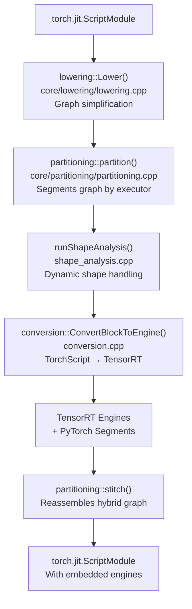

**Sources:** [core/compiler.cpp:300-327](), [core/partitioning/partitioning.cpp:567-610](), [core/conversion/conversion.cpp:491-499]()

### Key Components in TorchScript Path

#### 1. Graph Lowering

The `lowering::Lower()` function ([core/lowering/lowering.cpp]()) performs multiple graph transformations:
- Exception elimination
- Constant folding
- Dead code elimination
- Conv/BN fusion
- Operator unpacking

This produces a simplified JIT graph and extracts static parameters (weights).

**Sources:** [core/compiler.cpp:302](), [core/lowering/lowering.cpp]()

#### 2. Partitioning System

The partitioning system ([core/partitioning/partitioning.cpp:567-610]()) is the most distinctive feature of the TorchScript frontend. It analyzes the graph to determine which nodes can execute in TensorRT:

```cpp
void partition(PartitioningCtx* ctx, bool expect_full_compilation) {
    // Build node executor decision LUT
    setNodeExecutorLUT(ctx, block);
    
    // Segment the graph into TensorRT and PyTorch blocks
    segmentGraph(ctx, block);
    
    // Resolve non-tensor inputs between segments
    resolveTRTNonTensorInputs(ctx, block);
    
    // Run shape analysis for each segment
    runShapeAnalysis(ctx, block, ...);
}
```

**Partitioning Decision Process:**

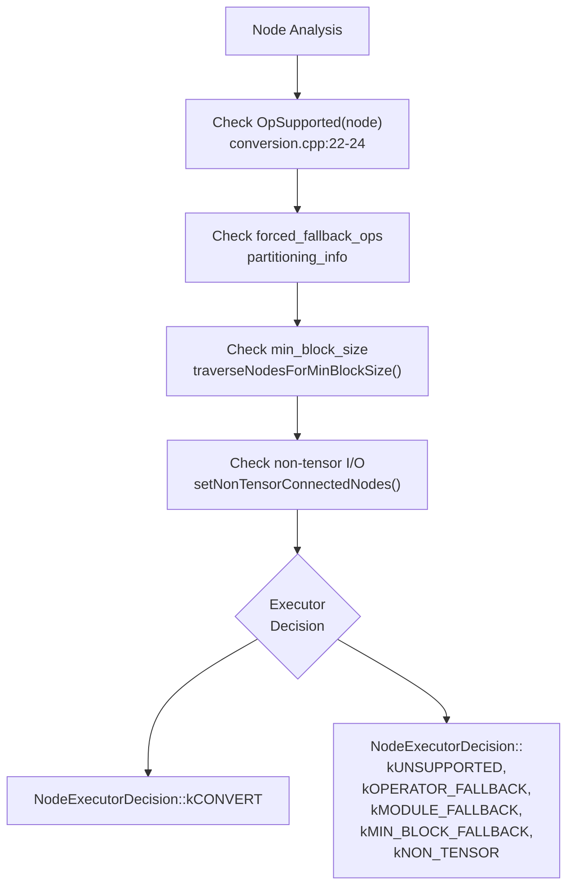

**Sources:** [core/partitioning/partitioning.cpp:367-388](), [core/partitioning/partitioning.cpp:65-94](), [core/partitioning/partitioning.cpp:187-201]()

The `PartitioningCtx` struct maintains:
- `node_executor_decision`: Maps each node to its execution target
- `partitioned_blocks`: Maps blocks to their segmented subgraphs
- `min_input_ivalues_map`, `opt_input_ivalues_map`, `max_input_ivalues_map`: Shape profiles

**Sources:** [core/partitioning/partitioningctx/PartitioningCtx.h]()

#### 3. Shape Analysis

For dynamic shapes, `runShapeAnalysis()` ([core/partitioning/shape_analysis.cpp:345-357]()) executes each segment with min/opt/max input shapes to infer output shapes. This enables the system to:

1. Generate random inputs for each shape mode via `generateRandomInputs()` ([core/partitioning/shape_analysis.cpp:52-84]())
2. Execute PyTorch segments to get actual output shapes
3. Insert type casts (INT64→INT32, UINT8→INT32) for TensorRT compatibility
4. Register input shapes for each segment via `seg_block.register_inshapes()`

**Sources:** [core/partitioning/shape_analysis.cpp:150-343](), [core/partitioning/partitioning.cpp:599-608]()

#### 4. Conversion and Engine Building

The `conversion::ConvertBlockToEngine()` function ([core/conversion/conversion.cpp:491-499]()) converts a TorchScript block to a serialized TensorRT engine:

```cpp
std::string ConvertBlockToEngine(
    const torch::jit::Block* b,
    ConversionInfo build_info,
    ir::StaticParams& static_params) {
    ConversionCtx ctx(build_info.engine_settings);
    ConvertBlockToNetDef(&ctx, b, build_info, static_params);
    std::string engine = ctx.SerializeEngine();
    return engine;
}
```

The `ConversionCtx` ([core/conversion/conversionctx/ConversionCtx.h:40-71]()) manages:
- `builder`: TensorRT builder instance
- `net`: TensorRT network definition
- `cfg`: Builder configuration
- `value_tensor_map`: Maps JIT values to ITensors
- `evaluated_value_map`: Maps JIT values to evaluated IValues

**Sources:** [core/conversion/conversion.cpp:402-485](), [core/conversion/conversionctx/ConversionCtx.cpp:39-131]()

#### 5. Stitching

After conversion, `partitioning::stitch()` reassembles the hybrid graph by:
1. Creating a new graph structure
2. Inserting TensorRT engine execution nodes via `AddEngineToGraph()`
3. Connecting PyTorch and TensorRT segments with proper input/output mappings

**Sources:** [core/compiler.cpp:136-216](), [core/compiler.cpp:30-124]()

## Convergence: TensorRT Engine Creation

Both frontends ultimately create TensorRT engines through similar low-level operations, despite different high-level representations:

### Common TensorRT Builder Flow

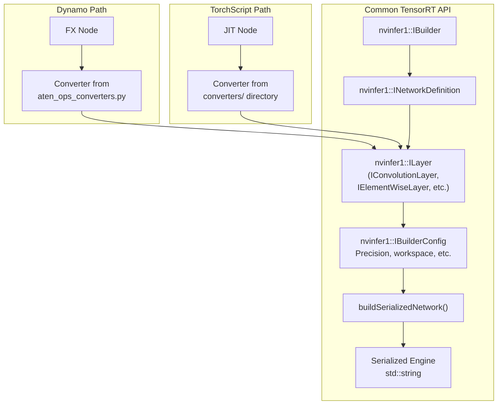

**Sources:** [py/torch_tensorrt/dynamo/conversion/_TRTInterpreter.py:94-112](), [core/conversion/conversionctx/ConversionCtx.cpp:39-131]()

### Builder Configuration

Both frontends configure the TensorRT builder with similar settings:

| Setting | Dynamo | TorchScript | Purpose |
|---------|--------|-------------|---------|
| Precision modes | `compilation_settings.enabled_precisions` | `BuilderSettings.enabled_precisions` | FP32, FP16, BF16, INT8 |
| Workspace size | `compilation_settings.workspace_size` | `BuilderSettings.workspace_size` | Memory for tactics |
| TF32 mode | `compilation_settings.disable_tf32` | `BuilderSettings.disable_tf32` | Control tensor core usage |
| Optimization profiles | Created in `TRTInterpreter.__init__()` | Created in `ConversionCtx` | Dynamic shape support |
| Engine capability | `compilation_settings.engine_capability` | `BuilderSettings.capability` | DLA vs. GPU |

**Sources:** [py/torch_tensorrt/dynamo/_settings.py:59-149](), [core/conversion/conversionctx/ConversionCtx.h:19-38]()

### Converter Organization

| Operation Category | Dynamo Converters | TorchScript Converters |
|-------------------|-------------------|------------------------|
| Element-wise | `py/torch_tensorrt/dynamo/conversion/aten_ops_converters.py` | `core/conversion/converters/impl/element_wise.cpp` |
| Convolution | `py/torch_tensorrt/dynamo/conversion/impl/conv_deconv.py` | `core/conversion/converters/impl/conv_deconv.cpp` |
| Reduction | `py/torch_tensorrt/dynamo/conversion/impl/reduce.py` | `core/conversion/converters/impl/reduce.cpp` |
| Selection/Slicing | `py/torch_tensorrt/dynamo/conversion/impl/select.py` | `core/conversion/converters/impl/select.cpp` |
| Normalization | `py/torch_tensorrt/dynamo/conversion/impl/normalization/` | `core/conversion/converters/impl/normalization.cpp` |

**Sources:** [py/torch_tensorrt/dynamo/conversion/](), [core/conversion/converters/impl/]()

## Partitioning and Hybrid Execution

The partitioning system enables **hybrid execution** where unsupported operations fall back to PyTorch while supported operations run in TensorRT. This is fully implemented in the TorchScript frontend and partially in the Dynamo frontend.

### TorchScript Partitioning (Full Hybrid Support)

The TorchScript partitioning system creates a `PartitionedGraph` containing `SegmentedBlock` objects:

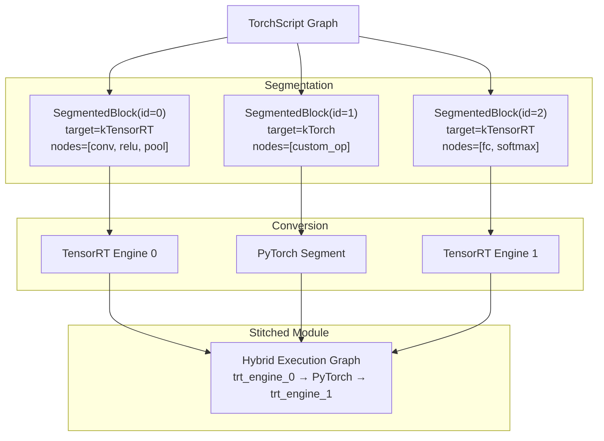

**Sources:** [core/partitioning/partitioning.cpp:443-526](), [core/partitioning/SegmentedBlock.h]()

**Key Partitioning Rules:**

1. **Minimum Block Size** ([core/partitioning/partitioning.cpp:155-184]()): TensorRT segments must have at least `min_block_size` contiguous convertible operations (default 3)
2. **Non-Tensor Dependencies** ([core/partitioning/partitioning.cpp:98-129]()): Nodes producing/consuming non-tensor values used by fallback nodes must also fall back
3. **Forced Fallback** ([core/partitioning/partitioning.cpp:82-84]()): User-specified operators/modules always run in PyTorch
4. **Conditional Blocks** ([core/partitioning/partitioning.cpp:492-504]()): `prim::If` nodes are isolated in separate segments

**Sources:** [core/partitioning/partitioning.cpp:367-388]()

### Dynamo Partitioning (Limited Hybrid Support)

The Dynamo frontend uses a simpler partitioning approach:

- **Fast partitioner**: Adjacency-based, creates segments of consecutive supported ops
- **Global partitioner**: More optimal graph cuts but slower

Partitioning is configured via `torch_executed_ops` and `min_block_size` in `CompilationSettings`.

**Sources:** [py/torch_tensorrt/dynamo/partitioning/](), [py/torch_tensorrt/dynamo/_compiler.py:388-393]()

## Runtime Execution

### Dynamo Runtime Modules

The Dynamo frontend produces two possible runtime implementations:

1. **PythonTorchTensorRTModule** ([py/torch_tensorrt/dynamo/runtime/_PythonTorchTensorRTModule.py]()): Pure Python runtime using `tensorrt` bindings
2. **TorchTensorRTModule** ([cpp/src/runtime/TorchTensorRTModule.cpp]()): C++ runtime compiled as PyTorch extension

Selection is controlled by `use_python_runtime` in compilation settings:

```python
if use_python_runtime_parser(compilation_settings.use_python_runtime):
    return PythonTorchTensorRTModule(...)
else:
    return TorchTensorRTModule(...)
```

**Sources:** [py/torch_tensorrt/dynamo/conversion/_conversion.py:217-249](), [py/torch_tensorrt/dynamo/utils.py:142-170]()

### TorchScript Runtime

TorchScript modules use the C++ runtime exclusively. Engines are embedded as custom class attributes via `runtime::TRTEngine`:

```cpp
auto engine_ptr = c10::make_intrusive<runtime::TRTEngine>(
    mod._ivalue()->name() + "_engine_" + engine_id,
    serialized_engine,
    device_info,
    input_binding_names,
    output_binding_names);
mod.register_attribute(name, ..., c10::IValue(std::move(engine_ptr)), false);
```

At runtime, the `tensorrt::execute_engine` operator executes the engine.

**Sources:** [core/compiler.cpp:30-124](), [core/runtime/runtime.h]()

## Platform Support Matrix

| Platform | Dynamo Support | TorchScript Support | TensorRT Version | CUDA Version |
|----------|----------------|---------------------|------------------|--------------|
| Linux x86_64 | ✓ | ✓ | 10.14.1 | 13.0 |
| Linux SBSA (ARM server) | ✓ | ✓ | 10.14.1 | 13.0 |
| Jetson / Tegra | ✓ | ✓ | 10.3.0 | 12.6 |
| Windows x86_64 | ✓ | Limited | 10.14.1 | 13.0 |

**Build Configuration:**

The build system ([setup.py:1-452]()) uses:
- **setup.py**: Python orchestrator that invokes Bazel for C++ compilation
- **Bazel**: Builds C++ components with platform-specific configs
- **Platform detection**: Automatic via `IS_AARCH64`, `IS_JETPACK`, `IS_SBSA`, `IS_WINDOWS` flags

**Sources:** [README.md:106-127](), [setup.py:91-174](), [MODULE.bazel:1-90]()

## Summary

The Torch-TensorRT dual-frontend architecture provides flexibility for different use cases:

- **Dynamo frontend**: Modern Python-based path for PyTorch 2.x with simpler implementation and better ecosystem integration
- **TorchScript frontend**: Mature C++-based path with sophisticated partitioning for complex hybrid execution scenarios

Both converge on TensorRT's low-level API to produce optimized engines, enabling up to 5x speedups over eager execution while maintaining PyTorch integration.

**Sources:** [README.md:1-142](), [core/compiler.cpp:334-427](), [py/torch_tensorrt/dynamo/_compiler.py:114-427]()

---

# Page: User Guide

# User Guide

<details>
<summary>Relevant source files</summary>

The following files were used as context for generating this wiki page:

- [.github/scripts/generate-tensorrt-test-matrix.py](.github/scripts/generate-tensorrt-test-matrix.py)
- [.github/scripts/install-torch-tensorrt.sh](.github/scripts/install-torch-tensorrt.sh)
- [MODULE.bazel](MODULE.bazel)
- [README.md](README.md)
- [cpp/include/torch_tensorrt/macros.h](cpp/include/torch_tensorrt/macros.h)
- [dev_dep_versions.yml](dev_dep_versions.yml)
- [packaging/pre_build_script.sh](packaging/pre_build_script.sh)
- [packaging/pre_build_script_windows.sh](packaging/pre_build_script_windows.sh)
- [py/requirements.txt](py/requirements.txt)
- [pyproject.toml](pyproject.toml)
- [setup.py](setup.py)
- [tests/py/requirements.txt](tests/py/requirements.txt)
- [toolchains/ci_workspaces/MODULE.bazel.tmpl](toolchains/ci_workspaces/MODULE.bazel.tmpl)
- [tools/perf/Flux/create_env.sh](tools/perf/Flux/create_env.sh)
- [uv.lock](uv.lock)
- [version.txt](version.txt)

</details>


This section covers practical usage of Torch-TensorRT for optimizing and deploying PyTorch models. It describes the available compilation workflows, input configuration, precision options, and debugging tools.

For background on the system's internal architecture, see the [System Architecture](#1.2) page. For information about building from source, see [Build System and Development](#7).

---

## Overview

Torch-TensorRT compiles PyTorch models to run on NVIDIA GPUs using TensorRT. It provides two primary user-facing compilation workflows:

| Workflow | Entry Point | When to Use |
|---|---|---|
| **JIT (`torch.compile`)** | `torch.compile(model, backend="tensorrt")` | Development, experimentation, minimal code changes |
| **AOT (Export)** | `torch_tensorrt.compile(model, ir="dynamo")` | Deployment, serialization, C++ inference |
| **TorchScript** | `torch_tensorrt.compile(model, ir="ts")` | Legacy TorchScript workflows |

The JIT workflow compiles lazily on the first forward pass. The AOT workflows compile ahead of time and produce serializable artifacts. The TorchScript workflow is considered legacy; prefer the Dynamo-based workflows for new projects.

---

## Compilation Workflows

**Workflow decision diagram:**

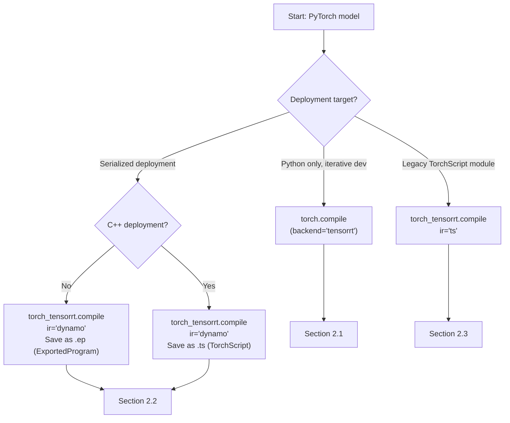

### JIT Compilation (`torch.compile`)

Use `torch.compile` with `backend="tensorrt"` for drop-in TensorRT acceleration. The model is traced and compiled on the first call, and subsequent calls use the compiled engine.

See [JIT Compilation with torch.compile](#2.1) for full details.

### AOT Compilation and Export

Use `torch_tensorrt.compile` with `ir="dynamo"` to produce a compiled `GraphModule`. Save to an `ExportedProgram` (`.ep`) for Python deployment, or to a TorchScript file (`.ts`) for C++ deployment via `libtorch`.

The primary save function is `torch_tensorrt.save`, which delegates to the appropriate serializer based on the `output_format` argument.

See [AOT Compilation and Export](#2.2) for full details.

### TorchScript Compilation

`torch_tensorrt.compile` with `ir="ts"` targets the TorchScript C++ backend. This path is driven by the `torch_tensorrt.ts` package and the `torchtrtc` CLI tool.

See [TorchScript Compilation](#2.3) for full details.

---

## Key Configuration Concepts

**Concept-to-code mapping:**

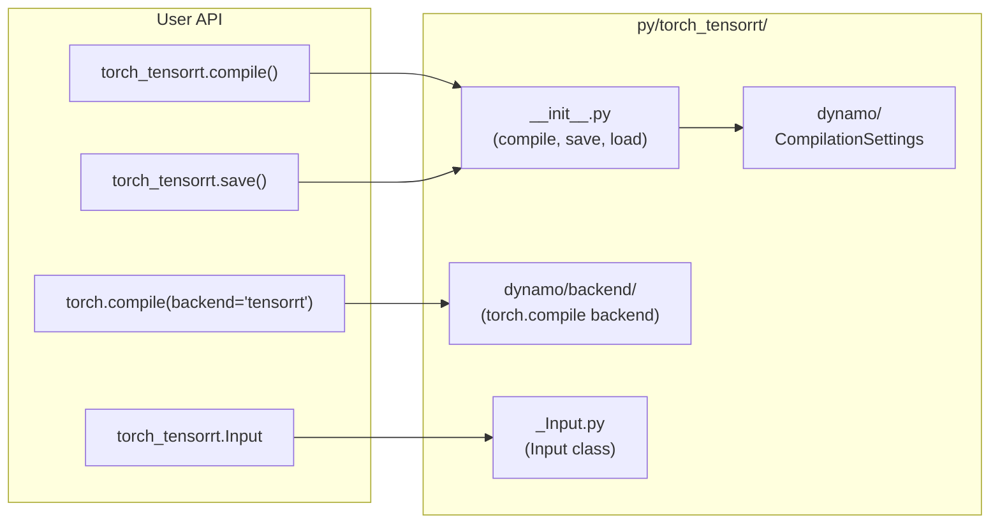

### `torch_tensorrt.Input`

Input specifications are declared with `torch_tensorrt.Input` (defined in [py/torch_tensorrt/_Input.py]()). Each `Input` specifies:

- **Static shape**: a single tuple
- **Dynamic shape**: `min`, `opt`, and `max` shape tuples

The `enabled_precisions` argument on `torch_tensorrt.compile` accepts a set of `torch.dtype` values (e.g., `{torch.float16}`) and controls which TensorRT kernel precisions are enabled.

See [Precision Modes](#2.4) and [Dynamic Shapes and Input Specifications](#2.5).

### `CompilationSettings`

All compilation parameters are gathered into a `CompilationSettings` dataclass in [py/torch_tensorrt/dynamo/_settings.py](). These settings control partitioning behavior, precision, caching, and more. They are passed through `torch_tensorrt.compile` as keyword arguments or as part of the `torch.compile` backend options dict.

See [Compilation Settings and Configuration](#2.6).

---

## Serialization and Deployment

**Save/load flow:**

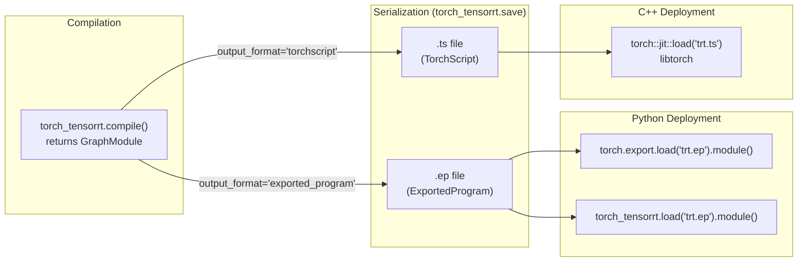

> **Note:** `ExportedProgram` (`.ep`) only supports the Python runtime. For C++ deployment without a Python dependency, save as TorchScript (`.ts`).

---

## Platform Support

| Platform | Support |
|---|---|
| Linux AMD64 / GPU | Supported |
| Linux SBSA (aarch64) / GPU | Supported |
| Windows / GPU | Supported (Dynamo only) |
| Linux Jetson / GPU | Source compilation, JetPack 4.4+ |
| Linux Jetson / DLA | Source compilation, JetPack 4.4+ |
| Linux ppc64le / GPU | Not supported |

Sources: [README.md:106-114]()

---

## Dependency Versions

| Dependency | Version |
|---|---|
| Python | ≥ 3.10 |
| PyTorch | 2.12.x (nightly) |
| CUDA | 13.0 (12.6 on Jetson) |
| TensorRT | 10.15.x (10.3.x on Jetson) |

Sources: [dev_dep_versions.yml:1-4](), [pyproject.toml:35](), [MODULE.bazel:39]()

---

## Section Index

| Section | Topic |
|---|---|
| [2.1 JIT Compilation with torch.compile](#2.1) | `torch.compile` with `backend="tensorrt"` |
| [2.2 AOT Compilation and Export](#2.2) | `torch_tensorrt.compile`, `torch_tensorrt.save`, `.ep` / `.ts` |
| [2.3 TorchScript Compilation](#2.3) | Legacy `ir="ts"` path and `torchtrtc` CLI |
| [2.4 Precision Modes](#2.4) | `enabled_precisions`, FP32/FP16/INT8, PTQ/QAT calibration |
| [2.5 Dynamic Shapes and Input Specifications](#2.5) | `torch_tensorrt.Input`, min/opt/max profiles |
| [2.6 Compilation Settings and Configuration](#2.6) | `CompilationSettings` parameters |
| [2.7 Debugging and Profiling](#2.7) | `Debugger` context manager, engine profiling hooks |

Sources: [README.md:37-93](), [setup.py:462-527](), [pyproject.toml:14-53]()

---

# Page: JIT Compilation with torch.compile

# JIT Compilation with torch.compile

<details>
<summary>Relevant source files</summary>

The following files were used as context for generating this wiki page:

- [.github/scripts/generate-tensorrt-test-matrix.py](.github/scripts/generate-tensorrt-test-matrix.py)
- [.github/scripts/install-torch-tensorrt.sh](.github/scripts/install-torch-tensorrt.sh)
- [.gitignore](.gitignore)
- [MODULE.bazel](MODULE.bazel)
- [README.md](README.md)
- [cpp/include/torch_tensorrt/macros.h](cpp/include/torch_tensorrt/macros.h)
- [dev_dep_versions.yml](dev_dep_versions.yml)
- [docsrc/conf.py](docsrc/conf.py)
- [docsrc/contributors/writing_dynamo_aten_lowering_passes.rst](docsrc/contributors/writing_dynamo_aten_lowering_passes.rst)
- [docsrc/index.rst](docsrc/index.rst)
- [docsrc/requirements.txt](docsrc/requirements.txt)
- [examples/dynamo/README.rst](examples/dynamo/README.rst)
- [examples/dynamo/compile_with_dynamic_inputs.py](examples/dynamo/compile_with_dynamic_inputs.py)
- [examples/dynamo/custom_kernel_plugins.py](examples/dynamo/custom_kernel_plugins.py)
- [examples/dynamo/debugger_example.py](examples/dynamo/debugger_example.py)
- [examples/dynamo/dynamic_memory_allocation.py](examples/dynamo/dynamic_memory_allocation.py)
- [examples/dynamo/low_cpu_memory_compilation.py](examples/dynamo/low_cpu_memory_compilation.py)
- [examples/dynamo/refit_engine_example.py](examples/dynamo/refit_engine_example.py)
- [packaging/pre_build_script.sh](packaging/pre_build_script.sh)
- [packaging/pre_build_script_windows.sh](packaging/pre_build_script_windows.sh)
- [py/requirements.txt](py/requirements.txt)
- [py/torch_tensorrt/dynamo/backend/backends.py](py/torch_tensorrt/dynamo/backend/backends.py)
- [py/torch_tensorrt/dynamo/lowering/passes/constant_folding.py](py/torch_tensorrt/dynamo/lowering/passes/constant_folding.py)
- [py/torch_tensorrt/dynamo/lowering/passes/fuse_prims_broadcast.py](py/torch_tensorrt/dynamo/lowering/passes/fuse_prims_broadcast.py)
- [py/torch_tensorrt/dynamo/lowering/passes/pass_manager.py](py/torch_tensorrt/dynamo/lowering/passes/pass_manager.py)
- [py/torch_tensorrt/dynamo/lowering/passes/remove_input_alias_fixing_clones.py](py/torch_tensorrt/dynamo/lowering/passes/remove_input_alias_fixing_clones.py)
- [py/torch_tensorrt/dynamo/lowering/passes/repair_input_as_output.py](py/torch_tensorrt/dynamo/lowering/passes/repair_input_as_output.py)
- [pyproject.toml](pyproject.toml)
- [setup.py](setup.py)
- [tests/py/dynamo/testing_utilities.py](tests/py/dynamo/testing_utilities.py)
- [tests/py/requirements.txt](tests/py/requirements.txt)
- [toolchains/ci_workspaces/MODULE.bazel.tmpl](toolchains/ci_workspaces/MODULE.bazel.tmpl)
- [tools/perf/Flux/create_env.sh](tools/perf/Flux/create_env.sh)
- [uv.lock](uv.lock)
- [version.txt](version.txt)

</details>


## Purpose and Scope

This page describes how to use Torch-TensorRT for Just-In-Time (JIT) compilation via PyTorch's `torch.compile` interface with `backend='tensorrt'`. The compilation happens automatically during the first model execution, and subsequent runs leverage the compiled TensorRT engine for accelerated inference.

**Related pages:**
- For Ahead-of-Time (AOT) compilation and model export, see [AOT Compilation and Export](#2.2)
- For TorchScript-based compilation, see [TorchScript Compilation](#2.3)
- For detailed compilation settings, see [Compilation Settings and Configuration](#2.6)

## What is JIT Compilation?

JIT compilation with `torch.compile` defers TensorRT engine building until the first model execution. The key characteristics are:

| Aspect | JIT Compilation | AOT Compilation |
|--------|----------------|-----------------|
| **When compilation occurs** | First forward pass | Before deployment |
| **Input specification** | Inferred from runtime tensors | Explicitly specified via `torch_tensorrt.Input` |
| **Deployment workflow** | Load model, compile on-demand | Compile once, deploy serialized artifact |
| **Flexibility** | Easy iteration during development | Optimized for production |
| **Use case** | Development, prototyping | Production deployment |

Sources: [README.md:39-53](), [py/torch_tensorrt/dynamo/backend/backends.py:32-47]()

## Basic Usage

### Minimal Example

```python
import torch
import torch_tensorrt

# Define your model
model = MyModel().eval().cuda()

# Create sample input
x = torch.randn((1, 3, 224, 224)).cuda()

# Compile with TensorRT backend
optimized_model = torch.compile(model, backend="tensorrt")

# First execution triggers compilation
output = optimized_model(x)  # Compiles on first run

# Subsequent executions use cached TensorRT engine
output = optimized_model(x)  # Fast!
```

The `torch.compile` call returns a wrapped model that:
1. Intercepts the first forward pass
2. Captures the computation graph via PyTorch's Dynamo
3. Converts the graph to TensorRT
4. Caches the TensorRT engine
5. Executes subsequent forward passes using the cached engine

Sources: [README.md:39-53](), [py/torch_tensorrt/dynamo/backend/backends.py:32-96]()

### Compilation Options

You can pass compilation settings through `torch.compile` options:

```python
optimized_model = torch.compile(
    model,
    backend="tensorrt",
    options={
        "enabled_precisions": {torch.float16},  # Enable FP16
        "debug": False,
        "min_block_size": 3,
        "optimization_level": 3,
    }
)
```

Common options include:

| Option | Type | Default | Description |
|--------|------|---------|-------------|
| `enabled_precisions` | Set[dtype] | `{torch.float}` | Kernel precision modes (FP32, FP16, BF16, INT8) |
| `min_block_size` | int | `5` | Minimum operators per TensorRT block |
| `optimization_level` | int | `3` | TensorRT builder optimization level (0-5) |
| `debug` | bool | `False` | Enable verbose debug logging |
| `truncate_double` | bool | `False` | Convert FP64 to FP32 |

Sources: [py/torch_tensorrt/dynamo/_defaults.py:1-70](), [py/torch_tensorrt/dynamo/_settings.py:59-129]()

## Compilation Flow

**`torch.compile` Backend Dispatch Flow**

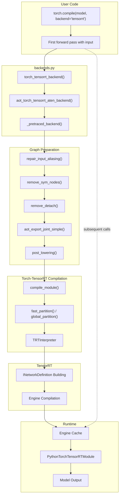

**Flow Explanation:**

1. `torch.compile(model, backend="tensorrt")` registers `torch_tensorrt_backend` as the compiler
2. On the **first forward pass**, Dynamo captures the graph and calls `torch_tensorrt_backend`
3. `torch_tensorrt_backend` delegates to `aot_torch_tensorrt_aten_backend`, then `_pretraced_backend`
4. `_pretraced_backend` applies graph preparation passes:
   - `repair_input_aliasing` — fixes aliased graph inputs
   - `remove_sym_nodes` — strips symbolic integer placeholders
   - `remove_detach` — removes detach nodes
   - `aot_export_joint_simple` — lowers to ATen operators
   - `post_lowering` — applies Torch-TensorRT lowering passes
5. `compile_module` partitions and converts the lowered graph to TensorRT engines
6. Compiled engines are cached; **subsequent calls** skip all compilation steps

Sources: [py/torch_tensorrt/dynamo/backend/backends.py:32-190](), [py/torch_tensorrt/dynamo/_compiler.py]()

## Key Components

**Backend Registration and Dispatch**

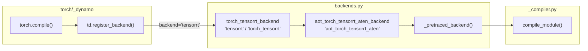

### Backend Functions

The backend is registered in `py/torch_tensorrt/dynamo/backend/backends.py` using the `@td.register_backend` decorator. Two backend names are registered:

| Name | Function | Notes |
|------|----------|-------|
| `"tensorrt"` | `torch_tensorrt_backend` | Primary alias |
| `"torch_tensorrt"` | `torch_tensorrt_backend` | Alternative alias |
| `"aot_torch_tensorrt_aten"` | `aot_torch_tensorrt_aten_backend` | Internal; used for distributed tracing |

Sources: [py/torch_tensorrt/dynamo/backend/backends.py:32-47]()

### `_pretraced_backend`

The core compilation function. Receives a `torch.fx.GraphModule` from Dynamo and sample inputs, applies pre-processing, then calls `compile_module`.

**Inputs:**
- `gm: torch.fx.GraphModule` — Dynamo-traced graph
- `sample_inputs: Sequence[Any]` — Sample tensors from the first forward pass
- `settings: CompilationSettings` — Parsed from `torch.compile` options
- `engine_cache: Any` — Optional engine cache instance

**Pre-processing steps (in order):**
1. `repair_input_aliasing(gm, settings)` — Fixes aliased inputs
2. `remove_sym_nodes(gm, sample_inputs, settings)` — Removes symbolic int placeholders
3. `remove_detach(gm, settings)` — Removes detach nodes
4. `aot_export_joint_simple(...)` — ATen decomposition via AOTAutograd
5. `post_lowering(gm, settings)` — Applies registered Torch-TensorRT lowering passes

On failure, if `settings.pass_through_build_failures` is `False` (default), the original `gm` is returned and execution falls back to eager PyTorch.

Sources: [py/torch_tensorrt/dynamo/backend/backends.py:99-190]()

### `CompilationSettings`

All `options` passed to `torch.compile` are parsed into a `CompilationSettings` dataclass via `parse_dynamo_kwargs`.

**Key Fields:**

| Field | Type | Default | Description |
|-------|------|---------|-------------|
| `enabled_precisions` | `Set[dtype]` | `{torch.float}` | Kernel precision modes |
| `device` | `Device` | Current CUDA device | Target GPU |
| `min_block_size` | `int` | `5` | Minimum ops per TRT block |
| `optimization_level` | `int` | `3` | Builder optimization (0–5) |
| `workspace_size` | `int` | `0` | TRT tactics memory in bytes |
| `use_python_runtime` | `bool` | auto | Force Python or C++ runtime |
| `pass_through_build_failures` | `bool` | `False` | Raise or warn on TRT build errors |

Sources: [py/torch_tensorrt/dynamo/backend/backends.py:54-55](), [py/torch_tensorrt/dynamo/_settings.py](), [py/torch_tensorrt/dynamo/_defaults.py]()

### `TRTInterpreter`

Walks the lowered FX graph and builds a TensorRT `INetworkDefinition`. Called by `compile_module` for each TensorRT-eligible subgraph after partitioning.

**Responsibilities:**
1. Validates all operations have registered converters
2. Creates TensorRT `IBuilder` and `INetworkDefinition`
3. Manages optimization profiles for dynamic shapes
4. Dispatches each FX node to its converter
5. Builds and serializes the engine

**Key methods:** `run()`, `call_function()`, `call_method()`, `call_module()`, `validate_conversion()`

Sources: [py/torch_tensorrt/dynamo/conversion/_TRTInterpreter.py]()

## Dynamic Shapes Handling

JIT compilation can handle dynamic input shapes by:

1. **Marking dimensions as dynamic** using `torch._dynamo.mark_dynamic()` before the first call
2. **Detecting symbolic shapes** in the captured FX graph
3. **Creating optimization profiles** with min/opt/max shape ranges
4. **Building a single engine** that supports the shape range

To mark a dimension as dynamic, call `torch._dynamo.mark_dynamic(tensor, index, min=..., max=...)` on the input before the first forward pass. This signals to Dynamo that the specified dimension is variable-length, and Torch-TensorRT will construct a TensorRT optimization profile covering the given range.

See `examples/dynamo/compile_with_dynamic_inputs.py` for a worked example demonstrating this pattern alongside the AOT approach.

Sources: [examples/dynamo/compile_with_dynamic_inputs.py:55-72](), [py/torch_tensorrt/dynamo/backend/backends.py:99-190]()

## Engine Caching

### In-Memory Caching

By default, compiled TensorRT engines are cached in memory to avoid recompilation:

| Property | Value |
|----------|-------|
| **Key** | Hash of graph structure + input shapes + compilation settings |
| **Value** | Serialized TensorRT engine bytes |
| **Lifetime** | Until model object is deleted or process ends |

### Disk Caching

For persistence across sessions, enable disk caching through the `options` dict:

```python
options={
    "cache_built_engines": True,
    "reuse_cached_engines": True,
    "engine_cache_dir": "./engine_cache",
    "engine_cache_size": 1_000_000_000,  # 1GB
}
```

**Disk Cache Options:**

| Option | Description |
|--------|-------------|
| `cache_built_engines` | Save engines to disk after building |
| `reuse_cached_engines` | Load matching engines from disk if available |
| `engine_cache_dir` | Directory for cached engine files |
| `engine_cache_size` | Maximum cache size in bytes |
| `custom_engine_cache` | Custom `BaseEngineCache` implementation |

`DiskEngineCache` (in `py/torch_tensorrt/dynamo/_engine_cache.py`) handles serialization, LRU eviction, and file locking for multi-process safety.

Sources: [py/torch_tensorrt/dynamo/_engine_cache.py](), [py/torch_tensorrt/dynamo/_defaults.py]()

## Runtime Modes

Two runtime classes execute the compiled TensorRT engines:

| Runtime | Class | Notes |
|---------|-------|-------|
| Python | `PythonTorchTensorRTModule` | Default; no C++ extension required |
| C++ | `TorchTensorRTModule` | Lower per-call overhead; requires compiled C++ extension |

The runtime is auto-detected by attempting to import the C++ extension (`torch_tensorrt._C`). Override via the `use_python_runtime` option:

- `use_python_runtime=True` — force Python runtime
- `use_python_runtime=False` — force C++ runtime (raises if unavailable)

Sources: [py/torch_tensorrt/dynamo/runtime](), [py/torch_tensorrt/dynamo/_defaults.py]()

## Compilation Settings Reference

All settings are passed via the `options` dict to `torch.compile`. They are parsed from kwargs into a `CompilationSettings` instance by `parse_dynamo_kwargs` in `py/torch_tensorrt/dynamo/utils.py`.

### Precision Control

| Option | Description |
|--------|-------------|
| `enabled_precisions` | Set of `torch.dtype` — e.g., `{torch.float16, torch.float32}` |
| `use_fp32_acc` | Insert FP32 cast nodes around matmul for accumulation precision |
| `truncate_double` | Truncate FP64 inputs/weights to FP32 |

See page 2.4 for detailed precision configuration.

### Graph Partitioning

| Option | Description |
|--------|-------------|
| `min_block_size` | Minimum consecutive ops to form a TRT subgraph |
| `torch_executed_ops` | Set of op names forced to run in PyTorch |
| `require_full_compilation` | **Not applicable in `torch.compile` mode** — logged as a warning |
| `use_fast_partitioner` | Use adjacency-based (fast) vs. global partitioner |

Note: `require_full_compilation` is silently ignored when using `torch.compile` and triggers a warning.

### Memory and Performance

| Option | Description |
|--------|-------------|
| `workspace_size` | TRT builder workspace in bytes |
| `optimization_level` | Builder optimization intensity (0–5); higher = slower build, faster runtime |
| `num_avg_timing_iters` | Kernel timing iterations for tactic selection |
| `max_aux_streams` | Maximum auxiliary CUDA streams per engine |

### Unsupported in `torch.compile` Mode

The following `CompilationSettings` fields are **not applicable** when using `torch.compile` and are either ignored or raise a warning:

| Option | Behavior |
|--------|----------|
| `require_full_compilation` | Warning logged; ignored |
| `strip_engine_weights` | Forced to `False`; warning logged |
| `offload_module_to_cpu` | Warning logged; ignored |

Sources: [py/torch_tensorrt/dynamo/backend/backends.py:92-96](), [py/torch_tensorrt/dynamo/backend/backends.py:157-165](), [py/torch_tensorrt/dynamo/_settings.py](), [py/torch_tensorrt/dynamo/_defaults.py]()

## Debugging and Profiling

### Enable Debug Logging

```python
import logging
logging.basicConfig(level=logging.DEBUG)

optimized_model = torch.compile(
    model,
    backend="tensorrt",
    options={"debug": True}  # Deprecated; use logging instead
)
```

Use the `Debugger` context manager for advanced debugging:

```python
from torch_tensorrt.dynamo import Debugger

with Debugger(verbosity="GRAPH", internal_level=logging.DEBUG):
    optimized_model = torch.compile(model, backend="tensorrt")
    output = optimized_model(input)
```

See [Debugging and Profiling](#2.7) for comprehensive debugging guide.

### Dryrun Mode

Test compilation without building TensorRT engines:

```python
optimized_model = torch.compile(
    model,
    backend="tensorrt",
    options={"dryrun": True}
)
```

Dryrun mode:
- Captures and lowers the graph
- Identifies TensorRT-compatible subgraphs
- Reports unsupported operations
- Skips actual engine building

Sources: [py/torch_tensorrt/dynamo/_compiler.py](), [py/torch_tensorrt/dynamo/_defaults.py:30]()

## Common Patterns

### Minimal Development Workflow

The simplest path to TensorRT-accelerated inference:

```python
import torch
import torch_tensorrt

model = MyModel().eval().cuda()
optimized_model = torch.compile(model, backend="tensorrt")

# First run triggers compilation
output = optimized_model(torch.randn(1, 3, 224, 224).cuda())
```

### Hybrid Execution (Fallback to PyTorch)

By default, operations without TRT converters fall back to PyTorch. Control this explicitly:

```python
optimized_model = torch.compile(
    model,
    backend="tensorrt",
    options={
        "min_block_size": 3,
        "pass_through_build_failures": True,
        "torch_executed_ops": {"aten.unique", "aten.sort"},
    }
)
```

Setting `pass_through_build_failures=True` causes TRT build errors to be silently swallowed and the affected subgraph to fall back to PyTorch. When `False` (default), a build error raises an exception.

### Production Deployment

For production, consider AOT compilation instead (see page 2.2):

```python
trt_model = torch_tensorrt.compile(
    model,
    ir="dynamo",
    inputs=[torch_tensorrt.Input((1, 3, 224, 224))],
)
torch_tensorrt.save(trt_model, "model.ep")
```

Sources: [README.md:39-53](), [py/torch_tensorrt/dynamo/backend/backends.py:174-190]()

## Advanced Configuration

### Custom Engine Cache

Subclass `BaseEngineCache` from `py/torch_tensorrt/dynamo/_engine_cache.py` to implement custom caching (e.g., S3, Redis):

```python
from torch_tensorrt.dynamo._engine_cache import BaseEngineCache

class CustomCache(BaseEngineCache):
    def save(self, hash_val, engine, prefix="default"):
        ...
    def load(self, hash_val, prefix="default"):
        ...

optimized_model = torch.compile(
    model,
    backend="tensorrt",
    options={"custom_engine_cache": CustomCache()}
)
```

### Distributed Model Tracing

For models using `torch.distributed` (e.g., DTensor inputs), enable distributed trace mode:

```python
optimized_model = torch.compile(
    model,
    backend="tensorrt",
    options={"use_distributed_mode_trace": True}
)
```

This wraps `_pretraced_backend` with `aot_autograd`, applying decompositions before TensorRT conversion.

### Resource-Aware Partitioning

Limit host (CPU) memory used during compilation to avoid OOM on large models:

```python
optimized_model = torch.compile(
    model,
    backend="tensorrt",
    options={
        "enable_resource_partitioning": True,
        "cpu_memory_budget": 8_000_000_000,  # 8GB
    }
)
```

See `examples/dynamo/low_cpu_memory_compilation.py` for a worked example.

Sources: [py/torch_tensorrt/dynamo/backend/backends.py:56-82](), [py/torch_tensorrt/dynamo/_engine_cache.py](), [examples/dynamo/low_cpu_memory_compilation.py]()

## Limitations

### JIT Compilation Constraints

| Constraint | Details |
|------------|---------|
| **First-call latency** | TensorRT engine build (seconds to minutes) occurs on the first forward pass |
| **Shape changes** | Changing input shapes outside of marked dynamic ranges triggers recompilation |
| **Control flow** | Complex Python control flow may produce multiple subgraphs or fall back to PyTorch |
| **Data-dependent shapes** | Operations with runtime-determined output shapes may not be fully converted |
| **`require_full_compilation`** | Not enforced in `torch.compile` mode — always silently ignored |
| **`strip_engine_weights`** | Not supported; automatically set to `False` |
| **`offload_module_to_cpu`** | Not supported; ignored |

### When to Use AOT Instead (page 2.2)

- Deploying to production servers where first-call latency is unacceptable
- C++ deployment via libtorch
- Engines need to be versioned and stored separately from model code
- You need strict control over input shape ranges

Sources: [py/torch_tensorrt/dynamo/backend/backends.py:92-96](), [py/torch_tensorrt/dynamo/backend/backends.py:157-165](), [README.md:55-93]()

## Performance Considerations

### Compilation Overhead

The first forward pass includes:
- Graph capture: ~100ms-1s
- Lowering and partitioning: ~100ms
- TensorRT building: 10s-5min (model-dependent)

Subsequent runs have near-zero overhead (cached engine lookup).

### Runtime Performance

Expected speedup varies by model:
- **Transformer models**: 2-5x faster
- **CNNs**: 1.5-3x faster  
- **Large models**: Higher speedup due to kernel fusion
- **Small models**: Lower speedup due to overhead

### Memory Usage

- **Python runtime**: ~50-100MB overhead per engine
- **C++ runtime**: ~20-50MB overhead per engine
- **Engine size**: Typically 1-3x model weight size
- **Peak during build**: 2-5x runtime memory

Sources: [README.md:19](), [tutorials/_rendered_examples/dynamo/torch_compile_resnet_example.html]()

---

**Key Takeaways:**

1. JIT compilation with `torch.compile(model, backend="tensorrt")` is the simplest way to accelerate PyTorch models
2. Compilation happens automatically on first execution
3. Engines are cached for reuse on subsequent runs
4. Configuration through `options` dict controls precision, partitioning, and optimization
5. For production deployment, consider [AOT compilation](#2.2) instead

Sources: [README.md](), [py/torch_tensorrt/dynamo/_compiler.py](), [py/torch_tensorrt/dynamo/_settings.py](), [py/torch_tensorrt/dynamo/conversion/_TRTInterpreter.py]()

---

# Page: AOT Compilation and Export

# AOT Compilation and Export

<details>
<summary>Relevant source files</summary>

The following files were used as context for generating this wiki page:

- [.github/scripts/generate-tensorrt-test-matrix.py](.github/scripts/generate-tensorrt-test-matrix.py)
- [.github/scripts/install-torch-tensorrt.sh](.github/scripts/install-torch-tensorrt.sh)
- [.gitignore](.gitignore)
- [MODULE.bazel](MODULE.bazel)
- [README.md](README.md)
- [cpp/include/torch_tensorrt/macros.h](cpp/include/torch_tensorrt/macros.h)
- [dev_dep_versions.yml](dev_dep_versions.yml)
- [docsrc/conf.py](docsrc/conf.py)
- [docsrc/index.rst](docsrc/index.rst)
- [docsrc/requirements.txt](docsrc/requirements.txt)
- [examples/dynamo/README.rst](examples/dynamo/README.rst)
- [examples/dynamo/compile_with_dynamic_inputs.py](examples/dynamo/compile_with_dynamic_inputs.py)
- [examples/dynamo/custom_kernel_plugins.py](examples/dynamo/custom_kernel_plugins.py)
- [examples/dynamo/debugger_example.py](examples/dynamo/debugger_example.py)
- [examples/dynamo/dynamic_memory_allocation.py](examples/dynamo/dynamic_memory_allocation.py)
- [examples/dynamo/low_cpu_memory_compilation.py](examples/dynamo/low_cpu_memory_compilation.py)
- [examples/dynamo/refit_engine_example.py](examples/dynamo/refit_engine_example.py)
- [packaging/pre_build_script.sh](packaging/pre_build_script.sh)
- [packaging/pre_build_script_windows.sh](packaging/pre_build_script_windows.sh)
- [py/requirements.txt](py/requirements.txt)
- [py/torch_tensorrt/_compile.py](py/torch_tensorrt/_compile.py)
- [py/torch_tensorrt/dynamo/__init__.py](py/torch_tensorrt/dynamo/__init__.py)
- [py/torch_tensorrt/dynamo/_compiler.py](py/torch_tensorrt/dynamo/_compiler.py)
- [py/torch_tensorrt/dynamo/_defaults.py](py/torch_tensorrt/dynamo/_defaults.py)
- [py/torch_tensorrt/dynamo/_refit.py](py/torch_tensorrt/dynamo/_refit.py)
- [py/torch_tensorrt/dynamo/_settings.py](py/torch_tensorrt/dynamo/_settings.py)
- [py/torch_tensorrt/dynamo/conversion/_TRTInterpreter.py](py/torch_tensorrt/dynamo/conversion/_TRTInterpreter.py)
- [py/torch_tensorrt/dynamo/conversion/_conversion.py](py/torch_tensorrt/dynamo/conversion/_conversion.py)
- [py/torch_tensorrt/dynamo/lowering/passes/__init__.py](py/torch_tensorrt/dynamo/lowering/passes/__init__.py)
- [py/torch_tensorrt/dynamo/utils.py](py/torch_tensorrt/dynamo/utils.py)
- [pyproject.toml](pyproject.toml)
- [setup.py](setup.py)
- [tests/py/dynamo/conversion/harness.py](tests/py/dynamo/conversion/harness.py)
- [tests/py/dynamo/models/test_export_kwargs_serde.py](tests/py/dynamo/models/test_export_kwargs_serde.py)
- [tests/py/dynamo/models/test_export_serde.py](tests/py/dynamo/models/test_export_serde.py)
- [tests/py/dynamo/models/test_model_refit.py](tests/py/dynamo/models/test_model_refit.py)
- [tests/py/dynamo/models/test_reexport.py](tests/py/dynamo/models/test_reexport.py)
- [tests/py/dynamo/runtime/test_002_lazy_engine_init.py](tests/py/dynamo/runtime/test_002_lazy_engine_init.py)
- [tests/py/requirements.txt](tests/py/requirements.txt)
- [toolchains/ci_workspaces/MODULE.bazel.tmpl](toolchains/ci_workspaces/MODULE.bazel.tmpl)
- [tools/perf/Flux/create_env.sh](tools/perf/Flux/create_env.sh)
- [uv.lock](uv.lock)
- [version.txt](version.txt)

</details>


## Purpose and Scope

This page describes ahead-of-time (AOT) compilation using `torch_tensorrt.compile` to convert PyTorch models into optimized TensorRT engines before deployment. Unlike just-in-time (JIT) compilation (see [2.1](#2.1)), AOT compilation produces serialized artifacts that can be saved to disk and deployed in production environments without requiring recompilation.

The AOT workflow supports two output formats:
- **ExportedProgram (.ep)** - Python-only deployment using PyTorch's export format
- **TorchScript (.ts)** - Cross-language deployment supporting both Python and C++ runtimes

For TorchScript-specific APIs and C++ deployment details, see [2.3](#2.3). For precision configuration, see [2.4](#2.4). For dynamic shape handling, see [2.5](#2.5).

## Overview

### When to Use AOT Compilation

AOT compilation is appropriate when:
- Models need to be deployed without Python dependencies (C++ deployment)
- Compilation time should not impact first inference latency
- Optimized engines should be cached and reused across sessions
- Models will be deployed on different machines than where they are compiled
- Cross-platform deployment is required (e.g., compile on Linux, run on Windows)

### High-Level Workflow

```mermaid
graph LR
    M["PyTorch Model<br/>(nn.Module)"]
    E["torch.export()<br/>ExportedProgram"]
    C["torch_tensorrt.compile()<br/>ir='dynamo'"]
    G["Compiled Module<br/>(torch.fx.GraphModule)"]
    S1["torch_tensorrt.save()<br/>.ep file"]
    S2["torch_tensorrt.save()<br/>.ts file"]
    L1["Python Runtime<br/>torch.export.load()"]
    L2["C++ Runtime<br/>torch::jit::load()"]
    
    M --> E
    E --> C
    C --> G
    G --> S1
    G --> S2
    S1 --> L1
    S2 --> L2
```

**Sources:** [README.md:38-93]()

## Main API: torch_tensorrt.compile

The primary function for AOT compilation is `torch_tensorrt.dynamo.compile`, which accepts an `ExportedProgram` and returns a compiled `torch.fx.GraphModule` containing TensorRT engines.

### Basic Usage

```python
import torch
import torch_tensorrt

# Step 1: Export the model
model = MyModel().eval().cuda()
inputs = [torch.randn((1, 3, 224, 224)).cuda()]
exported_program = torch.export.export(model, tuple(inputs))

# Step 2: Compile with TensorRT
trt_module = torch_tensorrt.compile(
    exported_program,
    inputs=inputs,
    ir="dynamo"
)

# Step 3: Save for deployment
torch_tensorrt.save(trt_module, "model.ep", inputs=inputs)
torch_tensorrt.save(trt_module, "model.ts", output_format="torchscript", inputs=inputs)
```

**Sources:** [README.md:55-69](), [py/torch_tensorrt/dynamo/_compiler.py:397-551]()

### Function Signature

The `compile` function is defined in [py/torch_tensorrt/dynamo/_compiler.py:397-551]() with the following key parameters:

| Parameter | Type | Description |
|-----------|------|-------------|
| `exported_program` | `torch.export.ExportedProgram` | Source module from `torch.export.export()` |
| `inputs` | `Sequence[Input]` | Input specifications (shapes, dtypes, formats) |
| `arg_inputs` | `Sequence[Any]` | Alias for `inputs` parameter |
| `kwarg_inputs` | `dict[str, Any]` | Keyword argument inputs to module |
| `ir` | `str` | Set to `"dynamo"` for AOT compilation |
| `enabled_precisions` | `Set[dtype]` | Kernel precision modes (FP32, FP16, INT8, etc.) |
| `device` | `Device` | Target device for TensorRT engines |
| `use_python_runtime` | `bool` | Use Python runtime (True) or C++ runtime (False) |

**Sources:** [py/torch_tensorrt/dynamo/_compiler.py:397-551]()

## Compilation Pipeline

### End-to-End Flow

```mermaid
graph TB
    subgraph "Input Preparation"
        EP["ExportedProgram"]
        INP["Input Specifications<br/>prepare_inputs()"]
        SETT["CompilationSettings"]
    end
    
    subgraph "Graph Transformations"
        PRE["pre_export_lowering()<br/>Initial lowering"]
        DECOMP["run_decompositions()<br/>get_decompositions()"]
        POST["post_lowering()<br/>Final optimizations"]
    end
    
    subgraph "Partitioning & Conversion"
        PART["Partitioning<br/>segment_graph()"]
        TRTBLK["TensorRT Segments"]
        PYTBLK["PyTorch Fallback Segments"]
        CONV["TRTInterpreter<br/>convert_module()"]
    end
    
    subgraph "Engine Building"
        BUILD["Build TensorRT Engines<br/>TRTInterpreter.run()"]
        CACHE["Engine Caching<br/>insert_engine_to_cache()"]
        REFIT["Weight Refitting<br/>refit_engine_with_input_weights()"]
    end
    
    subgraph "Output Module"
        RT["Runtime Module<br/>PythonTorchTensorRTModule or<br/>TorchTensorRTModule"]
        FXMOD["torch.fx.GraphModule<br/>with TRT engines embedded"]
    end
    
    EP --> PRE
    INP --> SETT
    PRE --> DECOMP
    DECOMP --> POST
    POST --> PART
    
    PART --> TRTBLK
    PART --> PYTBLK
    
    TRTBLK --> CONV
    CONV --> BUILD
    BUILD --> CACHE
    CACHE --> REFIT
    
    REFIT --> RT
    PYTBLK --> FXMOD
    RT --> FXMOD
```

**Sources:** [py/torch_tensorrt/dynamo/_compiler.py:388-394, 645-1051]()

### Pipeline Stages

#### 1. Input Preparation

The `prepare_inputs` function converts raw tensors and Input objects into standardized `torch_tensorrt.Input` specifications:

```python
# Converts nested structures of tensors to Input objects
torchtrt_inputs = prepare_inputs(arg_inputs)
```

**Implementation:** [py/torch_tensorrt/dynamo/utils.py:300-352]()

**Sources:** [py/torch_tensorrt/dynamo/utils.py:300-352](), [py/torch_tensorrt/dynamo/_compiler.py:298-301]()

#### 2. Pre-Export Lowering

The `pre_export_lowering` pass performs initial graph transformations before decompositions:

```mermaid
graph LR
    EXP["ExportedProgram"]
    PEL["pre_export_lowering()"]
    LOWER["Lowered Graph"]
    
    EXP --> PEL
    PEL --> LOWER
    
    PEL -.applies.-> REPAIR["repair_double_inputs()"]
    PEL -.applies.-> CONST["Constant folding"]
```

**Sources:** [py/torch_tensorrt/dynamo/_compiler.py:365](), [py/torch_tensorrt/dynamo/lowering/__init__.py]()

#### 3. Decompositions

The decomposition stage breaks complex operations into simpler primitives that TensorRT can handle:

```python
decompositions = get_decompositions(enable_experimental_decompositions)
exported_program = exported_program.run_decompositions(decompositions)
```

**Key decomposition targets:**
- Complex aten operations → simpler aten primitives
- Composite operations → fundamental building blocks
- Dynamic operations → TensorRT-compatible equivalents

**Sources:** [py/torch_tensorrt/dynamo/_compiler.py:366-368](), [py/torch_tensorrt/dynamo/lowering/_decompositions.py]()

#### 4. Post-Lowering Optimization

The `post_lowering` pass applies final graph optimizations:

```python
gm = post_lowering(gm, settings)
```

**Transformations include:**
- Constant folding
- Dead code elimination  
- Operator fusion
- Type inference and casting

**Sources:** [py/torch_tensorrt/dynamo/_compiler.py:374](), [py/torch_tensorrt/dynamo/lowering/__init__.py]()

#### 5. Partitioning

The graph is segmented into TensorRT-compatible and PyTorch fallback regions:

| Setting | Description |
|---------|-------------|
| `min_block_size` | Minimum consecutive ops for TensorRT segment |
| `torch_executed_ops` | Operations forced to run in PyTorch |
| `require_full_compilation` | Error if any ops cannot be converted |
| `use_fast_partitioner` | Use adjacency-based (fast) vs global partitioner |

**Sources:** [py/torch_tensorrt/dynamo/_compiler.py:418, 511]()

#### 6. Conversion

The `TRTInterpreter` converts FX graph segments to TensorRT `INetwork` objects and builds engines:

```mermaid
graph TB
    subgraph "TRTInterpreter Workflow"
        INIT["TRTInterpreter.__init__()<br/>Create builder, network"]
        VAL["validate_conversion()<br/>Check operator support"]
        PROF["Create optimization profiles<br/>for dynamic shapes"]
        INTERP["run()<br/>Traverse FX graph"]
        BUILD["Build TensorRT engine<br/>builder.build_serialized_network()"]
    end
    
    INIT --> VAL
    VAL --> PROF
    PROF --> INTERP
    INTERP --> BUILD
```

**Sources:** [py/torch_tensorrt/dynamo/conversion/_TRTInterpreter.py:80-160]()

#### 7. Engine Caching and Refitting

Compiled engines can be cached for reuse:

```python
# Insert engine into cache (weight-stripped)
insert_engine_to_cache(hash_val, interpreter_result, engine_cache, settings, inputs)

# Reuse cached engine and refit weights
cached_engine = pull_cached_engine(hash_val, module, engine_cache, settings, inputs)
```

**Cache workflow:**
1. Strip weights from engine using `SerializationFlag.EXCLUDE_WEIGHTS`
2. Cache weight-stripped engine with metadata
3. On cache hit, refit weights using `refit_engine_with_input_weights`

**Sources:** [py/torch_tensorrt/dynamo/conversion/_conversion.py:50-145]()

## Input Specifications

### Static Shapes

For models with fixed input dimensions:

```python
inputs = [
    torch_tensorrt.Input(
        shape=(1, 3, 224, 224),
        dtype=torch.float32,
        format=torch.contiguous_format
    )
]
```

**Sources:** [README.md:64](), [tests/py/dynamo/models/test_models.py:35-40]()

### Dynamic Shapes

For variable input sizes, specify min/opt/max shapes:

```python
inputs = [
    torch_tensorrt.Input(
        min_shape=(1, 3, 224, 224),
        opt_shape=(4, 3, 224, 224),
        max_shape=(8, 3, 224, 224),
        dtype=torch.float32
    )
]
```

The `opt_shape` is used for TensorRT kernel tuning. See [2.5](#2.5) for detailed dynamic shape handling.

**Sources:** [tests/py/dynamo/models/test_models.py:162-169](), [py/torch_tensorrt/_Input.py]()

### Multiple Inputs

For models with multiple inputs:

```python
inputs = [
    torch_tensorrt.Input((1, 128), dtype=torch.int32),  # Input IDs
    torch_tensorrt.Input((1, 128), dtype=torch.int32),  # Attention mask
]

trt_module = torch_tensorrt.compile(exported_program, inputs=inputs)
```

**Sources:** [tests/py/dynamo/models/test_models.py:296-308]()

## Serialization and Deployment

### Serialization Formats

```mermaid
graph TB
    COMP["Compiled Module<br/>torch.fx.GraphModule"]
    
    subgraph "ExportedProgram (.ep) - Python Only"
        EP_SAVE["torch_tensorrt.save()<br/>output_format='exported_program'"]
        EP_FILE[".ep file<br/>ExportedProgram format"]
        EP_LOAD["torch.export.load()<br/>or torch_tensorrt.load()"]
        EP_RUN["Python Runtime Only<br/>PythonTorchTensorRTModule"]
    end
    
    subgraph "TorchScript (.ts) - Python & C++"
        TS_SAVE["torch_tensorrt.save()<br/>output_format='torchscript'"]
        TS_FILE[".ts file<br/>TorchScript format"]
        TS_LOAD_PY["Python: torch.jit.load()"]
        TS_LOAD_CPP["C++: torch::jit::load()"]
        TS_RUN["TorchTensorRTModule<br/>(Python or C++)"]
    end
    
    COMP --> EP_SAVE
    COMP --> TS_SAVE
    
    EP_SAVE --> EP_FILE
    TS_SAVE --> TS_FILE
    
    EP_FILE --> EP_LOAD
    TS_FILE --> TS_LOAD_PY
    TS_FILE --> TS_LOAD_CPP
    
    EP_LOAD --> EP_RUN
    TS_LOAD_PY --> TS_RUN
    TS_LOAD_CPP --> TS_RUN
```

**Sources:** [README.md:55-93]()

### Saving as ExportedProgram (.ep)

ExportedProgram format is Python-only but provides better debugging and flexibility:

```python
torch_tensorrt.save(
    trt_module, 
    "model.ep", 
    inputs=inputs,
    output_format="exported_program"  # Default
)
```

**Characteristics:**
- Python runtime only (`PythonTorchTensorRTModule`)
- Better error messages and debugging
- Supports latest PyTorch features
- Cannot be loaded in C++

**Loading:**
```python
# Method 1: PyTorch native
model = torch.export.load("model.ep").module()

# Method 2: Torch-TensorRT wrapper
model = torch_tensorrt.load("model.ep").module()

# Inference
output = model(input_tensor)
```

**Sources:** [README.md:67-82]()

### Saving as TorchScript (.ts)

TorchScript format enables C++ deployment:

```python
torch_tensorrt.save(
    trt_module, 
    "model.ts", 
    output_format="torchscript",
    inputs=inputs
)
```

**Characteristics:**
- Cross-language support (Python and C++)
- Uses `TorchTensorRTModule` (C++ backend)
- Required for deployment without Python
- Larger file size than .ep

**Python Loading:**
```python
import torch

model = torch.jit.load("model.ts")
output = model(input_tensor)
```

**C++ Loading:**
```cpp
#include "torch/script.h"
#include "torch_tensorrt/torch_tensorrt.h"

// Load the model
auto trt_mod = torch::jit::load("model.ts");

// Prepare inputs
std::vector<torch::jit::IValue> inputs;
inputs.push_back(input_tensor);

// Run inference
auto outputs = trt_mod.forward(inputs);
```

**Sources:** [README.md:68-69, 85-93]()

## Key Compilation Settings

The `CompilationSettings` dataclass controls compilation behavior:

### Precision Configuration

```python
trt_module = torch_tensorrt.compile(
    exported_program,
    inputs=inputs,
    enabled_precisions={torch.float32, torch.float16},  # Enable FP16
    use_explicit_typing=True  # Preserve model's dtypes
)
```

**Precision options:**
- `torch.float32` / `dtype.f32` - Full precision
- `torch.float16` / `dtype.f16` - Half precision (Tensor Cores)
- `torch.bfloat16` / `dtype.bf16` - Brain float
- `torch.int8` / `dtype.i8` - INT8 quantization
- `dtype.f8` - FP8 (Ada Lovelace and newer)

See [2.4](#2.4) for detailed precision mode documentation.

**Sources:** [py/torch_tensorrt/dynamo/_settings.py:119](), [tests/py/dynamo/models/test_models.py:407-408]()

### Device Configuration

```python
trt_module = torch_tensorrt.compile(
    exported_program,
    inputs=inputs,
    device=torch_tensorrt.Device("cuda:0")  # Specific GPU
)
```

**Sources:** [py/torch_tensorrt/dynamo/_compiler.py:494](), [tests/py/dynamo/models/test_models.py:40]()

### Optimization Settings

| Setting | Default | Description |
|---------|---------|-------------|
| `workspace_size` | 0 | TensorRT builder workspace (bytes) |
| `optimization_level` | None | 0-5, higher = longer build, better performance |
| `num_avg_timing_iters` | 1 | Kernel timing iterations for selection |
| `max_aux_streams` | None | Maximum auxiliary TensorRT streams |
| `disable_tf32` | False | Disable TF32 compute for FP32 layers |
| `sparse_weights` | False | Enable sparse weight optimization |

**Sources:** [py/torch_tensorrt/dynamo/_settings.py:59-175]()

### Version and Hardware Compatibility

```python
trt_module = torch_tensorrt.compile(
    exported_program,
    inputs=inputs,
    version_compatible=True,      # Forward-compatible engines
    hardware_compatible=True      # Multi-GPU architecture support
)
```

- `version_compatible=True` - Engines work with future TensorRT versions (restricts to lean runtime operators)
- `hardware_compatible=True` - Engines work on different GPU architectures (Ampere and newer)

**Sources:** [py/torch_tensorrt/dynamo/_compiler.py:515-516](), [py/torch_tensorrt/dynamo/_settings.py:125-126]()

### Partitioning Configuration

```python
trt_module = torch_tensorrt.compile(
    exported_program,
    inputs=inputs,
    min_block_size=5,                              # Min ops per TRT segment
    torch_executed_ops={torch.ops.aten.add},       # Force ops to PyTorch
    require_full_compilation=False,                # Allow hybrid execution
    use_fast_partitioner=True                      # Fast adjacency partitioner
)
```

**Sources:** [py/torch_tensorrt/dynamo/_compiler.py:510-518](), [tests/py/dynamo/models/test_models.py:177]()

## Engine Caching

### Overview

Engine caching stores compiled TensorRT engines to disk for reuse across sessions, avoiding recompilation:

```mermaid
graph TB
    subgraph "First Compilation"
        M1["Model + Inputs"]
        HASH1["compute_hash()"]
        COMP1["Compile to TRT engine"]
        STRIP1["Strip weights<br/>SerializationFlag.EXCLUDE_WEIGHTS"]
        CACHE1["Save to cache<br/>DiskEngineCache"]
    end
    
    subgraph "Subsequent Compilation"
        M2["Same Model + Inputs"]
        HASH2["compute_hash()"]
        CHECK["Check cache<br/>engine_cache.check()"]
        REFIT["Refit weights<br/>refit_engine_with_input_weights()"]
        FAST["Fast load<br/>(no recompilation)"]
    end
    
    M1 --> HASH1
    HASH1 --> COMP1
    COMP1 --> STRIP1
    STRIP1 --> CACHE1
    
    M2 --> HASH2
    HASH2 --> CHECK
    CHECK --> REFIT
    REFIT --> FAST
    
    CACHE1 -.cached engine.-> CHECK
```

**Sources:** [py/torch_tensorrt/dynamo/conversion/_conversion.py:50-145]()

### Enabling Engine Caching

```python
trt_module = torch_tensorrt.compile(
    exported_program,
    inputs=inputs,
    cache_built_engines=True,           # Save engines to cache
    reuse_cached_engines=True,          # Load from cache if available
    engine_cache_dir="/tmp/engine_cache",  # Cache directory
    engine_cache_size=5368709120        # 5GB max cache size
)
```

**Default cache location:** `/tmp/torch_tensorrt_engine_cache/`

**Sources:** [py/torch_tensorrt/dynamo/_defaults.py:43-47](), [py/torch_tensorrt/dynamo/_compiler.py:524-527]()

### Custom Engine Cache

Implement `BaseEngineCache` for custom storage backends:

```python
from torch_tensorrt.dynamo._engine_cache import BaseEngineCache

class CustomCache(BaseEngineCache):
    def check(self, hash_val: str) -> Optional[tuple]:
        # Return cached engine data or None
        pass
    
    def insert(self, hash_val: str, blob: tuple) -> None:
        # Store engine to custom backend
        pass

trt_module = torch_tensorrt.compile(
    exported_program,
    inputs=inputs,
    custom_engine_cache=CustomCache()
)
```

**Sources:** [py/torch_tensorrt/dynamo/_engine_cache.py](), [py/torch_tensorrt/dynamo/_compiler.py:528]()

### Weight Refitting

Cached engines are weight-stripped to save space. When reused, weights are refitted:

```python
# Engine is refit with current model weights
cached_engine_data = pull_cached_engine(hash_val, module, engine_cache, settings, inputs)
refitted_engine = refit_engine_with_input_weights(
    serialized_engine=cached_engine_data.serialized_engine,
    weight_name_map=cached_engine_data.weight_name_map,
    module=module
)
```

**Requirements:**
- `immutable_weights=False` to enable refitting
- `refit_identical_engine_weights=True` for identical weight refitting optimization

**Sources:** [py/torch_tensorrt/dynamo/conversion/_conversion.py:98-145](), [py/torch_tensorrt/dynamo/_compiler.py:439-440]()

## Cross-Platform Compilation

### Compile on Linux, Run on Windows

Enable cross-compilation for Windows deployment:

```python
# On Linux machine
trt_module = torch_tensorrt.compile(
    exported_program,
    inputs=inputs,
    enable_cross_compile_for_windows=True
)

torch_tensorrt.save(trt_module, "model.ts", output_format="torchscript", inputs=inputs)
```

**Restrictions:**
- Linux x86-64 compilation host only
- TorchScript output format required (.ts)
- Python runtime, lazy engine init, and caching disabled

**Sources:** [py/torch_tensorrt/dynamo/_compiler.py:60-395](), [py/torch_tensorrt/dynamo/_settings.py:105-106]()

## Memory Management

### CPU Memory Budget

For large models, limit CPU memory usage during compilation:

```python
trt_module = torch_tensorrt.compile(
    exported_program,
    inputs=inputs,
    offload_module_to_cpu=True,           # Move model to CPU
    enable_resource_partitioning=True,    # Enable resource-aware partitioning
    cpu_memory_budget=4 * 1024**3         # 4GB limit
)
```

**Features:**
- `offload_module_to_cpu=True` - Moves PyTorch model to CPU after export, freeing GPU memory for TensorRT compilation
- `enable_resource_partitioning=True` - Partitions graph based on available memory
- `cpu_memory_budget` - Fails compilation if memory budget exceeded

**Sources:** [py/torch_tensorrt/dynamo/_compiler.py:377-387, 446-461](), [py/torch_tensorrt/dynamo/_settings.py:173-174]()

### Lazy Engine Initialization

Defer engine creation to prevent GPU memory oversubscription:

```python
trt_module = torch_tensorrt.compile(
    exported_program,
    inputs=inputs,
    lazy_engine_init=True  # Delay engine setup until all compiled
)
```

**Use case:** Large models with multiple graph breaks benefit from lazy init to avoid OOM during compilation.

**Sources:** [py/torch_tensorrt/dynamo/_compiler.py:523](), [py/torch_tensorrt/dynamo/_defaults.py:43]()

## Debugging and Dryrun Mode

### Dryrun Mode

Test compilation without building TensorRT engines:

```python
trt_module = torch_tensorrt.compile(
    exported_program,
    inputs=inputs,
    dryrun=True  # or dryrun="/path/to/output.log"
)
```

**Output includes:**
- Graph structure after lowering
- Partitioning decisions (TensorRT vs PyTorch segments)
- Operator support analysis
- Shape and dtype information

**Sources:** [py/torch_tensorrt/dynamo/_compiler.py:428, 520](), [py/torch_tensorrt/dynamo/_settings.py:92-93]()

## Runtime Modules

### Runtime Module Types

```mermaid
graph TB
    COMP["Compiled Module"]
    
    subgraph "Python Runtime"
        PYRT["PythonTorchTensorRTModule"]
        PYCHAR["Pure Python<br/>Better debugging<br/>ExportedProgram support"]
    end
    
    subgraph "C++ Runtime"
        CPPRT["TorchTensorRTModule"]
        CPPCHAR["C++ backend<br/>TorchScript support<br/>Deployment without Python"]
    end
    
    COMP --> PYRT
    COMP --> CPPRT
    
    PYRT --> PYCHAR
    CPPRT --> CPPCHAR
```

**Selection:**
- Python runtime used when `use_python_runtime=True` or C++ runtime unavailable
- C++ runtime used when `use_python_runtime=False` and C++ dependency present
- Auto-detected if not specified

**Sources:** [py/torch_tensorrt/dynamo/utils.py:142-171](), [py/torch_tensorrt/dynamo/runtime/__init__.py]()

## Complete Examples

### Basic AOT Workflow

```python
import torch
import torch_tensorrt

# Define and export model
model = torchvision.models.resnet18(pretrained=True).eval().cuda()
inputs = [torch.randn((1, 3, 224, 224)).cuda()]
exported_program = torch.export.export(model, tuple(inputs))

# Compile with TensorRT
trt_module = torch_tensorrt.compile(
    exported_program,
    inputs=[torch_tensorrt.Input(
        shape=(1, 3, 224, 224),
        dtype=torch.float32
    )],
    enabled_precisions={torch.float32, torch.float16},
    device=torch_tensorrt.Device("cuda:0")
)

# Save for deployment
torch_tensorrt.save(trt_module, "resnet18.ep", inputs=inputs)
torch_tensorrt.save(trt_module, "resnet18.ts", 
                   output_format="torchscript", inputs=inputs)

# Deploy - Python
loaded_model = torch.export.load("resnet18.ep").module()
output = loaded_model(*inputs)

# Deploy - C++ (see C++ example above)
```

**Sources:** [README.md:55-93](), [tests/py/dynamo/models/test_models.py:30-54]()

### Multi-Input Model

```python
from transformers import BertModel

# Export BERT model
model = BertModel.from_pretrained("bert-base-uncased").cuda().eval()
input_ids = torch.randint(0, 2, (1, 128), dtype=torch.int32).cuda()
attention_mask = torch.randint(0, 2, (1, 128), dtype=torch.int32).cuda()

exported_program = torch.export.export(
    model, 
    (input_ids, attention_mask)
)

# Compile with multiple inputs
trt_module = torch_tensorrt.compile(
    exported_program,
    inputs=[
        torch_tensorrt.Input((1, 128), dtype=torch.int32),
        torch_tensorrt.Input((1, 128), dtype=torch.int32),
    ],
    enabled_precisions={torch.float32},
    truncate_double=True
)

# Inference
outputs = trt_module(input_ids, attention_mask)
```

**Sources:** [tests/py/dynamo/models/test_models.py:286-335]()

### Dynamic Batch Size

```python
# Compile with dynamic batch size
trt_module = torch_tensorrt.compile(
    exported_program,
    inputs=[torch_tensorrt.Input(
        min_shape=(1, 3, 224, 224),
        opt_shape=(8, 3, 224, 224),
        max_shape=(16, 3, 224, 224),
        dtype=torch.float32
    )],
    enabled_precisions={torch.float32, torch.float16}
)

# Run with different batch sizes
output_bs1 = trt_module(torch.randn(1, 3, 224, 224).cuda())
output_bs8 = trt_module(torch.randn(8, 3, 224, 224).cuda())
output_bs16 = trt_module(torch.randn(16, 3, 224, 224).cuda())
```

**Sources:** [tests/py/dynamo/models/test_models.py:162-169]()

---

**Primary Sources:** [README.md:38-93](), [py/torch_tensorrt/dynamo/_compiler.py:397-1051](), [py/torch_tensorrt/dynamo/conversion/_conversion.py](), [py/torch_tensorrt/dynamo/conversion/_TRTInterpreter.py:80-478](), [py/torch_tensorrt/dynamo/_settings.py:59-230]()

---

# Page: TorchScript Compilation

# TorchScript Compilation

<details>
<summary>Relevant source files</summary>

The following files were used as context for generating this wiki page:

- [core/compiler.cpp](core/compiler.cpp)
- [core/partitioning/BUILD](core/partitioning/BUILD)
- [core/partitioning/partitioning.cpp](core/partitioning/partitioning.cpp)
- [core/partitioning/partitioning.h](core/partitioning/partitioning.h)
- [core/partitioning/partitioningctx/PartitioningCtx.cpp](core/partitioning/partitioningctx/PartitioningCtx.cpp)
- [core/partitioning/partitioningctx/PartitioningCtx.h](core/partitioning/partitioningctx/PartitioningCtx.h)
- [core/partitioning/segmentedblock/SegmentedBlock.cpp](core/partitioning/segmentedblock/SegmentedBlock.cpp)
- [core/partitioning/segmentedblock/SegmentedBlock.h](core/partitioning/segmentedblock/SegmentedBlock.h)
- [core/partitioning/shape_analysis.cpp](core/partitioning/shape_analysis.cpp)
- [core/partitioning/stitching.cpp](core/partitioning/stitching.cpp)
- [cpp/bin/torchtrtc/README.md](cpp/bin/torchtrtc/README.md)
- [cpp/bin/torchtrtc/main.cpp](cpp/bin/torchtrtc/main.cpp)
- [cpp/include/torch_tensorrt/torch_tensorrt.h](cpp/include/torch_tensorrt/torch_tensorrt.h)
- [cpp/src/compile_spec.cpp](cpp/src/compile_spec.cpp)
- [py/torch_tensorrt/_Input.py](py/torch_tensorrt/_Input.py)
- [py/torch_tensorrt/csrc/register_tensorrt_classes.cpp](py/torch_tensorrt/csrc/register_tensorrt_classes.cpp)
- [py/torch_tensorrt/csrc/tensorrt_classes.cpp](py/torch_tensorrt/csrc/tensorrt_classes.cpp)
- [py/torch_tensorrt/csrc/tensorrt_classes.h](py/torch_tensorrt/csrc/tensorrt_classes.h)
- [py/torch_tensorrt/csrc/torch_tensorrt_py.cpp](py/torch_tensorrt/csrc/torch_tensorrt_py.cpp)
- [py/torch_tensorrt/ts/_compile_spec.py](py/torch_tensorrt/ts/_compile_spec.py)
- [py/torch_tensorrt/ts/_compiler.py](py/torch_tensorrt/ts/_compiler.py)
- [tests/core/partitioning/test_conditionals.cpp](tests/core/partitioning/test_conditionals.cpp)
- [tests/core/partitioning/test_resolve_nontensor_inputs.cpp](tests/core/partitioning/test_resolve_nontensor_inputs.cpp)
- [tests/core/partitioning/test_segmentation.cpp](tests/core/partitioning/test_segmentation.cpp)
- [tests/core/partitioning/test_shape_analysis.cpp](tests/core/partitioning/test_shape_analysis.cpp)
- [tests/cpp/test_dynamic_fallback.cpp](tests/cpp/test_dynamic_fallback.cpp)

</details>


## Purpose and Scope

This page describes the TorchScript-based compilation workflow in Torch-TensorRT: the Python API in `torch_tensorrt.ts`, the `CompileSpec` settings, hybrid (partial) compilation behavior, the `convert_method_to_trt_engine` utility, and the `torchtrtc` command-line tool.

> **Deprecation Notice:** The TorchScript frontend is deprecated. `torch_tensorrt.ts.compile()` emits a `DeprecationWarning` directing users to the Dynamo frontend (`ir="dynamo"`). TorchScript remains a supported *deployment format* via post-compilation tracing. For the recommended Dynamo workflow, see [AOT Compilation and Export](#2.2).

For the internal architecture of how the TorchScript pipeline lowers, partitions, and converts graphs, see [TorchScript Frontend Architecture](#4).

---

## Overview

The TorchScript frontend accepts a `torch.jit.ScriptModule` (produced by `torch.jit.trace` or `torch.jit.script`) and outputs a new `torch.jit.ScriptModule` whose `forward` method calls embedded TensorRT engines via the `tensorrt::execute_engine` JIT operator. The output module is serializable with `torch.jit.save` and loadable with `torch.jit.load`.

**Compilation Pipeline (top-level)**

```mermaid
flowchart TD
    input["torch.jit.ScriptModule"] --> ts_compile["ts.compile()"]
    ts_compile --> parse_spec["_parse_compile_spec()"]
    parse_spec --> c_compile["_C.compile_graph()"]
    c_compile --> CompileGraph["core::CompileGraph()"]
    CompileGraph --> Lower["lowering::Lower()"]
    Lower --> analysis["VerifyConverterSupportForBlock()"]
    analysis --> decision{"partitioning\nrequired?"}
    decision -- "no" --> ConvertBlock["conversion::ConvertBlockToEngine()"]
    decision -- "yes" --> BuildHybrid["BuildHybridGraph()"]
    ConvertBlock --> AddEngine["AddEngineToGraph()"]
    BuildHybrid --> AddEngine
    AddEngine --> output["torch.jit.ScriptModule\n(TRT engine embedded)"]
```

Sources: [py/torch_tensorrt/ts/_compiler.py:14-162](), [py/torch_tensorrt/csrc/torch_tensorrt_py.cpp:29-33](), [core/compiler.cpp:334-427]()

---

## Python API

### `torch_tensorrt.ts.compile`

```python
# py/torch_tensorrt/ts/_compiler.py
compiled_module = torch_tensorrt.ts.compile(
    module,                        # torch.jit.ScriptModule
    inputs=[...],                  # required: list of torch_tensorrt.Input or torch.Tensor
    enabled_precisions={torch.float},
    require_full_compilation=False,
    min_block_size=3,
    torch_executed_ops=[],
    torch_executed_modules=[],
    ...
)
```

The function builds a settings dictionary, calls `_parse_compile_spec()` to produce a `_ts_C.CompileSpec`, then invokes `_C.compile_graph(module._c, spec)`. The C++ binding in [py/torch_tensorrt/csrc/torch_tensorrt_py.cpp:29-33]() calls `core::CompileGraph`.

The function wraps the returned C++ module via `torch.jit._recursive.wrap_cpp_module`.

### `torch_tensorrt.ts.convert_method_to_trt_engine`

Converts a single named method of a module to a serialized TensorRT engine (raw bytes) rather than a wrapped module. Useful when only the engine artifact is needed.

```python
engine_bytes = torch_tensorrt.ts.convert_method_to_trt_engine(
    module,
    method_name="forward",
    inputs=[...],
    ...
)
```

Internally calls `core::ConvertGraphToTRTEngine` via `_C.convert_graph_to_trt_engine`. The engine can be reloaded using `torch_tensorrt.ts.embed_engine_in_new_module`.

Sources: [py/torch_tensorrt/ts/_compiler.py:165-301](), [core/compiler.cpp:300-327]()

---

## CompileSpec Settings

The following table covers all configurable fields in the TorchScript `CompileSpec`. The Python API accepts these as keyword arguments to `ts.compile()`. Internally they are translated by `to_internal_compile_spec()` into `core::CompileSpec`.

| Parameter | Type | Default | Description |
|---|---|---|---|
| `inputs` | `List[Input \| Tensor]` | required | Input shape/dtype/format specifications |
| `input_signature` | tuple/list | `None` | Nested input structure (beta) |
| `enabled_precisions` | `Set[dtype]` | `{float32}` | Precisions TensorRT may use for kernels |
| `device` | `Device \| torch.device` | current | Target GPU or DLA device |
| `require_full_compilation` | `bool` | `False` | Error if any op cannot run in TRT |
| `min_block_size` | `int` | `3` | Minimum TRT-convertible ops per subgraph |
| `torch_executed_ops` | `List[str]` | `[]` | Ops forced to run in PyTorch |
| `torch_executed_modules` | `List[str]` | `[]` | Modules forced to run in PyTorch |
| `truncate_long_and_double` | `bool` | `False` | Cast int64→int32 and float64→float32 |
| `disable_tf32` | `bool` | `False` | Disable TF32 for FP32 matmul accumulation |
| `sparse_weights` | `bool` | `False` | Enable sparsity for conv/FC layers |
| `refit` | `bool` | `False` | Build engine with refit capability |
| `debug` | `bool` | `False` | Build debuggable engine |
| `capability` | `EngineCapability` | `STANDARD` | `STANDARD`, `SAFETY`, or `DLA_STANDALONE` |
| `num_avg_timing_iters` | `int` | `1` | Averaging iterations for kernel selection |
| `workspace_size` | `int` | `0` | Max TRT builder workspace (bytes) |
| `allow_shape_tensors` | `bool` | `False` | (Experimental) Allow `aten::size` as shape tensor |

The `torch_fallback` dict is assembled internally from `require_full_compilation`, `torch_executed_ops`, `torch_executed_modules`, and `min_block_size` [py/torch_tensorrt/ts/_compiler.py:149-155]().

**CompileSpec Mapping to Internal Structures**

```mermaid
flowchart LR
    py_spec["ts.CompileSpec\n(Python)"] --> parse["_parse_compile_spec()"]
    parse --> ts_C_spec["_ts_C.CompileSpec\n(pybind11)"]
    ts_C_spec --> internal["to_internal_compile_spec()\ncpp/src/compile_spec.cpp"]
    internal --> lower["core::LowerInfo"]
    internal --> convert["core::ConversionInfo\n(engine_settings)"]
    internal --> partition["core::PartitioningInfo"]
```

Sources: [py/torch_tensorrt/ts/_compile_spec.py:183-300](), [cpp/src/compile_spec.cpp:81-165]()

---

## Input Specifications

Each input is described with a `torch_tensorrt.Input` object. The TorchScript frontend uses `TorchScriptInput` internally.

**Static input:**
```python
torch_tensorrt.Input((1, 3, 224, 224), dtype=torch.float32)
```

**Dynamic input (min/opt/max):**
```python
torch_tensorrt.Input(
    min_shape=(1, 3, 224, 224),
    opt_shape=(4, 3, 224, 224),
    max_shape=(8, 3, 224, 224),
    dtype=torch.float16
)
```

Shape tuples are converted to `nvinfer1::Dims` by `TorchScriptInput._to_internal()`. The `input_is_dynamic` flag is set when min/opt/max differ. For dynamic inputs, the partitioning system generates three sets of random tensors (MIN, OPT, MAX) for shape analysis via `generateRandomInputs` and `runShapeAnalysis`.

For more information on the `Input` class and how it interacts with dynamic shapes, see [Dynamic Shapes and Input Specifications](#2.5).

Sources: [py/torch_tensorrt/ts/_compile_spec.py:183-235](), [core/partitioning/shape_analysis.cpp:13-83]()

---

## Full vs. Partial Compilation

### Decision Logic

`core::CompileGraph` determines whether partitioning is needed:

```mermaid
flowchart TD
    A["CompileGraph()"] --> B["lowering::Lower()"]
    B --> C["VerifyConverterSupportForBlock()"]
    C --> D{"isBlockConvertible?\ninputIsCollection?\noutputIsCollection?\nuser_requested_long?"}
    D -- "fully convertible,\nno collections,\nno Long" --> E["ConvertBlockToEngine()\nAddEngineToGraph()"]
    D -- "partial coverage\nor collections\nor Long types" --> F["BuildHybridGraph()"]
    F --> G["partitioning::partition()"]
    G --> H["segmentGraph()"]
    H --> I["For each kTensorRT block:\nConvertBlockToEngine()"]
    H --> J["For each kTorch block:\nremains as JIT subgraph"]
    I --> K["AddEngineToGraph()\n(fallback=true)"]
    J --> K
    K --> L["partitioning::stitch()"]
    L --> M["Hybrid torch.jit.Module"]
```

Sources: [core/compiler.cpp:334-427](), [core/compiler.cpp:136-216]()

### Partitioning: Node Classification

Each JIT node is assigned a `NodeExecutorDecision` by `setNodeExecutorLUT`. The decision controls whether the node goes into a TRT engine or stays in PyTorch.

```mermaid
flowchart TD
    setNodeExecutorLUT["setNodeExecutorLUT()"] --> step1["setExplicitFallbackNodes()\n→ kUNSUPPORTED, kOPERATOR_FALLBACK,\n  kMODULE_FALLBACK, or kCONVERT"]
    setNodeExecutorLUT --> step2["setInputsOutputsConnectedNodes()\n→ kNON_TENSOR for non-Tensor graph I/O"]
    setNodeExecutorLUT --> step3["setNonTensorConnectedNodes()\n→ BFS: propagate kNON_TENSOR"]
    setNodeExecutorLUT --> step4["setMinBlockFallbackNodes()\n→ kMIN_BLOCK_FALLBACK if TRT segment < min_block_size"]
```

| `NodeExecutorDecision` | Cause |
|---|---|
| `kCONVERT` | Node will run in TensorRT |
| `kUNSUPPORTED` | No TRT converter registered for this op |
| `kOPERATOR_FALLBACK` | Op name is in `torch_executed_ops` |
| `kMODULE_FALLBACK` | Owning module is in `torch_executed_modules` |
| `kMIN_BLOCK_FALLBACK` | TRT subgraph has fewer ops than `min_block_size` |
| `kNON_TENSOR` | Node produces or consumes non-Tensor values |

Sources: [core/partitioning/partitioning.cpp:367-388](), [core/partitioning/partitioningctx/PartitioningCtx.h:15-30]()

### `SegmentedBlock`

After `segmentGraph()`, the graph is a `PartitionedGraph` (a `std::vector<SegmentedBlock>`). Each `SegmentedBlock` has:
- `target_`: either `kTorch` or `kTensorRT`
- `g_`: a `std::shared_ptr<torch::jit::Graph>` containing the subgraph
- `nodes_`, `inputs_`, `outputs_`: raw JIT values

TRT blocks have their `g_` replaced by a graph containing a `tensorrt::execute_engine` call after `AddEngineToGraph` runs. Torch blocks retain their original JIT graph. The segments are stitched back together by `partitioning::stitch()`.

Sources: [core/partitioning/segmentedblock/SegmentedBlock.h:14-130](), [core/compiler.cpp:30-124]()

---

## Saving and Loading Compiled Modules

After compilation, the returned module is a standard `torch.jit.ScriptModule` and can be saved and loaded with PyTorch's standard serialization:

```python
# Save
trt_module.save("model_trt.ts")

# Load (requires torch_tensorrt to be imported to register tensorrt:: ops)
import torch_tensorrt
loaded = torch.jit.load("model_trt.ts")
output = loaded(input_tensor)
```

The TRT engines are registered as module attributes of type `c10::intrusive_ptr<runtime::TRTEngine>` and are serialized inside the TorchScript archive. The `tensorrt::execute_engine` operator is registered at `torch_tensorrt` import time.

Sources: [core/compiler.cpp:30-57](), [cpp/bin/torchtrtc/README.md:1-13]()

---

## The `torchtrtc` Command-Line Tool

`torchtrtc` is a CLI application in [cpp/bin/torchtrtc/main.cpp]() that compiles a serialized TorchScript file from the command line. It wraps the same `torchtrt::ts::compile` and `torchtrt::ts::convert_method_to_trt_engine` C++ APIs.

### Basic Usage

```
torchtrtc [input_file_path] [output_file_path] [input_specs...] {OPTIONS}
```

**Input spec format:**
- Static: `"(N,C,H,W)"` — e.g. `"(1,3,224,224)"`
- Dynamic: `"[(MIN_N,...);(OPT_N,...);(MAX_N,...)]"` — e.g. `"[(1,3,224,224);(4,3,224,224);(8,3,224,224)]"`
- Dtype suffix: `@f16` — e.g. `"(1,3,224,224)@f16"`
- Format suffix: `%NHWC` — e.g. `"(1,3,224,224)@f16%NHWC"`

### Key Flags

| Flag | Default | Description |
|---|---|---|
| `-p, --enable-precision` | `float32` | Repeatable; add enabled precisions (`float`, `half`, `int8`) |
| `-d, --device-type` | `gpu` | Target device: `gpu` or `dla` |
| `--require-full-compilation` | off | Error if any op cannot be converted |
| `--mbs, --min-block-size` | `3` | Min ops per TRT segment |
| `--teo, --torch-executed-op` | — | Repeatable; force op to run in PyTorch |
| `--tem, --torch-executed-mod` | — | Repeatable; force module to run in PyTorch |
| `--truncate-long-double` | off | Cast int64/float64 to int32/float32 |
| `--save-engine` | off | Write raw TRT engine instead of TorchScript |
| `--embed-engine` | off | Wrap a raw `.plan` engine file in a TorchScript module |
| `--check-method-support` | — | Check if a method is fully convertible, then exit |
| `--gpu-id` | `0` | GPU device index |
| `--workspace-size` | `0` | TRT builder workspace (bytes) |
| `-v, --verbose` | off | Enable DEBUG-level logging |
| `--calibration-cache-file` | — | Path to INT8 PTQ calibration cache |
| `--custom-torch-ops` | — | Repeatable; load shared library with custom torch ops |
| `--custom-converters` | — | Repeatable; load shared library with custom converters |
| `--atol` / `--rtol` | `1e-8` / `1e-5` | Numerical accuracy thresholds for FP32 validation |

### torchtrtc Internal Flow

```mermaid
flowchart TD
    cli["torchtrtc CLI args"] --> parse_input["parserutil::parse_input()\n→ torchtrt::Input per spec"]
    parse_input --> compile_settings["torchtrt::ts::CompileSpec\n(compile_settings)"]
    cli --> |"--check-method-support"| check["torchtrt::ts::check_method_operator_support()"]
    cli --> |"--embed-engine"| embed["torchtrt::ts::embed_engine_in_new_module()"]
    cli --> |"--save-engine"| save_eng["torchtrt::ts::convert_method_to_trt_engine()"]
    compile_settings --> load["torch::jit::load(input_path)"]
    load --> ts_compile["torchtrt::ts::compile(mod, compile_settings)"]
    ts_compile --> validate["accuracy check\n(FP32 only, unless --no-threshold-check)"]
    validate --> save_mod["trt_mod.save(output_path)"]
```

After compilation the tool optionally runs a numerical accuracy check (comparing original JIT output vs. TRT output within `atol`/`rtol`) before saving. This check is skipped if `--no-threshold-check` is passed or if non-FP32 precisions are enabled.

Sources: [cpp/bin/torchtrtc/main.cpp:44-575](), [cpp/bin/torchtrtc/README.md:1-130]()

---

## DLA Support

When targeting DLA, set `device_type="dla"` and optionally `dla_core`. The `allow_gpu_fallback` flag allows layers unsupported on DLA to fall back to GPU. DLA-specific memory budgets (`dla_sram_size`, `dla_local_dram_size`, `dla_global_dram_size`) can be tuned via `CompileSpec` or `torchtrtc` flags.

Sources: [cpp/src/compile_spec.cpp:116-127](), [cpp/bin/torchtrtc/main.cpp:385-413]()

---

## Relationship to Other Pages

| Topic | Page |
|---|---|
| Internal TorchScript pipeline architecture | [TorchScript Frontend Architecture](#4) |
| Graph lowering passes applied before conversion | [Graph Lowering Passes](#4.2) |
| Partitioning and hybrid execution internals | [Partitioning and Hybrid Execution](#4.3) |
| Shape analysis for partitioned blocks | [Shape Analysis and Dynamic Shapes](#4.4) |
| ConversionCtx and TRT network building | [ConversionCtx and Network Building](#4.5) |
| Dynamo-based AOT compilation | [AOT Compilation and Export](#2.2) |
| Precision modes and INT8 calibration | [Precision Modes (FP32, FP16, INT8)](#2.4) |
| Dynamic shape input specifications | [Dynamic Shapes and Input Specifications](#2.5) |

---

# Page: Precision Modes (FP32, FP16, INT8)

# Precision Modes (FP32, FP16, INT8)

<details>
<summary>Relevant source files</summary>

The following files were used as context for generating this wiki page:

- [.dockerignore](.dockerignore)
- [docker/WORKSPACE.ngc](docker/WORKSPACE.ngc)
- [docs/_cpp_api/function_torch__tensorrt_8h_1a710df824a7718b440e4bc17bf9693cef.html](docs/_cpp_api/function_torch__tensorrt_8h_1a710df824a7718b440e4bc17bf9693cef.html)
- [docs/_cpp_api/program_listing_file_cpp_include_torch_tensorrt_macros.h.html](docs/_cpp_api/program_listing_file_cpp_include_torch_tensorrt_macros.h.html)
- [docs/_notebooks/CitriNet-example.html](docs/_notebooks/CitriNet-example.html)
- [docs/_notebooks/EfficientNet-example.html](docs/_notebooks/EfficientNet-example.html)
- [docs/_notebooks/Hugging-Face-BERT.html](docs/_notebooks/Hugging-Face-BERT.html)
- [docs/_notebooks/Resnet50-example.html](docs/_notebooks/Resnet50-example.html)
- [docs/_notebooks/lenet-getting-started.html](docs/_notebooks/lenet-getting-started.html)
- [docs/_notebooks/ssd-object-detection-demo.html](docs/_notebooks/ssd-object-detection-demo.html)
- [docs/_notebooks/vgg-qat.html](docs/_notebooks/vgg-qat.html)
- [docs/_sources/_cpp_api/program_listing_file_cpp_include_torch_tensorrt_macros.h.rst.txt](docs/_sources/_cpp_api/program_listing_file_cpp_include_torch_tensorrt_macros.h.rst.txt)
- [docs/genindex.html](docs/genindex.html)
- [docs/objects.inv](docs/objects.inv)
- [docs/py_api/ts.html](docs/py_api/ts.html)
- [docs/searchindex.js](docs/searchindex.js)
- [examples/int8/benchmark/benchmark.cpp](examples/int8/benchmark/benchmark.cpp)
- [examples/int8/training/vgg16/README.md](examples/int8/training/vgg16/README.md)
- [examples/int8/training/vgg16/export_qat.py](examples/int8/training/vgg16/export_qat.py)
- [examples/int8/training/vgg16/finetune_qat.py](examples/int8/training/vgg16/finetune_qat.py)
- [examples/int8/training/vgg16/requirements.txt](examples/int8/training/vgg16/requirements.txt)
- [noxfile.py](noxfile.py)
- [py/torch_tensorrt/__init__.py](py/torch_tensorrt/__init__.py)
- [py/torch_tensorrt/_compile.py](py/torch_tensorrt/_compile.py)
- [py/torch_tensorrt/dynamo/__init__.py](py/torch_tensorrt/dynamo/__init__.py)
- [py/torch_tensorrt/dynamo/_compiler.py](py/torch_tensorrt/dynamo/_compiler.py)
- [py/torch_tensorrt/dynamo/_defaults.py](py/torch_tensorrt/dynamo/_defaults.py)
- [py/torch_tensorrt/dynamo/_refit.py](py/torch_tensorrt/dynamo/_refit.py)
- [py/torch_tensorrt/dynamo/_settings.py](py/torch_tensorrt/dynamo/_settings.py)
- [py/torch_tensorrt/dynamo/conversion/_TRTInterpreter.py](py/torch_tensorrt/dynamo/conversion/_TRTInterpreter.py)
- [py/torch_tensorrt/dynamo/conversion/_conversion.py](py/torch_tensorrt/dynamo/conversion/_conversion.py)
- [py/torch_tensorrt/dynamo/lowering/passes/__init__.py](py/torch_tensorrt/dynamo/lowering/passes/__init__.py)
- [py/torch_tensorrt/dynamo/utils.py](py/torch_tensorrt/dynamo/utils.py)
- [tests/modules/requirements.txt](tests/modules/requirements.txt)
- [tests/py/dynamo/conversion/harness.py](tests/py/dynamo/conversion/harness.py)
- [tests/py/dynamo/models/test_export_kwargs_serde.py](tests/py/dynamo/models/test_export_kwargs_serde.py)
- [tests/py/dynamo/models/test_export_serde.py](tests/py/dynamo/models/test_export_serde.py)
- [tests/py/dynamo/models/test_model_refit.py](tests/py/dynamo/models/test_model_refit.py)
- [tests/py/dynamo/models/test_reexport.py](tests/py/dynamo/models/test_reexport.py)
- [tests/py/dynamo/runtime/test_002_lazy_engine_init.py](tests/py/dynamo/runtime/test_002_lazy_engine_init.py)

</details>


This page explains how Torch-TensorRT controls numerical precision during compilation, including how to set the `enabled_precisions` parameter, what each precision mode does, and how to use INT8 with Post-Training Quantization (PTQ) and Quantization-Aware Training (QAT).

For information on the compilation settings that contain these options, see [Compilation Settings and Configuration](#2.6). For the overall compilation pipeline, see [Compilation Pipeline Overview](#3.1). For the TorchScript-specific PTQ calibration API, see [TorchScript Compilation](#2.3).

---

## Precision Overview

TensorRT selects GPU kernels during engine building. The `enabled_precisions` parameter tells TensorRT which data types are permitted when selecting kernels. Enabling a lower precision allows TensorRT to consider faster, lower-precision kernel implementations in addition to the default FP32 ones. Actual kernel selection is still TensorRT's decision—enabling a precision does not force every layer to use it.

The full set of precision types recognized by the system is defined in [py/torch_tensorrt/dynamo/_defaults.py:32-39]():

| `dtype` enum value | `torch.dtype` equivalent | Description |
|---|---|---|
| `dtype.f32` | `torch.float32` | 32-bit floating point (default) |
| `dtype.f16` | `torch.float16` | 16-bit floating point (half) |
| `dtype.bf16` | `torch.bfloat16` | 16-bit brain float |
| `dtype.i8` | `torch.int8` | 8-bit signed integer (INT8) |
| `dtype.f8` | `torch.float8_e4m3fn` | 8-bit floating point (FP8) |
| `dtype.f4` | — | 4-bit floating point (FP4) |

These are the valid members of `SUPPORTED_KERNEL_PRECISIONS` [py/torch_tensorrt/dynamo/_defaults.py:32-39](). The `TRTInterpreter` validates at construction time that all precisions requested by the user are in this set [py/torch_tensorrt/dynamo/conversion/_TRTInterpreter.py:120-123]().

The framework-to-framework dtype mapping used at conversion time is defined by the `DataTypeEquivalence` dictionary in [py/torch_tensorrt/dynamo/utils.py:59-92]().

---

## The `enabled_precisions` Parameter

`enabled_precisions` is accepted by all primary compilation entry points:

- `torch_tensorrt.compile()` [py/torch_tensorrt/_compile.py:186-187]()
- `torch_tensorrt.dynamo.compile()` [py/torch_tensorrt/dynamo/_compiler.py:71-73]()
- `torch_tensorrt.dynamo.cross_compile_for_windows()` [py/torch_tensorrt/dynamo/_compiler.py:71-73]()

It is stored in the `CompilationSettings` dataclass [py/torch_tensorrt/dynamo/_settings.py:62-200]() and forwarded to the `TRTInterpreter` and ultimately to the TensorRT builder.

**Default value:** `{dtype.f32}` — only FP32 kernels are considered [py/torch_tensorrt/dynamo/_defaults.py:9]().

Both `torch.dtype` values and `torch_tensorrt._enums.dtype` values are accepted interchangeably. The parameter type is `Set[Union[torch.dtype, dtype]]`.

**Example usage:**

```python
# FP16 mode
torch_tensorrt.compile(model, inputs=inputs,
    enabled_precisions={torch.float16})

# Mixed FP32 + FP16 (TRT chooses per layer)
torch_tensorrt.compile(model, inputs=inputs,
    enabled_precisions={torch.float32, torch.float16})

# INT8 mode (requires calibration, see below)
torch_tensorrt.compile(model, inputs=inputs,
    enabled_precisions={torch.int8})
```

---

## Precision Mode Details

### FP32 (Default)

When `enabled_precisions` contains only `dtype.f32`, TensorRT restricts kernel selection to full 32-bit float operations. This is the default when no precision is specified.

TF32 (TensorFloat-32) is a variant of FP32 that rounds mantissas to 10 bits before multiplication but accumulates in 23-bit precision. TF32 is enabled by default on Ampere and newer GPUs within TensorRT. To disable it, set `disable_tf32=True` in `CompilationSettings` [py/torch_tensorrt/dynamo/_settings.py:87]().

### FP16

Adding `torch.float16` (or `dtype.f16`) to `enabled_precisions` allows TensorRT to use half-precision kernels. This typically results in faster inference on GPUs that have Tensor Cores (Volta and newer). TensorRT still runs layers in FP32 where it deems FP16 numerically unsafe.

**Related option — `use_fp32_acc`:** When running in FP16 mode, matmul accumulation may lose precision. Setting `use_fp32_acc=True` in `CompilationSettings` inserts explicit casts to FP32 around matmul layers, ensuring accumulation happens in full precision [py/torch_tensorrt/dynamo/_settings.py:102]().

### BF16

BF16 (`dtype.bf16`, `torch.bfloat16`) has the same exponent range as FP32 but only 7 mantissa bits. It is available in TensorRT for Ampere and newer GPUs. It is enabled by including `torch.bfloat16` in `enabled_precisions`.

### INT8

INT8 requires explicit quantization: the compiler needs range information (scale factors) for every tensor that will be quantized. There are two methods to provide this information: PTQ and QAT.

### FP8 / FP4

`dtype.f8` and `dtype.f4` are available in newer TensorRT versions. They are included in `SUPPORTED_KERNEL_PRECISIONS` and can be passed in `enabled_precisions`, but kernel support depends on the GPU architecture and TensorRT version.

---

## Strong Typing (Explicit Precision Control)

By default, Torch-TensorRT enables strong typing (`USE_EXPLICIT_TYPING = True` [py/torch_tensorrt/dynamo/_defaults.py:49]()). In this mode, TensorRT respects the precision annotations already in the PyTorch model rather than freely choosing lower-precision kernels.

In the `TRTInterpreter`, if `use_explicit_typing` is set, the `STRONGLY_TYPED` network creation flag is applied to the TensorRT `INetworkDefinition` [py/torch_tensorrt/dynamo/conversion/_TRTInterpreter.py:96-109](). This is useful when the model has mixed-precision layers (e.g., some `float16`, some `float32`) that need to remain at their declared types.

---

## How `enabled_precisions` Flows Through Compilation

**Precision flow from API to TRT builder:**

```mermaid
flowchart TD
    A["torch_tensorrt.compile(enabled_precisions=...)"] --> B["_compile.py: compile()"]
    B --> C["dynamo_compile() or torchscript_compile()"]
    C --> D["CompilationSettings(enabled_precisions=...)"]
    D --> E["TRTInterpreter.__init__()"]
    E --> F["_all_precisions_supported() validation"]
    E --> G["trt.Builder(logger)"]
    G --> H["builder_config.set_flag(FP16 / INT8 / ...)"]
    H --> I["trt.ICudaEngine (serialized)"]
```

Sources: [py/torch_tensorrt/_compile.py:180-250](), [py/torch_tensorrt/dynamo/_compiler.py:61-115](), [py/torch_tensorrt/dynamo/conversion/_TRTInterpreter.py:80-160](), [py/torch_tensorrt/dynamo/_settings.py:62-200]()

---

## INT8 Post-Training Quantization (PTQ)

PTQ collects activation range statistics from a representative calibration dataset and then quantizes the model without retraining.

### PTQ in the TorchScript Frontend

The TorchScript frontend provides a dedicated PTQ module at `torch_tensorrt.ts.ptq`. The calibration process uses a `DataLoaderCalibrator` (or `CacheCalibrator`) class that wraps a PyTorch `DataLoader` and implements the TensorRT `IInt8Calibrator` interface.

**Typical PTQ workflow:**

```mermaid
flowchart LR
    A["torch.nn.Module\n(pretrained)"] --> B["torch.jit.script()"]
    B --> C["ts.compile() with\nenabled_precisions={torch.int8}"]
    C --> D["DataLoaderCalibrator\n(torch_tensorrt.ptq)"]
    D --> E["INT8 TRT Engine"]
```

```python
import torch_tensorrt

calibrator = torch_tensorrt.ptq.DataLoaderCalibrator(
    dataloader,
    cache_file="./calibration_cache.bin",
    use_cache=False,
    algo_type=torch_tensorrt.ptq.CalibrationAlgo.ENTROPY_CALIBRATION_2,
    device=torch.device("cuda:0"),
)

trt_model = torch_tensorrt.compile(
    ts_model,
    inputs=[torch_tensorrt.Input((1, 3, 224, 224))],
    enabled_precisions={torch.int8},
    calibrator=calibrator,
    device=torch.device("cuda:0"),
)
```

Sources: [docs/searchindex.js]() (`ts/ptq.rst` entry), [py/torch_tensorrt/dynamo/_defaults.py:9]()

### PTQ in the Dynamo Frontend

In the Dynamo path, INT8 PTQ is handled via pre-quantized models using the `pytorch-quantization` toolkit or similar tooling. The quantization information is embedded in the model graph before calling `torch_tensorrt.compile()`. The `vgg16_ptq` example demonstrates this workflow.

Sources: [docs/searchindex.js]() (`tutorials/_rendered_examples/dynamo/vgg16_ptq.rst` entry)

---

## INT8 Quantization-Aware Training (QAT)

QAT inserts fake quantization nodes into the model during training, allowing the model to learn weights that are robust to quantization noise. When compiled with INT8, TensorRT uses these nodes as quantization parameters.

**QAT workflow overview:**

```mermaid
flowchart TD
    A["Pretrained torch.nn.Module"] --> B["finetune_qat.py\n(pytorch-quantization)"]
    B --> C["QAT-trained model checkpoint"]
    C --> D["export_qat.py\n→ TorchScript .pt file"]
    D --> E["torch_tensorrt.compile()\nenabled_precisions={torch.int8}"]
    E --> F["INT8 TRT Engine\n(uses embedded scale factors)"]
```

The VGG16 QAT example resides at `examples/int8/training/vgg16/`. The training step uses `finetune_qat.py` and the export step uses `export_qat.py`. These are invoked by `noxfile.py` in the test session setup [noxfile.py:112-168]().

Sources: [noxfile.py:112-168](), [docs/_notebooks/vgg-qat.html]()

---

## Data Type Mapping Reference

The `DataTypeEquivalence` dictionary in `dynamo/utils.py` is the canonical cross-framework dtype table used during conversion:

```mermaid
graph LR
    subgraph "TRT dtype"
        T1["trt.int8"]
        T2["trt.float16"]
        T3["trt.float32"]
        T4["trt.int32"]
        T5["trt.int64"]
    end
    subgraph "torch.dtype"
        P1["torch.int8"]
        P2["torch.float16"]
        P3["torch.float32"]
        P4["torch.int32"]
        P5["torch.int64"]
    end
    subgraph "numpy.dtype"
        N1["np.int8"]
        N2["np.float16"]
        N3["np.float32"]
        N4["np.int32"]
        N5["np.int64"]
    end
    T1 --- P1
    T1 --- N1
    T2 --- P2
    T2 --- N2
    T3 --- P3
    T3 --- N3
    T4 --- P4
    T4 --- N4
    T5 --- P5
    T5 --- N5
```

The `unified_dtype_converter()` function [py/torch_tensorrt/dynamo/utils.py:102-128]() translates between these representations using `DataTypeEquivalence`.

Sources: [py/torch_tensorrt/dynamo/utils.py:59-128]()

---

## Key Compilation Settings Summary

| Setting | Type | Default | Description |
|---|---|---|---|
| `enabled_precisions` | `Set[dtype\|torch.dtype]` | `{dtype.f32}` | Precisions TRT may use for kernel selection |
| `disable_tf32` | `bool` | `False` | Disable TensorFloat-32 on Ampere GPUs |
| `use_explicit_typing` | `bool` | `True` | Enable strongly-typed TRT network (respect model dtypes) |
| `use_fp32_acc` | `bool` | `False` | Insert FP32 accumulation casts around matmul layers |
| `sparse_weights` | `bool` | `False` | Allow TRT to use sparse weight kernels |

Sources: [py/torch_tensorrt/dynamo/_defaults.py:9-55](), [py/torch_tensorrt/dynamo/_settings.py:62-200]()

---

## Precision and the TRTInterpreter

The `TRTInterpreter` class [py/torch_tensorrt/dynamo/conversion/_TRTInterpreter.py:80-160]() is where precision settings are applied to the TensorRT network definition. Key steps at initialization:

1. **Validation:** `_all_precisions_supported()` checks that every precision in `enabled_precisions` is a member of `SUPPORTED_KERNEL_PRECISIONS` [py/torch_tensorrt/dynamo/conversion/_TRTInterpreter.py:120-123]().
2. **Strong typing flag:** If `use_explicit_typing` is set, `STRONGLY_TYPED` is OR'd into the network creation flags passed to `builder.create_network()` [py/torch_tensorrt/dynamo/conversion/_TRTInterpreter.py:105-109]().
3. **Builder configuration:** The `enabled_precisions` set is later used to configure the `IBuilderConfig` (e.g., setting the FP16 or INT8 mode flags) during the engine building step.

```mermaid
flowchart TD
    A["TRTInterpreter.__init__(compilation_settings)"] --> B["_all_precisions_supported()\nvalidation check"]
    B --> C{"use_explicit_typing?"}
    C -- "Yes" --> D["flag |= STRONGLY_TYPED\nNetworkDefinitionCreationFlag"]
    C -- "No" --> E["standard flag=0"]
    D --> F["builder.create_network(flag)"]
    E --> F
    F --> G["ConversionContext(network, settings)"]
    G --> H["run() → apply converters\n→ builder.build_engine()"]
    H --> I["trt.ICudaEngine"]
```

Sources: [py/torch_tensorrt/dynamo/conversion/_TRTInterpreter.py:80-160](), [py/torch_tensorrt/dynamo/_settings.py:62-200]()

---

## Choosing a Precision Mode

| Goal | Recommended setting |
|---|---|
| Maximum numerical accuracy | `enabled_precisions={torch.float32}` (default) |
| Best throughput on Tensor Core GPUs | `enabled_precisions={torch.float16}` |
| Memory-efficient inference on Ampere+ | `enabled_precisions={torch.bfloat16}` |
| Highest throughput, post-training calibration | `enabled_precisions={torch.int8}` with PTQ |
| Highest throughput, fine-tuned accuracy | `enabled_precisions={torch.int8}` with QAT |
| FP16 matmul with full accumulation precision | `enabled_precisions={torch.float16}`, `use_fp32_acc=True` |
| Honor mixed-precision annotations in model | `use_explicit_typing=True` (default) |

---

# Page: Dynamic Shapes and Input Specifications

# Dynamic Shapes and Input Specifications

<details>
<summary>Relevant source files</summary>

The following files were used as context for generating this wiki page:

- [core/compiler.cpp](core/compiler.cpp)
- [core/partitioning/BUILD](core/partitioning/BUILD)
- [core/partitioning/partitioning.cpp](core/partitioning/partitioning.cpp)
- [core/partitioning/partitioning.h](core/partitioning/partitioning.h)
- [core/partitioning/partitioningctx/PartitioningCtx.cpp](core/partitioning/partitioningctx/PartitioningCtx.cpp)
- [core/partitioning/partitioningctx/PartitioningCtx.h](core/partitioning/partitioningctx/PartitioningCtx.h)
- [core/partitioning/segmentedblock/SegmentedBlock.cpp](core/partitioning/segmentedblock/SegmentedBlock.cpp)
- [core/partitioning/segmentedblock/SegmentedBlock.h](core/partitioning/segmentedblock/SegmentedBlock.h)
- [core/partitioning/shape_analysis.cpp](core/partitioning/shape_analysis.cpp)
- [core/partitioning/stitching.cpp](core/partitioning/stitching.cpp)
- [cpp/bin/torchtrtc/README.md](cpp/bin/torchtrtc/README.md)
- [cpp/bin/torchtrtc/main.cpp](cpp/bin/torchtrtc/main.cpp)
- [cpp/include/torch_tensorrt/torch_tensorrt.h](cpp/include/torch_tensorrt/torch_tensorrt.h)
- [cpp/src/compile_spec.cpp](cpp/src/compile_spec.cpp)
- [py/torch_tensorrt/_Input.py](py/torch_tensorrt/_Input.py)
- [py/torch_tensorrt/_compile.py](py/torch_tensorrt/_compile.py)
- [py/torch_tensorrt/csrc/register_tensorrt_classes.cpp](py/torch_tensorrt/csrc/register_tensorrt_classes.cpp)
- [py/torch_tensorrt/csrc/tensorrt_classes.cpp](py/torch_tensorrt/csrc/tensorrt_classes.cpp)
- [py/torch_tensorrt/csrc/tensorrt_classes.h](py/torch_tensorrt/csrc/tensorrt_classes.h)
- [py/torch_tensorrt/csrc/torch_tensorrt_py.cpp](py/torch_tensorrt/csrc/torch_tensorrt_py.cpp)
- [py/torch_tensorrt/dynamo/__init__.py](py/torch_tensorrt/dynamo/__init__.py)
- [py/torch_tensorrt/dynamo/_compiler.py](py/torch_tensorrt/dynamo/_compiler.py)
- [py/torch_tensorrt/dynamo/_defaults.py](py/torch_tensorrt/dynamo/_defaults.py)
- [py/torch_tensorrt/dynamo/_refit.py](py/torch_tensorrt/dynamo/_refit.py)
- [py/torch_tensorrt/dynamo/_settings.py](py/torch_tensorrt/dynamo/_settings.py)
- [py/torch_tensorrt/dynamo/conversion/_TRTInterpreter.py](py/torch_tensorrt/dynamo/conversion/_TRTInterpreter.py)
- [py/torch_tensorrt/dynamo/conversion/_conversion.py](py/torch_tensorrt/dynamo/conversion/_conversion.py)
- [py/torch_tensorrt/dynamo/lowering/passes/__init__.py](py/torch_tensorrt/dynamo/lowering/passes/__init__.py)
- [py/torch_tensorrt/dynamo/utils.py](py/torch_tensorrt/dynamo/utils.py)
- [py/torch_tensorrt/ts/_compile_spec.py](py/torch_tensorrt/ts/_compile_spec.py)
- [py/torch_tensorrt/ts/_compiler.py](py/torch_tensorrt/ts/_compiler.py)
- [tests/core/partitioning/test_conditionals.cpp](tests/core/partitioning/test_conditionals.cpp)
- [tests/core/partitioning/test_resolve_nontensor_inputs.cpp](tests/core/partitioning/test_resolve_nontensor_inputs.cpp)
- [tests/core/partitioning/test_segmentation.cpp](tests/core/partitioning/test_segmentation.cpp)
- [tests/core/partitioning/test_shape_analysis.cpp](tests/core/partitioning/test_shape_analysis.cpp)
- [tests/cpp/test_dynamic_fallback.cpp](tests/cpp/test_dynamic_fallback.cpp)
- [tests/py/dynamo/conversion/harness.py](tests/py/dynamo/conversion/harness.py)
- [tests/py/dynamo/models/test_export_kwargs_serde.py](tests/py/dynamo/models/test_export_kwargs_serde.py)
- [tests/py/dynamo/models/test_export_serde.py](tests/py/dynamo/models/test_export_serde.py)
- [tests/py/dynamo/models/test_model_refit.py](tests/py/dynamo/models/test_model_refit.py)
- [tests/py/dynamo/models/test_reexport.py](tests/py/dynamo/models/test_reexport.py)
- [tests/py/dynamo/runtime/test_002_lazy_engine_init.py](tests/py/dynamo/runtime/test_002_lazy_engine_init.py)

</details>


This page explains how Torch-TensorRT handles variable input dimensions through dynamic shape specifications and TensorRT optimization profiles. It covers the input specification system, symbolic shape representation, and the compilation flow for models with runtime-variable dimensions.

For information about input processing and type handling during conversion, see [Input Processing and Type Handling](#3.6).
For details on the TorchScript shape analysis system, see [Shape Analysis and Dynamic Shapes](#4.4).

---

## Input Specification System

Torch-TensorRT uses `torch_tensorrt.Input` objects to define tensor specifications including shape, dtype, and memory layout. These inputs can be either **static** (fixed shape) or **dynamic** (variable shape with bounds).

### Input Class Structure

The `Input` class supports three modes of shape specification:

| Attribute | Description | Usage |
|-----------|-------------|-------|
| `shape` | Static shape specification | Single fixed shape, e.g., `(1, 3, 224, 224)` |
| `min_shape`, `opt_shape`, `max_shape` | Dynamic shape bounds | Variable shapes within specified range |
| `is_shape_tensor` | Boolean flag | Indicates if input is a shape tensor (scalar/1D integer) |
| `dtype` | Data type | PyTorch dtype (torch.float32, torch.int64, etc.) |
| `format` | Memory layout | torch.contiguous_format or torch.channels_last |

```mermaid
graph TB
    subgraph "Input Specification Types"
        STATIC["Static Input<br/>shape=(N,C,H,W)"]
        DYNAMIC["Dynamic Input<br/>min=(1,3,224,224)<br/>opt=(8,3,224,224)<br/>max=(16,3,224,224)"]
        SHAPE_TENSOR["Shape Tensor Input<br/>is_shape_tensor=True<br/>scalar or 1D integer"]
    end
    
    subgraph "Input Class"
        INPUT_OBJ["torch_tensorrt.Input"]
        SHAPE_MODE["_ShapeMode<br/>STATIC | DYNAMIC"]
        PROPS["Properties:<br/>shape, dtype, format<br/>min/opt/max"]
    end
    
    subgraph "Creation Methods"
        FROM_TENSOR["Input.from_tensor()"]
        CONSTRUCTOR["Input(...) constructor"]
        PREPARE["prepare_inputs()"]
    end
    
    STATIC --> INPUT_OBJ
    DYNAMIC --> INPUT_OBJ
    SHAPE_TENSOR --> INPUT_OBJ
    
    INPUT_OBJ --> SHAPE_MODE
    INPUT_OBJ --> PROPS
    
    FROM_TENSOR --> INPUT_OBJ
    CONSTRUCTOR --> INPUT_OBJ
    PREPARE --> INPUT_OBJ
    
    style INPUT_OBJ fill:#f9f9f9
    style SHAPE_MODE fill:#e8e8e8
```

Sources: [py/torch_tensorrt/dynamo/utils.py:300-351](), [py/torch_tensorrt/dynamo/partitioning/common.py:13-84]()

### Static vs Dynamic Inputs

**Static Inputs** have a fixed shape known at compile time. They result in a single TensorRT optimization profile:

```python
# Static input specification
input_spec = torch_tensorrt.Input(
    shape=(1, 3, 224, 224),
    dtype=torch.float32
)
```

**Dynamic Inputs** specify a range of possible shapes. The TensorRT engine is optimized for the `opt_shape` but can handle any shape between `min_shape` and `max_shape`:

```python
# Dynamic input specification
input_spec = torch_tensorrt.Input(
    min_shape=(1, 3, 224, 224),
    opt_shape=(8, 3, 512, 512),
    max_shape=(16, 3, 1024, 1024)
)
```

The `input_is_dynamic()` function determines if any inputs have dynamic shapes by checking either the `Input._ShapeMode.DYNAMIC` flag or the presence of `torch.SymInt` nodes in tensor shapes.

Sources: [py/torch_tensorrt/dynamo/utils.py:187-203](), [tests/py/dynamo/models/test_dyn_models.py:18-66]()

---

## Dynamic Shape Mechanisms

### Symbolic Shapes in PyTorch 2.x

PyTorch 2.x represents dynamic dimensions using **SymInt nodes** (symbolic integers). These are special objects that carry symbolic information about dimension constraints:

```mermaid
graph LR
    subgraph "Symbolic Shape Representation"
        TENSOR["torch.Tensor<br/>shape=(1, s0, s1)"]
        SYMINT["SymInt Node<br/>s0, s1"]
        SHAPE_ENV["ShapeEnv<br/>var_to_range<br/>var_to_val"]
    end
    
    subgraph "Range Extraction"
        EXTRACT["extract_var_range_info()"]
        VAR_RANGE["ValueRanges<br/>min: 2<br/>max: 1024<br/>opt: 512"]
    end
    
    subgraph "Input Construction"
        CONSTRUCT["construct_dynamic_input()"]
        INPUT["Input with<br/>min/opt/max"]
    end
    
    TENSOR --> SYMINT
    SYMINT --> SHAPE_ENV
    SHAPE_ENV --> EXTRACT
    EXTRACT --> VAR_RANGE
    VAR_RANGE --> CONSTRUCT
    CONSTRUCT --> INPUT
    
    style SYMINT fill:#f9f9f9
    style SHAPE_ENV fill:#e8e8e8
```

The `extract_var_range_info()` function extracts min/max/opt values from SymInt nodes by querying the shape environment:

- `shape_env.var_to_range` provides the lower and upper bounds
- `shape_env.var_to_val` provides the current/optimal value
- Special handling for torchdynamo 0/1 specialization (min_val adjusted from 2 to 1)

Sources: [py/torch_tensorrt/dynamo/utils.py:409-436](), [py/torch_tensorrt/dynamo/utils.py:439-465]()

### The DYNAMIC_DIM Constant

Throughout the codebase, the constant `DYNAMIC_DIM = -1` is used to mark dimensions that can vary at runtime. This constant appears in:

- `input.shape[i] == DYNAMIC_DIM` checks to identify dynamic dimensions
- TensorRT ITensor shape specifications where `-1` indicates a runtime dimension
- Shape inference logic that must handle symbolic dimensions

When a dimension is marked as `DYNAMIC_DIM`, the conversion system uses alternative logic:
- Shape operations query the actual shape via `get_shape()` layer
- Slice operations compute bounds dynamically
- Broadcast operations handle variable dimensions

Sources: [py/torch_tensorrt/dynamo/utils.py:46](), [py/torch_tensorrt/dynamo/conversion/impl/slice/ops.py:30-48]()

### Shape Tensors

**Shape tensors** are a special category of inputs that represent integer values used for shape computations (e.g., target sizes for reshape operations). They are typically scalars or 1D integer tensors:

```mermaid
graph TB
    subgraph "Shape Tensor Handling"
        IS_SHAPE["is_shape_tensor=True"]
        SCALAR["Scalar or 1D<br/>integer tensor"]
        OPT_VALUE["Returns opt_shape[0]<br/>as plain integer"]
    end
    
    subgraph "Regular Tensor"
        NOT_SHAPE["is_shape_tensor=False"]
        MULTI_DIM["Multi-dimensional<br/>data tensor"]
        TRT_TENSOR["Returns TensorRT ITensor"]
    end
    
    subgraph "Input Processing"
        GET_TORCH["get_torch_tensor()"]
        SHAPE_CHECK{"Check<br/>is_shape_tensor"}
    end
    
    GET_TORCH --> SHAPE_CHECK
    SHAPE_CHECK -->|True| IS_SHAPE
    SHAPE_CHECK -->|False| NOT_SHAPE
    
    IS_SHAPE --> SCALAR
    SCALAR --> OPT_VALUE
    
    NOT_SHAPE --> MULTI_DIM
    MULTI_DIM --> TRT_TENSOR
    
    style IS_SHAPE fill:#f9f9f9
    style SHAPE_CHECK fill:#e8e8e8
```

The distinction is important because shape tensors are not processed as regular TensorRT network inputs but as scalar values used for layer configuration.

Sources: [py/torch_tensorrt/dynamo/utils.py:206-219](), [py/torch_tensorrt/dynamo/partitioning/common.py:46-84]()

---

## TensorRT Optimization Profiles

TensorRT optimization profiles define the valid input dimension ranges for dynamic shapes. Each profile specifies three dimension sets per input: minimum, optimum, and maximum.

### Profile Creation Flow

```mermaid
graph TB
    subgraph "Dynamo Frontend"
        INPUT_SPECS["input_specs:<br/>Sequence[Input]"]
        CHECK_DYNAMIC{"Any input has<br/>DYNAMIC shape mode?"}
        CREATE_PROF["builder.create_optimization_profile()"]
        OPT_PROFILES["optimization_profiles:<br/>List[IOptimizationProfile]"]
    end
    
    subgraph "TorchScript Frontend"
        CONV_INFO["ConversionInfo.inputs"]
        IR_INPUT["ir.Input with<br/>min/opt/max"]
        ADD_INPUTS["AddInputs()"]
        PROFILE["IOptimizationProfile"]
    end
    
    subgraph "Profile Configuration"
        SET_DIM["profile.setDimensions()"]
        SELECTORS["kMIN<br/>kOPT<br/>kMAX"]
        VALIDATE["profile.isValid()"]
    end
    
    INPUT_SPECS --> CHECK_DYNAMIC
    CHECK_DYNAMIC -->|Yes| CREATE_PROF
    CHECK_DYNAMIC -->|No| NO_PROF["optimization_profiles = None"]
    CREATE_PROF --> OPT_PROFILES
    
    CONV_INFO --> IR_INPUT
    IR_INPUT --> ADD_INPUTS
    ADD_INPUTS --> PROFILE
    
    PROFILE --> SET_DIM
    SET_DIM --> SELECTORS
    SELECTORS --> VALIDATE
    
    style CREATE_PROF fill:#f9f9f9
    style PROFILE fill:#f9f9f9
```

**Dynamo Path**: Profiles are created in `TRTInterpreter.__init__()` if any input has `shape_mode == Input._ShapeMode.DYNAMIC`. The profile is populated later during network construction.

**TorchScript Path**: Profiles are created in `AddInputs()` and immediately configured with dimension ranges from the `ConversionInfo.inputs` map.

Sources: [py/torch_tensorrt/dynamo/conversion/_TRTInterpreter.py:130-137](), [core/conversion/conversion.cpp:138-206]()

### Profile Population

For each dynamic input, the profile must specify all three dimension sets:

```mermaid
graph LR
    subgraph "Per-Input Profile Settings"
        INPUT["input_tensor:<br/>ITensor"]
        NAME["Tensor name"]
        
        MIN["setDimensions()<br/>selector=kMIN<br/>dims=min_shape"]
        OPT["setDimensions()<br/>selector=kOPT<br/>dims=opt_shape"]
        MAX["setDimensions()<br/>selector=kMAX<br/>dims=max_shape"]
    end
    
    subgraph "Builder Config"
        ADD_PROF["cfg.addOptimizationProfile()"]
        BUILD["builder.build_serialized_network()"]
    end
    
    INPUT --> NAME
    NAME --> MIN
    NAME --> OPT
    NAME --> MAX
    
    MIN --> ADD_PROF
    OPT --> ADD_PROF
    MAX --> ADD_PROF
    
    ADD_PROF --> BUILD
    
    style ADD_PROF fill:#f9f9f9
```

The dimensions must satisfy: `min_shape[i] <= opt_shape[i] <= max_shape[i]` for all dimensions. The profile is validated before building the engine with `profile.isValid()`.

**Key Properties**:
- TensorRT optimizes kernel selection for `opt_shape`
- Actual runtime shapes must fall within [min_shape, max_shape]
- Different profiles can be created for different input size ranges
- Profiles are part of the serialized engine

Sources: [core/conversion/conversion.cpp:186-205](), [py/torch_tensorrt/dynamo/conversion/_TRTInterpreter.py:341-395]()

---

## Shape Inference and Propagation

### Unwrapping Symbolic Shapes

The `unwrap_tensor_shape()` function converts symbolic tensor shapes into a representation that can be used for profile creation:

| Input Type | Output Format | Example |
|------------|---------------|---------|
| Static dimension | Integer | `224` |
| SymInt dimension | Tuple (min, max) | `(1, 16)` with mode="" |
| SymInt with mode | Integer value | `8` with mode="opt" |
| SymFloat | Integer 1 | `1` (treated as 1D) |

```python
# Example: tensor with shape (1, s0, 224) where s0 is symbolic
# Without mode: returns [1, (2, 16), 224]
# With mode="opt": returns [1, 8, 224]
```

This function is used throughout the partitioning system to:
1. Parse input shapes from FakeTensor metadata
2. Extract dimension bounds for profile creation
3. Display shape information in debug logs

Sources: [py/torch_tensorrt/dynamo/utils.py:439-465](), [py/torch_tensorrt/dynamo/utils.py:468-484]()

### Dynamic Shape in Conversion

During conversion, operations must handle both static and dynamic dimensions:

```mermaid
graph TB
    subgraph "Shape-Dependent Operations"
        SLICE["Slice/Select"]
        RESHAPE["Reshape/View"]
        EXPAND["Expand/Broadcast"]
        REDUCE["Reduction (sum/mean)"]
    end
    
    subgraph "Static Shape Path"
        CONST_DIM["Constant dimensions<br/>shape[i] != DYNAMIC_DIM"]
        COMPILE_TIME["Compute at<br/>compile time"]
        CONST_LAYER["Use constant values<br/>in TRT layers"]
    end
    
    subgraph "Dynamic Shape Path"
        DYN_DIM["Dynamic dimensions<br/>shape[i] == DYNAMIC_DIM"]
        RUNTIME["Compute at<br/>runtime"]
        SHAPE_LAYER["IShapeLayer<br/>to get actual dims"]
        CALC_LAYER["IElementWiseLayer<br/>for computations"]
    end
    
    SLICE --> CONST_DIM
    SLICE --> DYN_DIM
    
    RESHAPE --> CONST_DIM
    RESHAPE --> DYN_DIM
    
    EXPAND --> CONST_DIM
    EXPAND --> DYN_DIM
    
    REDUCE --> CONST_DIM
    REDUCE --> DYN_DIM
    
    CONST_DIM --> COMPILE_TIME
    COMPILE_TIME --> CONST_LAYER
    
    DYN_DIM --> RUNTIME
    RUNTIME --> SHAPE_LAYER
    SHAPE_LAYER --> CALC_LAYER
    
    style DYN_DIM fill:#f9f9f9
    style SHAPE_LAYER fill:#e8e8e8
```

**Static Path Example**: For `slice(x, dim=1, start=0, stop=100)` with static shape `(8, 128, 256)`, the slice layer uses constant start/stop/stride values.

**Dynamic Path Example**: For the same slice with shape `(8, DYNAMIC_DIM, 256)`, the system:
1. Uses `get_shape()` to query `x.shape[1]` at runtime
2. Performs bounds checking dynamically
3. Creates slice layer with ITensor inputs for dynamic bounds

Sources: [py/torch_tensorrt/dynamo/conversion/impl/slice/ops.py:33-245](), [py/torch_tensorrt/dynamo/conversion/impl/shape.py:1-100]()

### Graph I/O Shape Parsing

The `parse_graph_io()` function analyzes FX graph inputs and outputs to extract shape and dtype information:

```mermaid
graph TB
    subgraph "FX Graph Analysis"
        PLACEHOLDERS["Placeholder nodes<br/>op='placeholder'"]
        OUTPUTS["Output nodes<br/>op='output'"]
    end
    
    subgraph "Metadata Extraction"
        NODE_META["node.meta['val']"]
        TENSOR_META["TensorMetadata<br/>or FakeTensor"]
        UNWRAP["unwrap_tensor_shape()"]
        UNWRAP_DT["unwrap_tensor_dtype()"]
    end
    
    subgraph "DryRun Tracker"
        TRACK_IN["dryrun_tracker.input_shapes<br/>dryrun_tracker.input_dtypes"]
        TRACK_OUT["dryrun_tracker.output_shapes<br/>dryrun_tracker.output_dtypes"]
    end
    
    PLACEHOLDERS --> NODE_META
    OUTPUTS --> NODE_META
    
    NODE_META --> TENSOR_META
    TENSOR_META --> UNWRAP
    TENSOR_META --> UNWRAP_DT
    
    UNWRAP --> TRACK_IN
    UNWRAP --> TRACK_OUT
    UNWRAP_DT --> TRACK_IN
    UNWRAP_DT --> TRACK_OUT
    
    style TENSOR_META fill:#f9f9f9
    style TRACK_IN fill:#e8e8e8
    style TRACK_OUT fill:#e8e8e8
```

This information is used for:
- Creating Input specifications during partitioning
- Validating shape compatibility between graph segments
- Generating debug output about model I/O

Sources: [py/torch_tensorrt/dynamo/utils.py:508-527](), [py/torch_tensorrt/dynamo/utils.py:487-505]()

---

## Compilation Flow for Dynamic Shapes

### Dynamo Path with Dynamic Inputs

The Dynamo compilation path handles dynamic shapes through the following sequence:

```mermaid
graph TB
    subgraph "Input Preparation"
        USER_INPUT["User provides:<br/>min/opt/max shapes<br/>or symbolic tensors"]
        PREPARE["prepare_inputs()"]
        INPUT_SPECS["Sequence[Input]<br/>with DYNAMIC mode"]
    end
    
    subgraph "Export and Lowering"
        EXPORT["torch.export()"]
        FX_GRAPH["FX Graph with<br/>SymInt nodes"]
        DECOMPOSE["run_decompositions()"]
        POST_LOWER["post_lowering()"]
    end
    
    subgraph "Partitioning"
        CONSTRUCT["construct_dynamic_input()"]
        PARSE_IO["parse_graph_io()"]
        PARTITION["partitioning.partition()"]
    end
    
    subgraph "Conversion"
        INTERPRETER["TRTInterpreter()"]
        OPT_PROF["Create optimization_profiles"]
        BUILD_NET["build_network()"]
        ADD_INPUT["add_input() with<br/>min/opt/max dims"]
        BUILD_ENG["build_serialized_network()"]
    end
    
    USER_INPUT --> PREPARE
    PREPARE --> INPUT_SPECS
    INPUT_SPECS --> EXPORT
    
    EXPORT --> FX_GRAPH
    FX_GRAPH --> DECOMPOSE
    DECOMPOSE --> POST_LOWER
    
    POST_LOWER --> CONSTRUCT
    CONSTRUCT --> PARSE_IO
    PARSE_IO --> PARTITION
    
    PARTITION --> INTERPRETER
    INTERPRETER --> OPT_PROF
    OPT_PROF --> BUILD_NET
    BUILD_NET --> ADD_INPUT
    ADD_INPUT --> BUILD_ENG
    
    style OPT_PROF fill:#f9f9f9
    style ADD_INPUT fill:#e8e8e8
```

**Key Steps**:

1. **Input Preparation** ([py/torch_tensorrt/dynamo/utils.py:300-351]()): Converts user-provided inputs (tensors with SymInt shapes or explicit Input objects) into `Input` specifications with proper shape modes.

2. **Export** ([py/torch_tensorrt/dynamo/_compiler.py:365-374]()): `torch.export()` captures the model as an ExportedProgram with symbolic shapes preserved in the FX graph metadata.

3. **Decomposition** ([py/torch_tensorrt/dynamo/_compiler.py:366-368]()): Graph decomposition passes must handle SymInt nodes correctly, using shape-agnostic implementations.

4. **Partitioning** ([py/torch_tensorrt/dynamo/partitioning/common.py:13-84]()): For each subgraph input, `construct_dynamic_input()` extracts min/max/opt from SymInt nodes and creates Input objects.

5. **Interpreter Setup** ([py/torch_tensorrt/dynamo/conversion/_TRTInterpreter.py:81-137]()): `TRTInterpreter.__init__()` checks if any `input_spec.shape_mode == Input._ShapeMode.DYNAMIC` and creates optimization profiles accordingly.

6. **Network Building** ([py/torch_tensorrt/dynamo/conversion/_TRTInterpreter.py:341-395]()): When adding inputs to the TensorRT network, the profile is populated with min/opt/max dimensions using `profile.setDimensions()`.

7. **Conversion** ([py/torch_tensorrt/dynamo/conversion/converter_utils.py:1-1000]()): Individual converters check for `DYNAMIC_DIM` and use shape layers when necessary.

Sources: [py/torch_tensorrt/dynamo/_compiler.py:397-494](), [py/torch_tensorrt/dynamo/conversion/_TRTInterpreter.py:81-160]()

### TorchScript Path with Dynamic Inputs

The TorchScript path handles dynamic shapes differently, using its shape analysis system:

```mermaid
graph TB
    subgraph "Input Configuration"
        USER_SPEC["ConversionInfo.inputs:<br/>map[Value, ir.Input]"]
        IR_INPUT["ir.Input with<br/>min/opt/max dims"]
    end
    
    subgraph "Graph Processing"
        LOWER["lowering passes"]
        PARTITION["segmentGraph()"]
        SEGMENTS["TRT segments<br/>PyTorch segments"]
    end
    
    subgraph "Shape Analysis"
        RUN_SHAPE["runShapeAnalysis()"]
        EVAL_BLOCK["Evaluate each block<br/>with min/opt/max"]
        INFER_OUT["Infer output shapes"]
    end
    
    subgraph "Conversion"
        ADD_INPUTS["AddInputs()"]
        CREATE_PROF["createOptimizationProfile()"]
        SET_DIMS["setDimensions()<br/>kMIN/kOPT/kMAX"]
        ADD_PROF["addOptimizationProfile()"]
        CONVERT["ConvertBlockToEngine()"]
    end
    
    USER_SPEC --> IR_INPUT
    IR_INPUT --> LOWER
    LOWER --> PARTITION
    PARTITION --> SEGMENTS
    
    SEGMENTS --> RUN_SHAPE
    RUN_SHAPE --> EVAL_BLOCK
    EVAL_BLOCK --> INFER_OUT
    
    INFER_OUT --> ADD_INPUTS
    ADD_INPUTS --> CREATE_PROF
    CREATE_PROF --> SET_DIMS
    SET_DIMS --> ADD_PROF
    ADD_PROF --> CONVERT
    
    style RUN_SHAPE fill:#f9f9f9
    style CREATE_PROF fill:#e8e8e8
```

**Key Differences**:

1. **Input Specification** ([core/ir/ir.h:1-200]()): Users provide `ir::Input` objects directly with min/opt/max fields populated.

2. **Shape Analysis** ([core/partitioning/shape_analysis.cpp:1-500]()): The `runShapeAnalysis()` function evaluates each segment multiple times with different input shapes to infer output shapes.

3. **Profile Creation** ([core/conversion/conversion.cpp:138-206]()): Profiles are created and populated immediately in `AddInputs()`, not deferred to network building.

4. **Type Casting** ([core/partitioning/partitioning.cpp:1-1000]()): The partitioning system inserts explicit casts for kLong→kInt and kByte→kInt conversions to handle TensorRT type constraints.

Sources: [core/conversion/conversion.cpp:138-206](), [core/conversion/conversionctx/ConversionCtx.cpp:1-197]()

---

## Configuration Settings

The following compilation settings affect dynamic shape handling:

| Setting | Type | Purpose |
|---------|------|---------|
| `assume_dynamic_shape_support` | bool | Enable converters to work with both static and dynamic shapes |
| `workspace_size` | int | Additional memory for dynamic shape engines (may need more workspace) |
| `optimization_level` | int | Higher levels spend more time optimizing for dynamic shapes |
| `num_avg_timing_iters` | int | Timing iterations for kernel selection with variable shapes |

The `assume_dynamic_shape_support` flag is particularly important as it enables shape-agnostic converter implementations that query shapes at runtime rather than assuming compile-time constants.

Sources: [py/torch_tensorrt/dynamo/_settings.py:59-210](), [py/torch_tensorrt/dynamo/_defaults.py:1-86]()

---

# Page: Compilation Settings and Configuration

# Compilation Settings and Configuration

<details>
<summary>Relevant source files</summary>

The following files were used as context for generating this wiki page:

- [cpp/bin/torchtrtc/README.md](cpp/bin/torchtrtc/README.md)
- [cpp/bin/torchtrtc/main.cpp](cpp/bin/torchtrtc/main.cpp)
- [cpp/include/torch_tensorrt/torch_tensorrt.h](cpp/include/torch_tensorrt/torch_tensorrt.h)
- [cpp/src/compile_spec.cpp](cpp/src/compile_spec.cpp)
- [py/torch_tensorrt/_Input.py](py/torch_tensorrt/_Input.py)
- [py/torch_tensorrt/_compile.py](py/torch_tensorrt/_compile.py)
- [py/torch_tensorrt/csrc/register_tensorrt_classes.cpp](py/torch_tensorrt/csrc/register_tensorrt_classes.cpp)
- [py/torch_tensorrt/csrc/tensorrt_classes.cpp](py/torch_tensorrt/csrc/tensorrt_classes.cpp)
- [py/torch_tensorrt/csrc/tensorrt_classes.h](py/torch_tensorrt/csrc/tensorrt_classes.h)
- [py/torch_tensorrt/csrc/torch_tensorrt_py.cpp](py/torch_tensorrt/csrc/torch_tensorrt_py.cpp)
- [py/torch_tensorrt/dynamo/__init__.py](py/torch_tensorrt/dynamo/__init__.py)
- [py/torch_tensorrt/dynamo/_compiler.py](py/torch_tensorrt/dynamo/_compiler.py)
- [py/torch_tensorrt/dynamo/_defaults.py](py/torch_tensorrt/dynamo/_defaults.py)
- [py/torch_tensorrt/dynamo/_refit.py](py/torch_tensorrt/dynamo/_refit.py)
- [py/torch_tensorrt/dynamo/_settings.py](py/torch_tensorrt/dynamo/_settings.py)
- [py/torch_tensorrt/dynamo/conversion/_TRTInterpreter.py](py/torch_tensorrt/dynamo/conversion/_TRTInterpreter.py)
- [py/torch_tensorrt/dynamo/conversion/_conversion.py](py/torch_tensorrt/dynamo/conversion/_conversion.py)
- [py/torch_tensorrt/dynamo/lowering/passes/__init__.py](py/torch_tensorrt/dynamo/lowering/passes/__init__.py)
- [py/torch_tensorrt/dynamo/utils.py](py/torch_tensorrt/dynamo/utils.py)
- [py/torch_tensorrt/ts/_compile_spec.py](py/torch_tensorrt/ts/_compile_spec.py)
- [py/torch_tensorrt/ts/_compiler.py](py/torch_tensorrt/ts/_compiler.py)
- [tests/py/dynamo/conversion/harness.py](tests/py/dynamo/conversion/harness.py)
- [tests/py/dynamo/models/test_export_kwargs_serde.py](tests/py/dynamo/models/test_export_kwargs_serde.py)
- [tests/py/dynamo/models/test_export_serde.py](tests/py/dynamo/models/test_export_serde.py)
- [tests/py/dynamo/models/test_model_refit.py](tests/py/dynamo/models/test_model_refit.py)
- [tests/py/dynamo/models/test_reexport.py](tests/py/dynamo/models/test_reexport.py)
- [tests/py/dynamo/runtime/test_002_lazy_engine_init.py](tests/py/dynamo/runtime/test_002_lazy_engine_init.py)

</details>


This page provides a comprehensive reference for configuring Torch-TensorRT compilation through the `CompilationSettings` class. These settings control precision modes, memory allocation, engine building strategies, caching behavior, partitioning policies, and advanced optimization features.

For precision mode details (FP16, INT8, etc.), see [2.4](#2.4). For dynamic shape configuration, see [2.5](#2.5). For debugging and profiling settings, see [2.7](#2.7).

## Overview of CompilationSettings

The `CompilationSettings` dataclass consolidates all compilation configuration options into a single object that flows through the compilation pipeline from user API calls to TensorRT engine building.

```mermaid
graph TB
    subgraph "User APIs"
        API1["torch_tensorrt.compile()"]
        API2["torch.compile(backend='tensorrt')"]
        API3["cross_compile_for_windows()"]
    end
    
    subgraph "Settings Parsing"
        PARSE["parse_dynamo_kwargs()"]
        CREATE["CompilationSettings()"]
    end
    
    subgraph "Compilation Pipeline"
        LOWER["Lowering Passes"]
        PART["Partitioning"]
        INTERP["TRTInterpreter"]
        BUILD["Builder Config"]
    end
    
    subgraph "TensorRT Engine"
        ENGINE["ICudaEngine"]
    end
    
    API1 --> CREATE
    API2 --> PARSE
    PARSE --> CREATE
    API3 --> CREATE
    
    CREATE --> LOWER
    LOWER --> PART
    PART --> INTERP
    INTERP --> BUILD
    BUILD --> ENGINE
    
    CREATE -.controls.-> LOWER
    CREATE -.controls.-> PART
    CREATE -.controls.-> INTERP
    CREATE -.controls.-> BUILD
```

**Sources:** [py/torch_tensorrt/dynamo/_settings.py:59-175](), [py/torch_tensorrt/dynamo/_compiler.py:397-551](), [py/torch_tensorrt/dynamo/utils.py:558-660]()

## Settings Categories

### Precision and Performance Settings

These settings control numerical precision, type handling, and compute performance characteristics.

| Setting | Type | Default | Description |
|---------|------|---------|-------------|
| `enabled_precisions` | `Set[dtype]` | `{dtype.f32}` | Kernel precision modes TensorRT can use |
| `use_explicit_typing` | `bool` | `True` | Enable strong typing respecting PyTorch model precisions |
| `disable_tf32` | `bool` | `False` | Disable TF32 tensor cores for FP32 operations |
| `sparse_weights` | `bool` | `False` | Enable sparsity for convolution and fully-connected layers |
| `use_fp32_acc` | `bool` | `False` | Force FP32 accumulation for matmul in FP16 mode |
| `truncate_double` | `bool` | `False` | Truncate float64 weights/inputs to float32 |

#### Strong Typing vs. Precision Sets

When `use_explicit_typing=True`, TensorRT respects the exact dtypes in the PyTorch model graph. When `False`, TensorRT selects kernels from `enabled_precisions` to optimize performance, potentially converting operations to lower precision.

```mermaid
graph LR
    subgraph "use_explicit_typing=True"
        PT1["PyTorch Model<br/>FP16 ops"]
        TRT1["TensorRT Engine<br/>FP16 ops"]
        PT1 -->|"preserves dtypes"| TRT1
    end
    
    subgraph "use_explicit_typing=False"
        PT2["PyTorch Model<br/>FP32 ops"]
        EP2["enabled_precisions<br/>{FP32, FP16}"]
        TRT2["TensorRT Engine<br/>Mixed FP32/FP16"]
        PT2 --> EP2
        EP2 -->|"optimizes"| TRT2
    end
```

**Sources:** [py/torch_tensorrt/dynamo/_settings.py:119-150](), [py/torch_tensorrt/dynamo/conversion/_TRTInterpreter.py:298-309](), [py/torch_tensorrt/dynamo/_compiler.py:259-277]()

### Memory Management

Memory settings control CPU and GPU allocation during compilation and runtime.

| Setting | Type | Default | Description |
|---------|------|---------|-------------|
| `workspace_size` | `int` | `0` | TensorRT workspace size in bytes (0=unlimited) |
| `dla_sram_size` | `int` | `1048576` | DLA SRAM size (1MB) |
| `dla_local_dram_size` | `int` | `1073741824` | DLA local DRAM size (1GB) |
| `dla_global_dram_size` | `int` | `536870912` | DLA global DRAM size (512MB) |
| `offload_module_to_cpu` | `bool` | `False` | Move model to CPU to free GPU memory for TensorRT |
| `enable_resource_partitioning` | `bool` | `False` | Enable CPU memory-aware partitioning |
| `cpu_memory_budget` | `Optional[int]` | `None` | Maximum CPU memory for compilation (bytes) |

#### Memory Usage Patterns

```mermaid
graph TB
    subgraph "offload_module_to_cpu=False Default"
        GPU1["GPU Memory<br/>~2x model size"]
        CPU1["CPU Memory<br/>~5x model size"]
    end
    
    subgraph "offload_module_to_cpu=True"
        GPU2["GPU Memory<br/>~1x model size"]
        CPU2["CPU Memory<br/>~6x model size"]
    end
    
    subgraph "TORCHTRT_ENABLE_BUILDER_MALLOC_TRIM=1"
        GPU3["GPU Memory<br/>~2x model size"]
        CPU3["CPU Memory<br/>~3x model size"]
    end
```

The `workspace_size` parameter is passed to `IBuilderConfig.set_memory_pool_limit()` for `WORKSPACE` pool. DLA memory pools are configured similarly for DLA execution.

**Sources:** [py/torch_tensorrt/dynamo/_settings.py:120-142](), [py/torch_tensorrt/dynamo/conversion/_TRTInterpreter.py:232-296](), [docsrc/contributors/resource_management.rst:1-78]()

### Engine Building Options

These settings control TensorRT's engine building process and output characteristics.

| Setting | Type | Default | Description |
|---------|------|---------|-------------|
| `engine_capability` | `EngineCapability` | `STANDARD` | Target device type (STANDARD, SAFETY, DLA_STANDALONE) |
| `optimization_level` | `Optional[int]` | `None` | Build optimization level 0-5 (higher=slower build, faster runtime) |
| `version_compatible` | `bool` | `False` | Build forward-compatible engines |
| `hardware_compatible` | `bool` | `False` | Build cross-GPU-architecture engines (Ampere+) |
| `num_avg_timing_iters` | `int` | `1` | Kernel timing iterations for selection |
| `max_aux_streams` | `Optional[int]` | `None` | Maximum auxiliary CUDA streams |
| `tiling_optimization_level` | `str` | `"none"` | Tiling strategy: "none", "fast", "moderate", "full" |
| `l2_limit_for_tiling` | `int` | `-1` | L2 cache limit for tiling optimization (-1=unlimited) |

#### Builder Configuration Mapping

```mermaid
graph TB
    subgraph "CompilationSettings"
        OPT["optimization_level"]
        VER["version_compatible"]
        HW["hardware_compatible"]
        STREAMS["max_aux_streams"]
        TILE["tiling_optimization_level"]
        L2["l2_limit_for_tiling"]
    end
    
    subgraph "TensorRT IBuilderConfig"
        BC1["builder_optimization_level"]
        BC2["VERSION_COMPATIBLE flag<br/>EXCLUDE_LEAN_RUNTIME flag"]
        BC3["hardware_compatibility_level<br/>AMPERE_PLUS"]
        BC4["max_aux_streams"]
        BC5["tiling_optimization_level"]
        BC6["l2_limit_for_tiling"]
    end
    
    OPT --> BC1
    VER --> BC2
    HW --> BC3
    STREAMS --> BC4
    TILE --> BC5
    L2 --> BC6
```

The `_populate_trt_builder_config()` method in `TRTInterpreter` translates these settings to TensorRT builder flags and configuration parameters.

**Sources:** [py/torch_tensorrt/dynamo/_settings.py:136-157](), [py/torch_tensorrt/dynamo/conversion/_TRTInterpreter.py:221-377]()

### Caching and Refitting

Engine caching reuses compiled engines across runs, and refitting updates weights without rebuilding.

| Setting | Type | Default | Description |
|---------|------|---------|-------------|
| `cache_built_engines` | `bool` | `False` | Save compiled engines to storage |
| `reuse_cached_engines` | `bool` | `False` | Load engines from cache if available |
| `timing_cache_path` | `str` | `/tmp/.../timing_cache.bin` | Path for TensorRT timing cache |
| `immutable_weights` | `bool` | `True` | Build non-refittable engines |
| `refit_identical_engine_weights` | `bool` | `False` | Enable refitting with identical weight structure |
| `strip_engine_weights` | `bool` | `False` | Strip weights from serialized engine |
| `lazy_engine_init` | `bool` | `False` | Defer engine initialization until all engines built |

#### Engine Caching Flow

```mermaid
graph TB
    MOD["FX GraphModule"]
    HASH["Hash Calculation<br/>get_hash(module, inputs, settings)"]
    CACHE["BaseEngineCache<br/>check(hash)"]
    
    BUILD["TRTInterpreter.run()"]
    ENGINE["TRT ICudaEngine"]
    STRIP["Strip Weights<br/>EXCLUDE_WEIGHTS flag"]
    STORE["insert(hash, engine)"]
    
    REFIT["Refit Engine<br/>_refit_single_trt_engine_with_gm()"]
    FINAL["Weight-Included Engine"]
    
    MOD --> HASH
    HASH --> CACHE
    
    CACHE -->|"miss"| BUILD
    CACHE -->|"hit"| REFIT
    
    BUILD --> ENGINE
    ENGINE --> STRIP
    STRIP --> STORE
    
    REFIT --> FINAL
    
    ENGINE -->|"if not strip_engine_weights"| FINAL
```

Weight-stripped engines are cached using `SerializationFlag.EXCLUDE_WEIGHTS`, then refitted with new weights when reused. This requires `ENABLED_FEATURES.refit` and `immutable_weights=False`.

**Sources:** [py/torch_tensorrt/dynamo/_settings.py:145-153](), [py/torch_tensorrt/dynamo/conversion/_conversion.py:50-186](), [py/torch_tensorrt/dynamo/conversion/_TRTInterpreter.py:317-331]()

### Partitioning and Fallback

Partitioning settings control how graphs are segmented between TensorRT and PyTorch execution.

| Setting | Type | Default | Description |
|---------|------|---------|-------------|
| `min_block_size` | `int` | `5` | Minimum contiguous TensorRT ops for a segment |
| `torch_executed_ops` | `Collection[Target]` | `set()` | Operations forced to run in PyTorch |
| `pass_through_build_failures` | `bool` | `False` | Continue on TensorRT build errors (torch.compile only) |
| `use_fast_partitioner` | `bool` | `True` | Use adjacency partitioner vs. global partitioner |
| `require_full_compilation` | `bool` | `False` | Error if any ops remain in PyTorch (dynamo only) |

#### Partitioning Strategies

```mermaid
graph TB
    subgraph "use_fast_partitioner=True Adjacency"
        GRAPH1["FX Graph"]
        ADJ["Adjacency Analysis<br/>O(N) complexity"]
        SEG1["Sequential Segments"]
        GRAPH1 --> ADJ --> SEG1
    end
    
    subgraph "use_fast_partitioner=False Global"
        GRAPH2["FX Graph"]
        GLOBAL["Global Optimization<br/>O(N^2) complexity"]
        SEG2["Optimized Segments"]
        GRAPH2 --> GLOBAL --> SEG2
    end
    
    subgraph "Filtering"
        SIZE["min_block_size filter"]
        TORCH["torch_executed_ops filter"]
        SEG1 --> SIZE
        SEG2 --> SIZE
        SIZE --> TORCH
    end
```

The adjacency partitioner runs faster but may produce suboptimal segmentation. The global partitioner finds better boundaries at higher computational cost.

**Sources:** [py/torch_tensorrt/dynamo/_settings.py:121-132](), [py/torch_tensorrt/dynamo/partitioning/_global_partitioner.py](), [py/torch_tensorrt/dynamo/_compiler.py:418-419]()

### Advanced Features

| Setting | Type | Default | Description |
|---------|------|---------|-------------|
| `enable_experimental_decompositions` | `bool` | `False` | Use full decomposition set vs. core set |
| `assume_dynamic_shape_support` | `bool` | `False` | Enable converters for both static and dynamic shapes |
| `dryrun` | `Union[bool, str]` | `False` | Run partitioning only, log analysis (optionally to file) |
| `enable_cross_compile_for_windows` | `bool` | `False` | Build Windows-compatible engines on Linux |
| `enable_weight_streaming` | `bool` | `False` | Enable weight streaming feature |
| `use_distributed_mode_trace` | `bool` | `False` | Use AOT autograd for distributed tensor tracing |

#### Cross-Compilation Configuration

When `enable_cross_compile_for_windows=True`:

```mermaid
graph LR
    LINUX["Linux x86_64<br/>Compilation Host"]
    SETTING["enable_cross_compile_for_windows=True"]
    CONFIG["IBuilderConfig<br/>runtime_platform=WINDOWS_AMD64"]
    ENGINE["Serialized Engine<br/>.engine file"]
    WIN["Windows Target<br/>Execution Host"]
    
    LINUX --> SETTING
    SETTING --> CONFIG
    CONFIG --> ENGINE
    ENGINE --> WIN
```

This disables certain runtime features (Python runtime, lazy init, engine caching) that aren't supported in cross-compilation mode.

**Sources:** [py/torch_tensorrt/dynamo/_settings.py:130-159](), [py/torch_tensorrt/dynamo/_compiler.py:60-394](), [py/torch_tensorrt/dynamo/conversion/_TRTInterpreter.py:348-352]()

### Autocast Settings

Autocast automatically reduces precision in selected operations while maintaining FP32 in precision-sensitive regions.

| Setting | Type | Default | Description |
|---------|------|---------|-------------|
| `enable_autocast` | `bool` | `False` | Enable autocast pass |
| `autocast_low_precision_type` | `Optional[dtype]` | `None` | Target precision (FP16 or BF16) |
| `autocast_excluded_nodes` | `Collection[str]` | `set()` | Regex patterns for node names to keep in FP32 |
| `autocast_excluded_ops` | `Collection[Target]` | `set()` | ATen ops to keep in FP32 |
| `autocast_max_output_threshold` | `float` | `512` | Max output value before keeping FP32 |
| `autocast_max_depth_of_reduction` | `Optional[int]` | `None` | Max reduction depth in low precision |
| `autocast_calibration_dataloader` | `Optional[DataLoader]` | `None` | Dataloader for calibration |

When `enable_autocast=True`, `use_explicit_typing` is automatically set to `True`.

**Sources:** [py/torch_tensorrt/dynamo/_settings.py:160-172](), [py/torch_tensorrt/dynamo/_compiler.py:447-460]()

### Runtime and Device Settings

| Setting | Type | Default | Description |
|---------|------|---------|-------------|
| `device` | `Device` | `default_device()` | Target GPU/DLA device |
| `use_python_runtime` | `Optional[bool]` | `False` | Use Python vs. C++ runtime (None=auto-detect) |

The runtime choice affects serialization and deployment:

```mermaid
graph TB
    subgraph "use_python_runtime=False C++ Runtime"
        CPP_MOD["TorchTensorRTModule"]
        CPP_SER["Serializable<br/>torch.jit.save()"]
        CPP_DEPLOY["C++ Deployment<br/>LibTorch compatible"]
        CPP_MOD --> CPP_SER --> CPP_DEPLOY
    end
    
    subgraph "use_python_runtime=True Python Runtime"
        PY_MOD["PythonTorchTensorRTModule"]
        PY_SER["Limited Serialization<br/>pickle-based"]
        PY_DEPLOY["Python-only Deployment"]
        PY_MOD --> PY_SER --> PY_DEPLOY
    end
```

**Sources:** [py/torch_tensorrt/dynamo/_settings.py:127-131](), [py/torch_tensorrt/dynamo/utils.py:142-170]()

## Settings Interaction and Constraints

### Conflicting Settings

Certain setting combinations are incompatible:

| Primary Setting | Conflict | Constraint |
|----------------|----------|------------|
| `immutable_weights=True` | `refit_identical_engine_weights=True` | Immutable engines cannot be refitted |
| `immutable_weights=True` | `strip_engine_weights=True` | Ignored; immutable engines must include weights |
| `use_explicit_typing=False` | `enabled_precisions` | Explicit typing ignores precision set |
| `enable_weight_streaming=True` | `use_explicit_typing=False` | Weight streaming requires explicit typing |
| `refit_identical_engine_weights=True` | `cache_built_engines=False` | Refitting requires cacheable engines |

**Sources:** [py/torch_tensorrt/dynamo/_compiler.py:245-250](), [py/torch_tensorrt/dynamo/_compiler.py:274-277](), [py/torch_tensorrt/dynamo/conversion/_TRTInterpreter.py:317-328]()

### Settings Validation

The `TRTInterpreter` validates settings during initialization:

```mermaid
graph TB
    SETTINGS["CompilationSettings"]
    
    VAL1["validate_compile_settings()"]
    VAL2["_all_precisions_supported()"]
    VAL3["validate_conversion()"]
    
    CHECK1["Platform has INT8/FP16 support"]
    CHECK2["Precisions in SUPPORTED_KERNEL_PRECISIONS"]
    CHECK3["All ops have converters"]
    
    SETTINGS --> VAL1
    SETTINGS --> VAL2
    SETTINGS --> VAL3
    
    VAL1 --> CHECK1
    VAL2 --> CHECK2
    VAL3 --> CHECK3
    
    CHECK1 -->|"fail"| ERROR1["RuntimeError"]
    CHECK2 -->|"fail"| ERROR2["AssertionError"]
    CHECK3 -->|"fail"| WARN["Warning: missing converters"]
```

**Sources:** [py/torch_tensorrt/dynamo/conversion/_TRTInterpreter.py:119-175](), [py/torch_tensorrt/dynamo/conversion/_TRTInterpreter.py:200-220]()

## Settings Persistence and Serialization

### Engine-Invariant Settings

Settings marked as engine-invariant must match when reusing cached engines:

```python
_SETTINGS_TO_BE_ENGINE_INVARIANT = (
    "enabled_precisions",
    "max_aux_streams",
    "version_compatible",
    "optimization_level",
    "disable_tf32",
    "sparse_weights",
    "engine_capability",
    "hardware_compatible",
    "refit_identical_engine_weights",
    "immutable_weights",
    "enable_weight_streaming",
    "tiling_optimization_level",
    "l2_limit_for_tiling",
    "enable_autocast",
    "autocast_low_precision_type",
    "autocast_excluded_nodes",
    "autocast_excluded_ops",
    "autocast_max_output_threshold",
    "autocast_max_depth_of_reduction",
    "autocast_calibration_dataloader",
)
```

The `settings_are_compatible()` function compares these fields to determine if a cached engine can be reused.

**Sources:** [py/torch_tensorrt/dynamo/_settings.py:192-230]()

### Serialization Support

`CompilationSettings` implements `__getstate__` and `__setstate__` for pickling, with special handling for `torch_executed_ops` to convert operation targets to strings.

**Sources:** [py/torch_tensorrt/dynamo/_settings.py:176-190]()

## Configuration Examples

### High-Performance FP16 Compilation

```python
settings = CompilationSettings(
    enabled_precisions={torch.float16},
    use_explicit_typing=False,
    disable_tf32=True,
    optimization_level=5,
    workspace_size=8 * 1024**3,  # 8GB
    use_fp32_acc=True,
    sparse_weights=True,
)
```

### Memory-Constrained Compilation

```python
settings = CompilationSettings(
    offload_module_to_cpu=True,
    workspace_size=1 * 1024**3,  # 1GB
    enable_resource_partitioning=True,
    cpu_memory_budget=16 * 1024**3,  # 16GB
)
```

### Production Deployment Configuration

```python
settings = CompilationSettings(
    version_compatible=True,
    hardware_compatible=True,
    optimization_level=5,
    cache_built_engines=True,
    timing_cache_path="/persistent/cache/timing.bin",
    immutable_weights=False,
    strip_engine_weights=True,
)
```

### Debug and Development Configuration

```python
settings = CompilationSettings(
    dryrun="/tmp/partitioning_analysis.log",
    min_block_size=1,
    pass_through_build_failures=True,
    torch_executed_ops={torch.ops.aten.matmul},
)
```

**Sources:** [tests/py/dynamo/models/test_models.py:34-47](), [tests/py/dynamo/conversion/harness.py:191-263]()

---

# Page: Debugging and Profiling

# Debugging and Profiling

<details>
<summary>Relevant source files</summary>

The following files were used as context for generating this wiki page:

- [.gitignore](.gitignore)
- [core/runtime/DeviceList.cpp](core/runtime/DeviceList.cpp)
- [core/runtime/TRTEngine.cpp](core/runtime/TRTEngine.cpp)
- [core/runtime/TRTEngine.h](core/runtime/TRTEngine.h)
- [core/runtime/execute_engine.cpp](core/runtime/execute_engine.cpp)
- [core/runtime/register_jit_hooks.cpp](core/runtime/register_jit_hooks.cpp)
- [core/runtime/runtime.cpp](core/runtime/runtime.cpp)
- [core/runtime/runtime.h](core/runtime/runtime.h)
- [docsrc/conf.py](docsrc/conf.py)
- [docsrc/index.rst](docsrc/index.rst)
- [docsrc/requirements.txt](docsrc/requirements.txt)
- [docsrc/user_guide/runtime.rst](docsrc/user_guide/runtime.rst)
- [examples/dynamo/README.rst](examples/dynamo/README.rst)
- [examples/dynamo/compile_with_dynamic_inputs.py](examples/dynamo/compile_with_dynamic_inputs.py)
- [examples/dynamo/custom_kernel_plugins.py](examples/dynamo/custom_kernel_plugins.py)
- [examples/dynamo/debugger_example.py](examples/dynamo/debugger_example.py)
- [examples/dynamo/dynamic_memory_allocation.py](examples/dynamo/dynamic_memory_allocation.py)
- [examples/dynamo/low_cpu_memory_compilation.py](examples/dynamo/low_cpu_memory_compilation.py)
- [examples/dynamo/refit_engine_example.py](examples/dynamo/refit_engine_example.py)
- [py/torch_tensorrt/dynamo/runtime/_PythonTorchTensorRTModule.py](py/torch_tensorrt/dynamo/runtime/_PythonTorchTensorRTModule.py)
- [py/torch_tensorrt/dynamo/runtime/_TorchTensorRTModule.py](py/torch_tensorrt/dynamo/runtime/_TorchTensorRTModule.py)
- [py/torch_tensorrt/dynamo/runtime/__init__.py](py/torch_tensorrt/dynamo/runtime/__init__.py)
- [py/torch_tensorrt/runtime/__init__.py](py/torch_tensorrt/runtime/__init__.py)

</details>


This page documents the debugging and profiling tools available in Torch-TensorRT for troubleshooting compilation issues, analyzing performance, and understanding graph transformations. These tools help diagnose converter failures, optimize TensorRT engine builds, and reproduce compilation problems.

For information about compilation settings and configuration, see [2.6](#2.6). For details on the compilation pipeline and graph lowering, see [3.1](#3.1) and [3.3](#3.3).

## Overview of Debugging Capabilities

Torch-TensorRT provides several debugging and profiling mechanisms:

| Feature | Purpose | Output Location |
|---------|---------|----------------|
| **`Debugger` context manager** | Unified interface for all debugging features | User-specified `logging_dir` |
| **Logging Levels** | Control verbosity of compilation output | `{logging_dir}/torch_tensorrt_logging.log` |
| **FX Graph Capture** | Visualize graph transformations at each lowering pass | `{logging_dir}/lowering_passes_visualization/*.svg` |
| **Engine Build Monitor** | Display TensorRT build progress | Console |
| **Engine Profiling** | Analyze TensorRT layer-by-layer execution time | System temp dir (`profile_path_prefix`) |
| **Layer Info Dump** | Inspect TensorRT network layer details | `{engine_name}_layer_information.json` |
| **API Capture/Replay** | Record and reproduce TensorRT API calls | `/tmp/torch_tensorrt_{user}/shim/` |
| **Dryrun Mode** | Simulate compilation without building engines | Console |
| **Memory Monitoring** | Track CPU/GPU memory usage | Console |

Sources: [py/torch_tensorrt/dynamo/debug/_DebuggerConfig.py:6-14](), [examples/dynamo/debugger_example.py:42-74](), [core/runtime/TRTEngine.h:209-216]()

## Debugger Class

### Architecture and Configuration

```mermaid
graph TB
    subgraph "User Code"
        USER["User Compilation Call"]
    end
    
    subgraph "Debugger Context Manager"
        DBG["Debugger(log_level, ...)"]
        CFG["DebuggerConfig"]
    end
    
    subgraph "Instrumented Components"
        INTER["TRTInterpreter<br/>_debugger_config"]
        PASSES["Lowering Passes<br/>_capture_graph"]
        LOGGER["Python Logger<br/>set_log_level()"]
    end
    
    subgraph "Outputs"
        GRAPHS["FX Graphs<br/>*.txt files"]
        PROFILE["Engine Profiles<br/>*.json/*.trex"]
        SHIM["API Recording<br/>shim.json/shim.bin"]
        LAYER["Layer Info<br/>layer_info.json"]
    end
    
    USER --> DBG
    DBG --> CFG
    CFG --> INTER
    CFG --> PASSES
    CFG --> LOGGER
    
    INTER --> PROFILE
    INTER --> SHIM
    INTER --> LAYER
    PASSES --> GRAPHS
    
    style CFG fill:#f9f9f9
```

**Debugger Context Manager Usage**

The `Debugger` class is used as a context manager to wrap compilation calls. All debugging features are configured at context entry and torn down at exit:

```python
with torch_tensorrt.dynamo.Debugger(
    log_level="debug",
    logging_dir="/path/to/debug",
    engine_builder_monitor=False,
    capture_fx_graph_after=["complex_graph_detection"],
    capture_fx_graph_before=["remove_detach"],
):
    compiled_model = torch_tensorrt.dynamo.compile(model, ...)
    output = compiled_model(*inputs)
```

The output directory structure produced:

```
/path/to/debug/
    torch_tensorrt_logging.log
    lowering_passes_visualization/
        after_complex_graph_detection.svg
        before_remove_detach.svg
```

Sources: [examples/dynamo/debugger_example.py:42-74](), [py/torch_tensorrt/dynamo/debug/_DebuggerConfig.py:6-14]()

### Configuration Options

The `DebuggerConfig` dataclass (located at [py/torch_tensorrt/dynamo/debug/_DebuggerConfig.py:6-14]()) holds all debugging settings. These fields are exposed as keyword arguments to `Debugger(...)`:

| Parameter | Type | Default | Description |
|-----------|------|---------|-------------|
| `log_level` | str | `"debug"` | Logging verbosity: `"debug"`, `"info"`, `"warning"`, `"error"`, `"internal_errors"`, `"graphs"` |
| `capture_fx_graph_before` | List[str] | `[]` | Pass names to capture FX graph SVG before that pass runs |
| `capture_fx_graph_after` | List[str] | `[]` | Pass names to capture FX graph SVG after that pass runs |
| `save_engine_profile` | bool | `False` | Enable per-layer TensorRT execution profiling via `profiling_enabled` in `PythonTorchTensorRTModule` |
| `capture_tensorrt_api_recording` | bool | `False` | Enable TensorRT API capture for replay debugging |
| `profile_format` | str | `"perfetto"` | Profiling output format: `"perfetto"` or `"trex"` |
| `engine_builder_monitor` | bool | `True` | Display `TRTBulderMonitor` progress during engine build |
| `logging_dir` | str | `/tmp/torch_tensorrt_{user}/debug_logs` | Root directory for all debug file outputs |
| `save_layer_info` | bool | `False` | Save TensorRT layer information JSON from engine inspector |

Sources: [py/torch_tensorrt/dynamo/debug/_DebuggerConfig.py:6-14](), [py/torch_tensorrt/dynamo/runtime/_PythonTorchTensorRTModule.py:204-208]()

### Implementation Mechanism

```mermaid
graph LR
    subgraph "Debugger Setup"
        ENTER["__enter__()<br/>Configure logging"]
        PATCH["Mock patches for<br/>@supports_debugger"]
    end
    
    subgraph "Compilation Pipeline"
        COMP["compile() function"]
        INTER["TRTInterpreter"]
        PASSES["Lowering passes"]
    end
    
    subgraph "Debugger Integration"
        DECORATOR["@fn_supports_debugger<br/>@cls_supports_debugger"]
        CONFIG["_debugger_config parameter"]
    end
    
    ENTER --> PATCH
    PATCH --> DECORATOR
    DECORATOR --> CONFIG
    CONFIG --> INTER
    CONFIG --> PASSES
    
    COMP --> INTER
    COMP --> PASSES
```

The debugger uses decorator-based injection to pass configuration to instrumented functions and classes. Functions marked with `@fn_supports_debugger` and classes with `@cls_supports_debugger` receive a `_debugger_config` parameter.

Sources: [py/torch_tensorrt/dynamo/debug/_Debugger.py:152-252](), [py/torch_tensorrt/dynamo/debug/_supports_debugger.py](), [py/torch_tensorrt/dynamo/conversion/_TRTInterpreter.py:79-90]()

## Logging System

### Log Levels

Torch-TensorRT supports multiple logging levels with different verbosity:

| Level | Numeric Value | Use Case |
|-------|---------------|----------|
| `GRAPHS` | 5 | Only graph-level information |
| `DEBUG` | 10 | Detailed debugging information |
| `INFO` | 20 | General informational messages |
| `WARNING` | 30 | Warning messages |
| `ERROR` | 40 | Error messages |
| `CRITICAL` | 50 | Internal errors only |

**Setting Log Levels**

Log levels can be configured in three ways:

1. **Via Debugger context manager:**
```python
with torch_tensorrt.dynamo.Debugger(log_level="debug"):
    # compilation code
```

2. **Via utility function:**
```python
from torch_tensorrt.dynamo.utils import set_log_level
import logging
set_log_level(parent_logger, logging.DEBUG)
```

3. **For TensorRT C++ logger:**
The `set_log_level` function also configures the TensorRT logger when the runtime is available, mapping Python logging levels to TensorRT severity levels.

Sources: [py/torch_tensorrt/dynamo/debug/_Debugger.py:25-96](), [py/torch_tensorrt/dynamo/utils.py:273-298]()

### Logger Hierarchy

```mermaid
graph TB
    ROOT["Python Root Logger"]
    TTRT["torch_tensorrt logger"]
    DYNAMO["torch_tensorrt.dynamo"]
    CONV["torch_tensorrt.dynamo.conversion"]
    LOWER["torch_tensorrt.dynamo.lowering"]
    PART["torch_tensorrt.dynamo.partitioning"]
    TRT["TensorRT C++ Logger"]
    
    ROOT --> TTRT
    TTRT --> DYNAMO
    DYNAMO --> CONV
    DYNAMO --> LOWER
    DYNAMO --> PART
    TTRT -.configures.-> TRT
    
    style TRT fill:#f9f9f9
```

Sources: [py/torch_tensorrt/dynamo/utils.py:273-298](), [py/torch_tensorrt/dynamo/conversion/_TRTInterpreter.py:93]()

## FX Graph Capture

### Capturing Graph Transformations

The debugger can capture FX graphs before and after specific lowering passes to visualize transformations. The graphs are rendered as SVG files:

```python
with torch_tensorrt.dynamo.Debugger(
    logging_dir="/tmp/debug",
    capture_fx_graph_before=["remove_detach"],
    capture_fx_graph_after=["complex_graph_detection"],
):
    compiled_model = torch_tensorrt.dynamo.compile(model, ...)
```

### Lowering Pass Integration

**FX Graph Capture: pass instrumentation flow**

```mermaid
graph LR
    subgraph "Lowering Pass Pipeline"
        P1["remove_detach"]
        P2["complex_graph_detection"]
        PN["... other passes ..."]
    end

    subgraph "Graph Capture (cls_supports_debugger)"
        BEFORE["{logging_dir}/lowering_passes_visualization/before_remove_detach.svg"]
        AFTER["{logging_dir}/lowering_passes_visualization/after_complex_graph_detection.svg"]
    end

    P1 --> BEFORE
    BEFORE --> P2
    P2 --> AFTER
    AFTER --> PN
```

Lowering pass names to pass to `capture_fx_graph_before` / `capture_fx_graph_after` correspond to the registered pass names in:
- `ATEN_PRE_LOWERING_PASSES` — pre-export passes
- `ATEN_POST_LOWERING_PASSES` — post-export passes

SVG files are saved under `{logging_dir}/lowering_passes_visualization/` as:
- `before_{pass_name}.svg`
- `after_{pass_name}.svg`

Sources: [examples/dynamo/debugger_example.py:42-74](), [py/torch_tensorrt/dynamo/debug/_DebuggerConfig.py:6-14]()

## TensorRT Engine Profiling

Engine profiling is a **runtime** feature that measures TRT layer-by-layer execution. It is separate from the build-time diagnostics provided by the engine builder monitor.

### Profiling via `Debugger` (Python runtime)

When `save_engine_profile=True` is passed to `Debugger`, the `_debugger_config` is forwarded to `PythonTorchTensorRTModule`, which sets its `profiling_enabled` flag. This causes `torch.autograd.profiler.record_function` context guards to wrap the three runtime phases (`ProcessInputs`, `ProcessOutputs`, `TensorRTRuntime`) during each forward call.

Sources: [py/torch_tensorrt/dynamo/runtime/_PythonTorchTensorRTModule.py:204-208](), [py/torch_tensorrt/dynamo/runtime/_PythonTorchTensorRTModule.py:486-582]()

### Profiling via `TorchTensorRTModule` API (C++ runtime)

`TorchTensorRTModule` exposes `enable_profiling()` and `disable_profiling()` that delegate directly to the underlying `TRTEngine` C++ object via `torch.classes.tensorrt.Engine`:

```python
module.enable_profiling(
    profiling_results_dir="/path/to/results",
    profile_format="perfetto"  # or "trex"
)

# ... run inference to collect profile data ...

module.disable_profiling()
```

Supported profile formats:

| Format | Description | Viewer |
|--------|-------------|--------|
| `"perfetto"` | Perfetto trace format | [ui.perfetto.dev](https://ui.perfetto.dev) |
| `"trex"` | TREx engine graph format | TensorRT tools |

Sources: [py/torch_tensorrt/dynamo/runtime/_TorchTensorRTModule.py:367-399](), [core/runtime/TRTEngine.cpp:313-321]()

### `TRTEngine` Profiling Mechanism (C++ runtime internals)

**TRTEngine profiling: code-level data flow**

```mermaid
graph TB
    subgraph "TRTEngine (core/runtime/TRTEngine.cpp)"
        EP["enable_profiling()"]
        DP["disable_profiling()"]
        PROF["TRTEngineProfiler (unique_ptr)"]
        CTX["exec_ctx->setProfiler()"]
        PP["set_profiling_paths()"]
    end

    subgraph "execute_engine (core/runtime/execute_engine.cpp)"
        REC1["RecordProfile: input_profile_path"]
        REC2["RecordProfile: output_profile_path"]
        REC3["RecordProfile: enqueue_profile_path"]
        DUMP["dump_trace(trt_engine_profile_path)"]
        LAYERDUMP["dump_engine_layer_info()"]
    end

    subgraph "Output files (profile_path_prefix = sys temp)"
        F1["{name}_input_profile.trace"]
        F2["{name}_output_profile.trace"]
        F3["{name}_enqueue_profile.trace"]
        F4["{name}_engine_execution_profile.trace"]
        F5["{name}_layer_information.json"]
        F6["{name}_cudagraph.dot"]
    end

    EP --> PROF
    EP --> CTX
    PP --> F1
    PP --> F2
    PP --> F3
    PP --> F4
    PP --> F5
    PP --> F6

    REC1 --> F1
    REC2 --> F2
    REC3 --> F3
    DUMP --> F4
    LAYERDUMP --> F5
```

In debug builds (`#ifndef NDEBUG`), `profile_execution` defaults to `true`, so profiling is automatically enabled without any explicit call to `enable_profiling()`.

The `profile_path_prefix` defaults to the system temporary directory (`std::filesystem::temp_directory_path()`). It can be overridden:

```python
module.engine.profile_path_prefix = "/my/output/dir"
```

Sources: [core/runtime/TRTEngine.h:204-216](), [core/runtime/TRTEngine.cpp:276-303](), [core/runtime/TRTEngine.cpp:354-363](), [core/runtime/execute_engine.cpp:473-486]()

### Layer Information

`TRTEngine` provides direct access to layer information via the TensorRT engine inspector:

- `get_engine_layer_info()` → returns a JSON string
- `dump_engine_layer_info()` → writes `{name}_layer_information.json` to `profile_path_prefix`
- `dump_engine_layer_info_to_file(path)` → writes to an explicit path

These are accessible from Python via `TorchTensorRTModule.get_layer_info()` and `TorchTensorRTModule.dump_layer_info()`.

Sources: [core/runtime/TRTEngine.cpp:284-297](), [core/runtime/TRTEngine.cpp:323-326](), [py/torch_tensorrt/dynamo/runtime/_TorchTensorRTModule.py:401-419]()

## TensorRT API Capture and Replay

### Capture and Replay Workflow

TensorRT API capture records all TensorRT API calls during engine building for deterministic reproduction:

```mermaid
graph LR
    subgraph "Capture Phase"
        ENV["TORCHTRT_ENABLE_TENSORRT_API_CAPTURE=1"]
        COMPILE["torch_tensorrt.compile()"]
        SHIM["libtensorrt_shim.so<br/>intercepts API calls"]
        OUTPUT["shim.json<br/>shim.bin"]
    end
    
    subgraph "Replay Phase"
        PLAYER["tensorrt_player<br/>-j shim.json"]
        ENGINE["output.engine<br/>serialized TRT engine"]
    end
    
    subgraph "Validation"
        TRTEXEC["trtexec<br/>--loadEngine"]
        VERIFY["Validate engine"]
    end
    
    ENV --> COMPILE
    COMPILE --> SHIM
    SHIM --> OUTPUT
    OUTPUT --> PLAYER
    PLAYER --> ENGINE
    ENGINE --> TRTEXEC
    TRTEXEC --> VERIFY
    
    style SHIM fill:#f9f9f9
    style PLAYER fill:#f9f9f9
```

### Enabling API Capture

**Method 1: Environment Variable**

```bash
export TORCHTRT_ENABLE_TENSORRT_API_CAPTURE=1
python my_compilation_script.py
```

**Method 2: Debugger Configuration**

```python
with torch_tensorrt.dynamo.Debugger(capture_tensorrt_api_recording=True):
    compiled_model = torch_tensorrt.compile(model, ...)
```

### Output Location and Files

API recordings are saved to `/tmp/torch_tensorrt_{current_user}/shim/`:
- `shim.json` - API call sequence and parameters (text format)
- `shim.bin` - Binary data (weights, buffers)

### Replaying Captured Builds

Use the TensorRT `tensorrt_player` tool to replay captured API calls:

```bash
tensorrt_player -j /path/to/shim.json -o /path/to/output.engine
```

Then validate the engine with `trtexec`:

```bash
trtexec --loadEngine=/path/to/output.engine
```

**Requirements:**
- `libtensorrt_shim.so` must be in TensorRT lib directory
- `tensorrt_player` must be in TensorRT bin directory
- TensorRT version must match between capture and replay

**Current Limitations:**
- Only the first engine is captured in multi-engine scenarios (graph breaks)
- Linux only (enforced by runtime checks)

Sources: [docsrc/getting_started/capture_and_replay.rst:1-50](), [py/torch_tensorrt/_TensorRTProxyModule.py:34-109](), [py/torch_tensorrt/dynamo/debug/_Debugger.py:54-56]()

## Dryrun Mode

### Purpose and Configuration

Dryrun mode simulates compilation without building TensorRT engines, providing detailed logging of graph structure and partitioning decisions:

```python
compiled_model = torch_tensorrt.compile(
    model,
    inputs=[...],
    dryrun=True  # or dryrun="/path/to/output.txt"
)
```

### Dryrun Output

```mermaid
graph TB
    subgraph "Dryrun Execution"
        EXPORT["torch.export"]
        LOWER["Lowering passes"]
        PART["Partitioning"]
        TRACK["DryRunTracker"]
    end
    
    subgraph "Statistics Collected"
        NODES["Unsupported nodes"]
        OPS["Unsupported operators"]
        IO["Input/output shapes<br/>and dtypes"]
        SUBG["Subgraph info"]
    end
    
    subgraph "Output"
        CONSOLE["Console display<br/>dryrun_stats_display()"]
        FILE["Optional file output"]
    end
    
    EXPORT --> LOWER
    LOWER --> PART
    PART --> TRACK
    
    TRACK --> NODES
    TRACK --> OPS
    TRACK --> IO
    TRACK --> SUBG
    
    NODES --> CONSOLE
    OPS --> CONSOLE
    IO --> CONSOLE
    SUBG --> CONSOLE
    
    CONSOLE --> FILE
    
    style TRACK fill:#f9f9f9
```

### DryRunTracker

The `DryRunTracker` class collects statistics during dryrun:

```python
class DryRunTracker:
    input_shapes: Sequence[Any]
    input_dtypes: Sequence[Any]
    output_shapes: Sequence[Any]
    output_dtypes: Sequence[Any]
    to_run_in_torch: List[str]
    unsupported_ops: Set[str]
    per_subgraph_data: Dict[str, PerSubgraphData]
```

**Per-Subgraph Data:**
- Subgraph name
- Input/output shapes and dtypes
- Unsupported nodes
- Conversion time (in dryrun, always 0)

The `dryrun_stats_display()` function formats this data for console output.

Sources: [py/torch_tensorrt/dynamo/_DryRunTracker.py](), [py/torch_tensorrt/dynamo/_compiler.py:330](), [py/torch_tensorrt/_defaults.py:30]()

## Performance Monitoring

### Memory Usage Tracking

Torch-TensorRT provides utilities to monitor CPU and GPU memory during compilation:

```mermaid
graph TB
    subgraph "Memory Monitoring Points"
        PRE["Pre-compilation"]
        NETWORK["After INetwork construction"]
        ENGINE["After engine build"]
        POST["Post-compilation"]
    end
    
    subgraph "CPU Memory"
        PSUTIL["psutil.Process()<br/>memory_info().rss"]
        LOG_CPU["Logger output"]
    end
    
    subgraph "GPU Memory"
        CUDA["torch.cuda.mem_get_info()"]
        LOG_GPU["Logger output"]
    end
    
    PRE --> NETWORK
    NETWORK --> PSUTIL
    NETWORK --> ENGINE
    ENGINE --> POST
    
    PSUTIL --> LOG_CPU
    CUDA --> LOG_GPU
    
    style PSUTIL fill:#f9f9f9
    style CUDA fill:#f9f9f9
```

**CPU Memory Tracking:**

The `get_cpu_memory_usage()` function uses `psutil` to track resident set size (RSS):

```python
def get_cpu_memory_usage() -> int:
    """Returns CPU memory usage in MB"""
    process = psutil.Process(os.getpid())
    return process.memory_info().rss / (1024 ** 2)
```

This is logged at key points:
- After TRT network construction: [py/torch_tensorrt/dynamo/conversion/_TRTInterpreter.py:613-615]()
- After clearing frozen parameters: [py/torch_tensorrt/dynamo/conversion/_conversion.py:260-263]()

**GPU Memory Tracking:**

GPU memory is checked via `torch.cuda.mem_get_info()` to warn about potential OOM:
```python
remaining_memory, total_memory = torch.cuda.mem_get_info()
if remaining_memory < total_memory // 2:
    logger.warning("Remaining GPU memory may not be enough...")
```

Sources: [py/torch_tensorrt/dynamo/utils.py](), [py/torch_tensorrt/dynamo/_compiler.py:383-387]()

### Compilation Timing

The `TRTInterpreter` logs elapsed time for key phases:

```python
run_module_start_time = datetime.now()
super().run()
logger.info(f"TRT INetwork construction elapsed time: {datetime.now() - run_module_start_time}")
```

Additionally, CUDA events measure TensorRT execution time in test harnesses:

```python
start_event = torch.cuda.Event(enable_timing=True)
end_event = torch.cuda.Event(enable_timing=True)
start_event.record()
outputs = trt_mod(*cuda_inputs)
end_event.record()
torch.cuda.synchronize()
logger.info(f"TRT run time(s)= {start_event.elapsed_time(end_event) * 1.0e-3}")
```

Sources: [py/torch_tensorrt/dynamo/conversion/_TRTInterpreter.py:416-420](), [tests/py/dynamo/conversion/harness.py:228-237]()

### Cosine Similarity Validation

Test utilities provide cosine similarity comparison between PyTorch and TensorRT outputs:

```python
from torch_tensorrt.dynamo.utils import cosine_similarity, COSINE_THRESHOLD

cos_sim = cosine_similarity(pytorch_output, trt_output)
assert cos_sim > COSINE_THRESHOLD  # Default: 0.99
```

This is used extensively in model tests to validate numerical accuracy.

Sources: [py/torch_tensorrt/dynamo/utils.py:173-184](), [tests/py/dynamo/models/test_models.py]()

## Engine Builder Monitor

When `engine_builder_monitor=True` (default), a progress monitor displays TensorRT engine building progress:

```python
class TRTBulderMonitor(trt.IProgressMonitor):
    """Monitors TensorRT engine build progress"""
    def phase_start(self, phase_name, parent_phase, num_steps):
        # Display phase information
    
    def step_complete(self, phase_name, step):
        # Update progress
```

This is registered with the builder config:
```python
if self._debugger_config and self._debugger_config.engine_builder_monitor:
    builder_config.progress_monitor = TRTBulderMonitor()
```

Sources: [py/torch_tensorrt/dynamo/conversion/_TRTBuilderMonitor.py](), [py/torch_tensorrt/dynamo/conversion/_TRTInterpreter.py:229-230]()

## Complete Debugging Workflow Example

```python
import torch
import torch_tensorrt
from torch_tensorrt.dynamo import Debugger

model = MyModel().eval().cuda()
inputs = [torch.randn(1, 3, 224, 224).cuda()]

with Debugger(
    log_level="debug",
    capture_fx_graph_before=["remove_assert_scalar", "constant_fold"],
    capture_fx_graph_after=["remove_assert_scalar", "constant_fold"],
    save_engine_profile=True,
    profile_format="perfetto",
    capture_tensorrt_api_recording=True,
    engine_builder_monitor=True,
    logging_dir="./debug_output",
    save_layer_info=True
):
    compiled_model = torch_tensorrt.compile(
        model,
        inputs=inputs,
        enabled_precisions={torch.float16},
        dryrun=False  # Set to True for dryrun mode
    )

# Debug outputs:
# - ./debug_output/graph_pre_*.txt
# - ./debug_output/graph_post_*.txt
# - ./debug_output/*_profile.json
# - ./debug_output/layer_info.json
# - /tmp/torch_tensorrt_{user}/shim/shim.json
# - /tmp/torch_tensorrt_{user}/shim/shim.bin
```

Sources: [py/torch_tensorrt/dynamo/debug/_Debugger.py:29-167](), [examples/]()

---

# Page: Dynamo Frontend Architecture

# Dynamo Frontend Architecture

<details>
<summary>Relevant source files</summary>

The following files were used as context for generating this wiki page:

- [py/torch_tensorrt/_compile.py](py/torch_tensorrt/_compile.py)
- [py/torch_tensorrt/dynamo/__init__.py](py/torch_tensorrt/dynamo/__init__.py)
- [py/torch_tensorrt/dynamo/_compiler.py](py/torch_tensorrt/dynamo/_compiler.py)
- [py/torch_tensorrt/dynamo/_defaults.py](py/torch_tensorrt/dynamo/_defaults.py)
- [py/torch_tensorrt/dynamo/_refit.py](py/torch_tensorrt/dynamo/_refit.py)
- [py/torch_tensorrt/dynamo/_settings.py](py/torch_tensorrt/dynamo/_settings.py)
- [py/torch_tensorrt/dynamo/conversion/_TRTInterpreter.py](py/torch_tensorrt/dynamo/conversion/_TRTInterpreter.py)
- [py/torch_tensorrt/dynamo/conversion/_conversion.py](py/torch_tensorrt/dynamo/conversion/_conversion.py)
- [py/torch_tensorrt/dynamo/lowering/passes/__init__.py](py/torch_tensorrt/dynamo/lowering/passes/__init__.py)
- [py/torch_tensorrt/dynamo/utils.py](py/torch_tensorrt/dynamo/utils.py)
- [tests/py/dynamo/conversion/harness.py](tests/py/dynamo/conversion/harness.py)
- [tests/py/dynamo/models/test_export_kwargs_serde.py](tests/py/dynamo/models/test_export_kwargs_serde.py)
- [tests/py/dynamo/models/test_export_serde.py](tests/py/dynamo/models/test_export_serde.py)
- [tests/py/dynamo/models/test_model_refit.py](tests/py/dynamo/models/test_model_refit.py)
- [tests/py/dynamo/models/test_reexport.py](tests/py/dynamo/models/test_reexport.py)
- [tests/py/dynamo/runtime/test_002_lazy_engine_init.py](tests/py/dynamo/runtime/test_002_lazy_engine_init.py)

</details>


This document describes the internal architecture of the Dynamo frontend — the primary compilation path in Torch-TensorRT, based on `torch.export` and `torch.fx`. It covers the major modules, classes, and their relationships, serving as an orientation map for contributors and advanced users exploring the codebase.

For information about how to **use** the Dynamo frontend, see the User Guide sections: [2.1 JIT Compilation with torch.compile](#2.1) and [2.2 AOT Compilation and Export](#2.2). For details about the legacy TorchScript frontend, see [4 TorchScript Frontend Architecture](#4).

---

## Overview

The Dynamo frontend lives under `py/torch_tensorrt/dynamo/`. It accepts a `torch.export.ExportedProgram` (or a `torch.nn.Module` to be traced), applies a series of lowering passes, partitions the graph into TensorRT-eligible and PyTorch-fallback subgraphs, compiles each eligible subgraph into a TRT engine via `TRTInterpreter`, and returns a `torch.fx.GraphModule` that executes the engines at inference time.

There are two entry modes:

| Mode | Entry API | Description |
|------|-----------|-------------|
| AOT (ahead-of-time) | `torch_tensorrt.compile(ir='dynamo')` | Pre-compiles a full model to TRT engines before inference |
| JIT (just-in-time) | `torch.compile(backend='tensorrt')` | Compiles subgraphs on first call to `forward()` |

Both paths converge on the same internal compilation logic in `py/torch_tensorrt/dynamo/_compiler.py`.

Sources: [py/torch_tensorrt/dynamo/__init__.py:1-23](), [py/torch_tensorrt/_compile.py:79-178](), [py/torch_tensorrt/dynamo/_compiler.py:404-560]()

---

## Module Layout

The following table maps each architectural concern to its corresponding module:

| Concern | Module / File | Key Symbols |
|---------|--------------|-------------|
| Public entry points | `dynamo/_compiler.py` | `compile`, `convert_exported_program_to_serialized_trt_engine`, `cross_compile_for_windows` |
| Tracing | `dynamo/_tracer.py` | `trace`, `get_dynamic_shapes_args` |
| Compilation settings | `dynamo/_settings.py` | `CompilationSettings` |
| Default values | `dynamo/_defaults.py` | module-level constants |
| Lowering passes | `dynamo/lowering/` | `pre_export_lowering`, `post_lowering`, `get_decompositions` |
| Partitioning | `dynamo/partitioning/` | `partition`, `resource_partition` |
| Operator conversion | `dynamo/conversion/` | `TRTInterpreter`, `DYNAMO_CONVERTERS`, `convert_module` |
| Runtime wrappers | `dynamo/runtime/` | `PythonTorchTensorRTModule`, `TorchTensorRTModule` |
| Engine caching | `dynamo/_engine_cache.py` | `BaseEngineCache`, `DiskEngineCache` |
| Weight refitting | `dynamo/_refit.py` | `refit_module_weights`, `_refit_single_trt_engine_with_gm` |
| Debug tooling | `dynamo/debug/` | `Debugger`, `DebuggerConfig` |
| Utilities | `dynamo/utils.py` | `prepare_inputs`, `parse_dynamo_kwargs`, `deallocate_module` |

Sources: [py/torch_tensorrt/dynamo/__init__.py:1-23](), [py/torch_tensorrt/dynamo/_compiler.py:1-56]()

---

## Top-Level Entry Points

**High-level compile dispatch** — `py/torch_tensorrt/_compile.py`

`torch_tensorrt.compile()` is the universal entry point. It inspects the module type (`nn.Module`, `ExportedProgram`, `ScriptModule`, etc.) and the `ir` argument to select the appropriate frontend.

**Diagram: IR Selection Logic**

```mermaid
flowchart TD
    compile["torch_tensorrt.compile(module, ir=...)"]
    parse["_parse_module_type(module)"]
    get_fe["_get_target_fe(module_type, ir)"]

    ts_path["torchscript_compile()"]
    dynamo_path["dynamo_compile()"]
    tc_path["torch_compile()"]

    compile --> parse --> get_fe
    get_fe -- "ir=ts or ScriptModule" --> ts_path
    get_fe -- "ir=dynamo or ExportedProgram" --> dynamo_path
    get_fe -- "ir=torch_compile" --> tc_path
```

Sources: [py/torch_tensorrt/_compile.py:79-178](), [py/torch_tensorrt/_compile.py:291-333]()

When targeting the Dynamo frontend with a raw `torch.nn.Module`, `compile()` first calls `dynamo_trace()` to produce an `ExportedProgram`, then passes it to `dynamo_compile()`.

---

## CompilationSettings

`CompilationSettings` (defined in `py/torch_tensorrt/dynamo/_settings.py`) is a dataclass that carries all compilation options through the pipeline. It is constructed once at the entry point and passed by reference to every subsystem.

Key fields and their roles:

| Field | Default | Role |
|-------|---------|------|
| `enabled_precisions` | `{dtype.f32}` | Kernel dtype selection (FP32, FP16, INT8, BF16, FP8) |
| `min_block_size` | `5` | Minimum consecutive convertible ops to form a TRT subgraph |
| `torch_executed_ops` | `set()` | Force-fallback specific ATen ops to PyTorch |
| `use_fast_partitioner` | `True` | Adjacency vs. global graph partitioner |
| `use_python_runtime` | `False` | Python vs. C++ runtime for engine execution |
| `truncate_double` | `False` | Downcast float64 to float32 |
| `immutable_weights` | `True` | Disable engine refitting |
| `timing_cache_path` | `/tmp/...` | Path for TRT kernel timing cache |
| `cache_built_engines` | `False` | Save compiled engines to disk |
| `reuse_cached_engines` | `False` | Load and refit cached engines |
| `dryrun` | `False` | Partition without TRT conversion (for diagnostics) |
| `use_explicit_typing` | `True` | Enforce `STRONGLY_TYPED` TRT network flag |

`_SETTINGS_TO_BE_ENGINE_INVARIANT` in `_settings.py` enumerates which fields, if changed, require a full engine rebuild (relevant to the engine cache system).

Sources: [py/torch_tensorrt/dynamo/_settings.py:61-219](), [py/torch_tensorrt/dynamo/_defaults.py:1-87]()

---

## Compilation Pipeline

The core compilation sequence is implemented in the `compile()` function in `py/torch_tensorrt/dynamo/_compiler.py` and the `compile_module()` helper it calls.

**Diagram: Dynamo Compilation Pipeline**

```mermaid
flowchart TD
    EP["ExportedProgram\n(torch.export output)"]
    pre["pre_export_lowering(exported_program, settings)\ndynamo/lowering/"]
    decomp["exported_program.run_decompositions(\n  get_decompositions(enable_experimental_decompositions)\n)"]
    gm["exported_program.module()\n→ torch.fx.GraphModule"]
    post["post_lowering(gm, settings)\ndynamo/lowering/"]
    offload["deallocate_module(gm)\n[optional: offload_module_to_cpu]"]
    partition["partition(gm, inputs, settings)\ndynamo/partitioning/"]
    subgraphs["TRT-eligible subgraph\nFX GraphModules"]
    interp["TRTInterpreter(subgraph, inputs, settings)\ndynamo/conversion/_TRTInterpreter.py"]
    engine["trt.ICudaEngine\n(serialized bytes)"]
    rt["PythonTorchTensorRTModule /\nTorchTensorRTModule\n(runtime wrapper)"]
    out["torch.fx.GraphModule\n(hybrid: TRT + PyTorch nodes)"]

    EP --> pre --> decomp --> gm --> post --> offload --> partition
    partition --> subgraphs --> interp --> engine --> rt --> out
```

Sources: [py/torch_tensorrt/dynamo/_compiler.py:368-401](), [py/torch_tensorrt/dynamo/_compiler.py:560-700]()

### Stage 1 — Pre-Export Lowering

`pre_export_lowering()` runs passes on the `ExportedProgram` before decomposition. These address patterns that must be transformed at the exported-program level (e.g., removing `_assert_scalar` nodes introduced by dynamic shapes).

### Stage 2 — Decomposition

`exported_program.run_decompositions(get_decompositions(...))` expands composite ATen ops into simpler ATen primitives. `get_decompositions()` in `dynamo/lowering/` selects the decomposition set. The `enable_experimental_decompositions` flag adds a broader set that may improve TRT coverage but is less tested.

### Stage 3 — Post-Lowering

`post_lowering()` applies additional graph-level transformations to the resulting `torch.fx.GraphModule`. This includes constant folding, removal of dead nodes, and repair of aliased inputs.

### Stage 4 — Partitioning

The graph is split into TRT-convertible segments and PyTorch fallback segments. Two strategies exist:
- **Fast partitioner** (`use_fast_partitioner=True`): adjacency-based, faster but possibly suboptimal.
- **Global partitioner** (`use_fast_partitioner=False`): exhaustive, better for maximum TRT coverage.

`min_block_size` controls how many consecutive TRT-eligible ops are required to form a segment. Isolated convertible ops below this threshold remain in PyTorch.

### Stage 5 — TRTInterpreter

Each TRT-eligible subgraph is converted by `TRTInterpreter` (a `torch.fx.Interpreter` subclass in `py/torch_tensorrt/dynamo/conversion/_TRTInterpreter.py`). It walks each FX node and calls the registered converter to build the corresponding `trt.INetworkDefinition` layers. The result is a compiled `trt.ICudaEngine`.

### Stage 6 — Runtime Wrapping

Each compiled engine is wrapped in either `PythonTorchTensorRTModule` or `TorchTensorRTModule` depending on the `use_python_runtime` setting. These are `torch.nn.Module` subclasses that handle CUDA memory, input binding, and execution-context management at inference time.

---

## JIT Path via torch.compile

When using `torch.compile(model, backend="tensorrt")`, the backend is `torch_tensorrt_backend` (in `dynamo/backend/`). TorchDynamo traces the model on first call and invokes the Torch-TensorRT backend, which internally calls the same `compile_module()` logic used in the AOT path.

Key difference: graph breaks are handled by TorchDynamo — each traced subgraph becomes a separate compilation unit. The `require_full_compilation` flag has no effect in this mode.

**Diagram: JIT vs. AOT Entry Paths**

```mermaid
flowchart LR
    subgraph "AOT Path"
        nn_aot["torch.nn.Module"]
        trace["dynamo_trace()\n_tracer.py"]
        ep["ExportedProgram"]
        dynamo_compile["compile()\n_compiler.py"]
        gm_aot["torch.fx.GraphModule\n(TRT + PyTorch)"]

        nn_aot --> trace --> ep --> dynamo_compile --> gm_aot
    end

    subgraph "JIT Path"
        nn_jit["torch.nn.Module"]
        tc["torch.compile(\n  backend=torch_tensorrt_backend\n)"]
        dyn["TorchDynamo\ngraph capture"]
        compile_mod["compile_module()\n_compiler.py"]
        gm_jit["Compiled subgraphs\n(per graph break)"]

        nn_jit --> tc --> dyn --> compile_mod --> gm_jit
    end
```

Sources: [py/torch_tensorrt/_compile.py:438-451](), [py/torch_tensorrt/dynamo/utils.py:572-674]()

---

## Key Classes and Their Relationships

**Diagram: Core Class Relationships**

```mermaid
classDiagram
    class CompilationSettings {
        +enabled_precisions Set~dtype~
        +min_block_size int
        +use_fast_partitioner bool
        +use_python_runtime bool
        +immutable_weights bool
        +timing_cache_path str
        +cache_built_engines bool
        +reuse_cached_engines bool
        +dryrun bool
    }

    class TRTInterpreter {
        +module GraphModule
        +input_specs Sequence~Input~
        +compilation_settings CompilationSettings
        +engine_cache BaseEngineCache
        +ctx ConversionContext
        +builder trt.Builder
        +run() TRTInterpreterResult
        +_construct_trt_network_def()
        +_save_weight_mapping()
        +validate_conversion() Set~str~
    }

    class ConversionContext {
        +net trt.INetworkDefinition
        +compilation_settings CompilationSettings
        +weight_refit_map dict
    }

    class TRTInterpreterResult {
        +engine trt.ICudaEngine
        +input_names Sequence~str~
        +output_names Sequence~str~
        +weight_name_map dict
        +requires_output_allocator bool
    }

    class BaseEngineCache {
        +get_hash() str
        +check() Optional~bytes~
        +insert()
    }

    class DiskEngineCache {
        +engine_cache_dir str
        +engine_cache_size int
    }

    TRTInterpreter --> CompilationSettings
    TRTInterpreter --> ConversionContext
    TRTInterpreter --> BaseEngineCache
    TRTInterpreter --> TRTInterpreterResult
    DiskEngineCache --|> BaseEngineCache
```

Sources: [py/torch_tensorrt/dynamo/conversion/_TRTInterpreter.py:71-160](), [py/torch_tensorrt/dynamo/_settings.py:61-179](), [py/torch_tensorrt/dynamo/_compiler.py:24-36]()

---

## Engine Cache Integration

When `cache_built_engines=True` and `reuse_cached_engines=True`, the pipeline integrates an engine cache between partitioning and `TRTInterpreter`:

1. A hash is computed over the subgraph, inputs, and `CompilationSettings`.
2. If a cache hit is found (`engine_cache.check(hash_val)`), the cached weight-stripped engine is refitted with current weights via `_refit_single_trt_engine_with_gm()` and returned without re-running `TRTInterpreter`.
3. On a cache miss, `TRTInterpreter` runs normally and the resulting engine is stored via `engine_cache.insert()`.

The `DiskEngineCache` in `py/torch_tensorrt/dynamo/_engine_cache.py` is the default implementation. Users can supply their own by subclassing `BaseEngineCache`.

> **Note:** Engine caching requires `immutable_weights=False` (refittable engines). The cache always stores weight-stripped engines and refits them on load.

Sources: [py/torch_tensorrt/dynamo/conversion/_conversion.py:55-194](), [py/torch_tensorrt/dynamo/_compiler.py:24-36]()

---

## Weight Refitting

Weight refitting allows updating TRT engine weights without full recompilation. The key function is `refit_module_weights()` in `py/torch_tensorrt/dynamo/_refit.py`.

The process:
1. Accept a compiled `torch.fx.GraphModule` and a new `ExportedProgram` with updated weights.
2. For each TRT engine submodule, build a weight mapping from engine weight names to `state_dict` names using `construct_refit_mapping()` or `construct_refit_mapping_from_weight_name_map()`.
3. Call `trt.Refitter.set_named_weights()` for each mapped weight and commit via `refit_cuda_engine()`.

The weight name mapping is cached on the compiled module (`weight_name_map` in `TRTInterpreterResult`) for fast subsequent refits, avoiding the need to re-run the interpreter.

Sources: [py/torch_tensorrt/dynamo/_refit.py:56-215](), [py/torch_tensorrt/dynamo/conversion/_TRTInterpreter.py:461-600]()

---

## Input Preparation

User-provided inputs are normalized to `torch_tensorrt.Input` objects by `prepare_inputs()` in `py/torch_tensorrt/dynamo/utils.py`. This function handles:
- Raw `torch.Tensor` objects → `Input.from_tensor()`
- Scalars (`int`, `float`, `bool`) → wrapped as tensors
- Nested `list`, `tuple`, `dict` structures → recursively processed

The `Input` class (`py/torch_tensorrt/_Input.py`) carries shape mode (`STATIC` or `DYNAMIC`), min/opt/max shapes (for dynamic inputs), dtype, memory format, and a flag for shape tensors. `TRTInterpreter` iterates over `input_specs` in graph order during placeholder node processing.

Sources: [py/torch_tensorrt/dynamo/utils.py:299-350](), [py/torch_tensorrt/dynamo/conversion/_TRTInterpreter.py:130-140]()

---

## Subsystem Cross-References

The following child pages cover each major subsystem in detail:

| Subsystem | Page |
|-----------|------|
| Full compilation pipeline walkthrough | [3.1 Compilation Pipeline Overview](#3.1) |
| Converter registry and `dynamo_tensorrt_converter` decorator | [3.2 ATen Operator Conversion System](#3.2) |
| Decompositions and lowering pass infrastructure | [3.3 Decompositions and Lowering Passes](#3.3) |
| `TRTInterpreter` and network building | [3.4 TRTInterpreter and Network Building](#3.4) |
| Engine cache and weight refitting details | [3.5 Engine Caching and Weight Refitting](#3.5) |
| `Input` class and type handling | [3.6 Input Processing and Type Handling](#3.6) |

---

# Page: Compilation Pipeline Overview

# Compilation Pipeline Overview

<details>
<summary>Relevant source files</summary>

The following files were used as context for generating this wiki page:

- [.gitignore](.gitignore)
- [docsrc/conf.py](docsrc/conf.py)
- [docsrc/contributors/writing_dynamo_aten_lowering_passes.rst](docsrc/contributors/writing_dynamo_aten_lowering_passes.rst)
- [docsrc/index.rst](docsrc/index.rst)
- [docsrc/requirements.txt](docsrc/requirements.txt)
- [examples/dynamo/README.rst](examples/dynamo/README.rst)
- [examples/dynamo/compile_with_dynamic_inputs.py](examples/dynamo/compile_with_dynamic_inputs.py)
- [examples/dynamo/custom_kernel_plugins.py](examples/dynamo/custom_kernel_plugins.py)
- [examples/dynamo/debugger_example.py](examples/dynamo/debugger_example.py)
- [examples/dynamo/dynamic_memory_allocation.py](examples/dynamo/dynamic_memory_allocation.py)
- [examples/dynamo/low_cpu_memory_compilation.py](examples/dynamo/low_cpu_memory_compilation.py)
- [examples/dynamo/refit_engine_example.py](examples/dynamo/refit_engine_example.py)
- [py/torch_tensorrt/_compile.py](py/torch_tensorrt/_compile.py)
- [py/torch_tensorrt/dynamo/__init__.py](py/torch_tensorrt/dynamo/__init__.py)
- [py/torch_tensorrt/dynamo/_compiler.py](py/torch_tensorrt/dynamo/_compiler.py)
- [py/torch_tensorrt/dynamo/_defaults.py](py/torch_tensorrt/dynamo/_defaults.py)
- [py/torch_tensorrt/dynamo/_refit.py](py/torch_tensorrt/dynamo/_refit.py)
- [py/torch_tensorrt/dynamo/_settings.py](py/torch_tensorrt/dynamo/_settings.py)
- [py/torch_tensorrt/dynamo/backend/backends.py](py/torch_tensorrt/dynamo/backend/backends.py)
- [py/torch_tensorrt/dynamo/conversion/_TRTInterpreter.py](py/torch_tensorrt/dynamo/conversion/_TRTInterpreter.py)
- [py/torch_tensorrt/dynamo/conversion/_conversion.py](py/torch_tensorrt/dynamo/conversion/_conversion.py)
- [py/torch_tensorrt/dynamo/lowering/passes/__init__.py](py/torch_tensorrt/dynamo/lowering/passes/__init__.py)
- [py/torch_tensorrt/dynamo/lowering/passes/constant_folding.py](py/torch_tensorrt/dynamo/lowering/passes/constant_folding.py)
- [py/torch_tensorrt/dynamo/lowering/passes/fuse_prims_broadcast.py](py/torch_tensorrt/dynamo/lowering/passes/fuse_prims_broadcast.py)
- [py/torch_tensorrt/dynamo/lowering/passes/pass_manager.py](py/torch_tensorrt/dynamo/lowering/passes/pass_manager.py)
- [py/torch_tensorrt/dynamo/lowering/passes/remove_input_alias_fixing_clones.py](py/torch_tensorrt/dynamo/lowering/passes/remove_input_alias_fixing_clones.py)
- [py/torch_tensorrt/dynamo/lowering/passes/repair_input_as_output.py](py/torch_tensorrt/dynamo/lowering/passes/repair_input_as_output.py)
- [py/torch_tensorrt/dynamo/utils.py](py/torch_tensorrt/dynamo/utils.py)
- [tests/py/dynamo/conversion/harness.py](tests/py/dynamo/conversion/harness.py)
- [tests/py/dynamo/models/test_export_kwargs_serde.py](tests/py/dynamo/models/test_export_kwargs_serde.py)
- [tests/py/dynamo/models/test_export_serde.py](tests/py/dynamo/models/test_export_serde.py)
- [tests/py/dynamo/models/test_model_refit.py](tests/py/dynamo/models/test_model_refit.py)
- [tests/py/dynamo/models/test_reexport.py](tests/py/dynamo/models/test_reexport.py)
- [tests/py/dynamo/runtime/test_002_lazy_engine_init.py](tests/py/dynamo/runtime/test_002_lazy_engine_init.py)
- [tests/py/dynamo/testing_utilities.py](tests/py/dynamo/testing_utilities.py)

</details>


## Purpose and Scope

This page describes the end-to-end compilation pipeline of the Dynamo frontend in Torch-TensorRT. It covers the sequence of transformations applied to a model from the initial `ExportedProgram` (or `torch.fx.GraphModule`) input through lowering, partitioning, TRT network construction, and final `torch.fx.GraphModule` output.

- For the **TorchScript** compilation pipeline, see [4.1](#4.1).
- For the **ATen operator converter** system (how individual ops are mapped to TRT layers), see [3.2](#3.2).
- For the **lowering pass** infrastructure in detail, see [3.3](#3.3).
- For **TRTInterpreter** internals, see [3.4](#3.4).
- For **engine caching and weight refitting**, see [3.5](#3.5).

---

## Two Entry Points

The Dynamo pipeline is triggered through two distinct paths, both of which converge at a common `compile_module` function.

| Mode | Trigger | Entry Function | Input Type |
|------|---------|----------------|------------|
| AOT | `torch_tensorrt.compile(..., ir='dynamo')` | `compile()` in `_compiler.py` | `torch.export.ExportedProgram` |
| JIT | `torch.compile(..., backend='tensorrt')` | `torch_tensorrt_backend()` in `backends.py` | `torch.fx.GraphModule` (from Dynamo tracer) |

The AOT path accepts an already-exported `ExportedProgram`. The JIT path receives a partially-traced FX graph from `torch.compile` and must do additional translation steps to reach ATen IR before the two paths merge.

Sources: [py/torch_tensorrt/dynamo/_compiler.py:404-471](), [py/torch_tensorrt/dynamo/backend/backends.py:32-97]()

---

## Pipeline Overview

**Figure 1: Dynamo Compilation Pipeline — Both Paths**

```mermaid
flowchart TD
    subgraph "AOT Path"
        EP["ExportedProgram"]
        PEL["pre_export_lowering()"]
        DECOMP["run_decompositions()"]
        GME["exported_program.module()"]
    end

    subgraph "JIT Path"
        FXG["torch.fx.GraphModule"]
        RIA["repair_input_aliasing()"]
        RSN["remove_sym_nodes()"]
        RD["remove_detach()"]
        AOT["aot_export_joint_simple()"]
    end

    PL["post_lowering()"]
    CM["compile_module()"]

    subgraph "compile_module internals"
        PART["Graph Partitioning"]
        TRT_SEG["TRT-eligible subgraphs"]
        PYT_SEG["PyTorch fallback subgraphs"]
        ITR["interpret_module_to_result()"]
        TI["TRTInterpreter.run()"]
        ENG["trt.ICudaEngine"]
    end

    OUT["Output torch.fx.GraphModule\n(TorchTensorRTModule submodules)"]

    EP --> PEL --> DECOMP --> GME --> PL
    FXG --> RIA --> RSN --> RD --> AOT --> PL
    PL --> CM
    CM --> PART
    PART --> TRT_SEG --> ITR --> TI --> ENG --> OUT
    PART --> PYT_SEG --> OUT
```

Sources: [py/torch_tensorrt/dynamo/_compiler.py:366-401](), [py/torch_tensorrt/dynamo/backend/backends.py:99-190]()

---

## Stage-by-Stage Walkthrough

### Stage 1: Input Preparation

**AOT path:** The user provides a `torch.export.ExportedProgram`. If starting from a raw `torch.nn.Module`, the tracer (`dynamo_trace()`) runs `torch.export.export` first. Inputs are normalized to a sequence of `torch_tensorrt.Input` objects via `prepare_inputs()`.

**JIT path:** `torch.compile` invokes `torch_tensorrt_backend()` (registered under the names `"tensorrt"` and `"torch_tensorrt"`), which delegates to `aot_torch_tensorrt_aten_backend()`, then `_pretraced_backend()`. The graph at this point is a pre-ATen FX graph.

`CompilationSettings` is assembled from user kwargs and passed through every subsequent stage.

Sources: [py/torch_tensorrt/dynamo/_compiler.py:280-366](), [py/torch_tensorrt/dynamo/backend/backends.py:32-97](), [py/torch_tensorrt/dynamo/utils.py:299-350]()

---

### Stage 2: Pre-Export Lowering (AOT path only)

```
pre_export_lowering(exported_program, settings)
```

Applies graph passes to the `ExportedProgram` before decomposition. These passes prepare the graph for the ATen decomposition step. They operate at the `ExportedProgram` level before the underlying `fx.GraphModule` is extracted.

Sources: [py/torch_tensorrt/dynamo/_compiler.py:368-370]()

---

### Stage 3: Decomposition / ATen Lowering

**AOT path:**
```
exported_program.run_decompositions(get_decompositions(enable_experimental_decompositions))
```
Complex composite PyTorch operators are decomposed into simpler core ATen primitives. `get_decompositions()` selects the decomposition table based on the `enable_experimental_decompositions` flag.

**JIT path:**
```
aot_export_joint_simple(gm, sample_inputs, trace_joint=False, decompositions=get_decompositions(...))
```
`aot_export_joint_simple` from `torch._functorch.aot_autograd` translates the pre-ATen FX graph to a full ATen graph, applying the same decomposition table.

After this step, both paths produce a `torch.fx.GraphModule` composed of ATen operations.

Sources: [py/torch_tensorrt/dynamo/_compiler.py:369-373](), [py/torch_tensorrt/dynamo/backend/backends.py:138-148]()

---

### Stage 4: Graph Module Extraction (AOT path only)

```
gm = exported_program.module()
```

Extracts a `torch.fx.GraphModule` from the `ExportedProgram`. Constants, parameters, and buffers are inlined as `get_attr` nodes in the graph.

Sources: [py/torch_tensorrt/dynamo/_compiler.py:373-374]()

---

### Stage 5: Post-Lowering Passes

```
gm = post_lowering(gm, settings)
```

A suite of graph passes is applied to the `torch.fx.GraphModule`. These include constant folding (via `constant_fold()` in `lowering/passes/constant_folding.py`), dead-code elimination, and other graph clean-up passes. Constants are folded and materialized as `get_attr` parameters.

Optionally, if `offload_module_to_cpu=True`, `deallocate_module(gm)` moves the module's weights to CPU after this step to free GPU memory before TRT engine builds.

Sources: [py/torch_tensorrt/dynamo/_compiler.py:378-394](), [py/torch_tensorrt/dynamo/backend/backends.py:150-152](), [py/torch_tensorrt/dynamo/lowering/passes/constant_folding.py:23-65]()

---

### Stage 6: Graph Partitioning

```
compile_module(gm, inputs, settings, engine_cache)
```

Inside `compile_module`, the lowered `torch.fx.GraphModule` is partitioned into contiguous subgraphs. Two partitioners are available, selected by `settings.use_fast_partitioner`:

| Partitioner | Setting | Behavior |
|-------------|---------|----------|
| Fast (adjacency-based) | `use_fast_partitioner=True` (default) | Faster, may not find global optimum |
| Global | `use_fast_partitioner=False` | Slower, considers full graph structure |

Partitioning respects:
- **Converter coverage**: only ops with registered converters can go to TRT.
- **`torch_executed_ops`**: ops explicitly forced to run in PyTorch.
- **`min_block_size`**: minimum number of contiguous ops required to form a TRT block (default: 5).
- **`require_full_compilation`**: raises an error if any fallback is needed.

The output is a set of `PartitionedGraph` segments, each tagged as either TRT-convertible or a PyTorch fallback.

Sources: [py/torch_tensorrt/dynamo/_compiler.py:17-18](), [py/torch_tensorrt/dynamo/_defaults.py:27-28]()

---

### Stage 7: TRT Conversion

For each TRT-eligible partition, `interpret_module_to_result()` is called.

**Figure 2: Code Entity Map — TRT Conversion Stage**

```mermaid
flowchart TD
    CM["compile_module()\n_compiler.py"]
    ITR["interpret_module_to_result()\n_conversion.py"]
    CACHE_CHECK["pull_cached_engine()\n_conversion.py"]
    IDT["infer_module_output_dtypes()\n_conversion.py"]
    INTERP["TRTInterpreter.__init__()\n_TRTInterpreter.py"]
    BLDCFG["_populate_trt_builder_config()\n_TRTInterpreter.py"]
    TCACHE["_create_timing_cache()\n_TRTInterpreter.py"]
    NETDEF["_construct_trt_network_def()\n_TRTInterpreter.py"]
    CONV["DYNAMO_CONVERTERS registry\n_ConverterRegistry.py"]
    BUILD["trt.Builder.build_serialized_network()"]
    CACHE_SAVE["insert_engine_to_cache()\n_conversion.py"]
    RESULT["SerializedInterpreterResult"]

    CM --> ITR
    ITR --> CACHE_CHECK
    CACHE_CHECK -- "cache miss" --> IDT
    IDT --> INTERP
    INTERP --> BLDCFG
    INTERP --> TCACHE
    INTERP --> NETDEF
    NETDEF -- "per node" --> CONV
    CONV -- "returns ITensor" --> NETDEF
    NETDEF --> BUILD
    BUILD --> CACHE_SAVE
    BUILD --> RESULT
    CACHE_CHECK -- "cache hit + refit" --> RESULT
```

The key steps within `interpret_module_to_result()`:

1. **Engine cache check**: `pull_cached_engine()` checks if a previously compiled engine matches the current graph hash. On a hit, the weight-stripped cached engine is refitted with the current module's weights and returned immediately.

2. **Output dtype inference**: `infer_module_output_dtypes()` reads `node.meta['val']` to determine expected output dtypes.

3. **Interpreter construction**: `TRTInterpreter(module, inputs, output_dtypes, compilation_settings, engine_cache)` is instantiated. It creates a `trt.Builder` and `trt.INetworkDefinition` via `ConversionContext`.

4. **Builder config**: `_populate_trt_builder_config()` applies all settings to the `trt.IBuilderConfig` — precision flags, optimization profiles, workspace size, timing cache, hardware compatibility, weight streaming, etc.

5. **Network construction**: `_construct_trt_network_def()` calls `super().run()` (from `torch.fx.Interpreter`), which walks each FX graph node and dispatches to the registered converter in `DYNAMO_CONVERTERS`. Each converter appends layers to the `INetworkDefinition` and returns `trt.ITensor` values.

6. **Engine build**: TensorRT compiles the `INetworkDefinition` into a serialized `trt.ICudaEngine`.

7. **Cache insert**: `insert_engine_to_cache()` saves the weight-stripped engine to the cache if caching is enabled.

Sources: [py/torch_tensorrt/dynamo/conversion/_conversion.py:197-280](), [py/torch_tensorrt/dynamo/conversion/_TRTInterpreter.py:80-160](), [py/torch_tensorrt/dynamo/conversion/_TRTInterpreter.py:221-377](), [py/torch_tensorrt/dynamo/conversion/_TRTInterpreter.py:409-420]()

---

### Stage 8: Output Assembly

Each compiled TRT engine is wrapped in a runtime module and re-embedded into the parent `torch.fx.GraphModule`:

| Setting | Runtime Module Class |
|---------|---------------------|
| `use_python_runtime=True` | `PythonTorchTensorRTModule` |
| `use_python_runtime=False` (default) | `TorchTensorRTModule` |

PyTorch fallback subgraphs remain as plain `torch.fx.GraphModule` submodules. The final returned object is a `torch.fx.GraphModule` that calls TRT submodules and PyTorch submodules in the correct execution order.

Sources: [py/torch_tensorrt/dynamo/conversion/_conversion.py:197-280](), [py/torch_tensorrt/dynamo/utils.py:141-168]()

---

## Data Flow Summary

**Figure 3: Data Types Through the Pipeline**

```mermaid
flowchart LR
    A["torch.nn.Module\nor ExportedProgram"] -->|"dynamo_trace() / torch.export"| B
    B["ExportedProgram"] -->|"pre_export_lowering()\nrun_decompositions()"| C
    C["ExportedProgram\n(ATen ops only)"] -->|"exported_program.module()"| D
    D["torch.fx.GraphModule\n(ATen IR)"] -->|"post_lowering()"| E
    E["torch.fx.GraphModule\n(lowered + folded)"] -->|"compile_module() -> partitioning"| F
    F["PartitionedGraph\nsegments"] -->|"interpret_module_to_result()"| G
    G["SerializedInterpreterResult\n(bytes + metadata)"] -->|"runtime module wrapping"| H
    H["torch.fx.GraphModule\nwith TorchTensorRTModule submodules"]
```

Sources: [py/torch_tensorrt/dynamo/_compiler.py:366-401](), [py/torch_tensorrt/dynamo/conversion/_conversion.py:33-40]()

---

## Key Data Structures

| Class | Location | Role |
|-------|----------|------|
| `CompilationSettings` | `_settings.py` | Dataclass holding all compiler configuration parameters |
| `TRTInterpreterResult` | `_TRTInterpreter.py` | Named tuple: `(engine, input_names, output_names, weight_name_map, requires_output_allocator)` |
| `SerializedInterpreterResult` | `_conversion.py` | Named tuple: `(serialized_engine, input_names, output_names, weight_name_map, requires_output_allocator, symbolic_shape_expressions)` |
| `ConversionContext` | `_ConversionContext.py` | Holds `trt.INetworkDefinition` and mutable state during converter execution |
| `Input` | `_Input.py` | Represents an input specification (shape, dtype, dynamic ranges) |

Sources: [py/torch_tensorrt/dynamo/_settings.py:62-180](), [py/torch_tensorrt/dynamo/conversion/_TRTInterpreter.py:71-76](), [py/torch_tensorrt/dynamo/conversion/_conversion.py:33-40]()

---

## Engine Cache Integration

The engine cache is consulted at two points during `interpret_module_to_result()`:

1. **Before building** (`pull_cached_engine()`): A hash of the graph and compilation settings is computed. On a cache hit, the weight-stripped engine is loaded and refitted with current model weights using `_refit_single_trt_engine_with_gm()`. This skips TRT compilation entirely.

2. **After building** (`insert_engine_to_cache()`): The newly built engine is stored as a weight-stripped serialized engine alongside the `weight_name_map` for future refit.

Cache behavior is controlled by `cache_built_engines` and `reuse_cached_engines` in `CompilationSettings`. A custom cache can be provided via `custom_engine_cache` (implementing `BaseEngineCache`); otherwise, `DiskEngineCache` is used.

Sources: [py/torch_tensorrt/dynamo/conversion/_conversion.py:55-193]()

---

## Dryrun Mode

When `settings.dryrun=True`, the pipeline runs through partitioning but skips TRT engine building. The `DryRunTracker` and `PerSubgraphData` objects collect graph I/O shapes, operator coverage statistics, and partition layouts, which are printed or saved to a file. This is useful for diagnosing partitioning behavior before committing to a full compilation.

`parse_non_trt_nodes()` and `dryrun_stats_display()` format the output.

Sources: [py/torch_tensorrt/dynamo/_compiler.py:18-23](), [py/torch_tensorrt/dynamo/_defaults.py:30]()

---

# Page: ATen Operator Conversion System

# ATen Operator Conversion System

<details>
<summary>Relevant source files</summary>

The following files were used as context for generating this wiki page:

- [docsrc/contributors/writing_dynamo_aten_lowering_passes.rst](docsrc/contributors/writing_dynamo_aten_lowering_passes.rst)
- [py/torch_tensorrt/dynamo/backend/backends.py](py/torch_tensorrt/dynamo/backend/backends.py)
- [py/torch_tensorrt/dynamo/conversion/aten_ops_converters.py](py/torch_tensorrt/dynamo/conversion/aten_ops_converters.py)
- [py/torch_tensorrt/dynamo/conversion/converter_utils.py](py/torch_tensorrt/dynamo/conversion/converter_utils.py)
- [py/torch_tensorrt/dynamo/conversion/impl/normalization/ops.py](py/torch_tensorrt/dynamo/conversion/impl/normalization/ops.py)
- [py/torch_tensorrt/dynamo/conversion/impl/slice/ops.py](py/torch_tensorrt/dynamo/conversion/impl/slice/ops.py)
- [py/torch_tensorrt/dynamo/lowering/_decomposition_groups.py](py/torch_tensorrt/dynamo/lowering/_decomposition_groups.py)
- [py/torch_tensorrt/dynamo/lowering/passes/constant_folding.py](py/torch_tensorrt/dynamo/lowering/passes/constant_folding.py)
- [py/torch_tensorrt/dynamo/lowering/passes/fuse_prims_broadcast.py](py/torch_tensorrt/dynamo/lowering/passes/fuse_prims_broadcast.py)
- [py/torch_tensorrt/dynamo/lowering/passes/pass_manager.py](py/torch_tensorrt/dynamo/lowering/passes/pass_manager.py)
- [py/torch_tensorrt/dynamo/lowering/passes/remove_input_alias_fixing_clones.py](py/torch_tensorrt/dynamo/lowering/passes/remove_input_alias_fixing_clones.py)
- [py/torch_tensorrt/dynamo/lowering/passes/repair_input_as_output.py](py/torch_tensorrt/dynamo/lowering/passes/repair_input_as_output.py)
- [tests/py/dynamo/conversion/test_batch_norm_aten.py](tests/py/dynamo/conversion/test_batch_norm_aten.py)
- [tests/py/dynamo/conversion/test_erf_aten.py](tests/py/dynamo/conversion/test_erf_aten.py)
- [tests/py/dynamo/conversion/test_flip_aten.py](tests/py/dynamo/conversion/test_flip_aten.py)
- [tests/py/dynamo/conversion/test_group_norm_aten.py](tests/py/dynamo/conversion/test_group_norm_aten.py)
- [tests/py/dynamo/conversion/test_layer_norm_aten.py](tests/py/dynamo/conversion/test_layer_norm_aten.py)
- [tests/py/dynamo/conversion/test_neg_aten.py](tests/py/dynamo/conversion/test_neg_aten.py)
- [tests/py/dynamo/conversion/test_pdist_aten.py](tests/py/dynamo/conversion/test_pdist_aten.py)
- [tests/py/dynamo/conversion/test_rsqrt_aten.py](tests/py/dynamo/conversion/test_rsqrt_aten.py)
- [tests/py/dynamo/conversion/test_slice_aten.py](tests/py/dynamo/conversion/test_slice_aten.py)
- [tests/py/dynamo/conversion/test_tile_aten.py](tests/py/dynamo/conversion/test_tile_aten.py)
- [tests/py/dynamo/testing_utilities.py](tests/py/dynamo/testing_utilities.py)

</details>


## Purpose and Scope

The ATen Operator Conversion System is the core mechanism in the Dynamo frontend that translates PyTorch ATen operations to TensorRT layers. This system uses a decorator-based registration pattern to map individual PyTorch operators (e.g., `torch.ops.aten.relu.default`, `torch.ops.aten.matmul`) to converter functions that create equivalent TensorRT `ILayer` objects.

This page focuses on the conversion registration and implementation architecture. For the broader compilation pipeline, see [Compilation Pipeline Overview](#3.1). For details on individual operation implementations, see [Operation Converter Implementation](#5). For graph transformations that occur before conversion, see [Decompositions and Lowering Passes](#3.3).

---

## Converter Registration Architecture

### Registration Decorator System

The conversion system uses the `@dynamo_tensorrt_converter` decorator to register mapping functions between PyTorch ATen operations and TensorRT layer creation logic. Each converter is associated with one or more PyTorch operation targets and can specify additional constraints.

```mermaid
graph TB
    subgraph "Converter Registration Flow"
        OP["torch.ops.aten.relu.default<br/>torch.ops.aten.batch_norm"]
        DEC["@dynamo_tensorrt_converter<br/>decorator"]
        FUNC["Converter Function<br/>aten_ops_batch_norm()"]
        REG["ConverterRegistry<br/>DYNAMO_ATEN_CONVERTERS"]
        
        OP --> DEC
        DEC --> FUNC
        FUNC --> REG
    end
    
    subgraph "Registration Parameters"
        TARGET["target: OpOverload"]
        VALIDATOR["capability_validator:<br/>Optional[Callable]"]
        DYNAMIC["supports_dynamic_shapes:<br/>bool"]
        ALLOCATOR["requires_output_allocator:<br/>bool"]
    end
    
    DEC --> TARGET
    DEC --> VALIDATOR
    DEC --> DYNAMIC
    DEC --> ALLOCATOR
    
    subgraph "Runtime Conversion"
        INTERP["TRTInterpreter"]
        LOOKUP["Registry Lookup"]
        EXECUTE["Execute Converter"]
        LAYER["TensorRT ILayer"]
        
        INTERP --> LOOKUP
        LOOKUP --> REG
        REG --> EXECUTE
        EXECUTE --> LAYER
    end
```

**Sources:** [py/torch_tensorrt/dynamo/conversion/aten_ops_converters.py:1-100](), [py/torch_tensorrt/dynamo/conversion/_ConverterRegistry.py]()

### Converter Function Signature

All converter functions in the Dynamo frontend follow a standardized signature defined by `DynamoConverterImplSignature`:

| Parameter | Type | Description |
|-----------|------|-------------|
| `ctx` | `ConversionContext` | Contains TensorRT builder, network, and compilation settings |
| `target` | `Target` | The PyTorch operation being converted (e.g., `torch.ops.aten.relu.default`) |
| `args` | `Tuple[Argument, ...]` | Positional arguments from the FX graph node |
| `kwargs` | `Dict[str, Argument]` | Keyword arguments from the FX graph node |
| `name` | `str` | Name for the generated TensorRT layer(s) |
| **Returns** | `Union[TRTTensor, Sequence[TRTTensor]]` | Output tensor(s) from the created TensorRT layer |

**Example converter structure:**

```mermaid
graph LR
    subgraph "Converter Function Anatomy"
        INPUT["args, kwargs<br/>from FX Node"]
        VALIDATE["Argument Validation<br/>args_bounds_check()"]
        DELEGATE["Delegate to impl/<br/>impl.normalization.batch_norm()"]
        CREATE["Create TensorRT Layers<br/>IScaleNdLayer, etc."]
        OUTPUT["Return TRTTensor(s)"]
        
        INPUT --> VALIDATE
        VALIDATE --> DELEGATE
        DELEGATE --> CREATE
        CREATE --> OUTPUT
    end
```

**Sources:** [py/torch_tensorrt/dynamo/conversion/aten_ops_converters.py:76-98](), [py/torch_tensorrt/dynamo/conversion/_ConverterRegistry.py]()

---

## Implementation Directory Structure

Converter implementations are organized into a modular `impl/` directory structure. The top-level converter functions in `aten_ops_converters.py` act as thin wrappers that delegate to specialized implementation modules.

```mermaid
graph TB
    subgraph "py/torch_tensorrt/dynamo/conversion/"
        MAIN["aten_ops_converters.py<br/>Top-level registrations"]
        
        subgraph "impl/ Directory"
            ACTIVATION["activation.py<br/>relu, sigmoid, gelu, etc."]
            ELEMENTWISE["elementwise.py<br/>add, mul, div, etc."]
            MATMUL["matmul.py<br/>matrix_multiply()"]
            NORM["normalization.py<br/>batch_norm, layer_norm"]
            REDUCE["reduce.py<br/>sum, mean, amax, amin"]
            SELECT["select.py<br/>index, gather, scatter"]
            SLICE["slice/ops.py<br/>slice_op, expand, cumsum"]
            CONV["conv.py<br/>convNd"]
            POOL["pool.py<br/>max_pool, avg_pool"]
            SHUFFLE["shuffle.py<br/>reshape, transpose"]
            CAST["cast.py<br/>to_copy, type conversions"]
            UTILS["converter_utils.py<br/>Shared utilities"]
        end
    end
    
    MAIN --> ACTIVATION
    MAIN --> ELEMENTWISE
    MAIN --> MATMUL
    MAIN --> NORM
    MAIN --> REDUCE
    MAIN --> SELECT
    MAIN --> SLICE
    MAIN --> CONV
    MAIN --> POOL
    
    ACTIVATION --> UTILS
    ELEMENTWISE --> UTILS
    SLICE --> UTILS
    SELECT --> UTILS
```

**Module categorization:**

| Category | Module(s) | Operations |
|----------|-----------|------------|
| Activation | `activation.py` | `relu`, `sigmoid`, `tanh`, `gelu`, `leaky_relu`, `elu`, `softplus` |
| Element-wise | `elementwise.py` | `add`, `mul`, `div`, `sub`, `pow`, `floor_divide`, `clamp` |
| Matrix Operations | `matmul.py`, `linear.py` | `matmul`, `mm`, `bmm`, `addmm`, `linear` |
| Normalization | `normalization.py` | `batch_norm`, `layer_norm`, `group_norm`, `softmax` |
| Reductions | `reduce.py` | `sum`, `mean`, `amax`, `amin`, `prod` |
| Tensor Manipulation | `select.py`, `slice/`, `shuffle.py` | `index`, `slice`, `gather`, `scatter`, `reshape`, `permute` |
| Convolution/Pooling | `conv.py`, `deconv.py`, `pool.py` | `conv2d`, `conv_transpose`, `max_pool`, `avg_pool` |
| Type Handling | `cast.py` | `to_copy`, `_to_copy`, type promotions |

**Sources:** [py/torch_tensorrt/dynamo/conversion/impl/__init__.py:1-36](), [py/torch_tensorrt/dynamo/conversion/aten_ops_converters.py]()

---

## Registration Patterns and Examples

### Basic Registration

The simplest converter registration maps a single operation to a converter function:

```mermaid
graph LR
    OP["torch.ops.aten.relu.default"]
    DEC["@dynamo_tensorrt_converter"]
    FUNC["aten_ops_relu()"]
    IMPL["impl.activation.relu()"]
    LAYER["IActivationLayer<br/>ActivationType.RELU"]
    
    OP --> DEC
    DEC --> FUNC
    FUNC --> IMPL
    IMPL --> LAYER
```

**Code example from:** [py/torch_tensorrt/dynamo/conversion/aten_ops_converters.py:399-413]()

### Multi-Target Registration

A single converter can handle multiple related operations by applying the decorator multiple times:

```mermaid
graph TB
    OPS["Multiple Targets"]
    OP1["torch.ops.aten.matmul"]
    OP2["torch.ops.aten.matmul.default"]
    OP3["torch.ops.aten.mm.default"]
    OP4["torch.ops.aten.bmm.default"]
    
    OPS --> OP1
    OPS --> OP2
    OPS --> OP3
    OPS --> OP4
    
    CONV["aten_ops_matmul()"]
    
    OP1 --> CONV
    OP2 --> CONV
    OP3 --> CONV
    OP4 --> CONV
    
    CONV --> IMPL["impl.matmul.matrix_multiply()"]
    IMPL --> TRT["IMatrixMultiplyLayer"]
```

**Sources:** [py/torch_tensorrt/dynamo/conversion/aten_ops_converters.py:623-643]()

### Registration with Capability Validators

Converters can specify `capability_validator` functions to determine whether a specific node can be converted based on its attributes:

```mermaid
graph TB
    NODE["FX Graph Node<br/>torch.ops.aten.embedding_bag"]
    
    subgraph "Validation Chain"
        V1["embedding_bag_validator()"]
        CHECK1["Check: settings.immutable_weights"]
        CHECK2["Check: one_user_validator()"]
        CHECK3["Check: indices.shape len == 1"]
        DECISION{"All checks<br/>pass?"}
    end
    
    NODE --> V1
    V1 --> CHECK1
    CHECK1 --> CHECK2
    CHECK2 --> CHECK3
    CHECK3 --> DECISION
    
    DECISION -->|Yes| CONVERT["Execute Converter"]
    DECISION -->|No| FALLBACK["Fall back to PyTorch"]
    
    CONVERT --> TRT["TensorRT Engine"]
```

**Example validators:**
- `one_user_validator`: Ensures node has single user (getitem at index 0)
- `index_dtype_validator`: Validates index tensor datatypes
- `refit_validator`: Checks if operation is compatible with weight refitting
- `embedding_bag_validator`: Combines multiple validation checks

**Sources:** [py/torch_tensorrt/dynamo/conversion/aten_ops_converters.py:51-59](), [py/torch_tensorrt/dynamo/conversion/aten_ops_converters.py:297-323](), [py/torch_tensorrt/dynamo/conversion/aten_ops_converters.py:999-1003]()

---

## Type Enforcement and Argument Processing

### The `@enforce_tensor_types` Decorator

Converters use the `@enforce_tensor_types` decorator to ensure arguments are in the correct format (TensorRT ITensor, NumPy array, or PyTorch Tensor) before processing. This decorator can promote types automatically if enabled.

```mermaid
graph TB
    subgraph "Type Enforcement Flow"
        INPUT["Converter Arguments<br/>args, kwargs"]
        CHECK["Check Type Dictionary<br/>{0: (TRTTensor,), 1: (TRTTensor,)}"]
        
        subgraph "Type Promotion Logic"
            VALIDATE{"Matches<br/>approved type?"}
            PROMOTE{"promote=True?"}
            NUMPY["Try np.ndarray conversion<br/>to_numpy()"]
            CONSTANT["Fallback: freeze to<br/>IConstantLayer<br/>get_trt_tensor()"]
        end
        
        OUTPUT["Type-Enforced Arguments"]
    end
    
    INPUT --> CHECK
    CHECK --> VALIDATE
    VALIDATE -->|No| PROMOTE
    VALIDATE -->|Yes| OUTPUT
    PROMOTE -->|Yes| NUMPY
    PROMOTE -->|No| ERROR["AssertionError"]
    NUMPY --> CONSTANT
    CONSTANT --> OUTPUT
```

**Type enforcement example:**

| Position | Approved Types | Behavior if Mismatch |
|----------|---------------|---------------------|
| `0` (input) | `(TRTTensor,)` | Promote to `TRTTensor` via `get_trt_tensor()` |
| `1` (indices) | `(TRTTensor,)` | Freeze constant to `IConstantLayer` |
| `2` (scalar) | `(np.ndarray, torch.Tensor)` | Convert to NumPy array |

**Sources:** [py/torch_tensorrt/dynamo/conversion/converter_utils.py:571-679](), [py/torch_tensorrt/dynamo/conversion/aten_ops_converters.py:71-75]()

### Argument Utility Functions

The conversion system provides several utilities for safe argument handling:

```mermaid
graph LR
    subgraph "Argument Processing Utilities"
        BOUNDS["args_bounds_check()<br/>Safe indexing with defaults"]
        POSITIVE["get_positive_dim()<br/>Resolve negative dimensions"]
        EXTEND["extend_attr_to_tuple()<br/>Broadcast scalars to tuples"]
        BROADCAST["broadcast_to_same_shape()<br/>Broadcast ITensors"]
    end
    
    subgraph "Constant Creation"
        CONST["get_trt_tensor()<br/>Create IConstantLayer"]
        TOCPU["to_torch()<br/>Convert to torch.Tensor"]
        TONPY["to_numpy()<br/>Convert to np.ndarray"]
        WEIGHTS["to_trt_weights()<br/>Create trt.Weights"]
    end
```

**Common patterns:**

```python
# Safe argument access with default
dim = args_bounds_check(args, 2, replacement=0)  # Default to 0 if missing

# Handle negative dimensions
positive_dim = get_positive_dim(-1, rank=4)  # Returns 3

# Create TensorRT constant from Python value
const_tensor = get_trt_tensor(ctx, 1.0, "my_constant")
```

**Sources:** [py/torch_tensorrt/dynamo/conversion/converter_utils.py:534-568](), [py/torch_tensorrt/dynamo/conversion/converter_utils.py:407-489]()

---

## Decomposition Integration

Before operators reach the conversion system, they may be transformed by decompositions that break complex operations into simpler primitives. The decomposition system works in concert with the converter registry.

```mermaid
graph TB
    subgraph "Pre-Conversion Decomposition Flow"
        ORIGINAL["Original Operation<br/>torch.ops.aten.silu.default"]
        DECOMP_REG["@register_torch_trt_decomposition"]
        DECOMP_FUNC["silu decomposition:<br/>self * torch.sigmoid(self)"]
        SIMPLIFIED["Simplified Graph:<br/>aten.mul + aten.sigmoid"]
    end
    
    subgraph "Conversion System"
        CONV_MUL["@dynamo_tensorrt_converter<br/>aten.mul"]
        CONV_SIG["@dynamo_tensorrt_converter<br/>aten.sigmoid"]
        
        IMPL_MUL["impl.elementwise.mul()"]
        IMPL_SIG["impl.activation.sigmoid()"]
        
        TRT_MUL["IElementWiseLayer<br/>ElementWiseOperation.PROD"]
        TRT_SIG["IActivationLayer<br/>ActivationType.SIGMOID"]
    end
    
    ORIGINAL --> DECOMP_REG
    DECOMP_REG --> DECOMP_FUNC
    DECOMP_FUNC --> SIMPLIFIED
    
    SIMPLIFIED --> CONV_MUL
    SIMPLIFIED --> CONV_SIG
    
    CONV_MUL --> IMPL_MUL --> TRT_MUL
    CONV_SIG --> IMPL_SIG --> TRT_SIG
```

### Decomposition Categories

| Category | Registry | Examples |
|----------|----------|----------|
| Torch Native | `ENABLED_TORCH_DECOMPOSITIONS` | `aten.var`, `aten.std`, `aten.stack`, `aten.unbind` |
| Torch-TRT Custom | `TORCH_TRT_DECOMPOSITIONS` | `aten.silu`, `aten.rsqrt`, `aten.reciprocal`, `aten.slice_scatter` |
| Explicitly Disabled | `torch_disabled_decompositions` | `aten._softmax`, `aten.linear`, `aten.matmul` (have direct converters) |

### Custom Decomposition Example

```mermaid
graph LR
    RSQRT["aten.rsqrt"]
    DECOMP["Decomposition:<br/>1 / sqrt(x)"]
    OPS["aten.div + aten.sqrt"]
    CONV["Converters"]
    TRT["IElementWiseLayer (DIV)<br/>+ IUnaryLayer (SQRT)"]
    
    RSQRT --> DECOMP
    DECOMP --> OPS
    OPS --> CONV
    CONV --> TRT
```

The `rsqrt` operation is decomposed into division and square root, both of which have direct TensorRT layer equivalents, rather than implementing a custom converter.

**Sources:** [py/torch_tensorrt/dynamo/lowering/_decompositions.py:94-96](), [py/torch_tensorrt/dynamo/lowering/_decomposition_groups.py:1-195](), [tests/py/dynamo/lowering/test_decompositions.py:80-119]()

---

## Dynamic Shape Support

Converters can declare support for dynamic shapes through the `supports_dynamic_shapes` parameter. Dynamic shape handling requires special consideration when creating TensorRT layers.

```mermaid
graph TB
    subgraph "Static Shape Conversion"
        STATIC_INPUT["Input: Tensor[10, 20, 30]"]
        STATIC_SLICE["slice(dim=1, start=5, stop=15)"]
        STATIC_LAYER["ISliceLayer<br/>start=[0,5,0]<br/>shape=[10,10,30]<br/>stride=[1,1,1]"]
        STATIC_OUTPUT["Output: Tensor[10, 10, 30]"]
        
        STATIC_INPUT --> STATIC_SLICE
        STATIC_SLICE --> STATIC_LAYER
        STATIC_LAYER --> STATIC_OUTPUT
    end
    
    subgraph "Dynamic Shape Conversion"
        DYN_INPUT["Input: Tensor[-1, 20, 30]"]
        DYN_SLICE["slice(dim=0, start=0, stop=-2)"]
        DYN_SHAPE["get_shape() to get runtime dim"]
        DYN_CALC["Calculate output shape:<br/>shape[0] - 2"]
        DYN_LAYER["ISliceLayer with<br/>shape tensor input"]
        DYN_OUTPUT["Output: Tensor[-1-2, 20, 30]"]
        
        DYN_INPUT --> DYN_SLICE
        DYN_SLICE --> DYN_SHAPE
        DYN_SHAPE --> DYN_CALC
        DYN_CALC --> DYN_LAYER
        DYN_LAYER --> DYN_OUTPUT
    end
```

**Dynamic shape utilities:**

- `get_shape()`: Extract individual dimension size at runtime
- `get_shape_with_dynamic_shape()`: Create complete shape tensor
- `has_dynamic_shape()`: Check if tensor has any dynamic dimensions
- `DYNAMIC_DIM`: Constant (-1) representing dynamic dimension marker

**Sources:** [py/torch_tensorrt/dynamo/conversion/impl/slice/ops.py:33-215](), [py/torch_tensorrt/dynamo/conversion/impl/shape.py](), [tests/py/dynamo/conversion/test_slice_aten.py:52-228]()

---

## Converter Execution Context

### ConversionContext Structure

Each converter receives a `ConversionContext` object that provides access to the compilation environment:

```mermaid
graph TB
    subgraph "ConversionContext Contents"
        NET["ctx.net<br/>INetworkDefinition<br/>TensorRT network builder"]
        CFG["ctx.compilation_settings<br/>CompilationSettings<br/>Precision, device, etc."]
        WEIGHTS["ctx.weight_streaming<br/>WeightStreamingManager<br/>Weight recording/refitting"]
        NAME["ctx.name<br/>str<br/>Module name"]
    end
    
    subgraph "Operations on Context"
        ADD_LAYER["Add TensorRT layers<br/>ctx.net.add_*()"]
        RECORD["Record weights<br/>ctx.record_weight()"]
        CHECK_SETTINGS["Check compilation flags<br/>ctx.compilation_settings.truncate_double"]
    end
    
    NET --> ADD_LAYER
    WEIGHTS --> RECORD
    CFG --> CHECK_SETTINGS
```

**Key context methods and properties:**

| Member | Type | Purpose |
|--------|------|---------|
| `ctx.net` | `trt.INetworkDefinition` | TensorRT network to add layers to |
| `ctx.compilation_settings` | `CompilationSettings` | User-provided compilation configuration |
| `ctx.record_weight()` | Method | Record weight for refitting support |
| `ctx.name` | `str` | Name prefix for generated layers |

**Sources:** [py/torch_tensorrt/dynamo/conversion/_ConversionContext.py](), [py/torch_tensorrt/dynamo/conversion/converter_utils.py:336-404]()

---

## Converter Implementation Best Practices

### Layer Naming Convention

Converters should use descriptive layer names that include operation type, target name, and user-provided name:

```python
layer_name = f"[CONVOLUTION]-[aten_ops.conv2d]-[{name}] KERNEL"
```

### Weight Recording

When creating layers with weights, use `to_trt_weights()` which automatically records weights for refitting:

```python
weights = to_trt_weights(
    ctx, 
    weight_tensor, 
    name="conv_weight",
    layer_type_name="CONVOLUTION",
    weight_type_name="KERNEL",
    target=target,
    source_ir=SourceIR.ATEN
)
```

### Error Handling Pattern

```mermaid
graph LR
    INPUT["Validate Inputs"]
    COMPATIBLE{"TensorRT<br/>Compatible?"}
    CONVERT["Create TensorRT Layers"]
    FALLBACK["Raise AssertionError<br/>or return None"]
    
    INPUT --> COMPATIBLE
    COMPATIBLE -->|Yes| CONVERT
    COMPATIBLE -->|No| FALLBACK
```

Converters should validate compatibility early and raise clear errors when operations cannot be converted, allowing the partitioning system to fall back to PyTorch for those operations.

**Sources:** [py/torch_tensorrt/dynamo/conversion/aten_ops_converters.py](), [py/torch_tensorrt/dynamo/conversion/converter_utils.py]()

---

# Page: Decompositions and Lowering Passes

# Decompositions and Lowering Passes

<details>
<summary>Relevant source files</summary>

The following files were used as context for generating this wiki page:

- [py/torch_tensorrt/dynamo/conversion/aten_ops_converters.py](py/torch_tensorrt/dynamo/conversion/aten_ops_converters.py)
- [py/torch_tensorrt/dynamo/conversion/converter_utils.py](py/torch_tensorrt/dynamo/conversion/converter_utils.py)
- [py/torch_tensorrt/dynamo/conversion/impl/__init__.py](py/torch_tensorrt/dynamo/conversion/impl/__init__.py)
- [py/torch_tensorrt/dynamo/conversion/impl/addmm.py](py/torch_tensorrt/dynamo/conversion/impl/addmm.py)
- [py/torch_tensorrt/dynamo/conversion/impl/linear.py](py/torch_tensorrt/dynamo/conversion/impl/linear.py)
- [py/torch_tensorrt/dynamo/conversion/impl/normalization/ops.py](py/torch_tensorrt/dynamo/conversion/impl/normalization/ops.py)
- [py/torch_tensorrt/dynamo/conversion/impl/slice/ops.py](py/torch_tensorrt/dynamo/conversion/impl/slice/ops.py)
- [py/torch_tensorrt/dynamo/lowering/_decomposition_groups.py](py/torch_tensorrt/dynamo/lowering/_decomposition_groups.py)
- [py/torch_tensorrt/dynamo/lowering/_decompositions.py](py/torch_tensorrt/dynamo/lowering/_decompositions.py)
- [py/torch_tensorrt/dynamo/lowering/passes/_aten_lowering_pass.py](py/torch_tensorrt/dynamo/lowering/passes/_aten_lowering_pass.py)
- [tests/py/dynamo/conversion/test_addmm_aten.py](tests/py/dynamo/conversion/test_addmm_aten.py)
- [tests/py/dynamo/conversion/test_attention.py](tests/py/dynamo/conversion/test_attention.py)
- [tests/py/dynamo/conversion/test_batch_norm_aten.py](tests/py/dynamo/conversion/test_batch_norm_aten.py)
- [tests/py/dynamo/conversion/test_erf_aten.py](tests/py/dynamo/conversion/test_erf_aten.py)
- [tests/py/dynamo/conversion/test_flip_aten.py](tests/py/dynamo/conversion/test_flip_aten.py)
- [tests/py/dynamo/conversion/test_group_norm_aten.py](tests/py/dynamo/conversion/test_group_norm_aten.py)
- [tests/py/dynamo/conversion/test_layer_norm_aten.py](tests/py/dynamo/conversion/test_layer_norm_aten.py)
- [tests/py/dynamo/conversion/test_linear_aten.py](tests/py/dynamo/conversion/test_linear_aten.py)
- [tests/py/dynamo/conversion/test_neg_aten.py](tests/py/dynamo/conversion/test_neg_aten.py)
- [tests/py/dynamo/conversion/test_pdist_aten.py](tests/py/dynamo/conversion/test_pdist_aten.py)
- [tests/py/dynamo/conversion/test_rsqrt_aten.py](tests/py/dynamo/conversion/test_rsqrt_aten.py)
- [tests/py/dynamo/conversion/test_slice_aten.py](tests/py/dynamo/conversion/test_slice_aten.py)
- [tests/py/dynamo/conversion/test_tile_aten.py](tests/py/dynamo/conversion/test_tile_aten.py)
- [tests/py/dynamo/lowering/test_aten_lowering_passes.py](tests/py/dynamo/lowering/test_aten_lowering_passes.py)
- [tests/py/dynamo/lowering/test_decompositions.py](tests/py/dynamo/lowering/test_decompositions.py)

</details>


## Purpose and Scope

This document describes the graph transformation system in the Dynamo frontend that prepares FX graphs for TensorRT conversion. **Decompositions** break down complex PyTorch operations into simpler primitives that TensorRT supports, while **lowering passes** perform graph optimizations and cleanup before and after decomposition.

For information about how these transformed operations are converted to TensorRT layers, see [ATen Operator Conversion System](#3.2). For the overall compilation pipeline, see [Compilation Pipeline Overview](#3.1).

---

## System Overview

The decomposition and lowering system transforms FX graphs through three phases:

1. **Pre-lowering passes**: Applied immediately after `torch.export`, before decomposition
2. **Decomposition**: Breaks complex operations into TensorRT-compatible primitives  
3. **Post-lowering passes**: Cleans up and optimizes the decomposed graph

```mermaid
graph TD
    EXP["torch.export()<br/>ExportedProgram"]
    PRE["Pre-Lowering Passes<br/>pre_export_lowering()"]
    DECOMP["Apply Decompositions<br/>get_decompositions()"]
    POST["Post-Lowering Passes<br/>post_lowering()"]
    CONV["Converter System<br/>aten_ops_converters.py"]
    
    EXP --> PRE
    PRE --> DECOMP
    DECOMP --> POST
    POST --> CONV
    
    PRE -.contains.-> REMOVE_DETACH["remove_detach"]
    PRE -.contains.-> REMOVE_ASSERT["remove_assert_nodes"]
    PRE -.contains.-> AUTOCAST["rule_based_autocast"]
    
    DECOMP -.uses.-> TORCH_DECOMP["PyTorch Native<br/>ENABLED_TORCH_DECOMPOSITIONS"]
    DECOMP -.uses.-> TRT_DECOMP["Custom Torch-TensorRT<br/>TORCH_TRT_DECOMPOSITIONS"]
    
    POST -.contains.-> CONST_FOLD["constant_fold"]
    POST -.contains.-> REPAIR_IO["repair_input_as_output"]
    POST -.contains.-> FUSE_PRIMS["fuse_prims_broadcast"]
    POST -.contains.-> MAX_POOL["replace_max_pool_with_indices"]
    POST -.contains.-> COMPLEX["complex_graph_detection"]
```

**Sources**: [py/torch_tensorrt/dynamo/lowering/_aten_lowering_pass.py:24-48](), [py/torch_tensorrt/dynamo/lowering/_decompositions.py:639-665]()

---

## Decomposition System Architecture

### Two-Tier Decomposition Registry

Torch-TensorRT maintains two separate decomposition registries that are merged during compilation:

| Registry | Source | Purpose | Size |
|----------|--------|---------|------|
| `ENABLED_TORCH_DECOMPOSITIONS` | PyTorch core | Standard PyTorch decompositions for common operations | ~100+ ops |
| `TORCH_TRT_DECOMPOSITIONS` | Torch-TensorRT custom | TensorRT-specific decompositions and overrides | ~40+ ops |

The final decomposition table is constructed in `get_decompositions()`:

```mermaid
graph LR
    subgraph "PyTorch Core"
        CORE_ATEN["core_aten_decompositions()"]
        CIA["_collect_all_valid_cia_ops()"]
    end
    
    subgraph "Torch-TensorRT Registry"
        ENABLED["torch_enabled_decompositions<br/>(Set of OpOverloads)"]
        DISABLED["torch_disabled_decompositions<br/>(Set of OpOverloads)"]
        CUSTOM["TORCH_TRT_DECOMPOSITIONS<br/>(Custom implementations)"]
    end
    
    subgraph "Final Table"
        FILTERED["DECOMP_TABLE_FILTERED"]
        MERGED["Merged Decomposition Table"]
    end
    
    CIA --> FILTERED
    DISABLED -.excludes.-> FILTERED
    ENABLED --> ENABLED_DICT["ENABLED_TORCH_DECOMPOSITIONS"]
    
    FILTERED --> MERGED
    ENABLED_DICT --> MERGED
    CUSTOM --> MERGED
```

**Sources**: [py/torch_tensorrt/dynamo/lowering/_decompositions.py:639-665](), [py/torch_tensorrt/dynamo/lowering/_decomposition_groups.py:1-195]()

### Decomposition Registration

Custom decompositions are registered using the `@register_torch_trt_decomposition` decorator:

```mermaid
graph TD
    DECORATOR["@register_torch_trt_decomposition<br/>(aten_op, registry)"]
    CHECK_ENABLED["Check if in<br/>torch_enabled_decompositions"]
    CHECK_DISABLED["Check if in<br/>torch_disabled_decompositions"]
    WARN_ENABLED["Log warning:<br/>Custom overrides PyTorch"]
    INFO_DISABLED["Log info:<br/>In disabled set"]
    REGISTER["register_decomposition()<br/>PyTorch utility"]
    ADD_REGISTRY["Add to<br/>TORCH_TRT_DECOMPOSITIONS"]
    
    DECORATOR --> CHECK_ENABLED
    DECORATOR --> CHECK_DISABLED
    CHECK_ENABLED -->|exists| WARN_ENABLED
    CHECK_DISABLED -->|exists| INFO_DISABLED
    WARN_ENABLED --> REGISTER
    INFO_DISABLED --> REGISTER
    CHECK_ENABLED -->|not exists| REGISTER
    CHECK_DISABLED -->|not exists| REGISTER
    REGISTER --> ADD_REGISTRY
```

**Sources**: [py/torch_tensorrt/dynamo/lowering/_decompositions.py:28-62]()

---

## Custom Torch-TensorRT Decompositions

### Inplace Operation Decompositions

Inplace operations (e.g., `add_`, `relu_`) are decomposed to their functional equivalents followed by `copy_`:

```mermaid
graph LR
    subgraph "Before Decomposition"
        IN1["x = input"]
        IN2["x.add_(y)"]
        IN3["return x"]
    end
    
    subgraph "After Decomposition"
        OUT1["x = input"]
        OUT2["out = torch.add(x, y)"]
        OUT3["x.copy_(out)"]
        OUT4["return x"]
    end
    
    IN1 --> OUT1
    IN2 --> OUT2
    IN2 --> OUT3
    IN3 --> OUT4
```

Implemented via `replace_inplace_op()` helper:

**Decomposed Operations**:
- `aten.add_` → `aten.add` + `copy_`
- `aten.relu_` → `aten.relu` + `copy_`
- `aten.index_put_` → `aten.index_put` + `copy_`
- `aten.scatter_` → `aten.scatter` + `copy_`
- Plus 8 more inplace variants

**Sources**: [py/torch_tensorrt/dynamo/lowering/_decompositions.py:65-92]()

### Mathematical Operation Decompositions

#### Reciprocal and Rsqrt

These operations are decomposed into division operations that TensorRT handles more efficiently:

| Original Op | Decomposition | Rationale |
|-------------|---------------|-----------|
| `aten.rsqrt(x)` | `torch.div(1, torch.sqrt(x))` | Avoids dedicated rsqrt converter |
| `aten.reciprocal(x)` | `torch.div(1, x)` | Reuses element-wise division |

```mermaid
graph LR
    subgraph "rsqrt Decomposition"
        RSQRT["torch.rsqrt(x)"]
        SQRT["torch.sqrt(x)"]
        DIV["torch.div(1, sqrt_result)"]
        
        RSQRT --> SQRT
        SQRT --> DIV
    end
    
    subgraph "reciprocal Decomposition"
        RECIP["torch.reciprocal(x)"]
        DIV2["torch.div(1, x)"]
        
        RECIP --> DIV2
    end
```

**Sources**: [py/torch_tensorrt/dynamo/lowering/_decompositions.py:94-123]()

#### Variance Decomposition

The `prims.var` operation is decomposed into mean, subtraction, and sum operations:

**Formula**: `var(x) = sum((x - mean(x))^2) / (N - correction)`

```mermaid
graph TD
    INPUT["prims.var(input, dims, correction)"]
    MEAN["mean = torch.mean(input, dims, keepdim=True)"]
    DIFF["diff = input - mean"]
    SQ["squared_diff = diff * diff"]
    SUM["variance_unnorm = torch.sum(squared_diff, dims)"]
    CORR["correction_term = N - correction"]
    DIV["variance = variance_unnorm / correction_term"]
    
    INPUT --> MEAN
    MEAN --> DIFF
    DIFF --> SQ
    SQ --> SUM
    CORR --> DIV
    SUM --> DIV
```

**Sources**: [py/torch_tensorrt/dynamo/lowering/_decompositions.py:125-171]()

### Tensor Creation Decompositions

#### empty_permuted

Creates an empty tensor with a specified permutation by creating an empty tensor and then permuting:

```mermaid
graph LR
    ORIG["empty_permuted([2,3,4], [2,0,1])"]
    EMPTY["torch.empty([4,2,3])"]
    PERM["result.permute([1,2,0])"]
    
    ORIG --> EMPTY
    EMPTY --> PERM
```

**Sources**: [py/torch_tensorrt/dynamo/lowering/_decompositions.py:173-184]()

#### full_like

Decomposes tensor-dependent creation to explicit shape-based creation:

**Before**: `torch.full_like(tensor, fill_value)`  
**After**: `torch.full(tensor.shape, fill_value, dtype=tensor.dtype, device=tensor.device)`

**Sources**: [py/torch_tensorrt/dynamo/lowering/_decompositions.py:433-443]()

### Scatter Operation Decompositions

#### slice_scatter

Decomposes slice assignment into a gather index computation followed by scatter:

```mermaid
graph TD
    INPUT["slice_scatter(input, src, dim, start, end, step)"]
    ARANGE["indices = torch.arange(start, end, step)"]
    VIEW["index_tensor = indices.view(shape)"]
    EXPAND["index_tensor = index_tensor.expand_as(src)"]
    SCATTER["torch.scatter(input, dim, index_tensor, src)"]
    
    INPUT --> ARANGE
    ARANGE --> VIEW
    VIEW --> EXPAND
    EXPAND --> SCATTER
```

**Sources**: [py/torch_tensorrt/dynamo/lowering/_decompositions.py:186-227]()

#### scatter_reduce

Implements reduction scatter operations (sum, prod, mean, amax, amin) through a loop that processes each source dimension:

```mermaid
graph TD
    START["scatter_reduce(input, dim, index, src, reduce)"]
    LOOP["for i in range(src.shape[dim])"]
    SELECT_SRC["src_slice = src.select(dim, i)"]
    SELECT_IDX["index_slice = index.select(dim, i)"]
    UNSQUEEZE["unsqueeze both slices"]
    REDUCE_OP["Apply reduction:<br/>sum/prod/mean/amax/amin"]
    SCATTER["scatter result into accumulator"]
    
    START --> LOOP
    LOOP --> SELECT_SRC
    LOOP --> SELECT_IDX
    SELECT_SRC --> UNSQUEEZE
    SELECT_IDX --> UNSQUEEZE
    UNSQUEEZE --> REDUCE_OP
    REDUCE_OP --> SCATTER
    SCATTER --> LOOP
```

**Sources**: [py/torch_tensorrt/dynamo/lowering/_decompositions.py:302-400]()

### Attention Mechanism Decompositions

#### scaled_dot_product_attention

Decomposes PyTorch's optimized attention into explicit matmul and softmax operations:

**Formula**: `softmax((Q @ K^T) / scale + attn_bias) @ V`

```mermaid
graph TD
    INPUTS["query, key, value,<br/>attn_mask, is_causal"]
    
    subgraph "Attention Mask Construction"
        ZEROS["attn_bias = zeros(L, S)"]
        CAUSAL{"is_causal?"}
        TRIL["temp_mask = ones(L,S).tril()"]
        MASK_FILL["attn_bias.masked_fill(~temp_mask, -inf)"]
        
        CAUSAL -->|yes| TRIL
        TRIL --> MASK_FILL
    end
    
    subgraph "Attention Computation"
        QK["attn_weight = Q @ K^T"]
        SCALE["attn_weight = attn_weight / scale"]
        ADD_BIAS["attn_weight = attn_weight + attn_bias"]
        SOFTMAX["attn_weight = softmax(attn_weight)"]
        QKV["output = attn_weight @ V"]
    end
    
    INPUTS --> ZEROS
    INPUTS --> QK
    ZEROS --> CAUSAL
    MASK_FILL --> ADD_BIAS
    QK --> SCALE
    SCALE --> ADD_BIAS
    ADD_BIAS --> SOFTMAX
    SOFTMAX --> QKV
```

**Variants Decomposed**:
- `aten.scaled_dot_product_attention`
- `aten._scaled_dot_product_flash_attention`
- `aten._scaled_dot_product_efficient_attention`
- `aten._scaled_dot_product_cudnn_attention`

**Sources**: [py/torch_tensorrt/dynamo/lowering/_decompositions.py:450-581]()

### View and Reshape Decompositions

#### view → _reshape_copy

The `aten.view` operation is decomposed to `aten._reshape_copy` for better compatibility:

**Sources**: [py/torch_tensorrt/dynamo/lowering/_decompositions.py:445-448]()

#### unsafe_view → reshape

Removes unsafe view semantics by converting to standard reshape:

**Sources**: [py/torch_tensorrt/dynamo/lowering/_decompositions.py:99-102]()

#### alias → identity

Removes explicit aliasing operations that have no semantic effect:

**Sources**: [py/torch_tensorrt/dynamo/lowering/_decompositions.py:111-114]()

---

## PyTorch Native Decompositions

### Enabled Decomposition Categories

Torch-TensorRT selectively enables PyTorch's core decompositions organized by functionality:

| Category | Example Operations | Count |
|----------|-------------------|-------|
| **Pooling** | `avg_pool2d_backward`, `max_pool2d_with_indices_backward` | 2 |
| **Normalization** | `cudnn_batch_norm`, `native_batch_norm_backward`, `native_layer_norm_backward` | 4 |
| **Activations** | `celu`, `elu_backward`, `gelu_backward`, `hardswish`, `leaky_relu_backward`, `sigmoid_backward`, `tanh_backward` | 10+ |
| **Loss Functions** | `binary_cross_entropy`, `l1_loss`, `mse_loss`, `huber_loss`, `nll_loss_forward` | 8 |
| **Tensor Manipulation** | `stack`, `repeat`, `unfold`, `rot90`, `narrow` | 15+ |
| **Math Operations** | `addcdiv`, `addcmul`, `logaddexp`, `xlogy`, `frac` | 10+ |
| **Indexing** | `index_add`, `index_copy`, `index_fill` | 6 |
| **Special Functions** | `special_entr`, `special_log_ndtr`, `mvlgamma` | 5+ |

**Full list**: [py/torch_tensorrt/dynamo/lowering/_decomposition_groups.py:13-161]()

### Explicitly Disabled Decompositions

Certain PyTorch decompositions are explicitly disabled to maintain performance or compatibility:

```mermaid
graph TD
    DISABLED["torch_disabled_decompositions"]
    
    SOFTMAX["aten._softmax.default<br/>(custom converter exists)"]
    UPSAMPLE["aten.upsample_*<br/>(vec variants)"]
    LINEAR["aten.linear.default<br/>(optimized converter)"]
    MATMUL["aten.matmul.default<br/>(optimized converter)"]
    
    DISABLED --> SOFTMAX
    DISABLED --> UPSAMPLE
    DISABLED --> LINEAR
    DISABLED --> MATMUL
```

**Rationale**: These operations have specialized, high-performance converters that outperform decomposed implementations.

**Sources**: [py/torch_tensorrt/dynamo/lowering/_decomposition_groups.py:162-173]()

---

## Lowering Pass System

### Pass Manager Architecture

Lowering passes are managed by `DynamoPassManager`, which applies passes sequentially:

```mermaid
graph TD
    GM["GraphModule Input"]
    MGR["DynamoPassManager"]
    
    subgraph "Pass Execution"
        PASS1["Pass 1"]
        PASS2["Pass 2"]
        PASS3["Pass N"]
    end
    
    OUTPUT["Transformed GraphModule"]
    
    GM --> MGR
    MGR --> PASS1
    PASS1 --> PASS2
    PASS2 --> PASS3
    PASS3 --> OUTPUT
    
    MGR -.manages.-> PASSLIST["Pass List<br/>add_pass_with_index()<br/>remove_pass_with_index()"]
```

**Pass Management Functions**:
- `_aten_lowering_pass(index=None)`: Decorator to register new passes
- `_remove_lowering_pass(index=i)`: Remove pass at index
- `get_lowering_pass_config(pass)`: Get pass configuration

**Sources**: [py/torch_tensorrt/dynamo/lowering/passes/_aten_lowering_pass.py:55-123]()

---

## Pre-Lowering Passes

Applied **before** decomposition, immediately after `torch.export`:

```mermaid
graph LR
    EXPORT["torch.export()"]
    
    subgraph "PRE_LOWERING_PASSES"
        direction TB
        P1["1. remove_detach"]
        P2["2. remove_assert_nodes"]
        P3["3. rule_based_autocast"]
        
        P1 --> P2
        P2 --> P3
    end
    
    DECOMP["Decomposition"]
    
    EXPORT --> P1
    P3 --> DECOMP
```

### Pass Descriptions

| Pass | Purpose | Example Transformation |
|------|---------|----------------------|
| `remove_detach` | Removes gradient isolation nodes irrelevant for inference | `detach(x)` → `x` |
| `remove_assert_nodes` | Removes runtime assertions from exported graph | Removes `assert` nodes |
| `rule_based_autocast` | Applies mixed-precision casting based on calibration data | Inserts casts based on autocast policy |

**Sources**: [py/torch_tensorrt/dynamo/lowering/passes/_aten_lowering_pass.py:24-28]()

---

## Post-Lowering Passes

Applied **after** decomposition, before conversion to TensorRT:

```mermaid
graph TB
    DECOMP["Decomposed Graph"]
    
    subgraph "POST_LOWERING_PASSES"
        P1["1. remove_input_alias_fixing_clones"]
        P2["2. constant_fold"]
        P3["3. repair_input_as_output"]
        P4["4. fuse_prims_broadcast"]
        P5["5. replace_max_pool_with_indices"]
        P6["6. remove_assert_nodes"]
        P7["7. remove_num_users_is_0_nodes"]
        P8["8. complex_graph_detection"]
        P9["9. fuse_distributed_ops<br/>(non-Tegra only)"]
        
        P1 --> P2
        P2 --> P3
        P3 --> P4
        P4 --> P5
        P5 --> P6
        P6 --> P7
        P7 --> P8
        P8 --> P9
    end
    
    CONV["Converter System"]
    
    DECOMP --> P1
    P9 --> CONV
```

### Critical Post-Lowering Passes

#### constant_fold

Evaluates constant expressions at compile-time to reduce runtime computation:

```mermaid
graph LR
    subgraph "Before"
        A["a = constant(2)"]
        B["b = constant(3)"]
        C["c = mul(a, b)"]
        D["d = add(c, x)"]
    end
    
    subgraph "After"
        A2["c = constant(6)"]
        D2["d = add(c, x)"]
    end
    
    A --> A2
    B --> A2
    C --> A2
    D --> D2
```

#### repair_input_as_output

Handles cases where graph inputs are also outputs (identity operations):

**Problem**: TensorRT engines cannot have the same tensor as both input and output  
**Solution**: Inserts identity copy operations

```mermaid
graph TD
    DETECT["Detect input tensor<br/>in output list"]
    CHECK_OP{"Has operator<br/>between input<br/>and output?"}
    INSERT["Insert identity<br/>copy operation"]
    SKIP["No action needed"]
    
    DETECT --> CHECK_OP
    CHECK_OP -->|no| INSERT
    CHECK_OP -->|yes| SKIP
```

**Sources**: [py/torch_tensorrt/dynamo/lowering/passes/repair_input_as_output.py]()

#### fuse_prims_broadcast

Fuses primitive broadcast operations with their consumers:

**Pattern**: `prims.broadcast_in_dim(x) → consumer(broadcast_x)` becomes `consumer(x)` with implicit broadcast

#### replace_max_pool_with_indices

Converts `max_pool_with_indices` to simple `max_pool` when indices are unused:

```mermaid
graph LR
    subgraph "Before"
        POOL["max_pool2d_with_indices(x)"]
        GET0["getitem(..., 0)"]
        GET1["getitem(..., 1)<br/>(unused)"]
    end
    
    subgraph "After"
        POOL2["max_pool2d(x)"]
    end
    
    POOL --> POOL2
    GET0 --> POOL2
```

**Sources**: [py/torch_tensorrt/dynamo/lowering/passes/replace_max_pool_with_indices.py]()

#### complex_graph_detection

Detects and decomposes complex number operations into real/imaginary components:

**Pattern**: `view_as_complex` → `mul` → `view_as_real` is expanded into real-valued arithmetic

**Sources**: [py/torch_tensorrt/dynamo/lowering/passes/complex_graph_rewrite.py]()

#### fuse_distributed_ops

Fuses collective communication operations for distributed training (non-Tegra platforms only):

**Condition**: Only added to pass list when `not is_tegra_platform()`

**Sources**: [py/torch_tensorrt/dynamo/lowering/passes/_aten_lowering_pass.py:41-44]()

---

## Integration with Conversion System

The lowering and decomposition system prepares graphs for conversion by ensuring all operations have corresponding converters:

```mermaid
graph TD
    subgraph "Decomposition Phase"
        COMPLEX["Complex Ops<br/>(aten.rsqrt, aten.scatter_reduce)"]
        DECOMP["Decomposition"]
        SIMPLE["Simple Ops<br/>(aten.sqrt, aten.div, aten.scatter)"]
        
        COMPLEX --> DECOMP
        DECOMP --> SIMPLE
    end
    
    subgraph "Lowering Phase"
        SIMPLE2["Decomposed Graph"]
        PASSES["Post-Lowering Passes"]
        OPTIMIZED["Optimized Graph"]
        
        SIMPLE2 --> PASSES
        PASSES --> OPTIMIZED
    end
    
    subgraph "Conversion Phase"
        OPTIMIZED2["Clean Graph"]
        CONVERTERS["@dynamo_tensorrt_converter<br/>aten_ops_converters.py"]
        TRT["TensorRT Layers"]
        
        OPTIMIZED2 --> CONVERTERS
        CONVERTERS --> TRT
    end
    
    SIMPLE --> SIMPLE2
    OPTIMIZED --> OPTIMIZED2
```

**Key Benefits**:
1. **Reduced Converter Count**: Decompositions allow ~40 decomposition functions to support hundreds of operations
2. **Maintainability**: Changes to decompositions affect multiple dependent operations
3. **Correctness**: PyTorch-validated decompositions ensure semantic equivalence
4. **Optimization**: Post-lowering passes remove redundant operations

**Sources**: [py/torch_tensorrt/dynamo/conversion/aten_ops_converters.py:1-50](), [py/torch_tensorrt/dynamo/lowering/_decompositions.py:639-665]()

---

## Testing and Validation

### Decomposition Tests

Tests verify that decompositions produce expected operator sequences:

```mermaid
graph TD
    MODEL["Test Model<br/>(e.g., uses rsqrt)"]
    TRACE["torch.fx.symbolic_trace()"]
    LOWER["lower_graph_testing()"]
    
    subgraph "Validation"
        EXPECTED["expected_ops<br/>(torch.ops.aten.sqrt,<br/>torch.ops.aten.div)"]
        UNEXPECTED["unexpected_ops<br/>(torch.ops.aten.rsqrt,<br/>torch.ops.aten.reciprocal)"]
        CHECK["Assert expected present<br/>Assert unexpected absent"]
    end
    
    MODEL --> TRACE
    TRACE --> LOWER
    LOWER --> CHECK
    EXPECTED --> CHECK
    UNEXPECTED --> CHECK
```

**Test Structure** ([tests/py/dynamo/lowering/test_decompositions.py]()):
- `test_lowering_inplace_op`: Validates inplace decompositions
- `test_lowering_rsqrt`: Validates rsqrt decomposition
- `test_lowering_reciprocal`: Validates reciprocal decomposition  
- `test_lowering_prims_var`: Validates variance decomposition
- `test_lowering_maxpool*`: Validates pooling decompositions
- `test_lowering_full_like_module`: Validates tensor creation decompositions

### Lowering Pass Tests

Tests verify pass behavior and end-to-end correctness:

**Test Categories**:
1. **Pass Registration**: Tests decorator and index-based insertion
2. **Input-as-Output**: Validates `repair_input_as_output` pass
3. **Broadcast Fusion**: Validates `fuse_prims_broadcast` pass
4. **Complex Subgraphs**: Validates `complex_graph_detection` pass

**Sources**: [tests/py/dynamo/lowering/test_aten_lowering_passes.py:1-253]()

---

## Common Decomposition Patterns

### Pattern 1: Unary Operation Decomposition

**Template**: Replace operation with equivalent arithmetic

```
aten.op(x) → arithmetic_operations(x)
```

**Examples**:
- `rsqrt(x)` → `div(1, sqrt(x))`
- `reciprocal(x)` → `div(1, x)`
- `silu(x)` → `x * sigmoid(x)`

### Pattern 2: Inplace to Functional

**Template**: Replace inplace with functional + copy

```
x.op_(y) → x.copy_(op(x, y))
```

**Examples**: All `_` suffixed operations (add_, relu_, etc.)

### Pattern 3: View Normalization

**Template**: Normalize view semantics to standard operations

```
unsafe_view(x, shape) → reshape(x, shape)
alias(x) → x
```

### Pattern 4: Complex to Primitive

**Template**: Break complex operations into multiple simple steps

```
scatter_reduce(input, dim, idx, src, "sum")
  → loop over src dimension
    → select, unsqueeze, scatter, add
```

**Sources**: [py/torch_tensorrt/dynamo/lowering/_decompositions.py:65-665]()

---

# Page: TRTInterpreter and Network Building

# TRTInterpreter and Network Building

<details>
<summary>Relevant source files</summary>

The following files were used as context for generating this wiki page:

- [py/torch_tensorrt/_compile.py](py/torch_tensorrt/_compile.py)
- [py/torch_tensorrt/dynamo/__init__.py](py/torch_tensorrt/dynamo/__init__.py)
- [py/torch_tensorrt/dynamo/_compiler.py](py/torch_tensorrt/dynamo/_compiler.py)
- [py/torch_tensorrt/dynamo/_defaults.py](py/torch_tensorrt/dynamo/_defaults.py)
- [py/torch_tensorrt/dynamo/_refit.py](py/torch_tensorrt/dynamo/_refit.py)
- [py/torch_tensorrt/dynamo/_settings.py](py/torch_tensorrt/dynamo/_settings.py)
- [py/torch_tensorrt/dynamo/conversion/_TRTInterpreter.py](py/torch_tensorrt/dynamo/conversion/_TRTInterpreter.py)
- [py/torch_tensorrt/dynamo/conversion/_conversion.py](py/torch_tensorrt/dynamo/conversion/_conversion.py)
- [py/torch_tensorrt/dynamo/conversion/aten_ops_converters.py](py/torch_tensorrt/dynamo/conversion/aten_ops_converters.py)
- [py/torch_tensorrt/dynamo/conversion/converter_utils.py](py/torch_tensorrt/dynamo/conversion/converter_utils.py)
- [py/torch_tensorrt/dynamo/conversion/impl/normalization/ops.py](py/torch_tensorrt/dynamo/conversion/impl/normalization/ops.py)
- [py/torch_tensorrt/dynamo/conversion/impl/slice/ops.py](py/torch_tensorrt/dynamo/conversion/impl/slice/ops.py)
- [py/torch_tensorrt/dynamo/lowering/_decomposition_groups.py](py/torch_tensorrt/dynamo/lowering/_decomposition_groups.py)
- [py/torch_tensorrt/dynamo/lowering/passes/__init__.py](py/torch_tensorrt/dynamo/lowering/passes/__init__.py)
- [py/torch_tensorrt/dynamo/utils.py](py/torch_tensorrt/dynamo/utils.py)
- [tests/py/dynamo/conversion/harness.py](tests/py/dynamo/conversion/harness.py)
- [tests/py/dynamo/conversion/test_batch_norm_aten.py](tests/py/dynamo/conversion/test_batch_norm_aten.py)
- [tests/py/dynamo/conversion/test_erf_aten.py](tests/py/dynamo/conversion/test_erf_aten.py)
- [tests/py/dynamo/conversion/test_flip_aten.py](tests/py/dynamo/conversion/test_flip_aten.py)
- [tests/py/dynamo/conversion/test_group_norm_aten.py](tests/py/dynamo/conversion/test_group_norm_aten.py)
- [tests/py/dynamo/conversion/test_layer_norm_aten.py](tests/py/dynamo/conversion/test_layer_norm_aten.py)
- [tests/py/dynamo/conversion/test_neg_aten.py](tests/py/dynamo/conversion/test_neg_aten.py)
- [tests/py/dynamo/conversion/test_pdist_aten.py](tests/py/dynamo/conversion/test_pdist_aten.py)
- [tests/py/dynamo/conversion/test_rsqrt_aten.py](tests/py/dynamo/conversion/test_rsqrt_aten.py)
- [tests/py/dynamo/conversion/test_slice_aten.py](tests/py/dynamo/conversion/test_slice_aten.py)
- [tests/py/dynamo/conversion/test_tile_aten.py](tests/py/dynamo/conversion/test_tile_aten.py)
- [tests/py/dynamo/models/test_export_kwargs_serde.py](tests/py/dynamo/models/test_export_kwargs_serde.py)
- [tests/py/dynamo/models/test_export_serde.py](tests/py/dynamo/models/test_export_serde.py)
- [tests/py/dynamo/models/test_model_refit.py](tests/py/dynamo/models/test_model_refit.py)
- [tests/py/dynamo/models/test_reexport.py](tests/py/dynamo/models/test_reexport.py)
- [tests/py/dynamo/runtime/test_002_lazy_engine_init.py](tests/py/dynamo/runtime/test_002_lazy_engine_init.py)

</details>


## Purpose and Scope

The `TRTInterpreter` class is the core component of the Dynamo frontend that converts PyTorch FX graphs into TensorRT `INetwork` objects and builds optimized TensorRT engines. It extends `torch.fx.Interpreter` to traverse FX graph nodes, validate operator support, manage dynamic shape optimization profiles, configure TensorRT builder settings, and orchestrate the entire network construction and engine compilation process.

This page covers the internal workings of `TRTInterpreter` and its role in building TensorRT networks. For information about how operators are converted, see [ATen Operator Conversion System](#3.2). For details on engine caching and weight refitting after the engine is built, see [Engine Caching and Weight Refitting](#3.5). For how inputs are processed before reaching the interpreter, see [Input Processing and Type Handling](#3.6).

**Sources:** [py/torch_tensorrt/dynamo/conversion/_TRTInterpreter.py:1-800]()

## TRTInterpreter Class Structure

The `TRTInterpreter` class inherits from `torch.fx.Interpreter` and manages the entire TensorRT network construction lifecycle. It is instantiated once per FX subgraph that needs to be converted to TensorRT.

### Core Attributes

| Attribute | Type | Purpose |
|-----------|------|---------|
| `builder` | `trt.Builder` | TensorRT builder instance for creating networks and engines |
| `ctx` | `ConversionContext` | Manages TensorRT network and conversion state, maintains ITensor mappings |
| `compilation_settings` | `CompilationSettings` | User-provided compilation options (precision, workspace size, etc.) |
| `optimization_profiles` | `List[trt.IOptimizationProfile]` | Dynamic shape profiles for min/opt/max dimensions |
| `input_specs` | `Sequence[Input]` | Input tensor specifications including shape and dtype information |
| `output_dtypes` | `Sequence[dtype]` | Expected output data types for the compiled module |
| `engine_cache` | `BaseEngineCache` | Optional cache for storing and reusing built engines |
| `weight_name_map` | `Dict[str, Any]` | Mapping from TensorRT engine weight names to PyTorch state dict keys |

```mermaid
classDiagram
    class TRTInterpreter {
        +trt.Builder builder
        +ConversionContext ctx
        +CompilationSettings compilation_settings
        +List~IOptimizationProfile~ optimization_profiles
        +Sequence~Input~ input_specs
        +Sequence~dtype~ output_dtypes
        +BaseEngineCache engine_cache
        +Dict weight_name_map
        +__init__(module, input_specs, output_dtypes, settings, engine_cache)
        +validate_conversion() Set~str~
        +validate_compile_settings()
        +run() TRTInterpreterResult
        -_construct_trt_network_def()
        -_populate_trt_builder_config() IBuilderConfig
        -_save_weight_mapping()
    }
    
    class torch_fx_Interpreter {
        <<PyTorch>>
        +module GraphModule
        +run()
    }
    
    class ConversionContext {
        +INetworkDefinition net
        +CompilationSettings settings
        +Dict weight_refit_map
    }
    
    class TRTInterpreterResult {
        +ICudaEngine engine
        +Sequence~str~ input_names
        +Sequence~str~ output_names
        +Dict weight_name_map
        +bool requires_output_allocator
    }
    
    TRTInterpreter --|> torch_fx_Interpreter : extends
    TRTInterpreter --> ConversionContext : creates and uses
    TRTInterpreter --> TRTInterpreterResult : returns
```

**Sources:** [py/torch_tensorrt/dynamo/conversion/_TRTInterpreter.py:80-160](), [py/torch_tensorrt/dynamo/conversion/_TRTInterpreter.py:71-76]()

## Initialization and Validation

### Constructor Workflow

The `TRTInterpreter.__init__` method performs several critical initialization steps:

```mermaid
flowchart TD
    A["TRTInterpreter.__init__"] --> B["Create trt.Builder with TRT_LOGGER"]
    B --> C{"check ENABLED_FEATURES.tensorrt_rtx"}
    C -->|True| D["Force use_explicit_typing=True"]
    C -->|False| E{"use_explicit_typing?"}
    E -->|True| F["Set STRONGLY_TYPED flag"]
    E -->|False| G["No flag"]
    D --> H["Create INetworkDefinition with flag"]
    F --> H
    G --> H
    H --> I["Create ConversionContext(net, settings)"]
    I --> J["Configure CONVERTERS with settings"]
    J --> K["validate_compile_settings()"]
    K --> L["validate_conversion()"]
    L --> M{"Any dynamic input shapes?"}
    M -->|Yes| N["Create optimization_profiles list"]
    M -->|No| O["optimization_profiles = None"]
    N --> P["Initialize input/output name lists"]
    O --> P
    P --> Q["Set output_dtypes from parameter"]
```

**Network Creation Flags:** The `STRONGLY_TYPED` flag [py/torch_tensorrt/dynamo/conversion/_TRTInterpreter.py:105-109]() is set when `use_explicit_typing=True`, which enables strict type inference in TensorRT and respects PyTorch model precisions. This is mandatory when TensorRT-RTX is enabled [py/torch_tensorrt/dynamo/conversion/_TRTInterpreter.py:98-103]().

**Sources:** [py/torch_tensorrt/dynamo/conversion/_TRTInterpreter.py:81-160]()

### Operator Validation

The `validate_conversion()` method scans the FX graph to identify operations that lack converters:

```mermaid
flowchart LR
    A["validate_conversion()"] --> B["Iterate graph nodes"]
    B --> C{"node.op == 'call_function'?"}
    C -->|Yes| D["Check CONVERTERS.get(node)"]
    D -->|None| E["Add qualified name to missing_converters"]
    C -->|No| F{"node.op == 'call_method'?"}
    F -->|Yes| G["Check CONVERTERS.get(node)"]
    G -->|None| H["Add 'torch.Tensor.method' to missing"]
    F -->|No| I{"node.op == 'call_module'?"}
    I -->|Yes| J["Check CONVERTERS.get(node)"]
    J -->|None| K["Add module typename to missing"]
    E --> L["Return missing_converters set"]
    H --> L
    K --> L
```

If any converters are missing, a warning is logged indicating that interpretation will fail [py/torch_tensorrt/dynamo/conversion/_TRTInterpreter.py:125-128]().

**Sources:** [py/torch_tensorrt/dynamo/conversion/_TRTInterpreter.py:161-175]()

### Compilation Settings Validation

The `validate_compile_settings()` method ensures the platform supports requested precisions:

- **INT8 validation:** Checks `builder.platform_has_fast_int8` [py/torch_tensorrt/dynamo/conversion/_TRTInterpreter.py:209-213]()
- **FP16 validation:** Issues warning if `builder.platform_has_fast_fp16` is false [py/torch_tensorrt/dynamo/conversion/_TRTInterpreter.py:215-219]()
- **BF16 restriction:** TensorRT-RTX does not support bfloat16 [py/torch_tensorrt/dynamo/conversion/_TRTInterpreter.py:205-207]()

**Sources:** [py/torch_tensorrt/dynamo/conversion/_TRTInterpreter.py:203-219]()

## Optimization Profile Management

Optimization profiles are created during initialization when any input has dynamic shapes (detected via `Input._ShapeMode.DYNAMIC` [py/torch_tensorrt/dynamo/conversion/_TRTInterpreter.py:133-136]()). These profiles define the min/opt/max dimensions that TensorRT will optimize for.

### Profile Creation

```mermaid
flowchart TD
    A["Check input_specs"] --> B{"Any input has<br/>shape_mode==DYNAMIC?"}
    B -->|Yes| C["optimization_profiles =<br/>[builder.create_optimization_profile()]"]
    B -->|No| D["optimization_profiles = None"]
    C --> E["Profile used during<br/>network construction"]
    D --> F["Static shape compilation"]
    E --> G["Profile added to<br/>builder_config via<br/>add_optimization_profile()"]
```

During network construction, when a dynamic input is encountered, its shape ranges are registered with the optimization profile. The profile is then added to the `IBuilderConfig` in the `_populate_trt_builder_config()` method [py/torch_tensorrt/dynamo/conversion/_TRTInterpreter.py:336-339]().

**Sources:** [py/torch_tensorrt/dynamo/conversion/_TRTInterpreter.py:130-137](), [py/torch_tensorrt/dynamo/conversion/_TRTInterpreter.py:336-339]()

## Builder Configuration Population

The `_populate_trt_builder_config()` method constructs a `trt.IBuilderConfig` object with all user-specified and platform-specific settings. This is one of the most complex configuration methods in the interpreter.

### Configuration Categories

```mermaid
graph TB
    A["_populate_trt_builder_config()"] --> B["Memory Management"]
    A --> C["Precision Flags"]
    A --> D["Hardware Settings"]
    A --> E["Optimization Settings"]
    A --> F["Compatibility Flags"]
    A --> G["Profiling and Monitoring"]
    
    B --> B1["workspace_size<br/>MemoryPoolType.WORKSPACE"]
    B --> B2["DLA memory pools<br/>SRAM/LOCAL_DRAM/GLOBAL_DRAM"]
    
    C --> C1["FP16/BF16/INT8/FP8 flags"]
    C --> C2["sparse_weights flag"]
    C --> C3["disable_tf32 flag"]
    
    D --> D1["engine_capability<br/>GPU/DLA selection"]
    D --> D2["DLA core selection"]
    D --> D3["hardware_compatible<br/>AMPERE_PLUS"]
    
    E --> E1["optimization_level<br/>0-5"]
    E --> E2["avg_timing_iterations"]
    E --> E3["max_aux_streams"]
    E --> E4["tiling_optimization_level"]
    E --> E5["l2_limit_for_tiling"]
    
    F --> F1["version_compatible<br/>VERSION_COMPATIBLE flag"]
    F --> F2["REFIT/REFIT_IDENTICAL flags"]
    F --> F3["STRIP_PLAN flag"]
    F --> F4["WEIGHT_STREAMING flag"]
    F --> F5["WINDOWS_AMD64 runtime"]
    
    G --> G1["profiling_verbosity<br/>DETAILED/LAYER_NAMES_ONLY"]
    G --> G2["progress_monitor<br/>TRTBuilderMonitor"]
```

### Key Configuration Logic

**Precision Configuration:** When `use_explicit_typing=False`, precision flags are set based on `enabled_precisions` [py/torch_tensorrt/dynamo/conversion/_TRTInterpreter.py:298-310](). When `use_explicit_typing=True`, TensorRT infers types from the network layer types directly.

**Refittable Engine Configuration:** [py/torch_tensorrt/dynamo/conversion/_TRTInterpreter.py:317-332]()
- If `immutable_weights=True`: Non-refittable engine, ignore strip and refit flags
- If `immutable_weights=False`:
  - Set `REFIT_IDENTICAL` flag if `refit_identical_engine_weights=True`
  - Otherwise set `REFIT` flag
  - Set `STRIP_PLAN` flag if `strip_engine_weights=True`

**Timing Cache:** If `timing_cache_path` is provided, the method loads existing cache or creates new one [py/torch_tensorrt/dynamo/conversion/_TRTInterpreter.py:379-407]().

**Sources:** [py/torch_tensorrt/dynamo/conversion/_TRTInterpreter.py:221-377]()

## Network Construction Process

The network construction is orchestrated by the `_construct_trt_network_def()` method, which calls the parent `torch.fx.Interpreter.run()` method to traverse the graph.

### Graph Traversal and Conversion

```mermaid
flowchart TD
    A["_construct_trt_network_def()"] --> B["Emit TRT_INTERPRETER_CALL_PRE_OBSERVER"]
    B --> C["Reset input_specs_iter = 0"]
    C --> D["super().run()<br/>(torch.fx.Interpreter)"]
    D --> E["For each node in graph.nodes"]
    E --> F{"node.op type?"}
    F -->|"placeholder"| G["run_node: placeholder<br/>Handle input"]
    F -->|"call_function"| H["run_node: call_function<br/>Invoke converter"]
    F -->|"call_method"| I["run_node: call_method<br/>Invoke converter"]
    F -->|"call_module"| J["run_node: call_module<br/>Invoke converter"]
    F -->|"get_attr"| K["run_node: get_attr<br/>Fetch constant"]
    F -->|"output"| L["run_node: output<br/>Mark outputs"]
    G --> M["Add to ctx.net as<br/>network input ITensor"]
    H --> N["CONVERTERS.get(node)<br/>returns converter function"]
    I --> N
    J --> N
    N --> O["converter(ctx, target, args, kwargs, name)"]
    O --> P["Add layers to ctx.net"]
    P --> Q["Return ITensor result"]
    K --> R["Fetch from module"]
    L --> S["Mark ITensors as<br/>network outputs"]
    Q --> T["Continue to next node"]
    M --> T
    R --> T
    S --> U["Network construction complete"]
```

**Placeholder Nodes:** When encountering `placeholder` nodes, the interpreter creates TensorRT input tensors. For dynamic inputs, it registers shape ranges with the optimization profile [py/torch_tensorrt/dynamo/conversion/_TRTInterpreter.py:709-784]() (actual implementation is in the parent `Interpreter.run()` which calls various converter functions).

**Converter Invocation:** For `call_function`, `call_method`, and `call_module` nodes, the interpreter retrieves the appropriate converter from the `CONVERTERS` registry and invokes it with the `ConversionContext` [py/torch_tensorrt/dynamo/conversion/_ConverterRegistry.py:1-300](). The converter adds TensorRT layers to the network and returns ITensors.

**Output Marking:** `output` nodes identify which ITensors should be network outputs. These ITensor names are stored in `_output_names` for later retrieval.

**Sources:** [py/torch_tensorrt/dynamo/conversion/_TRTInterpreter.py:409-420](), [py/torch_tensorrt/dynamo/conversion/_ConverterRegistry.py:1-200]()

## Weight Management and Refitting

For refittable engines (when `immutable_weights=False`), the `_save_weight_mapping()` method builds a mapping from TensorRT engine weight names to PyTorch `state_dict` keys. This mapping is essential for the weight refitting mechanism documented in [Engine Caching and Weight Refitting](#3.5).

### Weight Mapping Strategy

The weight mapping uses a two-stage approach:

**Stage 1: Name Transformation** [py/torch_tensorrt/dynamo/conversion/_TRTInterpreter.py:516-566]()

The method defines a `MODULE_MAP` that specifies how to construct state dict weight names from TensorRT layer names:

| Layer Type | ILayer Type | Weight Attributes |
|------------|-------------|-------------------|
| `SCALE` | `IScaleLayer` | `scale`, `shift` → `weight`, `bias`, `running_mean`, `running_var` |
| `CONVOLUTION` | `IConvolutionLayer` | `kernel`, `bias` → `weight`, `bias` |
| `DECONVOLUTION` | `IDeconvolutionLayer` | `kernel`, `bias` → `weight`, `bias` |
| `CONSTANT` | `IConstantLayer` | `weights` → `weight`, `bias` |

For each TensorRT layer, the method extracts the layer name (which contains the PyTorch module path), parses it, and constructs the corresponding state dict key.

**Stage 2: Value Mapping** [py/torch_tensorrt/dynamo/conversion/_TRTInterpreter.py:567-589]()

After name-based mapping, the method validates by comparing weight tensors:
- For each engine weight, fetch the corresponding state dict weight
- Use `check_weight_equal()` [py/torch_tensorrt/dynamo/conversion/_TRTInterpreter.py:446-459]() to compare shapes and values
- If mismatch, search through all state dict weights to find a match using `find_weight()` [py/torch_tensorrt/dynamo/conversion/_TRTInterpreter.py:422-443]()

The final `weight_name_map` structure is:
```python
{
    "engine_weight_name": [state_dict_key, dtype],
    ...
    "constant_mapping": {scalar_constants}
}
```

**Sources:** [py/torch_tensorrt/dynamo/conversion/_TRTInterpreter.py:462-595]()

## Engine Building and Serialization

The `run()` method is the main entry point that orchestrates the entire network construction and engine building process.

### Build Workflow

```mermaid
flowchart TD
    A["TRTInterpreter.run()"] --> B["_construct_trt_network_def()<br/>Build TRT network"]
    B --> C{"immutable_weights?"}
    C -->|False| D["_save_weight_mapping()<br/>Build weight map"]
    C -->|True| E["Skip weight mapping"]
    D --> F{"offload_module_to_cpu?"}
    E --> F
    F -->|True| G["deallocate_module(self.module)<br/>Free GPU memory"]
    F -->|False| H["Keep module on GPU"]
    G --> I["_populate_trt_builder_config()<br/>Create IBuilderConfig"]
    H --> I
    I --> J["_create_timing_cache()<br/>Load or create cache"]
    J --> K{"ENABLED_FEATURES.tensorrt_rtx<br/>or version_compatible?"}
    K -->|True| L["builder.build_serialized_network()<br/>Runtime.deserialize_cuda_engine()"]
    K -->|False| M["builder.build_engine_with_config()"]
    L --> N["Serialize engine"]
    M --> N
    N --> O["_save_timing_cache()<br/>Save updated cache"]
    O --> P["Return TRTInterpreterResult"]
```

### Engine Build Methods

**build_serialized_network (for RTX/version-compatible):** [py/torch_tensorrt/dynamo/conversion/_TRTInterpreter.py:634-643]()
```
serialized_engine = builder.build_serialized_network(ctx.net, builder_config)
runtime = trt.Runtime(TRT_LOGGER)
cuda_engine = runtime.deserialize_cuda_engine(serialized_engine)
```

**build_engine_with_config (standard):** [py/torch_tensorrt/dynamo/conversion/_TRTInterpreter.py:646-648]()
```
cuda_engine = builder.build_engine_with_config(ctx.net, builder_config)
```

The build process can take significant time depending on model complexity and optimization level. Progress can be monitored via `TRTBuilderMonitor` if debug mode is enabled [py/torch_tensorrt/dynamo/conversion/_TRTInterpreter.py:229-230]().

**Sources:** [py/torch_tensorrt/dynamo/conversion/_TRTInterpreter.py:597-711]()

### TRTInterpreterResult Structure

The `run()` method returns a `TRTInterpreterResult` named tuple containing:

| Field | Type | Description |
|-------|------|-------------|
| `engine` | `trt.ICudaEngine` | Compiled TensorRT engine ready for inference |
| `input_names` | `Sequence[str]` | Ordered list of input tensor binding names |
| `output_names` | `Sequence[str]` | Ordered list of output tensor binding names |
| `weight_name_map` | `Optional[dict]` | Mapping for weight refitting (None if immutable) |
| `requires_output_allocator` | `bool` | Whether runtime needs to allocate output buffers |

**Sources:** [py/torch_tensorrt/dynamo/conversion/_TRTInterpreter.py:71-76](), [py/torch_tensorrt/dynamo/conversion/_TRTInterpreter.py:650-711]()

## Integration with Compilation Pipeline

The `TRTInterpreter` is instantiated and invoked by the `interpret_module_to_result()` function in the broader compilation pipeline.

```mermaid
flowchart LR
    A["compile_module()<br/>_compiler.py"] --> B["convert_module()<br/>_conversion.py"]
    B --> C["interpret_module_to_result()<br/>_conversion.py"]
    C --> D{"reuse_cached_engines?"}
    D -->|Yes| E["engine_cache.check(hash)<br/>pull_cached_engine()"]
    E -->|Hit| F["Return cached<br/>SerializedInterpreterResult"]
    E -->|Miss| G["Create TRTInterpreter"]
    D -->|No| G
    G --> H["interpreter.run()<br/>Build engine"]
    H --> I["Delete interpreter<br/>Release memory"]
    I --> J{"cache_built_engines?"}
    J -->|Yes| K["insert_engine_to_cache()"]
    J -->|No| L["Serialize engine"]
    K --> L
    L --> M["Return SerializedInterpreterResult"]
    F --> N["convert_module() continues"]
    M --> N
    N --> O["Create runtime module<br/>PythonTorchTensorRTModule<br/>or TorchTensorRTModule"]
```

**Key Integration Points:**

1. **Input Preparation:** The `input_specs` are prepared by parsing user inputs via `prepare_inputs()` in [utils.py:300-352]() before reaching the interpreter.

2. **Output Dtype Inference:** Output dtypes are inferred from the FX graph node metadata via `infer_module_output_dtypes()` [py/torch_tensorrt/dynamo/conversion/_conversion.py:37-47]().

3. **Engine Caching:** The interpreter result is cached (if enabled) using `insert_engine_to_cache()` [py/torch_tensorrt/dynamo/conversion/_conversion.py:50-94](), allowing future compilations to skip engine building.

4. **Memory Management:** After building, frozen parameters are deleted and memory is released [py/torch_tensorrt/dynamo/conversion/_conversion.py:255-262]() to free resources for subsequent compilation or inference.

5. **Runtime Module Creation:** The serialized engine is wrapped in either `PythonTorchTensorRTModule` or `TorchTensorRTModule` for inference [py/torch_tensorrt/dynamo/conversion/_conversion.py:286-342]().

**Sources:** [py/torch_tensorrt/dynamo/conversion/_conversion.py:188-342](), [py/torch_tensorrt/dynamo/_compiler.py:700-900]()

## Error Handling and Debugging

The interpreter provides several mechanisms for debugging and error handling:

### Validation and Warnings

- **Missing Converters:** `validate_conversion()` warns about unsupported operators [py/torch_tensorrt/dynamo/conversion/_TRTInterpreter.py:125-128]()
- **Precision Support:** Platform capability checks for INT8/FP16/BF16 [py/torch_tensorrt/dynamo/conversion/_TRTInterpreter.py:203-219]()
- **Argument Logging:** `_args_str()` formats node arguments for debug output [py/torch_tensorrt/dynamo/conversion/_TRTInterpreter.py:178-197]()

### Timing and Profiling

The interpreter tracks execution time:
- Network construction time logged at [py/torch_tensorrt/dynamo/conversion/_TRTInterpreter.py:418-420]()
- Engine building time logged at [py/torch_tensorrt/dynamo/conversion/_TRTInterpreter.py:650-656]()
- CPU memory usage tracked via `get_cpu_memory_usage()` [py/torch_tensorrt/dynamo/conversion/_TRTInterpreter.py:613-615]()

### Progress Monitoring

When `DebuggerConfig.engine_builder_monitor` is enabled, a `TRTBuilderMonitor` is attached to track builder progress [py/torch_tensorrt/dynamo/conversion/_TRTInterpreter.py:229-230]().

**Sources:** [py/torch_tensorrt/dynamo/conversion/_TRTInterpreter.py:161-219](), [py/torch_tensorrt/dynamo/conversion/_TRTBuilderMonitor.py:1-100]()

---

# Page: Engine Caching and Weight Refitting

# Engine Caching and Weight Refitting

<details>
<summary>Relevant source files</summary>

The following files were used as context for generating this wiki page:

- [.gitignore](.gitignore)
- [docsrc/conf.py](docsrc/conf.py)
- [docsrc/index.rst](docsrc/index.rst)
- [docsrc/requirements.txt](docsrc/requirements.txt)
- [examples/dynamo/README.rst](examples/dynamo/README.rst)
- [examples/dynamo/compile_with_dynamic_inputs.py](examples/dynamo/compile_with_dynamic_inputs.py)
- [examples/dynamo/custom_kernel_plugins.py](examples/dynamo/custom_kernel_plugins.py)
- [examples/dynamo/debugger_example.py](examples/dynamo/debugger_example.py)
- [examples/dynamo/dynamic_memory_allocation.py](examples/dynamo/dynamic_memory_allocation.py)
- [examples/dynamo/low_cpu_memory_compilation.py](examples/dynamo/low_cpu_memory_compilation.py)
- [examples/dynamo/refit_engine_example.py](examples/dynamo/refit_engine_example.py)
- [py/torch_tensorrt/_compile.py](py/torch_tensorrt/_compile.py)
- [py/torch_tensorrt/dynamo/__init__.py](py/torch_tensorrt/dynamo/__init__.py)
- [py/torch_tensorrt/dynamo/_compiler.py](py/torch_tensorrt/dynamo/_compiler.py)
- [py/torch_tensorrt/dynamo/_defaults.py](py/torch_tensorrt/dynamo/_defaults.py)
- [py/torch_tensorrt/dynamo/_refit.py](py/torch_tensorrt/dynamo/_refit.py)
- [py/torch_tensorrt/dynamo/_settings.py](py/torch_tensorrt/dynamo/_settings.py)
- [py/torch_tensorrt/dynamo/conversion/_TRTInterpreter.py](py/torch_tensorrt/dynamo/conversion/_TRTInterpreter.py)
- [py/torch_tensorrt/dynamo/conversion/_conversion.py](py/torch_tensorrt/dynamo/conversion/_conversion.py)
- [py/torch_tensorrt/dynamo/lowering/passes/__init__.py](py/torch_tensorrt/dynamo/lowering/passes/__init__.py)
- [py/torch_tensorrt/dynamo/utils.py](py/torch_tensorrt/dynamo/utils.py)
- [tests/py/dynamo/conversion/harness.py](tests/py/dynamo/conversion/harness.py)
- [tests/py/dynamo/models/test_export_kwargs_serde.py](tests/py/dynamo/models/test_export_kwargs_serde.py)
- [tests/py/dynamo/models/test_export_serde.py](tests/py/dynamo/models/test_export_serde.py)
- [tests/py/dynamo/models/test_model_refit.py](tests/py/dynamo/models/test_model_refit.py)
- [tests/py/dynamo/models/test_reexport.py](tests/py/dynamo/models/test_reexport.py)
- [tests/py/dynamo/runtime/test_002_lazy_engine_init.py](tests/py/dynamo/runtime/test_002_lazy_engine_init.py)

</details>


## Purpose and Scope

This document describes the engine caching and weight refitting mechanisms in the Dynamo frontend. These features enable compiled TensorRT engines to be saved to disk and reused across compilation sessions, avoiding expensive recompilation when only model weights change. This is particularly useful for fine-tuning scenarios and iterative model development.

**Related Topics:**
- For overall Dynamo compilation pipeline, see [3.1](#3.1)
- For TRTInterpreter network building, see [3.4](#3.4)
- For compilation settings configuration, see [2.6](#2.6)

## Core Concepts

### Weight-Stripped Engines

TensorRT engines can be serialized without their weight values using the `EXCLUDE_WEIGHTS` serialization flag. These weight-stripped engines contain the network structure and optimization decisions but occupy significantly less disk space. The weights can be refitted later without rebuilding the entire engine.

### Engine Refitting

Refitting is the process of updating weights in an existing TensorRT engine without rebuilding it. This requires:
1. A refittable engine (built with `BuilderFlag.REFIT` or `BuilderFlag.REFIT_IDENTICAL`)
2. A weight name mapping between TensorRT engine names and PyTorch state_dict names
3. New weights that match the engine's expected shapes and types

### Cache Key Computation

Each compiled engine is identified by a hash computed from:
- The FX graph structure
- Input specifications (shapes, dtypes, dynamic ranges)
- Compilation settings that affect engine structure

Sources: [py/torch_tensorrt/dynamo/conversion/_conversion.py:214-219]()

## Architecture Overview

```mermaid
graph TB
    subgraph "Compilation Entry"
        CM["compile_module()"]
        IMR["interpret_module_to_result()"]
    end
    
    subgraph "Cache Operations"
        GH["get_hash()<br/>Compute cache key"]
        PCE["pull_cached_engine()<br/>Query cache"]
        ICE["insert_engine_to_cache()<br/>Save to cache"]
    end
    
    subgraph "Engine Cache Storage"
        BEC["BaseEngineCache<br/>Abstract interface"]
        DEC["DiskEngineCache<br/>Default implementation"]
        CEC["custom_engine_cache<br/>User-provided"]
    end
    
    subgraph "Weight Refitting"
        SWM["_save_weight_mapping()<br/>Build name map"]
        RSE["_refit_single_trt_engine_with_gm()<br/>Update weights"]
    end
    
    subgraph "TRTInterpreter"
        CONS["TRTInterpreter<br/>Network construction"]
        RUN["interpreter.run()<br/>Build engine"]
    end
    
    CM --> IMR
    IMR --> GH
    GH --> PCE
    PCE -->|Cache Hit| RSE
    PCE -->|Cache Miss| CONS
    CONS --> RUN
    RUN --> SWM
    RUN --> ICE
    
    BEC --> DEC
    BEC --> CEC
    PCE --> BEC
    ICE --> BEC
    
    style GH fill:#f9f9f9
    style PCE fill:#f9f9f9
    style ICE fill:#f9f9f9
    style RSE fill:#e8e8e8
    style SWM fill:#e8e8e8
```

Sources: [py/torch_tensorrt/dynamo/conversion/_conversion.py:50-95](), [py/torch_tensorrt/dynamo/conversion/_conversion.py:97-185](), [py/torch_tensorrt/dynamo/conversion/_conversion.py:188-290]()

## Component Interactions

```mermaid
graph LR
    subgraph "Input: GraphModule + Inputs + Settings"
        GM["torch.fx.GraphModule"]
        INP["Sequence[Input]"]
        SET["CompilationSettings"]
    end
    
    subgraph "Cache Key Generation"
        HASH["hash_val = engine_cache.get_hash()"]
    end
    
    subgraph "Cache Check"
        CHECK["cached_data = engine_cache.check(hash_val)"]
    end
    
    subgraph "Cached Data Structure"
        SD["(serialized_engine,<br/>input_names,<br/>output_names,<br/>cached_inputs,<br/>cached_settings,<br/>weight_name_map,<br/>requires_output_allocator)"]
    end
    
    subgraph "Validation"
        VALID["settings_are_compatible()<br/>Input.equivalent_spec()"]
    end
    
    subgraph "Refit & Return"
        DESER["runtime.deserialize_cuda_engine()"]
        REFIT["_refit_single_trt_engine_with_gm()"]
        RESER["engine.serialize_with_config()"]
    end
    
    GM --> HASH
    INP --> HASH
    SET --> HASH
    HASH --> CHECK
    CHECK -->|Hit| SD
    SD --> VALID
    VALID -->|Compatible| DESER
    DESER --> REFIT
    REFIT --> RESER
    
    style CHECK fill:#f9f9f9
    style REFIT fill:#e8e8e8
```

Sources: [py/torch_tensorrt/dynamo/conversion/_conversion.py:97-185](), [py/torch_tensorrt/dynamo/_settings.py:217-229]()

## Engine Caching Process

### Cache Insertion Flow

When `cache_built_engines=True`, compiled engines are saved to the cache:

1. **Engine Serialization with Weight Stripping**: After building the TensorRT engine, create a serialization config and set the `EXCLUDE_WEIGHTS` flag to strip weights before caching.

2. **Cache Storage**: Insert the weight-stripped engine along with metadata into the cache using the computed hash as the key.

3. **Stored Metadata Tuple**:
   - `serialized_engine`: Weight-stripped engine bytes
   - `input_names`: List of engine input binding names
   - `output_names`: List of engine output binding names
   - `inputs`: Input specifications used during compilation
   - `settings`: CompilationSettings used during compilation
   - `weight_name_map`: Mapping for weight refitting
   - `requires_output_allocator`: Whether runtime needs output allocator

```mermaid
sequenceDiagram
    participant ITP as TRTInterpreter
    participant INS as insert_engine_to_cache()
    participant ENG as ICudaEngine
    participant CACHE as BaseEngineCache
    
    ITP->>ITP: Build TensorRT engine
    ITP->>INS: interpreter_result
    INS->>ENG: create_serialization_config()
    ENG-->>INS: serialization_config
    INS->>ENG: set_flag(EXCLUDE_WEIGHTS)
    INS->>ENG: serialize_with_config()
    ENG-->>INS: weight_stripped_bytes
    INS->>CACHE: insert(hash, data_tuple)
    CACHE-->>INS: Success
```

Sources: [py/torch_tensorrt/dynamo/conversion/_conversion.py:50-95]()

### Cache Retrieval Flow

When `reuse_cached_engines=True`, the system attempts to load engines from cache:

1. **Cache Query**: Use the computed hash to query the cache.

2. **Compatibility Validation**: 
   - Check if compilation settings are compatible using `settings_are_compatible()`
   - Verify input specifications match using `Input.equivalent_spec()`

3. **Conditional Refitting**:
   - If `strip_engine_weights=False` in current settings, refit the cached engine with new weights
   - If `strip_engine_weights=True`, return the weight-stripped engine as-is

4. **Re-serialization**: After refitting, serialize the engine with `INCLUDE_REFIT` flag to include the new weights.

```mermaid
sequenceDiagram
    participant IMR as interpret_module_to_result()
    participant PCE as pull_cached_engine()
    participant CACHE as BaseEngineCache
    participant VAL as Validation
    participant REFIT as _refit_single_trt_engine_with_gm()
    participant RT as TRT Runtime
    
    IMR->>PCE: hash_val, module, settings, inputs
    PCE->>CACHE: check(hash_val)
    CACHE-->>PCE: cached_data or None
    
    alt Cache Hit
        PCE->>VAL: settings_are_compatible()
        VAL-->>PCE: compatible, incompatible_set
        PCE->>VAL: Input.equivalent_spec()
        VAL-->>PCE: equivalent
        
        alt strip_engine_weights=False
            PCE->>RT: deserialize_cuda_engine()
            RT-->>PCE: engine
            PCE->>REFIT: new_gm, old_engine, weight_name_map
            REFIT-->>PCE: refitted engine
            PCE->>PCE: serialize_with_config(INCLUDE_REFIT)
        end
        
        PCE-->>IMR: SerializedInterpreterResult
    else Cache Miss
        PCE-->>IMR: None
    end
```

Sources: [py/torch_tensorrt/dynamo/conversion/_conversion.py:97-185](), [py/torch_tensorrt/dynamo/_settings.py:217-229]()

### Prerequisites for Caching

The engine caching system requires specific conditions:

| Condition | Requirement | Location |
|-----------|-------------|----------|
| Refit Feature | `ENABLED_FEATURES.refit == True` | [py/torch_tensorrt/dynamo/conversion/_conversion.py:61-66]() |
| Immutable Weights | `settings.immutable_weights == False` | [py/torch_tensorrt/dynamo/conversion/_conversion.py:230-233]() |
| Engine Cache | `engine_cache is not None` | [py/torch_tensorrt/dynamo/conversion/_conversion.py:222-226]() |

If these conditions are not met, warning messages are logged and caching is skipped.

Sources: [py/torch_tensorrt/dynamo/conversion/_conversion.py:208-240]()

## Weight Refitting Process

### Weight Name Mapping Construction

The `_save_weight_mapping()` method builds a bidirectional mapping between TensorRT engine weight names and PyTorch state_dict names. This is a two-stage process implemented in [py/torch_tensorrt/dynamo/conversion/_TRTInterpreter.py:462-595]().

#### Stage 1: Name Transformation

Map engine weight names to expected state_dict names based on layer structure:

```mermaid
graph TB
    subgraph "TensorRT Layer Types"
        CONV["IConvolutionLayer<br/>'kernel', 'bias'"]
        DECONV["IDeconvolutionLayer<br/>'kernel', 'bias'"]
        SCALE["IScaleLayer<br/>'scale', 'shift'"]
        CONST["IConstantLayer<br/>'weights'"]
    end
    
    subgraph "Engine Weight Names"
        EN1["'layer_name KERNEL'"]
        EN2["'layer_name BIAS'"]
        EN3["'layer_name SCALE'"]
        EN4["'layer_name SHIFT'"]
    end
    
    subgraph "State Dict Names"
        SD1["'module.submodule.weight'"]
        SD2["'module.submodule.bias'"]
        SD3["'module.bn.weight'"]
        SD4["'module.bn.bias'"]
    end
    
    CONV --> EN1
    CONV --> EN2
    DECONV --> EN1
    DECONV --> EN2
    SCALE --> EN3
    SCALE --> EN4
    
    EN1 --> SD1
    EN2 --> SD2
    EN3 --> SD3
    EN4 --> SD4
```

Sources: [py/torch_tensorrt/dynamo/conversion/_TRTInterpreter.py:471-565]()

The `MODULE_MAP` dictionary defines the mapping rules:

| Layer Type | Weight Attribute | Engine Suffix | State Dict Suffix |
|------------|-----------------|---------------|-------------------|
| CONVOLUTION | kernel | KERNEL | weight |
| CONVOLUTION | bias | BIAS | bias |
| DECONVOLUTION | kernel | KERNEL | weight |
| DECONVOLUTION | bias | BIAS | bias |
| SCALE | scale | SCALE | (weight, bias, running_mean, running_var) |
| SCALE | shift | SHIFT | (weight, bias, running_mean, running_var) |
| CONSTANT | weights | CONSTANT | (weight, bias) |

Sources: [py/torch_tensorrt/dynamo/conversion/_TRTInterpreter.py:471-515]()

#### Stage 2: Value Mapping

For weights where name transformation fails or produces incorrect matches, perform value-based matching:

1. **Extract Network Weight**: Get weight tensor from `weight_refit_map[engine_weight_name]`
2. **Iterate State Dict**: Compare weight shapes and values with each entry in state_dict
3. **Match by Equality**: Use `check_weight_equal()` to find matching weights (tolerance: 0.01)
4. **Remove Matched**: Delete matched entries from state_dict to avoid duplicate matches

```python
# Pseudocode from _save_weight_mapping
for engine_weight_name, sd_weight_name in weight_name_map.items():
    if sd_weight_name not in state_dict or not check_weight_equal():
        sd_weight_name = find_weight(
            engine_weight_name, 
            weight_refit_map, 
            state_dict, 
            device
        )
```

Sources: [py/torch_tensorrt/dynamo/conversion/_TRTInterpreter.py:567-595](), [py/torch_tensorrt/dynamo/conversion/_TRTInterpreter.py:423-460]()

### Refit Operation

The actual refitting is performed by `_refit_single_trt_engine_with_gm()` (implementation not in provided files, but referenced in [py/torch_tensorrt/dynamo/conversion/_conversion.py:154-165]()):

1. **Deserialize Engine**: Convert weight-stripped serialized bytes to `ICudaEngine`
2. **Create Refitter**: Use TensorRT's refitter API with the existing engine
3. **Update Weights**: For each weight in `weight_name_map`, extract from new graph module and set in refitter
4. **Refit Engine**: Call refitter to update engine weights in-place
5. **Serialize with Weights**: Create new serialization with `INCLUDE_REFIT` flag

The updated engine is then returned to the caller for execution.

## Configuration Reference

### Compilation Settings

These flags control engine caching and refitting behavior:

| Setting | Type | Default | Description |
|---------|------|---------|-------------|
| `cache_built_engines` | bool | False | Save compiled engines to cache |
| `reuse_cached_engines` | bool | False | Load engines from cache if available |
| `engine_cache_dir` | str | `/tmp/torch_tensorrt_engine_cache` | Directory for disk-based cache |
| `engine_cache_size` | int | 5368709120 (5GB) | Maximum cache size in bytes |
| `custom_engine_cache` | BaseEngineCache | None | Custom cache implementation |
| `refit_identical_engine_weights` | bool | False | Build with REFIT_IDENTICAL flag |
| `strip_engine_weights` | bool | False | Return weight-stripped engines |
| `immutable_weights` | bool | True | Build non-refittable engines |

Sources: [py/torch_tensorrt/dynamo/_settings.py:60-174](), [py/torch_tensorrt/dynamo/_defaults.py:43-54]()

### Engine Invariant Settings

The following settings affect engine structure and must match between cached and current compilation for cache reuse:

- `enabled_precisions`
- `max_aux_streams`
- `version_compatible`
- `optimization_level`
- `disable_tf32`
- `sparse_weights`
- `engine_capability`
- `hardware_compatible`
- `refit_identical_engine_weights`
- `immutable_weights`
- `enable_weight_streaming`
- `tiling_optimization_level`
- `l2_limit_for_tiling`
- `enable_autocast`
- `autocast_low_precision_type`
- `autocast_excluded_nodes`
- `autocast_excluded_ops`
- `autocast_max_output_threshold`
- `autocast_max_depth_of_reduction`
- `autocast_calibration_dataloader`

Sources: [py/torch_tensorrt/dynamo/_settings.py:192-214]()

### Builder Flags for Refitting

When building refittable engines, the following TensorRT builder flags are set:

```python
if not immutable_weights:
    if refit_identical_engine_weights:
        builder_config.set_flag(trt.BuilderFlag.REFIT_IDENTICAL)
    else:
        builder_config.set_flag(trt.BuilderFlag.REFIT)
    
    if strip_engine_weights:
        builder_config.set_flag(trt.BuilderFlag.STRIP_PLAN)
```

Sources: [py/torch_tensorrt/dynamo/conversion/_TRTInterpreter.py:317-331]()

## Implementation Details

### Cache Interface

The `BaseEngineCache` abstract class (not in provided files, imported in [py/torch_tensorrt/dynamo/_engine_cache:24]()) defines the interface for engine cache implementations:

- `get_hash(module, inputs, settings) -> str`: Compute cache key
- `check(hash_val) -> Optional[tuple]`: Query cache for entry
- `insert(hash_val, data) -> None`: Store entry in cache

The default `DiskEngineCache` implementation stores engines in the filesystem using the hash as filename.

Sources: [py/torch_tensorrt/dynamo/_compiler.py:24](), [py/torch_tensorrt/dynamo/utils.py:36]()

### Memory Management

During weight mapping and refitting, memory is explicitly managed:

1. **CPU Offloading**: Weights can be moved to CPU during mapping to reduce GPU memory usage
2. **Garbage Collection**: After engine building, temporary structures are deleted and `gc.collect()` is called
3. **CUDA Cache Clearing**: `torch.cuda.empty_cache()` is invoked to release GPU memory

Sources: [py/torch_tensorrt/dynamo/conversion/_TRTInterpreter.py:593-595](), [py/torch_tensorrt/dynamo/conversion/_conversion.py:254-262]()

### Example Usage

```python
import torch_tensorrt

# Enable engine caching
compiled_model = torch_tensorrt.compile(
    model,
    inputs=[input_spec],
    cache_built_engines=True,
    reuse_cached_engines=True,
    engine_cache_dir="/path/to/cache",
    immutable_weights=False,  # Required for caching
)

# Second compilation with same graph structure but different weights
# will reuse cached engine and refit with new weights
new_model = torch_tensorrt.compile(
    updated_model,
    inputs=[input_spec],
    reuse_cached_engines=True,
    engine_cache_dir="/path/to/cache",
)
```

Sources: [py/torch_tensorrt/dynamo/_compiler.py:397-463](), [tests/py/dynamo/models/test_models.py:158-188]()

---

# Page: Input Processing and Type Handling

# Input Processing and Type Handling

<details>
<summary>Relevant source files</summary>

The following files were used as context for generating this wiki page:

- [py/torch_tensorrt/_compile.py](py/torch_tensorrt/_compile.py)
- [py/torch_tensorrt/dynamo/__init__.py](py/torch_tensorrt/dynamo/__init__.py)
- [py/torch_tensorrt/dynamo/_compiler.py](py/torch_tensorrt/dynamo/_compiler.py)
- [py/torch_tensorrt/dynamo/_defaults.py](py/torch_tensorrt/dynamo/_defaults.py)
- [py/torch_tensorrt/dynamo/_refit.py](py/torch_tensorrt/dynamo/_refit.py)
- [py/torch_tensorrt/dynamo/_settings.py](py/torch_tensorrt/dynamo/_settings.py)
- [py/torch_tensorrt/dynamo/conversion/_TRTInterpreter.py](py/torch_tensorrt/dynamo/conversion/_TRTInterpreter.py)
- [py/torch_tensorrt/dynamo/conversion/_conversion.py](py/torch_tensorrt/dynamo/conversion/_conversion.py)
- [py/torch_tensorrt/dynamo/conversion/aten_ops_converters.py](py/torch_tensorrt/dynamo/conversion/aten_ops_converters.py)
- [py/torch_tensorrt/dynamo/conversion/converter_utils.py](py/torch_tensorrt/dynamo/conversion/converter_utils.py)
- [py/torch_tensorrt/dynamo/conversion/impl/normalization/ops.py](py/torch_tensorrt/dynamo/conversion/impl/normalization/ops.py)
- [py/torch_tensorrt/dynamo/conversion/impl/slice/ops.py](py/torch_tensorrt/dynamo/conversion/impl/slice/ops.py)
- [py/torch_tensorrt/dynamo/lowering/_decomposition_groups.py](py/torch_tensorrt/dynamo/lowering/_decomposition_groups.py)
- [py/torch_tensorrt/dynamo/lowering/passes/__init__.py](py/torch_tensorrt/dynamo/lowering/passes/__init__.py)
- [py/torch_tensorrt/dynamo/utils.py](py/torch_tensorrt/dynamo/utils.py)
- [tests/py/dynamo/conversion/harness.py](tests/py/dynamo/conversion/harness.py)
- [tests/py/dynamo/conversion/test_batch_norm_aten.py](tests/py/dynamo/conversion/test_batch_norm_aten.py)
- [tests/py/dynamo/conversion/test_erf_aten.py](tests/py/dynamo/conversion/test_erf_aten.py)
- [tests/py/dynamo/conversion/test_flip_aten.py](tests/py/dynamo/conversion/test_flip_aten.py)
- [tests/py/dynamo/conversion/test_group_norm_aten.py](tests/py/dynamo/conversion/test_group_norm_aten.py)
- [tests/py/dynamo/conversion/test_layer_norm_aten.py](tests/py/dynamo/conversion/test_layer_norm_aten.py)
- [tests/py/dynamo/conversion/test_neg_aten.py](tests/py/dynamo/conversion/test_neg_aten.py)
- [tests/py/dynamo/conversion/test_pdist_aten.py](tests/py/dynamo/conversion/test_pdist_aten.py)
- [tests/py/dynamo/conversion/test_rsqrt_aten.py](tests/py/dynamo/conversion/test_rsqrt_aten.py)
- [tests/py/dynamo/conversion/test_slice_aten.py](tests/py/dynamo/conversion/test_slice_aten.py)
- [tests/py/dynamo/conversion/test_tile_aten.py](tests/py/dynamo/conversion/test_tile_aten.py)
- [tests/py/dynamo/models/test_export_kwargs_serde.py](tests/py/dynamo/models/test_export_kwargs_serde.py)
- [tests/py/dynamo/models/test_export_serde.py](tests/py/dynamo/models/test_export_serde.py)
- [tests/py/dynamo/models/test_model_refit.py](tests/py/dynamo/models/test_model_refit.py)
- [tests/py/dynamo/models/test_reexport.py](tests/py/dynamo/models/test_reexport.py)
- [tests/py/dynamo/runtime/test_002_lazy_engine_init.py](tests/py/dynamo/runtime/test_002_lazy_engine_init.py)

</details>


This page describes how the Dynamo frontend processes inputs to TensorRT compilation, including parsing various input formats, detecting dynamic shapes via symbolic integers, and enforcing type constraints. This covers the transformation from user-provided inputs (PyTorch tensors, `torch_tensorrt.Input` objects, or nested structures) into TensorRT-compatible input specifications with proper data types and shape profiles.

For information about how these inputs are used during graph conversion, see [TRTInterpreter and Network Building](#3.4). For type handling within individual operation converters, see [Type Handling and Casting](#5.6).

## Input Parsing Pipeline

The Dynamo frontend accepts inputs in multiple formats and normalizes them into a consistent representation. The main entry point is the `prepare_inputs` function which recursively processes nested structures of tensors, scalars, and `Input` objects.

```mermaid
graph TB
    subgraph "User Input Formats"
        RAW_TENSOR["torch.Tensor"]
        INPUT_OBJ["torch_tensorrt.Input"]
        SCALAR["int/float/bool"]
        NESTED["list/tuple/dict<br/>of above types"]
    end
    
    subgraph "prepare_inputs Function"
        UNSET_FAKE["unset_fake_temporarily()<br/>Disable fake tensor mode"]
        TYPE_CHECK["Type Detection"]
        TENSOR_CONV["Input.from_tensor()"]
        RECURSIVE["Recursive Processing<br/>for nested structures"]
    end
    
    subgraph "Normalized Output"
        INPUT_SPEC["Sequence[Input] |<br/>Dict[str, Input]"]
        SHAPE_MODE["Input._ShapeMode<br/>STATIC | DYNAMIC"]
        TENSOR_META["shape, dtype,<br/>format metadata"]
    end
    
    RAW_TENSOR --> UNSET_FAKE
    INPUT_OBJ --> UNSET_FAKE
    SCALAR --> UNSET_FAKE
    NESTED --> UNSET_FAKE
    
    UNSET_FAKE --> TYPE_CHECK
    TYPE_CHECK --> TENSOR_CONV
    TYPE_CHECK --> RECURSIVE
    
    TENSOR_CONV --> INPUT_SPEC
    RECURSIVE --> INPUT_SPEC
    INPUT_SPEC --> SHAPE_MODE
    INPUT_SPEC --> TENSOR_META
    
    style UNSET_FAKE fill:#f9f9f9
    style TYPE_CHECK fill:#f9f9f9
```

**Diagram: Input parsing transformation from user formats to normalized Input specifications**

Sources: [py/torch_tensorrt/dynamo/utils.py:300-352]()

### Parsing Function Implementation

The `prepare_inputs` function handles the following input types:

| Input Type | Processing | Result |
|------------|-----------|--------|
| `torch_tensorrt.Input` | Pass through unchanged | `Input` object |
| `torch.Tensor` | Convert via `Input.from_tensor()` | `Input` with static/dynamic shape |
| `int`, `float`, `bool` | Wrap in tensor, then convert | `Input` representing scalar |
| `list`, `tuple` | Recursively process each element | List/tuple of `Input` objects |
| `dict` | Recursively process each value | Dict with `Input` values |

The function temporarily disables fake tensor mode using `unset_fake_temporarily()` to ensure that tensors created during input processing are real tensors, not fake tensors that might be present during `torch.compile` sessions.

Sources: [py/torch_tensorrt/dynamo/utils.py:300-352](), [py/torch_tensorrt/dynamo/_compiler.py:278-300]()

### Nested Structure Handling

For complex input structures, the `parse_complex_tensor_structs` utility extracts attributes (like `shape` or `dtype`) while preserving the nested structure:

```mermaid
graph LR
    INPUT["Nested Input:<br/>{{'a': tensor1,<br/>'b': [tensor2, tensor3]}}"]
    EXTRACT["parse_complex_tensor_structs<br/>attribute='shape'"]
    OUTPUT["Nested Shapes:<br/>{{'a': (1,3,224,224),<br/>'b': [(1,512), (1,512)]}}"]
    
    INPUT --> EXTRACT
    EXTRACT --> OUTPUT
```

**Diagram: Attribute extraction from nested input structures**

This is used throughout the compilation pipeline to extract shapes, dtypes, or devices from complex input specifications while maintaining the same nesting structure.

Sources: [py/torch_tensorrt/dynamo/utils.py:354-400]()

## Dynamic Shape Detection

Dynamic shapes are detected through PyTorch's symbolic shape system using `torch.SymInt`. When a tensor has symbolic dimensions, these are identified and converted into TensorRT optimization profiles with minimum, optimal, and maximum bounds.

```mermaid
graph TB
    subgraph "Symbolic Shape Detection"
        TENSOR["torch.Tensor with<br/>shape=(1, s0, 224, 224)"]
        CHECK["contains_sym_int(tensor)"]
        SYMINT["torch.SymInt node"]
    end
    
    subgraph "Range Extraction"
        NODE["SymInt.node"]
        EXPR["node.expr"]
        SHAPE_ENV["node.shape_env"]
        VAR_RANGE["shape_env.var_to_range"]
        VAR_VAL["shape_env.var_to_val"]
    end
    
    subgraph "Optimization Profile"
        MIN["min_shape: [1, 2, 224, 224]"]
        OPT["opt_shape: [1, 512, 224, 224]"]
        MAX["max_shape: [1, 1024, 224, 224]"]
        PROFILE["TRT IOptimizationProfile"]
    end
    
    TENSOR --> CHECK
    CHECK -->|True| SYMINT
    SYMINT --> NODE
    NODE --> EXPR
    NODE --> SHAPE_ENV
    SHAPE_ENV --> VAR_RANGE
    SHAPE_ENV --> VAR_VAL
    
    VAR_RANGE --> MIN
    VAR_VAL --> OPT
    VAR_RANGE --> MAX
    
    MIN --> PROFILE
    OPT --> PROFILE
    MAX --> PROFILE
    
    style SYMINT fill:#f9f9f9
    style PROFILE fill:#f9f9f9
```

**Diagram: Dynamic shape detection and TensorRT optimization profile construction**

Sources: [py/torch_tensorrt/dynamo/utils.py:402-437](), [py/torch_tensorrt/dynamo/partitioning/common.py:13-73]()

### SymInt Range Information

The `extract_var_range_info` function retrieves the constraints on symbolic dimensions:

```python
# For a SymInt s0 with range [2, 1024] and current value 512
var_range_info = {
    "min": 2,      # from shape_env.var_to_range.lower
    "opt": 512,    # from shape_env.var_to_val or expr.xreplace
    "max": 1024    # from shape_env.var_to_range.upper
}
```

Special handling is applied for TorchDynamo's 0/1 specialization where `min_val == 2` is adjusted to `min_val = 1`.

Sources: [py/torch_tensorrt/dynamo/utils.py:409-436]()

### Shape Unwrapping

The `unwrap_tensor_shape` function converts symbolic shapes into a representation suitable for logging or input specification:

| Tensor Shape | Unwrapped Shape | Mode |
|--------------|-----------------|------|
| `(1, 3, 224, 224)` | `(1, 3, 224, 224)` | Static |
| `(1, s0, 224, 224)` | `(1, (2, 1024), 224, 224)` | Dynamic (no mode) |
| `(1, s0, 224, 224)` | `(1, 2, 224, 224)` | Dynamic (mode="min") |
| `(1, s0, 224, 224)` | `(1, 512, 224, 224)` | Dynamic (mode="opt") |

Sources: [py/torch_tensorrt/dynamo/utils.py:439-466]()

### Dynamic Input Construction

The `construct_dynamic_input` function creates a `torch_tensorrt.Input` object from symbolic shapes:

```mermaid
graph TB
    INPUT_SHAPE["Symbolic Shape:<br/>(batch, s0, 224, 224)"]
    MIN_LIST["min_shape = []"]
    OPT_LIST["opt_shape = []"]
    MAX_LIST["max_shape = []"]
    
    PROCESS_DIM["For each dimension"]
    IS_SYMINT{"isinstance(dim,<br/>torch.SymInt)?"}
    
    EXTRACT_RANGE["extract_var_range_info(dim)"]
    APPEND_STATIC["Append static value"]
    
    APPEND_MIN["Append min"]
    APPEND_OPT["Append opt or<br/>(min+max)/2"]
    APPEND_MAX["Append max"]
    
    CREATE_INPUT["Input(<br/>min_shape,<br/>opt_shape,<br/>max_shape,<br/>dtype)"]
    
    INPUT_SHAPE --> PROCESS_DIM
    PROCESS_DIM --> IS_SYMINT
    IS_SYMINT -->|Yes| EXTRACT_RANGE
    IS_SYMINT -->|No| APPEND_STATIC
    
    EXTRACT_RANGE --> APPEND_MIN
    EXTRACT_RANGE --> APPEND_OPT
    EXTRACT_RANGE --> APPEND_MAX
    
    APPEND_STATIC --> MIN_LIST
    APPEND_STATIC --> OPT_LIST
    APPEND_STATIC --> MAX_LIST
    
    APPEND_MIN --> MIN_LIST
    APPEND_OPT --> OPT_LIST
    APPEND_MAX --> MAX_LIST
    
    MIN_LIST --> CREATE_INPUT
    OPT_LIST --> CREATE_INPUT
    MAX_LIST --> CREATE_INPUT
```

**Diagram: Dynamic Input object construction from symbolic shapes**

Sources: [py/torch_tensorrt/dynamo/partitioning/common.py:13-73]()

## Type Handling

Type handling in the Dynamo frontend involves enforcement of type constraints, casting between data types, and promotion rules to ensure TensorRT compatibility.

### Type Enforcement with Decorators

The `enforce_tensor_types` decorator validates that converter arguments have the expected TensorRT tensor types:

```python
@enforce_tensor_types({
    0: (TRTTensor,),           # First arg must be TRTTensor
    1: (TRTTensor,),           # Second arg must be TRTTensor
})
def my_converter(ctx, target, args, kwargs, name):
    # args[0] and args[1] guaranteed to be TRTTensor
    ...
```

This decorator is applied to many converters to ensure type safety before processing.

Sources: [py/torch_tensorrt/dynamo/conversion/aten_ops_converters.py:71-75](), [py/torch_tensorrt/dynamo/conversion/aten_ops_converters.py:433-437]()

### Type Casting Infrastructure

The `cast_trt_tensor` function converts TensorRT tensors between data types:

```mermaid
graph TB
    INPUT_VAL["input_val: TRTTensor<br/>dtype=trt.float32"]
    TARGET_DTYPE["target_dtype:<br/>trt.float16"]
    
    CHECK{"input_val.dtype ==<br/>trt_dtype?"}
    
    RETURN_UNCHANGED["Return input_val<br/>unchanged"]
    
    ADD_CAST["ctx.net.add_cast(<br/>input_val, trt_dtype)"]
    SET_NAME["Set layer name with<br/>source_ir and target info"]
    RETURN_OUTPUT["Return cast_layer.get_output(0)"]
    
    INPUT_VAL --> CHECK
    TARGET_DTYPE --> CHECK
    
    CHECK -->|Yes| RETURN_UNCHANGED
    CHECK -->|No| ADD_CAST
    
    ADD_CAST --> SET_NAME
    SET_NAME --> RETURN_OUTPUT
    
    style ADD_CAST fill:#f9f9f9
```

**Diagram: Type casting decision flow for TensorRT tensors**

Sources: [py/torch_tensorrt/dynamo/conversion/converter_utils.py:147-183]()

### Type Promotion Rules

Type promotion follows TensorRT compatibility rules:

| PyTorch Type | TensorRT Type | Notes |
|--------------|---------------|-------|
| `torch.float64` | `trt.float32` | Truncated if `truncate_double=True` |
| `torch.int64` | `trt.int32` | Supported natively in newer TRT versions |
| `torch.float32` | `trt.float32` | Direct mapping |
| `torch.float16` | `trt.float16` | Direct mapping |
| `torch.bfloat16` | `trt.bfloat16` | Direct mapping (not supported on TensorRT-RTX) |
| `torch.int8` | `trt.int8` | Direct mapping |
| `torch.bool` | `trt.bool` | Direct mapping |
| `torch.uint8` | `trt.fp4` | Special handling for FP4 quantization (TRT 10.8+) |

The `unified_dtype_converter` function handles conversions between PyTorch, NumPy, and TensorRT data types:

Sources: [py/torch_tensorrt/dynamo/utils.py:58-128](), [py/torch_tensorrt/dynamo/conversion/converter_utils.py:336-405]()

### Weight Type Conversion

The `to_trt_weights` function converts PyTorch tensors to TensorRT weights with proper type handling:

```mermaid
graph TB
    TORCH_TENSOR["PyTorch Tensor<br/>value.dtype"]
    
    CONTIGUOUS["value.contiguous()"]
    
    DTYPE_CHECK{"dtype<br/>provided?"}
    
    INFER_DTYPE["dtype = _from(<br/>value.dtype).to(<br/>trt.DataType)"]
    USE_DTYPE["Use provided dtype"]
    
    COUNT_CHECK{"count<br/>provided?"}
    
    INFER_COUNT["count = value.nelement()"]
    USE_COUNT["Use provided count"]
    
    TRT_WEIGHTS["trt.Weights(<br/>dtype, data_ptr, count)"]
    
    RECORD_WEIGHT["ctx.record_weight(<br/>weight_name, value)"]
    
    TORCH_TENSOR --> CONTIGUOUS
    CONTIGUOUS --> DTYPE_CHECK
    
    DTYPE_CHECK -->|No| INFER_DTYPE
    DTYPE_CHECK -->|Yes| USE_DTYPE
    
    INFER_DTYPE --> COUNT_CHECK
    USE_DTYPE --> COUNT_CHECK
    
    COUNT_CHECK -->|No| INFER_COUNT
    COUNT_CHECK -->|Yes| USE_COUNT
    
    INFER_COUNT --> TRT_WEIGHTS
    USE_COUNT --> TRT_WEIGHTS
    
    TRT_WEIGHTS --> RECORD_WEIGHT
    
    style RECORD_WEIGHT fill:#f9f9f9
```

**Diagram: Weight tensor to TensorRT weights conversion pipeline**

Weight recording tracks weights for refitting and debugging purposes. The function supports special handling for quantized types (e.g., FP4 packed in uint8).

Sources: [py/torch_tensorrt/dynamo/conversion/converter_utils.py:336-405]()

### Special Type Handling Cases

#### Double Truncation

When `truncate_double=True`, float64 tensors and weights are automatically truncated to float32:

```python
if torch_value.dtype == torch.float64:
    raise ValueError(
        "TensorRT does not support float64 (double) precision. "
        "To resolve this, please set truncate_double=True..."
    )
```

Sources: [py/torch_tensorrt/dynamo/conversion/converter_utils.py:437-440]()

#### INT64 to INT32 Casting

For integer division operations, both operands are cast to float32 to ensure correct division semantics:

```python
def cast_int_int_div_trt_tensor(ctx, lhs_val, rhs_val, name):
    if lhs_val.dtype == trt.int32 and rhs_val.dtype == trt.int32:
        lhs_val = cast_trt_tensor(ctx, lhs_val, trt.float32, name)
        rhs_val = cast_trt_tensor(ctx, rhs_val, trt.float32, name)
    return [lhs_val, rhs_val]
```

Sources: [py/torch_tensorrt/dynamo/conversion/converter_utils.py:185-205]()

#### Boolean Casting

Boolean tensors are cast when needed for operations that require boolean inputs:

```python
def cast_int_or_float_to_bool(ctx, name, tensor):
    if tensor.dtype != trt.bool:
        return cast_trt_tensor(ctx, tensor, trt.bool, name)
    return tensor
```

Sources: [py/torch_tensorrt/dynamo/conversion/converter_utils.py:327-334]()

## Input Specifications and Shape Modes

The `torch_tensorrt.Input` class represents input specifications with two primary shape modes.

### Input Shape Modes

```mermaid
graph TB
    INPUT_CLASS["torch_tensorrt.Input"]
    
    STATIC_MODE["_ShapeMode.STATIC<br/>Fixed shape"]
    DYNAMIC_MODE["_ShapeMode.DYNAMIC<br/>Variable shape with profiles"]
    
    STATIC_FIELDS["shape: Sequence[int]<br/>dtype: torch.dtype<br/>format: torch.memory_format"]
    
    DYNAMIC_FIELDS["min_shape: Sequence[int]<br/>opt_shape: Sequence[int]<br/>max_shape: Sequence[int]<br/>dtype: torch.dtype<br/>format: torch.memory_format"]
    
    SHAPE_TENSOR["is_shape_tensor: bool<br/>For shape-dependent operations"]
    
    INPUT_CLASS --> STATIC_MODE
    INPUT_CLASS --> DYNAMIC_MODE
    INPUT_CLASS --> SHAPE_TENSOR
    
    STATIC_MODE --> STATIC_FIELDS
    DYNAMIC_MODE --> DYNAMIC_FIELDS
    
    style STATIC_MODE fill:#f9f9f9
    style DYNAMIC_MODE fill:#f9f9f9
```

**Diagram: Input class structure with shape modes and fields**

Sources: [py/torch_tensorrt/dynamo/utils.py:187-203](), [py/torch_tensorrt/dynamo/utils.py:206-220]()

### Shape Tensors

Shape tensors are special inputs that represent shape information rather than data:

```python
def get_torch_tensor(input: Input, device: torch.device, mode: str = ""):
    if input.is_shape_tensor:
        # Shape tensors are plain integers
        return input.shape["opt_shape"][0]
    
    if len(mode) > 0:
        return input.example_tensor(mode).to(device)
    else:
        return input.torch_tensor.to(device)
```

Shape tensors are used for operations where shape values flow through the computation graph (e.g., `torch.arange(x)` where `x` is a shape-dependent value).

Sources: [py/torch_tensorrt/dynamo/utils.py:206-220]()

### Optimization Profile Creation

Dynamic inputs trigger the creation of TensorRT optimization profiles in the interpreter:

```python
self.optimization_profiles = (
    [self.builder.create_optimization_profile()]
    if any(
        input_spec.shape_mode == Input._ShapeMode.DYNAMIC
        for input_spec in input_specs
    )
    else None
)
```

Each dynamic dimension is registered with the profile using the min/opt/max bounds extracted from the symbolic shape information.

Sources: [py/torch_tensorrt/dynamo/conversion/_TRTInterpreter.py:130-137]()

### Input Processing in Compilation

The complete input processing flow through compilation:

```mermaid
graph TB
    USER_INPUT["User provides:<br/>tensors, Input objects,<br/>or nested structures"]
    
    PREPARE["prepare_inputs()<br/>Normalize to Input objects"]
    
    DYNAMIC_CHECK["input_is_dynamic()<br/>Check for SymInt or<br/>DYNAMIC shape mode"]
    
    OPT_PROFILE["Create TRT<br/>IOptimizationProfile"]
    NO_PROFILE["Use static shapes"]
    
    INTERPRETER["TRTInterpreter(<br/>input_specs=...)<br/>Build TRT network"]
    
    DTYPE_INFER["infer_module_output_dtypes()<br/>Determine output types"]
    
    BUILD_ENGINE["Build TRT engine<br/>with profiles"]
    
    USER_INPUT --> PREPARE
    PREPARE --> DYNAMIC_CHECK
    
    DYNAMIC_CHECK -->|Dynamic| OPT_PROFILE
    DYNAMIC_CHECK -->|Static| NO_PROFILE
    
    OPT_PROFILE --> INTERPRETER
    NO_PROFILE --> INTERPRETER
    
    INTERPRETER --> DTYPE_INFER
    DTYPE_INFER --> BUILD_ENGINE
    
    style PREPARE fill:#f9f9f9
    style INTERPRETER fill:#f9f9f9
```

**Diagram: End-to-end input processing through compilation pipeline**

Sources: [py/torch_tensorrt/dynamo/_compiler.py:278-394](), [py/torch_tensorrt/dynamo/utils.py:187-203](), [py/torch_tensorrt/dynamo/conversion/_TRTInterpreter.py:81-152]()

## Type Inference and Output Types

Output data types are inferred from the FX graph metadata set during Dynamo tracing:

```python
def infer_module_output_dtypes(module: torch.fx.GraphModule, truncate_double: bool = False):
    outputs = [node for node in module.graph.nodes if node.op == "output"]
    outputs = outputs[0].args
    return get_output_dtypes(outputs, truncate_double)
```

The `get_output_dtypes` function recursively extracts dtype information from output nodes, handling nested structures and applying truncation rules when necessary.

Sources: [py/torch_tensorrt/dynamo/conversion/_conversion.py:37-48](), [py/torch_tensorrt/dynamo/utils.py:468-485]()

### Data Type Metadata

During graph traversal, type information is preserved in node metadata:

| Metadata Key | Content | Usage |
|--------------|---------|-------|
| `node.meta['val']` | `FakeTensor` or scalar value | Primary source for shape/dtype |
| `node.meta['tensor_meta']` | `TensorMetadata` object | Alternative metadata source |
| `input.dtype` | PyTorch dtype | Used for `Input` objects |

The `unwrap_tensor_dtype` function extracts dtype from any of these sources:

```python
def unwrap_tensor_dtype(tensor):
    if isinstance(tensor, (torch.Tensor, FakeTensor)):
        return tensor.dtype
    elif isinstance(tensor, (int, float, bool)):
        return torch.tensor(tensor).dtype
    elif isinstance(tensor, torch.SymInt):
        return torch.int64
    elif isinstance(tensor, torch.SymFloat):
        return torch.float32
```

Sources: [py/torch_tensorrt/dynamo/utils.py:468-485]()

---

# Page: TorchScript Frontend Architecture

# TorchScript Frontend Architecture

<details>
<summary>Relevant source files</summary>

The following files were used as context for generating this wiki page:

- [core/compiler.cpp](core/compiler.cpp)
- [core/partitioning/BUILD](core/partitioning/BUILD)
- [core/partitioning/partitioning.cpp](core/partitioning/partitioning.cpp)
- [core/partitioning/partitioning.h](core/partitioning/partitioning.h)
- [core/partitioning/partitioningctx/PartitioningCtx.cpp](core/partitioning/partitioningctx/PartitioningCtx.cpp)
- [core/partitioning/partitioningctx/PartitioningCtx.h](core/partitioning/partitioningctx/PartitioningCtx.h)
- [core/partitioning/segmentedblock/SegmentedBlock.cpp](core/partitioning/segmentedblock/SegmentedBlock.cpp)
- [core/partitioning/segmentedblock/SegmentedBlock.h](core/partitioning/segmentedblock/SegmentedBlock.h)
- [core/partitioning/shape_analysis.cpp](core/partitioning/shape_analysis.cpp)
- [core/partitioning/stitching.cpp](core/partitioning/stitching.cpp)
- [tests/core/partitioning/test_conditionals.cpp](tests/core/partitioning/test_conditionals.cpp)
- [tests/core/partitioning/test_resolve_nontensor_inputs.cpp](tests/core/partitioning/test_resolve_nontensor_inputs.cpp)
- [tests/core/partitioning/test_segmentation.cpp](tests/core/partitioning/test_segmentation.cpp)
- [tests/core/partitioning/test_shape_analysis.cpp](tests/core/partitioning/test_shape_analysis.cpp)
- [tests/cpp/test_dynamic_fallback.cpp](tests/cpp/test_dynamic_fallback.cpp)

</details>


This page describes the internal architecture of the TorchScript-based compilation path in Torch-TensorRT. This path takes a `torch::jit::script::Module` as input, lowers its graph through the JIT IR, partitions it into TensorRT-eligible and PyTorch-fallback segments, converts TRT segments into serialized engines, and assembles a new module that embeds those engines for inference.

This is the **legacy** frontend. For the newer Dynamo-based (`torch.export` / `torch.compile`) frontend, see [Dynamo Frontend Architecture](#3). For user-facing usage of TorchScript compilation, see [TorchScript Compilation](#2.3).

---

## Pipeline Summary

The TorchScript frontend pipeline has five major stages, all orchestrated from [core/compiler.cpp]().

**High-level TorchScript Compilation Pipeline**

```mermaid
flowchart TD
    A["torch::jit::Module + CompileSpec"] --> B["lowering::Lower\n(LowerGraph)"]
    B --> C["ir::get_static_params\nir::get_block_first_calc_dtypes_opt_collection"]
    C --> D{"Partitioning\nRequired?"}
    D -- "No (fully supported)" --> E["conversion::ConvertBlockToEngine"]
    D -- "Yes (fallback / partial)" --> F["BuildHybridGraph"]
    E --> G["AddEngineToGraph"]
    F --> H["partitioning::partition"]
    H --> I["conversion::ConvertBlockToEngine\n(per TRT segment)"]
    I --> J["AddEngineToGraph\n(per TRT segment)"]
    J --> K["partitioning::stitch"]
    G --> L["new torch::jit::Module\nwith tensorrt::execute_engine nodes"]
    K --> L
```

Sources: [core/compiler.cpp:300-427]()

---

## Entry Points

### `CompileGraph`

[core/compiler.cpp:334-427]()

The primary entry point. Accepts a `torch::jit::Module` and a `CompileSpec`, and returns a new `torch::jit::Module` where all supported operations have been replaced with `tensorrt::execute_engine` calls.

Decision logic for whether to use a hybrid graph:

| Condition | Path |
|---|---|
| All ops are TRT-supported and no fallback requested | Full TRT compilation via `ConvertBlockToEngine` |
| Any op is unsupported, or user requests fallback | Hybrid graph via `BuildHybridGraph` |
| Output is a collection or contains I/O handling | Hybrid graph via `BuildHybridGraph` |
| Input dtype is `at::kLong` | Hybrid graph via `BuildHybridGraph` |

### `ConvertGraphToTRTEngine`

[core/compiler.cpp:300-327]()

Converts the `forward` block of a fully-TRT-compatible module into a serialized TRT engine (a `std::string`). This is the API used when the user wants just the raw engine bytes.

### `BuildHybridGraph`

[core/compiler.cpp:136-216]()

Called when partitioning is required. Creates a `PartitioningCtx`, calls `partitioning::partition`, converts each `kTensorRT` segment to an engine, embeds each engine with `AddEngineToGraph`, then calls `partitioning::stitch` to assemble the final `torch::jit::Graph`.

---

## Key Data Structures

**Core Types and Their File Locations**

```mermaid
classDiagram
    class CompileSpec {
        +convert_info ConvertInfo
        +partitioning_info PartitioningInfo
        +lower_info LowerInfo
        +graph_inputs vector~Input~
    }
    class PartitioningCtx {
        +settings PartitioningInfo
        +original_blocks vector~Block~
        +node_executor_decision_map NodeExecutorDecisionMap
        +partitioned_blocks map~Block_PartitionedGraph~
        +forced_fallback_ops unordered_set~string~
        +min_input_ivalues_map ExampleIValues
        +opt_input_ivalues_map ExampleIValues
        +max_input_ivalues_map ExampleIValues
        +input_types_map CollectionTypeMap
        +setNodeExecutorDecision()
        +shouldNodeRunInTorch()
        +shouldNodeRunInTensorRT()
    }
    class SegmentedBlock {
        +target_ SegmentedBlockTarget
        +nodes_ vector~Node~
        +inputs_ vector~Value~
        +outputs_ vector~Value~
        +g_ shared_ptr~Graph~
        +min_shapes_ vector~vector~int64~~
        +opt_shapes_ vector~vector~int64~~
        +max_shapes_ vector~vector~int64~~
        +in_types_ vector~ScalarType~
        +construct_inputs_spec() vector~Input~
        +registerOutput()
        +cloneNode()
        +register_inshapes()
    }
    class PartitioningInfo {
        +enabled bool
        +min_block_size int
        +forced_fallback_operators vector~string~
        +truncate_long_and_double bool
        +cast_int8_inputs bool
        +collection_input_spec_map CollectionInputSpecMap
    }
    PartitioningCtx --> PartitioningInfo : settings
    PartitioningCtx --> SegmentedBlock : partitioned_blocks
    CompileSpec --> PartitioningInfo : partitioning_info
```

Sources: [core/partitioning/partitioningctx/PartitioningCtx.h](), [core/partitioning/segmentedblock/SegmentedBlock.h]()

### `SegmentedBlock`

Defined in [core/partitioning/segmentedblock/SegmentedBlock.h](), implemented in [core/partitioning/segmentedblock/SegmentedBlock.cpp]().

Each `SegmentedBlock` owns a cloned `torch::jit::Graph` (`g_`) containing a subset of original graph nodes. It tracks:
- `target_`: either `kTorch` or `kTensorRT`
- `nodes_`: the original `torch::jit::Node*` pointers (used for lookup and dependency analysis)
- `inputs_` / `outputs_`: the `torch::jit::Value*` pointers that cross segment boundaries, in the **cloned** graph's scope
- `raw_inputs_` / `raw_outputs_`: corresponding pointers in the **original** (lowered) graph's scope
- `opt_shapes_`, `min_shapes_`, `max_shapes_`: per-input shapes discovered during shape analysis

The `old_to_new_` map tracks the correspondence between original graph values and their clones inside the segment graph.

### `NodeExecutorDecision`

Defined in [core/partitioning/partitioningctx/PartitioningCtx.h:15-31]().

An enum that records *why* a node has been routed to either Torch or TensorRT:

| Value | Meaning |
|---|---|
| `kCONVERT` | Node will be compiled into TRT |
| `kUNSUPPORTED` | No converter exists for this op |
| `kOPERATOR_FALLBACK` | User explicitly listed this op in `forced_fallback_operators` |
| `kMODULE_FALLBACK` | User listed the containing module in forced fallback modules |
| `kMIN_BLOCK_FALLBACK` | The TRT segment containing this node is smaller than `min_block_size` |
| `kNON_TENSOR` | Node produces or consumes non-tensor values alongside a fallback node |
| `kUNKNOWN` | Initial state before analysis |

---

## Partitioning

The partitioning subsystem lives in `core/partitioning/`. Its entry point is `partitioning::partition` in [core/partitioning/partitioning.h:52]().

### Node Executor Decision Assignment

`setNodeExecutorLUT` in [core/partitioning/partitioning.cpp:367-388]() applies four passes in order:

```mermaid
flowchart TD
    P1["setExplicitFallbackNodes\n(unsupported / forced fallback ops / module fallback)"]
    P2["setInputsOutputsConnectedNodes\n(block-level non-tensor I/O)"]
    P3["setNonTensorConnectedNodes\n(BFS propagation from initial fallback nodes)"]
    P4["setMinBlockFallbackNodes\n(enforce min_block_size)"]
    P1 --> P2 --> P3 --> P4
```

**Pass 1 — `setExplicitFallbackNodes`** ([core/partitioning/partitioning.cpp:68-94]()): iterates all non-constant block nodes. Assigns `kUNSUPPORTED` if `conversion::OpSupported` returns false, `kOPERATOR_FALLBACK` if the op is in `forced_fallback_ops`, `kMODULE_FALLBACK` if the node has a `to_compile=false` attribute, or `kCONVERT` otherwise.

**Pass 2 — `setInputsOutputsConnectedNodes`** ([core/partitioning/partitioning.cpp:32-48]()): any node that produces a non-tensor block output, or consumes a non-tensor block input, is marked `kNON_TENSOR`.

**Pass 3 — `setNonTensorConnectedNodes`** ([core/partitioning/partitioning.cpp:98-129]()): BFS from the current fallback set. If a fallback node's input or output is a non-tensor value, the producer/consumer of that value is also marked `kNON_TENSOR`.

**Pass 4 — `setMinBlockFallbackNodes`** ([core/partitioning/partitioning.cpp:187-201]()): iterates repeatedly until stable. Any run of TRT-bound nodes shorter than `min_block_size` is marked `kMIN_BLOCK_FALLBACK` and BFS is re-run to propagate the effect.

### Graph Segmentation

`segmentGraph` in [core/partitioning/partitioning.cpp:443-526]() walks block nodes in topological order and maintains two in-progress node lists: one for TRT (`in_prog_trt_blk_nodes`) and one for Torch (`in_prog_pyt_blk_nodes`). It finalizes a `SegmentedBlock` whenever a node type transition requires it, or when a dependency forces closure of the current in-progress block. Adjacent segments of the same type are merged via `merge_adjacent_segments_of_same_type` ([core/partitioning/partitioning.cpp:416-441]()).

`prim::If` nodes always get their own `SegmentedBlock` with `do_not_merge = true` to prevent them from being folded into adjacent segments.

**Segmentation Example (Sequential Model)**

```mermaid
flowchart LR
    subgraph "Original Graph"
        N1["aten::_convolution"] --> N2["aten::relu"] --> N3["aten::_convolution"] --> N4["aten::log_sigmoid"] --> N5["aten::_convolution"]
    end
    subgraph "Segmented Blocks"
        B1["SegmentedBlock kTensorRT\n{conv, relu, conv}"]
        B2["SegmentedBlock kTorch\n{log_sigmoid}"]
        B3["SegmentedBlock kTensorRT\n{conv}"]
        B1 --> B2 --> B3
    end
```

Sources: [core/partitioning/partitioning.cpp:443-526](), [tests/core/partitioning/test_segmentation.cpp:57-88]()

### Non-Tensor Input Resolution

`resolveTRTNonTensorInputs` in [core/partitioning/partitioning.cpp:269-294]() handles the case where a TRT segment has non-tensor inputs (e.g., an integer shape value) produced by another TRT segment. It locates the DAG of dependency nodes via `getDependencyNodes` and injects them into the consuming TRT segment's node list so the segment remains self-contained.

---

## Shape Analysis

Shape analysis is needed to determine the concrete input shapes for each `SegmentedBlock`, which are required to build TRT optimization profiles.

`runShapeAnalysis` in [core/partitioning/shape_analysis.cpp:345-357]() iterates every `SegmentedBlock` and calls `getSegmentsOutputByRunning`. That function:

1. Copies the segment's graph and wraps it in a temporary `torch::jit::script::Module`.
2. Looks up `torch::jit::IValue` inputs for the segment from an `ExampleIValues` map (pre-generated by `generateRandomInputs`).
3. Calls `cur_mod.forward(inputs)` to execute the segment in PyTorch.
4. Stores the output `IValue`s back into the `ExampleIValues` map so downstream segments can use them.
5. Records concrete input shapes into the `SegmentedBlock` via `register_inshapes` and `register_intypes`.

For dynamic-shape inputs, shape analysis is run three times (min, opt, max) using inputs generated at each range.

**Shape Analysis Data Flow**

```mermaid
flowchart TD
    A["populateInputIValues\ngenerateRandomInputs(kMIN/kOPT/kMAX)"]
    A --> B["ExampleIValues\nmap: Value* -> IValue"]
    B --> C["runShapeAnalysis\n(for each SegmentedBlock in order)"]
    C --> D["getSegmentsOutputByRunning\n(execute segment in PyTorch)"]
    D --> E["SegmentedBlock::register_inshapes\nSegmentedBlock::register_intypes"]
    D --> F["Update ExampleIValues\n(outputs -> inputs for next segment)"]
    F --> C
    E --> G["SegmentedBlock::construct_inputs_spec\nreturns vector of ir::Input"]
    G --> H["conversion::ConvertBlockToEngine\n(uses shapes for TRT profile)"]
```

Sources: [core/partitioning/shape_analysis.cpp:150-357](), [core/partitioning/partitioning.cpp:541-610]()

Shape analysis also inserts cast nodes for dtype boundaries. For example, if a Torch segment produces a `kLong` tensor but `truncate_long_and_double` is set, an `aten::to` cast to `kInt` is prepended to the output of the Torch segment so the downstream TRT segment receives a compatible type. See [core/partitioning/shape_analysis.cpp:241-295]().

---

## Block Conversion

After segmentation and shape analysis, `BuildHybridGraph` iterates all `kTensorRT` segments and calls `conversion::ConvertBlockToEngine` on each:

```cpp
// core/compiler.cpp:172
auto engine = conversion::ConvertBlockToEngine(seg_block.block(), convert_info, static_params);
```

The input spec for each segment is built from the shape analysis results:

```cpp
// core/compiler.cpp:168
auto inputs = seg_block.construct_inputs_spec();
convert_info.inputs = ir::associate_specs_with_inputs(seg_block.g(), inputs, static_params);
```

See [core/compiler.cpp:160-186]() for the full segment conversion loop.

---

## Engine Embedding

`AddEngineToGraph` in [core/compiler.cpp:30-124]() builds the JIT graph nodes that represent a TRT engine call:

**JIT Graph Structure for a TRT Engine Node**

```mermaid
flowchart LR
    subgraph "JIT Graph Nodes added by AddEngineToGraph"
        S["self_1 (module input)"]
        GE["prim::GetAttr (engine_name)"]
        IN["input_0 ... input_N (tensor inputs)"]
        LC["prim::ListConstruct (tensor list)"]
        EX["tensorrt::execute_engine"]
        LU["prim::ListUnpack"]
        TC["prim::TupleConstruct (if multi-output)"]
    end
    S --> GE
    IN --> LC
    LC --> EX
    GE --> EX
    EX --> LU
    LU --> TC
```

The `TRTEngine` object is registered as an attribute on the module with `mod.register_attribute`. This ensures it is serialized with the module via `torch.jit.save` and deserialized with `torch.jit.load`. The engine is identified in the attribute list by name (e.g. `<module_name>_engine_<ptr>`).

Sources: [core/compiler.cpp:30-124]()

---

## Graph Stitching

`partitioning::stitch` in [core/partitioning/stitching.cpp:100-148]() assembles the final `torch::jit::Graph` from the list of `SegmentedBlock`s.

For each `SegmentedBlock`:
- **`kTensorRT` blocks**: their previously-updated graph (which now contains `tensorrt::execute_engine` nodes) is inlined via `addSegmentedBlockToGraph`.
- **`kTorch` blocks with `prim::If`**: handled separately by `addIfBlockToGraph`, which recursively calls `stitch` on each branch block and constructs a new `prim::If` node.
- **`kTorch` blocks (other)**: inlined directly via `addSegmentedBlockToGraph`.

The function returns a `GraphAndMapping` pair (typedef in [core/partitioning/partitioning.h:18-19]()): the stitched graph and a value-mapping from the original lowered graph to the new graph.

Sources: [core/partitioning/stitching.cpp]()

---

## Subsystem Map

The following diagram associates each pipeline stage with its primary code location.

```mermaid
flowchart TD
    subgraph "core/compiler.cpp"
        CG["CompileGraph"]
        BHG["BuildHybridGraph"]
        AETG["AddEngineToGraph"]
        CGTTE["ConvertGraphToTRTEngine"]
    end
    subgraph "core/lowering/"
        LL["lowering::Lower\n(LowerGraph)"]
    end
    subgraph "core/partitioning/partitioning.cpp"
        PAR["partition()"]
        SEG["segmentGraph()"]
        SNELUT["setNodeExecutorLUT()"]
        RTNI["resolveTRTNonTensorInputs()"]
        RSO["registerSegmentsOutputs()"]
    end
    subgraph "core/partitioning/shape_analysis.cpp"
        RSA["runShapeAnalysis()"]
        GSOBR["getSegmentsOutputByRunning()"]
        GRI["generateRandomInputs()"]
    end
    subgraph "core/partitioning/stitching.cpp"
        ST["stitch()"]
        ASBTG["addSegmentedBlockToGraph()"]
        AIBTG["addIfBlockToGraph()"]
    end
    subgraph "core/partitioning/segmentedblock/"
        SB["SegmentedBlock"]
    end
    subgraph "core/partitioning/partitioningctx/"
        PC["PartitioningCtx"]
    end
    subgraph "core/conversion/"
        CBTE["ConvertBlockToEngine()"]
    end
    CG --> LL
    CG --> BHG
    CG --> AETG
    BHG --> PAR
    BHG --> CBTE
    BHG --> AETG
    BHG --> ST
    PAR --> SEG
    PAR --> RTNI
    PAR --> RSO
    PAR --> RSA
    SEG --> SNELUT
    SEG --> SB
    PAR --> PC
    RSA --> GSOBR
    RSA --> GRI
    ST --> ASBTG
    ST --> AIBTG
```

Sources: [core/compiler.cpp](), [core/partitioning/partitioning.cpp](), [core/partitioning/shape_analysis.cpp](), [core/partitioning/stitching.cpp](), [core/partitioning/partitioningctx/PartitioningCtx.h](), [core/partitioning/segmentedblock/SegmentedBlock.h]()

---

## Child Pages

The subsystems described above are covered in detail in the following pages:

- [4.1 — Compilation Pipeline Overview](#4.1): End-to-end walkthrough of the `CompileGraph` flow
- [4.2 — Graph Lowering Passes](#4.2): The `LowerGraph` function and pre-conversion graph transformations
- [4.3 — Partitioning and Hybrid Execution](#4.3): Detailed coverage of `PartitioningCtx`, `segmentGraph`, and stitching
- [4.4 — Shape Analysis and Dynamic Shapes](#4.4): Shape propagation through segments and optimization profile construction
- [4.5 — ConversionCtx and Network Building](#4.5): How `ConvertBlockToEngine` constructs the TRT network
- [4.6 — Evaluators and Constant Folding](#4.6): The evaluator registry and compile-time constant computation

---

# Page: Compilation Pipeline Overview

# Compilation Pipeline Overview

<details>
<summary>Relevant source files</summary>

The following files were used as context for generating this wiki page:

- [core/compiler.cpp](core/compiler.cpp)
- [core/conversion/conversion.cpp](core/conversion/conversion.cpp)
- [core/conversion/conversionctx/ConversionCtx.cpp](core/conversion/conversionctx/ConversionCtx.cpp)
- [core/conversion/conversionctx/ConversionCtx.h](core/conversion/conversionctx/ConversionCtx.h)
- [core/lowering/CMakeLists.txt](core/lowering/CMakeLists.txt)
- [core/lowering/lowering.cpp](core/lowering/lowering.cpp)
- [core/lowering/lowering.h](core/lowering/lowering.h)
- [core/lowering/passes/BUILD](core/lowering/passes/BUILD)
- [core/lowering/passes/CMakeLists.txt](core/lowering/passes/CMakeLists.txt)
- [core/lowering/passes/device_casting.cpp](core/lowering/passes/device_casting.cpp)
- [core/lowering/passes/exception_elimination.cpp](core/lowering/passes/exception_elimination.cpp)
- [core/lowering/passes/passes.h](core/lowering/passes/passes.h)
- [core/lowering/passes/remove_set_attrs.cpp](core/lowering/passes/remove_set_attrs.cpp)
- [core/lowering/passes/remove_unnecessary_casts.cpp](core/lowering/passes/remove_unnecessary_casts.cpp)
- [core/partitioning/BUILD](core/partitioning/BUILD)
- [core/partitioning/partitioning.cpp](core/partitioning/partitioning.cpp)
- [core/partitioning/partitioning.h](core/partitioning/partitioning.h)
- [core/partitioning/partitioningctx/PartitioningCtx.cpp](core/partitioning/partitioningctx/PartitioningCtx.cpp)
- [core/partitioning/partitioningctx/PartitioningCtx.h](core/partitioning/partitioningctx/PartitioningCtx.h)
- [core/partitioning/segmentedblock/SegmentedBlock.cpp](core/partitioning/segmentedblock/SegmentedBlock.cpp)
- [core/partitioning/segmentedblock/SegmentedBlock.h](core/partitioning/segmentedblock/SegmentedBlock.h)
- [core/partitioning/shape_analysis.cpp](core/partitioning/shape_analysis.cpp)
- [core/partitioning/stitching.cpp](core/partitioning/stitching.cpp)
- [cpp/src/torch_tensorrt.cpp](cpp/src/torch_tensorrt.cpp)
- [tests/core/lowering/BUILD](tests/core/lowering/BUILD)
- [tests/core/lowering/test_exception_elimination_pass.cpp](tests/core/lowering/test_exception_elimination_pass.cpp)
- [tests/core/lowering/test_remove_unnecessary_casts.cpp](tests/core/lowering/test_remove_unnecessary_casts.cpp)
- [tests/core/partitioning/test_conditionals.cpp](tests/core/partitioning/test_conditionals.cpp)
- [tests/core/partitioning/test_resolve_nontensor_inputs.cpp](tests/core/partitioning/test_resolve_nontensor_inputs.cpp)
- [tests/core/partitioning/test_segmentation.cpp](tests/core/partitioning/test_segmentation.cpp)
- [tests/core/partitioning/test_shape_analysis.cpp](tests/core/partitioning/test_shape_analysis.cpp)
- [tests/cpp/test_dynamic_fallback.cpp](tests/cpp/test_dynamic_fallback.cpp)

</details>


This page documents the end-to-end compilation flow for the TorchScript frontend, from input `torch::jit::Module` through lowering, partitioning, conversion, stitching, and hybrid module creation. For details on specific passes applied during lowering, see [Graph Lowering Passes](#4.2). For in-depth coverage of the partitioning algorithm and hybrid execution semantics, see [Partitioning and Hybrid Execution](#4.3).

## Purpose and Scope

The TorchScript compilation pipeline transforms a traced or scripted PyTorch model into an optimized hybrid module containing TensorRT engines for accelerated subgraphs and PyTorch segments for unsupported operations. This pipeline handles:

- **Graph simplification** via lowering passes
- **Operator coverage analysis** to determine what can run in TensorRT
- **Graph segmentation** into TensorRT and PyTorch blocks
- **Shape inference** for dynamic shapes across segment boundaries
- **TensorRT engine building** from compatible subgraphs
- **Graph reassembly** with optimized engines embedded

## High-Level Pipeline Flow

```mermaid
graph TB
    Input["torch::jit::Module<br/>(forward method)"]
    
    CompileGraph["CompileGraph()<br/>core/compiler.cpp:334"]
    
    Lower["lowering::Lower()<br/>core/lowering/lowering.cpp:172"]
    LowerOutput["Graph + Parameters<br/>(simplified IR)"]
    
    Decision{"Partitioning<br/>Required?"}
    
    DirectConvert["ConvertBlockToEngine()<br/>core/conversion/conversion.cpp:491"]
    DirectEngine["Serialized Engine<br/>(std::string)"]
    
    BuildHybrid["BuildHybridGraph()<br/>core/compiler.cpp:136"]
    
    Partition["partition()<br/>core/partitioning/partitioning.cpp:567"]
    PartCtx["PartitioningCtx<br/>(segmented blocks)"]
    
    ShapeAnalysis["runShapeAnalysis()<br/>core/partitioning/shape_analysis.cpp:345"]
    
    ConvertSegments["ConvertBlockToEngine()<br/>for each TRT segment"]
    
    Stitch["stitch()<br/>core/partitioning/stitching.cpp"]
    StitchOutput["Graph + Value Mapping"]
    
    AddEngine["AddEngineToGraph()<br/>core/compiler.cpp:30"]
    
    Output["torch::jit::Module<br/>(hybrid module)"]
    
    Input --> CompileGraph
    CompileGraph --> Lower
    Lower --> LowerOutput
    LowerOutput --> Decision
    
    Decision -->|"No: Fully supported<br/>or full compilation"| DirectConvert
    DirectConvert --> DirectEngine
    DirectEngine --> AddEngine
    
    Decision -->|"Yes: Unsupported ops<br/>or user fallback"| BuildHybrid
    BuildHybrid --> Partition
    Partition --> PartCtx
    PartCtx --> ShapeAnalysis
    ShapeAnalysis --> ConvertSegments
    ConvertSegments --> Stitch
    Stitch --> StitchOutput
    StitchOutput --> AddEngine
    
    AddEngine --> Output
```

**Sources:** [core/compiler.cpp:334-427](), [core/lowering/lowering.cpp:172-197](), [core/partitioning/partitioning.cpp:567-610](), [core/partitioning/stitching.cpp:12-87]()

## Entry Point: CompileGraph

The `CompileGraph` function orchestrates the entire compilation process. It receives a `torch::jit::Module` and `CompileSpec` configuration, then determines whether to compile the entire graph to TensorRT or create a hybrid module with partitioning.

| Input | Type | Description |
|-------|------|-------------|
| `mod` | `torch::jit::Module` | TorchScript module to compile |
| `cfg` | `CompileSpec` | Compilation settings (inputs, precision, partitioning config) |

| Output | Type | Description |
|--------|------|-------------|
| `new_mod` | `torch::jit::Module` | Compiled module with embedded TensorRT engines |

```mermaid
graph TB
    Start["CompileGraph<br/>Entry"]
    
    CreateModule["Create new_mod<br/>with _trt suffix"]
    
    IterMethods["for each method<br/>in mod.get_methods()"]
    
    CheckForward{"method.name()<br/>== 'forward'?"}
    
    LowerStep["graph_and_parameters =<br/>lowering::Lower(mod, method.name, cfg.lower_info)"]
    
    ExtractParams["static_params =<br/>ir::get_static_params(g->inputs(), params)"]
    
    InferTypes["first_use_types =<br/>ir::get_block_first_calc_dtypes_opt_collection(g->block())"]
    
    CheckConvertible["isBlockConvertible =<br/>VerifyConverterSupportForBlock(g->block(), true)"]
    
    CheckCollections["inputIsCollection, outputIsCollection =<br/>InputIsCollection(), OutputIsCollection()"]
    
    MapInputs["MapInputsAndDetermineDTypes()<br/>type_map extraction"]
    
    CheckLong{"user_requested_long<br/>in type_map?"}
    
    AutocastLong["AutocastLongInputs(g, type_map)<br/>Insert aten::to nodes"]
    
    DecidePartition{"isPartitioningRequired =<br/>isFallbackRequested OR<br/>!isBlockConvertible OR<br/>outputIsCollection OR<br/>user_requested_long"}
    
    FullPath["Direct TRT Path"]
    HybridPath["Hybrid Path"]
    
    ConvertFull["ConvertBlockToEngine(g->block())"]
    AddEngineFull["AddEngineToGraph(new_mod, new_g, engine)"]
    
    BuildHybridCall["BuildHybridGraph(new_mod, g->block(), cfg)"]
    RenameInputs["Rename graph inputs<br/>for serialization"]
    
    CreateMethod["Create forward method<br/>in new_mod"]
    
    ReturnModule["return new_mod"]
    
    Start --> CreateModule
    CreateModule --> IterMethods
    IterMethods --> CheckForward
    CheckForward -->|No| IterMethods
    CheckForward -->|Yes| LowerStep
    
    LowerStep --> ExtractParams
    ExtractParams --> InferTypes
    InferTypes --> CheckConvertible
    CheckConvertible --> CheckCollections
    CheckCollections --> MapInputs
    MapInputs --> CheckLong
    
    CheckLong -->|Yes + truncate_long enabled| AutocastLong
    CheckLong -->|No| DecidePartition
    AutocastLong --> DecidePartition
    
    DecidePartition -->|No| FullPath
    DecidePartition -->|Yes| HybridPath
    
    FullPath --> ConvertFull
    ConvertFull --> AddEngineFull
    AddEngineFull --> CreateMethod
    
    HybridPath --> BuildHybridCall
    BuildHybridCall --> RenameInputs
    RenameInputs --> CreateMethod
    
    CreateMethod --> IterMethods
    IterMethods --> ReturnModule
```

**Sources:** [core/compiler.cpp:334-427](), [core/compiler.cpp:218-298]()

## Stage 1: Graph Lowering

The lowering stage simplifies the TorchScript graph by applying a series of optimization and normalization passes. This transforms high-level PyTorch operations into forms more amenable to TensorRT conversion.

### Lower Function

The `lowering::Lower` function is called from `CompileGraph` and performs module freezing followed by graph lowering.

```mermaid
graph LR
    Module["torch::jit::Module"]
    
    Freeze["LowerModule()<br/>torch::jit::freeze_module()"]
    FrozenMod["Frozen Module<br/>(constants inlined)"]
    
    LibTorchLower["torch::jit::LowerGraph()<br/>(PyTorch native lowering)"]
    
    TRTLower["LowerGraph()<br/>core/lowering/lowering.cpp:99"]
    
    Passes["Apply Torch-TensorRT Passes:<br/>- EliminateExceptionsSafe<br/>- UnpackHardSwish<br/>- Conv2DToConvolution<br/>- UnpackAddMM<br/>- RemoveUnnecessaryCasts<br/>- etc."]
    
    Output["Lowered Graph<br/>+ Parameters"]
    
    Module --> Freeze
    Freeze --> FrozenMod
    FrozenMod --> LibTorchLower
    LibTorchLower --> TRTLower
    TRTLower --> Passes
    Passes --> Output
```

**Key lowering passes** (see [Graph Lowering Passes](#4.2) for details):

| Pass | Purpose | File |
|------|---------|------|
| `EliminateExceptionsSafe` | Remove exception checks that always evaluate to same branch | [core/lowering/passes/exception_elimination.cpp:132-175]() |
| `Conv2DToConvolution` | Normalize `aten::conv2d` to `aten::_convolution` | [core/lowering/passes/convNd_to_convolution.cpp]() |
| `UnpackAddMM` | Decompose `aten::addmm` into primitive operations | [core/lowering/passes/unpack_addmm.cpp]() |
| `RemoveUnnecessaryCasts` | Eliminate `NumToTensor → Int/Float` patterns | [core/lowering/passes/remove_unnecessary_casts.cpp:16-57]() |
| `AutocastLongInputs` | Insert `aten::to` casts for INT64→INT32 conversion | [core/lowering/lowering.cpp:28-97]() |

**Sources:** [core/lowering/lowering.cpp:172-197](), [core/lowering/lowering.cpp:99-158](), [core/lowering/passes/passes.h:1-64]()

## Stage 2: Partitioning Decision

After lowering, the compiler determines whether partitioning is required based on several criteria:

```mermaid
graph TB
    Start["Lowered Graph + Config"]
    
    VerifySupport["isBlockConvertible =<br/>VerifyConverterSupportForBlock(g->block())"]
    
    CheckIO["inputIsCollection =<br/>InputIsCollection(g->block())<br/><br/>outputIsCollection =<br/>OutputIsCollection(g->block())"]
    
    CheckFallback["isFallbackRequested =<br/>cfg.lower_info.forced_fallback_modules.size() > 0<br/>OR cfg.partitioning_info.forced_fallback_operators.size() > 0"]
    
    CheckTypes["user_requested_long =<br/>Any input dtype == at::kLong"]
    
    Decide{"isPartitioningRequired =<br/>isFallbackRequested<br/>OR !isBlockConvertible<br/>OR outputIsCollection<br/>OR user_requested_long"}
    
    FullCompile["Full Compilation Path<br/>ConvertBlockToEngine()"]
    
    PartitionPath["Hybrid Compilation Path<br/>BuildHybridGraph()"]
    
    Start --> VerifySupport
    VerifySupport --> CheckIO
    CheckIO --> CheckFallback
    CheckFallback --> CheckTypes
    CheckTypes --> Decide
    
    Decide -->|No| FullCompile
    Decide -->|Yes| PartitionPath
```

**Sources:** [core/compiler.cpp:354-395](), [core/conversion/conversion.cpp:573-648]()

## Stage 3: Hybrid Graph Construction

When partitioning is required, `BuildHybridGraph` orchestrates the segmentation, shape analysis, conversion, and stitching process.

### BuildHybridGraph Function

```mermaid
graph TB
    Input["BuildHybridGraph<br/>Parameters:<br/>- new_mod: torch::jit::Module<br/>- block: torch::jit::Block*<br/>- cfg: CompileSpec<br/>- static_params<br/>- first_use_types"]
    
    CreateCtx["Create PartitioningCtx:<br/>ctx(block, partitioning_info)<br/>ctx.input_types_map = first_use_types"]
    
    PopulateInputs["populateInputIValues(&ctx)<br/>Generate min/opt/max tensors<br/>for dynamic shapes"]
    
    RunPartition["partition(&ctx, expect_full_compilation)<br/>Segment graph into blocks"]
    
    IterateBlocks["for each partitioned_block<br/>in ctx.partitioned_blocks"]
    
    CheckTarget{"seg_block.target() ==<br/>SegmentedBlock::kTensorRT?"}
    
    TRTBlock["TensorRT Segment"]
    TorchBlock["PyTorch Segment"]
    
    ConstructInputs["inputs = seg_block.construct_inputs_spec()<br/>Update input ranges"]
    
    ConvertEngine["engine = ConvertBlockToEngine(<br/>  seg_block.block(),<br/>  convert_info,<br/>  static_params)"]
    
    CreateTempGraph["temp_g = make_shared<Graph>()"]
    
    AddEngineNode["AddEngineToGraph(<br/>  new_mod, temp_g, engine,<br/>  cuda_device, binding_names)"]
    
    UpdateSegGraph["seg_block.update_graph(temp_g)"]
    
    CheckCollection{"expect_full_compilation<br/>&& node not in<br/>CollectionNodeKinds?"}
    
    ThrowError["TORCHTRT_THROW_ERROR:<br/>Full compilation specified<br/>but unsupported node found"]
    
    StitchCall["graph_and_mapping =<br/>stitch(&ctx, block)"]
    
    ReturnResult["return (graph, value_mapping)"]
    
    Input --> CreateCtx
    CreateCtx --> PopulateInputs
    PopulateInputs --> RunPartition
    RunPartition --> IterateBlocks
    
    IterateBlocks --> CheckTarget
    
    CheckTarget -->|Yes| TRTBlock
    CheckTarget -->|No| TorchBlock
    
    TRTBlock --> ConstructInputs
    ConstructInputs --> ConvertEngine
    ConvertEngine --> CreateTempGraph
    CreateTempGraph --> AddEngineNode
    AddEngineNode --> UpdateSegGraph
    UpdateSegGraph --> IterateBlocks
    
    TorchBlock --> CheckCollection
    CheckCollection -->|Yes| ThrowError
    CheckCollection -->|No| IterateBlocks
    
    IterateBlocks --> StitchCall
    StitchCall --> ReturnResult
```

**Sources:** [core/compiler.cpp:136-216]()

## Stage 4: Graph Partitioning

The `partition` function in [core/partitioning/partitioning.cpp:567-610]() performs the main segmentation logic. It analyzes nodes, determines execution targets (TensorRT vs PyTorch), segments the graph, and runs shape analysis.

### Partition Algorithm

```mermaid
graph TB
    Start["partition(ctx, expect_full_compilation)"]
    
    CheckFullComp{"expect_full_compilation?"}
    
    OverrideMinBlock["Override min_block_size = 1<br/>(if user specified different value,<br/>log warning)"]
    
    PopulateIValues["populateInputIValues(ctx)<br/>Generate min/opt/max example tensors"]
    
    IterBlocks["for each block<br/>in ctx->original_blocks"]
    
    Segment["segmentGraph(ctx, block)"]
    
    ResolveNonTensor["resolveTRTNonTensorInputs(ctx, block)<br/>Add dependency nodes for<br/>non-tensor inputs"]
    
    RegisterOutputs["registerSegmentsOutputs(ctx, block)<br/>Identify output values<br/>for each segment"]
    
    CheckDynamic{"isInputDynamic(ctx)?"}
    
    DynamicShape["runShapeAnalysis(ctx, block, min_map, kMIN)<br/>runShapeAnalysis(ctx, block, opt_map, kOPT)<br/>runShapeAnalysis(ctx, block, max_map, kMAX)"]
    
    StaticShape["runShapeAnalysis(ctx, block, opt_map, kOPT)"]
    
    NextBlock["Next block"]
    
    End["Partitioning Complete"]
    
    Start --> CheckFullComp
    
    CheckFullComp -->|Yes| OverrideMinBlock
    CheckFullComp -->|No| PopulateIValues
    OverrideMinBlock --> PopulateIValues
    
    PopulateIValues --> IterBlocks
    
    IterBlocks --> Segment
    Segment --> ResolveNonTensor
    ResolveNonTensor --> RegisterOutputs
    RegisterOutputs --> CheckDynamic
    
    CheckDynamic -->|Yes| DynamicShape
    CheckDynamic -->|No| StaticShape
    
    DynamicShape --> NextBlock
    StaticShape --> NextBlock
    
    NextBlock --> IterBlocks
    IterBlocks --> End
```

**Sources:** [core/partitioning/partitioning.cpp:567-610]()

### segmentGraph Algorithm

The core segmentation logic divides nodes into TensorRT and PyTorch blocks:

```mermaid
graph TB
    Start["segmentGraph(ctx, block)"]
    
    SetNodeLUT["setNodeExecutorLUT(ctx, block)<br/>Determine execution decision<br/>for each node"]
    
    InitVars["Initialize:<br/>- in_prog_trt_blk_nodes<br/>- in_prog_pyt_blk_nodes<br/>- cur_trt_nodes_uses<br/>- cur_pyt_nodes_uses"]
    
    IterNodes["for each node in block->nodes()"]
    
    SkipConst{"node->kind() ==<br/>prim::Constant?"}
    
    GetDeps["dependent_nodes =<br/>getDependentNodes(node)"]
    
    CheckExec{"shouldNodeRunInTensorRT(node)?"}
    
    AddToTRT["Add to in_prog_trt_blk_nodes<br/>Update cur_trt_nodes_uses"]
    
    CheckPytDep{"node in<br/>cur_pyt_nodes_uses?"}
    
    FinalizePyt["finalizeNewBlock(<br/>  segmented_blocks,<br/>  kTorch,<br/>  in_prog_pyt_blk_nodes)<br/>Clear cur_pyt_nodes_uses"]
    
    CheckTRTDep{"node in<br/>cur_trt_nodes_uses?"}
    
    CheckMinBlock{"in_prog_trt_blk_nodes.size()<br/>>= min_block_size?"}
    
    FinalizeTRT["finalizeNewBlock(<br/>  segmented_blocks,<br/>  kTensorRT,<br/>  in_prog_trt_blk_nodes)"]
    
    FoldIntoPyt["Fold TRT nodes into<br/>in_prog_pyt_blk_nodes<br/>Update cur_pyt_nodes_uses"]
    
    CheckIf{"node->kind() ==<br/>prim::If?"}
    
    FinalizePytIf["Finalize in_prog_pyt_blk_nodes<br/>if not empty"]
    
    CreateIfBlock["Create SegmentedBlock<br/>with If node<br/>Set do_not_merge(true)"]
    
    AddToPyt["Add to in_prog_pyt_blk_nodes<br/>Update cur_pyt_nodes_uses"]
    
    FinalCleanup["Finalize remaining nodes<br/>Merge adjacent segments<br/>of same type"]
    
    StoreResult["ctx->partitioned_blocks.insert(<br/>  {block, segmented_blocks})"]
    
    Start --> SetNodeLUT
    SetNodeLUT --> InitVars
    InitVars --> IterNodes
    
    IterNodes --> SkipConst
    SkipConst -->|Yes| IterNodes
    SkipConst -->|No| GetDeps
    
    GetDeps --> CheckExec
    
    CheckExec -->|Yes TRT| AddToTRT
    AddToTRT --> CheckPytDep
    CheckPytDep -->|Yes| FinalizePyt
    CheckPytDep -->|No| IterNodes
    FinalizePyt --> IterNodes
    
    CheckExec -->|No Torch| CheckTRTDep
    CheckTRTDep -->|Yes| CheckMinBlock
    CheckMinBlock -->|Yes| FinalizeTRT
    CheckMinBlock -->|No| FoldIntoPyt
    FinalizeTRT --> CheckIf
    FoldIntoPyt --> CheckIf
    CheckTRTDep -->|No| CheckIf
    
    CheckIf -->|Yes| FinalizePytIf
    FinalizePytIf --> CreateIfBlock
    CreateIfBlock --> IterNodes
    
    CheckIf -->|No| AddToPyt
    AddToPyt --> IterNodes
    
    IterNodes --> FinalCleanup
    FinalCleanup --> StoreResult
```

**Sources:** [core/partitioning/partitioning.cpp:443-526](), [core/partitioning/partitioning.cpp:367-388]()

## Stage 5: Shape Analysis

For each segmented block, shape analysis infers output shapes by executing segments with example tensors. This is critical for determining input shapes of downstream segments.

### runShapeAnalysis Function

```mermaid
graph LR
    Start["runShapeAnalysis<br/>(ctx, block, example_tensor_map, shape_mode)"]
    
    Iterate["for each seg_block<br/>in ctx->partitioned_blocks[block]"]
    
    ConstPool["ConstantPooling(seg_block.g())"]
    
    GetOutputs["getSegmentsOutputByRunning(<br/>  seg_block,<br/>  example_tensor_map,<br/>  ctx->settings,<br/>  shape_mode)"]
    
    UpdateMap["Update example_tensor_map<br/>with segment outputs"]
    
    Start --> Iterate
    Iterate --> ConstPool
    ConstPool --> GetOutputs
    GetOutputs --> UpdateMap
    UpdateMap --> Iterate
```

The `getSegmentsOutputByRunning` function creates a temporary module, executes it with the example inputs, and captures output shapes and types. It also handles type casting for Long→Int and Byte→Int conversions when `truncate_long_and_double` or `cast_int8_inputs` is enabled.

**Sources:** [core/partitioning/shape_analysis.cpp:345-358](), [core/partitioning/shape_analysis.cpp:150-343]()

## Stage 6: TensorRT Engine Conversion

For each TensorRT segment, the `ConvertBlockToEngine` function builds a TensorRT network and serializes it to an engine string.

### ConversionCtx and Network Building

```mermaid
graph TB
    Start["ConvertBlockToEngine<br/>(block, build_info, static_params)"]
    
    CreateCtx["ConversionCtx ctx(build_info.engine_settings)<br/>Create TRT builder, network, config"]
    
    ConvertBlock["ConvertBlockToNetDef(<br/>  &ctx, block, build_info, static_params)"]
    
    AddParams["AddParamsToCtxValueMap(ctx, static_params)<br/>Map parameters to IValues"]
    
    AddInputs["AddInputs(ctx, inputs, build_info)<br/>Create ITensor inputs<br/>Set optimization profiles"]
    
    IterNodes["for each node in block->nodes()"]
    
    CheckEval{"shouldEvalAtConversionTime(node)?"}
    
    EvalNode["EvaluateNode(ctx, node)<br/>Constant fold at compile time"]
    
    CheckIf{"node->kind() ==<br/>prim::If?"}
    
    EvalCond["EvaluateConditionalBlock(ctx, node)"]
    
    CheckLoop{"node->kind() ==<br/>prim::Loop?"}
    
    EvalLoop["EvaluateLoopBlock(ctx, node)"]
    
    AddLayerCall["AddLayer(ctx, node)<br/>Get converter and create<br/>TensorRT layer"]
    
    MarkOutputs["MarkOutputs(ctx, outputs)<br/>Mark network outputs"]
    
    Serialize["engine_str = ctx.SerializeEngine()<br/>Build and serialize<br/>TensorRT engine"]
    
    Return["return engine_str"]
    
    Start --> CreateCtx
    CreateCtx --> ConvertBlock
    
    ConvertBlock --> AddParams
    AddParams --> AddInputs
    AddInputs --> IterNodes
    
    IterNodes --> CheckEval
    
    CheckEval -->|Yes| EvalNode
    CheckEval -->|No| CheckIf
    EvalNode --> IterNodes
    
    CheckIf -->|Yes| EvalCond
    CheckIf -->|No| CheckLoop
    EvalCond --> IterNodes
    
    CheckLoop -->|Yes| EvalLoop
    CheckLoop -->|No| AddLayerCall
    EvalLoop --> IterNodes
    
    AddLayerCall --> IterNodes
    
    IterNodes --> MarkOutputs
    MarkOutputs --> Serialize
    Serialize --> Return
```

**Sources:** [core/conversion/conversion.cpp:491-499](), [core/conversion/conversion.cpp:402-485](), [core/conversion/conversionctx/ConversionCtx.cpp:39-131]()

## Stage 7: Graph Stitching

The `stitch` function reassembles the segmented blocks into a single graph, connecting TensorRT engine execution nodes with PyTorch segments.

### Stitch Algorithm

```mermaid
graph TB
    Start["stitch(ctx, block)"]
    
    CreateGraph["new_g = make_shared<Graph>()"]
    
    CreateMap["old_to_new_g:<br/>Value mapping from<br/>original to new graph"]
    
    IterSegs["for each seg_block<br/>in ctx->partitioned_blocks[block]"]
    
    AddSegment["addSegmentedBlockToGraph(<br/>  new_g, seg_block, old_to_new_g)"]
    
    CloneNodes["For each node in seg_block.g():<br/>Clone node to new_g<br/>Update value mappings"]
    
    RegisterOutputs["For each output in seg_block.outputs():<br/>Register in new_g if<br/>it's a block output"]
    
    IterOldOuts["for each output<br/>in block->outputs()"]
    
    MapOutput["new_g->registerOutput(<br/>  old_to_new_g[output])"]
    
    Return["return (new_g, old_to_new_g)"]
    
    Start --> CreateGraph
    CreateGraph --> CreateMap
    CreateMap --> IterSegs
    
    IterSegs --> AddSegment
    AddSegment --> CloneNodes
    CloneNodes --> RegisterOutputs
    RegisterOutputs --> IterSegs
    
    IterSegs --> IterOldOuts
    IterOldOuts --> MapOutput
    MapOutput --> IterOldOuts
    IterOldOuts --> Return
```

**Sources:** [core/partitioning/stitching.cpp:63-87](), [core/partitioning/stitching.cpp:12-61]()

## Stage 8: Engine Embedding

The final step embeds the TensorRT engine(s) into the module as custom class attributes and creates the execution graph.

### AddEngineToGraph Function

For each TensorRT segment, this function:

1. Creates a `TRTEngine` custom class instance with the serialized engine
2. Registers it as a module attribute
3. Inserts graph nodes: `prim::GetAttr` (retrieve engine), `prim::ListConstruct` (package inputs), `tensorrt::execute_engine` (run engine), `prim::ListUnpack` (unpack outputs)

```mermaid
graph LR
    Start["AddEngineToGraph"]
    
    CreateEngine["engine_ptr = TRTEngine(<br/>  name, serialized_engine,<br/>  device_info, binding_names)"]
    
    RegisterAttr["mod.register_attribute(<br/>  name, TRTEngine type,<br/>  engine_ptr)"]
    
    AddSelf["self = g->addInput('self_1')<br/>self->setType(mod.type())"]
    
    GetAttr["engine_node =<br/>g->createGetAttr(self, name)"]
    
    AddInputs["for i in num_io.first:<br/>  in_val = g->addInput('input_i')<br/>  in_val->setType(TensorType)"]
    
    ListConstruct["input_list_node =<br/>g->createList(TensorType, inputs)"]
    
    ExecuteEngine["execute_node = g->create(<br/>  'tensorrt::execute_engine',<br/>  [input_list, engine])"]
    
    ListUnpack["unpack_node =<br/>g->createListUnpack(<br/>  execute_output, num_io.second)"]
    
    RegisterOuts["g->registerOutput(outputs)"]
    
    Start --> CreateEngine
    CreateEngine --> RegisterAttr
    RegisterAttr --> AddSelf
    AddSelf --> GetAttr
    GetAttr --> AddInputs
    AddInputs --> ListConstruct
    ListConstruct --> ExecuteEngine
    ExecuteEngine --> ListUnpack
    ListUnpack --> RegisterOuts
```

**Sources:** [core/compiler.cpp:30-124]()

## Key Data Structures

| Structure | File | Purpose |
|-----------|------|---------|
| `PartitioningCtx` | [core/partitioning/partitioningctx/PartitioningCtx.h:10-77]() | Maintains partitioning state, node decisions, segmented blocks |
| `SegmentedBlock` | [core/partitioning/segmentedblock/SegmentedBlock.h:14-144]() | Represents a graph segment (TensorRT or PyTorch) with inputs/outputs |
| `ConversionCtx` | [core/conversion/conversionctx/ConversionCtx.h:40-71]() | TensorRT builder, network, value mappings during conversion |
| `CompileSpec` | [core/compiler.h]() | Compilation configuration (inputs, precision, partitioning settings) |
| `NodeExecutorDecision` | [core/partitioning/partitioningctx/PartitioningCtx.h:15-31]() | Enum for node execution target (TRT, PyTorch, or fallback reason) |

## Pipeline Variations

### Full Compilation (No Partitioning)

When the graph is fully supported and no partitioning is requested:

```mermaid
graph LR
    Module["torch::jit::Module"]
    Lower["lowering::Lower"]
    Convert["ConvertBlockToEngine"]
    AddEngine["AddEngineToGraph"]
    Output["Module with single<br/>TensorRT engine"]
    
    Module --> Lower
    Lower --> Convert
    Convert --> AddEngine
    AddEngine --> Output
```

### Hybrid Compilation (With Partitioning)

When operator coverage is incomplete or user specifies fallback:

```mermaid
graph LR
    Module["torch::jit::Module"]
    Lower["lowering::Lower"]
    Partition["partition"]
    ShapeAnalysis["runShapeAnalysis"]
    Convert["ConvertBlockToEngine<br/>(per TRT segment)"]
    Stitch["stitch"]
    Output["Hybrid module:<br/>TRT engines +<br/>PyTorch segments"]
    
    Module --> Lower
    Lower --> Partition
    Partition --> ShapeAnalysis
    ShapeAnalysis --> Convert
    Convert --> Stitch
    Stitch --> Output
```

**Sources:** [core/compiler.cpp:334-427](), [core/compiler.cpp:136-216]()

---

# Page: Graph Lowering Passes

# Graph Lowering Passes

<details>
<summary>Relevant source files</summary>

The following files were used as context for generating this wiki page:

- [core/conversion/evaluators/aten.cpp](core/conversion/evaluators/aten.cpp)
- [core/conversion/evaluators/eval_macros.h](core/conversion/evaluators/eval_macros.h)
- [core/conversion/evaluators/eval_util.cpp](core/conversion/evaluators/eval_util.cpp)
- [core/conversion/evaluators/eval_util.h](core/conversion/evaluators/eval_util.h)
- [core/conversion/evaluators/prim.cpp](core/conversion/evaluators/prim.cpp)
- [core/ir/GraphInputs.cpp](core/ir/GraphInputs.cpp)
- [core/ir/StaticParams.cpp](core/ir/StaticParams.cpp)
- [core/ir/ir.cpp](core/ir/ir.cpp)
- [core/lowering/CMakeLists.txt](core/lowering/CMakeLists.txt)
- [core/lowering/lowering.cpp](core/lowering/lowering.cpp)
- [core/lowering/lowering.h](core/lowering/lowering.h)
- [core/lowering/passes/BUILD](core/lowering/passes/BUILD)
- [core/lowering/passes/CMakeLists.txt](core/lowering/passes/CMakeLists.txt)
- [core/lowering/passes/device_casting.cpp](core/lowering/passes/device_casting.cpp)
- [core/lowering/passes/exception_elimination.cpp](core/lowering/passes/exception_elimination.cpp)
- [core/lowering/passes/passes.h](core/lowering/passes/passes.h)
- [core/lowering/passes/remove_set_attrs.cpp](core/lowering/passes/remove_set_attrs.cpp)
- [core/lowering/passes/remove_unnecessary_casts.cpp](core/lowering/passes/remove_unnecessary_casts.cpp)
- [cpp/src/torch_tensorrt.cpp](cpp/src/torch_tensorrt.cpp)
- [tests/core/conversion/evaluators/test_aten_evaluators.cpp](tests/core/conversion/evaluators/test_aten_evaluators.cpp)
- [tests/core/lowering/BUILD](tests/core/lowering/BUILD)
- [tests/core/lowering/test_exception_elimination_pass.cpp](tests/core/lowering/test_exception_elimination_pass.cpp)
- [tests/core/lowering/test_remove_unnecessary_casts.cpp](tests/core/lowering/test_remove_unnecessary_casts.cpp)

</details>


## Purpose and Scope

Graph Lowering Passes are optimization and normalization transformations applied to TorchScript graphs before conversion to TensorRT. These passes simplify the graph structure, canonicalize operations, eliminate unsupported patterns, and prepare the graph for partitioning and conversion.

This page covers the TorchScript frontend lowering system. For lowering in the Dynamo frontend, see [Decompositions and Lowering Passes](#3.3). For the overall TorchScript compilation flow, see [Compilation Pipeline Overview](#4.1).

## Overview

The lowering system transforms TorchScript `torch::jit::Graph` objects through a series of passes. Each pass performs a specific transformation—eliminating exceptions, unpacking composite operations, normalizing convolutions, removing unnecessary casts, etc. The passes run in a carefully ordered sequence within the `LowerGraph` function.

**High-Level Lowering Flow**

```mermaid
graph TB
    Input["torch::jit::Graph<br/>(from frozen module)"]
    LibTorch["LibTorch Standard Passes<br/>EliminateRedundantGuards<br/>RemoveListMutation<br/>PeepholeOptimize<br/>etc."]
    Custom["Torch-TensorRT Custom Passes<br/>EliminateExceptionsSafe<br/>Conv*DToConvolution<br/>UnpackAddMM<br/>RemoveUnnecessaryCasts<br/>etc."]
    Output["Lowered Graph<br/>(ready for partitioning)"]
    
    Input --> LibTorch
    LibTorch --> Custom
    Custom --> Output
```

Sources: [core/lowering/lowering.cpp:99-158]()

## Lowering Configuration

The `LowerInfo` structure controls lowering behavior:

| Field | Type | Purpose |
|-------|------|---------|
| `unfreeze_module` | `bool` | Skip module freezing (required for QAT models) |
| `disable_cse` | `bool` | Disable common subexpression elimination (preserves QAT QDQ nodes) |
| `converting_to_trt_engine` | `bool` | Whether target is TRT engine vs. hybrid module |
| `target_device` | `ir::Device` | GPU device for casting operations |
| `forced_fallback_modules` | `vector<string>` | Modules to mark for PyTorch fallback |

Sources: [core/lowering/lowering.h:10-30]()

## Lowering Pipeline

The `LowerGraph` function orchestrates the complete lowering process. The passes execute in this specific order:

```mermaid
graph TD
    Start["LowerGraph Entry"]
    
    subgraph "Phase 1: LibTorch Standard Passes"
        P1["EliminateRedundantGuards"]
        P2["RemoveListMutation<br/>RemoveTensorMutation"]
        P3["CreateFunctionalGraphs<br/>InlineFunctionalGraphs"]
        P4["PeepholeOptimize"]
        P5["FuseLinear"]
    end
    
    subgraph "Phase 2: Exception & Control Flow"
        P6["EliminateExceptionsSafe"]
        P7["EliminateCommonSubexpression<br/>(if not disabled)"]
        P8["EliminateDeadCode"]
        P9["MarkNodesForFallback<br/>(if forced_fallback_modules)"]
    end
    
    subgraph "Phase 3: Operator Unpacking"
        P10["UnpackHardSwish<br/>UnpackHardSigmoid"]
        P11["EliminateExceptionOrPassPattern"]
        P12["ReduceToOperation<br/>ReduceGelu<br/>ReduceRemainder"]
    end
    
    subgraph "Phase 4: Operation Normalization"
        P13["RemoveContiguous<br/>ViewToReshape<br/>RemoveDropout"]
        P14["LinearToAddMM"]
        P15["Conv1D/2D/3DToConvolution<br/>ConvTransposed*ToConvolution"]
        P16["FuseAddMMBranches<br/>RemoveBNDimCheck"]
    end
    
    subgraph "Phase 5: Advanced Unpacking"
        P17["UnpackAddMM<br/>UnpackLogSoftmax"]
        P18["UnpackRsqrt<br/>UnpackStd<br/>UnpackVar"]
        P19["UnpackScaledDotProductAttention"]
    end
    
    subgraph "Phase 6: Cleanup & Casting"
        P20["RemoveNOPs<br/>AliasOperators"]
        P21["SiluToSigmoidMultiplication<br/>RemoveSingleUse0DTensors"]
        P22["RemoveUnnecessaryCasts<br/>ReplaceAtenInt"]
        P23["RemoveCollectionCast<br/>(if converting_to_trt_engine)"]
    end
    
    subgraph "Phase 7: Device Casting"
        P24["UnpackAndCastMaskedFill<br/>UnpackAndCastNumToTensor<br/>UnpackAndCastFull"]
        P25["ReplaceScalarImplicit"]
        P26["RewriteInputsWithParams"]
        P27["ReplaceAtenPad<br/>ReplaceTileWithRepeat"]
    end
    
    Start --> P1
    P1 --> P2 --> P3 --> P4 --> P5
    P5 --> P6 --> P7 --> P8 --> P9
    P9 --> P10 --> P11 --> P12
    P12 --> P13 --> P14 --> P15 --> P16
    P16 --> P17 --> P18 --> P19
    P19 --> P20 --> P21 --> P22 --> P23
    P23 --> P24 --> P25 --> P26 --> P27
    P27 --> End["Lowered Graph"]
```

Sources: [core/lowering/lowering.cpp:99-158](), [core/lowering/passes/passes.h:1-64]()

## Pass Categories

**Exception Elimination Passes**

```mermaid
graph LR
    EES["EliminateExceptionsSafe"]
    EOPP["EliminateExceptionOrPassPattern"]
    
    Graph1["Graph with<br/>prim::If + prim::RaiseException"]
    Graph2["Exception block replaced<br/>with constant condition"]
    Graph3["Exception-or-pass<br/>prim::If removed"]
    
    Graph1 --> EES
    EES --> Graph2
    Graph2 --> EOPP
    EOPP --> Graph3
```

- **`EliminateExceptionsSafe`**: Replaces `prim::If` nodes containing `prim::RaiseException` with constant boolean conditions, effectively eliminating exception-throwing branches
- **`EliminateExceptionOrPassPattern`**: Removes `prim::If` nodes where one branch raises an exception and the other does nothing

Sources: [core/lowering/passes/exception_elimination.cpp:104-176]()

**Convolution Normalization Passes**

All convolution variants are normalized to the base `aten::_convolution` schema:

- `Conv1DToConvolution` 
- `Conv2DToConvolution`
- `Conv3DToConvolution`
- `ConvTransposed1DToConvolution`
- `ConvTransposed2DToConvolution`
- `ConvTransposed3DToConvolution`

This unification simplifies the converter implementation, which only needs to handle `aten::_convolution`.

Sources: [core/lowering/passes/passes.h:15-20]()

**Operator Unpacking Passes**

These passes decompose composite operations into primitive operations:

| Pass | Transformation |
|------|----------------|
| `UnpackAddMM` | Expands `aten::addmm` into explicit matrix multiply + add |
| `UnpackBatchNorm` | Decomposes batch normalization into scale/shift operations |
| `UnpackLogSoftmax` | Expands log softmax into separate log and softmax |
| `UnpackRsqrt` | Replaces `rsqrt(x)` with `1 / sqrt(x)` |
| `UnpackStd` | Decomposes standard deviation computation |
| `UnpackVar` | Decomposes variance computation |
| `UnpackHardSwish` | Expands `hardswish` activation |
| `UnpackHardSigmoid` | Expands `hardsigmoid` activation |
| `UnpackScaledDotProductAttention` | Decomposes scaled dot-product attention |

Sources: [core/lowering/passes/passes.h:38-48]()

**Cast Removal Passes**

```mermaid
graph LR
    subgraph "RemoveUnnecessaryCasts"
        Before1["int → NumToTensor → aten::Int → int"]
        After1["int"]
        Before1 -.-> After1
    end
    
    subgraph "RemoveSingleUse0DTensors"
        Before2["Constant[0D Tensor] → NumToTensor → aten::add → aten::Int"]
        After2["Constant[scalar] → aten::add"]
        Before2 -.-> After2
    end
    
    subgraph "ReplaceAtenInt"
        Before3["NumToTensor → floor_divide → aten::Int"]
        After3["scalar → aten::floordiv"]
        Before3 -.-> After3
    end
```

- **`RemoveUnnecessaryCasts`**: Eliminates redundant `NumToTensor` → `aten::Int/Float/Bool` patterns
- **`RemoveSingleUse0DTensors`**: Replaces 0-dimensional tensor constants with scalar constants when only used once
- **`ReplaceAtenInt`**: Traces through `aten::Int.Tensor` calls to replace 0D tensor operations with scalar equivalents

Sources: [core/lowering/passes/remove_unnecessary_casts.cpp:16-348]()

**Device Casting Passes**

These passes ensure all tensors are on the correct GPU device:

```mermaid
graph TD
    UACMF["UnpackAndCastMaskedFill<br/>Adds aten::to for mask and self"]
    UACNTT["UnpackAndCastNumToTensor<br/>Moves 0D tensors to GPU"]
    UACF["UnpackAndCastFull<br/>Creates tensors directly on GPU"]
    RSI["ReplaceScalarImplicit<br/>Replaces with aten::item"]
    
    Target["target_device_name<br/>(e.g., 'cuda:0')"]
    
    Target -.provides.-> UACMF
    Target -.provides.-> UACNTT
    Target -.provides.-> UACF
```

The `target_device_name` parameter (e.g., `"cuda:0"`) is injected into rewrite patterns to ensure tensors are created on or moved to the GPU.

Sources: [core/lowering/passes/device_casting.cpp:11-116]()

## Key Pass Implementations

### Exception Elimination

The `EliminateExceptionsSafe` pass replaces exception-throwing branches with constant conditions:

**Pattern Detection:**
1. Find `prim::If` nodes where one block contains `prim::RaiseException`
2. Replace the `prim::If` input with constant `true` or `false` to skip exception branch
3. Mark cast nodes with `to_compile=false` to run in PyTorch

**Why "Safe"?**
This is a fork of PyTorch's `EliminateExceptions` that uses `replaceAllUsesAfterNodeWith` instead of `replaceAllUsesWith` to avoid invalidating IR in nested `prim::If` cases.

Sources: [core/lowering/passes/exception_elimination.cpp:119-176]()

### Cast Removal and Scalar Promotion

**`RemoveSingleUse0DTensors` Pattern:**

```mermaid
graph LR
    subgraph "Before"
        C1["prim::Constant<br/>[0D Tensor: 8]"]
        N1["prim::NumToTensor"]
        A1["aten::add<br/>(Tensor + Tensor)"]
        I1["aten::Int"]
        
        C1 --> A1
        N1 --> A1
        A1 --> I1
    end
    
    subgraph "After"
        C2["prim::Constant<br/>[scalar: 8]"]
        A2["aten::add<br/>(int + int)"]
        
        C2 --> A2
    end
```

This pass:
1. Detects 0-dimensional tensor constants used exactly once
2. Replaces them with scalar constants
3. Updates operation schemas from tensor versions to scalar versions
4. Eliminates the `NumToTensor` and `aten::Int` nodes

Special handling for `aten::div` with rounding modes (`"trunc"`, `"floor"`).

Sources: [core/lowering/passes/remove_unnecessary_casts.cpp:59-204]()

**`ReplaceAtenInt` Traceback:**

```mermaid
graph TD
    AtenInt["Detect aten::Int.Tensor"]
    Check["Input node in<br/>AtenIntReplacementNodeKinds?"]
    Trace["TracebackAndEliminate0DTensors<br/>(recursive)"]
    Validate["Validate0DTensor<br/>for each input"]
    Replace["Create scalar version<br/>of operation"]
    
    AtenInt --> Check
    Check -->|Yes| Trace
    Check -->|No| Skip["Skip"]
    Trace --> Validate
    Validate --> Replace
```

Supported operations for traceback: `aten::mul`, `aten::floor_divide`

Sources: [core/lowering/passes/remove_unnecessary_casts.cpp:251-348]()

### Collection Cast Removal

The `RemoveCollectionCast` pass eliminates `prim::TupleConstruct` and `prim::ListConstruct` nodes at graph outputs when compiling to a TensorRT engine:

**Before:**
```
graph(%x : Tensor):
  %a : Tensor = aten::mul(%x, ...)
  %b : Tensor = aten::add(%a, ...)
  %c : Tensor = aten::relu(%b)
  %output : (Tensor, Tensor, Tensor) = prim::TupleConstruct(%a, %b, %c)
  return (%output)
```

**After:**
```
graph(%x : Tensor):
  %a : Tensor = aten::mul(%x, ...)
  %b : Tensor = aten::add(%a, ...)
  %c : Tensor = aten::relu(%b)
  return (%a, %b, %c)
```

This pass only runs when `converting_to_trt_engine=true`, as TensorRT engines cannot preserve collection structures—they return multiple tensors directly.

Sources: [core/lowering/passes/remove_unnecessary_casts.cpp:350-387]()

## Autocast Long Inputs

The `AutocastLongInputs` function handles INT64 → INT32 type conversion for inputs:

```mermaid
graph LR
    Input["Graph Input<br/>(INT64 type inferred)"]
    Check["Check input_type_map<br/>for at::kLong"]
    Insert["Insert aten::to cast<br/>INT64 → INT32"]
    Mark["Mark cast node<br/>to_compile=false"]
    
    Input --> Check
    Check -->|Found INT64| Insert
    Insert --> Mark
    Mark --> Output["Input now INT32<br/>(cast runs in PyTorch)"]
```

**Why mark `to_compile=false`?**
The cast nodes are marked to run in PyTorch rather than TensorRT, ensuring correct type handling at the graph boundary.

**Warning Issued:**
The function logs a warning that INT64 inputs have been automatically cast to INT32, and suggests recompiling with INT32 inputs to avoid this.

Sources: [core/lowering/lowering.cpp:28-97]()

## Entry Points

**Main Lowering Function:**

```cpp
std::pair<std::shared_ptr<torch::jit::Graph>, std::vector<torch::jit::IValue>> 
Lower(const torch::jit::Module& mod, 
      std::string method_name,
      const LowerInfo& lower_info)
```

This function:
1. Optionally freezes the module via `LowerModule` (unless `unfreeze_module=true`)
2. Calls PyTorch's `torch::jit::LowerGraph` for standard lowering
3. Calls `LowerGraph` for Torch-TensorRT custom passes
4. Returns the lowered graph and extracted parameters

Sources: [core/lowering/lowering.cpp:172-197]()

**Module-Level Entry:**

```cpp
torch::jit::Module LowerModule(
    const torch::jit::Module& mod,
    std::string method_name, 
    const LowerInfo& lower_info)
```

This function:
1. Notates forced fallback modules if specified
2. Freezes the module using `torch::jit::freeze_module`
3. Returns the frozen module

Module freezing inlines parameters and attributes as constants, enabling constant folding and optimization. For QAT models, freezing is skipped to preserve quantize/dequantize nodes.

Sources: [core/lowering/lowering.cpp:160-170]()

## Testing Infrastructure

Each pass has corresponding unit tests in `tests/core/lowering/`:

| Test File | Passes Tested |
|-----------|---------------|
| `test_remove_unnecessary_casts.cpp` | `RemoveUnnecessaryCasts`, `RemoveSingleUse0DTensors`, `ReplaceAtenInt`, `RemoveCollectionCast` |
| `test_exception_elimination_pass.cpp` | `EliminateExceptionOrPassPattern`, `EliminateExceptionsSafe` |
| `test_conv_pass.cpp` | Convolution normalization passes |
| `test_linear_to_addmm.cpp` | `LinearToAddMM` |
| `test_device_casting.cpp` | Device casting passes |

Tests use `torch::jit::SubgraphRewriter` pattern matching to verify graph transformations.

Sources: [tests/core/lowering/BUILD:1-156]()

## Build Configuration

The lowering passes are compiled as part of the `core_lowering` library:

**CMake Structure:**
```
core/lowering/
├── CMakeLists.txt          # Main library definition
└── passes/
    ├── CMakeLists.txt      # Pass implementations
    ├── passes.h            # Pass declarations
    ├── exception_elimination.cpp
    ├── remove_unnecessary_casts.cpp
    ├── device_casting.cpp
    └── ...
```

**Bazel Structure:**
```
core/lowering/passes/
└── BUILD                   # cc_library "passes"
```

The passes library depends on LibTorch and `core_util` for logging and graph utilities.

Sources: [core/lowering/CMakeLists.txt:1-41](), [core/lowering/passes/BUILD:1-103]()

---

# Page: Partitioning and Hybrid Execution

# Partitioning and Hybrid Execution

<details>
<summary>Relevant source files</summary>

The following files were used as context for generating this wiki page:

- [core/compiler.cpp](core/compiler.cpp)
- [core/conversion/conversion.cpp](core/conversion/conversion.cpp)
- [core/conversion/conversionctx/ConversionCtx.cpp](core/conversion/conversionctx/ConversionCtx.cpp)
- [core/conversion/conversionctx/ConversionCtx.h](core/conversion/conversionctx/ConversionCtx.h)
- [core/partitioning/BUILD](core/partitioning/BUILD)
- [core/partitioning/partitioning.cpp](core/partitioning/partitioning.cpp)
- [core/partitioning/partitioning.h](core/partitioning/partitioning.h)
- [core/partitioning/partitioningctx/PartitioningCtx.cpp](core/partitioning/partitioningctx/PartitioningCtx.cpp)
- [core/partitioning/partitioningctx/PartitioningCtx.h](core/partitioning/partitioningctx/PartitioningCtx.h)
- [core/partitioning/segmentedblock/SegmentedBlock.cpp](core/partitioning/segmentedblock/SegmentedBlock.cpp)
- [core/partitioning/segmentedblock/SegmentedBlock.h](core/partitioning/segmentedblock/SegmentedBlock.h)
- [core/partitioning/shape_analysis.cpp](core/partitioning/shape_analysis.cpp)
- [core/partitioning/stitching.cpp](core/partitioning/stitching.cpp)
- [tests/core/partitioning/test_conditionals.cpp](tests/core/partitioning/test_conditionals.cpp)
- [tests/core/partitioning/test_resolve_nontensor_inputs.cpp](tests/core/partitioning/test_resolve_nontensor_inputs.cpp)
- [tests/core/partitioning/test_segmentation.cpp](tests/core/partitioning/test_segmentation.cpp)
- [tests/core/partitioning/test_shape_analysis.cpp](tests/core/partitioning/test_shape_analysis.cpp)
- [tests/cpp/test_dynamic_fallback.cpp](tests/cpp/test_dynamic_fallback.cpp)

</details>


This document describes the **TorchScript graph partitioning system** that enables hybrid execution of PyTorch models, where parts of the graph run in TensorRT while unsupported operations fall back to PyTorch. This is a core feature of the TorchScript frontend that allows models with partial operator coverage to still benefit from TensorRT optimization.

**Scope:** This page covers the partitioning algorithm, segmentation process, shape analysis, and stitching mechanism used in the TorchScript compilation path. For the Dynamo frontend's partitioning approach, see [3.1](#3.1). For the overall TorchScript compilation pipeline, see [4.1](#4.1). For details on graph lowering that precedes partitioning, see [4.2](#4.2).

## System Overview

The partitioning system analyzes a lowered TorchScript graph and segments it into blocks that will execute either in TensorRT or PyTorch. The system handles:

- **Operator Support Detection**: Identifying which operations can be converted to TensorRT
- **User-Specified Fallback**: Honoring explicit requests to run certain operators or modules in PyTorch
- **Minimum Block Size Filtering**: Ensuring TensorRT segments are large enough to justify overhead
- **Non-Tensor I/O Resolution**: Handling control flow and data dependencies between segments
- **Shape Analysis**: Inferring output shapes by executing segments with sample inputs
- **Type Casting**: Managing type incompatibilities (e.g., INT64→INT32, BYTE→INT32) at segment boundaries

```mermaid
graph TB
    subgraph "Input"
        LG["Lowered TorchScript Graph<br/>(from lowering.cpp)"]
        PINFO["PartitioningInfo<br/>Settings & Forced Fallbacks"]
    end
    
    subgraph "Partitioning Pipeline"
        CTX["PartitioningCtx<br/>Tracks decisions per node"]
        DECIDE["setNodeExecutorLUT()<br/>Classify each node"]
        SEG["segmentGraph()<br/>Create SegmentedBlocks"]
        RESOLVE["resolveTRTNonTensorInputs()<br/>Handle dependencies"]
        SHAPE["runShapeAnalysis()<br/>Infer segment I/O shapes"]
        STITCH["stitch()<br/>Rebuild hybrid graph"]
    end
    
    subgraph "Output"
        HYBRID["Hybrid torch::jit::Graph<br/>TensorRT + PyTorch segments"]
        MAP["Value Mapping<br/>old -> new Values"]
    end
    
    LG --> CTX
    PINFO --> CTX
    CTX --> DECIDE
    DECIDE --> SEG
    SEG --> RESOLVE
    RESOLVE --> SHAPE
    SHAPE --> STITCH
    STITCH --> HYBRID
    STITCH --> MAP
    
    style CTX fill:#f9f9f9
    style SEG fill:#f9f9f9
    style STITCH fill:#f9f9f9
```

**Diagram: Partitioning Pipeline Overview**

Sources: [core/partitioning/partitioning.cpp:567-610](), [core/partitioning/partitioning.h:52](), [core/compiler.cpp:136-216]()

## Partitioning Context and Decision Tracking

The `PartitioningCtx` class maintains state throughout the partitioning process, tracking which executor (TensorRT or PyTorch) should handle each node.

### PartitioningCtx Structure

| Field | Type | Purpose |
|-------|------|---------|
| `settings` | `PartitioningInfo` | Configuration including `min_block_size`, `forced_fallback_operators`, `truncate_long_and_double`, `cast_int8_inputs` |
| `node_executor_decision_map` | `NodeExecutorDecisionMap` | Maps each node to its execution decision (see `NodeExecutorDecision` enum) |
| `partitioned_blocks` | `unordered_map<Block*, PartitionedGraph>` | Stores segmented blocks for each input block |
| `min_input_ivalues_map`, `opt_input_ivalues_map`, `max_input_ivalues_map` | `ExampleIValues` | Sample inputs for shape analysis at different optimization profiles |
| `input_types_map` | `CollectionTypeMap` | Input data types |
| `forced_fallback_ops` | `unordered_set<string>` | Set of operator qualified names to always run in PyTorch |

Sources: [core/partitioning/partitioningctx/PartitioningCtx.h:47-70](), [core/partitioning/partitioningctx/PartitioningCtx.cpp:10-15]()

### NodeExecutorDecision Enum

Each node is classified with one of these decisions:

```mermaid
graph LR
    UNKNOWN["kUNKNOWN<br/>Initial state"]
    CONVERT["kCONVERT<br/>Run in TensorRT"]
    UNSUPP["kUNSUPPORTED<br/>No converter exists"]
    OPFB["kOPERATOR_FALLBACK<br/>User forced fallback"]
    MODFB["kMODULE_FALLBACK<br/>Module-level fallback"]
    MINFB["kMIN_BLOCK_FALLBACK<br/>Block too small"]
    NONTENSOR["kNON_TENSOR<br/>Non-tensor I/O dependency"]
    
    UNKNOWN --> CONVERT
    UNKNOWN --> UNSUPP
    UNKNOWN --> OPFB
    UNKNOWN --> MODFB
    CONVERT --> MINFB
    CONVERT --> NONTENSOR
    
    style CONVERT fill:#e1ffe1
    style UNSUPP fill:#ffe1e1
    style OPFB fill:#ffe1e1
    style MODFB fill:#ffe1e1
    style MINFB fill:#ffe1e1
    style NONTENSOR fill:#ffe1e1
```

**Diagram: NodeExecutorDecision State Transitions**

Sources: [core/partitioning/partitioningctx/PartitioningCtx.h:15-31](), [core/partitioning/partitioningctx/PartitioningCtx.cpp:84-102]()

## Partitioning Decision Process

The `setNodeExecutorLUT()` function orchestrates a multi-phase analysis to determine which nodes run in which executor. This is implemented as `partition()` calling several sub-functions.

```mermaid
graph TB
    START["Start: partition()"]
    
    subgraph "Phase 1: Explicit Fallback Identification"
        EXPLICIT["setExplicitFallbackNodes()"]
        CHECK1["Check conversion::OpSupported()"]
        CHECK2["Check forced_fallback_ops"]
        CHECK3["Check to_compile attribute"]
    end
    
    subgraph "Phase 2: I/O-Based Fallback"
        IO["setInputsOutputsConnectedNodes()"]
        NONTENSOR1["Mark nodes with non-Tensor<br/>graph inputs/outputs"]
    end
    
    subgraph "Phase 3: Dependency Propagation"
        DEPEND["setNonTensorConnectedNodes()"]
        BFS["BFS to find connected nodes<br/>with non-Tensor values"]
    end
    
    subgraph "Phase 4: Minimum Block Size"
        MINBLOCK["setMinBlockFallbackNodes()"]
        TRAVERSE["traverseNodesForMinBlockSize()"]
        ITERATE["Iteratively fallback until<br/>all TRT blocks >= min_block_size"]
    end
    
    START --> EXPLICIT
    EXPLICIT --> CHECK1
    CHECK1 --> CHECK2
    CHECK2 --> CHECK3
    CHECK3 --> IO
    IO --> NONTENSOR1
    NONTENSOR1 --> DEPEND
    DEPEND --> BFS
    BFS --> MINBLOCK
    MINBLOCK --> TRAVERSE
    TRAVERSE --> ITERATE
    
    style EXPLICIT fill:#f9f9f9
    style DEPEND fill:#f9f9f9
    style MINBLOCK fill:#f9f9f9
```

**Diagram: Partitioning Decision Flow (setNodeExecutorLUT)**

Sources: [core/partitioning/partitioning.cpp:367-388](), [core/partitioning/partitioning.cpp:68-94](), [core/partitioning/partitioning.cpp:98-129](), [core/partitioning/partitioning.cpp:186-201]()

### Phase 1: Explicit Fallback Identification

The `setExplicitFallbackNodes()` function marks nodes that cannot or should not run in TensorRT:

1. **Unsupported Operations**: Calls `conversion::OpSupported(n)` to check if a converter exists
2. **Forced Operator Fallback**: Checks if node kind is in `forced_fallback_ops` set (user-specified via `PartitioningInfo.forced_fallback_operators`)
3. **Module Fallback**: Checks if node has `to_compile=false` attribute (set during lowering for modules marked for PyTorch execution)
4. **Evaluatable Loops**: Special handling for `prim::Loop` nodes that can be evaluated at compile-time via `checkLoopEvaluatable()`

All other nodes are initially marked `kCONVERT` (to run in TensorRT).

Sources: [core/partitioning/partitioning.cpp:68-94]()

### Phase 2: Graph Input/Output Handling

The `setInputsOutputsConnectedNodes()` function handles the graph boundary:

- If the graph produces non-Tensor outputs (e.g., `int`, `bool`), mark the producing nodes as `kNON_TENSOR`
- If the graph consumes non-Tensor inputs, mark all users of those inputs as `kNON_TENSOR`

This ensures TensorRT segments only have Tensor inputs and outputs at the graph level.

Sources: [core/partitioning/partitioning.cpp:32-48]()

### Phase 3: Dependency Propagation

The `setNonTensorConnectedNodes()` function uses breadth-first search to propagate fallback decisions through data dependencies:

```cpp
// For each fallback node:
for (auto input : node->inputs()) {
  if (!isTensor(input) && input->node() != prim::Constant) {
    // Producer of non-Tensor value must also fallback
    setNodeExecutorDecision(input->node(), kNON_TENSOR);
  }
}
for (auto output : node->outputs()) {
  if (!isTensor(output)) {
    // Consumers of non-Tensor value must also fallback
    for (auto use : output->uses()) {
      setNodeExecutorDecision(use.user, kNON_TENSOR);
    }
  }
}
```

This prevents TensorRT segments from having non-Tensor inputs or outputs (except at segment boundaries, which are resolved later).

Sources: [core/partitioning/partitioning.cpp:98-129]()

### Phase 4: Minimum Block Size Enforcement

The `setMinBlockFallbackNodes()` function ensures TensorRT segments are large enough to justify compilation overhead:

1. **Traverse Graph**: `traverseNodesForMinBlockSize()` walks through nodes, tracking consecutive TensorRT nodes
2. **Check Dependency Cuts**: When a PyTorch node depends on current TensorRT nodes, check if TensorRT block size >= `min_block_size` (default: 3)
3. **Fallback Small Blocks**: Mark blocks smaller than threshold as `kMIN_BLOCK_FALLBACK`
4. **Iterate**: Repeat until no more blocks are too small (fallback can cascade due to dependencies)

The function uses dependency analysis via `getDependentNodes()` which checks both data flow and aliasing (in-place operations).

Sources: [core/partitioning/partitioning.cpp:154-201](), [core/partitioning/partitioning.cpp:131-152]()

## Graph Segmentation

After decision-making, `segmentGraph()` creates `SegmentedBlock` objects by grouping consecutive nodes of the same target (TensorRT or PyTorch).

```mermaid
graph TB
    START["segmentGraph()"]
    ITER["Iterate through block->nodes()"]
    
    subgraph "Node Processing"
        SKIP["Skip prim::Constant nodes"]
        DECISION["Check shouldNodeRunInTensorRT()"]
        TRTADD["Add to in_prog_trt_blk_nodes"]
        PYTADD["Add to in_prog_pyt_blk_nodes"]
    end
    
    subgraph "Finalization Logic"
        CHECKDEP["Check cur_pyt_nodes_uses.count(n)"]
        FINPYT["finalizeNewBlock(kTorch)"]
        CHECKTRT["Check cur_trt_nodes_uses.count(n)"]
        CHECKSIZE["TRT block size >= min_block_size?"]
        FINTRT["finalizeNewBlock(kTensorRT)"]
        FOLD["Fold into PyTorch block"]
    end
    
    subgraph "Special Handling"
        IF["n->kind() == prim::If"]
        IFBLOCK["Create separate kTorch block<br/>do_not_merge = true"]
    end
    
    START --> ITER
    ITER --> SKIP
    SKIP --> DECISION
    DECISION -->|TensorRT| TRTADD
    DECISION -->|PyTorch| PYTADD
    
    TRTADD --> CHECKDEP
    CHECKDEP -->|Depends on PyTorch| FINPYT
    
    PYTADD --> CHECKTRT
    PYTADD --> IF
    IF -->|Yes| IFBLOCK
    CHECKTRT -->|Depends on TRT| CHECKSIZE
    CHECKSIZE -->|Yes| FINTRT
    CHECKSIZE -->|No| FOLD
    
    style FINTRT fill:#e1ffe1
    style FINPYT fill:#ffe1e1
    style IFBLOCK fill:#fff4e1
```

**Diagram: Graph Segmentation Algorithm (segmentGraph)**

Sources: [core/partitioning/partitioning.cpp:443-526]()

### Key Segmentation Rules

1. **Dependency-Based Finalization**: When a TensorRT node depends on the active PyTorch block, finalize the PyTorch block first. Similarly for PyTorch nodes depending on TensorRT blocks.

2. **Minimum Block Size Check**: When finalizing a TensorRT block, verify it has at least `min_block_size` nodes. If not, fold it into the adjacent PyTorch block.

3. **Conditional (prim::If) Handling**: Each `prim::If` node becomes its own separate segment marked `do_not_merge = true` to preserve control flow structure. Sub-blocks within the conditional are partitioned recursively.

4. **Adjacent Block Merging**: After initial segmentation, `merge_adjacent_segments_of_same_type()` combines consecutive segments of the same target (unless marked `do_not_merge`).

Sources: [core/partitioning/partitioning.cpp:443-526](), [core/partitioning/partitioning.cpp:416-441](), [core/partitioning/partitioning.cpp:492-504]()

## SegmentedBlock Structure

Each `SegmentedBlock` represents a contiguous subgraph that will execute on one target.

### SegmentedBlock Class

| Member | Type | Description |
|--------|------|-------------|
| `target_` | `SegmentedBlockTarget` | `kTorch` or `kTensorRT` |
| `g_` | `shared_ptr<Graph>` | Self-contained JIT graph for this segment |
| `nodes_` | `vector<Node*>` | Raw nodes from original graph |
| `inputs_` | `vector<Value*>` | Raw input values from original graph |
| `outputs_` | `vector<Value*>` | Raw output values from original graph |
| `old_to_new_` | `unordered_map<Value*, Value*>` | Mapping from original to segment graph values |
| `min_shapes_`, `opt_shapes_`, `max_shapes_` | `vector<vector<int64_t>>` | Input shapes for dynamic shape handling |
| `in_types_` | `vector<ScalarType>` | Input data types |
| `do_not_merge_` | `bool` | Prevents merging with adjacent blocks (used for `prim::If`) |

**Key Methods:**

- `getOrAddInputForValue(Value* v)`: Adds an input to the segment graph if not already present
- `cloneNode(Node* n)`: Clones a node from the original graph into the segment graph
- `registerOutput(Value* v)`: Marks a value as a segment output
- `construct_inputs_spec()`: Creates `ir::Input` specs from recorded shapes and types

Sources: [core/partitioning/segmentedblock/SegmentedBlock.h:14-137](), [core/partitioning/segmentedblock/SegmentedBlock.cpp:8-90]()

### Segment Output Registration

The `registerSegmentsOutputs()` function determines which values each segment produces:

1. **Collect Used Values**: Find all values consumed by subsequent segments or the graph output
2. **Mark Segment Outputs**: For each segment, mark any produced value that is later consumed as an output
3. **Filter Non-Tensor Outputs**: TensorRT segments cannot output non-Tensor values (these are handled by dependency resolution)
4. **Handle No-Output Segments**: If a segment produces no outputs (e.g., in-place operations), register the last Tensor output or the first input

Sources: [core/partitioning/partitioning.cpp:296-355]()

## Non-Tensor Input Resolution

TensorRT engines can only process Tensor inputs/outputs. When a TensorRT segment needs non-Tensor inputs (e.g., `int` for shape computations), `resolveTRTNonTensorInputs()` expands the segment to include dependency nodes.

```mermaid
graph TB
    START["For each SegmentedBlock with target=kTensorRT"]
    CHECKIN["Check inputs for non-Tensor types"]
    
    subgraph "Dependency Resolution"
        GETDEP["getDependencyNodes()"]
        BFS["BFS backward from non-Tensor input"]
        FIND["Find producing nodes<br/>+ modifying nodes (aliasing)"]
    end
    
    EXPAND["Expand segment to include<br/>dependency_nodes + original_nodes"]
    
    START --> CHECKIN
    CHECKIN -->|Has non-Tensor| GETDEP
    GETDEP --> BFS
    BFS --> FIND
    FIND --> EXPAND
    
    style EXPAND fill:#f9f9f9
```

**Diagram: Non-Tensor Input Resolution**

The `getDependencyNodes()` function performs BFS from non-Tensor values to find:
- The nodes that produce those values
- Any nodes that modify the values via aliasing (in-place operations identified by `AliasInfo::isWrite()`)

These dependency nodes are prepended to the segment, ensuring the TensorRT segment becomes self-contained.

Sources: [core/partitioning/partitioning.cpp:269-294](), [core/partitioning/partitioning.cpp:239-267]()

## Shape Analysis

For dynamic shape models and to enable proper type handling at segment boundaries, `runShapeAnalysis()` executes each segment with sample inputs to determine output shapes and types.

### Shape Analysis Pipeline

```mermaid
graph TB
    START["runShapeAnalysis()"]
    GEN["Generate sample inputs using<br/>generateRandomInputs()"]
    
    subgraph "For each SegmentedBlock"
        BUILD["Build temporary Module with<br/>segment graph"]
        EXEC["Execute forward() with<br/>sample inputs"]
        COLLECT["Collect output IValues<br/>Update ivalues_maps"]
        SHAPES["Register input shapes via<br/>register_inshapes()"]
        TYPES["Register input types via<br/>register_intypes()"]
    end
    
    subgraph "Type Casting (PyTorch segments)"
        CHECKI["Check input types"]
        CHECKI64["INT64 input?"]
        INSERTI64["Insert aten::to cast to INT64"]
        CHECKI8["BYTE input?"]
        INSERTI8["Insert aten::to cast to BYTE"]
        CHECKO["Check output types"]
        CHECKO64["INT64 output?"]
        INSERTO32["Insert aten::to cast to INT32"]
        CHECKO8["BYTE output?"]
        INSERTO8I["Insert aten::to cast to INT32"]
    end
    
    START --> GEN
    GEN --> BUILD
    BUILD --> EXEC
    EXEC --> COLLECT
    COLLECT --> SHAPES
    SHAPES --> TYPES
    
    TYPES --> CHECKI
    CHECKI --> CHECKI64
    CHECKI64 -->|Yes + truncate_long_and_double| INSERTI64
    CHECKI --> CHECKI8
    CHECKI8 -->|Yes + cast_int8_inputs| INSERTI8
    
    INSERTI64 --> CHECKO
    INSERTI8 --> CHECKO
    CHECKI --> CHECKO
    CHECKO --> CHECKO64
    CHECKO64 -->|Yes + truncate_long_and_double| INSERTO32
    CHECKO --> CHECKO8
    CHECKO8 -->|Yes + cast_int8_inputs| INSERTO8I
    
    style EXEC fill:#f9f9f9
    style INSERTI64 fill:#fff4e1
    style INSERTO32 fill:#fff4e1
```

**Diagram: Shape Analysis and Type Casting**

Sources: [core/partitioning/shape_analysis.cpp:345-357](), [core/partitioning/shape_analysis.cpp:150-343]()

### Dynamic Shape Handling

For models with dynamic inputs, shape analysis is performed three times with different input shapes:

1. **Minimum Shape**: Using `min_input_ivalues_map` generated from `ir::ShapeMode::kMIN`
2. **Optimal Shape**: Using `opt_input_ivalues_map` generated from `ir::ShapeMode::kOPT`
3. **Maximum Shape**: Using `max_input_ivalues_map` generated from `ir::ShapeMode::kMAX`

These shapes are stored in each `SegmentedBlock` and later used to create TensorRT optimization profiles.

Sources: [core/partitioning/partitioning.cpp:600-609](), [core/partitioning/partitioning.cpp:528-565](), [core/partitioning/shape_analysis.cpp:13-84]()

### Type Casting at Segment Boundaries

TensorRT does not support INT64 (kLong) or DOUBLE types. When `truncate_long_and_double` is enabled:

**For PyTorch Segment Inputs:**
- If input is INT64, insert `aten::to` cast **to INT64** (ensures PyTorch receives correct type from prior TensorRT segment that truncated to INT32)
- If input is BYTE and `cast_int8_inputs=true`, insert `aten::to` cast to BYTE

**For PyTorch Segment Outputs:**
- If output is INT64, insert `aten::to` cast **to INT32** (truncate before passing to next TensorRT segment)
- If output is BYTE and `cast_int8_inputs=true`, insert `aten::to` cast to INT32

The casting logic is implemented in `createCastNode()` which:
1. Searches for existing upstream `aten::to` operations to reuse parameters
2. Creates new cast nodes when necessary, using the target device from `PartitioningInfo.getGPUDeviceString()`

Sources: [core/partitioning/shape_analysis.cpp:240-295](), [core/partitioning/shape_analysis.cpp:86-148]()

## Stitching: Hybrid Graph Construction

After segmentation and shape analysis, `stitch()` reconstructs a unified graph that interleaves TensorRT and PyTorch segments.

```mermaid
graph TB
    START["stitch(ctx, block)"]
    NEWG["Create new Graph"]
    INIT["Initialize old_to_new_g mapping<br/>with block inputs"]
    
    subgraph "Segment Processing Loop"
        ITER["For each SegmentedBlock"]
        TYPECK["Check segment.target()"]
        
        subgraph "TensorRT Segment"
            ADDTRT["addSegmentedBlockToGraph()"]
            SELF["Add 'self' input (Module ref)"]
            CLONE["Clone nodes with value mapping"]
            MAPOUT["Update old_to_new_g with outputs"]
        end
        
        subgraph "PyTorch Segment"
            IFCK["Check if prim::If node"]
            RECURSE["Recursively call stitch()<br/>on sub-blocks"]
            ADDIF["addIfBlockToGraph()"]
            ADDPYT["addSegmentedBlockToGraph()"]
        end
    end
    
    OUTPUT["Register graph outputs<br/>(Tuple if multiple)"]
    
    START --> NEWG
    NEWG --> INIT
    INIT --> ITER
    ITER --> TYPECK
    TYPECK -->|kTensorRT| ADDTRT
    TYPECK -->|kTorch| IFCK
    ADDTRT --> SELF
    SELF --> CLONE
    CLONE --> MAPOUT
    IFCK -->|Yes| RECURSE
    IFCK -->|No| ADDPYT
    RECURSE --> ADDIF
    ADDIF --> MAPOUT
    ADDPYT --> MAPOUT
    MAPOUT --> ITER
    ITER --> OUTPUT
    
    style ADDTRT fill:#e1ffe1
    style ADDIF fill:#fff4e1
    style ADDPYT fill:#ffe1e1
```

**Diagram: Graph Stitching Process**

Sources: [core/partitioning/stitching.cpp:100-148]()

### Stitching Algorithm

The `stitch()` function maintains a mapping (`old_to_new_g`) from original graph values to new graph values:

1. **TensorRT Segments**: Cloned via `addSegmentedBlockToGraph()`, which:
   - Inserts a `self` input (reference to the module containing TensorRT engines)
   - Maps segment inputs to corresponding values in the new graph
   - Clones all nodes using `util::cloneNode()`
   - Updates the mapping with segment outputs

2. **PyTorch Segments**: Handled differently based on node type:
   - **Regular Nodes**: Cloned similar to TensorRT segments
   - **prim::If Nodes**: Recursively process each branch via `stitch()`, then reconstruct using `addIfBlockToGraph()` which:
     - Creates a new `prim::If` node in the output graph
     - Clones each branch's graph into separate blocks
     - Maps condition and outputs

3. **Output Registration**: If multiple outputs, wraps them in a `prim::TupleConstruct` node

Sources: [core/partitioning/stitching.cpp:100-148](), [core/partitioning/stitching.cpp:12-50](), [core/partitioning/stitching.cpp:52-98]()

## Integration with Compilation Pipeline

The partitioning system integrates into the overall compilation flow in `core/compiler.cpp`:

```mermaid
graph TB
    START["CompileGraph()"]
    LOWER["lowering::Lower()<br/>Simplify graph, extract weights"]
    VERIFY["conversion::VerifyConverterSupportForBlock()"]
    TYPES["get_block_first_calc_dtypes_opt_collection()"]
    
    DECIDE["Determine if partitioning needed"]
    REASONS["Reasons:<br/>1. User requested fallback<br/>2. Graph not fully convertible<br/>3. Collection I/O<br/>4. Non-TRT input types (e.g., INT64)"]
    
    subgraph "Partitioning Path"
        BUILD["BuildHybridGraph()"]
        PCTX["Create PartitioningCtx"]
        POPIV["populateInputIValues()"]
        PART["partition()"]
        CONV["ConvertBlockToEngine()<br/>for TensorRT segments"]
        ADDENG["AddEngineToGraph()"]
        STCH["stitch()"]
    end
    
    subgraph "Full Compilation Path"
        FULLCONV["ConvertBlockToEngine()<br/>Entire graph"]
        FULLADD["AddEngineToGraph()"]
    end
    
    START --> LOWER
    LOWER --> VERIFY
    VERIFY --> TYPES
    TYPES --> DECIDE
    
    DECIDE -->|Partitioning Needed| BUILD
    DECIDE -->|Full Compilation| FULLCONV
    
    BUILD --> PCTX
    PCTX --> POPIV
    POPIV --> PART
    PART --> CONV
    CONV --> ADDENG
    ADDENG --> STCH
    
    FULLCONV --> FULLADD
    
    style BUILD fill:#fff4e1
    style PART fill:#fff4e1
    style STCH fill:#fff4e1
```

**Diagram: Partitioning in Compilation Pipeline**

Key decision logic from `core/compiler.cpp`:

```cpp
// Determine if partitioning is required
auto isPartitioningRequired = 
    (isFallbackRequested ||           // User specified fallback
     !isBlockConvertible ||            // Some ops not supported
     outputIsCollection ||             // Graph returns collection
     user_requested_long);             // INT64 inputs requested

if ((cfg.partitioning_info.enabled && isPartitioningRequired) || 
    requires_collection_handling) {
    // Use partitioning path
    auto graph_and_mapping = BuildHybridGraph(
        new_mod, g->block(), cfg, static_params, first_use_types, 
        expect_full_compilation);
} else {
    // Full compilation path
    auto engine = conversion::ConvertBlockToEngine(
        g->block(), cfg.convert_info, static_params);
}
```

Sources: [core/compiler.cpp:334-427](), [core/compiler.cpp:136-216](), [core/compiler.cpp:329-332](), [core/compiler.cpp:382-411]()

### Full Compilation Enforcement

When `require_full_compilation=True` is specified, the system:

1. Overrides `min_block_size` to 1 (allows any size TensorRT block)
2. Runs partitioning to generate collection-handling code
3. Validates results:
   - No more than 2 PyTorch segments (preprocessing and postprocessing)
   - Exactly 1 TensorRT segment
   - PyTorch segments only contain collection operators from `CollectionNodeKinds`

If validation fails, throws `TORCHTRT_THROW_ERROR` with suggestions to disable `require_full_compilation`.

Sources: [core/compiler.cpp:136-216](), [core/partitioning/partitioning.cpp:567-580](), [core/partitioning/partitioning.h:24-32]()

## Example: Sequential Model Partitioning

Consider a simple sequential model with one unsupported operation:

```
graph(%x, %w1, %b1, %w2, %b2, %w3, %b3):
  %conv1 = aten::_convolution(%x, %w1, %b1, ...)     # Supported
  %relu  = aten::relu(%conv1)                        # Supported
  %conv2 = aten::_convolution(%relu, %w2, %b2, ...)  # Supported
  %log   = aten::log_sigmoid(%conv2)                 # UNSUPPORTED
  %conv3 = aten::_convolution(%log, %w3, %b3, ...)   # Supported
  return (%conv3)
```

**Partitioning Result with min_block_size=3:**

| Segment | Target | Nodes | Reason |
|---------|--------|-------|--------|
| Segment 0 | TensorRT | `conv1, relu, conv2` | 3 supported ops >= min_block_size |
| Segment 1 | PyTorch | `log_sigmoid` | Unsupported operation |
| Segment 2 | TensorRT | `conv3` | Only 1 op, **but** would be merged into Segment 1 if min_block_size not satisfied |

With default `min_block_size=3`, Segment 2 would actually be **folded into PyTorch** because it only has 1 node:

Final Result:
- Segment 0: TensorRT (`conv1, relu, conv2`)
- Segment 1: PyTorch (`log_sigmoid, conv3`)

This behavior is demonstrated in test: [tests/core/partitioning/test_segmentation.cpp:90-122]()

Sources: [tests/core/partitioning/test_segmentation.cpp:57-88](), [tests/core/partitioning/test_segmentation.cpp:90-122]()

## Example: Non-Tensor Input Resolution

Consider a model where a TensorRT segment needs a non-Tensor input:

```
graph(%x):
  %0 = aten::size(%x, 0)              # Returns int
  %y = aten::add(%x, %x, 1)           # TensorRT-compatible
  %z = aten::reshape(%y, [%0, -1])    # Needs %0 (int) as input
  return (%z)
```

**Before Resolution:**
- `aten::add` → TensorRT segment
- `aten::reshape` → TensorRT segment (depends on non-Tensor `%0`)

**After `resolveTRTNonTensorInputs()`:**
The system traces `%0` back to `aten::size` and includes it in the TensorRT segment's dependency nodes:

- TensorRT segment nodes: `[aten::size, aten::add, aten::reshape]`

This ensures the TensorRT segment has all nodes needed to compute non-Tensor inputs internally.

Test reference: [tests/core/partitioning/test_resolve_nontensor_inputs.cpp:93-151]()

Sources: [core/partitioning/partitioning.cpp:269-294](), [tests/core/partitioning/test_resolve_nontensor_inputs.cpp:93-151]()

## Partitioning Configuration

### PartitioningInfo Settings

| Setting | Type | Default | Description |
|---------|------|---------|-------------|
| `enabled` | `bool` | `false` | Enable partitioning (required for hybrid execution) |
| `min_block_size` | `uint64_t` | `3` | Minimum number of ops in a TensorRT segment |
| `forced_fallback_operators` | `vector<string>` | `[]` | Operator names to always run in PyTorch (e.g., `"aten::relu"`) |
| `truncate_long_and_double` | `bool` | `false` | Enable INT64→INT32 and DOUBLE→FLOAT casting |
| `cast_int8_inputs` | `bool` | `false` | Enable BYTE→INT32 casting for non-quantized models |
| `collection_input_spec_map` | `CollectionInputSpecMap` | - | Maps graph inputs to their specs (shapes, dtypes) |

**Note:** When `require_full_compilation=True` is used, `min_block_size` is automatically overridden to `1` to allow maximum TensorRT coverage.

Sources: [core/partitioning/partitioninginfo/PartitioningInfo.h](), [core/partitioning/partitioning.cpp:567-580]()

### Common Usage Patterns

**1. Force specific operators to PyTorch:**
```cpp
CompileSpec cfg(inputs);
cfg.partitioning_info.enabled = true;
cfg.partitioning_info.forced_fallback_operators.push_back("aten::add");
```

**2. Handle INT64 types:**
```cpp
cfg.partitioning_info.enabled = true;
cfg.partitioning_info.truncate_long_and_double = true;
```

**3. Adjust minimum block size:**
```cpp
cfg.partitioning_info.enabled = true;
cfg.partitioning_info.min_block_size = 5;  // More aggressive filtering
```

**4. Require full compilation with collection handling:**
```cpp
// No need to set partitioning_info.enabled
// System automatically partitions for collection I/O handling
auto new_mod = CompileGraph(mod, cfg);
```

Sources: [tests/core/partitioning/test_segmentation.cpp:162-194](), [tests/core/partitioning/test_resolve_nontensor_inputs.cpp:30-91](), [core/compiler.cpp:392-399]()

---

# Page: Shape Analysis and Dynamic Shapes

# Shape Analysis and Dynamic Shapes

<details>
<summary>Relevant source files</summary>

The following files were used as context for generating this wiki page:

- [core/compiler.cpp](core/compiler.cpp)
- [core/partitioning/BUILD](core/partitioning/BUILD)
- [core/partitioning/partitioning.cpp](core/partitioning/partitioning.cpp)
- [core/partitioning/partitioning.h](core/partitioning/partitioning.h)
- [core/partitioning/partitioningctx/PartitioningCtx.cpp](core/partitioning/partitioningctx/PartitioningCtx.cpp)
- [core/partitioning/partitioningctx/PartitioningCtx.h](core/partitioning/partitioningctx/PartitioningCtx.h)
- [core/partitioning/segmentedblock/SegmentedBlock.cpp](core/partitioning/segmentedblock/SegmentedBlock.cpp)
- [core/partitioning/segmentedblock/SegmentedBlock.h](core/partitioning/segmentedblock/SegmentedBlock.h)
- [core/partitioning/shape_analysis.cpp](core/partitioning/shape_analysis.cpp)
- [core/partitioning/stitching.cpp](core/partitioning/stitching.cpp)
- [tests/core/partitioning/test_conditionals.cpp](tests/core/partitioning/test_conditionals.cpp)
- [tests/core/partitioning/test_resolve_nontensor_inputs.cpp](tests/core/partitioning/test_resolve_nontensor_inputs.cpp)
- [tests/core/partitioning/test_segmentation.cpp](tests/core/partitioning/test_segmentation.cpp)
- [tests/core/partitioning/test_shape_analysis.cpp](tests/core/partitioning/test_shape_analysis.cpp)
- [tests/cpp/test_dynamic_fallback.cpp](tests/cpp/test_dynamic_fallback.cpp)

</details>


This document describes the shape analysis system used by the TorchScript frontend to infer output shapes of graph segments during partitioning. Shape analysis is critical for hybrid execution, where TensorRT and PyTorch segments must exchange tensors with compatible shapes and data types.

For information about the overall partitioning process, see [Partitioning and Hybrid Execution](#4.3). For details on how conversion uses shape information, see [ConversionCtx and Network Building](#4.5).

## Purpose and Scope

The shape analysis system solves a fundamental problem in graph partitioning: when a graph is divided into TensorRT and PyTorch segments, each segment needs to know the shapes and data types of its inputs to execute correctly. Since TensorRT requires explicit shape specifications during engine building, the partitioning system must determine these shapes before conversion can proceed.

This system handles:
- Static shape inference by executing segments with example inputs
- Dynamic shape support using TensorRT optimization profiles (min/opt/max)
- Automatic type casting between PyTorch and TensorRT (`at::kLong`→`at::kInt`, `at::kByte`→`at::kInt`)
- Shape propagation across multiple interconnected segments

Sources: [core/partitioning/shape_analysis.cpp:1-362](), [core/partitioning/partitioning.cpp:598-609]()

## Shape Analysis in the Partitioning Pipeline

Shape analysis occurs after graph segmentation but before conversion to TensorRT engines. The partitioning pipeline follows this sequence:

**`partition()` call flow in `partitioning.cpp`**

```mermaid
graph TD
    A["segmentGraph()"] --> B["resolveTRTNonTensorInputs()"]
    B --> C["registerSegmentsOutputs()"]
    C --> D{"isInputDynamic()?"}
    D -->|Yes| E["populateInputIValues(): generates min/opt/max IValue maps"]
    D -->|No| F["populateInputIValues(): generates opt IValue map only"]
    E --> G["runShapeAnalysis(ctx, block, min_input_ivalues_map, kMIN)"]
    E --> H["runShapeAnalysis(ctx, block, opt_input_ivalues_map, kOPT)"]
    E --> I["runShapeAnalysis(ctx, block, max_input_ivalues_map, kMAX)"]
    F --> J["runShapeAnalysis(ctx, block, opt_input_ivalues_map, kOPT)"]
    G --> K["SegmentedBlock: min_shapes_ populated"]
    H --> L["SegmentedBlock: opt_shapes_ populated"]
    I --> M["SegmentedBlock: max_shapes_ populated"]
    J --> L
    L --> N["ConvertBlockToEngine() via construct_inputs_spec()"]
```

The `partition()` function in [core/partitioning/partitioning.cpp:567-610]() orchestrates this process. After segmentation is complete, it calls `isInputDynamic()` [core/partitioning/partitioning.cpp:528-539]() to inspect `collection_input_spec_map` for any `ir::Input` with `input_is_dynamic=true`. For dynamic inputs, shape analysis runs three times to populate all three profiles. For static inputs, it runs once with the opt shapes.

Sources: [core/partitioning/partitioning.cpp:567-610](), [core/partitioning/partitioning.cpp:528-539]()

## Key Data Structures

The shape analysis system maintains shape information across two primary structures:

**`PartitioningCtx` shape maps** (keyed by `const torch::jit::Value*`)

| Field | Type | Purpose |
|-------|------|---------|
| `min_input_ivalues_map` | `ExampleIValues` | Random input tensors at minimum dimensions |
| `opt_input_ivalues_map` | `ExampleIValues` | Input tensors at optimal/actual dimensions |
| `max_input_ivalues_map` | `ExampleIValues` | Random input tensors at maximum dimensions |
| `input_types_map` | `CollectionTypeMap` | Scalar types for each graph input value |

**`SegmentedBlock` shape fields** (per-block, set by `register_inshapes()`)

| Field | Type | Purpose |
|-------|------|---------|
| `min_shapes_` | `vector<vector<int64_t>>` | Input shapes for kMIN profile |
| `opt_shapes_` | `vector<vector<int64_t>>` | Input shapes for kOPT profile |
| `max_shapes_` | `vector<vector<int64_t>>` | Input shapes for kMAX profile |
| `in_types_` | `vector<at::ScalarType>` | Data types for each tensor input |

`ExampleIValues` is a `typedef` for `unordered_map<const torch::jit::Value*, torch::jit::IValue>` [core/partitioning/partitioning.h:16](). The `PartitioningCtx` structure is defined in [core/partitioning/partitioningctx/PartitioningCtx.h:47-77]() and maintains these maps globally, while each `SegmentedBlock` stores the specific shape ranges for its inputs.

Sources: [core/partitioning/partitioningctx/PartitioningCtx.h:47-77](), [core/partitioning/segmentedblock/SegmentedBlock.h:76-99](), [core/partitioning/partitioning.h:16]()

## Input Generation for Shape Inference

Before shape analysis can run segments, it must generate example inputs. The `generateRandomInputs()` function creates tensors filled with random values for each graph input.

**`generateRandomInputs()` and `generateSingleInput()` data flow**

```mermaid
graph LR
    A["ir::CollectionInputSpecMap"] --> B["generateRandomInputs()"]
    C["ir::CollectionTypeMap"] --> B
    D["ir::ShapeMode (kMIN/kOPT/kMAX)"] --> B
    B --> E["For each torch::jit::Value* in inputs"]
    E --> F{"Value kind?"}
    F -->|"TensorType"| G["generateSingleInput()"]
    F -->|"ListType"| H["c10::impl::GenericList of generateSingleInput()"]
    F -->|"TupleType"| I["c10::ivalue::Tuple of generateSingleInput()"]
    G --> J["at::rand over tensor_domain range"]
    J --> K["Cast to ScalarType from type_opt"]
    K --> L["Move to CUDA device (gpu_id)"]
    L --> M["ExampleIValues: Value* -> IValue"]
    H --> M
    I --> M
```

The `generateSingleInput()` function [core/partitioning/shape_analysis.cpp:13-50]() creates individual tensors by:

1. **Shape selection**: Reads `ir::Input.min`, `.opt`, or `.max` (`nvinfer1::Dims`) based on the `ir::ShapeMode`. Uses `input.input_shape` directly for static inputs.
2. **Value generation**: Random uniform values over `input.tensor_domain` (default `[0.0, 1.0)`).
3. **Type cast**: Tensor is initialized as float and cast to the target `at::ScalarType` from `type_opt`.
4. **Device placement**: Placed on the CUDA device specified by `gpu_id`.

The `generateRandomInputs()` function [core/partitioning/shape_analysis.cpp:52-84]() dispatches by `TypeKind`, wrapping results in `c10::impl::GenericList` (list inputs) or `c10::ivalue::Tuple` (tuple inputs).

Sources: [core/partitioning/shape_analysis.cpp:13-84](), [core/partitioning/partitioning.cpp:541-565]()

## Segment Execution and Shape Recording

The core of shape analysis is `getSegmentsOutputByRunning()`, which executes each segment to determine its output shapes and types.

**`getSegmentsOutputByRunning()` execution flow**

```mermaid
graph TD
    A["getSegmentsOutputByRunning(seg_block, ivalues_maps, partitioning_info, shape_mode)"] --> B["Copy seg_block.g() to copy_g"]
    B --> C{"seg_block.raw_outputs().size() > 1?"}
    C -->|Yes| D["copy_g: wrap outputs in prim::TupleConstruct"]
    C -->|No| E["Use single output as-is"]
    D --> F["Create torch::jit::script::Module"]
    E --> F
    F --> G["Assemble jit_inputs_ivalues from seg_block.raw_inputs()"]
    G --> H["cur_mod.forward(jit_inputs_ivalues)"]
    H --> I["Store results into ivalues_maps[raw_output]"]
    I --> J{"seg_block.target() == kTorch?"}
    J -->|Yes| K["Scan inputs: kLong -> prepend aten::to(kLong) cast"]
    K --> L["Scan outputs: kLong -> append aten::to(kInt) cast"]
    L --> M["Scan outputs: kByte -> append aten::to(kInt) cast"]
    J -->|No| N["Skip input/output casts"]
    M --> O["Extract input_shapes from ivalues for each Tensor input"]
    N --> O
    O --> P["seg_block.register_inshapes(input_shapes, shape_mode)"]
    P --> Q["seg_block.register_intypes(input_types)"]
```

The execution process [core/partitioning/shape_analysis.cpp:150-343]() follows these steps:

1. **Graph preparation**: The segment's graph is copied (`g->copy()`) and wrapped in a temporary `torch::jit::script::Module`. Multiple outputs are collected into a `prim::TupleConstruct` to satisfy PyTorch's single-output API.

2. **Input assembly**: Input IValues are retrieved from `ivalues_maps` indexed by `seg_block.raw_inputs()`. The system handles `Tensor`, `Int`, `Bool`, `Float`, `String`, `List`, `Tuple`, `Dict`, and `DeviceObjType` values [core/partitioning/shape_analysis.cpp:182-218]().

3. **Execution**: `cur_mod.forward()` is invoked with the assembled inputs, propagating shapes through the segment's operators.

4. **Output recording**: Result IValues are stored back into `ivalues_maps` indexed by `seg_block.raw_outputs()`, making them available as inputs to downstream segments.

5. **Shape extraction**: For each tensor input, the shape is extracted (scalars are treated as `[1]`) and collected. `register_inshapes()` and `register_intypes()` are called to persist these on the block [core/partitioning/shape_analysis.cpp:297-342]().

Sources: [core/partitioning/shape_analysis.cpp:150-343]()

## Type Casting for TensorRT Compatibility

A critical function of shape analysis is inserting type casting operations to bridge PyTorch's and TensorRT's type systems. TensorRT does not support INT64 (Long) or INT8 (Byte, in non-quantized contexts) natively, so the system automatically converts these types.

### Casting Rules

The casting logic in [core/partitioning/shape_analysis.cpp:240-294]() applies different rules based on whether the segment is PyTorch or TensorRT:

| Segment Type | Input Casting | Output Casting | Configuration Flag |
|--------------|---------------|----------------|-------------------|
| PyTorch (kTorch) | INT32→INT64 if needed | INT64→INT32 if output goes to TensorRT | `truncate_long_and_double` |
| PyTorch (kTorch) | INT32→INT8 if needed | INT8→INT32 if output goes to TensorRT | `cast_int8_inputs` |
| TensorRT (kTensorRT) | Truncation happens in upstream PyTorch block | N/A | N/A |

### Cast Node Creation

The `createCastNode()` function at [core/partitioning/shape_analysis.cpp:109-148]() creates `aten::to` operations for type conversion:

```mermaid
graph LR
    A["createCastNode()"] --> B{"Upstream cast exists?"}
    B -->|Yes| C["Clone existing aten::to node"]
    B -->|No| D["Create new aten::to node"]
    
    C --> E["Update dtype constant"]
    D --> F["Insert dtype, device, non_blocking args"]
    
    E --> G["Insert into segment graph"]
    F --> G
    
    G --> H{"is_input?"}
    H -->|Yes| I["Prepend to graph"]
    H -->|No| J["Append to graph"]
```

The function searches for an upstream `aten::to` node using BFS in `getUpstreamCastNode()` at [core/partitioning/shape_analysis.cpp:86-107](). If found, it clones that node with updated parameters. Otherwise, it constructs a new cast node with the necessary constants.

For **input casting** [core/partitioning/shape_analysis.cpp:242-266](), when a PyTorch segment receives an INT32 input that should be INT64, `createCastNode()` is called with `is_input=true` and the result is prepended to the segment graph via `seg_block.g()->prependNode()`. All uses of the original input within the segment are then redirected to the cast node's output.

For **output casting** [core/partitioning/shape_analysis.cpp:269-292](), when a PyTorch segment produces an INT64 output that will feed a TensorRT segment, `createCastNode()` is called with `is_input=false`, the cast is appended via `seg_block.g()->appendNode()`, and the segment's output is replaced via `seg_block.g()->block()->replaceOutput()`.

Sources: [core/partitioning/shape_analysis.cpp:86-148](), [core/partitioning/shape_analysis.cpp:240-294]()

## Dynamic Shape Profile Management

For dynamic inputs, TensorRT requires optimization profiles that specify min, opt, and max dimensions for each input. The shape analysis system populates these profiles by running shape inference three times.

```mermaid
graph TD
    A["isInputDynamic()"] --> B{"Any input has dynamic range?"}
    B -->|Yes| C["populateInputIValues() all ranges"]
    B -->|No| D["populateInputIValues() opt only"]
    
    C --> E["generateRandomInputs(kMIN)"]
    C --> F["generateRandomInputs(kOPT)"]
    C --> G["generateRandomInputs(kMAX)"]
    
    E --> H["min_input_ivalues_map"]
    F --> I["opt_input_ivalues_map"]
    G --> J["max_input_ivalues_map"]
    
    H --> K["runShapeAnalysis(kMIN)"]
    I --> L["runShapeAnalysis(kOPT)"]
    J --> M["runShapeAnalysis(kMAX)"]
    
    K --> N["SegmentedBlock.register_inshapes(min_shapes_)"]
    L --> O["SegmentedBlock.register_inshapes(opt_shapes_)"]
    M --> P["SegmentedBlock.register_inshapes(max_shapes_)"]
```

The `isInputDynamic()` function at [core/partitioning/partitioning.cpp:528-539]() checks if any input in the `collection_input_spec_map` has `input_is_dynamic` set to true. This flag is set when an `ir::Input` is constructed with separate min/opt/max dimensions (rather than a single static shape).

For dynamic inputs, `populateInputIValues()` at [core/partitioning/partitioning.cpp:541-565]() generates three complete sets of input tensors:
- **min_input_ivalues_map**: Tensors with minimum dimensions from `ir::Input.min`
- **opt_input_ivalues_map**: Tensors with optimal dimensions from `ir::Input.opt`
- **max_input_ivalues_map**: Tensors with maximum dimensions from `ir::Input.max`

Each `SegmentedBlock` stores the inferred shapes for all three profiles via `register_inshapes()` at [core/partitioning/segmentedblock/SegmentedBlock.h:76-84](), which routes to the appropriate member (`min_shapes_`, `opt_shapes_`, or `max_shapes_`) based on the `ir::ShapeMode` parameter.

Later, during conversion, `construct_inputs_spec()` at [core/partitioning/segmentedblock/SegmentedBlock.cpp:60-76]() creates `ir::Input` objects with these shapes, which are used to build TensorRT optimization profiles in `AddInputs()` at [core/conversion/conversion.cpp:138-206]().

**Sources:** [core/partitioning/partitioning.cpp:528-565](), [core/partitioning/partitioning.cpp:598-609](), [core/partitioning/segmentedblock/SegmentedBlock.h:76-99](), [core/partitioning/segmentedblock/SegmentedBlock.cpp:60-76]()

## runShapeAnalysis Function

`runShapeAnalysis()` [core/partitioning/shape_analysis.cpp:345-358]() is the main entry point for shape inference, invoked by `partition()` for each shape mode.

**Signature:**
```
runShapeAnalysis(PartitioningCtx* ctx, torch::jit::Block* block,
                 ExampleIValues& example_tensor_map, const ir::ShapeMode& shape_mode)
```

| Parameter | Type | Purpose |
|-----------|------|---------|
| `ctx` | `PartitioningCtx*` | Holds all segmented blocks and settings |
| `block` | `torch::jit::Block*` | The original module block being analyzed |
| `example_tensor_map` | `ExampleIValues&` | Pre-generated IValues for min/opt/max inputs; mutated with outputs |
| `shape_mode` | `ir::ShapeMode` | `kMIN`, `kOPT`, or `kMAX` — controls which shapes are recorded |

**Process:**
1. Iterate through `ctx->partitioned_blocks[block]` in topological order.
2. Call `torch::jit::ConstantPooling()` on each segment graph to reduce memory.
3. Call `getSegmentsOutputByRunning()` for each segment, passing `example_tensor_map` by reference. This mutates the map, inserting outputs keyed by each segment's `raw_outputs()`.
4. Subsequent segments receive the outputs of earlier segments as their inputs automatically via the shared `example_tensor_map`.

This chained execution pattern ensures shapes propagate correctly through all segments regardless of how many PyTorch and TensorRT blocks are interleaved.

Sources: [core/partitioning/shape_analysis.cpp:345-358]()

## Type Truncation and Compatibility

Beyond simple type casting, the system handles type truncation for compatibility between PyTorch's and TensorRT's type systems. This occurs in `getSegmentsOutputByRunning()` at [core/partitioning/shape_analysis.cpp:298-339]().

### Truncation Logic

For tensor inputs to TensorRT segments (after PyTorch segments have produced them), the system checks the inferred scalar type [core/partitioning/shape_analysis.cpp:310-319](). If `truncate_long_and_double` is disabled and an `at::kLong` or `at::kDouble` input is encountered, a `TORCHTRT_THROW_ERROR` is raised directing the user to enable the flag. If the flag is enabled, `at::kLong` is silently truncated to `at::kInt`, and `at::kDouble` is truncated to `at::kFloat`. This ensures that intermediate values flowing between segments have types compatible with TensorRT before shape recording occurs.

### INT8 Special Case

For INT8 types in non-quantized models [core/partitioning/shape_analysis.cpp:321-328](), when `partitioning_info.cast_int8_inputs` is set, any `nvinfer1::DataType::kINT8` input IValue is cast to `at::kInt` before being passed to TensorRT. This ensures TensorRT engines do not receive raw INT8 inputs unless the model uses quantization (Q/DQ nodes).

Sources: [core/partitioning/shape_analysis.cpp:298-339]()

## Integration with SegmentedBlock

Each `SegmentedBlock` stores shape information that will be used during conversion. The class defined in [core/partitioning/segmentedblock/SegmentedBlock.h:14-143]() maintains:

| Member Variable | Type | Purpose |
|-----------------|------|---------|
| `min_shapes_` | `vector<vector<int64_t>>` | Minimum input shapes for each input |
| `opt_shapes_` | `vector<vector<int64_t>>` | Optimal input shapes for each input |
| `max_shapes_` | `vector<vector<int64_t>>` | Maximum input shapes for each input |
| `in_types_` | `vector<at::ScalarType>` | Data types for each input |

**Shape data flow: from analysis to TensorRT engine**

```mermaid
graph LR
    A["runShapeAnalysis(kMIN/kOPT/kMAX)"] --> B["getSegmentsOutputByRunning()"]
    B --> C["register_inshapes(input_shapes, shape_mode)"]
    C --> D["min_shapes_ / opt_shapes_ / max_shapes_"]
    B --> E["register_intypes(input_types)"]
    E --> F["in_types_"]
    D --> G["construct_inputs_spec()"]
    F --> G
    G --> H["ir::Input(min, opt, max) with dtype"]
    H --> I["ir::associate_specs_with_inputs()"]
    I --> J["ConvertBlockToEngine()"]
    J --> K["TensorRT IOptimizationProfile"]
```

The `register_inshapes()` method [core/partitioning/segmentedblock/SegmentedBlock.h:76-84]() stores shapes based on the `ir::ShapeMode` enum: `kMIN` writes to `min_shapes_`, `kOPT` to `opt_shapes_`, and `kMAX` to `max_shapes_`. This is called once per shape analysis pass.

`construct_inputs_spec()` [core/partitioning/segmentedblock/SegmentedBlock.cpp:60-76]() creates `ir::Input` objects from the stored shapes for use during conversion. When all three shape sets (`min_shapes_`, `opt_shapes_`, `max_shapes_`) are populated and have matching sizes, it constructs dynamic `ir::Input` objects with min/opt/max ranges. When only opt shapes are available (static case), it constructs static `ir::Input` objects. In both cases, the `dtype` field is populated from `in_types_`.

Sources: [core/partitioning/segmentedblock/SegmentedBlock.h:76-99](), [core/partitioning/segmentedblock/SegmentedBlock.cpp:60-76]()

## Configuration Flags

Shape analysis behavior is controlled by several flags in `PartitioningInfo`:

| Flag | Type | Purpose | Default |
|------|------|---------|---------|
| `truncate_long_and_double` | `bool` | Enable automatic truncation of INT64→INT32 and DOUBLE→FLOAT | `false` |
| `cast_int8_inputs` | `bool` | Cast INT8 inputs to INT32 for non-quantized models | `false` |
| `collection_input_spec_map` | `ir::CollectionInputSpecMap` | Maps input values to their shape specifications | Empty |

These flags are set in the `PartitioningInfo` structure at [core/partitioning/partitioninginfo/PartitioningInfo.h:19-39]() and accessed throughout shape analysis to control casting behavior.

When `truncate_long_and_double` is enabled and `require_full_compilation` is set, the compiler will automatically insert casts as needed. When disabled, attempting to pass INT64 values to TensorRT will result in an error, forcing the user to either enable truncation or modify their model.

**Sources:** [core/partitioning/partitioninginfo/PartitioningInfo.h:19-39](), [core/partitioning/shape_analysis.cpp:240-294]()

---

# Page: ConversionCtx and Network Building

# ConversionCtx and Network Building

<details>
<summary>Relevant source files</summary>

The following files were used as context for generating this wiki page:

- [core/conversion/conversion.cpp](core/conversion/conversion.cpp)
- [core/conversion/conversionctx/ConversionCtx.cpp](core/conversion/conversionctx/ConversionCtx.cpp)
- [core/conversion/conversionctx/ConversionCtx.h](core/conversion/conversionctx/ConversionCtx.h)

</details>


This document describes the `ConversionCtx` class and the TensorRT network building process in the TorchScript frontend. The `ConversionCtx` serves as the central context object that manages TensorRT builder resources, maintains mappings between TorchScript JIT values and TensorRT tensors, and orchestrates the conversion of JIT graph nodes into TensorRT layers.

For information about the overall TorchScript compilation pipeline, see [Compilation Pipeline Overview](#4.1). For details on how individual operations are converted to TensorRT layers, see [Operation Converter Implementation](#5).

---

## ConversionCtx Class Structure

The `ConversionCtx` class is defined in [core/conversion/conversionctx/ConversionCtx.h]() and serves as the primary context object during TensorRT network construction. It encapsulates all state required for converting a TorchScript graph block into a TensorRT engine.

### Core Components

The class maintains the following key components:

| Component | Type | Purpose |
|-----------|------|---------|
| `builder` | `std::shared_ptr<nvinfer1::IBuilder>` | TensorRT builder instance for creating networks and engines |
| `net` | `std::shared_ptr<nvinfer1::INetworkDefinition>` | TensorRT network definition being constructed |
| `cfg` | `std::shared_ptr<nvinfer1::IBuilderConfig>` | Builder configuration specifying precision, workspace, etc. |
| `value_tensor_map` | `std::unordered_map<const torch::jit::Value*, nvinfer1::ITensor*>` | Maps JIT values to TensorRT tensors |
| `evaluated_value_map` | `std::unordered_map<const torch::jit::Value*, torch::jit::IValue>` | Maps JIT values to compile-time evaluated IValues |
| `builder_resources` | `std::vector<void*>` | Memory allocations that must persist until engine serialization |
| `settings` | `BuilderSettings` | Configuration for engine building |
| `logger` | `util::logging::TorchTRTLogger` | Logger for conversion diagnostics |

**ConversionCtx Class Relationships**

```mermaid
graph TB
    subgraph ConversionCtx["ConversionCtx"]
        Builder["builder<br/>(nvinfer1::IBuilder)"]
        Net["net<br/>(nvinfer1::INetworkDefinition)"]
        Cfg["cfg<br/>(nvinfer1::IBuilderConfig)"]
        ValueTensorMap["value_tensor_map<br/>(Value* → ITensor*)"]
        EvaluatedValueMap["evaluated_value_map<br/>(Value* → IValue)"]
        Resources["builder_resources<br/>(void* allocations)"]
        Settings["settings<br/>(BuilderSettings)"]
    end
    
    subgraph TorchScriptGraph["TorchScript Graph"]
        Node1["Node (aten::conv2d)"]
        Node2["Node (aten::relu)"]
        Value1["Value (input)"]
        Value2["Value (conv_out)"]
        Value3["Value (relu_out)"]
    end
    
    subgraph TensorRTNetwork["TensorRT Network"]
        Input["ITensor (input)"]
        Conv["IConvolutionLayer"]
        Relu["IActivationLayer"]
        Output["ITensor (output)"]
    end
    
    Node1 --> Conv
    Node2 --> Relu
    Value1 --> ValueTensorMap
    Value2 --> ValueTensorMap
    ValueTensorMap --> Input
    ValueTensorMap --> Output
    
    Builder --> Net
    Net --> Conv
    Net --> Relu
    Cfg --> Builder
    Settings --> Cfg
    Resources --> Builder
```

Sources: [core/conversion/conversionctx/ConversionCtx.h:40-71]()

---

## BuilderSettings Configuration

The `BuilderSettings` struct encapsulates all configuration parameters for TensorRT engine building. It is passed to the `ConversionCtx` constructor and used to configure the TensorRT builder and config objects.

### BuilderSettings Fields

```mermaid
graph LR
    subgraph BuilderSettings["BuilderSettings Structure"]
        Precision["enabled_precisions<br/>(set<DataType>)"]
        Device["device<br/>(ir::Device)"]
        Capability["capability<br/>(EngineCapability)"]
        Workspace["workspace_size<br/>(uint64_t)"]
        Flags["sparse_weights<br/>disable_tf32<br/>refit<br/>debug<br/>truncate_long_and_double"]
        Timing["num_avg_timing_iters<br/>(uint64_t)"]
        DLA["dla_sram_size<br/>dla_local_dram_size<br/>dla_global_dram_size"]
    end
    
    subgraph Configuration["Builder Configuration"]
        IBuilder["nvinfer1::IBuilder"]
        IBuilderConfig["nvinfer1::IBuilderConfig"]
    end
    
    Precision --> IBuilderConfig
    Device --> IBuilderConfig
    Capability --> IBuilderConfig
    Workspace --> IBuilderConfig
    Flags --> IBuilderConfig
    Timing --> IBuilderConfig
    DLA --> IBuilderConfig
    IBuilderConfig --> IBuilder
```

Sources: [core/conversion/conversionctx/ConversionCtx.h:19-38]()

### Constructor Initialization

The `ConversionCtx` constructor [core/conversion/conversionctx/ConversionCtx.cpp:39-131]() performs the following initialization sequence:

1. **GPU Device Selection**: Sets CUDA device based on `settings.device.gpu_id`
2. **Builder Creation**: Creates `nvinfer1::IBuilder` instance
3. **Network Creation**: Creates network with `kEXPLICIT_BATCH` flag enabled
4. **Config Creation**: Creates `nvinfer1::IBuilderConfig` instance
5. **Precision Configuration**: Enables FP16, INT8, or FP32 based on `enabled_precisions`
6. **TF32 Control**: Disables TF32 if `disable_tf32` is set
7. **Flags Configuration**: Sets SPARSE_WEIGHTS, REFIT, DEBUG, GPU_FALLBACK flags
8. **Workspace Configuration**: Sets memory pool limit for workspace
9. **Device Configuration**: Configures DLA settings if device type is DLA
10. **Capability Setting**: Sets engine capability (standard, safety, DLA_standalone)

Sources: [core/conversion/conversionctx/ConversionCtx.cpp:39-131]()

---

## Value Mapping System

The `ConversionCtx` maintains two primary mappings to track the conversion state of TorchScript graph values:

### Value-to-Tensor Mapping

The `value_tensor_map` associates TorchScript `Value*` objects with TensorRT `ITensor*` objects. This mapping is used when a JIT value has been converted to a TensorRT layer and produces an ITensor output.

**Value Mapping Flow**

```mermaid
graph TB
    subgraph JITGraph["TorchScript JIT Graph"]
        Input1["Value*<br/>%input.1"]
        ConvOut["Value*<br/>%conv_output"]
        ReluOut["Value*<br/>%relu_output"]
    end
    
    subgraph ConversionProcess["Conversion Process"]
        AddInputs["AddInputs()<br/>Creates input ITensors"]
        AddLayerConv["AddLayer()<br/>Converts aten::conv2d"]
        AddLayerRelu["AddLayer()<br/>Converts aten::relu"]
        AssociateTensor["AssociateValueAndTensor()"]
    end
    
    subgraph TRTNetwork["TensorRT Network"]
        InputTensor["ITensor*<br/>input_0"]
        ConvTensor["ITensor*<br/>(conv output)"]
        ReluTensor["ITensor*<br/>(relu output)"]
    end
    
    subgraph Mappings["value_tensor_map"]
        Map1["Input1 → InputTensor"]
        Map2["ConvOut → ConvTensor"]
        Map3["ReluOut → ReluTensor"]
    end
    
    Input1 --> AddInputs
    AddInputs --> InputTensor
    AddInputs --> AssociateTensor
    AssociateTensor --> Map1
    
    ConvOut --> AddLayerConv
    AddLayerConv --> ConvTensor
    AddLayerConv --> AssociateTensor
    AssociateTensor --> Map2
    
    ReluOut --> AddLayerRelu
    AddLayerRelu --> ReluTensor
    AddLayerRelu --> AssociateTensor
    AssociateTensor --> Map3
```

Sources: [core/conversion/conversionctx/ConversionCtx.h:66](), [core/conversion/conversionctx/ConversionCtx.cpp:139-143]()

### Value-to-IValue Mapping

The `evaluated_value_map` stores JIT values that were evaluated at compile-time rather than converted to TensorRT layers. This is used for constant values, shape computations, and operations handled by evaluators.

**Methods for Value Association**

| Method | Signature | Purpose |
|--------|-----------|---------|
| `AssociateValueAndTensor` | `nvinfer1::ITensor* AssociateValueAndTensor(const torch::jit::Value* value, nvinfer1::ITensor* tensor)` | Maps JIT value to TensorRT tensor |
| `AssociateValueAndIValue` | `torch::jit::IValue* AssociateValueAndIValue(const torch::jit::Value* value, torch::jit::IValue ivalue)` | Maps JIT value to evaluated IValue |
| `RecordNewITensor` | `void RecordNewITensor(const torch::jit::Value* value, nvinfer1::ITensor* tensor)` | Records tensor in both value_tensor_map and seen_itensors |

Sources: [core/conversion/conversionctx/ConversionCtx.h:43-45](), [core/conversion/conversionctx/ConversionCtx.cpp:139-157]()

---

## Network Building Workflow

The network building process converts a TorchScript graph block into a TensorRT INetworkDefinition. The primary orchestration function is `ConvertBlockToNetDef` in [core/conversion/conversion.cpp:402-485]().

### Conversion Pipeline

```mermaid
graph TB
    Block["torch::jit::Block*<br/>(TorchScript graph)"]
    
    subgraph ConvertBlockToNetDef["ConvertBlockToNetDef()"]
        AddParams["AddParamsToCtxValueMap()<br/>Populate evaluated_value_map<br/>with static parameters"]
        AddInputsStep["AddInputs()<br/>Create network inputs<br/>Set optimization profiles"]
        IterateNodes["Iterate over block nodes"]
        
        subgraph NodeProcessing["Node Processing"]
            CheckLoop["Is prim::Loop?"]
            CheckIf["Is prim::If?"]
            CheckEval["Should evaluate<br/>at conversion time?"]
            CheckIgnored["Is ignored?"]
            
            EvalLoop["EvaluateLoopBlock()"]
            EvalIf["EvaluateConditionalBlock()"]
            EvalNode["EvaluateNode()"]
            AddLayerStep["AddLayer()"]
            Skip["Skip node"]
        end
        
        CheckLayer["CheckLayerAddition()<br/>Validate all outputs<br/>are mapped"]
        MarkOutputsStep["MarkOutputs()<br/>Mark network outputs"]
    end
    
    Engine["Serialized TensorRT Engine"]
    
    Block --> ConvertBlockToNetDef
    ConvertBlockToNetDef --> AddParams
    AddParams --> AddInputsStep
    AddInputsStep --> IterateNodes
    
    IterateNodes --> CheckLoop
    CheckLoop -->|Yes| EvalLoop
    CheckLoop -->|No| CheckIf
    CheckIf -->|Yes| EvalIf
    CheckIf -->|No| CheckEval
    CheckEval -->|Yes| EvalNode
    CheckEval -->|No| CheckIgnored
    CheckIgnored -->|Yes| Skip
    CheckIgnored -->|No| AddLayerStep
    
    EvalLoop --> IterateNodes
    EvalIf --> IterateNodes
    EvalNode --> IterateNodes
    AddLayerStep --> IterateNodes
    Skip --> IterateNodes
    
    IterateNodes --> CheckLayer
    CheckLayer --> MarkOutputsStep
    MarkOutputsStep --> Engine
```

Sources: [core/conversion/conversion.cpp:402-485]()

### AddInputs Function

The `AddInputs` function [core/conversion/conversion.cpp:138-206]() creates TensorRT network inputs from the `ConversionInfo` specification:

1. **Input Filtering**: Identifies tensor inputs from the block (ignoring non-tensor values like `self`)
2. **Input Spec Lookup**: Retrieves `ir::Input` specification for each input from `conversion_info.inputs`
3. **ITensor Creation**: Calls `net->addInput()` with name, dtype, and shape from the spec
4. **Format Configuration**: Sets allowed tensor formats via `setAllowedFormats()`
5. **Profile Configuration**: Creates optimization profile with min/opt/max dimensions
6. **Value Association**: Maps JIT value to ITensor via `ctx->RecordNewITensor()`
7. **Profile Validation**: Adds profile to builder config after validation

Sources: [core/conversion/conversion.cpp:138-206]()

### AddLayer Function

The `AddLayer` function [core/conversion/conversion.cpp:75-136]() converts a single TorchScript node to TensorRT layers:

**AddLayer Execution Flow**

```mermaid
graph TB
    Node["torch::jit::Node*<br/>(e.g., aten::conv2d)"]
    
    subgraph AddLayer["AddLayer(ctx, n)"]
        BuildArgs["Build node_args vector"]
        
        subgraph InputProcessing["For each node input"]
            CheckTensor["In value_tensor_map?"]
            CheckEvaluated["In evaluated_value_map?"]
            CheckEval["Should evaluate<br/>input node?"]
            
            UseTensor["Add ITensor to node_args"]
            UseIValue["Add IValue* to node_args"]
            EvalInput["EvaluateNode()<br/>Add result to node_args"]
            Error["Throw error:<br/>Cannot retrieve input"]
        end
        
        GetSchema["Get node schema"]
        GetConverter["converters::get_node_converter_for(schema)"]
        CallConverter["converter(ctx, n, node_args)"]
    end
    
    ITensors["Output ITensors<br/>added to value_tensor_map"]
    
    Node --> AddLayer
    AddLayer --> BuildArgs
    BuildArgs --> InputProcessing
    
    InputProcessing --> CheckTensor
    CheckTensor -->|Yes| UseTensor
    CheckTensor -->|No| CheckEvaluated
    CheckEvaluated -->|Yes| UseIValue
    CheckEvaluated -->|No| CheckEval
    CheckEval -->|Yes| EvalInput
    CheckEval -->|No| Error
    
    UseTensor --> GetSchema
    UseIValue --> GetSchema
    EvalInput --> GetSchema
    
    GetSchema --> GetConverter
    GetConverter --> CallConverter
    CallConverter --> ITensors
```

Sources: [core/conversion/conversion.cpp:75-136]()

The `AddLayer` function performs the following steps:

1. **Argument Collection**: Iterates through node inputs and builds `converters::args` vector by checking:
   - If input is already an ITensor in `value_tensor_map`
   - If input is an evaluated IValue in `evaluated_value_map`
   - If input node should be evaluated at conversion time (calls `EvaluateNode`)
2. **Schema Retrieval**: Gets the operator schema via `n->maybeSchema()`
3. **Converter Lookup**: Calls `converters::get_node_converter_for(schema)` to find the registered converter
4. **Converter Execution**: Invokes the converter function, which creates TensorRT layers and associates outputs with values

Sources: [core/conversion/conversion.cpp:75-136]()

### MarkOutputs Function

The `MarkOutputs` function [core/conversion/conversion.cpp:208-270]() marks TensorRT network outputs:

1. **Output Lookup**: For each block output value, checks `value_tensor_map` or `evaluated_value_map`
2. **Special Handling**:
   - If output is evaluated and contains `TensorContainer`, extracts ITensor
   - If output is evaluated tensor, converts to constant ITensor via `tensor_to_const`
   - Validates output types (throws error for unsupported tuple/list/scalar types)
3. **Identity Layer Insertion**: If output tensor is also a network input, inserts identity layer to avoid TensorRT restrictions
4. **Output Marking**: Calls `net->markOutput(*out_tensor)` with generated name `output_N`

Sources: [core/conversion/conversion.cpp:208-270]()

---

## Resource Management

The `ConversionCtx` manages memory allocations that must persist until the TensorRT engine is serialized.

### Builder Resources

The `builder_resources` vector [core/conversion/conversionctx/ConversionCtx.h:64]() stores pointers to allocated memory. This is primarily used by the `Weights` class for storing weight data copied from PyTorch tensors.

**Resource Lifecycle**

```mermaid
graph LR
    subgraph Allocation["During Conversion"]
        WeightCopy["Weight data copied<br/>from PyTorch tensor"]
        Malloc["malloc() allocation"]
        Store["Pointer stored in<br/>builder_resources"]
    end
    
    subgraph Usage["TensorRT Builder"]
        AddConv["addConvolutionNd()<br/>References weight data"]
        BuildEngine["buildSerializedNetwork()"]
    end
    
    subgraph Cleanup["ConversionCtx Destructor"]
        Iterate["Iterate builder_resources"]
        Free["free() each pointer"]
    end
    
    WeightCopy --> Malloc
    Malloc --> Store
    Store --> AddConv
    AddConv --> BuildEngine
    BuildEngine --> Iterate
    Iterate --> Free
```

Sources: [core/conversion/conversionctx/ConversionCtx.h:64](), [core/conversion/conversionctx/ConversionCtx.cpp:133-137]()

### Engine Serialization

The `SerializeEngine` method [core/conversion/conversionctx/ConversionCtx.cpp:159-175]() builds and serializes the TensorRT engine:

1. **Network Building**: Calls `builder->buildSerializedNetwork(*net, *cfg)` (TensorRT 8+) or `builder->buildEngineWithConfig(*net, *cfg)` followed by `engine->serialize()` (TensorRT 7)
2. **Serialization**: Extracts serialized data as byte array
3. **String Conversion**: Returns engine as `std::string` containing binary data

After serialization, the `ConversionCtx` destructor [core/conversion/conversionctx/ConversionCtx.cpp:133-137]() frees all allocations in `builder_resources`.

Sources: [core/conversion/conversionctx/ConversionCtx.cpp:133-137](), [core/conversion/conversionctx/ConversionCtx.cpp:159-175]()

---

## Validation and Error Checking

The `ConversionCtx` provides validation mechanisms to ensure correct conversion:

### CheckLayerAddition

The `CheckLayerAddition` method [core/conversion/conversionctx/ConversionCtx.cpp:177-192]() validates that all node outputs have been properly converted:

1. Iterates through node outputs
2. Checks if each output exists in `value_tensor_map` or `evaluated_value_map`
3. Logs warning if output is missing, indicating potential converter/evaluator defect

This validation is called in [core/conversion/conversion.cpp:479-481]() after all nodes have been processed.

### seen_itensors Tracking

The `seen_itensors` set [core/conversion/conversionctx/ConversionCtx.h:70]() tracks ITensors that have been recorded. When `RecordNewITensor` is called [core/conversion/conversionctx/ConversionCtx.cpp:150-157](), it attempts to insert the tensor into the set and logs a warning if the tensor was already recorded, preventing accidental overwrites.

Sources: [core/conversion/conversionctx/ConversionCtx.h:70](), [core/conversion/conversionctx/ConversionCtx.cpp:150-157](), [core/conversion/conversionctx/ConversionCtx.cpp:177-192]()

---

## Integration with Conversion Pipeline

The `ConversionCtx` is instantiated in [core/conversion/conversion.cpp:495]() by the `ConvertBlockToEngine` function:

```
ConversionCtx ctx(build_info.engine_settings);
ConvertBlockToNetDef(&ctx, b, build_info, static_params);
std::string engine = ctx.SerializeEngine();
```

This demonstrates the typical usage pattern:
1. Create `ConversionCtx` with `BuilderSettings`
2. Call `ConvertBlockToNetDef` to populate the network
3. Call `SerializeEngine` to obtain serialized engine bytes

The resulting engine string is then returned to the partitioning system for integration into the hybrid TorchScript module. For details on how engines are integrated, see [Partitioning and Hybrid Execution](#4.3).

Sources: [core/conversion/conversion.cpp:491-499]()

---

# Page: Evaluators and Constant Folding

# Evaluators and Constant Folding

<details>
<summary>Relevant source files</summary>

The following files were used as context for generating this wiki page:

- [core/conversion/evaluators/aten.cpp](core/conversion/evaluators/aten.cpp)
- [core/conversion/evaluators/eval_macros.h](core/conversion/evaluators/eval_macros.h)
- [core/conversion/evaluators/eval_util.cpp](core/conversion/evaluators/eval_util.cpp)
- [core/conversion/evaluators/eval_util.h](core/conversion/evaluators/eval_util.h)
- [core/conversion/evaluators/prim.cpp](core/conversion/evaluators/prim.cpp)
- [core/ir/GraphInputs.cpp](core/ir/GraphInputs.cpp)
- [core/ir/StaticParams.cpp](core/ir/StaticParams.cpp)
- [core/ir/ir.cpp](core/ir/ir.cpp)
- [tests/core/conversion/evaluators/test_aten_evaluators.cpp](tests/core/conversion/evaluators/test_aten_evaluators.cpp)

</details>


## Purpose and Scope

The evaluator system in the TorchScript frontend performs **compile-time computation** of operations whose inputs are known constants, eliminating unnecessary runtime overhead. Rather than converting every operation to TensorRT layers, evaluators execute operations during graph analysis and replace them with constant results. This process, known as constant folding, simplifies the graph before conversion to TensorRT.

For information about the overall TorchScript compilation pipeline, see page 4.1. For details about how the conversion context manages TensorRT network building, see page 4.5.

**Sources:** [core/conversion/evaluators/aten.cpp:1-50](), [core/conversion/evaluators/prim.cpp:1-30]()

---

## Evaluation vs Conversion

In the TorchScript compilation pipeline, operations can be handled in two ways:

| Approach | When Used | Result |
|----------|-----------|--------|
| **Evaluation** | All inputs are compile-time constants | Operation is executed immediately, result stored as constant |
| **Conversion** | One or more inputs are runtime tensors | Operation is converted to TensorRT layer(s) |

For example, `aten::add` with two integer constants is evaluated to produce a constant result, while `aten::add` with two `ITensor` inputs is converted to an `IElementWiseLayer`.

Some evaluators support **hybrid behavior**: they check if inputs are constants and evaluate if possible, otherwise create TensorRT layers. The `aten::mul` evaluator demonstrates this pattern:

```cpp
// If inputs are ITensors, create TensorRT layer
if (!constTypesOnly(args)) {
  auto mul = converters::add_elementwise(ctx, nvinfer1::ElementWiseOperation::kPROD, a, b, ...);
  // ...
}
// Otherwise, evaluate as constants
if (args.at(n->input(0)).IValue()->isInt()) {
  auto a = args.at(n->input(0)).unwrapToInt();
  auto b = args.at(n->input(1)).unwrapToInt();
  return a * b;
}
```

**Sources:** [core/conversion/evaluators/aten.cpp:534-562]()

---

## Registration System

Evaluators are registered using the `RegisterNodeEvaluators()` class, which associates operation symbols (e.g., `aten::eq`, `prim::Constant`) with evaluator functions. Registration occurs at static initialization time:

```mermaid
graph LR
    REG["RegisterNodeEvaluators()"]
    EVAL["evaluator()"]
    SYM["c10::Symbol::fromQualString"]
    LAMBDA["Lambda Function"]
    OPTS["EvalOptions()"]
    SCHEMA["validSchemas()"]
    
    REG --> EVAL
    EVAL --> SYM
    EVAL --> LAMBDA
    EVAL --> OPTS
    OPTS --> SCHEMA
    
    SYM -.example.-> QSTR["\"aten::eq\""]
    LAMBDA -.signature.-> FUNC["(ConversionCtx*, Node*, kwargs&)<br/>-> optional<IValue>"]
    SCHEMA -.example.-> SIGS["\"aten::eq.int(int a, int b) -> (bool)\""]
```

**Registration Pattern:**

```cpp
auto <name>_registrations TORCHTRT_UNUSED = 
    RegisterNodeEvaluators()
        .evaluator({
            c10::Symbol::fromQualString("<op_name>"),
            [](ConversionCtx* ctx, const torch::jit::Node* n, kwargs& args) 
                -> c10::optional<torch::jit::IValue> {
                // Evaluator implementation
            },
            EvalOptions().validSchemas({
                "<schema_1>",
                "<schema_2>",
                // ...
            })
        });
```

The `EvalOptions().validSchemas()` clause specifies which operation overloads this evaluator handles, enabling precise dispatch based on argument types.

**Sources:** [core/conversion/evaluators/aten.cpp:128-144](), [core/conversion/evaluators/prim.cpp:22-31]()

---

## Evaluator Function Signature

All evaluator functions follow this signature:

```cpp
c10::optional<torch::jit::IValue> evaluator(
    ConversionCtx* ctx,           // Conversion context
    const torch::jit::Node* n,    // Graph node being evaluated
    kwargs& args                  // Map of inputs to their values
)
```

**Accessing Inputs:**

Inputs are accessed through the `kwargs& args` map using node input indices:

```cpp
auto input_value = args.at(n->input(0));  // First input
auto second_value = args.at(n->input(1)); // Second input
```

**Input Types:**

The `kwargs` map values can represent:
- **`IValue`**: PyTorch constant values (int, float, bool, Tensor, list, tuple)
- **`ITensor`**: TensorRT runtime tensors
- **`TensorContainer`**: Wrapper for ITensors in IValue containers

**Unwrapping Values:**

```cpp
// Unwrap to specific types
auto int_val = args.at(n->input(0)).unwrapToInt();
auto double_val = args.at(n->input(0)).unwrapToDouble();
auto bool_val = args.at(n->input(0)).unwrapToBool();
auto tensor_val = args.at(n->input(0)).unwrapToTensor();
auto list_val = args.at(n->input(0)).unwrapToIntList();

// Check if value is ITensor
if (args.at(n->input(0)).isITensor()) {
    auto itensor = args.at(n->input(0)).ITensor();
}
```

**Return Value:**

Evaluators return `c10::optional<torch::jit::IValue>`:
- `c10::nullopt` or empty `{}`: Evaluation not possible (fall through to converter)
- `IValue`: Successful evaluation result

**Sources:** [core/conversion/evaluators/aten.cpp:134-144](), [core/conversion/evaluators/prim.cpp:25-31]()

---

## Categories of Evaluators

```mermaid
graph TB
    EVAL["Evaluators"]
    
    PRIM["Primitive Operations<br/>(prim::)"]
    COMP["Comparison & Logic<br/>(aten::)"]
    ARITH["Arithmetic<br/>(aten::)"]
    TYPE["Type Conversions<br/>(aten::)"]
    CREATE["Tensor Creation<br/>(aten::)"]
    SHAPE["Shape Introspection<br/>(aten::)"]
    LIST["List/Tuple Ops<br/>(aten::, prim::)"]
    
    EVAL --> PRIM
    EVAL --> COMP
    EVAL --> ARITH
    EVAL --> TYPE
    EVAL --> CREATE
    EVAL --> SHAPE
    EVAL --> LIST
    
    PRIM -.examples.-> P1["prim::Constant<br/>prim::ListConstruct<br/>prim::TupleConstruct"]
    COMP -.examples.-> C1["aten::eq, aten::ne<br/>aten::lt, aten::gt<br/>aten::__and__, aten::__or__"]
    ARITH -.examples.-> A1["aten::add, aten::sub<br/>aten::mul, aten::div<br/>aten::pow, aten::floor"]
    TYPE -.examples.-> T1["aten::Bool<br/>aten::Float<br/>aten::Int"]
    CREATE -.examples.-> CR1["aten::zeros, aten::ones<br/>aten::full, aten::arange<br/>aten::zeros_like"]
    SHAPE -.examples.-> S1["aten::size, aten::dim<br/>aten::numel<br/>prim::shape"]
    LIST -.examples.-> L1["aten::slice, aten::append<br/>aten::__getitem__<br/>prim::ListUnpack"]
```

**Sources:** [core/conversion/evaluators/aten.cpp:23-825](), [core/conversion/evaluators/prim.cpp:22-347]()

---

### Primitive Operations (prim::)

Primitive operations are TorchScript internal operations that manage control flow and data structures.

| Operation | Purpose | Example |
|-----------|---------|---------|
| `prim::Constant` | Extract constant value from node | Extracts constant integers, floats, tensors |
| `prim::ListConstruct` | Construct list from elements | `[a, b, c]` creates list |
| `prim::TupleConstruct` | Construct tuple from elements | `(a, b, c)` creates tuple |
| `prim::ListUnpack` | Unpack list into elements | `a, b, c = my_list` |
| `prim::TupleUnpack` | Unpack tuple into elements | `a, b = my_tuple` |
| `prim::TupleIndex` | Index into tuple | `my_tuple[0]` |
| `prim::NumToTensor` | Convert scalar to tensor | Wraps scalar in tensor |
| `prim::dtype` | Extract tensor dtype | Returns scalar type as int |
| `prim::min` | Minimum of values or list | `min(a, b)` or `min([1,2,3])` |
| `prim::max` | Maximum of values or list | `max(a, b)` or `max([1,2,3])` |
| `prim::shape` | Get tensor shape | Returns shape as int list |
| `prim::unchecked_cast` | Type cast without checks | Cast between types |
| `prim::Uninitialized` | Uninitialized value | Returns `IValue::uninitialized()` |
| `prim::RaiseException` | Raise exception | Throws error with message |

**List Construction Example:**

The `prim::ListConstruct` evaluator handles both constant lists and lists containing ITensors:

```cpp
if (constTypesOnly(args)) {
    // Build list of constants
    c10::List<int64_t> list;
    for (auto in : n->inputs()) {
        list.emplace_back(std::move(args.at(in).unwrapToInt()));
    }
    return torch::jit::IValue(list);
} else {
    // Build list containing ITensors wrapped in TensorContainers
    auto list = c10::impl::GenericList(c10::AnyType::get());
    for (auto in : n->inputs()) {
        if (args.at(in).isITensor()) {
            auto tensor_holder = TensorContainer();
            tensor_holder.hold_tensor(args.at(in).ITensor());
            auto ival = c10::IValue(std::move(c10::make_intrusive<TensorContainer>(tensor_holder)));
            list.emplace_back(std::move(ival));
        }
    }
    return torch::jit::IValue(list);
}
```

**Sources:** [core/conversion/evaluators/prim.cpp:22-347]()

---

### Comparison and Logical Operations

Comparison and logical evaluators compute boolean results from scalar comparisons.

```mermaid
graph LR
    subgraph "Comparison Ops"
        EQ["aten::eq<br/>(==)"]
        NE["aten::ne<br/>(!=)"]
        LT["aten::lt<br/>(<)"]
        GT["aten::gt<br/>(>)"]
        LE["aten::le<br/>(<=)"]
        GE["aten::ge<br/>(>=)"]
    end
    
    subgraph "Logical Ops"
        AND["aten::__and__<br/>(&&)"]
        OR["aten::__or__<br/>(||)"]
        XOR["aten::__xor__<br/>(!=)"]
        NOT["aten::__not__<br/>(!)"]
    end
    
    subgraph "Identity Ops"
        IS["aten::__is__<br/>(is)"]
        ISNOT["aten::__isnot__<br/>(is not)"]
    end
    
    EQ -.supports.-> TYPES["int, float, bool, str"]
    AND -.supports.-> BTYPES["int, bool"]
```

**Type Dispatch Pattern:**

These evaluators use the `DEFINE_GENERIC_TWO_INPUT_EVALUATOR` macro to handle multiple type combinations:

```cpp
DEFINE_GENERIC_TWO_INPUT_EVALUATOR(
    eq,                     // Evaluator name
    "aten::eq",            // Operation symbol
    a == b,                // Comparison operation
    std::set<std::string>({
        "aten::eq.bool(bool a, bool b) -> (bool)",
        "aten::eq.int(int a, int b) -> (bool)",
        "aten::eq.float(float a, float b) -> (bool)",
        "aten::eq.str(str a, str b) -> (bool)",
        "aten::eq.int_float(int a, float b) -> (bool)",
        "aten::eq.float_int(float a, int b) -> (bool)",
    }));
```

The macro expands to handle all type combinations (int/int, int/float, float/int, bool/bool, etc.).

**Sources:** [core/conversion/evaluators/aten.cpp:23-126](), [core/conversion/evaluators/eval_macros.h:5-78]()

---

### Arithmetic Operations

Arithmetic evaluators compute mathematical operations on scalar values.

| Operation | Supported Types | Return Type | Notes |
|-----------|----------------|-------------|-------|
| `aten::add` | int, float, str | Same as input | String concatenation supported |
| `aten::sub` | int, float | Same as input | Subtraction |
| `aten::mul` | int, float | Same as input | Hybrid: creates layer if ITensor inputs |
| `aten::div` | int, float | float | Always returns float (int/int → float) |
| `aten::floordiv` | int, float | int | Floor division (returns int) |
| `aten::pow` | int, float | float | Power operation |
| `aten::neg` | int | int | Negation (multiplies by -1) |
| `aten::floor` | int, float | int | Floor rounding |
| `aten::sqrt` | int, float | float | Square root |
| `aten::__round_to_zero_floordiv` | int | int | Truncating division |

**Hybrid Evaluation Example (aten::mul):**

```cpp
if (!constTypesOnly(args)) {
    // Runtime tensors: create TensorRT ElementWise layer
    auto a = args.at(n->input(0)).ITensorOrFreeze(ctx);
    auto b = args.at(n->input(1)).ITensorOrFreeze(ctx);
    auto mul = converters::add_elementwise(
        ctx, nvinfer1::ElementWiseOperation::kPROD, a, b, util::node_info(n));
    auto out = ctx->AssociateValueAndTensor(n->outputs()[0], mul->getOutput(0));
    return {};
}
// Constants: evaluate at compile time
if (args.at(n->input(0)).IValue()->isInt()) {
    auto a = args.at(n->input(0)).unwrapToInt();
    auto b = args.at(n->input(1)).unwrapToInt();
    return a * b;
}
```

**Sources:** [core/conversion/evaluators/aten.cpp:478-562](), [core/conversion/evaluators/aten.cpp:564-584](), [core/conversion/evaluators/aten.cpp:716-777]()

---

### Type Conversions

Type conversion evaluators cast values between scalar types.

```mermaid
graph LR
    BOOL["aten::Bool"]
    FLOAT["aten::Float"]
    INT["aten::Int"]
    
    BOOL -.from.-> B_IN["int, float"]
    BOOL -.to.-> B_OUT["bool"]
    
    FLOAT -.from.-> F_IN["int, float, bool"]
    FLOAT -.to.-> F_OUT["float"]
    
    INT -.from.-> I_IN["int, float, bool"]
    INT -.to.-> I_OUT["int"]
```

**Example Conversion:**

```cpp
// aten::Float evaluator
if (args.at(n->input(0)).IValue()->isInt()) {
    auto a = args.at(n->input(0)).unwrapToInt();
    return (float)a;
} else if (args.at(n->input(0)).IValue()->isDouble()) {
    auto a = args.at(n->input(0)).unwrapToDouble();
    return (float)a;
} else if (args.at(n->input(0)).IValue()->isBool()) {
    auto a = args.at(n->input(0)).unwrapToBool();
    return (float)a;
}
```

**Sources:** [core/conversion/evaluators/aten.cpp:586-650]()

---

### Tensor Creation

Tensor creation evaluators produce new tensors with specified values and shapes.

**Tensor Creation Operations:**

| Category | Operations | Description |
|----------|-----------|-------------|
| **Factory Functions** | `aten::zeros`, `aten::ones`, `aten::full` | Create tensors with specified shape |
| **Like Functions** | `aten::zeros_like`, `aten::ones_like`, `aten::full_like` | Create tensors matching input shape |
| **New Functions** | `aten::new_zeros`, `aten::new_ones` | Create tensors with shape, inheriting dtype |
| **Range Functions** | `aten::arange` | Create sequence tensors |
| **Fill Functions** | `aten::fill_` | Fill existing tensor with value |
| **Clone/Copy** | `aten::clone`, `aten::copy_` | Duplicate tensor data |

**Tensor Creation Flow:**

```mermaid
graph TB
    OP["Tensor Creation Op"]
    PARSE["Parse Arguments"]
    OPTS["Build TensorOptions"]
    SHAPE["Determine Shape"]
    DTYPE["Determine Dtype"]
    CREATE["Create Tensor"]
    RETURN["Return IValue"]
    
    OP --> PARSE
    PARSE --> OPTS
    PARSE --> SHAPE
    PARSE --> DTYPE
    OPTS --> CREATE
    SHAPE --> CREATE
    DTYPE --> CREATE
    CREATE --> RETURN
    
    OPTS -.includes.-> OPT_ITEMS["layout=kStrided<br/>device=kCUDA<br/>dtype=..."]
```

**aten::zeros Example:**

```cpp
// aten::zeros(int[] size, *, int? dtype=None, ...) -> (Tensor)
auto options = torch::TensorOptions()
    .layout(torch::kStrided)
    .device(torch::kCUDA);

// Parse dtype if specified
if (!args.at(n->input(1)).isNone() && 
    !args.at(n->input(1)).IValue()->isNone()) {
    options = options.dtype(c10::ScalarType(args.at(n->input(1)).unwrapToInt()));
}

// Create tensor
auto out_tensor = torch::zeros(
    args.at(n->input(0)).unwrapToIntList().vec(), 
    options);
return out_tensor;
```

**Like Functions Implementation:**

The `newTensorLikeImplementation` helper handles dynamic shape support:

```cpp
if (ctx->settings.allow_shape_tensors && ctx->input_is_dynamic) {
    // For dynamic shapes, create constant and broadcast to runtime shape
    auto constant = tensor_builder(dims_vec, options);
    auto constant_itensor = converters::tensor_to_const(ctx, constant);
    
    // Get runtime shape via shape layer
    nvinfer1::ITensor* shape_output = getShapeOutput(ctx, self, ...);
    
    // Use slice layer to broadcast (slice implements expand)
    auto slice_layer = ctx->net->addSlice(*constant_itensor, start_offset, 
                                          self->getDimensions(), start_offset);
    slice_layer->setInput(2, *shape_output);
    
    return {};  // Result stored in conversion context
}
// For static shapes, evaluate directly
return tensor_builder(tensor_dims, options);
```

**Sources:** [core/conversion/evaluators/aten.cpp:128-279](), [core/conversion/evaluators/eval_util.cpp:386-435]()

---

### Shape Introspection

Shape introspection evaluators extract tensor shape information at compile time or create shape tensors for dynamic shapes.

**Shape Operations:**

| Operation | Return Type | Dynamic Shape Handling |
|-----------|-------------|------------------------|
| `aten::size` | int[] or int | Creates shape tensor if `allow_shape_tensors=True` |
| `aten::size(dim)` | int | Returns static size or creates shape tensor for dynamic dim |
| `aten::dim` | int | Returns number of dimensions (always static) |
| `aten::numel` | int | Returns total number of elements |
| `prim::shape` | int[] | Similar to `aten::size` without dim argument |

**Dynamic Shape Handling:**

When `ctx->input_is_dynamic` and `ctx->settings.allow_shape_tensors` are both true, shape evaluators create TensorRT shape tensors instead of returning static integers:

```mermaid
graph TB
    SIZE["aten::size evaluation"]
    CHECK_DYN{"input_is_dynamic &&<br/>allow_shape_tensors?"}
    CHECK_ARG{"Has dim<br/>argument?"}
    STATIC["Return static<br/>dimensions"]
    DYN_FULL["Create full shape tensor<br/>via dynamic_size_layer"]
    DYN_IDX["Create indexed shape tensor<br/>via dynamic_size_layer"]
    
    SIZE --> CHECK_DYN
    CHECK_DYN -->|No| STATIC
    CHECK_DYN -->|Yes| CHECK_ARG
    CHECK_ARG -->|No| DYN_FULL
    CHECK_ARG -->|Yes| DYN_IDX
    
    DYN_FULL -.returns.-> FULL_RES["IValue list with<br/>ITensors/ints"]
    DYN_IDX -.returns.-> IDX_RES["IValue with<br/>ITensor"]
```

**aten::size Implementation:**

```cpp
auto tensor_var = args.at(n->input(0));
if (n->inputs().size() == 1) {
    // aten::size(Tensor) -> int[]
    if (tensor_var.isITensor()) {
        auto tensor = tensor_var.ITensor();
        if (ctx->input_is_dynamic) {
            if (ctx->settings.allow_shape_tensors) {
                return dynamic_size_layer(ctx, n, args);  // Create shape tensor
            } else {
                LOG_WARNING("Undefined behavior using dynamic shape without allow_shape_tensors");
            }
        }
        return util::toVec(tensor->getDimensions());  // Static case
    }
} else {
    // aten::size(Tensor, int dim) -> int
    auto dim = args.at(n->input(1)).unwrapToInt();
    if (tensor_var.isITensor()) {
        auto dims = util::toVec(tensor->getDimensions());
        if (dim < 0) { dim += nbDims; }
        
        if (ctx->input_is_dynamic && dims[dim] == -1) {
            if (ctx->settings.allow_shape_tensors) {
                return dynamic_size_layer(ctx, n, args);  // Create shape tensor
            }
        }
        return dims[dim];  // Static dimension
    }
}
```

**dynamic_size_layer Implementation:**

The `dynamic_size_layer` function creates an `IShapeLayer` to compute shape at runtime:

```cpp
c10::IValue dynamic_size_layer(ConversionCtx* ctx, const torch::jit::Node* n, kwargs& args) {
    auto in = args.at(n->input(0)).ITensorOrFreeze(ctx);
    
    // Create shape layer to get runtime shape
    nvinfer1::ITensor* shape_1d_tensor = getShapeOutput(ctx, in, ...);
    
    if (n->inputs().size() != 1) {
        // Extract specific dimension
        auto dim = args.at(n->input(1)).unwrapToInt();
        dim = dim < 0 ? dim + maxDim : dim;
        shape_1d_tensor = index_layer(ctx, n, shape_1d_tensor, dim);
        
        // Wrap ITensor in TensorContainer for return
        auto tensor_holder = TensorContainer();
        tensor_holder.hold_tensor(shape_1d_tensor);
        return c10::IValue(std::move(c10::make_intrusive<TensorContainer>(tensor_holder)));
    } else {
        // Return list with dynamic dimensions as ITensors, static as ints
        auto input_size = c10::impl::GenericList(c10::AnyType::get());
        for (int32_t i = 0; i < input_dims.nbDims; i++) {
            if (input_dims.d[i] == -1) {
                auto dynamic_dim_tensor = index_layer(ctx, n, shape_1d_tensor, i);
                // Wrap and add to list...
            } else {
                input_size.emplace_back(input_dims.d[i]);
            }
        }
        return c10::IValue(input_size);
    }
}
```

**Sources:** [core/conversion/evaluators/aten.cpp:332-397](), [core/conversion/evaluators/aten.cpp:684-714](), [core/conversion/evaluators/eval_util.cpp:32-71]()

---

### List and Tuple Operations

List and tuple evaluators manipulate collections at compile time.

**List Operations:**

| Operation | Description | Example |
|-----------|-------------|---------|
| `aten::slice` | Extract sublist | `my_list[1:3]` |
| `aten::len` | Get list length | `len(my_list)` |
| `aten::__getitem__` | Index into list | `my_list[0]` |
| `aten::append` | Append element | `my_list.append(x)` |
| `aten::extend` | Extend with another list | `my_list.extend(other_list)` |
| `aten::add_` | Concatenate lists | `list_a + list_b` |
| `prim::ListConstruct` | Construct list | `[a, b, c]` |
| `prim::ListUnpack` | Unpack list | `a, b, c = my_list` |

**Tuple Operations:**

| Operation | Description |
|-----------|-------------|
| `prim::TupleConstruct` | Construct tuple |
| `prim::TupleIndex` | Index into tuple |
| `prim::TupleUnpack` | Unpack tuple |

**List Slicing Example:**

```cpp
// aten::slice.t(t[] l, int? start=None, int? end=None, int step=1) -> (t[])
c10::List<c10::IValue> list = args.at(n->input(0)).IValue()->to<c10::List<c10::IValue>>();
int64_t start = 0;
int64_t end = 9223372036854775807;  // Max int64

// Parse start/end with None handling
auto startIVal = args.at(n->input(1)).IValue();
auto endIVal = args.at(n->input(2)).IValue();
if (!startIVal->isNone()) {
    start = args.at(n->input(1)).unwrapToInt();
}
if (!endIVal->isNone()) {
    end = args.at(n->input(2)).unwrapToInt();
}

int64_t step = args.at(n->input(3)).unwrapToInt();

// Normalize indices (handle negatives)
const int64_t normalized_start = std::max((int64_t)0, normalizeIndex(start, list_size));
const int64_t normalized_end = std::min(list_size, normalizeIndex(end, list_size));

// Build sliced list
auto sliced_list = c10::impl::GenericList(list.elementType());
for (auto i = normalized_start; i < normalized_end; i += step) {
    sliced_list.push_back(list.get(i));
}
return sliced_list;
```

**Handling ITensors in Lists:**

When list elements are ITensors, they're wrapped in `TensorContainer` objects:

```cpp
// aten::append with ITensor
if (args.at(n->input(1)).isITensor()) {
    auto tensor_holder = TensorContainer();
    tensor_holder.hold_tensor(args.at(n->input(1)).ITensor());
    auto el = c10::IValue(std::move(c10::make_intrusive<TensorContainer>(tensor_holder)));
    list.push_back(std::move(el));
}
```

**Sources:** [core/conversion/evaluators/aten.cpp:281-466](), [core/conversion/evaluators/prim.cpp:42-134]()

---

## Implementation Patterns

### Macro-Based Evaluators

The codebase uses C++ macros to reduce boilerplate for evaluators that follow common patterns.

**DEFINE_GENERIC_TWO_INPUT_EVALUATOR:**

This macro generates evaluators for binary operations that support multiple type combinations:

```cpp
DEFINE_GENERIC_TWO_INPUT_EVALUATOR(
    eq,                    // Evaluator name
    "aten::eq",           // Operation symbol
    a == b,               // Operation expression
    std::set<std::string>({
        "aten::eq.bool(bool a, bool b) -> (bool)",
        "aten::eq.int(int a, int b) -> (bool)",
        "aten::eq.float(float a, float b) -> (bool)",
        "aten::eq.str(str a, str b) -> (bool)",
        "aten::eq.int_float(int a, float b) -> (bool)",
        "aten::eq.float_int(float a, int b) -> (bool)",
    })
);
```

**Expansion Pattern:**

The macro expands to nested if-else chains testing all type combinations:

```cpp
if (args.at(n->input(0)).IValue()->isInt()) {
    auto a = args.at(n->input(0)).unwrapToInt();
    if (args.at(n->input(1)).IValue()->isInt()) {
        auto b = args.at(n->input(1)).unwrapToInt();
        return a == b;  // Operation expression
    } else if (args.at(n->input(1)).IValue()->isDouble()) {
        auto b = args.at(n->input(1)).unwrapToDouble();
        return a == b;
    }
    // ... more type combinations
} else if (args.at(n->input(0)).IValue()->isDouble()) {
    // ... handle double as first argument
} else if (args.at(n->input(0)).IValue()->isString()) {
    // ... handle string as first argument
}
```

**Available Macros:**

| Macro | Purpose |
|-------|---------|
| `DEFINE_GENERIC_TWO_INPUT_EVALUATOR` | Binary ops supporting int/float/bool/string |
| `DEFINE_ARITHMATIC_TWO_INPUT_EVALUATOR` | Binary ops supporting int/float/bool only |
| `DEFINE_TWO_INPUT_SIMPLE_EVALUATOR` | Binary ops with single type |

**Sources:** [core/conversion/evaluators/eval_macros.h:5-136](), [core/conversion/evaluators/aten.cpp:23-126]()

---

### Type Dispatch Pattern

Evaluators commonly use type dispatch to handle different input types:

```mermaid
graph TB
    CHECK["Check Input Type"]
    INT["isInt()"]
    FLOAT["isDouble()"]
    BOOL["isBool()"]
    STR["isString()"]
    TENSOR["isTensor()"]
    ITENSOR["isITensor()"]
    
    UNWRAP_INT["unwrapToInt()"]
    UNWRAP_FLOAT["unwrapToDouble()"]
    UNWRAP_BOOL["unwrapToBool()"]
    UNWRAP_STR["unwrapToString()"]
    UNWRAP_TENSOR["unwrapToTensor()"]
    GET_ITENSOR["ITensor()"]
    
    COMPUTE["Perform Operation"]
    ERROR["TORCHTRT_THROW_ERROR"]
    
    CHECK --> INT
    CHECK --> FLOAT
    CHECK --> BOOL
    CHECK --> STR
    CHECK --> TENSOR
    CHECK --> ITENSOR
    
    INT --> UNWRAP_INT
    FLOAT --> UNWRAP_FLOAT
    BOOL --> UNWRAP_BOOL
    STR --> UNWRAP_STR
    TENSOR --> UNWRAP_TENSOR
    ITENSOR --> GET_ITENSOR
    
    UNWRAP_INT --> COMPUTE
    UNWRAP_FLOAT --> COMPUTE
    UNWRAP_BOOL --> COMPUTE
    UNWRAP_STR --> COMPUTE
    UNWRAP_TENSOR --> COMPUTE
    GET_ITENSOR --> COMPUTE
    
    CHECK --> ERROR
```

**Pattern Implementation:**

```cpp
if (args.at(n->input(0)).IValue()->isInt()) {
    auto a = args.at(n->input(0)).unwrapToInt();
    // Perform operation with int
    return result;
} else if (args.at(n->input(0)).IValue()->isDouble()) {
    auto a = args.at(n->input(0)).unwrapToDouble();
    // Perform operation with double
    return result;
} else if (args.at(n->input(0)).IValue()->isTensor()) {
    auto a = args.at(n->input(0)).unwrapToTensor();
    // Perform operation with tensor
    return result;
} else {
    TORCHTRT_THROW_ERROR(
        "Unimplemented data type for evaluator: " 
        << args.at(n->input(0)).IValue()->type()->str());
    return {};
}
```

**Sources:** [core/conversion/evaluators/aten.cpp:478-502]()

---

### Dynamic vs Static Evaluation

Some evaluators must handle both static (compile-time known) and dynamic (runtime-dependent) cases.

**Decision Flow:**

```mermaid
graph TB
    EVAL["Evaluator Called"]
    CHECK_CONST{"All inputs are<br/>constants?"}
    CHECK_DYN{"Dynamic shape<br/>enabled?"}
    
    STATIC["Evaluate at<br/>compile time"]
    LAYER["Create TensorRT<br/>layer"]
    SHAPE_TENSOR["Create shape<br/>tensor"]
    
    RETURN_VAL["Return IValue"]
    RETURN_EMPTY["Return {} (empty)"]
    
    EVAL --> CHECK_CONST
    CHECK_CONST -->|Yes| STATIC
    CHECK_CONST -->|No| CHECK_DYN
    
    CHECK_DYN -->|Yes| SHAPE_TENSOR
    CHECK_DYN -->|No| LAYER
    
    STATIC --> RETURN_VAL
    LAYER --> RETURN_EMPTY
    SHAPE_TENSOR --> RETURN_VAL
    
    RETURN_EMPTY -.note.-> NOTE["Result stored in<br/>ConversionCtx"]
```

**Example: aten::mul**

```cpp
// Check if all inputs are constants
if (!constTypesOnly(args)) {
    // Create TensorRT layer for runtime computation
    auto a = args.at(n->input(0)).ITensorOrFreeze(ctx);
    auto b = args.at(n->input(1)).ITensorOrFreeze(ctx);
    auto mul = converters::add_elementwise(
        ctx, nvinfer1::ElementWiseOperation::kPROD, a, b, util::node_info(n));
    
    // Store result in context
    auto out = ctx->AssociateValueAndTensor(n->outputs()[0], mul->getOutput(0));
    return {};  // Empty return indicates layer was created
}

// All inputs are constants - evaluate at compile time
if (args.at(n->input(0)).IValue()->isInt()) {
    auto a = args.at(n->input(0)).unwrapToInt();
    auto b = args.at(n->input(1)).unwrapToInt();
    return a * b;  // Return computed value
}
```

**Example: aten::size**

```cpp
if (tensor_var.isITensor()) {
    auto tensor = tensor_var.ITensor();
    
    if (ctx->input_is_dynamic) {
        if (ctx->settings.allow_shape_tensors) {
            // Create shape tensor for dynamic case
            return dynamic_size_layer(ctx, n, args);
        } else {
            LOG_WARNING("Undefined behavior using dynamic shape...");
        }
    }
    
    // Static case - return dimensions directly
    return util::toVec(tensor->getDimensions());
}
```

**Sources:** [core/conversion/evaluators/aten.cpp:534-562](), [core/conversion/evaluators/aten.cpp:332-397]()

---

## Evaluator Execution in Compilation Pipeline

Evaluators are invoked during the conversion phase of TorchScript compilation:

```mermaid
graph TB
    START["Start Compilation"]
    LOWER["Graph Lowering<br/>(lowering.cpp)"]
    PART["Partitioning<br/>(partitioning.cpp)"]
    CONV["Conversion Phase<br/>(conversion.cpp)"]
    
    subgraph "Conversion Loop"
        NODE["Process Node"]
        CHECK_EVAL{"Has Evaluator?"}
        EVAL_CALL["Call Evaluator"]
        EVAL_RES{"Evaluator<br/>returned value?"}
        STORE_VAL["Store in<br/>evaluated_value_map"]
        CONVERTER["Call Converter"]
        
        NODE --> CHECK_EVAL
        CHECK_EVAL -->|Yes| EVAL_CALL
        CHECK_EVAL -->|No| CONVERTER
        EVAL_CALL --> EVAL_RES
        EVAL_RES -->|Yes| STORE_VAL
        EVAL_RES -->|No| CONVERTER
        STORE_VAL --> NODE
        CONVERTER --> NODE
    end
    
    BUILD["Build TensorRT Engine"]
    
    START --> LOWER
    LOWER --> PART
    PART --> CONV
    CONV --> NODE
    NODE -.loop.-> BUILD
```

**Evaluator Lookup Process:**

1. **Node Kind Extraction**: Get operation symbol (e.g., `aten::add`)
2. **Registry Lookup**: Check if evaluator exists for this symbol
3. **Schema Matching**: Verify operation schema matches evaluator schemas
4. **Execution**: Call evaluator with `ConversionCtx`, `Node`, and `kwargs`
5. **Result Handling**:
   - If evaluator returns `IValue`: Store in `evaluated_value_map`, skip converter
   - If evaluator returns `{}`: Continue to converter

**Integration with ConversionCtx:**

Evaluators access compilation state through `ConversionCtx`:
- `ctx->net`: TensorRT network builder
- `ctx->settings`: Compilation settings (e.g., `allow_shape_tensors`)
- `ctx->input_is_dynamic`: Whether inputs have dynamic shapes
- `ctx->AssociateValueAndTensor()`: Map node outputs to ITensors

**Sources:** Inferred from system architecture, [core/conversion/evaluators/evaluators.h]()

---

## Usage Examples

### Example 1: Constant Arithmetic

**Graph:**
```python
def forward(self):
    a = 9
    b = 4
    c = a / b  # aten::div evaluator called
    return c
```

**Evaluation:**
```cpp
// aten::div evaluator executes at compile time
auto a = args.at(n->input(0)).unwrapToInt();  // 9
auto b = args.at(n->input(1)).unwrapToInt();  // 4
return static_cast<double>(a) / static_cast<double>(b);  // Returns 2.25
```

Result: Graph contains constant `2.25` instead of `aten::div` operation.

**Sources:** [tests/core/conversion/evaluators/test_aten_evaluators.cpp:9-24]()

---

### Example 2: Tensor Shape Query

**Graph:**
```python
def forward(self, x: Tensor):
    shape = x.size()  # aten::size evaluator called
    batch_size = shape[0]
    return torch.zeros(batch_size, 10)
```

**Evaluation (Static Shape):**
```cpp
// Input: x with shape [4, 3, 224, 224]
auto tensor = tensor_var.ITensor();
return util::toVec(tensor->getDimensions());  // Returns [4, 3, 224, 224]
```

**Evaluation (Dynamic Shape):**
```cpp
// Input: x with shape [-1, 3, 224, 224]
if (ctx->input_is_dynamic && ctx->settings.allow_shape_tensors) {
    // Create IShapeLayer to compute shape at runtime
    nvinfer1::ITensor* shape_tensor = getShapeOutput(ctx, tensor, ...);
    // Returns IValue list: [ITensor, 3, 224, 224]
}
```

**Sources:** [tests/core/conversion/evaluators/test_aten_evaluators.cpp:503-526]()

---

### Example 3: List Construction and Slicing

**Graph:**
```python
def forward(self):
    my_list = [1, 2, 3, 4, 5]  # prim::ListConstruct
    sliced = my_list[1:4]       # aten::slice
    return sliced[0]             # aten::__getitem__
```

**Evaluation:**
```cpp
// prim::ListConstruct
c10::List<int64_t> list;
for (auto in : n->inputs()) {
    list.emplace_back(args.at(in).unwrapToInt());
}
// Result: [1, 2, 3, 4, 5]

// aten::slice
int64_t start = 1, end = 4, step = 1;
auto sliced_list = c10::impl::GenericList(list.elementType());
for (auto i = start; i < end; i += step) {
    sliced_list.push_back(list.get(i));
}
// Result: [2, 3, 4]

// aten::__getitem__
int64_t idx = 0;
return sliced_list.get(idx);
// Result: 2
```

**Sources:** [tests/core/conversion/evaluators/test_aten_evaluators.cpp:560-583]()

---

### Example 4: Tensor Creation with Dynamic Broadcast

**Graph:**
```python
def forward(self, x: Tensor):
    # x has shape [batch, channels, height, width]
    ones = torch.ones_like(x)  # aten::ones_like evaluator
    return ones
```

**Evaluation (Dynamic Input):**
```cpp
if (ctx->settings.allow_shape_tensors && ctx->input_is_dynamic) {
    // Create 1x1x1x1 constant tensor
    auto constant = torch::ones({1, 1, 1, 1}, options);
    auto constant_itensor = converters::tensor_to_const(ctx, constant);
    
    // Get runtime shape of x
    nvinfer1::ITensor* shape_output = getShapeOutput(ctx, self, ...);
    
    // Use slice layer to broadcast constant to x's shape
    auto slice_layer = ctx->net->addSlice(
        *constant_itensor, 
        start_offset, 
        self->getDimensions(), 
        start_offset
    );
    slice_layer->setInput(2, *shape_output);  // Set output shape dynamically
    
    return {};  // Result stored in context
}
```

**Sources:** [core/conversion/evaluators/eval_util.cpp:415-432](), [tests/core/conversion/evaluators/test_aten_evaluators.cpp:381-398]()

---

### Example 5: Hybrid Evaluation with Fallback

**Graph:**
```python
def forward(self, x: Tensor, scale: int):
    # Case 1: scale is constant 5
    result1 = x * 5  # Evaluator creates layer (x is ITensor)
    
    # Case 2: both are constants
    result2 = 3 * 5  # Evaluator computes 15 at compile time
    
    return result1 + result2
```

**Evaluation:**
```cpp
// aten::mul for x * 5
if (!constTypesOnly(args)) {
    // x is ITensor, 5 is constant
    auto a = args.at(n->input(0)).ITensorOrFreeze(ctx);  // x as ITensor
    auto b = args.at(n->input(1)).ITensorOrFreeze(ctx);  // 5 frozen to ITensor
    auto mul = converters::add_elementwise(
        ctx, nvinfer1::ElementWiseOperation::kPROD, a, b, ...
    );
    return {};  // Layer created
}

// aten::mul for 3 * 5
if (args.at(n->input(0)).IValue()->isInt()) {
    auto a = args.at(n->input(0)).unwrapToInt();  // 3
    auto b = args.at(n->input(1)).unwrapToInt();  // 5
    return a * b;  // Returns 15
}
```

**Sources:** [core/conversion/evaluators/aten.cpp:534-562]()

---

## Summary

The evaluator system provides compile-time optimization through constant folding:

| Aspect | Description |
|--------|-------------|
| **Purpose** | Execute operations with constant inputs at compile time |
| **Registration** | `RegisterNodeEvaluators()` maps operation symbols to evaluator functions |
| **Coverage** | Supports `aten::` operations (arithmetic, comparison, tensor creation, shape introspection) and `prim::` operations (control flow, data structures) |
| **Dynamic Shapes** | Special handling via shape tensors when `allow_shape_tensors=True` |
| **Hybrid Behavior** | Some evaluators (e.g., `aten::mul`) can both evaluate constants and create TensorRT layers |
| **Return Values** | `IValue` for successful evaluation, `{}` to fall through to converter |

The evaluator system reduces graph complexity before TensorRT conversion, improving compilation speed and runtime performance by eliminating unnecessary operations.

**Sources:** [core/conversion/evaluators/aten.cpp:1-50](), [core/conversion/evaluators/prim.cpp:1-30](), [core/conversion/evaluators/eval_util.cpp:1-40]()

---

# Page: Operation Converter Implementation

# Operation Converter Implementation

<details>
<summary>Relevant source files</summary>

The following files were used as context for generating this wiki page:

- [core/conversion/converters/BUILD](core/conversion/converters/BUILD)
- [core/conversion/converters/impl/batch_norm.cpp](core/conversion/converters/impl/batch_norm.cpp)
- [core/conversion/converters/impl/constant.cpp](core/conversion/converters/impl/constant.cpp)
- [core/conversion/converters/impl/conv_deconv.cpp](core/conversion/converters/impl/conv_deconv.cpp)
- [core/conversion/converters/impl/layer_norm.cpp](core/conversion/converters/impl/layer_norm.cpp)
- [core/conversion/converters/impl/linear.cpp](core/conversion/converters/impl/linear.cpp)
- [core/conversion/converters/impl/matrix_multiply.cpp](core/conversion/converters/impl/matrix_multiply.cpp)
- [core/conversion/converters/impl/pooling.cpp](core/conversion/converters/impl/pooling.cpp)
- [tests/core/conversion/converters/BUILD](tests/core/conversion/converters/BUILD)
- [tests/core/conversion/converters/test_conv_deconv.cpp](tests/core/conversion/converters/test_conv_deconv.cpp)
- [tests/core/conversion/converters/test_instance_norm.cpp](tests/core/conversion/converters/test_instance_norm.cpp)
- [tests/core/conversion/converters/test_layer_norm.cpp](tests/core/conversion/converters/test_layer_norm.cpp)
- [tests/core/conversion/converters/test_matrix_multiply.cpp](tests/core/conversion/converters/test_matrix_multiply.cpp)
- [tests/core/conversion/converters/test_pooling.cpp](tests/core/conversion/converters/test_pooling.cpp)

</details>


This page documents how individual PyTorch operations are converted to TensorRT layers in both the Dynamo and TorchScript frontends. For information about the overall conversion pipeline and graph processing, see [Dynamo Frontend Architecture](#3) and [TorchScript Frontend Architecture](#4). For details on how converters are registered and invoked, see [ATen Operator Conversion System](#3.2) and [ConversionCtx and Network Building](#4.5).

## Overview

Operation converters are the core translation layer between PyTorch operations and TensorRT's `ILayer` API. Each converter:

1. **Extracts arguments** from the PyTorch node representation
2. **Validates inputs** and checks for supported configurations
3. **Creates TensorRT layers** using the `INetwork` API
4. **Handles type conversions** and broadcasting as needed
5. **Associates outputs** with the TensorRT tensors for downstream use

The converter system is implemented separately for each frontend:
- **Dynamo**: Python-based converters in [py/torch_tensorrt/dynamo/conversion/impl/]()
- **TorchScript**: C++-based converters in [core/conversion/converters/impl/]()

Both implementations follow similar patterns but use different registration mechanisms and context management.

---

## Converter Registration Architecture

### Registration Flow for Both Frontends

```mermaid
graph TB
    subgraph "Dynamo Registration (Python)"
        DREG["@dynamo_tensorrt_converter<br/>decorator"]
        DMAP["ConverterRegistry<br/>DYNAMO_ATEN_CONVERTERS<br/>DYNAMO_PRIMS_CONVERTERS"]
        DVAL["capability_validator<br/>function"]
        DIMPL["impl.* modules<br/>activation.py<br/>elementwise.py<br/>normalization.py"]
    end
    
    subgraph "TorchScript Registration (C++)"
        TREG["RegisterNodeConversionPatterns"]
        TPAT[".pattern() chain"]
        TMAP["ConversionPatterns<br/>singleton registry"]
        TIMPL["impl/*.cpp<br/>element_wise.cpp<br/>select.cpp<br/>conv_deconv.cpp"]
    end
    
    subgraph "Common Concepts"
        OP["PyTorch Operation<br/>torch.ops.aten.add.Tensor<br/>torch.ops.aten.conv2d"]
        SIG["Operation Signature<br/>arg types, return types"]
        CONV["Converter Function<br/>args → TRT layers"]
    end
    
    DREG --> DMAP
    DVAL --> DMAP
    DIMPL --> DREG
    
    TREG --> TPAT
    TPAT --> TMAP
    TIMPL --> TREG
    
    OP --> DREG
    OP --> TREG
    SIG --> TPAT
    CONV --> DIMPL
    CONV --> TIMPL
    
    style DMAP fill:#e1f5ff
    style TMAP fill:#ffe1e1
```

**Sources:** [py/torch_tensorrt/dynamo/conversion/aten_ops_converters.py:1-100](), [core/conversion/converters/impl/element_wise.cpp:54-84]()

---

### Dynamo Converter Registration Pattern

Dynamo converters use a decorator-based registration system where each converter function is decorated with `@dynamo_tensorrt_converter` and routed to implementation functions in the `impl.*` modules.

```mermaid
graph LR
    subgraph "Registration at Module Load"
        DEC["@dynamo_tensorrt_converter<br/>torch.ops.aten.add.Tensor"]
        FUNC["aten_ops_add function"]
        REG["ConverterRegistry.register()"]
        
        DEC --> FUNC
        FUNC --> REG
    end
    
    subgraph "Converter Metadata"
        OP["Target Operation"]
        VAL["capability_validator"]
        DYN["supports_dynamic_shapes"]
        ALLOC["requires_output_allocator"]
        
        DEC --> OP
        DEC --> VAL
        DEC --> DYN
        DEC --> ALLOC
    end
    
    subgraph "Implementation Routing"
        FUNC2["Converter Function"]
        IMPL["impl.elementwise.add()"]
        CTX["ConversionContext"]
        ARGS["args, kwargs"]
        
        FUNC2 --> IMPL
        CTX --> IMPL
        ARGS --> IMPL
    end
    
    style DEC fill:#e1f5ff
```

A converter function is decorated with `@dynamo_tensorrt_converter`, specifying the target op and metadata, then optionally with `@enforce_tensor_types` to validate input types before conversion. The function body routes to an `impl.*` sub-module function.

For an example, see `aten_ops_batch_norm` at [py/torch_tensorrt/dynamo/conversion/aten_ops_converters.py:62-98](), which registers `torch.ops.aten.batch_norm.default` and delegates to `impl.normalization.batch_norm`.

**Key Components:**
- **`@dynamo_tensorrt_converter`**: Registers the target op, optional `capability_validator`, and `supports_dynamic_shapes` flag
- **`@enforce_tensor_types`**: Pre-validates that specified argument indices have `TRTTensor` types before the converter runs
- **`args_bounds_check`**: Safely reads optional positional arguments with fallback defaults
- **`impl.*` routing**: Delegates to reusable, stateless implementation functions organized by operation category

**Sources:** [py/torch_tensorrt/dynamo/conversion/aten_ops_converters.py:62-98](), [py/torch_tensorrt/dynamo/conversion/_ConverterRegistry.py:1-100]()

---

### TorchScript Converter Registration Pattern

TorchScript converters use a builder pattern with `RegisterNodeConversionPatterns` where each pattern includes the operation signature string and a lambda converter function.

```mermaid
graph LR
    subgraph "Pattern Registration"
        BUILDER["RegisterNodeConversionPatterns"]
        PAT[".pattern() method"]
        SIG["Operation Signature String"]
        LAMBDA["Lambda Converter Function"]
        
        BUILDER --> PAT
        SIG --> PAT
        LAMBDA --> PAT
    end
    
    subgraph "Converter Implementation"
        LAMBDA2["Lambda Function"]
        ARGS["args& args object"]
        EXTRACT["args[N].unwrapToX()"]
        LAYERS["TensorRT Layer Creation"]
        ASSOC["ctx->AssociateValueAndTensor()"]
        
        LAMBDA2 --> ARGS
        ARGS --> EXTRACT
        EXTRACT --> LAYERS
        LAYERS --> ASSOC
    end
    
    subgraph "Utility Functions"
        UTIL["add_elementwise()"]
        CAST["castITensor()"]
        PAD["addPadding()"]
        CONST["tensor_to_const()"]
        
        LAYERS --> UTIL
        LAYERS --> CAST
        LAYERS --> PAD
        LAYERS --> CONST
    end
    
    style BUILDER fill:#ffe1e1
```

Each call to `.pattern({schema_string, lambda})` on a `RegisterNodeConversionPatterns` chain matches a JIT IR schema string against a converter lambda. The lambda receives `ConversionCtx*`, the JIT `Node*`, and an `args&` accessor object, creates TensorRT network layers directly, and returns `bool`.

See [core/conversion/converters/impl/element_wise.cpp:54-84]() for `aten::add.Tensor`: the converter checks the `alpha` scalar, optionally scales the second input with `kPROD`, then sums with `add_elementwise` using `kSUM`.

**Key Components:**
- **Schema string**: Exact JIT IR op schema (e.g., `"aten::add.Tensor(Tensor self, Tensor other, Scalar alpha=1) -> Tensor"`)
- **`args[i].ITensorOrFreeze(ctx)`**: Retrieves an input as `nvinfer1::ITensor*`, freezing constant IValues into the network
- **`args[i].unwrapToScalar()` / `unwrapToInt()` / `unwrapToIntList()`**: Typed extractors for non-tensor arguments
- **`ctx->AssociateValueAndTensor(n->outputs()[0], out)`**: Binds the JIT graph output value to its produced `ITensor*`
- **Return `bool`**: Indicates conversion success or failure to the calling conversion loop

**Sources:** [core/conversion/converters/impl/element_wise.cpp:54-84](), [core/conversion/converters/converter_util.cpp:86-173]()

---

## Converter Execution Flow

### Argument Extraction and Validation

```mermaid
graph TB
    subgraph "Dynamo Execution"
        DCALL["Converter Called"]
        DARGS["args: Tuple[Argument, ...]<br/>kwargs: Dict[str, Argument]"]
        DUNWRAP["args[i].ITensorOrFreeze(ctx)<br/>args[i].unwrapToScalar()"]
        DENFORCE["@enforce_tensor_types<br/>decorator validation"]
        DBOUNDS["args_bounds_check()<br/>handle optional args"]
        
        DCALL --> DARGS
        DARGS --> DENFORCE
        DENFORCE --> DUNWRAP
        DUNWRAP --> DBOUNDS
    end
    
    subgraph "TorchScript Execution"
        TCALL["Converter Called"]
        TARGS["args& args object"]
        TUNWRAP["args[i].ITensorOrFreeze(ctx)<br/>args[i].unwrapToScalar()<br/>args[i].unwrapToIntList()"]
        TCHECK["Manual type checking<br/>args[i].isIValue()<br/>args[i].IValue()->isNone()"]
        
        TCALL --> TARGS
        TARGS --> TUNWRAP
        TUNWRAP --> TCHECK
    end
    
    subgraph "Common Processing"
        CONVERT["Type Conversion<br/>PyTorch → TensorRT"]
        VALIDATE["Shape/Dimension Validation"]
        LAYERS["TensorRT Layer Creation"]
        
        DBOUNDS --> CONVERT
        TCHECK --> CONVERT
        CONVERT --> VALIDATE
        VALIDATE --> LAYERS
    end
    
    style DENFORCE fill:#e1f5ff
    style TCHECK fill:#ffe1e1
```

**Dynamo Argument Handling:**

Dynamo converters receive a `args: Tuple[Argument, ...]` and `kwargs: Dict[str, Argument]` from the FX graph node. Helpers like `args_bounds_check` safely read optional args. Variable-length argument patterns (e.g., `aten::cat`) are parsed via helper functions like `parse_cat_args` before routing to `impl.*`. See [py/torch_tensorrt/dynamo/conversion/aten_ops_converters.py:254-274]() for the `aten_ops_cat` pattern.

**TorchScript Argument Handling:**

TorchScript converters use the `args&` accessor object. Negative indices are normalized by adding `maxDim`, and `TORCHTRT_CHECK` guards enforce valid ranges. See `add_split` at [core/conversion/converters/impl/select.cpp:18-89]() for an example of axis validation and split-size computation from `args[i].unwrapToIntList()`.

**Sources:** [py/torch_tensorrt/dynamo/conversion/aten_ops_converters.py:222-274](), [core/conversion/converters/impl/select.cpp:18-89]()

---

### TensorRT Layer Creation

```mermaid
graph TB
    subgraph "Input Processing"
        INPUTS["Extract Input Tensors"]
        VALIDATE["Validate Shapes/Types"]
        PROMOTE["Type Promotion"]
        BROADCAST["Broadcasting"]
    end
    
    subgraph "Layer Creation"
        BASIC["Basic Layers<br/>IConvolutionLayer<br/>IElementWiseLayer<br/>IReduceLayer"]
        SHAPE["Shape Layers<br/>IShuffleLayer<br/>ISliceLayer<br/>IResizeLayer"]
        CUSTOM["Custom Layers<br/>IPluginV2Layer<br/>IScaleNdLayer"]
    end
    
    subgraph "Output Processing"
        NAME["Set Layer Name"]
        OUTPUT["Get Layer Output"]
        CAST["Cast if Needed"]
        ASSOCIATE["Associate with FX Node"]
    end
    
    INPUTS --> VALIDATE
    VALIDATE --> PROMOTE
    PROMOTE --> BROADCAST
    
    BROADCAST --> BASIC
    BROADCAST --> SHAPE
    BROADCAST --> CUSTOM
    
    BASIC --> NAME
    SHAPE --> NAME
    CUSTOM --> NAME
    
    NAME --> OUTPUT
    OUTPUT --> CAST
    CAST --> ASSOCIATE
```

**Element-wise Layer Creation (Dynamo):**

The Dynamo `add` implementation at [py/torch_tensorrt/dynamo/conversion/impl/elementwise/ops.py:1-100]() follows the pattern: (1) promote types via `cast_int_or_float_to_bool_inplace`, (2) broadcast to same shape via `broadcast`, (3) optionally scale by `alpha`, then (4) call `ctx.net.add_elementwise` with `trt.ElementWiseOperation.ADD` and name the layer with `set_layer_name`.

**Element-wise Layer Creation (TorchScript):**

The shared `add_elementwise` utility at [core/conversion/converters/impl/element_wise.cpp:86-173]() handles promotion (via `promote_types` + `castITensor`), dimension broadcasting (via `addShuffle` + `setReshapeDimensions`), and finally calls `ctx->net->addElementWise`. This function is used by most arithmetic and comparison converters to avoid repetition.

**Sources:** [py/torch_tensorrt/dynamo/conversion/impl/elementwise/ops.py:1-200](), [core/conversion/converters/impl/element_wise.cpp:86-173]()

---

## Type Handling and Casting

### Type Promotion Rules

Both frontends implement PyTorch-compatible type promotion for element-wise operations:

```mermaid
graph TB
    subgraph "Type Promotion Decision"
        INPUT["Input Types<br/>lhs: DataType<br/>rhs: DataType"]
        SAME{"Types<br/>Same?"}
        PROMO["promote_types()<br/>PyTorch rules"]
        RESULT["Promoted Type"]
        
        INPUT --> SAME
        SAME -->|No| PROMO
        SAME -->|Yes| RESULT
        PROMO --> RESULT
    end
    
    subgraph "PyTorch Promotion Rules"
        BOOL["bool"]
        INT32["int32"]
        FLOAT16["float16"]
        FLOAT32["float32"]
        INT64["int64"]
        
        BOOL -->|+| INT32
        INT32 -->|+| FLOAT16
        FLOAT16 -->|+| FLOAT32
        INT64 -->|special| FLOAT32
    end
    
    subgraph "Casting Implementation"
        RESULT2["Promoted Type"]
        CAST1["Cast lhs if needed"]
        CAST2["Cast rhs if needed"]
        OPERATE["Perform Operation"]
        
        RESULT2 --> CAST1
        RESULT2 --> CAST2
        CAST1 --> OPERATE
        CAST2 --> OPERATE
    end
    
    style PROMO fill:#ffffcc
```

**Dynamo Type Casting:**

`cast_trt_tensor` at [py/torch_tensorrt/dynamo/conversion/converter_utils.py:147-183]() inserts a TensorRT cast layer only when `input_val.dtype != trt_dtype`. It converts the target `dtype` via `_enums.dtype._from(dtype).to(trt.DataType)` before calling `ctx.net.add_cast`.

**TorchScript Type Promotion:**

`promote_types` at [core/conversion/converters/converter_util.cpp:78-84]() converts both TRT `DataType` values to PyTorch `ScalarType` via `TRTDataTypeToScalarType`, calls `at::promote_types` to apply PyTorch's promotion rules, then converts the result back with `ScalarTypeToTRTDataType`.

**Sources:** [py/torch_tensorrt/dynamo/conversion/converter_utils.py:147-183](), [core/conversion/converters/converter_util.cpp:78-84]()

---

### Special Type Conversions

| Conversion | Reason | Implementation |
|------------|--------|----------------|
| **INT64 → INT32** | TensorRT doesn't support INT64 | Truncation with warning |
| **FLOAT64 → FLOAT32** | TensorRT doesn't support FLOAT64 | Truncation with warning |
| **BOOL → INT32** | Some operations don't support BOOL | Temporary cast for computation |
| **INT32 → FLOAT32** | Division operations | Automatic for `div` operation |
| **Any → BOOL** | Comparison operations | Cast result back to BOOL |

**INT64/FLOAT64 Truncation (TorchScript):**

`tensor_to_const` at [core/conversion/converters/converter_util.cpp:241-265]() checks `ctx->settings.truncate_long_and_double`. If enabled and the tensor is `at::kLong`, it converts to `at::kInt` and emits a `LOG_WARNING`. Likewise for `at::kDouble` → `at::kFloat`. If the setting is disabled and the tensor is one of these types, it throws via `TORCHTRT_THROW_ERROR`. The resulting `Weights` are embedded with `ctx->net->addConstant`.

**Boolean Handling (Dynamo):**

`cast_int_or_float_to_bool` at [py/torch_tensorrt/dynamo/conversion/converter_utils.py:327-333]() conditionally calls `cast_trt_tensor` to insert a cast layer only when `tensor.dtype != trt.bool`.

**Division Type Casting:**

`cast_int_int_div_tensors` at [core/conversion/converters/impl/element_wise.cpp:29-39]() promotes both operands from `kINT32` to `kFLOAT` when both inputs are integer, matching PyTorch's behavior where `int / int` produces a float result.

**Sources:** [core/conversion/converters/converter_util.cpp:241-265](), [py/torch_tensorrt/dynamo/conversion/converter_utils.py:327-333](), [core/conversion/converters/impl/element_wise.cpp:29-39]()

---

## Common Converter Utilities

### Dimension and Shape Manipulation

Both frontends provide utilities for handling dimension expansion, padding, and shape operations:

```mermaid
graph LR
    subgraph "Padding Operations"
        PAD["addPadding()"]
        UNPAD["addUnpadding()"]
        PREP["prepend_ones()"]
        
        PAD -->|"Expand 1D→2D<br/>for Conv"| UNPAD
    end
    
    subgraph "Shape Operations"
        SHAPE["getShapeOutput()"]
        SQUEEZE["squeezeDims()"]
        UNSQUEEZE["unsqueezeDims()"]
        FLATTEN["flatten_dims()"]
    end
    
    subgraph "Broadcasting"
        BROAD["broadcast()"]
        BROAD_SAME["broadcast_to_same_shape()"]
        EXPAND["expand()"]
    end
    
    subgraph "Dynamic Shape Handling"
        GETSHAPE["get_shape()"]
        DYNAMIC["has_dynamic_shape()"]
        GETPOS["get_positive_dim()"]
    end
    
    PAD --> SHAPE
    BROAD --> EXPAND
    SHAPE --> GETSHAPE
```

**Padding for Conv1D (TorchScript):**

`addPadding` at [core/conversion/converters/converter_util.cpp:10-40]() inserts an `IShuffleLayer` to expand a tensor's rank to `nDim` when `dims.nbDims < nDim`. It uses `util::unsqueezeDims` to build the target dimensions, configures `setReshapeDimensions`, and sets `setZeroIsPlaceholder(use_zeros)`. This is used by the 1D convolution path to promote inputs to 4D before calling `addConvolutionNd`.

**Broadcasting (Dynamo):**

`broadcast_to_same_shape` at [py/torch_tensorrt/dynamo/conversion/converter_utils.py:235-296]() first calls `broadcast` to align ranks, then computes a per-dimension max shape and calls `impl.slice.expand` on whichever tensor needs expansion.

**Dynamic Shape Handling (Dynamo):**

`slice_op` at [py/torch_tensorrt/dynamo/conversion/impl/slice/ops.py:33-96]() detects dynamic dimensions (`shape[i] == -1`, i.e., `DYNAMIC_DIM`) and substitutes runtime shape queries via `get_shape` for those positions, assembling the `ISliceLayer` start/size/stride tensors from a mix of static and dynamic values.

**Sources:** [core/conversion/converters/converter_util.cpp:10-76](), [py/torch_tensorrt/dynamo/conversion/converter_utils.py:235-296](), [py/torch_tensorrt/dynamo/conversion/impl/slice/ops.py:33-96]()

---

### Weight and Constant Handling

```mermaid
graph TB
    subgraph "Weight Recording (Dynamo)"
        TORCH["torch.Tensor"]
        TOREC["to_trt_weights()"]
        WREC["ctx.record_weight()"]
        WEIGHTS["trt.Weights object"]
        
        TORCH --> TOREC
        TOREC --> WREC
        WREC --> WEIGHTS
    end
    
    subgraph "Constant Freezing (TorchScript)"
        AT["at::Tensor"]
        WCLASS["Weights class"]
        CONST["tensor_to_const()"]
        LAYER["IConstantLayer"]
        ITENSOR["nvinfer1::ITensor*"]
        
        AT --> WCLASS
        WCLASS --> CONST
        CONST --> LAYER
        LAYER --> ITENSOR
    end
    
    subgraph "Weight Types"
        KERNEL["KERNEL<br/>Conv weights"]
        BIAS["BIAS<br/>Conv bias"]
        SCALE["SCALE<br/>Normalization"]
        CONSTANT["CONSTANT<br/>Frozen tensors"]
        
        TOREC --> KERNEL
        TOREC --> BIAS
        TOREC --> SCALE
        TOREC --> CONSTANT
    end
    
    style WREC fill:#e1f5ff
    style WCLASS fill:#ffe1e1
```

**Dynamo Weight Recording:**

[py/torch_tensorrt/dynamo/conversion/converter_utils.py:336-390]()

```python
def to_trt_weights(
    ctx, value, name, 
    layer_type_name,  # "CONVOLUTION", "CONSTANT", "SCALE"
    weight_type_name,  # "KERNEL", "BIAS", "CONSTANT"
    target=None, source_ir=None,
    target_quantized_type=None, dtype=None, count=None
):
    """Convert PyTorch tensor to TensorRT weights with recording"""
    
    # Weight recording for tracking
    if weight_type_name == "CONSTANT" and layer_type_name == "CONSTANT":
        weight_name = f"{name} CONSTANT"
        ctx.record_weight(weight_name, value)
    else:
        # Record with target information
        source_ir = source_ir if source_ir is not None else SourceIR.UNKNOWN
        target_str = ConverterRegistry.qualified_name_or_str(target)
        target_name = f"{source_ir}_ops{('.' + target_str) if target_str else ''}"
        weight_name = f"{layer_type_name} {weight_type_name} - [{target_name}]-[{name}]"
        ctx.record_weight(weight_name, value)
    
    # Convert to TensorRT weights
    return trt.Weights(unified_dtype_converter(value, dtype, target_quantized_type))
```

**TorchScript Constant Freezing:**

[core/conversion/converters/converter_util.cpp:241-273]()

```cpp
nvinfer1::ITensor* tensor_to_const(ConversionCtx* ctx, at::Tensor t, const std::string& name) {
    // Handle unsupported types (bool)
    bool post_freeze_cast = false;
    nvinfer1::DataType post_freeze_cast_type = nvinfer1::DataType::kFLOAT;
    if (t.scalar_type() == at::kBool) {
        post_freeze_cast = true;
        post_freeze_cast_type = util::ScalarTypeToTRTDataType(t.scalar_type());
        t = t.to(at::kFloat);  // Cast bool to float for constant layer
    }
    
    auto weights = Weights(ctx, t);
    auto const_layer = ctx->net->addConstant(weights.shape, weights.data);
    auto out = const_layer->getOutput(0);
    
    // Cast back to bool if needed
    if (post_freeze_cast) {
        out = castITensor(ctx, out, post_freeze_cast_type, name);
    }
    
    return out;
}
```

**Scalar to Tensor Conversion:**

[core/conversion/converters/converter_util.cpp:276-288]()

```cpp
nvinfer1::ITensor* scalar_to_tensor(ConversionCtx* ctx, torch::jit::IValue scalar) {
    torch::Tensor scalar_tensor;
    if (scalar.isInt()) {
        scalar_tensor = torch::tensor({scalar.toInt()}, torch::kInt32);
    } else if (scalar.isDouble()) {
        scalar_tensor = torch::tensor({scalar.toDouble()}, torch::kFloat32);
    } else if (scalar.isBool()) {
        scalar_tensor = torch::tensor({scalar.toBool()}, torch::kInt32);
    } else {
        TORCHTRT_THROW_ERROR("Unsupported scalar type for conversion");
    }
    return tensor_to_const(ctx, scalar_tensor);
}
```

**Sources:** [py/torch_tensorrt/dynamo/conversion/converter_utils.py:336-390](), [core/conversion/converters/converter_util.cpp:241-288]()

---

## Converter Categories

### Tensor Manipulation Operations

Tensor manipulation operations handle indexing, slicing, selecting, and reshaping. These converters primarily use `IGatherLayer`, `ISliceLayer`, and `IShuffleLayer`.

**Key Operations:**
- `select`: Extract single element along dimension using `IGatherLayer`
- `slice`: Extract range along dimension using `ISliceLayer`
- `gather`: Gather elements by indices
- `index`: Advanced indexing with multiple index tensors
- `split`/`unbind`: Split tensor into multiple outputs

**Select Implementation (TorchScript):**

[core/conversion/converters/impl/select.cpp:122-178]()

```cpp
.pattern({
    "aten::select.int(Tensor(a) self, int dim, int index) -> (Tensor(a))",
    [](ConversionCtx* ctx, const torch::jit::Node* n, args& args) -> bool {
        auto in = args[0].ITensorOrFreeze(ctx);
        auto maxDim = static_cast<int64_t>(in->getDimensions().nbDims);
        auto dim = args[1].unwrapToInt();
        dim = dim < 0 ? dim + maxDim : dim;  // Handle negative dims
        auto ind = (int32_t)args[2].unwrapToInt();
        ind = ind < 0 ? ind + in->getDimensions().d[dim] : ind;  // Handle negative index
        
        // Create index tensor
        at::Tensor indices = torch::tensor({ind}).to(torch::kI32);
        auto const_out = tensor_to_const(ctx, indices);
        
        // Use IGatherLayer to extract
        auto gather_layer = ctx->net->addGather(*in, *const_out, dim);
        auto out = gather_layer->getOutput(0);
        
        // Remove the selected dimension using IShuffleLayer
        auto shuffle_layer = ctx->net->addShuffle(*out);
        shuffle_layer->setReshapeDimensions(util::squeezeDims(out->getDimensions(), dim));
        out = shuffle_layer->getOutput(0);
        
        ctx->AssociateValueAndTensor(n->outputs()[0], out);
        return true;
    }
})
```

**Index Implementation with Boolean Masks (Dynamo):**

[py/torch_tensorrt/dynamo/conversion/impl/select/ops.py:1-200]()

```python
def index(ctx, target, source_ir, name, input, indices):
    """Handle torch.ops.aten.index.Tensor with potentially boolean masks"""
    
    # Separate None indices from tensor indices
    advanced_idx_indices = []
    tensors = []
    for i, idx in enumerate(indices):
        if idx is not None:
            advanced_idx_indices.append(i)
            if isinstance(idx, TRTTensor):
                # Cast boolean masks to INT32 for gather
                if idx.dtype == trt.bool:
                    idx = cast_trt_tensor(ctx, idx, trt.int32, f"{name}_idx_{i}_cast")
                tensors.append(idx)
    
    # Handle multi-index case by computing flat index
    if len(tensors) > 1:
        # Compute strides and flatten to 1D index
        # index = sum(idx_i * stride_i)
        flat_index = compute_flat_index(ctx, name, input, tensors, advanced_idx_indices)
        return gather_flat(ctx, name, input, flat_index)
    else:
        # Single index case - use simple gather
        return ctx.net.add_gather(input, tensors[0], advanced_idx_indices[0]).get_output(0)
```

**Sources:** [core/conversion/converters/impl/select.cpp:119-178](), [py/torch_tensorrt/dynamo/conversion/impl/select/ops.py:1-300]()

---

### Element-wise Operations

Element-wise operations perform per-element arithmetic, comparisons, or logical operations. These use `IElementWiseLayer` with automatic type promotion and broadcasting.

**Key Operations:**
- Binary: `add`, `sub`, `mul`, `div`, `pow`, `floor_div`
- Comparisons: `eq`, `ne`, `lt`, `le`, `gt`, `ge`
- Logical: `logical_and`, `logical_or`, `logical_xor`
- Unary: `neg`, `abs`, `sqrt`, `exp`, `log`

**Element-wise Operation Table:**

| PyTorch Op | TensorRT Op | Type Constraints | Special Handling |
|------------|-------------|------------------|------------------|
| `add` | `kSUM` | Promotes types | Alpha parameter support |
| `sub` | `kSUB` | Promotes types | Alpha parameter support |
| `mul` | `kPROD` | Promotes types | - |
| `div` | `kDIV` | Auto-cast INT32 to FLOAT | PyTorch semantics |
| `floor_div` | `kFLOOR_DIV` | - | - |
| `pow` | `kPOW` | FLOAT only | - |
| `eq`, `ne`, `lt`, etc. | `kEQUAL`, `kGREATER`, etc. | Output is BOOL | - |
| `logical_and` | `kAND` | BOOL inputs | - |
| `logical_or` | `kOR` | BOOL inputs | - |

**Add with Alpha (TorchScript):**

[core/conversion/converters/impl/element_wise.cpp:56-84]()

```cpp
.pattern({
    "aten::add.Tensor(Tensor self, Tensor other, Scalar alpha=1) -> Tensor",
    [](ConversionCtx* ctx, const torch::jit::Node* n, args& args) -> bool {
        auto self = args[0].ITensorOrFreeze(ctx);
        auto other = args[1].ITensorOrFreeze(ctx);
        auto scalar = args[2].unwrapToScalar();
        
        // Scale other by alpha if alpha != 1
        if (1 != scalar.to<float>()) {
            auto alphaTensor = scalar_to_tensor(ctx, scalar);
            auto scaleLayer = add_elementwise(
                ctx, nvinfer1::ElementWiseOperation::kPROD,
                other, alphaTensor, util::node_info(n) + "_AlphaMultiplier");
            other = scaleLayer->getOutput(0);
        }
        
        // Perform addition with type promotion and broadcasting
        auto add = add_elementwise(ctx, nvinfer1::ElementWiseOperation::kSUM, self, other, util::node_info(n));
        ctx->AssociateValueAndTensor(n->outputs()[0], add->getOutput(0));
        return true;
    }
})
```

**Division with Rounding Modes (TorchScript):**

[core/conversion/converters/impl/element_wise.cpp:329-379]()

```cpp
.pattern({
    "aten::div.Tensor_mode(Tensor self, Tensor other, *, str? rounding_mode) -> (Tensor)",
    [](ConversionCtx* ctx, const torch::jit::Node* n, args& args) -> bool {
        auto self = args[0].ITensorOrFreeze(ctx);
        auto other = args[1].ITensorOrFreeze(ctx);
        std::string rounding_mode = args[2].isIValue() && args[2].IValue()->isString() 
            ? args[2].unwrapToString() : "default";
        
        nvinfer1::ILayer* div = nullptr;
        if (rounding_mode == "floor") {
            div = add_elementwise(ctx, nvinfer1::ElementWiseOperation::kFLOOR_DIV, self, other, util::node_info(n));
        } else if (rounding_mode == "trunc") {
            // trunc = floor(abs(div)) * sign(div)
            auto tmp_div = add_elementwise(ctx, nvinfer1::ElementWiseOperation::kDIV, self, other, util::node_info(n) + "_tmp");
            auto abs = add_abs(ctx, n, tmp_div->getOutput(0), util::node_info(n) + "_abs");
            auto floor_layer = ctx->net->addUnary(*abs, nvinfer1::UnaryOperation::kFLOOR);
            auto sign = ctx->net->addUnary(*tmp_div->getOutput(0), nvinfer1::UnaryOperation::kSIGN);
            div = add_elementwise(ctx, nvinfer1::ElementWiseOperation::kPROD, floor_layer->getOutput(0), sign->getOutput(0), util::node_info(n));
        } else {
            // Default: cast INT32/INT32 to FLOAT for division
            cast_int_int_div_tensors(ctx, n, self, other);
            div = add_elementwise(ctx, nvinfer1::ElementWiseOperation::kDIV, self, other, util::node_info(n));
        }
        
        ctx->AssociateValueAndTensor(n->outputs()[0], div->getOutput(0));
        return true;
    }
})
```

**Comparison Operations (Dynamo):**

[py/torch_tensorrt/dynamo/conversion/impl/elementwise/ops.py:200-250]()

```python
def comparison_op(ctx, target, source_ir, name, lhs, rhs, op_type):
    """Generic comparison operation converter"""
    # Ensure inputs are tensors
    lhs = get_trt_tensor(ctx, lhs, f"{name}_lhs")
    rhs = get_trt_tensor(ctx, rhs, f"{name}_rhs")
    
    # Type promotion for comparison
    lhs, rhs = cast_int_or_float_to_bool_inplace(ctx, name, lhs, rhs)
    
    # Broadcasting
    lhs, rhs = broadcast_to_same_shape(ctx, target, source_ir, name, lhs, rhs)
    
    # Create comparison layer (output is bool)
    layer = ctx.net.add_elementwise(lhs, rhs, op_type)
    set_layer_name(layer, target, name, source_ir)
    return layer.get_output(0)

def eq(ctx, target, source_ir, name, lhs, rhs):
    return comparison_op(ctx, target, source_ir, name, lhs, rhs, trt.ElementWiseOperation.EQUAL)

def ne(ctx, target, source_ir, name, lhs, rhs):
    # Implement as NOT(EQUAL)
    eq_result = comparison_op(ctx, target, source_ir, f"{name}_eq", lhs, rhs, trt.ElementWiseOperation.EQUAL)
    not_layer = ctx.net.add_unary(eq_result, trt.UnaryOperation.NOT)
    return not_layer.get_output(0)
```

**Sources:** [core/conversion/converters/impl/element_wise.cpp:56-600](), [py/torch_tensorrt/dynamo/conversion/impl/elementwise/ops.py:1-300]()

---

### Reduction Operations

Reduction operations aggregate values along specified dimensions using `IReduceLayer`. They handle axis masks, keepdim behavior, and output dtype specifications.

**Key Operations:**
- `sum`, `mean`, `prod`: Arithmetic reductions
- `max`, `min`, `amax`, `amin`: Min/max reductions
- `any`, `all`: Boolean reductions

**Reduction Pattern (TorchScript):**

[core/conversion/converters/impl/reduce.cpp:42-100]()

```cpp
.pattern({
    "aten::sum.dim_IntList(Tensor self, int[1] dim, bool keepdim=False, *, ScalarType? dtype=None) -> (Tensor)",
    [](ConversionCtx* ctx, const torch::jit::Node* n, args& args) -> bool {
        auto in_tensor = args[0].ITensorOrFreeze(ctx);
        auto dims = args[1].unwrapToIntList().vec();
        auto keepdim = args[2].unwrapToBool();
        
        // Convert dimensions to axis mask
        uint32_t axis_mask = 0;
        for (auto dim : dims) {
            dim = dim < 0 ? (in_tensor->getDimensions().nbDims + dim) : dim;
            axis_mask |= (1 << dim);
        }
        
        // Create reduce layer
        auto sum_layer = ctx->net->addReduce(*in_tensor, nvinfer1::ReduceOperation::kSUM, axis_mask, keepdim);
        auto out = sum_layer->getOutput(0);
        
        // Handle dtype conversion if specified
        if (!args[3].IValue()->isNone()) {
            auto dtype = args[3].unwrapToScalar().to<int64_t>();
            auto trt_dtype = util::ScalarTypeToTRTDataType(static_cast<at::ScalarType>(dtype));
            out = castITensor(ctx, out, trt_dtype, util::node_info(n));
        }
        
        ctx->AssociateValueAndTensor(n->outputs()[0], out);
        return true;
    }
})
```

**Mean Reduction with Output Dtype (Dynamo):**

[py/torch_tensorrt/dynamo/conversion/impl/reduce/ops.py:1-100]()

```python
def sum(ctx, target, source_ir, name, input_val, dim, keepdim=False):
    """Sum reduction converter"""
    # Handle dim=None (reduce all dimensions)
    if dim is None:
        axis_mask = (1 << len(input_val.shape)) - 1
    else:
        # Convert list of dims to axis mask
        dims = [dim] if isinstance(dim, int) else dim
        axis_mask = 0
        for d in dims:
            d = get_positive_dim(d, len(input_val.shape))
            axis_mask |= (1 << d)
    
    # Create reduce layer
    layer = ctx.net.add_reduce(input_val, trt.ReduceOperation.SUM, axis_mask, keepdim)
    set_layer_name(layer, target, name, source_ir)
    return layer.get_output(0)

def mean(ctx, target, source_ir, name, input_val, dim, keepdim=False):
    """Mean reduction converter"""
    # Mean = Sum / Count
    sum_val = sum(ctx, target, source_ir, f"{name}_sum", input_val, dim, keepdim)
    
    # Calculate count of reduced elements
    if dim is None:
        count = float(np.prod(input_val.shape))
    else:
        dims = [dim] if isinstance(dim, int) else dim
        count = 1.0
        for d in dims:
            d = get_positive_dim(d, len(input_val.shape))
            count *= input_val.shape[d]
    
    # Divide by count
    count_tensor = get_trt_tensor(ctx, count, f"{name}_count")
    return impl.elementwise.div(ctx, target, source_ir, f"{name}_div", sum_val, count_tensor)
```

**Boolean Reduction (Any/All):**

[core/conversion/converters/impl/reduce.cpp:12-40]()

```cpp
nvinfer1::ITensor* anyDimImplementation(
    ConversionCtx* ctx, const torch::jit::Node* n,
    nvinfer1::ITensor* in_tensor, int dim, bool keepdim) {
    
    auto in_dims = in_tensor->getDimensions();
    dim = dim < 0 ? (in_dims.nbDims + dim) : dim;
    uint32_t axis_mask = 1 << dim;
    
    // Reduce does not work on bool inputs - cast to INT32
    if (in_tensor->getType() == nvinfer1::DataType::kBOOL) {
        in_tensor = castITensor(ctx, in_tensor, nvinfer1::DataType::kINT32, util::node_info(n) + "_in");
    }
    
    // Sum reduction (any non-zero value becomes true)
    auto sum_layer = ctx->net->addReduce(*in_tensor, nvinfer1::ReduceOperation::kSUM, axis_mask, keepdim);
    
    // Cast back to bool
    auto out_tensor = castITensor(ctx, sum_layer->getOutput(0), nvinfer1::DataType::kBOOL, util::node_info(n) + "_out");
    return out_tensor;
}
```

**Sources:** [core/conversion/converters/impl/reduce.cpp:1-200](), [py/torch_tensorrt/dynamo/conversion/impl/reduce/ops.py:1-150]()

---

### Convolution and Pooling

Convolution and pooling operations are handled with special attention to dimension expansion (1D→2D), output padding for transposed convolutions, and quantized weight support.

**Convolution Features:**
- 1D/2D/3D convolution support with automatic dimension expansion
- Transposed convolution (deconvolution) with output padding
- Grouped convolution
- Dilation support
- Quantized weight handling (QAT models)

**Convolution Converter (TorchScript):**

[core/conversion/converters/impl/conv_deconv.cpp:81-314]()

```cpp
bool add_conv_deconv(ConversionCtx* ctx, const torch::jit::Node* n, args& args) {
    auto in = args[0].ITensor();
    auto stride = util::toDims(args[3].unwrapToIntList());
    auto padding = util::toDims(args[4].unwrapToIntList());
    auto dilation = util::toDims(args[5].unwrapToIntList());
    bool transposed = args[6].unwrapToBool();
    auto out_padding = util::toDims(args[7].unwrapToIntList());
    int64_t groups = args[8].unwrapToInt();
    
    // Expand 1D to 2D if needed
    auto orig_dims = in->getDimensions();
    bool expandDims = (orig_dims.nbDims < 4);
    if (expandDims) {
        in = addPadding(ctx, n, in, 4);
        if (stride.nbDims == 1) stride = util::unsqueezeDims(stride, 1, 1);
        if (padding.nbDims == 1) padding = util::unsqueezeDims(padding, 1, 0);
        if (dilation.nbDims == 1) dilation = util::unsqueezeDims(dilation, 1, 1);
    }
    
    // Handle quantized weights (ITensor case)
    if (args[1].isITensor()) {
        auto kernel = args[1].ITensor();
        auto kernel_dims = kernel->getDimensions();
        nvinfer1::Dims filter_dim = /* extract spatial dims */;
        int32_t num_output_maps = transposed ? kernel_dims.d[1] : kernel_dims.d[0];
        
        // Create layer with dummy weights (actual weights set via setInput)
        auto kernel_weights = nvinfer1::Weights{nvinfer1::DataType::kFLOAT, nullptr, 0};
        if (transposed) {
            auto deconv = ctx->net->addDeconvolutionNd(*in, num_output_maps, filter_dim, kernel_weights, bias.data);
            deconv->setInput(1, *kernel);  // Set quantized weights
            deconv->setStrideNd(stride);
            deconv->setDilationNd(dilation);
            deconv->setNbGroups(groups);
            /* handle output padding */
        } else {
            auto conv = ctx->net->addConvolutionNd(*in, num_output_maps, filter_dim, kernel_weights, bias.data);
            conv->setInput(1, *kernel);  // Set quantized weights
            conv->setStrideNd(stride);
            conv->setPaddingNd(padding);
            conv->setDilationNd(dilation);
            conv->setNbGroups(groups);
        }
    } else {
        // Standard weights (frozen)
        auto w = Weights(ctx, args[1].unwrapToTensor());
        /* create standard conv/deconv layer */
    }
    
    // Un-expand dimensions if expanded
    auto out = addUnpadding(ctx, n, layer->getOutput(0), orig_dims.nbDims);
    ctx->AssociateValueAndTensor(n->outputs()[0], out);
    return true;
}
```

**Output Padding for Deconvolution:**

[core/conversion/converters/impl/conv_deconv.cpp:13-79]()

```cpp
void add_output_padding(nvinfer1::Dims& padding, nvinfer1::Dims& out_padding, bool& has_output_padding) {
    int nbSpatialDims = out_padding.nbDims;
    // When there is out_padding, adjust padding first or use bias layer
    for (int i = 0; i < nbSpatialDims; ++i) {
        if (padding.d[i] - out_padding.d[i] >= 0) {
            padding.d[i] -= out_padding.d[i];
            out_padding.d[i] = 0;
        } else {
            out_padding.d[i] -= padding.d[i];
            padding.d[i] = 0;
            has_output_padding = true;
        }
    }
}

nvinfer1::ILayer* add_bias_layer(ConversionCtx* ctx, nvinfer1::ITensor* input_tensor,
                                   nvinfer1::Dims& input_dims, nvinfer1::Dims& output_padding, Weights& bias) {
    // Use ISliceLayer to add padding post-deconvolution
    nvinfer1::ITensor* start = tensor_to_const(ctx, torch::zeros(input_dims.nbDims, torch::kInt32));
    nvinfer1::ITensor* totalPadding = /* compute padding tensor */;
    auto size = ctx->net->addElementWise(*input_shape, *totalPadding, nvinfer1::ElementWiseOperation::kSUM)->getOutput(0);
    
    auto* sliceLayer = ctx->net->addSlice(*input_tensor, dummy, dummy, stride);
    sliceLayer->setInput(1, *start);
    sliceLayer->setInput(2, *size);
    sliceLayer->setMode(nvinfer1::SampleMode::kFILL);
    
    // Add bias using element-wise
    auto bias_layer = ctx->net->addElementWise(*slice_output, *bias_const, nvinfer1::ElementWiseOperation::kSUM);
    return bias_layer;
}
```

**Pooling Converter:**

[core/conversion/converters/impl/pooling.cpp:116-200]()

```cpp
bool PoolingConverter(ConversionCtx* ctx, const torch::jit::Node* n, args& args, nvinfer1::PoolingType pool_type) {
    auto in = args[0].ITensorOrFreeze(ctx);
    auto orig_dims = in->getDimensions();
    
    // Expand 1D to 2D if needed
    bool expandDims = (orig_dims.nbDims < 4);
    if (expandDims) {
        in = addPadding(ctx, n, in, 4, false, true);
    }
    
    auto kernel_size = util::toDims(args[1].unwrapToIntList());
    auto stride = util::toDims(args[2].unwrapToIntList());
    auto padding = util::toDims(args[3].unwrapToIntList());
    
    // Expand 1D parameters to 2D
    if (kernel_size.nbDims == 1) kernel_size = util::unsqueezeDims(kernel_size, 0, 1);
    if (stride.nbDims == 1) stride = util::unsqueezeDims(stride, 0, 1);
    if (padding.nbDims == 1) padding = util::unsqueezeDims(padding, 0, 0);
    
    nvinfer1::IPoolingLayer* new_layer;
    if (pool_type == nvinfer1::PoolingType::kMAX) {
        bool ceil_mode = args[5].unwrapToBool();
        new_layer = ctx->net->addPoolingNd(*in, pool_type, kernel_size);
    } else if (pool_type == nvinfer1::PoolingType::kAVERAGE) {
        bool ceil_mode = args[4].unwrapToBool();
        bool count_include_pad = args[5].unwrapToBool();
        new_layer = ctx->net->addPoolingNd(*in, pool_type, kernel_size);
        new_layer->setAverageCountExcludesPadding(!count_include_pad);
    }
    
    auto padding_mode = ceil_mode ? nvinfer1::PaddingMode::kEXPLICIT_ROUND_UP 
                                   : nvinfer1::PaddingMode::kEXPLICIT_ROUND_DOWN;
    new_layer->setPaddingMode(padding_mode);
    new_layer->setStrideNd(stride);
    new_layer->setPaddingNd(padding);
    
    auto out = addUnpadding(ctx, n, new_layer->getOutput(0), orig_dims.nbDims);
    ctx->AssociateValueAndTensor(n->outputs()[0], out);
    return true;
}
```

**Sources:** [core/conversion/converters/impl/conv_deconv.cpp:1-344](), [core/conversion/converters/impl/pooling.cpp:1-300]()

---

### Normalization Operations

Normalization operations (batch norm, layer norm, instance norm) compute scale and bias from statistics. Batch norm compiles statistics into constant weights, while layer norm uses runtime computation.

**Batch Normalization:**

[core/conversion/converters/impl/batch_norm.cpp:13-99]()

```cpp
void _batch_norm(
    ConversionCtx* ctx, const torch::jit::Node* n,
    nvinfer1::ITensor* input, const nvinfer1::Dims& orig_shape,
    const torch::Tensor& gamma, const torch::Tensor& beta,
    const torch::Tensor& mean, const torch::Tensor& var, const float eps) {
    
    // Compute scale and bias from statistics (compile-time)
    // scale = gamma / sqrt(var + eps)
    // bias = beta - mean * scale
    auto orig_dtype = var.dtype();
    auto calculation_gamma = gamma.to(torch::kFloat);  // Higher precision for calculation
    auto calculation_beta = beta.to(torch::kFloat);
    auto calculation_mean = mean.to(torch::kFloat);
    auto calculation_var = var.to(torch::kFloat);
    
    auto scale = calculation_gamma / torch::sqrt(calculation_var + eps);
    auto bias = calculation_beta - calculation_mean * scale;
    
    // Convert back to original dtype
    auto scale_weights = Weights(ctx, scale.to(orig_dtype));
    auto bias_weights = Weights(ctx, bias.to(orig_dtype));
    auto power = Weights(ctx, at::ones_like(scale).to(orig_dtype));
    
    // Use IScaleNdLayer for channel-wise scale/bias
    auto bn = ctx->net->addScaleNd(*input, nvinfer1::ScaleMode::kCHANNEL,
                                    bias_weights.data, scale_weights.data, power.data, 1);
    
    auto out = addUnpadding(ctx, n, bn->getOutput(0), orig_shape.nbDims);
    ctx->AssociateValueAndTensor(n->outputs()[0], out);
}

bool BatchNormConverter(ConversionCtx* ctx, const torch::jit::Node* n, args& args) {
    auto input = args[0].ITensor();
    auto orig_shape = input->getDimensions();
    
    // Extract parameters
    auto gamma = args[1].unwrapToTensor(at::ones(channel_dim));  // Default to 1 if None
    auto beta = args[2].unwrapToTensor(at::zeros(channel_dim));  // Default to 0 if None
    auto mean = args[3].unwrapToTensor(at::zeros(channel_dim));
    auto var = args[4].unwrapToTensor(at::ones(channel_dim));
    auto eps = static_cast<float>(args[7].unwrapToDouble(1e-5f));
    
    // Expand 1D/2D to 4D if needed
    bool expandDims = (orig_shape.nbDims < 4);
    if (expandDims) {
        input = addPadding(ctx, n, input, 4);
    }
    
    _batch_norm(ctx, n, input, orig_shape, gamma, beta, mean, var, eps);
    return true;
}
```

**Layer Normalization (Dynamo):**

[py/torch_tensorrt/dynamo/conversion/impl/normalization/ops.py:1-150]()

```python
def native_layer_norm(ctx, target, source_ir, name, input, normalized_shape, weight, bias, eps):
    """Layer normalization with runtime computation"""
    # normalized_shape specifies last N dimensions to normalize over
    axes = list(range(len(input.shape) - len(normalized_shape), len(input.shape)))
    
    # Compute mean and variance at runtime
    # mean = sum(input) / N
    mean = impl.reduce.mean(ctx, target, source_ir, f"{name}_mean", input, dim=axes, keepdim=True)
    
    # variance = mean((input - mean)^2)
    diff = impl.elementwise.sub(ctx, target, source_ir, f"{name}_diff", input, mean)
    squared = impl.elementwise.mul(ctx, target, source_ir, f"{name}_squared", diff, diff)
    variance = impl.reduce.mean(ctx, target, source_ir, f"{name}_var", squared, dim=axes, keepdim=True)
    
    # Normalize: (input - mean) / sqrt(variance + eps)
    eps_tensor = get_trt_tensor(ctx, eps, f"{name}_eps")
    variance_eps = impl.elementwise.add(ctx, target, source_ir, f"{name}_var_eps", variance, eps_tensor)
    std = impl.unary.sqrt(ctx, target, source_ir, f"{name}_std", variance_eps)
    normalized = impl.elementwise.div(ctx, target, source_ir, f"{name}_normalized", diff, std)
    
    # Apply affine transform: output = normalized * weight + bias
    if weight is not None:
        weight_tensor = get_trt_tensor(ctx, weight, f"{name}_weight")
        normalized = impl.elementwise.mul(ctx, target, source_ir, f"{name}_scale", normalized, weight_tensor)
    if bias is not None:
        bias_tensor = get_trt_tensor(ctx, bias, f"{name}_bias")
        normalized = impl.elementwise.add(ctx, target, source_ir, f"{name}_shift", normalized, bias_tensor)
    
    return normalized
```

**Sources:** [core/conversion/converters/impl/batch_norm.cpp:1-200](), [py/torch_tensorrt/dynamo/conversion/impl/normalization/ops.py:1-200]()

---

## Converter Testing and Validation

### Test Structure

Converter tests validate both functional correctness and numerical accuracy by comparing TensorRT outputs against PyTorch reference implementations.

**Test Pattern (TorchScript):**

[tests/core/conversion/converters/test_select.cpp:9-33]()

```cpp
TEST(Converters, ATenSelectIntConvertsCorrectly) {
    // Define JIT IR for the operation
    const auto graph = R"IR(
        graph(%0 : Tensor):
          %2 : int = prim::Constant[value=0]()
          %3 : Tensor = aten::select(%0, %2, %2)
          return (%3))IR";
    
    auto g = std::make_shared<torch::jit::Graph>();
    torch::jit::parseIR(graph, g.get());
    
    // Run with PyTorch JIT
    auto in = at::randint(1, 10, {4, 4, 4}, {at::kCUDA});
    auto jit_in = at::clone(in);
    auto params = torch_tensorrt::core::ir::get_static_params(g->inputs(), {});
    auto jit_results = torch_tensorrt::tests::util::RunGraph(g, params, {jit_in});
    
    // Run with TensorRT
    auto trt_in = at::clone(in);
    auto trt_results = torch_tensorrt::tests::util::RunGraphEngine(g, params, {trt_in});
    
    // Compare results
    auto trt = trt_results[0].reshape(jit_results[0].sizes());
    ASSERT_TRUE(torch_tensorrt::tests::util::almostEqual(jit_results[0], trt));
}
```

**Test Pattern (Dynamo):**

[tests/py/dynamo/lowering/test_decompositions.py:16-49]()

```python
def test_lowering_inplace_op(self):
    class InPlace(torch.nn.Module):
        def forward(self, x, y):
            x += 1
            x = torch.ops.aten.add_.Tensor(x, y)
            x = torch.ops.aten.relu_.default(x)
            return x
    
    # Expected ops after decomposition
    expected_ops = {torch.ops.aten.add.Tensor, torch.ops.aten.relu.default}
    
    inputs = [torch.rand(5,), torch.rand(5,)]
    
    # Test lowering and verify ops
    fx_graph = torch.fx.symbolic_trace(InPlace())
    _, expected_ops_unseen = lower_graph_testing(
        fx_graph, inputs, expected_ops=expected_ops, min_block_size=2
    )
    
    self.assertEqual(len(expected_ops_unseen), 0,
                    f"Expected ops not encountered: {expected_ops_unseen}")
```

**Sources:** [tests/core/conversion/converters/test_select.cpp:1-250](), [tests/py/dynamo/lowering/test_decompositions.py:1-100]()

---

This converter implementation system provides a flexible, extensible architecture for translating PyTorch operations to TensorRT layers. Both frontends share common patterns for type handling, broadcasting, and layer creation, while maintaining frontend-specific registration and execution mechanisms optimized for their respective compilation pipelines.

---

# Page: Tensor Manipulation Operations

# Tensor Manipulation Operations

<details>
<summary>Relevant source files</summary>

The following files were used as context for generating this wiki page:

- [core/conversion/converters/Weights.cpp](core/conversion/converters/Weights.cpp)
- [core/conversion/converters/Weights.h](core/conversion/converters/Weights.h)
- [core/conversion/converters/converter_util.cpp](core/conversion/converters/converter_util.cpp)
- [core/conversion/converters/converter_util.h](core/conversion/converters/converter_util.h)
- [core/conversion/converters/impl/cast.cpp](core/conversion/converters/impl/cast.cpp)
- [core/conversion/converters/impl/quantization.cpp](core/conversion/converters/impl/quantization.cpp)
- [core/conversion/converters/impl/select.cpp](core/conversion/converters/impl/select.cpp)
- [core/conversion/converters/impl/shuffle.cpp](core/conversion/converters/impl/shuffle.cpp)
- [core/conversion/converters/impl/squeeze.cpp](core/conversion/converters/impl/squeeze.cpp)
- [core/conversion/converters/impl/unsqueeze.cpp](core/conversion/converters/impl/unsqueeze.cpp)
- [core/conversion/var/BUILD](core/conversion/var/BUILD)
- [core/conversion/var/Var.cpp](core/conversion/var/Var.cpp)
- [core/conversion/var/Var.h](core/conversion/var/Var.h)
- [core/conversion/var/Var_inl.h](core/conversion/var/Var_inl.h)
- [core/lowering/passes/reduce_to.cpp](core/lowering/passes/reduce_to.cpp)
- [core/lowering/passes/remove_nops.cpp](core/lowering/passes/remove_nops.cpp)
- [core/util/trt_util.cpp](core/util/trt_util.cpp)
- [core/util/trt_util.h](core/util/trt_util.h)
- [tests/core/conversion/converters/test_cast.cpp](tests/core/conversion/converters/test_cast.cpp)
- [tests/core/conversion/converters/test_quantization.cpp](tests/core/conversion/converters/test_quantization.cpp)
- [tests/core/conversion/converters/test_select.cpp](tests/core/conversion/converters/test_select.cpp)
- [tests/core/conversion/converters/test_shuffle.cpp](tests/core/conversion/converters/test_shuffle.cpp)
- [tests/core/conversion/converters/test_squeeze.cpp](tests/core/conversion/converters/test_squeeze.cpp)
- [tests/core/conversion/converters/test_unsqueeze.cpp](tests/core/conversion/converters/test_unsqueeze.cpp)
- [tests/core/lowering/test_reduce_to_pass.cpp](tests/core/lowering/test_reduce_to_pass.cpp)
- [tests/cpp/test_dynamic_size.cpp](tests/cpp/test_dynamic_size.cpp)

</details>


## Purpose and Scope

This page documents the conversion of tensor manipulation operations from PyTorch to TensorRT. These operations include indexing, slicing, selection, splitting, gathering, and scattering operations that change tensor shapes or reorder tensor elements without performing arithmetic computations.

For arithmetic operations on tensors, see [Element-wise Operations](#5.2). For shape-changing operations that involve dimension reduction, see [Reduction Operations](#5.3). For type conversions and casting, see [Type Handling and Casting](#5.6).

## Supported Operations

Torch-TensorRT supports the following tensor manipulation operations in both Dynamo and TorchScript frontends:

| PyTorch Operation | TensorRT Layer Type | Description |
|------------------|-------------------|-------------|
| `aten::select.int` | `IGatherLayer` | Selects elements along a dimension at a specific index |
| `aten::slice.Tensor` | `ISliceLayer` | Extracts a contiguous slice along dimensions |
| `aten::narrow` | `IGatherLayer` | Narrows a tensor along a dimension |
| `aten::index.Tensor` | `IGatherLayer` | Advanced indexing with integer/boolean tensors |
| `aten::index_select` | `IGatherLayer` | Selects elements at specified indices |
| `aten::gather` | `IGatherLayer` | Gathers values along an axis |
| `aten::scatter` | `IScatterLayer` | Scatters values into a tensor |
| `aten::split` | `IGatherLayer` | Splits tensor into chunks |
| `aten::unbind` | `IGatherLayer` + `IShuffleLayer` | Removes a dimension by slicing |
| `aten::roll` | `IGatherLayer` | Rolls tensor elements along dimensions |
| `aten::expand` | `ISliceLayer` | Broadcasts tensor to larger shape |
| `aten::where` | `ISelectLayer` | Element-wise conditional selection |

Sources: [py/torch_tensorrt/dynamo/conversion/aten_ops_converters.py:479-996](), [core/conversion/converters/impl/select.cpp:119-691]()

## System Architecture

The converter system has parallel implementations for both compilation frontends, with converters delegating to implementation modules that create TensorRT layers.

```mermaid
graph TB
    subgraph "PyTorch Operations"
        ATEN_SELECT["aten::select.int"]
        ATEN_SLICE["aten::slice.Tensor"]
        ATEN_INDEX["aten::index.Tensor"]
        ATEN_GATHER["aten::gather"]
        ATEN_SPLIT["aten::split"]
    end
    
    subgraph "Dynamo Frontend Converters"
        DYNAMO_SELECT["aten_ops_select<br/>Line 929-939"]
        DYNAMO_SLICE["aten_ops_slice<br/>Line 973-996"]
        DYNAMO_INDEX["aten_ops_index<br/>Line 479-505"]
        DYNAMO_GATHER["aten_ops_gather<br/>Line 890-906"]
        DYNAMO_SPLIT["aten_ops_split<br/>Line 816-846"]
    end
    
    subgraph "TorchScript Frontend Converters"
        TS_SELECT["select.int pattern<br/>Line 121-178"]
        TS_SLICE["slice.Tensor pattern<br/>Line 549-691"]
        TS_INDEX["index.Tensor pattern<br/>Line 318-548"]
        TS_NARROW["narrow pattern<br/>Line 202-237"]
        TS_SPLIT["add_split helper<br/>Line 18-89"]
    end
    
    subgraph "Implementation Modules"
        IMPL_SELECT["impl.select.select<br/>impl.select.index<br/>impl.select.gather"]
        IMPL_SLICE["impl.slice.slice_op<br/>impl.slice.expand"]
        IMPL_SPLIT["impl.split.split"]
    end
    
    subgraph "TensorRT Layer Creation"
        GATHER["IGatherLayer<br/>addGather"]
        SLICE["ISliceLayer<br/>addSlice"]
        SHUFFLE["IShuffleLayer<br/>addShuffle"]
        SELECT["ISelectLayer<br/>addSelect"]
        SCATTER["IScatterLayer<br/>addScatter"]
    end
    
    ATEN_SELECT --> DYNAMO_SELECT
    ATEN_SELECT --> TS_SELECT
    ATEN_SLICE --> DYNAMO_SLICE
    ATEN_SLICE --> TS_SLICE
    ATEN_INDEX --> DYNAMO_INDEX
    ATEN_INDEX --> TS_INDEX
    ATEN_GATHER --> DYNAMO_GATHER
    ATEN_SPLIT --> DYNAMO_SPLIT
    ATEN_SPLIT --> TS_SPLIT
    
    DYNAMO_SELECT --> IMPL_SELECT
    DYNAMO_INDEX --> IMPL_SELECT
    DYNAMO_GATHER --> IMPL_SELECT
    DYNAMO_SLICE --> IMPL_SLICE
    DYNAMO_SPLIT --> IMPL_SPLIT
    
    TS_SELECT --> GATHER
    TS_SLICE --> SLICE
    TS_INDEX --> GATHER
    TS_NARROW --> GATHER
    TS_SPLIT --> GATHER
    
    IMPL_SELECT --> GATHER
    IMPL_SLICE --> SLICE
    IMPL_SPLIT --> GATHER
    
    GATHER --> SHUFFLE
    SLICE --> SHUFFLE
```

**Architecture Overview**: The Dynamo frontend registers converters using `@dynamo_tensorrt_converter` decorators that delegate to implementation modules. The TorchScript frontend uses `RegisterNodeConversionPatterns` to map JIT IR patterns directly to TensorRT layers. Both paths converge on creating TensorRT layers like `IGatherLayer` and `ISliceLayer`.

Sources: [py/torch_tensorrt/dynamo/conversion/aten_ops_converters.py:1-100](), [core/conversion/converters/impl/select.cpp:1-110]()

## Dynamo Frontend Implementation

The Dynamo frontend implementation registers converters that validate inputs and delegate to implementation modules in the `impl` namespace.

### Select Operation

The `select` operation extracts a single element along a dimension, reducing rank by one:

```mermaid
graph LR
    INPUT["Input Tensor<br/>[B, H, W, C]"]
    CONVERTER["aten_ops_select<br/>aten_ops_converters.py:929"]
    IMPL["impl.select.select"]
    GATHER["IGatherLayer<br/>dim=1, index=i"]
    SQUEEZE["IShuffleLayer<br/>squeeze dim"]
    OUTPUT["Output Tensor<br/>[B, W, C]"]
    
    INPUT --> CONVERTER
    CONVERTER --> IMPL
    IMPL --> GATHER
    GATHER --> SQUEEZE
    SQUEEZE --> OUTPUT
```

The converter at [py/torch_tensorrt/dynamo/conversion/aten_ops_converters.py:929-939]() handles:
- Dimension normalization for negative indices
- Index bounds checking
- Delegation to `impl.select.select`

### Slice Operation

The `slice` operation extracts a contiguous range along a dimension with optional stride:

```mermaid
graph TB
    INPUT["Input: tensor, dim, start, stop, step"]
    VALIDATE["Validate and normalize<br/>- Handle None values<br/>- Convert negative indices<br/>- Check dynamic dimensions"]
    STATIC_PATH["Static Shape Path"]
    DYNAMIC_PATH["Dynamic Shape Path"]
    STATIC_SLICE["ISliceLayer with<br/>static Dims"]
    DYNAMIC_SLICE["ISliceLayer with<br/>ITensor inputs"]
    OUTPUT["Sliced Tensor"]
    
    INPUT --> VALIDATE
    VALIDATE --> STATIC_PATH
    VALIDATE --> DYNAMIC_PATH
    STATIC_PATH --> STATIC_SLICE
    DYNAMIC_PATH --> DYNAMIC_SLICE
    STATIC_SLICE --> OUTPUT
    DYNAMIC_SLICE --> OUTPUT
```

The implementation at [py/torch_tensorrt/dynamo/conversion/impl/slice/ops.py:33-215]() handles:
- `start=None` defaults to 0
- `stop=None` uses tensor dimension size
- Negative indices converted via dimension size
- Dynamic shapes require ITensor-based slice parameters
- Special handling for `stop=sys.maxsize` (slice to end)

Sources: [py/torch_tensorrt/dynamo/conversion/aten_ops_converters.py:973-996](), [py/torch_tensorrt/dynamo/conversion/impl/slice/ops.py:33-215]()

### Index Operation

Advanced indexing with tensor indices is one of the most complex converters, supporting both integer and boolean indices:

The converter at [py/torch_tensorrt/dynamo/conversion/aten_ops_converters.py:479-505]() includes validators:
- `index_dtype_validator`: Ensures indices are INT32, INT64, or BOOL types
- `index_nonbool_validator`: Rejects boolean indices on TensorRT-RTX platforms (nonzero op unsupported)

The implementation uses `IGatherLayer` to select elements at computed positions.

Sources: [py/torch_tensorrt/dynamo/conversion/aten_ops_converters.py:449-505]()

### Gather and Scatter Operations

Gather collects elements along an axis using an index tensor, while scatter distributes values:

| Operation | Converter | Implementation | TRT Layer |
|-----------|-----------|----------------|-----------|
| `gather` | `aten_ops_gather` | `impl.select.gather` | `IGatherLayer` |
| `scatter` | `aten_ops_scatter` | `impl.select.scatter` | `IScatterLayer` |

Both operations enforce tensor types on input and index tensors using the `@enforce_tensor_types` decorator at [py/torch_tensorrt/dynamo/conversion/aten_ops_converters.py:891-894]() and [py/torch_tensorrt/dynamo/conversion/aten_ops_converters.py:911-915]().

Sources: [py/torch_tensorrt/dynamo/conversion/aten_ops_converters.py:890-926]()

### Split Operation

The split converter requires static split sizes for proper segment computation:

The converter at [py/torch_tensorrt/dynamo/conversion/aten_ops_converters.py:816-846]() uses:
- `has_static_shapes_in_args([1])` validator: Ensures split sizes are compile-time constants
- Supports both `aten.split.Tensor` (uniform splits) and `aten.split.sizes` (variable splits)
- Supports `aten.split_with_sizes.default` for explicit size lists

Sources: [py/torch_tensorrt/dynamo/conversion/aten_ops_converters.py:816-846]()

### Expand Operation

The expand operation broadcasts tensors to larger shapes by replicating elements:

```mermaid
graph LR
    INPUT["Input: [2, 1, 3]"]
    PREPEND["Prepend ones<br/>if rank differs"]
    CONFIGURE["Configure stride:<br/>0=broadcast<br/>1=no-broadcast"]
    SLICE["ISliceLayer<br/>start=[0,0,0]<br/>stride=[1,0,1]"]
    OUTPUT["Output: [2, 5, 3]"]
    
    INPUT --> PREPEND
    PREPEND --> CONFIGURE
    CONFIGURE --> SLICE
    SLICE --> OUTPUT
```

The implementation at [py/torch_tensorrt/dynamo/conversion/impl/slice/ops.py:218-302]() handles:
- Rank adjustment via `prepend_ones` utility
- Stride configuration: `stride[dim]=0` for broadcasting, `stride[dim]=1` otherwise
- Dynamic dimension resolution using shape tensors

Sources: [py/torch_tensorrt/dynamo/conversion/impl/slice/ops.py:218-302](), [py/torch_tensorrt/dynamo/conversion/aten_ops_converters.py:1223-1243]()

## TorchScript Frontend Implementation

The TorchScript frontend uses pattern matching on JIT IR graphs and directly creates TensorRT layers without intermediate implementation modules.

### Select Operation Pattern

The select converter at [core/conversion/converters/impl/select.cpp:121-178]() implements:

1. **Dimension and Index Normalization**: Handles negative dimensions and indices relative to tensor shape
2. **Gather Layer Creation**: Uses `addGather(*in, *const_out, dim)` to select elements
3. **Dimension Squeezing**: Uses `addShuffle` with `util::squeezeDims` to remove the selected dimension
4. **Empty Tensor Handling**: Special logic at [core/conversion/converters/impl/select.cpp:152-165]() for tensors with zero-sized dimensions

Sources: [core/conversion/converters/impl/select.cpp:121-178]()

### Slice Operation Pattern

The slice converter at [core/conversion/converters/impl/select.cpp:549-691]() is more complex due to dynamic shape support:

```mermaid
graph TB
    INPUT["Parse Arguments:<br/>dim, start, end, step"]
    CHECK_STATIC["Check if<br/>Static Shape?"]
    STATIC["Static Path:<br/>Compute output shape<br/>Math.ceil((end-start)/step)"]
    DYNAMIC["Dynamic Path:<br/>Build shape tensors"]
    NORMALIZE["Normalize Indices:<br/>- Handle None values<br/>- Convert negatives<br/>- Clamp to bounds"]
    SHAPE_TENSOR["Build ITensor for<br/>output shape using<br/>elementwise ops"]
    STATIC_SLICE["addSlice with<br/>static Dims"]
    DYNAMIC_SLICE["addSlice with<br/>setInput(1/2/3)"]
    OUTPUT["Sliced Output"]
    
    INPUT --> CHECK_STATIC
    CHECK_STATIC -->|Yes| STATIC
    CHECK_STATIC -->|No| DYNAMIC
    STATIC --> NORMALIZE
    DYNAMIC --> SHAPE_TENSOR
    SHAPE_TENSOR --> DYNAMIC_SLICE
    NORMALIZE --> STATIC_SLICE
    STATIC_SLICE --> OUTPUT
    DYNAMIC_SLICE --> OUTPUT
```

Key features:
- **Static path** [core/conversion/converters/impl/select.cpp:586-615](): Uses `addSlice` with computed `nvinfer1::Dims`
- **Dynamic path** [core/conversion/converters/impl/select.cpp:604-673](): Uses `setInput(1, start_slice_tensor)`, `setInput(2, output_shape_tensor)`, `setInput(3, stride_slice_tensor)` to provide runtime shape information
- **Index clamping**: [core/conversion/converters/impl/select.cpp:554-583]() handles indices exceeding tensor dimensions

Sources: [core/conversion/converters/impl/select.cpp:549-691]()

### Narrow Operation Pattern

The narrow operation is a specialized slice that takes a start index and length:

The converter at [core/conversion/converters/impl/select.cpp:202-237]() implements:
1. Creates index tensor: `torch::arange(start, start + length, 1).to(torch::kI32)`
2. Converts to TensorRT weights via `Weights` class
3. Adds constant layer: `addConstant(weights.shape, weights.data)`
4. Uses `addGather` to extract the range
5. Applies `addShuffle` with `util::unpadDims` to reshape output

Sources: [core/conversion/converters/impl/select.cpp:202-273]()

### Index Operation Pattern

The index operation with multiple tensor indices is the most complex converter, handling advanced indexing scenarios:

The converter at [core/conversion/converters/impl/select.cpp:318-548]() handles:
- **Single index tensor** [core/conversion/converters/impl/select.cpp:349-362](): Direct `addGather` 
- **Multiple index tensors** [core/conversion/converters/impl/select.cpp:363-546](): Computes linear indices via:
  - Transposing input to group advanced indexed dimensions
  - Flattening groups
  - Computing cumulative index: `index = Σ(ind_i * Π(x_j))` for j>i
  - Gathering from flattened tensor
  - Reshaping and transposing back

Sources: [core/conversion/converters/impl/select.cpp:318-548]()

### Roll Operation

The roll operation circularly shifts elements along dimensions:

Helper function at [core/conversion/converters/impl/select.cpp:91-117]() implements:
1. Computes start index: `start = (in_dim - shift) % in_dim`
2. Corrects for C++ modulo behavior with negative numbers
3. Creates two index ranges: `[start, in_dim)` and `[0, start)`
4. Concatenates ranges and uses `addGather` to reorder elements

The main converter at [core/conversion/converters/impl/select.cpp:295-316]() applies roll iteratively for each dimension-shift pair.

Sources: [core/conversion/converters/impl/select.cpp:91-117](), [core/conversion/converters/impl/select.cpp:295-316]()

### Split and Unbind Patterns

Both operations split a tensor along a dimension into multiple outputs:

The shared helper `add_split` at [core/conversion/converters/impl/select.cpp:18-89]() handles:
- **Split sizes computation**: For uniform splits, computes `numOutputs = inDimSize / split_size` and remainder
- **Unbind mode**: Sets all split sizes to 1 and squeezes output dimension
- **Gather-based extraction**: Uses `torch::arange(start_idx, start_idx + sizes[i], 1)` to create index tensors
- **Output list creation**: Wraps each output ITensor in `TensorContainer` and returns as `c10::List`

The pattern is registered for `aten::split`, `aten::split_with_sizes`, and `aten::unbind`.

Sources: [core/conversion/converters/impl/select.cpp:18-89]()

## Common Utilities

Both frontends rely on shared utility functions for common operations:

### Index and Shape Normalization

Located in [core/conversion/converters/converter_util.cpp](), these utilities handle dimension and index normalization:

| Utility Function | Purpose | Usage |
|-----------------|---------|-------|
| `normalize_indices` | Converts negative indices to positive: `idx < 0 ? dim + idx : idx` | Used in slice, select operations |
| `clamp_to_input_dim` | Clamps indices to `[0, input_dim-1]` range | Prevents out-of-bounds access |
| `normalize_start_and_end` | Applies both normalization and clamping to slice bounds | Used in dynamic slice operations |

Sources: [core/conversion/converters/converter_util.cpp:342-382]()

### Dimension Padding

The `addPadding` and `addUnpadding` functions at [core/conversion/converters/converter_util.cpp:10-76]() adjust tensor rank:
- **addPadding**: Prepends or appends dimensions of size 1 to reach target rank
- **addUnpadding**: Removes dimensions to reach target rank
- Both use `IShuffleLayer` with reshaped dimensions

These are critical for broadcasting operations where operands must have matching rank.

Sources: [core/conversion/converters/converter_util.cpp:10-76]()

### Type Casting

The `castITensor` function at [core/conversion/converters/converter_util.cpp:214-239]() adds `ICastLayer` when dtype conversion is needed. The Dynamo equivalent `cast_trt_tensor` is at [py/torch_tensorrt/dynamo/conversion/converter_utils.py:147-183]().

Casting is commonly needed when:
- Converting boolean indices to INT32
- Promoting types in mixed-precision operations
- Converting INT64 to INT32 (TensorRT compatibility)

Sources: [core/conversion/converters/converter_util.cpp:214-239](), [py/torch_tensorrt/dynamo/conversion/converter_utils.py:147-183]()

### Freezing Tensors

The `tensor_to_const` function at [core/conversion/converters/converter_util.cpp:241-289]() converts `at::Tensor` to `nvinfer1::ITensor` via `IConstantLayer`:
1. Handles boolean tensors by casting to float (TensorRT limitation)
2. Truncates INT64/FLOAT64 if `truncate_long_and_double` is enabled
3. Creates `Weights` object from tensor
4. Adds `IConstantLayer` to network

This is used extensively for index tensors in select/gather/slice operations.

Sources: [core/conversion/converters/converter_util.cpp:241-289]()

## Dynamic Shape Handling

Dynamic shapes require special handling throughout tensor manipulation converters to defer shape computation to runtime.

### Shape Tensor Creation

When input dimensions are dynamic (`-1`), shape information must be extracted at runtime using shape tensors:

```mermaid
graph LR
    INPUT["Input with<br/>shape [B, -1, C]"]
    SHAPE_LAYER["addShape(*input)<br/>→ [B, H, C]"]
    GATHER["addGather at dim 1<br/>→ H"]
    CAST["castITensor to INT32"]
    COMPUTE["Elementwise ops to<br/>compute slice params"]
    SLICE_LAYER["setInput(1, start)<br/>setInput(2, size)<br/>setInput(3, stride)"]
    OUTPUT["Output tensor"]
    
    INPUT --> SHAPE_LAYER
    SHAPE_LAYER --> GATHER
    GATHER --> CAST
    CAST --> COMPUTE
    COMPUTE --> SLICE_LAYER
    INPUT --> SLICE_LAYER
    SLICE_LAYER --> OUTPUT
```

The `getShapeOutput` utility at [core/conversion/converters/converter_util.cpp:42-46]() wraps this pattern:
- Calls `addShape(*input_tensor)`
- Casts result to INT32 (shape values must be INT32 in TensorRT)

Sources: [core/conversion/converters/converter_util.cpp:42-46]()

### Runtime Shape Computation

The Dynamo slice implementation at [py/torch_tensorrt/dynamo/conversion/impl/slice/ops.py:102-210]() handles dynamic dimensions:

1. **Negative index handling**: If `start < 0`, computes `start = shape - start` using elementwise subtraction
2. **None stop handling**: If `stop=None`, uses full dimension size from shape tensor
3. **Output shape computation**: Computes `ceil((stop - start) / step)` using elementwise operations
4. **Slice layer configuration**: Uses `layer.set_input(1, start_tensor)`, `layer.set_input(2, size_tensor)`, `layer.set_input(3, stride_tensor)`

The TorchScript equivalent at [core/conversion/converters/impl/select.cpp:604-673]() follows similar patterns using TensorRT's elementwise operations to compute shapes.

Sources: [py/torch_tensorrt/dynamo/conversion/impl/slice/ops.py:102-210](), [core/conversion/converters/impl/select.cpp:604-673]()

### Mixed Static-Dynamic Handling

When only some dimensions are dynamic, converters must handle mixed cases:

The implementation at [py/torch_tensorrt/dynamo/conversion/impl/slice/ops.py:75-92]() builds the stop slice tensor:
```python
for i in range(len(input.shape)):
    if input.shape[i] == DYNAMIC_DIM and i != dim:
        # Dynamic dimension: extract from shape tensor
        stop_slice.append(get_shape(..., i))
    elif i == dim:
        # Dimension being sliced
        stop_slice.append(stop)
    else:
        # Static dimension
        stop_slice.append(input.shape[i])
```

This ensures static dimensions use compile-time values while dynamic dimensions use runtime shape extraction.

Sources: [py/torch_tensorrt/dynamo/conversion/impl/slice/ops.py:75-92]()

## Special Cases and Edge Conditions

### Empty Tensors

Tensors with zero-sized dimensions require special handling:

The TorchScript select converter at [core/conversion/converters/impl/select.cpp:152-165]() includes:
- Detection: `util::validateInputDimsForShuffle` returns count of zero dimensions
- Configuration: `shuffle_layer->setZeroIsPlaceholder(false)` to treat 0 as literal dimension size (not placeholder for inherited dimension)

Test case at [tests/core/conversion/converters/test_select.cpp:169-192]() validates this behavior.

Sources: [core/conversion/converters/impl/select.cpp:152-165](), [tests/core/conversion/converters/test_select.cpp:169-192]()

### Negative Indices

All converters must handle Python-style negative indexing where `-1` refers to the last element:

The pattern is consistent across converters:
```cpp
// C++ (TorchScript)
dim = dim < 0 ? dim + maxDim : dim;
ind = ind < 0 ? ind + in->getDimensions().d[dim] : ind;
```

```python
# Python (Dynamo)
dim = get_positive_dim(dim, len(input.shape))
start = get_positive_dim(start, input.shape[dim])
```

Sources: [core/conversion/converters/impl/select.cpp:126-130](), [py/torch_tensorrt/dynamo/conversion/converter_utils.py:792-815]()

### Type Compatibility

TensorRT has stricter type requirements than PyTorch:

| PyTorch Type | TensorRT Handling | Reason |
|-------------|------------------|--------|
| `torch.int64` | Truncate to INT32 | TensorRT doesn't support INT64 |
| `torch.bool` | Cast to INT32 for indices | TensorRT indices must be INT32 |
| `torch.float64` | Truncate to FLOAT32 | TensorRT doesn't support FLOAT64 |

The Dynamo converters use validators to check index types:
- `index_dtype_validator` at [py/torch_tensorrt/dynamo/conversion/aten_ops_converters.py:449-462]() ensures indices are INT32, INT64, or BOOL
- Converters automatically cast boolean indices using `castITensor` or `cast_trt_tensor`

Sources: [py/torch_tensorrt/dynamo/conversion/aten_ops_converters.py:449-462](), [core/conversion/converters/impl/select.cpp:280-282]()

### Boolean Indexing Limitations

Boolean indexing is not supported on TensorRT-RTX platforms:

The validator at [py/torch_tensorrt/dynamo/conversion/aten_ops_converters.py:465-476]() checks:
```python
if ENABLED_FEATURES.tensorrt_rtx:
    for ind in index:
        if ind is not None and ind.meta.get("val").dtype == torch.bool:
            return False  # Reject conversion
```

This is because the nonzero operation (required for boolean indexing) is not supported on TensorRT-RTX.

Sources: [py/torch_tensorrt/dynamo/conversion/aten_ops_converters.py:465-476]()

### Maximum Integer Handling

When `stop=sys.maxsize` (indicating slice to end), special handling is required:

The Dynamo implementation at [py/torch_tensorrt/dynamo/conversion/impl/slice/ops.py:109]() treats `stop == sys.maxsize` as equivalent to `stop=None`, using the full dimension size.

Sources: [py/torch_tensorrt/dynamo/conversion/impl/slice/ops.py:107-120]()

## Decompositions

Some complex tensor manipulation operations are decomposed into simpler primitives before conversion:

### Slice Scatter

The `slice_scatter` operation (inserting a slice into a tensor) is decomposed at [py/torch_tensorrt/dynamo/lowering/_decompositions.py:186-226]():

```python
def slice_scatter_decomposition(input_tensor, src_tensor, dim, start, end, step):
    # Create index tensor for positions to update
    indices = torch.arange(start, end, step, device=input_tensor.device)
    index_tensor = indices.view([-1 if i == dim else 1 for i in range(input_tensor.dim())])
    index_tensor = index_tensor.expand_as(src_tensor)
    # Use scatter to insert values
    return torch.scatter(input_tensor, dim, index_tensor, src_tensor)
```

This decomposes `slice_scatter` into `arange`, `view`, `expand`, and `scatter` operations.

### Select Scatter

The `select_scatter` operation is decomposed at [py/torch_tensorrt/dynamo/lowering/_decompositions.py:229-239]():

```python
def select_scatter_decomposition(input_tensor, src_tensor, dim, index):
    src_tensor = torch.unsqueeze(src_tensor, dim)
    return torch.slice_scatter(input_tensor, src_tensor, dim, index, index + 1, 1)
```

This converts `select_scatter` to `unsqueeze` + `slice_scatter`.

### Scatter Add

The `scatter_add` operation is decomposed into a loop at [py/torch_tensorrt/dynamo/lowering/_decompositions.py:265-299]() that iteratively:
1. Selects a slice of source and index tensors
2. Creates zero tensor of input shape
3. Scatters source values to zero tensor
4. Adds scattered tensor to accumulator

Sources: [py/torch_tensorrt/dynamo/lowering/_decompositions.py:186-299]()

## Testing and Validation

Comprehensive test coverage exists for all tensor manipulation operations:

### Converter Tests

TorchScript converter tests at [tests/core/conversion/converters/test_select.cpp]():
- `ATenSelectIntConvertsCorrectly`: Basic select operation
- `ATenSelectIntDynamicConvertsCorrectly`: Select with dynamic shapes
- `ATenSelectIntNegIndexConvertsCorrectly`: Negative index handling
- `ATenSelectEmptyTensorConvertsCorrectly`: Empty tensor handling
- `ATenNarrowStartScalarConvertsCorrectly`: Narrow operation
- `ATenEmbeddingConvertsCorrectly`: Embedding lookup via gather

Dynamo converter tests at [tests/py/dynamo/conversion/test_slice_aten.py]():
- `TestSliceConverter`: Static shape slice tests with various start/stop/step combinations
- `TestSliceConverterDynamicShape`: Dynamic shape slice tests with Input specifications
- Tests cover edge cases like `start=None`, `stop=None`, `step=1`, negative indices, `stop=sys.maxsize`

Sources: [tests/core/conversion/converters/test_select.cpp:9-247](), [tests/py/dynamo/conversion/test_slice_aten.py:9-155]()

### Lowering Pass Tests

Tests at [tests/py/dynamo/lowering/test_decompositions.py]() validate decompositions are applied correctly, checking that:
- Expected operations appear in lowered graph
- Unexpected operations are removed
- Numerical accuracy is maintained

Sources: [tests/py/dynamo/lowering/test_decompositions.py:1-520]()

## Summary

Tensor manipulation operations in Torch-TensorRT are converted to TensorRT primarily through `IGatherLayer` (for indexing and selection) and `ISliceLayer` (for contiguous extraction). The dual-frontend architecture supports both Dynamo (Python-based, FX graph) and TorchScript (C++-based, JIT IR) compilation paths, with converters handling static and dynamic shapes, negative indices, empty tensors, and type compatibility. Complex operations are decomposed into simpler primitives before conversion, and comprehensive utilities manage dimension normalization, shape computation, and type casting.

---

# Page: Element-wise Operations

# Element-wise Operations

<details>
<summary>Relevant source files</summary>

The following files were used as context for generating this wiki page:

- [core/conversion/converters/impl/element_wise.cpp](core/conversion/converters/impl/element_wise.cpp)
- [core/conversion/converters/impl/reduce.cpp](core/conversion/converters/impl/reduce.cpp)
- [core/lowering/passes/unpack_var.cpp](core/lowering/passes/unpack_var.cpp)
- [tests/core/conversion/converters/test_reduce.cpp](tests/core/conversion/converters/test_reduce.cpp)
- [tests/core/lowering/test_unpack_reduce_ops.cpp](tests/core/lowering/test_unpack_reduce_ops.cpp)

</details>


## Purpose and Scope

This page documents how element-wise operations are converted to TensorRT's `IElementWiseLayer` in both the Dynamo and TorchScript frontends. Element-wise operations include binary arithmetic (add, multiply, divide), comparison operations (equal, greater than), logical operations, and clamping functions.

For reduction operations that aggregate across dimensions, see page 5.3. For type casting utilities used by these converters, see page 5.7.

## Overview

Element-wise operations in PyTorch are converted to `nvinfer1::IElementWiseLayer`, which supports per-element computation with automatic broadcasting. The conversion system handles:

- **Binary operations**: Two tensor inputs (add, subtract, multiply, divide, power, comparisons)
- **Scalar operations**: One operand is a scalar constant converted to a constant tensor
- **Type promotion**: Automatic casting to compatible data types (e.g., integer division → float)
- **Alpha scaling**: PyTorch `add`/`sub` operations take an optional `alpha` scalar that scales the second operand
- **Special semantics**: Rounding modes for division, clamp/clip fusion, `ne` via XOR

The TorchScript frontend registers converters via `RegisterNodeConversionPatterns` in `element_wise.cpp`. The Dynamo frontend registers converters via the `@dynamo_tensorrt_converter` decorator, delegating to implementation functions in the `impl.elementwise` module.

Sources: [core/conversion/converters/impl/element_wise.cpp:1-60]()

## Element-wise Operations Conversion Architecture

**TorchScript frontend converter registration and dispatch:**

```mermaid
graph TB
    subgraph "TorchScript Patterns (element_wise.cpp)"
        P1["\"aten::add.Tensor\""]
        P2["\"aten::sub.Tensor\""]
        P3["\"aten::mul.Tensor\""]
        P4["\"aten::div.Tensor_mode\""]
        P5["\"aten::clamp\""]
        P6["\"aten::eq.Tensor\""]
        P7["\"aten::ne.Tensor\""]
        P8["\"aten::gt.Tensor / lt.Tensor\""]
    end

    subgraph "Shared C++ Helpers"
        AEW["add_elementwise(ctx, op, self, other, name)"]
        CU["clamp_util(ctx, n, self, limit, op, str)"]
        CIID["cast_int_int_div_tensors(ctx, n, a, b)"]
        EWDI["element_wise_divide_implementation(ctx, n, a, b)"]
        T2C["tensor_to_const(ctx, tensor)"]
        S2T["scalar_to_tensor(ctx, scalar)"]
    end

    subgraph "TensorRT Network"
        IEW["INetworkDefinition::addElementWise()"]
        IAC["INetworkDefinition::addActivation(kCLIP)"]
        ICL["INetworkDefinition::addCast()"]
    end

    subgraph "ElementWiseOperation enum"
        OPS["kSUM / kSUB / kPROD / kDIV\nkPOW / kFLOOR_DIV\nkMAX / kMIN\nkEQUAL / kGREATER / kLESS\nkAND / kOR / kXOR"]
    end

    P1 --> AEW
    P2 --> AEW
    P3 --> AEW
    P4 --> CIID
    P4 --> EWDI
    P5 --> CU
    P5 --> IAC
    P6 --> AEW
    P7 --> AEW
    P8 --> AEW

    CU --> AEW
    EWDI --> AEW
    AEW --> IEW
    IEW --> OPS
    P5 --> IAC
    P7 --> ICL
```

Sources: [core/conversion/converters/impl/element_wise.cpp:14-52](), [core/conversion/converters/impl/element_wise.cpp:54-577]()

## The `add_elementwise` Utility

The central building block for all element-wise converters in the TorchScript frontend is the `add_elementwise` function declared in `converter_util.h`. Every binary element-wise TRT layer is created through this function.

**Signature (C++):**

```
nvinfer1::IElementWiseLayer* add_elementwise(
    ConversionCtx* ctx,
    nvinfer1::ElementWiseOperation op,
    nvinfer1::ITensor* self,
    nvinfer1::ITensor* other,
    const std::string& name
)
```

It calls `ctx->net->addElementWise(*self, *other, op)`, sets the layer name, and returns the layer pointer. All individual converters call `add_elementwise` rather than calling the TRT API directly, ensuring consistent naming and error checking via `TORCHTRT_CHECK`.

**Scalar operands** are converted to constant tensors first using `tensor_to_const` or `scalar_to_tensor` before being passed to `add_elementwise`, allowing uniform handling of both tensor-tensor and tensor-scalar patterns.

Sources: [core/conversion/converters/impl/element_wise.cpp:23](), [core/conversion/converters/impl/element_wise.cpp:47](), [core/conversion/converters/impl/element_wise.cpp:77](), [core/conversion/converters/impl/element_wise.cpp:122]()

## Supported Binary Operations

The following table lists the primary binary element-wise operations supported by both frontends:

| Operation Category | PyTorch Op | TensorRT Operation | Dynamo Support | TorchScript Support |
|-------------------|------------|-------------------|----------------|---------------------|
| **Arithmetic** | `aten.add.Tensor` | `kSUM` | ✓ | ✓ |
| | `aten.add.Scalar` | `kSUM` | ✓ | ✓ |
| | `aten.sub.Tensor` | `kSUB` | ✓ | ✓ |
| | `aten.sub.Scalar` | `kSUB` | ✓ | ✓ |
| | `aten.mul.Tensor` | `kPROD` | ✓ | ✓ |
| | `aten.mul.Scalar` | `kPROD` | ✓ | ✓ |
| | `aten.div.Tensor` | `kDIV` | ✓ | ✓ |
| | `aten.div.Scalar` | `kDIV` | ✓ | ✓ |
| | `aten.pow.Tensor_Tensor` | `kPOW` | ✓ | ✓ |
| | `aten.pow.Tensor_Scalar` | `kPOW` | ✓ | ✓ |
| | `aten.floor_divide` | `kFLOOR_DIV` | ✓ | ✓ |
| **Comparison** | `aten.eq` | `kEQUAL` | ✓ | ✓ |
| | `aten.ne` | `kEQUAL + kXOR` | ✓ | ✓ |
| | `aten.gt` | `kGREATER` | ✓ | ✓ |
| | `aten.lt` | `kLESS` | ✓ | ✓ |
| | `aten.ge` | `kGREATER + kEQUAL` | ✓ | ✓ |
| | `aten.le` | `kLESS + kEQUAL` | ✓ | ✓ |
| **Min/Max** | `aten.max.other` | `kMAX` | ✓ | ✓ |
| | `aten.min.other` | `kMIN` | ✓ | ✓ |
| | `aten.clamp` | `kMAX + kMIN` | ✓ | ✓ |
| **Modulo** | `aten.fmod` | Custom | ✓ | ✓ |
| | `operator.mod` | Custom | ✓ | - |
| **Other** | `aten.square` | `kPROD` (self * self) | - | ✓ |
| | `aten.rsub` | `kSUB` (reversed) | ✓ | ✓ |

Sources: [py/torch_tensorrt/dynamo/conversion/aten_ops_converters.py:352-888](), [core/conversion/converters/impl/element_wise.cpp:54-900]()

## Arithmetic Operations

### Addition with Alpha Scaling

PyTorch's `add` operation supports an alpha parameter: `output = input + alpha * other`. Both frontends handle this by creating an intermediate multiplication layer when alpha ≠ 1.

**Dynamo Implementation:**
The Dynamo frontend uses the `impl.elementwise.add` function which handles alpha scaling internally.

**TorchScript Implementation:**
```cpp
// Pattern: aten::add.Tensor(Tensor self, Tensor other, Scalar alpha=1)
// If alpha != 1, create: other_scaled = alpha * other
// Then: result = self + other_scaled
```

Sources: [core/conversion/converters/impl/element_wise.cpp:56-113]()

### Division with Rounding Modes

PyTorch's `div` operation supports three rounding modes:
- **Default**: True division (int/int → float)
- **`"floor"`**: Floor division
- **`"trunc"`**: Truncated division (toward zero)

**Integer Division Special Case:**

The helper function `cast_int_int_div_tensors` is called before any true division. When both inputs are `kINT32`, it casts both to `kFLOAT` to match PyTorch's behavior of producing a float result from integer division.

See: [core/conversion/converters/impl/element_wise.cpp:29-39]()

**Truncated Division:**

Truncated division is implemented as: `trunc(x/y) = floor(abs(x/y)) * sign(x/y)`

**Truncated division layer sequence for `aten::div.Tensor_mode` with `rounding_mode="trunc"`:**

```mermaid
graph LR
    XY["\"x, y (inputs)\""]
    DIV["\"kDIV: tmp = x / y\""]
    ABS["\"add_abs: abs_val = abs(tmp)\""]
    FLOOR["\"kFLOOR (unary): floor_val\""]
    SIGN["\"kSIGN (unary): sign_val\""]
    PROD["\"kPROD: result = floor_val * sign_val\""]
    OUT["\"output tensor\""]

    XY --> DIV
    DIV --> ABS
    DIV --> SIGN
    ABS --> FLOOR
    FLOOR --> PROD
    SIGN --> PROD
    PROD --> OUT
```

> **Note:** For `kINT32` or `kBOOL` inputs, the `kFLOOR` unary step is skipped (floor of an integer is identity).

Sources: [core/conversion/converters/impl/element_wise.cpp:342-379]()

### Power Operation

The power operation (`pow`) computes `input ^ exponent` element-wise. Both `aten::pow.Tensor_Tensor` and `aten::pow.Tensor_Scalar` are supported. For the scalar variant, the exponent is converted to a constant tensor via `scalar_to_tensor` before calling `add_elementwise` with `kPOW`.

Sources: [core/conversion/converters/impl/element_wise.cpp:518-546]()

## Comparison Operations

Comparison operations produce boolean tensors in PyTorch but are represented as TensorRT layers with boolean output type.

### Not-Equal Operation

`aten::ne` is not a native TensorRT operation. It is implemented by composing two layers:

1. **`kEQUAL`** to compute the equality mask.
2. **`kXOR`** against a constant `true` boolean tensor to invert the result.

The constant boolean tensor is created by producing a float `ones` tensor via `tensor_to_const`, then casting it to `kBOOL` with `ctx->net->addCast`. This pattern applies to both `aten::ne.Tensor` and `aten::ne.Scalar`.

Sources: [core/conversion/converters/impl/element_wise.cpp:456-516]()

## Clamp Operation

The clamp operation constrains tensor values to a specified range: `output = min(max(input, min_val), max_val)`.

Three `aten` patterns are registered: `aten::clamp`, `aten::clamp_min`, and `aten::clamp_max`.

### Implementation Variants

| Condition | TRT API used | Notes |
|---|---|---|
| Both `min` and `max` are scalar constants | `INetworkDefinition::addActivation(kCLIP)` | Optimal: single layer, alpha/beta set to bounds |
| Only `min` provided | `add_elementwise(..., kMAX, ...)` via `clamp_util` | Constant limit tensor created with `tensor_to_const` |
| Only `max` provided | `add_elementwise(..., kMIN, ...)` via `clamp_util` | Same pattern, flipped operation |

The helper function `clamp_util` [core/conversion/converters/impl/element_wise.cpp:14-27]() encapsulates the single-bound case. It creates a constant tensor from the scalar limit and delegates to `add_elementwise`.

Sources: [core/conversion/converters/impl/element_wise.cpp:14-27](), [core/conversion/converters/impl/element_wise.cpp:131-187]()

## Type Promotion and Casting

Element-wise operations require compatible input types. The converter system handles type promotion in several ways:

### Integer Division Casting

The `cast_int_int_div_tensors` function is called before any true-division operation. If both tensor operands are `kINT32`, it casts both to `kFLOAT` using `castITensor`. This matches PyTorch semantics where `int / int` produces a float.

This function is used by both `element_wise_divide_implementation` (shared helper) and the `aten::div.Tensor_mode` converter for the default rounding mode.

Sources: [core/conversion/converters/impl/element_wise.cpp:29-52]()

### Boolean Type Handling in Comparisons

When comparing with `aten::eq.Scalar` and the input tensor is `kBOOL`, both the scalar tensor and the input are cast to `kINT32` before creating the `kEQUAL` layer. This is required because TensorRT's `kEQUAL` does not operate directly on boolean tensors in all configurations.

For the scalar type check, when `other->getType() != self->getType()`, `castITensor` is called to align the scalar tensor type with the input tensor type. This same pattern applies to `aten::gt.Scalar` and `aten::lt.Scalar`.

Sources: [core/conversion/converters/impl/element_wise.cpp:619-635](), [core/conversion/converters/impl/element_wise.cpp:650-663](), [core/conversion/converters/impl/element_wise.cpp:679-702]()

## Broadcasting Behavior

`IElementWiseLayer` in TensorRT natively supports broadcasting. The TorchScript converters pass tensors directly to `add_elementwise` without explicit shape manipulation — TRT resolves broadcasting at engine build time.

The Dynamo frontend includes explicit broadcasting utilities (`broadcast`, `broadcast_to_same_shape`, and `broadcastable`) in its converter utilities module to handle rank mismatches before calling into TRT. These functions:

- **`broadcast`**: Prepends size-1 dimensions to the lower-rank tensor to match ranks.
- **`broadcast_to_same_shape`**: After rank alignment, uses `expand` (via `impl.slice.expand`) to explicitly match shapes.
- **`broadcastable`**: Validates that two tensor shapes satisfy NumPy-style broadcasting rules (each dim is equal, or one dim is 1).

For scalar inputs in the TorchScript frontend, scalars are converted to rank-1 tensors via `scalar_to_tensor` or `tensor_to_const`, which TensorRT then broadcasts against the full input tensor.

Sources: [core/conversion/converters/impl/element_wise.cpp:119-129](), [core/conversion/converters/impl/element_wise.cpp:383-385](), [core/conversion/converters/impl/element_wise.cpp:432-434]()

## Converter Implementation Patterns

### Dynamo Frontend Pattern

Dynamo converters for element-wise operations are registered with `@dynamo_tensorrt_converter` and delegate to implementation functions in the `impl.elementwise` module. The converters are structured to handle the alpha scaling path and scalar-to-tensor conversion as needed. See the converter registration files for specific signatures.

### TorchScript Frontend Pattern

All TorchScript element-wise converters follow the same structure and are registered via `element_wise_registrations` in `element_wise.cpp` using `RegisterNodeConversionPatterns`. The common pattern for a binary operation:

1. Extract tensor arguments with `args[N].ITensorOrFreeze(ctx)` (freezes constants as `ITensor*`).
2. Extract scalar arguments with `args[N].unwrapToScalar()`.
3. Convert scalars to tensors using `scalar_to_tensor` or `tensor_to_const`.
4. Call `add_elementwise(ctx, <operation>, self, other, util::node_info(n))`.
5. Register the output with `ctx->AssociateValueAndTensor(n->outputs()[0], layer->getOutput(0))`.

**Alpha scaling path** (used by `aten::add.Tensor`, `aten::sub.Tensor`, `aten::rsub.*`):

When `alpha != 1`, an intermediate `kPROD` layer is inserted to compute `alpha * other` before the main addition or subtraction. The layer is named `util::node_info(n) + "_AlphaMultiplier"`.

See: [core/conversion/converters/impl/element_wise.cpp:56-84]() for the full `aten::add.Tensor` implementation.

**`element_wise_divide_implementation` helper:**

Division-family operations (`aten::div.Tensor`, `aten::div.Scalar`, `aten::div_.Tensor`, `aten::div_.Scalar`) all delegate to `element_wise_divide_implementation`, which calls `cast_int_int_div_tensors` then `add_elementwise` with `kDIV`.

See: [core/conversion/converters/impl/element_wise.cpp:41-52]()

Sources: [core/conversion/converters/impl/element_wise.cpp:54-84](), [core/conversion/converters/impl/element_wise.cpp:321-400]()

## TensorRT Layer Creation

The `add_elementwise` function declared in `core/conversion/converters/converter_util.h` is the single point of TRT layer creation for all element-wise operations in the TorchScript frontend. It wraps `INetworkDefinition::addElementWise` and ensures proper layer naming. The Dynamo frontend has an equivalent utility in its Python converter infrastructure.

### Supported TensorRT Element-wise Operations

| `nvinfer1::ElementWiseOperation` | PyTorch ops | Notes |
|---|---|---|
| `kSUM` | `aten::add.*` | Alpha path adds `kPROD` layer when `alpha != 1` |
| `kSUB` | `aten::sub.*`, `aten::rsub.*` | `rsub` reverses operand order |
| `kPROD` | `aten::mul.*`, `aten::square` | `square` passes `self` as both operands |
| `kDIV` | `aten::div.*` (default/trunc) | `cast_int_int_div_tensors` applied first |
| `kFLOOR_DIV` | `aten::floor_divide.*`, `aten::div.Tensor_mode` with `"floor"` | Direct TRT floor division |
| `kPOW` | `aten::pow.*` | Scalar exponent converted via `scalar_to_tensor` |
| `kMAX` | `aten::max.other`, `aten::clamp_min` | `clamp_util` wraps single-bound path |
| `kMIN` | `aten::min.other`, `aten::clamp_max` | `clamp_util` wraps single-bound path |
| `kEQUAL` | `aten::eq.*`, `aten::ne.*` (step 1) | `ne` uses `kEQUAL` then `kXOR` |
| `kGREATER` | `aten::gt.*`, `aten::ge.*` (component) | |
| `kLESS` | `aten::lt.*`, `aten::le.*` (component) | |
| `kXOR` | `aten::ne.*` (step 2) | XOR with `true` tensor to negate `kEQUAL` result |
| `kAND` | `aten::logical_and`, `aten::bitwise_and` | |
| `kOR` | `aten::logical_or`, `aten::bitwise_or` | |

Sources: [core/conversion/converters/impl/element_wise.cpp:54-700]()

## Special Cases and Limitations

### In-place Operations

In-place variants (`aten::add_.Tensor`, `aten::sub_.Tensor`, `aten::mul_.Tensor`, `aten::div_.Tensor`, `aten::div_.Scalar`) are registered as separate patterns in the TorchScript frontend but produce identical TRT graphs to their out-of-place equivalents. In the Dynamo frontend, in-place operations are decomposed into out-of-place versions during the lowering phase.

Sources: [core/conversion/converters/impl/element_wise.cpp:85-113](), [core/conversion/converters/impl/element_wise.cpp:237-265](), [core/conversion/converters/impl/element_wise.cpp:387-400]()

### Square Operation

`aten::square` is converted by passing `self` as both operands to `add_elementwise` with `kPROD`, equivalent to `self * self`.

Sources: [core/conversion/converters/impl/element_wise.cpp:401-412]()

### Reverse Subtraction

`aten::rsub.Scalar` and `aten::rsub.Tensor` compute `other - alpha * self`. The operand order to `add_elementwise` is reversed compared to `aten::sub`: `add_elementwise(ctx, kSUB, other, self_scaled, ...)`. The alpha scaling path is the same as for `aten::sub`.

Sources: [core/conversion/converters/impl/element_wise.cpp:265-320]()

## Dynamic Shape Support

Element-wise operations fully support dynamic shapes in both frontends. Broadcasting is automatically handled at runtime by TensorRT when input dimensions are marked as dynamic.

**Dynamic Shape Considerations:**

1. **Shape inference**: Output shapes are inferred based on broadcasting rules
2. **Optimization profiles**: Dynamic dimensions must be specified with min/opt/max values
3. **Broadcasting with dynamics**: TensorRT handles runtime shape resolution automatically

```python
@dynamo_tensorrt_converter(
    torch.ops.aten.add.Tensor, 
    supports_dynamic_shapes=True  # Explicitly marked as supporting dynamics
)
```

Sources: [py/torch_tensorrt/dynamo/conversion/aten_ops_converters.py:1327-1449](), [tests/py/dynamo/conversion/test_slice_aten.py:52-180]()

---

# Page: Reduction Operations

# Reduction Operations

<details>
<summary>Relevant source files</summary>

The following files were used as context for generating this wiki page:

- [core/conversion/converters/impl/element_wise.cpp](core/conversion/converters/impl/element_wise.cpp)
- [core/conversion/converters/impl/reduce.cpp](core/conversion/converters/impl/reduce.cpp)
- [core/lowering/passes/unpack_var.cpp](core/lowering/passes/unpack_var.cpp)
- [tests/core/conversion/converters/test_reduce.cpp](tests/core/conversion/converters/test_reduce.cpp)
- [tests/core/lowering/test_unpack_reduce_ops.cpp](tests/core/lowering/test_unpack_reduce_ops.cpp)

</details>


## Purpose and Scope

This page documents the converters and lowering passes that handle reduction operations — operations that aggregate values across one or more tensor dimensions. It covers the TorchScript frontend C++ converter implementations registered in `core/conversion/converters/impl/reduce.cpp`, and the `UnpackVar` / `UnpackStd` lowering passes in `core/lowering/passes/` that decompose variance and standard deviation into primitives supported by TensorRT.

For element-wise `max` and `min` between two tensors (e.g., `aten::max.other`), see [Element-wise Operations](#5.2). For the ATen operator conversion system used by the Dynamo frontend, see [ATen Operator Conversion System](#3.2). For the lowering pass infrastructure, see [Decompositions and Lowering Passes](#3.3).

---

## TensorRT Reduce Layer Fundamentals

TensorRT provides a single layer type, `IReduceLayer`, that covers all reduce operations. It is constructed via `INetworkDefinition::addReduce()` and parameterized by:

| Parameter | Type | Role |
|-----------|------|------|
| `input` | `ITensor&` | Tensor to reduce |
| `operation` | `ReduceOperation` | Which aggregation to apply |
| `reduceAxes` | `uint32_t` | Bitmask of axes to reduce |
| `keepDimensions` | `bool` | Whether to preserve reduced dims as size 1 |

The `ReduceOperation` enum values used in this codebase:

| `nvinfer1::ReduceOperation` | PyTorch Operation |
|-----------------------------|-------------------|
| `kSUM` | `aten::sum` |
| `kAVG` | `aten::mean` |
| `kPROD` | `aten::prod` |
| `kMAX` | `aten::max` |
| `kMIN` | `aten::min` |

Sources: [core/conversion/converters/impl/reduce.cpp:1-100]()

---

## Axis Mask Encoding

TensorRT does not accept a list of dimension indices directly. All converters translate the PyTorch dimension specification into a `uint32_t` bitmask where bit `i` indicates that dimension `i` is reduced.

**Reduce all dimensions** (global reduction):

```
axis_mask = (uint32_t)(((uint64_t)1 << ndims) - 1)
```

**Reduce a single dimension `d`** (after normalizing negative indices):

```
axis_mask = 1 << d
```

**Reduce multiple dimensions** (OR of individual masks):

```
axis_mask = 0
for each dim d: axis_mask |= (1 << d)
```

Negative dimension indices are normalized to non-negative form before the mask is computed:

```
dim = dim < 0 ? (in_dims.nbDims + dim) : dim
```

Sources: [core/conversion/converters/impl/reduce.cpp:12-170]()

---

## Registered Converters

All reduction converters are registered using `RegisterNodeConversionPatterns()` inside `reduce_registrations` in `core/conversion/converters/impl/reduce.cpp`.

**Converter operation to TRT pattern mapping:**

```mermaid
flowchart LR
    subgraph "ATen Operations"
        A1["aten::mean"]
        A2["aten::mean.dim"]
        A3["aten::sum"]
        A4["aten::sum.dim_IntList"]
        A5["aten::prod"]
        A6["aten::prod.dim_int"]
        A7["aten::max (global)"]
        A8["aten::min (global)"]
        A9["aten::any.dim"]
        A10["aten::all.dim"]
    end

    subgraph "nvinfer1 Reduce"
        R1["ReduceOperation::kAVG"]
        R2["ReduceOperation::kSUM"]
        R3["ReduceOperation::kPROD"]
        R4["ReduceOperation::kMAX"]
        R5["ReduceOperation::kMIN"]
    end

    subgraph "Helpers"
        H1["anyDimImplementation()"]
        H2["NOT(ANY(NOT(x)))"]
    end

    A1 --> R1
    A2 --> R1
    A3 --> R2
    A4 --> R2
    A5 --> R3
    A6 --> R3
    A7 --> R4
    A8 --> R5
    A9 --> H1
    H1 --> R2
    A10 --> H2
    H2 --> H1
```

Sources: [core/conversion/converters/impl/reduce.cpp:42-286]()

### Global Reductions

The `aten::mean`, `aten::sum`, `aten::prod`, `aten::max`, and `aten::min` (no `dim` argument) converters build an axis mask covering all dimensions and call `addReduce` with `keepDimensions=false`.

- `aten::mean` → [`reduce.cpp:45-62`](core/conversion/converters/impl/reduce.cpp:45-62)
- `aten::sum` → [`reduce.cpp:99-123`](core/conversion/converters/impl/reduce.cpp:99-123)
- `aten::prod` → [`reduce.cpp:172-188`](core/conversion/converters/impl/reduce.cpp:172-188)
- `aten::max` → [`reduce.cpp:218-234`](core/conversion/converters/impl/reduce.cpp:218-234)
- `aten::min` → [`reduce.cpp:236-252`](core/conversion/converters/impl/reduce.cpp:236-252)

### Dimension-Specific Reductions

`aten::mean.dim`, `aten::sum.dim_IntList`, and `aten::prod.dim_int` accept explicit dimension lists and a `keepdim` flag. The converters normalize negative indices, build the axis mask, and pass `keepdim` to `addReduce`.

| ATen Pattern | Signature |
|---|---|
| `aten::mean.dim` | `(Tensor self, int[] dim, bool keepdim, int? dtype)` |
| `aten::sum.dim_IntList` | `(Tensor self, int[1] dim, bool keepdim, ScalarType? dtype)` |
| `aten::prod.dim_int` | `(Tensor self, int dim, bool keepdim, ScalarType? dtype)` |

> **Note:** All three converters emit a `LOG_WARNING` that `dtype` is disregarded.

Sources: [core/conversion/converters/impl/reduce.cpp:63-216]()

---

## Boolean Input Handling

TensorRT's `IReduceLayer` does not accept `kBOOL` tensors. Both `aten::sum` and `aten::sum.dim_IntList` detect this case and cast the input to `kINT32` before the reduce call:

```
if (in_tensor->getType() == nvinfer1::DataType::kBOOL) {
    in_tensor = castITensor(ctx, in_tensor, nvinfer1::DataType::kINT32);
}
```

Sources: [core/conversion/converters/impl/reduce.cpp:105-159]()

---

## `any.dim` and `all.dim` Implementations

### `anyDimImplementation`

The helper function `anyDimImplementation` [reduce.cpp:12-40]() handles `aten::any.dim`. Since TensorRT has no native boolean reduce, the approach is:

1. If input dtype is `kBOOL`, cast to `kINT32`.
2. Apply `addReduce` with `kSUM` and the specified axis mask / `keepdim`.
3. Cast the output back to `kBOOL`.

A non-zero sum indicates at least one `true` value in the reduced slice.

### `all.dim` via Double Negation

`aten::all.dim` is implemented without a native TRT "all" reduction by using De Morgan's identity: `ALL(x) == NOT(ANY(NOT(x)))`.

```mermaid
flowchart LR
    in["Input Tensor"]
    cast["castITensor kBOOL"]
    not_in["addUnary kNOT"]
    any["anyDimImplementation()"]
    not_out["addUnary kNOT"]
    out["Output Tensor (bool)"]

    in --> cast --> not_in --> any --> not_out --> out
```

Sources: [core/conversion/converters/impl/reduce.cpp:265-286]()

---

## `UnpackVar` Lowering Pass

`aten::var` has no direct TensorRT equivalent. The `UnpackVar` pass in `core/lowering/passes/unpack_var.cpp` rewrites it into a sequence of supported operations before conversion.

### Decomposition

The pass uses `SubgraphRewriter` to match the pattern `aten::var(%input, %dim, %unbiased, %keepdim)` and replace it with the following graph:

```
Var(x) = mean(x²) - mean(x)²
```

With Bessel's correction applied when `unbiased=True`:

```
Var_unbiased(x) = Var(x) * N / (N - 1)
```

where `N` is the number of elements used per variance computation (ratio of original to output element count).

The resulting graph uses only these ATen operations:

| Operation | Role |
|---|---|
| `aten::mul` | Square the input: `x²` |
| `aten::mean` | Compute `mean(x²)` and `mean(x)` |
| `aten::sub` | Subtract: `mean(x²) - mean(x)²` |
| `aten::prod` | Count elements in original and result shapes |
| `aten::div` | Bessel's correction ratio |

### Decomposition Flow

```mermaid
flowchart TD
    var["aten::var (input, dim, unbiased, keepdim)"]
    sqrd["aten::mul (input, input)"]
    sqrdmean["aten::mean (sqrd, dims, keepdim)"]
    mean["aten::mean (input, dims, keepdim)"]
    meansqrd["aten::mul (mean, mean)"]
    rawvar["aten::sub (sqrdmean, meansqrd)"]
    branch["prim::If (unbiased)"]

    origshape["aten::size (input)"]
    origprod["aten::prod (originalshapet)"]
    resultshape["aten::size (var)"]
    resultprod["aten::prod (resultingshapet)"]
    numel["aten::div (origprod, resultprod)"]
    corrected["Bessel corrected var"]
    uncorrected["raw var (no correction)"]

    var --> sqrd
    var --> mean
    sqrd --> sqrdmean
    mean --> meansqrd
    sqrdmean --> rawvar
    meansqrd --> rawvar
    rawvar --> branch
    branch -->|"unbiased=True"| origshape
    origshape --> origprod
    rawvar --> resultshape
    resultshape --> resultprod
    origprod --> numel
    resultprod --> numel
    numel --> corrected
    branch -->|"unbiased=False"| uncorrected
```

Sources: [core/lowering/passes/unpack_var.cpp:1-58]()

---

## `UnpackStd` Lowering Pass

`aten::std` is decomposed by a companion pass `UnpackStd` (referenced in `tests/core/lowering/test_unpack_reduce_ops.cpp`) which rewrites `aten::std` into `sqrt(var(...))`. The `UnpackVar` pass is then applied to finish the decomposition. The two passes are applied in sequence:

```mermaid
flowchart LR
    std["aten::std"]
    UnpackStd["UnpackStd()"]
    var["aten::var + sqrt"]
    UnpackVar["UnpackVar()"]
    primitives["aten::mul, mean, sub, div + sqrt"]

    std --> UnpackStd --> var --> UnpackVar --> primitives
```

Sources: [tests/core/lowering/test_unpack_reduce_ops.cpp:102-198]()

---

## Testing

### Converter Tests

Located in `tests/core/conversion/converters/test_reduce.cpp`, tests use parameterized IR graph helpers:

| Helper | Graph Shape | What It Tests |
|---|---|---|
| `gen_basic_graph(op)` | Global reduction, no dim | `sum`, `prod`, `mean` |
| `gen_min_max_graph(op)` | Global reduction (no None arg) | `max`, `min` |
| `gen_dim_graph(op)` | `dim=[1]`, `keepdim=false` | `sum`, `mean` |
| `gen_multidim_graph(op)` | `dim=[0,1]`, `keepdim=false` | `sum`, `mean` |
| `gen_keepdim_graph(op)` | `dim=[1]`, `keepdim=true` | `sum`, `mean` |

Additional named tests cover:

- Bool tensor input for `aten::sum` (cast to INT32 path)
- Negative dimension indices (`value=-1`, `value=-2`)
- `aten::any.dim` with keepdim, negative index, and all-false inputs
- `aten::all.dim` with keepdim, all-true inputs, and dynamic shapes

Each test runs the same graph through JIT and a TRT engine, then compares results with `almostEqual`.

Sources: [tests/core/conversion/converters/test_reduce.cpp:1-401]()

### Lowering Pass Tests

Located in `tests/core/lowering/test_unpack_reduce_ops.cpp`, tests verify `UnpackVar` and `UnpackStd` by:

1. Evaluating the original graph via JIT.
2. Applying the lowering pass (`UnpackVar` or `UnpackStd` + `UnpackVar`).
3. Running `EliminateCommonSubexpression` for cleanup.
4. Evaluating the lowered graph via JIT.
5. Comparing results with `almostEqual`.

Variants tested:

| Pass | `unbiased` | `keepdim` |
|---|---|---|
| `UnpackVar` | false | true |
| `UnpackVar` | false | false |
| `UnpackVar` | true | true |
| `UnpackVar` | true | false |
| `UnpackStd` | false | true / false |
| `UnpackStd` | true | true / false |

Sources: [tests/core/lowering/test_unpack_reduce_ops.cpp:1-238]()

---

## Summary: Code Entity Map

```mermaid
flowchart TD
    subgraph "reduce.cpp (TorchScript Converters)"
        RC["reduce_registrations\n(RegisterNodeConversionPatterns)"]
        AnyImpl["anyDimImplementation()"]
        RC --> AnyImpl
    end

    subgraph "unpack_var.cpp (Lowering Passes)"
        UV["UnpackVar()"]
        US["UnpackStd()"]
        US --> UV
    end

    subgraph "TensorRT Network"
        RL["INetworkDefinition::addReduce()"]
        UN["INetworkDefinition::addUnary()"]
    end

    RC --> RL
    RC --> UN
    UV --> RC
    US --> RC
```

Sources: [core/conversion/converters/impl/reduce.cpp:42-292](), [core/lowering/passes/unpack_var.cpp:10-53]()

---

# Page: Convolution and Pooling

# Convolution and Pooling

<details>
<summary>Relevant source files</summary>

The following files were used as context for generating this wiki page:

- [core/conversion/converters/BUILD](core/conversion/converters/BUILD)
- [core/conversion/converters/impl/batch_norm.cpp](core/conversion/converters/impl/batch_norm.cpp)
- [core/conversion/converters/impl/constant.cpp](core/conversion/converters/impl/constant.cpp)
- [core/conversion/converters/impl/conv_deconv.cpp](core/conversion/converters/impl/conv_deconv.cpp)
- [core/conversion/converters/impl/layer_norm.cpp](core/conversion/converters/impl/layer_norm.cpp)
- [core/conversion/converters/impl/linear.cpp](core/conversion/converters/impl/linear.cpp)
- [core/conversion/converters/impl/matrix_multiply.cpp](core/conversion/converters/impl/matrix_multiply.cpp)
- [core/conversion/converters/impl/pooling.cpp](core/conversion/converters/impl/pooling.cpp)
- [tests/core/conversion/converters/BUILD](tests/core/conversion/converters/BUILD)
- [tests/core/conversion/converters/test_conv_deconv.cpp](tests/core/conversion/converters/test_conv_deconv.cpp)
- [tests/core/conversion/converters/test_instance_norm.cpp](tests/core/conversion/converters/test_instance_norm.cpp)
- [tests/core/conversion/converters/test_layer_norm.cpp](tests/core/conversion/converters/test_layer_norm.cpp)
- [tests/core/conversion/converters/test_matrix_multiply.cpp](tests/core/conversion/converters/test_matrix_multiply.cpp)
- [tests/core/conversion/converters/test_pooling.cpp](tests/core/conversion/converters/test_pooling.cpp)

</details>


This page documents the **TorchScript frontend** converter implementations for convolution, transposed convolution, pooling, linear, layer normalization, and matrix multiply operations. These converters translate JIT graph nodes into TensorRT network layers via the `RegisterNodeConversionPatterns` mechanism described in page [4.5](#4.5).

For the analogous Dynamo (ATen-level) converter implementations, see [3.2](#3.2). For normalization operations such as `batch_norm` and `group_norm`, see [5.5](#5.5). For shared utilities referenced throughout this page (`addPadding`, `addUnpadding`, `tensor_to_const`, `Weights`), see [5.7](#5.7).

---

## Convolution and Transposed Convolution

**Source file:** [core/conversion/converters/impl/conv_deconv.cpp]()

All convolution variants in the TorchScript graph are unified into the `add_conv_deconv` function, which handles both `aten::_convolution` and its deprecated variant.

### Registered Patterns

| JIT Pattern | Notes |
|---|---|
| `aten::_convolution(...)` | Standard traced/scripted models |
| `aten::_convolution.deprecated(...)` | Traced models without `allow_tf32` |

Both patterns delegate directly to `add_conv_deconv`.

[core/conversion/converters/impl/conv_deconv.cpp:316-338]()

### Parameter Extraction

The converter reads the following arguments from the JIT node:

| Arg index | Name | Type |
|---|---|---|
| 0 | `input` | `ITensor*` |
| 1 | `weight` | `ITensor*` or `Tensor` |
| 2 | `bias` | `Tensor?` |
| 3 | `stride` | `int[]` |
| 4 | `padding` | `int[]` |
| 5 | `dilation` | `int[]` |
| 6 | `transposed` | `bool` |
| 7 | `output_padding` | `int[]` |
| 8 | `groups` | `int` |

[core/conversion/converters/impl/conv_deconv.cpp:81-96]()

### 1D Dimension Expansion

TensorRT requires at least 2 spatial dimensions. When the input has only 1 spatial dimension (e.g., Conv1D), all spatial parameters are expanded from 1D to 2D using `util::unsqueezeDims`, and the input tensor is padded to 4D via `addPadding`. The output is then unpadded back to the original rank using `addUnpadding`.

[core/conversion/converters/impl/conv_deconv.cpp:98-115](), [core/conversion/converters/impl/conv_deconv.cpp:243-257]()

### Two Weight Paths

**Diagram: `add_conv_deconv` control flow**

```mermaid
flowchart TD
    A["add_conv_deconv()"] --> B{"args[1].isITensor()?"}
    B -- "Yes (QAT path)" --> C["Get kernel as ITensor\n(output of Dequantize layer)"]
    B -- "No (static weights)" --> D["Weights w = Weights(ctx, args[1].unwrapToTensor())"]
    C --> E{"transposed?"}
    D --> F{"transposed?"}
    E -- "Yes" --> G["addDeconvolutionNd\nwith dummy kernel_weights\nsetInput(1, *kernel)"]
    E -- "No" --> H["addConvolutionNd\nwith dummy kernel_weights\nsetInput(1, *kernel)"]
    F -- "Yes" --> I["addDeconvolutionNd\nwith w.data\nshape: in_channels x out_channels/groups"]
    F -- "No" --> J["addConvolutionNd\nwith w.data\nshape: out_channels x in_channels/groups"]
    G --> K["Handle output_padding\nadd_output_padding()"]
    I --> K
    K --> L["addUnpadding (if 1D)"]
    H --> L
    J --> L
    L --> M["AssociateValueAndTensor"]
```

The QAT (Quantization-Aware Training) path is triggered when convolution weights are themselves `ITensor` values — the output of a Dequantize layer in an INT8 graph. In this case, a dummy zero-length `nvinfer1::Weights` is passed as the kernel placeholder, and the actual kernel is bound via `setInput(1, *kernel)`.

[core/conversion/converters/impl/conv_deconv.cpp:127-214]()

### Output Padding for Transposed Convolution

When `output_padding` is non-zero on a transposed convolution, the helper `add_output_padding` tries to absorb it into the pre/post padding. If any `output_padding` dimension exceeds the available `padding`, a residual `out_padding` remains and is applied via `add_bias_layer`, which uses a `Slice` layer with `kFILL` mode to extend the output and an element-wise addition to apply the bias.

[core/conversion/converters/impl/conv_deconv.cpp:13-79]()

### Weight Shape Conventions

| Operation | Weight layout |
|---|---|
| `Conv` (forward) | `[out_channels, in_channels/groups, *spatial]` |
| `ConvTranspose` | `[in_channels, out_channels/groups, *spatial]` |

For transposed convolution with static weights, the number of output maps is `w.shape.d[1] * groups`.

[core/conversion/converters/impl/conv_deconv.cpp:267-301]()

---

## Pooling Operations

**Source file:** [core/conversion/converters/impl/pooling.cpp]()

Three internal functions implement different pooling strategies, selected based on op type and output size.

### Converter Functions

**Diagram: Pooling converter selection**

```mermaid
flowchart TD
    A["Registered pooling op"] --> B{"Op type"}
    B -- "max_poolNd / avg_poolNd" --> C["PoolingConverter()"]
    B -- "adaptive_*_poolNd\nwith output_size all 1s" --> D["GlobalPoolingConverter()"]
    B -- "adaptive_*_poolNd\nwith output_size not all 1s" --> E["AdaptivePoolingConverter()\n(requires !TRT_MAJOR_RTX)"]
    C --> F["ctx->net->addPoolingNd()"]
    D --> G["ctx->net->addReduce()\nkAVG or kMAX\nreduceAxes bitmask"]
    E --> H["Interpolate plugin\ngetPluginRegistry()->getPluginCreator('Interpolate','1','torch_tensorrt')"]
```

Sources: [core/conversion/converters/impl/pooling.cpp:12-113]()

### `PoolingConverter`

Handles all `max_poolNd` and `avg_poolNd` operations.

Key behaviors:
- Inputs with fewer than 4 dimensions are padded to 4D via `addPadding` (with `false, true` flags to preserve batch).
- If `stride` is empty, the kernel size is used as stride.
- 1D kernel/padding/stride dims are unsqueezed to 2D.
- `ceil_mode=true` maps to `kEXPLICIT_ROUND_UP`; `false` maps to `kEXPLICIT_ROUND_DOWN`.
- For average pooling, `count_include_pad` controls `setAverageCountExcludesPadding`.
- Max pooling accepts a `dilation` argument, but TensorRT does not support pooling dilation. If dilation ≠ 1, an error is raised.
- DLA requires 2D stride; a warning is emitted if stride is not 2D.

[core/conversion/converters/impl/pooling.cpp:116-200]()

### `GlobalPoolingConverter`

When an adaptive pooling op requests an output size of all 1s, it is converted to a global reduce using `addReduce` rather than a pooling layer. A bitmask of spatial axes is constructed dynamically:

- For `nbDims > 2`: all bits except the last 2 (N and C) are set.
- For `nbDims == 2` (e.g. `adaptive_avg_pool1d` on a 2D input): all bits except the last 1 (N) are set.

[core/conversion/converters/impl/pooling.cpp:12-38]()

### `AdaptivePoolingConverter`

For adaptive pooling with non-unit output sizes, the converter uses the custom `Interpolate` TensorRT plugin (registered as `"Interpolate"` version `"1"` in namespace `"torch_tensorrt"`). This path is disabled when building for TensorRT RTX (`#ifndef TRT_MAJOR_RTX`).

A warning is emitted that adaptive pooling will use ATen kernels via the plugin, and users should consider switching to non-adaptive pooling when performance is critical.

[core/conversion/converters/impl/pooling.cpp:41-113]()

### Registered Patterns Summary

| Pattern | Converter function |
|---|---|
| `aten::max_pool1d` | `PoolingConverter(kMAX)` |
| `aten::avg_pool1d` | `PoolingConverter(kAVERAGE)` |
| `aten::max_pool2d` | `PoolingConverter(kMAX)` |
| `aten::avg_pool2d` | `PoolingConverter(kAVERAGE)` |
| `aten::max_pool3d` | `PoolingConverter(kMAX)` |
| `aten::avg_pool3d` | `PoolingConverter(kAVERAGE)` |
| `aten::adaptive_avg_pool1d` | `AdaptivePoolingConverter(kAVERAGE)` or `GlobalPoolingConverter` |
| `aten::adaptive_max_pool1d` | `AdaptivePoolingConverter(kMAX)` or `GlobalPoolingConverter` |
| `aten::adaptive_avg_pool2d` | `AdaptivePoolingConverter(kAVERAGE)` or `GlobalPoolingConverter` |
| `aten::adaptive_max_pool2d` | `AdaptivePoolingConverter(kMAX)` or `GlobalPoolingConverter` |
| `aten::adaptive_avg_pool3d` | `AdaptivePoolingConverter(kAVERAGE)` or `GlobalPoolingConverter` |
| `aten::adaptive_max_pool3d` | `AdaptivePoolingConverter(kMAX)` or `GlobalPoolingConverter` |

The adaptive variants are only registered in the non-RTX configuration.

[core/conversion/converters/impl/pooling.cpp:203-298]()

---

## Linear Layer

**Source file:** [core/conversion/converters/impl/linear.cpp]()

Registered pattern: `aten::linear(Tensor input, Tensor weight, Tensor? bias) -> Tensor`

### Implementation

PyTorch `linear` implements the formula `output = input @ weight.T + bias`. The converter maps this to a TensorRT `IMatrixMultiplyLayer` with `kTRANSPOSE` applied to the weight operand.

**Diagram: `aten::linear` converter flow**

```mermaid
flowchart TD
    A["aten::linear"] --> B{"input.nbDims < 4?"}
    B -- "Yes" --> C["addShuffle: reshape to\n(shape[0], 1, 1, volume/shape[0])"]
    B -- "No" --> D["use input as-is"]
    C --> E["tensor_to_const(weight)"]
    D --> E
    E --> F["addPadding weight to match input nbDims"]
    F --> G["addMatrixMultiply\nself: kNONE\nweight: kTRANSPOSE"]
    G --> H{"bias present?"}
    H -- "Yes" --> I["tensor_to_const(bias)\nadd_elementwise kSUM"]
    H -- "No" --> J["output = mm_output"]
    I --> J
    J --> K["AssociateValueAndTensor"]
```

Sources: [core/conversion/converters/impl/linear.cpp:11-70]()

The input is only reshaped if it is fewer than 4 dimensions — it is flattened to `[N, 1, 1, features]` so that the matrix multiply operates correctly. The weight tensor is loaded as a constant and padded with leading dimensions of size 1 to match the input rank before the multiply.

---

## Layer Normalization

**Source file:** [core/conversion/converters/impl/layer_norm.cpp]()

Registered pattern: `aten::layer_norm(Tensor input, int[] normalized_shape, Tensor? gamma, Tensor? beta, float eps, bool cudnn_enabled) -> Tensor`

### Implementation

The converter uses TensorRT's native `INetworkDefinition::addNormalization`, which maps directly to layer normalization.

**Axes mask computation:** The normalized dimensions are the trailing `len(normalized_shape)` dimensions. The `axes_mask` is a bitmask where bit `i` is set for each dimension in the normalized range.

```
axis = input_rank - len(normalized_shape)
for i in [axis, input_rank):
    axes_mask |= (1 << i)
```

**Gamma and beta handling:**
- If `gamma` is `None`, a ones tensor of the full input shape is substituted.
- If `beta` is `None`, a zeros tensor of the full input shape is substituted.
- Otherwise, `add_expand` broadcasts `gamma`/`beta` to the full input shape.

The compute precision of the normalization layer is set to match the input tensor's type via `setComputePrecision`.

[core/conversion/converters/impl/layer_norm.cpp:13-59]()

---

## Matrix Multiply Operations

**Source file:** [core/conversion/converters/impl/matrix_multiply.cpp]()

Three patterns are registered:

| Pattern | Description |
|---|---|
| `aten::matmul` | General matrix multiply with broadcasting |
| `aten::bmm` | Batched 3D matrix multiply |
| `aten::baddbmm` | Batched multiply-add: `beta * self + alpha * (batch1 @ batch2)` |

### `aten::matmul`

Handles all combinations of 1D–4D inputs.

**1D input adjustments:**

- If `self` is 1D and `other` is higher-rank: `squeezeFront = true`. After multiply, the leading dimension is squeezed off.
- If `other` is 1D and `self` is higher-rank: `other` is padded to 2D (appending a size-1 dim), `squeezeBack = true`. After multiply, the trailing dimension is squeezed off.

Both inputs are then padded via `addPadding` to equal `nbDims` before calling `addMatrixMultiply` with `kNONE` on both operands.

[core/conversion/converters/impl/matrix_multiply.cpp:16-65]()

### `aten::bmm`

Enforces that both inputs are exactly 3D, and that `batch1.d[2] == batch2.d[1]`. Directly calls `addMatrixMultiply` with `kNONE` on both.

[core/conversion/converters/impl/matrix_multiply.cpp:67-106]()

### `aten::baddbmm`

Implements `out = beta * self + alpha * (batch1 @ batch2)`.

- Same dimension checks as `bmm`.
- If `alpha != 1.0`: scales the `mm_out` by `alpha` via `add_elementwise(kPROD)`.
- If `beta == 0.0`: the `self` term is dropped entirely (NaN/Inf in `self` are not propagated).
- If `beta != 0.0` and `beta != 1.0`: scales `self` by `beta` via `add_elementwise(kPROD)`.
- If `beta != 0.0`: adds `self` to `mm_out` via `add_elementwise(kSUM)`.

[core/conversion/converters/impl/matrix_multiply.cpp:107-185]()

---

## Registration and Build System

All converters in this page are compiled into the `converters` Bazel target defined in [core/conversion/converters/BUILD:118-183](). The relevant source files in that target are:

- `impl/conv_deconv.cpp`
- `impl/pooling.cpp`
- `impl/linear.cpp`
- `impl/layer_norm.cpp`
- `impl/matrix_multiply.cpp`

Each file uses the `RegisterNodeConversionPatterns` / `.pattern(...)` chain (defined in `NodeConverterRegistry.cpp`) to register its converters at static initialization time.

**Diagram: Registration flow for TorchScript converters**

```mermaid
flowchart LR
    subgraph "conv_deconv.cpp"
        conv_reg["conv_registrations\nTORCHTRT_UNUSED"]
    end
    subgraph "pooling.cpp"
        pool_reg["pooling_registrations\nTORCHTRT_UNUSED"]
    end
    subgraph "linear.cpp"
        lin_reg["linear_registrations\nTORCHTRT_UNUSED"]
    end
    subgraph "layer_norm.cpp"
        ln_reg["layer_norm_registrations\nTORCHTRT_UNUSED"]
    end
    subgraph "matrix_multiply.cpp"
        mm_reg["mm_registrations\nTORCHTRT_UNUSED"]
    end
    conv_reg --> R["RegisterNodeConversionPatterns\n.pattern(signature, lambda)"]
    pool_reg --> R
    lin_reg --> R
    ln_reg --> R
    mm_reg --> R
    R --> NR["NodeConverterRegistry\n(global map: op signature → converter fn)"]
    NR --> CC["ConvertBlockToEngine\n(looks up and calls converters per node)"]
```

Sources: [core/conversion/converters/BUILD:118-157]()

---

## Testing

Converter tests are located in `tests/core/conversion/converters/` and built via the `converter_test` Bazel macro.

| Test file | Ops covered |
|---|---|
| `test_conv_deconv.cpp` | Conv1d/2d/3d, ConvTranspose, QAT weight path |
| `test_pooling.cpp` | MaxPool/AvgPool 1d/2d/3d, AdaptiveAvgPool 1d/2d/3d, global pooling |
| `test_linear.cpp` | `aten::linear` |
| `test_layer_norm.cpp` | `aten::layer_norm` with varying `normalized_shape` ranks |
| `test_matrix_multiply.cpp` | `matmul` (1D–4D combinations), `bmm`, `baddbmm` |

Sources: [tests/core/conversion/converters/BUILD:75-77](), [tests/core/conversion/converters/BUILD:109-117](), [tests/core/conversion/converters/BUILD:131-133]()

Each test follows the standard pattern of running the JIT graph and the TRT graph on identical cloned inputs, then comparing outputs with `torch_tensorrt::tests::util::almostEqual`.

---

# Page: Normalization Operations

# Normalization Operations

<details>
<summary>Relevant source files</summary>

The following files were used as context for generating this wiki page:

- [core/conversion/converters/BUILD](core/conversion/converters/BUILD)
- [core/conversion/converters/impl/batch_norm.cpp](core/conversion/converters/impl/batch_norm.cpp)
- [core/conversion/converters/impl/constant.cpp](core/conversion/converters/impl/constant.cpp)
- [core/conversion/converters/impl/conv_deconv.cpp](core/conversion/converters/impl/conv_deconv.cpp)
- [core/conversion/converters/impl/layer_norm.cpp](core/conversion/converters/impl/layer_norm.cpp)
- [core/conversion/converters/impl/linear.cpp](core/conversion/converters/impl/linear.cpp)
- [core/conversion/converters/impl/matrix_multiply.cpp](core/conversion/converters/impl/matrix_multiply.cpp)
- [core/conversion/converters/impl/pooling.cpp](core/conversion/converters/impl/pooling.cpp)
- [py/torch_tensorrt/dynamo/conversion/aten_ops_converters.py](py/torch_tensorrt/dynamo/conversion/aten_ops_converters.py)
- [py/torch_tensorrt/dynamo/conversion/converter_utils.py](py/torch_tensorrt/dynamo/conversion/converter_utils.py)
- [py/torch_tensorrt/dynamo/conversion/impl/normalization/ops.py](py/torch_tensorrt/dynamo/conversion/impl/normalization/ops.py)
- [py/torch_tensorrt/dynamo/conversion/impl/slice/ops.py](py/torch_tensorrt/dynamo/conversion/impl/slice/ops.py)
- [py/torch_tensorrt/dynamo/lowering/_decomposition_groups.py](py/torch_tensorrt/dynamo/lowering/_decomposition_groups.py)
- [tests/core/conversion/converters/BUILD](tests/core/conversion/converters/BUILD)
- [tests/core/conversion/converters/test_conv_deconv.cpp](tests/core/conversion/converters/test_conv_deconv.cpp)
- [tests/core/conversion/converters/test_instance_norm.cpp](tests/core/conversion/converters/test_instance_norm.cpp)
- [tests/core/conversion/converters/test_layer_norm.cpp](tests/core/conversion/converters/test_layer_norm.cpp)
- [tests/core/conversion/converters/test_matrix_multiply.cpp](tests/core/conversion/converters/test_matrix_multiply.cpp)
- [tests/core/conversion/converters/test_pooling.cpp](tests/core/conversion/converters/test_pooling.cpp)
- [tests/py/dynamo/conversion/test_batch_norm_aten.py](tests/py/dynamo/conversion/test_batch_norm_aten.py)
- [tests/py/dynamo/conversion/test_erf_aten.py](tests/py/dynamo/conversion/test_erf_aten.py)
- [tests/py/dynamo/conversion/test_flip_aten.py](tests/py/dynamo/conversion/test_flip_aten.py)
- [tests/py/dynamo/conversion/test_group_norm_aten.py](tests/py/dynamo/conversion/test_group_norm_aten.py)
- [tests/py/dynamo/conversion/test_layer_norm_aten.py](tests/py/dynamo/conversion/test_layer_norm_aten.py)
- [tests/py/dynamo/conversion/test_neg_aten.py](tests/py/dynamo/conversion/test_neg_aten.py)
- [tests/py/dynamo/conversion/test_pdist_aten.py](tests/py/dynamo/conversion/test_pdist_aten.py)
- [tests/py/dynamo/conversion/test_rsqrt_aten.py](tests/py/dynamo/conversion/test_rsqrt_aten.py)
- [tests/py/dynamo/conversion/test_slice_aten.py](tests/py/dynamo/conversion/test_slice_aten.py)
- [tests/py/dynamo/conversion/test_tile_aten.py](tests/py/dynamo/conversion/test_tile_aten.py)

</details>


This page documents the conversion of normalization operations from PyTorch to TensorRT in both the Dynamo and TorchScript frontends. Normalization operations include batch normalization, layer normalization, instance normalization, and group normalization.

For information about activation functions, see [Activation Operations](#5.2). For convolution operations that often precede normalization, see [Convolution and Pooling](#5.4).

## Overview

Normalization operations standardize inputs across different dimensions to stabilize and accelerate training. Torch-TensorRT converts these operations to TensorRT's native layers or, when necessary, uses plugins or decompositions. The conversion approach differs between frontends:

- **Dynamo Frontend**: Supports batch normalization, layer normalization, and group normalization through direct ATen operator conversion
- **TorchScript Frontend**: Supports batch normalization and instance normalization through graph pattern matching

Both frontends compute normalization weights at compile-time when possible, converting running statistics (mean/variance) into scale/bias parameters for efficient inference.

Sources: [py/torch_tensorrt/dynamo/conversion/aten_ops_converters.py:62-220](), [core/conversion/converters/impl/batch_norm.cpp:1-239]()

## Supported Normalization Operations

The following table summarizes normalization operation support across frontends:

| Operation | Dynamo Frontend | TorchScript Frontend | Implementation Strategy |
|-----------|----------------|---------------------|------------------------|
| Batch Normalization | ✓ | ✓ | `IScaleNdLayer` with precomputed scale/bias |
| Layer Normalization | ✓ | ✗ | `impl.normalization.native_layer_norm` |
| Group Normalization | ✓ | ✗ | `impl.normalization.native_group_norm` |
| Instance Normalization | Via decomposition | ✓ | Plugin (TorchScript) or decomposition to group_norm |
| Softmax | ✓ | ✗ | `ISoftMaxLayer` |

Sources: [py/torch_tensorrt/dynamo/conversion/aten_ops_converters.py:62-220](), [core/conversion/converters/impl/batch_norm.cpp:100-203](), [py/torch_tensorrt/dynamo/lowering/_decompositions.py:413-430]()

## Converter Registration and Routing

```mermaid
graph TB
    subgraph "ATen Operators"
        BN["torch.ops.aten.batch_norm<br/>torch.ops.aten.native_batch_norm"]
        LN["torch.ops.aten.native_layer_norm"]
        GN["torch.ops.aten.native_group_norm"]
        IN["torch.ops.aten.instance_norm"]
        SM["torch.ops.aten._softmax"]
    end
    
    subgraph "Dynamo Converter Decorators"
        BNCONV["@dynamo_tensorrt_converter<br/>aten_ops_batch_norm<br/>Line 62-98"]
        LNCONV["@dynamo_tensorrt_converter<br/>aten_ops_native_layer_norm<br/>Line 160-187"]
        GNCONV["@dynamo_tensorrt_converter<br/>aten_ops_native_group_norm<br/>Line 189-220"]
        SMCONV["@dynamo_tensorrt_converter<br/>aten_ops_softmax<br/>Line 796-813"]
    end
    
    subgraph "Implementation Functions"
        BNIMPL["impl.normalization.batch_norm"]
        LNIMPL["impl.normalization.native_layer_norm"]
        GNIMPL["impl.normalization.native_group_norm"]
        SMIMPL["impl.normalization.softmax"]
    end
    
    subgraph "Decomposition Path"
        INDECOMP["instance_norm_decomposition<br/>_decompositions.py:413-430"]
        GNFUNC["torch.nn.functional.group_norm"]
    end
    
    BN --> BNCONV
    LN --> LNCONV
    GN --> GNCONV
    SM --> SMCONV
    IN --> INDECOMP
    
    BNCONV --> BNIMPL
    LNCONV --> LNIMPL
    GNCONV --> GNIMPL
    SMCONV --> SMIMPL
    INDECOMP --> GNFUNC
    GNFUNC --> GNCONV
    
    style BNCONV fill:#e1f5ff
    style LNCONV fill:#e1f5ff
    style GNCONV fill:#e1f5ff
    style SMCONV fill:#e1f5ff
```

**Diagram: ATen Operator to Converter Routing in Dynamo Frontend**

Sources: [py/torch_tensorrt/dynamo/conversion/aten_ops_converters.py:62-220](), [py/torch_tensorrt/dynamo/lowering/_decompositions.py:413-430]()

## Dynamo Frontend Conversion

### Batch Normalization Converter

The Dynamo frontend registers multiple batch normalization variants with different capability validators and argument patterns:

```mermaid
graph LR
    subgraph "Input Operators"
        BN1["aten.batch_norm.default"]
        BN2["aten.native_batch_norm.default"]
        BN3["_native_batch_norm_legit_no_training"]
        BN4["_native_batch_norm_legit.no_stats"]
    end
    
    subgraph "Capability Validation"
        VAL["one_user_validator<br/>Checks single user + getitem[0]<br/>Line 51-59"]
    end
    
    subgraph "Converter Function"
        CONV["aten_ops_batch_norm<br/>Line 76-98"]
        CONV2["aten_ops_batch_norm_legit_no_training<br/>Line 106-130"]
        CONV3["aten_ops_batch_norm_legit_no_stats<br/>Line 138-157"]
    end
    
    subgraph "Arguments Extraction"
        INPUT["args[0]: input tensor"]
        WEIGHT["args[1]: gamma/weight"]
        BIAS["args[2]: beta/bias"]
        MEAN["args[3]: running_mean"]
        VAR["args[4]: running_var"]
        EPS["args[7]: epsilon"]
    end
    
    subgraph "Implementation Call"
        IMPL["impl.normalization.batch_norm<br/>SourceIR.ATEN"]
    end
    
    BN2 --> VAL
    BN3 --> VAL
    VAL --> CONV
    VAL --> CONV2
    BN1 --> CONV
    BN4 --> CONV3
    
    CONV --> INPUT
    CONV --> WEIGHT
    CONV --> BIAS
    CONV --> MEAN
    CONV --> VAR
    CONV --> EPS
    
    INPUT --> IMPL
    WEIGHT --> IMPL
    BIAS --> IMPL
    MEAN --> IMPL
    VAR --> IMPL
    EPS --> IMPL
```

**Diagram: Batch Normalization Converter Flow in Dynamo Frontend**

The `one_user_validator` is required because certain batch normalization variants return tuples `(output, mean, rstd)` but TensorRT conversion only uses the first element. The validator ensures the node has exactly one user that extracts element 0 via `operator.getitem`.

**Key Implementation Details:**

| Parameter | Source | Default Value | Purpose |
|-----------|--------|---------------|---------|
| `input` | `args[0]` | Required | Input tensor to normalize |
| `weight` | `args[1]` | None | Learned scale parameter (γ) |
| `bias` | `args[2]` | None | Learned shift parameter (β) |
| `running_mean` | `args[3]` | None | Running mean statistics |
| `running_var` | `args[4]` | Running variance statistics |
| `training` | `args[5]` | False | Training mode flag (ignored in inference) |
| `eps` | `args[7]` | 1e-5 | Numerical stability constant |
| `return_mean_rstd` | Target-dependent | False | Whether to return mean and inverse std |

Sources: [py/torch_tensorrt/dynamo/conversion/aten_ops_converters.py:62-158]()

### Layer Normalization Converter

Layer normalization normalizes across the last `len(normalized_shape)` dimensions:

```mermaid
graph TB
    subgraph "Input"
        OP["torch.ops.aten.native_layer_norm.default"]
        INPUT["input: TRTTensor"]
        SHAPE["normalized_shape: List[int]"]
        WEIGHT["weight: Optional[Tensor]"]
        BIAS["bias: Optional[Tensor]"]
        EPS["eps: float"]
    end
    
    subgraph "Converter"
        CONV["aten_ops_native_layer_norm<br/>Line 169-186"]
        ENFORCE["@enforce_tensor_types<br/>Ensures args[0] is TRTTensor"]
    end
    
    subgraph "Implementation"
        IMPL["impl.normalization.native_layer_norm<br/>Normalizes last N dimensions"]
    end
    
    subgraph "TensorRT Output"
        OUT["Normalized tensor<br/>Same shape as input"]
    end
    
    OP --> ENFORCE
    ENFORCE --> CONV
    INPUT --> CONV
    SHAPE --> CONV
    WEIGHT --> CONV
    BIAS --> CONV
    EPS --> CONV
    
    CONV --> IMPL
    IMPL --> OUT
```

**Diagram: Layer Normalization Converter Architecture**

Layer normalization computes:
```
y = (x - mean) / sqrt(variance + eps) * weight + bias
```
where `mean` and `variance` are computed over the dimensions specified by `normalized_shape`.

Sources: [py/torch_tensorrt/dynamo/conversion/aten_ops_converters.py:160-187]()

### Group Normalization Converter

Group normalization divides channels into groups and normalizes within each group:

```mermaid
graph LR
    subgraph "Converter Arguments"
        INPUT["input: args[0]<br/>Shape: [N,C,*]"]
        WEIGHT["weight: args[1]"]
        BIAS["bias: args[2]"]
        N["N: args[3]<br/>Batch size"]
        C["C: args[4]<br/>Channels"]
        HXW["HxW: args[5]<br/>Spatial dims"]
        GROUP["group: args[6]<br/>Number of groups"]
        EPS["eps: args[7]"]
    end
    
    subgraph "Implementation"
        IMPL["impl.normalization.native_group_norm"]
        COMPUTE["Groups channels: C/group<br/>Normalizes each group independently"]
    end
    
    subgraph "Validation"
        VAL["one_user_validator<br/>Required for multi-output op"]
    end
    
    INPUT --> IMPL
    WEIGHT --> IMPL
    BIAS --> IMPL
    N --> IMPL
    C --> IMPL
    HXW --> IMPL
    GROUP --> IMPL
    EPS --> IMPL
    
    IMPL --> COMPUTE
    VAL -.validates.-> IMPL
```

**Diagram: Group Normalization Converter Structure**

Group normalization requires `C % group == 0`. It computes statistics over `[N, C/group, H, W]` dimensions for each group.

Sources: [py/torch_tensorrt/dynamo/conversion/aten_ops_converters.py:189-220]()

### Instance Normalization Decomposition

Instance normalization is not directly supported in Dynamo but is decomposed to group normalization:

```mermaid
graph TB
    subgraph "Input Operation"
        IN["torch.ops.aten.instance_norm"]
        PARAMS["use_input_stats: bool<br/>running_mean/var: Optional"]
    end
    
    subgraph "Decomposition Logic"
        DECOMP["instance_norm_decomposition<br/>_decompositions.py:413-430"]
        CHECK["Check use_input_stats"]
    end
    
    subgraph "Two Execution Paths"
        PATH1["use_input_stats=True<br/>torch.nn.functional.group_norm<br/>groups=input.shape[1]"]
        PATH2["use_input_stats=False<br/>torch.nn.functional.batch_norm<br/>Use running statistics"]
    end
    
    subgraph "Conversion"
        GN["Group Norm Converter"]
        BN["Batch Norm Converter"]
    end
    
    IN --> DECOMP
    PARAMS --> DECOMP
    DECOMP --> CHECK
    
    CHECK -->|"True"| PATH1
    CHECK -->|"False"| PATH2
    
    PATH1 --> GN
    PATH2 --> BN
```

**Diagram: Instance Normalization Decomposition Strategy**

When `use_input_stats=True`, instance normalization is equivalent to group normalization with `groups=num_channels`. When `use_input_stats=False`, it delegates to batch normalization with stored statistics.

Sources: [py/torch_tensorrt/dynamo/lowering/_decompositions.py:413-430]()

## TorchScript Frontend Conversion

### Batch Normalization Converter

The TorchScript frontend uses C++ converters that match graph patterns:

```mermaid
graph TB
    subgraph "Pattern Matching"
        PATTERN["aten::batch_norm signature<br/>Input, gamma, beta, mean, var<br/>training, momentum, eps, cudnn_enabled"]
        MATCH["RegisterNodeConversionPatterns<br/>Lines 207-231"]
    end
    
    subgraph "Converter Function"
        CONV["BatchNormConverter<br/>Lines 55-99"]
        EXTRACT["Extract arguments from args[]<br/>Handle None values with defaults"]
    end
    
    subgraph "Dimension Handling"
        CHECK["Check nbDims >= 2"]
        EXPAND["expandDims = (nbDims < 4)<br/>Pad to 4D if needed<br/>Lines 90-94"]
    end
    
    subgraph "Weight Computation"
        CALC["_batch_norm helper<br/>Lines 13-53"]
        SCALE["scale = gamma / sqrt(var + eps)"]
        BIAS_CALC["bias = beta - mean * scale"]
    end
    
    subgraph "TensorRT Layer"
        LAYER["addScaleNd<br/>ScaleMode::kCHANNEL<br/>Lines 45-46"]
        UNPAD["addUnpadding<br/>Restore original dims"]
    end
    
    PATTERN --> MATCH
    MATCH --> CONV
    CONV --> EXTRACT
    EXTRACT --> CHECK
    CHECK --> EXPAND
    EXPAND --> CALC
    
    CALC --> SCALE
    CALC --> BIAS_CALC
    SCALE --> LAYER
    BIAS_CALC --> LAYER
    LAYER --> UNPAD
```

**Diagram: TorchScript Batch Normalization Converter Flow**

The C++ converter handles dynamic shape cases by checking `ctx->input_is_dynamic` and provides appropriate default tensors when weight/bias/mean/variance are None.

**Default Tensor Creation:**

| Parameter | Static Shape Default | Dynamic Shape Default |
|-----------|---------------------|----------------------|
| `gamma` | `at::full(channel_dim, 1, options)` | `at::full(channel_dim, 1, options)` |
| `beta` | `at::full(channel_dim, 0, options)` | `at::full(channel_dim, 0, options)` |
| `mean` | `at::full(channel_dim, 0, options)` | `args[3].unwrapToTensor()` |
| `var` | `at::full(channel_dim, 0, options)` | `args[4].unwrapToTensor()` |

Sources: [core/conversion/converters/impl/batch_norm.cpp:55-99](), [core/conversion/converters/impl/batch_norm.cpp:13-53]()

### Instance Normalization Plugin Converter

Instance normalization in TorchScript uses a TensorRT plugin when cuDNN is enabled:

```mermaid
graph TB
    subgraph "Input Validation"
        CHECK["Check cudnn_enabled flag<br/>Lines 153-162"]
        WARN["Log warning if disabled"]
    end
    
    subgraph "Weight Preparation"
        SCALES["scales = weight or ones<br/>shape: [C]"]
        BIAS["bias = bias or zeros<br/>shape: [C]"]
        FLOAT["Convert to float32<br/>data_ptr()"]
    end
    
    subgraph "Plugin Configuration"
        FIELDS["PluginFieldCollection"]
        EPS["epsilon: float32"]
        SCALE_F["scales: float32[]"]
        BIAS_F["bias: float32[]"]
        RELU["relu: int32 = 0"]
        ALPHA["alpha: float32 = 0"]
    end
    
    subgraph "Plugin Creation"
        CREATOR["getPluginCreator<br/>InstanceNormalization_TRT<br/>version 1"]
        PLUGIN["createPlugin<br/>instance_norm"]
        LAYER["addPluginV2<br/>Lines 197-198"]
    end
    
    CHECK --> SCALES
    CHECK --> BIAS
    
    SCALES --> FLOAT
    BIAS --> FLOAT
    
    FLOAT --> FIELDS
    EPS --> FIELDS
    SCALE_F --> FIELDS
    BIAS_F --> FIELDS
    RELU --> FIELDS
    ALPHA --> FIELDS
    
    FIELDS --> CREATOR
    CREATOR --> PLUGIN
    PLUGIN --> LAYER
```

**Diagram: TorchScript Instance Normalization Plugin Architecture**

The instance normalization plugin requires:
- **epsilon**: Numerical stability constant
- **scales**: Channel-wise scaling factors (from `weight` parameter)
- **bias**: Channel-wise bias values (from `bias` parameter)  
- **relu**: Flag to enable leaky ReLU activation (set to 0)
- **alpha**: Leaky ReLU slope (set to 0)

The plugin is only available when cuDNN is loaded as a dynamic dependency. Since TensorRT 10.0, cuDNN must be installed separately.

Sources: [core/conversion/converters/impl/batch_norm.cpp:101-203]()

## Weight Computation and TensorRT Layer Usage

### Scale and Bias Calculation

Normalization layers compute scale and bias from running statistics at compile-time:

```mermaid
graph LR
    subgraph "Input Statistics"
        GAMMA["gamma/weight: γ<br/>Learned scale"]
        BETA["beta/bias: β<br/>Learned shift"]
        MEAN["running_mean: μ"]
        VAR["running_var: σ²"]
        EPS["epsilon: ε"]
    end
    
    subgraph "Compile-Time Computation"
        CALC1["scale = γ / sqrt(σ² + ε)"]
        CALC2["bias = β - μ * scale"]
        FLOAT["Compute in float32<br/>for accuracy<br/>Lines 26-35"]
        CAST["Cast to original dtype<br/>Lines 41-42"]
    end
    
    subgraph "TensorRT Weights"
        SCALE_W["scale_weights<br/>Weights object"]
        BIAS_W["bias_weights<br/>Weights object"]
        POWER["power = ones<br/>Not used"]
    end
    
    subgraph "TensorRT Layer"
        LAYER["IScaleNdLayer<br/>ScaleMode::kCHANNEL<br/>axis=1"]
    end
    
    GAMMA --> CALC1
    VAR --> CALC1
    EPS --> CALC1
    BETA --> CALC2
    MEAN --> CALC2
    
    CALC1 --> FLOAT
    CALC2 --> FLOAT
    FLOAT --> CAST
    
    CAST --> SCALE_W
    CAST --> BIAS_W
    
    SCALE_W --> LAYER
    BIAS_W --> LAYER
    POWER --> LAYER
```

**Diagram: Batch Normalization Weight Computation Flow**

The computation follows the mathematical formula:
```
y = scale * x + bias
where:
  scale = γ / √(σ² + ε)
  bias = β - μ * scale
```

This transforms the normalization operation:
```
y = γ * (x - μ) / √(σ² + ε) + β
```
into a simple affine transformation that TensorRT can execute efficiently via `IScaleNdLayer`.

Sources: [core/conversion/converters/impl/batch_norm.cpp:13-53]()

### Dimension Expansion for TensorRT Compatibility

TensorRT pooling and normalization operations require inputs with at least 4 dimensions:

```mermaid
graph TB
    subgraph "Input Dimension Check"
        INPUT["Input tensor<br/>dims: [N, C] or [N, C, L]"]
        CHECK["orig_dims.nbDims < 4"]
    end
    
    subgraph "Padding Strategy"
        PAD["addPadding function<br/>Expand to 4D<br/>Lines 92-94, 124-125"]
        EXPAND["Add dimensions at end<br/>New shape: [N, C, L, 1] or [N, C, 1, 1]"]
    end
    
    subgraph "TensorRT Operation"
        SCALE["IScaleNdLayer or IPoolingLayer<br/>Requires 4D input"]
    end
    
    subgraph "Output Restoration"
        UNPAD["addUnpadding function<br/>Restore original dimensions<br/>Lines 50, 195"]
        OUTPUT["Output tensor<br/>Same dims as input"]
    end
    
    INPUT --> CHECK
    CHECK -->|"True"| PAD
    CHECK -->|"False"| SCALE
    PAD --> EXPAND
    EXPAND --> SCALE
    SCALE --> UNPAD
    UNPAD --> OUTPUT
```

**Diagram: Dimension Handling for 1D and 2D Normalization**

**Dimension Expansion Examples:**

| Original Shape | Expanded Shape | Restored Shape |
|---------------|----------------|----------------|
| `[N, C]` | `[N, C, 1, 1]` | `[N, C]` |
| `[N, C, L]` | `[N, C, L, 1]` | `[N, C, L]` |
| `[N, C, H, W]` | No change | `[N, C, H, W]` |

This expansion ensures TensorRT operations execute correctly while maintaining output shape compatibility with PyTorch.

Sources: [core/conversion/converters/impl/batch_norm.cpp:90-96](), [core/conversion/converters/impl/pooling.cpp:122-126]()

## Data Type Handling and Precision

### Half-Precision Weight Computation

The batch normalization converter handles FP16 weights specially to maintain numerical accuracy:

```mermaid
graph LR
    subgraph "Weight Type Detection"
        DTYPE["var.dtype<br/>Input precision"]
        CHECK["dtype == torch.kHalf"]
    end
    
    subgraph "Temporary Upcasting"
        UPCAST["Convert to float32<br/>Lines 30-35"]
        GAMMA_F["calculation_gamma.to(torch.kFloat)"]
        BETA_F["calculation_beta.to(torch.kFloat)"]
        MEAN_F["calculation_mean.to(torch.kFloat)"]
        VAR_F["calculation_var.to(torch.kFloat)"]
    end
    
    subgraph "Computation"
        CALC["Compute scale and bias<br/>in float32<br/>Lines 36-37"]
    end
    
    subgraph "Restoration"
        DOWNCAST["Cast back to original dtype<br/>Lines 41-42"]
        EMBED["Embed as FP16 weights<br/>in TensorRT"]
    end
    
    DTYPE --> CHECK
    CHECK -->|"True"| UPCAST
    UPCAST --> GAMMA_F
    UPCAST --> BETA_F
    UPCAST --> MEAN_F
    UPCAST --> VAR_F
    
    GAMMA_F --> CALC
    BETA_F --> CALC
    MEAN_F --> CALC
    VAR_F --> CALC
    
    CALC --> DOWNCAST
    DOWNCAST --> EMBED
```

**Diagram: Precision Handling in Batch Normalization Weight Computation**

This approach prevents numerical instability when computing `1 / sqrt(variance + eps)` with FP16 values, which can lose precision for small variance values.

Sources: [core/conversion/converters/impl/batch_norm.cpp:23-42]()

### Softmax Precision Handling

Softmax normalization converts outputs to probabilities across a dimension:

```mermaid
graph TB
    subgraph "Input"
        OP["torch.ops.aten._softmax.default"]
        INPUT["input: args[0]"]
        DIM["dim: args[1]"]
        HALF["half_to_float: args[2]"]
    end
    
    subgraph "Converter"
        CONV["aten_ops_softmax<br/>Lines 804-813"]
        ENFORCE["@enforce_tensor_types"]
    end
    
    subgraph "Implementation"
        IMPL["impl.normalization.softmax<br/>Uses ISoftMaxLayer"]
    end
    
    subgraph "Output"
        OUT["Probability distribution<br/>sum(output, dim) = 1"]
    end
    
    OP --> CONV
    INPUT --> CONV
    DIM --> CONV
    HALF --> CONV
    
    CONV --> ENFORCE
    ENFORCE --> IMPL
    IMPL --> OUT
```

**Diagram: Softmax Converter Architecture**

The `half_to_float` parameter controls whether FP16 inputs are temporarily upcast to FP32 for the softmax computation to improve numerical stability.

Sources: [py/torch_tensorrt/dynamo/conversion/aten_ops_converters.py:796-813]()

## Testing and Validation

### Test Coverage

Normalization converters are tested across multiple scenarios:

| Test Category | Files | Key Scenarios |
|--------------|-------|---------------|
| Decomposition Tests | `test_decompositions.py` | MaxPool decomposition, variance computation, instance_norm decomposition |
| TorchScript Converter Tests | `test_conv_deconv.cpp`, `test_pooling.cpp` | Static and dynamic shapes, 1D/2D/3D inputs |
| Lowering Pass Tests | `test_aten_lowering_passes.py` | Integration with graph transformations |

The test suite validates:
- **Numerical accuracy**: Comparing TensorRT outputs with PyTorch reference implementations
- **Shape handling**: Testing dimension expansion and restoration for 1D, 2D, 3D inputs
- **Dynamic shapes**: Verifying behavior with variable batch sizes and spatial dimensions
- **Edge cases**: None values, missing statistics, training vs. inference mode

Sources: [tests/py/dynamo/lowering/test_decompositions.py:252-309](), [tests/core/conversion/converters/test_conv_deconv.cpp:1-345](), [tests/core/conversion/converters/test_pooling.cpp:1-305]()

---

# Page: Activation and Interpolation Operations

# Type Handling and Casting

<details>
<summary>Relevant source files</summary>

The following files were used as context for generating this wiki page:

- [core/conversion/converters/converters.h](core/conversion/converters/converters.h)
- [core/conversion/converters/impl/activation.cpp](core/conversion/converters/impl/activation.cpp)
- [core/conversion/converters/impl/internal_ops.cpp](core/conversion/converters/impl/internal_ops.cpp)
- [core/conversion/converters/impl/interpolate.cpp](core/conversion/converters/impl/interpolate.cpp)
- [core/conversion/converters/impl/lstm_cell.cpp](core/conversion/converters/impl/lstm_cell.cpp)
- [core/conversion/converters/impl/softmax.cpp](core/conversion/converters/impl/softmax.cpp)
- [core/conversion/converters/impl/unary.cpp](core/conversion/converters/impl/unary.cpp)
- [core/lowering/passes/unpack_scaled_dot_product_attention.cpp](core/lowering/passes/unpack_scaled_dot_product_attention.cpp)
- [tests/core/conversion/converters/test_activation.cpp](tests/core/conversion/converters/test_activation.cpp)
- [tests/core/conversion/converters/test_interpolate.cpp](tests/core/conversion/converters/test_interpolate.cpp)
- [tests/core/conversion/converters/test_lstm_cell.cpp](tests/core/conversion/converters/test_lstm_cell.cpp)
- [tests/core/conversion/converters/test_scaled_dot_product_attention.cpp](tests/core/conversion/converters/test_scaled_dot_product_attention.cpp)
- [tests/core/conversion/converters/test_softmax.cpp](tests/core/conversion/converters/test_softmax.cpp)
- [tests/core/conversion/converters/test_unary.cpp](tests/core/conversion/converters/test_unary.cpp)
- [tools/linter/utils.py](tools/linter/utils.py)

</details>


This page documents how Torch-TensorRT handles data type conversions between PyTorch and TensorRT, including type promotion rules, integer truncation strategies, boolean type handling, and explicit casting operations. These mechanisms ensure that PyTorch operations with various data types can be correctly mapped to TensorRT layers while respecting TensorRT's supported type constraints.

For information about how specific operations handle types during conversion, see [Operation Converter Implementation](#5). For precision mode configuration (FP32/FP16/INT8), see [Precision Modes](#2.4).

## Overview of Type Systems

PyTorch and TensorRT have different type systems and capabilities. PyTorch supports INT64 and FLOAT64, while TensorRT primarily operates on INT32, FLOAT32, FLOAT16, and INT8. This necessitates careful type mapping and truncation strategies.

```mermaid
graph TB
    subgraph "PyTorch Types"
        PT_FLOAT64["torch.float64<br/>(double)"]
        PT_FLOAT32["torch.float32<br/>(float)"]
        PT_FLOAT16["torch.float16<br/>(half)"]
        PT_BFLOAT16["torch.bfloat16"]
        PT_INT64["torch.int64<br/>(long)"]
        PT_INT32["torch.int32<br/>(int)"]
        PT_INT8["torch.int8"]
        PT_BOOL["torch.bool"]
    end
    
    subgraph "TensorRT Types"
        TRT_FLOAT32["DataType::kFLOAT"]
        TRT_FLOAT16["DataType::kHALF"]
        TRT_BFLOAT16["DataType::kBF16"]
        TRT_INT32["DataType::kINT32"]
        TRT_INT8["DataType::kINT8"]
        TRT_BOOL["DataType::kBOOL"]
    end
    
    PT_FLOAT32 --> TRT_FLOAT32
    PT_FLOAT16 --> TRT_FLOAT16
    PT_BFLOAT16 --> TRT_BFLOAT16
    PT_INT32 --> TRT_INT32
    PT_INT8 --> TRT_INT8
    PT_BOOL --> TRT_BOOL
    
    PT_FLOAT64 -.truncate.-> TRT_FLOAT32
    PT_INT64 -.truncate.-> TRT_INT32
    
    style PT_FLOAT64 stroke-dasharray: 5 5
    style PT_INT64 stroke-dasharray: 5 5
```

**Diagram: PyTorch to TensorRT Type Mapping**

Sources: [py/torch_tensorrt/dynamo/conversion/converter_utils.py:146-183](), [core/conversion/converters/converter_util.cpp:78-84](), [core/conversion/converters/impl/cast.cpp:17-34]()

## Type Promotion in Element-Wise Operations

When element-wise operations encounter inputs with different types, the converter system automatically promotes both operands to a common type following PyTorch's type promotion rules.

### Dynamo Frontend Type Promotion

The Dynamo frontend uses `broadcast_to_same_shape` which internally handles type compatibility:

| Operation | Type A | Type B | Result Type | Action |
|-----------|--------|--------|-------------|--------|
| add/mul/sub | FLOAT32 | INT32 | FLOAT32 | Cast INT32 → FLOAT32 |
| add/mul/sub | INT32 | FLOAT32 | FLOAT32 | Cast INT32 → FLOAT32 |
| add/mul/sub | FLOAT32 | FLOAT32 | FLOAT32 | No cast needed |
| add/mul/sub | INT32 | INT32 | INT32 | No cast needed |

Sources: [py/torch_tensorrt/dynamo/conversion/converter_utils.py:235-296]()

### TorchScript Frontend Type Promotion

The TorchScript frontend implements `promote_types` which delegates to PyTorch's `at::promote_types`:

```mermaid
graph LR
    A["Element-wise Operation<br/>add_elementwise"]
    B["Type Check<br/>self->getType() != other->getType()"]
    C["promote_types<br/>converter_util.cpp:78-84"]
    D["PyTorch Promotion<br/>at::promote_types"]
    E["Cast Operands<br/>castITensor"]
    F["Execute Operation"]
    
    A --> B
    B -->|types differ| C
    C --> D
    D --> E
    E --> F
    B -->|types match| F
```

**Diagram: TorchScript Type Promotion Flow**

The `add_elementwise` function performs type promotion for all element-wise operations:

```
Input: self (FLOAT32), other (INT32)
→ promote_types(FLOAT32, INT32) = FLOAT32
→ castITensor(other, FLOAT32)
→ Execute element-wise operation
```

Sources: [core/conversion/converters/converter_util.cpp:78-84](), [core/conversion/converters/converter_util.cpp:86-173]()

## Integer Truncation and Long Type Handling

TensorRT does not natively support INT64 (kLong) or FLOAT64 (kDouble). The converter system provides configurable truncation strategies controlled by the `truncate_long_and_double` compilation setting.

### Truncation Locations

```mermaid
graph TB
    subgraph "Input Sources"
        CONST["Constant Weights<br/>tensor_to_const"]
        CAST_OP["Cast Operations<br/>aten::to.dtype"]
        DIV_OP["Division Operations<br/>int/int division"]
    end
    
    subgraph "Truncation Logic"
        CHECK["Check dtype:<br/>kLong or kDouble?"]
        SETTING["Check<br/>truncate_long_and_double"]
        TRUNC["Truncate:<br/>kLong → kInt<br/>kDouble → kFloat"]
        ERROR["Throw Error"]
    end
    
    subgraph "Outputs"
        TRT_INT32["TensorRT INT32"]
        TRT_FLOAT32["TensorRT FLOAT32"]
    end
    
    CONST --> CHECK
    CAST_OP --> CHECK
    DIV_OP --> CHECK
    
    CHECK -->|yes| SETTING
    SETTING -->|enabled| TRUNC
    SETTING -->|disabled| ERROR
    CHECK -->|no| TRT_INT32
    
    TRUNC --> TRT_INT32
    TRUNC --> TRT_FLOAT32
```

**Diagram: Integer and Double Truncation Flow**

### Constant Tensor Truncation

When freezing constant tensors (weights) into TensorRT constant layers:

```
tensor_to_const:
  if tensor.dtype == kLong and !truncate_long_and_double:
    throw error
  if tensor.dtype == kLong and truncate_long_and_double:
    tensor = tensor.toType(kInt)
    LOG_WARNING("Truncating from Int64 to Int32")
```

Sources: [core/conversion/converters/converter_util.cpp:241-289]()

### Cast Operation Truncation

For explicit `aten::to.dtype` cast operations:

```
aten::to.dtype converter:
  if output_dtype == kLong:
    LOG_WARNING("Truncating aten::to output type from at::kLong to at::kInt")
    trt_dtype = kINT32
```

Sources: [core/conversion/converters/impl/cast.cpp:17-34]()

## Integer Division Special Case

PyTorch automatically produces a float result for integer/integer division. Both frontends handle this by detecting int32/int32 division and casting both operands to float32 before the division operation.

### Dynamo Integer Division Handling

```mermaid
graph LR
    A["floor_divide or div<br/>impl/elementwise"]
    B["Check Types<br/>lhs.dtype, rhs.dtype"]
    C["cast_int_int_div_trt_tensor<br/>converter_utils.py:185-204"]
    D["Cast Both to FLOAT32"]
    E["Perform Division"]
    F["Result: FLOAT32"]
    
    A --> B
    B -->|both INT32| C
    C --> D
    D --> E
    E --> F
    B -->|not both INT32| E
```

**Diagram: Dynamo Integer Division Casting**

Sources: [py/torch_tensorrt/dynamo/conversion/converter_utils.py:185-204]()

### TorchScript Integer Division Handling

```cpp
void cast_int_int_div_tensors(ConversionCtx* ctx, const torch::jit::Node* n,
                               nvinfer1::ITensor*& a, nvinfer1::ITensor*& b) {
  // Torch automatically produces a float for int/int division
  if (a->getType() == kINT32 && b->getType() == kINT32) {
    a = castITensor(ctx, a, kFLOAT, util::node_info(n) + "_a_cast");
    b = castITensor(ctx, b, kFLOAT, util::node_info(n) + "_b_cast");
  }
}
```

Sources: [core/conversion/converters/impl/element_wise.cpp:29-39](), [core/conversion/converters/impl/element_wise.cpp:322-400]()

## Boolean Type Handling

TensorRT has limited support for boolean operations. The converter system applies special handling for boolean types in several contexts.

### Boolean in Constant Tensors

When freezing boolean constants, the system temporarily converts to float, creates the constant layer, then casts back:

```
tensor_to_const (bool handling):
  if tensor.dtype == kBool:
    post_freeze_cast = true
    post_freeze_cast_type = kBOOL
    tensor = tensor.to(kFloat)  // Temporary conversion
  
  weights = Weights(ctx, tensor)
  const_layer = ctx->net->addConstant(weights.shape, weights.data)
  out = const_layer->getOutput(0)
  
  if post_freeze_cast:
    out = castITensor(ctx, out, post_freeze_cast_type)  // Cast back to BOOL
```

Sources: [core/conversion/converters/converter_util.cpp:241-289]()

### Boolean in Reduction Operations

Reduction operations (sum, any, all) do not work directly on boolean inputs in TensorRT. The system casts bool to INT32, performs the reduction, then casts back:

```cpp
nvinfer1::ITensor* anyDimImplementation(..., nvinfer1::ITensor* in_tensor, ...) {
  // Reduce does not work on bool inputs
  if (in_tensor->getType() == nvinfer1::DataType::kBOOL) {
    in_tensor = castITensor(ctx, in_tensor, nvinfer1::DataType::kINT32, 
                           (util::node_info(n) + "_in").c_str());
  }
  auto sum_layer = ctx->net->addReduce(*in_tensor, ReduceOperation::kSUM, 
                                       axis_mask, keepdim);
  
  auto out_tensor = castITensor(ctx, sum_layer->getOutput(0), 
                                nvinfer1::DataType::kBOOL, 
                                (util::node_info(n) + "_out").c_str());
  return out_tensor;
}
```

Sources: [core/conversion/converters/impl/reduce.cpp:12-40]()

### Boolean to Numeric Conversion

The `cast_int_or_float_to_bool` utility converts numeric types to boolean:

```python
def cast_int_or_float_to_bool(
    ctx: ConversionContext, name: str, tensor: TRTTensor
) -> TRTTensor:
    if tensor.dtype != trt.bool:
        return cast_trt_tensor(ctx, tensor, trt.bool, name)
    return tensor
```

Sources: [py/torch_tensorrt/dynamo/conversion/converter_utils.py:327-334]()

## Explicit Cast Operations

Both frontends provide converters for explicit PyTorch casting operations.

### Dynamo Cast Converters

The Dynamo frontend implements `aten::clone.default` and `aten::_to_copy.default` through the `to_copy` converter with validation:

```mermaid
graph TB
    A["FX Graph Node<br/>aten::_to_copy.default<br/>aten::clone.default"]
    B["to_copy_dtype_validator<br/>aten_ops_converters.py:1114-1161"]
    C["Check allowed_casts<br/>float, int32, int64,<br/>bool, int8, float16, bfloat16"]
    D["Check placeholder_only<br/>is_only_operator_on_placeholder"]
    E["impl.cast.to_copy<br/>Add Cast Layer or Identity"]
    F["force_layer=True/False"]
    
    A --> B
    B --> C
    C -->|valid| D
    D -->|matches restriction| E
    E --> F
    C -->|invalid| G["Reject Conversion"]
```

**Diagram: Dynamo Cast Operation Validation and Conversion**

The validator distinguishes between two cases:
- **Placeholder operations**: When cast is the only operation on an input (force_layer=True to ensure TRT engine inputs ≠ outputs)
- **Non-placeholder operations**: General cast operations (force_layer=False for better performance)

Sources: [py/torch_tensorrt/dynamo/conversion/aten_ops_converters.py:1114-1220]()

### TorchScript Cast Converters

The TorchScript frontend provides converters for `aten::to.dtype` and `aten::to.device`:

| Converter | Signature | Behavior |
|-----------|-----------|----------|
| `aten::to.dtype` | `(Tensor, int dtype, bool, bool, int?)` | Cast to specified dtype with INT64 truncation |
| `aten::to.device` | `(Tensor, Device, int dtype, bool, bool, int?)` | Same as dtype variant (device ignored) |
| `aten::to.other` | `(Tensor, Tensor other, bool, bool, None)` | Cast to match other tensor's dtype |

The `aten::to.other` variant is created by the `ReduceToOperation` lowering pass which converts `aten::type_as` to `aten::to.other`.

Sources: [core/conversion/converters/impl/cast.cpp:14-95](), [core/lowering/passes/reduce_to.cpp:10-29]()

## Cast Utility Functions

Both frontends provide utility functions for adding cast layers to the TensorRT network.

### Dynamo Cast Utilities

| Function | Purpose | Location |
|----------|---------|----------|
| `cast_trt_tensor` | Add IIdentityCastLayer to cast ITensor to target dtype | [converter_utils.py:147-183]() |
| `cast_int_int_div_trt_tensor` | Cast both operands to FLOAT32 for int/int division | [converter_utils.py:185-204]() |
| `cast_int_or_float_to_bool` | Cast numeric tensor to boolean | [converter_utils.py:327-334]() |
| `to_trt_weights` | Convert PyTorch tensor to TensorRT weights with dtype handling | [converter_utils.py:336-404]() |

```python
def cast_trt_tensor(ctx: ConversionContext, input_val: TRTTensor,
                   dtype: Union[TRTDataType, torch.dtype, np.dtype, _enums.dtype],
                   name: str, target: Target = "", 
                   source_ir: Optional[SourceIR] = None) -> TRTTensor:
    trt_dtype = _enums.dtype._from(dtype).to(trt.DataType)
    
    if input_val.dtype != trt_dtype:
        cast_layer = ctx.net.add_cast(input_val, trt_dtype)
        cast_layer.name = f"Cast ITensor {input_val.name} from {input_val.dtype} to {trt_dtype}"
        return cast_layer.get_output(0)
    else:
        return input_val
```

Sources: [py/torch_tensorrt/dynamo/conversion/converter_utils.py:147-183]()

### TorchScript Cast Utilities

| Function | Purpose | Location |
|----------|---------|----------|
| `castITensor` | Add IIdentityCastLayer to cast ITensor to target dtype | [converter_util.cpp:214-239]() |
| `cast_int_int_div_tensors` | Cast both operands to FLOAT for int/int division | [element_wise.cpp:29-39]() |
| `promote_types` | Compute promoted type for two TensorRT types using PyTorch rules | [converter_util.cpp:78-84]() |
| `tensor_to_const` | Freeze PyTorch tensor to constant layer with type handling | [converter_util.cpp:241-289]() |

```cpp
nvinfer1::ITensor* castITensor(ConversionCtx* ctx, nvinfer1::ITensor* tensor,
                               nvinfer1::DataType dtype,
                               const std::string& layer_name_prefix) {
  if (tensor->getType() != dtype) {
    auto id_layer = ctx->net->addCast(*tensor, dtype);
    TORCHTRT_CHECK(id_layer, "Unable to create cast layer");
    
    auto casted_tensor = id_layer->getOutput(0);
    LOG_DEBUG(ctx->logger, "Casting ITensor from " << tensor->getType() 
              << " to " << dtype);
    
    std::stringstream ss;
    if (layer_name_prefix.size()) {
      ss << layer_name_prefix << " ";
    }
    ss << "[Cast ITensor from " << tensor->getType() << " to " << dtype << "]";
    id_layer->setName(ss.str().c_str());
    return casted_tensor;
  } else {
    return tensor;
  }
}
```

Sources: [core/conversion/converters/converter_util.cpp:214-239]()

## Type Handling in Specific Operations

Different operation categories have specialized type handling requirements.

### Embedding Operations

Embedding operations require indices to be INT32 in TensorRT. The converters automatically cast index tensors:

```cpp
// TorchScript aten::embedding converter
auto indicesTensor = args[1].ITensorOrFreeze(ctx);
// Set datatype for indices tensor to INT32
auto cast = ctx->net->addCast(*indicesTensor, nvinfer1::DataType::kINT32);
indicesTensor = cast->getOutput(0);

auto gather_layer = ctx->net->addGather(*embeddingTensor, *indicesTensor, 0);
```

Sources: [core/conversion/converters/impl/select.cpp:276-294]()

### Index and Gather Operations

Index and gather operations also enforce INT32 type for indices:

```python
# Dynamo aten::index.Tensor validator
def index_dtype_validator(node: Node, settings: Optional[CompilationSettings] = None) -> bool:
    index = node.args[1]
    for ind in index:
        if ind is not None:
            val = ind.meta.get("val")
            if val is not None and val.dtype not in (torch.int32, torch.int64, torch.bool):
                return False
    return True
```

Sources: [py/torch_tensorrt/dynamo/conversion/aten_ops_converters.py:449-462]()

### Shape Tensor Casting

Shape tensors must be INT32 in TensorRT. The `getShapeOutput` utility automatically casts shape outputs:

```cpp
nvinfer1::ITensor* getShapeOutput(ConversionCtx* ctx, 
                                 nvinfer1::ITensor* input_tensor, 
                                 const std::string& name) {
  nvinfer1::ITensor* input_shape = ctx->net->addShape(*input_tensor)->getOutput(0);
  input_shape = castITensor(ctx, input_shape, nvinfer1::DataType::kINT32, name);
  return input_shape;
}
```

Sources: [core/conversion/converters/converter_util.cpp:42-46]()

## Type Validation in Converters

Many converters use the `@enforce_tensor_types` decorator (Dynamo) or argument validation (TorchScript) to ensure input types are compatible before conversion.

### Dynamo Type Enforcement

```python
@enforce_tensor_types({
    0: (TRTTensor,),  # First argument must be TRTTensor
    1: (TRTTensor,),  # Second argument must be TRTTensor
})
def converter_function(ctx, target, args, kwargs, name):
    # Converter implementation
```

This decorator validates that specified argument indices are TensorRT tensors (not Python scalars or constants that need freezing).

Sources: [py/torch_tensorrt/dynamo/conversion/aten_ops_converters.py:71-75](), [py/torch_tensorrt/dynamo/conversion/aten_ops_converters.py:325-330]()

### Allowed Cast Types

The `to_copy_dtype_validator` defines the set of allowed target types for casting:

```python
allowed_casts = {
    torch.float,      # FLOAT32
    torch.int32,      # INT32
    torch.int64,      # INT64 (truncated to INT32)
    torch.bool,       # BOOL
    torch.int8,       # INT8
    torch.float16,    # FLOAT16/HALF
    torch.bfloat16,   # BFLOAT16
}
```

Attempts to cast to unsupported types (e.g., complex, uint) are rejected at the validation stage.

Sources: [py/torch_tensorrt/dynamo/conversion/aten_ops_converters.py:1124-1132]()

## Summary of Type Handling Strategies

| Scenario | Dynamo Frontend | TorchScript Frontend | Outcome |
|----------|----------------|---------------------|---------|
| Type promotion in element-wise ops | Implicit via TRT layer | `promote_types` + `castITensor` | Common type computed via PyTorch rules |
| INT64 → INT32 truncation | Controlled by `truncate_long_and_double` setting | Controlled by `truncate_long_and_double` setting | INT32 with warning or error |
| FLOAT64 → FLOAT32 truncation | Controlled by `truncate_long_and_double` setting | Controlled by `truncate_long_and_double` setting | FLOAT32 with warning or error |
| Boolean constants | Not explicitly handled | Cast to FLOAT, freeze, cast back to BOOL | Constant BOOL tensor |
| Boolean in reductions | Convert to INT via impl | Cast to INT32, reduce, cast to BOOL | Reduction result as BOOL |
| INT32/INT32 division | `cast_int_int_div_trt_tensor` | `cast_int_int_div_tensors` | FLOAT32 division result |
| Explicit casts | `to_copy` converter | `aten::to.dtype` converter | Cast layer in network |
| Index tensors | Validation + converter casting | Automatic cast to INT32 | INT32 indices |
| Shape tensors | `get_shape` with casting | `getShapeOutput` with casting | INT32 shape values |

Sources: [py/torch_tensorrt/dynamo/conversion/converter_utils.py:147-404](), [core/conversion/converters/converter_util.cpp:42-309](), [core/conversion/converters/impl/element_wise.cpp:29-39](), [core/conversion/converters/impl/reduce.cpp:12-40]()

---

# Page: Converter Utilities

# Converter Utilities

<details>
<summary>Relevant source files</summary>

The following files were used as context for generating this wiki page:

- [core/conversion/converters/Weights.cpp](core/conversion/converters/Weights.cpp)
- [core/conversion/converters/Weights.h](core/conversion/converters/Weights.h)
- [core/conversion/converters/converter_util.cpp](core/conversion/converters/converter_util.cpp)
- [core/conversion/converters/converter_util.h](core/conversion/converters/converter_util.h)
- [core/conversion/converters/impl/cast.cpp](core/conversion/converters/impl/cast.cpp)
- [core/conversion/converters/impl/quantization.cpp](core/conversion/converters/impl/quantization.cpp)
- [core/conversion/converters/impl/select.cpp](core/conversion/converters/impl/select.cpp)
- [core/conversion/converters/impl/shuffle.cpp](core/conversion/converters/impl/shuffle.cpp)
- [core/conversion/converters/impl/squeeze.cpp](core/conversion/converters/impl/squeeze.cpp)
- [core/conversion/converters/impl/unsqueeze.cpp](core/conversion/converters/impl/unsqueeze.cpp)
- [core/conversion/var/BUILD](core/conversion/var/BUILD)
- [core/conversion/var/Var.cpp](core/conversion/var/Var.cpp)
- [core/conversion/var/Var.h](core/conversion/var/Var.h)
- [core/conversion/var/Var_inl.h](core/conversion/var/Var_inl.h)
- [core/lowering/passes/reduce_to.cpp](core/lowering/passes/reduce_to.cpp)
- [core/lowering/passes/remove_nops.cpp](core/lowering/passes/remove_nops.cpp)
- [core/util/trt_util.cpp](core/util/trt_util.cpp)
- [core/util/trt_util.h](core/util/trt_util.h)
- [tests/core/conversion/converters/test_cast.cpp](tests/core/conversion/converters/test_cast.cpp)
- [tests/core/conversion/converters/test_quantization.cpp](tests/core/conversion/converters/test_quantization.cpp)
- [tests/core/conversion/converters/test_select.cpp](tests/core/conversion/converters/test_select.cpp)
- [tests/core/conversion/converters/test_shuffle.cpp](tests/core/conversion/converters/test_shuffle.cpp)
- [tests/core/conversion/converters/test_squeeze.cpp](tests/core/conversion/converters/test_squeeze.cpp)
- [tests/core/conversion/converters/test_unsqueeze.cpp](tests/core/conversion/converters/test_unsqueeze.cpp)
- [tests/core/lowering/test_reduce_to_pass.cpp](tests/core/lowering/test_reduce_to_pass.cpp)
- [tests/cpp/test_dynamic_size.cpp](tests/cpp/test_dynamic_size.cpp)

</details>


This page documents shared utility functions used across operation converters in both the Dynamo (Python) and TorchScript (C++) frontends. These utilities provide common functionality for tensor creation, type casting, shape manipulation, broadcasting, and element-wise operations. For information about specific operation converters, see [Tensor Manipulation Operations](#5.1), [Element-wise Operations](#5.2), [Reduction Operations](#5.3), [Convolution and Pooling](#5.4), and [Normalization Operations](#5.5). For type handling strategies, see [Type Handling and Casting](#5.6).

## Utility Architecture

The converter utility system is organized into two parallel implementations: Python utilities for the Dynamo frontend and C++ utilities for the TorchScript frontend. Both provide similar functionality but operate on different graph representations.

```mermaid
graph TB
    subgraph "Dynamo Frontend (Python)"
        DYCONV["Dynamo Converters<br/>aten_ops_converters.py"]
        PYUTILS["Python Utilities<br/>converter_utils.py"]
        IMPLPY["impl/ Modules<br/>slice, elementwise, etc."]
    end
    
    subgraph "TorchScript Frontend (C++)"
        TSCONV["TorchScript Converters<br/>impl/*.cpp"]
        CPPUTILS["C++ Utilities<br/>converter_util.cpp"]
        CPPHEADER["converter_util.h"]
    end
    
    subgraph "Common Utility Categories"
        META["Node Metadata"]
        TENSOR["Tensor Creation"]
        CAST["Type Casting"]
        SHAPE["Shape Manipulation"]
        BROADCAST["Broadcasting"]
        ELEM["Elementwise Ops"]
        INDEX["Index Normalization"]
    end
    
    DYCONV --> PYUTILS
    PYUTILS --> IMPLPY
    TSCONV --> CPPUTILS
    CPPHEADER --> CPPUTILS
    
    PYUTILS -.provides.-> META
    PYUTILS -.provides.-> TENSOR
    PYUTILS -.provides.-> CAST
    PYUTILS -.provides.-> SHAPE
    PYUTILS -.provides.-> BROADCAST
    
    CPPUTILS -.provides.-> TENSOR
    CPPUTILS -.provides.-> CAST
    CPPUTILS -.provides.-> SHAPE
    CPPUTILS -.provides.-> BROADCAST
    CPPUTILS -.provides.-> ELEM
    CPPUTILS -.provides.-> INDEX
```

**Sources:** [py/torch_tensorrt/dynamo/conversion/converter_utils.py:1-50](), [core/conversion/converters/converter_util.h:1-110](), [core/conversion/converters/converter_util.cpp:1-50]()

## Node Metadata and Introspection (Dynamo)

The Dynamo frontend provides utilities for extracting metadata from FX graph nodes, which is essential for debugging and layer naming.

### get_node_name

```python
def get_node_name(node: torch.fx.Node) -> str
```

Extracts a hierarchical name for an FX node by examining its `nn_module_stack` metadata. This preserves the call stack of PyTorch `nn.Module` instances, showing exactly where the module is located in the network architecture.

**Implementation:** [py/torch_tensorrt/dynamo/conversion/converter_utils.py:39-56]()

**Usage Pattern:**
- Falls back to `node.meta['source_fn']` if `nn_module_stack` is unavailable
- Used for layer naming in TensorRT network construction
- Format: `"ModuleName/node_name"` or just `"node_name"`

### get_node_io

```python
def get_node_io(
    node: torch.fx.Node, 
    constant_mapping: Dict[str, Tuple[Sequence[int], str]]
) -> str
```

Generates a formatted string representing node inputs and outputs, including tensor shapes and dtypes. Handles various metadata types including `TensorMetadata`, scalars, `SymInt`, and sequences.

**Implementation:** [py/torch_tensorrt/dynamo/conversion/converter_utils.py:59-128]()

**Output Format:**
```
Inputs: (arg1: (shape)@dtype, arg2: value@type) | Outputs: (output: (shape)@dtype)
```

### is_only_operator_on_placeholder

```python
def is_only_operator_on_placeholder(
    node: torch.fx.Node, 
    settings: CompilationSettings = None
) -> bool
```

Detects whether a `call_function` node operates directly on a placeholder (input) and is a direct output. Used to determine when cast operations are necessary to prevent TRT engine inputs from also being outputs.

**Implementation:** [py/torch_tensorrt/dynamo/conversion/converter_utils.py:131-144]()

**Sources:** [py/torch_tensorrt/dynamo/conversion/converter_utils.py:39-144]()

## Tensor Creation and Conversion

### create_constant (Python)

```python
def create_constant(
    ctx: ConversionContext,
    value: Union[int, float, bool, np.ndarray, torch.Tensor],
    name: str,
    dtype: Optional[Union[torch.dtype, np.dtype, TRTDataType, _enums.dtype]],
    min_rank: Optional[int] = 1,
    target_quantized_type: Optional[TRTDataType] = None,
) -> TRTTensor
```

Creates a TensorRT constant layer from a literal value, NumPy array, or PyTorch tensor. Handles dtype conversion, rank constraints, and special cases like FP4 quantization.

**Key Features:**
- Converts values to `torch.Tensor` via `to_torch()` helper
- Supports rank-0 constants for `IFillLayer` inputs
- Handles FP4 quantization (TensorRT 10.8.0+) by packing in uint8
- Records weights in context for refitting and memory management
- Validates against unsupported float64

**Implementation:** [py/torch_tensorrt/dynamo/conversion/converter_utils.py:407-489]()

### get_trt_tensor (Python)

```python
def get_trt_tensor(
    ctx: ConversionContext,
    input_val: Any,
    name: str,
    dtype: Optional[Union[torch.dtype, np.dtype, TRTDataType, _enums.dtype]] = None,
    min_rank: int = 1,
    target_quantized_type: Optional[TRTDataType] = None,
) -> TRTTensor
```

Converts arbitrary values to TensorRT ITensors. If the input is already an ITensor, returns it unchanged. Otherwise, calls `create_constant()` to freeze the value. Handles truncation of float64 to float32 if configured.

**Implementation:** [py/torch_tensorrt/dynamo/conversion/converter_utils.py:492-584]()

### to_trt_weights (Python)

```python
def to_trt_weights(
    ctx: ConversionContext,
    value: torch.Tensor,
    name: str,
    layer_type_name: Literal["CONVOLUTION", "DECONVOLUTION", "CONSTANT", "SCALE"],
    weight_type_name: Literal["KERNEL", "BIAS", "CONSTANT", "SCALE", "SHIFT", "POWER"],
    target: Optional[Union[Target, str]] = None,
    source_ir: Optional[SourceIR] = None,
    target_quantized_type: Optional[trt.DataType] = None,
    dtype: Optional[trt.DataType] = None,
    count: Optional[int] = None,
) -> trt.Weights
```

Converts a PyTorch tensor to TensorRT weights object. Records the weight in the conversion context for refitting support and memory management.

**Weight Naming Convention:**
- For constants: `"{name} CONSTANT"`
- For other layers: `"[{layer_type}]-[{source_ir}_ops.{target}]-[{name}] {weight_type}"`

**Implementation:** [py/torch_tensorrt/dynamo/conversion/converter_utils.py:336-404]()

### tensor_to_const (C++)

```cpp
nvinfer1::ITensor* tensor_to_const(
    ConversionCtx* ctx, 
    at::Tensor t, 
    const std::string& name = std::string()
)
```

Freezes an `at::Tensor` into a TensorRT `IConstantLayer`. Handles type conversions including:
- Bool tensors: Cast to float for freezing, then cast back post-freeze
- INT64: Truncate to INT32 if `truncate_long_and_double` enabled (with warning)
- Float64: Truncate to Float32 if `truncate_long_and_double` enabled (with warning)

**Implementation:** [core/conversion/converters/converter_util.cpp:241-289]()

**Sources:** [py/torch_tensorrt/dynamo/conversion/converter_utils.py:336-584](), [core/conversion/converters/converter_util.cpp:241-289]()

## Type Casting and Promotion

```mermaid
graph LR
    subgraph "Python (Dynamo)"
        PYCAST["cast_trt_tensor()"]
        PYINTDIV["cast_int_int_div_trt_tensor()"]
        PYBOOL["cast_int_or_float_to_bool()"]
    end
    
    subgraph "C++ (TorchScript)"
        CPPCAST["castITensor()"]
        CPPPROM["promote_types()"]
    end
    
    subgraph "Type Conversions"
        EXPLICIT["Explicit Casts<br/>User-specified dtype"]
        INTDIV["Integer Division<br/>int32 → float32"]
        BOOLCONV["Boolean Conversion<br/>int/float → bool"]
        PROMOTION["Type Promotion<br/>Binary op compatibility"]
    end
    
    PYCAST --> EXPLICIT
    PYINTDIV --> INTDIV
    PYBOOL --> BOOLCONV
    CPPCAST --> EXPLICIT
    CPPPROM --> PROMOTION
```

### cast_trt_tensor (Python)

```python
def cast_trt_tensor(
    ctx: ConversionContext,
    input_val: TRTTensor,
    dtype: Union[TRTDataType, torch.dtype, np.dtype, _enums.dtype],
    name: str,
    target: Target = "",
    source_ir: Optional[SourceIR] = None,
) -> TRTTensor
```

Casts a TRT tensor to the specified dtype by adding an `ICastLayer`. Returns the input unchanged if it already has the desired dtype. Automatically converts dtype formats using `_enums.dtype._from()`.

**Implementation:** [py/torch_tensorrt/dynamo/conversion/converter_utils.py:147-182]()

### cast_int_int_div_trt_tensor (Python)

```python
def cast_int_int_div_trt_tensor(
    ctx: ConversionContext,
    lhs_val: TRTTensor,
    rhs_val: TRTTensor,
    name: str,
) -> List[TRTTensor]
```

Special casting for integer division operations. If both operands are INT32, casts both to FLOAT32 to enable proper division semantics (TensorRT integer division differs from PyTorch).

**Implementation:** [py/torch_tensorrt/dynamo/conversion/converter_utils.py:185-204]()

### cast_int_or_float_to_bool (Python)

```python
def cast_int_or_float_to_bool(
    ctx: ConversionContext, 
    name: str, 
    tensor: TRTTensor
) -> TRTTensor
```

Ensures a tensor has bool dtype, adding a cast if necessary. Used for condition tensors in control flow operations.

**Implementation:** [py/torch_tensorrt/dynamo/conversion/converter_utils.py:327-333]()

### castITensor (C++)

```cpp
nvinfer1::ITensor* castITensor(
    ConversionCtx* ctx,
    nvinfer1::ITensor* tensor,
    nvinfer1::DataType dtype,
    const std::string& layer_name_prefix = ""
)
```

C++ equivalent of `cast_trt_tensor()`. Adds an `ICastLayer` only if the tensor dtype differs from the target dtype. Logs the cast operation for debugging.

**Implementation:** [core/conversion/converters/converter_util.cpp:214-239]()

### promote_types (C++)

```cpp
nvinfer1::DataType promote_types(
    nvinfer1::DataType type_a, 
    nvinfer1::DataType type_b
)
```

Determines the promoted type for binary operations by converting TRT types to PyTorch scalar types, applying PyTorch's `at::promote_types()`, then converting back to TRT types.

**Implementation:** [core/conversion/converters/converter_util.cpp:78-84]()

**Sources:** [py/torch_tensorrt/dynamo/conversion/converter_utils.py:147-333](), [core/conversion/converters/converter_util.cpp:78-239]()

## Shape Manipulation

Shape manipulation utilities handle dimension padding, unpadding, and shape extraction, which are essential for normalizing tensor ranks across operations.

### addPadding (C++)

```cpp
nvinfer1::ITensor* addPadding(
    ConversionCtx* ctx,
    const torch::jit::Node* n,
    nvinfer1::ITensor* tensor,
    int nDim,
    bool trailing = true,
    bool use_zeros = true,
    const std::string& name = ""
)
```

Adds dimensions of size 1 to a tensor until it reaches `nDim` dimensions. Padding is added at the end (trailing) or beginning based on the `trailing` parameter. The `use_zeros` parameter controls whether to use 0 or -1 in the shape specification.

**Use Cases:**
- Normalizing convolution inputs to 4D (NCHW)
- Preparing tensors for broadcasting operations
- Ensuring minimum rank requirements for TensorRT layers

**Implementation:** [core/conversion/converters/converter_util.cpp:10-40]()

### addUnpadding (C++)

```cpp
nvinfer1::ITensor* addUnpadding(
    ConversionCtx* ctx,
    const torch::jit::Node* n,
    nvinfer1::ITensor* tensor,
    int nDim,
    bool trailing = true,
    bool use_zeros = true,
    const std::string& name = ""
)
```

Inverse of `addPadding()`. Removes dimensions from a tensor until it reaches `nDim` dimensions by squeezing from the end or beginning.

**Implementation:** [core/conversion/converters/converter_util.cpp:48-76]()

### getShapeOutput (C++)

```cpp
nvinfer1::ITensor* getShapeOutput(
    ConversionCtx* ctx, 
    nvinfer1::ITensor* input_tensor, 
    const std::string& name = ""
)
```

Extracts the shape of an input tensor as an INT32 ITensor using `IShapeLayer`. The result is a 1D tensor containing the dimensions of the input.

**Implementation:** [core/conversion/converters/converter_util.cpp:42-46]()

### extend_attr_to_tuple (Python)

```python
def extend_attr_to_tuple(
    val: Any,
    num_elem: int,
) -> Tuple[Any, ...]
```

Extends a single value or 1-element tuple/list to a tuple of length `num_elem` by replication. Used to normalize operation attributes like stride, padding, and dilation.

**Examples:**
- `extend_attr_to_tuple(3, 2)` → `(3, 3)`
- `extend_attr_to_tuple([2], 3)` → `(2, 2, 2)`
- `extend_attr_to_tuple((1, 2), 2)` → `(1, 2)`

**Implementation:** [py/torch_tensorrt/dynamo/conversion/converter_utils.py:299-324]()

**Sources:** [core/conversion/converters/converter_util.cpp:10-76](), [core/conversion/converters/converter_util.h:16-66](), [py/torch_tensorrt/dynamo/conversion/converter_utils.py:299-324]()

## Broadcasting and Dimension Handling

Broadcasting utilities ensure that tensors have compatible shapes for element-wise operations.

### broadcastable (Python)

```python
def broadcastable(
    a: Union[TRTTensor, np.ndarray], 
    b: Union[TRTTensor, np.ndarray]
) -> bool
```

Checks if two tensors are broadcastable according to PyTorch/NumPy broadcasting rules:
1. Tensors with equal rank and shape are broadcastable
2. After left-padding shorter tensor with 1s, each dimension must satisfy: `a[i] == b[i]` or `a[i] == 1` or `b[i] == 1`

**Implementation:** [py/torch_tensorrt/dynamo/conversion/converter_utils.py:207-232]()

### broadcast_to_same_shape (Python)

```python
def broadcast_to_same_shape(
    ctx: ConversionContext,
    target: Target,
    source_ir: Optional[SourceIR],
    name: str,
    lhs_val: TRTTensor,
    rhs_val: TRTTensor,
) -> Tuple[TRTTensor, TRTTensor]
```

Broadcasts two ITensors to the same shape. Unlike `broadcast()` which only equalizes rank, this function ensures both tensors have identical shapes by:
1. First calling `broadcast()` to equalize rank
2. Computing element-wise max dimensions
3. Using `impl.slice.expand()` to expand each tensor to the target shape

**Example:**
- Input: `lhs: (2, 3)`, `rhs: (2, 2, 1, 3)`
- After rank equalization: `lhs: (1, 1, 2, 3)`, `rhs: (2, 2, 1, 3)`
- After shape broadcast: `lhs: (2, 2, 2, 3)`, `rhs: (2, 2, 2, 3)`

**Implementation:** [py/torch_tensorrt/dynamo/conversion/converter_utils.py:235-296]()

```mermaid
graph TB
    CHECK["broadcastable()<br/>Check compatibility"]
    RANK["broadcast()<br/>Equalize rank"]
    COMPUTE["Compute max dimensions<br/>per axis"]
    EXPAND["expand()<br/>Broadcast to target shape"]
    
    CHECK -->|"Compatible"| RANK
    RANK --> COMPUTE
    COMPUTE --> EXPAND
    EXPAND -->|"lhs_val, rhs_val"| RESULT["Same shape tensors"]
    
    style CHECK fill:#f9f9f9
    style RESULT fill:#f9f9f9
```

**Sources:** [py/torch_tensorrt/dynamo/conversion/converter_utils.py:207-296]()

## Elementwise Operations (C++)

The C++ utilities provide helpers for creating elementwise operations with automatic type promotion and broadcasting.

### add_elementwise

```cpp
nvinfer1::ILayer* add_elementwise(
    ConversionCtx* ctx,
    nvinfer1::ElementWiseOperation op,
    nvinfer1::ITensor* self,
    nvinfer1::ITensor* other,
    const std::string& name
)
```

Creates an `IElementWiseLayer` with automatic handling of:

**Type Compatibility:**
- Casts FLOAT ↔ INT32 mismatches to the non-integer type
- Applies type promotion for other mismatches using `promote_types()`

**Rank Normalization:**
- Ensures `self` has rank ≥ `other` (swaps if necessary)
- For static shapes: Pads smaller tensor with `toDimsPad()`
- For dynamic shapes: Builds shape tensor at runtime and reshapes

**Implementation:** [core/conversion/converters/converter_util.cpp:86-173]()

**Dynamic Shape Handling:**
```cpp
// Example for other with dynamic shape (-1 dimensions)
auto selfShape = getShapeOutput(ctx, self);
// Compute dynamic dimensions from self, static from mask
auto otherDynamicShape = selfShape * otherDynamicShapeMask;
auto targetOtherShape = otherDynamicShape + otherStaticShapeMask;
// Reshape other to match
auto otherShuffle = ctx->net->addShuffle(*other);
otherShuffle->setInput(1, *targetOtherShape);
```

### add_abs

```cpp
nvinfer1::ITensor* add_abs(
    ConversionCtx* ctx,
    const torch::jit::Node* n,
    nvinfer1::ITensor* self,
    const std::string& name
)
```

Creates absolute value operation. Uses `IUnaryLayer::kABS` for supported types (FLOAT, HALF, INT8). For unsupported types (INT32, etc.), implements as `max(x, -x)` using `add_elementwise()`.

**Implementation:** [core/conversion/converters/converter_util.cpp:175-205]()

**Sources:** [core/conversion/converters/converter_util.cpp:86-205]()

## Index and Range Normalization (C++)

These utilities handle negative indices and boundary conditions for slicing operations.

### normalize_indices

```cpp
nvinfer1::ITensor* normalize_indices(
    ConversionCtx* ctx,
    nvinfer1::ITensor* input_dim,
    nvinfer1::ITensor* indices,
    int nbdims,
    std::string const& name
)
```

Converts negative indices to positive by adding the dimension size. Implements: `indices < 0 ? inputDims + indices : indices`

**Algorithm:**
```cpp
// Clamp indices to [-1, 0] to identify negative indices
auto signs = clamp(indices, neg_one, zero);
// Multiply input_dim by signs (0 where positive, input_dim where -1)
auto mul = signs * input_dim;
// Subtract to handle negatives
auto result = indices - mul;
```

**Implementation:** [core/conversion/converters/converter_util.cpp:343-367]()

### normalize_start_and_end

```cpp
std::vector<nvinfer1::ITensor*> normalize_start_and_end(
    ConversionCtx* ctx,
    nvinfer1::ITensor* in_shape,
    nvinfer1::ITensor* in_start,
    nvinfer1::ITensor* in_end,
    int nbdims,
    std::string const& name
)
```

Normalizes slice start/end parameters by:
1. Converting negative indices using `normalize_indices()`
2. Clamping to valid range `[0, dim_size]` using `clamp_to_input_dim()`

Returns a vector containing `[normalized_start, normalized_end]`.

**Implementation:** [core/conversion/converters/converter_util.cpp:369-382]()

### clamp and clamp_to_input_dim

```cpp
nvinfer1::ITensor* clamp(
    ConversionCtx* ctx,
    nvinfer1::ITensor* x,
    nvinfer1::ITensor* lower_bound,
    nvinfer1::ITensor* upper_bound,
    std::string const& name
)

nvinfer1::ITensor* clamp_to_input_dim(
    ConversionCtx* ctx,
    nvinfer1::ITensor* x,
    nvinfer1::ITensor* input_dim,
    int nbdims,
    std::string const& name
)
```

- `clamp()`: Implements `max(lower_bound, min(x, upper_bound))`
- `clamp_to_input_dim()`: Clamps to `[0, input_dim - 1]` by constructing bounds as tensors

**Implementation:** [core/conversion/converters/converter_util.cpp:292-340]()

```mermaid
graph LR
    INDICES["Input Indices<br/>May be negative"]
    NORM["normalize_indices()<br/>Handle negatives"]
    CLAMP["clamp_to_input_dim()<br/>Enforce [0, dim-1]"]
    VALID["Valid Indices<br/>Ready for slicing"]
    
    INDICES --> NORM
    NORM --> CLAMP
    CLAMP --> VALID
    
    DIMSIZE["input_dim<br/>Tensor shape"] -.used by.-> NORM
    DIMSIZE -.used by.-> CLAMP
```

**Sources:** [core/conversion/converters/converter_util.cpp:292-382](), [core/conversion/converters/converter_util.h:71-98]()

## Identity Operations (C++)

### applyIdentityOp

```cpp
nvinfer1::ITensor* applyIdentityOp(
    ConversionCtx* ctx, 
    nvinfer1::ITensor* tensor, 
    const std::string& tensor_name
)
```

Adds an `IIdentityLayer` to the network, which passes the input through unchanged. Used when a tensor needs to be explicitly marked in the network, such as when an input tensor is also used as an output (TensorRT requires engine inputs and outputs to be distinct).

**Use Cases:**
- Preventing input tensors from being directly used as outputs
- Creating explicit copies for debugging
- Enforcing layer boundaries in the network

**Implementation:** [core/conversion/converters/converter_util.cpp:207-212]()

**Sources:** [core/conversion/converters/converter_util.cpp:207-212]()

## Utility Function Reference Table

| Function | Frontend | Purpose | Key Use Cases |
|----------|----------|---------|---------------|
| `get_node_name()` | Python | Extract hierarchical node name | Layer naming, debugging |
| `get_node_io()` | Python | Format node I/O metadata | Graph visualization, debugging |
| `create_constant()` | Python | Create TRT constant layer | Freezing weights, creating scalar constants |
| `get_trt_tensor()` | Python | Convert value to TRT tensor | Input normalization, constant handling |
| `to_trt_weights()` | Python | Convert to TRT weights | Conv/deconv kernels, bias terms |
| `tensor_to_const()` | C++ | Freeze tensor to constant | Weight freezing, TorchScript constants |
| `cast_trt_tensor()` | Python | Cast tensor dtype | Type compatibility, precision conversion |
| `castITensor()` | C++ | Cast ITensor dtype | Type compatibility, TorchScript ops |
| `promote_types()` | C++ | Determine promoted type | Binary operation type resolution |
| `addPadding()` | C++ | Add dimensions | Rank normalization for convolutions |
| `addUnpadding()` | C++ | Remove dimensions | Rank reduction after operations |
| `getShapeOutput()` | C++ | Extract shape as tensor | Dynamic shape operations, reshaping |
| `extend_attr_to_tuple()` | Python | Normalize attributes | Stride, padding, dilation handling |
| `broadcastable()` | Python | Check broadcast compatibility | Input validation |
| `broadcast_to_same_shape()` | Python | Broadcast to same shape | Elementwise op preparation |
| `add_elementwise()` | C++ | Create elementwise layer | Binary operations with type promotion |
| `add_abs()` | C++ | Create abs operation | Absolute value with fallback |
| `normalize_indices()` | C++ | Convert negative indices | Slicing, indexing operations |
| `clamp()` | C++ | Clamp values to range | Boundary enforcement |
| `applyIdentityOp()` | C++ | Add identity layer | Input/output separation |

**Sources:** [py/torch_tensorrt/dynamo/conversion/converter_utils.py:1-900](), [core/conversion/converters/converter_util.cpp:1-500](), [core/conversion/converters/converter_util.h:1-110]()

---

# Page: Runtime and Engine Execution

# Runtime and Engine Execution

<details>
<summary>Relevant source files</summary>

The following files were used as context for generating this wiki page:

- [core/runtime/DeviceList.cpp](core/runtime/DeviceList.cpp)
- [core/runtime/TRTEngine.cpp](core/runtime/TRTEngine.cpp)
- [core/runtime/TRTEngine.h](core/runtime/TRTEngine.h)
- [core/runtime/execute_engine.cpp](core/runtime/execute_engine.cpp)
- [core/runtime/register_jit_hooks.cpp](core/runtime/register_jit_hooks.cpp)
- [core/runtime/runtime.cpp](core/runtime/runtime.cpp)
- [core/runtime/runtime.h](core/runtime/runtime.h)
- [docsrc/user_guide/runtime.rst](docsrc/user_guide/runtime.rst)
- [py/torch_tensorrt/dynamo/runtime/_PythonTorchTensorRTModule.py](py/torch_tensorrt/dynamo/runtime/_PythonTorchTensorRTModule.py)
- [py/torch_tensorrt/dynamo/runtime/_TorchTensorRTModule.py](py/torch_tensorrt/dynamo/runtime/_TorchTensorRTModule.py)
- [py/torch_tensorrt/dynamo/runtime/__init__.py](py/torch_tensorrt/dynamo/runtime/__init__.py)
- [py/torch_tensorrt/runtime/__init__.py](py/torch_tensorrt/runtime/__init__.py)

</details>


This section covers how serialized TensorRT engines are loaded, instantiated, and executed at inference time. It describes the C++ `TRTEngine` class, the two Python module wrappers (`PythonTorchTensorRTModule` and `TorchTensorRTModule`), and the execution modes available at runtime (standard, CUDA Graphs, Dynamic Output Allocator).

For how engines are *built* from FX graphs, see the Dynamo frontend documentation ([3](#3)). For engine caching and weight refitting across sessions, see [3.5](#3.5).

---

## Overview

When a model is compiled with Torch-TensorRT, the result is one or more serialized TensorRT engines embedded inside a `torch.nn.Module`. At inference time, this module delegates execution to one of two runtime paths:

- **`TorchTensorRTModule`** — uses the C++ Torch-TensorRT runtime (`libtorchtrt_runtime.so`) via a registered custom op, and is compatible with TorchScript and AOT-Inductor deployment.
- **`PythonTorchTensorRTModule`** — uses the TensorRT Python APIs directly, and supports Python-only (Dynamo / FX) deployments.

Both wrappers manage the same underlying concerns: engine deserialization, input/output binding, CUDA stream coordination, and optional acceleration via CUDA Graphs.

**Runtime component layout:**

```mermaid
flowchart TD
    user["User calls forward()"]
    user --> ttrtm["TorchTensorRTModule\n(py/torch_tensorrt/dynamo/runtime/_TorchTensorRTModule.py)"]
    user --> pttrtm["PythonTorchTensorRTModule\n(py/torch_tensorrt/dynamo/runtime/_PythonTorchTensorRTModule.py)"]
    ttrtm --> customop["torch.ops.tensorrt.execute_engine\n(core/runtime/register_jit_hooks.cpp)"]
    customop --> execengine["execute_engine()\n(core/runtime/execute_engine.cpp)"]
    execengine --> trtengine["TRTEngine\n(core/runtime/TRTEngine.cpp)"]
    pttrtm --> trtpyapi["trt.IExecutionContext\n(TensorRT Python API)"]
    trtengine --> nvinfer["nvinfer1::ICudaEngine\n/ IExecutionContext"]
    trtpyapi --> nvinfer
```

Sources: [py/torch_tensorrt/dynamo/runtime/__init__.py](), [py/torch_tensorrt/runtime/__init__.py](), [core/runtime/register_jit_hooks.cpp:123-177](), [core/runtime/execute_engine.cpp:211-557]()

---

## The `TRTEngine` C++ Class

`TRTEngine` ([core/runtime/TRTEngine.h:101-220]()) is the central C++ object that holds all state for a running TensorRT engine. It is registered as a TorchScript custom class (`torch.classes.tensorrt.Engine`) so it can be embedded in traced modules and serialized.

### Key Fields

| Field | Type | Purpose |
|---|---|---|
| `rt` | `shared_ptr<nvinfer1::IRuntime>` | TensorRT runtime used for deserialization |
| `cuda_engine` | `shared_ptr<nvinfer1::ICudaEngine>` | The deserialized TRT engine |
| `exec_ctx` | `shared_ptr<nvinfer1::IExecutionContext>` | Per-inference execution context |
| `in_binding_map` / `out_binding_map` | `unordered_map<uint64_t, uint64_t>` | TRT tensor index → PyTorch index mappings |
| `in_binding_names` / `out_binding_names` | `vector<string>` | Ordered binding name lists |
| `num_io` | `pair<uint64_t, uint64_t>` | Count of (inputs, outputs) |
| `cudagraph` | `at::cuda::CUDAGraph` | Captured CUDA graph for replay |
| `engine_stream` / `caller_stream` | `at::cuda::CUDAStream` | CUDA stream management |
| `output_allocator` | `shared_ptr<DynamicOutputAllocator>` | Dynamic output allocation for data-dependent shapes |
| `resource_allocation_strategy` | `ResourceAllocationStrategy` | Static or dynamic device memory allocation |
| `mu` | `mutex` | Guards `enqueueV3` calls (not thread-safe in TRT) |

Sources: [core/runtime/TRTEngine.h:101-220]()

### Construction and Deserialization

The constructor ([core/runtime/TRTEngine.cpp:56-264]()) performs the following steps:

1. Validates that the engine's target platform matches the current platform.
2. Finds the most compatible CUDA device via `get_most_compatible_device`.
3. Calls `nvinfer1::createInferRuntime` and `rt->deserializeCudaEngine`.
4. Applies any weight streaming budget if configured.
5. Creates the `IExecutionContext` — using `kUSER_MANAGED` allocation if dynamic resource allocation is enabled, otherwise default static allocation.
6. Pre-allocates a 1-byte placeholder (`empty_tensor_placeholder`) for empty tensor inputs (TensorRT requires non-null addresses).
7. Builds `in_binding_map` / `out_binding_map` from binding names.

**TRTEngine initialization flow:**

```mermaid
sequenceDiagram
    participant caller as "Caller (Python or C++)"
    participant ctor as "TRTEngine constructor"
    participant rt as "nvinfer1::IRuntime"
    participant engine as "nvinfer1::ICudaEngine"
    participant ctx as "nvinfer1::IExecutionContext"
    caller->>ctor: "serialized_engine, cuda_device, binding_names"
    ctor->>ctor: "is_supported_on_current_platform()"
    ctor->>ctor: "get_most_compatible_device()"
    ctor->>rt: "createInferRuntime(logger)"
    ctor->>engine: "rt->deserializeCudaEngine(data, size)"
    ctor->>engine: "setWeightStreamingBudgetV2() [if streaming]"
    ctor->>ctx: "engine->createExecutionContext()"
    ctor->>ctor: "cudaMalloc(&empty_tensor_placeholder, 1)"
    ctor->>ctor: "Build in_binding_map / out_binding_map"
```

Sources: [core/runtime/TRTEngine.cpp:93-264]()

### Serialization Format

`TRTEngine` serializes to a `vector<string>` indexed by the `SerializedInfoIndex` enum:

| Index | Field | Description |
|---|---|---|
| `ABI_TARGET_IDX` (0) | ABI version | Checked on load to detect incompatible versions |
| `NAME_IDX` (1) | Module name | Slugified name |
| `DEVICE_IDX` (2) | Device info | Serialized `RTDevice` |
| `ENGINE_IDX` (3) | Engine bytes | Base64-encoded serialized TRT engine |
| `INPUT_BINDING_NAMES_IDX` (4) | Input names | `%`-delimited binding names |
| `OUTPUT_BINDING_NAMES_IDX` (5) | Output names | `%`-delimited binding names |
| `HW_COMPATIBLE_IDX` (6) | HW compatibility | `"0"` or `"1"` |
| `SERIALIZED_METADATA_IDX` (7) | Metadata | Base64 pkl of `CompilationSettings` + weight map |
| `TARGET_PLATFORM_IDX` (8) | Platform | Serialized `Platform` |
| `REQUIRES_OUTPUT_ALLOCATOR_IDX` (9) | OA required | `"0"` or `"1"` |
| `RESOURCE_ALLOCATION_STRATEGY_IDX` (10) | Alloc strategy | `"0"` (static) or `"1"` (dynamic) |

The `verify_serialization_fmt` static method ([core/runtime/TRTEngine.cpp:448-457]()) checks that the ABI version matches before deserialization.

Sources: [core/runtime/runtime.h:31-43](), [core/runtime/TRTEngine.cpp:477-501](), [core/runtime/register_jit_hooks.cpp:111-121]()

### Resource Allocation Strategy

`TRTEngine` supports two modes for GPU memory allocation, controlled by `ResourceAllocationStrategy`:

- **`kStatic`** (default): The execution context pre-allocates all device memory at creation time using the standard `createExecutionContext()`.
- **`kDynamic`**: The context is created with `kUSER_MANAGED`, and `execute_engine` manually allocates a workspace tensor (`torch::empty(cuda_engine->getDeviceMemorySizeV2(), ...)`) before each inference call.

Sources: [core/runtime/TRTEngine.cpp:133-142](), [core/runtime/execute_engine.cpp:212-216]()

---

## Engine Execution (`execute_engine`)

The free function `execute_engine` in [core/runtime/execute_engine.cpp:211-557]() is the single entry point for running a `TRTEngine`. It is registered as `torch.ops.tensorrt.execute_engine` and dispatched by `TorchTensorRTModule.forward`.

### Execution Modes

`execute_engine` selects between two inner execution paths:

| Mode | Trigger | CUDA Graphs | Output Allocation |
|---|---|---|---|
| Standard | Default or user-selected | Optional | Pre-allocated or freshly created |
| Output Allocator | `requires_output_allocator=True` or user context manager | ❌ Incompatible | `DynamicOutputAllocator` |

**Execution mode decision flow:**

```mermaid
flowchart TD
    start["execute_engine() called"]
    start --> lock["Acquire mutex (compiled_engine->mu)"]
    lock --> multidev{"MULTI_DEVICE_SAFE_MODE?"}
    multidev -- yes --> devcheck["is_switch_required()\nselect_rt_device()\nMove inputs to target device"]
    multidev -- no --> modecheck
    devcheck --> modecheck
    modecheck{"requires_output_allocator\nor use_output_allocator_outputs?"}
    modecheck -- yes --> oacheck{"cudagraphs_enabled?"}
    oacheck -- yes --> throw["TORCHTRT_THROW_ERROR:\nincompatible modes"]
    oacheck -- no --> roa["run_output_allocator()"]
    modecheck -- no --> rse["run_standard_execution()"]
```

Sources: [core/runtime/execute_engine.cpp:466-556]()

### Standard Execution Path

```mermaid
sequenceDiagram
    participant exec as "run_standard_execution()"
    participant shapes as "_validate_shapes()"
    participant states as "TorchTRTRuntimeStates::set_runtime_states()"
    participant setup as "setup_input_tensors()"
    participant alloc as "create_output_tensors()"
    participant trt as "exec_ctx->enqueueV3()"
    participant graph as "cudagraph.replay()"

    exec->>shapes: "Check if input shapes changed"
    exec->>states: "Determine need_cudagraphs_record,\ncan_use_pre_allocated_outputs,\nneed_cudagraphs_reset"
    exec->>setup: "Set input shapes and tensor addresses"
    exec->>exec: "exec_ctx->inferShapes() — validate"
    exec->>alloc: "Allocate or reuse output tensors"
    exec->>exec: "Set output tensor addresses"
    exec->>exec: "Sync: caller_exec_complete.block(engine_stream)"
    alt "cudagraphs_enabled=false"
        exec->>trt: "exec_ctx->enqueueV3(engine_stream)"
    else "cudagraphs_enabled=true, need_record"
        exec->>graph: "cudagraph.capture_begin()\nenqueueV3()\ncudagraph.capture_end()"
        exec->>graph: "cudagraph.replay()"
    else "cudagraphs_enabled=true, already recorded"
        exec->>graph: "cudagraph.replay()"
    end
    exec->>exec: "Sync: trt_exec_complete.block(caller_stream)"
    exec->>exec: "Copy output_buffers → outputs [if CUDAGraphs]"
```

Sources: [core/runtime/execute_engine.cpp:218-364]()

### Input Setup (`setup_input_tensors`)

`setup_input_tensors` ([core/runtime/execute_engine.cpp:95-174]()) handles each input tensor:

- Verifies each input is on CUDA and has the expected dtype.
- For **shape tensor inputs** (`isShapeInferenceIO`): copies to CPU int64, sets address via `setTensorAddress`.
- For **data tensor inputs**: creates a contiguous view, calls `setInputShape`, then `setTensorAddress`. Uses `empty_tensor_placeholder` for zero-element tensors to satisfy TRT's non-null address requirement.
- If CUDA Graphs are being recorded (`need_cudagraphs_record`), clones inputs into persistent `input_buffers` to maintain stable GPU memory addresses between graph captures and replays.

Sources: [core/runtime/execute_engine.cpp:95-174]()

### CUDA Stream Management

The engine runs on a dedicated **engine stream** separate from the caller's stream to allow overlapped computation:

1. `caller_exec_complete` event recorded on `caller_stream`, blocked on `engine_stream` — ensures input data is ready before TRT runs.
2. `enqueueV3` dispatched on `engine_stream`.
3. `trt_exec_complete` event recorded on `engine_stream`, blocked on `caller_stream` — ensures outputs are available before the caller proceeds.

Sources: [core/runtime/execute_engine.cpp:296-355]()

### Dynamic Output Allocator Path

When `requires_output_allocator` is set (e.g., for ops with data-dependent output shapes such as `nonzero`), `execute_engine` uses `run_output_allocator` ([core/runtime/execute_engine.cpp:366-465]()):

1. `create_output_allocator` instantiates a `DynamicOutputAllocator` if not already present and registers it with `exec_ctx->setOutputAllocator`.
2. `enqueueV3` is called; TRT calls back into `DynamicOutputAllocator::reallocateOutputAsync` to allocate buffers on demand.
3. After execution, output tensors are assembled from `output_allocator->getBuffers()`, reshaped using the shapes reported via `notifyShape`.

`DynamicOutputAllocator` ([core/runtime/TRTEngine.h:74-99]()) implements `nvinfer1::IOutputAllocator`, backing each output by an `at::Tensor` on CUDA.

Sources: [core/runtime/execute_engine.cpp:194-209](), [core/runtime/execute_engine.cpp:366-465](), [core/runtime/TRTEngine.h:74-99]()

---

## `TorchTRTRuntimeStates`

Both the C++ ([core/runtime/TRTEngine.h:35-72]()) and Python ([py/torch_tensorrt/dynamo/runtime/_PythonTorchTensorRTModule.py:64-114]()) runtimes track a small state machine to decide what needs to happen on each forward pass:

| State | Meaning |
|---|---|
| `old_cudagraphs` | Whether CUDAGraphs were active last call |
| `old_pre_allocated_outputs` | Whether pre-allocated outputs were used last call |
| `context_changed` | Whether the execution context was recreated (e.g., weight streaming budget change) |

`set_runtime_states()` returns three booleans:
- `need_cudagraphs_record` — CUDAGraph must be re-captured (first enable, shape change, or context change)
- `can_use_pre_allocated_outputs` — safe to skip output allocation
- `need_cudagraphs_reset` — existing graph must be discarded

Sources: [core/runtime/TRTEngine.h:35-72](), [py/torch_tensorrt/dynamo/runtime/_PythonTorchTensorRTModule.py:64-114]()

---

## Python Module Wrappers

### `TorchTensorRTModule`

[py/torch_tensorrt/dynamo/runtime/_TorchTensorRTModule.py]() wraps a `torch.classes.tensorrt.Engine` instance. Its `forward` method delegates entirely to the C++ path:

```
torch.ops.tensorrt.execute_engine(list(input_tensors), self.engine)
```

`setup_engine` constructs the C++ `TRTEngine` by calling `torch.classes.tensorrt.Engine(self._pack_engine_info())`, which invokes the `TRTEngine(vector<string>)` constructor via the TorchScript class registration.

Because `TorchTensorRTModule.forward` is a single custom op call, this module can be traced with `torch.jit.trace` and saved for deployment without Python.

Key methods:

| Method | Purpose |
|---|---|
| `setup_engine()` | Deserialize and instantiate the C++ `TRTEngine` |
| `forward(*inputs)` | Call `torch.ops.tensorrt.execute_engine` |
| `enable_profiling()` / `disable_profiling()` | Toggle TRT layer profiling |
| `set_device_memory_budget(budget)` | Set weight streaming budget |
| `set_pre_allocated_outputs(enable)` | Toggle pre-allocated output reuse |
| `get_extra_state()` / `set_extra_state()` | Custom state dict hooks for serialization |

Sources: [py/torch_tensorrt/dynamo/runtime/_TorchTensorRTModule.py:60-426]()

### `PythonTorchTensorRTModule`

[py/torch_tensorrt/dynamo/runtime/_PythonTorchTensorRTModule.py]() uses the TensorRT Python API (`trt.Runtime`, `trt.ICudaEngine`, `trt.IExecutionContext`) directly instead of going through the C++ custom op. The execution logic mirrors the C++ path but is implemented in Python.

Key differences from `TorchTensorRTModule`:

- Cannot be traced with `torch.jit.trace` — Python-only deployment.
- Lazily initializes the engine when `lazy_engine_init=True` in settings.
- Uses `torch.cuda.CUDAGraph` (PyTorch's Python-level CUDA graph API) rather than `at::cuda::CUDAGraph`.
- Implements `__getstate__` / `__setstate__` for `pickle`-based serialization.

`setup_engine` ([py/torch_tensorrt/dynamo/runtime/_PythonTorchTensorRTModule.py:283-325]()):
1. Validates platform compatibility.
2. Calls `trt.Runtime(TRT_LOGGER).deserialize_cuda_engine(self.serialized_engine)`.
3. Optionally sets weight streaming budget.
4. Creates `self.context = self.engine.create_execution_context()`.
5. Queries input/output dtypes and shapes from the engine.

`forward` contains the same two inner functions — `run_standard_execution` and `run_output_allocator` — mirroring the C++ implementation.

Sources: [py/torch_tensorrt/dynamo/runtime/_PythonTorchTensorRTModule.py:117-750]()

### Side-by-Side Comparison

| Feature | `TorchTensorRTModule` | `PythonTorchTensorRTModule` |
|---|---|---|
| Runtime backend | C++ via `torch.ops.tensorrt.execute_engine` | TensorRT Python API |
| TorchScript compatible | ✅ | ❌ |
| AOT-Inductor compatible | ✅ | ❌ |
| CUDA Graphs | ✅ (via C++ `at::cuda::CUDAGraph`) | ✅ (via `torch.cuda.CUDAGraph`) |
| Dynamic Output Allocator | ✅ | ✅ |
| Weight streaming | ✅ | ✅ |
| Lazy engine init | ✅ | ✅ |
| Pickle serializable | Via `get_extra_state` | Via `__getstate__` |

---

## Runtime Modes and Context Managers

The `torch_tensorrt.runtime` module ([py/torch_tensorrt/runtime/__init__.py]()) exposes several global runtime settings:

### Multi-Device Safe Mode

Controlled by `set_multi_device_safe_mode(bool)`. When enabled, `execute_engine` calls `is_switch_required` before every inference to verify device consistency, and moves tensors if needed. Disabled by default to avoid per-call overhead.

```python
torch_tensorrt.runtime.set_multi_device_safe_mode(True)

# Or as a context manager:
with torch_tensorrt.runtime.set_multi_device_safe_mode(True):
    outputs = model(inputs)
```

Sources: [core/runtime/execute_engine.cpp:489-535](), [docsrc/user_guide/runtime.rst:36-68]()

### CUDA Graphs Mode

Controlled by `set_cudagraphs_mode(bool)` or the `enable_cudagraphs` context manager. When enabled (`SUBGRAPH_CUDAGRAPHS`), `execute_engine` captures TRT's `enqueueV3` into a CUDA graph on the first (or shape-changed) call, then replays the graph on subsequent calls. Incompatible with the Dynamic Output Allocator.

The global C++ state is `CUDAGRAPHS_MODE` ([core/runtime/runtime.h:22-28](), [core/runtime/runtime.cpp:11]()).

```python
with torch_tensorrt.runtime.enable_cudagraphs(trt_module):
    outputs = trt_module(inputs)
```

Sources: [core/runtime/runtime.h:22-28](), [core/runtime/execute_engine.cpp:219](), [docsrc/user_guide/runtime.rst:70-92]()

### Dynamic Output Allocation Mode

Engines compiled with ops that produce data-dependent output shapes (e.g., `nonzero`) automatically set `requires_output_allocator=True`, forcing the output allocator runtime path. Users can also opt in manually:

```python
with torch_tensorrt.runtime.enable_output_allocator(trt_module):
    outputs = trt_module(inputs)
```

Sources: [docsrc/user_guide/runtime.rst:94-133](), [core/runtime/execute_engine.cpp:537-556]()

### Pre-allocated Outputs

For intermediate subgraph modules in a multi-subgraph model, output tensors can be kept resident across calls to avoid repeated allocation. Enabled via `set_pre_allocated_outputs(True)` on either module type. `output_tensors_are_unowned` controls whether the final module's outputs must be newly allocated each call (to avoid aliasing with caller-held references).

Sources: [core/runtime/TRTEngine.h:188-189](), [py/torch_tensorrt/dynamo/runtime/_PythonTorchTensorRTModule.py:455-457]()

---

## Weight Streaming

When an engine is compiled with `BuilderFlag::kWEIGHT_STREAMING`, only a subset of weights need to reside in GPU memory at once. `TRTEngine` exposes:

| Method | Description |
|---|---|
| `get_streamable_device_memory_budget()` | Total streamable weight size; 0 if not compiled with streaming |
| `get_automatic_device_memory_budget()` | TRT's recommended budget |
| `set_device_memory_budget(budget)` | Set budget; must recreate `exec_ctx` to take effect |

When setting a new budget, the existing `exec_ctx` is destroyed and recreated, and `runtime_states.context_changed` is set to trigger a CUDA graph re-capture on the next forward pass.

Sources: [core/runtime/TRTEngine.cpp:365-398](), [core/runtime/TRTEngine.cpp:369-388](), [py/torch_tensorrt/dynamo/runtime/_PythonTorchTensorRTModule.py:255-281]()

---

## Deployment Without Python

Two deployment paths are supported for running Torch-TensorRT models without a Python runtime:

**AOT-Inductor:**
Models can be saved as `.pt2` packages using `torch_tensorrt.save(..., output_format="aot_inductor")`. At runtime, `torch::inductor::AOTIModelPackageLoader` loads the package; `libtorchtrt_runtime.so` must be pre-loaded or linked.

**TorchScript:**
A `TorchTensorRTModule`-backed graph can be traced with `torch.jit.trace` and saved with `torch.jit.save`. The resulting `.ts` file can be loaded in C++ via `torch::jit::load`. Again, `libtorchtrt_runtime.so` must be visible to the linker.

Both paths require only `libtorchtrt_runtime.so` — not the full compiler library.

Sources: [docsrc/user_guide/runtime.rst:135-257]()

---

## JIT Hook Registration

`TRTEngine` is registered as a TorchScript custom class (`torch::class_<TRTEngine>("tensorrt", "Engine")`) in [core/runtime/register_jit_hooks.cpp:76-121](). This makes `torch.classes.tensorrt.Engine` available in Python and TorchScript.

The `execute_engine` C++ function is registered as a TorchScript operator in the `tensorrt` namespace ([core/runtime/register_jit_hooks.cpp:123-177]()):

```
m.def("execute_engine(Tensor[] input_tensors, __torch__.torch.classes.tensorrt.Engine engine) -> Tensor[]");
```

Its implementation is bound via `TORCH_LIBRARY_IMPL` on `CompositeExplicitAutograd`, dispatching to `execute_engine` in `execute_engine.cpp`.

Sources: [core/runtime/register_jit_hooks.cpp:76-177]()

---

# Page: TRTEngine and Execution Context

# TRTEngine and Execution Context

<details>
<summary>Relevant source files</summary>

The following files were used as context for generating this wiki page:

- [core/runtime/DeviceList.cpp](core/runtime/DeviceList.cpp)
- [core/runtime/TRTEngine.cpp](core/runtime/TRTEngine.cpp)
- [core/runtime/TRTEngine.h](core/runtime/TRTEngine.h)
- [core/runtime/execute_engine.cpp](core/runtime/execute_engine.cpp)
- [core/runtime/register_jit_hooks.cpp](core/runtime/register_jit_hooks.cpp)
- [core/runtime/runtime.cpp](core/runtime/runtime.cpp)
- [core/runtime/runtime.h](core/runtime/runtime.h)
- [docsrc/user_guide/runtime.rst](docsrc/user_guide/runtime.rst)
- [py/torch_tensorrt/dynamo/runtime/_PythonTorchTensorRTModule.py](py/torch_tensorrt/dynamo/runtime/_PythonTorchTensorRTModule.py)
- [py/torch_tensorrt/dynamo/runtime/_TorchTensorRTModule.py](py/torch_tensorrt/dynamo/runtime/_TorchTensorRTModule.py)
- [py/torch_tensorrt/dynamo/runtime/__init__.py](py/torch_tensorrt/dynamo/runtime/__init__.py)
- [py/torch_tensorrt/runtime/__init__.py](py/torch_tensorrt/runtime/__init__.py)

</details>


This page documents the C++ `TRTEngine` class, the `execute_engine` runtime function, and the supporting machinery that manages TensorRT engine instances at inference time. This covers the full execution path from engine deserialization through CUDA inference, including IO binding, CUDA graph capture, and dynamic output allocation.

For the Python-level `torch.nn.Module` wrappers that sit on top of `TRTEngine`, see [Python Runtime Modules](#6.2). For how engines are built during compilation, see [TRTInterpreter and Network Building](#3.4).

---

## System Overview

At runtime, a compiled TensorRT engine is held inside a `TRTEngine` C++ object, which is registered as a TorchScript custom class (`torch.classes.tensorrt.Engine`). The `execute_engine` C++ function is the single entry point for inference and is registered as a TorchScript operator (`torch.ops.tensorrt.execute_engine`). The Python-level wrappers call into this operator (or call TensorRT Python APIs directly) to run inference.

**Diagram: Runtime component relationships**

```mermaid
flowchart TD
    A["TorchTensorRTModule\n(py/torch_tensorrt/dynamo/runtime/_TorchTensorRTModule.py)"] -->|"torch.ops.tensorrt.execute_engine"| B["execute_engine\n(core/runtime/execute_engine.cpp)"]
    C["PythonTorchTensorRTModule\n(py/torch_tensorrt/dynamo/runtime/_PythonTorchTensorRTModule.py)"] -->|"context.execute_async_v3"| D["trt.IExecutionContext"]
    B --> E["TRTEngine\n(core/runtime/TRTEngine.h)"]
    E --> F["nvinfer1::ICudaEngine"]
    E --> G["nvinfer1::IExecutionContext\n(exec_ctx)"]
    E --> H["at::cuda::CUDAGraph\n(cudagraph)"]
    E --> I["DynamicOutputAllocator\n(core/runtime/TRTEngine.h)"]
```

Sources: [core/runtime/TRTEngine.h:101-220](), [core/runtime/execute_engine.cpp:211-557](), [core/runtime/register_jit_hooks.cpp:76-121]()

---

## TRTEngine Struct

`TRTEngine` is defined in [core/runtime/TRTEngine.h:101-220]() and implemented in [core/runtime/TRTEngine.cpp:56-523](). It is a `torch::CustomClassHolder` subclass, allowing it to be held as a TorchScript custom class object.

### Key Members

| Member | Type | Purpose |
|---|---|---|
| `rt` | `shared_ptr<nvinfer1::IRuntime>` | TensorRT runtime for deserialization |
| `cuda_engine` | `shared_ptr<nvinfer1::ICudaEngine>` | Deserialized TRT engine |
| `exec_ctx` | `shared_ptr<nvinfer1::IExecutionContext>` | Execution context for inference |
| `in_binding_map` | `unordered_map<uint64_t, uint64_t>` | TRT IO index → PyTorch input index |
| `out_binding_map` | `unordered_map<uint64_t, uint64_t>` | TRT IO index → PyTorch output index |
| `in_binding_names` | `vector<string>` | Ordered by PyTorch input index |
| `out_binding_names` | `vector<string>` | Ordered by PyTorch output index |
| `num_io` | `pair<uint64_t, uint64_t>` | `(num_inputs, num_outputs)` |
| `device_info` | `RTDevice` | Target CUDA device |
| `hardware_compatible` | `bool` | Whether engine uses hardware-compatible mode |
| `cudagraph` | `at::cuda::CUDAGraph` | Captured CUDA graph (if enabled) |
| `input_buffers` / `output_buffers` | `vector<at::Tensor>` | Persistent buffers for CUDA graph mode |
| `output_allocator` | `shared_ptr<DynamicOutputAllocator>` | Used for data-dependent output shapes |
| `resource_allocation_strategy` | `ResourceAllocationStrategy` | `kStatic` or `kDynamic` |
| `mu` | `mutex` | Guards `exec_ctx->enqueue` (not thread-safe in TRT) |
| `empty_tensor_placeholder` | `void*` | Non-null address for zero-element tensors |
| `runtime_states` | `TorchTRTRuntimeStates` | Tracks CUDA graph and pre-allocation state across calls |

Sources: [core/runtime/TRTEngine.h:101-220]()

---

## Initialization and Deserialization

`TRTEngine` provides three constructors, all ultimately delegating to the canonical constructor at [core/runtime/TRTEngine.cpp:93-264]().

**Diagram: TRTEngine construction flow**

```mermaid
flowchart TD
    A["TRTEngine(serialized_info: vector<string>)"] --> B["TRTEngine(mod_name, serialized_engine, ...)"]
    C["TRTEngine(serialized_engine, cuda_device, ...)"] --> B
    B --> D["get_most_compatible_device()\nValidate + select CUDA device"]
    D --> E["nvinfer1::createInferRuntime()"]
    E --> F["rt->deserializeCudaEngine()"]
    F --> G["cuda_engine->setWeightStreamingBudgetV2()\n(if weight streaming enabled)"]
    G --> H{"resource_allocation_strategy"}
    H -->|"kDynamic"| I["cuda_engine->createExecutionContext(\nkUSER_MANAGED)"]
    H -->|"kStatic"| J["cuda_engine->createExecutionContext()"]
    I --> K["Build in_binding_map / out_binding_map"]
    J --> K
    K --> L["cudaMalloc(&empty_tensor_placeholder, 1)"]
```

Sources: [core/runtime/TRTEngine.cpp:56-264](), [core/runtime/TRTEngine.h:127-152]()

### IO Binding Construction

After deserialization, the constructor maps TensorRT tensor indices to PyTorch positional indices via two paths:

1. **Explicit binding names provided** — The caller passes `_in_binding_names` and `_out_binding_names`. The constructor verifies each name exists in the engine and has the correct IO mode, then populates `in_binding_map` and `out_binding_map`. [core/runtime/TRTEngine.cpp:196-258]()

2. **No binding names provided** — The constructor auto-detects bindings by parsing the suffix of each IO tensor name (e.g. `x.0`, `output_1`). The index after the delimiter (`.` or `_`) is used as the PyTorch positional index. [core/runtime/TRTEngine.cpp:152-194]()

---

## ResourceAllocationStrategy

The `ResourceAllocationStrategy` enum [core/runtime/TRTEngine.h:103]() controls how device memory is managed for the execution context:

| Strategy | Execution Context Mode | Use Case |
|---|---|---|
| `kStatic` | Default TRT allocation | Fixed-shape workloads, CUDA graph friendly |
| `kDynamic` | `kUSER_MANAGED` — caller provides workspace | Memory-efficient dynamic shapes; workspace allocated per-call in `execute_engine` |

When `kDynamic` is selected, `execute_engine` allocates a workspace tensor each call and sets it via `exec_ctx->setDeviceMemory()` [core/runtime/execute_engine.cpp:212-216]().

The strategy can be changed after construction via `set_resource_allocation_strategy` [core/runtime/TRTEngine.cpp:507-519](), which recreates the execution context.

---

## execute_engine

The free function `execute_engine` in [core/runtime/execute_engine.cpp:211-557]() is the primary inference entry point. It is registered as a TorchScript operator and called by `TorchTensorRTModule.forward`.

### Execution Modes

`execute_engine` selects one of two execution paths:

```mermaid
flowchart TD
    A["execute_engine(inputs, compiled_engine)"] --> B{"requires_output_allocator\nor use_output_allocator_outputs?"}
    B -->|"Yes"| C["run_output_allocator()"]
    B -->|"No"| D["run_standard_execution()"]
    C --> E["setup_input_tensors()"]
    E --> F["create_output_allocator()"]
    F --> G["exec_ctx->enqueueV3(engine_stream)"]
    G --> H["Reshape output buffers\nfrom DynamicOutputAllocator"]
    D --> I["setup_input_tensors()"]
    I --> J["exec_ctx->inferShapes()"]
    J --> K{"cudagraphs_enabled?"}
    K -->|"No"| L["create_output_tensors()\nexec_ctx->enqueueV3(engine_stream)"]
    K -->|"Yes (record)"| M["cudagraph.capture_begin()\nexec_ctx->enqueueV3()\ncudagraph.capture_end()"]
    K -->|"Yes (replay)"| N["cudagraph.replay()"]
    M --> O["Copy output_buffers → outputs"]
    N --> O
```

Sources: [core/runtime/execute_engine.cpp:211-557]()

### Stream Synchronization

The engine always executes on a dedicated `engine_stream` (separate from the caller's stream). Synchronization uses `at::cuda::CUDAEvent` barriers:

1. `caller_exec_complete.record(caller_stream)` → `caller_exec_complete.block(engine_stream)` — engine waits for caller to finish producing inputs.
2. `trt_exec_complete.record(engine_stream)` → `trt_exec_complete.block(caller_stream)` — caller waits for engine to finish producing outputs.

[core/runtime/execute_engine.cpp:311-348]()

A `CUDAStreamGuard` switches the active stream to `engine_stream` for the duration of the `enqueueV3` call, and resets automatically on scope exit.

### Multi-Device Safe Mode

When `MULTI_DEVICE_SAFE_MODE` is true, `execute_engine` calls `get_current_device()` and `is_switch_required()` before every inference call to ensure device consistency. If a device switch is needed, input tensors are moved to the target device via `.to(target_device)`. [core/runtime/execute_engine.cpp:489-535]()

This mode is off by default due to per-call overhead. It is controlled globally via `MULTI_DEVICE_SAFE_MODE` in [core/runtime/runtime.cpp:10]().

---

## Input Setup: setup_input_tensors

`setup_input_tensors` [core/runtime/execute_engine.cpp:95-174]() prepares each input tensor for the execution context:

| Input Type | Handling |
|---|---|
| Shape tensor (`isShapeInferenceIO`) | Cloned to CPU as `int64`, pointer passed via `setTensorAddress` |
| Normal tensor, CUDA graphs active | Copied into persistent `input_buffers[i]`; `input_buffers[i].data_ptr()` bound |
| Normal tensor, standard mode | Contiguous view taken; `data_ptr()` bound directly |
| Zero-element tensor | `empty_tensor_placeholder` used (TRT requires non-null address even for empty tensors) |

For each non-shape-tensor input, `exec_ctx->setInputShape()` is also called to communicate the concrete shape to TRT before inference.

---

## Output Setup: create_output_tensors

`create_output_tensors` [core/runtime/execute_engine.cpp:176-192]() queries the execution context for each output tensor's shape after input shapes have been set:

```
out_shape = exec_ctx->getTensorShape(name)
type = TRTDataTypeToScalarType(cuda_engine->getTensorDataType(name))
outputs[pyt_idx] = at::empty(dims, {at::kCUDA}).to(type).contiguous()
```

Output tensor addresses are then registered with `exec_ctx->setTensorAddress`.

---

## CUDA Graph Support

CUDA graphs capture the sequence of GPU operations in a `cudaGraph_t` and replay them with minimal CPU overhead. `TRTEngine` integrates with CUDA graphs via `at::cuda::CUDAGraph cudagraph` [core/runtime/TRTEngine.h:182]().

**Graph lifecycle (managed by `TorchTRTRuntimeStates`):**

```mermaid
stateDiagram-v2
    [*] --> Standard: "CUDAGRAPHS_MODE = STANDARD"
    Standard --> Recording: "CUDAGRAPHS_MODE = SUBGRAPH_CUDAGRAPHS\nOR shape changed\nOR context_changed"
    Recording --> Replaying: "cudagraph.capture_end()"
    Replaying --> Recording: "shape changed OR context_changed"
    Replaying --> Replaying: "same shape, same context"
```

Sources: [core/runtime/TRTEngine.h:35-72](), [core/runtime/execute_engine.cpp:219-335]()

`TorchTRTRuntimeStates::set_runtime_states` [core/runtime/TRTEngine.h:45-71]() computes three boolean flags each call:

| Flag | Meaning |
|---|---|
| `need_cudagraphs_record` | Capture a new graph this call |
| `need_cudagraphs_reset` | Destroy the existing captured graph |
| `can_use_pre_allocated_outputs` | Reuse pre-allocated output tensors without re-querying shapes |

The `context_changed` flag in `TorchTRTRuntimeStates` is set to `true` when the execution context is recreated (e.g. after changing the weight streaming budget), triggering a graph re-capture on the next call.

When CUDA graphs are in use, `input_buffers` and `output_buffers` are persistent tensors cloned at recording time. Actual user inputs are copied into `input_buffers` before `cudagraph.replay()`, and results are copied from `output_buffers` back to the output tensors after replay.

---

## Dynamic Output Allocation

For operations with data-dependent output shapes (e.g., `nonzero`), the output tensor size cannot be known before execution. `DynamicOutputAllocator` [core/runtime/TRTEngine.h:74-99]() implements `nvinfer1::IOutputAllocator` and handles this:

- `reallocateOutputAsync` — Called by TensorRT during `enqueueV3` when output memory is needed. Allocates or reuses a flat CUDA tensor of the requested byte size.
- `notifyShape` — Called by TensorRT with the actual output dims after execution.

After `enqueueV3` returns, `execute_engine` reads `output_allocator->getShapes()` and `output_allocator->getBuffers()` to reconstruct properly-shaped `at::Tensor` outputs, slicing and reshaping the flat allocation. [core/runtime/execute_engine.cpp:438-455]()

Dynamic output allocation is **incompatible with CUDA graphs** — an error is thrown if both are enabled simultaneously. [core/runtime/execute_engine.cpp:538-541]()

---

## Weight Streaming

TensorRT supports streaming large engine weights from CPU to GPU on demand. `TRTEngine` exposes this via:

| Method | TRT API |
|---|---|
| `get_streamable_device_memory_budget()` | `cuda_engine->getStreamableWeightsSize()` |
| `get_automatic_device_memory_budget()` | `cuda_engine->getWeightStreamingAutomaticBudget()` |
| `get_device_memory_budget()` | `cuda_engine->getWeightStreamingBudgetV2()` |
| `set_device_memory_budget(budget)` | `cuda_engine->setWeightStreamingBudgetV2(budget)` |

[core/runtime/TRTEngine.cpp:365-398]()

`set_device_memory_budget` must destroy and recreate the execution context (`exec_ctx`) because the budget cannot be changed while an active context exists. After recreation, `runtime_states.context_changed` is set to `true` to force a CUDA graph re-capture. [core/runtime/TRTEngine.cpp:369-388]()

---

## Profiling

Profiling is enabled via `enable_profiling()` [core/runtime/TRTEngine.cpp:299-303](), which creates a `TRTEngineProfiler` and attaches it to `exec_ctx` via `setProfiler`. The profiler records per-layer latency.

In debug builds (`NDEBUG` not defined), profiling is enabled automatically in the constructor [core/runtime/TRTEngine.cpp:260-262]().

Profile output paths are set by `set_profiling_paths()` [core/runtime/TRTEngine.cpp:354-363](). The files generated:

| File suffix | Content |
|---|---|
| `_device_config_profile.trace` | Device selection |
| `_input_profile.trace` | Input packing timing |
| `_output_profile.trace` | Output packing timing |
| `_enqueue_profile.trace` | `enqueueV3` timing |
| `_engine_execution_profile.trace` | Per-layer TRT profiler output |
| `_cudagraph.dot` | CUDA graph debug dump |

Profile format can be set to `"trex"` or `"perfetto"` via `set_profile_format`. [core/runtime/TRTEngine.cpp:313-321]()

---

## Serialization Format

`TRTEngine` is serialized as an ordered `vector<string>` with fixed field indices defined by `SerializedInfoIndex` in [core/runtime/runtime.h:31-43]():

| Index | Constant | Content |
|---|---|---|
| 0 | `ABI_TARGET_IDX` | ABI version string (currently `"8"`) |
| 1 | `NAME_IDX` | Engine name |
| 2 | `DEVICE_IDX` | Serialized `RTDevice` string |
| 3 | `ENGINE_IDX` | Base64-encoded serialized TRT engine |
| 4 | `INPUT_BINDING_NAMES_IDX` | `%`-delimited input binding names |
| 5 | `OUTPUT_BINDING_NAMES_IDX` | `%`-delimited output binding names |
| 6 | `HW_COMPATIBLE_IDX` | `"0"` or `"1"` |
| 7 | `SERIALIZED_METADATA_IDX` | Base64-encoded pickle blob (settings, weight name map, etc.) |
| 8 | `TARGET_PLATFORM_IDX` | Serialized `Platform` string |
| 9 | `REQUIRES_OUTPUT_ALLOCATOR_IDX` | `"0"` or `"1"` |
| 10 | `RESOURCE_ALLOCATION_STRATEGY_IDX` | `"0"` (static) or `"1"` (dynamic) |

Sources: [core/runtime/runtime.h:31-43](), [core/runtime/TRTEngine.cpp:477-501]()

`verify_serialization_fmt` [core/runtime/TRTEngine.cpp:448-457]() checks that the vector length matches `SERIALIZATION_LEN` and that the ABI version matches the current `ABI_VERSION` constant before deserialization proceeds.

The `__obj_flatten__` method [core/runtime/TRTEngine.cpp:459-475]() exposes the same fields as named tuples, enabling TorchScript meta-kernel support for the custom class.

---

## TorchScript Registration

`TRTEngine` is registered as a TorchScript custom class and `execute_engine` as a TorchScript operator in [core/runtime/register_jit_hooks.cpp:76-177]().

**Diagram: Registration and call path**

```mermaid
flowchart LR
    A["torch.classes.tensorrt.Engine\n(TorchScript custom class)"] -->|"backed by"| B["TRTEngine\n(core/runtime/TRTEngine.h)"]
    C["torch.ops.tensorrt.execute_engine\n(TorchScript operator)"] -->|"impl"| D["execute_engine()\n(core/runtime/execute_engine.cpp)"]
    E["TorchTensorRTModule.forward()"] -->|"calls"| C
    F["torch.jit.trace / TorchScript"] -->|"serializes"| A
    A -->|"__getstate__ / __setstate__\n(def_pickle)"| G["serialize() / TRTEngine(vector<string>)"]
```

Key registrations:

- `torch::class_<TRTEngine>("tensorrt", "Engine")` — registers the class with its methods including `enable_profiling`, `disable_profiling`, `infer_outputs`, `reset_captured_graph`, `device_memory_budget` property, and pickle support.
- `TORCH_LIBRARY(tensorrt, m)` — declares `execute_engine`, ABI constants, and mode getters/setters.
- `TORCH_LIBRARY_IMPL(tensorrt, CompositeExplicitAutograd, m)` — binds `execute_engine` to its C++ implementation.

Sources: [core/runtime/register_jit_hooks.cpp:76-177]()

---

## Pre-Allocated Outputs

For intermediate subgraphs in a larger compiled model, output tensors can be pre-allocated and reused across calls when the input shape is stable. This avoids repeated `at::empty` allocations.

Controlled by `use_pre_allocated_outputs` flag on `TRTEngine`. When set, `execute_engine` stores `pre_allocated_outputs` from the first call and reuses them in subsequent calls if `can_use_pre_allocated_outputs` is true (no shape change, no context change). [core/runtime/execute_engine.cpp:338-343]()

For the final module in a graph where output tensors may be consumed by the user, `output_tensors_are_unowned` should be set to `true` via `set_output_tensors_as_unowned` [core/runtime/TRTEngine.cpp:305-307](), which forces the creation of fresh output tensors even in pre-allocation mode.

---

# Page: Python Runtime Modules

# Python Runtime Modules

<details>
<summary>Relevant source files</summary>

The following files were used as context for generating this wiki page:

- [core/runtime/DeviceList.cpp](core/runtime/DeviceList.cpp)
- [core/runtime/TRTEngine.cpp](core/runtime/TRTEngine.cpp)
- [core/runtime/TRTEngine.h](core/runtime/TRTEngine.h)
- [core/runtime/execute_engine.cpp](core/runtime/execute_engine.cpp)
- [core/runtime/register_jit_hooks.cpp](core/runtime/register_jit_hooks.cpp)
- [core/runtime/runtime.cpp](core/runtime/runtime.cpp)
- [core/runtime/runtime.h](core/runtime/runtime.h)
- [docsrc/user_guide/runtime.rst](docsrc/user_guide/runtime.rst)
- [py/torch_tensorrt/_compile.py](py/torch_tensorrt/_compile.py)
- [py/torch_tensorrt/dynamo/__init__.py](py/torch_tensorrt/dynamo/__init__.py)
- [py/torch_tensorrt/dynamo/_compiler.py](py/torch_tensorrt/dynamo/_compiler.py)
- [py/torch_tensorrt/dynamo/_defaults.py](py/torch_tensorrt/dynamo/_defaults.py)
- [py/torch_tensorrt/dynamo/_refit.py](py/torch_tensorrt/dynamo/_refit.py)
- [py/torch_tensorrt/dynamo/_settings.py](py/torch_tensorrt/dynamo/_settings.py)
- [py/torch_tensorrt/dynamo/conversion/_TRTInterpreter.py](py/torch_tensorrt/dynamo/conversion/_TRTInterpreter.py)
- [py/torch_tensorrt/dynamo/conversion/_conversion.py](py/torch_tensorrt/dynamo/conversion/_conversion.py)
- [py/torch_tensorrt/dynamo/lowering/passes/__init__.py](py/torch_tensorrt/dynamo/lowering/passes/__init__.py)
- [py/torch_tensorrt/dynamo/runtime/_PythonTorchTensorRTModule.py](py/torch_tensorrt/dynamo/runtime/_PythonTorchTensorRTModule.py)
- [py/torch_tensorrt/dynamo/runtime/_TorchTensorRTModule.py](py/torch_tensorrt/dynamo/runtime/_TorchTensorRTModule.py)
- [py/torch_tensorrt/dynamo/runtime/__init__.py](py/torch_tensorrt/dynamo/runtime/__init__.py)
- [py/torch_tensorrt/dynamo/utils.py](py/torch_tensorrt/dynamo/utils.py)
- [py/torch_tensorrt/runtime/__init__.py](py/torch_tensorrt/runtime/__init__.py)
- [tests/py/dynamo/conversion/harness.py](tests/py/dynamo/conversion/harness.py)
- [tests/py/dynamo/models/test_export_kwargs_serde.py](tests/py/dynamo/models/test_export_kwargs_serde.py)
- [tests/py/dynamo/models/test_export_serde.py](tests/py/dynamo/models/test_export_serde.py)
- [tests/py/dynamo/models/test_model_refit.py](tests/py/dynamo/models/test_model_refit.py)
- [tests/py/dynamo/models/test_reexport.py](tests/py/dynamo/models/test_reexport.py)
- [tests/py/dynamo/runtime/test_002_lazy_engine_init.py](tests/py/dynamo/runtime/test_002_lazy_engine_init.py)

</details>


## Purpose and Scope

This page describes the two Python-level module wrappers that expose compiled TensorRT engines as standard `torch.nn.Module` instances: `PythonTorchTensorRTModule` and `TorchTensorRTModule`. These wrappers are what the Dynamo compilation pipeline produces as its final output, and they are what users interact with at inference time.

This page covers the structure, construction, execution, and runtime features (CUDAGraphs, weight streaming, dynamic output allocation) of both modules.

- For how the C++ `TRTEngine` that these modules wrap is implemented, see [6.1](#6.1).
- For how the Dynamo pipeline invokes these modules at the end of compilation, see [3.1](#3.1).

---

## Module Hierarchy and Selection

Both runtime module types live under `py/torch_tensorrt/dynamo/runtime/` and are re-exported from the top-level `py/torch_tensorrt/runtime/` package.

**Module layout:**

```
py/torch_tensorrt/runtime/__init__.py
  └── re-exports from:
      py/torch_tensorrt/dynamo/runtime/__init__.py
            ├── PythonTorchTensorRTModule  (_PythonTorchTensorRTModule.py)
            ├── TorchTensorRTModule        (_TorchTensorRTModule.py)
            └── ResourceAllocationStrategy (_ResourceAllocator.py)
```

Sources: [py/torch_tensorrt/dynamo/runtime/__init__.py:1-13](), [py/torch_tensorrt/runtime/__init__.py:1-14]()

---

### Choosing a Runtime

The `use_python_runtime` compilation setting controls which module type is produced. Selection logic is centralized in `use_python_runtime_parser()`:

- If `use_python_runtime=True` is set explicitly → `PythonTorchTensorRTModule` is used.
- If `use_python_runtime=False` → `TorchTensorRTModule` is used (requires the C++ Torch-TensorRT runtime).
- If `use_python_runtime=None` (default) → auto-detected: C++ runtime is preferred if the import `torch_tensorrt.dynamo.runtime.TorchTensorRTModule` succeeds; falls back to Python runtime if the C++ dependency is not present.

The default value `USE_PYTHON_RUNTIME = False` is defined in `_defaults.py`.

Sources: [py/torch_tensorrt/dynamo/utils.py:141-169](), [py/torch_tensorrt/dynamo/_defaults.py:26-26]()

**Runtime selection flow:**

```mermaid
flowchart TD
    A["compile() called\n(use_python_runtime param)"]
    B{"use_python_runtime\n== None?"}
    C{"C++ runtime\nimportable?"}
    D["use_python_runtime = False\n(C++ runtime preferred)"]
    E["use_python_runtime = True\n(fallback to Python)"]
    F["use_python_runtime\nexplicitly set by user"]
    G["PythonTorchTensorRTModule"]
    H["TorchTensorRTModule"]

    A --> B
    B -->|"Yes"| C
    B -->|"No"| F
    C -->|"Yes"| D
    C -->|"No"| E
    D --> H
    E --> G
    F -->|"True"| G
    F -->|"False"| H
```

Sources: [py/torch_tensorrt/dynamo/utils.py:141-169]()

---

## PythonTorchTensorRTModule

**File:** `py/torch_tensorrt/dynamo/runtime/_PythonTorchTensorRTModule.py`

`PythonTorchTensorRTModule` is a `torch.nn.Module` subclass that wraps a TensorRT engine entirely through the TensorRT **Python API** (`tensorrt` package). It does not depend on the C++ Torch-TensorRT runtime (`libtorchtrt.so`) and therefore works in Python-only deployments.

**Constraint:** This module **cannot** be serialized with `torch.jit.trace` for C++ deployment.

### Class Structure

| Attribute | Type | Purpose |
|-----------|------|---------|
| `serialized_engine` | `bytes` | Serialized TRT engine bytes |
| `input_names` | `List[str]` | TRT input binding names in order |
| `output_names` | `List[str]` | TRT output binding names in order |
| `settings` | `CompilationSettings` | Settings used to compile the engine |
| `engine` | `trt.ICudaEngine` | Deserialized TRT engine (after `setup_engine()`) |
| `context` | `trt.IExecutionContext` | Execution context for inference |
| `weight_name_map` | `dict` | Maps TRT weight names to `state_dict` names (for refitting) |
| `requires_output_allocator` | `bool` | True if data-dependent output shapes require `DynamicOutputAllocator` |
| `symbolic_shape_expressions` | `Dict[str, List[Dict]]` | Shape expressions for output tensor reshaping |
| `cudagraph` | `Optional[torch.cuda.CUDAGraph]` | Captured CUDA graph (when CUDAGraphs are enabled) |
| `runtime_states` | `TorchTRTRuntimeStates` | Tracks CUDAGraph and pre-allocation state across calls |
| `output_allocator` | `Optional[DynamicOutputAllocator]` | Allocator instance for data-dependent ops |
| `target_device_id` | `int` | GPU device ID the engine runs on |

Sources: [py/torch_tensorrt/dynamo/runtime/_PythonTorchTensorRTModule.py:118-231]()

### Constructor

```
PythonTorchTensorRTModule(
    serialized_engine: Optional[bytes],
    input_binding_names: Optional[List[str]],
    output_binding_names: Optional[List[str]],
    *,
    name: str = "",
    settings: CompilationSettings = CompilationSettings(),
    weight_name_map: Optional[dict] = None,
    requires_output_allocator: bool = False,
    symbolic_shape_expressions: Optional[Dict[str, List[Dict[str, Any]]]] = None,
    _debugger_config: Optional[DebuggerConfig] = None,
)
```

If `settings.lazy_engine_init` is `False` (the default), `setup_engine()` is called immediately in the constructor to deserialize and load the TRT engine. If `lazy_engine_init=True`, the engine is not initialized until the first `forward()` call.

Sources: [py/torch_tensorrt/dynamo/runtime/_PythonTorchTensorRTModule.py:125-231]()

### Execution Path

**Execution path diagram:**

```mermaid
flowchart TD
    A["PythonTorchTensorRTModule.forward(inputs)"]
    B["setup_engine()\nif not initialized"]
    C["multi_gpu_device_check()\n_is_switch_required()"]
    D{"requires_output_allocator?"}
    E["create DynamicOutputAllocator\nset_output_allocator() for each binding"]
    F{"CUDAGraphs enabled?"}
    G["Copy inputs to persistent\ninput_buffers"]
    H["Record torch.cuda.CUDAGraph\n(if need_cudagraphs_record)"]
    I["exec_ctx.set_tensor_address()\nfor each input"]
    J["exec_ctx.execute_async_v3()"]
    K["Collect output tensors\nreshape via symbolic_shape_expressions"]
    L["Return outputs"]

    A --> B
    B --> C
    C --> D
    D -->|"Yes"| E
    D -->|"No"| F
    E --> F
    F -->|"Yes"| G
    G --> H
    H --> J
    F -->|"No"| I
    I --> J
    J --> K
    K --> L
```

Sources: [py/torch_tensorrt/dynamo/runtime/_PythonTorchTensorRTModule.py:117-231]()

### Weight Streaming

`PythonTorchTensorRTModule` exposes weight streaming budget control through these methods:

| Method | Description |
|--------|-------------|
| `get_streamable_device_memory_budget()` | Returns `engine.streamable_weights_size`; 0 if engine was not built with `WEIGHT_STREAMING` flag |
| `get_device_memory_budget()` | Returns current `engine.weight_streaming_budget_v2` |
| `set_device_memory_budget(budget_bytes)` | Sets the budget; recreates the execution context; sets `runtime_states.context_changed = True` |
| `get_automatic_device_memory_budget()` | Returns TRT's automatically calculated budget |

Sources: [py/torch_tensorrt/dynamo/runtime/_PythonTorchTensorRTModule.py:246-270]()

### Output Tensor Ownership

`set_output_tensors_as_unowned(enabled: bool)` — when `True`, output tensors are recreated on every `forward()` call instead of being reused. This is necessary for the final engine in a graph (outputs may be held externally by the user) but reduces performance for intermediate engines.

Sources: [py/torch_tensorrt/dynamo/runtime/_PythonTorchTensorRTModule.py:232-244]()

---

## TorchTensorRTModule

**File:** `py/torch_tensorrt/dynamo/runtime/_TorchTensorRTModule.py`

`TorchTensorRTModule` wraps the C++ `TRTEngine` custom class registered with the TorchScript JIT system via `torch.class_<TRTEngine>("tensorrt", "Engine")`. Inference is dispatched through the custom operator `torch.ops.tensorrt.execute_engine`.

This module **can** be serialized to disk with `torch.jit.save` and loaded with `torch.jit.load` for C++ deployment.

**Constraint:** Requires the C++ Torch-TensorRT runtime (`libtorchtrt.so` / `_C.so`). The entire class is guarded by `@for_all_methods(needs_torch_tensorrt_runtime)`.

### Serialization Format

The serialized engine info is a flat list of strings indexed by constants that mirror the C++ `SerializedInfoIndex` enum in `core/runtime/runtime.h`:

| Constant | Index | Content |
|----------|-------|---------|
| `ABI_TARGET_IDX` | 0 | ABI version string |
| `NAME_IDX` | 1 | Engine name |
| `DEVICE_IDX` | 2 | Device info |
| `ENGINE_IDX` | 3 | Base64-encoded serialized TRT engine |
| `INPUT_BINDING_NAMES_IDX` | 4 | Delimited input binding names |
| `OUTPUT_BINDING_NAMES_IDX` | 5 | Delimited output binding names |
| `HW_COMPATIBLE_IDX` | 6 | Hardware compatibility flag |
| `SERIALIZED_METADATA_IDX` | 7 | Serialized metadata |
| `TARGET_PLATFORM_IDX` | 8 | Target platform |
| `REQUIRES_OUTPUT_ALLOCATOR_IDX` | 9 | Output allocator requirement flag |
| `RESOURCE_ALLOCATION_STRATEGY_IDX` | 10 | Static vs dynamic resource allocation |

Sources: [py/torch_tensorrt/dynamo/runtime/_TorchTensorRTModule.py:28-55](), [core/runtime/runtime.h:30-43]()

### Execution

At inference time, `TorchTensorRTModule.forward()` calls `torch.ops.tensorrt.execute_engine(inputs, self.engine)`, which dispatches into the C++ `execute_engine` function. The C++ side handles:
- Input binding and type checking
- CUDAGraph recording/replay
- Output tensor allocation
- CUDA stream management

This is detailed in [6.1](#6.1).

Sources: [py/torch_tensorrt/dynamo/runtime/_TorchTensorRTModule.py:1-60](), [core/runtime/execute_engine.cpp:211-]()

---

## Supporting Classes

### DynamicOutputAllocator

**File:** `py/torch_tensorrt/dynamo/runtime/_PythonTorchTensorRTModule.py`

`DynamicOutputAllocator` extends `trt.IOutputAllocator` and is used when the compiled engine contains data-dependent output shapes (e.g., operations whose output sizes are not known until runtime). It is activated when `requires_output_allocator=True`.

| Method | Role |
|--------|------|
| `reallocate_output_async(tensor_name, memory, size, alignment, stream)` | (Re)allocates a CUDA buffer for the named output; returns its `data_ptr()` |
| `notify_shape(tensor_name, shape)` | Records the actual output shape once TRT has determined it |

The Python `DynamicOutputAllocator` mirrors the C++ `DynamicOutputAllocator` class defined in `core/runtime/TRTEngine.h`.

Sources: [py/torch_tensorrt/dynamo/runtime/_PythonTorchTensorRTModule.py:29-62](), [core/runtime/TRTEngine.h:74-99]()

### TorchTRTRuntimeStates

Tracks per-module state needed to correctly manage CUDAGraphs across successive `forward()` calls.

| Field | Description |
|-------|-------------|
| `old_cudagraphs` | Whether CUDAGraphs were enabled in the previous call |
| `old_pre_allocated_outputs` | Whether pre-allocated outputs were enabled previously |
| `context_changed` | Set to `True` when the execution context is recreated (e.g., after changing memory budget) |

`set_runtime_states(new_cudagraphs, new_pre_allocated_output, shape_changed)` returns a tuple `(need_cudagraphs_record, can_use_pre_allocated_outputs, need_cudagraphs_reset)` that controls what happens in the current call:

- **Record** is needed if CUDAGraphs just became enabled, or if input shape changed, or if context changed.
- **Reset** is needed if CUDAGraphs are now disabled, shape changed, or context changed.
- **Pre-allocated outputs** can be reused only if the previous and current calls both had them enabled and shapes are stable.

Sources: [py/torch_tensorrt/dynamo/runtime/_PythonTorchTensorRTModule.py:64-114]()

---

## Comparison: PythonTorchTensorRTModule vs TorchTensorRTModule

```mermaid
flowchart LR
    subgraph "PythonTorchTensorRTModule"
        P1["trt.IRuntime (Python)"]
        P2["trt.ICudaEngine"]
        P3["trt.IExecutionContext"]
        P4["DynamicOutputAllocator\n(trt.IOutputAllocator)"]
        P5["TorchTRTRuntimeStates"]
        P1 --> P2 --> P3
        P3 --> P4
    end

    subgraph "TorchTensorRTModule"
        T1["torch.classes.tensorrt.Engine\n(C++ TRTEngine)"]
        T2["torch.ops.tensorrt.execute_engine"]
        T1 --> T2
    end

    I["torch.Tensor inputs"] --> P3
    I --> T2
    P3 --> O1["torch.Tensor outputs"]
    T2 --> O2["torch.Tensor outputs"]
```

| Feature | `PythonTorchTensorRTModule` | `TorchTensorRTModule` |
|---------|-------|-------|
| Runtime dependency | TensorRT Python API only | C++ Torch-TensorRT runtime |
| TorchScript serializable | No | Yes (`torch.jit.save`) |
| Supported frontends | Dynamo / FX / `torch.compile` | Dynamo / FX / TorchScript |
| CUDAGraphs | Yes | Yes |
| Weight streaming | Yes | Yes |
| Weight refitting | Yes | Yes |
| Output allocator | `DynamicOutputAllocator` (Python) | `DynamicOutputAllocator` (C++) |
| Profiling | Yes (via `DebuggerConfig`) | Yes (via `enable_profiling()`) |

Sources: [py/torch_tensorrt/dynamo/runtime/_PythonTorchTensorRTModule.py:117-231](), [py/torch_tensorrt/dynamo/runtime/_TorchTensorRTModule.py:1-60]()

---

## Integration with the Compilation Pipeline

The `convert_module` function in `py/torch_tensorrt/dynamo/conversion/_conversion.py` is responsible for instantiating the correct runtime module after the `TRTInterpreter` produces a compiled engine. It reads `settings.use_python_runtime` (resolved by `use_python_runtime_parser`) and returns either a `PythonTorchTensorRTModule` or a `TorchTensorRTModule`.

**Where these modules appear in the compiled `GraphModule`:**

Each TRT-converted subgraph in the partitioned `GraphModule` becomes a submodule whose class is one of the two runtime module types. Non-TRT nodes remain as regular PyTorch operations in the enclosing `GraphModule`.

```mermaid
flowchart TD
    EP["ExportedProgram"]
    GM["torch.fx.GraphModule"]
    PART["Partitioned subgraphs"]
    TRT["TRT-eligible subgraph"]
    PYT["PyTorch-fallback subgraph"]
    RTMOD["Runtime module\n(PythonTorchTensorRTModule\nor TorchTensorRTModule)"]
    PYTMOD["torch.nn.Module\n(eager execution)"]
    OUT["Final compiled GraphModule"]

    EP --> GM --> PART
    PART --> TRT --> RTMOD
    PART --> PYT --> PYTMOD
    RTMOD --> OUT
    PYTMOD --> OUT
```

Sources: [py/torch_tensorrt/dynamo/conversion/_conversion.py:1-30](), [py/torch_tensorrt/dynamo/_compiler.py:404-560]()

---

## State Dict and Serialization

`PythonTorchTensorRTModule` registers a `_on_state_dict` hook (via `_register_state_dict_hook`) so that the serialized engine bytes and metadata are saved as part of the module's state dict. This allows the compiled module to be saved and loaded using standard `torch.export.save` / `torch.export.load` workflows via `torch_tensorrt.save` and `torch_tensorrt.load`.

`TorchTensorRTModule` relies on the C++ `TRTEngine`'s `serialize()` / `__obj_flatten__()` methods (registered in `core/runtime/register_jit_hooks.cpp`) to participate in TorchScript serialization.

Sources: [py/torch_tensorrt/dynamo/runtime/_PythonTorchTensorRTModule.py:168-170](), [py/torch_tensorrt/dynamo/runtime/_TorchTensorRTModule.py:20-55](), [core/runtime/register_jit_hooks.cpp:76-110]()

---

# Page: Build System and Development

# Build System and Development

<details>
<summary>Relevant source files</summary>

The following files were used as context for generating this wiki page:

- [.github/scripts/generate-tensorrt-test-matrix.py](.github/scripts/generate-tensorrt-test-matrix.py)
- [.github/scripts/install-torch-tensorrt.sh](.github/scripts/install-torch-tensorrt.sh)
- [MODULE.bazel](MODULE.bazel)
- [README.md](README.md)
- [cpp/include/torch_tensorrt/macros.h](cpp/include/torch_tensorrt/macros.h)
- [dev_dep_versions.yml](dev_dep_versions.yml)
- [packaging/pre_build_script.sh](packaging/pre_build_script.sh)
- [packaging/pre_build_script_windows.sh](packaging/pre_build_script_windows.sh)
- [py/requirements.txt](py/requirements.txt)
- [pyproject.toml](pyproject.toml)
- [setup.py](setup.py)
- [tests/py/requirements.txt](tests/py/requirements.txt)
- [toolchains/ci_workspaces/MODULE.bazel.tmpl](toolchains/ci_workspaces/MODULE.bazel.tmpl)
- [tools/perf/Flux/create_env.sh](tools/perf/Flux/create_env.sh)
- [uv.lock](uv.lock)
- [version.txt](version.txt)

</details>


This section describes the Torch-TensorRT build system, development toolchain, CI/CD workflows, and testing infrastructure. The material here is aimed at contributors and anyone building the project from source.

For step-by-step installation instructions, see [Installation and Setup](#1.1). For contributor-facing guides on adding new operation converters, see [Contributing Converters](#7.6).

---

## Overview

Torch-TensorRT uses a **dual build system**: Bazel builds the C++ core library, and setuptools orchestrates packaging of the Python extension and pure-Python modules, calling Bazel as a subprocess when a C++-containing build is needed.

The two entry points are:

| File | Role |
|---|---|
| `setup.py` | Top-level Python build script; drives Bazel and packages the wheel |
| `pyproject.toml` | PEP 517 build backend declaration and tool configuration |
| `MODULE.bazel` | Bazel module definition and external dependency declarations |
| `dev_dep_versions.yml` | Canonical dependency version pins for CUDA, TensorRT, TensorRT-RTX, TensorRT-LLM |
| `version.txt` | Base version string read by `get_base_version()` in `setup.py` |

Sources: [setup.py:1-30](), [pyproject.toml:1-13](), [MODULE.bazel:1-10](), [dev_dep_versions.yml:1-5](), [version.txt:1-2]()

---

## Build Modes

Three primary build modes exist, selected by command-line flags or environment variables passed to `setup.py`:

| Mode | Flag | Env Var | C++ Built | TorchScript Support | Description |
|---|---|---|---|---|---|
| **Full** | _(default)_ | _(default)_ | Yes | Yes | Builds `libtorchtrt` with the full TorchScript frontend |
| **No-TS** | `--no-ts` | `NO_TORCHSCRIPT=1` | Yes (runtime only) | No | Builds only the runtime C++ library; omits TorchScript converter |
| **Python-only** | `--py-only` or `--fx-only` | `PYTHON_ONLY=1` | No | No | Packages only the Dynamo/Python frontend; no Bazel invocation |

An additional flag `--use-rtx` (env: `USE_TRT_RTX=1`) switches the TensorRT dependency to the TensorRT-RTX variant and changes the distribution package name to `torch_tensorrt_rtx`.

Sources: [setup.py:95-144]()

---

**Build Mode Decision Flow**

```mermaid
flowchart TD
    start["python setup.py install / bdist_wheel"]
    check_pyonly{"PY_ONLY?"}
    check_no_ts{"NO_TS?"}
    bazel_full["build_libtorchtrt_cxx11_abi(rt_only=False)"]
    bazel_rt["build_libtorchtrt_cxx11_abi(rt_only=True)"]
    skip_bazel["skip Bazel entirely"]
    copy_full["copy_libtorchtrt(rt_only=False)"]
    copy_rt["copy_libtorchtrt(rt_only=True)"]
    gen_ver["gen_version_file()"]
    wheel["Python wheel"]

    start --> check_pyonly
    check_pyonly -- "Yes" --> skip_bazel
    check_pyonly -- "No" --> check_no_ts
    check_no_ts -- "Yes" --> bazel_rt --> copy_rt --> gen_ver
    check_no_ts -- "No" --> bazel_full --> copy_full --> gen_ver
    skip_bazel --> gen_ver
    gen_ver --> wheel
```

Sources: [setup.py:319-405]()

---

## setuptools Custom Commands

`setup.py` registers several custom setuptools command classes, each corresponding to a standard packaging operation:

| Class | Parent | Purpose |
|---|---|---|
| `DevelopCommand` | `develop` | `pip install -e .` — debug Bazel build, symlinks into `PYTHONPATH` |
| `InstallCommand` | `install` | `python setup.py install` — optimized Bazel build |
| `BdistCommand` | `bdist_wheel` | `pip wheel` — optimized build, produces `.whl` |
| `EditableWheelCommand` | `editable_wheel` | `pip install -e .` via PEP 660 editable wheels |
| `CleanCommand` | `Command` | Removes build artifacts (`build/`, `dist/`, `lib/`, `_version.py`) |

The key shared functions called by these commands are:

- `build_libtorchtrt_cxx11_abi()` — constructs and runs the Bazel command
- `copy_libtorchtrt()` — extracts the resulting tarball into `py/torch_tensorrt/`
- `gen_version_file()` — writes `py/torch_tensorrt/_version.py` with version strings

Sources: [setup.py:214-316](), [setup.py:319-456]()

---

## Bazel Build System

The C++ library (`libtorchtrt`) is built exclusively by Bazel. The top-level Bazel entry point is `MODULE.bazel`, which declares the module and pulls in all external C++ dependencies.

**build_libtorchtrt_cxx11_abi() invocation logic:**

```mermaid
flowchart LR
    fn["build_libtorchtrt_cxx11_abi()"]
    target{"rt_only?"}
    t1["bazel build //:libtorchtrt_runtime"]
    t2["bazel build //:libtorchtrt"]
    flags["flags applied:\n--compilation_mode\n--distdir\n--config=python\n--config=linux|windows\n--config=rtx (opt)\n--config=jetpack (opt)\n--platforms=... (CI)"]

    fn --> target
    target -- "Yes" --> t1
    target -- "No" --> t2
    t1 --> flags
    t2 --> flags
```

Sources: [setup.py:214-266]()

---

## External Dependencies (MODULE.bazel)

`MODULE.bazel` declares all external dependencies consumed by Bazel. Different dependency variants are used per platform and TensorRT variant:

| Bazel Repo Name | Platform | TensorRT Variant |
|---|---|---|
| `tensorrt` | Linux x86_64 | Standard TensorRT |
| `tensorrt_sbsa` | Linux aarch64 (SBSA/server) | Standard TensorRT |
| `tensorrt_l4t` | Linux aarch64 (Jetson/L4T) | TensorRT for Jetson |
| `tensorrt_win` | Windows x86_64 | Standard TensorRT |
| `tensorrt_rtx` | Linux x86_64 | TensorRT RTX |
| `tensorrt_rtx_win` | Windows x86_64 | TensorRT RTX |
| `libtorch` | Linux x86_64 | — |
| `libtorch_win` | Windows x86_64 | — |
| `torch_l4t` | Linux aarch64 (Jetson) | — |
| `cuda` | Linux x86_64 / aarch64 | — |
| `cuda_l4t` | Linux Jetson | — |
| `cuda_win` | Windows | — |

The CUDA path defaults to `/usr/local/cuda-13.0/` on Linux and `C:/Program Files/NVIDIA GPU Computing Toolkit/CUDA/v13.0/` on Windows.

Sources: [MODULE.bazel:36-154]()

---

**Dependency Resolution by Platform**

```mermaid
flowchart TD
    setup["setup.py: build_libtorchtrt_cxx11_abi()"]

    platform{"Platform"}

    linux_x86["Linux x86_64"]
    linux_sbsa["Linux aarch64 SBSA"]
    linux_jetpack["Linux aarch64 Jetson"]
    windows["Windows x86_64"]

    rtx_check_linux{"USE_TRT_RTX?"}
    rtx_check_win{"USE_TRT_RTX?"}

    dep_linux_std["@tensorrt\n@libtorch\n@cuda"]
    dep_linux_rtx["@tensorrt_rtx\n@libtorch\n@cuda"]
    dep_sbsa["@tensorrt_sbsa\n@libtorch\n@cuda"]
    dep_l4t["@tensorrt_l4t\n@torch_l4t\n@cuda_l4t\n--config=jetpack"]
    dep_win_std["@tensorrt_win\n@libtorch_win\n@cuda_win\n--config=windows"]
    dep_win_rtx["@tensorrt_rtx_win\n@libtorch_win\n@cuda_win\n--config=windows --config=rtx"]

    setup --> platform
    platform --> linux_x86 --> rtx_check_linux
    platform --> linux_sbsa --> dep_sbsa
    platform --> linux_jetpack --> dep_l4t
    platform --> windows --> rtx_check_win

    rtx_check_linux -- "No" --> dep_linux_std
    rtx_check_linux -- "Yes" --> dep_linux_rtx
    rtx_check_win -- "No" --> dep_win_std
    rtx_check_win -- "Yes" --> dep_win_rtx
```

Sources: [setup.py:230-266](), [MODULE.bazel:63-153]()

---

## Python Package Structure

The `setup.py` defines two package sets that are included or excluded based on the build mode:

**`dynamo_packages`** — always included; contains the Dynamo frontend and runtime:

- `torch_tensorrt`, `torch_tensorrt.dynamo`, `torch_tensorrt.dynamo.backend`
- `torch_tensorrt.dynamo.conversion`, `torch_tensorrt.dynamo.conversion.impl.*`
- `torch_tensorrt.dynamo.lowering`, `torch_tensorrt.dynamo.lowering.passes`
- `torch_tensorrt.dynamo.partitioning`, `torch_tensorrt.dynamo.runtime`
- `torch_tensorrt.runtime`

**`fx_packages`** — included unless `USE_TRT_RTX=1`:

- `torch_tensorrt.fx`, `torch_tensorrt.fx.converters`, `torch_tensorrt.fx.passes`
- `torch_tensorrt.fx.tracer.acc_tracer`, `torch_tensorrt.fx.tracer.dispatch_tracer`

**`torch_tensorrt.ts`** and **`torch_tensorrt._C`** (C extension) — included only in a full (non-`PY_ONLY`, non-`NO_TS`) build.

Sources: [setup.py:459-718]()

---

## Version Management

The package version is assembled in `setup.py` at build time from several sources:

1. **Base version**: read from `version.txt` via `get_base_version()`, with any trailing `a0` stripped.
2. **Git hash**: appended as `.dev0+<short-hash>` in non-release builds via `get_git_revision_short_hash()`.
3. **Release builds**: `BUILD_VERSION` environment variable is used directly when `RELEASE=1`.

Dependency version pins are read from `dev_dep_versions.yml` by `load_dep_info()`, populating `__cuda_version__`, `__tensorrt_version__`, `__tensorrt_rtx_version__`, and `__tensorrt_llm_version__`. These are written into `py/torch_tensorrt/_version.py` by `gen_version_file()`.

| Variable | Source |
|---|---|
| `__version__` | `version.txt` + git hash, or `BUILD_VERSION` |
| `__cuda_version__` | `dev_dep_versions.yml` or `CU_VERSION` env var |
| `__tensorrt_version__` | `dev_dep_versions.yml` |
| `__tensorrt_rtx_version__` | `dev_dep_versions.yml` |
| `__tensorrt_llm_version__` | `dev_dep_versions.yml` |

Current pinned versions (from `dev_dep_versions.yml`):
- CUDA: **13.0**
- TensorRT: **10.15.1**
- TensorRT RTX: **1.3.0**
- TensorRT LLM: **0.17.0.post1**

Sources: [setup.py:29-88](), [dev_dep_versions.yml:1-5](), [version.txt:1-2]()

---

## Development Tool Configuration

`pyproject.toml` configures the development toolchain under `[dependency-groups]`:

| Group | Purpose | Key Tools |
|---|---|---|
| `dev` | Core developer tools | `pre-commit`, `black`, `clang-format==14.0.6`, `ruff`, `mypy`, `isort`, `typos` |
| `debug` | Visualization tools | `pydot`, `tabulate`, `graphviz` |
| `test` | Base test runner | `pytest`, `pytest-xdist`, `parameterized`, `expecttest` |
| `test-ext` | Extended test dependencies | `timm`, `transformers`, `torchvision`, `flashinfer-python`, `nvidia-modelopt` |
| `docs` | Documentation generation | `sphinx==5.0.1`, `breathe==4.34.0`, `exhale==0.3.7`, `nbsphinx==0.9.3` |
| `quantization` | INT8/FP8 quantization tooling | `nvidia-modelopt` |

Linting rules are configured in `pyproject.toml` under `[tool.ruff]`, `[tool.mypy]`, `[tool.isort]`, `[tool.black]`, and `[tool.typos]`. The `py/torch_tensorrt/fx` subtree is excluded from most linters due to its legacy status.

Sources: [pyproject.toml:55-102](), [pyproject.toml:200-415]()

---

## CI MODULE.bazel Template

For CI builds, `MODULE.bazel` is not used directly. Instead, `toolchains/ci_workspaces/MODULE.bazel.tmpl` is a template file with placeholder variables (`${BUILD_VERSION}`, `${CUDA_HOME}`, `${TORCH_INSTALL_PATH}`, `${CU_UPPERBOUND}`). The pre-build scripts render this template via `envsubst`:

```
cat toolchains/ci_workspaces/MODULE.bazel.tmpl | envsubst > MODULE.bazel
```

This allows CI to inject the correct local PyTorch installation path and CUDA version without modifying the committed `MODULE.bazel`. The rendered CI workspace uses `new_local_repository` for `libtorch` (pointing to the installed PyTorch), while the committed `MODULE.bazel` uses `http_archive` to download a prebuilt libtorch tarball.

Sources: [toolchains/ci_workspaces/MODULE.bazel.tmpl:1-158](), [packaging/pre_build_script.sh:71-78](), [packaging/pre_build_script_windows.sh:47-54]()

---

## Platform Support Summary

| Platform | Architecture | Support Level | Build Notes |
|---|---|---|---|
| Linux AMD64 | x86_64 | Full | All build modes; CI via GitHub Actions |
| Linux SBSA | aarch64 | Full | Uses `--platforms=//toolchains:aarch64_linux` in CI |
| Windows | AMD64 | Dynamo only | `--config=windows`; `choco install bazelisk` for CI |
| Linux Jetson | aarch64 | Source build (JetPack 4.4+) | `--config=jetpack`; `JETPACK_BUILD=1` env var |
| Linux ppc64le | — | Not supported | — |

Sources: [README.md:106-117](), [setup.py:92-202]()

---

## Subsections

The following pages cover each topic in detail:

- **[Build System Architecture (7.1)](#7.1)** — `MODULE.bazel`, `WORKSPACE`, `pyproject.toml`, and build mode internals
- **[Building from Source (7.2)](#7.2)** — Step-by-step instructions for Linux Python-only and full C++ builds
- **[Platform-Specific Configurations (7.3)](#7.3)** — Linux x86_64, Windows cross-compilation, aarch64/Jetson specifics
- **[CI/CD Pipeline (7.4)](#7.4)** — GitHub Actions workflows for building, testing, and releasing
- **[Testing Infrastructure (7.5)](#7.5)** — nox session configuration, test categories, benchmarking
- **[Contributing Converters (7.6)](#7.6)** — How to write new op converters for Dynamo and TorchScript frontends
- **[Documentation Generation (7.7)](#7.7)** — Sphinx/Doxygen doc builds and the automated docgen workflow

---

# Page: Build System Architecture

# Build System Architecture

<details>
<summary>Relevant source files</summary>

The following files were used as context for generating this wiki page:

- [.github/scripts/generate-tensorrt-test-matrix.py](.github/scripts/generate-tensorrt-test-matrix.py)
- [.github/scripts/install-torch-tensorrt.sh](.github/scripts/install-torch-tensorrt.sh)
- [.github/scripts/run_cpp_linter.py](.github/scripts/run_cpp_linter.py)
- [.github/scripts/run_py_linter.py](.github/scripts/run_py_linter.py)
- [.github/workflows/docgen.yml](.github/workflows/docgen.yml)
- [.github/workflows/linter.yml](.github/workflows/linter.yml)
- [.github/workflows/stale.yml](.github/workflows/stale.yml)
- [MODULE.bazel](MODULE.bazel)
- [README.md](README.md)
- [cpp/include/torch_tensorrt/macros.h](cpp/include/torch_tensorrt/macros.h)
- [dev_dep_versions.yml](dev_dep_versions.yml)
- [docker/Dockerfile](docker/Dockerfile)
- [docker/Dockerfile.docs](docker/Dockerfile.docs)
- [docker/README.md](docker/README.md)
- [docker/dist-build.sh](docker/dist-build.sh)
- [docsrc/getting_started/installation.rst](docsrc/getting_started/installation.rst)
- [packaging/pre_build_script.sh](packaging/pre_build_script.sh)
- [packaging/pre_build_script_windows.sh](packaging/pre_build_script_windows.sh)
- [py/requirements.txt](py/requirements.txt)
- [pyproject.toml](pyproject.toml)
- [setup.py](setup.py)
- [tests/py/requirements.txt](tests/py/requirements.txt)
- [toolchains/ci_workspaces/MODULE.bazel.tmpl](toolchains/ci_workspaces/MODULE.bazel.tmpl)
- [tools/perf/Flux/create_env.sh](tools/perf/Flux/create_env.sh)
- [uv.lock](uv.lock)
- [version.txt](version.txt)

</details>


This page describes how Torch-TensorRT is built from source, covering the roles of Bazel and setuptools, the key configuration files, the three build modes, and how external C++ and Python dependencies are resolved. For step-by-step source build instructions see [7.2](#7.2). For platform-specific notes (Windows, Jetson, SBSA) see [7.3](#7.3).

---

## Overview

Torch-TensorRT uses a **two-level build system**:

1. **Bazel** — builds all C++ components, including `libtorchtrt` and the TorchScript frontend. Entry point: `MODULE.bazel`.
2. **setuptools** — packages the Python wheel. Entry point: `pyproject.toml` / `setup.py`. The custom build commands in `setup.py` invoke Bazel before handing off to setuptools.

A normal `pip install .` or `python setup.py bdist_wheel` transparently runs both levels in sequence. The Python-only path skips the Bazel step entirely.

Sources: [setup.py:1-30](), [pyproject.toml:1-12](), [MODULE.bazel:1-10]()

---

## Top-Level Build Flow

**Diagram: End-to-End Build Pipeline**

```mermaid
flowchart TD
    A["pip install . / python setup.py bdist_wheel"] --> B{"PY_ONLY?"}
    B -- "yes" --> E["gen_version_file()"]
    B -- "no" --> C["build_libtorchtrt_cxx11_abi()"]
    C --> D["bazel build //:libtorchtrt\nor //:libtorchtrt_runtime"]
    D --> F["copy_libtorchtrt()\n(extract tar into py/torch_tensorrt)"]
    F --> E
    E --> G["setuptools: compile _C extension\n(CUDAExtension torch_tensorrt._C)"]
    G --> H["setuptools: package wheel"]
    H --> I["torch_tensorrt-*.whl"]
```

Sources: [setup.py:214-316](), [setup.py:840-858]()

---

## Key Configuration Files

| File | Role |
|---|---|
| `MODULE.bazel` | Bazel module definition; declares all external C++ dependencies |
| `pyproject.toml` | PEP 517 build system metadata; static project metadata; tool config (ruff, mypy, isort) |
| `setup.py` | Custom build commands that bridge Bazel and setuptools |
| `version.txt` | Canonical base version string (e.g. `2.12.0a0`) |
| `dev_dep_versions.yml` | Pinned versions of CUDA, TensorRT, TensorRT-RTX, TensorRT-LLM |
| `toolchains/ci_workspaces/MODULE.bazel.tmpl` | Template used by CI to generate a `MODULE.bazel` with locally-installed deps |
| `py/requirements.txt` | Runtime Python dependencies used during Docker/manual builds |

Sources: [version.txt:1](), [dev_dep_versions.yml:1-5](), [pyproject.toml:1-53](), [toolchains/ci_workspaces/MODULE.bazel.tmpl:1-10]()

---

## Build Modes

Three build modes control which C++ components are compiled and packaged.

| Mode | Flag / Env Var | Bazel Target | C Extension | TorchScript Frontend |
|---|---|---|---|---|
| **Full** | _(default)_ | `//:libtorchtrt` | `torch_tensorrt._C` | ✅ included |
| **No TorchScript** | `--no-ts` / `NO_TORCHSCRIPT=1` | `//:libtorchtrt_runtime` | `torch_tensorrt._C` | ❌ excluded |
| **Python-only** | `--py-only` / `PYTHON_ONLY=1` | _(none)_ | ❌ not built | ❌ excluded |

`--fx-only` is an alias for `--py-only`.

The flag `--use-rtx` / `USE_TRT_RTX=1` is orthogonal to the above — it selects a TensorRT RTX SDK variant and changes the distribution name from `torch_tensorrt` to `torch_tensorrt_rtx`.

Sources: [setup.py:95-144](), [setup.py:319-405]()

**Diagram: Build Mode Selection in setup.py**

```mermaid
flowchart TD
    Args["sys.argv / env vars"] --> Flags
    Flags --> PY_ONLY{"PY_ONLY"}
    Flags --> NO_TS{"NO_TS"}
    Flags --> USE_RTX{"USE_TRT_RTX"}
    PY_ONLY -- "True" --> SkipBazel["Skip Bazel entirely"]
    NO_TS -- "True" --> RTOnly["rt_only=True\ntarget: //:libtorchtrt_runtime"]
    NO_TS -- "False" --> FullBuild["rt_only=False\ntarget: //:libtorchtrt"]
    USE_RTX -- "True" --> RTXName["PROJECT_NAME = torch_tensorrt_rtx\n--config=rtx"]
    USE_RTX -- "False" --> StdName["PROJECT_NAME = torch_tensorrt"]
```

Sources: [setup.py:95-145](), [setup.py:204-266]()

---

## Bazel Build Configuration (`MODULE.bazel`)

`MODULE.bazel` is the Bazel Bzlmod entry point. It performs three functions:

1. **Declares Bazel module rules** (`googletest`, `platforms`, `rules_cc`, `rules_python`, `rules_pkg`)
2. **Declares local system repositories** for CUDA and pre-installed Torch-TensorRT
3. **Declares remote HTTP archives** for LibTorch and TensorRT (all platform variants)

### External Dependency Repositories

**Diagram: Bazel External Repositories in MODULE.bazel**

```mermaid
graph LR
    MODULE["MODULE.bazel"] --> cuda["cuda\n(new_local_repository)\n/usr/local/cuda-13.0"]
    MODULE --> cuda_l4t["cuda_l4t\n(Jetson)\n/usr/local/cuda-12.6"]
    MODULE --> cuda_win["cuda_win\n(Windows)\nC:/CUDA/v13.0"]
    MODULE --> libtorch["libtorch\n(http_archive)\nPyTorch nightly cu130"]
    MODULE --> libtorch_win["libtorch_win\n(http_archive)\nPyTorch nightly win"]
    MODULE --> torch_l4t["torch_l4t\n(http_archive)\nJetPack whl"]
    MODULE --> tensorrt["tensorrt\n(http_archive)\nTRT-10.15.1.29 Linux x86_64"]
    MODULE --> tensorrt_sbsa["tensorrt_sbsa\n(http_archive)\nTRT-10.15.1.29 Linux aarch64"]
    MODULE --> tensorrt_l4t["tensorrt_l4t\n(http_archive)\nTRT-10.3.0.26 L4T aarch64"]
    MODULE --> tensorrt_win["tensorrt_win\n(http_archive)\nTRT-10.15.1.29 Windows"]
    MODULE --> tensorrt_rtx["tensorrt_rtx\n(http_archive)\nTRT-RTX-1.3.0.35 Linux"]
    MODULE --> tensorrt_rtx_win["tensorrt_rtx_win\n(http_archive)\nTRT-RTX-1.3.0.35 Windows"]
```

Sources: [MODULE.bazel:33-172]()

### Bazel Build Flags

The `build_libtorchtrt_cxx11_abi()` function in `setup.py` assembles the `bazel build` command with flags based on the build context:

| Condition | Bazel Flag |
|---|---|
| Debug build (`develop=True`) | `--compilation_mode=dbg` |
| Release build | `--compilation_mode=opt` |
| x86_64 | `--distdir=third_party/dist_dir/x86_64-linux-gnu` |
| aarch64 | `--distdir=third_party/dist_dir/aarch64-linux-gnu` |
| Python binding | `--config=python` |
| Linux | `--config=linux` |
| Windows | `--config=windows` |
| TRT-RTX | `--config=rtx` |
| Jetpack | `--config=jetpack` |
| CI x86_64 | `--platforms=//toolchains:ci_rhel_x86_64_linux` |
| CI aarch64 | `--platforms=//toolchains:aarch64_linux` |

Sources: [setup.py:214-266]()

---

## setuptools Configuration (`pyproject.toml` + `setup.py`)

### `pyproject.toml` Responsibilities

- Specifies `setuptools` as the build backend (`build-backend = "setuptools.build_meta"`)
- Declares static project metadata: name, authors, classifiers, Python version requirement (`>=3.10`)
- Marks `version`, `dependencies`, and `optional-dependencies` as `dynamic` (resolved at build time by `setup.py`)
- Configures tools: `ruff`, `black`, `isort`, `mypy`, `typos`, `pytest`
- Defines `uv` index sources for PyTorch nightly wheel resolution

Sources: [pyproject.toml:1-53](), [pyproject.toml:107-132]()

### Custom Build Commands in `setup.py`

`setup.py` overrides four standard setuptools commands to inject the Bazel build step:

| Command Class | Invoked by | Behavior |
|---|---|---|
| `DevelopCommand` | `pip install -e .` | Bazel debug build → copy lib → gen version |
| `InstallCommand` | `pip install .` | Bazel release build → copy lib → gen version |
| `BdistCommand` | `pip wheel .` | Bazel release build → copy lib → gen version |
| `EditableWheelCommand` | `pip install --editable .` | Bazel debug build (unless PY_ONLY) → gen version |
| `CleanCommand` | `python setup.py clean` | Removes build artifacts in `py/` |

Sources: [setup.py:319-456]()

### Version File Generation

`gen_version_file()` writes `py/torch_tensorrt/_version.py` at build time, embedding:
- `__version__` — from `version.txt` + git hash (dev) or `BUILD_VERSION` env var (release)
- `__cuda_version__` — from `CU_VERSION` env var or `dev_dep_versions.yml`
- `__tensorrt_version__` — from `dev_dep_versions.yml`
- `__tensorrt_rtx_version__` — from `dev_dep_versions.yml`

Sources: [setup.py:269-279](), [dev_dep_versions.yml:1-5]()

### C Extension: `torch_tensorrt._C`

When building in full or no-TorchScript mode, `setup.py` defines a `CUDAExtension` named `torch_tensorrt._C` compiling these source files from `py/torch_tensorrt/csrc/`:

- `torch_tensorrt_py.cpp`
- `tensorrt_backend.cpp`
- `tensorrt_classes.cpp`
- `register_tensorrt_classes.cpp`

The extension links against `libtorchtrt.so` (or `.dll` on Windows), which was previously installed into `py/torch_tensorrt/lib/` by `copy_libtorchtrt()`.

Sources: [setup.py:631-708]()

---

## Python Package Structure by Build Mode

**Diagram: Python Packages Included per Build Mode**

```mermaid
flowchart LR
    subgraph "Full Build"
        direction TB
        F1["torch_tensorrt (dynamo)"]
        F2["torch_tensorrt.ts"]
        F3["torch_tensorrt._C (extension)"]
        F4["torch_tensorrt.fx (legacy)"]
        F5["torch_tensorrt.dynamo.runtime.meta_ops"]
    end

    subgraph "No-TorchScript Build"
        direction TB
        N1["torch_tensorrt (dynamo)"]
        N2["torch_tensorrt._C (runtime only)"]
        N3["torch_tensorrt.fx (legacy)"]
    end

    subgraph "Python-Only Build"
        direction TB
        P1["torch_tensorrt (dynamo)"]
        P2["torch_tensorrt.fx (legacy)"]
    end
```

The `dynamo_packages` list in `setup.py` defines the core set of Python-only packages included in all builds. The `torch_tensorrt.ts` and `torch_tensorrt.dynamo.runtime.meta_ops` subpackages are appended only for full or no-TorchScript builds. The `fx_packages` are conditionally appended when `USE_TRT_RTX` is false.

Sources: [setup.py:462-549](), [setup.py:559-717]()

---

## Library Copying: Bazel Output → Python Package

`copy_libtorchtrt()` extracts the Bazel-produced tarball into `py/torch_tensorrt/`:

| Platform | Source | Destination |
|---|---|---|
| Linux (full) | `bazel-bin/libtorchtrt.tar.gz` | `py/torch_tensorrt/` (via `tar -xzf ... --strip-components=1`) |
| Linux (rt_only) | `bazel-bin/libtorchtrt_runtime.tar.gz` | `py/torch_tensorrt/` |
| Windows | `bazel-bin/cpp/lib/torchtrt.dll` + `.dll.if.lib` | `py/torch_tensorrt/lib/` |

After extraction, `py/torch_tensorrt/lib/` contains the shared library, and `py/torch_tensorrt/include/` contains the public headers. These are declared in `package_data` so they are bundled into the wheel.

Sources: [setup.py:282-316](), [setup.py:719-757]()

---

## CI: `MODULE.bazel` Template Substitution

In CI environments, the top-level `MODULE.bazel` is regenerated from `toolchains/ci_workspaces/MODULE.bazel.tmpl` using `envsubst`. This allows the CI pipeline to:

- Override the LibTorch path to point to a locally-installed PyTorch (`${TORCH_INSTALL_PATH}`)
- Override `${CUDA_HOME}` for the correct CUDA installation
- Override TensorRT URLs to test specific TensorRT versions
- Set `${BUILD_VERSION}` for versioned release builds

The pre-build script `packaging/pre_build_script.sh` performs this substitution via:

```
cat toolchains/ci_workspaces/MODULE.bazel.tmpl | envsubst > MODULE.bazel
```

Sources: [packaging/pre_build_script.sh:71-78](), [toolchains/ci_workspaces/MODULE.bazel.tmpl:1-158]()

---

## Docker Build

`docker/Dockerfile` implements a multi-stage build:

1. **`base`** — CUDA base image; installs TensorRT via apt; installs Bazelisk
2. **`torch-tensorrt-builder`** — copies source, runs `docker/dist-build.sh` which calls `pip wheel .`
3. **`torch-tensorrt`** — copies output wheels from the builder stage; installs them

The Docker build uses the same `setup.py` path as a local build, so it automatically invokes Bazel to build `libtorchtrt` before packaging.

Sources: [docker/Dockerfile:1-124](), [docker/dist-build.sh:1-22]()

---

## Dependency Version Pinning

Current default pinned versions (from `dev_dep_versions.yml` and `MODULE.bazel`):

| Dependency | Version |
|---|---|
| CUDA | 13.0 |
| TensorRT (standard) | 10.15.1.29 |
| TensorRT RTX | 1.3.0.35 |
| Bazel | 8.1.1 (`.bazelversion` file) |
| Python | ≥ 3.10 |
| PyTorch | ≥ 2.12.0.dev, < 2.13.0 |

Platform-specific TensorRT archives differ: Linux x86_64, Linux SBSA (aarch64), Jetpack (L4T aarch64, CUDA 12.6, TRT 10.3.0), and Windows each have a separate `http_archive` entry in `MODULE.bazel`.

Sources: [dev_dep_versions.yml:1-5](), [MODULE.bazel:100-153](), [pyproject.toml:9-9]()

---

# Page: Building from Source

# Building from Source

<details>
<summary>Relevant source files</summary>

The following files were used as context for generating this wiki page:

- [.github/scripts/generate-tensorrt-test-matrix.py](.github/scripts/generate-tensorrt-test-matrix.py)
- [.github/scripts/install-torch-tensorrt.sh](.github/scripts/install-torch-tensorrt.sh)
- [.github/scripts/run_cpp_linter.py](.github/scripts/run_cpp_linter.py)
- [.github/scripts/run_py_linter.py](.github/scripts/run_py_linter.py)
- [.github/workflows/docgen.yml](.github/workflows/docgen.yml)
- [.github/workflows/linter.yml](.github/workflows/linter.yml)
- [.github/workflows/stale.yml](.github/workflows/stale.yml)
- [MODULE.bazel](MODULE.bazel)
- [README.md](README.md)
- [cpp/include/torch_tensorrt/macros.h](cpp/include/torch_tensorrt/macros.h)
- [dev_dep_versions.yml](dev_dep_versions.yml)
- [docker/Dockerfile](docker/Dockerfile)
- [docker/Dockerfile.docs](docker/Dockerfile.docs)
- [docker/README.md](docker/README.md)
- [docker/dist-build.sh](docker/dist-build.sh)
- [docsrc/getting_started/installation.rst](docsrc/getting_started/installation.rst)
- [packaging/pre_build_script.sh](packaging/pre_build_script.sh)
- [packaging/pre_build_script_windows.sh](packaging/pre_build_script_windows.sh)
- [py/requirements.txt](py/requirements.txt)
- [pyproject.toml](pyproject.toml)
- [setup.py](setup.py)
- [tests/py/requirements.txt](tests/py/requirements.txt)
- [toolchains/ci_workspaces/MODULE.bazel.tmpl](toolchains/ci_workspaces/MODULE.bazel.tmpl)
- [tools/perf/Flux/create_env.sh](tools/perf/Flux/create_env.sh)
- [uv.lock](uv.lock)
- [version.txt](version.txt)

</details>


This page provides step-by-step instructions for compiling Torch-TensorRT from source code on different platforms. For information about the overall build system architecture and how it works, see page 7.1 (Build System Architecture). For platform-specific configuration details, see page 7.3 (Platform-Specific Configurations).

The build process uses a hybrid approach: `setup.py` orchestrates the Python package build and invokes Bazel to compile the C++ library components. The resulting outputs include Python wheels (`.whl` files) and optionally C++ library tarballs.

---

## Build System Overview

The build process follows this general flow:

```mermaid
graph TD
    USER["User invokes build"]
    SETUP["setup.py<br/>Python orchestrator"]
    BAZEL["Bazel build system<br/>C++ compilation"]
    DEPS["Dependency resolution<br/>MODULE.bazel"]
    
    LIBTORCH["LibTorch<br/>(from pytorch.org or local)"]
    TRT["TensorRT<br/>(tarball or local)"]
    CUDA["CUDA Toolkit<br/>(system install)"]
    
    COMPILE_CPP["Compile C++ library<br/>libtorchtrt"]
    BUILD_PY["Build Python package<br/>torch_tensorrt"]
    
    OUTPUTS["Build outputs"]
    WHEEL["Python wheel<br/>.whl file"]
    TARBALL["C++ tarball<br/>libtorchtrt.tar.gz"]
    
    USER --> SETUP
    SETUP --> DEPS
    SETUP --> BAZEL
    
    DEPS --> LIBTORCH
    DEPS --> TRT
    DEPS --> CUDA
    
    BAZEL --> COMPILE_CPP
    COMPILE_CPP --> BUILD_PY
    
    BUILD_PY --> OUTPUTS
    OUTPUTS --> WHEEL
    OUTPUTS --> TARBALL
```

Sources: [setup.py:1-814](), [MODULE.bazel:1-172](), [README.md:119-127]()

---

## Prerequisites

### Required Tools

| Tool | Purpose | Installation |
|------|---------|-------------|
| **Bazelisk** or **Bazel 8.1.1** | C++ build system | [github.com/bazelbuild/bazelisk](https://github.com/bazelbuild/bazelisk) |
| **Python 3.10-3.13** | Runtime and build environment | python.org |
| **CUDA 12.6 or 13.0** | GPU compute toolkit | [developer.nvidia.com/cuda](https://developer.nvidia.com/cuda) |
| **Git** | Source code management | System package manager |

Platform-specific requirements:
- **Linux**: GCC/G++ compiler, `ninja-build`, `fmt-devel`
- **Windows**: Visual Studio 2022 Build Tools, `ninja`, `wheel`, `setuptools`
- **Jetson**: Requires JetPack-specific CUDA 12.6 and TensorRT 10.3.0

Sources: [README.md:119-127](), [setup.py:176-184](), [packaging/pre_build_script.sh:1-85]()

### Dependency Versions

The required versions are defined in multiple configuration files:

```mermaid
graph LR
    CONFIG["Version Configuration"]
    
    DEV_DEP["dev_dep_versions.yml<br/>CUDA: 13.0<br/>TensorRT: 10.15.1"]
    PYPROJECT["pyproject.toml<br/>PyTorch: >=2.12.0.dev,<2.13.0<br/>Python: >=3.10"]
    MODULE["MODULE.bazel<br/>LibTorch URL<br/>TensorRT tarball URL"]
    
    CONFIG --> DEV_DEP
    CONFIG --> PYPROJECT
    CONFIG --> MODULE
```

Sources: [dev_dep_versions.yml:1-5](), [pyproject.toml:8-12](), [MODULE.bazel:64-144]()

---

## Building on Linux x86_64

### Standard Installation Build

The simplest approach installs the package directly:

```bash
# Install build dependencies
pip install -r py/requirements.txt

# Build and install
pip install --pre . --extra-index-url https://download.pytorch.org/whl/nightly/cu130
```

This command:
1. Reads [pyproject.toml:1-160]() for build requirements
2. Executes [setup.py:1-814]() which invokes Bazel
3. Compiles C++ library via [setup.py:186-238]()
4. Copies built libraries via [setup.py:254-288]()
5. Installs the Python package

Sources: [setup.py:1-814](), [pyproject.toml:1-160]()

### Development Build

For active development with editable installation:

```bash
# Development mode with debug symbols
pip install -e . --extra-index-url https://download.pytorch.org/whl/nightly/cu130
```

The `-e` flag creates a symlink installation, allowing code changes to take effect without reinstalling. The build uses `--compilation_mode=dbg` internally as defined in [setup.py:199]().

Sources: [setup.py:291-309]()

### Building Wheels

To create distributable wheel files:

```bash
# Create wheel in dist/ directory
pip wheel --no-deps --pre . --extra-index-url https://download.pytorch.org/whl/nightly/cu130 -w dist
```

The wheel build process is controlled by the `BdistCommand` class in [setup.py:331-349]().

Sources: [setup.py:331-349]()

---

## Build Configuration with MODULE.bazel

The [MODULE.bazel:1-172]() file defines all external dependencies. Key sections:

```mermaid
graph TB
    MODULE["MODULE.bazel"]
    
    subgraph "Dependency Sources"
        HTTP["HTTP archives<br/>Download from URLs"]
        LOCAL["Local repositories<br/>System installations"]
    end
    
    subgraph "Dependencies"
        TORCH_HTTP["libtorch<br/>(HTTP download)"]
        TORCH_LOCAL["libtorch<br/>(local install)"]
        
        TRT_HTTP["tensorrt<br/>(HTTP tarball)"]
        TRT_LOCAL["tensorrt<br/>(local /usr)"]
        
        CUDA["cuda<br/>(always local)"]
    end
    
    MODULE --> HTTP
    MODULE --> LOCAL
    
    HTTP --> TORCH_HTTP
    HTTP --> TRT_HTTP
    
    LOCAL --> TORCH_LOCAL
    LOCAL --> TRT_LOCAL
    LOCAL --> CUDA
```

### Default Configuration (HTTP Archives)

By default, dependencies are downloaded automatically:

```python
# LibTorch from PyTorch nightly (MODULE.bazel lines 64-69)
http_archive(
    name = "libtorch",
    build_file = "@//third_party/libtorch:BUILD",
    strip_prefix = "libtorch",
    urls = ["https://download.pytorch.org/libtorch/nightly/cu130/libtorch-shared-with-deps-latest.zip"],
)

# TensorRT from NVIDIA (MODULE.bazel lines 101-108)
http_archive(
    name = "tensorrt",
    build_file = "@//third_party/tensorrt/archive:BUILD",
    strip_prefix = "TensorRT-10.15.1.29",
    urls = ["https://developer.nvidia.com/downloads/compute/machine-learning/tensorrt/10.15.1/tars/TensorRT-10.15.1.29.Linux.x86_64-gnu.cuda-13.1.tar.gz"],
)
```

### Using Local Dependencies

To use locally installed versions, comment out the `http_archive` rules and uncomment the `new_local_repository` rules:

```python
# Example: Using local LibTorch (MODULE.bazel lines 160-165)
new_local_repository(
    name = "libtorch",
    path = "/usr/local/lib/python3.11/dist-packages/torch",
    build_file = "third_party/libtorch/BUILD"
)

# Example: Using local TensorRT (MODULE.bazel lines 167-171)
new_local_repository(
   name = "tensorrt",
   path = "/usr/",
   build_file = "@//third_party/tensorrt/local:BUILD"
)
```

Sources: [MODULE.bazel:1-172](), [toolchains/ci_workspaces/MODULE.bazel.tmpl:1-158]()

---

## Building on Linux SBSA (aarch64)

Server-class ARM64 builds follow the same process as x86_64, with platform-specific detection:

```bash
# Build process automatically detects aarch64
pip install --pre . --extra-index-url https://download.pytorch.org/whl/nightly/cu130
```

Platform detection logic in [setup.py:91-174]():
- `IS_AARCH64 = platform.machine() == "aarch64"` ([setup.py:91]())
- `IS_SBSA = True if IS_AARCH64 and not IS_JETPACK else False` ([setup.py:174]())

The build system uses SBSA-specific TensorRT tarball defined in [MODULE.bazel:119-126]().

Sources: [setup.py:91-174](), [MODULE.bazel:119-126](), [packaging/pre_build_script.sh:8-24]()

---

## Building on Jetson (Tegra)

Jetson builds require JetPack-specific dependencies:

### Prerequisites

- JetPack 6.x with CUDA 12.6
- PyTorch 2.8.0 from Jetson AI Lab
- TensorRT 10.3.0 (included in JetPack)

### Build Process

```bash
# Set Jetson build flag
export JETPACK_BUILD=1

# Install PyTorch for Jetson
pip install torch==2.8.0 --index-url=https://pypi.jetson-ai-lab.io/jp6/cu126/

# Build with Jetson configuration
pip install --pre . --jetpack
```

Jetson-specific configuration:
- Detection: `IS_JETPACK = True` when `JETPACK_BUILD=1` ([setup.py:148-150]())
- Bazel config: `--config=jetpack` flag ([setup.py:220-222]())
- TensorRT: Uses `tensorrt_l4t` target ([MODULE.bazel:128-135]())

Sources: [setup.py:148-150](), [setup.py:220-222](), [MODULE.bazel:128-135](), [packaging/pre_build_script.sh:46-51]()

---

## Building on Windows

### Prerequisites

Install required tools in an **x64 Native Tools Command Prompt for VS 2022**:

```bash
# Install build tools
choco install bazelisk -y
pip install ninja wheel setuptools
```

### Build Commands

```bash
# Set up Visual Studio environment
set DISTUTILS_USE_SDK=1

# Install PyTorch
pip install --pre torch --index-url https://download.pytorch.org/whl/nightly/cu130

# Install requirements
pip install --pre -r py/requirements.txt

# Build wheel
python setup.py bdist_wheel

# Install built wheel
pip install dist/*.whl
```

Windows-specific configuration:
- Detection: `IS_WINDOWS = True` (imported from torch.utils.cpp_extension)
- Bazel config: `--config=windows` flag ([setup.py:212]())
- Output: `torchtrt.dll` and `torchtrt.lib` ([setup.py:259-267]())

Sources: [setup.py:211-214](), [setup.py:259-267](), [packaging/pre_build_script_windows.sh:1-60]()

---

## Build Configuration Options

### Python-Only Distribution

Excludes C++ components (TorchScript frontend and C++ runtime):

```bash
# Set flag before building
export PYTHON_ONLY=1
pip install --pre .
```

Or use the command-line flag:
```bash
pip install --pre . --py-only
```

This disables:
- C++ library compilation ([setup.py:303-305]())
- TorchScript frontend
- C++ runtime (Python runtime only)

Sources: [setup.py:94](), [setup.py:109-111](), [setup.py:299-305]()

### Disable TorchScript Frontend

Excludes TorchScript components but retains C++ runtime:

```bash
export NO_TORCHSCRIPT=1
pip install --pre .
```

Build configuration:
- Flag handling: [setup.py:95](), [setup.py:113-115]()
- Runtime-only build target: `//:libtorchtrt_runtime` ([setup.py:194]())

Sources: [setup.py:95](), [setup.py:113-115](), [setup.py:194]()

### TensorRT-RTX Build

Uses TensorRT-RTX SDK for additional optimizations:

```bash
export USE_TRT_RTX=1
pip install --pre .
```

Configuration:
- Flag handling: [setup.py:99](), [setup.py:101-103]()
- Bazel config: `--config=rtx` ([setup.py:216-218]())
- Dependency: Uses `tensorrt_rtx` archives ([MODULE.bazel:110-117]())

Sources: [setup.py:99-103](), [setup.py:216-218](), [MODULE.bazel:110-117]()

### CI Build Mode

Enables specific platform configurations for CI environments:

```bash
export CI_BUILD=1
pip install --pre .
```

Adds platform-specific flags:
- x86_64: `--platforms=//toolchains:ci_rhel_x86_64_linux` ([setup.py:232]())
- aarch64: `--platforms=//toolchains:aarch64_linux` ([setup.py:230]())

Sources: [setup.py:157-165](), [setup.py:227-232]()

---

## Build Output Artifacts

The build process produces different artifacts based on configuration:

```mermaid
graph TB
    BUILD["Build Process"]
    
    subgraph "Python Artifacts"
        WHEEL["Python Wheel<br/>torch_tensorrt-*.whl<br/>Contains Python + C++"]
        PY_LIBS["Bundled Libraries<br/>lib/torchtrt.so|dll<br/>include/ headers"]
    end
    
    subgraph "C++ Artifacts"
        TARBALL["C++ Tarball<br/>libtorchtrt.tar.gz<br/>Standalone library"]
        SO["Shared Library<br/>libtorchtrt.so<br/>In bazel-bin/"]
        HEADERS["Header Files<br/>include/torch_tensorrt/<br/>API definitions"]
    end
    
    BUILD --> WHEEL
    BUILD --> TARBALL
    
    WHEEL --> PY_LIBS
    TARBALL --> SO
    TARBALL --> HEADERS
```

### Output Locations

| Artifact | Location | Description |
|----------|----------|-------------|
| Python wheel | `dist/*.whl` | Complete Python package |
| C++ tarball | `bazel-bin/libtorchtrt.tar.gz` | Standalone C++ library |
| Shared library | `py/torch_tensorrt/lib/torchtrt.so` | Linux/Windows library |
| Headers | `py/torch_tensorrt/include/` | C++ API headers |
| Binaries | `py/torch_tensorrt/bin/` | Utility executables |

The library copying logic is in [setup.py:254-288]().

Sources: [setup.py:254-288](), [setup.py:597-712]()

---

## Docker Build Environment

For reproducible builds, use the provided Dockerfile:

### Build Docker Image

```bash
# Build with specific TensorRT version
DOCKER_BUILDKIT=1 docker build \
  --build-arg TENSORRT_VERSION=10.14.1 \
  --build-arg PYTHON_VERSION=3.11 \
  -f docker/Dockerfile \
  -t torch_tensorrt:latest .
```

### Dockerfile Build Process

The [docker/Dockerfile:1-125]() implements a multi-stage build:

```mermaid
graph LR
    BASE["base stage<br/>CUDA + Python + TensorRT"]
    BUILDER["torch-tensorrt-builder<br/>Compile library"]
    FINAL["torch-tensorrt<br/>Runtime image"]
    
    BASE --> BUILDER
    BUILDER --> FINAL
    
    SCRIPT["docker/dist-build.sh<br/>Build wheels + tarball"]
    BUILDER --> SCRIPT
```

Key Dockerfile stages:
1. **base**: Install CUDA, Python via pyenv, TensorRT, Bazel ([docker/Dockerfile:6-48]())
2. **torch-tensorrt-builder**: Compile library using [docker/dist-build.sh:1-23]() ([docker/Dockerfile:51-91]())
3. **torch-tensorrt**: Final runtime image with installed packages ([docker/Dockerfile:93-125]())

Sources: [docker/Dockerfile:1-125](), [docker/dist-build.sh:1-23](), [docker/README.md:1-46]()

---

## CI Build Scripts

The CI pipeline uses specialized build scripts:

### Linux CI Build Script

[packaging/pre_build_script.sh:1-85]() performs:
1. Platform detection (x86_64/SBSA/Jetson)
2. Dependency installation (Bazel, fmt, CUDA)
3. PyTorch installation from configured channel
4. MODULE.bazel generation from template
5. Optional TensorRT-RTX installation

Key operations:
```bash
# Install Bazel
curl -L https://github.com/bazelbuild/bazelisk/releases/download/v1.26.0/bazelisk-linux-${BAZEL_PLATFORM} \
    -o /usr/bin/bazel && chmod +x /usr/bin/bazel

# Generate MODULE.bazel from template
cat toolchains/ci_workspaces/MODULE.bazel.tmpl | envsubst > MODULE.bazel
```

Sources: [packaging/pre_build_script.sh:1-85]()

### Windows CI Build Script

[packaging/pre_build_script_windows.sh:1-60]() performs:
1. Bazel installation via Chocolatey
2. PyTorch installation from configured channel
3. fmt library workaround (copy to torch include path)
4. MODULE.bazel generation
5. Environment variable setup

Sources: [packaging/pre_build_script_windows.sh:1-60]()

---

## Troubleshooting

### Common Build Issues

| Issue | Solution |
|-------|----------|
| **Bazel not found** | Install bazelisk: `pip install bazelisk` or download from releases |
| **CUDA version mismatch** | Update `CUDA_HOME` in MODULE.bazel ([MODULE.bazel:38-41]()) |
| **TensorRT download fails** | Use local install, update MODULE.bazel ([MODULE.bazel:167-171]()) |
| **Out of memory during build** | Reduce parallel jobs: `export MAX_JOBS=4` |
| **Windows build fails** | Ensure using "x64 Native Tools Command Prompt" |
| **fmt not found (Windows)** | Build script copies fmt headers automatically ([packaging/pre_build_script_windows.sh:31-36]()) |

### Build Cache Location

Bazel cache is stored in:
- Linux: `~/.cache/bazel`
- Windows: `%USERPROFILE%\.bazel`

Clean cache if encountering persistent issues:
```bash
bazel clean --expunge
```

### Debugging Build Failures

Enable verbose output:
```bash
# Bazel verbose mode
bazel build --subcommands --verbose_failures //:libtorchtrt

# Python build with debug
VERBOSE=1 pip install -e .
```

Sources: [setup.py:234-238](), [docker/dist-build.sh:14-15]()

---

## Version File Generation

The build process generates [py/torch_tensorrt/_version.py:1-5]() with version information:

```python
def gen_version_file():
    """Generate _version.py with build metadata"""
    with open(dir_path + "/torch_tensorrt/_version.py", "w") as f:
        f.write('__version__ = "' + __version__ + '"\n')
        f.write('__cuda_version__ = "' + __cuda_version__ + '"\n')
        f.write('__tensorrt_version__ = "' + __tensorrt_version__ + '"\n')
        f.write('__tensorrt_rtx_version__ = "' + __tensorrt_rtx_version__ + '"\n')
        f.write('__tensorrt_llm_version__ = "' + __tensorrt_llm_version__ + '"\n')
```

Version determination:
- **Release builds**: Uses `BUILD_VERSION` environment variable ([setup.py:153]())
- **Development builds**: Combines base version + git hash ([setup.py:155]())
- Base version: Read from `version.txt` ([setup.py:57-66]())

Sources: [setup.py:241-252](), [setup.py:57-66](), [setup.py:153-155]()

---

# Page: Platform-Specific Configurations

# Platform-Specific Configurations

<details>
<summary>Relevant source files</summary>

The following files were used as context for generating this wiki page:

- [.github/scripts/filter-matrix.py](.github/scripts/filter-matrix.py)
- [.github/scripts/run_cpp_linter.py](.github/scripts/run_cpp_linter.py)
- [.github/scripts/run_py_linter.py](.github/scripts/run_py_linter.py)
- [.github/workflows/build-test-linux-aarch64-jetpack.yml](.github/workflows/build-test-linux-aarch64-jetpack.yml)
- [.github/workflows/build-test-linux-aarch64.yml](.github/workflows/build-test-linux-aarch64.yml)
- [.github/workflows/build-test-linux-x86_64.yml](.github/workflows/build-test-linux-x86_64.yml)
- [.github/workflows/build-test-linux-x86_64_rtx.yml](.github/workflows/build-test-linux-x86_64_rtx.yml)
- [.github/workflows/build-test-windows.yml](.github/workflows/build-test-windows.yml)
- [.github/workflows/build-test-windows_rtx.yml](.github/workflows/build-test-windows_rtx.yml)
- [.github/workflows/docgen.yml](.github/workflows/docgen.yml)
- [.github/workflows/linter.yml](.github/workflows/linter.yml)
- [.github/workflows/stale.yml](.github/workflows/stale.yml)
- [docker/Dockerfile](docker/Dockerfile)
- [docker/Dockerfile.docs](docker/Dockerfile.docs)
- [docker/README.md](docker/README.md)
- [docker/dist-build.sh](docker/dist-build.sh)
- [docsrc/getting_started/installation.rst](docsrc/getting_started/installation.rst)
- [docsrc/getting_started/jetpack.rst](docsrc/getting_started/jetpack.rst)
- [tests/py/dynamo/conversion/test_reshape_aten.py](tests/py/dynamo/conversion/test_reshape_aten.py)

</details>


This page documents the build and deployment differences across the platforms supported by Torch-TensorRT: **Linux x86_64**, **Windows**, **Linux aarch64 (SBSA)**, and **aarch64/Jetson (JetPack)**. It covers which CUDA versions are supported per platform, how the CI build matrix is filtered, platform-specific packaging scripts, Docker-based builds, and deployment considerations unique to each target.

For general step-by-step build instructions that apply broadly to Linux, see [7.2](#7.2). For the CI/CD pipeline that consumes these configurations, see [7.4](#7.4).

---

## Supported Platform Matrix

The table below summarizes the platforms Torch-TensorRT is built and tested against, along with their key constraints.

| Platform | Architecture | CUDA Versions | Python Versions | Container / Environment |
|---|---|---|---|---|
| Linux x86_64 (standard) | `x86_64` | `cu129`, `cu130` | 3.9–3.12 | `pytorch/manylinux2_28-builder` |
| Linux x86_64 (RTX) | `x86_64` | `cu129`, `cu130` | 3.9–3.12 | `pytorch/manylinux2_28-builder` |
| Windows | `x86_64` | `cu129`, `cu130` | 3.9–3.12 | Native Windows runner |
| Linux aarch64 (SBSA) | `aarch64` | `cu129`, `cu130` | 3.9–3.12 | `quay.io/pypa/manylinux_2_39_aarch64` |
| Linux aarch64 (Jetpack) | `aarch64` | `cu126` | `3.10` only | `nvcr.io/nvidia/l4t-jetpack:r36.4.0` |

> **Python 3.13t and 3.14/3.14t** are explicitly excluded across all platforms because TensorRT does not support them. This filter is applied in `disabled_python_versions` inside `filter-matrix.py`.

Sources: [.github/scripts/filter-matrix.py:1-20]()

---

## Build Matrix Filtering

The `filter_matrix_item` function in [.github/scripts/filter-matrix.py:35-71]() is the central decision point that determines which combinations of Python version, CUDA version, and platform are valid. It is called by every platform's workflow before the build matrix is constructed.

**Platform-level constants defined in `filter-matrix.py`:**

| Constant | Value | Purpose |
|---|---|---|
| `disabled_python_versions` | `["3.13t", "3.14", "3.14t"]` | Globally excluded Python versions |
| `disabled_cuda_versions` | `[]` | Globally excluded CUDA versions |
| `jetpack_python_versions` | `["3.10"]` | Only version for Jetpack builds |
| `jetpack_cuda_versions` | `["cu126"]` | Only version for Jetpack builds |
| `rtx_cuda_versions` | `["cu129", "cu130"]` | CUDA versions for RTX variant builds |
| `trt_cuda_versions` | `["cu129", "cu130"]` | CUDA versions for standard TRT builds |
| `jetpack_container_image` | `nvcr.io/nvidia/l4t-jetpack:r36.4.0` | Container for Jetpack builds |
| `sbsa_container_image` | `quay.io/pypa/manylinux_2_39_aarch64` | Container for SBSA/aarch64 builds |

Sources: [.github/scripts/filter-matrix.py:10-22]()

**Matrix filter decision diagram:**

```mermaid
flowchart TD
    START["filter_matrix_item(item, is_jetpack, limit_pr_builds, use_rtx)"]
    START --> CHECK_PY{"python_version in\ndisabled_python_versions?"}
    CHECK_PY -- "Yes" --> SKIP["return False"]
    CHECK_PY -- "No" --> CHECK_CUDA{"desired_cuda in\ndisabled_cuda_versions?"}
    CHECK_CUDA -- "Yes" --> SKIP
    CHECK_CUDA -- "No" --> CHECK_JP{"is_jetpack?"}
    CHECK_JP -- "Yes" --> JP_FILTER{"python_version in jetpack_python_versions\nAND desired_cuda in jetpack_cuda_versions?"}
    JP_FILTER -- "Yes" --> SET_JP_IMG["item['container_image'] =\njetpack_container_image\nreturn True"]
    JP_FILTER -- "No" --> SKIP
    CHECK_JP -- "No" --> CHECK_RTX{"use_rtx?"}
    CHECK_RTX -- "Yes" --> RTX_CUDA{"desired_cuda in\nrtx_cuda_versions?"}
    RTX_CUDA -- "No" --> SKIP
    RTX_CUDA -- "Yes" --> CHECK_SBSA
    CHECK_RTX -- "No" --> TRT_CUDA{"desired_cuda in\ntrt_cuda_versions?"}
    TRT_CUDA -- "No" --> SKIP
    TRT_CUDA -- "Yes" --> CHECK_SBSA{"gpu_arch_type ==\n'cuda-aarch64'?"}
    CHECK_SBSA -- "Yes" --> SET_SBSA["item['container_image'] =\nsbsa_container_image\nreturn True"]
    CHECK_SBSA -- "No" --> PASS["return True"]
```

Sources: [.github/scripts/filter-matrix.py:35-71]()

---

## Linux x86_64

### Standard Build

The primary CI workflow is [.github/workflows/build-test-linux-x86_64.yml](), which targets standard data-center-class NVIDIA GPUs. It uses the PyTorch test infrastructure's `generate_binary_build_matrix.yml` to generate an initial matrix, which is then filtered down to `cu129` and `cu130` only.

**Key packaging scripts:**

| Script | Purpose |
|---|---|
| `packaging/pre_build_script.sh` | Pre-build environment setup (dependency installation) |
| `packaging/env_vars.txt` | Environment variable declarations for the build |
| `packaging/post_build_script.sh` | Post-build cleanup and artifact preparation |
| `packaging/smoke_test_script.sh` | Basic import and sanity test after wheel installation |

The `build_linux.yml` reusable workflow is invoked with `architecture: "x86_64"` and `use-rtx: false`.

Sources: [.github/workflows/build-test-linux-x86_64.yml:49-81]()

### RTX Build

A parallel workflow, [.github/workflows/build-test-linux-x86_64_rtx.yml](), targets consumer RTX GPU hardware. The build is identical to the standard one except:

- `filter-matrix.py` is called with `--use-rtx true`, which restricts the CUDA matrix to `rtx_cuda_versions` (`cu129`, `cu130`).
- `build_linux.yml` is invoked with `use-rtx: true`.
- The `pip-install-torch-extra-args` points to `pypi.org` (not the PyTorch index), since RTX builds may use different index configurations.

Sources: [.github/workflows/build-test-linux-x86_64_rtx.yml:43-81]()

---

## Windows

### Build Environment Requirements

Windows builds require:

- **Microsoft Visual Studio 2022** (MSVC) with the "x64 Native Tools Command Prompt for VS 2022"
- **Bazelisk** (available via Chocolatey or direct download)
- **CUDA** installed on the host

The Visual C++ environment is initialized via `packaging/vc_env_helper.bat`, which is prepended to all test commands. Tests are run using this batch wrapper to ensure the MSVC environment is active.

Sources: [docsrc/getting_started/installation.rst:234-263](), [.github/workflows/build-test-windows.yml:59-88]()

### CI Workflow

The Windows CI is defined in [.github/workflows/build-test-windows.yml](). It has an additional step not present on Linux: a `substitute-runner` job that replaces the default `windows.g4dn.xlarge` runner with `windows.g5.4xlarge.nvidia.gpu` to ensure GPU availability.

**Key packaging scripts for Windows:**

| Script | Purpose |
|---|---|
| `packaging/pre_build_script_windows.sh` | Pre-build script for Windows (run under MSYS/Git Bash) |
| `packaging/vc_env_helper.bat` | Initializes the MSVC x64 toolchain environment |
| `packaging/smoke_test_windows.py` | Windows-specific smoke test script |
| `packaging/driver_upgrade.bat` | Upgrades GPU driver before tests run |

The build is triggered via `build_windows.yml` with the pre-script and env-script arguments.

Sources: [.github/workflows/build-test-windows.yml:59-88](), [.github/workflows/build-test-windows.yml:89-115]()

### Windows WORKSPACE Configuration

The Windows-specific Bazel workspace entries (`cuda_win`, `libtorch_win`, `tensorrt_win`) allow customizing dependency paths. The installation documentation notes that `toolchains/ci_workspaces/WORKSPACE.win.release.tmpl` contains an example using a local TensorRT installation on Windows.

Sources: [docsrc/getting_started/installation.rst:256-263]()

### RTX Variant on Windows

An RTX-specific Windows workflow exists at [.github/workflows/build-test-windows_rtx.yml](). In addition to the standard Windows configuration, the wheel build is passed `--use-rtx` via the `wheel-build-params` input and `use-rtx: true` is set on the build reusable workflow.

Sources: [.github/workflows/build-test-windows_rtx.yml:59-90]()

---

## Linux aarch64 (SBSA)

SBSA (Server Base System Architecture) targets aarch64 data-center deployments, such as NVIDIA Grace-based systems.

### glibc Constraint

The standard PyTorch aarch64 builder image (`pytorch/manylinuxaarch64-builder:cuda12.x`) ships with glibc 2.28. TensorRT on aarch64 requires **glibc 2.31 or later**. Therefore, the `filter_matrix_item` function overrides the container image for all `cuda-aarch64` entries:

```
item["container_image"] = sbsa_container_image  # quay.io/pypa/manylinux_2_39_aarch64
```

This container provides glibc 2.39, which satisfies TensorRT's requirement.

Sources: [.github/scripts/filter-matrix.py:65-70]()

### CI Workflow

The SBSA workflow is [.github/workflows/build-test-linux-aarch64.yml](). It is nearly identical to the x86_64 workflow in structure. The `build_linux.yml` reusable workflow is called with `architecture: "aarch64"`.

Sources: [.github/workflows/build-test-linux-aarch64.yml:50-81]()

**Diagram: Container image selection per architecture**

```mermaid
flowchart LR
    X86["linux x86_64\ngpu_arch_type=cuda"]
    AARCH64["linux aarch64\ngpu_arch_type=cuda-aarch64"]
    JETPACK["linux aarch64 Jetpack\nis_jetpack=true"]

    X86 --> IMG_X86["pytorch/manylinux2_28-builder\n(default from test-infra)"]
    AARCH64 --> IMG_SBSA["quay.io/pypa/manylinux_2_39_aarch64\n(sbsa_container_image)\nglibc 2.39"]
    JETPACK --> IMG_JP["nvcr.io/nvidia/l4t-jetpack:r36.4.0\n(jetpack_container_image)\nCUDA 12.6, TRT 10.3"]
```

Sources: [.github/scripts/filter-matrix.py:21-23](), [.github/scripts/filter-matrix.py:55-70]()

---

## aarch64 / Jetson (JetPack)

### JetPack 6.2 Environment

JetPack 6.2 is the current supported JetPack release. It provides:

- **CUDA 12.6** (`cu126`)
- **TensorRT 10.3**
- **cuDNN 9.3**
- **Python 3.10** (only supported version)

Sources: [docsrc/getting_started/jetpack.rst:9-14]()

### CI Workflow

The Jetpack CI workflow is [.github/workflows/build-test-linux-aarch64-jetpack.yml](). The matrix is filtered with `--jetpack true`, which retains only entries where both `python_version in jetpack_python_versions` (`["3.10"]`) and `desired_cuda in jetpack_cuda_versions` (`["cu126"]`) are satisfied. All other combinations are dropped.

The `build_linux.yml` workflow is called with `architecture: "aarch64"` and `is-jetpack: true`.

Sources: [.github/workflows/build-test-linux-aarch64-jetpack.yml:53-85]()

### Installing from the Jetson AI Lab (JPL) Repository

Pre-built wheels for JetPack are distributed from the Jetson AI Lab PyPI mirror. The recommended install command is:

```sh
python -m pip install torch==2.8.0 torch_tensorrt==2.8.0 torchvision==0.24.0 \
    --extra-index-url https://pypi.jetson-ai-lab.io/jp6/cu126
```

TensorRT is assumed to be pre-installed by the JetPack SDK (not installed via pip on Jetson).

Sources: [docsrc/getting_started/jetpack.rst:63-72]()

### Building from Source on Jetson

Native compilation on Jetson requires building Bazel from source (since Bazelisk does not distribute binaries for aarch64 from all sources). The build uses the `--jetpack` flag for `setup.py`:

```sh
python setup.py bdist_wheel --jetpack
```

The Bazel workspace on Jetson must reference local dependencies. The `//toolchains/jp_workspaces` directory contains Jetpack-specific workspace templates. The `new_local_repository` rule points to the locally-installed LibTorch, for example at `/usr/local/lib/python3.8/dist-packages/torch`.

Sources: [docsrc/getting_started/installation.rst:299-361](), [docsrc/getting_started/jetpack.rst:82-121]()

**Key Jetson build steps:**

| Step | Command |
|---|---|
| Install Bazelisk for arm64 | `wget .../bazelisk-linux-arm64 && sudo mv ... /usr/bin/bazel` |
| Install build deps | `apt-get install ninja-build libopenblas-dev git` |
| Install PyTorch | `pip install torch==2.8.0 --index-url=https://pypi.jetson-ai-lab.io/jp6/cu126` |
| Build wheel | `python setup.py bdist_wheel --jetpack` |
| Install wheel | `pip install dist/torch_tensorrt-*.whl` |

Sources: [docsrc/getting_started/jetpack.rst:82-122]()

---

## Docker-Based Builds

The `docker/Dockerfile` provides a multi-stage build that encapsulates the full Torch-TensorRT build environment for Linux x86_64.

**Build stages:**

```mermaid
flowchart TD
    BASE["Stage: base\nnvidia/cuda:13.0.0-devel-ubuntu22.04\nInstalls: TensorRT apt packages, Bazelisk, PyEnv"]
    BUILDER_BASE["Stage: torch-tensorrt-builder-base\nAdds: python3-setuptools, ninja-build, locale"]
    BUILDER["Stage: torch-tensorrt-builder\nCopies source, sets MODULE.bazel,\nruns docker/dist-build.sh\nOutputs: dist/*.whl"]
    FINAL["Stage: torch-tensorrt\nCopies .whl from builder,\nInstalls: py/requirements.txt,\nSets LD_LIBRARY_PATH and PATH"]

    BASE --> BUILDER_BASE --> BUILDER --> FINAL
```

Sources: [docker/Dockerfile:1-124]()

### Key Docker Build Arguments

| Argument | Default | Purpose |
|---|---|---|
| `BASE_IMG` | `nvidia/cuda:13.0.0-devel-ubuntu22.04` | Base CUDA image |
| `TENSORRT_VERSION` | *(required)* | TensorRT version to install via apt |
| `PYTHON_VERSION` | `3.11` | Python version installed via PyEnv |
| `ARCH` | `x86_64` | Target architecture |

Sources: [docker/Dockerfile:3-14]()

### Runtime Library Path

After installation, the final Docker image sets:

```
LD_LIBRARY_PATH=/opt/python3/site-packages/torch/lib:
                /opt/python3/site-packages/torch_tensorrt/lib:
                /usr/lib/x86_64-linux-gnu:${LD_LIBRARY_PATH}
PATH=/opt/python3/site-packages/torch_tensorrt/bin:${PATH}
```

These paths make the TensorRT and Torch shared libraries discoverable at runtime without additional user configuration.

Sources: [docker/Dockerfile:121-122]()

### Build Command

```sh
DOCKER_BUILDKIT=1 docker build \
    --build-arg TENSORRT_VERSION=10.13.2 \
    -f docker/Dockerfile \
    -t torch_tensorrt:latest .
```

The internal build script `docker/dist-build.sh` installs pip dependencies and runs:

```sh
MAX_JOBS=4 python -m pip wheel . \
    --extra-index-url https://download.pytorch.org/whl/nightly/cu130 \
    -w dist
```

Sources: [docker/README.md:19-31](), [docker/dist-build.sh:1-22]()

---

## ABI Compatibility

All PyTorch distributions since torch 2.7 use `cxx11-abi`. All Torch-TensorRT builds (Python wheel and C++ `bazel build //:libtorchtrt`) default to `cxx11-abi`, which is compatible with PyTorch from PyPI, NGC containers, the Jetson AI Lab, and source builds.

| PyTorch Source | Python Build Command | C++ Build Command |
|---|---|---|
| PyTorch from PyPI | `python -m pip install .` | `bazel build //:libtorchtrt -c opt` |
| libtorch-cxx11-abi-shared-with-deps zip | `python setup.py bdist_wheel` | `bazel build //:libtorchtrt -c opt` |
| NGC container | `python setup.py bdist_wheel` | `bazel build //:libtorchtrt -c opt` |
| Jetson (NVIDIA Forums) | `python setup.py bdist_wheel` | `bazel build //:libtorchtrt -c opt` |
| PyTorch built from source | `python setup.py bdist_wheel` | `bazel build //:libtorchtrt -c opt` |

Sources: [docsrc/getting_started/installation.rst:208-231]()

---

## Platform Feature Availability

Not all Torch-TensorRT features are available on every platform.

| Feature | Linux x86_64 | Windows | SBSA aarch64 | Jetson |
|---|---|---|---|---|
| Dynamo frontend | ✅ | ✅ | ✅ | ✅ |
| TorchScript frontend | ✅ | ✅ | ✅ | ✅ |
| C++ runtime (`TRTEngine`) | ✅ | ✅ | ✅ | ✅ |
| Python-only runtime | ✅ | ✅ | ✅ | ✅ |
| `PYTHON_ONLY=1` build | ✅ | ✅ | ✅ | ✅ |
| Distributed / NCCL tests | ✅ | ❌ | ❌ | ❌ |
| Automatic plugin tests | ✅ | ✅ | ❌ | ❌ |

The `PYTHON_ONLY=1` build mode skips the TorchScript frontend C++ components and the C++ runtime, producing a lighter wheel that relies entirely on the Python-based runtime. This is useful for portability, though it limits serialization options.

Sources: [docsrc/getting_started/installation.rst:152-179](), [.github/workflows/build-test-linux-x86_64.yml:497-530]()

---

# Page: CI/CD Pipeline

# CI/CD Pipeline

<details>
<summary>Relevant source files</summary>

The following files were used as context for generating this wiki page:

- [.github/scripts/filter-matrix.py](.github/scripts/filter-matrix.py)
- [.github/scripts/run_cpp_linter.py](.github/scripts/run_cpp_linter.py)
- [.github/scripts/run_py_linter.py](.github/scripts/run_py_linter.py)
- [.github/workflows/blossom-ci.yml](.github/workflows/blossom-ci.yml)
- [.github/workflows/build-test-linux-aarch64-jetpack.yml](.github/workflows/build-test-linux-aarch64-jetpack.yml)
- [.github/workflows/build-test-linux-aarch64.yml](.github/workflows/build-test-linux-aarch64.yml)
- [.github/workflows/build-test-linux-x86_64.yml](.github/workflows/build-test-linux-x86_64.yml)
- [.github/workflows/build-test-linux-x86_64_rtx.yml](.github/workflows/build-test-linux-x86_64_rtx.yml)
- [.github/workflows/build-test-windows.yml](.github/workflows/build-test-windows.yml)
- [.github/workflows/build-test-windows_rtx.yml](.github/workflows/build-test-windows_rtx.yml)
- [.github/workflows/docgen.yml](.github/workflows/docgen.yml)
- [.github/workflows/linter.yml](.github/workflows/linter.yml)
- [.github/workflows/stale.yml](.github/workflows/stale.yml)
- [docker/Dockerfile](docker/Dockerfile)
- [docker/Dockerfile.docs](docker/Dockerfile.docs)
- [docker/README.md](docker/README.md)
- [docker/dist-build.sh](docker/dist-build.sh)
- [docs/_sources/contributors/conversion.rst.txt](docs/_sources/contributors/conversion.rst.txt)
- [docs/_sources/contributors/lowering.rst.txt](docs/_sources/contributors/lowering.rst.txt)
- [docs/_sources/contributors/partitioning.rst.txt](docs/_sources/contributors/partitioning.rst.txt)
- [docs/_sources/contributors/phases.rst.txt](docs/_sources/contributors/phases.rst.txt)
- [docs/_sources/contributors/system_overview.rst.txt](docs/_sources/contributors/system_overview.rst.txt)
- [docs/_sources/tutorials/installation.rst.txt](docs/_sources/tutorials/installation.rst.txt)
- [docs/contributors/conversion.html](docs/contributors/conversion.html)
- [docs/contributors/lowering.html](docs/contributors/lowering.html)
- [docs/contributors/phases.html](docs/contributors/phases.html)
- [docs/contributors/system_overview.html](docs/contributors/system_overview.html)
- [docs/contributors/writing_converters.html](docs/contributors/writing_converters.html)
- [docs/sitemap.xml](docs/sitemap.xml)
- [docs/tutorials/installation.html](docs/tutorials/installation.html)
- [docsrc/getting_started/installation.rst](docsrc/getting_started/installation.rst)
- [docsrc/getting_started/jetpack.rst](docsrc/getting_started/jetpack.rst)
- [tests/py/dynamo/conversion/test_reshape_aten.py](tests/py/dynamo/conversion/test_reshape_aten.py)

</details>


This document describes the Continuous Integration and Continuous Deployment (CI/CD) infrastructure for Torch-TensorRT, including GitHub Actions workflows, Docker-based build environments, wheel packaging automation, and release processes. For information about the build system architecture itself, see [Build System Architecture](#6.1). For details on running tests locally, see [Testing Infrastructure](#6.5).

## Purpose and Scope

The CI/CD pipeline automates:
- Code quality enforcement through linting
- Documentation generation and deployment
- Python wheel building for multiple Python versions (3.9-3.12)
- C++ library tarball creation
- Multi-platform Docker image builds
- Release artifact publishing

---

## CI/CD Architecture Overview

```mermaid
graph TB
    subgraph "Trigger Events"
        PR["Pull Request<br/>(opened, synchronize)"]
        PUSH["Push to main"]
        SCHEDULE["Scheduled cron"]
    end
    
    subgraph "GitHub Actions Workflows"
        LINT["linter.yml<br/>Code Quality Checks"]
        DOCGEN["docgen.yml<br/>Documentation Generation"]
        STALE["stale.yml<br/>Issue Management"]
    end
    
    subgraph "Build Environments"
        GPURUNNER["linux.g5.4xlarge.nvidia.gpu<br/>GPU-enabled runner"]
        UBUNTURUNNER["ubuntu-latest<br/>Standard runner"]
        MANYLINUX["pytorch/manylinux2_28-builder:cuda13.0<br/>Python wheel builds"]
    end
    
    subgraph "Build Processes"
        PYBUILD["Python Package Build<br/>setup.py"]
        WHBUILD["Wheel Building<br/>build_whl.sh"]
        LIBUILD["C++ Library Build<br/>bazel build //:libtorchtrt"]
        DOCBUILD["Sphinx + Doxygen<br/>Documentation"]
    end
    
    subgraph "Outputs"
        WHEELS["Python Wheels<br/>.whl files"]
        TARBALL["libtorchtrt tarball<br/>.tar.gz"]
        DOCS["Generated Documentation<br/>docs/ directory"]
        REVIEWS["Automated PR Reviews"]
    end
    
    PR --> LINT
    PUSH --> DOCGEN
    SCHEDULE --> STALE
    
    LINT --> UBUNTURUNNER
    DOCGEN --> GPURUNNER
    STALE --> UBUNTURUNNER
    
    GPURUNNER --> MANYLINUX
    MANYLINUX --> PYBUILD
    MANYLINUX --> DOCBUILD
    
    UBUNTURUNNER --> WHBUILD
    UBUNTURUNNER --> LIBUILD
    
    PYBUILD --> WHEELS
    WHBUILD --> WHEELS
    LIBUILD --> TARBALL
    DOCBUILD --> DOCS
    LINT --> REVIEWS
    
    DOCGEN --> DOCS
```

**Sources:** [.github/workflows/docgen.yml:1-71](), [.github/workflows/linter.yml:1-87](), [.github/workflows/stale.yml:1-24]()

---

## GitHub Actions Workflows

### Documentation Generation Workflow

The `docgen.yml` workflow automatically regenerates and commits documentation on every push to the main branch.

**Workflow Configuration:**

| Property | Value |
|----------|-------|
| Trigger | Push to `main` branch |
| Runner | `linux.g5.4xlarge.nvidia.gpu` |
| Container | `pytorch/manylinux2_28-builder:cuda13.0` |
| GPU Support | Yes (`--gpus all`) |
| Python Version | 3.11 |

**Execution Steps:**

1. **Environment Setup**: Sets `CUDA_HOME=/usr/local/cuda-13.0`, configures safe directory for git operations
2. **Dependency Installation**: Installs PyTorch nightly, numpy, pyyaml via pip with CUDA 13.0 index
3. **Pre-build Script**: Executes `packaging/pre_build_script.sh` for system preparation
4. **Package Build**: Installs torch_tensorrt from source using nightly PyTorch
5. **Documentation Generation**: 
   - Installs Doxygen and Pandoc via dnf package manager
   - Installs Python documentation dependencies from `docsrc/requirements.txt`
   - Runs `make html` in `docsrc/` directory to build Sphinx documentation
6. **Auto-commit**: Uses `stefanzweifel/git-auto-commit-action@v4` to commit generated docs with message pattern: `"docs: [Automated] Regenerating documentation for <short-sha>"`

**Concurrency Control:** Uses workflow-level concurrency with `cancel-in-progress: true` to prevent duplicate builds.

**Sources:** [.github/workflows/docgen.yml:1-71]()

---

### Code Linting Workflow

The `linter.yml` workflow enforces code quality standards for both Python and C++ code on pull requests.

```mermaid
graph LR
    subgraph "Pull Request Event"
        PREVENT["PR opened/synchronize/<br/>ready_for_review/reopened"]
    end
    
    subgraph "Parallel Jobs"
        CPPLINT["cpp-linting job"]
        PYLINT["py-linting job"]
    end
    
    subgraph "Linting Tools"
        CPPLINTER["cpplint_diff.py<br/>tools/linter/"]
        PYLINTER["black --check"]
    end
    
    subgraph "Review Actions"
        APPROVE["APPROVE review"]
        REQUEST["REQUEST_CHANGES review"]
    end
    
    PREVENT --> CPPLINT
    PREVENT --> PYLINT
    
    CPPLINT --> CPPLINTER
    PYLINT --> PYLINTER
    
    CPPLINTER --> APPROVE
    CPPLINTER --> REQUEST
    PYLINT --> APPROVE
    PYLINT --> REQUEST
```

**Python Linting Job:**
- Tool: `black` (Python code formatter)
- Script: `.github/scripts/run_py_linter.py`
- Check: `python3 -m black --check .`
- On failure: Generates diff with `python3 -m black --diff --no-color .` and posts review requesting changes

**C++ Linting Job:**
- Tool: Custom `cpplint_diff.py` wrapper
- Script: `.github/scripts/run_cpp_linter.py`
- Check: `python3 tools/linter/cpplint_diff.py --no-color //...`
- On failure: Posts formatted diff in PR review

Both jobs use the GitHub API via PyGithub to create automated reviews on the PR's base commit, either approving or requesting changes based on linting results.

**Sources:** [.github/workflows/linter.yml:1-87](), [.github/scripts/run_py_linter.py:1-43](), [.github/scripts/run_cpp_linter.py:1-44]()

---

### Stale Issue Management

The `stale.yml` workflow automatically marks and closes inactive issues and pull requests.

**Configuration:**

| Parameter | Value |
|-----------|-------|
| Schedule | Daily at midnight (`0 0 * * *`) |
| Stale after | 90 days of inactivity |
| Close after | 10 additional days |
| Stale label | `No Activity` |
| Exempt issue labels | `feature request` |
| Exempt PR labels | `WIP` |

**Messages:**
- Issues: "This issue has not seen activity for 90 days, Remove stale label or comment or this will be closed in 10 days"
- PRs: "This PR has not seen activity for 90 days, Remove stale label or comment or this will be closed in 10 days"

**Sources:** [.github/workflows/stale.yml:1-24]()

---

## Docker Build Infrastructure

### Multi-Stage Dockerfile Architecture

The primary Dockerfile uses a three-stage build process for efficiency and reproducibility.

```mermaid
graph TD
    BASE["base stage<br/>nvidia/cuda:13.0.0-devel-ubuntu22.04"]
    BUILDERBASE["torch-tensorrt-builder-base stage"]
    BUILDER["torch-tensorrt-builder stage"]
    FINAL["torch-tensorrt stage<br/>Final image"]
    
    BASE --> BUILDERBASE
    BUILDERBASE --> BUILDER
    BASE --> FINAL
    
    BUILDER -->|"COPY dist/"| FINAL
    
    subgraph "base stage"
        BASEDEPS["Install system dependencies<br/>PyEnv + Python<br/>TensorRT from NVIDIA repos<br/>Bazelisk"]
    end
    
    subgraph "torch-tensorrt-builder stage"
        BUILDSTEPS["Copy source code<br/>Generate MODULE.bazel<br/>Symlink Python site-packages<br/>Run dist-build.sh"]
    end
    
    subgraph "torch-tensorrt final stage"
        FINALSTEPS["Copy built wheel from builder<br/>Install dependencies<br/>pip install torch_tensorrt"]
    end
    
    BASE --- BASEDEPS
    BUILDER --- BUILDSTEPS
    FINAL --- FINALSTEPS
```

**Stage 1: base**
- Base image: `nvidia/cuda:13.0.0-devel-ubuntu22.04` (configurable via `BASE_IMG` arg)
- Installs system dependencies including build tools, SSL libraries, compression libraries
- Sets up PyEnv and installs specified Python version (default 3.11)
- Installs TensorRT packages matching `TENSORRT_VERSION` build arg from NVIDIA APT repository
- Installs Bazelisk (v1.25.0) as `/usr/bin/bazel`

**Stage 2: torch-tensorrt-builder-base**
- Inherits from base
- Installs additional build tools: `python3-setuptools`, `ninja-build`
- Configures locale (`en_US.UTF-8`)

**Stage 3: torch-tensorrt-builder**
- Inherits from torch-tensorrt-builder-base
- Installs `envsubst` for template substitution
- Copies source code to `/workspace/torch_tensorrt/src`
- Generates `MODULE.bazel` from `docker/MODULE.bazel.docker` template using envsubst
- Symlinks PyEnv Python site-packages to `/opt/python3/` for package sourcing
- Ensures CUDA symlink matches base image version
- Executes `docker/dist-build.sh` to build both Python wheels and C++ tarball

**Stage 4: torch-tensorrt (final)**
- Inherits from base (not builder, for smaller image size)
- Copies built wheel from builder stage: `/workspace/torch_tensorrt/src/dist/` → `.`
- Installs requirements and torch_tensorrt wheel
- Moves wheel to `/opt/torch_tensorrt/dist/` and cleans up temporary files
- Sets environment variables:
  - `LD_LIBRARY_PATH`: Includes torch, torch_tensorrt, and system libraries
  - `PATH`: Includes torch_tensorrt bin directory

**Sources:** [docker/Dockerfile:1-125]()

---

### CI-Specific Docker Image

The `py/ci/Dockerfile.ci` provides a lightweight CI environment for wheel builds.

**Base Image:** `pytorch/manylinux2_28-builder:cuda12.8`

**Installed Components:**
- `ninja-build` for faster compilation
- TensorRT 10.9.0.34 tarball downloaded from NVIDIA and extracted
- Bazelisk 1.17.0 as `/usr/bin/bazel`
- Working directory set to `/workspace`

**Environment Variables:**
- `TENSORRT_DIR=/TensorRT-10.9.0.34`
- `TENSORRT_VERSION=10.9.0`

This image is designed for automated wheel building in CI environments where TensorRT is not pre-installed.

**Sources:** [py/ci/Dockerfile.ci:1-21]()

---

## Python Wheel Building Process

### Distribution Build Script

The `dist-build.sh` script orchestrates the build of both Python wheels and C++ libraries.

**Build Command:**
```bash
python -m pip wheel . --extra-index-url https://download.pytorch.org/whl/nightly/cu130 -w dist
```

**Execution Flow:**
1. Limits pip version to `<=23.1` (TensorRT restriction)
2. Installs wheel package and requirements from `py/requirements.txt`
3. Builds wheel with `MAX_JOBS=4` parallelism
4. Installs additional packages: `ipywidgets`, `widgetsnbextension`, `timm`
5. Test installs: Uninstalls any existing torch_tensorrt, then installs newly built wheel

**Sources:** [docker/dist-build.sh:1-23]()

---

### Multi-Python Version Wheel Builder

The `build_whl.sh` script builds manylinux-compliant wheels for multiple Python versions.

```mermaid
graph TD
    SCRIPT["build_whl.sh"]
    
    subgraph "Python Version Functions"
        PY39["py39()<br/>cp39-cp39"]
        PY310["py310()<br/>cp310-cp310"]
        PY311["py311()<br/>cp311-cp311"]
        PY312["py312()<br/>cp312-cp312"]
    end
    
    subgraph "Build Steps per Version"
        SETUP["Install pip, setuptools<br/>Install TensorRT wheel<br/>Install requirements.txt"]
        BUILD["Set BUILD_VERSION<br/>CI_BUILD=1 RELEASE=1<br/>python setup.py bdist_wheel"]
        PATCH["auditwheel repair<br/>with soname_excludes.params<br/>--plat manylinux_2_34_x86_64"]
    end
    
    subgraph "Additional Target"
        LIBTRT["libtorchtrt()<br/>Build C++ tarball via Bazel"]
    end
    
    SCRIPT --> PY39
    SCRIPT --> PY310
    SCRIPT --> PY311
    SCRIPT --> PY312
    SCRIPT --> LIBTRT
    
    PY39 --> SETUP
    PY310 --> SETUP
    PY311 --> SETUP
    PY312 --> SETUP
    
    SETUP --> BUILD
    BUILD --> PATCH
    
    LIBTRT --> LIBTRT_BUILD["bazel build //:libtorchtrt<br/>--platforms //toolchains:ci_rhel_x86_64_linux"]
```

**Python Version Build Function Structure:**

Each Python version function (e.g., `py39()`) follows this pattern:

1. **Set Environment Variables:**
   - `PY_BUILD_CODE`: e.g., `cp39-cp39` (CPython 3.9)
   - `PY_VERSION`: e.g., `3.9`
   - `PY_DIR`: e.g., `/opt/python/cp39-cp39`
   - `PY_PKG_DIR`: Site-packages directory

2. **Call `build_wheel()`:**
   - Upgrades pip and setuptools
   - Installs TensorRT wheel from `${TENSORRT_DIR}/python/`
   - Installs requirements from `py/requirements.txt`
   - Computes `BUILD_VERSION` dynamically via `versions.py`
   - Builds wheel: `CI_BUILD=1 RELEASE=1 python setup.py bdist_wheel`

3. **Call `patch_wheel()`:**
   - Installs `auditwheel` tool
   - Runs `auditwheel repair` with exclusions from `py/ci/soname_excludes.params`
   - Target platform: `manylinux_2_34_x86_64`
   - Excludes CUDA, PyTorch, and TensorRT shared libraries (see soname exclusions below)

**libtorchtrt C++ Tarball Build:**

The `libtorchtrt()` function builds the standalone C++ library:
- Uses Python 3.10 environment
- Builds via Bazel: `bazel build //:libtorchtrt --platforms //toolchains:ci_rhel_x86_64_linux -c opt`
- Extracts version information using `versions.py` module
- Renames tarball to: `libtorchtrt-{TORCHTRT_VERSION}-tensorrt{TRT_VERSION}-cuda{CUDA_VERSION}-libtorch{TORCH_VERSION}-x86_64-linux.tar.gz`
- Places in `py/wheelhouse/`

**Sources:** [py/ci/build_whl.sh:1-97]()

---

### Shared Library Exclusions

The `soname_excludes.params` file specifies which shared libraries should be excluded from the manylinux wheel during `auditwheel repair`.

**Excluded Library Categories:**

| Category | Libraries | Reason |
|----------|-----------|--------|
| PyTorch | `libtorch*.so`, `libc10*.so`, `libcaffe2_nvrtc.so`, `libshm.so` | User provides PyTorch installation |
| CUDA | `libcuda.so*`, `libcudart*.so`, `libnvrtc.so*`, `libnvToolsExt*.so` | System/container provides CUDA |
| cuBLAS | `libcublas*.so`, `libcublasLt*.so` | CUDA Toolkit component |
| TensorRT | `libnvinfer*.so` | User installs TensorRT separately |

This approach:
- Keeps wheel size small (~10MB instead of ~1GB+)
- Allows users to choose their PyTorch/CUDA/TensorRT versions
- Requires users to have compatible CUDA and TensorRT installed at runtime

**Sources:** [py/ci/soname_excludes.params:1-44]()

---

## Python Version Support Matrix

The CI builds wheels for four Python versions, specified in `build_manifest.txt`:

```
py39  → Python 3.9
py310 → Python 3.10
py311 → Python 3.11
py312 → Python 3.12
```

These correspond to the function names in `build_whl.sh` that are called during CI builds.

**Sources:** [py/ci/build_manifest.txt:1-5]()

---

## Build Environment Variables

The following environment variables control CI builds:

| Variable | Purpose | Typical Value |
|----------|---------|---------------|
| `CUDA_HOME` | CUDA installation path | `/usr/local/cuda-13.0` or `/usr/local/cuda-12.8` |
| `TENSORRT_DIR` | TensorRT installation directory | `/TensorRT-10.9.0.34` |
| `TENSORRT_VERSION` | TensorRT version string | `10.9.0` |
| `PROJECT_DIR` | Torch-TensorRT source root | `/workspace/TensorRT` |
| `CI_BUILD` | Indicates CI environment | `1` |
| `RELEASE` | Build release version | `1` |
| `BUILD_VERSION` | Dynamic version from `versions.py` | Computed at build time |
| `MAX_JOBS` | Parallel compilation jobs | `4` (to avoid OOM) |
| `VERSION_SUFFIX` | CUDA version suffix | `cu130` |
| `CHANNEL` | PyTorch channel | `nightly` |

**Sources:** [.github/workflows/docgen.yml:19-24](), [py/ci/build_whl.sh:5-7](), [docker/dist-build.sh:1-23]()

---

## Smoke Testing

Smoke testing is currently disabled in the CI pipeline due to challenges with TensorRT installation in CI environments. The issue is documented in `packaging/smoke_test_script.sh`:

**Challenge:** TensorRT cannot be pip-installed in CI environments, and manual installation from tarballs doesn't properly set `LD_LIBRARY_PATH` even when explicitly configured.

**TODO:** Implement a custom smoke test script to verify torch_tensorrt installation despite these constraints.

**Sources:** [packaging/smoke_test_script.sh:1-6]()

---

## Docker Ignore Configuration

The `.dockerignore` file excludes unnecessary files from Docker build contexts to improve build performance:

**Excluded Categories:**
- Build artifacts: `bazel-*`, `*.tar.gz`, `*.whl`, `*.so`, `*.bin`
- Documentation: `docs/v*/**/*`, `docsrc/_build`, `docsrc/_notebooks`
- Python artifacts: `__pycache__`, `*.pyc`, `*.egg-info`, `dist`, `py/build/`, `.eggs`
- Development files: `.vscode/`, `.DS_Store`, `experiments/`, `.nox/`
- Test data: `tests/py/data`, `tests/accuracy/datasets/data/*`
- Example binaries: `examples/**/deps/**/*`
- Environment directories: `env/`, `env/**/*`

**Sources:** [.dockerignore:1-65]()

---

## Integration with Build System

The CI/CD pipeline integrates with the broader build system:

- **Bazel Integration**: Uses `bazel build //:libtorchtrt` for C++ library builds with platform-specific toolchains
- **setup.py Orchestration**: Python package builds invoke Bazel through `setup.py` as described in [Build System Architecture](#6.1)
- **Version Management**: Dynamic version computation using `versions.py` module for consistent versioning
- **Multi-platform Support**: Platform detection and toolchain selection covered in [Platform-Specific Configurations](#6.3)

For details on the underlying build system, see [Build System Architecture](#6.1). For information on compiling from source locally, see [Building from Source](#6.2).

---

# Page: Testing Infrastructure

# Testing Infrastructure

<details>
<summary>Relevant source files</summary>

The following files were used as context for generating this wiki page:

- [.dockerignore](.dockerignore)
- [docker/WORKSPACE.ngc](docker/WORKSPACE.ngc)
- [examples/dynamo/torch_compile_gpt2.py](examples/dynamo/torch_compile_gpt2.py)
- [examples/int8/benchmark/benchmark.cpp](examples/int8/benchmark/benchmark.cpp)
- [examples/int8/training/vgg16/README.md](examples/int8/training/vgg16/README.md)
- [examples/int8/training/vgg16/export_qat.py](examples/int8/training/vgg16/export_qat.py)
- [examples/int8/training/vgg16/finetune_qat.py](examples/int8/training/vgg16/finetune_qat.py)
- [examples/int8/training/vgg16/requirements.txt](examples/int8/training/vgg16/requirements.txt)
- [noxfile.py](noxfile.py)
- [py/torch_tensorrt/__init__.py](py/torch_tensorrt/__init__.py)
- [py/torch_tensorrt/dynamo/lowering/passes/remove_sym_nodes.py](py/torch_tensorrt/dynamo/lowering/passes/remove_sym_nodes.py)
- [py/torch_tensorrt/dynamo/partitioning/common.py](py/torch_tensorrt/dynamo/partitioning/common.py)
- [requirements-dev.txt](requirements-dev.txt)
- [tests/modules/custom_models.py](tests/modules/custom_models.py)
- [tests/modules/hub.py](tests/modules/hub.py)
- [tests/modules/requirements.txt](tests/modules/requirements.txt)
- [tests/py/dynamo/models/test_dtype_support.py](tests/py/dynamo/models/test_dtype_support.py)
- [tests/py/dynamo/models/test_dyn_models.py](tests/py/dynamo/models/test_dyn_models.py)
- [tests/py/dynamo/models/test_models.py](tests/py/dynamo/models/test_models.py)
- [tests/py/dynamo/models/test_models_export.py](tests/py/dynamo/models/test_models_export.py)
- [tests/py/dynamo/models/test_unbounded_symint.py](tests/py/dynamo/models/test_unbounded_symint.py)
- [tests/py/ts/models/test_models.py](tests/py/ts/models/test_models.py)
- [tests/py/ts/models/test_multiple_registered_engines.py](tests/py/ts/models/test_multiple_registered_engines.py)
- [tools/perf/README.md](tools/perf/README.md)
- [tools/perf/accumulate_results.py](tools/perf/accumulate_results.py)
- [tools/perf/benchmark.sh](tools/perf/benchmark.sh)
- [tools/perf/custom_models.py](tools/perf/custom_models.py)
- [tools/perf/hub.py](tools/perf/hub.py)
- [tools/perf/perf_run.py](tools/perf/perf_run.py)
- [tools/perf/requirements.txt](tools/perf/requirements.txt)
- [tools/perf/utils.py](tools/perf/utils.py)

</details>


This page documents the testing infrastructure used to validate Torch-TensorRT functionality across compilation, conversion, and runtime execution. The testing system includes unit tests, converter tests, model tests, and performance benchmarking tools, organized by test level using the `nox` automation tool.

For information about building from source, see page [7.2](). For CI/CD pipeline details, see page [7.4]().

---

## Test Organization and Structure

The Torch-TensorRT testing infrastructure is organized into two broad areas:

- **Python tests** (`tests/py/`) — end-to-end model validation, converter tests, and runtime tests for the Dynamo and TorchScript frontends
- **Performance benchmarking** (`tools/perf/`) — throughput and latency measurement across multiple backends

Test execution is managed by `nox`, configured in [noxfile.py]() at the root of the repository. Individual Python tests use `pytest`.

### Test Directory Structure

**Test Directory Layout**

```mermaid
graph TB
    ROOT["tests/"]
    PY["tests/py/"]
    MODULES["tests/modules/"]
    DYNAMO["tests/py/dynamo/"]
    TS["tests/py/ts/"]
    DMODELS["tests/py/dynamo/models/"]
    DCONV["tests/py/dynamo/conversion/"]
    DBACK["tests/py/dynamo/backend/"]
    DLOW["tests/py/dynamo/lowering/"]
    DPART["tests/py/dynamo/partitioning/"]
    DRUN["tests/py/dynamo/runtime/"]

    ROOT --> PY
    ROOT --> MODULES
    PY --> DYNAMO
    PY --> TS
    DYNAMO --> DMODELS
    DYNAMO --> DCONV
    DYNAMO --> DBACK
    DYNAMO --> DLOW
    DYNAMO --> DPART
    DYNAMO --> DRUN

    DMODELS --> M1["test_models.py"]
    DMODELS --> M2["test_models_export.py"]
    DMODELS --> M3["test_dyn_models.py"]
    DMODELS --> M4["test_dtype_support.py"]

    MODULES --> HUB["hub.py"]
    MODULES --> CM["custom_models.py"]
```

Sources: [tests/py/dynamo/models/test_models.py:1-10](), [tests/py/dynamo/models/test_models_export.py:1-10](), [tests/modules/hub.py:1-20]()

---

## Nox Session Configuration

[noxfile.py]() defines all test sessions and their dependencies. Sessions are divided into three levels based on their scope and the resources required.

### Test Level Hierarchy

| Level | Nox Sessions | Purpose |
|-------|-------------|---------|
| **L0** | `l0_api_tests`, `l0_dynamo_tests`, `l0_dynamo_backend_tests`, `l0_dynamo_converter_tests`, `l0_dynamo_lower_tests`, `l0_dynamo_partitioning_tests`, `l0_dynamo_runtime_tests` | Fast correctness checks suitable for PR validation |
| **L1** | `l1_model_tests`, `l1_dynamo_tests`, `l1_int8_accuracy_tests` | Standard model compilation and accuracy tests |
| **L2** | `l2_trt_compatibility_tests`, `l2_multi_gpu_tests` | TensorRT interoperability and multi-GPU validation |

The default session (run when no session is specified) is `l0_api_tests` for the current Python version:

[noxfile.py:34-36]()

### Session Composition

Each L0/L1/L2 session is composed from helper functions that run specific sub-test groups. For example, `l0_dynamo_tests` runs backend, converter, and lowering pass tests:

[noxfile.py:386-393]()

**Nox Session Call Graph**

```mermaid
graph TB
    L0API["l0_api_tests()"]
    L0DYN["l0_dynamo_tests()"]
    L1MOD["l1_model_tests()"]
    L1DYN["l1_dynamo_tests()"]
    L2TRT["l2_trt_compatibility_tests()"]
    L2GPU["l2_multi_gpu_tests()"]

    INSTDEPS["install_deps()"]
    INSTTRT["install_torch_trt()"]
    DLMOD["download_models()"]
    RUNBASE["run_base_tests()"]
    RUNBACK["run_dynamo_backend_tests()"]
    RUNCONV["run_dynamo_converter_tests()"]
    RUNLOW["run_dynamo_lower_tests()"]
    RUNPART["run_dynamo_partitioning_tests()"]
    RUNRUN["run_dynamo_runtime_tests()"]
    RUNMCOMP["run_dynamo_model_compile_tests()"]
    RUNMEXP["run_dynamo_model_export_tests()"]
    RUNTRTCOMP["run_trt_compatibility_tests()"]
    RUNMGPU["run_multi_gpu_tests()"]
    CLEANUP["cleanup()"]

    L0API --> INSTDEPS
    L0API --> INSTTRT
    L0API --> DLMOD
    L0API --> RUNBASE
    L0API --> CLEANUP

    L0DYN --> INSTDEPS
    L0DYN --> INSTTRT
    L0DYN --> RUNBACK
    L0DYN --> RUNCONV
    L0DYN --> RUNLOW
    L0DYN --> CLEANUP

    L1MOD --> DLMOD
    L1MOD --> RUNMCOMP
    L1MOD --> RUNMEXP
    L1MOD --> CLEANUP

    L1DYN --> RUNPART
    L1DYN --> RUNRUN
    L1DYN --> CLEANUP

    L2TRT --> RUNTRTCOMP
    L2TRT --> CLEANUP

    L2GPU --> DLMOD
    L2GPU --> RUNMGPU
    L2GPU --> CLEANUP
```

Sources: [noxfile.py:377-498]()

### Environment Variables

The nox configuration reads three environment variables:

| Variable | Default | Effect |
|----------|---------|--------|
| `PYT_PATH` | `/usr/local/lib/python3.12/dist-packages` | Path to system Python packages; passed as `PYTHONPATH` when `USE_HOST_DEPS=1` |
| `TOP_DIR` | Directory of `noxfile.py` | Root for resolving test and source paths |
| `USE_HOST_DEPS` | `0` | When `1`, skips `install_deps()` and `install_torch_trt()`, uses system-installed packages |

Sources: [noxfile.py:8-27]()

### Supported Python Versions

Sessions are parameterized over `SUPPORTED_PYTHON_VERSIONS = ["3.9", "3.10", "3.11", "3.12"]`, producing one virtual environment per version.

[noxfile.py:32-33]()

---

## Model Hub Management

The `tests/modules/` directory contains scripts for generating and caching JIT model files used by the TorchScript-frontend integration tests.

### hub.py

[tests/modules/hub.py]() produces traced and scripted JIT files for a fixed set of models defined in `to_test_models`. It uses a manifest file (`model_manifest.json`) to avoid re-downloading models when the PyTorch version has not changed.

**Models registered in `to_test_models`:**

| Key | Model Class | JIT Format |
|-----|-------------|-----------|
| `pooling` | `cm.Pool` | trace |
| `module_fallback` | `cm.ModuleFallbackMain` | script |
| `loop_fallback_eval` | `cm.LoopFallbackEval` | script |
| `loop_fallback_no_eval` | `cm.LoopFallbackNoEval` | script |
| `conditional` | `cm.FallbackIf` | script |
| `inplace_op_if` | `cm.FallbackInplaceOPIf` | script |
| `standard_tensor_input` | `cm.StandardTensorInput` | script |
| `tuple_input` | `cm.TupleInput` | script |
| `list_input` | `cm.ListInput` | script |
| `tuple_input_output` | `cm.TupleInputOutput` | script |
| `list_input_output` | `cm.ListInputOutput` | script |
| `list_input_tuple_output` | `cm.ListInputTupleOutput` | script |

Sources: [tests/modules/hub.py:23-40]()

Custom model definitions are in [tests/modules/custom_models.py](). Model classes there cover pooling, nested module fallback, loop-based fallback, conditional branching, and various input/output collection types (tuple, list, mixed).

### Manifest Caching Logic

**Model Manifest Caching Flow**

```mermaid
graph TB
    START["hub.py main()"]
    CHECK["MANIFEST_FILE exists\nand non-empty?"]
    NEWMANIFEST["Create empty manifest\nversion = torch.__version__"]
    LOADMANIFEST["Load existing manifest"]
    VERSIONMATCH["manifest version ==\ntorch.__version__?"]
    FULLDOWNLOAD["download_models(version_matches=False)\nDownload all models"]
    PARTIALDOWNLOAD["download_models(version_matches=True)\nSkip if file exists on disk"]
    WRITE["Write updated manifest\nto model_manifest.json"]

    START --> CHECK
    CHECK -->|"No"| NEWMANIFEST
    CHECK -->|"Yes"| LOADMANIFEST
    NEWMANIFEST --> FULLDOWNLOAD
    LOADMANIFEST --> VERSIONMATCH
    VERSIONMATCH -->|"No"| FULLDOWNLOAD
    VERSIONMATCH -->|"Yes"| PARTIALDOWNLOAD
    FULLDOWNLOAD --> WRITE
    PARTIALDOWNLOAD --> WRITE
```

Sources: [tests/modules/hub.py:94-138]()

### cleanup()

After test sessions, `noxfile.py` calls `cleanup()` to delete generated `.jit.pt` files from both `tests/modules/` and `tests/py/`, as well as VGG training artifacts:

[noxfile.py:171-183]()

---

## Python Test Infrastructure

### Test Harness Architecture

The test harness provides utilities for running TensorRT-compiled modules and comparing outputs against PyTorch reference implementations.

```mermaid
graph TB
    subgraph "Test Harness Components"
        TRTCASE["TRTTestCase<br/>unittest.TestCase"]
        RUNTEST["run_test()<br/>Basic execution & comparison"]
        RUNCUSTOM["run_test_custom_compare_results()<br/>Custom comparators"]
    end
    
    subgraph "Input Processing"
        PREPINPUTS["prepare_inputs()<br/>Input → torch_tensorrt.Input"]
        GETINPUTS["get_torch_inputs()<br/>Input → torch.Tensor"]
        GETDEVICE["get_model_device()<br/>Detect model device"]
    end
    
    subgraph "Comparison Utilities"
        COSINE["cosine_similarity()<br/>Compare outputs"]
        THRESHOLD["COSINE_THRESHOLD=0.99"]
        RTOL["RTOL=5e-3"]
        ATOL["ATOL=5e-3"]
    end
    
    subgraph "Execution Flow"
        INTERPRETER["TRTInterpreter"]
        SERENGINE["Serialized Engine"]
        PYTMOD["PythonTorchTensorRTModule"]
        EXECUTE["Module Execution"]
    end
    
    subgraph "Test Validation"
        REFOUT["PyTorch Reference Output"]
        TRTOUT["TensorRT Module Output"]
        COMPARE["torch.testing.assert_close()"]
    end
    
    TRTCASE --> RUNTEST
    TRTCASE --> RUNCUSTOM
    
    RUNTEST --> PREPINPUTS
    PREPINPUTS --> GETINPUTS
    GETINPUTS --> GETDEVICE
    
    RUNTEST --> INTERPRETER
    INTERPRETER --> SERENGINE
    SERENGINE --> PYTMOD
    PYTMOD --> EXECUTE
    
    EXECUTE --> TRTOUT
    GETINPUTS --> REFOUT
    
    TRTOUT --> COMPARE
    REFOUT --> COMPARE
    COMPARE --> COSINE
    COSINE --> THRESHOLD
    
    style TRTCASE fill:#e1f5ff
    style COSINE fill:#e1ffe1
    style INTERPRETER fill:#ffe1e1
```

**Sources:** [tests/py/dynamo/conversion/harness.py:186-262](), [py/torch_tensorrt/dynamo/utils.py:173-184](), [py/torch_tensorrt/dynamo/utils.py:300-351](), [py/torch_tensorrt/dynamo/conversion/_TRTInterpreter.py:80-560]()

### Test Execution Methods

The `TRTTestCase` class provides two primary test execution methods:

| Method | Purpose | Key Parameters |
|--------|---------|----------------|
| `run_test()` | Standard test execution with default comparison | `mod`, `inputs`, `interpreter`, `rtol`, `atol`, `check_dtype` |
| `run_test_custom_compare_results()` | Custom comparison logic for complex outputs | `mod`, `inputs`, `expected_ops`, `interpreter`, `comparators` |

**Sources:** [tests/py/dynamo/conversion/harness.py:191-262](), [tests/py/dynamo/conversion/harness.py:264-338]()

### Dynamo Tracer Integration

The test harness supports two tracing modes for converter tests:

```mermaid
graph LR
    subgraph "Tracing Mode Selection"
        USE_DYNAMO["use_dynamo_tracer<br/>parameter"]
        PATTERN["Filename Pattern<br/>^test_([a])+.py"]
        DEFAULT["Default: False"]
    end
    
    subgraph "FX Trace Path"
        FXTRACE["torch.fx.symbolic_trace()"]
        SHAPEPROP["ShapeProp()<br/>Add metadata"]
        NOMETADATA["No meta['val']"]
        INFEROUTPUT["infer_module_output_dtypes_for_test()<br/>Dummy inference"]
    end
    
    subgraph "Dynamo Trace Path"
        DYNAMOTRACE["torch.export.export()"]
        METADATA["Has meta['val']"]
        DIRECTOUTPUT["infer_module_output_dtypes()"]
    end
    
    USE_DYNAMO -->|True| DYNAMOTRACE
    USE_DYNAMO -->|False| FXTRACE
    PATTERN -->|Match| DYNAMOTRACE
    DEFAULT --> FXTRACE
    
    FXTRACE --> SHAPEPROP
    SHAPEPROP --> NOMETADATA
    NOMETADATA --> INFEROUTPUT
    
    DYNAMOTRACE --> METADATA
    METADATA --> DIRECTOUTPUT
    
    style USE_DYNAMO fill:#e1f5ff
    style INFEROUTPUT fill:#ffe1e1
    style DIRECTOUTPUT fill:#e1ffe1
```

**Sources:** [tests/py/dynamo/conversion/harness.py:94-109](), [tests/py/dynamo/conversion/harness.py:44-90](), [tests/py/dynamo/conversion/harness.py:115-161]()

---

## Model Test Categories

### Standard Model Tests

Model tests validate end-to-end compilation and execution of popular neural network architectures across different precision modes and hardware configurations.

```mermaid
graph TB
    subgraph "Vision Models"
        RESNET["ResNet-18<br/>test_resnet18()"]
        MOBILENET["MobileNet-v2<br/>test_mobilenet_v2()"]
        EFFICIENTNET["EfficientNet-B0<br/>test_efficientnet_b0()"]
    end
    
    subgraph "NLP Models"
        BERT["BERT base-uncased<br/>test_bert_base_uncased()"]
    end
    
    subgraph "Test Parameters"
        DTYPE["dtype: float16, bfloat16, float32"]
        IR["ir: 'dynamo', 'torch_compile'"]
        BATCH["Batch sizes: 1-16"]
    end
    
    subgraph "Compilation Spec"
        INPUTS["inputs: torchtrt.Input"]
        DEVICE["device: torchtrt.Device('cuda:0')"]
        PRECISION["enabled_precisions"]
        MINBLOCK["min_block_size"]
        OPTLEVEL["optimization_level"]
    end
    
    subgraph "Validation"
        COSINESIM["cosine_similarity()"]
        THRESHOLD["threshold > 0.99"]
        ASSERT["assertions.assertTrue()"]
    end
    
    RESNET --> DTYPE
    MOBILENET --> DTYPE
    EFFICIENTNET --> DTYPE
    BERT --> DTYPE
    
    DTYPE --> INPUTS
    IR --> INPUTS
    BATCH --> INPUTS
    
    INPUTS --> DEVICE
    DEVICE --> PRECISION
    PRECISION --> MINBLOCK
    MINBLOCK --> OPTLEVEL
    
    OPTLEVEL --> COSINESIM
    COSINESIM --> THRESHOLD
    THRESHOLD --> ASSERT
    
    style RESNET fill:#e1ffe1
    style COSINESIM fill:#e1f5ff
```

**Sources:** [tests/py/dynamo/models/test_models.py:30-425](), [tests/py/dynamo/models/test_models_export.py:27-211]()

### Dynamic Shape Tests

Dynamic shape tests validate models with variable input dimensions using optimization profiles:

| Test | Dynamic Dimension | Range |
|------|------------------|-------|
| `test_base_dynamic()` | Batch size | min=1, opt=4, max=8 |
| `test_base_dynamic_fallback()` | Batch size | min=2, opt=4, max=8 |
| `test_resnet18_dynamic()` | Batch size | min=1, opt=8, max=16 |

**Sources:** [tests/py/dynamo/models/test_dyn_models.py:18-69](), [tests/py/dynamo/models/test_dyn_models.py:73-149]()

### Multiprocess Compilation Tests

```mermaid
graph LR
    subgraph "Multiprocess Test Flow"
        MAIN["test_resnet18_multiprocess()"]
        SPAWN["mp.set_start_method('spawn')"]
        PROC1["Process 0<br/>compile_one(0)"]
        PROC2["Process 1<br/>compile_one(1)"]
        PROC3["Process 2<br/>compile_one(2)"]
        JOIN["Wait for all processes"]
    end
    
    subgraph "Per-Process Compilation"
        BATCHSIZE["Batch size = idx + 1"]
        COMPILE["torchtrt.compile()"]
        VALIDATE["cosine_similarity()"]
    end
    
    MAIN --> SPAWN
    SPAWN --> PROC1
    SPAWN --> PROC2
    SPAWN --> PROC3
    
    PROC1 --> BATCHSIZE
    PROC2 --> BATCHSIZE
    PROC3 --> BATCHSIZE
    
    BATCHSIZE --> COMPILE
    COMPILE --> VALIDATE
    
    PROC1 --> JOIN
    PROC2 --> JOIN
    PROC3 --> JOIN
    
    style MAIN fill:#e1f5ff
    style COMPILE fill:#ffe1e1
```

**Sources:** [tests/py/dynamo/models/test_models.py:60-103]()

---

## C++ Test Infrastructure

### Converter Tests

C++ converter tests validate individual operator conversions using the TorchScript frontend:

```mermaid
graph TB
    subgraph "Test Structure"
        GENPATTERN["gen_*_graph()<br/>IR pattern generator"]
        TESTBODY["test_body()<br/>Execution & validation"]
        MACRO["converts_correctly() macro"]
    end
    
    subgraph "Graph Generation"
        BASIC["gen_basic_graph('sum')"]
        DIM["gen_dim_graph('mean')"]
        MULTIDIM["gen_multidim_graph('sum')"]
        KEEPDIM["gen_keepdim_graph('mean')"]
    end
    
    subgraph "Execution Flow"
        PARSEIR["torch::jit::parseIR()"]
        JITRUN["RunGraph()<br/>PyTorch reference"]
        TRTRUN["RunGraphEngine()<br/>TensorRT execution"]
        DYNAMIC["RunGraphEngineDynamic()"]
    end
    
    subgraph "Validation"
        COMPARE["almostEqual()"]
        ASSERT["ASSERT_TRUE()"]
    end
    
    MACRO --> GENPATTERN
    GENPATTERN --> BASIC
    GENPATTERN --> DIM
    GENPATTERN --> MULTIDIM
    GENPATTERN --> KEEPDIM
    
    BASIC --> TESTBODY
    DIM --> TESTBODY
    MULTIDIM --> TESTBODY
    KEEPDIM --> TESTBODY
    
    TESTBODY --> PARSEIR
    PARSEIR --> JITRUN
    PARSEIR --> TRTRUN
    PARSEIR --> DYNAMIC
    
    JITRUN --> COMPARE
    TRTRUN --> COMPARE
    DYNAMIC --> COMPARE
    COMPARE --> ASSERT
    
    style GENPATTERN fill:#e1f5ff
    style TESTBODY fill:#ffe1e1
    style COMPARE fill:#e1ffe1
```

**Sources:** [tests/core/conversion/converters/test_reduce.cpp:11-81](), [tests/core/conversion/converters/test_reduce.cpp:84-143]()

### Test Macros

The C++ test infrastructure uses macros to reduce boilerplate:

```cpp
#define converts_correctly(op, name)                 \
  TEST(Converters, ATen##name##ConvertsCorrectly) {  \
    const auto graph = gen_basic_graph(#op);         \
    auto in = at::randint(-5, 5, {4, 4}, at::kCUDA); \
    test_body(graph, in);                            \
  }

converts_correctly(sum, Sum);
converts_correctly(prod, Prod);
converts_correctly(mean, Mean);
```

**Sources:** [tests/core/conversion/converters/test_reduce.cpp:84-93]()

---

## Performance Benchmarking Tools

The `tools/perf/` directory contains a standalone benchmarking suite for measuring inference throughput and latency across multiple backends.

### perf_run.py

[tools/perf/perf_run.py]() is the primary benchmarking script. It accepts a model (TorchScript or PyTorch), backend selection, input shapes, precision, and batch size as arguments and records timing statistics.

**Supported backends:**

| Backend identifier | Description |
|-------------------|-------------|
| `torch` | Eager PyTorch |
| `ts_trt` | Torch-TensorRT TorchScript frontend |
| `dynamo` | Torch-TensorRT Dynamo frontend |
| `torch_compile` | `torch.compile` with `backend="tensorrt"` |
| `inductor` | `torch.compile` with `backend="inductor"` |
| `onnx_trt` | ONNX export → TensorRT engine |

Sources: [tools/perf/perf_run.py:33-41]()

**perf_run.py Backend Execution Functions**

```mermaid
graph TB
    MAIN["main() / run()"]
    TORCH["run_torch()\ntorch eager inference"]
    TSTRT["run_ts_trt()\ntorchtrt.compile ir='ts'"]
    DYNAMO["run_dynamo()\ntorch.export + torchtrt.dynamo.compile()"]
    HFDYNAMO["run_hf_dynamo()\nexport_llm() + torchtrt.dynamo.compile()"]
    COMPILE["run_torch_compile()\ntorch.compile backend='tensorrt'"]
    INDUCTOR["run_inductor()\ntorch.compile backend='inductor'"]
    ONNXTRT["run_onnx_trt()\ntorch.onnx.export + trt.Builder"]
    RECPERF["record_perf()\nWarmup + timed iterations\nCUDA sync"]
    RECLLM["record_llm_perf()\ntime_generate() loop"]
    RECSTATS["recordStats()\nAppend to results[]"]

    MAIN --> TORCH
    MAIN --> TSTRT
    MAIN --> DYNAMO
    MAIN --> COMPILE
    MAIN --> INDUCTOR
    MAIN --> ONNXTRT

    DYNAMO -->|"is_text_llm"| HFDYNAMO
    INDUCTOR -->|"is_text_llm"| HFDYNAMO

    TORCH --> RECPERF
    TSTRT --> RECPERF
    DYNAMO --> RECPERF
    COMPILE --> RECPERF
    INDUCTOR --> RECPERF
    HFDYNAMO --> RECLLM

    RECPERF --> RECSTATS
    RECLLM --> RECSTATS
```

Sources: [tools/perf/perf_run.py:57-146](), [tools/perf/perf_run.py:587-672]()

### recordStats() Output

`recordStats()` computes and appends a row to the global `results` list. The row contains:

| Field | Description |
|-------|-------------|
| `Backend` | Backend name string |
| `Precision` | Precision string (e.g., `fp16`) |
| `Batch size` | Integer batch size |
| `Median(FPS)` | Median frames per second |
| `Mean(FPS)` | Mean frames per second |
| `Median-Latency(ms)` | Median per-iteration latency in ms |
| `Mean-Latency(ms)` | Mean latency |
| `Latency-StdDev(ms)` | Standard deviation of latency |
| `Compile Time(s)` | Time to compile model (seconds) |

At the end, results are printed as a `pandas.DataFrame` and optionally saved to CSV via `--report`.

Sources: [tools/perf/perf_run.py:57-82](), [tools/perf/perf_run.py:872-882]()

### BENCHMARK_MODELS Registry

[tools/perf/utils.py]() defines a `ModelStorage` class that acts as a lazy dictionary. Accessing `BENCHMARK_MODELS["vgg16"]` returns the model and path specification without loading all models eagerly.

Registered model names:

```
vgg16, alexnet, resnet50, efficientnet_b0, vit, vit_large, google_vit,
bert_base_uncased, sd1.4_unet, sd2.1_unet, sd2.1_vae_decoder,
meta-llama/Llama-2-7b-chat-hf, gpt2, meta-llama/Meta-Llama-3-8B,
meta-llama/Meta-Llama-3.1-8B-Instruct, apple/DCLM-7B,
mistralai/Mistral-7B-Instruct-v0.3, microsoft/Phi-3-mini-4k-instruct,
monai_unet
```

Sources: [tools/perf/utils.py:12-32](), [tools/perf/utils.py:47-143]()

### benchmark.sh

[tools/perf/benchmark.sh]() is the internal batch benchmarking script. It loops over batch sizes (1, 2, 4, 8, 16, 32, 64, 128, 256) and all backends for VGG16, AlexNet, ResNet-50, ViT, ViT-Large, EfficientNet-B0, Stable Diffusion UNets, and HuggingFace BERT, writing one CSV per combination.

[tools/perf/accumulate_results.py]() (`concat_all_results()`) merges all per-run CSVs into a single `all_outputs.csv` file.

Sources: [tools/perf/benchmark.sh:1-174](), [tools/perf/accumulate_results.py:1-23]()

### Benchmarking Dependencies

[tools/perf/requirements.txt]() lists additional packages required by the benchmarking suite beyond the core Torch-TensorRT dependencies:

```
numpy, argparse, pyyaml, onnx, pandas
transformers, diffusers, timm, monai
```

Sources: [tools/perf/requirements.txt:1-10]()

---


## Running Tests

### Python Test Execution via Nox

```bash
# Run default session (l0_api_tests for current Python version)
nox

# Run specific session
nox -s l0_dynamo_tests-3.12

# Run with system Python packages
USE_HOST_DEPS=1 nox -s l0_dynamo_tests-3.12

# Override root directory
TOP_DIR=/workspace nox -s l0_dynamo_tests-3.12
```

Sources: [noxfile.py:1-36]()

### Python Test Execution via pytest

Tests can also be run directly with `pytest` using markers:

```bash
# Run all unit tests
pytest tests/py/dynamo/models/ -m unit

# Run critical tests only
pytest tests/py/dynamo/models/ -m critical

# Run specific model test
pytest tests/py/dynamo/models/test_models.py::test_resnet18

# Skip hardware-compatibility tests (as done in l0_dynamo_runtime_tests)
pytest tests/py/dynamo/runtime/ -k "not hw_compat"
```

Sources: [noxfile.py:247-258](), [tests/py/dynamo/models/test_models.py:25-58]()

### Converter Test Harness Usage

The converter test harness provides utilities for testing operator conversions:

```python
from tests.py.dynamo.conversion.harness import TRTTestCase

class TestMyConverter(TRTTestCase):
    def test_my_op(self):
        mod = MyModule()
        inputs = [torch.randn(4, 4).cuda()]
        
        # Create interpreter with settings
        interpreter = TRTInterpreter(
            mod, 
            inputs,
            compilation_settings=CompilationSettings(...)
        )
        
        # Run test with default comparison
        self.run_test(mod, inputs, interpreter)
```

**Sources:** [tests/py/dynamo/conversion/harness.py:186-262]()

### Test Comparison Utilities

| Utility | Purpose | Threshold |
|---------|---------|-----------|
| `cosine_similarity()` | Compare tensor similarity | > 0.99 |
| `torch.testing.assert_close()` | Precise element-wise comparison | rtol=5e-3, atol=5e-3 |
| `almostEqual()` | C++ tensor comparison | Default tolerance |

**Sources:** [py/torch_tensorrt/dynamo/utils.py:45-48](), [py/torch_tensorrt/dynamo/utils.py:173-184](), [tests/py/dynamo/conversion/harness.py:255-262]()

---

## Test Settings and Configuration

### INT8 Accuracy Tests

`l1_int8_accuracy_tests` trains a VGG16 model on CIFAR-10 for 25 epochs (`EPOCHS = 25`), exports it, and then validates PTQ accuracy. The training step is skipped if a checkpoint already exists at `vgg16_ckpts/ckpt_epoch25.pth`.

The `finetune_model()` helper additionally runs QAT fine-tuning using `pytorch-quantization` from NVIDIA's PyPI index.

Sources: [noxfile.py:62-168](), [noxfile.py:463-469]()

### Common Compilation Settings for Tests

```python
compile_spec = {
    "inputs": [torchtrt.Input(...)],
    "device": torchtrt.Device("cuda:0"),
    "enabled_precisions": {torch.float},
    "ir": "dynamo",  # or "torch_compile"
    "pass_through_build_failures": True,
    "optimization_level": 1,
    "min_block_size": 5,
    "cache_built_engines": False,
    "reuse_cached_engines": False,
}
```

**Sources:** [tests/py/dynamo/models/test_models.py:34-47](), [py/torch_tensorrt/dynamo/_defaults.py:1-86]()

### Test-Specific Settings

```mermaid
graph TB
    subgraph "Accuracy Tests"
        ACCSETTINGS["min_block_size: 1-15"]
        ACCPRECISION["enabled_precisions: FP32/FP16/BF16"]
        ACCTHRESHOLD["cosine_threshold: 0.99"]
    end
    
    subgraph "Dynamic Shape Tests"
        DYNINPUT["Input with min/opt/max shapes"]
        DYNPROFILE["Optimization profiles"]
        DYNVALIDATE["Test multiple batch sizes"]
    end
    
    subgraph "Multiprocess Tests"
        MPSPAWN["mp.set_start_method('spawn')"]
        MPISOLATION["Isolated GPU contexts"]
        MPVALIDATE["Per-process validation"]
    end
    
    subgraph "Export Tests"
        EXPFORMAT["output_format: 'exported_program'"]
        EXPRETURN["Returns tuple outputs"]
        EXPVALIDATE["Index-based access: [0]"]
    end
    
    ACCSETTINGS --> ACCPRECISION
    ACCPRECISION --> ACCTHRESHOLD
    
    DYNINPUT --> DYNPROFILE
    DYNPROFILE --> DYNVALIDATE
    
    MPSPAWN --> MPISOLATION
    MPISOLATION --> MPVALIDATE
    
    EXPFORMAT --> EXPRETURN
    EXPRETURN --> EXPVALIDATE
    
    style ACCSETTINGS fill:#e1f5ff
    style DYNINPUT fill:#e1ffe1
    style MPSPAWN fill:#ffe1e1
```

**Sources:** [tests/py/dynamo/models/test_models.py:111-146](), [tests/py/dynamo/models/test_dyn_models.py:36-68](), [tests/py/dynamo/models/test_models_export.py:31-55]()

---

# Page: Contributing Converters

# Contributing Converters

<details>
<summary>Relevant source files</summary>

The following files were used as context for generating this wiki page:

- [core/conversion/converters/converter_util.cpp](core/conversion/converters/converter_util.cpp)
- [core/conversion/converters/converter_util.h](core/conversion/converters/converter_util.h)
- [core/conversion/converters/impl/cast.cpp](core/conversion/converters/impl/cast.cpp)
- [core/conversion/converters/impl/select.cpp](core/conversion/converters/impl/select.cpp)
- [core/lowering/passes/reduce_to.cpp](core/lowering/passes/reduce_to.cpp)
- [core/lowering/passes/remove_nops.cpp](core/lowering/passes/remove_nops.cpp)
- [py/torch_tensorrt/dynamo/conversion/aten_ops_converters.py](py/torch_tensorrt/dynamo/conversion/aten_ops_converters.py)
- [py/torch_tensorrt/dynamo/conversion/converter_utils.py](py/torch_tensorrt/dynamo/conversion/converter_utils.py)
- [py/torch_tensorrt/dynamo/conversion/impl/__init__.py](py/torch_tensorrt/dynamo/conversion/impl/__init__.py)
- [py/torch_tensorrt/dynamo/conversion/impl/addmm.py](py/torch_tensorrt/dynamo/conversion/impl/addmm.py)
- [py/torch_tensorrt/dynamo/conversion/impl/linear.py](py/torch_tensorrt/dynamo/conversion/impl/linear.py)
- [py/torch_tensorrt/dynamo/conversion/impl/normalization/ops.py](py/torch_tensorrt/dynamo/conversion/impl/normalization/ops.py)
- [py/torch_tensorrt/dynamo/conversion/impl/slice/ops.py](py/torch_tensorrt/dynamo/conversion/impl/slice/ops.py)
- [py/torch_tensorrt/dynamo/lowering/_decomposition_groups.py](py/torch_tensorrt/dynamo/lowering/_decomposition_groups.py)
- [py/torch_tensorrt/dynamo/lowering/_decompositions.py](py/torch_tensorrt/dynamo/lowering/_decompositions.py)
- [py/torch_tensorrt/dynamo/lowering/passes/_aten_lowering_pass.py](py/torch_tensorrt/dynamo/lowering/passes/_aten_lowering_pass.py)
- [tests/core/conversion/converters/test_cast.cpp](tests/core/conversion/converters/test_cast.cpp)
- [tests/core/conversion/converters/test_select.cpp](tests/core/conversion/converters/test_select.cpp)
- [tests/core/lowering/test_reduce_to_pass.cpp](tests/core/lowering/test_reduce_to_pass.cpp)
- [tests/py/dynamo/conversion/test_addmm_aten.py](tests/py/dynamo/conversion/test_addmm_aten.py)
- [tests/py/dynamo/conversion/test_attention.py](tests/py/dynamo/conversion/test_attention.py)
- [tests/py/dynamo/conversion/test_batch_norm_aten.py](tests/py/dynamo/conversion/test_batch_norm_aten.py)
- [tests/py/dynamo/conversion/test_erf_aten.py](tests/py/dynamo/conversion/test_erf_aten.py)
- [tests/py/dynamo/conversion/test_flip_aten.py](tests/py/dynamo/conversion/test_flip_aten.py)
- [tests/py/dynamo/conversion/test_group_norm_aten.py](tests/py/dynamo/conversion/test_group_norm_aten.py)
- [tests/py/dynamo/conversion/test_layer_norm_aten.py](tests/py/dynamo/conversion/test_layer_norm_aten.py)
- [tests/py/dynamo/conversion/test_linear_aten.py](tests/py/dynamo/conversion/test_linear_aten.py)
- [tests/py/dynamo/conversion/test_neg_aten.py](tests/py/dynamo/conversion/test_neg_aten.py)
- [tests/py/dynamo/conversion/test_pdist_aten.py](tests/py/dynamo/conversion/test_pdist_aten.py)
- [tests/py/dynamo/conversion/test_rsqrt_aten.py](tests/py/dynamo/conversion/test_rsqrt_aten.py)
- [tests/py/dynamo/conversion/test_slice_aten.py](tests/py/dynamo/conversion/test_slice_aten.py)
- [tests/py/dynamo/conversion/test_tile_aten.py](tests/py/dynamo/conversion/test_tile_aten.py)
- [tests/py/dynamo/lowering/test_aten_lowering_passes.py](tests/py/dynamo/lowering/test_aten_lowering_passes.py)
- [tests/py/dynamo/lowering/test_decompositions.py](tests/py/dynamo/lowering/test_decompositions.py)

</details>


This guide explains how to add new operation converters to Torch-TensorRT, enabling support for additional PyTorch operations in TensorRT. Torch-TensorRT has two parallel converter systems: the Dynamo frontend (Python-based, for PyTorch 2.x models) and the TorchScript frontend (C++-based, for legacy models). This page provides step-by-step instructions for implementing converters in both frontends.

For information about the overall converter architecture and registry system, see [ATen Operator Conversion System](#3.2). For detailed documentation of existing converter implementations, see [Operation Converter Implementation](#5). For information about decompositions as an alternative approach, see [Decompositions and Lowering Passes](#3.3).

---

## Converter System Architecture

Torch-TensorRT maintains two independent converter implementations that target different PyTorch IR representations:

```mermaid
graph TB
    subgraph "PyTorch Model"
        MODEL["nn.Module"]
    end
    
    subgraph "Dynamo Path (Python)"
        EXPORT["torch.export()"]
        FX["FX Graph<br/>ATen operators"]
        DREG["@dynamo_tensorrt_converter"]
        DIMPL["impl/ modules<br/>Python functions"]
    end
    
    subgraph "TorchScript Path (C++)"
        JIT["torch.jit.script()"]
        JITG["JIT Graph<br/>aten:: operators"]
        TREG["RegisterNodeConversionPatterns()"]
        TIMPL["impl/*.cpp<br/>C++ functions"]
    end
    
    subgraph "Common Backend"
        TRT["TensorRT ILayer creation"]
        NET["INetwork"]
    end
    
    MODEL --> EXPORT
    MODEL --> JIT
    
    EXPORT --> FX
    FX --> DREG
    DREG --> DIMPL
    
    JIT --> JITG
    JITG --> TREG
    TREG --> TIMPL
    
    DIMPL --> TRT
    TIMPL --> TRT
    TRT --> NET
    
    style DREG fill:#e1f5ff
    style TREG fill:#ffe1e1
```

**Sources:** [py/torch_tensorrt/dynamo/conversion/aten_ops_converters.py:1-100](), [core/conversion/converters/impl/select.cpp:119-178]()

---

## Dynamo Converter Implementation

### Overview

Dynamo converters are Python functions decorated with `@dynamo_tensorrt_converter` that handle ATen operators from FX graphs. Each converter receives a `ConversionContext`, target operator, arguments, and produces TensorRT ITensors.

```mermaid
graph LR
    subgraph "Converter Registration"
        DEC["@dynamo_tensorrt_converter"]
        TARGET["torch.ops.aten.operation"]
        VALIDATOR["capability_validator"]
        DYNAMIC["supports_dynamic_shapes"]
    end
    
    subgraph "Converter Function"
        FUNC["converter_function"]
        CTX["ConversionContext ctx"]
        ARGS["args: Tuple[Argument, ...]"]
        KWARGS["kwargs: Dict[str, Argument]"]
        ENFORCE["@enforce_tensor_types"]
    end
    
    subgraph "Implementation"
        IMPL["impl.category.operation()"]
        UTILS["converter_utils helpers"]
        LAYER["TensorRT ILayer"]
    end
    
    DEC --> TARGET
    DEC --> VALIDATOR
    DEC --> DYNAMIC
    TARGET --> FUNC
    ENFORCE --> FUNC
    
    FUNC --> CTX
    FUNC --> ARGS
    FUNC --> KWARGS
    
    FUNC --> IMPL
    FUNC --> UTILS
    IMPL --> LAYER
    UTILS --> LAYER
    
    style DEC fill:#e1f5ff
    style FUNC fill:#fff4e1
```

**Sources:** [py/torch_tensorrt/dynamo/conversion/aten_ops_converters.py:18-21](), [py/torch_tensorrt/dynamo/conversion/_ConverterRegistry.py]()

### Step 1: Choose Target Operation

Identify the PyTorch operation to support. Check if it already exists in the converter registry:

| Operation Type | Example Operators | Registry Location |
|---|---|---|
| Element-wise | `torch.ops.aten.add`, `torch.ops.aten.mul` | [aten_ops_converters.py]() |
| Reductions | `torch.ops.aten.sum`, `torch.ops.aten.mean` | [aten_ops_converters.py:1294-1326]() |
| Activations | `torch.ops.aten.relu`, `torch.ops.aten.sigmoid` | [aten_ops_converters.py:399-431]() |
| Tensor manipulation | `torch.ops.aten.slice`, `torch.ops.aten.select` | [aten_ops_converters.py:973-997]() |

**Sources:** [py/torch_tensorrt/dynamo/conversion/aten_ops_converters.py:33-48]()

### Step 2: Create Converter Function

Add the converter in `py/torch_tensorrt/dynamo/conversion/aten_ops_converters.py`:

```python
@dynamo_tensorrt_converter(
    torch.ops.aten.your_operation.default, 
    supports_dynamic_shapes=True
)
@enforce_tensor_types({
    0: (TRTTensor,),  # Enforce first argument is TRTTensor
})
def aten_ops_your_operation(
    ctx: ConversionContext,
    target: Target,
    args: Tuple[Argument, ...],
    kwargs: Dict[str, Argument],
    name: str,
) -> Union[TRTTensor, Sequence[TRTTensor]]:
    return impl.category.your_operation(
        ctx,
        target,
        SourceIR.ATEN,
        name,
        input=args[0],
        param1=args[1],
        param2=args_bounds_check(args, 2, default_value),
    )
```

**Converter function signature:**
- `ctx`: Contains TensorRT network (`ctx.net`) and compilation settings
- `target`: The PyTorch operator being converted
- `args`: Positional arguments from the FX node
- `kwargs`: Keyword arguments from the FX node
- `name`: Unique name for TensorRT layers

**Sources:** [py/torch_tensorrt/dynamo/conversion/aten_ops_converters.py:62-98]()

### Step 3: Implement Core Logic

Create the implementation in `py/torch_tensorrt/dynamo/conversion/impl/<category>/ops.py`:

```python
def your_operation(
    ctx: ConversionContext,
    target: Target,
    source_ir: Optional[SourceIR],
    name: str,
    input: TRTTensor,
    param1: Any,
    param2: Any,
) -> TRTTensor:
    # Get input properties
    input_shape = input.shape
    input_dtype = input.dtype
    
    # Create TensorRT layer
    layer = ctx.net.add_your_layer_type(input, param1, param2)
    layer.name = name
    
    # Set layer properties
    layer.set_property(value)
    
    # Return output tensor
    return layer.get_output(0)
```

**Common implementation patterns:**

| Pattern | Usage | Example |
|---|---|---|
| `get_trt_tensor()` | Convert Python value to ITensor | [converter_utils.py:492-515]() |
| `cast_trt_tensor()` | Type conversion | [converter_utils.py:147-183]() |
| `broadcast_to_same_shape()` | Broadcasting | [converter_utils.py:235-296]() |
| `get_positive_dim()` | Negative dimension handling | [converter_utils.py]() |

**Sources:** [py/torch_tensorrt/dynamo/conversion/impl/slice/ops.py:33-216](), [py/torch_tensorrt/dynamo/conversion/converter_utils.py:492-515]()

### Step 4: Add Capability Validator (Optional)

For operations with conditional support, add a validator function:

```python
def your_operation_validator(
    node: Node, settings: Optional[CompilationSettings] = None
) -> bool:
    # Check if operation is supported
    if not_supported_condition:
        return False
    
    # Check tensor properties
    input_meta = node.args[0].meta.get("val")
    if input_meta.dtype not in supported_dtypes:
        return False
    
    return True

@dynamo_tensorrt_converter(
    torch.ops.aten.your_operation.default,
    capability_validator=your_operation_validator,
    supports_dynamic_shapes=True,
)
def aten_ops_your_operation(...):
    ...
```

**Common validation checks:**

| Check Type | Purpose | Example |
|---|---|---|
| Data type | Verify supported dtypes | [aten_ops_converters.py:449-462]() |
| Tensor shape | Validate dimensions | [aten_ops_converters.py:297-313]() |
| Output consumers | Check user count | [aten_ops_converters.py:51-59]() |
| Settings flags | Feature compatibility | [aten_ops_converters.py:999-1003]() |

**Sources:** [py/torch_tensorrt/dynamo/conversion/aten_ops_converters.py:449-477](), [py/torch_tensorrt/dynamo/conversion/aten_ops_converters.py:297-313]()

### Step 5: Handle Dynamic Shapes

For dynamic shape support, use shape tensors and conditionally build the network:

```python
def your_operation_dynamic(
    ctx: ConversionContext,
    target: Target,
    source_ir: Optional[SourceIR],
    name: str,
    input: TRTTensor,
    dim: int,
) -> TRTTensor:
    if input.shape[dim] == DYNAMIC_DIM:
        # Use shape tensor for runtime dimension
        shape_tensor = get_shape(ctx, target, source_ir, name, input, dim)
        
        # Build network with shape tensor
        layer = ctx.net.add_slice(input, ...)
        layer.set_input(1, shape_tensor)
        return layer.get_output(0)
    else:
        # Static shape path
        layer = ctx.net.add_slice(input, static_params)
        return layer.get_output(0)
```

**Dynamic shape utilities:**

| Function | Purpose | Location |
|---|---|---|
| `get_shape()` | Extract dimension value | [impl/shape/ops.py]() |
| `get_shape_with_dynamic_shape()` | Create shape tensor | [impl/shape/ops.py]() |
| `has_dynamic_shape()` | Check for dynamic dims | [converter_utils.py]() |
| `DYNAMIC_DIM` constant | Sentinel value (-1) | [dynamo/utils.py]() |

**Sources:** [py/torch_tensorrt/dynamo/conversion/impl/slice/ops.py:44-210](), [py/torch_tensorrt/dynamo/utils.py]()

---

## TorchScript Converter Implementation

### Overview

TorchScript converters are C++ functions registered via `RegisterNodeConversionPatterns()` that handle `aten::` operators from JIT graphs. Each converter is a lambda function that builds TensorRT layers from JIT node arguments.

```mermaid
graph LR
    subgraph "Registration Pattern"
        REG["RegisterNodeConversionPatterns()"]
        PATTERN[".pattern()"]
        SCHEMA["JIT operator schema string"]
        LAMBDA["Lambda function"]
    end
    
    subgraph "Converter Function"
        FUNC["[](ConversionCtx* ctx, Node* n, args& args)"]
        ARGS["args[i].unwrapToX()"]
        ITENSOR["args[i].ITensor()"]
    end
    
    subgraph "Implementation"
        LAYER["ctx->net->addLayer()"]
        UTIL["converter_util helpers"]
        OUTPUT["ctx->AssociateValueAndTensor()"]
    end
    
    REG --> PATTERN
    PATTERN --> SCHEMA
    SCHEMA --> LAMBDA
    LAMBDA --> FUNC
    
    FUNC --> ARGS
    FUNC --> ITENSOR
    
    FUNC --> LAYER
    FUNC --> UTIL
    LAYER --> OUTPUT
    UTIL --> OUTPUT
    
    style REG fill:#ffe1e1
    style LAMBDA fill:#fff4e1
```

**Sources:** [core/conversion/converters/impl/select.cpp:119-294]()

### Step 1: Identify JIT Operator Schema

Determine the TorchScript operator schema. Schemas follow this format:

```
aten::operation_name(Tensor self, int param, ...) -> (Tensor)
```

Find the schema by tracing a PyTorch model and examining the graph, or check PyTorch source code.

**Sources:** [core/conversion/converters/impl/select.cpp:122-178]()

### Step 2: Create Registration Pattern

Add the converter in `core/conversion/converters/impl/<category>.cpp`:

```cpp
auto your_converter_registrations TORCHTRT_UNUSED =
    RegisterNodeConversionPatterns()
        .pattern({
            "aten::your_operation(Tensor self, int param1, int param2) -> (Tensor)",
            [](ConversionCtx* ctx, const torch::jit::Node* n, args& args) -> bool {
                // Get input tensor
                auto in = args[0].ITensorOrFreeze(ctx);
                
                // Extract parameters
                auto param1 = args[1].unwrapToInt();
                auto param2 = args[2].unwrapToInt();
                
                // Handle negative dimensions
                auto maxDim = static_cast<int64_t>(in->getDimensions().nbDims);
                param1 = param1 < 0 ? param1 + maxDim : param1;
                
                // Create TensorRT layer
                auto layer = ctx->net->addYourLayerType(*in, param1, param2);
                TORCHTRT_CHECK(layer, "Unable to create layer from node: " << *n);
                
                // Name the layer
                layer->setName(util::node_info(n).c_str());
                
                // Associate output
                auto out = ctx->AssociateValueAndTensor(n->outputs()[0], layer->getOutput(0));
                
                LOG_DEBUG("Output tensor shape: " << out->getDimensions());
                
                return true;
            }
        });
```

**Sources:** [core/conversion/converters/impl/select.cpp:119-237]()

### Step 3: Handle Arguments

The `args` object provides type-safe argument extraction:

| Method | Purpose | Example |
|---|---|---|
| `ITensor()` | Get input as ITensor | [select.cpp:205]() |
| `ITensorOrFreeze()` | Get or convert to ITensor | [select.cpp:124]() |
| `unwrapToInt()` | Extract integer value | [select.cpp:126-129]() |
| `unwrapToIntList()` | Extract integer list | [select.cpp:299]() |
| `IValue()` | Get raw IValue | [select.cpp:243]() |

**Argument extraction pattern:**

```cpp
// Tensor arguments
auto input = args[0].ITensorOrFreeze(ctx);

// Scalar arguments
auto dim = args[1].unwrapToInt();
auto start = args[2].unwrapToInt();

// Optional arguments with defaults
auto step = args.size() > 3 ? args[3].unwrapToInt() : 1;

// List arguments
auto dims = args[1].unwrapToIntList().vec();
```

**Sources:** [core/conversion/converters/impl/select.cpp:122-237]()

### Step 4: Build TensorRT Layers

Use the TensorRT C++ API to construct layers:

```cpp
// Example: Gather layer for indexing
at::Tensor indices = torch::tensor({index}).to(torch::kI32);
auto const_out = tensor_to_const(ctx, indices);
auto gather_layer = ctx->net->addGather(*input, *const_out, axis);
TORCHTRT_CHECK(gather_layer, "Unable to create gather layer from node: " << *n);

// Example: Shuffle layer for reshape
auto shuffle_layer = ctx->net->addShuffle(*input);
shuffle_layer->setReshapeDimensions(new_dims);
shuffle_layer->setName(util::node_info(n).c_str());

// Example: Element-wise operation
auto elementwise = add_elementwise(
    ctx, 
    nvinfer1::ElementWiseOperation::kADD,
    input1,
    input2,
    util::node_info(n)
);
```

**Common layer types:**

| TensorRT Layer | PyTorch Operation | Usage |
|---|---|---|
| `addGather()` | Select, index | [select.cpp:142-143]() |
| `addSlice()` | Slice, narrow | [select.cpp]() |
| `addShuffle()` | Reshape, permute | [select.cpp:150-151]() |
| `addElementWise()` | Binary ops | [converter_util.cpp:86-173]() |
| `addReduce()` | Sum, mean, max | Various |
| `addConvolution()` | Conv2d | Various |

**Sources:** [core/conversion/converters/impl/select.cpp:136-173](), [core/conversion/converters/converter_util.cpp:86-173]()

### Step 5: Use Utility Functions

Leverage converter utilities for common operations:

```cpp
// Pad tensor to N dimensions
auto padded = addPadding(ctx, n, input, 4, true, true);

// Cast tensor to different dtype
auto casted = castITensor(ctx, input, nvinfer1::DataType::kINT32);

// Freeze constant tensor
auto const_tensor = tensor_to_const(ctx, torch_tensor);

// Get tensor shape at runtime
auto shape_tensor = getShapeOutput(ctx, input);

// Element-wise operation with broadcasting
auto result = add_elementwise(
    ctx,
    nvinfer1::ElementWiseOperation::kADD,
    lhs,
    rhs,
    "addition_layer"
);
```

**Utility functions overview:**

| Function | Purpose | Location |
|---|---|---|
| `addPadding()` | Add dimensions | [converter_util.cpp:10-40]() |
| `addUnpadding()` | Remove dimensions | [converter_util.cpp:48-76]() |
| `tensor_to_const()` | Create constant | [converter_util.cpp:241-289]() |
| `castITensor()` | Type casting | [converter_util.cpp:214-239]() |
| `add_elementwise()` | Binary ops | [converter_util.cpp:86-173]() |
| `getShapeOutput()` | Shape tensor | [converter_util.cpp:42-46]() |

**Sources:** [core/conversion/converters/converter_util.cpp:1-382](), [core/conversion/converters/converter_util.h:1-110]()

---

## Testing Converters

### Dynamo Converter Tests

Create tests in `tests/py/dynamo/conversion/test_<operation>_aten.py`:

```python
class TestYourOperationConverter(DispatchTestCase):
    @parameterized.expand([
        ("case1", param1, param2),
        ("case2", param1, param2),
    ])
    def test_your_operation(self, test_name, param1, param2):
        class YourOperation(torch.nn.Module):
            def forward(self, x):
                return torch.ops.aten.your_operation(x, param1, param2)
        
        inputs = [torch.randn(input_shape)]
        self.run_test(YourOperation(), inputs)
    
    def test_your_operation_dynamic(self):
        class YourOperation(torch.nn.Module):
            def forward(self, x):
                return torch.ops.aten.your_operation(x, param)
        
        input_specs = [
            Input(
                min_shape=(1, 10),
                opt_shape=(5, 10),
                max_shape=(10, 10),
            )
        ]
        self.run_test_with_dynamic_shape(YourOperation(), input_specs)
```

**Test structure:**

| Component | Purpose | Example |
|---|---|---|
| `DispatchTestCase` | Base test class | [test_slice_aten.py:9]() |
| `@parameterized.expand` | Multiple test cases | [test_slice_aten.py:10-19]() |
| `run_test()` | Compare PyTorch vs TensorRT | [test_slice_aten.py:31-34]() |
| `run_test_with_dynamic_shape()` | Dynamic shape testing | [test_slice_aten.py:52-86]() |

**Sources:** [tests/py/dynamo/conversion/test_slice_aten.py:1-120]()

### TorchScript Converter Tests

Create tests in `tests/core/conversion/converters/test_<operation>.cpp`:

```cpp
TEST(Converters, ATenYourOperationConvertsCorrectly) {
    const auto graph = R"IR(
        graph(%x.1 : Tensor):
            %2 : int = prim::Constant[value=0]()
            %3 : Tensor = aten::your_operation(%x.1, %2)
            return (%3))IR";
    
    auto g = std::make_shared<torch::jit::Graph>();
    torch::jit::parseIR(graph, g.get());
    
    auto in = at::randint(1, 10, {3, 4, 5}, {at::kCUDA});
    
    // Run with PyTorch
    auto jit_in = at::clone(in);
    auto params = torch_tensorrt::core::ir::get_static_params(g->inputs(), {});
    auto jit_results = torch_tensorrt::tests::util::RunGraph(g, params, {jit_in});
    
    // Run with TensorRT
    auto trt_in = at::clone(in);
    params = torch_tensorrt::core::ir::get_static_params(g->inputs(), {});
    auto trt_results = torch_tensorrt::tests::util::RunGraphEngine(g, params, {trt_in});
    
    auto trt = trt_results[0].reshape(jit_results[0].sizes());
    ASSERT_TRUE(torch_tensorrt::tests::util::almostEqual(jit_results[0], trt));
}
```

**Test utilities:**

| Function | Purpose | Location |
|---|---|---|
| `parseIR()` | Parse graph from string | [test_select.cpp:18]() |
| `RunGraph()` | Execute with PyTorch | [test_select.cpp:24]() |
| `RunGraphEngine()` | Execute with TensorRT | [test_select.cpp:28]() |
| `almostEqual()` | Compare results | [test_select.cpp:32]() |

**Sources:** [tests/core/conversion/converters/test_select.cpp:9-167]()

---

## Decompositions as Alternative

For complex operations without direct TensorRT equivalents, implement a decomposition instead of a converter. Decompositions break down operations into simpler primitives.

```mermaid
graph LR
    subgraph "Complex Operation"
        OP["torch.ops.aten.complex_op"]
    end
    
    subgraph "Decomposition"
        REG["@register_torch_trt_decomposition"]
        FUNC["decomposition_function"]
        SIMPLE["Simple operations"]
    end
    
    subgraph "Existing Converters"
        CONV1["Converter 1"]
        CONV2["Converter 2"]
        CONV3["Converter 3"]
    end
    
    OP --> REG
    REG --> FUNC
    FUNC --> SIMPLE
    SIMPLE --> CONV1
    SIMPLE --> CONV2
    SIMPLE --> CONV3
    
    style REG fill:#e1ffe1
```

**Decomposition example:**

```python
@register_torch_trt_decomposition(
    torch.ops.aten.rsqrt, 
    registry=TORCH_TRT_DECOMPOSITIONS
)
def rsqrt_replacement(*args, **kwargs) -> torch.Tensor:
    return torch.reciprocal(torch.sqrt(*args, **kwargs))

@register_torch_trt_decomposition(
    torch.ops.aten.reciprocal.default, 
    registry=TORCH_TRT_DECOMPOSITIONS
)
def reciprocal_replacement(input_: torch.Tensor) -> torch.Tensor:
    return torch.div(1, input_)
```

**When to use decompositions:**

| Scenario | Approach | Example |
|---|---|---|
| No TensorRT layer | Decompose | [_decompositions.py:94-96]() |
| Complex operation | Decompose | [_decompositions.py:173-184]() |
| Inplace operation | Replace with functional | [_decompositions.py:65-76]() |
| Simple mapping | Direct converter | Most operations |

**Sources:** [py/torch_tensorrt/dynamo/lowering/_decompositions.py:28-102](), [py/torch_tensorrt/dynamo/lowering/_decompositions.py:173-184]()

---

## Converter Development Workflow

```mermaid
graph TB
    START["Identify Operation"]
    CHECK["Check Existing<br/>Converters/Decompositions"]
    DECIDE{"Direct TensorRT<br/>Layer Exists?"}
    
    subgraph "Converter Path"
        FRONTEND{"Choose<br/>Frontend"}
        DYNAMO["Implement Dynamo<br/>Converter"]
        TS["Implement TorchScript<br/>Converter"]
        TEST1["Write Unit Tests"]
    end
    
    subgraph "Decomposition Path"
        DECOMP["Write Decomposition"]
        TEST2["Test Decomposition"]
    end
    
    VALIDATE["Validate Accuracy"]
    BENCHMARK["Benchmark Performance"]
    DOCUMENT["Update Documentation"]
    PR["Submit Pull Request"]
    
    START --> CHECK
    CHECK --> DECIDE
    
    DECIDE -->|Yes| FRONTEND
    DECIDE -->|No| DECOMP
    
    FRONTEND --> DYNAMO
    FRONTEND --> TS
    DYNAMO --> TEST1
    TS --> TEST1
    
    DECOMP --> TEST2
    
    TEST1 --> VALIDATE
    TEST2 --> VALIDATE
    
    VALIDATE --> BENCHMARK
    BENCHMARK --> DOCUMENT
    DOCUMENT --> PR
    
    style DECIDE fill:#fff4e1
    style VALIDATE fill:#e1ffe1
```

**Development checklist:**

| Step | Dynamo | TorchScript | Files |
|---|---|---|---|
| 1. Add converter | `aten_ops_converters.py` | `impl/<category>.cpp` | Implementation |
| 2. Add implementation | `impl/<category>/ops.py` | Same file | Core logic |
| 3. Write unit tests | `test_<op>_aten.py` | `test_<op>.cpp` | Tests |
| 4. Test dynamic shapes | Add dynamic test cases | Add dynamic test cases | Tests |
| 5. Add lowering test | Optional | Optional | Decomposition tests |
| 6. Update documentation | Update wiki | Update wiki | Documentation |

**Sources:** Multiple files across the codebase

---

## Common Implementation Patterns

### Type Promotion and Casting

Handle mixed-dtype operations with automatic type promotion:

```python
# Dynamo pattern
from torch_tensorrt.dynamo.conversion.converter_utils import cast_trt_tensor

output = convert_binary_elementwise(
    ctx, target, source_ir, name,
    trt.ElementWiseOperation.ADD,
    lhs, rhs  # Automatic type promotion applied
)
```

```cpp
// TorchScript pattern
auto promo_type = promote_types(self->getType(), other->getType());
if (self->getType() != promo_type) {
    self = castITensor(ctx, self, promo_type, name);
}
```

**Sources:** [py/torch_tensorrt/dynamo/conversion/converter_utils.py:147-183](), [core/conversion/converters/converter_util.cpp:78-84]()

### Broadcasting

Handle shape broadcasting for binary operations:

```python
# Ensure tensors have same rank
lhs, rhs = broadcast(ctx, lhs, rhs, f"{name}_lhs", f"{name}_rhs")

# Ensure tensors have same shape (expand as needed)
lhs, rhs = broadcast_to_same_shape(
    ctx, target, source_ir, name, lhs, rhs
)
```

**Sources:** [py/torch_tensorrt/dynamo/conversion/converter_utils.py:235-296]()

### Constant Folding

Create constant tensors from Python values:

```python
# Dynamo
constant = create_constant(
    ctx, value, name, dtype, min_rank=1
)

# TorchScript
auto torch_tensor = torch::tensor({value}).to(torch::kInt32);
auto trt_tensor = tensor_to_const(ctx, torch_tensor);
```

**Sources:** [py/torch_tensorrt/dynamo/conversion/converter_utils.py:407-490](), [core/conversion/converters/converter_util.cpp:241-289]()

### Error Handling

```python
# Dynamo validation
assert isinstance(input, TRTTensor), f"Expected TRTTensor, got {type(input)}"

# TorchScript validation
TORCHTRT_CHECK(layer, "Unable to create layer from node: " << *n);
```

**Sources:** Various converter files

---

## Debugging Converters

### Enable Logging

```python
# Set log level
import logging
logging.getLogger("torch_tensorrt").setLevel(logging.DEBUG)

# In converter
_LOGGER.debug(f"Converting {target} with input shape {input.shape}")
```

```cpp
// C++ logging
LOG_DEBUG("Output tensor shape: " << out->getDimensions());
LOG_WARNING("Truncating type from Int64 to Int32");
```

**Sources:** [py/torch_tensorrt/dynamo/conversion/aten_ops_converters.py:30]()

### Validate Intermediate Results

```python
# Check tensor properties
print(f"Dtype: {tensor.dtype}")
print(f"Shape: {tensor.shape}")

# Verify TensorRT layer
layer = ctx.net.add_your_layer(...)
output = layer.get_output(0)
assert output is not None, "Layer produced no output"
```

### Compare with PyTorch

```python
# In unit test
torch_out = torch.ops.aten.operation(input)
trt_out = run_trt_converter(input)
torch.testing.assert_close(torch_out, trt_out, rtol=1e-3, atol=1e-3)
```

**Sources:** Test files

---

## Summary

**Key implementation locations:**

| Component | Dynamo | TorchScript |
|---|---|---|
| Converter registry | [aten_ops_converters.py]() | [impl/*.cpp]() |
| Implementation | [impl/*/ops.py]() | Same file as registry |
| Utilities | [converter_utils.py]() | [converter_util.cpp/h]() |
| Tests | [test_*_aten.py]() | [test_*.cpp]() |
| Decompositions | [_decompositions.py]() | N/A |

**Next steps:**
1. Review existing converters in [Operation Converter Implementation](#5)
2. Study utility functions in `converter_utils.py` and `converter_util.cpp`
3. Write converter following patterns in this guide
4. Add comprehensive tests with dynamic shapes
5. Submit pull request with documentation updates

**Sources:** All files referenced throughout this document

---

# Page: Documentation Generation

# Documentation Generation

<details>
<summary>Relevant source files</summary>

The following files were used as context for generating this wiki page:

- [.github/scripts/run_cpp_linter.py](.github/scripts/run_cpp_linter.py)
- [.github/scripts/run_py_linter.py](.github/scripts/run_py_linter.py)
- [.github/workflows/docgen.yml](.github/workflows/docgen.yml)
- [.github/workflows/linter.yml](.github/workflows/linter.yml)
- [.github/workflows/stale.yml](.github/workflows/stale.yml)
- [.gitignore](.gitignore)
- [docker/Dockerfile](docker/Dockerfile)
- [docker/Dockerfile.docs](docker/Dockerfile.docs)
- [docker/README.md](docker/README.md)
- [docker/dist-build.sh](docker/dist-build.sh)
- [docsrc/conf.py](docsrc/conf.py)
- [docsrc/getting_started/installation.rst](docsrc/getting_started/installation.rst)
- [docsrc/index.rst](docsrc/index.rst)
- [docsrc/requirements.txt](docsrc/requirements.txt)
- [examples/dynamo/README.rst](examples/dynamo/README.rst)
- [examples/dynamo/compile_with_dynamic_inputs.py](examples/dynamo/compile_with_dynamic_inputs.py)
- [examples/dynamo/custom_kernel_plugins.py](examples/dynamo/custom_kernel_plugins.py)
- [examples/dynamo/debugger_example.py](examples/dynamo/debugger_example.py)
- [examples/dynamo/dynamic_memory_allocation.py](examples/dynamo/dynamic_memory_allocation.py)
- [examples/dynamo/low_cpu_memory_compilation.py](examples/dynamo/low_cpu_memory_compilation.py)
- [examples/dynamo/refit_engine_example.py](examples/dynamo/refit_engine_example.py)

</details>


This page documents the Sphinx-based documentation generation system for Torch-TensorRT. It covers the build pipeline that transforms reStructuredText source files, Python docstrings, C++ header files, and example scripts into the published HTML documentation. For information about debugging and logging during compilation, see [Debugging and Profiling](#2.7).

## Overview

Torch-TensorRT uses **Sphinx** as its documentation generator, with several specialized extensions to handle different documentation sources:

- **Doxygen + Breathe + Exhale** for C++ API documentation extracted from header files
- **autodoc + napoleon** for Python API documentation from docstrings
- **sphinx-gallery** for rendering Python example scripts as tutorials
- **nbsphinx** for rendering Jupyter notebooks

The documentation is automatically built and published via a GitHub Actions workflow whenever changes are pushed to the main branch.

**Sources:** [docsrc/conf.py:1-254](), [.github/workflows/docgen.yml:1-71]()

## Documentation Build Pipeline

The following diagram shows the end-to-end documentation generation process:

```mermaid
graph TB
    subgraph "Source Files"
        RST["RST Files<br/>docsrc/*.rst<br/>User guides, tutorials"]
        PYDOC["Python Docstrings<br/>py/torch_tensorrt/**/*.py<br/>API documentation"]
        CPPHDR["C++ Headers<br/>cpp/include/**/*.h<br/>C++ API documentation"]
        EXAMPLES["Python Examples<br/>examples/**/*.py<br/>Tutorial scripts"]
        NOTEBOOKS["Jupyter Notebooks<br/>tutorials/*.ipynb<br/>Interactive tutorials"]
    end
    
    subgraph "Documentation Generators"
        SPHINX["Sphinx<br/>Main doc generator<br/>conf.py"]
        DOXYGEN["Doxygen<br/>C++ doc parser<br/>exhaleDoxygenStdin"]
        BREATHE["Breathe Extension<br/>Sphinx-Doxygen bridge"]
        EXHALE["Exhale Extension<br/>C++ API tree generator"]
        AUTODOC["autodoc Extension<br/>Python docstring parser"]
        NAPOLEON["napoleon Extension<br/>Google/NumPy style support"]
        GALLERY["sphinx-gallery<br/>Example script renderer"]
        NBSPHINX["nbsphinx<br/>Notebook renderer"]
    end
    
    subgraph "Intermediate Outputs"
        XML["Doxygen XML<br/>docsrc/_tmp/xml/"]
        CPPAPI["C++ API Pages<br/>docsrc/_cpp_api/"]
        RENDERED["Rendered Examples<br/>docsrc/tutorials/_rendered_examples/"]
    end
    
    subgraph "Final Output"
        HTML["HTML Documentation<br/>docs/"]
    end
    
    RST --> SPHINX
    PYDOC --> AUTODOC
    AUTODOC --> NAPOLEON
    NAPOLEON --> SPHINX
    EXAMPLES --> GALLERY
    GALLERY --> RENDERED
    RENDERED --> SPHINX
    NOTEBOOKS --> NBSPHINX
    NBSPHINX --> SPHINX
    
    CPPHDR --> DOXYGEN
    DOXYGEN --> XML
    XML --> BREATHE
    BREATHE --> EXHALE
    EXHALE --> CPPAPI
    CPPAPI --> SPHINX
    
    SPHINX --> HTML
    
    style SPHINX fill:#f9f9f9
    style DOXYGEN fill:#f9f9f9
```

**Diagram: Documentation Build Pipeline**

**Sources:** [docsrc/conf.py:40-54](), [docsrc/conf.py:99-116]()

## Sphinx Configuration

The main configuration file is [docsrc/conf.py:1-254](). Key configuration sections:

### Project Metadata

The project version is dynamically extracted from the installed package:

| Configuration | Value | Source |
|--------------|-------|--------|
| `project` | "Torch-TensorRT" | [docsrc/conf.py:27]() |
| `copyright` | "2024, NVIDIA Corporation" | [docsrc/conf.py:28]() |
| `version` | `f"v{torch_tensorrt.__version__}"` | [docsrc/conf.py:31]() |
| `release` | `f"v{torch_tensorrt.__version__}"` | [docsrc/conf.py:33]() |

### Sphinx Extensions

The following extensions are enabled:

```python
extensions = [
    "breathe",              # C++ doc integration
    "exhale",               # C++ API tree generation
    "nbsphinx",             # Jupyter notebook support
    "sphinx.ext.napoleon",  # Google/NumPy docstring styles
    "sphinx.ext.intersphinx", # Cross-project linking
    "sphinx.ext.autosummary", # Automatic summary tables
    "sphinx.ext.autodoc",   # Python docstring extraction
    "sphinx.ext.doctest",   # Doctest support
    "sphinx.ext.todo",      # TODO directive
    "sphinx.ext.coverage",  # Coverage reporting
    "sphinx.ext.mathjax",   # Math rendering
    "sphinx.ext.viewcode",  # Source code links
    "sphinx_gallery.gen_gallery", # Example galleries
]
```

**Sources:** [docsrc/conf.py:40-54]()

## C++ API Documentation Generation

The C++ API documentation is generated through a three-stage pipeline:

```mermaid
graph LR
    subgraph "Stage 1: Doxygen Parsing"
        HDR["C++ Headers<br/>cpp/include/"]
        DOXY["doxygen<br/>Installed via dnf"]
        DOXYCFG["Exhale Config<br/>exhaleDoxygenStdin:<br/>'INPUT = ../cpp/include'"]
    end
    
    subgraph "Stage 2: XML Generation"
        XML["XML Files<br/>docsrc/_tmp/xml/<br/>class*.xml<br/>namespace*.xml"]
    end
    
    subgraph "Stage 3: Sphinx Integration"
        BREATHE_CFG["Breathe Config<br/>breathe_projects:<br/>{'Torch-TensorRT': './_tmp/xml'}"]
        EXHALE_CFG["Exhale Config<br/>containmentFolder: './_cpp_api'<br/>rootFileName: 'torch_tensort_cpp.rst'"]
        CPPAPI["Generated RST<br/>docsrc/_cpp_api/<br/>namespace_torch_tensorrt.rst<br/>class_*.rst"]
    end
    
    HDR --> DOXYCFG
    DOXYCFG --> DOXY
    DOXY --> XML
    XML --> BREATHE_CFG
    BREATHE_CFG --> EXHALE_CFG
    EXHALE_CFG --> CPPAPI
```

**Diagram: C++ API Documentation Pipeline**

### Doxygen Configuration

Doxygen is executed by the Exhale extension with input directed to `cpp/include`:

```python
exhale_args = {
    "containmentFolder": "./_cpp_api",
    "rootFileName": "torch_tensort_cpp.rst",
    "rootFileTitle": "Torch-TensorRT C++ API",
    "doxygenStripFromPath": "..",
    "createTreeView": True,
    "exhaleExecutesDoxygen": True,
    "exhaleDoxygenStdin": "INPUT = ../cpp/include",
}
```

**Sources:** [docsrc/conf.py:104-116]()

### Breathe Configuration

Breathe bridges Doxygen XML output to Sphinx:

```python
breathe_projects = {"Torch-TensorRT": "./_tmp/xml"}
breathe_default_project = "Torch-TensorRT"
```

**Sources:** [docsrc/conf.py:100-101]()

### Output Structure

The generated C++ API documentation includes:

- Namespace pages: `namespace_torch_tensorrt.rst`, `namespace_torch_tensorrt__logging.rst`, `namespace_torch_tensorrt__torchscript.rst`
- Class pages: Individual `.rst` files for each class
- Function pages: Individual `.rst` files for functions
- File structure: Organized hierarchically in `docsrc/_cpp_api/`

These are referenced in the main documentation via [docsrc/index.rst:189-204]().

**Sources:** [docsrc/index.rst:187-204](), [docsrc/conf.py:104-116]()

## Python API Documentation Generation

Python API documentation is generated using **autodoc** with **napoleon** for docstring parsing:

```mermaid
graph TB
    subgraph "Python Source Files"
        TORCH_TRT["py/torch_tensorrt/__init__.py<br/>Main API"]
        DYNAMO["py/torch_tensorrt/dynamo/<br/>Dynamo frontend"]
        TS["py/torch_tensorrt/ts/<br/>TorchScript frontend"]
        FX["py/torch_tensorrt/fx/<br/>FX frontend"]
        LOGGING["py/torch_tensorrt/logging/<br/>Logging utilities"]
        PTQ["py/torch_tensorrt/ptq/<br/>PTQ utilities"]
    end
    
    subgraph "RST API Files"
        API_RST["docsrc/py_api/torch_tensorrt.rst"]
        DYNAMO_RST["docsrc/py_api/dynamo.rst"]
        TS_RST["docsrc/py_api/ts.rst"]
        FX_RST["docsrc/py_api/fx.rst"]
        LOG_RST["docsrc/py_api/logging.rst"]
        PTQ_RST["docsrc/py_api/ptq.rst"]
    end
    
    subgraph "Sphinx Processing"
        AUTODOC["autodoc Extension<br/>Extracts docstrings"]
        NAPOLEON["napoleon Extension<br/>Parses Google/NumPy style"]
        AUTOSUMMARY["autosummary Extension<br/>Generates summary tables"]
    end
    
    TORCH_TRT --> API_RST
    DYNAMO --> DYNAMO_RST
    TS --> TS_RST
    FX --> FX_RST
    LOGGING --> LOG_RST
    PTQ --> PTQ_RST
    
    API_RST --> AUTODOC
    DYNAMO_RST --> AUTODOC
    TS_RST --> AUTODOC
    FX_RST --> AUTODOC
    LOG_RST --> AUTODOC
    PTQ_RST --> AUTODOC
    
    AUTODOC --> NAPOLEON
    NAPOLEON --> AUTOSUMMARY
```

**Diagram: Python API Documentation Generation**

### Configuration

```python
napoleon_use_ivar = True
autosummary_generate = True
autodoc_typehints_format = "short"
python_use_unqualified_type_names = True
autodoc_member_order = "groupwise"
```

**Sources:** [docsrc/conf.py:56-58](), [docsrc/conf.py:182-193]()

### Type Alias Support

Custom type aliases are configured for proper rendering:

```python
autodoc_type_aliases = {
    "LegacyConverterImplSignature": "LegacyConverterImplSignature",
    "DynamoConverterImplSignature": "DynamoConverterImplSignature",
    "ConverterImplSignature": "ConverterImplSignature",
}
```

**Sources:** [docsrc/conf.py:185-189]()

## Tutorial and Example Generation

### sphinx-gallery Configuration

The **sphinx-gallery** extension automatically converts Python example scripts into rendered tutorial pages:

```python
sphinx_gallery_conf = {
    "examples_dirs": "../examples",
    "gallery_dirs": "tutorials/_rendered_examples/",
    "ignore_pattern": r"(triton/\w*.py)|(utils.py)",
}
```

This converts scripts from `examples/` into HTML pages in `docsrc/tutorials/_rendered_examples/`. Scripts to ignore (utility files, Triton-specific examples) are specified via regex pattern.

**Sources:** [docsrc/conf.py:93-97]()

### Jupyter Notebook Support

Jupyter notebooks are included via **nbsphinx**:

```python
nbsphinx_execute = "never"
```

The `"never"` setting prevents re-execution of notebooks during documentation builds, using existing outputs from the notebooks.

**Sources:** [docsrc/conf.py:191]()

### Example Directory Structure

The examples are organized by frontend:

- `examples/dynamo/` - Dynamo frontend examples (converted to tutorials)
- Tutorial metadata and dependencies in `examples/dynamo/README.rst`

**Sources:** [examples/dynamo/README.rst:1-25]()

## Automated Documentation CI Workflow

The documentation is automatically built and published via GitHub Actions:

```mermaid
graph TB
    subgraph "Trigger"
        PUSH["Push to main branch<br/>Excludes pytorchbot"]
    end
    
    subgraph "Environment Setup"
        RUNNER["Runner: linux.g5.4xlarge.nvidia.gpu<br/>Container: pytorch/manylinux2_28-builder:cuda13.0"]
        PYTHON["Python 3.11<br/>/opt/python/cp311-cp311/bin/"]
        DEPS["Install Dependencies<br/>PyTorch nightly cu130<br/>pre_build_script.sh"]
    end
    
    subgraph "Build Steps"
        PKG["Build Python Package<br/>pip install . --pre"]
        DOXYGEN["Install doxygen + pandoc<br/>dnf install doxygen pandoc"]
        SPHINX_DEPS["Install Sphinx Requirements<br/>pip install -r docsrc/requirements.txt"]
        BUILD_DOCS["Build Documentation<br/>cd docsrc && make html"]
    end
    
    subgraph "Output"
        DOCS["Generated HTML<br/>docs/"]
        COMMIT["Auto-commit with git-auto-commit-action<br/>Commit user: Torch-TensorRT Github Bot"]
    end
    
    PUSH --> RUNNER
    RUNNER --> PYTHON
    PYTHON --> DEPS
    DEPS --> PKG
    PKG --> DOXYGEN
    DOXYGEN --> SPHINX_DEPS
    SPHINX_DEPS --> BUILD_DOCS
    BUILD_DOCS --> DOCS
    DOCS --> COMMIT
```

**Diagram: Documentation Generation CI Workflow**

### Workflow Configuration

The workflow is defined in [.github/workflows/docgen.yml:1-71]():

| Step | Command/Action | Purpose |
|------|----------------|---------|
| Checkout | `actions/checkout@v6` | Clone repository with bot token |
| Python Setup | Select `/opt/python/cp311-cp311/bin/` | Use Python 3.11 |
| Install Base Deps | `pip install torch --pre --extra-index-url https://download.pytorch.org/whl/nightly/cu130` | Install PyTorch nightly |
| Pre-build Script | `./packaging/pre_build_script.sh` | Platform-specific setup |
| Build Package | `pip install --pre . --extra-index-url https://download.pytorch.org/whl/nightly/cu130` | Build and install Torch-TensorRT |
| Install Doc Tools | `dnf install doxygen pandoc` | Install system dependencies |
| Install Sphinx Deps | `pip install -r docsrc/requirements.txt` | Install documentation dependencies |
| Build Docs | `cd docsrc && make html` | Generate HTML documentation |
| Commit Changes | `stefanzweifel/git-auto-commit-action@v4` | Auto-commit generated docs |

**Sources:** [.github/workflows/docgen.yml:26-66]()

### Environment Variables

```bash
CUDA_HOME=/usr/local/cuda-13.0
VERSION_SUFFIX=cu130
CU_VERSION=cu130
CHANNEL=nightly
CI_BUILD=1
```

**Sources:** [.github/workflows/docgen.yml:20-24]()

### Concurrency Control

```yaml
concurrency:
  group: ${{ github.workflow }}-${{ github.ref_name }}
  cancel-in-progress: true
```

This ensures only one documentation build runs per branch at a time, cancelling older builds if new commits are pushed.

**Sources:** [.github/workflows/docgen.yml:68-70]()

## Documentation Dependencies

The required Python packages for building documentation are specified in [docsrc/requirements.txt:1-9]():

| Package | Version | Purpose |
|---------|---------|---------|
| `sphinx` | 5.0.1 | Core documentation generator |
| `sphinx-gallery` | 0.13.0 | Example script renderer |
| `breathe` | 4.34.0 | Doxygen-Sphinx bridge |
| `exhale` | 0.3.7 | C++ API tree generator |
| `pytorch_sphinx_theme` | git master | PyTorch documentation theme |
| `nbsphinx` | 0.9.3 | Jupyter notebook integration |
| `docutils` | 0.17.1 | RST processing |
| `pillow` | (latest) | Image handling |

System dependencies installed via `dnf`:

- `doxygen` - C++ documentation parser
- `pandoc` - Document converter

**Sources:** [docsrc/requirements.txt:1-9](), [.github/workflows/docgen.yml:48-53]()

## Documentation Source Structure

The documentation source files are organized in `docsrc/`:

```mermaid
graph TB
    subgraph "Main Structure"
        INDEX["index.rst<br/>Main documentation index"]
        CONF["conf.py<br/>Sphinx configuration"]
        REQS["requirements.txt<br/>Build dependencies"]
    end
    
    subgraph "Getting Started"
        INSTALL["getting_started/installation.rst"]
        JETPACK["getting_started/jetpack.rst"]
        QUICKSTART["getting_started/quick_start.rst"]
        CAPTURE["getting_started/capture_and_replay.rst"]
    end
    
    subgraph "User Guide"
        EXPLAINED["user_guide/torch_tensorrt_explained.rst"]
        DYNAMIC["user_guide/dynamic_shapes.rst"]
        SAVING["user_guide/saving_models.rst"]
        RUNTIME["user_guide/runtime.rst"]
    end
    
    subgraph "API Documentation"
        PY_API["py_api/torch_tensorrt.rst<br/>py_api/dynamo.rst<br/>py_api/ts.rst"]
        CPP_API["_cpp_api/<br/>(Auto-generated)"]
    end
    
    subgraph "Tutorials"
        RENDERED["tutorials/_rendered_examples/<br/>(Auto-generated from examples)"]
        NOTEBOOKS["tutorials/notebooks.rst"]
    end
    
    subgraph "Contributors"
        SYS_OVERVIEW["contributors/system_overview.rst"]
        CONVERTERS["contributors/dynamo_converters.rst<br/>contributors/ts_converters.rst"]
        RESOURCES["contributors/resource_management.rst"]
    end
    
    INDEX --> INSTALL
    INDEX --> EXPLAINED
    INDEX --> PY_API
    INDEX --> RENDERED
    INDEX --> SYS_OVERVIEW
```

**Diagram: Documentation Directory Structure**

### Index File Structure

The main index file [docsrc/index.rst:1-263]() organizes content into sections using `toctree` directives:

- **Getting Started** - Installation, quick start guides
- **User Guide** - Compilation, precision modes, dynamic shapes
- **Tutorials** - Rendered examples from `examples/` directory
- **Dynamo Frontend** - Modern compilation API documentation
- **TorchScript Frontend** - Legacy compilation API documentation
- **Model Zoo** - Specific model compilation examples
- **Python API Documentation** - Auto-generated from docstrings
- **C++ API Documentation** - Auto-generated from headers
- **CLI Documentation** - Command-line tool reference
- **Contributor Documentation** - System architecture, converter writing guides

**Sources:** [docsrc/index.rst:1-263]()

## HTML Theme Configuration

Torch-TensorRT uses the **pytorch_sphinx_theme**:

```python
html_theme = "pytorch_sphinx_theme"
html_theme_path = [pytorch_sphinx_theme.get_html_theme_path()]

html_theme_options = {
    "nav_title": "Torch-TensorRT",
    "base_url": "https://nvidia.github.io/Torch-TensorRT/",
    "theme_color": "84bd00",
    "color_primary": "light-green",
    "color_accent": "light-green",
    "repo_url": "https://github.com/pytorch/TensorRT/",
    "repo_name": "Torch-TensorRT",
    "globaltoc_depth": 1,
    "globaltoc_collapse": False,
    "globaltoc_includehidden": True,
    "version_info": {
        "main": "https://pytorch.org/TensorRT/",
        "v2.3.0": "https://pytorch.org/TensorRT/v2.3.0",
        # ... additional versions
    },
}
```

This provides version selection, navigation, and consistent styling with PyTorch documentation.

**Sources:** [docsrc/conf.py:79](), [docsrc/conf.py:124-173]()

## Build Process

To build documentation locally:

```bash
# Install dependencies
pip install -r docsrc/requirements.txt

# Install system dependencies (Linux)
dnf install doxygen pandoc

# Build documentation
cd docsrc
make html

# Output is generated in docsrc/_build/html/
```

The `make html` command invokes Sphinx, which:

1. Executes Doxygen via Exhale to parse C++ headers
2. Processes RST files and Python docstrings
3. Renders example scripts via sphinx-gallery
4. Includes Jupyter notebooks via nbsphinx
5. Generates the C++ API tree via Exhale
6. Produces final HTML in `_build/html/`

**Sources:** [.github/workflows/docgen.yml:45-56]()

## Ignored Files and Directories

The `.gitignore` file specifies documentation-related exclusions:

```
docsrc/_build         # Sphinx build output
docsrc/_notebooks     # Temporary notebook files
docsrc/_cpp_api       # Auto-generated C++ API docs
docsrc/_tmp           # Doxygen XML output
docsrc/tutorials/_rendered_examples  # Auto-generated tutorials
```

These directories are regenerated during each build and should not be committed.

**Sources:** [.gitignore:31-35]()

## C++ Language Configuration

The C++ domain is configured as the primary language for cross-referencing:

```python
primary_domain = "cpp"
cpp_id_attributes = ["TORCHTRT_API"]
highlight_language = "cpp"
```

The `TORCHTRT_API` attribute is recognized for API export macros.

**Sources:** [docsrc/conf.py:176-180]()

## Custom Docstring Rendering

A custom patch prevents Sphinx from creating cross-references for `ivar` tags, improving docstring rendering:

```python
def patched_make_field(self, types, domain, items, **kw):
    # Prevents cross-referencing of instance variables
    # See: http://stackoverflow.com/a/41184353/3343043
    # Implementation at lines 203-253
```

This patch is applied to `TypedField.make_field` to handle instance variables consistently.

**Sources:** [docsrc/conf.py:195-253]()

## Integration with Other Systems

The documentation system integrates with:

- **Build System** - Package must be built and installed before doc generation
- **CI/CD** - Automated builds on every main branch push
- **Version Management** - Documentation version extracted from `torch_tensorrt.__version__`
- **Example System** - Python scripts in `examples/` automatically converted to tutorials
- **Testing** - Documentation can serve as integration tests via doctest extension

For information about the build system that produces the package documented here, see [Build System Architecture](#7.1).

**Sources:** [.github/workflows/docgen.yml:42-56](), [docsrc/conf.py:31-33]()

---

# Page: Examples and Tutorials

# Examples and Tutorials

<details>
<summary>Relevant source files</summary>

The following files were used as context for generating this wiki page:

- [core/util/prelude.h](core/util/prelude.h)
- [docs/_cpp_api/function_torch__tensorrt_8h_1a710df824a7718b440e4bc17bf9693cef.html](docs/_cpp_api/function_torch__tensorrt_8h_1a710df824a7718b440e4bc17bf9693cef.html)
- [docs/_cpp_api/program_listing_file_cpp_include_torch_tensorrt_macros.h.html](docs/_cpp_api/program_listing_file_cpp_include_torch_tensorrt_macros.h.html)
- [docs/_downloads/c0341280f3b022df00c4241c42d9ee8b/custom_kernel_plugins.py](docs/_downloads/c0341280f3b022df00c4241c42d9ee8b/custom_kernel_plugins.py)
- [docs/_notebooks/CitriNet-example.html](docs/_notebooks/CitriNet-example.html)
- [docs/_notebooks/EfficientNet-example.html](docs/_notebooks/EfficientNet-example.html)
- [docs/_notebooks/Hugging-Face-BERT.html](docs/_notebooks/Hugging-Face-BERT.html)
- [docs/_notebooks/Resnet50-example.html](docs/_notebooks/Resnet50-example.html)
- [docs/_notebooks/lenet-getting-started.html](docs/_notebooks/lenet-getting-started.html)
- [docs/_notebooks/ssd-object-detection-demo.html](docs/_notebooks/ssd-object-detection-demo.html)
- [docs/_notebooks/vgg-qat.html](docs/_notebooks/vgg-qat.html)
- [docs/_sources/_cpp_api/program_listing_file_cpp_include_torch_tensorrt_macros.h.rst.txt](docs/_sources/_cpp_api/program_listing_file_cpp_include_torch_tensorrt_macros.h.rst.txt)
- [docs/genindex.html](docs/genindex.html)
- [docs/objects.inv](docs/objects.inv)
- [docs/py_api/ts.html](docs/py_api/ts.html)
- [docs/searchindex.js](docs/searchindex.js)
- [notebooks/CitriNet-example.ipynb](notebooks/CitriNet-example.ipynb)
- [notebooks/EfficientNet-example.ipynb](notebooks/EfficientNet-example.ipynb)
- [notebooks/Hugging-Face-BERT.ipynb](notebooks/Hugging-Face-BERT.ipynb)
- [notebooks/README.md](notebooks/README.md)
- [notebooks/Resnet50-CPP.ipynb](notebooks/Resnet50-CPP.ipynb)
- [notebooks/Resnet50-example.ipynb](notebooks/Resnet50-example.ipynb)
- [notebooks/WORKSPACE.notebook](notebooks/WORKSPACE.notebook)
- [notebooks/dynamic-shapes.ipynb](notebooks/dynamic-shapes.ipynb)
- [notebooks/lenet-getting-started.ipynb](notebooks/lenet-getting-started.ipynb)
- [notebooks/ssd-object-detection-demo.ipynb](notebooks/ssd-object-detection-demo.ipynb)
- [notebooks/vgg-qat.ipynb](notebooks/vgg-qat.ipynb)

</details>


This section catalogs the end-to-end example notebooks and tutorials shipped with Torch-TensorRT. Each example demonstrates compilation and inference on a real model, tying together the APIs described in the User Guide (see [User Guide](#2)) and the two primary compilation frontends: the TorchScript frontend (see [TorchScript Compilation](#2.3)) and the Dynamo frontend (see [AOT Compilation and Export](#2.2) and [JIT Compilation with torch.compile](#2.1)).

The notebooks live under [notebooks/]() and are the authoritative runnable artifacts. Rendered HTML documentation for each is under [docs/_notebooks/](). A companion set of Dynamo-specific runnable Python scripts lives under `tutorials/` and is indexed by the Sphinx gallery.

---

## Setup and Prerequisites

All notebooks are designed to run inside a Docker container. The setup procedure is documented in [notebooks/README.md]().

**Two container options are supported:**

| Option | Method |
|---|---|
| NGC PyTorch container | `docker pull nvcr.io/nvidia/pytorch:YY.MM-py3` |
| Build from source | `docker build -t torch_tensorrt -f ./docker/Dockerfile .` |

After starting the container, navigate to the `notebooks/` directory and start Jupyter:

```
jupyter notebook --allow-root --ip 0.0.0.0 --port 8888
```

The container must have GPU access (`--gpus=all`). See [notebooks/README.md:1-109]() for the full set of `docker run` options including volume mounts.

---

## Overview of Available Examples

### Legacy Notebook Examples (TorchScript Frontend)

All notebooks in [notebooks/]() use the TorchScript-based compilation path: models are first converted to `ScriptModule` via `torch.jit.trace` or `torch.jit.script`, then compiled with `torch_tensorrt.compile`.

| Notebook File | Model | Domain | Precision | Key Features |
|---|---|---|---|---|
| `lenet-getting-started.ipynb` | Custom LeNet | Image classification | FP32, FP16 | Entry-level trace + compile |
| `Resnet50-example.ipynb` | `torchvision.models.resnet50` | Image classification | FP16, INT8 | PTQ calibration, benchmarking |
| `ssd-object-detection-demo.ipynb` | NVIDIA SSD (PyTorch Hub) | Object detection | FP16 | End-to-end detection pipeline |
| `vgg-qat.ipynb` | VGG | Image classification | INT8 | Quantization-aware training (QAT) |
| `EfficientNet-example.ipynb` | EfficientNet-B0 (timm) | Image classification | FP32, FP16, INT8 | Third-party model library (`timm`) |
| `CitriNet-example.ipynb` | NVIDIA NeMo CitriNet | Speech recognition | FP16 | Acoustic model, dynamic inputs |
| `Hugging-Face-BERT.ipynb` | `bert-base-uncased` | NLP / MLM | FP16 | Transformer model, Hugging Face `transformers` |

Sources: [notebooks/README.md:101-109]()

### Dynamo-Frontend Script Examples

A separate set of runnable `.py` scripts is located under `examples/` and `tutorials/`. These use the `torch.compile` backend or `torch_tensorrt.dynamo.compile` with `ExportedProgram`. Notable examples include:

| Script / Directory | Model | Key Feature |
|---|---|---|
| `tutorials/_rendered_examples/dynamo/torch_compile_resnet_example` | ResNet | `torch.compile` with `backend="tensorrt"` |
| `tutorials/_rendered_examples/dynamo/torch_compile_gpt2` | GPT-2 | LLM compilation via `torch.compile` |
| `tutorials/_rendered_examples/dynamo/engine_caching_example` | ResNet | Engine caching across sessions |
| `tutorials/_rendered_examples/dynamo/vgg16_ptq` | VGG-16 | PTQ with Dynamo frontend |
| `tutorials/_rendered_examples/dynamo/refit_engine_example` | — | Weight refitting without recompilation |
| `tutorials/_rendered_examples/dynamo/torch_export_cudagraphs` | — | CUDA graph capture |
| `tutorials/_rendered_examples/dynamo/mutable_torchtrt_module_example` | — | `MutableTorchTRTModule` |

Sources: [docs/searchindex.js:1-1]()

---

## Common Compilation Pattern (TorchScript Notebooks)

All TorchScript-based notebooks follow the same two-phase workflow: first exporting the model to TorchScript, then passing it through `torch_tensorrt.compile`.

**Diagram: TorchScript Notebook Compilation Workflow**

```mermaid
sequenceDiagram
    participant User
    participant torchvision_or_hub as "torchvision / torch.hub"
    participant torch_jit as "torch.jit"
    participant torch_tensorrt_compile as "torch_tensorrt.compile()"
    participant TensorRT as "TensorRT Builder"

    User ->> torchvision_or_hub: "Load pretrained model (.eval().cuda())"
    torchvision_or_hub -->> User: "nn.Module"
    User ->> torch_jit: "torch.jit.trace(model, example_inputs)"
    torch_jit -->> User: "ScriptModule (traced_model)"
    User ->> torch_tensorrt_compile: "compile(traced_model, inputs=[Input(...)], enabled_precisions={...})"
    torch_tensorrt_compile ->> TensorRT: "Build optimized engine"
    TensorRT -->> torch_tensorrt_compile: "Serialized .trt engine"
    torch_tensorrt_compile -->> User: "Compiled ScriptModule"
    User ->> User: "Run inference: trt_model(input_tensor)"
```

Sources: [notebooks/lenet-getting-started.ipynb:1-1](), [notebooks/Resnet50-example.ipynb:1-1](), [notebooks/ssd-object-detection-demo.ipynb:1-1]()

---

## Notebook-to-API Mapping

The following diagram maps each notebook file to the specific Torch-TensorRT API calls it relies on, bridging the tutorial names to searchable code entities.

**Diagram: Notebook Files and Their Primary API Dependencies**

```mermaid
graph TD
    subgraph "notebooks/"
        N1["lenet-getting-started.ipynb"]
        N2["Resnet50-example.ipynb"]
        N3["ssd-object-detection-demo.ipynb"]
        N4["vgg-qat.ipynb"]
        N5["EfficientNet-example.ipynb"]
        N6["CitriNet-example.ipynb"]
        N7["Hugging-Face-BERT.ipynb"]
    end

    subgraph "torch_tensorrt"
        A1["torch_tensorrt.compile()"]
        A2["torch_tensorrt.Input"]
        A3["torch_tensorrt.ptq.DataLoaderCalibrator"]
        A4["torch_tensorrt.dtype.half"]
        A5["torch_tensorrt.dtype.int8"]
    end

    subgraph "torch.jit"
        B1["torch.jit.trace()"]
        B2["torch.jit.script()"]
    end

    subgraph "third_party"
        C1["torchvision.models"]
        C2["torch.hub.load()"]
        C3["timm.create_model()"]
        C4["nemo.collections.asr"]
        C5["transformers.BertModel"]
    end

    N1 --> B1
    N1 --> A1
    N1 --> A2
    N1 --> A4
    N1 --> C1

    N2 --> B1
    N2 --> A1
    N2 --> A2
    N2 --> A4
    N2 --> A5
    N2 --> A3
    N2 --> C1

    N3 --> B1
    N3 --> A1
    N3 --> A2
    N3 --> A4
    N3 --> C2

    N4 --> B1
    N4 --> A1
    N4 --> A5
    N4 --> A3

    N5 --> B2
    N5 --> A1
    N5 --> A2
    N5 --> A4
    N5 --> C3

    N6 --> B1
    N6 --> A1
    N6 --> A2
    N6 --> A4
    N6 --> C4

    N7 --> B1
    N7 --> A1
    N7 --> A2
    N7 --> A4
    N7 --> C5
```

Sources: [notebooks/README.md:101-109](), [notebooks/lenet-getting-started.ipynb:1-1](), [notebooks/Resnet50-example.ipynb:1-1](), [notebooks/EfficientNet-example.ipynb:1-1](), [notebooks/vgg-qat.ipynb:1-1](), [notebooks/ssd-object-detection-demo.ipynb:1-1](), [notebooks/CitriNet-example.ipynb:1-1](), [notebooks/Hugging-Face-BERT.ipynb:1-1]()

---

## Precision Coverage Across Examples

The table below summarizes which precision modes are exercised by each example, mapping to the API fields described in [Precision Modes (FP32, FP16, INT8)](#2.4).

| Notebook | FP32 | FP16 (`torch_tensorrt.dtype.half`) | INT8 PTQ (`DataLoaderCalibrator`) | INT8 QAT |
|---|:---:|:---:|:---:|:---:|
| LeNet | ✓ | ✓ | — | — |
| ResNet-50 | — | ✓ | ✓ | — |
| SSD | — | ✓ | — | — |
| VGG QAT | — | — | — | ✓ |
| EfficientNet-B0 | ✓ | ✓ | ✓ | — |
| CitriNet | — | ✓ | — | — |
| BERT | — | ✓ | — | — |

For the PTQ calibration workflow, the ResNet-50 and EfficientNet notebooks instantiate `torch_tensorrt.ptq.DataLoaderCalibrator` wrapping a `torch.utils.data.DataLoader` backed by ImageNet samples. For the QAT workflow, the VGG notebook uses the `pytorch_quantization` toolkit before calling `torch_tensorrt.compile`. See [Precision Modes (FP32, FP16, INT8)](#2.4) for details on both calibration paths.

Sources: [notebooks/Resnet50-example.ipynb:1-1](), [notebooks/vgg-qat.ipynb:1-1](), [notebooks/EfficientNet-example.ipynb:1-1]()

---

## Child Pages

Each example has a dedicated sub-page with a detailed walkthrough:

- **8.1** — [LeNet Classification](#8.1): Entry-level getting-started notebook. Covers model definition, `torch.jit.trace`, `torch_tensorrt.compile`, and FP16 inference.
- **8.2** — [ResNet-50 Benchmark](#8.2): FP16 and INT8 compilation of a production-scale classification model with performance benchmarking.
- **8.3** — [SSD Object Detection](#8.3): End-to-end detection pipeline using a pre-trained NVIDIA SSD model from `torch.hub`.
- **8.4** — [VGG Quantization-Aware Training](#8.4): Demonstrates the full QAT workflow using `pytorch_quantization` and deploying the resulting INT8 model.
- **8.5** — [EfficientNet-B0 Vision](#8.5): Uses the `timm` third-party model library and compares throughput across FP32, FP16, and INT8.
- **8.6** — [CitriNet Speech Recognition](#8.6): Compiles an acoustic model from NVIDIA NeMo with dynamic batch and sequence length inputs.
- **8.7** — [Hugging Face BERT](#8.7): Traces and compiles a BERT transformer model from the `transformers` library for masked language modeling.

---

## Notes on Frontend Versions

The notebooks in [notebooks/]() were written against the TorchScript frontend (`torch_tensorrt.ts`). The primary entry point is `torch_tensorrt.compile(scripted_module, ...)`. These notebooks predate the Dynamo frontend introduced with `torch.export` and `torch.compile`.

For examples using the current recommended Dynamo path — including `torch.compile(model, backend="tensorrt")` and `torch_tensorrt.dynamo.compile(exported_program, ...)` — refer to the rendered Python scripts under `tutorials/_rendered_examples/dynamo/` and the user guide sections [JIT Compilation with torch.compile](#2.1) and [AOT Compilation and Export](#2.2).

Sources: [notebooks/README.md:1-109](), [docs/searchindex.js:1-1]()

---

# Page: LeNet Classification

# LeNet Classification

<details>
<summary>Relevant source files</summary>

The following files were used as context for generating this wiki page:

- [core/util/prelude.h](core/util/prelude.h)
- [docs/_cpp_api/function_torch__tensorrt_8h_1a710df824a7718b440e4bc17bf9693cef.html](docs/_cpp_api/function_torch__tensorrt_8h_1a710df824a7718b440e4bc17bf9693cef.html)
- [docs/_cpp_api/program_listing_file_cpp_include_torch_tensorrt_macros.h.html](docs/_cpp_api/program_listing_file_cpp_include_torch_tensorrt_macros.h.html)
- [docs/_downloads/c0341280f3b022df00c4241c42d9ee8b/custom_kernel_plugins.py](docs/_downloads/c0341280f3b022df00c4241c42d9ee8b/custom_kernel_plugins.py)
- [docs/_notebooks/CitriNet-example.html](docs/_notebooks/CitriNet-example.html)
- [docs/_notebooks/EfficientNet-example.html](docs/_notebooks/EfficientNet-example.html)
- [docs/_notebooks/Hugging-Face-BERT.html](docs/_notebooks/Hugging-Face-BERT.html)
- [docs/_notebooks/Resnet50-example.html](docs/_notebooks/Resnet50-example.html)
- [docs/_notebooks/lenet-getting-started.html](docs/_notebooks/lenet-getting-started.html)
- [docs/_notebooks/ssd-object-detection-demo.html](docs/_notebooks/ssd-object-detection-demo.html)
- [docs/_notebooks/vgg-qat.html](docs/_notebooks/vgg-qat.html)
- [docs/_sources/_cpp_api/program_listing_file_cpp_include_torch_tensorrt_macros.h.rst.txt](docs/_sources/_cpp_api/program_listing_file_cpp_include_torch_tensorrt_macros.h.rst.txt)
- [docs/genindex.html](docs/genindex.html)
- [docs/objects.inv](docs/objects.inv)
- [docs/py_api/ts.html](docs/py_api/ts.html)
- [docs/searchindex.js](docs/searchindex.js)
- [notebooks/CitriNet-example.ipynb](notebooks/CitriNet-example.ipynb)
- [notebooks/EfficientNet-example.ipynb](notebooks/EfficientNet-example.ipynb)
- [notebooks/Hugging-Face-BERT.ipynb](notebooks/Hugging-Face-BERT.ipynb)
- [notebooks/README.md](notebooks/README.md)
- [notebooks/Resnet50-CPP.ipynb](notebooks/Resnet50-CPP.ipynb)
- [notebooks/Resnet50-example.ipynb](notebooks/Resnet50-example.ipynb)
- [notebooks/WORKSPACE.notebook](notebooks/WORKSPACE.notebook)
- [notebooks/dynamic-shapes.ipynb](notebooks/dynamic-shapes.ipynb)
- [notebooks/lenet-getting-started.ipynb](notebooks/lenet-getting-started.ipynb)
- [notebooks/ssd-object-detection-demo.ipynb](notebooks/ssd-object-detection-demo.ipynb)
- [notebooks/vgg-qat.ipynb](notebooks/vgg-qat.ipynb)

</details>


This page documents the LeNet getting-started notebook, which serves as the introductory Torch-TensorRT tutorial. It walks through defining a simple convolutional network, tracing it to TorchScript, compiling it with Torch-TensorRT in FP16 precision, and verifying inference correctness.

This tutorial uses the **TorchScript frontend**. For the newer Dynamo-based compilation approach (using `torch.compile` or `torch.export`), see pages [2.1](#2.1) and [2.2](#2.2). For an explanation of precision modes including FP16, see [2.4](#2.4).

---

## Notebook Location and Setup

The notebook source lives at [notebooks/lenet-getting-started.ipynb]() and its rendered HTML at [docs/_notebooks/lenet-getting-started.html]().

The recommended way to run it is inside a Docker container. Setup instructions are in [notebooks/README.md]().

| Approach | Command |
|---|---|
| Pull NGC PyTorch container | `docker pull nvcr.io/nvidia/pytorch:22.05-py3` |
| Build from source | `docker build -t torch_tensorrt -f ./docker/Dockerfile .` |
| Launch Jupyter | `jupyter notebook --allow-root --ip 0.0.0.0 --port 8888` |

Sources: [notebooks/README.md:1-109]()

---

## LeNet Model Architecture

The notebook defines a standard LeNet-5 classification network as a `torch.nn.Module` subclass named `LeNet`. It accepts 32×32 single-channel (grayscale) images and produces 10-class logits.

**LeNet layer structure:**

```
Input: [N, 1, 32, 32]
  → conv1: Conv2d(1, 6, kernel=5)  + ReLU + MaxPool2d(2)
  → conv2: Conv2d(6, 16, kernel=5) + ReLU + MaxPool2d(2)
  → Flatten
  → fc1: Linear(16*5*5=400, 120)   + ReLU
  → fc2: Linear(120, 84)           + ReLU
  → fc3: Linear(84, 10)
Output: [N, 10]
```

**Diagram — LeNet class structure mapping to code:**

```mermaid
graph TD
  LeNet["LeNet (nn.Module)"]
  conv1["conv1\nConv2d(1, 6, 5)"]
  conv2["conv2\nConv2d(6, 16, 5)"]
  fc1["fc1\nLinear(400, 120)"]
  fc2["fc2\nLinear(120, 84)"]
  fc3["fc3\nLinear(84, 10)"]
  forward["forward(x)"]

  LeNet --> conv1
  LeNet --> conv2
  LeNet --> fc1
  LeNet --> fc2
  LeNet --> fc3
  LeNet --> forward
  forward --> conv1
  conv1 --> conv2
  conv2 --> fc1
  fc1 --> fc2
  fc2 --> fc3
```

Sources: [notebooks/lenet-getting-started.ipynb](), [docs/_notebooks/lenet-getting-started.html]()

---

## Compilation Workflow

The notebook follows the **TorchScript compilation path**:

1. Instantiate and move the `LeNet` model to CUDA.
2. Trace the model using `torch.jit.trace` to produce a `ScriptModule`.
3. Compile the `ScriptModule` using `torch_tensorrt.compile` with an FP16 precision hint.
4. Run inference by calling the compiled module directly.

**Diagram — Compilation pipeline with code entities:**

```mermaid
flowchart LR
  A["LeNet\n(nn.Module)"]
  B["torch.jit.trace\n→ ScriptModule"]
  C["torch_tensorrt.compile\n(inputs, enabled_precisions)"]
  D["TRT-optimized\nScriptModule"]
  E["Inference\n.forward()"]

  A -->|"model.cuda()\n+ example_input"| B
  B -->|"jit_model"| C
  C -->|"enabled_precisions={torch.half}"| D
  D --> E
```

Sources: [notebooks/lenet-getting-started.ipynb](), [docs/_notebooks/lenet-getting-started.html]()

---

## Step-by-Step Walkthrough

### Step 1 — Define and Instantiate LeNet

The `LeNet` class is defined with `__init__` and `forward` methods. After instantiation, the model is placed on GPU with `.cuda()` and set to evaluation mode with `.eval()`.

Reference: [notebooks/lenet-getting-started.ipynb]()

### Step 2 — Trace to TorchScript

`torch.jit.trace` is called with the model and a sample input tensor of shape `[1, 1, 32, 32]`:

```
torch.jit.trace(model, torch.empty([1, 1, 32, 32]).cuda())
```

The result is a `ScriptModule` whose `forward` graph is recorded from the example execution trace. This is a requirement before passing the module to Torch-TensorRT's TorchScript frontend.

For details on TorchScript tracing concepts, see [2.3](#2.3).

### Step 3 — Compile with Torch-TensorRT

`torch_tensorrt.compile` is invoked on the traced module. The two key parameters are:

| Parameter | Value | Effect |
|---|---|---|
| `inputs` | `[torch_tensorrt.Input([1, 1, 32, 32])]` | Declares fixed input shape for the TRT engine |
| `enabled_precisions` | `{torch.half}` | Permits FP16 layer selection by TRT |

The function returns a new `ScriptModule` that internally dispatches to a TensorRT engine. For details on precision modes and what `enabled_precisions` controls, see [2.4](#2.4).

### Step 4 — Run Inference

The returned module is called identically to the original `LeNet` module. Inputs must be `torch.half` (FP16) tensors on CUDA to match the compiled engine's precision. Output logits are compared against the original PyTorch model to verify numerical correctness.

---

## Diagram — Concept-to-Code Entity Mapping

```mermaid
flowchart LR
  subgraph "PyTorch Side"
    L1["LeNet\n(nn.Module)"]
    L2["torch.jit.trace"]
    L3["ScriptModule\n(.graph)"]
  end

  subgraph "Torch-TensorRT API"
    L4["torch_tensorrt.compile"]
    L5["torch_tensorrt.Input\n(shape=[1,1,32,32])"]
    L6["enabled_precisions={torch.half}"]
  end

  subgraph "TensorRT Runtime"
    L7["TRTEngine\n(serialized)"]
    L8["Compiled ScriptModule\n(wraps TRTEngine)"]
  end

  L1 --> L2 --> L3 --> L4
  L5 --> L4
  L6 --> L4
  L4 --> L7 --> L8
```

Sources: [notebooks/lenet-getting-started.ipynb](), [docs/_notebooks/lenet-getting-started.html]()

---

## Key API Summary

| API | Role in Notebook |
|---|---|
| `LeNet` (`nn.Module`) | User-defined PyTorch model |
| `torch.jit.trace` | Converts `LeNet` to a `ScriptModule` |
| `torch_tensorrt.Input` | Specifies static input shape to the TRT compiler |
| `torch_tensorrt.compile` | Compiles the `ScriptModule` via the TorchScript frontend |
| `enabled_precisions={torch.half}` | Enables FP16 kernel selection in TensorRT |

---

## Environment Requirements

The notebook runs inside the container described in [notebooks/README.md](). The rendered output in [docs/_notebooks/lenet-getting-started.html]() was produced in a container with:

- **CUDA**: 11.6
- **Driver**: 510.39.01
- **GPU**: NVIDIA GeForce (10240 MiB)
- **Python**: 3.8

An additional pip install of `ipywidgets` is performed at the start of the notebook to support interactive output widgets.

Sources: [notebooks/README.md:1-109](), [docs/_notebooks/lenet-getting-started.html:737-748]()

---

## Related Pages

- [2.3 — TorchScript Compilation](#2.3): The compilation backend used by this notebook.
- [2.4 — Precision Modes (FP32, FP16, INT8)](#2.4): Details on `enabled_precisions` and FP16 behavior.
- [2.5 — Dynamic Shapes and Input Specifications](#2.5): How `torch_tensorrt.Input` works with min/opt/max ranges.
- [8.2 — ResNet-50 Benchmark](#8.2): A more advanced notebook adding INT8 calibration and benchmarking.

---

# Page: ResNet-50 Benchmark

# ResNet-50 Benchmark

<details>
<summary>Relevant source files</summary>

The following files were used as context for generating this wiki page:

- [core/util/prelude.h](core/util/prelude.h)
- [docs/_cpp_api/function_torch__tensorrt_8h_1a710df824a7718b440e4bc17bf9693cef.html](docs/_cpp_api/function_torch__tensorrt_8h_1a710df824a7718b440e4bc17bf9693cef.html)
- [docs/_cpp_api/program_listing_file_cpp_include_torch_tensorrt_macros.h.html](docs/_cpp_api/program_listing_file_cpp_include_torch_tensorrt_macros.h.html)
- [docs/_downloads/c0341280f3b022df00c4241c42d9ee8b/custom_kernel_plugins.py](docs/_downloads/c0341280f3b022df00c4241c42d9ee8b/custom_kernel_plugins.py)
- [docs/_notebooks/CitriNet-example.html](docs/_notebooks/CitriNet-example.html)
- [docs/_notebooks/EfficientNet-example.html](docs/_notebooks/EfficientNet-example.html)
- [docs/_notebooks/Hugging-Face-BERT.html](docs/_notebooks/Hugging-Face-BERT.html)
- [docs/_notebooks/Resnet50-example.html](docs/_notebooks/Resnet50-example.html)
- [docs/_notebooks/lenet-getting-started.html](docs/_notebooks/lenet-getting-started.html)
- [docs/_notebooks/ssd-object-detection-demo.html](docs/_notebooks/ssd-object-detection-demo.html)
- [docs/_notebooks/vgg-qat.html](docs/_notebooks/vgg-qat.html)
- [docs/_sources/_cpp_api/program_listing_file_cpp_include_torch_tensorrt_macros.h.rst.txt](docs/_sources/_cpp_api/program_listing_file_cpp_include_torch_tensorrt_macros.h.rst.txt)
- [docs/genindex.html](docs/genindex.html)
- [docs/objects.inv](docs/objects.inv)
- [docs/py_api/ts.html](docs/py_api/ts.html)
- [docs/searchindex.js](docs/searchindex.js)
- [notebooks/CitriNet-example.ipynb](notebooks/CitriNet-example.ipynb)
- [notebooks/EfficientNet-example.ipynb](notebooks/EfficientNet-example.ipynb)
- [notebooks/Hugging-Face-BERT.ipynb](notebooks/Hugging-Face-BERT.ipynb)
- [notebooks/README.md](notebooks/README.md)
- [notebooks/Resnet50-CPP.ipynb](notebooks/Resnet50-CPP.ipynb)
- [notebooks/Resnet50-example.ipynb](notebooks/Resnet50-example.ipynb)
- [notebooks/WORKSPACE.notebook](notebooks/WORKSPACE.notebook)
- [notebooks/dynamic-shapes.ipynb](notebooks/dynamic-shapes.ipynb)
- [notebooks/lenet-getting-started.ipynb](notebooks/lenet-getting-started.ipynb)
- [notebooks/ssd-object-detection-demo.ipynb](notebooks/ssd-object-detection-demo.ipynb)
- [notebooks/vgg-qat.ipynb](notebooks/vgg-qat.ipynb)

</details>


## Purpose and Scope

This page documents the ResNet-50 benchmarking example, located at [notebooks/Resnet50-example.ipynb](), which demonstrates performance improvements achieved by compiling a standard ImageNet classification model with Torch-TensorRT. The example measures inference latency across FP16 and INT8 precision modes to quantify the speedup from TensorRT optimization on NVIDIA GPUs.

For basic compilation concepts and the introductory LeNet example, see page 8.1. For information about precision modes and INT8 calibration, see page 2.4. For the TorchScript compilation workflow this notebook uses, see page 2.3.

## Overview

The ResNet-50 benchmark serves as a standard reference for evaluating Torch-TensorRT's optimization capabilities on computer vision models. ResNet-50 is a widely-used convolutional neural network with 50 layers that achieves strong accuracy on ImageNet classification tasks. This example demonstrates:

- Compilation of pre-trained torchvision models
- Performance measurement methodology
- Speedup quantification across precision modes
- Comparison between PyTorch eager execution and TensorRT-optimized inference

The benchmark provides a baseline for users to understand the performance characteristics of TensorRT optimization on standard CNN architectures.

**Sources:** [docs/_notebooks/Resnet50-example.html:634-650]()

## Model Architecture

```mermaid
graph TB
    subgraph "ResNet-50 Architecture"
        INPUT["Input<br/>(3x224x224)"]
        CONV1["Initial Conv<br/>7x7, stride 2"]
        MAXPOOL["MaxPool<br/>3x3, stride 2"]
        
        LAYER1["Residual Layer 1<br/>3 blocks, 64 channels"]
        LAYER2["Residual Layer 2<br/>4 blocks, 128 channels"]
        LAYER3["Residual Layer 3<br/>6 blocks, 256 channels"]
        LAYER4["Residual Layer 4<br/>3 blocks, 512 channels"]
        
        AVGPOOL["Global AvgPool"]
        FC["Fully Connected<br/>1000 classes"]
        OUTPUT["Output<br/>Classification logits"]
        
        INPUT --> CONV1
        CONV1 --> MAXPOOL
        MAXPOOL --> LAYER1
        LAYER1 --> LAYER2
        LAYER2 --> LAYER3
        LAYER3 --> LAYER4
        LAYER4 --> AVGPOOL
        AVGPOOL --> FC
        FC --> OUTPUT
    end
    
    subgraph "Residual Block"
        RIN["Block Input"]
        RCONV1["Conv 1x1"]
        RCONV2["Conv 3x3"]
        RCONV3["Conv 1x1"]
        RADD["Add + ReLU"]
        ROUT["Block Output"]
        
        RIN --> RCONV1
        RCONV1 --> RCONV2
        RCONV2 --> RCONV3
        RIN -.skip connection.-> RADD
        RCONV3 --> RADD
        RADD --> ROUT
    end
```

ResNet-50 consists of:
- **25.6M parameters** organized in bottleneck residual blocks
- **16 residual blocks** grouped into 4 layers with increasing channel dimensions
- **Skip connections** that enable gradient flow and feature reuse
- **Batch normalization** after each convolution operation

The architecture is well-suited for TensorRT optimization because:
1. Convolution operations can be fused with batch normalization and activation
2. Residual additions can be optimized with in-place operations
3. Uniform block structure allows efficient kernel selection
4. High computational intensity benefits from Tensor Core acceleration

**Sources:** [docs/_notebooks/Resnet50-example.html:637-642]()

## Compilation Workflow

### Model Loading and Preparation

**Diagram: Model loading and TorchScript tracing pipeline**

```mermaid
graph LR
    LOAD["torchvision.models.resnet50(pretrained=True)"]
    EVAL["model.eval()"]
    CUDA["model.cuda()"]
    HALF["model.half() (FP16 path)"]
    TRACE["torch.jit.trace(model, example_input)"]
    TSMODULE["TorchScript module"]

    LOAD --> EVAL
    EVAL --> CUDA
    CUDA --> HALF
    HALF --> TRACE
    TRACE --> TSMODULE
```

The benchmark loads a pre-trained ResNet-50 from `torchvision.models` and converts it to a TorchScript module via `torch.jit.trace` before handing it to Torch-TensorRT. The FP16 path casts the model to half precision before tracing.

Sources: [notebooks/Resnet50-example.ipynb:38-62]()

### Torch-TensorRT Compilation

The compilation process first traces the PyTorch model to a TorchScript module, then passes it to `torch_tensorrt.compile`.

**Diagram: Compilation pipeline from `torchvision` model to TensorRT-optimized TorchScript module**

```mermaid
graph TB
    MODEL["torchvision.models.resnet50"]
    JITTRACE["torch.jit.trace(model, example_input)"]
    TSMOD["torch.jit.ScriptModule"]

    subgraph "torch_tensorrt.compile configuration"
        INPUTS["inputs=[torch_tensorrt.Input(...)]"]
        PRECISIONS["enabled_precisions={torch.float16}"]
        WORKSPACE["workspace_size"]
    end

    COMPILE["torch_tensorrt.compile(traced_model, ...)"]
    TRTMOD["TensorRT-backed TorchScript module"]

    MODEL --> JITTRACE
    JITTRACE --> TSMOD
    TSMOD --> COMPILE
    INPUTS --> COMPILE
    PRECISIONS --> COMPILE
    WORKSPACE --> COMPILE
    COMPILE --> TRTMOD
```

The notebook demonstrates compilation for two reduced-precision modes.

**FP16 Compilation** — model is cast to half precision before tracing:

See [notebooks/Resnet50-example.ipynb]() for the traced-then-compiled FP16 path using `enabled_precisions={torch.float16}`.

**INT8 Compilation** — requires a calibration dataset. The notebook uses `torch_tensorrt.ptq.DataLoaderCalibrator` to calibrate activation ranges on a representative subset of ImageNet:

See [notebooks/Resnet50-example.ipynb]() for the INT8 path that constructs a `DataLoaderCalibrator` and passes it as the `calibrator` argument to `torch_tensorrt.compile`.

| Argument | FP16 value | INT8 value |
|---|---|---|
| `enabled_precisions` | `{torch.float16}` | `{torch.int8}` |
| `calibrator` | not set | `DataLoaderCalibrator(...)` |
| `inputs` | `[torch_tensorrt.Input(shape=[1,3,224,224])]` | same |

Sources: [notebooks/Resnet50-example.ipynb:38-62](), [docs/_notebooks/Resnet50-example.html:634-850]()

## Benchmarking Methodology

### Performance Measurement

```mermaid
graph TB
    subgraph "Warmup Phase"
        W1["Run 10-20 iterations"]
        W2["Discard timing results"]
        W3["Stabilize GPU state"]
    end
    
    subgraph "Measurement Phase"
        M1["Start CUDA event timer"]
        M2["Run N iterations<br/>typically 100-1000"]
        M3["Record per-iteration time"]
        M4["Stop CUDA event timer"]
    end
    
    subgraph "Analysis"
        A1["Calculate mean latency"]
        A2["Calculate throughput<br/>images/second"]
        A3["Compute speedup ratio"]
        A4["Report statistics"]
    end
    
    W1 --> W2
    W2 --> W3
    W3 --> M1
    M1 --> M2
    M2 --> M3
    M3 --> M4
    M4 --> A1
    A1 --> A2
    A2 --> A3
    A3 --> A4
```

The benchmark follows standard deep learning benchmarking practices:

1. **Warmup Phase**: Execute 10-20 warmup iterations to ensure GPU kernels are loaded and caches are primed
2. **CUDA Event Timing**: Use `torch.cuda.Event()` for accurate GPU timing that excludes CPU-GPU synchronization overhead
3. **Multiple Iterations**: Average over 100+ iterations to reduce variance from GPU scheduler effects
4. **Fixed Batch Size**: Use batch size 1 for latency measurement, larger batches for throughput
5. **Synchronization**: Insert `torch.cuda.synchronize()` to ensure all GPU operations complete before stopping timer

**Typical measurement code pattern:**
```python
# Warmup
for _ in range(20):
    output = model(input_tensor)

# Benchmark
torch.cuda.synchronize()
start_event = torch.cuda.Event(enable_timing=True)
end_event = torch.cuda.Event(enable_timing=True)

start_event.record()
for _ in range(num_iterations):
    output = model(input_tensor)
end_event.record()

torch.cuda.synchronize()
elapsed_time_ms = start_event.elapsed_time(end_event)
avg_latency_ms = elapsed_time_ms / num_iterations
```

**Sources:** [docs/_notebooks/Resnet50-example.html:634-850]()

## Performance Results

### Typical Speedup Characteristics

The following table shows representative speedup factors observed on NVIDIA GPUs (results vary by GPU architecture):

| Precision Mode | Latency vs FP32 PyTorch | Throughput Improvement | Memory Usage |
|----------------|-------------------------|------------------------|--------------|
| **PyTorch FP32** | 1.0x (baseline) | Baseline | 100% |
| **TensorRT FP32** | 1.2-1.5x faster | 20-50% higher | 95% |
| **TensorRT FP16** | 2.0-3.0x faster | 100-200% higher | 50-60% |
| **TensorRT INT8** | 3.0-4.5x faster | 200-350% higher | 25-30% |

```mermaid
graph LR
    subgraph "Optimization Components"
        FUSION["Layer Fusion<br/>10-20% speedup"]
        KERNEL["Kernel Selection<br/>10-30% speedup"]
        PRECISION["Reduced Precision<br/>2-4x speedup"]
        MEMORY["Memory Optimization<br/>2-4x reduction"]
    end
    
    subgraph "Cumulative Effect"
        FP32_TRT["FP32 TensorRT<br/>1.2-1.5x total"]
        FP16_TRT["FP16 TensorRT<br/>2-3x total"]
        INT8_TRT["INT8 TensorRT<br/>3-4.5x total"]
    end
    
    FUSION --> FP32_TRT
    KERNEL --> FP32_TRT
    
    FP32_TRT --> FP16_TRT
    PRECISION --> FP16_TRT
    
    FP16_TRT --> INT8_TRT
    MEMORY --> INT8_TRT
```

**Sources:** [docs/_notebooks/Resnet50-example.html:634-850]()

### GPU Architecture Considerations

Performance characteristics vary by GPU generation:

| GPU Architecture | FP16 Tensor Cores | INT8 Tensor Cores | Recommended Mode |
|------------------|-------------------|-------------------|------------------|
| **Volta (V100)** | Yes | No | FP16 |
| **Turing (T4)** | Yes | Yes | INT8 |
| **Ampere (A100)** | Yes | Yes | INT8 |
| **Hopper (H100)** | Yes | Yes | INT8 / FP8 |
| **Ada Lovelace (RTX 4090)** | Yes | Yes | FP16/INT8 |

### Precision Mode Trade-offs

```mermaid
graph TB
    subgraph "FP32 TensorRT"
        FP32_ACC["Accuracy: Identical to PyTorch"]
        FP32_PERF["Performance: 1.2-1.5x speedup"]
        FP32_USE["Use Case: Validation baseline"]
    end
    
    subgraph "FP16 TensorRT"
        FP16_ACC["Accuracy: < 0.1% degradation"]
        FP16_PERF["Performance: 2-3x speedup"]
        FP16_USE["Use Case: Production default"]
    end
    
    subgraph "INT8 TensorRT"
        INT8_ACC["Accuracy: 0.1-1% degradation"]
        INT8_PERF["Performance: 3-4.5x speedup"]
        INT8_USE["Use Case: Latency-critical"]
    end
```

**FP32 Mode:**
- Maintains bit-exact numerical accuracy
- Provides modest speedup from graph optimization
- Useful for validating correctness of TensorRT compilation

**FP16 Mode:**
- Leverages Tensor Core acceleration on supported GPUs
- Typically < 0.1% accuracy degradation on vision models
- Recommended default for production deployments
- Requires GPU with FP16 Tensor Core support (Volta+)

**INT8 Mode:**
- Requires calibration with a representative dataset via `torch_tensorrt.ptq.DataLoaderCalibrator` (see page 2.4 for PTQ details)
- Maximum performance but requires accuracy validation
- 0.1–1% typical accuracy degradation, model-dependent
- Best for latency-critical applications where accuracy threshold is met

Sources: [docs/_notebooks/Resnet50-example.html:634-850](), [notebooks/Resnet50-example.ipynb]()

## Running the Benchmark

### Execution Flow

**Diagram: End-to-end notebook execution sequence**

```mermaid
sequenceDiagram
    participant Notebook
    participant torchvision
    participant torch_jit as "torch.jit"
    participant torch_tensorrt as "torch_tensorrt.compile"
    participant ptq as "torch_tensorrt.ptq.DataLoaderCalibrator"
    participant GPU

    Notebook->>torchvision: "resnet50(pretrained=True).eval().cuda()"
    torchvision-->>Notebook: "nn.Module"
    Notebook->>torch_jit: "torch.jit.trace(model, example_input)"
    torch_jit-->>Notebook: "ScriptModule"
    Notebook->>torch_tensorrt: "compile(ts_model, enabled_precisions={torch.float16})"
    torch_tensorrt-->>Notebook: "TRT-backed ScriptModule (FP16)"
    Notebook->>ptq: "DataLoaderCalibrator(dataloader, ...)"
    ptq-->>Notebook: "calibrator"
    Notebook->>torch_tensorrt: "compile(ts_model, calibrator=calibrator, enabled_precisions={torch.int8})"
    torch_tensorrt-->>Notebook: "TRT-backed ScriptModule (INT8)"
    Notebook->>GPU: "Warmup iterations"
    loop "Benchmark iterations"
        Notebook->>GPU: "model(input_tensor)"
        GPU-->>Notebook: "output"
    end
    Notebook->>Notebook: "Compute avg latency / throughput"
```

### Example Benchmark Script Structure

A typical ResNet-50 benchmark script includes:

1. **Model Setup**: Load pre-trained model and move to GPU
2. **Compilation**: Compile for each precision mode
3. **Input Preparation**: Create random input tensors matching ImageNet dimensions
4. **Warmup**: Run warmup iterations to stabilize GPU state
5. **Measurement**: Time inference with CUDA events
6. **Reporting**: Calculate and display latency, throughput, speedup

The notebook demonstrates this workflow with executable code cells that can be run interactively or as a batch script.

Sources: [notebooks/Resnet50-example.ipynb](), [docs/_notebooks/Resnet50-example.html:634-850]()

## Key Takeaways

### Optimization Benefits

The ResNet-50 benchmark demonstrates several key benefits of Torch-TensorRT:

1. **Graph-level Optimization**: Layer fusion and constant folding provide 20-50% speedup even in FP32
2. **Precision Flexibility**: Users can trade minimal accuracy for significant performance gains
3. **Tensor Core Utilization**: FP16 and INT8 modes leverage specialized GPU hardware
4. **Memory Efficiency**: Reduced precision decreases memory footprint by 2-4x
5. **Ease of Use**: Compilation requires minimal code changes to existing PyTorch models

### Performance Scaling

```mermaid
graph TB
    subgraph "Batch Size Impact"
        B1["Batch Size 1<br/>Latency-optimized<br/>3-4x speedup"]
        B8["Batch Size 8<br/>Balanced<br/>4-5x speedup"]
        B32["Batch Size 32<br/>Throughput-optimized<br/>5-6x speedup"]
    end
    
    subgraph "Scaling Factors"
        KERNELS["Kernel Fusion<br/>Benefits larger batches"]
        MEMORY["Memory Coalescing<br/>Improves with batch size"]
        OVERHEAD["Fixed overhead<br/>Amortized over batch"]
    end
    
    KERNELS --> B8
    MEMORY --> B32
    OVERHEAD --> B32
```

Performance scales with batch size:
- **Batch size 1**: Optimizes for minimum latency (3-4x speedup typical)
- **Batch size 8-16**: Balances latency and throughput (4-5x speedup)
- **Batch size 32+**: Maximizes GPU utilization (5-6x speedup)

### Model Characteristics

ResNet-50 performance characteristics are representative of:
- **Standard CNN architectures**: VGG, EfficientNet, RegNet show similar patterns
- **Compute-bound models**: Models with high FLOP count benefit most from TensorRT
- **Regular structure**: Repeated blocks allow optimal kernel selection

Models with different characteristics (transformers, sparse operations, control flow) may show different speedup profiles.

Sources: [notebooks/Resnet50-example.ipynb](), [docs/_notebooks/Resnet50-example.html:634-850](), [docs/_notebooks/lenet-getting-started.html]()

## Related Resources

- **Source Code**: [docs/_notebooks/Resnet50-example.html]()
- **Precision Configuration**: See [Compile Mixed Precision models with Torch-TensorRT](#120)
- **INT8 Quantization**: See [Deploy Quantized Models using Torch-TensorRT](#113)
- **Dynamic Shapes**: See [Dynamic shapes with Torch-TensorRT](#119) for variable batch size
- **Model Serving**: See [Serving a Torch-TensorRT model with Triton](#118) for deployment
- **Additional Examples**: See [Torch-TensorRT Tutorials](#115) for more model examples

**Sources:** [docs/_notebooks/Resnet50-example.html](), [tutorials/notebooks.html]()

---

# Page: SSD Object Detection

# SSD Object Detection

<details>
<summary>Relevant source files</summary>

The following files were used as context for generating this wiki page:

- [core/util/prelude.h](core/util/prelude.h)
- [docs/_cpp_api/function_torch__tensorrt_8h_1a710df824a7718b440e4bc17bf9693cef.html](docs/_cpp_api/function_torch__tensorrt_8h_1a710df824a7718b440e4bc17bf9693cef.html)
- [docs/_cpp_api/program_listing_file_cpp_include_torch_tensorrt_macros.h.html](docs/_cpp_api/program_listing_file_cpp_include_torch_tensorrt_macros.h.html)
- [docs/_downloads/c0341280f3b022df00c4241c42d9ee8b/custom_kernel_plugins.py](docs/_downloads/c0341280f3b022df00c4241c42d9ee8b/custom_kernel_plugins.py)
- [docs/_notebooks/CitriNet-example.html](docs/_notebooks/CitriNet-example.html)
- [docs/_notebooks/EfficientNet-example.html](docs/_notebooks/EfficientNet-example.html)
- [docs/_notebooks/Hugging-Face-BERT.html](docs/_notebooks/Hugging-Face-BERT.html)
- [docs/_notebooks/Resnet50-example.html](docs/_notebooks/Resnet50-example.html)
- [docs/_notebooks/lenet-getting-started.html](docs/_notebooks/lenet-getting-started.html)
- [docs/_notebooks/ssd-object-detection-demo.html](docs/_notebooks/ssd-object-detection-demo.html)
- [docs/_notebooks/vgg-qat.html](docs/_notebooks/vgg-qat.html)
- [docs/_sources/_cpp_api/program_listing_file_cpp_include_torch_tensorrt_macros.h.rst.txt](docs/_sources/_cpp_api/program_listing_file_cpp_include_torch_tensorrt_macros.h.rst.txt)
- [docs/genindex.html](docs/genindex.html)
- [docs/objects.inv](docs/objects.inv)
- [docs/py_api/ts.html](docs/py_api/ts.html)
- [docs/searchindex.js](docs/searchindex.js)
- [notebooks/CitriNet-example.ipynb](notebooks/CitriNet-example.ipynb)
- [notebooks/EfficientNet-example.ipynb](notebooks/EfficientNet-example.ipynb)
- [notebooks/Hugging-Face-BERT.ipynb](notebooks/Hugging-Face-BERT.ipynb)
- [notebooks/README.md](notebooks/README.md)
- [notebooks/Resnet50-CPP.ipynb](notebooks/Resnet50-CPP.ipynb)
- [notebooks/Resnet50-example.ipynb](notebooks/Resnet50-example.ipynb)
- [notebooks/WORKSPACE.notebook](notebooks/WORKSPACE.notebook)
- [notebooks/dynamic-shapes.ipynb](notebooks/dynamic-shapes.ipynb)
- [notebooks/lenet-getting-started.ipynb](notebooks/lenet-getting-started.ipynb)
- [notebooks/ssd-object-detection-demo.ipynb](notebooks/ssd-object-detection-demo.ipynb)
- [notebooks/vgg-qat.ipynb](notebooks/vgg-qat.ipynb)

</details>


## Purpose and Scope

This page documents the SSD (Single Shot MultiBox Detector) object detection example, which demonstrates compiling and deploying a multi-output detection model using Torch-TensorRT. This example illustrates how to handle models with multiple outputs, perform post-processing on detection results, and measure inference performance improvements from TensorRT optimization.

For basic model compilation workflows, see [LeNet Classification](#7.1). For performance benchmarking with standard models, see [ResNet-50 Benchmark](#7.2).

## Overview

The SSD example demonstrates several key capabilities of Torch-TensorRT:

- Compilation of models with multiple output tensors (bounding boxes, class scores, confidence)
- Integration of pre-processing and post-processing steps
- Conversion of detection models to TensorScript format
- Performance optimization for real-time object detection workloads
- Handling of dynamic detection outputs with varying numbers of detections

**Sources:** [docs/_notebooks/ssd-object-detection-demo.html:634-660]()

## SSD Model Architecture

### Detection Model Structure

```mermaid
graph TB
    Input["Input Image<br/>(batch, 3, H, W)"]
    Backbone["Backbone Network<br/>(VGG or ResNet)"]
    FPN["Feature Pyramid<br/>Multiple scales"]
    
    subgraph "Detection Heads"
        LocHead["Localization Head<br/>Bounding box offsets"]
        ConfHead["Confidence Head<br/>Class probabilities"]
        PriorBox["Prior/Anchor Boxes<br/>Default boxes"]
    end
    
    subgraph "Model Outputs"
        Boxes["boxes: (batch, N, 4)<br/>x1, y1, x2, y2"]
        Scores["scores: (batch, N, C)<br/>Class confidences"]
        Labels["labels: (batch, N)<br/>Predicted classes"]
    end
    
    Input --> Backbone
    Backbone --> FPN
    FPN --> LocHead
    FPN --> ConfHead
    FPN --> PriorBox
    
    LocHead --> Boxes
    ConfHead --> Scores
    ConfHead --> Labels
```

The SSD architecture produces multiple outputs simultaneously:

| Output Tensor | Shape | Description |
|--------------|-------|-------------|
| `boxes` | `(batch, num_detections, 4)` | Bounding box coordinates (x1, y1, x2, y2) |
| `scores` | `(batch, num_detections, num_classes)` | Per-class confidence scores |
| `labels` | `(batch, num_detections)` | Predicted class indices |

**Sources:** [docs/_notebooks/ssd-object-detection-demo.html:634-660]()

## Compilation Workflow

### End-to-End Pipeline

```mermaid
graph LR
    subgraph "Model Preparation"
        PTModel["PyTorch Model<br/>torch.nn.Module"]
        Trace["torch.jit.trace()<br/>or torch.jit.script()"]
        TSModule["TorchScript Module<br/>torch.jit.ScriptModule"]
    end
    
    subgraph "Torch-TensorRT Compilation"
        CompileSpec["CompileSpec<br/>inputs, precision"]
        Compile["torch_tensorrt.compile()"]
        TRTModule["Optimized Module<br/>TensorRT engines"]
    end
    
    subgraph "Inference & Post-Processing"
        Infer["model(input)"]
        MultiOut["boxes, scores, labels"]
        NMS["Non-Maximum Suppression"]
        Final["Final Detections"]
    end
    
    PTModel --> Trace
    Trace --> TSModule
    TSModule --> Compile
    CompileSpec --> Compile
    Compile --> TRTModule
    TRTModule --> Infer
    Infer --> MultiOut
    MultiOut --> NMS
    NMS --> Final
```

**Sources:** [docs/_notebooks/ssd-object-detection-demo.html:651-660]()

### Model Tracing and Scripting

For SSD models, both tracing and scripting approaches can be used:

**Tracing (recommended for detection models):**
```python
# Create example input
example_input = torch.randn(1, 3, 300, 300).cuda()

# Trace the model
traced_model = torch.jit.trace(model, example_input)
```

**Key considerations:**
- SSD models typically have fixed input sizes (e.g., 300×300, 512×512)
- Tracing captures the exact execution path for the given input shape
- Multiple outputs are automatically captured during tracing

**Sources:** [docs/_notebooks/ssd-object-detection-demo.html:651-660]()

### Compilation Configuration

```mermaid
graph TB
    Config["Compilation Configuration"]
    
    subgraph "Input Specification"
        InputShape["Input Shape<br/>(1, 3, 300, 300)"]
        InputDtype["Data Type<br/>torch.float32/float16"]
        InputFormat["Format<br/>NCHW"]
    end
    
    subgraph "Optimization Settings"
        Precision["Precision Mode<br/>FP32, FP16, INT8"]
        Workspace["Workspace Size<br/>Memory budget"]
        MaxBatch["Max Batch Size<br/>For optimization"]
    end
    
    subgraph "Multi-Output Handling"
        OutputCount["Number of Outputs<br/>3 (boxes, scores, labels)"]
        OutputTypes["Output Types<br/>All torch.Tensor"]
        OutputShapes["Output Shapes<br/>Dynamic detection count"]
    end
    
    Config --> InputShape
    Config --> InputDtype
    Config --> InputFormat
    Config --> Precision
    Config --> Workspace
    Config --> MaxBatch
    Config --> OutputCount
    Config --> OutputTypes
    Config --> OutputShapes
```

**Compilation example:**
```python
import torch_tensorrt

compiled_model = torch_tensorrt.compile(
    traced_model,
    inputs=[torch_tensorrt.Input(
        shape=[1, 3, 300, 300],
        dtype=torch.float32
    )],
    enabled_precisions={torch.float16},  # FP16 for faster inference
    workspace_size=1 << 30  # 1GB
)
```

**Sources:** [docs/_notebooks/ssd-object-detection-demo.html:651-660]()

## Multi-Output Tensor Handling

### Output Structure

The SSD model returns multiple tensors that must be handled correctly:

```mermaid
graph TB
    ModelFwd["model.forward(input)"]
    
    subgraph "Raw Outputs"
        BoxesRaw["boxes_raw<br/>(B, N, 4)<br/>Raw box coordinates"]
        ScoresRaw["scores_raw<br/>(B, N, C)<br/>Logits or probabilities"]
        LabelsRaw["labels_raw<br/>(B, N)<br/>Class indices"]
    end
    
    subgraph "Post-Processing Steps"
        DecodeBox["Decode Boxes<br/>Apply anchor offsets"]
        Threshold["Score Threshold<br/>Filter low confidence"]
        NMS["Non-Maximum Suppression<br/>Remove duplicates"]
        TopK["Top-K Selection<br/>Limit detections"]
    end
    
    subgraph "Final Results"
        FinalBoxes["filtered_boxes"]
        FinalScores["filtered_scores"]
        FinalLabels["filtered_labels"]
    end
    
    ModelFwd --> BoxesRaw
    ModelFwd --> ScoresRaw
    ModelFwd --> LabelsRaw
    
    BoxesRaw --> DecodeBox
    ScoresRaw --> Threshold
    LabelsRaw --> Threshold
    
    DecodeBox --> NMS
    Threshold --> NMS
    
    NMS --> TopK
    TopK --> FinalBoxes
    TopK --> FinalScores
    TopK --> FinalLabels
```

### Handling Multiple Return Values

When the compiled model is invoked, it returns a tuple of tensors:

```python
# Forward pass returns tuple
outputs = compiled_model(input_tensor)

# Unpack multiple outputs
boxes, scores, labels = outputs

# Or access by index
boxes = outputs[0]
scores = outputs[1]
labels = outputs[2]
```

**Key points:**
- Output order matches the model's original return signature
- All outputs remain on GPU for efficient downstream processing
- Output shapes may vary based on number of detections (dynamic)

**Sources:** [docs/_notebooks/ssd-object-detection-demo.html:651-660]()

## Post-Processing Pipeline

### Detection Filtering Workflow

```mermaid
graph TB
    RawDet["Raw Detections<br/>(B, N, ...)"]
    
    subgraph "Stage 1: Score Filtering"
        ConfThresh["Confidence Threshold<br/>score > 0.3"]
        ValidDet["Valid Detections<br/>(B, M, ...)<br/>M < N"]
    end
    
    subgraph "Stage 2: NMS"
        IoUCalc["IoU Calculation<br/>Box overlap"]
        IoUThresh["IoU Threshold<br/>iou < 0.5"]
        Suppress["Suppress Overlaps<br/>Keep highest score"]
    end
    
    subgraph "Stage 3: Finalization"
        TopKSel["Top-K Selection<br/>Keep best K"]
        CoordNorm["Coordinate Normalization<br/>Scale to image size"]
        FinalOut["Final Detections"]
    end
    
    RawDet --> ConfThresh
    ConfThresh --> ValidDet
    ValidDet --> IoUCalc
    IoUCalc --> IoUThresh
    IoUThresh --> Suppress
    Suppress --> TopKSel
    TopKSel --> CoordNorm
    CoordNorm --> FinalOut
```

### Non-Maximum Suppression (NMS)

NMS is typically performed as a post-processing step on CPU or GPU:

**CPU-based NMS:**
```python
from torchvision.ops import nms

# Move to CPU for processing
boxes_cpu = boxes.cpu()
scores_cpu = scores.cpu()

# Apply NMS per class
keep_indices = nms(
    boxes_cpu,
    scores_cpu.max(dim=1)[0],  # Max score across classes
    iou_threshold=0.5
)

# Filter detections
final_boxes = boxes_cpu[keep_indices]
final_scores = scores_cpu[keep_indices]
final_labels = labels[keep_indices]
```

**GPU-based NMS:**
- TensorRT may include NMS as part of the optimized model
- Custom CUDA kernels can be used for faster processing
- Batched NMS operates on multiple images simultaneously

**Sources:** [docs/_notebooks/ssd-object-detection-demo.html:651-660]()

### Box Coordinate Decoding

SSD models often output box coordinates as offsets from anchor boxes:

```python
# Decode from (cx, cy, w, h) format with offsets
def decode_boxes(predictions, anchors):
    """
    predictions: (N, 4) - predicted offsets
    anchors: (N, 4) - anchor box coordinates
    """
    # Extract predictions
    pred_cx, pred_cy, pred_w, pred_h = predictions.unbind(dim=1)
    
    # Extract anchor properties
    anchor_cx, anchor_cy, anchor_w, anchor_h = anchors.unbind(dim=1)
    
    # Decode center coordinates
    cx = pred_cx * anchor_w + anchor_cx
    cy = pred_cy * anchor_h + anchor_cy
    
    # Decode width and height
    w = torch.exp(pred_w) * anchor_w
    h = torch.exp(pred_h) * anchor_h
    
    # Convert to corner format (x1, y1, x2, y2)
    boxes = torch.stack([
        cx - w/2, cy - h/2,
        cx + w/2, cy + h/2
    ], dim=1)
    
    return boxes
```

**Sources:** [docs/_notebooks/ssd-object-detection-demo.html:634-660]()

## Performance Optimization

### Inference Performance Characteristics

```mermaid
graph LR
    subgraph "PyTorch Baseline"
        PT_Prep["Input Prep<br/>~1ms"]
        PT_Inf["Model Forward<br/>~30ms"]
        PT_Post["Post-process<br/>~5ms"]
        PT_Total["Total: ~36ms"]
    end
    
    subgraph "TensorRT Optimized"
        TRT_Prep["Input Prep<br/>~1ms"]
        TRT_Inf["Model Forward<br/>~8ms"]
        TRT_Post["Post-process<br/>~5ms"]
        TRT_Total["Total: ~14ms"]
    end
    
    subgraph "Speedup Analysis"
        Overall["Overall: 2.6x"]
        Model["Model: 3.8x"]
        Throughput["FPS: 71 vs 28"]
    end
    
    PT_Prep --> PT_Inf --> PT_Post --> PT_Total
    TRT_Prep --> TRT_Inf --> TRT_Post --> TRT_Total
    PT_Total -.comparison.-> Overall
    TRT_Total -.comparison.-> Overall
```

### Benchmarking Methodology

**Timing measurements:**
```python
import time

# Warmup iterations
for _ in range(10):
    _ = model(input_tensor)

# Measure inference time
torch.cuda.synchronize()
start_time = time.time()

for _ in range(100):
    outputs = model(input_tensor)
    torch.cuda.synchronize()

end_time = time.time()
avg_time = (end_time - start_time) / 100
fps = 1.0 / avg_time

print(f"Average inference time: {avg_time*1000:.2f} ms")
print(f"Throughput: {fps:.1f} FPS")
```

**Key metrics:**
- **Latency**: Time per inference (milliseconds)
- **Throughput**: Frames per second (FPS)
- **Speedup**: Ratio of PyTorch to TensorRT time
- **Memory usage**: Peak GPU memory consumption

**Sources:** [docs/_notebooks/ssd-object-detection-demo.html:651-660]()

### Optimization Strategies

| Strategy | Impact | Trade-off |
|----------|--------|-----------|
| FP16 precision | 2-3x speedup | Minimal accuracy loss (<1%) |
| Batch size > 1 | Higher throughput | Increased latency per image |
| Layer fusion | Reduced kernel launches | Compile time increase |
| Smaller input size | Faster inference | Lower detection accuracy |
| INT8 quantization | 3-4x speedup | Requires calibration, ~2% accuracy loss |

**Sources:** [docs/_notebooks/ssd-object-detection-demo.html:634-660]()

## Integration Patterns

### Real-Time Detection Pipeline

```mermaid
graph TB
    subgraph "Input Stage"
        Camera["Camera/Video<br/>Input stream"]
        Decode["Frame Decode<br/>RGB format"]
        Resize["Resize & Pad<br/>300x300"]
        Normalize["Normalize<br/>Mean/std"]
        ToGPU["Transfer to GPU<br/>Pinned memory"]
    end
    
    subgraph "Detection Stage"
        Model["TensorRT Model<br/>Compiled SSD"]
        Boxes["Bounding Boxes"]
        Scores["Confidence Scores"]
        Labels["Class Labels"]
    end
    
    subgraph "Post-Processing Stage"
        Filter["Filter & NMS<br/>CPU/GPU"]
        Track["Object Tracking<br/>(Optional)"]
        Viz["Visualization<br/>Draw boxes"]
    end
    
    subgraph "Output Stage"
        Display["Display/Stream<br/>Annotated frames"]
        Save["Save Results<br/>JSON/Video"]
        Analytics["Analytics<br/>Counting, etc."]
    end
    
    Camera --> Decode --> Resize --> Normalize --> ToGPU
    ToGPU --> Model
    Model --> Boxes
    Model --> Scores
    Model --> Labels
    Boxes --> Filter
    Scores --> Filter
    Labels --> Filter
    Filter --> Track --> Viz
    Viz --> Display
    Viz --> Save
    Filter --> Analytics
```

**Sources:** [docs/_notebooks/ssd-object-detection-demo.html:634-660]()

### Batch Processing

For offline batch processing of images:

```python
# Prepare batch of images
batch_size = 8
batch = torch.stack([
    preprocess_image(img) for img in images[:batch_size]
]).cuda()

# Single forward pass for entire batch
with torch.no_grad():
    batch_boxes, batch_scores, batch_labels = model(batch)

# Process each image's detections
for i in range(batch_size):
    image_boxes = batch_boxes[i]
    image_scores = batch_scores[i]
    image_labels = batch_labels[i]
    
    # Filter and process this image's detections
    detections = post_process(image_boxes, image_scores, image_labels)
```

**Batch processing benefits:**
- Amortize model overhead across multiple images
- Better GPU utilization (higher occupancy)
- Increased throughput for offline workloads

**Sources:** [docs/_notebooks/ssd-object-detection-demo.html:651-660]()

## Example Usage

### Complete Detection Script

The full workflow from model loading to detection:

1. **Load pretrained model**
   - Download SSD model from torchvision or custom source
   - Load weights and set to evaluation mode

2. **Convert to TorchScript**
   - Trace or script the model with example input
   - Verify output shapes match expected format

3. **Compile with Torch-TensorRT**
   - Configure input specifications
   - Set precision mode (FP32, FP16, INT8)
   - Compile and save optimized model

4. **Run inference**
   - Load and preprocess input images
   - Execute forward pass through compiled model
   - Unpack multiple output tensors

5. **Post-process detections**
   - Apply confidence thresholding
   - Perform NMS to remove duplicates
   - Scale coordinates to original image size

6. **Visualize results**
   - Draw bounding boxes on images
   - Display class labels and confidence scores
   - Save or stream annotated output

**Sources:** [docs/_notebooks/ssd-object-detection-demo.html:634-660]()

### Running the Example

The SSD example notebook is located at:
- Notebook: [docs/_notebooks/ssd-object-detection-demo.html]()
- Source: Typically under `examples/` or `notebooks/` directory in the repository

**Requirements:**
- Torch-TensorRT installation (see [Installation](#1.1))
- TensorRT 8.0+ (included with Torch-TensorRT)
- PyTorch with CUDA support
- torchvision for model loading
- scikit-image for image processing (as noted in requirements)

**Sources:** [docs/_notebooks/ssd-object-detection-demo.html:664-673]()

## Comparison with Other Examples

| Example | Model Type | Key Feature | Complexity |
|---------|-----------|-------------|------------|
| LeNet (#7.1) | Classification | Basic workflow, single output | Low |
| ResNet (#7.2) | Classification | Performance benchmarking | Medium |
| **SSD (#7.3)** | **Detection** | **Multi-output, post-processing** | **High** |
| VGG-QAT (#7.4) | Classification | INT8 quantization | High |
| EfficientNet (#7.5) | Classification | Modern architecture | Medium |
| CitriNet (#7.6) | Speech | Audio processing | Medium |
| BERT (#7.7) | NLP | Transformer, dynamic shapes | High |

The SSD example is unique in demonstrating:
- Multiple output tensor handling
- Complex post-processing requirements
- Real-world object detection pipeline
- Detection-specific optimizations

**Sources:** [docs/_notebooks/ssd-object-detection-demo.html:634-660](), TOC comparison

---

# Page: VGG Quantization-Aware Training

# VGG Quantization-Aware Training

<details>
<summary>Relevant source files</summary>

The following files were used as context for generating this wiki page:

- [.dockerignore](.dockerignore)
- [core/util/prelude.h](core/util/prelude.h)
- [docker/WORKSPACE.ngc](docker/WORKSPACE.ngc)
- [docs/_cpp_api/function_torch__tensorrt_8h_1a710df824a7718b440e4bc17bf9693cef.html](docs/_cpp_api/function_torch__tensorrt_8h_1a710df824a7718b440e4bc17bf9693cef.html)
- [docs/_cpp_api/program_listing_file_cpp_include_torch_tensorrt_macros.h.html](docs/_cpp_api/program_listing_file_cpp_include_torch_tensorrt_macros.h.html)
- [docs/_downloads/c0341280f3b022df00c4241c42d9ee8b/custom_kernel_plugins.py](docs/_downloads/c0341280f3b022df00c4241c42d9ee8b/custom_kernel_plugins.py)
- [docs/_notebooks/CitriNet-example.html](docs/_notebooks/CitriNet-example.html)
- [docs/_notebooks/EfficientNet-example.html](docs/_notebooks/EfficientNet-example.html)
- [docs/_notebooks/Hugging-Face-BERT.html](docs/_notebooks/Hugging-Face-BERT.html)
- [docs/_notebooks/Resnet50-example.html](docs/_notebooks/Resnet50-example.html)
- [docs/_notebooks/lenet-getting-started.html](docs/_notebooks/lenet-getting-started.html)
- [docs/_notebooks/ssd-object-detection-demo.html](docs/_notebooks/ssd-object-detection-demo.html)
- [docs/_notebooks/vgg-qat.html](docs/_notebooks/vgg-qat.html)
- [docs/_sources/_cpp_api/program_listing_file_cpp_include_torch_tensorrt_macros.h.rst.txt](docs/_sources/_cpp_api/program_listing_file_cpp_include_torch_tensorrt_macros.h.rst.txt)
- [docs/genindex.html](docs/genindex.html)
- [docs/objects.inv](docs/objects.inv)
- [docs/py_api/ts.html](docs/py_api/ts.html)
- [docs/searchindex.js](docs/searchindex.js)
- [examples/int8/benchmark/benchmark.cpp](examples/int8/benchmark/benchmark.cpp)
- [examples/int8/training/vgg16/README.md](examples/int8/training/vgg16/README.md)
- [examples/int8/training/vgg16/export_qat.py](examples/int8/training/vgg16/export_qat.py)
- [examples/int8/training/vgg16/finetune_qat.py](examples/int8/training/vgg16/finetune_qat.py)
- [examples/int8/training/vgg16/requirements.txt](examples/int8/training/vgg16/requirements.txt)
- [notebooks/CitriNet-example.ipynb](notebooks/CitriNet-example.ipynb)
- [notebooks/EfficientNet-example.ipynb](notebooks/EfficientNet-example.ipynb)
- [notebooks/Hugging-Face-BERT.ipynb](notebooks/Hugging-Face-BERT.ipynb)
- [notebooks/README.md](notebooks/README.md)
- [notebooks/Resnet50-CPP.ipynb](notebooks/Resnet50-CPP.ipynb)
- [notebooks/Resnet50-example.ipynb](notebooks/Resnet50-example.ipynb)
- [notebooks/WORKSPACE.notebook](notebooks/WORKSPACE.notebook)
- [notebooks/dynamic-shapes.ipynb](notebooks/dynamic-shapes.ipynb)
- [notebooks/lenet-getting-started.ipynb](notebooks/lenet-getting-started.ipynb)
- [notebooks/ssd-object-detection-demo.ipynb](notebooks/ssd-object-detection-demo.ipynb)
- [notebooks/vgg-qat.ipynb](notebooks/vgg-qat.ipynb)
- [noxfile.py](noxfile.py)
- [py/torch_tensorrt/__init__.py](py/torch_tensorrt/__init__.py)
- [tests/modules/requirements.txt](tests/modules/requirements.txt)

</details>


## Purpose and Scope

This document explains how to deploy INT8 quantized models using Quantization-Aware Training (QAT) with Torch-TensorRT. QAT is a training technique where quantization parameters are learned during the training process, typically resulting in better accuracy than Post-Training Quantization (PTQ) for INT8 deployment.

This example demonstrates the QAT workflow using a VGG architecture, showing how to:
- Insert fake quantization nodes during training
- Train models with quantization simulation
- Compile QAT-trained models with Torch-TensorRT for INT8 inference
- Preserve model accuracy through learned quantization parameters

For general information about precision modes (FP32/FP16/INT8), see [Precision Modes](#2.4). For PTQ workflows, see [Post Training Quantization](#2.4) and the PTQ examples in [Tutorials](#7).

**Sources:** [docs/_notebooks/vgg-qat.html:1-350]()

---

## Quantization Background

### INT8 Quantization Overview

INT8 quantization reduces model precision from 32-bit floating point to 8-bit integers, providing significant performance improvements on NVIDIA GPUs with reduced memory footprint. TensorRT supports INT8 execution through two primary quantization workflows:

| Approach | Training Required | Accuracy | Complexity |
|----------|------------------|----------|------------|
| **Post-Training Quantization (PTQ)** | No - uses pre-trained model | Good for most models | Low - calibration only |
| **Quantization-Aware Training (QAT)** | Yes - retraining needed | Better for sensitive models | Higher - training + calibration |

### Quantization-Aware Training (QAT)

QAT simulates quantization effects during training by inserting fake quantization operations into the forward pass. These operations:
- Quantize activations and weights to INT8 range during training
- Immediately dequantize back to FP32 for gradient computation
- Allow the model to learn parameters that are robust to quantization errors

The fake quantization process follows:

```
FakeQuantize(x) = Quantize(x, scale, zero_point) → Dequantize(x_q, scale, zero_point)
```

Where:
- `scale` and `zero_point` are learned or calibrated parameters
- Quantization maps FP32 values to INT8 range [-128, 127]
- Dequantization converts back to FP32 for subsequent operations

**Sources:** [docs/_notebooks/vgg-qat.html:1-350]()

---

## QAT Workflow Components

### Fake Quantization Nodes

During QAT training, PyTorch's quantization API inserts `FakeQuantize` modules that simulate INT8 quantization:

```mermaid
graph LR
    Input["Input Tensor<br/>(FP32)"]
    FQ["FakeQuantize<br/>Module"]
    Quant["Quantize to INT8<br/>(simulated)"]
    Dequant["Dequantize to FP32"]
    Op["Conv/Linear<br/>Operation"]
    Output["Output Tensor<br/>(FP32)"]
    
    Input --> FQ
    FQ --> Quant
    Quant --> Dequant
    Dequant --> Op
    Op --> Output
    
    FQ -.learns.-> Scale["Scale Parameter"]
    FQ -.learns.-> ZeroPoint["Zero Point"]
```

**Key Components:**
- `torch.quantization.FakeQuantize` - Simulates quantization during training
- `torch.quantization.QuantStub` - Marks tensor quantization points
- `torch.quantization.DeQuantStub` - Marks tensor dequantization points
- `torch.quantization.QConfig` - Configuration for quantization schemes

### VGG Model Structure

The VGG architecture consists of sequential convolutional blocks followed by fully connected layers. For QAT, the model is modified to include quantization stubs:

```mermaid
graph TB
    subgraph "VGG with QAT Nodes"
        Input["Input Image<br/>224x224x3"]
        QStub["QuantStub<br/>(FakeQuantize)"]
        
        subgraph "Conv Block 1"
            C1["Conv2d 3→64<br/>+ FakeQuant"]
            C2["Conv2d 64→64<br/>+ FakeQuant"]
            P1["MaxPool2d"]
        end
        
        subgraph "Conv Block 2"
            C3["Conv2d 64→128<br/>+ FakeQuant"]
            C4["Conv2d 128→128<br/>+ FakeQuant"]
            P2["MaxPool2d"]
        end
        
        subgraph "Additional Blocks"
            More["Conv Blocks 3-5<br/>(with FakeQuant)"]
        end
        
        subgraph "Classifier"
            FC1["Linear 512→4096<br/>+ FakeQuant"]
            FC2["Linear 4096→4096<br/>+ FakeQuant"]
            FC3["Linear 4096→1000"]
        end
        
        DQStub["DeQuantStub"]
        Output["Output Logits"]
    end
    
    Input --> QStub
    QStub --> C1
    C1 --> C2
    C2 --> P1
    P1 --> C3
    C3 --> C4
    C4 --> P2
    P2 --> More
    More --> FC1
    FC1 --> FC2
    FC2 --> FC3
    FC3 --> DQStub
    DQStub --> Output
```

**Sources:** [docs/_notebooks/vgg-qat.html:1-350]()

---

## QAT Training Workflow

### Training Process

The QAT training workflow consists of several stages:

```mermaid
graph TB
    Start["Pretrained VGG Model<br/>(FP32)"]
    
    Prepare["Prepare Model for QAT<br/>torch.quantization.prepare_qat()"]
    
    subgraph "Training Loop"
        Forward["Forward Pass<br/>(FakeQuantize active)"]
        Loss["Compute Loss"]
        Backward["Backward Pass<br/>(Gradients through FakeQuant)"]
        Update["Update Weights<br/>and Quant Parameters"]
    end
    
    Convert["Convert to Quantized Model<br/>torch.quantization.convert()"]
    
    Export["Export for Deployment<br/>(torch.jit.trace/script)"]
    
    Start --> Prepare
    Prepare --> Forward
    Forward --> Loss
    Loss --> Backward
    Backward --> Update
    Update --> Forward
    Update --> Convert
    Convert --> Export
    
    style Prepare fill:#e1f5ff
    style Convert fill:#ffe1e1
```

**Key API Functions:**
1. `torch.quantization.prepare_qat(model, qconfig)` - Inserts fake quantization modules
2. Training loop with fake quantization enabled
3. `torch.quantization.convert(model)` - Replaces fake quantize with actual quantized ops
4. Export to TorchScript or ExportedProgram for Torch-TensorRT compilation

### Quantization Configuration

The `QConfig` specifies how tensors should be quantized:

```python
# Typical QAT configuration
qconfig = torch.quantization.QConfig(
    activation=torch.quantization.FakeQuantize.with_args(
        observer=torch.quantization.MovingAverageMinMaxObserver,
        quant_min=0, quant_max=255
    ),
    weight=torch.quantization.FakeQuantize.with_args(
        observer=torch.quantization.MovingAveragePerChannelMinMaxObserver,
        quant_min=-128, quant_max=127
    )
)
```

**Configuration Parameters:**
- **Observer**: Tracks min/max statistics during training
  - `MovingAverageMinMaxObserver` for activations
  - `MovingAveragePerChannelMinMaxObserver` for weights
- **Quantization Range**: INT8 asymmetric [0, 255] or symmetric [-128, 127]
- **Per-channel vs Per-tensor**: Weights typically use per-channel for better accuracy

**Sources:** [docs/_notebooks/vgg-qat.html:1-350]()

---

## Torch-TensorRT Compilation of QAT Models

### Compilation Path for QAT Models

QAT-trained models can be compiled through either Dynamo or TorchScript frontends:

```mermaid
graph TB
    QATModel["QAT-Trained Model<br/>(with FakeQuantize)"]
    
    subgraph "Conversion to Quantized Model"
        Convert["torch.quantization.convert()"]
        QModel["Quantized Model<br/>(INT8 ops)"]
    end
    
    subgraph "Frontend Choice"
        Dynamo["Dynamo Frontend<br/>torch.export()"]
        TorchScript["TorchScript Frontend<br/>torch.jit.trace()"]
    end
    
    subgraph "Torch-TensorRT Compilation"
        DynamoCompile["torch_tensorrt.compile<br/>(ir='dynamo')"]
        TSCompile["torch_tensorrt.ts.compile()"]
    end
    
    subgraph "TensorRT Backend"
        TRTBuilder["TensorRT Builder"]
        INT8Engine["TensorRT Engine<br/>(INT8 precision)"]
    end
    
    QATModel --> Convert
    Convert --> QModel
    QModel --> Dynamo
    QModel --> TorchScript
    
    Dynamo --> DynamoCompile
    TorchScript --> TSCompile
    
    DynamoCompile --> TRTBuilder
    TSCompile --> TRTBuilder
    
    TRTBuilder --> INT8Engine
    
    style Convert fill:#ffe1e1
    style DynamoCompile fill:#e1f5ff
    style TSCompile fill:#fff4e1
```

### Compilation Example

**Dynamo Frontend (Recommended for PyTorch 2.x):**

```python
# After QAT training and conversion
quantized_model = torch.quantization.convert(qat_model.eval())

# Export to torch.export format
exported_program = torch.export.export(quantized_model, example_inputs)

# Compile with Torch-TensorRT
trt_model = torch_tensorrt.compile(
    exported_program,
    ir="dynamo",
    enabled_precisions={torch.int8},
    min_block_size=1
)
```

**TorchScript Frontend (Legacy):**

```python
# After QAT training and conversion
quantized_model = torch.quantization.convert(qat_model.eval())

# Trace to TorchScript
scripted_model = torch.jit.trace(quantized_model, example_inputs)

# Compile with Torch-TensorRT
trt_model = torch_tensorrt.ts.compile(
    scripted_model,
    inputs=[torch_tensorrt.Input(...)],
    enabled_precisions={torch_tensorrt.DataType.Int8}
)
```

**Sources:** [docs/_notebooks/vgg-qat.html:1-350]()

---

## Calibration and Quantization Parameters

### Role of Calibration in QAT

Unlike PTQ which requires a calibration dataset to determine quantization parameters, QAT learns these parameters during training. However, a final calibration step may still be performed to fine-tune the scale and zero-point values:

```mermaid
graph LR
    subgraph "PTQ Approach"
        PTQModel["FP32 Model"]
        PTQCalib["Calibration Dataset<br/>(100-1000 samples)"]
        PTQParams["Compute Quantization<br/>Parameters"]
        PTQINT8["INT8 Model"]
        
        PTQModel --> PTQParams
        PTQCalib --> PTQParams
        PTQParams --> PTQINT8
    end
    
    subgraph "QAT Approach"
        QATModel["FP32 Model"]
        QATTrain["Full Training Dataset<br/>(with FakeQuantize)"]
        QATParams["Learn Quantization<br/>Parameters"]
        QATOptional["Optional: Fine-tune<br/>with Calibration"]
        QATINT8["INT8 Model"]
        
        QATModel --> QATParams
        QATTrain --> QATParams
        QATParams --> QATOptional
        QATOptional --> QATINT8
    end
    
    style QATParams fill:#e1f5ff
    style PTQParams fill:#ffe1e1
```

### Quantization Parameter Flow

During QAT training, observers collect statistics and update quantization parameters:

| Parameter | Learned During | Purpose |
|-----------|---------------|---------|
| **Scale (s)** | Training | Maps FP32 range to INT8 range: `x_int8 = round(x_fp32 / s)` |
| **Zero Point (z)** | Training | Offset for asymmetric quantization: `x_int8 = round(x_fp32 / s) + z` |
| **Min/Max** | Observation | Bounds for computing scale: `s = (max - min) / 255` |

**Sources:** [docs/_notebooks/vgg-qat.html:1-350]()

---

## VGG QAT Example Workflow

### Complete Pipeline

```mermaid
graph TB
    subgraph "1. Model Preparation"
        LoadVGG["Load Pretrained VGG<br/>torchvision.models.vgg16()"]
        InsertStubs["Insert Quant/DeQuant Stubs"]
        SetQConfig["Set QConfig<br/>torch.quantization.get_default_qat_qconfig()"]
        PrepareQAT["Prepare for QAT<br/>torch.quantization.prepare_qat()"]
    end
    
    subgraph "2. QAT Training"
        TrainLoop["Training Loop<br/>(Multiple Epochs)"]
        UpdateParams["Update Weights<br/>and Quant Parameters"]
        ValidateAcc["Validate Accuracy<br/>(with FakeQuantize)"]
    end
    
    subgraph "3. Conversion"
        ConvertModel["Convert to INT8<br/>torch.quantization.convert()"]
        ValidateINT8["Validate INT8 Accuracy"]
    end
    
    subgraph "4. Export and Compile"
        ExportModel["Export Model<br/>torch.export.export()"]
        CompileTRT["Compile with Torch-TensorRT<br/>torch_tensorrt.compile()"]
        TRTEngine["TensorRT INT8 Engine"]
    end
    
    subgraph "5. Deployment"
        LoadEngine["Load Engine"]
        InferenceLoop["Run Inference<br/>(INT8 execution)"]
    end
    
    LoadVGG --> InsertStubs
    InsertStubs --> SetQConfig
    SetQConfig --> PrepareQAT
    PrepareQAT --> TrainLoop
    TrainLoop --> UpdateParams
    UpdateParams --> ValidateAcc
    ValidateAcc --> TrainLoop
    ValidateAcc --> ConvertModel
    ConvertModel --> ValidateINT8
    ValidateINT8 --> ExportModel
    ExportModel --> CompileTRT
    CompileTRT --> TRTEngine
    TRTEngine --> LoadEngine
    LoadEngine --> InferenceLoop
    
    style PrepareQAT fill:#e1f5ff
    style ConvertModel fill:#ffe1e1
    style CompileTRT fill:#fff4e1
```

### Key Implementation Details

**1. Model Preparation**
- Start with pretrained VGG16 from `torchvision.models`
- Insert `QuantStub` at input and `DeQuantStub` at output
- Apply QAT-specific QConfig to all layers

**2. Training Configuration**
- Use reduced learning rate (1/10th of original training)
- Train for 1-2 epochs to adapt to quantization
- Monitor validation accuracy with fake quantization enabled

**3. Conversion to Quantized Model**
- Replace `FakeQuantize` modules with actual quantized operations
- Fold batch normalization into preceding Conv layers
- Verify accuracy drop is acceptable (<1-2% typically)

**4. Torch-TensorRT Compilation**
- Export model using `torch.export.export()` for Dynamo frontend
- Specify `enabled_precisions={torch.int8}` in compilation settings
- Verify TensorRT engine uses INT8 kernels via layer inspection

**5. Deployment Validation**
- Compare INT8 TensorRT output vs. PyTorch quantized model
- Measure inference latency improvement (typically 2-4x vs FP32)
- Verify memory footprint reduction (4x vs FP32)

**Sources:** [docs/_notebooks/vgg-qat.html:1-350]()

---

## Comparison: QAT vs PTQ

### When to Use Each Approach

| Criteria | Post-Training Quantization (PTQ) | Quantization-Aware Training (QAT) |
|----------|----------------------------------|-----------------------------------|
| **Training Required** | No | Yes |
| **Calibration Data** | 100-1000 samples | Full training dataset |
| **Accuracy** | Good for most models | Better for sensitive models |
| **Setup Time** | Minutes | Hours to days |
| **Best For** | Standard architectures (ResNet, VGG) | Low-bit quantization, MobileNets |
| **Torch-TensorRT API** | See [PTQ Tutorial](#2.4) | This document |

### Accuracy Preservation Techniques

QAT provides better accuracy through:

1. **Learned Quantization Parameters**: Scale and zero-point are optimized during training
2. **Gradient Flow**: Backpropagation through quantization operations allows weights to adapt
3. **Per-Channel Quantization**: Fine-grained quantization for each output channel in Conv/Linear layers
4. **Batch Norm Folding**: Automatically fuses BN parameters into preceding layers

**Sources:** [docs/_notebooks/vgg-qat.html:1-350]()

---

## Best Practices for QAT

### Training Recommendations

1. **Start from Pretrained Model**
   - Initialize with FP32 pretrained weights
   - Fine-tune with QAT rather than training from scratch
   - Typically requires 1-10% of original training epochs

2. **Learning Rate Tuning**
   - Use 1/10th to 1/100th of original learning rate
   - Apply learning rate warmup for first few iterations
   - Monitor training loss for instabilities

3. **Observer Configuration**
   - Use `MovingAverageMinMaxObserver` for stable statistics
   - Set appropriate averaging constant (e.g., 0.01)
   - Consider per-channel quantization for weights

4. **Validation Strategy**
   - Validate with both fake quantization and converted INT8 model
   - Check for accuracy degradation at different quantization points
   - Profile layer-wise sensitivity to quantization

### Compilation Settings for QAT Models

When compiling QAT models with Torch-TensorRT:

```python
compilation_settings = {
    "enabled_precisions": {torch.int8},  # Enable INT8 precision
    "min_block_size": 1,                 # Allow single-op TRT blocks
    "torch_executed_ops": set(),          # Ops to keep in PyTorch
    "optimization_level": 3,              # Maximum optimization
    "use_python_runtime": False          # Use C++ runtime for performance
}

trt_module = torch_tensorrt.compile(
    exported_program,
    ir="dynamo",
    **compilation_settings
)
```

**Key Settings:**
- `enabled_precisions={torch.int8}`: Ensures TensorRT uses INT8 kernels
- `min_block_size=1`: Allows aggressive fusion of quantized operations
- `optimization_level=3`: Enables all TensorRT optimization passes
- `use_python_runtime=False`: Uses faster C++ runtime (optional)

**Sources:** [docs/_notebooks/vgg-qat.html:1-350]()

---

## Integration with Torch-TensorRT System

### QAT in the Compilation Pipeline

QAT models integrate into the standard Torch-TensorRT compilation flow:

```mermaid
graph TB
    subgraph "Input Layer"
        QATModel["VGG QAT Model<br/>(torch.nn.Module)"]
    end
    
    subgraph "Frontend Processing"
        DynamoFE["Dynamo Frontend<br/>py/torch_tensorrt/_compiler.py"]
        Export["torch.export()<br/>Create ExportedProgram"]
        Decompose["Decompositions<br/>_decompositions.py"]
    end
    
    subgraph "Conversion Layer"
        ATenConv["ATen Converters<br/>aten_ops_converters.py"]
        QDQHandling["Q/DQ Node Handling<br/>(INT8 ops)"]
    end
    
    subgraph "TensorRT Backend"
        TRTBuild["TensorRT Builder<br/>INT8 optimization"]
        INT8Engine["Serialized INT8 Engine"]
    end
    
    subgraph "Runtime"
        PythonRT["Python Runtime<br/>runtime/_TorchTensorRTModule.py"]
        CPPRT["C++ Runtime<br/>runtime/runtime.cpp"]
    end
    
    QATModel --> DynamoFE
    DynamoFE --> Export
    Export --> Decompose
    Decompose --> ATenConv
    ATenConv --> QDQHandling
    QDQHandling --> TRTBuild
    TRTBuild --> INT8Engine
    INT8Engine --> PythonRT
    INT8Engine --> CPPRT
    
    style QATModel fill:#e1f5ff
    style QDQHandling fill:#ffe1e1
    style INT8Engine fill:#fff4e1
```

**Key Integration Points:**

1. **Frontend (Dynamo)**: `py/torch_tensorrt/_compiler.py`
   - Handles `torch.export()` of QAT models
   - Preserves quantization metadata in ExportedProgram

2. **Conversion**: `py/torch_tensorrt/dynamo/conversion/aten_ops_converters.py`
   - Converts quantized ATen ops to TensorRT Q/DQ layers
   - Maps `torch.quantize_per_tensor` to `IQuantizeLayer`
   - Maps `torch.dequantize` to `IDequantizeLayer`

3. **Backend**: TensorRT INT8 builder
   - Recognizes Q/DQ patterns for optimization
   - Applies INT8 kernel selection and fusion
   - Generates optimized INT8 execution graph

4. **Runtime**: `py/torch_tensorrt/runtime/_TorchTensorRTModule.py`
   - Loads and executes INT8 TensorRT engines
   - Handles FP32 to INT8 input conversion if needed

**Sources:** [docs/_notebooks/vgg-qat.html:1-350]()

---

## Performance Characteristics

### Expected Performance Improvements

QAT models compiled with Torch-TensorRT to INT8 typically achieve:

| Metric | FP32 Baseline | INT8 with QAT |
|--------|---------------|---------------|
| **Inference Latency** | 1.0x | 2-4x faster |
| **Memory Footprint** | 1.0x | 4x smaller |
| **Throughput** | 1.0x | 2-4x higher |
| **Accuracy Drop** | 0% | <1-2% typical |

### VGG-16 Specific Results

For VGG-16 on NVIDIA GPUs with Tensor Cores:

- **FP32 Latency**: ~5-10ms per image (batch=1)
- **INT8 Latency**: ~2-4ms per image (batch=1)
- **Model Size**: 528MB (FP32) → 138MB (INT8)
- **Top-1 Accuracy**: 71.5% (FP32) → 71.2% (INT8) on ImageNet

**Performance Factors:**
- Larger batch sizes increase INT8 advantage due to better parallelism
- Memory-bound models benefit more from INT8 (4x bandwidth reduction)
- Compute-bound models may see smaller improvements

**Sources:** [docs/_notebooks/vgg-qat.html:1-350]()

---

## Troubleshooting Common Issues

### QAT Training Issues

| Problem | Cause | Solution |
|---------|-------|----------|
| **Loss divergence during QAT** | Learning rate too high | Reduce LR by 10-100x from original training |
| **Accuracy drops >5%** | Insufficient QAT training | Increase QAT epochs, check observer settings |
| **Slow convergence** | Cold start quantization | Use pretrained model, warm up QAT gradually |
| **NaN values in training** | Quantization range too narrow | Adjust `quant_min/max` values in QConfig |

### Compilation Issues

| Problem | Cause | Solution |
|---------|-------|----------|
| **INT8 not used by TensorRT** | Precision not enabled | Add `enabled_precisions={torch.int8}` to compile settings |
| **Operator not supported** | Missing INT8 converter | Check supported ops, consider PTQ for that layer |
| **Accuracy mismatch after compilation** | Calibration mismatch | Verify Q/DQ nodes preserved in export |
| **Engine build failure** | Incompatible TensorRT version | Use TensorRT 8.6+ for best INT8 support |

### Runtime Issues

| Problem | Cause | Solution |
|---------|-------|----------|
| **Slower than expected** | FP32 fallback layers | Profile engine to identify non-INT8 layers |
| **Incorrect outputs** | Input preprocessing mismatch | Ensure consistent normalization/scaling |
| **High accuracy drop** | Missing calibration data | Re-run QAT training with more representative data |

**Sources:** [docs/_notebooks/vgg-qat.html:1-350]()

---

## Related Documentation

### Quantization Resources

- **[Precision Modes](#2.4)**: Overview of FP32/FP16/INT8 precision settings
- **[Post-Training Quantization](#2.4)**: Alternative to QAT requiring no retraining
- **[Mixed Precision](#2.4)**: Combining different precisions in single model

### Compilation Workflows

- **[Dynamo Export](#3.1)**: Modern compilation path for PyTorch 2.x
- **[TorchScript Compilation](#4.1)**: Legacy compilation path

### Additional Examples

- **[PTQ Tutorial](#7)**: Post-training quantization examples
- **[ResNet Benchmark](#7.2)**: Performance comparison across precisions
- **[BERT Example](#7.7)**: Transformer quantization with QAT

**Sources:** [docs/_notebooks/vgg-qat.html:1-350]()

---

# Page: EfficientNet-B0 Vision

# EfficientNet-B0 Vision

<details>
<summary>Relevant source files</summary>

The following files were used as context for generating this wiki page:

- [core/util/prelude.h](core/util/prelude.h)
- [docs/_cpp_api/function_torch__tensorrt_8h_1a710df824a7718b440e4bc17bf9693cef.html](docs/_cpp_api/function_torch__tensorrt_8h_1a710df824a7718b440e4bc17bf9693cef.html)
- [docs/_cpp_api/program_listing_file_cpp_include_torch_tensorrt_macros.h.html](docs/_cpp_api/program_listing_file_cpp_include_torch_tensorrt_macros.h.html)
- [docs/_downloads/c0341280f3b022df00c4241c42d9ee8b/custom_kernel_plugins.py](docs/_downloads/c0341280f3b022df00c4241c42d9ee8b/custom_kernel_plugins.py)
- [docs/_notebooks/CitriNet-example.html](docs/_notebooks/CitriNet-example.html)
- [docs/_notebooks/EfficientNet-example.html](docs/_notebooks/EfficientNet-example.html)
- [docs/_notebooks/Hugging-Face-BERT.html](docs/_notebooks/Hugging-Face-BERT.html)
- [docs/_notebooks/Resnet50-example.html](docs/_notebooks/Resnet50-example.html)
- [docs/_notebooks/lenet-getting-started.html](docs/_notebooks/lenet-getting-started.html)
- [docs/_notebooks/ssd-object-detection-demo.html](docs/_notebooks/ssd-object-detection-demo.html)
- [docs/_notebooks/vgg-qat.html](docs/_notebooks/vgg-qat.html)
- [docs/_sources/_cpp_api/program_listing_file_cpp_include_torch_tensorrt_macros.h.rst.txt](docs/_sources/_cpp_api/program_listing_file_cpp_include_torch_tensorrt_macros.h.rst.txt)
- [docs/genindex.html](docs/genindex.html)
- [docs/objects.inv](docs/objects.inv)
- [docs/py_api/ts.html](docs/py_api/ts.html)
- [docs/searchindex.js](docs/searchindex.js)
- [notebooks/CitriNet-example.ipynb](notebooks/CitriNet-example.ipynb)
- [notebooks/EfficientNet-example.ipynb](notebooks/EfficientNet-example.ipynb)
- [notebooks/Hugging-Face-BERT.ipynb](notebooks/Hugging-Face-BERT.ipynb)
- [notebooks/README.md](notebooks/README.md)
- [notebooks/Resnet50-CPP.ipynb](notebooks/Resnet50-CPP.ipynb)
- [notebooks/Resnet50-example.ipynb](notebooks/Resnet50-example.ipynb)
- [notebooks/WORKSPACE.notebook](notebooks/WORKSPACE.notebook)
- [notebooks/dynamic-shapes.ipynb](notebooks/dynamic-shapes.ipynb)
- [notebooks/lenet-getting-started.ipynb](notebooks/lenet-getting-started.ipynb)
- [notebooks/ssd-object-detection-demo.ipynb](notebooks/ssd-object-detection-demo.ipynb)
- [notebooks/vgg-qat.ipynb](notebooks/vgg-qat.ipynb)

</details>


## Purpose and Scope

This page demonstrates compiling and optimizing the EfficientNet-B0 vision model using Torch-TensorRT. EfficientNet is a modern convolutional neural network architecture that uses compound scaling (uniformly scaling depth, width, and resolution) and mobile inverted bottleneck convolution (MBConv) blocks with squeeze-excitation optimization. This example shows how these architectural components are compiled to TensorRT for efficient inference on NVIDIA GPUs.

For basic compilation workflows, see [LeNet Classification](#7.1). For precision modes and quantization, see [VGG Quantization-Aware Training](#7.4) and [Precision Modes](#2.4). For other vision model examples, see [ResNet-50 Benchmark](#7.2).

## Model Architecture Overview

EfficientNet-B0 is the baseline model in the EfficientNet family, characterized by:

| Component | Description | TensorRT Mapping |
|-----------|-------------|------------------|
| **MBConv Blocks** | Mobile inverted bottleneck convolution with expansion factor | `IConvolutionLayer` sequences |
| **Squeeze-Excitation** | Channel attention mechanism with global pooling and gating | `IReduceLayer` + `IElementWiseLayer` |
| **Compound Scaling** | Balanced scaling of depth (layers), width (channels), resolution | Model structure, not runtime impact |
| **Depthwise Separable Conv** | Depthwise followed by pointwise convolution | `IConvolutionLayer` with groups |
| **Swish Activation** | `x * sigmoid(x)` activation function | `IActivationLayer` or custom plugin |

The model consists of 7 MBConv stages with varying expansion ratios, kernel sizes, and squeeze ratios, followed by a final convolution and classifier head.

Sources: [docs/_notebooks/EfficientNet-example.html:1-500]()

## Compilation Workflow

```mermaid
graph TB
    subgraph "Model Definition"
        PyTorchModel["EfficientNet-B0<br/>torch.nn.Module"]
        Weights["Pretrained Weights<br/>ImageNet"]
    end
    
    subgraph "Torch-TensorRT Compilation"
        Export["torch.export.export()<br/>Create ExportedProgram"]
        Compile["torch_tensorrt.compile()<br/>inputs, enabled_precisions"]
        
        subgraph "Operator Conversion"
            Conv["Conv2d → IConvolutionLayer"]
            BN["BatchNorm2d → IScaleLayer"]
            SE["Squeeze-Excitation<br/>→ IReduce + IElementWise"]
            Act["Swish → IActivationLayer"]
            Pool["AdaptiveAvgPool2d<br/>→ IPoolingLayer"]
        end
    end
    
    subgraph "TensorRT Engine"
        Optimize["Layer Fusion<br/>Conv-BN-Activation"]
        Build["Engine Builder<br/>Optimization Profiles"]
        Engine["Serialized Engine<br/>.ep or in-memory"]
    end
    
    subgraph "Inference Runtime"
        Runtime["TorchScript/Dynamo Runtime"]
        Execute["CUDA Execution"]
        Output["Classification Logits<br/>[batch, 1000]"]
    end
    
    PyTorchModel --> Export
    Weights --> PyTorchModel
    Export --> Compile
    
    Compile --> Conv
    Compile --> BN
    Compile --> SE
    Compile --> Act
    Compile --> Pool
    
    Conv --> Optimize
    BN --> Optimize
    SE --> Optimize
    Act --> Optimize
    Pool --> Optimize
    
    Optimize --> Build
    Build --> Engine
    Engine --> Runtime
    Runtime --> Execute
    Execute --> Output
```

**Typical Compilation Code Pattern:**

```python
import torch
import torch_tensorrt
from torchvision.models import efficientnet_b0

# Load pretrained model
model = efficientnet_b0(pretrained=True).eval().cuda()

# Define input specification
inputs = [torch_tensorrt.Input(
    shape=[1, 3, 224, 224],
    dtype=torch.float32
)]

# Compile with mixed precision
trt_model = torch_tensorrt.compile(
    model,
    inputs=inputs,
    enabled_precisions={torch.float16},  # Enable FP16
    workspace_size=1 << 30  # 1GB workspace
)
```

Sources: [docs/_notebooks/EfficientNet-example.html:1-1000]()

## Key Architectural Components

### MBConv Block Structure

```mermaid
graph LR
    Input["Input Tensor<br/>[B, C_in, H, W]"]
    
    subgraph "MBConv Block"
        Expand["Expansion Conv 1x1<br/>C_in → C_expanded"]
        DW["Depthwise Conv 3x3/5x5<br/>groups=C_expanded"]
        SE_Block["Squeeze-Excitation"]
        Project["Projection Conv 1x1<br/>C_expanded → C_out"]
        Residual["Residual Connection"]
    end
    
    Output["Output Tensor<br/>[B, C_out, H, W]"]
    
    Input --> Expand
    Expand --> DW
    DW --> SE_Block
    SE_Block --> Project
    Project --> Residual
    Input -.skip if stride=1.-> Residual
    Residual --> Output
```

**Key Operations and Converters:**

| Operation | PyTorch Op | Converter Implementation |
|-----------|-----------|--------------------------|
| Expansion Conv | `torch.nn.Conv2d(groups=1)` | `py/torch_tensorrt/dynamo/conversion/impl/conv.py` |
| Depthwise Conv | `torch.nn.Conv2d(groups=C)` | `py/torch_tensorrt/dynamo/conversion/impl/conv.py` |
| Batch Normalization | `torch.nn.BatchNorm2d` | `py/torch_tensorrt/dynamo/conversion/impl/normalization` |
| Swish Activation | `aten.silu` or `x * sigmoid(x)` | `py/torch_tensorrt/dynamo/conversion/impl/activation` |
| Residual Add | `aten.add` | `py/torch_tensorrt/dynamo/conversion/impl/elementwise` |

Sources: [py/torch_tensorrt/dynamo/conversion/impl/conv.py](), [py/torch_tensorrt/dynamo/conversion/impl/activation]()

### Squeeze-Excitation Mechanism

```mermaid
graph TB
    Input["Feature Map<br/>[B, C, H, W]"]
    
    subgraph "Squeeze-Excitation Block"
        GAP["Global Average Pool<br/>→ [B, C, 1, 1]"]
        FC1["FC Layer (Conv 1x1)<br/>C → C//r"]
        ReLU["ReLU Activation"]
        FC2["FC Layer (Conv 1x1)<br/>C//r → C"]
        Sigmoid["Sigmoid Activation"]
        Scale["Channel-wise Multiply"]
    end
    
    Output["Recalibrated Features<br/>[B, C, H, W]"]
    
    Input --> GAP
    GAP --> FC1
    FC1 --> ReLU
    ReLU --> FC2
    FC2 --> Sigmoid
    Input --> Scale
    Sigmoid --> Scale
    Scale --> Output
```

**TensorRT Layer Mapping:**

- **Global Average Pool**: `aten.mean` with `dim=[2,3]` → `IReduceLayer` with `ReduceOperation.kAVG`
- **FC Layers**: `aten.conv2d` with `kernel_size=1` → `IConvolutionLayer`
- **Activations**: `aten.relu`, `aten.sigmoid` → `IActivationLayer`
- **Channel-wise Multiply**: `aten.mul` → `IElementWiseLayer` with `ElementWiseOperation.kPROD`

Sources: [py/torch_tensorrt/dynamo/conversion/impl/reduce.py](), [py/torch_tensorrt/dynamo/conversion/impl/elementwise.py]()

## Operator Support and Conversion

### Core Operations Coverage

| EfficientNet Operation | ATen Operator | Converter Registration | Implementation |
|------------------------|---------------|------------------------|----------------|
| 2D Convolution | `aten.conv2d` | `@dynamo_tensorrt_converter` | [py/torch_tensorrt/dynamo/conversion/impl/conv.py]() |
| Batch Normalization | `aten.batch_norm` | `@dynamo_tensorrt_converter` | [py/torch_tensorrt/dynamo/conversion/impl/normalization]() |
| SiLU/Swish | `aten.silu` | `@dynamo_tensorrt_converter` | [py/torch_tensorrt/dynamo/conversion/impl/activation]() |
| Adaptive Avg Pool | `aten.adaptive_avg_pool2d` | `@dynamo_tensorrt_converter` | [py/torch_tensorrt/dynamo/conversion/impl/pool.py]() |
| Mean Reduction | `aten.mean` | `@dynamo_tensorrt_converter` | [py/torch_tensorrt/dynamo/conversion/impl/reduce.py]() |
| Element-wise Ops | `aten.add`, `aten.mul` | `@dynamo_tensorrt_converter` | [py/torch_tensorrt/dynamo/conversion/impl/elementwise.py]() |

### Depthwise Separable Convolution Handling

Depthwise convolutions use `groups=in_channels`, which maps directly to TensorRT's grouped convolution support:

```python
# In py/torch_tensorrt/dynamo/conversion/impl/conv.py
# Depthwise conv: groups == in_channels
if groups == in_channels:
    # Use TensorRT IConvolutionLayer with groups parameter
    conv_layer = network.add_convolution_nd(
        input=input_tensor,
        num_output_maps=out_channels,
        kernel_shape=kernel_size,
        kernel=weights,
        bias=bias
    )
    conv_layer.num_groups = groups
```

Sources: [py/torch_tensorrt/dynamo/conversion/impl/conv.py:50-150]()

## Precision Modes and Performance

### Supported Precision Configurations

| Precision Mode | Configuration | Use Case | Expected Speedup |
|----------------|---------------|----------|------------------|
| FP32 | `enabled_precisions={torch.float32}` | Baseline accuracy | 1x |
| FP16 | `enabled_precisions={torch.float16}` | Balanced speed/accuracy | 2-3x |
| INT8 PTQ | `enabled_precisions={torch.int8}` | Maximum throughput | 3-4x |
| Mixed FP16/FP32 | `enabled_precisions={torch.float16, torch.float32}` | Automatic layer-wise selection | 2-3x |

### Tensor Core Utilization

EfficientNet benefits significantly from Tensor Cores on Volta+ GPUs when using FP16:

- **Conv2d layers**: Tensor Cores for matrix multiplication (when channel dimensions are multiples of 8)
- **Batch size impact**: Larger batches improve Tensor Core utilization
- **Squeeze-Excitation**: Global pooling and FC layers also use Tensor Cores

```python
# Enable FP16 with Tensor Core optimization
compiled_model = torch_tensorrt.compile(
    model,
    inputs=inputs,
    enabled_precisions={torch.float16},
    truncate_long_and_double=True,  # Convert FP64→FP32, INT64→INT32
    device=torch_tensorrt.Device("cuda:0")
)
```

Sources: [docs/_notebooks/EfficientNet-example.html:500-1000](), [py/api/torch_tensorrt.py:1-200]()

## Dynamic Shape Support

EfficientNet can be compiled with dynamic batch sizes and spatial resolutions:

```python
# Dynamic batch size
inputs = [torch_tensorrt.Input(
    min_shape=[1, 3, 224, 224],
    opt_shape=[8, 3, 224, 224],
    max_shape=[32, 3, 224, 224],
    dtype=torch.float32
)]

# Dynamic spatial resolution (less common for EfficientNet)
inputs = [torch_tensorrt.Input(
    min_shape=[1, 3, 224, 224],
    opt_shape=[1, 3, 224, 224],
    max_shape=[1, 3, 384, 384],  # Higher resolution
    dtype=torch.float32
)]
```

**Note**: EfficientNet models are trained with specific input resolutions. Using dynamic spatial dimensions may require validation of accuracy at different resolutions.

Sources: [user_guide/dynamic_shapes.rst:1-200]()

## Compilation Considerations

### Layer Fusion Optimization

TensorRT automatically fuses common patterns in EfficientNet:

```mermaid
graph LR
    subgraph "Original Graph"
        Conv1["Conv2d"]
        BN1["BatchNorm2d"]
        Act1["SiLU"]
    end
    
    subgraph "Fused TensorRT Layers"
        CBR["Conv-BN-Activation<br/>Single Kernel Launch"]
    end
    
    Conv1 --> BN1
    BN1 --> Act1
    Act1 -.fusion.-> CBR
```

**Common Fusion Patterns:**
- Conv → BatchNorm → Activation (CBR fusion)
- Squeeze-Excitation block (multi-layer fusion)
- Residual connections (element-wise add fusion)

### Memory Optimization

```python
# Compilation settings for memory-constrained scenarios
compiled_model = torch_tensorrt.compile(
    model,
    inputs=inputs,
    enabled_precisions={torch.float16},
    workspace_size=512 * 1024 * 1024,  # 512MB workspace
    max_aux_streams=None,  # Limit auxiliary streams
    device=torch_tensorrt.Device("cuda:0")
)
```

Sources: [py/api/torch_tensorrt.py:200-400]()

## Example: Complete Workflow

### Model Loading and Preparation

```python
import torch
import torch_tensorrt
from torchvision import models, transforms

# Load pretrained EfficientNet-B0
model = models.efficientnet_b0(pretrained=True).eval().cuda()

# Export to TorchScript or ExportedProgram
example_input = torch.randn(1, 3, 224, 224).cuda()
exported_program = torch.export.export(model, (example_input,))
```

### Compilation with FP16

```python
# Define input specification
inputs = [torch_tensorrt.Input(
    shape=[1, 3, 224, 224],
    dtype=torch.float32
)]

# Compile
trt_model = torch_tensorrt.compile(
    exported_program,
    inputs=inputs,
    enabled_precisions={torch.float16},
    truncate_long_and_double=True
)
```

### Inference and Benchmarking

```python
# Warm-up
for _ in range(10):
    _ = trt_model(example_input)

# Benchmark
import time
num_iterations = 100
torch.cuda.synchronize()
start = time.time()
for _ in range(num_iterations):
    output = trt_model(example_input)
    torch.cuda.synchronize()
elapsed = time.time() - start

throughput = num_iterations / elapsed
print(f"Throughput: {throughput:.2f} inferences/sec")
```

Sources: [docs/_notebooks/EfficientNet-example.html:1000-2000]()

## Troubleshooting

### Common Issues

| Issue | Cause | Solution |
|-------|-------|----------|
| Unsupported SiLU/Swish | Older TensorRT version | Upgrade to TensorRT 8.0+ or use custom plugin |
| High compilation time | Complex SE blocks | Increase `workspace_size` parameter |
| Accuracy loss in FP16 | Numerical instability | Use `torch.float32` for sensitive layers or calibration |
| Dynamic shape errors | Incompatible layer | Use fixed input shapes or validate layer support |

### Debugging Tools

```python
# Enable verbose logging
import logging
torch_tensorrt.logging.set_reportable_log_level(
    torch_tensorrt.logging.Level.Debug
)

# Capture FX graph for inspection
torch_tensorrt.logging.set_is_colored_output_on(True)
compiled_model = torch_tensorrt.compile(
    model,
    inputs=inputs,
    debug=True  # Enables debug output
)
```

Sources: [py/api/logging.py:1-100](), [user_guide/torch_tensorrt_explained.rst:1-200]()

## Related Examples

- [LeNet Classification](#7.1): Basic compilation workflow and precision modes
- [ResNet-50 Benchmark](#7.2): Performance benchmarking methodology  
- [SSD Object Detection](#7.3): Multi-output model compilation
- [VGG Quantization-Aware Training](#7.4): INT8 quantization workflow
- [Mixed Precision User Guide](#2.4): Detailed precision configuration options
- [Dynamic Shapes Guide](#2.5): Advanced dynamic shape handling

Sources: [tutorials/notebooks.rst:1-100]()

---

# Page: CitriNet Speech Recognition

# CitriNet Speech Recognition

<details>
<summary>Relevant source files</summary>

The following files were used as context for generating this wiki page:

- [core/util/prelude.h](core/util/prelude.h)
- [docs/_cpp_api/function_torch__tensorrt_8h_1a710df824a7718b440e4bc17bf9693cef.html](docs/_cpp_api/function_torch__tensorrt_8h_1a710df824a7718b440e4bc17bf9693cef.html)
- [docs/_cpp_api/program_listing_file_cpp_include_torch_tensorrt_macros.h.html](docs/_cpp_api/program_listing_file_cpp_include_torch_tensorrt_macros.h.html)
- [docs/_downloads/c0341280f3b022df00c4241c42d9ee8b/custom_kernel_plugins.py](docs/_downloads/c0341280f3b022df00c4241c42d9ee8b/custom_kernel_plugins.py)
- [docs/_notebooks/CitriNet-example.html](docs/_notebooks/CitriNet-example.html)
- [docs/_notebooks/EfficientNet-example.html](docs/_notebooks/EfficientNet-example.html)
- [docs/_notebooks/Hugging-Face-BERT.html](docs/_notebooks/Hugging-Face-BERT.html)
- [docs/_notebooks/Resnet50-example.html](docs/_notebooks/Resnet50-example.html)
- [docs/_notebooks/lenet-getting-started.html](docs/_notebooks/lenet-getting-started.html)
- [docs/_notebooks/ssd-object-detection-demo.html](docs/_notebooks/ssd-object-detection-demo.html)
- [docs/_notebooks/vgg-qat.html](docs/_notebooks/vgg-qat.html)
- [docs/_sources/_cpp_api/program_listing_file_cpp_include_torch_tensorrt_macros.h.rst.txt](docs/_sources/_cpp_api/program_listing_file_cpp_include_torch_tensorrt_macros.h.rst.txt)
- [docs/genindex.html](docs/genindex.html)
- [docs/objects.inv](docs/objects.inv)
- [docs/py_api/ts.html](docs/py_api/ts.html)
- [docs/searchindex.js](docs/searchindex.js)
- [notebooks/CitriNet-example.ipynb](notebooks/CitriNet-example.ipynb)
- [notebooks/EfficientNet-example.ipynb](notebooks/EfficientNet-example.ipynb)
- [notebooks/Hugging-Face-BERT.ipynb](notebooks/Hugging-Face-BERT.ipynb)
- [notebooks/README.md](notebooks/README.md)
- [notebooks/Resnet50-CPP.ipynb](notebooks/Resnet50-CPP.ipynb)
- [notebooks/Resnet50-example.ipynb](notebooks/Resnet50-example.ipynb)
- [notebooks/WORKSPACE.notebook](notebooks/WORKSPACE.notebook)
- [notebooks/dynamic-shapes.ipynb](notebooks/dynamic-shapes.ipynb)
- [notebooks/lenet-getting-started.ipynb](notebooks/lenet-getting-started.ipynb)
- [notebooks/ssd-object-detection-demo.ipynb](notebooks/ssd-object-detection-demo.ipynb)
- [notebooks/vgg-qat.ipynb](notebooks/vgg-qat.ipynb)

</details>


## Purpose and Scope

This document describes the compilation and optimization of CitriNet, an Automatic Speech Recognition (ASR) model, using Torch-TensorRT. CitriNet is a convolutional neural network architecture specifically designed for speech-to-text tasks, demonstrating how Torch-TensorRT handles audio/speech models with time-series convolutional architectures.

This page covers the specific workflow, configuration, and considerations for compiling ASR models. For general compilation workflows, see [Quick Start](#63). For other model examples, see [LeNet Classification](#7.1), [ResNet-50 Benchmark](#7.2), or [Hugging Face BERT](#7.7).

**Sources:** [docs/_notebooks/CitriNet-example.html:1-650]()

---

## CitriNet Model Architecture

CitriNet is a fully convolutional ASR model based on the CTC (Connectionist Temporal Classification) approach. Unlike vision models that process 2D spatial data or NLP models that process sequential tokens, CitriNet processes 1D temporal audio features through stacked convolutional blocks.

### Architecture Characteristics

| Component | Description | Typical Configuration |
|-----------|-------------|----------------------|
| Input | Audio features (mel-spectrograms) | `[batch, time, features]` |
| Encoder | Stacked 1D convolution blocks | Multiple residual blocks with squeeze-excitation |
| Decoder | CTC decoder | Character-level or subword-level predictions |
| Output | Text transcription | Variable-length sequence |

The model uses:
- **1D Convolutions** for temporal feature extraction
- **Squeeze-and-Excitation blocks** for channel attention
- **Residual connections** for gradient flow
- **Batch normalization** for training stability

**Sources:** [docs/_notebooks/CitriNet-example.html:634-1500]()

---

## Compilation Workflow

```mermaid
graph TB
    subgraph "Model Preparation"
        A["Load Pre-trained CitriNet Model"]
        B["Prepare Sample Audio Input<br/>(mel-spectrogram tensors)"]
        C["Set Model to Evaluation Mode<br/>model.eval()"]
    end
    
    subgraph "Torch-TensorRT Compilation"
        D["Define Input Specifications<br/>torch_tensorrt.Input"]
        E["Configure Compilation Settings<br/>enabled_precisions, workspace_size"]
        F["Compile Model<br/>torch_tensorrt.compile()"]
    end
    
    subgraph "Optimization Process"
        G["Graph Lowering<br/>Conv1D, BatchNorm, ReLU"]
        H["TensorRT Engine Building<br/>Kernel selection for audio ops"]
        I["CTC Decoder Handling<br/>Fallback or custom ops"]
    end
    
    subgraph "Deployment"
        J["Save Compiled Model<br/>.ep or .ts format"]
        K["Load in Production<br/>torch.jit.load()"]
        L["Run Inference<br/>Audio → Text"]
    end
    
    A --> B
    B --> C
    C --> D
    D --> E
    E --> F
    F --> G
    G --> H
    H --> I
    I --> J
    J --> K
    K --> L
```

**Sources:** [docs/_notebooks/CitriNet-example.html:1500-3000]()

---

## Model Preparation for ASR

### Loading and Configuring CitriNet

CitriNet models are typically loaded from pre-trained checkpoints (e.g., from NVIDIA NeMo) and require specific input preprocessing:

```mermaid
graph LR
    subgraph "Input Pipeline"
        RAW["Raw Audio Waveform<br/>PCM 16kHz"]
        MEL["Mel-Spectrogram<br/>Feature Extraction"]
        NORM["Normalization<br/>Mean/Std"]
        TENSOR["Input Tensor<br/>[B, T, F]"]
    end
    
    subgraph "Model Inference"
        ENCODER["CitriNet Encoder<br/>Conv1D blocks"]
        LOGITS["CTC Logits<br/>[B, T, vocab_size]"]
        DECODER["CTC Decoder<br/>Beam search"]
        TEXT["Transcribed Text"]
    end
    
    RAW --> MEL
    MEL --> NORM
    NORM --> TENSOR
    TENSOR --> ENCODER
    ENCODER --> LOGITS
    LOGITS --> DECODER
    DECODER --> TEXT
```

### Key Preparation Steps

1. **Audio Feature Extraction**: Convert raw audio to mel-spectrogram features (typically done outside the model)
2. **Input Shape Specification**: Define dynamic shapes for variable-length audio sequences
3. **Evaluation Mode**: Set `model.eval()` to disable training-specific layers
4. **Device Placement**: Move model to CUDA device before compilation

**Sources:** [docs/_notebooks/CitriNet-example.html:3000-4500]()

---

## Compilation Configuration for ASR Models

### Input Specifications

ASR models require dynamic shape handling for variable-length audio inputs:

| Parameter | Configuration | Notes |
|-----------|--------------|-------|
| `min_shape` | `[1, min_time, features]` | Shortest audio clip |
| `opt_shape` | `[batch, opt_time, features]` | Typical audio length |
| `max_shape` | `[batch, max_time, features]` | Longest supported audio |
| `dtype` | `torch.float32` or `torch.float16` | Depends on precision mode |

### Compilation Settings

```mermaid
graph TB
    subgraph "Precision Configuration"
        FP32["FP32 Mode<br/>enabled_precisions=[torch.float32]"]
        FP16["FP16 Mode<br/>enabled_precisions=[torch.float16]"]
        MIXED["Mixed Precision<br/>enabled_precisions=[torch.float16, torch.float32]"]
    end
    
    subgraph "Memory Configuration"
        WS["Workspace Size<br/>workspace_size for large convolutions"]
        CACHE["Engine Caching<br/>cache_built_engines=True"]
    end
    
    subgraph "Partitioning Strategy"
        FULL["Full Compilation<br/>All ops → TensorRT"]
        HYBRID["Hybrid Execution<br/>Conv ops → TensorRT<br/>CTC decoder → PyTorch"]
    end
    
    FP32 --> FULL
    FP16 --> FULL
    MIXED --> HYBRID
    
    WS --> FULL
    WS --> HYBRID
    CACHE --> FULL
    CACHE --> HYBRID
```

### ASR-Specific Considerations

1. **Temporal Convolutions**: 1D convolution operations are well-supported in TensorRT
2. **Batch Normalization**: BatchNorm layers are fused with convolutions during optimization
3. **CTC Decoder**: May require fallback to PyTorch implementation if using custom beam search
4. **Squeeze-Excitation**: SE blocks compile efficiently as element-wise and pooling operations

**Sources:** [docs/_notebooks/CitriNet-example.html:4500-6000]()

---

## Compilation Process Deep Dive

```mermaid
graph TB
    subgraph "PyTorch Model Graph"
        CONV1["Conv1D<br/>aten::conv1d"]
        BN1["BatchNorm1D<br/>aten::batch_norm"]
        RELU1["ReLU<br/>aten::relu"]
        SE1["Squeeze-Excitation<br/>aten::adaptive_avg_pool1d<br/>aten::linear"]
    end
    
    subgraph "Lowering Passes"
        DECOMP["Decomposition<br/>Break complex ops"]
        FOLD["Constant Folding<br/>Evaluate static values"]
        FUSE["Operator Fusion<br/>Conv + BN + ReLU"]
    end
    
    subgraph "TensorRT Conversion"
        ICONV["IConvolutionLayer<br/>Fused conv+bn+relu"]
        IPOOL["IPoolingLayer<br/>Adaptive pooling"]
        IELEM["IElementWiseLayer<br/>SE attention"]
    end
    
    subgraph "Engine Building"
        KERNEL["Kernel Selection<br/>Optimal 1D conv kernels"]
        MEM["Memory Planning<br/>Temporal buffer reuse"]
        ENGINE["Serialized Engine<br/>.engine file"]
    end
    
    CONV1 --> DECOMP
    BN1 --> DECOMP
    RELU1 --> DECOMP
    SE1 --> DECOMP
    
    DECOMP --> FOLD
    FOLD --> FUSE
    
    FUSE --> ICONV
    FUSE --> IPOOL
    FUSE --> IELEM
    
    ICONV --> KERNEL
    IPOOL --> KERNEL
    IELEM --> KERNEL
    
    KERNEL --> MEM
    MEM --> ENGINE
```

### Operator Conversion Mapping

| PyTorch Operation | TensorRT Layer | Optimization |
|-------------------|---------------|--------------|
| `aten::conv1d` | `IConvolutionLayer` | Kernel selection, INT8 quantization |
| `aten::batch_norm` | Fused into convolution | Weight folding |
| `aten::relu` | `IActivationLayer` | Fused with preceding ops |
| `aten::adaptive_avg_pool1d` | `IPoolingLayer` | Dynamic stride computation |
| `aten::linear` | `IFullyConnectedLayer` | GEMM optimization |
| `aten::squeeze` | `IShuffleLayer` | Zero-cost reshape |

**Sources:** [py/torch_tensorrt/dynamo/_compiler.py:1-500](), [core/conversion/conversion.cpp:1-300]()

---

## Performance Optimization Strategies

### Precision Mode Selection

```mermaid
graph LR
    subgraph "FP32 Baseline"
        F32A["Accuracy: Highest"]
        F32P["Performance: Baseline"]
        F32M["Memory: 4 bytes/param"]
    end
    
    subgraph "FP16 Optimization"
        F16A["Accuracy: Minimal loss"]
        F16P["Performance: ~2x speedup"]
        F16M["Memory: 2 bytes/param"]
    end
    
    subgraph "INT8 Quantization"
        I8A["Accuracy: Requires calibration"]
        I8P["Performance: ~4x speedup"]
        I8M["Memory: 1 byte/param"]
    end
    
    F32P --> F16P
    F16P --> I8P
    
    F32A --> F16A
    F16A --> I8A
```

### Benchmarking Methodology

1. **Warm-up Iterations**: Run 10-20 iterations to stabilize GPU state
2. **Timing Measurement**: Use CUDA events for accurate GPU timing
3. **Batch Size Sweep**: Test different batch sizes to find optimal throughput
4. **Audio Length Variation**: Test with representative audio durations
5. **Real-Time Factor (RTF)**: Compute `processing_time / audio_duration` ratio

### Expected Speedups

| Configuration | Typical Speedup | Use Case |
|---------------|----------------|----------|
| FP32 baseline | 1.0x | Development, validation |
| FP16 | 1.5-2.5x | Production deployment |
| FP16 + Dynamic shapes | 1.8-3.0x | Variable-length audio |
| INT8 PTQ | 2.5-4.0x | Edge deployment |

**Sources:** [docs/_notebooks/CitriNet-example.html:6000-8000]()

---

## ASR vs. Other Domain Models

```mermaid
graph TB
    subgraph "Vision Models (ResNet, EfficientNet)"
        V1["2D Convolutions<br/>Spatial features"]
        V2["Fixed-size images<br/>224x224, 299x299"]
        V3["Image classification<br/>or detection"]
    end
    
    subgraph "ASR Models (CitriNet)"
        A1["1D Convolutions<br/>Temporal features"]
        A2["Variable-length audio<br/>Dynamic time axis"]
        A3["Sequence-to-sequence<br/>CTC decoding"]
    end
    
    subgraph "NLP Models (BERT)"
        N1["Attention Mechanisms<br/>Token relationships"]
        N2["Fixed or variable tokens<br/>Sequence length"]
        N3["Masked prediction<br/>or generation"]
    end
    
    subgraph "Compilation Challenges"
        C1["Dynamic Shapes<br/>Optimization profiles"]
        C2["Operator Support<br/>Custom ops handling"]
        C3["Memory Efficiency<br/>Temporal buffers"]
    end
    
    V2 -.Less critical.-> C1
    A2 -.Critical.-> C1
    N2 -.Important.-> C1
    
    V1 -.Well supported.-> C2
    A3 -.May need fallback.-> C2
    N1 -.Complex fusion.-> C2
```

### Key Differences

| Aspect | Vision | ASR | NLP |
|--------|--------|-----|-----|
| **Input Dimensionality** | 2D (H×W) | 1D (Time) | 1D (Sequence) |
| **Dynamic Shapes** | Rare | Common | Common |
| **Primary Operations** | Conv2D, Pooling | Conv1D, Temporal pooling | Attention, MatMul |
| **Decoder Complexity** | Simple (argmax) | CTC/RNN decoder | Autoregressive generation |
| **Batch Efficiency** | High | Medium | Medium |

**Sources:** [docs/_notebooks/CitriNet-example.html:1-1000](), [docs/_notebooks/Resnet50-example.html:1-1000](), [docs/_notebooks/Hugging-Face-BERT.html:1-1000]()

---

## Code Example Workflow

### Complete Compilation Example

The typical CitriNet compilation workflow follows this pattern:

1. **Model Loading**: Load pre-trained CitriNet from checkpoint
2. **Input Specification**: Define `torch_tensorrt.Input` with dynamic shapes for time axis
3. **Compilation**: Call `torch_tensorrt.compile()` with ASR-appropriate settings
4. **Validation**: Compare outputs with original PyTorch model
5. **Benchmarking**: Measure inference latency and throughput
6. **Deployment**: Save compiled model for production use

### Dynamic Shape Handling

For ASR models, the time dimension varies significantly:
- Short utterances: 1-3 seconds (100-300 time steps)
- Medium utterances: 3-10 seconds (300-1000 time steps)  
- Long utterances: 10-30 seconds (1000-3000 time steps)

The compilation must specify min/opt/max shapes to handle this range efficiently while avoiding excessive memory allocation.

**Sources:** [docs/_notebooks/CitriNet-example.html:8000-12000]()

---

## Integration with Speech Pipelines

```mermaid
graph LR
    subgraph "Pre-processing"
        AUDIO["Audio File<br/>.wav, .flac"]
        FEAT["Feature Extraction<br/>librosa, torchaudio"]
        BATCH["Batching<br/>Padding/Masking"]
    end
    
    subgraph "TensorRT Inference"
        COMP["Compiled CitriNet<br/>torch_tensorrt.Module"]
        INF["Forward Pass<br/>CUDA execution"]
        LOGIT["CTC Logits<br/>Output tensor"]
    end
    
    subgraph "Post-processing"
        DEC["CTC Decoder<br/>Greedy or beam search"]
        TEXT["Text Output<br/>Transcription"]
        NORM["Text Normalization<br/>Punctuation, casing"]
    end
    
    AUDIO --> FEAT
    FEAT --> BATCH
    BATCH --> COMP
    COMP --> INF
    INF --> LOGIT
    LOGIT --> DEC
    DEC --> TEXT
    TEXT --> NORM
```

### Pipeline Considerations

1. **Feature Extraction**: Keep outside TensorRT engine for flexibility
2. **Batching Strategy**: Use dynamic batching for better GPU utilization
3. **Decoder Location**: CTC decoder may run on CPU or GPU depending on complexity
4. **Language Model**: External LM rescoring happens after TensorRT inference

**Sources:** [docs/_notebooks/CitriNet-example.html:12000-15000]()

---

## Troubleshooting and Best Practices

### Common Issues

| Issue | Symptom | Solution |
|-------|---------|----------|
| Shape mismatch | Runtime error | Verify min/opt/max shapes cover all inputs |
| Out of memory | CUDA OOM | Reduce max_shape or decrease workspace_size |
| Slow first inference | High latency | Use engine caching to avoid rebuild |
| Accuracy loss | WER increase | Check precision mode, disable mixed precision |
| Unsupported ops | Compilation failure | Use hybrid partitioning, fallback to PyTorch |

### Best Practices

1. **Profile First**: Use PyTorch profiler to identify bottlenecks before compilation
2. **Start with FP32**: Validate correctness before trying FP16/INT8
3. **Cache Engines**: Enable `cache_built_engines` for faster iteration
4. **Test Edge Cases**: Validate with shortest and longest audio samples
5. **Monitor Memory**: Track GPU memory usage during inference

**Sources:** [user_guide/dynamic_shapes.md:1-500](), [user_guide/mixed_precision.md:1-500]()

---

## Summary

CitriNet demonstrates Torch-TensorRT's capability to optimize ASR models with:
- **1D temporal convolutions** efficiently compiled to TensorRT
- **Dynamic shape handling** for variable-length audio inputs
- **Hybrid execution** for components like CTC decoders that may need PyTorch fallback
- **Significant speedups** (1.5-3x) for production speech recognition workloads

The compilation workflow for ASR models emphasizes dynamic shape configuration and careful precision mode selection while leveraging TensorRT's strength in convolutional operations.

**Sources:** [docs/_notebooks/CitriNet-example.html:1-15000]()

---

# Page: Hugging Face BERT

# Hugging Face BERT

<details>
<summary>Relevant source files</summary>

The following files were used as context for generating this wiki page:

- [core/util/prelude.h](core/util/prelude.h)
- [docs/_cpp_api/function_torch__tensorrt_8h_1a710df824a7718b440e4bc17bf9693cef.html](docs/_cpp_api/function_torch__tensorrt_8h_1a710df824a7718b440e4bc17bf9693cef.html)
- [docs/_cpp_api/program_listing_file_cpp_include_torch_tensorrt_macros.h.html](docs/_cpp_api/program_listing_file_cpp_include_torch_tensorrt_macros.h.html)
- [docs/_downloads/c0341280f3b022df00c4241c42d9ee8b/custom_kernel_plugins.py](docs/_downloads/c0341280f3b022df00c4241c42d9ee8b/custom_kernel_plugins.py)
- [docs/_notebooks/CitriNet-example.html](docs/_notebooks/CitriNet-example.html)
- [docs/_notebooks/EfficientNet-example.html](docs/_notebooks/EfficientNet-example.html)
- [docs/_notebooks/Hugging-Face-BERT.html](docs/_notebooks/Hugging-Face-BERT.html)
- [docs/_notebooks/Resnet50-example.html](docs/_notebooks/Resnet50-example.html)
- [docs/_notebooks/lenet-getting-started.html](docs/_notebooks/lenet-getting-started.html)
- [docs/_notebooks/ssd-object-detection-demo.html](docs/_notebooks/ssd-object-detection-demo.html)
- [docs/_notebooks/vgg-qat.html](docs/_notebooks/vgg-qat.html)
- [docs/_sources/_cpp_api/program_listing_file_cpp_include_torch_tensorrt_macros.h.rst.txt](docs/_sources/_cpp_api/program_listing_file_cpp_include_torch_tensorrt_macros.h.rst.txt)
- [docs/genindex.html](docs/genindex.html)
- [docs/objects.inv](docs/objects.inv)
- [docs/py_api/ts.html](docs/py_api/ts.html)
- [docs/searchindex.js](docs/searchindex.js)
- [notebooks/CitriNet-example.ipynb](notebooks/CitriNet-example.ipynb)
- [notebooks/EfficientNet-example.ipynb](notebooks/EfficientNet-example.ipynb)
- [notebooks/Hugging-Face-BERT.ipynb](notebooks/Hugging-Face-BERT.ipynb)
- [notebooks/README.md](notebooks/README.md)
- [notebooks/Resnet50-CPP.ipynb](notebooks/Resnet50-CPP.ipynb)
- [notebooks/Resnet50-example.ipynb](notebooks/Resnet50-example.ipynb)
- [notebooks/WORKSPACE.notebook](notebooks/WORKSPACE.notebook)
- [notebooks/dynamic-shapes.ipynb](notebooks/dynamic-shapes.ipynb)
- [notebooks/lenet-getting-started.ipynb](notebooks/lenet-getting-started.ipynb)
- [notebooks/ssd-object-detection-demo.ipynb](notebooks/ssd-object-detection-demo.ipynb)
- [notebooks/vgg-qat.ipynb](notebooks/vgg-qat.ipynb)

</details>


## Purpose and Scope

This page documents the `notebooks/Hugging-Face-BERT.ipynb` example, which demonstrates compiling a Hugging Face BERT model for Masked Language Modeling (MLM) using Torch-TensorRT's **TorchScript frontend**. The notebook shows how to load a pretrained transformer from the Hugging Face `transformers` library, trace it to TorchScript, compile it with `torch_tensorrt.compile`, and benchmark the resulting inference throughput.

> This notebook uses the **TorchScript-based** compilation path (see [4]() for that frontend's architecture). For newer BERT examples using the `torch.compile` Dynamo backend, see the tutorials in `tutorials/_rendered_examples/dynamo/torch_compile_transformers_example.rst` and `tutorials/_rendered_examples/dynamo/engine_caching_bert_example.rst`.

---

## Notebook Overview

| Property | Value |
|---|---|
| Source file | `notebooks/Hugging-Face-BERT.ipynb` |
| Rendered HTML | `docs/_notebooks/Hugging-Face-BERT.html` |
| Title | Masked Language Modeling (MLM) with Hugging Face BERT Transformer |
| Compilation frontend | TorchScript (`torch.jit.trace`) |
| Task | Fill-mask / Masked Language Modeling |
| Base model | `bert-base-uncased` via `transformers.BertForMaskedLM` |

Sources: [notebooks/Hugging-Face-BERT.ipynb:1-18](), [docs/_notebooks/Hugging-Face-BERT.html:13-13]()

---

## Prerequisites

The notebook runs inside the standard Torch-TensorRT Docker environment described in `notebooks/README.md`. In addition to the core packages, the Hugging Face `transformers` library must be installed:

```
pip install transformers
```

The container setup follows the same pattern as the other notebooks in the `notebooks/` directory. See `notebooks/README.md` for Docker pull and launch instructions.

Sources: [notebooks/README.md:1-108]()

---

## Model and Task Background

**BERT** (Bidirectional Encoder Representations from Transformers) is a transformer encoder model trained with a masked language modeling objective. In MLM, selected tokens in the input are replaced with `[MASK]` and the model predicts the original tokens.

**`BertForMaskedLM`** takes three integer tensors as input:

| Input tensor | dtype | Description |
|---|---|---|
| `input_ids` | `torch.int32` / `torch.int64` | Token indices into the vocabulary |
| `attention_mask` | `torch.int32` | Binary mask: 1 for real tokens, 0 for padding |
| `token_type_ids` | `torch.int32` | Segment IDs distinguishing sentence A from sentence B |

All three inputs are **integer tensors**. This has an important consequence for TensorRT compilation: the embedding lookup operations that consume integer inputs are not converted to TensorRT layers. Torch-TensorRT's graph partitioner (see [4.3]()) splits the graph so that the floating-point computation in the transformer stack is compiled into a TRT engine while integer-consuming nodes remain in the PyTorch fallback subgraph.

Sources: [docs/_notebooks/Hugging-Face-BERT.html:13-13]()

---

## Compilation Workflow

The diagram below maps the notebook's compilation steps to the Torch-TensorRT TorchScript frontend code entities.

**Diagram: BERT TorchScript Compilation Pipeline**

```mermaid
flowchart TD
    A["HuggingFace\ntransformers.BertForMaskedLM.from_pretrained"] --> B["torch.jit.trace\n(produce ScriptModule)"]
    B --> C["torch_tensorrt.compile\n(ts frontend)"]
    C --> D["LowerGraph\n(lowering passes)"]
    D --> E["PartitioningCtx\n(segmented blocks)"]
    E --> F1["TRT-eligible subgraph\n(ConvertBlockToEngine)"]
    E --> F2["PyTorch fallback subgraph\n(integer embedding ops)"]
    F1 --> G["Serialized TRT engine\n(embedded in ScriptModule)"]
    F2 --> H["Remaining JIT graph nodes"]
    G --> I["Compiled ScriptModule\n(hybrid execution)"]
    H --> I
    I --> J["torch.int32 inputs:\ninput_ids, attention_mask,\ntoken_type_ids"]
```

Sources: [notebooks/Hugging-Face-BERT.ipynb:1-18](), [docs/_notebooks/Hugging-Face-BERT.html:13-13]()

---

## Step-by-Step Walkthrough

### 1. Load the Pretrained Model

The model is loaded from the Hugging Face Hub and moved to CUDA:

```python
from transformers import BertTokenizer, BertForMaskedLM
import torch

tokenizer = BertTokenizer.from_pretrained('bert-base-uncased')
model = BertForMaskedLM.from_pretrained('bert-base-uncased')
model = model.eval().cuda()
```

`BertForMaskedLM` is a standard `torch.nn.Module`. Setting `eval()` disables dropout and other training-only behaviors before tracing.

### 2. Prepare Inputs

A sample sentence with a `[MASK]` token is tokenized:

```python
text = "The capital of France is [MASK]."
inputs = tokenizer(text, return_tensors='pt')
input_ids = inputs['input_ids'].cuda()
attention_mask = inputs['attention_mask'].cuda()
token_type_ids = inputs['token_type_ids'].cuda()
```

The tokenizer produces integer tensors with a fixed sequence length. Because TensorRT requires fixed input shapes (or explicit dynamic shape profiles), the notebook uses a fixed sequence length (e.g., 128 tokens, with padding).

### 3. Trace to TorchScript

`torch.jit.trace` is used rather than `torch.jit.script` because the BERT implementation in the Hugging Face library uses Python control flow patterns that are easier to capture by tracing:

```python
with torch.no_grad():
    traced_model = torch.jit.trace(model, [input_ids, attention_mask, token_type_ids])
```

For tracing behavior and known limitations, see [2.3]() and [4]().

### 4. Compile with Torch-TensorRT

The traced module is compiled using `torch_tensorrt.compile`. The `inputs` argument uses `torch_tensorrt.Input` to specify shape and **dtype** for each tensor:

```python
import torch_tensorrt

trt_model = torch_tensorrt.compile(
    traced_model,
    inputs=[
        torch_tensorrt.Input(shape=input_ids.shape, dtype=torch.int32),
        torch_tensorrt.Input(shape=attention_mask.shape, dtype=torch.int32),
        torch_tensorrt.Input(shape=token_type_ids.shape, dtype=torch.int32),
    ],
    enabled_precisions={torch.float, torch.half},
)
```

Passing both `torch.float` and `torch.half` in `enabled_precisions` allows TensorRT to select FP16 kernels where beneficial. For a description of the `Input` class and precision flags, see [2.4]() and [2.5]().

### 5. Run Inference

The compiled module is called like any other `nn.Module`:

```python
with torch.no_grad():
    outputs = trt_model(input_ids, attention_mask, token_type_ids)
```

The result is a `logits` tensor of shape `[batch, seq_len, vocab_size]`. The predicted token for each `[MASK]` position is recovered with `torch.argmax`.

### 6. Benchmark

Performance is measured by timing repeated forward passes with `torch.cuda.Event` synchronization, comparing:

| Configuration | Typical speedup |
|---|---|
| PyTorch eager (FP32) | baseline |
| Torch-TensorRT FP16 | 2–4× throughput improvement |

Actual results vary by GPU and batch size.

---

## Integer Input Handling

BERT's embedding layers consume integer inputs. This creates a partitioning outcome worth understanding:

**Diagram: Graph Partitioning for Integer-Input Models**

```mermaid
flowchart LR
    subgraph "JIT ScriptModule Graph"
        A["input_ids\nint32"] --> B["BertEmbeddings.word_embeddings\n(nn.Embedding, int→float)"]
        C["attention_mask\nint32"] --> D["BertEmbeddings.token_type_embeddings\n(int→float)"]
        E["token_type_ids\nint32"] --> F["BertEmbeddings.position_embeddings\n(int→float)"]
        B --> G["BertEncoder\n(float ops: matmul, layernorm, gelu)"]
        D --> G
        F --> G
        G --> H["BertPredictionHeadTransform\n(float)"]
        H --> I["logits output\nfloat32"]
    end

    subgraph "After PartitioningCtx"
        J["PyTorch fallback block\n(integer embedding lookup)"]
        K["TRT engine block\n(encoder + head, float)"]
    end
```

The `PartitioningCtx` (see [4.3]()) places `nn.Embedding` ops into a PyTorch fallback segment because TensorRT does not natively support the integer gather operation in the same way. The floating-point encoder stack — which accounts for the majority of FLOPs — is compiled into a TRT engine.

Sources: [docs/_notebooks/Hugging-Face-BERT.html:13-13](), [notebooks/Hugging-Face-BERT.ipynb:1-18]()

---

## Precision Considerations

| Precision | `enabled_precisions` argument | Notes |
|---|---|---|
| FP32 only | `{torch.float}` | Baseline; no Tensor Core utilization |
| FP16 | `{torch.float, torch.half}` | Best throughput on Volta and later GPUs |
| INT8 | `{torch.int8}` + calibration | Requires PTQ calibrator; not shown in this notebook |

The integer input tensors (`input_ids`, etc.) are **not** subject to precision downcast — they remain as integer types throughout and are not passed to the TRT engine directly. Only the floating-point activations produced after the embedding lookup are handled by the TRT engine and potentially cast to FP16. See [2.4]() for the full precision mode documentation.

Sources: [notebooks/Hugging-Face-BERT.ipynb:1-18]()

---

## Relationship to Newer BERT Examples

The repository contains additional, more recent BERT examples that use the **Dynamo** frontend rather than TorchScript:

| Example | File | Frontend | Key feature |
|---|---|---|---|
| Legacy BERT MLM | `notebooks/Hugging-Face-BERT.ipynb` | TorchScript (`torch.jit.trace`) | Basic compilation demo |
| Engine Caching BERT | `tutorials/_rendered_examples/dynamo/engine_caching_bert_example.rst` | Dynamo | Demonstrates TRT engine reuse across sessions |
| torch.compile BERT | `tutorials/_rendered_examples/dynamo/torch_compile_transformers_example.rst` | Dynamo (`torch.compile`) | JIT compilation with minimal code change |

For the Dynamo compilation pipeline, see [3]() and [3.1](). For `torch.compile` usage, see [2.1]().

Sources: [docs/searchindex.js:1-1]()

---

## Running the Notebook

Follow the Docker setup in `notebooks/README.md`, then:

```bash
# Inside the container
cd /Torch-TensorRT/notebooks
jupyter notebook --allow-root --ip 0.0.0.0 --port 8888
```

Open `Hugging-Face-BERT.ipynb` in the Jupyter interface. Note that the notebook is **not** listed in the `notebooks/README.md` notebook index (which covers only the six notebooks originally shipped with the container), but the file is present in the same directory.

Sources: [notebooks/README.md:101-108](), [notebooks/Hugging-Face-BERT.ipynb:1-18]()