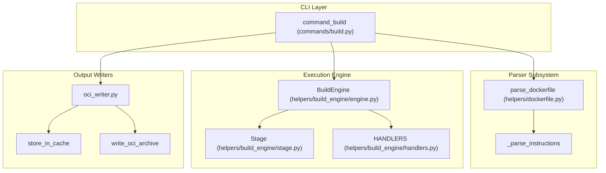
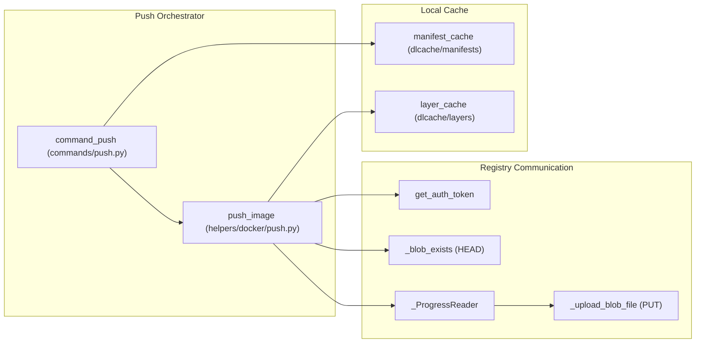

<!-- source: DeepWiki mcp.deepwiki.com · repo termux/proot-distro · page 2.5 Build & Push Commands · fetched 2026-10-26 -->

# Build & Push Commands

Relevant source files

The following files were used as context for generating this wiki page:

- [proot_distro/commands/build.py](proot_distro/commands/build.py)
- [proot_distro/commands/push.py](proot_distro/commands/push.py)
- [proot_distro/helpers/build_engine/engine.py](proot_distro/helpers/build_engine/engine.py)
- [proot_distro/helpers/docker/push.py](proot_distro/helpers/docker/push.py)
- [proot_distro/helpers/dockerfile.py](proot_distro/helpers/dockerfile.py)
- [proot_distro/helpers/oci_writer.py](proot_distro/helpers/oci_writer.py)

The `build` and `push` commands provide a complete OCI image authoring and distribution pipeline within Termux. These commands allow users to create container images from Dockerfiles and upload them to OCI-compliant registries (like Docker Hub or GitHub Container Registry) without requiring a Docker daemon.

## Build Command Overview

The `build` command orchestrates the parsing of a Dockerfile, the execution of instructions within a PRoot-controlled environment, and the generation of OCI-compliant image artifacts.

### Implementation Flow

1.  **Context Resolution**: The command identifies the build context (directory) and the Dockerfile [proot_distro/commands/build.py:100-114]().
2.  **Parsing**: The `parse_dockerfile` function converts the raw text into an ordered list of instruction records [proot_distro/helpers/dockerfile.py:60-94]().
3.  **Engine Execution**: The `BuildEngine` walks through the instructions, maintaining stage state and global `ARG` scopes [proot_distro/helpers/build_engine/engine.py:54-62]().
4.  **Artifact Generation**: Once finished, the engine produces a manifest and image configuration [proot_distro/helpers/oci_writer.py:58-72]().

### Build Command Entities

The following diagram maps the logical build steps to the internal code entities responsible for them.

**Build Pipeline Entity Map**

Sources: `proot_distro/commands/build.py`, `proot_distro/helpers/dockerfile.py`, `proot_distro/helpers/build_engine/engine.py`, `proot_distro/helpers/oci_writer.py`

### Key Build Options

| Option | Description | Implementation Detail |
| :--- | :--- | :--- |
| `--tag`, `-t` | Name and tag for the image. | Defaults to `latest` if no colon is present [proot_distro/commands/build.py:179](). |
| `--output`, `-o` | Path to write an OCI tarball. | Uses `write_oci_archive` to create a `docker load` compatible file [proot_distro/helpers/oci_writer.py:162-173](). |
| `--install-as` | Installs the result immediately. | Invokes `command_install` internally after build completion [proot_distro/commands/build.py:328-333](). |
| `--build-arg` | Sets variables for `ARG`. | Passed to `BuildEngine` and merged with global scope [proot_distro/helpers/build_engine/engine.py:84](). |
| `--target` | Multi-stage build target. | Stops execution after the specified stage is reached [proot_distro/helpers/build_engine/engine.py:102-117](). |
| `--architecture` | Target CPU architecture. | Normalizes input (e.g., `arm64`) to PD-internal names [proot_distro/commands/build.py:138-144](). |
| `--no-cache` | Disables layer caching. | Forces re-execution of all instructions [proot_distro/helpers/build_engine/engine.py:88](). |

Sources: `proot_distro/commands/build.py`, `proot_distro/helpers/build_engine/engine.py`, `proot_distro/helpers/oci_writer.py`

---

## Push Command Overview

The `push` command uploads an image previously created by `build` to a remote OCI registry. It relies on the local manifest and layer caches populated during the build process.

### Implementation Logic

1.  **Pre-flight Check**: The command verifies that a manifest exists in the local cache for the requested tag and architecture [proot_distro/commands/push.py:71-78]().
2.  **Authentication**: It retrieves a Bearer token using credentials from the `PD_DOCKER_AUTH` environment variable [proot_distro/helpers/docker/transport.py:57]().
3.  **Blob Optimization**: Before uploading, it performs a `HEAD` probe for each layer. If the registry returns `200 OK`, the blob is skipped [proot_distro/helpers/docker/push.py:77-93]().
4.  **Streaming Upload**: Blobs not present on the registry are uploaded via `POST` (to initiate) and `PUT` (to stream data) [proot_distro/helpers/docker/push.py:175-200]().

### Push Command Entities

The following diagram illustrates the interaction between the push command and the OCI registry components.

**Push Logic and Data Flow**

Sources: `proot_distro/commands/push.py`, `proot_distro/helpers/docker/push.py`, `proot_distro/helpers/docker/cache.py`

### Authentication and Security

*   **PD_DOCKER_AUTH**: Credentials must be provided in `user:password` or `user:token` format via this environment variable [proot_distro/commands/push.py:21-27]().
*   **Token Scope**: The system requests `pull,push` scope when exchanging credentials for an OCI Bearer token [proot_distro/helpers/docker/push.py:26]().
*   **Atomic Updates**: When storing manifests locally, the system uses `atomic_replace` to prevent cache corruption during interrupted builds [proot_distro/helpers/oci_writer.py:128-130]().

Sources: `proot_distro/commands/push.py`, `proot_distro/helpers/docker/push.py`, `proot_distro/helpers/oci_writer.py`

---

