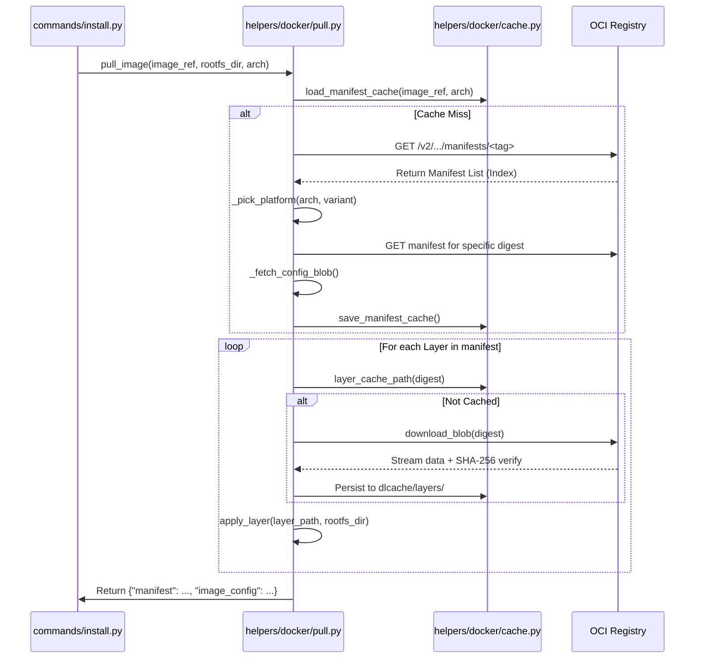
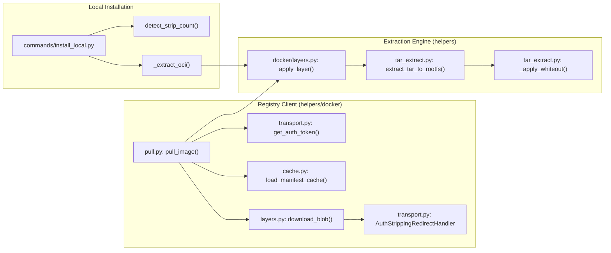

<!-- source: DeepWiki mcp.deepwiki.com · repo termux/proot-distro · page 3.2 OCI Image & Container Management · fetched 2026-10-26 -->

# OCI Image & Container Management

<details>
<summary>Relevant source files</summary>

The following files were used as context for generating this wiki page:

- [proot_distro/commands/install_local.py](proot_distro/commands/install_local.py)
- [proot_distro/helpers/docker/__init__.py](proot_distro/helpers/docker/__init__.py)
- [proot_distro/helpers/docker/cache.py](proot_distro/helpers/docker/cache.py)
- [proot_distro/helpers/docker/layers.py](proot_distro/helpers/docker/layers.py)
- [proot_distro/helpers/docker/pull.py](proot_distro/helpers/docker/pull.py)
- [proot_distro/helpers/docker/transport.py](proot_distro/helpers/docker/transport.py)
- [proot_distro/helpers/tar_extract.py](proot_distro/helpers/tar_extract.py)

</details>


The OCI (Open Container Initiative) management subsystem in `proot-distro` is responsible for interacting with container registries, resolving image manifests, managing local layer caches, and assembling the final rootfs. This subsystem is a pure-Python OCI client that operates without external dependencies like `docker` or `skopeo` [proot_distro/helpers/docker/__init__.py:21-34]().

## OCI Registry Client (`helpers/docker/`)

The registry client is split into specialized modules to handle HTTP transport, reference parsing, and layer management. It manages authentication, manifest resolution for specific architectures, and layer downloading [proot_distro/helpers/docker/__init__.py:23-34]().

### Image Reference Parsing
Images are identified via a reference string parsed by `parse_image_ref`. It decomposes strings into registry, repository, and tag components [proot_distro/helpers/docker/refs.py:78-108]().

| Reference | Registry | Repository | Tag |
|---|---|---|---|
| `ubuntu` | (empty) | `library/ubuntu` | `latest` |
| `ubuntu:24.04` | (empty) | `library/ubuntu` | `24.04` |
| `ghcr.io/foo/bar:1.0` | `ghcr.io` | `foo/bar` | `1.0` |

### Authentication and Redirect Handling
The client implements `AuthStrippingRedirectHandler` in `transport.py`. When pulling blobs from Docker Hub, the registry often redirects to a CDN (e.g., CloudFront) via pre-signed URLs. These CDN hosts return HTTP 400 if they receive a Bearer token. The handler detects cross-host redirects and strips the `Authorization` header [proot_distro/helpers/docker/transport.py:52-71]().

Token exchange is handled via `get_auth_token()`, which supports anonymous access and Basic auth via the `PD_DOCKER_AUTH` environment variable [proot_distro/helpers/docker/transport.py:159-177]().

Sources: [proot_distro/helpers/docker/refs.py:78-108](), [proot_distro/helpers/docker/transport.py:52-71](), [proot_distro/helpers/docker/transport.py:159-177]()

## Pull Flow and Integrity Verification

The `pull_image()` function in `pull.py` coordinates the conversion of an image reference into a local filesystem [proot_distro/helpers/docker/pull.py:176-241]().

### Image Pull Logic (`pull_image`)

Sources: [proot_distro/helpers/docker/pull.py:176-241](), [proot_distro/helpers/docker/pull.py:96-130](), [proot_distro/helpers/docker/cache.py:83-92]()

### Integrity and Verification
Integrity is enforced via SHA-256 hex digests:
1.  **Digest Validation**: `validate_digest()` ensures digests are well-formed and do not contain path traversal characters before they are used as filesystem paths [proot_distro/helpers/docker/cache.py:52-62]().
2.  **Streaming Verification**: `download_blob()` calculates the SHA-256 hash while streaming bytes to disk. If the final hash does not match the expected digest, the temporary file is discarded and an error is raised [proot_distro/helpers/docker/layers.py:40-91]().

Sources: [proot_distro/helpers/docker/cache.py:52-62](), [proot_distro/helpers/docker/layers.py:40-91]()

## Layer Application and Whiteouts

Layer extraction is handled by `extract_tar_to_rootfs()` in `helpers/tar_extract.py`. This function is used for both OCI layers and plain rootfs tarballs [proot_distro/helpers/tar_extract.py:63-76]().

### Whiteout Semantics
When `handle_whiteouts=True` is passed (default for OCI layers), the extractor processes special markers [proot_distro/helpers/tar_extract.py:165-178]():
*   **Explicit Whiteout**: Files named `.wh.<filename>` cause the extractor to delete the sibling file or directory `<filename>` [proot_distro/helpers/tar_extract.py:174-177]().
*   **Opaque Whiteout**: The marker `.wh..wh..opq` signals that the entire parent directory should be cleared of existing contents before applying the new layer's files [proot_distro/helpers/tar_extract.py:168-173]().

### Extraction Invariants
The extractor maintains several critical invariants for rootless operation:
*   **Hard Link Deferral**: Hard links are collected and applied only after all regular files are written to ensure the source exists [proot_distro/helpers/tar_extract.py:94-106]().
*   **Mtime Preservation**: Directory modification times are stamped last to prevent them from being updated by subsequent file writes [proot_distro/helpers/tar_extract.py:109-113]().
*   **Security**: Path components like `..` or empty strings are rejected to prevent archives from escaping the `rootfs/` directory [proot_distro/helpers/tar_extract.py:129-130]().

Sources: [proot_distro/helpers/tar_extract.py:165-178](), [proot_distro/helpers/tar_extract.py:94-113](), [proot_distro/helpers/tar_extract.py:129-130]()

## Container Storage Layout

Containers are stored in a structured directory under the configured runtime directory.

### Directory Structure
```text
containers/
└── <name>/
    ├── manifest.json   # Metadata and image configuration
    └── rootfs/         # The extracted OCI layers
        ├── bin/
        ├── etc/
        └── ...
```

### `manifest.json` Schema
The `manifest.json` file is created after a successful `pull_image()` call using the returned metadata [proot_distro/helpers/docker/pull.py:184-187]().

| Field | Description |
|---|---|
| `manifest` | The OCI image manifest containing the list of layers. |
| `image_config` | The image configuration blob (contains `Env`, `Cmd`, `Entrypoint`). |
| `repo` | The repository name used for future updates/resets. |

Sources: [proot_distro/helpers/docker/pull.py:176-187](), [proot_distro/helpers/docker/cache.py:88-91]()

## Code Entity Mapping

The following diagram maps high-level OCI operations to the specific Python modules and functions.



Sources: [proot_distro/helpers/docker/pull.py:63](), [proot_distro/helpers/docker/layers.py:94](), [proot_distro/helpers/tar_extract.py:63](), [proot_distro/commands/install_local.py:64]()

---

